# Geometry-Agnostic Data-Driven Discovery of Extreme Scenarios

Angeline Hu,1, ∗ Ava K. Tse,2, ∗ Kaitlyn S. Yasumura,2, ∗ Luciana Sarabia,2, ∗ Malcolm Yeung,3 Kavin K. Prasanna,1 Kai Wong,3 William Hammond,3 Ioannis G. Keverkidis,4 Shengkai Li,5 and Trung V. Phan6, †

1Claremont McKenna College, Claremont, CA 91711, USA. 2Scripps College, Claremont, CA 91711, USA. 3Pitzer College, Claremont, CA 91711, USA. 4Department of Chemical and Biomolecular Engineering, John Hopkins University, Baltimore, MD 21218, USA 5Department of Physics, Princeton University, Princeton, NJ 08544, USA 6Department of Natural Sciences, Scripps and Pitzer Colleges, Claremont Colleges Consortium, Claremont, CA 91711, USA (Dated: October 21, 2026)

We introduce a two-stage data-driven neural framework for discovering dynamically admissible extreme scenarios. Rather than assuming prior knowledge of the governing equations, the first stage infers the efective dynamical constraints directly from observational data. When the underlying physical system possesses suitable symmetries, the learned dynamics can be represented in a geometry-agnostic form, independent of any fixed grid, coordinate system, dimensionality, and intrinsic curvature. In the second stage, a physics-informed neural-search uses this learned dynamics to uncover rare, high-impact coherent structures that may not have appeared in the original observations. We demonstrate this framework through representative examples of increasing dimensionality and geometric complexity. Starting from a traditionally learned Dufing dynamics, we find a homoclinic pulse as a plausible localized extreme scenario. Next, since the same equation also appears in the stationary nonlinear Schr¨odinger system, with the coordinate interpreted as space instead of time, this pulse becomes a standing soliton. We then retrain the first stage using a geometry-agnostic neural representation, enabling the learned dynamics to be lifted to higherdimensional space to obtain higher-dimensional solitary profile, known as Townes soliton. Finally, with a Liouville system, we demonstrate that dynamics learned from data on a (1 + 1)-dimensional Lorentzian quasi-manifold can be transferred to a (2+0)-dimensional Euclidean manifold to identify an instanton. Our approach can be applied to other coherent spatiotemporal structures, including kinks, rogue waves, compactons, peakons, and potentially even singularities, with applications in risk analysis, nonlinear forecasting, and anomaly detection.

## I. INTRODUCTION

Extreme events are rare, often localized, departures from typical behavior [1]; in nonlinear systems, they are not necessarily external anomalies, but can arise naturally from the governing dynamics themselves [2]. Exam ples include rogue waves in nonlinear wave systems [3, 4], abrupt transitions in fluids and climate [5, 6], focusing stress in engineered structures [7, 8], epidemic spikes in complex interconnected networks [9], anomalous financial events [10, 11] (e.g. market crashes [12, 13]), and coherent bursts in complex systems [14]. These events can dominate the risk profile [15, 16] and exert a disproportionate influence on observable expectation values [17, 18] or long-time dynamical behavior [19, 20] of the system. Despite their importance, they are unlikely to appear in naturally sampled data, especially in high-dimensional systems governed by ordinary diferential equations (ODEs) or infinite-dimensional systems governed by field-theoretic partial diferential equations (PDEs). This creates a major challenge: the available ob servations may contain only typical behavior, while the most informative and consequential scenarios remain unseen. Here, we use the term scenario to emphasize that the target object has not been observed; rather, it is a dynamically plausible event or structure supported by the learned system. It is therefore valuable to develop methods that can infer plausible extreme scenarios directly from data.

Recent advances in machine learning have created new tools for learning, solving, and forecasting nonlinear dynamical systems from data. Physics-informed neural network (PINN) uses automatic diferentiation and diferential-equation residuals to solve forward and inverse problems involving nonlinear PDEs [21]. Related PINN-based methods have been used to reconstruct localized nonlinear-wave structures, including solitons, breathers, and rogue waves in integrable and non-integrable systems [22, 23]. More broadly, sparseregression methods such as SINDy have shown that gov erning equations can sometimes be discovered directly from data when the dynamics are sparse in a suitable library of candidate terms [24]. Neural operators, including DeepONet and Fourier neural operators, have extended data-driven modeling from finite-dimensional input-output maps to operators between function spaces, enabling fast surrogate modeling for families of PDE solutions [25, 26]. In parallel, active learning strategies have been combined with neural operators to improve the discovery and forecasting of extreme events by selecting informative data in high-dimensional systems [27]. Structure-preserving neural networks further show that embedding conservation laws, Hamiltonian structure, geometric constraints, or thermodynamic consistency into learning architectures can improve physical plausibility and long-time stability [28–31]. These developments form part of a substantial literature on the mechanisms, prediction, and statistical quantification of extreme events [27, 32]. Particularly relevant is the variational framework of Farazmand et al. [32], which identifies extreme event precursors through constrained optimization with conditions ensuring their probabilistic feasibility. More recently, Thiel et al. [33] used ensemble-derived information about local instability to improve rare-event statistics in neural emulators trained on limited data. Our work contributes to this broader efort by combining learned local dynamical constraints with a separate neural-search for prescribed classes of coherent structures, including transfer across geometric settings when the governing laws admit a suitable invariant representation. The present demonstrations concern the construction of candidate structures; their occurrence probabili ties and statistical significance remain to be established.

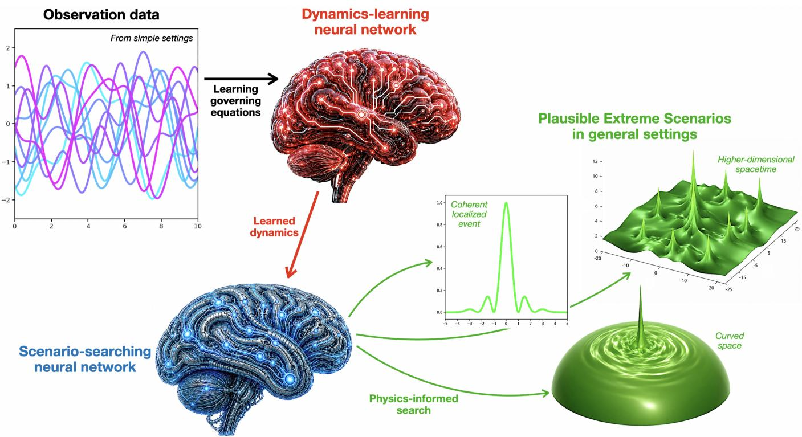  
FIG. 1. Overview of the data-driven two-stage neural framework for extremescenario discovery. Observational data from simple or experimentally accessible settings are first used to train a dynamics-learning neural network that infers the underlying governing dynamics. The learned dynamics are then passed to a scenario-searching neural network, which performs a physics-informed search for dynamically admissible coherent structures. This second stage can identify plausible extreme scenarios that need not appear in the original observations, including localized events in higher-dimensional spacetime or in diferent geometric settings such as curved spaces.

In this work, we introduce a two-stage formulation of extreme scenario discovery (see Fig. 1), starting from data. The first stage learns the underlying dynamics from observational data, while the second searches the learned dynamics for dynamically admissible coherent structures. For simplicity, we work with synthetic data, focus on localized structures, and implement the framework using simple multi-layer perceptron (MLP) neural networks with tanh-activation functions — our aim is to demonstrate that the proposed approach can be implemented with minimal architectural complexity while still producing reasonable results. Perhaps most impor tantly, we demonstrate that our proposed formulation allows the first stage to be geometry-agnostic, so that the learned dynamics are not tied to any particular grid, coordinate system, dimensionality, or geometric structure. Compared with the previous proposal on Riemannian manifolds [34], we extend this idea to a broader class of Riemann-Cartan geometric-manifolds (including quasi-manifolds and torsionful geometries, in which the local structure depends not only on the metric but also on an independent afine connection). This flexibility enables data from diferent settings to be aggregated and then used to make predictions in completely new settings. This capability is especially important when the extreme scenario of interest lives in an experimentally inaccessible space. Such a situation arises naturally in many relativistic field-theoretic systems [17], where instanton solutions are formulated on an imaginary-time Euclidean manifold rather than on the real-time Lorentzian quasi-manifold representing physical spacetime.

## II. COMPUTATIONAL EXPERIMENTS

We show proposed our data-driven neural framework through three examples that progress from a simple ODE setting to nonlinear PDEs with diferent dimensionalities and spacetime signatures1:

• Section III: We consider a Dufing ODE [35] to illustrate the complete pipeline: learning the dynamics from data and then searching the learned system for a homoclinic pulse [36]. We also examine a control case in which the learned ODE does not support such a solution (i.e. simple harmonic system), demonstrating how the search fails when the target structure is not dynamically admissible.

Section IV B: We use the stationary nonlinear (SNL) Schr¨odinger equation [37] to show how learned dynamics can be lifted from a onedimensional problem to a higher-dimensional spatial setting. The Dufing equation considered previously can be reinterpreted as a SNL Schr¨odinger equation in one-dimensional space, turning the localized pulse into a standing soliton profile. After retraining the first stage with a geometry-agnostic neural representation, the learned dynamics can be generalized to two spatial dimensions, or higher via the O(p) symmetry2, where the scenario-searching network identifies a self-focusing Townes profile [38]. This example demonstrates that data from a lower-dimensional setting can support the prediction of a coherent localized structure in a higherdimensional space.

• Section IV C: The third example explores how the two-stage formulation creates room for novelty at each stage of the framework. We study the Liouville relativistic PDE [39] to extend a previously developed geometry-agnostic learning framework on torsionless Riemannian manifolds [34] to also include torsionful Lorentzian quasi-manifolds, and then incorporate this extension into our extremescenario discovery pipeline. Dynamics learned from data on a (1 + 1)-dimensional spacetime are transferred to a (2+0)-dimensional Euclidean space (obtained via a temporal Wick rotation), where they serve as the residual constraint for the hunt of instanton solution [17]. This example shows that learned dynamics can be used beyond the geometric setting in which the data were collected, enabling coherent extreme scenarios to be discovered in spaces that may not be even experimentally observable.

The scenario-searching network represents a candidate solution: its inputs are temporal or spatial coordinates, and its output is the normalized field profile. Automatic diferentiation provides the derivatives needed to evaluate the learned dynamical constraint at sampled collocation points. During this stage, the dynamics-learning network is held fixed, while the parameters of the scenariosearching network and the associated coordinate- and field-rescaling factors are optimized. The loss combines the learned dynamical residual with pinning and localization conditions that specify the class of structures sought. No labeled examples of the target extreme profile enter this loss. Thus, the search determines a profile within a prescribed class, together with its physical scales; it does not automatically select which class of extreme scenarios to investigate.

We describe the procedure used to generate the train ing data (for the dynamics-learning neural networks) and the training locations (for the scenario-searching neural networks) in Appendix A. The MLP neural-network architectures used in the examples are summarized in Appendix B, and the training procedures for the individual networks are given in Appendix C. In the following sections of the main manuscript, we focus on:

(i) the mathematical description of the dynamical systems of interest and the corresponding extreme scenarios,

(ii) what are the inputs and outputs of the neural networks,

(iii) the loss functions used for the neural networks and the associated trainable parameters, and

(iv) the comparison between the neural-found and analytical solutions.

## III. FULL PIPELINE: SEARCHING FOR A DUFFING HOMOCLINIC PULSE

We use the first example to illustrate the full two-stage pipeline: the first neural network learns the underlying dynamics from synthetic trajectory data (see Fig. 2A1), and the second neural network searches the learned dynamics for a localized coherent structure. The trainings are done consecutively.

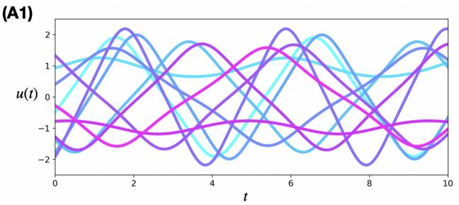

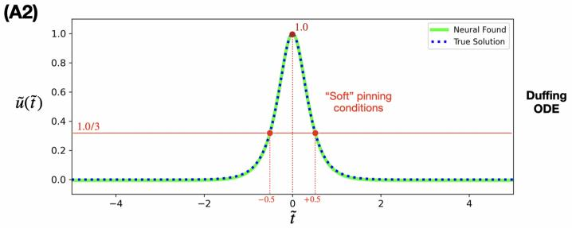

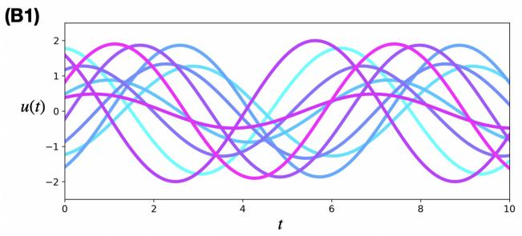

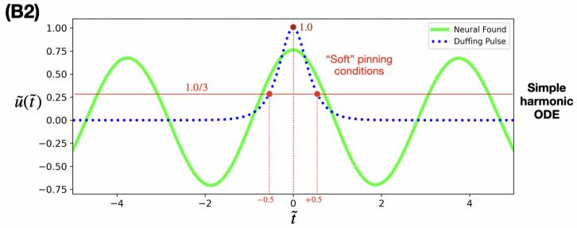  
FIG. 2. Full two-stage pipeline for learning dynamics and searching for a homoclinic pulse. The comparison between the Dufing (A1,A2) and simple harmonic systems (B1,B2) provides a positive and negative test of the framework: the search should recover a pulse when the learned dynamics support one, and fail when they do not. (A1,B1) The representative trajectories of data used to train the dynamics-learning neural network in the first stage. (A2,B2) The result of the scenariosearching neural network in the second stage, with pinning conditions explicitly shown. For the Dufing system (A2), the search recovers a localized homoclinic pulse in good agreement with the analytical solution. For the simple harmonic system (B2), the same search constraints do not produce a dynamically admissible pulse.

We consider a one-dimensional Dufing ODE:

$$
\ddot { u } ( t ) = u ( t ) - u ^ { 3 } ( t ) \ ,\tag{1}
$$

where t is the time-coordinate, $u ( t )$ is the scalar state variable and the dot denotes diferentiation with respect to time, i.e.

$$
\dot { u } ( t ) = \frac { d } { d t } u ( t ) \ , \ \ddot { u } ( t ) = \frac { d ^ { 2 } } { d t ^ { 2 } } u ( t ) \ .
$$

A homoclinic pulse is a localized trajectory that leaves an equilibrium state, develops a large transient excursion, and then returns to the same equilibrium state. This Dufing equation admits homoclinic pulse solutions of the form:

$$
u ( t ) = \pm \sqrt { 2 } \operatorname { s e c h } ( t - t _ { * } ) ,\tag{2}
$$

in which t∗ denotes the center time of the pulse (can be any real-value), i.e. the time at which the solution reaches its maximum amplitude. Thus, the scalar state is asymptotically 0 in the far past $t \to - \infty ,$ , rapidly forms a pronounced peak $\pm \sqrt { 2 }$ at time $t = t _ { * }$ , and then decays back to 0 in the far future $t \to + \infty$ . Physically, this type of solution is a clear representation of a drastic extreme event: the system appears nearly silent before the event, suddenly produces a large-amplitude localized pulse, and then becomes silent again.

For the first stage, following Appendix A 1, we generate a synthetic training dataset $\{ u _ { j } , \dot { u } _ { j } , \ddot { u } _ { j } , \ldots \} _ { j = 1 } ^ { M _ { 1 } ^ { ( D ) } }$ from randomly-selected trajectories of Eq. (1). Since the underlying dynamics are not known a priori, we assume a broad class of local dynamical laws by retaining all candidate terms up to a prescribed derivative order $\delta ,$ which we choose to be $\delta = 2$ . We then train the neural parameters of the dynamics-learning neural network, denoted by $\mathbb { N } _ { 1 } ^ { ( D ) }$ , which takes two-inputs $( u _ { j } , \dot { u } _ { j } )$ and returns oneoutput $\mathbb { N } _ { 1 } ^ { ( D ) } ( u _ { j } , \dot { u } _ { j } )$ . A visualization of this neural network can be found in Fig. 5A1. This training is done by minimizing the squared-deviation loss function:

$$
\mathcal { L } _ { { \mathbb N } _ { 1 } ^ { ( D ) } } = \bar { E } \left\{ \left[ { \mathbb N } _ { 1 } ^ { ( D ) } ( u _ { j } , \dot { u } _ { j } ) - \ddot { u } _ { j } \right] ^ { 2 } \right\} _ { \forall j } \ ,
$$

where $\bar { E } \{ \hat { X } \} c$ denotes the averaging operation applied to the expression $\hat { X }$ over all data points satisfying the clause C. After training, $\mathbb { N } _ { 1 } ^ { ( D ) }$ encodes the data-driven neural-learned dynamics of the Dufing system, i.e.

$$
\mathbb { N } _ { 1 } ^ { ( D ) } ( u , \dot { u } ) \approx \ddot { u } \ .\tag{3}
$$

For the second stage, our main goal is to train a scenario-searching neural network, denoted as $\mathbb { N } _ { 2 } ^ { ( D ) }$ , so that with it we can identify a homoclinical pulse solution of Eq. (1). Given that the pulse can occur at any time; thus, without loss of generality, we can gauge away this freedom by requiring that we only search for a solution centered exactly at $t = 0$ . Because the maximum amplitude and characteristic width of the pulse are not known a priori, we do not search for the solution $u ( t )$ directly. Instead, we use the neural model $\mathbb { N } _ { 2 } ^ { ( D ) }$ to approximate a normalized pulse profile $\tilde { u } ( \tilde { t } )$ in a normalized time coordinate $\tilde { t } ,$ i.e.

$$
\begin{array} { r } { \mathbb { N } _ { 2 } ^ { ( D ) } ( \tilde { t } ) \approx \tilde { u } ( \tilde { t } ) ~ . } \end{array}\tag{4}
$$

A visualization of this neural network can be found in Fig. 5B1.

In this normalized representation, the pulse center is fixed at $\tilde { t } = 0$ and the peak amplitude is prescribed by imposing

$$
\tilde { u } ( 0 ) = 1 . 0 ~ .\tag{5}
$$

Additionally, we impose shoulder conditions at $\tilde { t } = \pm 0 . 5$ such that it is lower than the peak by a chosen factor $\eta = 3 \mathrm { : }$

$$
\tilde { u } ( \pm 0 . 5 ) = \tilde { u } ( 0 ) / \eta = 1 . 0 / 3 \ ,\tag{6}
$$

and the temporal localization requirement that such that far away amplitude stays small:

$$
| \tilde { u } ( \tilde { t } ) | _ { | \tilde { t } | < 0 . 5 } | < \tilde { u } ( 0 ) / \eta = 1 . 0 / 3 \ ,\tag{7}
$$

The homoclinical pulse solution is then recovered through the rescaling:

$$
t = T ^ { ( { D } ) } \tilde { t } , \qquad u ( t ) = U ^ { ( { D } ) } \tilde { u } ( \tilde { t } ) ,\tag{8}
$$

Thus, we need to introduce two more parameters, T(D) and $\dot { \mathbb { U } } ^ { ( D ) }$ , to approximate $T ^ { ( D ) }$ and $U ^ { ( \mathbf { \hat { \boldsymbol { D } } } ) }$ , i.e.

$$
\mathbb { T } ^ { ( D ) } \approx T ^ { ( D ) } , \mathbb { U } ^ { ( D ) } \approx U ^ { ( D ) } .\tag{9}
$$

These parameters should be trained simultaneously with the neural parameters of $\mathbb { N } _ { 2 } ^ { ( D ) }$ , so that while $\mathbb { N } _ { 2 } ^ { ( D ) }$ learns the normalized pulse shape, ${ \overline { { \mathbb { T } } } } ^ { ( D ) }$ and $\mathbb { U } ^ { ( D ) }$ learn how this normalized profile should be embedded into the neurallearned Dufing dynamics $\mathbb { N } _ { 1 } ^ { ( D ) }$ encoded by the constraint:

$$
\begin{array} { l } { { \displaystyle { \mathbb N } _ { 1 } ^ { ( D ) } \left( U ^ { ( D ) } { \mathbb N } _ { 2 } ^ { ( D ) } ( \tilde { t } ) , \frac { U ^ { ( D ) } } { T ^ { ( D ) } } \frac { d } { d \tilde { t } } { \mathbb N } _ { 2 } ^ { ( D ) } ( \tilde { t } ) \right) } } \\ { { \displaystyle ~ - \frac { U ^ { ( D ) } } { T ^ { ( D ) ^ { 2 } } } \frac { d ^ { 2 } } { d \tilde { t } ^ { 2 } } { \mathbb N } _ { 2 } ^ { ( D ) } ( \tilde { t } ) = 0 ~ . } } \end{array}\tag{10}
$$

The required derivatives of the neural network $\mathbb { N } _ { 2 } ^ { ( D ) }$ with respect to t˜ can be obtained by auto-diferentiation. As a sanity check, Eq. (10) follows exactly from Eq. (8) when the approximations in Eq. (25), Eq.(4), Eq. (9) are all exact.

To train $\mathbb { N } _ { 2 } ^ { ( D ) } , \mathbb { T } ^ { ( D ) }$ , and $\mathbb { U } ^ { ( D ) }$ , we create a set of training locations $\{ t _ { j } \} _ { j = 1 } ^ { M _ { 2 } ^ { ( D ) } }$ , as follows from Appendix A 1. We then minimize a total loss function:

$$
{ \mathcal { L } } _ { \mathbb { N } _ { 2 } ^ { ( D ) } , \mathbb { T } ^ { ( D ) } , \mathbb { U } ^ { ( D ) } } = \sum _ { j = 1 } ^ { 5 } c _ { j } ^ { ( D ) } { \mathcal { L } } _ { j } ^ { ( D ) } ~ ,
$$

where $c _ { \alpha } ^ { ( D ) } > 0$ are weighting coeficients. The five loss functions $\{ \mathcal { L } _ { j } ^ { ( D ) } \} _ { j = 1 } ^ { 5 }$ consist of:

• The “soft” pinning condition Eq. for the peak amplitude, i.e. (5):

$$
\mathcal { L } _ { 1 } ^ { ( D ) } = \left[ \mathbb { N } _ { 2 } ^ { ( D ) } ( 0 ) - 1 . 0 \right] ^ { 2 } .
$$

• The “soft” pinning conditions for the shoulders’ values, i.e. Eq. (6):

$$
\begin{array} { r } { \mathcal { L } _ { 2 } ^ { ( D ) } = \Big [ \mathbb { N } _ { 2 } ^ { ( D ) } ( + 0 . 5 ) - 1 . 0 / 3 \Big ] ^ { 2 } \ , \ } \\ { \mathcal { L } _ { 3 } ^ { ( D ) } = \Big [ \mathbb { N } _ { 2 } ^ { ( D ) } ( - 0 . 5 ) - 1 . 0 / 3 \Big ] ^ { 2 } \ . \ } \end{array}
$$

• The localization requirement, i.e. Eq. (7):

$$
\mathcal { L } _ { 4 } ^ { ( D ) } = \bar { E } \left\{ \left[ \mathrm { R e L U } \left( | \mathbb { N } _ { 2 } ^ { ( D ) } ( \tilde { t } _ { j } ) | - 1 . 0 / 3 \right) \right] ^ { 2 } \right\} _ { | \tilde { t } _ { j } | > 0 . 5 } ,
$$

in which ReLU(ζ) is the rectified linear unit function, i.e. ReLU $\ u ^ { \prime } ( \zeta ) = \operatorname* { m a x } ( 0 , \zeta )$

• The neural-learned Dufing dynamics constraint, i.e. Eq. (10):

$$
{ \mathcal L } _ { 5 } ^ { ( D ) } = \bar { E } \left\{ \left[ \hat { X } _ { 1 } ^ { ( D ) } ( \tilde { t } _ { j } ) - \hat { X } _ { 2 } ^ { ( D ) } ( \tilde { t } _ { j } ) \right] ^ { 2 } \right\} _ { \forall j } ,\tag{11}
$$

in which the expressions are:

$$
\begin{array} { r l r } & { } & { \hat { X } _ { 1 } ^ { ( D ) } ( \tilde { t } _ { j } ) = \mathbb { N } _ { 1 } ^ { ( D ) } \left( \mathbb { U } ^ { ( D ) } \mathbb { N } _ { 2 } ^ { ( D ) } ( \tilde { t } _ { j } ) , \underline { { \mathbb { U } ^ { ( D ) } } } \underline { { d } } _ { \tilde { t } } \mathbb { N } _ { 2 } ^ { ( D ) } ( \tilde { t } _ { j } ) \right) , } \\ & { } & { \hat { X } _ { 2 } ^ { ( D ) } ( \tilde { t } _ { j } ) = \underline { { \mathbb { U } ^ { ( D ) } } } \underline { { d } } ^ { 2 } \mathbb { N } _ { 2 } ^ { ( D ) } ( \tilde { t } _ { j } ) \ . } \end{array}
$$

Note that throughout the entire second stage, the neural model $\mathbb { N } _ { 1 } ^ { ( D ) }$ is kept fixed. The weights are chosen to be $( c _ { 1 } ^ { ( D ) } , c _ { 2 } ^ { ( \bar { D ) } } , c _ { 3 } ^ { ( D ) } , \bar { c _ { 4 } ^ { ( D ) } } , c _ { 5 } ^ { ( D ) } ) = ( 1 , 1 , 1 , 1 , 2 5 )$

After training, we compare the neural-found normalized pulse $\mathbb { N } _ { 2 } ^ { ( D ) } ( \tilde { t } )$ with the exact normalized homoclinic pulse solution $\tilde { u } ( \tilde { t } )$ , finding excellent agreement — see Fig. 2A2. Inside the training domain $\tilde { t } \in [ - \tau , + \tau ]$ where $\tau = 5 . 0$ , we have found the relative root-mean-square $\left( L ^ { 2 } \mathrm { - n o r m } \right)$ error to be very low:

$$
\frac { \bar { E } \left\{ \left[ \mathbb { N } _ { 2 } ^ { ( D ) } ( \tilde { t } _ { j } ) - \tilde { u } ( \tilde { t } _ { j } ) \right] ^ { 2 } \right\} _ { \forall j } } { \bar { E } \left\{ \left[ \tilde { u } ( \tilde { t } _ { j } ) \right] ^ { 2 } \right\} _ { \forall j } } \approx 0 . 0 5 \% .
$$

The neural-found rescaling factors are $\mathbb { T } ^ { ( D ) } \approx 3 . 4 2$ and $\mathbb { U } ^ { ( D ) } \approx 1 . 4 2$ , respectively, which are also in close agreement with the corresponding exact values $T ^ { ( D ) } \approx 3 . 5 2$ and $U ^ { ( D ) } \approx 1 . 4 1$ . Overall, this example provides a minimal proof of concept; agreement in the normalized profile and rescaling factors shows that the method captures both the event shape and its physical amplitude and time scale with high precision.

A similar neural-search (every step is the same as above) can also be applied to a dynamical system that intrinsically lacks a homoclinic pulse, such as the simple harmonic oscillator:

$$
\ddot { u } ( t ) = - u ( t ) \ .
$$

In this case, the dynamics-learning network is trained on randomly generated trajectories (see Fig. 2B1), and the scenario-searching network is then applied in the same way. The search fails to find a valid pulse-like solution, instead producing deviations from the learned dynamics (see Fig. 2B2). It is important to note that, from the trajectories alone (see Fig. 2A1 and B1), it is not obvious what kinds of behavior can emerge, let alone whether either system can support a homoclinic pulse.

## IV. SEARCHING FOR EXTREME SCENARIOS BEYOND TRAINING GEOMETRIES

In physical systems, the governing dynamics often respect underlying symmetries, such as rotational symmetry in classical space or Lorentz rotations and boosts in relativistic spacetime [40]. Similar symmetry structures can also emerge at low-energy limit of gapless condensed matter systems [41, 42]. These symmetries strongly constrain the possible features that can appear in the dynamical laws. In many cases, this makes it possible to learn the dynamics in a coordinate- and dimensionagnostic form, independent of the specific intrinsic curvature of the underlying space. Experimentally, this is extremely useful because one can train or infer the dynamics in a simple setting, while still using the learned model to predict behavior in other geometries, dimensions, or coordinate systems. A central advantage of our data-driven search framework is therefore that, when the dynamics-learning procedure is formulated geometryagnostically, the governing constraints learned in one setting can be applied across many geometric settings, allowing the framework to discover extreme scenarios even beyond where the observational data were collected.

We explain geometry-agnostic learning in Section IV A in a more general form than previously proposed [34]. We then show how this framework can predict extreme scenarios in settings beyond the training data: first for finding soliton in higher dimension in Section IV B, and then for instanton in diferent geometric structure (e.g. from a quasi-manifold to a manifold) in Section IV C.

## A. Geometry-Agnostic Learning

Geometry-agnostic learning means learning a physical rule in a form that is not tied to the particular geometry in which the data were measured. Rather than learning derivatives that only make sense in a specific coordinate system, the model learns from invariant geometric quantities. For scalar-field dynamics, these may include the field value, the Laplacian, and inner products of gradients. Because these quantities are defined intrinsically, the same learned law can be applied on a line, a plane, a curved surface, or a higher-dimensional space. In this sense, for systems with suitable symmetries, such representations are not only coordinate-independent but also trans-dimensional: the same feature set is well defined and can be evaluated consistently across spaces of diferent dimensions.

In [34], this idea was developed for scalar fields on a torsionless Riemannian manifold $( \mathcal { M } , g )$ , where M denotes the underlying space equipped with a metric structure $^ { g , }$ under the assumption that the system possesses a local $\mathrm { O } ( p )$ symmetry. However, the same perspective can be extended to torsionful Riemann-Cartan manifolds $( \mathcal { M } , g , \nabla _ { \Gamma } )$ , where the covariant derivative $\nabla _ { \Gamma }$ is equipped with a afine connection Γ that is not necessarily determined solely by the metric, as well as to quasimanifolds.

For concreteness, consider a collection of M scalar fields, $\{ u _ { a } \} _ { a = 1 } ^ { M }$ The dynamical features used by the learning model can then be organized according to their jet-space order, or equivalently their derivative order. This derivative order also provides a natural hierarchy of importance, analogous to power counting in efective field theory, where low-resolution or long-wavelength dynamics are typically dominated by lower-derivative terms. For example, one may include all scalar invariant features up to second order (counting derivatives):

• The field values $\{ u _ { a } \} _ { a = 1 } ^ { M }$

(0th-order features)

$$
\begin{array} { r l } & { \bullet \ \{ \langle \nabla _ { \Gamma } u _ { a } , \nabla _ { \Gamma } u _ { b } \rangle _ { g } \} _ { a , b = 1 } ^ { M } \ \mathrm { a n d } \ \{ \nabla _ { \Gamma } ^ { 2 } u _ { a } \} _ { a = 1 } ^ { M } . } \\ & { \quad ( 2 \mathrm { n d - o r d e r ~ f e a t u r e s } ) } \end{array}
$$

Note that there is no 1st-order feature. The second-order features are the gradient inner products and the Laplacians, which can be written explicitly in tensor form as:

1. The gradient inner products:

$$
\langle \nabla _ { \Gamma } u _ { a } , \nabla _ { \Gamma } u _ { b } \rangle _ { g } = g ^ { \mu \nu } \partial _ { \mu } u _ { a } \partial _ { \nu } u _ { b } \ ,\tag{12}
$$

where $g ^ { \mu \nu }$ is the inverse of the symmetric metric tensor gµν (i.e. $g ^ { \mu \nu } g _ { \nu \rho } = 1$ only when $\mu ~ = ~ \rho ,$ and $g _ { \mu \nu } = g _ { \nu \mu } )$ . Here, we have used the Einstein’s repeated-index summation convention.

2. The field’s Bochner Laplacians:

$$
\nabla _ { \Gamma } ^ { 2 } u _ { a } = | g | ^ { - 1 / 2 } \partial _ { \mu } \left( | g | ^ { 1 / 2 } g ^ { \mu \nu } \partial _ { \nu } u _ { a } \right) - g ^ { \mu \nu } C _ { \mu \nu } ^ { \lambda } \partial _ { \lambda } u _ { a } ,\tag{13}
$$

where $| g |$ is the determinant of the metric tensor ${ \mathit { g } } _ { \mu \nu } ,$ and $C _ { \mu \nu } ^ { \lambda }$ is the distorsion tensor (which is, in general, does not have any symmetry) [43]. On any torsion-free manifold or quasi-manifold, this tensor vanishes, and Bochner Laplacian reduces to the Laplace–Beltrami operator when acting on scalar fields. In Euclidean flat space it further reduces to the Laplace operator.

We can then formulated the dynamical laws either implicitly or explicitly, i.e. via M constraints:

$$
\mathcal { F } _ { c } \left( \{ u _ { a } \} _ { a = 1 } ^ { M } , \{ \langle \nabla _ { \Gamma } u _ { a } , \nabla _ { \Gamma } u _ { b } \rangle \} _ { a , b = 1 } ^ { M } \right) = \nabla _ { \Gamma } ^ { 2 } u _ { c } \ ,\tag{14}
$$

which is exactly identical to the form of the neural network model used in Eq. (25) for learning the dynamics, but also geometric-agnostic. We utilize this in Sections IV B and IV C.

There is, however, an important caveat. On a manifold, the gradient inner products are sign-definite: positive-definite for a positive metric signature, or negative-definite for the opposite signature. On a quasimanifold with mixed signature, by contrast, these inner products can take either sign. Therefore, a model trained only on data that lives on a manifold may not, in general, extrapolate reliably to a quasi-manifold. The reverse direction, however, is always possible: training on a quasi-manifold can expose the model to both sign sectors, allowing the learned dynamics to be evaluated on definite-signature manifolds as special cases. Indeed, this is the situation we encounter in Section IV C, after performing a temporal Wick rotation [44].

## B. Searching for a Townes Soliton

The Dufing system considered in Section III arises naturally as a stationary reduction of the nonlinear Schr¨odinger equation. To demonstrate this connection, we begin with the nonlinear Schr¨odinger PDE:

$$
\partial _ { t } \Psi ( \vec { r } , t ) + \vec { \nabla } ^ { 2 } \Psi ( \vec { r } , t ) + | \Psi ( \vec { r } , t ) | ^ { 2 } \Psi ( \vec { r } , t ) = 0 \ ,\tag{15}
$$

where $\Psi ( \vec { r } , t )$ denotes a complex-valued wave field, $\vec { r }$ is the spatial coordinate, t is time, and ${ \vec { \nabla } } ^ { 2 }$ is the Laplace operator.

We then consider stationary solutions of the form:

$$
\Psi ( \vec { r } , t ) = \exp ( - i \omega t ) u ( \vec { r } , t ) \ ,
$$

in which $u ( \vec { r } )$ is a time-independent real-valued field and ω is a real frequency parameter. Substituting this ansatz into Eq. (15) and factoring out the common oscillatory phase exp(−iωt) yields:

$$
\vec { \nabla } ^ { 2 } u ( \vec { r } ) = \omega u ( \vec { r } ) - u ^ { 3 } ( \vec { r } ) \ .
$$

Up to the rescales $u  \omega ^ { 1 / 2 } u$ and $x  \omega ^ { - 1 / 2 } x .$ , we obtain the stationary nonlinear (SNL) Schr¨odinger equation:

$$
\vec { \nabla } ^ { 2 } u ( \vec { r } ) = u ( \vec { r } ) - u ^ { 3 } ( \vec { r } ) \ .\tag{16}
$$

In one-dimensional space ${ \vec { r } } \equiv x$ , this becomes the Dufing ODE, i.e. Eq. (1), but with space-coordinate x instead of time t:

$$
u ^ { \prime \prime } ( x ) = u ( x ) - u ^ { 3 } ( x ) ;
$$

(A)  
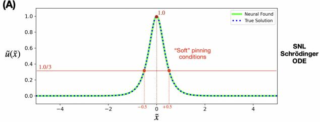

(B1)  
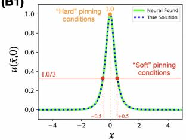

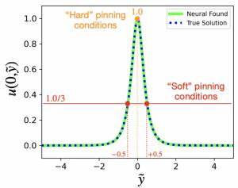

(B2)  
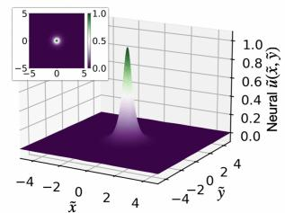

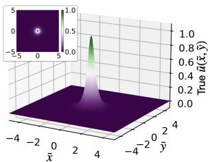

(C)  
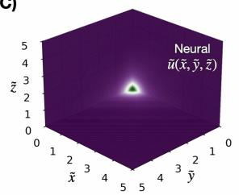

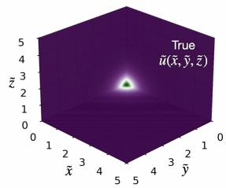  
FIG. 3. Geometry-agnostic neural-search result for stationary soliton profiles in the nonlinear Schr¨odinger system. Those solutions are known as the Townes solitons. (A) The scenario-searching neural network recovers the one-dimensional stationary soliton profile, equivalent to the Dufing homoclinic pulse with the coordinate interpreted as space. (B1) Cross sections of the twodimensional neural-found profile along the ˜x and ${ \tilde { y } } .$ (B2) Surface plots of the neural-found normalized Townes soliton and the high-precision numerical reference. (C) Three orthogonal cross sections of the three-dimensional soliton profile in the positive octant.

here, the prime denotes diferentiation with respect to space, i.e.

$$
u ^ { \prime } ( x ) = \frac { d } { d x } u ( x ) \ , \ u ^ { \prime \prime } ( x ) = \frac { d ^ { 2 } } { d x ^ { 2 } } u ( x ) \ .
$$

This equation governs the stationary configurations of the nonlinear Schr¨odinger system in one-dimensional space.

Given many of such configurations, similar to the first stage – the dynamics-learning stage – in Section III, we can train a neural network $\mathbb { N } _ { 1 } ^ { ( S _ { 1 } ) }$ to learn the dynamical constraint of the one-dimensional SNL Schr¨odinger. Note that, the superscript (S1) here is to indicate that we are dealing with the one-dimensional SNL Schr¨odinger system. To make the learned dynamics geometry-agnostic, however, we should not use the coordinate-dependent form Eq. (25) but the form proposed in Eq. (14), i.e.

$$
\mathbb { N } _ { 1 } ^ { ( S _ { 1 } ) } ( u , u ^ { \prime 2 } ) \approx u ^ { \prime \prime } ~ ,\tag{17}
$$

where we have calculated in a flat Euclidean onedimensional space that

$$
\left. \nabla _ { \Gamma } u , \nabla _ { \Gamma } u \right. = { u ^ { \prime } } ^ { 2 } , \nabla _ { \Gamma } ^ { 2 } u = u ^ { \prime \prime } .
$$

A visualization of this neural network can be found in Fig. 5A2. After training the network to a reasonably low loss, we freeze $\mathbb { N } _ { 1 } ^ { ( S _ { 1 } ) }$ and use it as the learned geometryagnostic dynamical law in the second-stage search.

## 1. Sanity Check in 1D

Before moving on, let us perform a sanity check. We can also find a pulse-like solution for $u ( x )$ , which should match the Dufing homoclinic pulse, as expressed by Eq. (2), after replacing t by x. In this context, this solution is the one-dimensional stationary soliton profile of the nonlinear Schr¨odinger equation. The neural-search procedure is identical to the second stage in Section III, except that the coordinate and its corresponding trainable rescaling parameter now acts on space rather than time. We denote the coordinate by x this parameter by $R ,$ simply to emphasize its spatial interpretation; mathematically, it plays the same role as the temporal coordi nate t and the rescaling parameter T used in the Dufing example. The loss contribution from the dynamical constraint, i.e. Eq. (21), is then modified accordingly:

$$
{ \mathcal L } _ { 5 } ^ { ( S _ { 1 } ) } = \bar { E } \left\{ \left[ \hat { X } _ { 1 } ^ { ( S _ { 1 } ) } ( \tilde { x } _ { j } ) - \hat { X } _ { 2 } ^ { ( S _ { 1 } ) } ( \tilde { x } _ { j } ) \right] ^ { 2 } \right\} _ { \forall j } ,\tag{18}
$$

in which the expressions are:

$$
\begin{array} { r l r } & { } & { \hat { X } _ { 1 } ^ { ( S _ { 1 } ) } ( \tilde { x } _ { j } ) = \mathbb { N } _ { 1 } ^ { ( S _ { 1 } ) } \left( \mathbb { U } ^ { ( S _ { 1 } ) } \mathbb { N } _ { 2 } ^ { ( D ) } ( \tilde { x } _ { j } ) , \left[ \underline { { \mathbb { U } ^ { ( S _ { 1 } ) } } } \frac { d } { \mathbb { R } ^ { ( S _ { 1 } ) } } \frac { \mathbb { N } _ { 2 } ^ { ( D ) } ( \tilde { x } _ { j } ) } { d \tilde { x } } \right] ^ { 2 } \right) } \\ & { } & { \hat { X } _ { 2 } ^ { ( D ) } ( \tilde { x } _ { j } ) = \underline { { \mathbb { U } ^ { ( D ) } } } ^ { \underline { { d ^ { 2 } } } } \mathbb { N } _ { 2 } ^ { ( D ) } ( \tilde { x } _ { j } ) } \end{array}
$$

We find that neural-search result for the normalized pulse $\mathbb { N } _ { 2 } ^ { ( S _ { 1 } ) } ( \tilde { x } ) ^ { 3 }$ agrees with the exact normalized homoclinic pulse solution $\tilde { u } ( \tilde { x } )$ — see Fig. 3A. Inside the training domain $\tilde { x } \in [ - \lambda , + \lambda ]$ where $\lambda = 5 . 0$ , we have found the relative root-mean-square $\left( L ^ { 2 } \mathrm { - n o r m } \right)$ error to be extremely low:

$$
\frac { \bar { E } \left\{ \left[ \mathbb { N } _ { 2 } ^ { ( S _ { 1 } ) } ( \tilde { x } _ { j } ) - \tilde { u } ( \tilde { x } _ { j } ) \right] ^ { 2 } \right\} _ { \forall j } } { \bar { E } \left\{ \left[ \tilde { u } ( \tilde { x } _ { j } ) \right] ^ { 2 } \right\} _ { \forall j } } \approx 0 . 0 0 3 \% ,
$$

and rescaling factors are $\mathbb { R } ^ { ( S _ { 1 } ) } \approx 3 . 6 2$ and $\mathbb { U } ^ { ( S _ { 2 } ) } \approx 1 . 4 1$ respectively, which are close to their corresponding exact values $R ^ { ( S _ { 1 } ^ { - } ) } \approx 3 . 5 2$ and $U ^ { ( S _ { 1 } ) } \approx 1 . 4 1$

## 2. neural-search in 2D

We have trained $\mathbb { N } _ { 1 } ^ { ( S ) }$ using only observational data taken from one-dimensional space. We now apply the same learned dynamics in two spatial dimensions ${ \vec { r } } =$ $( x , y )$ , where we search for the corresponding Townes soliton profile in the SNL Schr¨odinger dynamics governed by Eq. (16). To do so, we must calculate the expression for the geometry-agnostic features in the new flat Euclidean two-dimensional space:

$$
\begin{array} { r l } & { \langle \nabla _ { \Gamma } u , \nabla _ { \Gamma } u \rangle = ( \partial _ { x } u ) ^ { 2 } + ( \partial _ { y } u ) ^ { 2 } \ , } \\ & { \qquad \nabla _ { \Gamma } ^ { 2 } u = \partial _ { x } ^ { 2 } u + \partial _ { y } ^ { 2 } u \ . } \end{array}\tag{19}
$$

This step (and the calculated expressions) appears simple here only because we have chosen a minimal example to illustrate the idea. More generally, the target space may be curved, torsionful, or arbitrarily highdimensional. The framework is unchanged: one simply recomputes the geometry-agnostic features using the ap propriate geometric operators of the new space.

With the features in Eq. (19), we can now do the neural-search with a set of training locations $\{ ( \tilde { x } _ { j } , \tilde { y } _ { j } ) \} _ { j = 1 } ^ { M _ { 2 } ^ { ( S _ { 2 } ) } }$ , which can be selected as explained in Appendix A 2. Note that, the superscript (S2) here is to indicate that we are dealing with the two-dimensional SNL Schr¨odinger system. Beside the neural parameters of $\mathbb { N } _ { 2 } ^ { ( S _ { 2 } ) } ( \tilde { x } , \tilde { y } ) ^ { 4 }$ , which after a successful search should approximate the normalized Townes soliton $\tilde { u } ( \tilde { x } , \tilde { y } )$ , we need two more trainable parameters, $\mathbb { R } ^ { ( S _ { 2 } ) }$ and $\mathbb { U } ^ { \smash { \prime } }$ to approximate the spatial- and field-value-rescaling factors $\bar { R } ^ { ( S _ { 2 } ) }$ and $U ^ { ( S _ { 2 } ) }$ . It is important to note that no closed-form formula is available for this profile; however, given the known governing PDE, a symmetric solution of $\tilde { u } ( \tilde { x } , \tilde { y } )$ can still be computed numerically to high precision (see Appendix D).

For this neural task, which requires searching over a two-dimensional profile, it is useful to impose as many “hard” constraints as possible. For example, if we seek a symmetric soliton centered at the origin, i.e.

$$
\mathbb { N } _ { 2 } ^ { ( S _ { 2 } ) } ( \tilde { x } , \tilde { y } ) = \mathbb { N } _ { 2 } ^ { ( S _ { 2 } ) } ( \pm \tilde { x } , \mp \tilde { y } ) \ ,
$$

the exception of the constraint that has already been “hard” pinned (always exactly satisfied). We aim to minimize the total loss function:

and want to pin its value to be exactly one there, i.e.

$$
\mathbb { N } _ { 2 } ^ { ( S _ { 2 } ) } ( 0 , 0 ) = 1 \ ,
$$

$$
\mathcal { L } _ { \mathbb { N } _ { 2 } ^ { ( S _ { 2 } ) } , \mathbb { R } ^ { ( S _ { 2 } ) } , \mathbb { U } ^ { ( S _ { 2 } ) } } = \sum _ { j = 1 } ^ { 6 } c _ { j } ^ { ( S _ { 2 } ) } \mathcal { L } _ { j } ^ { ( S _ { 2 } ) } \ ,
$$

then we can always construct it by symmetrizing and normalizing the output of an unconstrained neural network $\breve { \mathbb { N } } _ { 2 } ^ { ( S _ { 2 } ) } ( \tilde { x } , \tilde { y } )$ as follows:

$$
\begin{array} { l } { { { \mathbb N } _ { 2 } ^ { ( S _ { 2 } ) } ( \tilde { x } , \tilde { y } ) = \frac 1 4 \left[ \breve { { \mathbb N } } _ { 2 } ^ { ( S _ { 2 } ) } ( \tilde { x } , \tilde { y } ) + \breve { { \mathbb N } } _ { 2 } ^ { ( S _ { 2 } ) } ( - \tilde { x } , - \tilde { y } ) \right. } } \\ { { \left. \qquad + \breve { { \mathbb N } } _ { 2 } ^ { ( S _ { 2 } ) } ( - \tilde { x } , \tilde { y } ) + \breve { { \mathbb N } } _ { 2 } ^ { ( S _ { 2 } ) } ( \tilde { x } , - \tilde { y } ) \right] \ . } } \end{array}
$$

This construction introduces no additional trainable parameters beyond those of $\breve { \mathbb { N } } _ { 2 } ^ { ( S _ { 2 } ) } ( \tilde { x } , \tilde { y } )$ ; the constrained model is fully determined by the same parameter set through a fixed symmetrization operator. In other words, the neural parameters of $\breve { \mathbb { N } } _ { 2 } ^ { ( S _ { 2 } ) } ( \tilde { x } , \tilde { y } )$ are equivalent to those of $\mathbb { N } _ { 2 } ^ { ( S _ { 2 } ) } ( \tilde { x } , \tilde { y } )$

in which the six contributions are:

The neural training procedure used to obtain an approximate normalized Townes soliton employs loss contributions similar to those introduced in Section III, with • The “soft” pinning conditions for the shoulders’ values, which is the two-dimensional equivalence of Eq. (6):

$$
\mathcal { L } _ { 1 } ^ { ( S _ { 2 } ) } = \left[ \mathbb { N } _ { 2 } ^ { ( D ) } ( + 0 . 5 , 0 ) - 1 . 0 / 3 \right] ^ { 2 } ,
$$

$$
\mathcal { L } _ { 2 } ^ { ( S _ { 2 } ) } = \left[ \mathbb { N } _ { 2 } ^ { ( D ) } ( - 0 . 5 , 0 ) - 1 . 0 / 3 \right] ^ { 2 } ,
$$

$$
\mathcal { L } _ { 3 } ^ { ( S _ { 2 } ) } = \left[ \mathbb { N } _ { 2 } ^ { ( D ) } ( 0 , + 0 . 5 ) - 1 . 0 / 3 \right] ^ { 2 } ,
$$

$$
\mathcal { L } _ { 4 } ^ { ( S _ { 2 } ) } = \left[ \mathbb { N } _ { 2 } ^ { ( D ) } ( 0 , - 0 . 5 ) - 1 . 0 / 3 \right] ^ { 2 } .
$$

• The localization requirement, which defines the exterior region where the soliton fluctuation is small – similar to (7):

$$
\mathcal { L } _ { 5 } ^ { ( S _ { 2 } ) } = \bar { E } \left\{ \left[ \mathrm { R e L U } \left( | \mathbb { N } _ { 2 } ^ { ( D ) } ( \tilde { x } _ { j } , \tilde { y } _ { j } ) | - 1 . 0 / 3 \right) \right] ^ { 2 } \right\} _ { | \tilde { x } _ { j } | > 0 . 5 \mathrm { ~ V ~ } } ,\tag{20}
$$

where ∨ is the logical OR operation.

• The neural-learned SNL Schr¨odinger dynamics constraint, which is written in the proposed form Eq. (18):

$$
\mathcal { L } _ { 6 } ^ { ( S _ { 2 } ) } = \bar { E } \left\{ \left[ \hat { X } _ { 1 } ^ { ( S _ { 2 } ) } ( \tilde { x } _ { j } , \tilde { y } _ { j } ) - \hat { X } _ { 2 } ^ { ( S _ { 2 } ) } ( \tilde { x } _ { j } , \tilde { y } _ { j } ) \right] ^ { 2 } \right\} _ { \forall j } ,\tag{21}
$$

where the expressions $\hat { X } _ { 1 } ^ { ( S _ { 2 } ) }$ and $\hat { X } _ { 2 } ^ { ( S _ { 2 } ) }$ are:

$$
\hat { X } _ { 1 } ^ { ( S _ { 2 } ) } ( \tilde { x } _ { j } , \tilde { y } _ { j } ) = \mathbb { N } _ { 1 } ^ { ( S _ { 1 } ) } \left( \mathbb { U } ^ { ( S _ { 2 } ) } \mathbb { N } _ { 2 } ^ { ( S _ { 2 } ) } ( \tilde { x } _ { j } , \tilde { y } _ { j } ) , \underline { { \mathbb { U } } } ^ { ( S _ { 2 } ) ^ { 2 } } \left\{ \left[ \partial _ { \tilde { x } } \mathbb { N } _ { 2 } ^ { ( S _ { 2 } ) } ( \tilde { x } _ { j } , \tilde { y } _ { j } ) \right] ^ { 2 } + \left[ \partial _ { \tilde { y } } \mathbb { N } _ { 2 } ^ { ( S _ { 2 } ) } ( \tilde { x } _ { j } , \tilde { y } _ { j } ) \right] ^ { 2 } \right\} \right) ,
$$

$$
\hat { X } _ { 2 } ^ { ( S _ { 2 } ) } ( \tilde { x } _ { j } , \tilde { y } _ { j } ) = \frac { \mathbb { U } ^ { ( S _ { 2 } ) } } { \mathbb { R } ^ { { ( S _ { 2 } ) } ^ { 2 } } } \left[ \partial _ { \tilde { x } } ^ { 2 } \mathbb { N } _ { 2 } ^ { ( S _ { 2 } ) } ( \tilde { x } _ { j } , \tilde { y } _ { j } ) + \partial _ { \tilde { y } } ^ { 2 } \mathbb { N } _ { 2 } ^ { ( S _ { 2 } ) } ( \tilde { x } _ { j } , \tilde { y } _ { j } ) \right] ;
$$

these follows from the calculated expressions for the geometry-agnostic features in Eq. (19).

Note that we use the neural network model $\mathbb { N } _ { 1 } ^ { ( S _ { 1 } ) }$ obtained from the training for $\begin{array} { r l } { \operatorname { E q . } } & { { } \left( 1 7 \right) } \end{array}$ . The weights are chosen to be $( c _ { 1 } ^ { ( S _ { 2 } ) } , c _ { 2 } ^ { ( S _ { 2 } ) } , c _ { 3 } ^ { ( \hat { S } _ { 2 } ) } , c _ { 4 } ^ { ( S _ { 2 } ^ { ' } ) } , c _ { 5 } ^ { ( S _ { 2 } ) } , c _ { 6 } ^ { ( S _ { 2 } ) } ) \ =$ (1, 1, 1, 1, 1, 25).

We compare the neural-found normalized Townes solitary solution $\mathbb { N } _ { 2 } ^ { ( D ) } ( \tilde { x } , \tilde { y } )$ with the high-precision numerical solution $\tilde { u } ( \tilde { x } , \tilde { y } ) -$ obtained in Appedix D from knowing the exact governing PDE – after training (see Fig. 3B1 and B2). The agreement between then are excellent, i.e. inside the training domain $( \tilde { x } , \tilde { y } ) \in [ - \lambda , + \lambda ] \times$ $\begin{array} { l } { { \left[ - \lambda , + \lambda \right] \ \mathrm { ~ } } } \\ { { \left( L ^ { 2 } - \mathrm { n o r m } \right) } } \end{array}$ where $\lambda = 5 . 0 .$ , the relative root-mean-square error is low:

$$
\frac { \bar { E } \left\{ \left[ \mathbb { N } _ { 2 } ^ { ( D ) } ( \tilde { t } _ { j } ) - \tilde { u } ( \tilde { t } _ { j } ) \right] ^ { 2 } \right\} _ { \forall j } } { \bar { E } \left\{ \left[ \tilde { u } ( \tilde { t } _ { j } ) \right] ^ { 2 } \right\} _ { \forall j } } \approx 0 . 0 2 \% .
$$

The neural-found rescaling factors are $\mathbb { R } ^ { ( D ) } \approx 2 . 6 8$ and $\mathbb { U } ^ { ( D ) } ~ \approx ~ 2 . 1 7$ also agrees with their numerical values $R ^ { ( D ) } \approx 2 . 6 1$ and $U ^ { ( D ) } \approx 2 . 2 1$

We have demonstrated that extreme scenarios can be identified in spaces of higher dimension than the one in which the dynamics were originally learned. We can also lift the learned dynamics to three-dimensional space and find that the neural-search still recovers the corresponding localized soliton profile with excellent agreement (see Fig. 3C) — the relative root-mean-square $\left( L ^ { 2 } \mathrm { - n o r m } \right)$ is reasonably small $\approx 1 . 4 \%$

## C. Searching for a Liouville Instanton

For the final example, we consider a relativistic Liouville system in $( 1 + 1 )$ -dimensional Lorentzian spacetime with coordinates $( x , t )$ :

$$
\partial _ { t } ^ { 2 } u ( x , t ) - \partial _ { x } ^ { 2 } u ( x , t ) = \exp \left[ u ( x , t ) \right] ,\tag{22}
$$

where $u ( x , t )$ is a real scalar field. This PDE appears in many areas of theoretical physics, including twodimensional conformal field theory [45], string theory [46], and models of two-dimensional gravity [47, 48]. In the first stage, we learn the Liouville dynamics from data on a Lorentzian quasi-manifold. In the second stage, we Wick rotate it to a Euclidean manifold and use the learned dynamics to search for an instanton. It is important to note that Wick rotation [44] is one of the most powerful analytic-continuation techniques in theoretical physics: by mapping the real-time t to an imaginarytime $t _ { E }$ , i.e. $t = i t _ { E }$ (see Fig. 4A for how such a change modifies the geometric structures), it turns certain realtime quantum or field-theoretic processes into localized Euclidean configurations5. In this formulation, tunneling events, saddle points, and other nonperturbative efects can often be treated as mathematically well-posed solutions; their collective contributions can dominate vacuum expectation $\mathrm { \ v a l u e s ^ { 6 } }$ and other physical observables [17]. These solutions are called instantons because they are localized in imaginary time, appearing as coherent “instant” events rather than extended real-time processes.

In the flat Lorentzian (1 + 1)-dimensional spacetime:

$$
\begin{array} { r l } & { \langle \nabla _ { \Gamma } u , \nabla _ { \Gamma } u \rangle = ( \partial _ { x } u ) ^ { 2 } - ( \partial _ { t } u ) ^ { 2 } \ , } \\ & { \qquad \nabla _ { \Gamma } ^ { 2 } u = \partial _ { x } ^ { 2 } u - \partial _ { t } ^ { 2 } u \ . } \end{array}\tag{23}
$$

In the flat Euclidean $( 2 + 0 )$ -dimensional space, we already have the calculation for the low-order geometryagnostic features – reported in Eq. (19):

$$
\begin{array} { c } { { \langle \nabla _ { \Gamma } u , \nabla _ { \Gamma } u \rangle = ( \partial _ { x } u ) ^ { 2 } + ( \partial _ { t _ { E } } u ) ^ { 2 } ~ , } } \\ { { \nabla _ { \Gamma } ^ { 2 } u = \partial _ { x } ^ { 2 } u + \partial _ { t _ { E } } ^ { 2 } u ~ . } } \end{array}\tag{24}
$$

## 1. The First Stage: Dynamics-Learning from Data on a Quasi-Manifold

Following Appendix A 3, we generate a synthetic training dataset consisting of geometric-agnostic features as expressed in Eq. (23), i.e.

$$
\left\{ u _ { j } , ( \partial _ { x } u _ { j } ) ^ { 2 } - ( \partial _ { t } u _ { j } ) ^ { 2 } , \partial _ { x } ^ { 2 } u _ { j } - \partial _ { t } ^ { 2 } u _ { j } , . . . \right\} _ { j = 1 } ^ { M _ { 1 } ^ { ( L _ { L } ) } }
$$

from randomly-selected field configurations of Eq. (22) (see Fig. 4B). Since the underlying dynamics are not known a priori, we assume a broad class of local dynamical laws by retaining all candidate terms up to a prescribed derivative order $\delta ,$ which we choose to be $\delta = 2 .$ We then train the neural parameters of the dynamicslearning neural network, denoted by $\mathbb { N } _ { 1 } ^ { ( L _ { L } ) }$ , which takes two-inputs

$$
\left( u _ { j } , ( \partial _ { x } u _ { j } ) ^ { 2 } - ( \partial _ { t } u _ { j } ) ^ { 2 } \right)
$$

and returns one-output

$$
\mathbb { N } _ { 1 } ^ { ( L _ { L } ) } \Big ( u _ { j } , ( \partial _ { x } u _ { j } ) ^ { 2 } - ( \partial _ { t } u _ { j } ) ^ { 2 } \Big ) \ .
$$

A visualization of this neural network can be found in Fig. 5A2. This training is done by minimizing the squared-deviation loss function:

(A)  
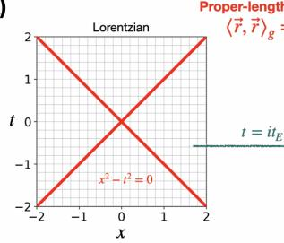

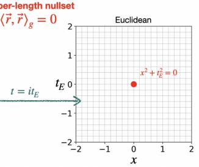  
Training data is in (1+1)-dimensional spacetime  
(B)  
(C1)

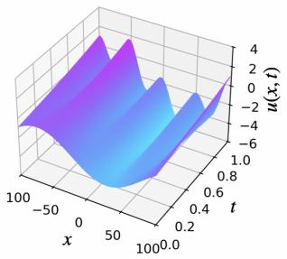

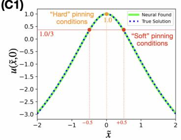

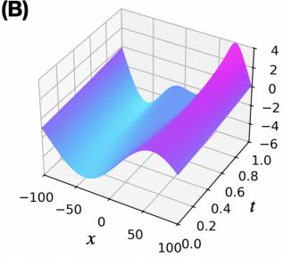

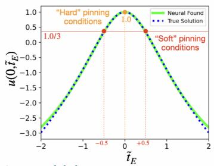

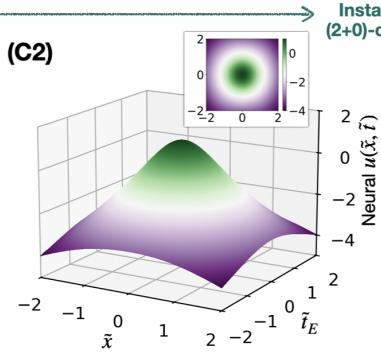

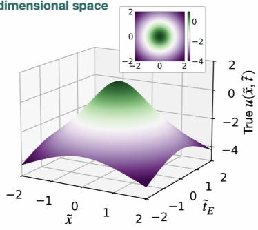

(D)  
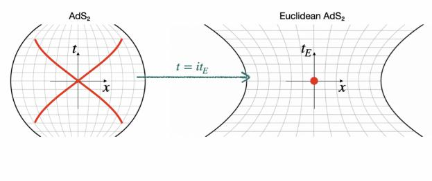

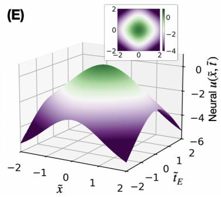

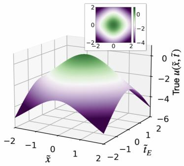  
FIG. 4. Geometry-agnostic transfer from Lorentzian Liouville dynamics to a Euclidean instanton search. The geometry-agnostic formation of the dynamics learned in real spacetime can be used, after Wick rotation, to identify a localized instanton in imaginary time. (A) Lorentzian and Euclidean proper-length nullsets. (B) Representative field configurations used to train the dynamics-learning neural network on a $( 1 + 1 )$ -dimensional Lorentzian quasi-manifold. (C1) Cross sections of the neural-found instanton along the ˜x and $\tilde { t } _ { E }$ axes agree with the analytical Liouville instanton profile. (C2) Surface plots of the neural-found normalized instanton and the analytical solution show good agreement over the Euclidean domain. (D) $\mathrm { \ A d S _ { 2 } }$ and Euclidean $\mathrm { { A d S } _ { 2 } }$ proper-length nullsets. (E) Surface plots of the neural-found normalized instanton and the analytical solution also show reasonable agreement over the Euclidean $\mathrm { { A d S } _ { 2 } }$ domain.

$$
\begin{array} { r } { \mathcal { L } _ { \mathbb { N } _ { 1 } ^ { ( L _ { L } ) } } = \bar { E } \left\{ \left[ \mathbb { N } _ { 1 } ^ { ( L _ { L } ) } \Big ( u _ { j } , ( \partial _ { x } u _ { j } ) ^ { 2 } - ( \partial _ { t } u _ { j } ) ^ { 2 } \Big ) - \left( \partial _ { x } ^ { 2 } u _ { j } - \partial _ { t } ^ { 2 } u _ { j } \right) \right] ^ { 2 } \right\} _ { \forall j } , } \end{array}
$$

After training, $\mathbb { N } _ { 1 } ^ { ( D ) }$ encodes the data-driven neurallearned dynamics of the Dufing system, i.e.

$$
\mathbb { N } _ { 1 } ^ { ( L _ { L } ) } \Big ( u _ { j } , ( \partial _ { x } u ) ^ { 2 } - ( \partial _ { t } u ) ^ { 2 } \Big ) \approx \big ( \partial _ { x } ^ { 2 } u - \partial _ { t } ^ { 2 } u \big ) .\tag{25}
$$

## 2. The Second Stage:

## Scenario-Searching on a Manifold

We use the previously trained network $\mathbb { N } _ { 1 } ^ { ( L _ { L } ) }$ to guide the scenario-searching network $\mathbb { N } _ { 2 } ^ { ( L _ { E } ) }$ . The superscripts $\left( L _ { L } \right)$ and $\left( L _ { E } \right)$ indicate the two geometric settings: the dynamics-learning stage is trained on data from a Lorentzian quasi-manifold, while the scenario-searching stage is carried out on the corresponding (geometryagnostic transferred) Euclidean manifold. A visualization of the neural network $\mathbb { N } _ { 2 } ^ { ( L _ { E } ) }$ can be found in Fig. 5B2. The search for a symmetric instanton is mostly identical to what has been done in Section IV B 2 for a symmetric soliton; except that:

• Unlike with the Dufing homoclinic pulse and the Townes solitons, here is no fixed peak value for the Liouville instanton, so we are free to choose the field value at its center. Without loss of generality, we impose $u ( 0 , 0 ) = 1 . 0$ (but any other value is also fine). Then, the only trainable parameter, besides the neural parameters of $\mathbb { N } _ { 2 } ^ { \left( L _ { E } \right) } , { \mathrm { ~ i s ~ } } \mathbb { R } ^ { \left( L _ { E } \right) }$ , i.e. the common coordinate-rescaling factor for both x and $t _ { E } .$ . No field-rescaling means $\mathbb { U } ^ { ( L _ { E } ) } = U ^ { ( L _ { E } ) } = 1$ and thus $\tilde { u } = u$

• We do not require the field fluctuation around 0 to remain small in the exterior region, but only require the exterior values to remain lower than the shoulder’s values, i.e.

$$
u ( \tilde { x } , \tilde { t } _ { E } ) \Big | _ { \lvert \tilde { x } \rvert > 0 . 5 \vee } < u ( 0 , 0 ) / \eta \ \mathrm { w h e r e } \ \eta = 3 \ .
$$

Thus, instead of Eq. (20), we need no absolutevalue operation:

$$
\mathcal { L } _ { 5 } ^ { ( L _ { E } ) } = \bar { E } \left\{ \left[ \mathrm { R e L U } \left( \mathbb { N } _ { 2 } ^ { ( L _ { E } ) } ( \tilde { x } _ { j } , \tilde { t } _ { E j } ) - 1 . 0 / 3 \right) \right] ^ { 2 } \right\} _ { | \tilde { x } _ { j } | > 0 . 5 ~ \vee }
$$

• The weights $( c _ { 1 } ^ { ( L _ { E } ) } , c _ { 2 } ^ { ( L _ { E } ) } , c _ { 3 } ^ { ( L _ { E } ) } , c _ { 4 } ^ { ( L _ { E } ) } , c _ { 5 } ^ { ( L _ { E } ) } , c _ { 6 } ^ { ( L _ { E } ) } )$ are chosen to be $( 2 5 , 2 5 , 2 5 , 2 5 , 1 , 1 )$ , so that the soft pinning conditions are enforced more strongly than the remaining loss terms.

The Euclidean version of Eq. (22) is given by:

$$
- \partial _ { t _ { E } } ^ { 2 } u ( x , t _ { E } ) - \partial _ { x } ^ { 2 } u ( x , t _ { E } ) = \exp \left[ u ( x , t _ { E } ) \right] \ ,\tag{26}
$$

which admits an analytic symmetric instanton solution localized in both space and imaginary-time (hence also called localized bump):

$$
u ( x , t ) = \ln \left( \frac { 8 \gamma } { \left\{ 1 + \gamma \Big [ ( x - x _ { * } ) ^ { 2 } + ( t - t _ { E * } ) ^ { 2 } \Big ] \right\} ^ { 2 } } \right) \ .\tag{27}
$$

where $\gamma \ > \ 0$ is an arbitrary positive constant, and $( x _ { * } , t _ { E * } )$ denotes the location at which the instanton emerges – because of translational symmetry, this center can be anywhere.

After training $\mathbb { N } _ { 2 } ^ { ( L _ { E } ) }$ with locations randomly-selected as described in Appendix A 3, we compare the neuralfound normalized Liouville instanton $\bar { \mathbb { N } } _ { 2 } ^ { ( L _ { E } ) } ( \tilde { x } , \tilde { y } )$ with the analytical solution u(˜x, y˜) (see Fig. 4C1 and C2). The agreement between then are excellent, i.e. inside the whole training domain $( \tilde { x } , \tilde { y } ) \in [ - \lambda , + \lambda ] \times [ - \lambda , + \lambda ]$ where $\lambda = 2 . 0$ , the relative root-mean-square $\left( L ^ { 2 } \mathrm { - n o r m } \right)$ error is reasonably low:

$$
\frac { \bar { E } \left\{ \left[ \mathbb { N } _ { 2 } ^ { ( L _ { E } ) } ( \tilde { x } _ { j } , \tilde { t } _ { E j } ) - \tilde { u } ( \tilde { x } _ { j } , \tilde { t } _ { E j } ) \right] ^ { 2 } \right\} _ { \forall j } } { \bar { E } \left\{ \left[ \tilde { u } ( \tilde { x } _ { j } , \tilde { t } _ { E j } ) \right] ^ { 2 } \right\} _ { \forall j } } \approx 0 . 9 \% .
$$

The neural-found rescaling factor $\mathbb { R } ^ { ( L _ { E } ) } \approx 2 . 1 6$ is about the same with its true value $R ^ { ( L _ { E } ) } \approx 2 . 1 6$

This final example demonstrates a successful knowledge transfer in our geometry-agnostic framework that goes beyond what has been considered in previous work [34], while also addressing a task that arises naturally in many high-energy physics systems. We can also apply the same procedure7 to more complex geometric structures, $\mathrm { e . g . }$ Euclideanized anti-de Sitter $\mathrm { ( A d S _ { 2 } ) }$ space8 [54, 55] (see Fig. 4D), and find that the neural-search still approximate the corresponding instanton (known analytically if including the scalar curvature term to the dynamics) with reasonable precision (see Fig. 4E) — the relative root-mean-square $( L ^ { 2 } \mathrm { - n o r m } )$ error is not large ≈ 11%.

## V. DISCUSSION & CONCLUSION

We have proposed a two-stage, geometry-agnostic, data-driven framework for identifying plausible extreme scenarios. A dynamics-learning neural network first infers the governing constraint from observational data. A scenario-searching neural network then uses this learned constraint as a physics-informed residual to identify coherent structures that are unlikely to appear in the original data, may arise in a new physical setting, or may even belong to an analytically continued setting that is not directly physical but is theoretically important. In all considered examples, the agreement is very strong, supporting the feasibility of our framework.

Two related search problems should be distinguished. At fixed governing equation parameters, one can seek initial conditions or trajectories in phase space that produce an extreme excursion. Alternatively, one can search parameter space for values at which a target structure becomes possible, such as a homoclinic orbit in a dissipative system. Our examples address structure discovery at fixed governing equation parameters; the optimized rescaling factors determine the candidate profile’s physical scales within those fixed dynamics. Extending the framework to parameter discovery would require a dynamics-learning model conditioned on the physical parameters, supported by data across the relevant parameter range, and a joint search over those parameters and the candidate solution.

Parameter space searches also connect naturally to tipping-point analysis. Near certain bifurcations, changes in stability can increase susceptibility to abrupt, fluctuation-driven transitions. Fabiani et al. [56] has demonstrated how learned surrogate models can locate tipping points and quantify rare-event escape times near them. Their work suggests a complementary extension of our framework: combining coherent-structure searches with bifurcation and stability analysis to identify parameter regimes in which extreme transitions become accessible or more likely.

Several limitations remain. The present examples use synthetic data without artificial noise, while realistic applications will involve noisy measurements, sparse sampling, hidden variables, boundary efects, and model mismatch. Future work should therefore combine the present framework with uncertainty quantification, active data acquisition, symmetry-aware architectures, and stability analysis of the discovered solutions. A natural next step is to apply the framework to experimentally accessible active-matter systems, such as chemotactic bacteria, where both the bacterial density and the self-generated chemical field can be measured dynamically [57]. In such a setting, one could train the first stage network to learn an efective chemotactic field equation from image data of wave experiments in one-dimensional channel [57], and then use the second stage search to ask whether the learned dynamics support localized coherent structures in two-dimensional space, such as a self-sustained bacterial-density bump maintained by the chemical field generated by the bacteria themselves, in either static or dynamical enviroment settings [58, 59]. As a concrete invitation, we note that Eq. (26) also arises in a simple limiting case of an E. coli chemotaxis model [60]:

$$
\begin{array} { r } { \partial _ { t } \rho ( \vec { r } , t ) \approx \vec { \nabla } \left[ \rho ( \vec { r } , t ) \vec { \nabla } c ( \vec { r } , t ) \right] \ , } \\ { 0 \approx \vec { \nabla } ^ { 2 } c ( \vec { r } , t ) + \rho ( \vec { r } , t ) \ , } \end{array}
$$

where $\rho ( \vec { r } , t )$ is the bacteria density and $c ( \vec { r } , t )$ is the concentration of the chemical secreted by the bacteria themselves. From the first equation, in the quasi-stationary limit, i.e. $\partial _ { t } \rho \ \approx \ 0$ the term $\rho \vec { \nabla } c$ is approximately divergence-free, thus leading to the Boltzmann-type balance $\rho \propto \exp ( c ) ;$ substituting this relation into the second equation then yields:

$$
- \vec { \nabla } ^ { 2 } c ( \vec { r } ) \propto \exp \left[ c ( \vec { r } ) \right] ,\tag{28}
$$

which is identical to (26) (up to relabeling and fieldrescaling). The Liouville instanton corresponds to a stationary bacterial aggregation, a phenomenon that has already been observed experimentally [61].

There are immediate directions for extending this work, on the theoretical side. One natural next step is to move beyond scalar fields. Fermionic fields provide a particularly interesting target because spinor dynamics depend directly on the spin connection, and torsion can couple to fermionic degrees of freedom in a physically meaningful way [62–64]. In such systems, the geometric data are not merely background ingredients for scalar Laplacians; they enter the Dirac operator itself. A geometryagnostic learning framework for fermionic fields would therefore need to learn from spinor-valued features, covariant derivatives, and connection-dependent invariants. This would provide a direct test of whether the present approach can handle settings in which torsion is not a small geometric complication, but a central part of the field dynamics, and what extreme scenarios can emerge from those contributions of non-Riemannian geometric structures.

Another extension is to go beyond geometry-agnostic learning for individual fields and consider collections of fields tied together by internal symmetries. Supersymmetric field theories provide a natural setting for this direction, because bosonic and fermionic fields are organized into the same supermultiplet [65–67]. There, the dynamical constraints should not be learned separately for each component field: doing so may break the supersymmetry relations that make the theory consistent. Instead, the framework should learn coupled constraints across the entire multiplet, using geometric features for each field while also respecting the symmetry transformations that relate them. Moreover, supersymmetric theories often provide exact or semi-exact access to nonperturbative phenomena, including instanton and monopole solutions [52, 53], thus providing another playground where extreme scenarios may appear more ubiquitously and can be checked against analytically knowresults.

AI Transparency Statement: OpenAI GPT-6 models accessed through Codex assisted with initial drafting, language polishing, literature search, and coding for figure generation and manuscript preparation. Parts of the illustrations (cartoons) in Fig. 1 and Fig. 5 are AI generated. The ideas, claims, and framing are the authors’. The authors assume responsibility for all content.

[1] M. Ghil, P. Yiou, S. Hallegatte, B. Malamud, P. Naveau, A. Soloviev, P. Friederichs, V. Keilis-Borok, D. Kondrashov, V. Kossobokov, et al., Nonlinear Processes in Geophysics 18, 295 (2011).

[2] S. N. Chowdhury, A. Ray, S. K. Dana, and D. Ghosh, Physics Reports 966, 1 (2022).

[3] M. Onorato, S. Residori, U. Bortolozzo, A. Montina, and F. Arecchi, Physics Reports 528, 47 (2013).

[4] C. Kharif and E. Pelinovsky, European Journal of Mechanics-B/Fluids 22, 603 (2003).

[5] K. Dysthe, H. E. Krogstad, and P. M¨uller, Annu. Rev. Fluid Mech. 40, 287 (2008).

[6] A. Wang, A. Ludu, Z. Zong, L. Zou, and Y. Pei, Physics of Fluids 32 (2020).

[7] E. Charalampidis, J. Lee, P. Kevrekidis, and C. Chong, Physical Review E 98, 032903 (2018).

[8] M. Muralidhar, S. Aumaˆıtre, and A. Naert, Physical Review E 112, 034212 (2025).

[9] M. Barth´elemy, A. Barrat, R. Pastor-Satorras, and A. Vespignani, Journal of theoretical biology 235, 275 (2005).

[10] Z.-Y. Yan, Communications in Theoretical Physics 54, 947 (2010).

[11] Z. Yan, Physics letters a 375, 4274 (2011).

[12] D. T. Jenks, T. D. Coates, and L. Wald, Hyperwave Theory: The Rogue Waves of Financial Markets (Archway Publishing, 2020).

[13] M. El Alaoui and A. Amghar, Available at SSRN 6606520 (2026).

[15] D. Sornette, arXiv preprint arXiv:0907.4290 (2009).

[14] N. S. Frolov, V. V. Grubov, V. A. Maksimenko, A. L¨uttjohann, V. V. Makarov, A. N. Pavlov, E. Sitnikova, A. N. Pisarchik, J. Kurths, and A. E. Hramov, Scientific reports 9, 7243 (2019).

[16] D. Sornette and G. Ouillon, The European Physical Journal Special Topics 205, 1 (2012).

[17] S. Coleman, in The whys of subnuclear physics (Springer, 1979) pp. 805–941.

[18] T. Sch¨afer and E. V. Shuryak, Reviews of Modern Physics 70, 323 (1998).

[19] E. Weinan, W. Ren, and E. Vanden-Eijnden, Communications on pure and applied mathematics 57, 637 (2004).

[20] A. Bovier and F. Den Hollander, Metastability: a potential-theoretic approach (Springer, 2016).

[21] M. Raissi, P. Perdikaris, and G. E. Karniadakis, Journal of Computational physics 378, 686 (2019).

[22] J.-C. Pu, J. Li, and Y. Chen, Chinese Physics B 30, 060202 (2021).

[23] Z. Zhou and Z. Yan, Communications in Theoretical Physics 73, 105006 (2021).

[24] S. L. Brunton, J. L. Proctor, and J. N. Kutz, Proceedings of the national academy of sciences 113, 3932 (2016).

[25] L. Lu, P. Jin, G. Pang, Z. Zhang, and G. E. Karniadakis, Nature machine intelligence 3, 218 (2021).

[26] Z. Li, N. Kovachki, K. Azizzadenesheli, B. Liu, K. Bhattacharya, A. Stuart, and A. Anandkumar, arXiv preprint arXiv:2010.08895 (2020).

[27] E. Pickering, S. Guth, G. E. Karniadakis, and T. P. Sapsis, Nature Computational Science 2, 823 (2022).

[28] S. Greydanus, M. Dzamba, and J. Yosinski, Advances in neural information processing systems 32 (2019).

[29] T. Bertalan, F. Dietrich, I. Mezi´c, and I. G. Kevrekidis, Chaos: An Interdisciplinary Journal of Nonlinear Science 29 (2019).

[30] Q. Hern´andez, A. Bad´ıas, D. Gonz´alez, F. Chinesta, and E. Cueto, Journal of Computational Physics 426, 109950 (2021).

[31] P. Jin, Z. Zhang, I. G. Kevrekidis, and G. E. Karniadakis, IEEE Transactions on Neural Networks and Learning Systems 34, 8271 (2022).

[32] M. Farazmand and T. P. Sapsis, Science advances 3, e1701533 (2017).

[33] I. S. Thiel, J. Bello-Rivas, Y. G. Kevrekidis, and T. P. Sapsis, arXiv preprint arXiv:2609.30746 (2026).

[34] T. V. Phan, G. A. Kevrekidis, S. Villar, Y. G. Kevrekidis, and J. M. Bello-Rivas, arXiv preprint arXiv:2505.16549 (2025).

[35] I. Kovacic and M. J. Brennan, The Dufing equation: nonlinear oscillators and their behaviour (John Wiley & Sons, 2011).

[36] N. Balmforth, Annual review of fluid mechanics 27, 335 (1995).

[37] C. Sulem and P.-L. Sulem, The nonlinear Schr¨odinger equation: self-focusing and wave collapse, Vol. 139 (Springer Science & Business Media, 2007).

[38] R. Y. Chiao, E. Garmire, and C. H. Townes, Physical review letters 13, 479 (1964).

[39] Y. Nakayama, International Journal of Modern Physics A 19, 2771 (2004).

[40] L. D. Landau, E. M. Lifshitz, and E. M. Lifshits, The Classical Theory of Fields: Volume 2, Vol. 2 (Butterworth-Heinemann, 1975).

[41] D. S. Borgnia, T. V. Phan, and L. S. Levitov, arXiv preprint arXiv:1512.09044 (2015).

[42] T. V. Phan, J. C. Song, and L. S. Levitov, arXiv preprint arXiv:1306.4972 (2013).

[43] M. Nakahara, Geometry, topology and physics (CRC press, 2018).

[44] G. C. Wick, Physical Review 96, 1124 (1954).

[45] J. Teschner, Classical and Quantum Gravity 18, R153 (2001).

[46] A. M. Polyakov, Physics Letters B 103, 207 (1981).

[47] J. Distler and H. Kawai, Nuclear physics B 321, 509 (1989).

[48] F. David, Modern Physics Letters A 3, 1651 (1988).

[49] P. Painlev´e, Comptes Rendus Academie des Sciences (serie non specifiee) 173, 677 (1921).

[50] A. Gullstrand, Allgemeine l¨osung des statischen eink¨orperproblems in der Einsteinschen gravitationstheorie (Almqvist & Wiksell, 1922).

[51] J. Samuel, Classical and Quantum Gravity 33, 015006 (2016).

[52] N. Seiberg and E. Witten, Nuclear Physics B 426, 19 (1994).

[53] N. Seiberg and E. Witten, Nuclear Physics B 431, 484 (1994).

[54] M. Henneaux and C. Teitelboim, Communications in Mathematical Physics 98, 391 (1985).

[55] A. Strominger, Journal of High Energy Physics 1999, 007 (1999).

[56] G. Fabiani, N. Evangelou, T. Cui, J. M. Bello-Rivas, C. P. Martin-Linares, C. Siettos, and I. G. Kevrekidis, Nature

communications 15, 4117 (2024).

[57] T. V. Phan, H. H. Mattingly, L. Vo, J. S. Marvin, L. L. Looger, and T. Emonet, Proceedings of the National Academy of Sciences 121, e2309251121 (2024).

[58] T. V. Phan, R. Morris, M. E. Black, T. K. Do, K.-C. Lin, K. Nagy, J. C. Sturm, J. Bos, and R. H. Austin, Physical Review X 10, 031017 (2020).

[59] T. V. Phan, S. Li, D. Ferreris, R. Morris, J. Bos, B. Guo, S. Martiniani, P. Chaikin, Y. G. Kevrekidis, and R. H. Austin, arXiv preprint arXiv:2401.16691 (2024).

[60] M. P. Brenner, L. S. Levitov, and E. O. Budrene, Biophysical journal 74, 1677 (1998).

[61] E. O. Budrene and H. C. Berg, Nature 349, 630 (1991).

[62] H. B. Lawson and M.-L. Michelsohn, Spin geometry, Vol. 38 (Princeton university press, 2016).

[63] F. W. Hehl, P. Von der Heyde, G. D. Kerlick, and J. M. Nester, Reviews of Modern Physics 48, 393 (1976).

[64] I. L. Shapiro, Physics Reports 357, 113 (2002).

[65] J. Wess and J. A. Bagger, Supersymmetry and Supergravity: Revised Edition (Princeton university press, 2020).

[66] S. Weinberg, The quantum theory of fields: volume 3, supersymmetry (Cambridge university press, 2005).

[67] D. Z. Freedman and A. Van Proeyen, Supergravity (Cambridge university press, 2012).

## Appendix A: Training Data and Locations

## 1. Dufing ODE

Training data were generated from $\ddot { u } = u - u ^ { 3 }$ (Dufing) and $\ddot { u } ~ = ~ - u$ (simple harmonic oscillator, SHO). For each system, $1 0 ^ { 3 }$ trajectories were integrated over $t \in [ 0$ , 10] using classical fourth-order Runge–Kutta with $\Delta t \stackrel { \cdot } { = } 1 0 ^ { - 3 }$ . Initial positions and velocities were sampled independently and uniformly from [−2, 2] (NumPy seed 37). Centered finite diferences of the simulated positions provided ˙u and ¨u at the 9999 interior time points of each trajectory. Sampling 0.2% of the pooled points without replacement produced $\sim 2 \times 1 0 ^ { \bar { 4 } }$ input–target pairs $( u , \dot { u } ) \to \ddot { u }$ per system. No measurement noise was added. Scenario-searches used $1 0 ^ { 3 }$ uniformly sampled collocation points on $\tilde { t } \in [ - 5 , 5 ]$ The central region was $| \tilde { t } | < 0 . 5$ and shoulder constraints were imposed at $\tilde { t } = \pm 0 . 5$ . Collocation points were sampled once and held fixed during training.

## 2. SNL Schr¨odinger PDE

A separate dynamics network was trained on the same sampled Dufing trajectories using the squared-derivative input, $\left( u , u ^ { \prime 2 } \right) \ \stackrel { \cdot } { \ } \ u ^ { \prime \prime }$ This representation was transferred to the SNL Schr¨odinger equation by replacing $u ^ { \prime 2 }$ with $\left( \vec { \nabla } u \right) ^ { 2 }$ and $u ^ { \prime \prime }$ with $\vec { \nabla } ^ { 2 } u$ . No additional higherdimensional simulation data were used to train this network. The one-dimensional search used the collocation scheme described in Appendix A 1.

For dimensions $\ d \ = \ 2 , 3$ , the search domain was $[ - 5 , 5 ] ^ { d }$ . Each search used $1 0 ^ { 4 }$ uniform collocation points inside $[ - 0 . 5 , 0 . 5 ] ^ { d }$ and $1 0 ^ { 4 }$ outside this inner box but within the search domain, obtained by rejection sampling. These points were sampled once, and the shoulder constraints were imposed at the 2d points located distance 0.5 away from the origin, along each positive and negative coordinate axis.

## 3. Liouville PDE

The dynamics was learned in flat Lorentzian spacetime. We simulated Eq. (22) on the periodic domain $x ~ \in ~ [ - 1 0 0 , 1 0 0 )$ with $\Delta x \ = \ 1$ , over $t ~ \in ~ [ 0 , 1 ]$ with $\Delta t = \mathrm { \dot { 1 } 0 ^ { - 5 } }$ . Spatial derivatives used centered diferences, and time integration used classical fourth-order Runge– Kutta. The initial conditions were

$$
u ( x , 0 ) = - 2 + A \cos ( n \pi x / 1 0 0 + \phi ) ,\tag{A1}
$$

$$
\partial _ { t } u ( x , 0 ) = B \sin ( { m \pi x } / { 1 0 0 } + \psi ) ,\tag{A2}
$$

where the coeficients A, B were uniform on [1, 3], the integers $n , m$ were randomly selected from $\{ 1 , 2 , 3 , 4 \}$ , and the phases $\phi , \psi$ were uniform on $[ 0 , 2 \pi ]$ . Runs with fieldvalue exceeding $u \ = \ 1 0$ were rejected. The recorded dataset contains 19 accepted runs out of 20 attempts, with $1 0 ^ { 3 }$ spacetime points sampled without replacement from each accepted run. Inputs were

$$
\left( u , ( \partial _ { t } u ) ^ { 2 } - ( \partial _ { x } u ) ^ { 2 } \right) \ ,
$$

with $\partial _ { t } \boldsymbol { u }$ taken from the evolved velocity field. Target constraints Eq. (22) were evaluated using the simulator right-hand side. Further reducing sample size with field value $u < 2$ retains $\sim 1 . 8 \times 1 0 ^ { 4 }$ pairs.

For both the Euclidean flat and $\mathrm { { A d S } _ { 2 } }$ searches, the dimensionless domain was $[ - 2 , 2 ] ^ { 2 }$ . We used $1 0 ^ { 4 }$ collocation points inside $[ - 0 . 5 , 0 . 5 ] ^ { 2 }$ and $1 0 ^ { 4 }$ outside it, sampled and held fixed as in the SNL searches. The 4 shoulder locations were at distance 0.5 away from the origin, along each positive and negative coordinate axis.

## Appendix B: Neural Architecture

Two networks serve distinct roles. The dynamicslearning network maps local field features to the diferential quantity learned from the data (see Fig. 5A). The scenario-search network maps dimensionless coordinates to a candidate profile, whose derivatives are evaluated by automatic diferentiation (see Fig. 5B). Its parameters are optimized together with physical rescaling parameters, using the learned dynamics and the desired scenario constraints. All networks are fully connected MLPs with tanh hidden activations and a linear raw output. Each dynamics network has two inputs, one hidden layer of width 64, and one output. Search networks have d coordinate inputs, one output, and the hidden widths listed in Table I.

(B2)  
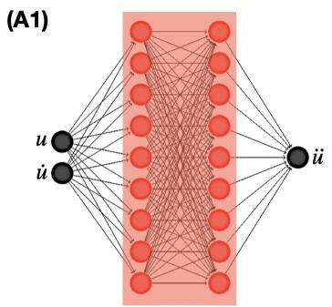

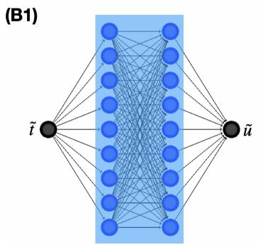

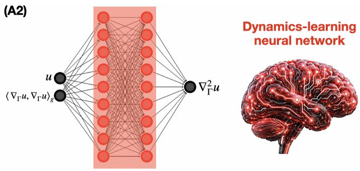

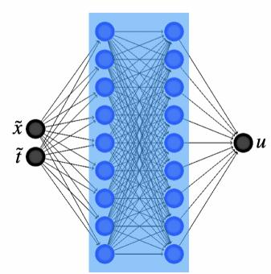

FIG. 5. Neural network architectures used in this work. All architectures are standard feedforward MLPs.
<table><tr><td>Search</td><td>Hidden widths</td><td>Collocation points</td><td> $\mathrm { \overline { { { E p o c h s } } } }$ </td><td>ηθ</td><td> $\eta _ { s }$ </td></tr><tr><td>Duffing / SHO</td><td>32</td><td> $\overline { { 1 0 ^ { 3 } } }$ </td><td> $\overline { { 5 \times 1 0 ^ { 4 } } }$ </td><td> $\overline { { 1 0 ^ { - 4 } } }$ </td><td> $\overline { { 1 0 ^ { - 4 } } }$ </td></tr><tr><td>SNL, 1D</td><td>32</td><td> $1 0 ^ { 3 }$ </td><td> $5 \times 1 0 ^ { 4 }$ </td><td> $1 0 ^ { - 4 }$ </td><td> $1 0 ^ { - 4 }$ </td></tr><tr><td>SNL, 2D</td><td>32,32</td><td> $2 \times 1 0 ^ { 4 }$ </td><td> $5 \times 1 0 ^ { 3 }$ </td><td> $1 0 ^ { - 3 }$ </td><td> $1 0 ^ { - 2 }$ </td></tr><tr><td>SNL, 3D</td><td>32,32, 32</td><td> $2 \times 1 0 ^ { 4 }$ </td><td> $5 \times 1 0 ^ { 3 }$ </td><td> $1 0 ^ { - 2 }$ </td><td> $1 0 ^ { - 1 }$ </td></tr><tr><td>Liouville, Euclidean flat</td><td>32,32</td><td> $2 \times 1 0 ^ { 4 }$ </td><td> $1 . 5 \times 1 0 ^ { 4 }$ </td><td> $1 0 ^ { - 3 }$ </td><td> $1 0 ^ { - 2 }$ </td></tr><tr><td>Liouville,  $\mathrm { E A d S _ { 2 } }$ </td><td>32,32,32</td><td> $2 \times 1 0 ^ { 4 }$ </td><td> $3 \times 1 0 ^ { 3 }$ </td><td> $1 0 ^ { - 3 }$ </td><td> $1 0 ^ { - 3 }$ </td></tr></table>

TABLE I. Scenario-search settings. Hidden widths exclude input and output layers. ηθ and $\eta _ { s }$ denote learning rates for network and rescaling parameters, respectively.

The one-dimensional searches used the raw network output. For the SNL Schr¨odinger and Liouville systems searches, coordinate-reflection symmetry was enforced by averaging the network output over all coordinate reflections and normalizing it by its value at the origin. The result was then scaled to set the center value to 1 for SNL Schr¨odinger systems and $1 / 2$ for Liouville systems. This construction enforces reflection symmetry along each coordinate, but does not impose full rotational symmetry.

## Appendix C: Neural Training Procedures

For dynamics learning, each input component and the target were divided by their respective maximum absolute values over the retained dataset, before a random $9 0 : 1 0 \ \cdot$ pointwise training–validation split. Training minimized mean squared error using Adam and shuffled batches of 1024 samples. The Dufing, SHO, and squared-derivative Dufing models used $2 \times \mathrm { { 1 0 ^ { 3 } } }$ epochs at learning rate $5 \times 1 0 ^ { - 4 }$ ; the Liouville model used $5 \times 1 0 ^ { 4 }$ epochs at $1 0 ^ { - 4 }$ . The final model was retained rather than selected by early stopping.

During scenario searches, the dynamics-network weights were excluded from the optimizer. Full-batch Adam updated the search-network weights and rescaling parameters using the settings in Table I. Positive scales were parametrized as softplus $( a ) + 1 0 ^ { - 6 }$ . In one dimension, the raw scale parameters started at $a \ = \ 1$ , corresponding to scales approximately 1.31; in the higherdimensional searches, scales started at approximately 1. No reference-profile samples entered the training loss.

It is important to note that the two Liouville searches (Fig. 4C2 and Fig. 4E) required additional optimization to improve convergence. For these cases, the Adam learning rates were reduced to $1 0 ^ { - 6 }$ by cosine annealing, followed by 300 iterations of full-batch L-BFGS (with learning rate 1, history size 50, and a strong-Wolfe line search). This refinement optimized the network weights and rescaling parameters (i.e. L for the flat search and $R , T$ for $\mathrm { E A d S _ { 2 } ) }$ , using the same loss and collocation points.

## Appendix D: Generate Numerical Profile of Townes Soliton

The radially symmetric 2D reference profile was computed from

$$
\begin{array} { c } { { Q ^ { \prime \prime } ( r ) + \displaystyle \frac { 1 } { r } Q ^ { \prime } ( r ) = Q ( r ) - Q ( r ) ^ { 3 } , } } \\ { { Q ^ { \prime } ( 0 ) = 0 , \qquad Q ( r ) \to 0 \quad ( r \to \infty ) . } } \end{array}\tag{D1}
$$

We solved the truncated boundary-value problem on $[ 1 0 ^ { - 6 } , 3 0 ]$ with $Q ^ { \prime } ( 1 0 ^ { - 6 } ) ~ = ~ 0$ and $Q ( 3 0 ) ~ = ~ 0 ,$ , using $\mathrm { S c i P y ^ { \prime } s }$ solve bvp. The initial mesh contained $\mathrm { 5 \times 1 0 ^ { \ - 3 } }$ uniformly spaced points, with initial guesses $Q = 2 . 2 e ^ { - r }$ and $Q ^ { \prime } = - 2 . 2 e ^ { - r }$ . The solver tolerance was $1 0 ^ { - 6 }$ , with at most $5 \times 1 0 ^ { 4 }$ mesh nodes. The converged profile was tabulated at 5000 radii on [0, 30] and linearly interpolated, taking $Q ( 0 )  Q ( 1 0 ^ { - } ^ { - } ^ { 6 } )$ . To match the scenario constraints, we set

$$
U _ { * } = Q ( 0 ) , \qquad R _ { * } = 2 r _ { 1 / 3 } , \qquad v _ { * } ( \rho ) = \frac { Q ( R _ { * } \rho ) } { U _ { * } } ,\tag{D2}
$$

where $Q ( r _ { 1 / 3 } ) = Q ( 0 ) / 3$ . This gives $v _ { * } ( 0 ) = 1 , v _ { * } ( 0 . 5 ) =$ $1 / 3 , U _ { * } \simeq \dot { 2 } . 2 1$ , and $R _ { * } \simeq 2 . 6 1$

For the 3D reference, the radial term becomes $2 Q ^ { \prime } / r$ Shooting on $\lceil 1 0 ^ { - 6 } , 2 5 \rceil$ used the regular-origin expansion $Q \ = \ A ^ { ' } + ( \dot { A } - A ^ { 3 } ) r ^ { 2 } / 6 , \ Q ^ { \prime } \ = \ ( \dot { A } - A ^ { 3 } ) \bar { r } / 3 .$ , and the outer condition $Q ^ { \prime } ( 2 5 ) + ( 1 + 1 / 2 5 ) Q ( 2 5 ) = 0 \ :$ . SciPy’s solve ivp used relative/absolute tolerances $1 0 ^ { - 8 } / 1 0 ^ { - 1 0 }$ and maximum step $0 . 0 5 ;$ brentq searched $A \in \left[ 4 , 4 . 5 \right]$ with absolute tolerance $1 0 ^ { - 1 0 }$ . The same tabulation and normalization procedure yielded $U _ { * } \simeq 4 . 3 4$ and $R _ { * } \simeq$ 1.55.