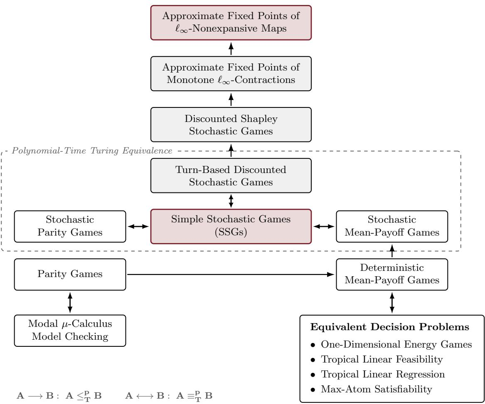

# A Quasipolynomial Algorithm for $\ell _ { \infty }$ Contractions

Ashkan Soleymani MIT ashkanso@mit.edu

Gabriele Farina MIT gfarina@mit.edu

## Abstract

We give an algorithm for computing an ε-approximate fixed point of any d-dimensional nonexpansion with respect to the $\ell _ { \infty }$ norm in time $\log ( 1 / \varepsilon ) ^ { O ( \log ^ { 2 } \tilde { d } ) }$ . At its core, our method uses a boosting argument to geometrically shrink a search region. Among other consequences, our algorithm implies that simple stochastic games can be solved in quasipolynomial time.

## 1 Introduction

Let $f : [ 0 , 1 ] ^ { d }  [ 0 , 1 ] ^ { d }$ be an $\ell _ { \infty } .$ -contraction. Thus, for some $\gamma \in ( 0 , 1 ]$

$$
\begin{array} { r } { \| \ b { f } ( \ b { x } ) - \ b { f } ( \ b { y } ) \| _ { \infty } \leq ( 1 - \gamma ) \| \ b { x } - \ b { y } \| _ { \infty } \qquad \mathrm { f o r ~ a l l ~ } \ b { x } , \ b { y } \in [ 0 , 1 ] ^ { d } . } \end{array}
$$

By Banach’s fixed-point theorem, $f$ has a unique fixed point $x ^ { * } \in [ 0 , 1 ] ^ { d }$ , satisfying $f ( x ^ { * } ) = x ^ { * }$ . We distinguish two notions of approximation. For $\varepsilon > 0$ , a point $x \in [ 0 , 1 ] ^ { d }$ is an ε-approximate fixed point if $\| f ( x ) - x \| _ { \infty } \leq \varepsilon$ , and an ε-near fixed point if $\| x - x ^ { * } \| _ { \infty } \leq \varepsilon$ . Contractivity ensures that every ε-near fixed point is a 2ε-approximate fixed point, while every ε-approximate fixed point lies within distance $\varepsilon / \gamma$ of the unique fixed point $x ^ { * }$

The classical Picard iteration [Ban22] starts from an arbitrary point $x ^ { ( 0 ) } \in [ 0 , 1 ] ^ { d }$ and repeatedly applies $f ,$ setting $x ^ { ( t + 1 ) } = f ( x ^ { ( \bar { t } ) } )$ . Although the iterates converge to $x ^ { * }$ , the standard convergence bound gives $O ( \gamma ^ { - 1 } \log ( 1 / \varepsilon ) )$ evaluations to obtain an ε-approximate fixed point. This bound can be exponential in the input size when the contraction gap $\gamma$ is exponentially small, as can occur in Shapley’s discounted stochastic games [Sha53].

A central open problem at the intersection of optimization and computer science is whether an ε-approximate fixed point can be computed in time polynomial in $d , \log ( 1 / \varepsilon )$ , and $\log ( 1 / \gamma )$ . A polynomial-time solution would settle the long-standing complexity of Condon’s simple stochastic games and, through known reductions, yield polynomial-time algorithms for stochastic parity and mean-payof games [Con92, AM09a]. It would also allow polynomial-time approximation of the values of Shapley’s stochastic games, in which players choose their actions simultaneously [Sha53]. Shapley’s model further laid the foundations for Markov games, a standard framework for multiagent reinforcement learning [Lit94]. More broadly, fixed-point problems play an important role in optimization and distributed computation [Ber83, BT89], discounted dynamic programming and reinforcement learning [Bla65, Put94, SB18], diferential and integral equations [Ban22, CL55], and formal verification, particularly modal µ-calculus model checking [Koz83, EJS01].

Along this avenue of investigation, Chen, Li, and Yannakakis showed that an ε-approximate fixed point of a nonexpansion can be found with $O ( d ^ { 2 } \log ( 1 / \varepsilon ) )$ queries [CLY24], later improved to $O ( d \log ( 1 / \varepsilon ) )$ in the journal version [CLY25]. Despite their polynomial query complexity, these algorithms incur exponential computational overhead in selecting the query points. Feodorov and Haslebacher [FH26] subsequently bounded both query complexity and total running time by $\log ( 1 / \varepsilon ) ^ { O ( { \sqrt { d } } \log d ) }$ . An account of further related work is deferred to Section 2.

Result and consequences. We give the first quasipolynomial-time algorithm for computing near fixed points of $\ell _ { \infty } { \mathrm { - c o n t r a c t i o n s } }$ . In particular, we present a deterministic algorithm $\mathsf { S o l v e } ( f , \varepsilon )$ with the following property.

Theorem 1. Fix $d \geq 2$ , a contraction gap $\gamma \in ( 0 , 1 ]$ , and a desired nearness tolerance $0 < \varepsilon \le 1 / 4$ For a $( 1 - \gamma )$ -contraction $f : [ 0 , 1 ] ^ { d }  [ 0 , 1 ] ^ { d }$ , the total number of arithmetic operations and exact evaluations of f performed by $\mathsf { S o l v e } ( f , \varepsilon )$ to return an ε-near fixed point of f is upper bounded by

$$
\left( \log \frac { 1 } { \gamma \varepsilon } \right) ^ { C \log ^ { 2 } d } ,\tag{1}
$$

for a universal constant $C .$

Our main theorem also has direct and well-understood implications for computing an ε-approximate fixed point of nonexpansions (i.e., 1-Lipschitz functions $f ) \ [ \mathrm { C L Y 2 4 } ]$ . Specifically, given a nonexpansion f and a desired approximation $0 < \varepsilon < 1$ , the map $g : = ( 1 - \varepsilon / 2 ) f$ is a contraction with gap $\varepsilon / 2$ , and every $( \varepsilon / 4 )$ -near fixed point of g is an ε-approximate fixed point of $f .$

Corollary 1. For any $d \ge 2 , 0 < \varepsilon \le 1 / 2$ , and $\ell _ { \infty } { - } n o n e x p a n s i v e$ map $f : [ 0 , 1 ] ^ { d }  [ 0 , 1 ] ^ { d }$ , there exists a deterministic algorithm for computing an ε-approximate fixed point of f with complexity log $( 1 / \varepsilon ) ^ { C \log ^ { 2 } d }$ , for a universal constant C.

Compared with the previous bound of Feodorov and Haslebacher [FH26], our result reduces the exponent from $O ( { \sqrt { d } } \log d )$ to $O ( \log ^ { 2 } d )$ , bringing the total running time from subexponential to quasipolynomial. In particular, when $\log ( 1 / \varepsilon ) = d ^ { O ( 1 ) }$ , the running-time bound improves from $\exp ( O ( { \sqrt { d } } \log ^ { 2 } d ) )$ ) to $\exp ( O ( \log ^ { 3 } d ) )$ .

Applications. Our result yields quasipolynomial-time algorithms for several stochastic games and related decision problems, as summarized in Figure 1. In particular, Condon’s simple stochastic games (SSGs) reduce to computing suficiently accurate fixed points of discounted value operators [Con92, FH26]. The reduction uses polynomial-bit parameters and eficiently evaluable operators, so our algorithm solves SSGs exactly in quasipolynomial time. By the polynomial-time Turing equivalences of Andersson and Miltersen [AM09a], the same bound extends to turn-based stochastic parity, mean-payof, discounted-payof, and terminal-payof games. For Shapley’s general discounted stochastic games, which allow simultaneous actions, our algorithm also yields quasipolynomial-time approximation of their value vectors [Sha53].

The reductions in Figure 1 extend these consequences to deterministic mean-payof games, parity games, and modal µ-calculus model checking [Jur98, EJS01]. The corresponding decision problems for one-dimensional energy games, tropical linear feasibility, tropical linear regression, and maxatom satisfiability are polynomial-time equivalent to deterministic mean-payof games $[ \mathrm { B C D ^ { + } 1 1 }$ AGG12, AGQS23, AM09b]. Although quasipolynomial-time algorithms are already known for parity games [CJK<sup>+</sup>17], our approach provides a common route to these problems through nonexpansive fixed-point computation.

  
Figure 1: Polynomial-time reduction hierarchy connecting approximate $\ell _ { \infty }$ fixed-point computation to stochastic games and related decision problems. The dashed box groups turn-based, perfectinformation stochastic games that are polynomial-time Turing equivalent [AM09a]. The upper reductions arise from the fixed-point formulation of discounted stochastic games, where suficiently accurate approximations also yield exact solutions to SSGs [Sha53, BFG<sup>+</sup>25]. The lower reductions connect parity games, modal µ-calculus model checking, and decision problems equivalent to deterministic mean-payof games [Jur98, EJS01, BCD<sup>+</sup>11, AGG12, AGQS23, AM09b]. The red boxes highlight our main result and its application to SSGs, the gray boxes indicate intermediate problems, and the white boxes show further consequences.

## 2 Further Related Work

Concurrent with our work, OpenAI released a broad collection of preprints spanning several areas of mathematics, including quasipolynomial-time algorithms for deterministic mean-payof games, stochastic mean-payof games, and mean-payof parity games $[ \mathrm { O p e 2 6 a } , \mathrm { O p e 2 6 d } , \mathrm { O p e 2 6 b } ]$ A randomized algorithm for deterministic mean-payof games was also included $[ \mathrm { O p e 2 6 c } ]$ . These algorithms exploit the structure of the underlying games, in particular the monotonicity of their value operators. Our algorithm, in contrast, applies to arbitrary $\ell _ { \infty } { \mathrm { - n o n e x p a n s i v e } }$ maps without assuming monotonicity or access to an explicit game representation.

Smoothed analysis has also yielded polynomial-time guarantees for turn-based deterministic discounted and mean-payof games. Lof and Skomra [LS24] first established such guarantees for policy iteration on ergodic game graphs. More recently, Asadi, Chatterjee, and Luo [ACL27] and Lof and Skomra [LS27] independently obtained smoothed polynomial-time algorithms for deterministic discounted and mean-payof games on arbitrary graphs, removing the ergodicity assumption.

The study of $\ell _ { \infty }$ -nonexpansive maps has a long history in fixed dimension. Shellman and Sikorski first obtained an $O ( \log ( 1 / \varepsilon ) )$ -time algorithm in two dimensions [SS02], and later extended their approach to arbitrary fixed dimension with running time $O ( ( \log ( 1 / \varepsilon ) ) ^ { d } )$ [SS03]. More recently, Chen, Li, and Yannakakis achieved a quadratic speedup, reducing the exponent from d to $\lceil d / 2 \rceil$ [CLY26]. While these algorithms have favorable dependence on the accuracy for fixed $d ,$ their running-time bounds remain exponential in the dimension. In a diferent direction, Chen, Li, and Yannakakis established that $O ( d ^ { 2 } \log ( 1 / \varepsilon ) )$ ) function evaluations sufice in arbitrary dimension [CLY24], later improved to $O ( d \log ( 1 / \varepsilon ) )$ [CLY25]. The computation required to determine the query points, however, remained exponential. Feodorov and Haslebacher subsequently made progress on this computational bottleneck, obtaining subexponential bounds on both query complexity and total running time [FH26].

A diferent line of work assumes monotonicity with respect to the coordinatewise order. For monotone $\ell _ { \infty } \mathrm { - c o n t r a c t i o n s }$ , Batziou, Fearnley, Gordon, Mehta, and Savani $[ \mathrm { B F G ^ { + } 2 5 } ]$ obtained an $O ( \log ( 1 / \varepsilon ) )$ query algorithm in three dimensions and extended it to arbitrary dimension through a decomposition theorem, using $2 ^ { O ( d ) } ( \log ( 1 / \varepsilon ) ) ^ { \lceil d / 3 \rceil }$ queries. Both algorithms require only polynomial computation between evaluations, yielding corresponding total running-time bounds up to polynomial factors. They also established membership in UEOPL, with consequences for Shapley’s stochastic games.

Without the contraction assumption, Tarski’s fixed-point theorem still guarantees the existence of fixed points for monotone self-maps of complete lattices [Tar55]. Etessami, Papadimitriou, Rubinstein, and Yannakakis [EPRY20] showed that solving Condon’s simple stochastic games and approximating the values of Shapley’s stochastic games reduce to finding Tarski fixed points, and established connections to equilibria in supermodular games. For monotone maps on the finite grid $[ n ] ^ { d }$ , where $[ n ] = \{ 1 , \dots , n \}$ , Fearnley, P´alv¨olgyi, and Savani [FPS22] improved the exponent of log n in the query bound from d [DQY26] to $2 \lceil d / 3 \rceil$ . More recently, Chen, Gao, Li, Rubinstein, and Yannakakis [CGL<sup>+</sup>26] obtained an $O ( 5 ^ { d } \bar { ( \log n ) } ^ { \lceil \log d \rceil } )$ )-query algorithm, together with a randomized query lower bound of $( \log n ) ^ { \Omega ( \log d ) }$ , even for maps with a unique fixed point.

A parallel line of research studies approximate fixed points of contractions under other $\ell _ { p }$ norms. For $\ell _ { 1 } { \mathrm { - c o n t r a c t i o n s . } }$ , Fearnley, Gordon, Mehta, and Savani [FGMS20] obtained an $O ( ( \log ( 1 / \varepsilon ) ) ^ { d } )$ -time algorithm in fixed dimension. Chen, Li, and Yannakakis [CLY26] recently reduced the exponent from d to $\lceil d / 2 \rceil$ . Haslebacher [Has25] also established a reduction from generalized Arrival, a deterministic graph traversal problem, to approximate fixed-point computation for $\ell _ { 1 } { \mathrm { - c o n t r a c t i o n s . } }$ For the Euclidean norm $( \ell _ { 2 } )$ , Huang, Khachiyan, and Sikorski [HKS99] developed an ellipsoid-based algorithm using $O ( d \log ( 1 / \varepsilon ) )$ function evaluations. Building on the polynomial query bounds for $\ell _ { \infty }$ -contractions [CLY24], Haslebacher, Lill, Schnider, and Weber [HLSW25] established polynomial query complexity for contractions under every $\ell _ { p }$ norm. More recently, Daskalakis, Farina, and Zhang [DFZ27] obtained a poly $( d , p , \log ( 1 / \varepsilon ) )$ -time algorithm for $\ell _ { p } .$ -nonexpansive maps when $p$ is an even integer, achieving polynomial total running time in this setting.

## 3 Preliminaries and Notation

While the function f has domain $[ 0 , 1 ] ^ { d }$ , our algorithm might sometimes produce search boxes of by a constant amount from the domain. For that, throughout the paper we extend $f$ to $\mathbb { R } ^ { d }$ by setting $f ( x ) = f ( \mathrm { c l i p } _ { [ 0 , 1 ] ^ { d } } ( x ) )$ for $x \notin [ 0 , 1 ] ^ { d }$ . Since clipping is $\ell _ { \infty } { \mathrm { - n o n e x p a n s i v e } } ,$ this extension preserves the contraction gap $\gamma$ and the unique fixed point $x ^ { * }$ . For any $N \subseteq [ d ]$ , let $x _ { N }$ denote the subvector containing only the coordinates in $N$ , and let $x _ { - N }$ denote its restriction to the complementary coordinates. Similarly, $f _ { N } ( x )$ denotes the restriction of $f ( x )$ to the coordinates in $N$

We mention a standard lemma that enables converting guarantees between approximate and near fixed points.

Lemma 1. For every $x \in \mathbb { R } ^ { d } , \gamma \left\| x - x ^ { * } \right\| _ { \infty } \leq \left\| x - f ( x ) \right\| _ { \infty } \leq ( 2 - \gamma ) \left\| x - x ^ { * } \right\| _ { \infty }$

Proof. Write $x - f ( x ) = ( x - x ^ { * } ) + ( x ^ { * } - f ( x ) )$ and apply the triangle inequality as well as the contraction property $\| f ( x ) - x ^ { * } \| _ { \infty } \leq ( 1 - \gamma ) \| x - x ^ { * } \| _ { \infty }$ □

## 4 Algorithm Overview

Our algorithm maintains a search cube $\begin{array} { r } { [ L , U ] = \prod _ { i = 1 } ^ { d } [ L _ { i } , U _ { i } ] } \end{array}$ of side $U _ { i } - L _ { i } = D$ , that contains the true fixed point $x ^ { * }$ . At each iteration, the algorithm shrinks the length of each side of the cube by a factor $7 / 8$ by either increasing $L _ { i }$ by $D / 8$ or decreasing $U _ { i }$ by $D / 8$ along each coordinate $i \in [ d ]$ while maintaining the invariant that $x ^ { * }$ remains in the cube. Hence, within $O ( \log ( 1 / \varepsilon ) )$ iterations, $x ^ { * }$ is contained within a box of size $\varepsilon .$ . The midpoint $q : = ( L + U ) / 2$ is therefore a $\varepsilon / 2 .$ -near fixed point and hence a ε-approximate fixed point by Lemma 1.

For every coordinate $i = 1 , \ldots , d ,$ the algorithm identifies which of the two faces of the cube, at $L _ { i }$ or $U _ { i }$ , is safe to push inward by $D / 8 .$ (At least one of these two faces is at distance $\geq D / 2$ from $x _ { i } ^ { * }$ so at least one face can be safely moved inward by $D / 8 )$

To decide which direction to push, we will construct a function Labe $\left( { L , U ; D / 8 , \varepsilon } \right)$ that either returns an ε-near fixed point of $f ,$ or correctly identifies when $x _ { i } ^ { * }$ is within distance $D / 8$ from either $L _ { i }$ or $U _ { i }$ . In particular, in the latter case Label $\left( { L , U ; D / 8 , \varepsilon } \right)$ returns labels $\ell _  i , $ <sub>−</sub> for each coordinate, with the property that

$$
x _ { i } ^ { * } \in [ L _ { i } , L _ { i } + D / 8 ] \implies \ell _ { i , - } = \mathsf { l o } ; \qquad x _ { i } ^ { * } \in [ U _ { i } - D / 8 , U _ { i } ] \implies \ell _ { i , - } = \mathsf { h i } .\tag{2}
$$

Importantly, the label is arbitrary when $x _ { i } ^ { * }$ is within $\left( L _ { i } + D / 8 , U _ { i } - D / 8 \right)$ ; luckily, in that case it does not matter whether we push $L _ { i }$ or $U _ { i }$ inward. Therefore, it is always safe to update $L _ { i } \gets L _ { i } + D / 8$ when $\ell _ { i , - } = \mathsf { h i }$ and $U _ { i } \gets U _ { i } - D / 8$ when $\ell _ { i , - } = | \boldsymbol { \mathrm { o } } |$

Crucially, we will be able to construct such Label subroutine to run in quasi-polynomial time. We summarize the resulting pseudocode in Algorithm 1.

```perl
Algorithm 1: Solve $( f , \varepsilon )$ for $d \geq 2$
Input: A $( 1 - \gamma )$ -contraction $f : [ 0 , 1 ] ^ { d }  [ 0 , 1 ] ^ { d }$ , and desired tolerance $\varepsilon > 0$
Output: An ε-near fixed point of $f .$
1 $D \gets 1 ;$
2 $L _ { i } \gets 0 , U _ { i } \gets 1$ for every $i = 1 , \ldots , d ;$
3 while $D > \varepsilon$ do
4 if Labe $( L , U ; D / 8 , \varepsilon )$ returns an ε-near fixed point x then // Algorithm 4
5 return x
6 else
7 receive labels $\ell _ { i , - }$ from the call
8 foreach $i = 1 , \ldots , d$ do
9 if $\ell _ { i , - } =$ lo then $U _ { i } \gets U _ { i } - D / 8 ;$
10 if $\ell _ { i , - } =$ hi then $L _ { i } \gets L _ { i } + D / 8 ;$
11 $D \gets 7 D / 8 ;$
12 return $( L + U ) / 2 ;$
```

For completeness, we define the base cases $( d < 2 )$ of Solve separately. In dimension zero, Solve returns the empty vector. In dimension one, Solve $( f , \varepsilon )$ uses bisection on $f ( x ) - x$ . Indeed, $f ( 0 ) \geq 0$ $f ( 1 ) \leq 1$ , and $f ( x ) - x$ is strictly decreasing by contractivity. Thus, bisection maintains an interval containing $x ^ { * }$ , and returning its midpoint once the interval has length at most $2 \varepsilon$ yields an ε-near fixed point using $O ( 1 + \log ( 1 / \varepsilon ) )$ evaluations of $f .$

## 4.1 Labelings

As laid out in Section $^ { 4 , }$ the key insight behind the algorithm is the fact that it is possible to correctly detect when each coordinate $x _ { i } ^ { * }$ is suficiently close to the extrema of a query box [L, U]. The bulk of the algorithm will be focused on how to detect such labels eficiently. Formally, we introduce the following central concept.

Definition 1 (τ -accurate labeling). Let $[ L , U ] \subset \mathbb { R } ^ { d }$ be a box, possibly degenerate $( i . e .$ , we allow the possibility that $L _ { i } > U _ { i }$ for some $i )$ . For each coordinate $i ,$ , we denote the distances from the extrema $L _ { i }$ and $U _ { i }$ to the i-th coordinate of the fixed point, $\boldsymbol { x } _ { i } ^ { * }$ , as

$$
\sigma _ { i , - } : = x _ { i } ^ { * } - L _ { i } , \qquad a n d \qquad \sigma _ { i , + } : = U _ { i } - x _ { i } ^ { * } .
$$

We refer to these diferences as the slacks of the faces $L , U .$ , and refer to them generically with the symbol $\sigma _ { j }$ . Let $\sigma _ { \mathrm { m a x } }$ and $\sigma _ { \mathrm { m i n } }$ denote the maximum and minimum values of $\sigma _ { j }$ , taken over all 2d faces of the box.

We call assignment of labels $\ell _ { i , - } , \ell _ { i , + } \in \{ \mathsf { l o } , \mathsf { h i } \}$ to all faces $j \in \{ 1 , \ldots , d \} \times \{ - , + \}$ τ-accurate $i f$ it satisfies

$$
\sigma _ { j } \geq \sigma _ { \operatorname* { m a x } } - \tau \implies \ell _ { j } = \mathsf { h i } , \qquad \sigma _ { j } \leq \sigma _ { \operatorname* { m i n } } + \tau \implies \ell _ { j } = \mathsf { l o } .\tag{3}
$$

Some remarks are in order.

From Definition 1 to the guarantee (2). First, the following remark shows that our definition of labeling provides the guarantee required by Solve.

Remark 1. We remark that this notion immediately yields the notion of labels described in $( 2 )$ by setting accuracy $\tau : = D / 8$ . Indeed, for any cube $[ L , U ]$ of side D containing x<sup>∗</sup>, $\sigma _ { \operatorname* { m i n } } \geq 0$ and $\sigma _ { \mathrm { m a x } } \le D$ , and so any D/8-accurate labeling satisfies in particular

$$
\sigma _ { i , - } \leq { \frac { D } { 8 } } \implies \ell _ { i , - } = { \mathsf { l o } } , \qquad \sigma _ { i , - } \geq { \frac { 7 } { 8 } } D \implies \ell _ { i , - } = { \mathsf { h i } } .
$$

The first condition is precisely $x _ { i } ^ { * } \in [ L _ { i } , L _ { i } + D / 8 ]$ ; the second condition is $x _ { i } ^ { * } \in [ L _ { i } + 7 D / 8 , U _ { i } ] =$ $[ U _ { i } - D / 8 , U _ { i } ]$ . Hence, any D/8-accurate labeling implies (2).

Non-existence of labelings. Second, we point out that a valid τ -accurate labeling may not exist.   
As the following remark shows, in this case the center of the box is already a τ -near fixed point.

Remark 2. It is possible that a labeling as in Definition 1 might not exist due to incompatible conditions in (3). Such inconsistency is possible only when $\sigma _ { \mathrm { m a x } } - \tau \leq \sigma _ { \mathrm { m i n } } + \tau$ , that is $\sigma _ { \mathrm { m a x } } - \sigma _ { \mathrm { m i n } } \leq$ 2τ. But then, this immediately certifies that the center $q : = ( L + U ) / 2$ satisfies

$$
\begin{array} { r } { 2 | x _ { i } ^ { * } - q _ { i } | = | \sigma _ { i , - } - \sigma _ { i , + } | \leq \sigma _ { \operatorname* { m a x } } - \sigma _ { \operatorname* { m i n } } \leq 2 \tau \qquad \forall i = 1 , \dots , d . } \end{array}
$$

Hence, non-existence of a labeling immediately certifies that the center q is a τ -near fixed point.

Degenerate boxes. Finally, we remark that allowing for degenerate boxes is always without loss of generality.

Remark 3. Although picturing $[ L , U ]$ as a nonempty box captures the intended application, internally our algorithm might end up querying a labeling for a degenerate box L, U (i.e., one that does not respect $L _ { i } < U _ { i }$ for all i). For the purposes of labelings, the extension of labelings to degenerate boxes is without loss of generality: every time $[ L , U ]$ is degenerate, one can find $c \in \mathbb { R }$ such that the repaired box $[ L - c \mathbf { 1 } , U + c \mathbf { 1 } ]$ is non-degenerate. Crucially, the labeling guarantees for such a repaired box are exactly the same guarantees as Definition 1, since adding or subtracting c from all entries of L and U shifts by the same quantity all $\sigma _ { j }$ and thus also $\sigma _ { \mathrm { m i n } }$ and $\sigma _ { \mathrm { m a x } }$ . To keep the exposition as simple as possible and avoid introducing that additional step, we opted to introduce Definition 1 in the more permissive form directly.

## 4.2 Overview of Labeling Construction

In light of Remark 2, our goal will be to construct a generic routine Label $( L , U ; \tau , \varepsilon )$ whose output is either a τ -accurate labeling or a ε-near fixed point.

We will show that a τ-accurate label can be computed in time $\log ( \tau / ( \gamma \varepsilon ) ) ^ { O ( \log ^ { 2 } d ) }$ . The construction uses two steps. In the first step, we show that it is possible to construct a labeling that is very little accurate (specifically, $\tau = O ( \gamma ) )$ ) by splitting coordinates based on the median length of each side, recursively solve half-dimensional contractions, and combine the answers. Such labelings are correct only for faces for which $\boldsymbol { x } _ { i } ^ { * }$ is extremely close; in other words, they detect proximity to the fixed point only on a thin inset of the search box. We call such a labeling of accuracy $O ( \gamma )$ a thin labeling. To amplify the accuracy of the labeling, in the second step we use a boosting procedure (based on classic AdaBoost). In particular, we query several thin labelings and perform majority voting to construct final labels.

## 5 Constructing Thin Labelings

As the starting point for the entire construction, we will show that minimally-accurate labelings can be constructed eficiently. In particular, we will construct a labeler that, given a (possibly degenerate; see also Remark 3) box $[ L , U ]$ and any $\eta > 0$ , either:

• returns a point $p \in [ 0 , 1 ] ^ { d }$ (not necessarily in the box) that is an η-approximate fixed point; or • returns a $\scriptstyle { \frac { \gamma \eta } { 8 } } .$ -accurate labeling for $[ L , U ]$

The algorithm sorts the coordinates $i = 1 , \ldots , d$ by increasing side length $U _ { i } - L _ { i }$ . Letting m denote the median side length, it then splits the dimensions between those that are narrow and those that are wide, that is,

$$
N : = \{ i : U _ { i } - L _ { i } < m \} , \qquad W : = \{ i : U _ { i } - L _ { i } > m \} .
$$

Let $q : = ( L + U ) / 2$ be the center of the box. Recall from Section 3 that $f _ { N }$ denotes the restriction of the output of $f$ to the coordinates in N, and similarly for $f _ { W }$ . The algorithm recursively invokes Solve at precision $\gamma \eta / 2$ on the maps $y \mapsto f _ { N } ( y , q _ { - N } )$ and $y \mapsto f _ { W } ( q _ { - W } , y )$ . Both maps are $( 1 - \gamma )$ -contractions on their unit cubes, since fixing input coordinates and restricting output coordinates preserve the contraction property. Each recursive problem has dimension at most $d / 2$

Lemma 2. For any possibly degenerate box $[ L , U ]$ and $\eta > 0$ , ThinLabel $( L , U ; \eta )$ (Algorithm 2) returns either an η-approximate fixed point in $[ 0 , 1 ] ^ { d } ~ o r ~ a ~ \textstyle { \frac { \gamma \eta } { 8 } }$ -accurate labeling of $[ L , U ]$

Proof. $\mathrm { I f } \parallel x - f ( x ) \parallel _ { \infty } \leq \eta$ , the algorithm returns $p : = \mathrm { c l i p } _ { [ 0 , 1 ] ^ { d } } ( x )$ . By the definition of the clipped extension, $f ( p ) = f ( x ) \in [ 0 , 1 ] ^ { d }$ . Since clipping is nonexpansive, we have

$$
\begin{array} { r } { \| p - f ( p ) \| _ { \infty } = \| \operatorname { c l i p } _ { [ 0 , 1 ] ^ { d } } ( x ) - \operatorname { c l i p } _ { [ 0 , 1 ] ^ { d } } ( f ( x ) ) \| _ { \infty } \leq \| x - f ( x ) \| _ { \infty } \leq \eta . } \end{array}
$$

Thus, $p$ is an η-approximate fixed point.

$\mathrm { S o }$ , consider the case $\| x - f ( x ) \| _ { \infty } > \eta$ , which implies $\| x - x ^ { * } \| _ { \infty } > \eta / 2$ by Lemma 1. The crux of the proof is to show that when that is the case, $\sigma _ { \mathrm { m i n } }$ and $\sigma _ { \mathrm { m a x } }$ are suficiently separated from the median half-side $t ,$ specifically

$$
\sigma _ { \operatorname* { m i n } } \leq t - \| x - x ^ { * } \| _ { \infty } \qquad \mathrm { a n d } \qquad \sigma _ { \operatorname* { m a x } } \geq t + \| x - x ^ { * } \| _ { \infty } .\tag{4}
$$

If we estimate the distances from $x ^ { * }$ to the faces by pretending that $h : = f ( x ) \approx x ^ { * }$ , i.e.,

$$
\hat { \sigma } _ { i , - } : = h _ { i } - L _ { i } , \qquad \hat { \sigma } _ { i , + } : = U _ { i } - h _ { i } ,
$$

the errors $| \hat { \sigma } _ { j } - \sigma _ { j } |$ would be of by at most $\| h - x ^ { * } \| _ { \infty } \leq ( 1 - \gamma ) \| x - x ^ { * } \| _ { \infty }$ . In light of (4), this error is less than the distance between the t and the extrema $\sigma _ { \mathrm { m i n } } , \sigma _ { \mathrm { m a x } } .$ , meaning that values of $\sigma _ { j }$

Algorithm 2: ThinLabel $( L , U ; \eta )$ : constructing thin labels   
Input: A possibly degenerate box $[ L , U ] .$ , and a tolerance $\eta > 0$   
Output: $\begin{array} { r } { \mathrm { ~ A ~ } \frac { \gamma \eta } { 8 } . } \end{array}$ -accurate labeling for $[ L , U ]$ , or an η-approximate fixed point $p \in [ 0 , 1 ] ^ { d } .$   
1 $w  ( U - L ) / 2 ;$ // Half side lengths   
2 t ← median of the $\{ w _ { i } \} _ { i = 1 } ^ { d } ;$   
3 $N \gets \{ i \in \{ 1 , \dots , d \} : w _ { i } < t \} ;$ $\mathbf { \zeta } / \mathbf { \zeta } ^ { \textit { \textbf { c } } \mathfrak { c } }$ Narrow’’ dimensions   
4 $W \gets \{ i \in \{ 1 , \dots , d \} : w _ { i } > t \}$ $/ / \therefore \sin \angle C$ dimensions   
// Part I: Construct candidate point x by recursion   
5 $q  ( L + U ) / 2 ;$ // Center of box   
6 $\begin{array} { r } { y ^ { \mathrm { n a r r } } \in \mathbb { R } ^ { N }  { \mathsf { S o l v e } } ( y \mapsto f _ { N } ( y , q _ { - N } ) , \gamma \eta / 2 ) ; } \end{array}$ // Fix wide, solve for narrow coords.   
$\tau \ \mathfrak { y } ^ { \mathrm { w i d e } } \in \mathbb { R } ^ { W }  \mathsf { S o l v e } ( y \mapsto f _ { W } ( q _ { - W } , y ) , \gamma \eta / 2 ) ; \quad / _ { \mathsf { f } }$ / Fix narrow, solve for wide coords.   
$\Big \{ \mathrm { c l i p } _ { [ U _ { i } - t , L _ { i } + t ] } ( y _ { i } ^ { \mathrm { n a r r } } ) \quad i \in N$   
8 Define x as $\left\{ \mathrm { c l i p } _ { [ L _ { i } + t , U _ { i } - t ] } ( y _ { i } ^ { \mathrm { w i d e } } ) \right. \ i \in W$ ;   
qi otherwise   
// Part II: Inspect x   
9 $h  f ( x ) ;$   
10 $\mathbf { i f } \ \| x - h \| _ { \infty } \leq \eta$ then   
11 return η-approximate fixed-point ${ \mathrm { c l i p } } _ { [ 0 , 1 ] ^ { d } } ( x ) ;$   
12 else   
13 foreach $i = 1 , \ldots , d$ do   
14 $\ell _ { i , - } \gets \mathsf { h i ~ i f ~ } h _ { i } - L _ { i } \geq t ,$ else lo;   
15 $\ell _ { i , + } \gets \mathsf { h i ~ i f ~ } U _ { i } - h _ { i } \geq t ,$ else lo;   
16 return labels $( \ell _ { - } , \ell _ { + } ) ;$

very close to $\sigma _ { \mathrm { m i n } }$ and $\sigma _ { \mathrm { m a x } }$ will still land to the left and right of t even in the unlucky case that their estimates achieve the maximum error. In particular,

$$
\begin{array} { c } { \displaystyle { \sigma _ { j } - \sigma _ { \operatorname* { m i n } } \le \frac { \gamma \eta } { 8 } \implies \hat { \sigma } _ { j } \le \sigma _ { \operatorname* { m i n } } + \frac { \gamma \eta } { 8 } + ( 1 - \gamma ) \| x - x ^ { * } \| _ { \infty } } } \\ { \displaystyle { \le t - \gamma \| x - x ^ { * } \| _ { \infty } + \frac { \gamma \eta } { 8 } < t , } } \end{array}
$$

where we used (4) in the second inequality, and the fact that $\| x - x ^ { * } \| _ { \infty } > \eta / 2$ by assumption in the third. Symmetrically,

$$
\sigma _ { \mathrm { m a x } } - \sigma _ { j } \leq { \frac { \gamma \eta } { 8 } } \implies \hat { \sigma } _ { j } > t .
$$

This shows that the assignments in Part II (Lines 14 and 15) satisfy the contract in (3).

It remains to show that (4) holds. Throughout the rest of the proof, let i be the coordinate for which $| x _ { i } - x _ { i } ^ { * } | = \| x - x ^ { * } \| _ { \infty }$ . We distinguish three cases:

1. If i is neither narrow nor wide, then the i-th side length is exactly 2t and $x _ { i }$ is the midpoint of $[ L _ { i } , U _ { i } ]$ . Hence, the fixed point $x ^ { * }$ sits at distances $t \pm \| x - x ^ { * } \| _ { \infty }$ from the faces $L _ { i } , U _ { i }$ and (4) follows.

2. If i is narrow, the clipping on Line 8 applies, and in particular $x _ { i } \in [ U _ { i } - t , L _ { i } + t ]$ . Hence, $x _ { i }$ is at distance at most t from both $L _ { i }$ and $U _ { i }$ . In moving from $x _ { i }$ to $x _ { i } ^ { * }$ , at least one of the slacks must decrease by $\| x - x ^ { * } \| _ { \infty }$ , showing that

$$
\sigma _ { \operatorname* { m i n } } \leq t - \| x - x ^ { * } \| _ { \infty } .
$$

To prove the remaining direction, $\sigma _ { \operatorname* { m a x } } \geq t + \| x - x ^ { * } \| _ { \infty } ,$ we will argue about the existence of some face $j$ such that $\sigma _ { j } \geq t + \| x - x ^ { * } \| _ { \infty }$ . This is where the fact that $y ^ { \mathrm { n a r r } }$ is defined as the (approximate) solution of a smaller-dimension fixed-point problem (Line 6) becomes crucial.

i) As a first case, suppose $| y _ { i } ^ { \mathrm { n a r r } } - x _ { i } ^ { * } | \geq | x _ { i } - x _ { i } ^ { * } | = \| x - x ^ { * } \| _ { \infty }$ . Let $y _ { i } ^ { * }$ be defined as the fixed point of the restriction $f _ { N } ( \cdot , q _ { - N } )$ where the non-narrow coordinates are set to the box center. Since $y ^ { * }$ is a fixed point, we must have

$$
\begin{array} { r l r } {  { \| y ^ { * } - x _ { N } ^ { * } \| _ { \infty } = \operatorname* { m a x } _ { i \in N } | y _ { i } ^ { * } - x _ { i } ^ { * } | = \operatorname* { m a x } _ { i \in N } | f _ { N , i } ( y ^ { * } , q _ { - N } ) - f _ { i } ( x ^ { * } ) | } } \\ & { } & { \leq \| f _ { N } ( y ^ { * } , q _ { - N } ) - f _ { N } ( x ^ { * } ) \| _ { \infty } } \\ & { } & { \leq ( 1 - \gamma ) \operatorname* { m a x } \{ \| y ^ { * } - x _ { N } ^ { * } \| _ { \infty } , \| q _ { - N } - x _ { - N } ^ { * } \| _ { \infty } \} , } \end{array}
$$

where the second equality used the definition of $y ^ { * }$ as a fixed point of $f _ { N } ( \cdot , q _ { - N } )$ , and the last inequality used the fact that $f$ is a $( 1 - \gamma )$ -contraction. Crucially, the maximum on the right cannot be $\| y ^ { * } - x _ { N } ^ { * } \| _ { \infty }$ as if $\| y ^ { * } - x _ { N } ^ { * } \| _ { \infty } > \| q _ { - N } - x _ { - N } ^ { * } \| _ { \infty } \geq 0$ , then we would have $\| y ^ { * } - x _ { N } ^ { * } \| _ { \infty } \leq ( 1 - \gamma ) \| y ^ { * } - x _ { N } ^ { * } \| _ { \infty }$ , impossible. Hence, the error $\| y ^ { * } - x _ { N } ^ { * } \| _ { \infty }$ is bounded by

$$
\begin{array} { r } { \| y ^ { * } - x _ { N } ^ { * } \| _ { \infty } \leq ( 1 - \gamma ) \| q _ { - N } - x _ { - N } ^ { * } \| _ { \infty } . } \end{array}
$$

Accounting for the fact that $y ^ { \mathrm { n a r r } }$ is an $\gamma \eta / 2 \cdot$ -near fixed point, we obtain

$$
\| y ^ { \mathrm { n a r r } } - x _ { N } ^ { * } \| _ { \infty } \leq ( 1 - \gamma ) \| q _ { - N } - x _ { - N } ^ { * } \| _ { \infty } + \frac { \gamma \eta } { 2 } .
$$

Since $| y _ { i } ^ { \mathrm { n a r r } } - x _ { i } ^ { * } | \geq \| x - x ^ { * } \| _ { \infty } > \eta / 2$ by assumption, the error bound in the previous line implies $\| q _ { - N } - x _ { - N } ^ { * } \| _ { \infty } > \| x - x ^ { * } \| _ { \infty } . ^ { \mathrm { ~ \tiny ~ 1 ~ } }$ But then, there must exist a non-narrow coordinate $j \ ( \mathrm { i . e . } , w _ { j } \geq t )$ for which

$$
| q _ { j } - x _ { j } ^ { * } | > \| x - x ^ { * } \| _ { \infty } .
$$

Hence, at least one of the slacks $x _ { j } ^ { * } - L _ { j }$ and $U _ { j } - x _ { j } ^ { * }$ must exceed $w _ { j } + \| x - x ^ { * } \| _ { \infty }$ . Since $w _ { j } \geq t$ , we conclude that $\sigma _ { \operatorname* { m a x } } \geq \bar { \sigma _ { j } } > t + \| x - x ^ { * } \| _ { \infty } .$ , as we wanted to show.

ii) Conversely, assume $| y _ { i } ^ { \mathrm { n a r r } } - x _ { i } ^ { * } | < | x _ { i } - x _ { i } ^ { * } |$ , that is, clipping $y _ { i } ^ { \mathrm { n a r r } }$ onto $\left[ U _ { i } - t , L _ { i } + t \right]$ on Line 8 has increased the distance to $x _ { i } ^ { * }$ . This can only happen if $y _ { i } ^ { \mathrm { n a r r } }$ and $x _ { i } ^ { * }$ are outside of the interval, on the same side.

If $y _ { i } ^ { \mathrm { n a r r } } , x _ { i } ^ { * } \leq U _ { i } - t .$ , the clipping will force $x _ { i } = U _ { i } - t$ . Since $x _ { i } ^ { * }$ needs to be on the left, this means that the slack of the face at $U _ { i }$ is

$$
\sigma _ { i , + } = U _ { i } - x _ { i } ^ { * } = U _ { i } - x _ { i } + \vert x _ { i } - x _ { i } ^ { * } \vert = t + \| x - x ^ { * } \| _ { \infty } .
$$

The case $y _ { i } ^ { \mathrm { n a r r } } , x _ { i } ^ { * } \geq L _ { i } + t$ is symmetric, and shows that $\sigma _ { i , - } \geq t + \| x - x ^ { * } \| _ { \infty }$

$$
\| x - x ^ { * } \| _ { \infty } \leq \| y ^ { \mathrm { n a r r } } - x _ { N } ^ { * } \| _ { \infty } \leq ( 1 - \gamma ) \| x - x ^ { * } \| _ { \infty } + \frac { \gamma \eta } { 2 } \quad \implies \quad \| x - x ^ { * } \| _ { \infty } \leq \frac { \eta } { 2 } .
$$

In both cases, $\sigma _ { \operatorname* { m a x } } \geq t + \| x - x ^ { * } \| _ { \infty }$ , concluding the analysis.

3. Symmetrically, if i is wide, the clipping on Line 8 ensures that $x _ { i }$ is at distance at at least t from both $L _ { i }$ and $U _ { i }$ , showing that

$$
\sigma _ { \operatorname* { m a x } } \geq t + \| x - x ^ { * } \| _ { \infty } .
$$

To show that $\sigma _ { \operatorname* { m i n } } \leq t - \| x - x ^ { * } \| _ { \infty } .$ , we can follow the same steps as in the narrow case, this time seeking a face $j$ such that $\sigma _ { j } \leq t - \| x - x ^ { * } \| _ { \infty }$ □

## 6 Amplifying Thin Labelings

The labeler in Section 5 guarantees returning correct labels {lo, hi} only for those faces whose slacks from the fixed point $x ^ { * }$ are within distance $\gamma \eta$ from the minimum and maximum slack. Unfortunately, $\gamma \eta$ is extremely small when $\gamma$ is. In this section we can show that we can amplify the accuracy of the labelings from $\gamma \eta$ to constant paying a price that is quasipolynomial in the logarithm of $1 / \gamma \eta$ . To do so, we will use an idea similar to AdaBoost [FS97, FS96a].

The technique we use is general and does not rely in any way on f or any geometric property of the problem. Hence, to fix ideas and simplify the treatment, we suggest that the reader lets go of any geometric aspect, and abstract the question as follows.

Problem 1 (Extremal amplification game). Consider the following game. An adversarial Oracle holds a secret vector $\sigma \in \mathbb { R } ^ { n }$ of size n. We can interact with the Oracle by proposing a vector of shifts (b<sub>i</sub>) for each of the coordinates. Given the vector b, Oracle(b) can either:

1. declare defeat; or

2. return a labeling $\{ - 1 , + 1 \} ^ { n }$ that must tag with −1 all the coordinates i such that $\sigma _ { i } + b _ { i }$ is within distance ρ of the minimum of $\sigma + b$ , and as +1 all those within distance $\rho$ of the maximum of $\sigma + b ;$ all other coordinates can be labeled either way.

Our objective in the game is to have the Oracle declare defeat, or be able to extract a labeling for σ that is κ-accurate, that is, tags as −1 those coordinates that are within κ of the minimum of $\sigma ,$ and as +1 those that are within κ of the maximum of σ.

Remark 4. Problem 1 remaps directly onto the thin labeler of Section 5. The vector σ is precisely the vector of face slacks $\sigma _ { j , + }$ and $\sigma _ { j , \cdot }$ <sub>−</sub> across the $n = 2 d$ faces of the (possibly degenerate) box $[ L , U ]$ Similarly, shifting the values of the face slacks $\sigma _ { j , \pm }$ is achieved by adjusting the faces $L , U$ passed to ThinLabel by the $b . ^ { 2 }$ The labels −1 and +1 of Problem 1 are precisely lo and hi returned by Algorithm ${ \mathit { 2 } } ;$ we use a numerical identifier since we will be keeping vote tallies to perform boosting, and thus we will find it convenient to refer to sums of labels. The threshold γη/8 guaranteed by Algorithm $\mathcal { L }$ corresponds to $\rho ,$ while κ is the desired threshold $D / 8$ required by (2). Finally, $\Psi \ : d e f e a t \ : ^ { \prime \prime }$ corresponds to the case in which Algorithm 2 returns an η-approximate fixed point (Line 11).

A naive attempt. A correct (but too slow) approach to solve the labeling amplification game would be the following.<sup>3</sup> First, query Oracle(0). This call must return labels such that all elements in the range $[ \sigma _ { \mathrm { m i n } } , \sigma _ { \mathrm { m i n } } + \rho ]$ get $\mathrm { ~ a ~ } - 1$ , and all those in the range $[ \sigma _ { \mathrm { m a x } } - \rho , \sigma _ { \mathrm { m a x } } ]$ get $\mathrm { ~ a ~ } { + 1 }$ . Hence, we can now shift each i that got $\mathrm { ~ a ~ } - 1$ label up by the amount $b _ { i } = \rho .$ Given the new labeling, we can symmetrically shift each i that got a +1 label down by $b _ { i } = \rho .$ It is easy to see that by the end, the majority voting of the three labelings returned by Oracle is a valid 2ρ-accurate labeling. We could then keep iterating the idea until accuracy κ is reached. Such an approach would then solve the game using a number of calls proportional to $\kappa / \rho ,$ which is too slow for our purposes as $\rho \le \gamma$

Main result. Instead, the main result we present in this section is a boosting approach for solving the extremal amplification game that depends quasi-polynomially on the logarithm of the ratio of accuracies. In particular, we will seek to establish the following guarantee.

Theorem 2. For any $n \geq 2$ and $\kappa \geq 4 \rho > 0$ , there exists a deterministic procedure Amplify $( 0 , 2 \kappa , 0 , n , n )$ that solves the extremal amplification game (Problem 1) and returns either an admission of defeat from Oracle, or a κ-accurate labeling for σ. It performs at most

$$
Q : = \log ( \kappa / \rho ) ^ { C \log n }
$$

calls to Oracle and $O ( n Q )$ additional arithmetic operations,<sup>6</sup> where C is a universal constant.

As we elaborate below, the main idea of the algorithm is based on boosting [FS96b, FS97].

## 6.1 Vanilla Boosting

The amplification process in our algorithm draws on boosting ideas. To settle notation and keep the presentation as self-contained as possible, we now recall the key idea of the AdaBoost algorithm.

Suppose we have n examples, each with a known label $y _ { i } \in \{ - 1 , + 1 \}$ . An imperfect oracle (typically referred to as a weak learner) receives as input a distribution $p _ { i }$ over the examples and produces a vector of labels $\ell \in \{ - 1 , + 1 \} ^ { n }$ with the property that the total mass of correct predictions is greater than one half; to keep things concrete, let’s say at least $3 / 4$

The main statement of boosting is that it is then possible, by calling the oracle a logarithmic in n number of times, to recover correct labels for all examples by majority vote on the labels produced by the oracle.

The possibility of boosting is a reflection of the minimax theorem, which can be made constructive via no-regret learning [FS96b]. When using multiplicative weights update as the no-regret algorithm, the resulting algorithm is termed AdaBoost [FS97]. We now present a standalone, direct potential argument for the correctness of the resulting algorithm, avoiding the deeper connection to the minimax theorem.

For each example $i \in \{ 1 , \ldots , n \}$ , AdaBoost keeps a vote tally $F _ { i }$ of the proposed label so far, and considers the potential function defined as the sum of exponential weights

$$
\Phi ( F ) : = \sum _ { i : y _ { i } = + 1 } { \sqrt 3 } ^ { - F _ { i } } + \sum _ { i : y _ { i } = - 1 } { \sqrt 3 } ^ { F _ { i } } .
$$

In particular, when the potential is $< 1 , F _ { i }$ must be $< 0$ whenever $y _ { i } = - 1$ , and $F _ { i } > 0$ whenever $y _ { i } = + 1$ ; in other words, the majority vote must correctly label all of the examples. At the beginning,

$F _ { i } = 0$ for all examples, so the potential starts from $n ;$ as soon as the potential drops below 1, the majority vote is accurate.

At each iteration, AdaBoost queries the imperfect oracle on the distribution

$$
p _ { i } = \left\{ \begin{array} { l l } { \frac { \sqrt { 3 } ^ { - F _ { i } } } { \Phi ( F ) } } & { \mathrm { i f } \ y _ { i } = + 1 } \\ { \frac { \sqrt { 3 } ^ { F _ { i } } } { \Phi ( F ) } } & { \mathrm { i f } \ y _ { i } = - 1 , } \end{array} \right.
$$

where the probabilities are assigned in proportion to the contribution of each example to $\Phi ( F )$ . Let E be the total exponential weight of all examples that the imperfect oracle predicts incorrectly,

$$
E : = \sum _ { \substack { i : y _ { i } = + 1 , \ell _ { i } = - 1 } } \sqrt { 3 } ^ { - F _ { i } } + \sum _ { \substack { i : y _ { i } = - 1 , \ell _ { i } = + 1 } } \sqrt { 3 } ^ { F _ { i } } .
$$

Then, all of those will increase by a factor ${ \sqrt { 3 } } ,$ whereas the other examples will see their exponential weight go down by the factor $1 / \sqrt { 3 }$ . Hence, letting $F ^ { \prime } : = F + \ell$ denote the updated tallies, the potential satisfies

$$
\Phi ( F ^ { \prime } ) = \frac { 1 } { \sqrt { 3 } } ( \Phi ( F ) - E ) + \sqrt { 3 } E = \frac { 1 } { \sqrt { 3 } } \Phi ( F ) + \left( \sqrt { 3 } - \frac { 1 } { \sqrt { 3 } } \right) E .\tag{5}
$$

Crucially, given the way the $p _ { i }$ are defined, the total mass of the misclassified examples is exactly $E / \Phi ( F )$ , and is at most $1 / 4$ due to the guarantee of the imperfect oracle. Hence, substituting ${ \cal E } \le { \textstyle \frac { 1 } { 4 } } \Phi ( { \cal F } )$ we obtain

$$
\Phi ( F ^ { \prime } ) \leq \left[ { \frac { 1 } { \sqrt { 3 } } } + { \frac { 1 } { 4 } } \left( { \sqrt { 3 } } - { \frac { 1 } { \sqrt { 3 } } } \right) \right] \Phi ( F ) = { \frac { \sqrt { 3 } } { 2 } } \Phi ( F ) .
$$

Since $\textstyle { \frac { \sqrt { 3 } } { 2 } } < 1$ , this means that within $O ( \log n )$ rounds the potential drops below 1, and thus the majority vote correctly labels all examples.

At its core, our algorithm follows a potential analysis inspired by the above, with a few twists. A major source of complexity arises however from the fact that the labels $y _ { i }$ are not available in our case. Instead, we leverage the following observation, which follows directly from (5): provided an upper bound B on the potential $\Phi ( F )$ is known, then

$$
\Phi ( F ) \le B , \quad E \le B / 4 \qquad \Longrightarrow \qquad \Phi ( F ^ { \prime } ) \le { \frac { B } { \sqrt { 3 } } } + \left( \sqrt { 3 } - { \frac { 1 } { \sqrt { 3 } } } \right) { \frac { B } { 4 } } = { \frac { \sqrt { 3 } } { 2 } } B .\tag{6}
$$

Hence, as long as we can prove that the wrong predictions account for at most one quarter of (the bound on) the potential, it is safe to reduce the bound by a constant fraction and continue the algorithm.

## 6.2 Algorithm

Fix a shift b and a desired tolerance $\tau .$ Our algorithm, Amplify (Algorithm 3), runs two boosting processes—one for coordinates near the maximum and one for coordinates near the minimum of $\sigma + b { \mathrm { - } } \mathrm { t o }$ amplify the labeling accuracy for $\sigma + b$ up to $\tau .$ To manufacture the condition (6) that enables boosting, we construct a recursive algorithm with the following property:

• The algorithm is guaranteed to correctly label coordinates directly when the exponential weight of the examples at the extrema is low;

• If the previous bullet point fails, the exponential weight of the coordinates close to the extrema must be large, and in that case a single recursive call to Oracle (at half accuracy) correctly classifies a large portion of the exponential weight, guaranteeing the condition $E \le B / 4$ required in (6).

In other words, our algorithm gives guarantees conditionally on the (bound on) exponential weight of examples near the extrema. To make this quantitative, introduce the symbols<sup>4</sup>

$$
\sigma _ { i } ^ { \prime } : = \sigma _ { i } + b _ { i } , \quad \quad H ^ { \prime } : = \operatorname* { m a x } _ { i } \sigma _ { i } ^ { \prime } , \quad \quad L ^ { \prime } : = \operatorname* { m i n } _ { i } \sigma _ { i } ^ { \prime } ,\tag{7}
$$

we introduce the extremal bands

$$
\begin{array} { r l } & { R _ { + } : = \{ i : \sigma _ { i } ^ { \prime } > H ^ { \prime } - \tau \} , \ ~ \ ~ \ ~ \ } & { S _ { + } : = \{ i : \sigma _ { i } ^ { \prime } > H ^ { \prime } - 8 \tau \} , } \\ & { R _ { - } : = \{ i : \sigma _ { i } ^ { \prime } < L ^ { \prime } + \tau \} , \ ~ \ ~ \ } & { S _ { - } : = \{ i : \sigma _ { i } ^ { \prime } < L ^ { \prime } + 8 \tau \} , } \end{array}
$$

and the corresponding exponential potentials as a function of the votes $F _ { i }$ on each coordinate

$$
\Phi _ { + } ( F ) : = \sum _ { i \in S _ { + } } \sqrt { 3 } ^ { - F _ { i } } , \qquad \Phi _ { - } ( F ) : = \sum _ { i \in S _ { - } } \sqrt { 3 } ^ { F _ { i } } .
$$

The sets $R _ { + }$ and $R _ { - }$ are exactly the coordinates that must be correctly labeled in the extremal amplification game. However, we define the exponential weight potentials on the larger sets $S _ { + } , S _ { - }$ to account for the shifts applied in the recursive calls.

We consider and maintain upper bounds $B _ { + }$ and $B _ { - }$ on the two potentials, satisfying $\Phi _ { + } ( F ) \leq B _ { + }$ and $\Phi _ { - } ( F ) \le B _ { - }$ , respectively. As with AdaBoost, when $B _ { + }$ and $B _ { - }$ fall under 1, the signs of $F$ provide correct labels. In fact, a more relaxed termination condition, looking at the product $B _ { + } B _ { - }$ rather than each individual bound, can be derived.

Lemma 3. Assume that $B _ { + } B _ { - } < 1$ , and consider the decoding rule for labels

$$
\ell _ { i } : = \left\{ \begin{array} { l l } { + 1 } & { \mathit { i f } \ : 3 ^ { F _ { i } } \geq B _ { - } / B _ { + } ; } \\ { - 1 } & { \mathit { o t h e r w i s e } . } \end{array} \right.\tag{8}
$$

$I f \Phi _ { + } ( F ) \leq B _ { + }$ , the labels assign +1 to all $i \in S _ { + }$ ; similarly, $i f \Phi _ { - } ( F ) \leq B _ { - }$ , the labels assign −1 to all $i \in S .$

Proof. Expanding the definition of $\Phi _ { + } ( F )$ in the hypothesis $\Phi _ { + } ( F ) \leq B _ { + }$ , we must have, for all $i \in S _ { + }$ 2

$$
\sqrt { 3 } ^ { - F _ { i } } \leq B _ { + } \implies 3 ^ { - F _ { i } } \leq B _ { + } ^ { 2 } \implies 3 ^ { F _ { i } } \geq B _ { + } ^ { - 2 } > B _ { - } / B _ { + } .
$$

Similarly, for all $i \in S _ { - }$ -，

$$
\sqrt { 3 } ^ { F _ { i } } \leq B _ { - } \implies 3 ^ { F _ { i } } \leq B _ { - } ^ { 2 } < B _ { - } / B _ { + } .
$$

Algorithm 3: Amplify(b, τ, F, B<sub>+</sub>, B<sub>−</sub>)   
Input: Shift vector $b ,$ tolerance $\tau ,$ current vote tally $F ,$ potential bounds $B _ { \pm } > 0$ for $\Phi _ { \pm } ( F )$   
Output: A defeat from Oracle, or a τ-accurate labeling consistent with Contract 1   
Convention: If any call returns an admission of defeat from Oracle, immediately propagate   
that up the call tree   
1 if $\tau \leq \rho$ then return Oracle(b); // Base case   
2 if $B _ { + } B _ { - } < 1$ then return labels according to (8);   
3 $\ell _ { i } \gets \perp$ for all $i = 1 , \ldots , n ;$ $/ /$ Output labels unset   
4 while $B _ { + } B _ { - } \geq 1$ do $/ /$ Perform boosting iterations   
5 $\delta  0 ;$   
// Step I: Push up coordinates with label -1   
6 foreach $t = 1 , \dots ,$ 64 do   
7 $\ell ^ { \prime } \gets \mathsf { A m p l i f y } ( b + \delta , \frac { \tau } { 3 2 } , F , B _ { + } , \frac { 3 } { 4 } B _ { - } ) ;$   
8 $\delta _ { i } \gets \delta _ { i } + \frac { \tau } { 3 2 } \mathbf { 1 } [ \ell _ { i } ^ { \prime } = - 1 ] \mathrm { ~ f o r ~ a l l ~ } i = 1 , \dots , n$   
// Step II: Push down coordinates with label +1   
9 foreach $t = 1 , \ldots , 6 4$ do   
10 $\begin{array} { r } { \ell ^ { \prime } \gets \mathsf { A m p l i f y } ( b + \delta , \frac { \tau } { 3 2 } , F , \frac { 3 } { 4 } B _ { + } , B _ { - } ) ; } \end{array}$   
11 $\begin{array} { r } { \delta _ { i }  \delta _ { i } - \frac { \tau } { 3 2 } \mathbf { 1 } [ \ell _ { i } ^ { \prime } = + 1 ] } \end{array}$ for all $i = 1 , \ldots , n$   
$/ /$ Step III: Set some labels directly if possible   
12 foreach $i = 1 , \ldots , n$ do   
13 if $\ell _ { i } = \perp$ and $\delta _ { i } \geq \tau$ then $\ell _ { i } \gets - 1 ;$   
14 if $\ell _ { i } = \perp$ and $\delta _ { i } \leq - \tau$ then $\ell _ { i } \gets + 1 ;$   
// Step IV: Recurse \*once\*, at half precision; update vote tallies   
15 $\begin{array} { r } { \ell ^ { \prime } \gets \mathsf { A m p l i f y } ( b + \delta , \frac { \tau } { 2 } , F , B _ { + } , B _ { - } ) ; } \end{array}$ $/ /$ Votes from weak learner   
16 foreach $i = 1 , \ldots , n$ do   
17 $F _ { i } \gets F _ { i } + \ell _ { i } ^ { \prime } ;$ // Update vote tally   
// Update potential bounds according to (6)   
18 $\begin{array} { c c } { { B _ { + }  \frac { \sqrt { 3 } } { 2 } B _ { + } , } } & { { B _ { - }  \frac { \sqrt { 3 } } { 2 } B _ { - } } } \end{array}$ ;   
19 Decode unset (⊥) labels via (8) and return all labels $\ell _ { i } ;$

Each call to Amplify supplies as state the shift vector $b ,$ the desired $\tau ,$ the current tally of votes $F ,$ and bounds $B _ { + } , B _ { - }$ on the potentials $\Phi _ { + }$ and $\Phi _ { - }$ . We give the pseudocode in Algorithm 3. The relaxed termination condition $B _ { + } B _ { - } < 1$ for the boosting is exactly what is used in Lines 2 and 4.

## 6.3 Correctness

We prove the correctness of Amplify by relying on the following inductive contract.

Contract 1. If the quantity $B _ { \pm }$ indeed bounds the potential $\Phi _ { \pm }$ , then the call to $\mathsf { A m p l i f y } ( b , \tau , F , B _ { + } , B _ { - } )$

returns valid labels $\ell _ { i }$ for the coordinates in $R _ { \pm }$ . More specifically,

$$
\begin{array} { r l } & { \Phi _ { + } ( F ) \leq B _ { + } \implies \ell _ { i } = + 1 \quad \forall i \in R _ { + } ; } \\ & { \Phi _ { - } ( F ) \leq B _ { - } \implies \ell _ { i } = - 1 \quad \forall i \in R _ { - } . } \end{array}
$$

In particular, we will seek to establish the following key result about Algorithm 3.

Theorem 3. For any shift b, margin $\tau > 0$ , votes F, and positive budgets $B _ { + } , B _ { - }$ <sub>−</sub>, the procedure $\mathsf { A m p l i f y } ( b , \tau , F , B _ { + } , B _ { - } )$ terminates and returns either an admission of defeat from Oracle, or a labeling satisfying Contract 1.

To solve the extremal amplification game from Problem 1, it therefore sufices to call Amplify with no shift, desired accuracy κ, and no vote tally. In that case, the exponential weight potentials are guaranteed to be $B _ { + } = B _ { - } = n$ , leading to the following direct corollary.

Corollary 2. A solution to the extremal amplification game from Problem 1 is obtained by $\mathsf { A m p l i f y } ( 0 , 2 \kappa , 0 , n , n ) . \mathsf { \Omega }$ In particular, for a (possibly degenerate) box $[ L , U ]$ in dimension $d ,$ set n = 2d and implement Oracle using ThinLabel with $\eta = \gamma \varepsilon ,$ , so that $\rho = \gamma \eta / 8 = \gamma ^ { 2 } \varepsilon / 8$

In particular, Amplify(0, 2τ, 0, n, n) with n = 2d yields either an ε-near fixed point or a τ -accurate labeling of [L, U], giving the algorithm Label $( L , U ; \tau , \varepsilon )$ in Algorithm 4.

Algorithm 4: Labe $( L , U ; \tau , \varepsilon )$   
Input: Possibly degenerate box $[ L , U ]$ , desired labeling accuracy τ and nearness threshold ε   
Output: Either an ε-near fixed point of $f ,$ or a τ -accurate labeling for $[ L , U ]$   
1 Have Oracle(b) be provided by ThinLabel (Remark 4) with desired precision $\eta = \gamma \varepsilon ;$   
2 Set $n \gets 2 d ;$   
3 Call Amplify(0, 2τ, 0, n, n);   
4 if the call results in the oracle admitting defeat (i.e., returns a γε-approximate fixed point x)   
then   
5 return x; // This is an ε-near fixed point by Lemma 1   
6 else   
7 return the returned τ -accurate labeling; // Label −1 is lo, label +1 is hi

We devote the rest of the subsection to proving Theorem 3. We prove the theorem by induction on the recursion depth. The induction is well-founded since $\rho > 0$ and every recursive call reduces τ by at least a factor of two. Moreover, each boosting iteration multiplies $B _ { + } B _ { - }$ by $3 / 4 ,$ so the boosting loop terminates after finitely many iterations. We analyze the two sides of the contract separately. For each side, every boosting iteration either correctly assigns all required labels, which then remain fixed, or preserves the corresponding potential bound for the next iteration. The base cases on Lines 1 and 2 are immediate. Furthermore, if at any point any recursive call returns an admission of defeat from Oracle, it is automatically propagated. Hence, we focus on the case in which all recursive calls return labelings. We prove the guarantee for the +1 labels $( { \mathrm { i . e . , ~ } } \Phi _ { + } ( F ) \leq B _ { + } \implies \ell _ { i } = + 1$ for all $i \in R _ { + } )$ ; the analysis for the −1 labels is symmetric. The main idea of the proof is captured by the following key lemma (a symmetric result holds for the −1 labels and is proved identically).

Lemma 4. Each iteration of the boosting loop (Line 4 in Algorithm 3) that starts with $\Phi _ { + } ( F ) \leq B _ { + }$ either:

(i) sets +1 labels to all coordinates in $R _ { + }$ via Line $1 / ;$ or

(ii) guarantees that the sum of exponential weights of the misclassified +1 labels $( i . e .$ , labels in $S _ { + }$ that were voted −1 instead of the correct +1 on Line 15) is less than 1/4 of $\Phi _ { + } ( F )$ . Thus, the inductive contract of boosting (6) holds, and the updated bound $\begin{array} { r } { B _ { + }  \frac { \sqrt { 3 } } { 2 } B _ { + } } \end{array}$ remains a valid upper bound for $\Phi _ { + } ( F )$ at the next round.

Proof. Consider a generic iteration of boosting (Lines 5 to 15), excluding the direct update of vote tallies. The values of $b , \tau ,$ , and F remain constant, and so do the shifted values $\sigma _ { i } ^ { \prime } = \sigma _ { i } + b _ { i }$ $H ^ { \prime } = \operatorname* { m a x } _ { i } \sigma _ { i } ^ { \prime }$ , and exponential weight potential

$$
\Phi _ { + } ( F ) = \sum _ { i : H ^ { \prime } - \sigma ^ { \prime } < 8 \tau } \sqrt { 3 } ^ { - F _ { i } } \leq B _ { + } .
$$

Throughout the iteration, the values of $\delta _ { i }$ change. We denote the shifted slacks given the current shift vector $b + \delta$ supplied to the recursive calls on Lines $^ 7 ,$ 10 and 15 as

$$
\sigma _ { i } ^ { \prime \prime } : = \sigma _ { i } + b _ { i } + \delta _ { i } , \qquad H ^ { \prime \prime } : = \operatorname* { m a x } _ { i } \sigma _ { i } ^ { \prime \prime } .
$$

Furthermore, we denote with

$$
g _ { i } ^ { \prime \prime } : = H ^ { \prime \prime } - \sigma _ { i } ^ { \prime \prime }
$$

the gap of $\boldsymbol { \sigma } _ { i } ^ { \prime \prime }$ from the maximum.

A technical observation. We start with a technical observation that will be necessary for invoking the inductive contract (Contract 1) in the calls on Lines 7, 10 and 15. Contract 1 gives guarantees conditional on the exponential weight potential, which is a function of the supplied shifts and tolerance. In all recursive calls, the supplied shifts are $b + \delta$ , while the tolerance is $\tau / 3 2$ for Lines 7 and 10, and $\tau / 2$ for Line 15.

To connect the inductive contract condition in the recursive call to that of the current call, we therefore have to relate the exponential weight potentials $\Phi _ { + } ^ { \delta , \tau ^ { \prime \prime } } ( F )$ for $b + \delta$ at tolerance $\tau ^ { \prime \prime } = \tau / 3 2$ and $\tau ^ { \prime \prime } = \tau / 2$ . We claim that

$$
\Phi _ { + } ^ { \delta , \tau ^ { \prime } } ( F ) \leq \Phi _ { + } ( F ) .\tag{9}
$$

This is quite convenient, as it means that a recursive call with unmodified bound $B _ { + }$ (as is the case on Lines 7 and 15) automatically satisfies the precondition of the inductive contract.

To prove (9), expand the definition

$$
\Phi _ { + } ^ { \delta , \tau ^ { \prime \prime } } ( F ) = \sum _ { i : H ^ { \prime \prime } - \sigma _ { i } ^ { \prime \prime } < 8 \tau ^ { \prime \prime } } \sqrt { 3 } ^ { - F _ { i } } .
$$

The proof is complete if we can show that $\{ i : H ^ { \prime \prime } - \sigma _ { i } ^ { \prime \prime } < 8 \cdot \tau / 2 \} \subseteq \{ i : H ^ { \prime } - \sigma ^ { \prime } < 8 \tau \}$ . By direct inspection of Algorithm 3, it is clear that every $\delta _ { i }$ must be in the range $[ - 2 \tau , 2 \tau ]$ . Hence, $H ^ { \prime } \leq H ^ { \prime \prime } + 2 \tau , \sigma ^ { \prime } \geq \sigma ^ { \prime \prime } - 2 \tau$ and thus $H ^ { \prime } - \sigma ^ { \prime } \le H ^ { \prime \prime } - \sigma ^ { \prime \prime } + 4 \tau$ , completing the proof.

Step I. During Step I (Lines $\mathrm { 6 ~ t o ~ 8 ) }$ , the recursive call to Amplify uses the bound $B _ { + }$ . Hence, from (9) the precondition of the inductive contract (Contract 1) holds, and the recursive call labels every coordinate with

$$
\sigma _ { i } ^ { \prime \prime } > H ^ { \prime \prime } - \frac { \tau } { 3 2 }
$$

with label +1. Hence, none of those coordinates sees an increased $\delta ,$ while any other coordinate can rise by $\frac { \tau } { 3 2 }$ starting from a value no greater than $H ^ { \prime \prime } - \frac { \tau } { 3 2 }$ . This shows that, for all $i \in \{ 1 , \ldots , n \}$

the value of $H ^ { \prime \prime }$ does not change during Step I, and $g _ { i } ^ { \prime \prime }$ never increases.

(10)

Step II. Consider now a generic iteration in Step II. Amplify is called recursively with a bound on $\Phi _ { + }$ set to ${ \frac { 3 } { 4 } } B _ { + }$ , and accuracy $\frac { \tau } { 3 2 }$ . Hence, expanding the definition of the exponential potential from the point of view of that call, Contract 1 guarantees that the +1 labels returned by the recursive call when

$$
\sum _ { i : H ^ { \prime \prime } - \sigma _ { i } ^ { \prime \prime } \leq \frac { \tau } { 4 } } \sqrt { 3 } ^ { - F _ { i } } \leq \frac { 3 } { 4 } B _ { + } .\tag{11}
$$

When that is the case, we call the iteration light, because it means that the exponential weight at the extremal band $\begin{array} { r } { \{ i : H ^ { \prime \prime } - \sigma _ { i } ^ { \prime \prime } \leq \frac { \tau } { 4 } \} } \end{array}$ is at most $3 / 4$ of the bound, and thus the exponential weight is not too concentrated at the very ends of $\sigma ^ { \prime \prime }$ . In contrast, we call the iteration heavy when (11) does not hold.

If the iteration is light, the inductive contract guarantees that all the coordinates within $\frac { \tau } { 3 2 }$ from the maximum are correctly labeled +1, and thus they are pushed down by $\frac { \tau } { 3 2 }$ . Thus, for all i,

each light iteration in Step II decreases $H ^ { \prime \prime }$ by exactly $\frac { \tau } { 3 2 }$ , and $g _ { i } ^ { \prime \prime }$ never increase.

(12)

If the iteration is heavy, no guarantee is made about the labeling $\ell ^ { \prime }$ returned by the recursive call to Amplify on Line 10. However, since the $\delta _ { i }$ are only decreased on Line 11,

each heavy iteration in Step II cannot increase the maximum $H ^ { \prime \prime }$

(13)

Furthermore, Line 11 only keeps the $\boldsymbol { \sigma } _ { i } ^ { \prime \prime }$ unchanged or decreases it by $\frac { \tau } { 3 2 }$ , for all i

each heavy iteration in Step II increases $g _ { i } ^ { \prime \prime }$ by at most $\frac { \tau } { 3 2 }$

(14)

Step III. As established in (10), (12), and (13), Steps I and II never increase the maximum $H ^ { \prime \prime }$ Hence, for any coordinate i that requires $\mathrm { ~ a ~ } { + 1 }$ label $( \mathrm { i . e . , ~ } i \in R _ { + } )$ at the beginning of Step III,

$$
\delta _ { i } = \sigma _ { i } ^ { \prime \prime } - ( \sigma _ { i } + b _ { i } ) \le H ^ { \prime \prime } - ( \sigma _ { i } + b _ { i } ) \le H ^ { \prime } - ( \sigma _ { i } + b _ { i } ) = H ^ { \prime } - \sigma _ { i } ^ { \prime } < \tau .
$$

Hence, no $i \in R _ { + }$ can ever be mislabeled as −1 on Line 13.

If all 64 loops of Step II were light, the value of $H ^ { \prime \prime }$ on Line 12 would be exactly $\begin{array} { r } { H ^ { \prime } { - } 6 4 \frac { \tau } { 3 2 } = H ^ { \prime } { - } 2 \tau } \end{array}$ Hence, every $i \in R _ { + }$ would satisfy

$$
\delta _ { i } = \sigma _ { i } ^ { \prime \prime } - ( \sigma _ { i } + b _ { i } ) \le H ^ { \prime \prime } - ( \sigma _ { i } + b _ { i } ) = H ^ { \prime } - \sigma _ { i } ^ { \prime } - 2 \tau < \tau - 2 \tau = - \tau
$$

and therefore Line 14 correctly labels all coordinates in $R _ { + } ~ \mathrm { a s ~ + 1 }$ . This shows case (i) in the statement.

Step IV. Contrapositively, if by the end of Step III at least one label of the coordinates in $R _ { + }$ remains unset (⊥), then at least one of the iterations in Step II was heavy. We will then show that the single recursive call on Line 15 provides a weak learner whose exponential weight mass placed on misclassified labels $\ell ^ { \prime }$ is at most ${ \scriptstyle { \frac { 1 } { 4 } } } B _ { + }$

Consider the last heavy iteration of Step II. By definition of a heavy iteration, at the beginning of that iteration, the opposite of (11) holds, that is,

$$
\sum _ { i : H ^ { \prime \prime } - \sigma _ { i } ^ { \prime \prime } \leq \frac { \tau } { 4 } } \sqrt { 3 } ^ { - F _ { i } } > \frac { 3 } { 4 } B _ { + } .
$$

Let G denote the set $\begin{array} { r } { \{ i : H ^ { \prime \prime } - \sigma _ { i } ^ { \prime \prime } \leq \frac { \tau } { 4 } \} } \end{array}$ at the beginning of that heavy iteration. In light of (14), at the end of that iteration, the gap $\mathbf { \bar { \chi } } _ { g _ { i } ^ { \prime \prime } } ^ { } = H ^ { \prime \prime } - \boldsymbol { \sigma } _ { i } ^ { \prime \prime }$ has increased by at most $\frac { \tau } { 3 2 }$ . All subsequent iterations are light, and by (12) cannot increase the gap $g _ { i } ^ { \prime \prime }$ . Hence, just before the call to Amplify in Step IV, the gaps of all $i \in G$ satisfy

$$
g _ { i } ^ { \prime \prime } \leq \frac { \tau } { 4 } + \frac { \tau } { 3 2 } = \frac { 9 \tau } { 3 2 } < \frac { 1 } { 2 } \tau .
$$

This implies that all $i \in G$ are within the band $R _ { + }$ of the recursive call on Line 15. Since that call uses the unscaled budget $B _ { + }$ , and $\Phi _ { + } ( F ) \leq B _ { + }$ by hypothesis, the inductive Contract 1 together with (9) guarantee that all $i \in G$ get correctly labeled as +1. The exponential weight of the labels that ℓ<sup>′</sup> puts as −1 is therefore

$$
E _ { + } : = \sum _ { i \in S _ { + } : \ell _ { i } ^ { \prime } = - 1 } \sqrt { 3 } ^ { - F _ { i } } \leq \Phi _ { + } ( F ) - \sum _ { i \in G } \sqrt { 3 } ^ { - F _ { i } } < \Phi _ { + } ( F ) - \frac { 3 } { 4 } B _ { + } \leq \frac { 1 } { 4 } B _ { + } .
$$

This completes the proof of case (ii) in the statement.

With Lemma 4, proving that Algorithm 3 terminates with correct +1 label for $R _ { + }$ when Amplify is called with $\Phi _ { + } ( F ) \leq B _ { + }$ is straightforward. In the first boosting iteration, $\Phi _ { + } ( F ) \leq B _ { + }$ and we can invoke Lemma 4. If case (i) materializes, the labels in $R _ { + }$ are set correctly and will never be changed, so we are done. If case (ii) materializes, the recursive call on Line 15 is a weak oracle. Thus, we can set $\Phi _ { + } ( F ) \leq B _ { + }$ according to (6), and guarantee that the next boosting iteration starts with a valid bound $\Phi _ { + } ( F ) \leq B _ { + }$ after the vote tallies are updated on Line 17. By the end of the boosting round, Lemma 3 guarantees that the unset labels of elements in $R _ { + }$ , if any, will be correctly set to +1.

Combining the above guarantee for $R _ { + }$ with the symmetric guarantee for $R _ { - }$ completes the proof of Theorem 3.

## 6.4 Complexity of Amplify

We start by bounding the number of arithmetic operations<sup>6</sup> and calls to Oracle performed by Amplify. Each recursive call to Amplify cuts the tolerance τ by a factor of 2 or 32 (Lines 7, 10 and 15), so the recursion depth is $O ( \log ( \tau / \rho ) )$ . Furthermore, each call to Amplify in Step I and Step II cuts the product $B _ { + } B _ { - }$ by a factor of $3 / 4$ , and so does the bound update on Line 18. By combining these observations, we can bound the total number of boosting rounds and recursive calls to Amplify in terms of the logarithms of the initial budget product $B _ { + } B _ { - }$ and the ratio $\tau / \rho .$

Lemma 5 (Cost of amplification). Fix $n \geq 2$ and Oracle accuracy $\rho > 0$ . Consider the call $\mathsf { A m p l i f y } ( b , \tau , F , B _ { + } , B _ { - } )$ with $\tau \geq \rho$ and $B _ { + } B _ { - } \geq 1$ , integer votes $F \in \mathbb { Z } ^ { n }$ , and positive potential bounds $B _ { + } , B _ { - }$ . The total number of boosting rounds across the entire computation is at most

$$
N : = 1 3 0 ^ { k } { \binom { h + k } { k } } \leq [ 1 3 0 ( h + 1 ) ] ^ { k } ,\tag{15}
$$

where $k = 1 + \lceil \log _ { 4 / 3 } ( B _ { + } B _ { - } ) \rceil$ and $h \ : = \ : \lceil \log _ { 2 } ( \tau / \rho ) \rceil$ . The number of arithmetic operations is therefore at most $O ( N n )$ , and the number of calls to Oracle is at most 129N.

Proof. Let $P : = B _ { + } B _ { - }$ denote the product of the potential bounds. Each boosting round calls 128 times Amplify with a reduced product $3 / _ { 4 } P$ and tolerance $\tau / 3 2$ , and once with the unmodified P and tolerance $\tau / 2$ . Then, each bound $B _ { + } , B _ { - }$ is multiplied by ${ \sqrt { 3 } } / 2$ , so the product P decreases by a factor $3 / 4$ and the loop continues. Denoting with $A ( P , \tau )$ the total number of boosting rounds (including in recursive calls) starting from product P and tolerance τ, we can write the recurrence

$$
\begin{array} { r l } & { A ( P , \tau ) \leq 1 + A ( P , \tau / 2 ) + 1 2 8 \cdot A ( 3 / 4 P , \tau / 3 2 ) + A ( 3 / 4 P , \tau ) } \\ & { \qquad \leq 1 + A ( P , \tau / 2 ) + 1 2 9 \cdot A ( 3 / 4 P , \tau ) , } \end{array}
$$

where in the second line we used the monotonicity of $A ( P , \tau )$ in τ. The base cases are $A ( P , \tau ) = 0$ for $\tau \leq \rho$ or $P < 1$ . The claimed bound (15) can then be verified by induction using Pascal’s identity ${ \binom { h + k } { k } } = { \binom { h - 1 + k } { k } } + { \binom { h - 1 + k } { k - 1 } }$ □

Theorem 2 then follows as a direct corollary.

Proof of Theorem 2. Correctness is immediate in light of Contract 1 and Theorem 3, applied to the initial call $\mathsf { A m p l i f y } ( 0 , 2 \kappa , 0 , n , n )$ . By Lemma 5, the number of boosting iterations (and thus, up to a factor 129 also the number of calls to Oracle) satisfies

$$
Q \leq ( C _ { 1 } ( 1 + \log ( 2 \kappa / \rho ) ) ) ^ { C _ { 2 } \log n }
$$

where $C _ { 1 }$ and $C _ { 2 }$ are universal constants. Using the hypothesis that $\kappa / \rho \geq 4$ , we can therefore absorb the addition and multiplication by $C _ { 1 }$ into a larger constant in the exponent, yielding the statement. □

## 6.5 Complexity of Solve

Finally, we finish bounding the complexity of Solve. As a reminder, Solve calls Label a total $\log _ { 8 / 7 } ( 1 / \varepsilon )$ times. Each call to Label consists of a call to Amplify for the oracle provided by ThinLabel. ThinLabel in turn calls Solve recursively on at most two problems of half the dimension.

Theorem 1. Fix $d \geq 2 ,$ a contraction gap $\gamma \in ( 0 , 1 ]$ , and a desired nearness tolerance $0 < \varepsilon \le 1 / 4$ For a $( 1 - \gamma )$ -contraction $f : [ 0 , 1 ] ^ { d }  [ 0 , 1 ] ^ { d }$ , the total number of arithmetic operations and exact evaluations of f performed by Solve $( f , \varepsilon )$ to return an ε-near fixed point of f is upper bounded by

$$
\left( \log \frac { 1 } { \gamma \varepsilon } \right) ^ { C \log ^ { 2 } d } ,
$$

for a universal constant C.

Proof. Throughout the proof, we let C denote a universal constant that may change from line to line.

Each call to Solve with a d-dimensional map f and tolerance ε performs at most $C \log _ { 2 } ( 1 / \varepsilon )$ calls to Label with the same $f$ and tolerance at most constant, and a number $C d \log _ { 2 } ( 1 / \varepsilon )$ of arithmetic operations. Each call to Label makes a single call to Amplify (Algorithm 4), with amplification ratio $\kappa / \rho \leq 2 / ( \gamma ^ { 2 } \varepsilon )$ . Amplify calls Oracle at most one plus 129 times the number of boosting rounds, which is bounded by Lemma 5; the number of arithmetic operations in each boosting round is linear in the dimension. Finally, each call to Oracle is provided by ThinLabel with accuracy $\eta = \gamma \varepsilon$ , which in turn makes at most two recursive calls to Solve on problems of dimension at most $\lfloor d / 2 \rfloor$ and tolerance $\gamma \eta / 2 = \gamma ^ { 2 } \varepsilon / 2$ , as well as at most a quadratic number of additional operations to determine the median of the box dimensions (Algorithm 2). Once the dimension of the problem drops to $d = 1$ , the $\ell _ { \infty } .$ -contraction is solved by bisection, which takes $O ( \log ( 1 / \varepsilon ) )$ arithmetic operations and evaluations of $f$ . In dimension zero, Solve returns the empty vector.

Each evaluation of a restricted map also takes at most Cd additional operations to form the input and restrict the output. Combining these observations, and taking the worst case over maps of dimension at most $d ,$ we can write a recurrence for the total number of arithmetic operations, comparisons, and exact evaluations of f performed by Solve $( f , \varepsilon )$

$$
\begin{array} { r l } & { T _ { d } ( \varepsilon ) \leq C d ^ { 2 } \log _ { 2 } ( 1 / \varepsilon ) U _ { d } ( 2 / \gamma ^ { 2 } \varepsilon ) ( d ^ { 2 } + T _ { \lfloor d / 2 \rfloor } ( \gamma ^ { 2 } \varepsilon / 2 ) ) , } \\ & { T _ { 1 } ( \varepsilon ) \leq C \log _ { 2 } ( 1 / \varepsilon ) . } \end{array}
$$

where $U _ { d } ( a )$ bounds one plus the number of boosting rounds.

$$
r : = \lceil \log _ { 2 } d \rceil , \qquad \ell : = 2 + \log _ { 2 } \frac { 1 } { \gamma \varepsilon } , \qquad \varepsilon _ { j } : = \varepsilon \left( \frac { \gamma ^ { 2 } } { 2 } \right) ^ { j } .
$$

After $j$ steps of the recurrence, the dimension is at most $2 ^ { r - j }$ and the tolerance is $\varepsilon _ { j }$ . For $j < r ,$ write $t = r - j$ . The parameters in Lemma 5 satisfy $h \leq C r \ell$ and $k \leq C t$ . Increasing k to an integer Ct in (15) and using ${ \binom { h + k } { k } } \leq [ C ( 1 + h / k ) ] ^ { k }$ , we obtain

$$
U _ { 2 ^ { t } } \left( \frac { 2 } { \gamma ^ { 2 } \varepsilon _ { j } } \right) \leq \left( \frac { C r \ell } { t } \right) ^ { C t } .
$$

Since $\log _ { 2 } ( 1 / \varepsilon _ { j } ) \leq C r \ell$ for $j \le r$ , iterating the recurrence gives

$$
\begin{array} { l } { \displaystyle { T _ { d } ( \varepsilon ) \leq C ( d ^ { 2 } r \ell ) ^ { r } r \ell \prod _ { t = 1 } ^ { r } \left( \overline { { \frac { C r \ell } { t } } } \right) ^ { C t } } } \\ { \displaystyle \leq C 2 ^ { r ^ { 2 } } \ell ^ { C r ^ { 2 } } \leq \ell ^ { C r ^ { 2 } } \leq \log ( 1 / ( \gamma \varepsilon ) ) ^ { C \log ^ { 2 } d } , } \end{array}\tag{16}
$$

where we used the fact that $\gamma \varepsilon \leq 1 / 4$ to absorb terms into a large exponent constant C. □

## Acknowledgments

The paper was written entirely by humans and we take full responsibility for its content. AI served as an important amplifier as we explored diferent ideas and designs over several months. The final result is a synthesis between human and artificial ideas.

This work was supported in part by the National Science Foundation awards CCF-2443068 and IIS-2552046, the Ofice of Naval Research grant N000142512296, and an AI2050 Early Career Fellowship.

## References

[ACL27] Ali Asadi, Krishnendu Chatterjee, and Ruichen Luo. Algorithms with smoothed polynomial-time complexity for deterministic discounted-sum and mean-payof games. In Proceedings of the 38th Annual ACM-SIAM Symposium on Discrete Algorithms (SODA), 2027.

[AGG12] Marianne Akian, St´ephane Gaubert, and Alexander Guterman. Tropical polyhedra are equivalent to mean payof games. International Journal of Algebra and Computation, 22(01):1250001, 2012.

[AGQS23] Marianne Akian, St´ephane Gaubert, Yang Qi, and Omar Saadi. Tropical linear regression and mean payof games: or, how to measure the distance to equilibria. SIAM Journal on Discrete Mathematics, 37(2):632–674, 2023.

[AM09a] Daniel Andersson and Peter Bro Miltersen. The complexity of solving stochastic games on graphs. In International Symposium on Algorithms and Computation, pages 112–121. Springer, 2009.

[AM09b] Albert Atserias and Elitza Maneva. Mean-payof games and the max-atom problem. Technical report, Universitat Polit\`ecnica de Catalunya, 2009.

[Ban22] Stefan Banach. Sur les op´erations dans les ensembles abstraits et leur application aux ´equations int´egrales. Fundamenta mathematicae, 3(1):133–181, 1922.

[BCD<sup>+</sup>11] Luboˇs Brim, Jakub Chaloupka, Laurent Doyen, Rafaella Gentilini, and Jean-Fran¸cois Raskin. Faster algorithms for mean-payof games. Formal Methods in System Design, 38(2):97–118, 2011.

[Ber83] Dimitri P. Bertsekas. Distributed asynchronous computation of fixed points. Mathematical Programming, 27(1):107–120, 1983.

[BFG<sup>+</sup>25] Eleni Batziou, John Fearnley, Spencer Gordon, Ruta Mehta, and Rahul Savani. Monotone contractions. In Proceedings of the 57th Annual ACM Symposium on Theory of Computing, pages 507–517, 2025.

[Bla65] David Blackwell. Discounted dynamic programming. The Annals of Mathematical Statistics, 36(1):226–235, 1965.

[BT89] Dimitri P. Bertsekas and John N. Tsitsiklis. Parallel and Distributed Computation: Numerical Methods. Prentice Hall, 1989.

[CGL<sup>+</sup>26] Xi Chen, Ruiquan Gao, Yuhao Li, Aviad Rubinstein, and Mihalis Yannakakis. Tarski fixed points in quasi-fpt queries. arXiv preprint arXiv:2610.07055, 2026.

[CJK<sup>+</sup>17] Cristian S Calude, Sanjay Jain, Bakhadyr Khoussainov, Wei Li, and Frank Stephan. Deciding parity games in quasipolynomial time. In Proceedings of the 49th Annual ACM SIGACT Symposium on Theory of Computing, pages 252–263, 2017.

[CL55] Earl A. Coddington and Norman Levinson. Theory of Ordinary Diferential Equations. McGraw-Hill, 1955.

[CLY24] Xi Chen, Yuhao Li, and Mihalis Yannakakis. Computing a fixed point of contraction maps in polynomial queries. In Proceedings of the 56th Annual ACM Symposium on Theory of Computing, pages 1364–1373, 2024.

[CLY25] Xi Chen, Yuhao Li, and Mihalis Yannakakis. Computing a fixed point of contraction maps in polynomial queries. Journal of the ACM, 72(4):25:1–25:20, 2025.

[CLY26] Xi Chen, Yuhao Li, and Mihalis Yannakakis. Quadratic speedup for computing contraction fixed points. arXiv preprint arXiv:2602.10296, 2026.

[Con92] Anne Condon. The complexity of stochastic games. Information and Computation, 96(2):203–224, 1992.

[DFZ27] Constantinos Daskalakis, Gabriele Farina, and Brian Hu Zhang. Polynomial-time computation of $\ell _ { p } .$ -contraction fixed points for even p. In Proceedings of the 38th Annual ACM-SIAM Symposium on Discrete Algorithms (SODA), 2027.

[DQY26] Chuangyin Dang, Qi Qi, and Yinyu Ye. Computations and complexities of Tarski’s fixed points and supermodular games. Theoretical Computer Science, 1070:115823, 2026.

[EJS01] E Allen Emerson, Charanjit S Jutla, and A Prasad Sistla. On model checking for the µ-calculus and its fragments. Theoretical Computer Science, 258(1-2):491–522, 2001.

[EPRY20] Kousha Etessami, Christos Papadimitriou, Aviad Rubinstein, and Mihalis Yannakakis. Tarski’s theorem, supermodular games, and the complexity of equilibria. In 11th Innovations in Theoretical Computer Science Conference (ITCS), 2020.

[FGMS20] John Fearnley, Spencer Gordon, Ruta Mehta, and Rahul Savani. Unique end of potential line. Journal of Computer and System Sciences, 114:1–35, 2020.

[FH26] Andrei Feodorov and Sebastian Haslebacher. Faster approximate fixed points of $\ell _ { \infty ^ { - } }$ contractions. In Proceedings of the 67th Annual IEEE Symposium on Foundations of Computer Science (FOCS), 2026.

[FPS22] John Fearnley, D¨om¨ot¨or P´alv¨olgyi, and Rahul Savani. A faster algorithm for finding Tarski fixed points. ACM Transactions on Algorithms, 18(3):1–23, 2022.

[FS96a] Yoav Freund and Robert E. Schapire. Experiments with a new boosting algorithm. In Proceedings of the 13th International Conference on Machine Learning (ICML), pages 148–156, 1996.

[FS96b] Yoav Freund and Robert E. Schapire. Game theory, on-line prediction and boosting. In Proceedings of the Ninth Annual Conference on Computational Learning Theory, pages 325–332, 1996.

[FS97] Yoav Freund and Robert E. Schapire. A decision-theoretic generalization of on-line learning and an application to boosting. Journal of Computer and System Sciences, 55(1):119–139, 1997.

[Has25] Sebastian Haslebacher. ARRIVAL: Recursive framework & ℓ<sub>1</sub>-contraction. In 52nd International Colloquium on Automata, Languages, and Programming (ICALP), 2025.

[HKS99] Z. Huang, Leonid G. Khachiyan, and K. Sikorski. Approximating fixed points of weakly contracting mappings. Journal of Complexity, 15(2):200–213, 1999.

[HLSW25] Sebastian Haslebacher, Jonas Lill, Patrick Schnider, and Simon Weber. Query-eficient fixpoints of ℓ<sub>p</sub>-contractions. In Proceedings of the 66th Annual IEEE Symposium on Foundations of Computer Science (FOCS), pages 2037–2053, 2025.

[Jur98] Marcin Jurdzi´nski. Deciding the winner in parity games is in UP ∩ co-UP. Information Processing Letters, 68(3):119–124, 1998.

[Koz83] Dexter Kozen. Results on the propositional µ-calculus. Theoretical Computer Science, 27(3):333–354, 1983.

[Lit94] Michael L. Littman. Markov games as a framework for multi-agent reinforcement learning. In Proceedings of the 11th International Conference on Machine Learning (ICML), pages 157–163, 1994.

[LS24] Bruno Lof and Mateusz Skomra. Smoothed analysis of deterministic discounted and mean-payof games. In 51st International Colloquium on Automata, Languages, and Programming (ICALP), 2024.

[LS27] Bruno Lof and Mateusz Skomra. Smoothed analysis of policy iteration and value iteration for deterministic discounted and mean-payof games played on any graph. In Proceedings of the 38th Annual ACM-SIAM Symposium on Discrete Algorithms (SODA), 2027.

[Ope26a] OpenAI. Deterministic quasipolynomial-time mean-payof games. OpenAI Math preprint, October 2026.

[Ope26b] OpenAI. Mean-payof parity games in quasipolynomial time. OpenAI Math preprint, October 2026.

[Ope26c] OpenAI. Randomized quasipolynomial-time mean-payof games. OpenAI Math preprint, October 2026.

[Ope26d] OpenAI. Turn-based stochastic mean-payof games in deterministic quasipolynomial time. OpenAI Math preprint, October 2026.

[Put94] Martin L. Puterman. Markov Decision Processes: Discrete Stochastic Dynamic Programming. John Wiley & Sons, 1994.

[SB18] Richard S. Sutton and Andrew G. Barto. Reinforcement Learning: An Introduction. MIT Press, 2 edition, 2018.

[Sha53] Lloyd S. Shapley. Stochastic games. Proceedings of the National Academy of Sciences, 39(10):1095–1100, 1953.

[SS02] Spencer Shellman and K. Sikorski. A two-dimensional bisection envelope algorithm for fixed points. Journal of Complexity, 18(2):641–659, 2002.

[SS03] Spencer Shellman and K. Sikorski. A recursive algorithm for the infinity-norm fixed point problem. Journal of Complexity, 19(6):799–834, 2003.

[Tar55] Alfred Tarski. A lattice-theoretical fixpoint theorem and its applications. Pacific Journal of Mathematics, 5:285–309, 1955.