# ART-MPG: AUTOREGRESSIVE R/T MANIFOLD PATH GUIDING

Zehao Zhao1, Yanyang Yang2, Xiaole Zhang1, Xiyu Deng3,∗

1Ming Hsieh Department of Electrical and Computer Engineering, University of Southern California

2Computational Science and Engineering, Georgia Institute of Technology

3Department of Electrical and Computer Engineering, Carnegie Mellon University

## ABSTRACT

Specular chains concentrate important transport in small regions of path space and the structure depends on chain topology. We introduce ART-MPG, a compact neural model that samples chain length, an autoregressive reflection/transmission (R/T) string, and a direction from a topology-conditioned four-component von Mises–Fisher (vMF) mixture. We extend the repeated trial weighting in Manifold Path Guiding (MPG) by conditioning retry sampling on both chain length and the sampled R/T string, accounting for its known mass outside the stochastic re-hit trials. For a fixed proposal and target chain, this preserves the ideal expectation while reducing the expected retry count and reciprocal-estimator variance compared with retries conditioned on chain length alone. We distinguish the formal unbiasedness result from the capped and clamped renderer used in experiments. We evaluate fourteen scenes across a range of samples per pixel (SPP) against existing online and offline rendering algorithms. Our method consistently produces lower mean squared error at equal SPP than the online and offline baselines, with lower standard deviation across runs.

## 1 INTRODUCTION

Specular transport produces visually important paths that occupy narrow, structured regions of path space. Ordinary path tracing can miss these paths, while samples that find them may carry substantial energy. Manifold methods address the geometric difficulty by constructing an approximate seed chain and projecting it onto the manifold defined by reflection and refraction constraints (Jakob & Marschner, 2012; Hanika et al., 2015; Zeltner et al., 2020).

Manifold Path Guiding (MPG) learns from previously found admissible chains. It factorizes the seed proposal into a distribution over chain lengths, a conditional distribution over complete reflection/transmission (R/T) strings, and a type-conditioned directional von Mises–Fisher (vMF) mixture, reconstructing these distributions online from local path records (Fan et al., 2023). This is a powerful representation, but its complete-type tables grow with the number of R/T strings, its directional mixture grows with local records, and its repeated-trial estimator factors out only the known length probability.

While diffusion has long been used to generate 3D space representations (Zhang et al., 2026), its application in the light rendering problem is still understudied. We introduce ART-MPG (autoregressive R/T manifold path guiding), a compact neural amortization of this MPG pipeline. A prefix model assigns an exactly evaluable probability mass to each ordered R/T string, and a fixed four-component vMF head predicts the direction density conditioned on the completed descriptor. The exact type mass can then be divided out before re-hit estimation. Under a common mixed proposal and a fixed target chain, conditioning on both length and type, rather than length alone, preserves the ideal expectation while reducing the variance of the reciprocal estimator. Under the same finite retry cap, it also cannot increase the timeout probability. Our theoretical contribution is the comparison between conditioning retries on chain length alone and conditioning them on both chain length and the R/T string, rather than the established mixed factorization, vMF family, or geometric re-hit identity.

The many-to-one nature of manifold projection remains central: a pointwise directional density is not the probability of producing a projected chain. We therefore separate three objects throughout the paper: the normalized neural seed proposal, the ideal descriptor-conditioned chain estimator inherited from the Specular Manifold Sampling (SMS)/MPG re-hit lineage, and the finite-work capped/clamped renderer actually evaluated. This distinction makes explicit how the theoretical guarantees relate to the evaluated implementation.

Our contributions are:

1. We introduce a mathematical formulation for modeling reflection/transmission sequences in specular transport, coupled with a directional proposal conditioned on the sampled chain length and complete R/T sequence (Section 5.1, 5.2)

2. We develop a descriptor-conditioned re-hit estimator that factors out the exactly evaluable length-and-type probability. For a common proposal and a fixed target chain, we prove that this construction preserves the ideal expectation and reduces reciprocal-estimator variance whenever the target type probability is less than one, with equality otherwise (Section 5.3, Equation 3, and Proposition 1).

## 2 RELATED WORK

Path guiding and learned proposals. Classical path guiding fits spatially varying directional distributions from transport samples, including parametric mixtures, product-guided densities, and parallax- or variance-aware models (Vorba et al., 2014; Herholz et al., 2016; Muller et al., 2017;¨ Ruppert et al., 2020; Rath et al., 2020). Neural approaches instead amortize sampleable densities with compact networks or invertible mappings (Muller et al., 2019; Zheng & Zwicker, 2019; Bako¨ et al., 2019; Dong et al., 2023). These works motivate our normalized neural proposal, but ordinary directional guiding does not by itself account for discrete specular topology or the many-to-one manifold projection.

Specular transport. Manifold exploration, MNEE, and SMS construct paths by solving reflection and refraction constraints (Jakob & Marschner, 2012; Hanika et al., 2015; Zeltner et al., 2020). SMS also supplies the repeated-reconstruction lineage behind geometric reciprocal estimation. Determinis tic root-finding methods, including Specular Polynomials, offer a complementary route to discovering admissible chains (Fan et al., 2024); our work addresses proposal learning for the manifold-walk pipeline rather than replacing its solver.

Relation to MPG. MPG already decomposes a seed law into length, complete R/T type, and a type-conditioned directional vMF mixture. It reconstructs these factors online from local path records and, in its Eq. 15, holds length fixed during SMS-style re-hit trials (Fan et al., 2023). ART-MPG does not claim the mixed factorization, vMF family, or generic re-hit identity as new. It neurally amortizes MPG with a prefix-autoregressive type model and a fixed-size four-component vMF head, then extends the exact discrete factor in the retry estimator from length to length plus ordered type. The latter change removes the type probability from stochastic re-hit trials, as quantified in Proposition 1.

## 3 BACKGROUND AND PRELIMINARIES

Monte Carlo light transport. For a surface point $y \in \mathcal { M } \subset \mathbb { R } ^ { 3 }$ and a unit outgoing direction $\omega _ { o } \in \mathbb { S } ^ { 2 }$ , the rendering equation writes outgoing radiance as (Kajiya, 1986)

$$
L _ { o } ( y , \omega _ { o } ) = L _ { e } ( y , \omega _ { o } ) + \int _ { \mathscr { H } _ { y } ^ { 2 } } f _ { s } ( y , \omega _ { i } , \omega _ { o } ) L _ { i } ( y , \omega _ { i } ) | \cos \theta _ { i } | \mathrm { d } \omega _ { i } .
$$

Here, M denotes the scene surfaces, $\mathbb { S } ^ { 2 } = \left\{ \omega \in \mathbb { R } ^ { 3 } : \| \omega \| _ { 2 } = 1 \right\}$ is the unit sphere, and $\mathcal { H } _ { y } ^ { 2 }$ is the hemisphere above the surface at $y .$ The terms $L _ { e } , L _ { i } ,$ , and $f _ { s }$ denote emitted radiance, incident radiance, and the surface scattering function, respectively; $\theta _ { i }$ is the angle between the incident direction $\omega _ { i }$ and the surface normal. If $\omega _ { i } \sim p ( \cdot \mid y , \omega _ { o } )$ , a one-sample estimator of the integral is the integrand divided by $p ( \omega _ { i } \mid \textit { y } , \omega _ { o } )$ , where $p$ is a density with respect to solid angle and is positive wherever the integrand is nonzero. Consequently, a proposal that places probability near high-contribution directions can reduce variance; one that undersamples a narrow contribution region produces rare, high-weight samples. Path guiding learns such proposals from transport observations (Vorba et al., 2014; Muller et al., 2017; Ruppert et al., 2020). In our setting, a seed¨ direction initializes a nonlinear manifold solve, and multiple seeds can converge to the same final path. The probability of reconstructing that path therefore depends on the total probability mass of those seeds, rather than the pointwise density of the particular seed that found it.

Specular chains and separator vertices. Following manifold path sampling and MPG (Jakob & Marschner, 2012; Fan et al., 2023), we decompose a light path at non-specular separator vertices. Between two consecutive separators, a specular chain contains ideal reflection or refraction vertices jointly constrained by geometry and Snell’s law. We describe its discrete configuration and initial seed direction by

$$
d = ( n , t _ { 1 : n } ) , \qquad t _ { i } \in \{ \mathrm { R } , \mathrm { T } \} , \qquad \omega \in \mathbb { S } ^ { 2 }
$$

where $n$ is the number of specular vertices, $t _ { 1 : n }$ is their ordered R/T strings, and $\omega$ is the initial seed direction. Sampling $n , t _ { 1 : n }$ , and ω constructs an initial path; a manifold walk then adjusts its vertices to satisfy the coupled constraints or reports failure (Hanika et al., 2015; Zeltner et al., 2020). The resulting chain contributes the usual product of endpoint factors, scattering terms, geometry terms, and transmittance. The challenge is therefore not merely to predict a bright direction, but to allocate probability across disconnected length-and-type strata before predicting a direction within the selected stratum.

Projection basins and chain probability. For fixed outer renderer state $z ,$ let $\Phi _ { z } ( d , \omega )$ denote the deterministic manifold solve. The map from seeds to admissible chains is many-to-one: for a given descriptor d, seed directions within an angular convergence basin can project to the same canonical chain. If $q ( d , \omega )$ is the mixed seed proposal, the probability of a chain is the integral of $q$ over its preimage under $\Phi _ { z }$ , not the pointwise density of the particular seed that found it. SMS estimates the reciprocal basin mass by repeated reconstruction, while MPG factors known discrete probability mass from this trial process (Zeltner et al., 2020; Fan et al., 2023). Section 4 formalizes this chain-space probability; Section 5.3 describes the length-and-type stratification used by ART-MPG.

Directional proposals on the sphere. For a unit mean direction $\mu \in \mathbb { S } ^ { 2 }$ and concentration $\kappa \geq 0 .$ the vMF density on $\mathbb { S } ^ { 2 } \mathrm { i s }$

$$
\operatorname { v M F } ( \omega ; \mu , \kappa ) = \frac { \kappa } { 4 \pi \sinh \kappa } \exp ( \kappa \mu ^ { \top } \omega ) ,\tag{1}
$$

with the $\kappa  0$ limit equal to the uniform spherical density $1 / ( 4 \pi )$ . A mixture ${ \textstyle \sum _ { j } } \rho _ { j } \operatorname { v M F } ( \omega ; \mu _ { j } , \kappa _ { j } )$ represents multiple directional modes while retaining a normalized, analytically evaluable, and directly sampleable density. Neural path guiding, NPM, and MPG use vMF mixtures for spherical transport proposals (Ruppert et al., 2020; Dong et al., 2023; Fan et al., 2023). ART-MPG predicts a four-component mixture conditioned on the complete sampled R/T descriptor. Numerical conventions and exact sampling details are provided in Appendix B.2.

Discrete diffusion for R/T sequences. For a chain of length n, the reflection/transmission sequence $t _ { 1 : n } \in \{ \mathrm { R } , \mathrm { T } \} ^ { n }$ specifies the interaction type at each specular vertex. Discrete diffusion models such sequences through a forward corruption process and a learned reverse process (Xu et al., 2026; Xu & Chi, 2024; Banerjee et al., 2025; Hoshino et al., 2026). The forward process progressively corrupts the categorical tokens, for example by masking or replacing them. Conditioned on the corrupted sequence, the diffusion step, and the transport context, a denoising network predicts probabilities for the R/T tokens. Generation proceeds through successive reverse steps to obtain a complete R/T sequence, which can then condition the directional proposal used to initialize a specular chain.

## 4 PROBLEM FORMULATION

Let z denote the renderer state before seed sampling, including the separator vertices, the sampled emitter point, and the outcomes of preceding random choices. The network takes the corresponding features $x = \psi ( z )$ as input. Our analysis assumes that z remains fixed during the initial solve and all subsequent trials. Seed-dependent sampling of glossy offsets falls outside these assumptions, as discussed in Appendix C.1. Let $\boldsymbol { \mathcal { A } } ( \boldsymbol { z } )$ denote the set of admissible specular chains with at most $N _ { \mathrm { m a x } }$ vertices, and let $F _ { z } ( a )$ be the RGB contribution of chain a under state z. We seek to estimate

$$
I ( z ) = \sum _ { a \in \mathcal { A } ( z ) } F _ { z } ( a ) .
$$

We sample seeds from a learned distribution and obtain admissible chains through the manifold solver. Each chain’s contribution is weighted by an estimate of its reciprocal sampling probability. All identities and expectations below apply componentwise to the RGB channels.

A seed consists of a descriptor $d = ( n , t _ { 1 : n } )$ and an initial direction $\omega \in \mathbb { S } ^ { 2 }$ . The seed space is

$$
\mathcal { Y } = \bigsqcup _ { n = 1 } ^ { N _ { \operatorname* { m a x } } } \bigcup _ { t _ { 1 : n } \in \{ \mathrm { R } , \mathrm { T } \} ^ { n } } \big ( \{ ( n , t _ { 1 : n } ) \} \times \mathbb { S } ^ { 2 } \big ) .
$$

Conditioned on x, we sample seeds from the normalized proposal

$$
q _ { \theta } ( d , \omega \mid x ) = q _ { \theta } ( n \mid x ) \prod _ { i = 1 } ^ { n } q _ { \theta } ( t _ { i } \mid t _ { < i } , n , x ) g _ { \theta } ( \omega \mid d , x ) .\tag{2}
$$

This follows MPG’s length–type–direction factorization. We parameterize the distributions with a neural network and model the R/T sequence autoregressively.

Let $\Phi _ { z } ( d , \omega )$ denote the output of the deterministic manifold solver. For the estimator, we define

$$
\begin{array} { r } { \bar { \Phi } _ { z } ( d , \omega ) = \left\{ \begin{array} { l l } { a , } & { \Phi _ { z } ( d , \omega ) = a \mathrm { a n d } d ( a ) = d , } \\ { \emptyset , } & { \mathrm { o t h e r w i s e } . } \end{array} \right. } \end{array}
$$

The outcome $\mathcal { D }$ contributes zero to the estimator. It includes both unsuccessful solves and solutions whose descriptors differ from the sampled descriptor. Let ν be the product of counting measure over descriptors and surface measure on $\mathbb { S } ^ { \hat { 2 } }$ . The probability of obtaining chain a is

$$
Q _ { \theta } ( a \mid z ) = \int _ { \bar { \Phi } _ { z } ^ { - 1 } ( \{ a \} ) } q _ { \theta } ( d , \omega \mid \psi ( z ) ) \mathrm { d } \nu ( d , \omega ) .
$$

The integral covers all seeds mapped to a by $\bar { \Phi } _ { z }$ . Evaluating the proposal density at a single seed does not give this probability.

We train the network offline using a fixed dataset of chains obtained by the manifold solver,

$$
\mathcal { R } = \{ ( x _ { b } , n _ { b } , t _ { b , 1 : n _ { b } } , \omega _ { b } , e _ { b } ) \} _ { b = 1 } ^ { B } ,
$$

where $\omega _ { b }$ is the unit direction from the receiver to the first vertex of the converged chain, and $e _ { b } \geq 0$ is a recorded scalar energy proxy. Appendix B.1 describes the data collection procedure and the definition of $e _ { b } .$ . Neither the target direction $\omega _ { b }$ nor data from reference images are included in $x _ { b }$ . The network parameters remain fixed during rendering. Data collection and training costs are excluded from the comparison at equal SPP.

We assume that every contributing chain has positive sampling probability and that $\begin{array} { r } { \sum _ { a \in \mathcal { A } ( z ) } \| F _ { z } ( a ) \| < \infty } \end{array}$ . The analysis uses independent trials under a fixed state z and an exact test for whether two solutions represent the same chain. Appendix C.1 gives the full assumptions and the proof of unbiasedness. Section 5.4 describes the implementation used in the experiments.

## 5 ALGORITHM DESIGN

ART-MPG follows MPG’s factorization into chain length, R/T sequence, and direction, with two changes. First, we replace MPG’s local tables of complete R/T sequences and directional kernels centered on nearby samples with a neural network of fixed size. The network models the R/T sequence autoregressively and predicts a directional distribution conditioned on the chain length and complete sequence. Second, MPG holds only the chain length fixed during repeated trials and resamples both the R/T sequence and direction. We hold both the length and sequence fixed and resample only the direction. The resulting estimate of the reciprocal conditional probability is divided by the exact joint probability of the length and sequence.

## 5.1 AUTOREGRESSIVE DESCRIPTOR AND DIRECTIONAL DENSITY

From Equation 2, the probability of a descriptor $d = ( n , t _ { 1 : n } )$ is

$$
\pi _ { \boldsymbol { \theta } } ( d \mid x ) = q _ { \boldsymbol { \theta } } ( n \mid x ) \prod _ { i = 1 } ^ { n } q _ { \boldsymbol { \theta } } ( t _ { i } \mid t _ { < i } , n , x ) .
$$

The joint proposal can therefore be written as $q _ { \theta } ( d , \omega \mid x ) = \pi _ { \theta } ( d \mid x ) g _ { \theta } ( \omega \mid d , x )$ . Sampling starts with all descriptor tokens masked. The network first predicts the distribution over chain lengths. After sampling n, it generates the R/T sequence in order, conditioning each prediction on the preceding symbols. The descriptor probability $\pi _ { \boldsymbol { \theta } } ( \boldsymbol { d } \mid \boldsymbol { x } )$ is evaluated exactly from the length probability and the conditional probabilities used during sampling.

Once the descriptor is complete, the network predicts a mixture of the vMF densities defined in Equation 1:

$$
g _ { \theta } ( \omega \mid d , x ) = \sum _ { j = 1 } ^ { K } \rho _ { j } \operatorname { v M F } ( \omega ; \mu _ { j } , \kappa _ { j } ) .
$$

The number of components K is fixed. The weights satisfy $\rho _ { j } \geq 0$ and $\textstyle \sum _ { j } \rho _ { j } = 1$ , the mean directions satisfy $\mu _ { j } \in \mathbb { S } ^ { 2 }$ , and the concentrations satisfy $\kappa _ { j } \geq 0$ . All mixture parameters depend on d and x.

MPG also conditions its directional mixtures on the chain type, but constructs them from nearby records. Our network predicts the mixture parameters directly from the descriptor and scene features. Appendix B.2 gives the numerical details of density evaluation and sampling. The network architecture and the encoding of features and descriptor tokens are described in Appendix B.1.

## 5.2 OFFLINE OBJECTIVE

Training minimizes the negative log likelihood of the chain length, the R/T sequence, and the direction. For the R/T sequence, we sample a prefix uniformly and multiply the loss for predicting the next symbol by the sequence length, giving an unbiased estimate of the loss over the complete sequence. Each record is weighted using a logarithmic transformation of its recorded energy to moderate the influence of large values. The training records are collected by the manifold integrator using online MPG, with each direction target pointing from the receiver to the first vertex of the converged chain. Reference images are not used for training. Appendix B.1 provides the full objective, the definition of the recorded energy, and the training procedure. The trained model remains fixed during evaluation.

## 5.3 FACTORING TYPE MASS FROM RE-HIT TRIALS

For a chain a with descriptor $d ( a )$ , the probability of obtaining a when its descriptor is held fixed is

$$
R _ { \theta } ( a \mid d ( a ) , z ) = \int _ { \mathbb { S } ^ { 2 } } \mathbf { 1 } \{ { \bar { \Phi } } _ { z } ( d ( a ) , \omega ) = a \} g _ { \theta } ( \omega \mid d ( a ) , \psi ( z ) ) \mathrm { d } \omega .
$$

Writing $\boldsymbol { d } ( \boldsymbol { a } ) = \left( \boldsymbol { n } , t _ { 1 : n } \right)$ and $x = \psi ( z )$ , the chain probability is $Q _ { \theta } ( a \mid z ) = q _ { N } q _ { T } R _ { \theta }$ , where

$$
q _ { N } = q _ { \theta } ( n \mid x ) , q _ { T } = \prod _ { i = 1 } ^ { n } q _ { \theta } ( t _ { i } \mid t _ { < i } , n , x ) .
$$

Both $q _ { N }$ and $q _ { T }$ can be evaluated exactly. SMS estimates reciprocal probabilities by counting independent trials until the same chain is obtained again. MPG evaluates $q _ { N }$ separately and holds the length fixed while resampling the R/T sequence and direction on each trial (Fan et al., 2023, Eq. 15). We also hold the R/T sequence fixed and resample only the direction. The trial count estimates $\scriptstyle { \frac { 1 } { R _ { \theta } } }$ Dividing this count by $q _ { N } q _ { T }$ gives an estimate of $\frac { 1 } { Q _ { \theta } ( a | z ) }$

Proposition 1 (Effect of fixing the R/T sequence). Fix a chain a and state $z ,$ and use the same proposal and solver in both constructions. Let $q _ { T } \in ( 0 , 1 ]$ be the conditional probability of its R/T sequence and let $R = R _ { \theta } ( a \mid d ( a ) , z ) \in ( 0 , \hat { 1 } ]$ . With independent trials and exact comparison of chain solutions, the number of trials required to obtain a satisfies $J _ { n } \sim \mathrm { G e o m } ( q _ { T } { \bf \bar { \it { R } } } )$ and

$J _ { d } \sim \operatorname { G e o m } ( R )$ , when only the length is fixed and when the complete descriptor is fixed, respectively. Both counts include the successful trial. Then

$$
\begin{array} { l l l } & { \mathbb { E } [ J _ { d } ] = 1 / R \leq 1 / ( q _ { T } R ) = \mathbb { E } [ J _ { n } ] , } \\ & { \mathrm { V a r } ( J _ { n } ) - \mathrm { V a r } ( J _ { d } / q _ { T } ) = \displaystyle \frac { 1 - q _ { T } } { q _ { T } ^ { 2 } R } \geq 0 . } \end{array}
$$

For any nonnegative integer trial limit M,

$$
\operatorname* { P r } [ J _ { d } > M ] = ( 1 - R ) ^ { M } \leq ( 1 - q _ { T } R ) ^ { M } = \operatorname* { P r } [ J _ { n } > M ] .
$$

These results follow from $\mathbb { E } [ J ] = 1 / p , \mathrm { V a r } ( J ) = ( 1 - p ) / p ^ { 2 }$ , and $\operatorname* { P r } [ J > M ] = ( 1 - p ) ^ { M }$ for $J \ \sim \ \mathrm { G e o m } ( p )$ . To estimate $I ( z )$ , draw $D \sim \pi _ { \theta } ( \cdot \mid x )$ and $\Omega _ { 0 } \stackrel { \cdot } { \sim } g _ { \theta } ( \cdot \mathrm { ~  ~ \vert ~ } \stackrel { \cdot } { D } , x )$ , and set $A = \bar { \Phi } _ { z } ( D , \Omega _ { 0 } ) . \mathrm { ~ } \mathrm { ~ I f ~ } A \neq \emptyset$ , keep D and z fixed and draw new directions independently until the solver returns the same chain A. Let $J _ { d }$ count these additional trials, including the successful trial. The estimator is

$$
\widehat { I } _ { \mathrm { A R T - M P G } } = \left\{ \begin{array} { l l } { 0 , } & { A = \emptyset , } \\ { F _ { z } ( A ) J _ { d } / ( q _ { N } q _ { T } ) , } & { A \neq \emptyset . } \end{array} \right.\tag{3}
$$

Under the assumptions stated in Appendix C.1, this estimator is unbiased for $I ( z )$ . The proof is given in Appendix C.1 and follows the repeated trial argument of SMS and MPG (Zeltner et al., 2020; Fan et al., 2023).

## 5.4 FINITE-WORK RENDERER

The renderer starts from state $z _ { 0 } ,$ , samples a descriptor $D = \left( N , T _ { 1 : N } \right)$ , and draws a direction from the corresponding vMF mixture. The manifold solver then produces a chain A, subject to the descriptor condition defined above. The initial solve also determines a state $z _ { \eta }$ containing the sampled offset normals. Both $z _ { \eta }$ and D remain fixed during subsequent trials, which sample new directions independently. Two solutions are treated as the same chain when their shape sequences and R/T sequences agree and their first segment directions agree within a numerical tolerance. Let $J _ { \mathrm { i m p l } }$ denote the number of trials required to obtain a match without a trial limit, including the successful trial. We set $J _ { \mathrm { i m p l } } = \infty$ if the initial solve fails. This numerical comparison differs from the exact equality assumed in the definition of $J _ { d }$

Before applying the weights for chain sampling, the contribution is $\begin{array} { r } { H _ { z _ { \eta } } ( A ) = \frac { f _ { \mathrm { r e c v } } ( z _ { \eta } , A ) G _ { z _ { \eta } } ( A ) } { p _ { \mathrm { o f f } } ( z _ { \eta } , A ) } } \end{array}$ where $f _ { \mathrm { r e c v } }$ is the receiver BSDF factor, $G _ { z _ { n } } ( A )$ is the remaining chain contribution, and $p _ { \mathrm { o f f } }$ is the density of the sampled offset normals. Samples with invalid offset densities contribute zero. For finite nonnegative contributions, the implementation computes

$$
\widehat { I } _ { \mathrm { f w } } = \left\{ \begin{array} { l l } { \displaystyle \frac { \mathrm { c l i p } _ { C _ { f } } ^ { \mathrm { p e a k } } \left( H _ { z _ { \eta } } ( A ) \operatorname* { m i n } \left\{ C _ { w } , \frac { J _ { \mathrm { i m p l } } } { q _ { T } } \right\} \right) } { \operatorname* { m a x } \{ \varepsilon _ { N } , q _ { N } \} } , } & { A \neq \emptyset , \ J _ { \mathrm { i m p l } } \leq M , } \\ { 0 , } & { \mathrm { o t h e r w i s e } . } \end{array} \right.\tag{4}
$$

Here, M limits the number of trials, $C _ { w }$ bounds $J _ { \mathrm { i m p l } } / q _ { T }$ , and $\varepsilon _ { N }$ is a positive lower bound applied to the length probability. The operator cli $) _ { C _ { f } } ^ { \mathrm { p e a k } }$ rescales all RGB channels by the same factor when the largest channel exceeds $C _ { f }$ . This rescaling precedes division by $\operatorname* { m a x } \{ \varepsilon _ { N } , q _ { N } \}$ . The pseudocode below gives the sampling and weighting procedure. Appendix C.2 analyzes the effect of limiting the number of trials.

At an eligible smooth receiver, the renderer evaluates the manifold contribution alongside ordinary next event estimation and continues the path through BSDF sampling. The emitter and BSDF strategies are combined using MIS with the power heuristic (Veach & Guibas, 1995). The manifold contribution is added separately and is not included in these MIS weights. Its proposal does not use a defensive mixture. When the routing option is enabled and manifold sampling has been invoked, later contributions from finite emitters reached after a caustic caster are suppressed. Contributions from the environment remain enabled. The proof in Appendix C.1 establishes unbiasedness of the conditional chain estimator under the stated assumptions. It does not establish unbiasedness of the complete renderer used in the experiments.

Algorithm 1 Finite-work ART-MPG sample used in the experiments   
Require: Pre-seed state z0, features $x = \psi ( z _ { 0 } ) ; M , C _ { w } , C _ { f }$   
1: Sample $D = ( N , T _ { 1 : N } ) \sim \pi _ { \theta } ( \cdot \mid x ) ;$ ; retain $q N , q _ { T }$   
2: Draw $\Omega _ { 0 } \sim g _ { \theta } ( \cdot \mid D , x )$ ; solve for $A , p _ { \mathrm { o f f } } , z _ { \eta } .$   
3: i $\ i A = \emptyset$ or pof is nonfinite or $p _ { \mathrm { o f f } } \leq 1 0 ^ { - 1 2 }$ then   
4: return 0   
5: end if   
6: for $j = 1 , \dots , M$ do   
7: Draw $\Omega _ { j } \sim g _ { \theta } ( \cdot \mid D , x )$ and solve with frozen $z _ { \eta } .$   
8: if shape sequence, type code, and first-direction root match A then   
9: $J _ { \mathrm { i m p l } }  j ;$ break   
10: end if   
11: end for   
12: if no match occurred then   
13: return 0   
14: end if   
15: $V  H _ { z _ { \eta } } ( A )$ min $\{ C _ { w } , J _ { \mathrm { i m p l } } / q _ { T } \}$   
16: if V is nonfinite or maxc $V _ { c } < 0$ then   
17: return 0   
18: end if   
19: Rescale all RGB channels together if max $V _ { c } > C _ { f }$   
20: return $V / \operatorname* { m a x } \lbrace 1 0 ^ { - 6 } , q N \rbrace$

## 6 EXPERIMENTS, RESULTS AND DISCUSSION

Experimental setup. We evaluate fourteen $6 4 \times 6 4$ scene configurations at {12, 24, 36, 48, 60} samples per pixel (SPP). Every method is compared with the same fixed 32,768-SPP numerical reference for each scene. For every scene–method–SPP cell, we use the same ten fixed runs, denoted D01–D10, yielding a complete 14 $\times 6 \times 5 \times 1 0 = 4$ ,200-image result matrix.

We measure full-frame mean squared error (MSE) on raw linear high-dynamic-range (HDR) RGB values before tone mapping. Four-channel OpenEXR arrays loaded by OpenCV use blue–green–red– alpha (BGRA) channel order. We discard alpha, reorder the remaining blue–green–red channels to RGB, and do not premultiply color by alpha. Images containing nonfinite values are rejected.

Curves report the median across independent experiment runs D01–D10. The 60-SPP annotations additionally report the sample standard deviation of those ten values using denominator $n - 1$ , while Appendix Table A1 also reports the arithmetic mean. These statistics describe the ten fixed runs and are not confidence intervals.

## 6.1 COMPARISONS

The benchmark comprises 14 scenes, LIVING, LAMP, PLANE, SLABS, STONE, POOL, SPHERE, WATER, RING-AND-SLAB, PILLARS, SLAB-×1, SLAB-×3, PILLAR-×3, and CORNELL GLASS. We compare ART-MPG with a direction-only adaptation of Neural Parametric Mixtures (NPM) (Dong et al., 2023); our implementation of Manifold Path Guiding (MPG) (Fan et al., 2023); a fixed-chain diagnostic based on Specular Manifold Sampling (SMS) (Zeltner et al., 2020); Practical Path Guiding (PPG) (Muller et al., 2017); and unidirectional path tracing (PT) (Kajiya, 1986).¨

Figure 1 shows four representative scenes. Each strip combines a reference overview and visual-only D01 crops from the native 1152 × 1152 60-SPP film with median curves computed from the separate 64 × 64 quantitative renders. The displayed crop illustrates one fixed run and is not a median image. The remaining ten scene panels appear in Appendix A.4.

## 6.2 EVALUATION

At 60 SPP, ART-MPG has the lowest median MSE on 13/14 scenes; SMS is lower on CORNELL GLASS. Across all five budgets, ART-MPG has the lowest median in 62/70 scene–SPP cells, and its median curve is non-increasing at every adjacent budget on 12/14 scenes. It has the lowest median at all five budgets on 11/14 scenes; nine scenes satisfy both this condition and monotonicity.

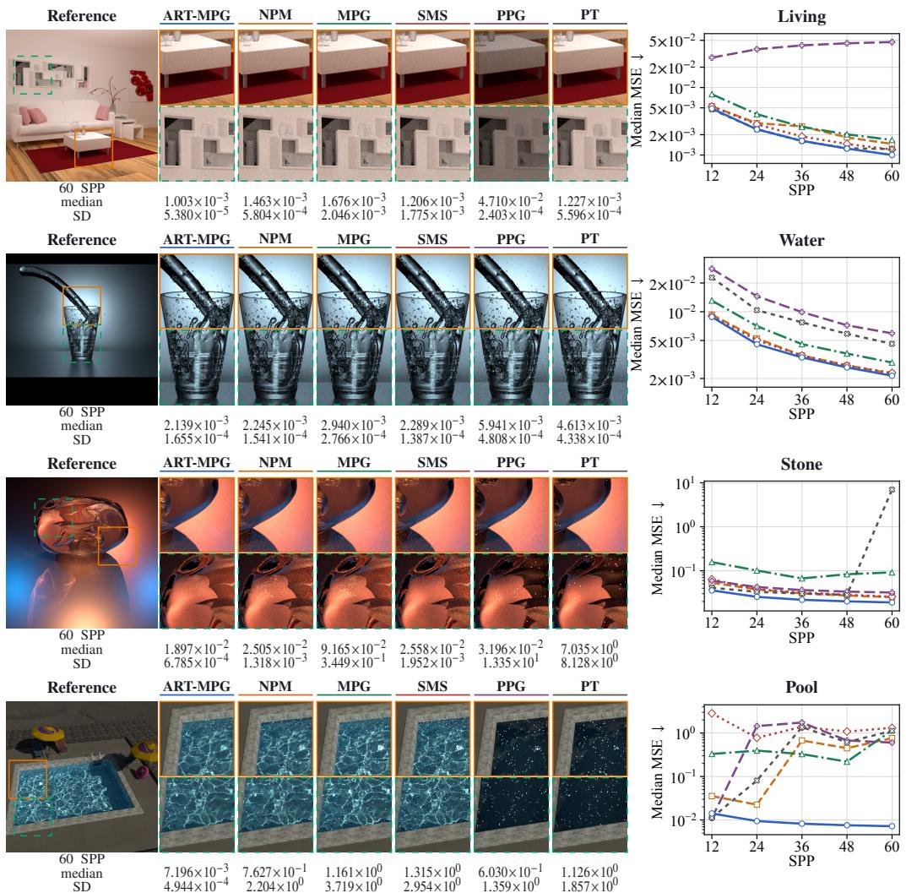  
Figure 1: Equal-SPP results for LIVING, WATER, STONE, and POOL, from top to bottom. Curves show median full-frame MSE across ten fixed runs; 60-SPP annotations additionally show sample standard deviation. Image crops come from one fixed 60-SPP visualization run, whereas quantitative values use separate 64 × 64 full-frame renders. The displayed crops are not median images.

Appendix A.2 gives the complete rank and pairwise-win counts, while Appendix Table A1 gives every 60-SPP median, mean, and sample standard deviation.

The only median upturns for ART-MPG occur on LAMP, from 0.001974 at 24 SPP to 0.001997 at 36 SPP, and on PLANE, from 0.2749 to 0.2758 between 12 and 24 SPP and from 0.2725 to 0.2728 between 48 and 60 SPP. These small increases are retained in the appendix panels.

## 6.3 DISCUSSION

The evaluation supports a focused conclusion: on this controlled benchmark, ART-MPG usually gives lower linear-HDR error per scheduled camera sample than the five comparison methods. The result is strongest at 60 SPP and is broadly consistent across budgets, while CORNELL GLASS and the small LAMP/PLANE upturns identify the observed exceptions.

The methods operate under different learning regimes. ART-MPG and NPM are trained offline and frozen before rendering, MPG adapts online, and PPG updates its guiding state during rendering; PT and the fixed-chain SMS diagnostic use fixed configurations. The experiment therefore controls scheduled camera samples.

Table 1: Median full-frame linear-RGB MSE across D01–D10 for each scene at 60 SPP and $6 4 \times 6 4$ resolution. Lower is better.
<table><tr><td></td><td colspan="5">Baselines</td><td>Ours</td></tr><tr><td>Scene</td><td>PT</td><td>PPG</td><td>SMS</td><td>MPG</td><td>NPM</td><td>ART-MPG</td></tr><tr><td>Living</td><td> $1 . 2 2 7 \times 1 0 ^ { - 3 }$ </td><td> $4 . 7 1 0 \times 1 0 ^ { - 2 }$ </td><td> $1 . 2 0 6 \times 1 0 ^ { - 3 }$ </td><td> $1 . 6 7 6 \times 1 0 ^ { - 3 }$ </td><td> $1 . 4 6 3 \times 1 0 ^ { - 3 }$ </td><td> $\mathbf { 1 . 0 0 3 \times 1 0 ^ { - 3 } }$ </td></tr><tr><td>Lamp</td><td> $4 . 0 0 9 \times 1 0 ^ { - 2 }$ </td><td> $3 . 2 0 2 \times 1 0 ^ { - 2 }$ </td><td> $6 . 4 7 2 \times 1 0 ^ { - 3 }$ </td><td> $1 . 7 8 0 \times 1 0 ^ { - 3 }$ </td><td> $2 . 4 8 3 \times 1 0 ^ { - 3 }$ </td><td> $\mathbf { 1 . 6 8 3 \times 1 0 ^ { - 3 } }$ </td></tr><tr><td>Plane</td><td> $2 . 9 1 2 \times 1 0 ^ { - 1 }$ </td><td> $2 . 9 1 4 \times 1 0 ^ { - 1 }$ </td><td> $2 . 9 9 2 \times 1 0 ^ { - 1 }$ </td><td> $2 . 8 1 0 \times 1 0 ^ { - 1 }$ </td><td> $2 . 8 9 6 \times 1 0 ^ { - 1 }$ </td><td> $\mathbf { 2 . 7 2 8 \times 1 0 ^ { - 1 } }$ </td></tr><tr><td>Slabs</td><td> $1 . 1 1 2 \times 1 0 ^ { - 1 }$ </td><td> $2 . 3 4 0 \times 1 0 ^ { 1 }$ </td><td> $8 . 0 9 5 \times 1 0 ^ { - 2 }$ </td><td> $2 . 8 2 3 \times 1 0 ^ { - 1 }$ </td><td> $7 . 9 5 7 \times 1 0 ^ { - 2 }$ </td><td> $\mathbf { 6 . 4 7 9 \times 1 0 ^ { - 2 } }$ </td></tr><tr><td>Stone</td><td> $7 . 0 3 5 \times 1 0 ^ { 0 }$ </td><td> $3 . 1 9 6 \times 1 0 ^ { - 2 }$ </td><td> $2 . 5 5 8 \times 1 0 ^ { - 2 }$ </td><td> $9 . 1 6 5 \times 1 0 ^ { - 2 }$ </td><td> $2 . 5 0 5 \times 1 0 ^ { - 2 }$ </td><td> $\mathbf { 1 . 8 9 7 \times 1 0 ^ { - 2 } }$ </td></tr><tr><td>Pool</td><td> $1 . 1 2 6 \times 1 0 ^ { 0 }$ </td><td> $6 . 0 3 0 \times 1 0 ^ { - 1 }$ </td><td> $1 . 3 1 5 \times 1 0 ^ { 0 }$ </td><td> $1 . 1 6 1 \times 1 0 ^ { 0 }$ </td><td> $7 . 6 2 7 \times 1 0 ^ { - 1 }$ </td><td> $\mathbf { 7 . 1 9 6 \times 1 0 ^ { - 3 } }$ </td></tr><tr><td>Sphere</td><td> $4 . 6 0 3 \times 1 0 ^ { 1 }$ </td><td> $1 . 8 7 9 \times 1 0 ^ { - 1 }$ </td><td> $1 . 0 1 6 \times 1 0 ^ { - 1 }$ </td><td> $1 . 1 0 9 \times 1 0 ^ { - 1 }$ </td><td> $8 . 1 4 1 \times 1 0 ^ { - 2 }$ </td><td> $\mathbf { 7 . 2 1 9 \times 1 0 ^ { - 2 } }$ </td></tr><tr><td>Water</td><td> $4 . 6 1 3 \times 1 0 ^ { - 3 }$ </td><td> $5 . 9 4 1 \times 1 0 ^ { - 3 }$ </td><td> $2 . 2 8 9 \times 1 0 ^ { - 3 }$ </td><td> $2 . 9 4 0 \times 1 0 ^ { - 3 }$ </td><td> $2 . 2 4 5 \times 1 0 ^ { - 3 }$ </td><td> $\mathbf { 2 . 1 3 9 \times 1 0 ^ { - 3 } }$ </td></tr><tr><td>Ring-and-Slab</td><td> $2 . 8 7 6 \times 1 0 ^ { 1 }$ </td><td> $2 . 3 0 8 \times 1 0 ^ { 1 }$ </td><td> $7 . 0 3 9 \times 1 0 ^ { - 2 }$ </td><td> $4 . 1 6 3 \times 1 0 ^ { - 1 }$ </td><td> $7 . 3 6 8 \times 1 0 ^ { - 2 }$ </td><td> $\mathbf { 5 . 9 8 0 \times 1 0 ^ { - 2 } }$ </td></tr><tr><td>Pillars</td><td> $9 . 2 4 2 \times 1 0 ^ { - 2 }$ </td><td> $2 . 9 0 0 \times 1 0 ^ { - 1 }$ </td><td> $9 . 1 9 0 \times 1 0 ^ { - 2 }$ </td><td> $2 . 3 3 5 \times 1 0 ^ { - 1 }$ </td><td> $8 . 1 3 4 \times 1 0 ^ { - 2 }$ </td><td> $\mathbf { 7 . 1 2 8 \times 1 0 ^ { - 2 } }$ </td></tr><tr><td>Slab-×1</td><td> $7 . 9 8 1 \times 1 0 ^ { - 2 }$ </td><td> $8 . 0 4 3 \times 1 0 ^ { - 2 }$ </td><td> $5 . 3 5 6 \times 1 0 ^ { - 2 }$ </td><td> $4 . 6 3 6 \times 1 0 ^ { - 2 }$ </td><td> $5 . 2 5 8 \times 1 0 ^ { - 2 }$ </td><td> $\mathbf { 4 . 4 3 5 \times 1 0 ^ { - 2 } }$ </td></tr><tr><td>Slab-×3</td><td> $2 . 9 8 0 \times 1 0 ^ { - 1 }$ </td><td> $2 . 9 8 0 \times 1 0 ^ { - 1 }$ </td><td> $2 . 6 1 8 \times 1 0 ^ { - 1 }$ </td><td> $1 . 0 5 7 \times 1 0 ^ { 0 }$ </td><td> $2 . 6 8 8 \times 1 0 ^ { - 1 }$ </td><td> $\mathbf { 2 . 2 9 7 \times 1 0 ^ { - 1 } }$ </td></tr><tr><td>Pillar-×3</td><td> $1 . 0 2 4 \times 1 0 ^ { - 1 }$ </td><td> $1 . 0 2 7 \times 1 0 ^ { - 1 }$ </td><td> $9 . 2 1 3 \times 1 0 ^ { - 2 }$ </td><td> $1 . 2 1 7 \times 1 0 ^ { - 1 }$ </td><td> $8 . 2 9 1 \times 1 0 ^ { - 2 }$ </td><td> $\mathbf { 7 . 4 8 8 \times 1 0 ^ { - 2 } }$ </td></tr><tr><td>Cornell Glass</td><td> $5 . 4 4 5 \times 1 0 ^ { - 3 }$ </td><td> $4 . 9 7 4 \times 1 0 ^ { - 2 }$ </td><td> $\mathbf { 5 . 4 3 5 \times 1 0 ^ { - 3 } }$ </td><td> $8 . 8 8 7 \times 1 0 ^ { - 3 }$ </td><td> $6 . 6 7 5 \times 1 0 ^ { - 3 }$ </td><td> $6 . 4 9 1 \times 1 0 ^ { - 3 }$ </td></tr></table>

NPM accesses trainable spatial grids sparsely, whereas ART-MPG evaluates a dense multilayer perceptron. Execution details appear in Appendix B.3.

## 7 SCOPE AND LIMITATIONS

Our evidence supports a focused descriptive claim: over the ten runs on this controlled 14-scene benchmark, ART-MPG usually has lower median linear-HDR error per scheduled camera sample than the five comparators. Equal SPP does not imply equal wall-clock cost; the neural guide is fitted offline per scene, its replay/training cost is excluded. MPG performs online fitting inside its recorded schedule. These are distinct operating regimes rather than a matched-time comparison.

Quantitative results use 64×64 images and one fixed 32,768-SPP reference seed. Several scenes share base geometry, and some benchmark families informed development, limiting claims of scene-level independence or out-of-distribution generalization. These boundaries motivate further research on matched-time, reference-convergence, clamp, and topology research for different SPP observations.

## 8 CONCLUSION

ART-MPG models the complete low-dimensional seed of a specular chain: its length, ordered reflection/transmission topology, and topology-conditioned direction. The controlled evaluation compares ART-MPG, NPM, MPG, fixed-chain SMS, PPG, and PT on 14 scenes at {12, 24, 36, 48, 60} SPP. Across 10 random seeds, ART-MPG has the lowest median MSE in 62/70 scene–SPP cells and in 13/14 scenes at 60 SPP. It records 335/350 strict pairwise median wins over the five comparators across all budgets and 68/70 at 60 SPP; its median curve is non-increasing on 12/14 scenes. The only median upturns are small changes on LAMP and PLANE, and CORNELL GLASS is the sole 60-SPP rank exception. The results establish a sample-budget comparison, not a matched-time comparison, and support ART-MPG as a compact proposal for structured-caustic transport.

## REPRODUCIBILITY STATEMENT

The supplementary artifacts record the scenes, seeds, model exports, renderer settings, reference hashes, and per-image metric rows. Together with Section 6 and the complete pseudocode and proof in Appendix C.1, they distinguish the ideal estimator from the finite-work profile evaluated in the paper. The artifact contains the complete $1 4 \times 6 \times 5 \times 1 0 = 4 , 2 0 0$ rows for ART-MPG, NPM, MPG, fixed-chain SMS, PPG, and PT at {12, 24, 36, 48, 60} SPP. The reported curves are ordinary cellwise medians without dispersion bands. Their 60-SPP numeric annotations and the appendix table retain raw sample standard deviations with denominator n − 1.

## AI USE STATEMENT

Generative AI assisted with pseudocode, analysis/visualization code, and consistency checks, and performed the disclosed unblinded visual QA. The authors verified AI-assisted content against source code, execution receipts, tests, and rendered artifacts; AI was not used to synthesize measured values or replace renderer outputs. The authors take responsibility for the final manuscript and artifacts.

## REFERENCES

Steve Bako, Mark Meyer, Tony DeRose, and Pradeep Sen. Offline deep importance sampling for monte carlo path tracing. Computer Graphics Forum, 38(7), 2019.

Amartya Banerjee, Xingyu Xu, Caroline Moosmuller, and Harlin Lee. Adaptive multimodal pro-¨ tein plug-and-play with diffusion-based priors. In 2025 IEEE 10th International Workshop on Computational Advances in Multi-Sensor Adaptive Processing (CAMSAP), pp. 226–230. IEEE, 2025.

Honghao Dong, Guoping Wang, and Sheng Li. Neural parametric mixtures for path guiding. In ACM SIGGRAPH Conference Proceedings, pp. 1–10, 2023. doi: 10.1145/3588432.3591533.

Zhimin Fan, Pengpei Hong, Jie Guo, Changqing Zou, Yanwen Guo, and Ling-Qi Yan. Manifold path guiding for importance sampling specular chains. ACM Transactions on Graphics, 42(6), 2023. doi: 10.1145/3618360.

Zhimin Fan, Jie Guo, Yiming Wang, Tianyu Xiao, Hao Zhang, Chenxi Zhou, Zhenyu Chen, Pengpei Hong, Yanwen Guo, and Ling-Qi Yan. Specular polynomials. ACM Transactions on Graphics, 43 (4):1–13, 2024. doi: 10.1145/3658132.

Johannes Hanika, Marc Droske, and Luca Fascione. Manifold next event estimation. Computer Graphics Forum, 34(4), 2015. doi: 10.1111/cgf.12681.

Sebastian Herholz, Oskar Elek, Jiˇr´ı Vorba, Hendrik P. A. Lensch, and Jaroslav Kˇrivanek. Product´ importance sampling for light transport path guiding. Computer Graphics Forum, 35(4), 2016.

Kenta Hoshino, Yashaswi Shashank Aluru, Xiyu Deng, and Yorie Nakahira. Training-free guided diffusion for planning: A unified framework via doob’s h-transform with safety guarantees. In Forty-third International Conference on Machine Learning, 2026.

Wenzel Jakob and Steve Marschner. Manifold exploration: A markov chain monte carlo technique for rendering scenes with difficult specular transport. ACM Transactions on Graphics, 31(4), 2012. doi: 10.1145/2185520.2185554.

James T. Kajiya. The rendering equation. In Proceedings of SIGGRAPH, pp. 143–150, 1986. doi: 10.1145/15922.15902.

Kanti V. Mardia and Peter E. Jupp. Directional Statistics. Wiley, 2000.

Thomas Muller, Markus Gross, and Jan Nov ¨ ak. Practical path guiding for efficient light-transport ´ simulation. In Computer Graphics Forum, volume 36, pp. 91–100, 2017.

Thomas Muller, Brian McWilliams, Fabrice Rousselle, Markus Gross, and Jan Nov¨ ak. Neural´ importance sampling. ACM Transactions on Graphics, 38(5), 2019.

Alexander Rath, Pascal Grittmann, Sebastian Herholz, Petr Vevoda, Philipp Slusallek, and Jaroslav´ Kˇrivanek. Variance-aware path guiding.´ ACM Transactions on Graphics, 39(4), 2020.

Lukas Ruppert, Sebastian Herholz, and Hendrik P. A. Lensch. Robust fitting of parallax-aware mixtures for path guiding. ACM Transactions on Graphics, 39(4), 2020.

Eric Veach and Leonidas J. Guibas. Optimally combining sampling techniques for monte carlo rendering. In Proceedings ofSIGGRAPH, pp. 419–428, 1995. doi: 10.1145/218380.218498.

Jiˇr´ı Vorba, Ondˇrej Karl´ık, Martin Sˇ ´ık, Tobias Ritschel, and Jaroslav Kˇrivanek. On-line learning of ´ parametric mixture models for light transport simulation. ACM Transactions on Graphics, 33(4), 2014. doi: 10.1145/2601097.2601203.

Andrew T. A. Wood. Simulation of the von mises fisher distribution. Communications in Statistics – Simulation and Computation, 23(1):157–164, 1994. doi: 10.1080/03610919408813161.

Xingyu Xu and Yuejie Chi. Provably robust score-based diffusion posterior sampling for plug-andplay image reconstruction. Advances in Neural Information Processing Systems, 37:36148–36184, 2024.

Xingyu Xu, Ziyi Zhang, Yorie Nakahira, Guannan Qu, and Yuejie Chi. Polynomial convergence of riemannian diffusion models. arXiv preprint arXiv:2601.02499, 2026.

Shangjian Yin, Zehao Zhao, Kavosh Asadi, Rui Liu, Yuchen Lu, Shike Mei, Hang Cui, Luke Simon, Zhouxing Shi, and Hamed Firooz. Recursive self-improvement via on-policy distillation for reasoning. arXiv preprint arXiv:2609.30652, 2026. doi: 10.48550/arXiv.2609.30652. URL https://arxiv.org/abs/2609.30652.

Chang-Wei Yueh, Andy Zhao, Ashutosh Nayyar, and Rahul Jain. Bayesian learning in episodic zero-sum games. arXiv preprint arXiv:2603.20604, 2026. doi: 10.48550/arXiv.2603.20604. URL https://arxiv.org/abs/2603.20604.

Tizian Zeltner, Iliyan Georgiev, and Wenzel Jakob. Specular manifold sampling for rendering high-frequency caustics and glints. ACM Transactions on Graphics, 39(4), 2020.

Ziyi Zhang, Shixuan Li, Yorie Nakahira, Paul Bogdan, and Guannan Qu. Hilbertgen-3d:hilbert– multifractal conditioning for topology-aware 3d generation, 2026. URL https://arxiv.org/ abs/2610.22720.

Zehao Zhao, Apurv Shukla, Rahul Jain, and Vijay Subramanian. Efficient decentralized learning of generalized quantal response equilibrium. arXiv preprint arXiv:2507.09928, 2025. doi: 10.48550/ arXiv.2507.09928. URL https://arxiv.org/abs/2507.09928.

Quan Zheng and Matthias Zwicker. Learning to importance sample in primary sample space. Computer Graphics Forum, 38(2):169–179, 2019. doi: 10.1111/cgf.13628.

## A ADDITIONAL RESULTS

## A.1 EVALUATION GRID

The reported evaluation compares ART-MPG, NPM, MPG, fixed-chain SMS, PPG, and PT at {12, 24, 36, 48, 60} SPP on fourteen configurations: LIVING, LAMP, PLANE, SLABS, STONE, POOL, SPHERE, WATER, RING-AND-SLAB, PILLARS, SLAB-×1, SLAB-×3, PILLAR-×3, and CORNELL GLASS. Every quantitative cell is full-frame MSE on raw linear-HDR RGB at 64 × 64 resolution against the same fixed 32,768-SPP numerical reference for that scene.

The SMS curve is the hash-bound fixed-chain configuration used by this sweep: the established LAMP/SLABS presets are retained, and the remaining scenes use the frozen descriptor recorded by the protocol. We therefore interpret SMS as a fixed-chain diagnostic, not as a variable-chain SMS result.

The ten fixed runs are denoted D01–D10. Each run contains the complete 14 × 6 × 5 grid, yielding $1 4 \times 6 \times 5 \times 1 0 = 4$ ,200 measured images. The same run IDs are used for all methods and scenes.

## A.2 MEDIAN OUTCOME

ART-MPG has the lowest median MSE in 62/70 scene–SPP cells, including 13/14 scenes at 60 SPP. Its median curve is non-increasing on 12/14 scenes and strictly rank 1 at every displayed budget on 11/14 scenes; nine scenes satisfy both properties. It records 335/350 strict pairwise median wins against the five comparators across all budgets and 68/70 at 60 SPP. CORNELL GLASS is the sole 60-SPP rank exception.

The only ART-MPG median upturns are LAMP, from 0.001974 at 24 SPP to 0.001997 at 36 SPP, and PLANE, from 0.2749 to 0.2758 between 12 and 24 SPP and from 0.2725 to 0.2728 between 48 and 60 SPP. All remain in the panels below.

## A.3 COMPLETE 60-SPP DESCRIPTIVE SUMMARY

Table A1 reports the 60- SPP median, arithmetic mean, and sample standard deviation for every scene–method pair. The main paper’s claims and curves use medians; the other two statistics are included to describe variation across D01–D10.

Table A1: Combined 60-SPP 64×64 full-frame linear-RGB MSE summaries across D01–D10 (n = 10 per cell). Each method cell lists median, arithmetic mean, and sample standard deviation from top to bottom. Row-minimum medians and means are bold; SD is not ranked.
<table><tr><td rowspan=1 colspan=7>Baselines                                     OursScene                 PT         PPG         SMS         MPG        NPM      ART-MPGCell order: median / mean / sample SD; MSE ↓</td></tr><tr><td rowspan=1 colspan=1></td><td rowspan=1 colspan=1> $1 . 2 2 7 \times 1 0 ^ { - 3 }$ </td><td rowspan=1 colspan=1> $4 . 7 1 0 \times 1 0 ^ { - 2 }$ </td><td rowspan=1 colspan=1> $1 . 2 0 6 \times 1 0 ^ { - 3 }$ </td><td rowspan=1 colspan=1> $1 . 6 7 6 \times 1 0 ^ { - 3 }$ </td><td rowspan=1 colspan=1> $1 . 4 6 3 \times 1 0 ^ { - 3 }$ </td><td rowspan=1 colspan=1> $\mathbf { 1 . 0 0 3 \times 1 0 ^ { - 3 } }$ </td></tr><tr><td rowspan=1 colspan=1></td><td rowspan=1 colspan=1> $1 . 4 2 3 \times 1 0 ^ { - 3 }$ </td><td rowspan=1 colspan=1> $4 . 7 1 1 \times 1 0 ^ { - 2 }$ </td><td rowspan=1 colspan=1> $1 . 7 6 9 \times 1 0 ^ { - 3 }$ </td><td rowspan=1 colspan=1> $2 . 7 3 9 \times 1 0 ^ { - 3 }$ </td><td rowspan=1 colspan=1> $1 . 5 9 3 \times 1 0 ^ { - 3 }$ </td><td rowspan=1 colspan=1> $\mathbf { 1 . 0 0 8 \times 1 0 ^ { - 3 } }$ </td></tr><tr><td rowspan=1 colspan=1>LIVING</td><td rowspan=1 colspan=1>5.596×10−4</td><td rowspan=1 colspan=1>2.403×10−4</td><td rowspan=1 colspan=1>1.775×10−3</td><td rowspan=1 colspan=1>2.046×10−3</td><td rowspan=1 colspan=1>5.804×10−4</td><td rowspan=1 colspan=1>5.380×10−5</td></tr><tr><td rowspan=1 colspan=1></td><td rowspan=1 colspan=1> $4 . 0 0 9 \times 1 0 ^ { - 2 }$ </td><td rowspan=1 colspan=1> $3 . 2 0 2 \times 1 0 ^ { - 2 }$ </td><td rowspan=1 colspan=1> $6 . 4 7 2 \times 1 0 ^ { - 3 }$ </td><td rowspan=1 colspan=1> $1 . 7 8 0 \times 1 0 ^ { - 3 }$ </td><td rowspan=1 colspan=1> $2 . 4 8 3 \times 1 0 ^ { - 3 }$ </td><td rowspan=1 colspan=1> $\mathbf { 1 . 6 8 3 \times 1 0 ^ { - 3 } }$ </td></tr><tr><td rowspan=1 colspan=1></td><td rowspan=1 colspan=1> $4 . 0 0 3 \times 1 0 ^ { - 1 }$ </td><td rowspan=1 colspan=1> $6 . 4 9 5 \times 1 0 ^ { - 1 }$ </td><td rowspan=1 colspan=1> $6 . 4 6 8 \times 1 0 ^ { - 3 }$ </td><td rowspan=1 colspan=1> $1 . 8 6 9 \times 1 0 ^ { - 3 }$ </td><td rowspan=1 colspan=1> $2 . 4 9 3 \times 1 0 ^ { - 3 }$ </td><td rowspan=1 colspan=1> $\mathbf { 1 . 7 7 6 \times 1 0 ^ { - 3 } }$ </td></tr><tr><td rowspan=1 colspan=1>LAMP</td><td rowspan=1 colspan=1> $5 . 8 8 6 \times 1 0 ^ { - 1 }$ </td><td rowspan=1 colspan=1> $1 . 1 4 0 \times 1 0 ^ { 0 }$ </td><td rowspan=1 colspan=1>2.226×10−5</td><td rowspan=1 colspan=1> $3 . 7 0 8 \times 1 0 ^ { - 4 }$ </td><td rowspan=1 colspan=1> $5 . 2 0 6 \times 1 0 ^ { - 4 }$ </td><td rowspan=1 colspan=1>4.036×10−4</td></tr><tr><td rowspan=1 colspan=1></td><td rowspan=1 colspan=1> $2 . 9 1 2 \times 1 0 ^ { - 1 }$ </td><td rowspan=1 colspan=1> $2 . 9 1 4 \times 1 0 ^ { - 1 }$ </td><td rowspan=1 colspan=1> $2 . 9 9 2 \times 1 0 ^ { - 1 }$ </td><td rowspan=1 colspan=1> $2 . 8 1 0 \times 1 0 ^ { - 1 }$ </td><td rowspan=1 colspan=1> $2 . 8 9 6 \times 1 0 ^ { - 1 }$ </td><td rowspan=1 colspan=1> $\mathbf { 2 . 7 2 8 \times 1 0 ^ { - 1 } }$ </td></tr><tr><td rowspan=1 colspan=1></td><td rowspan=1 colspan=1> $6 . 4 9 9 \times 1 0 ^ { 2 }$ </td><td rowspan=1 colspan=1> $2 . 9 1 4 \times 1 0 ^ { - 1 }$ </td><td rowspan=1 colspan=1> $3 . 3 9 6 \times 1 0 ^ { - 1 }$ </td><td rowspan=1 colspan=1> $2 . 9 8 2 \times 1 0 ^ { - 1 }$ </td><td rowspan=1 colspan=1> $2 . 9 0 3 \times 1 0 ^ { - 1 }$ </td><td rowspan=1 colspan=1> $\mathbf { 2 . 7 2 1 \times 1 0 ^ { - 1 } }$ </td></tr><tr><td rowspan=1 colspan=1>PLANE</td><td rowspan=1 colspan=1> $2 . 0 5 4 \times 1 0 ^ { 3 }$ </td><td rowspan=1 colspan=1> $1 . 9 3 5 \times 1 0 ^ { - 4 }$ </td><td rowspan=1 colspan=1>1.453×10−¹</td><td rowspan=1 colspan=1> $5 . 8 8 1 \times 1 0 ^ { - 2 }$ </td><td rowspan=1 colspan=1> $1 . 3 0 7 \times 1 0 ^ { - 2 }$ </td><td rowspan=1 colspan=1>3.023×10-3</td></tr><tr><td rowspan=1 colspan=1></td><td rowspan=1 colspan=1> $1 . 1 1 2 \times 1 0 ^ { - 1 }$ </td><td rowspan=1 colspan=1> $2 . 3 4 0 \times 1 0 ^ { 1 }$ </td><td rowspan=1 colspan=1> $8 . 0 9 5 \times 1 0 ^ { - 2 }$ </td><td rowspan=1 colspan=1> $2 . 8 2 3 \times 1 0 ^ { - 1 }$ </td><td rowspan=1 colspan=1> $7 . 9 5 7 \times 1 0 ^ { - 2 }$ </td><td rowspan=1 colspan=1> $\mathbf { 6 . 4 7 9 \times 1 0 ^ { - 2 } }$ </td></tr><tr><td rowspan=1 colspan=1></td><td rowspan=1 colspan=1> $9 . 7 9 7 \times 1 0 ^ { 1 }$ </td><td rowspan=1 colspan=1> $2 . 4 6 4 \times 1 0 ^ { 1 }$ </td><td rowspan=1 colspan=1> $8 . 2 4 5 \times 1 0 ^ { - 2 }$ </td><td rowspan=1 colspan=1> $4 . 0 7 3 \times 1 0 ^ { - 1 }$ </td><td rowspan=1 colspan=1> $\mathbf { 8 . 1 1 6 \times 1 0 ^ { - 2 } }$ </td><td rowspan=1 colspan=1> $9 . 8 5 4 \times 1 0 ^ { - 2 }$ </td></tr><tr><td rowspan=1 colspan=1>SLABS</td><td rowspan=1 colspan=1> $2 . 7 1 4 \times 1 0 ^ { 2 }$ </td><td rowspan=1 colspan=1> $2 . 7 7 4 \times 1 0 ^ { 1 }$ </td><td rowspan=1 colspan=1> $6 . 6 8 0 \times 1 0 ^ { - 3 }$ </td><td rowspan=1 colspan=1> $3 . 1 2 4 \times 1 0 ^ { - 1 }$ </td><td rowspan=1 colspan=1> $4 . 2 8 8 \times 1 0 ^ { - 3 }$ </td><td rowspan=1 colspan=1>7.204×10−2</td></tr><tr><td rowspan=1 colspan=1></td><td rowspan=1 colspan=1> $7 . 0 3 5 \times 1 0 ^ { 0 }$ </td><td rowspan=1 colspan=1> $3 . 1 9 6 \times 1 0 ^ { - 2 }$ </td><td rowspan=1 colspan=1> $2 . 5 5 8 \times 1 0 ^ { - 2 }$ </td><td rowspan=1 colspan=1> $9 . 1 6 5 \times 1 0 ^ { - 2 }$ </td><td rowspan=1 colspan=1> $2 . 5 0 5 \times 1 0 ^ { - 2 }$ </td><td rowspan=1 colspan=1> $\mathbf { 1 . 8 9 7 \times 1 0 ^ { - 2 } }$ </td></tr><tr><td rowspan=1 colspan=1></td><td rowspan=1 colspan=1> $7 . 8 4 9 \times 1 0 ^ { 0 }$ </td><td rowspan=1 colspan=1> $7 . 8 6 9 \times 1 0 ^ { 0 }$ </td><td rowspan=1 colspan=1> $2 . 6 2 1 \times 1 0 ^ { - 2 }$ </td><td rowspan=1 colspan=1> $2 . 7 2 8 \times 1 0 ^ { - 1 }$ </td><td rowspan=1 colspan=1> $2 . 5 2 9 \times 1 0 ^ { - 2 }$ </td><td rowspan=1 colspan=1> $\mathbf { 1 . 9 3 1 \times 1 0 ^ { - 2 } }$ </td></tr><tr><td rowspan=1 colspan=1>STONE</td><td rowspan=1 colspan=1> $8 . 1 2 8 \times 1 0 ^ { 0 }$ </td><td rowspan=1 colspan=1> $1 . 3 3 5 \times 1 0 ^ { 1 }$ </td><td rowspan=1 colspan=1> $1 . 9 5 2 \times 1 0 ^ { - 3 }$ </td><td rowspan=1 colspan=1> $3 . 4 4 9 \times 1 0 ^ { - 1 }$ </td><td rowspan=1 colspan=1> $1 . 3 1 8 \times 1 0 ^ { - 3 }$ </td><td rowspan=1 colspan=1>6.785×10−4</td></tr><tr><td rowspan=1 colspan=1></td><td rowspan=1 colspan=1> $1 . 1 2 6 \times 1 0 ^ { 0 }$ </td><td rowspan=1 colspan=1> $6 . 0 3 0 \times 1 0 ^ { - 1 }$ </td><td rowspan=1 colspan=1> $1 . 3 1 5 \times 1 0 ^ { 0 }$ </td><td rowspan=1 colspan=1> $1 . 1 6 1 \times 1 0 ^ { 0 }$ </td><td rowspan=1 colspan=1> $7 . 6 2 7 \times 1 0 ^ { - 1 }$ </td><td rowspan=1 colspan=1> $\mathbf { 7 . 1 9 6 \times 1 0 ^ { - 3 } }$ </td></tr><tr><td rowspan=1 colspan=1></td><td rowspan=1 colspan=1> $1 . 7 2 2 \times 1 0 ^ { 0 }$ </td><td rowspan=1 colspan=1> $1 . 1 3 7 \times 1 0 ^ { 0 }$ </td><td rowspan=1 colspan=1> $2 . 6 4 1 \times 1 0 ^ { 0 }$ </td><td rowspan=1 colspan=1> $2 . 7 0 7 \times 1 0 ^ { 0 }$ </td><td rowspan=1 colspan=1> $1 . 4 2 5 \times 1 0 ^ { 0 }$ </td><td rowspan=1 colspan=1> $\mathbf { 7 . 2 1 4 \times 1 0 ^ { - 3 } }$ </td></tr><tr><td rowspan=1 colspan=1>POOL</td><td rowspan=1 colspan=1> $1 . 8 5 7 \times 1 0 ^ { 0 }$ </td><td rowspan=1 colspan=1> $1 . 3 5 9 \times 1 0 ^ { 0 }$ </td><td rowspan=1 colspan=1> $2 . 9 5 4 \times 1 0 ^ { 0 }$ </td><td rowspan=1 colspan=1> $3 . 7 1 9 \times 1 0 ^ { 0 }$ </td><td rowspan=1 colspan=1> $2 . 2 0 4 \times 1 0 ^ { 0 }$ </td><td rowspan=1 colspan=1> $4 . 9 4 4 \times 1 0 ^ { - 4 }$ </td></tr><tr><td rowspan=1 colspan=1></td><td rowspan=1 colspan=1> $4 . 6 0 3 \times 1 0 ^ { 1 }$ </td><td rowspan=1 colspan=1> $1 . 8 7 9 \times 1 0 ^ { - 1 }$ </td><td rowspan=1 colspan=1> $1 . 0 1 6 \times 1 0 ^ { - 1 }$ </td><td rowspan=1 colspan=1> $1 . 1 0 9 \times 1 0 ^ { - 1 }$ </td><td rowspan=1 colspan=1> $8 . 1 4 1 \times 1 0 ^ { - 2 }$ </td><td rowspan=1 colspan=1> $\mathbf { 7 . 2 1 9 \times 1 0 ^ { - 2 } }$ </td></tr><tr><td rowspan=1 colspan=1></td><td rowspan=1 colspan=1> $4 . 6 9 1 \times 1 0 ^ { 1 }$ </td><td rowspan=1 colspan=1> $1 . 9 0 4 \times 1 0 ^ { 1 }$ </td><td rowspan=1 colspan=1> $3 . 9 4 5 \times 1 0 ^ { 0 }$ </td><td rowspan=1 colspan=1> $1 . 4 8 4 \times 1 0 ^ { - 1 }$ </td><td rowspan=1 colspan=1> $8 . 1 8 8 \times 1 0 ^ { - 2 }$ </td><td rowspan=1 colspan=1> $\mathbf { 7 . 2 2 9 \times 1 0 ^ { - 2 } }$ </td></tr><tr><td rowspan=1 colspan=1>SPHERE</td><td rowspan=1 colspan=1> $2 . 7 4 3 \times 1 0 ^ { 1 }$ </td><td rowspan=1 colspan=1> $2 . 4 7 8 \times 1 0 ^ { 1 }$ </td><td rowspan=1 colspan=1> $1 . 2 0 7 \times 1 0 ^ { 1 }$ </td><td rowspan=1 colspan=1> $1 . 1 3 2 \times 1 0 ^ { - 1 }$ </td><td rowspan=1 colspan=1> $3 . 1 8 6 \times 1 0 ^ { - 3 }$ </td><td rowspan=1 colspan=1> $6 . 8 9 0 \times 1 0 ^ { - 4 }$ </td></tr><tr><td rowspan=1 colspan=1></td><td rowspan=1 colspan=1> $4 . 6 1 3 \times 1 0 ^ { - 3 }$ </td><td rowspan=1 colspan=1> $5 . 9 4 1 \times 1 0 ^ { - 3 }$ </td><td rowspan=1 colspan=1> $2 . 2 8 9 \times 1 0 ^ { - 3 }$ </td><td rowspan=1 colspan=1> $2 . 9 4 0 \times 1 0 ^ { - 3 }$ </td><td rowspan=1 colspan=1> $2 . 2 4 5 \times 1 0 ^ { - 3 }$ </td><td rowspan=1 colspan=1> $\mathbf { 2 . 1 3 9 \times 1 0 ^ { - 3 } }$ </td></tr><tr><td rowspan=1 colspan=1></td><td rowspan=1 colspan=1> $4 . 6 3 2 \times 1 0 ^ { - 3 }$ </td><td rowspan=1 colspan=1> $5 . 8 2 4 \times 1 0 ^ { - 3 }$ </td><td rowspan=1 colspan=1> $2 . 2 7 0 \times 1 0 ^ { - 3 }$ </td><td rowspan=1 colspan=1> $2 . 9 9 1 \times 1 0 ^ { - 3 }$ </td><td rowspan=1 colspan=1> $2 . 2 9 8 \times 1 0 ^ { - 3 }$ </td><td rowspan=1 colspan=1> $\mathbf { 2 . 1 7 1 \times 1 0 ^ { - 3 } }$ </td></tr><tr><td rowspan=1 colspan=1>WATER</td><td rowspan=1 colspan=1> $4 . 3 3 8 \times 1 0 ^ { - 4 }$ </td><td rowspan=1 colspan=1> $4 . 8 0 8 \times 1 0 ^ { - 4 }$ </td><td rowspan=1 colspan=1> $1 . 3 8 7 \times 1 0 ^ { - 4 }$ </td><td rowspan=1 colspan=1> $2 . 7 6 6 \times 1 0 ^ { - 4 }$ </td><td rowspan=1 colspan=1> $1 . 5 4 1 \times 1 0 ^ { - 4 }$ </td><td rowspan=1 colspan=1> $1 . 6 5 5 \times 1 0 ^ { - 4 }$ </td></tr><tr><td rowspan=1 colspan=1></td><td rowspan=1 colspan=1> $2 . 8 7 6 \times 1 0 ^ { 1 }$ </td><td rowspan=1 colspan=1> $2 . 3 0 8 \times 1 0 ^ { 1 }$ </td><td rowspan=1 colspan=1> $7 . 0 3 9 \times 1 0 ^ { - 2 }$ </td><td rowspan=1 colspan=1> $4 . 1 6 3 \times 1 0 ^ { - 1 }$ </td><td rowspan=1 colspan=1> $7 . 3 6 8 \times 1 0 ^ { - 2 }$ </td><td rowspan=1 colspan=1> $\mathbf { 5 . 9 8 0 \times 1 0 ^ { - 2 } }$ </td></tr><tr><td rowspan=1 colspan=1></td><td rowspan=1 colspan=1> $1 . 0 8 5 \times 1 0 ^ { 2 }$ </td><td rowspan=1 colspan=1> $2 . 0 8 0 \times 1 0 ^ { 1 }$ </td><td rowspan=1 colspan=1> $9 . 7 4 2 \times 1 0 ^ { - 2 }$ </td><td rowspan=1 colspan=1> $5 . 6 8 3 \times { 1 0 } ^ { 0 }$ </td><td rowspan=1 colspan=1> $7 . 3 5 6 \times 1 0 ^ { - 2 }$ </td><td rowspan=1 colspan=1> $\mathbf { 6 . 3 6 6 \times 1 0 ^ { - 2 } }$ </td></tr><tr><td rowspan=1 colspan=1> $\mathrm { R I N G - A N D - S L A B }$ </td><td rowspan=1 colspan=1> $2 . 5 9 0 \times 1 0 ^ { 2 }$ </td><td rowspan=1 colspan=1> $1 . 9 4 5 \times 1 0 ^ { 1 }$ </td><td rowspan=1 colspan=1>6.757×10-2</td><td rowspan=1 colspan=1> $1 . 2 3 9 \times 1 0 ^ { 1 }$ </td><td rowspan=1 colspan=1> $3 . 2 8 2 \times 1 0 ^ { - 3 }$ </td><td rowspan=1 colspan=1> $7 . 9 4 3 \times 1 0 ^ { - 3 }$ </td></tr><tr><td rowspan=1 colspan=1></td><td rowspan=1 colspan=1> $9 . 2 4 2 \times 1 0 ^ { - 2 }$ </td><td rowspan=1 colspan=1> $2 . 9 0 0 \times 1 0 ^ { - 1 }$ </td><td rowspan=1 colspan=1> $9 . 1 9 0 \times 1 0 ^ { - 2 }$ </td><td rowspan=1 colspan=1> $2 . 3 3 5 \times 1 0 ^ { - 1 }$ </td><td rowspan=1 colspan=1> $8 . 1 3 4 \times 1 0 ^ { - 2 }$ </td><td rowspan=1 colspan=1> $\mathbf { 7 . 1 2 8 \times 1 0 ^ { - 2 } }$ </td></tr><tr><td rowspan=1 colspan=1></td><td rowspan=1 colspan=1> $7 . 2 7 3 \times 1 0 ^ { 1 }$ </td><td rowspan=1 colspan=1> $5 . 7 3 9 \times 1 0 ^ { 1 }$ </td><td rowspan=1 colspan=1> $1 . 8 3 2 \times 1 0 ^ { 1 }$ </td><td rowspan=1 colspan=1> $4 . 6 2 8 \times 1 0 ^ { 1 }$ </td><td rowspan=1 colspan=1> $1 . 9 6 8 \times 1 0 ^ { 1 }$ </td><td rowspan=1 colspan=1> $\mathbf { 1 . 3 4 5 \times 1 0 ^ { - 1 } }$ </td></tr><tr><td rowspan=1 colspan=1>PILLARS</td><td rowspan=1 colspan=1> $2 . 0 9 2 \times 1 0 ^ { 2 }$ </td><td rowspan=1 colspan=1> $1 . 0 0 7 \times 1 0 ^ { 2 }$ </td><td rowspan=1 colspan=1>5.762×101</td><td rowspan=1 colspan=1> $1 . 4 3 7 \times 1 0 ^ { 2 }$ </td><td rowspan=1 colspan=1> $6 . 1 9 9 \times 1 0 ^ { 1 }$ </td><td rowspan=1 colspan=1>2.008×10−1</td></tr><tr><td rowspan=1 colspan=1></td><td rowspan=1 colspan=1> $7 . 9 8 1 \times 1 0 ^ { - 2 }$ </td><td rowspan=1 colspan=1> $8 . 0 4 3 \times 1 0 ^ { - 2 }$ </td><td rowspan=1 colspan=1> $5 . 3 5 6 \times 1 0 ^ { - 2 }$ </td><td rowspan=1 colspan=1> $4 . 6 3 6 \times 1 0 ^ { - 2 }$ </td><td rowspan=1 colspan=1> $5 . 2 5 8 \times 1 0 ^ { - 2 }$ </td><td rowspan=1 colspan=1> $\mathbf { 4 . 4 3 5 \times 1 0 ^ { - 2 } }$ </td></tr><tr><td rowspan=1 colspan=1></td><td rowspan=1 colspan=1> $1 . 3 3 8 \times 1 0 ^ { 1 }$ </td><td rowspan=1 colspan=1> $4 . 2 8 2 \times 1 0 ^ { 0 }$ </td><td rowspan=1 colspan=1>1.032×10−</td><td rowspan=1 colspan=1>11.478×10−</td><td rowspan=1 colspan=1>15.252×10−24</td><td rowspan=1 colspan=1>.435×10−²</td></tr><tr><td rowspan=1 colspan=1> $\mathbf { S L A B - } \times 1$ </td><td rowspan=1 colspan=1> $1 . 7 3 3 \times 1 0 ^ { 1 }$ </td><td rowspan=1 colspan=1> $8 . 8 6 3 \times 1 0 ^ { 0 }$ </td><td rowspan=1 colspan=1> $1 . 1 3 7 \times 1 0 ^ { - 1 }$ </td><td rowspan=1 colspan=1> $3 . 0 8 7 \times 1 0 ^ { - 1 }$ </td><td rowspan=1 colspan=1> $1 . 5 7 4 \times 1 0 ^ { - 3 }$ </td><td rowspan=1 colspan=1> $5 . 2 9 2 \times 1 0 ^ { - 4 }$ </td></tr><tr><td rowspan=1 colspan=1></td><td rowspan=1 colspan=1> $2 . 9 8 0 \times 1 0 ^ { - 1 }$ </td><td rowspan=1 colspan=1> $2 . 9 8 0 \times 1 0 ^ { - 1 }$ </td><td rowspan=1 colspan=1> $2 . 6 1 8 \times 1 0 ^ { - 1 }$ </td><td rowspan=1 colspan=1> $1 . 0 5 7 \times 1 0 ^ { 0 }$ </td><td rowspan=1 colspan=1> $2 . 6 8 8 \times 1 0 ^ { - 1 }$ </td><td rowspan=1 colspan=1> $\mathbf { 2 . 2 9 7 \times 1 0 ^ { - 1 } }$ </td></tr><tr><td rowspan=1 colspan=1></td><td rowspan=1 colspan=1> $1 . 4 3 9 \times 1 0 ^ { 2 }$ </td><td rowspan=1 colspan=1> $5 . 2 1 3 \times 1 0 ^ { 0 }$ </td><td rowspan=1 colspan=1>2.619×10−1</td><td rowspan=1 colspan=1> $8 . 4 2 7 \times 1 0 ^ { 0 }$ </td><td rowspan=1 colspan=1>2.697×10−1</td><td rowspan=1 colspan=1>2.303×10−1</td></tr><tr><td rowspan=1 colspan=1> $\mathrm { S L A B { - } \times 3 }$ </td><td rowspan=1 colspan=1> $3 . 0 2 7 \times 1 0 ^ { 2 }$ </td><td rowspan=1 colspan=1> $1 . 5 5 4 \times 1 0 ^ { 1 }$ </td><td rowspan=1 colspan=1> $8 . 8 9 8 \times 1 0 ^ { - 3 }$ </td><td rowspan=1 colspan=1> $2 . 3 0 3 \times 1 0 ^ { 1 }$ </td><td rowspan=1 colspan=1> $5 . 9 5 2 \times 1 0 ^ { - 3 }$ </td><td rowspan=1 colspan=1> $2 . 3 1 6 \times 1 0 ^ { - 3 }$ </td></tr><tr><td rowspan=1 colspan=1></td><td rowspan=1 colspan=1> $1 . 0 2 4 \times 1 0 ^ { - 1 }$ </td><td rowspan=1 colspan=1> $1 . 0 2 7 \times 1 0 ^ { - 1 }$ </td><td rowspan=1 colspan=1> $9 . 2 1 3 \times 1 0 ^ { - 2 }$ </td><td rowspan=1 colspan=1> $1 . 2 1 7 \times 1 0 ^ { - 1 }$ </td><td rowspan=1 colspan=1> $8 . 2 9 1 \times 1 0 ^ { - 2 }$ </td><td rowspan=1 colspan=1> $\mathbf { 7 . 4 8 8 \times 1 0 ^ { - 2 } }$ </td></tr><tr><td rowspan=1 colspan=1></td><td rowspan=1 colspan=1> $1 . 6 5 0 \times 1 0 ^ { 1 }$ </td><td rowspan=1 colspan=1> $3 . 6 3 5 \times 1 0 ^ { 0 }$ </td><td rowspan=1 colspan=1>9.581×10−2</td><td rowspan=1 colspan=1> $2 . 3 8 0 \times 1 0 ^ { - 1 }$ </td><td rowspan=1 colspan=1>1.716×101</td><td rowspan=1 colspan=1>7.478×10⁻²7</td></tr><tr><td rowspan=1 colspan=1>PILLAR-×3</td><td rowspan=1 colspan=1> $2 . 9 3 3 \times 1 0 ^ { 1 }$ </td><td rowspan=1 colspan=1> $1 . 1 1 7 \times 1 0 ^ { 1 }$ </td><td rowspan=1 colspan=1> $1 . 3 8 1 \times 1 0 ^ { - 2 }$ </td><td rowspan=1 colspan=1> $3 . 5 3 0 \times 1 0 ^ { - 1 }$ </td><td rowspan=1 colspan=1> $5 . 4 0 0 \times 1 0 ^ { 1 }$ </td><td rowspan=1 colspan=1> $3 . 3 7 9 \times 1 0 ^ { - 4 }$ </td></tr><tr><td rowspan=1 colspan=1></td><td rowspan=1 colspan=1> $5 . 4 4 5 \times 1 0 ^ { - 3 }$ </td><td rowspan=1 colspan=1> $4 . 9 7 4 \times 1 0 ^ { - 2 }$ </td><td rowspan=1 colspan=1> $\mathbf { 5 . 4 3 5 \times 1 0 ^ { - 3 } }$ </td><td rowspan=1 colspan=1> $8 . 8 8 7 \times 1 0 ^ { - 3 }$ </td><td rowspan=1 colspan=1> $6 . 6 7 5 \times 1 0 ^ { - 3 }$ </td><td rowspan=1 colspan=1> $6 . 4 9 1 \times 1 0 ^ { - 3 }$ </td></tr><tr><td rowspan=1 colspan=1></td><td rowspan=1 colspan=1> $5 . 4 7 2 \times 1 0 ^ { - 3 }$ </td><td rowspan=1 colspan=1> $4 . 8 9 7 \times 1 0 ^ { - 2 }$ </td><td rowspan=1 colspan=1>5.465×10−3</td><td rowspan=1 colspan=1> $8 . 9 0 8 \times 1 0 ^ { - 3 }$ </td><td rowspan=1 colspan=1> $6 . 6 6 4 \times 1 0 ^ { - 3 }$ </td><td rowspan=1 colspan=1> $6 . 4 7 5 \times 1 0 ^ { - 3 }$ </td></tr><tr><td rowspan=1 colspan=1>CORNELL GLASS</td><td rowspan=1 colspan=1> $1 . 8 4 1 \times 1 0 ^ { - 4 }$ </td><td rowspan=1 colspan=1> $2 . 4 5 5 \times 1 0 ^ { - 3 }$ </td><td rowspan=1 colspan=1> $9 . 5 9 9 \times 1 0 ^ { - 5 }$ </td><td rowspan=1 colspan=1> $2 . 1 8 6 \times 1 0 ^ { - 4 }$ </td><td rowspan=1 colspan=1> $2 . 1 3 3 \times 1 0 ^ { - 4 }$ </td><td rowspan=1 colspan=1> $1 . 5 4 8 \times 1 0 ^ { - 4 }$ </td></tr></table>

PPG

PT

ART-MPG

## A.4 REMAINING TEN MEDIAN PANELS

Figures A1– A5 report the ten scenes not shown in Figure 1. Each compact strip places a reference overview, two visual-only D01 native 288 × 288 crops per method from a 1152 × 1152 60-SPP film, and the quantitative curve side by side. The crop is not the median image. Curve centers and numeric labels summarize D01–D10 64 × 64 full-frame MSE: each curve shows the median only. Each method’s 60-SPP numeric annotation additionally lists raw sample SD (denominator n − 1).

Reference  
NPM  
MPG  
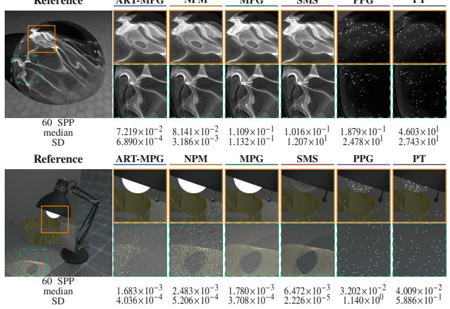  
SMS

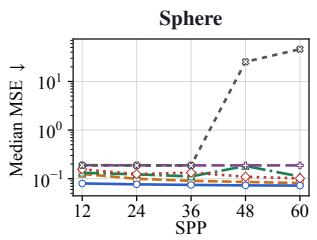

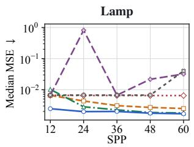  
Figure A1: Median MSE summaries for SPHERE (top) and LAMP (bottom).

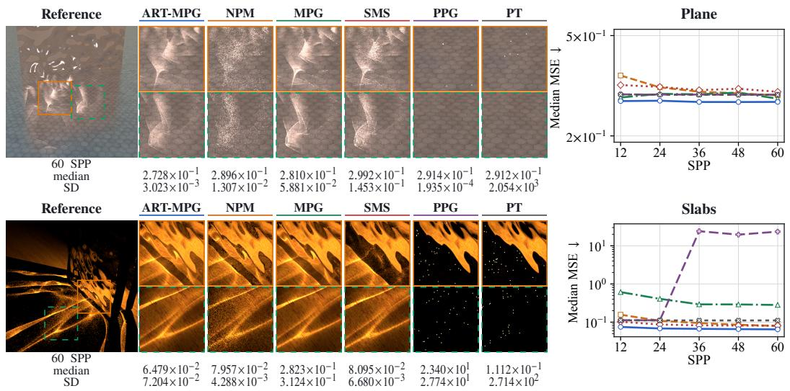

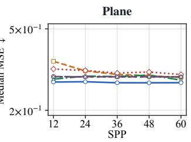

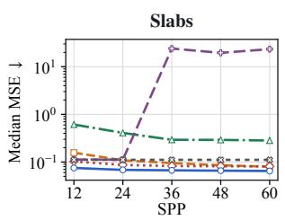  
Figure A2: Median MSE summaries for PLANE (top) and SLABS (bottom).

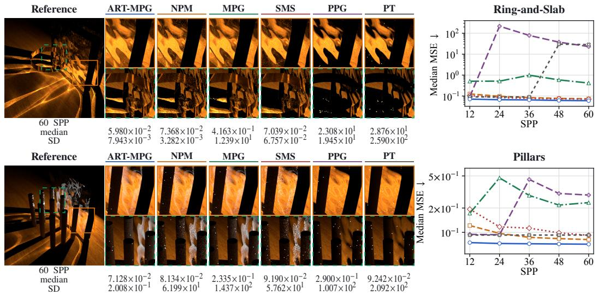

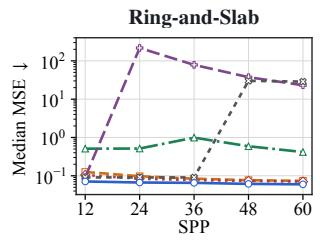

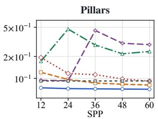  
Figure A3: Median MSE summaries for RING-AND-SLAB (top) and PILLARS (bottom).

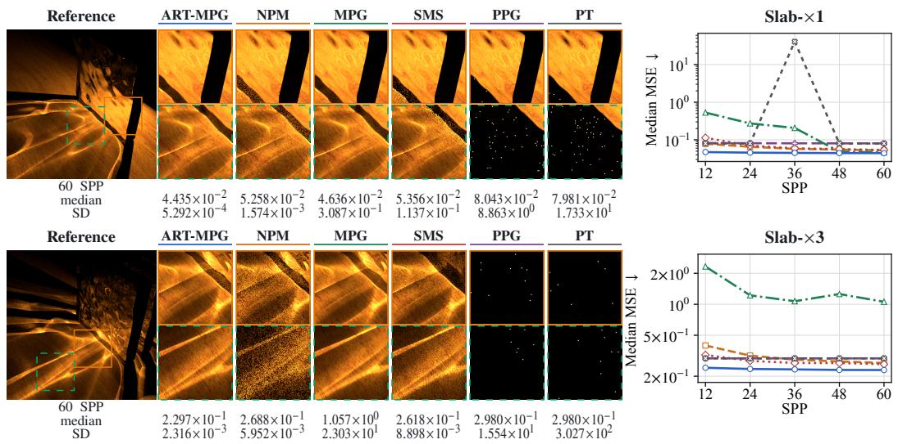

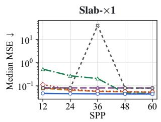

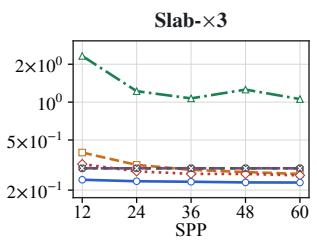  
Figure A4: Median MSE summaries for SLAB-×1 (top) and SLAB-×3 (bottom).

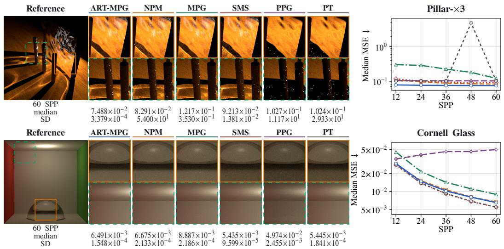

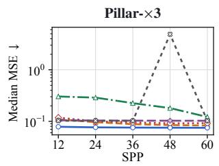

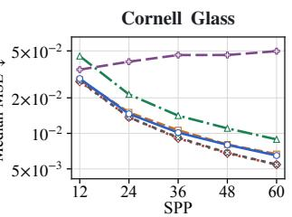  
Figure A5: Median MSE summaries for PILLAR-×3 (top) and CORNELL GLASS (bottom).

## B IMPLEMENTATION DETAILS

The public method name is ART-MPG; immutable manifests retain historical method keys for provenance, but those keys do not denote a different algorithm. All image metrics are computed on raw linear-RGB OpenEXR images rather than display PNGs.

## B.1 FEATURE CONSTRUCTION, OBJECTIVE, AND SOLVER DETAILS

The 22-D feature vector is, in order: receiver position (3), sampled-emitter position (3), their displacement $\delta ( 3 )$ , distance (1), receiver normal $n _ { D } \left( 3 \right)$ , emitter normal $n _ { L } \ ( 3 )$ , emitter direction $d _ { L }$ (3), and $\hat { \delta } ^ { \top } n _ { D } , - \hat { \delta } ^ { \top } n _ { L }$ , and $\hat { \delta } ^ { \top } d _ { L }$ . Raw positions and distance are not normalized. The renderer sets $\hat { \delta } = 0$ at its $1 0 ^ { - 6 }$ zero-distance guard; the loader uses $\delta / \operatorname* { m a x } ( \lVert \delta \rVert , 1 0 ^ { - 6 } )$ . Ten length logits reserve class zero; runtime sampling drops that class and renormalizes lengths 1–9. Each R/T sigmoid probability is clipped only to machine epsilon, consistently in sampling and mass evaluation.

Replay consists of successful solved chains exported by the online MPG-guided manifold integrator and then aggregated and deduplicated. For each record, $\omega _ { b }$ is the normalized direction from the receiver to the first vertex of the converged chain, rather than the proposal direction before projection; this follows MPG’s sample-centred directional construction. Ten scenes reuse hash-verified legacy exports, while four added scenes use fresh five-seed exports; acquisition budgets are therefore scenespecific rather than one uniform fourteen-scene schedule. If $G _ { z } ( \bar { a } )$ denotes the RGB path-contribution field before the receiver bidirectional scattering distribution function $( \mathrm { B S D F } ) , \widehat { r } ^ { - 1 }$ the export-time reciprocal basin estimate, $p _ { \mathrm { o f f } }$ the offset-normal density, and $q _ { N , \mathrm { e x p } }$ the export length probability, the stored scalar is operationally

$$
\begin{array} { r } { e _ { b } = \operatorname* { m e a n } _ { \mathrm { R G B } } \left( G _ { z } ( a ) \widehat { r } ^ { - 1 } / p _ { \mathrm { o f f } } \right) / q _ { N , \mathrm { e x p } } . } \end{array}\tag{5}
$$

Thus $e _ { b }$ is an importance proxy rather than the full image contribution; in particular, it omits the receiver BSDF. The Python loader preserves this field and applies only the following log transform. With $w _ { b } = 1 + \log ( 1 + \operatorname* { m a x } ( e _ { b } , 0 ) )$ , the exact per-record losses are

$$
\ell _ { n } ( b ) = - \log q _ { \theta } ( n _ { b } \mid x _ { b } ) ,\tag{6}
$$

$$
\ell _ { t } ( b , U ) = - n _ { b } \log q _ { \theta } ( t _ { b , U + 1 } \mid t _ { b , 1 : U } , n _ { b } , x _ { b } ) , \quad U \sim \mathrm { U n i f } \{ 0 , \dots , n _ { b } - 1 \} ,\tag{7}
$$

$$
\ell _ { \omega } ( b ) = - \log g _ { \theta } ( \omega _ { b } \mid d _ { b } , x _ { b } ) .\tag{8}
$$

Training minimizes

$$
\mathcal { L } = \frac { \sum _ { b } w _ { b } [ \ell _ { n } ( b ) + \ell _ { t } ( b , U _ { b } ) + \lambda _ { \omega } \ell _ { \omega } ( b ) ] } { \sum _ { b } w _ { b } } .\tag{9}
$$

Because the sampled transition is multiplied by $n _ { b }$ , its expectation is the sum of all next-bit NLL terms in that record.

The manifold solve uses angle-difference constraints, at most 20 damped Newton iterations, and residual threshold $1 0 ^ { - 4 }$ . Failed surface reprojections halve the step. The practical same-chain predicate is intentionally weaker than the theorem’s canonical identity: it requires the primary shape sequence, packed type code, and first solved directions with $| \omega _ { 1 } ^ { \prime \top } \omega _ { 1 } - 1 | < \mathsf { \bar { 1 0 } } ^ { - 4 }$

Algorithm 2 Offline prefix-autoregressive training for ART-MPG   
Require: Fixed replay R, epoch count $E ,$ and direction coefficient $\lambda _ { \omega }$   
1: Split record groups into training/validation; initialize model and AdamW.   
2: S $\mathfrak { s t } w _ { b }  1 + \log ( 1 + \operatorname* { m a x } ( e _ { b } , 0 ) )$   
3: for $e = 1 , \ldots , E$ do   
4: for each minibatch B do   
5: Evaluate length NLL from the all-mask state.   
6: Sample one prefix per record and evaluate the scaled next-bit NLL.   
7: Reveal the completed descriptor and evaluate vMF-mixture NLL.   
8: Form objective 9; clip gradients; update.   
9: end for   
10: Enumerate all validation prefixes; retain minimum validation loss.   
11: end for   
12: return the frozen proposal $q _ { \theta } .$

## B.2 VMF DENSITY AND SAMPLING

For $\kappa > 0$ , the vMF normalizer on $\mathbb { S } ^ { 2 }$ is $\kappa / ( 4 \pi \sinh \kappa )$ , with continuous limit $1 / ( 4 \pi )$ at $\kappa =$ 0 (Mardia & Jupp, 2000). Training evaluates the mixture NLL with log-sum-exp; runtime uses a stable log normalizer and linearly sums the weighted component densities. To sample one component, it draws

$$
w = 1 + \kappa ^ { - 1 } \log \left( u _ { 1 } + ( 1 - u _ { 1 } ) e ^ { - 2 \kappa } \right) , \qquad \varphi = 2 \pi u _ { 2 } ,\tag{10}
$$

constructs $( \sqrt { 1 - w ^ { 2 } } \cos \varphi , \sqrt { 1 - w ^ { 2 } } \sin \varphi , w )$ , and rotates the north pole to $\mu$ (Wood, 1994). Runtime guards the uniform draws away from the inverse-CDF endpoints; for very small κ it samples the sphere uniformly. Training forms each mean as $r _ { \mu } / \operatorname* { m a x } ( \| \dot { r } _ { \mu } \| , 1 0 ^ { - 6 } )$ . Runtime uses the corresponding unit direction when $\| r _ { \mu } \| ^ { 2 } > 1 0 ^ { - 1 2 }$ and otherwise falls back $\tan { + z }$ . Softmax mixture weights and clamped concentrations are shared across training NLL, runtime sampling, and density evaluation; the mean conventions therefore agree outside the stated degenerate region.

## B.3 RECORDED REPRODUCIBILITY ENVIRONMENT

The execution receipts bind the worker Python environment, renderer binaries, and OpenCV 4.11.0 EXR decoder. The reported D01–D10 grid was rendered on one host with 80 one-thread workers. Binary, plugin, protocol, model, reference, and output hashes define the reproducibility boundary. Quantitative metrics use $6 4 \times 6 4$ linear-RGB images.

## B.4 RESULT AND FIGURE PROVENANCE

The result artifact contains the complete $1 4 \times 6 \times 5 \times 1 0 = 4 { , } 2 0 0$ -row matrix for D01–D10. No per-scene substitution, smoothing, interpolation, monotone fitting, exclusion, or replacement is applied. The statistics artifact computes ordinary cellwise medians, arithmetic means, and sample standard deviations with denominator $n - 1$ . Publication curves show the median centerline without a dispersion band; 60-SPP annotations and Table A1 retain the sample SD descriptively. Source manifests and completion receipts bind the run rows, statistics, and publication figures by SHA-256. These summaries describe dispersion across the ten fixed runs and are not uncertainty intervals.

## C THEORY

## C.1 IDEAL CONDITIONAL ESTIMATOR

Assume that $\boldsymbol { \mathcal { A } } ( \boldsymbol { z } )$ is countable, $\textstyle \sum _ { a } \| F _ { z } ( a ) \| < \infty$ , and every contributing chain has $q _ { N } q _ { T } R _ { \theta } > 0$ The complete state z is exogenous to the sampled descriptor and direction and is frozen across a primary draw and all retries; $\bar { \Phi } _ { z }$ is deterministic; and retries are independent with exact canonicalchain identity. This theorem directly covers deterministic offsets. The executed glossy-offset routine instead draws offset normals after a seed-dependent preliminary solve and corrects by their density; a proof for that augmented seed space is not asserted here.

This result is the descriptor-conditioned specialization of the SMS/MPG geometric reciprocal identity (Zeltner et al., 2020; Fan et al., 2023).

Theorem 1 (Descriptor-conditioned SMS/MPG re-hit identity). Draw $D \sim \pi _ { \boldsymbol { \theta } } ( \cdot \ | \ \boldsymbol { \psi } ( z ) )$ and $\Omega _ { 0 } \sim g _ { \theta } ( \cdot \mid D , \psi ( z ) { \bar { ) } }$ , and set $A = \bar { \Phi } _ { z } ( D , \Omega _ { 0 } )$ . On success, keep D, z fixed and redraw directions until $\bar { \Phi } _ { z } ( D , \Omega ^ { \prime } ) = A . ~ I f J _ { d } \in \{ 1 , 2 , . . . \}$ counts trials including the successful re-hit, then the estimator in Equation 3 is unbiasedfor I(z).

Proof. Conditioned on $A = a$ and $D = d ( a )$ , each retry succeeds with probability $R _ { \theta } ( a \mid d ( a ) , z )$ so $\bar { J _ { d } } \sim \mathrm { G e o m } ( R _ { \theta } )$ and $\mathbb { E } [ J _ { d } \mid A = a ] = \mathrm { 1 } / R _ { \theta }$ . Since $Q _ { \theta } ( a \mid z ) = q _ { N } q _ { T } R _ { \theta } ,$

$$
\begin{array} { r l } & { \mathbb { E } [ \widehat { I } _ { \mathrm { A R T - M P G } } \mid z ] = \displaystyle \sum _ { d } \pi _ { \theta } ( d \mid \psi ( z ) ) \sum _ { a : d ( a ) = d } R _ { \theta } ( a \mid d , z ) \frac { F _ { z } ( a ) } { \pi _ { \theta } ( d \mid \psi ( z ) ) } \frac { 1 } { R _ { \theta } ( a \mid d , z ) } } \\ & { \quad \quad \quad \quad = \displaystyle \sum _ { a \in A ( z ) } F _ { z } ( a ) = I ( z ) . } \end{array}
$$

Absolute summability justifies exchanging the sums and expectation.

Proposition 1 isolates our added length-plus-type stratification relative to MPG’s length-only form;   
repeated-trial unbiasedness itself is inherited rather than claimed as new.

Algorithm 3 Ideal uncapped conditional estimator   
Require: Frozen state z, features $x = \psi ( z )$ , normalized proposal $q _ { \theta } ( d , \omega \mid x )$ , filtered map $\bar { \Phi } _ { z }$ , and   
exact identity.   
1: Draw $D \sim \pi _ { \theta } ( \cdot \mid x )$ and $\Omega _ { 0 } \sim g _ { \theta } ( \cdot \mid D , x )$   
2: Set $A  \bar { \Phi } _ { z } ( \dot { D } , \dot { \Omega } _ { 0 } ) ;$ if $A = \emptyset$ , return 0.   
3: Set $J _ { d } \gets 0 .$   
4: repeat   
5: $J _ { d } \gets J _ { d } + 1 ;$ independently draw $\Omega ^ { \prime } \sim g _ { \theta } ( \cdot \mid D , x )$   
6: Set $A ^ { \prime }  \bar { \Phi } _ { z } ( D , \bar { \Omega ^ { \prime } } )$   
7: until $A ^ { \prime }$ has the exact canonical identity of A   
8: return $F _ { z } ( A ) J _ { d } / \pi _ { \theta } ( D \mid x )$

## C.2 FINITE-WORK ESTIMATOR BOUNDARY

Algorithm 1 gives the implementation-matched sampling procedure, including the offset-density and contribution guards. The experiment profile fixes $\begin{array} { r } { \dot { M } = \dot { 2 } 0 4 8 , C _ { w } = 5 1 2 . } \end{array}$ and $C _ { f } = 3 2$

Conditional on a successful primary solve and fixed practical target, let $R _ { \mathrm { i m p l } }$ be the probability that one independent retry satisfies the implementation predicate. Then $J _ { \mathrm { i m p l } } \stackrel { \cdot } { \sim } \mathrm { G e o m } ( R _ { \mathrm { i m p l } } )$ and $\widetilde { J } _ { M } = J _ { \mathrm { i m p l } } \mathbf { 1 } \{ J _ { \mathrm { i m p l } } \leq M \}$ obeys

$$
\mathbb { E } [ \tilde { J } _ { M } \mid A = a ] = \frac { 1 - ( M + 1 ) ( 1 - R _ { \mathrm { i m p l } } ) ^ { M } + M ( 1 - R _ { \mathrm { i m p l } } ) ^ { M + 1 } } { R _ { \mathrm { i m p l } } } .
$$

Retry truncation alone therefore retains the fraction $1 - ( 1 - R _ { \mathrm { i m p l } } ) ^ { M } ( 1 + M R _ { \mathrm { i m p l } } )$ relative to the practical equivalence class. This is distinct from the exact-identity theorem. The clamps and $q _ { N }$ floor have distribution-dependent effects and are fixed parts of the evaluated profile; they are not assumptions of Theorem 1.

## D EXTENSIONS AND FUTURE WORK

Iterative guide refinement. ART-MPG learns from a fixed offline replay dataset. An extension is to alternate sampling with the current guide and teacher-guided proposal updates, drawing inspiration from recursive on-policy distillation (Yin et al., 2026). This would require a transport-specific teacher and an objective that accounts for the changing sampling distribution. The proposal would remain fixed during each primary draw and its re-hit trials.

Adaptive selection of training scenes. Training across scenes raises the question of how to allocate data collection toward configurations where the guide performs poorly. One possible formulation is a zero-sum interaction between a proposal learner and a scene selector, with opposing objectives based on rendering error under a fixed computational budget. If this interaction admits an episodic Markov-game formulation, Bayesian learning methods such as those of Yueh et al. (2026) could provide a starting point for studying exploration under uncertainty.

Decentralized allocation of sampling effort. A further extension is to assign separate proposal agents to different transport strata and let them allocate effort under shared computational constraints. If their utilities depend on one another’s allocations, this yields a strategic resource-allocation problem. Generalized quantal response equilibria and their decentralized learning algorithms (Zhao et al., 2025) offer a possible framework for regularized allocation decisions. Establishing suitable utilities and relating equilibrium allocations to rendering variance and runtime remain open questions