# Asymmetry Tunneling Beyond Adaptive Equivariance Relaxation

Eunho Jeong 1 Joon Jang 1 Hyeonjin Kim 1

## Abstract

Equivariant neural networks encode prescribed symmetries as powerful inductive biases, yet realworld data may exhibit symmetry-breaking structure that these priors cannot fully capture. Prior work has largely addressed this challenge through model-side equivariance relaxation, seeking an appropriate level of equivariance for the data. This raises a complementary question: must equivariance relaxation be adaptively controlled? To investigate this question, we introduce a residual path alongside a strictly equivariant model and deliberately restrict their interface to examine the transmission of task-relevant structure. Across five benchmarks, we observe both residual collapse and survival despite these restrictions; we call the latter phenomenon asymmetry tunneling. We further characterize this phenomenon through four complementary diagnostics. Our results suggest that adaptive control of equivariance relaxation is not a prerequisite for capturing potential symmetry-breaking structure.

## 1. Introduction

Equivariant neural networks (Cohen & Welling, 2016; Ravanbakhsh et al., 2017; Kondor & Trivedi, 2018), which encode prescribed symmetries to improve sample efficiency and generalization (Chen et al., 2020; Bietti & Mairal, 2019), have been widely applied in computer vision (Cohen & Welling, 2017), graph learning (Gilmer et al., 2017), and 3D modeling (Schutt et al.¨ , 2017). However, real-world data can contain structure that is not fully captured by a strictly equivariant prior (Smidt et al., 2021; Wang et al., 2022; 2023), due to noise, measurement bias, chirality, local interactions, or other symmetry-breaking effects. To address imperfect symmetries in real-world data, prior work has explored soft equivariance priors, relaxed equivariant architectures, theoretical analyses of approximation–generalization trade-offs, and data-driven adaptation (Finzi et al., 2021; Wang et al., 2022; Petrache & Trivedi, 2023; Manolache et al., 2025). These works examine model-side equivariance relaxation, reflecting the view that model equivariance should be adapted to an appropriate level for the data.

This pursuit of an appropriate level of equivariance raises a complementary diagnostic question: must equivariance relaxation be adaptively controlled to capture symmetrybreaking structure? To investigate this question, we use a strictly equivariant model as a reference anchor and introduce an expressive residual path through a deliberately restricted interface. We then test whether this restricted residual path can transmit task-relevant contributions. The residual path is designed with ample expressive capacity to represent potential symmetry-breaking structure, while the restricted interface uses stop-gradient, scalar gating, and a single additive fusion to limit residual–anchor interaction and transmission. Empirically, the restricted residual exhibits two regimes: collapse and survival. We call residual survival despite these restrictions asymmetry tunneling. To characterize this phenomenon, we employ four complementary empirical diagnostics: residual survival, measured relative to the anchor; anchor-relative geometry, by comparing the residual with local variation in anchor representations; physical localization, by tracing its concentration in physical structure; and task relevance, through held-out performance. Our contributions are as follows:

1. We identify asymmetry tunneling as residual survival despite a restricted interface with a strictly equivariant anchor, implemented through stop-gradient, scalar gating, and a single additive fusion. Across tasks, we observe both residual survival and collapse.

2. We characterize these patterns through complementary empirical diagnostics of residual survival, anchorrelative geometry, physical localization, and task relevance to probe potential symmetry-breaking structure.

## 2. Related Work

Equivariant neural networks encode prescribed group symmetries directly into model architectures (Cohen & Welling, 2016; Ravanbakhsh et al., 2017; Cohen & Welling, 2017; Kondor & Trivedi, 2018) and can improve generalization and sample efficiency when the imposed symmetry matches the task (Chen et al., 2020; Bietti & Mairal, 2019; Sannai et al., 2021). Representative geometric architectures include EGNN (Satorras et al., 2021), SEGNN (Brandstetter et al., 2021), and Vector Neurons (Deng et al., 2021). Applications span 3D point-cloud models such as VN-DGCNN and TetraSphere (Wang et al., 2019; Deng et al., 2021; Melnyk et al., 2024), equivariant trajectory models such as EGNO and EqMotion (Xu et al., 2024; 2023), and GVP-based models for molecular structure (Jing et al., 2020; 2021). Real-world data, however, can contain structure that is not fully captured by a prescribed equivariant prior, including contact-dependent motion, cluttered or partially occluded point clouds, and molecular chirality (Mao et al., 2022; Uy et al., 2019; Dumitrescu et al., 2024).

Prior work has examined how model-side equivariance can be relaxed to better reflect the symmetry structure of the data, alongside theoretical analyses of model–data symmetry alignment. Residual Pathway Priors soften hard equivariance constraints into priors biased toward equivariant solutions (Finzi et al., 2021); approximately equivariant networks relax weight sharing or tying (Wang et al., 2022); theoretical work studies the relation between model and data equivariance error (Petrache & Trivedi, 2023); and ACE controls deviations from equivariance through data-driven constrained training (Manolache et al., 2025). A related line of work seeks to discover symmetry structure from data and incorporate it into the model through latent groups, equivariance-inducing parameterizations, symmetry-breaking inputs, Lie generators, generative transformations, or relaxed weights (Zhou et al., 2020; Smidt et al., 2021; Dehmamy et al., 2021; Desai et al., 2022; Yang et al., 2023; Wang et al., 2023).

Our work takes a complementary diagnostic perspective. Rather than adaptively controlling equivariance relaxation, we use a deliberately restricted interface with a strictly equivariant anchor to examine residual survival and collapse. We further examine surviving residuals as diagnostic signals of potential symmetry-breaking structure.

## 3. Residual Architecture

To diagnose residual transmission beyond a strictly equivariant anchor, we restrict residual–anchor interaction while keeping the transmitted contribution measurable and physically traceable. Figure 1 illustrates this restricted residual interface.

Notation and architecture. Let $x \in \mathcal { X }$ , let G denote the symmetry group acting on X, and let θ denote the anchor parameters. We denote the anchor representation at layer ℓ by $h _ { \ell } ( x ) = ( h _ { \ell , 1 } ( x ) , \ldots , h _ { \ell , P } ( x ) ) \in \mathcal { Z } ,$ where $\mathcal { Z } : = \dot { \mathbb { R } } ^ { P C }$ is the vectorized representation space. Here $P$ is the number of latent elements, referred to as tokens, C is the feature dimension of each token, and $\ell = 0 , \ldots , L$ indexes anchor layers. Each $h _ { \ell , p } ( x ) \in \mathbb { R } ^ { C }$ , where $p = 1 , \ldots , P _ { }$ . We denote the full latent history by $H _ { \boldsymbol \theta } ( x ) = \{ h _ { \boldsymbol \ell , p } ( x ) \} _ { \boldsymbol \ell , p }$ and define the final anchor representation as $m _ { \theta } ( x ) : = h _ { L } ( x )$ which satisfies

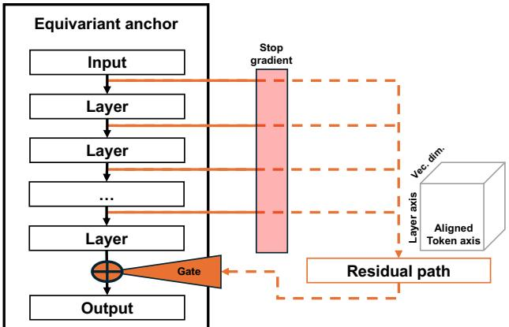  
Figure 1. Overview of the restricted residual architecture. The residual path reads detached anchor-layer representations, and its gated contribution is fused once after the final anchor layer.

$$
m _ { \theta } ( g \cdot x ) = \rho ( g ) m _ { \theta } ( x ) , \qquad g \in G ,\tag{1}
$$

where $\rho ( g )$ denotes the corresponding action on $\mathcal { Z } .$ The residual path $\mathcal { R } _ { \psi } ,$ parameterized by ψ, reads the anchor history through stop-gradient $\operatorname { s g } ( \cdot )$ and produces a tokenaligned residual proposal $s _ { \psi } ( x ) : = \mathcal { R } _ { \psi } ( \mathrm { s g } ( H _ { \theta } ( x ) ) ) \in \mathcal { Z } .$

A non-learnable scalar gate $\lambda _ { t } > 0$ , initialized with $\lambda _ { 0 } > 0 ;$ is updated from the loss trend and held constant within each optimization step. Given the training loss $L _ { t } .$ , we track its exponential moving average $\bar { L } _ { t } = \beta \bar { L } _ { t - 1 } + ( 1 - \beta ) L _ { t }$ . The loss-trend-based gate update can be summarized as

$$
\lambda _ { t } = \lambda _ { t - 1 } \left( 1 - \eta \frac { \bar { L } _ { t - 1 } - \bar { L } _ { t } } { \bar { L } _ { t - 1 } } \right) ,\tag{2}
$$

where $0 \leq \beta < 1$ is the EMA decay and $0 < \eta < 1$ controls the gate response. Thus, a decreasing loss trend progressively suppresses residual transmission. Accordingly, the residual transmitted to the fusion point is the gated proposal, and fusion occurs exactly once:

$$
r ( x ) : = \lambda _ { t } s _ { \psi } ( x ) \in \mathcal { Z } , \quad z ( x ) = m _ { \theta } ( x ) + r ( x ) \in \mathcal { Z } .\tag{3}
$$

Here $s _ { \psi }$ denotes the proposed residual computed from the detached anchor history, while r denotes the transmitted residual; both are represented in the same latent space $\mathcal { Z }$ as the anchor $m _ { \theta }$ and fused state z.

## 3.1. Restricted Residual Interface

The interface restricts residual–anchor interaction and residual transmission along three distinct axes: backward gra-

dient flow, forward interaction, and transmitted residual magnitude.

Backward restriction: stop-gradient under additive fusion. Stop-gradient satisfies

$$
\mathrm { s g } ( u ) = u , \qquad D _ { u } \mathrm { s g } ( u ) = 0 .\tag{4}
$$

For a general fusion $z ( x ) = F ( m _ { \theta } ( x ) , r ( x ) )$ , stop-gradient gives $D _ { \theta } \operatorname { s g } ( H _ { \theta } ( x ) ) = 0$ , and hence $D _ { \theta } r ( x ) = 0$ . The anchor-side derivative therefore reduces to

$$
D _ { \theta } z ( x ) = D _ { m } F D _ { \theta } m _ { \theta } ( x ) .\tag{5}
$$

For the additive fusion in Equation (3), $\begin{array} { r } { D _ { m } F = I , } \end{array}$ , yielding

$$
D _ { \theta } z ( x ) = D _ { \theta } m _ { \theta } ( x ) .\tag{6}
$$

Thus, stop-gradient and additive fusion jointly restrict residual-mediated gradient flow to the anchor while keeping the anchor-side Jacobian equal to $D _ { \theta } m _ { \theta } ( x )$

Forward restrictions: single fusion and scalar transmission. This backward restriction does not constrain forward interaction. To restrict forward interaction, we fuse the resid ual with the anchor only once, after the final anchor layer, preventing repeated interaction across anchor layers. As the smoothed loss decreases, the scalar gate $\lambda _ { t }$ in Equation (2) progressively suppresses residual transmission. Together, these mechanisms impose forward restrictions: single fusion prevents repeated interaction across anchor layers, while scalar gating limits residual transmission magnitude.

## 3.2. Measurable and Traceable Residual Representation

While these restrictions limit residual transmission, we also design the residual representation to make its contribution measurable and physically traceable.

Shared latent space for anchor-relative geometry. The anchor, transmitted residual, and fused representation lie in the same latent space $\mathcal { Z } .$ . We denote the set of representations produced by the anchor as

$$
\mathcal { A } _ { \theta } : = \{ m _ { \theta } ( x ) : x \in \mathcal { X } \} \subset \mathcal { Z } .\tag{7}
$$

Since $r ( x ) = z ( x ) - m _ { \theta } ( x )$ , the transmitted residual defines a displacement from the anchor state $m _ { \theta } ( x )$ within $\mathcal { Z }$ Crucially, since $r ( x )$ need not be a displacement between states in $\scriptstyle A _ { \theta }$ , the fused state $z ( x )$ may lie outside $\scriptstyle A _ { \theta }$ . To characterize this geometric distinction, let $\widehat { T } _ { m _ { \theta } ( x ) } ( \mathcal { A } _ { \theta } )$ denote a local linear approximation to the anchor variation around $m _ { \theta } ( x )$ , and define the approximate normal space as $\widehat { N } _ { m _ { \theta } ( x ) } ( \mathcal { A } _ { \theta } ) : = ( \widehat { T } _ { m _ { \theta } ( x ) } ( \mathcal { A } _ { \theta } ) ) ^ { \perp }$ . The transmitted residual admits the orthogonal decomposition

$$
\begin{array} { c } { r ( x ) = r ^ { \parallel } ( x ) + r ^ { \perp } ( x ) , } \\ { r ^ { \parallel } ( x ) \in \widehat { T } _ { m _ { \theta } ( x ) } ( A _ { \theta } ) , \quad r ^ { \perp } ( x ) \in \widehat { N } _ { m _ { \theta } ( x ) } ( A _ { \theta } ) . } \end{array}\tag{8}
$$

The transverse component $r ^ { \perp } ( x )$ captures residual variation orthogonal to the approximated local anchor tangent space. This allows us to assess whether residual survival is accompanied by geometrically distinct contributions in the latent representation space, beyond local anchor variation.

Layer-history aggregation with token-aligned assignment. Single fusion leaves two requirements for the residual. It should access information from intermediate anchor layers rather than relying only on $h _ { L }$ , while preserving token-aligned residual assignments for physical tracing despite aggregating information across layers and tokens. To satisfy these requirements, we use Transformer-style crossattention in which the detached final anchor states $h _ { L , p }$ serve as queries and the memory is constructed from the detached layer–token history. Each final-layer query $h _ { L , p }$ aggregates information across the full memory into a single residual contribution $s _ { \psi , p }$ while retaining token index $p \mathrm { : }$

$$
s _ { \psi , p } ( \boldsymbol { x } ) = R _ { \psi , p } ( \mathrm { s g } ( H _ { \theta } ( \boldsymbol { x } ) ) ) , \qquad p = 1 , \ldots , P .
$$

Thus, the memory may integrate information across layers and tokens, while $s _ { \psi , p }$ remains assigned to query token $p .$ When token index $p$ corresponds to a physical element, the token-aligned proposal $s _ { \psi , p }$ preserves this correspondence in the transmitted residual $r _ { p } .$ This allows us to assess whether residual survival is accompanied by localization to specific physical elements.

## 4. Empirical Residual Diagnostics

Building on the measurable and physically traceable residual representation in Section 3.2, for each evaluation sample $x _ { i } \in \mathcal D$ , we define $m _ { i } : = m _ { \theta } ( x _ { i } )$ and $r _ { i } : = r ( x _ { i } )$ as the anchor and transmitted residual representations. We evaluate four empirical diagnostics: survival, anchor-relative geometry, physical localization, and task relevance.

Residual survival. We measure whether the residual entering fusion remains non-negligible relative to the anchor:

$$
\kappa _ { r } = \frac { \mathrm { R M S } _ { i \in \mathcal { D } } ( r _ { i } ) } { \mathrm { R M S } _ { i \in \mathcal { D } } ( m _ { i } ) } .\tag{9}
$$

Here RMS denotes the root-mean-square over the evaluation set. We use empirical thresholds of $\kappa _ { r } < 0 . 0 5$ for collapse, $0 . 0 5 \le \kappa _ { r } < 0 . 1$ for weak survival, and $\kappa _ { r } \geq 0 . 1$ for survival. In surviving cases, the residual proposal $s _ { \psi }$ increases in magnitude as the scalar gate $\lambda _ { t }$ decreases, compensating for the attenuation and sustaining residual transmission.

## 4.1. Anchor-Relative Local Geometry

We measure whether surviving residuals contribute to the fused representation in geometric directions beyond the anchor’s local variation, building on the approximate tangent– normal decomposition in Section 3.2. Using an independent anchor reference bank, let $\{ m _ { j _ { 1 } } , . . . , m _ { j _ { K } } \}$ be the Euclidean K-nearest neighbors of $m _ { i }$ . We apply singular value decomposition (SVD) to their local differences:

$$
\left[ \begin{array} { l } { ( m _ { j _ { 1 } } - m _ { i } ) ^ { \top } } \\ { \vdots } \\ { ( m _ { j _ { K } } - m _ { i } ) ^ { \top } } \end{array} \right] = U _ { i } \Sigma _ { i } V _ { i } ^ { \top } , P _ { i } = V _ { i , 1 : d _ { i } } V _ { i , 1 : d _ { i } } ^ { \top } ,\tag{10}
$$

where $d _ { i }$ is selected using a prespecified singular-energy threshold δ. The projector $P _ { i }$ provides a Local-SVD approximation to the tangent–normal decomposition in Equation (8):

$$
\mathrm { I m } ( P _ { i } ) \approx \widehat { T } _ { m _ { i } } ( A _ { \theta } ) , \quad \mathrm { I m } ( I - P _ { i } ) \approx \widehat { N } _ { m _ { i } } ( A _ { \theta } ) .\tag{11}
$$

Accordingly, $( I - P _ { i } ) r _ { i }$ estimates the transverse component of the transmitted residual in this space. We measure its energy fraction by

$$
\rho _ { \mathrm { r e s } , i } ^ { \perp } = \frac { \| ( I - P _ { i } ) r _ { i } \| _ { 2 } ^ { 2 } } { \| r _ { i } \| _ { 2 } ^ { 2 } } .\tag{12}
$$

To calibrate this transverse energy fraction against local anchor variation, we reserve the next H nearest anchor representations as held-out controls. For the next H nearest anchor representations, define $a _ { i h } : = m _ { j _ { K + h } } - m _ { i } , h =$ $1 , \ldots , H$ . The excess transverse energy is then

$$
\Delta \rho _ { i } ^ { \perp } = \rho _ { \mathrm { r e s } , i } ^ { \perp } - \frac { 1 } { H } \sum _ { h = 1 } ^ { H } \frac { \| ( I - P _ { i } ) a _ { i h } \| _ { 2 } ^ { 2 } } { \| a _ { i h } \| _ { 2 } ^ { 2 } } .\tag{13}
$$

A larger $\Delta \rho _ { i } ^ { \perp }$ indicates greater geometric transversality of the transmitted residual relative to held-out anchor variation in the latent representation space. For readability, reported $\Delta \rho ^ { \perp }$ values are multiplied by 100 and shown as percentagepoint differences.

## 4.2. Physical Localization and Task Relevance

We evaluate whether surviving residuals localize to taskrelevant physical structure, building on the token-aligned residual representation in Section 3.2. We distinguish two tracing approaches: direct element-wise tracing with preserved token correspondence and attribution-based tracing after global aggregation.

Attribution-based tracing. When global aggregation in the task-specific readout, such as pooling, removes explicit token–physical-element correspondence, residual influence cannot be localized directly to physical elements. We therefore localize residual influence to physical elements using Grad-CAM (Selvaraju et al., 2017). For each evaluation sample $x _ { i } \in \mathcal { D }$ , let $\mathcal { T } _ { i }$ denote the selected high-attribution elements, $B _ { i }$ a predefined subset of input physical elements, and $N _ { i }$ the total number of physical elements. We quantify localization by the lift

$$
\mathrm { L i f t } _ { i } ( \boldsymbol { \mathcal { B } } _ { i } ) = \frac { | \mathcal { T } _ { i } \cap B _ { i } | / | \mathcal { T } _ { i } | } { | B _ { i } | / N _ { i } } .\tag{14}
$$

The lift is the ratio of the observed overlap between Grad-CAM high-attribution elements and the predefined physical structure to the overlap expected under uniform selection. A larger $\operatorname { L i f t } _ { i } ( \boldsymbol { B } _ { i } )$ indicates stronger localization to the predefined physical structure, with Lift = 1 corresponding to chance-level localization.

Direct element-wise tracing. When token–physicalelement correspondence is preserved, the transmitted residual can be localized directly to physical elements by elementwise tracing. Let ${ r } _ { i , p }$ denote the slice of $r _ { i }$ corresponding to physical element p. To isolate variation across physical elements, we center each slice by the sample-wise mean $\begin{array} { r } { \bar { r } _ { i } : = P ^ { - 1 } \sum _ { p = 1 } ^ { P } r _ { i , p } . } \end{array}$ . We then measure direct elementwise localization by

$$
L _ { p } = \frac { 1 } { | \mathcal { D } | } \sum _ { i \in \mathcal { D } } \frac { \| r _ { i , p } - \bar { r } _ { i } \| _ { 2 } ^ { 2 } } { \| r _ { i , p } \| _ { 2 } ^ { 2 } } .\tag{15}
$$

Larger $L _ { p }$ indicates stronger localization across physical elements.

Task relevance. We assess task relevance by comparing held-out performance between the restricted-residual model and an independently trained strictly equivariant baseline without the residual path. Improved held-out performance supports the residual’s task relevance.

## 4.3. Diagnostic Summary

The four empirical axes introduced above are measured by complementary observables. Residual survival is measured by $\kappa _ { r } .$ , anchor-relative geometry by the excess transverse energy $\Delta \rho ^ { \perp }$ , physical localization by Lift when token– physical-element correspondence is removed or $L _ { p }$ when it is preserved, and task relevance by held-out performance improvement. Together, these diagnostics distinguish whether the transmitted residual survives, differs geometrically from local anchor variation, localizes to physical structure, and contributes to held-out prediction.

## 5. Experiments

We focus on real-world datasets that may naturally exhibit symmetry-breaking structure. In contrast, we include Charged N-body as a synthetic control where the prescribed symmetry is expected to hold. Our real-world experiments cover ETH/UCY pedestrian forecasting, CMU human motion forecasting, ScanObjectNN point-cloud classification, and PDBbind molecular affinity prediction. Task-specific residual token correspondence for these benchmarks is detailed in Appendix A. We analyze residual behavior using the diagnostics in Section 4, following standard dataset splits and baseline task protocols.

Table 1. Residual survival and task performance on Charged Nbody and ETH/UCY. Charged N-body uses SEGNN (Brandstetter et al., 2021) as the equivariant anchor and reports mean squared error (MSE). ETH/UCY uses EqMotion (Xu et al., 2023) and reports average/final displacement error (ADE/FDE; lower is better). $\kappa _ { r }$ measures residual survival as defined in Equation (9).
<table><tr><td>Setting</td><td>Anchor</td><td>+ ours</td><td> $\kappa _ { r }$ </td></tr><tr><td>N-body</td><td>0.00625</td><td>0.00626</td><td>0.0080</td></tr><tr><td>ETH</td><td>0.40/0.61</td><td>0.40/0.58</td><td>0.0970</td></tr><tr><td>Hotel</td><td>0.12/0.18</td><td>0.16/0.23</td><td>0.0697</td></tr><tr><td>Univ</td><td>0.23/0.43</td><td>0.24/0.43</td><td>0.0644</td></tr><tr><td>Zara1</td><td>0.18/0.32</td><td>0.20/0.34</td><td> $7 . 9 \times 1 0 ^ { - 5 }$ </td></tr><tr><td>Zara2</td><td>0.13/0.23</td><td>0.12/0.21</td><td>0.0966</td></tr></table>

## 5.1. Charged N-body

We evaluate the Charged N-body system (Kipf et al., 2018) with SEGNN (Brandstetter et al., 2021) as a synthetic control. Because the prescribed symmetry is expected to hold in the synthetic N-body setting (Pertigkiozoglou et al., 2024; Manolache et al., 2025), the restricted residual is expected to collapse. In Table 1, we observe the expected residual collapse $( \kappa _ { r } = 0 . 0 0 8 0 )$ with no improvement in predictive performance. This residual collapse is consistent with the symmetry-matched nature of N-body.

## 5.2. ETH/UCY

We evaluate ETH/UCY pedestrian trajectory prediction (Lerner et al., 2007; Pellegrini et al., 2009) using EqMotion (Xu et al., 2023) as the anchor under the standard setting (Alahi et al., 2016; Gupta et al., 2018; Yuan et al., 2021). As shown in Table 1, residual behavior varies across ETH/UCY subsets under the same EqMotion-based architecture and restricted residual interface. ETH, Hotel, Univ, and Zara2 exhibit weak survival $( \kappa _ { r } = 0 . 0 6 4 – 0 . 0 9 7 )$ , whereas Zara1 exhibits collapse $( \kappa _ { r } = 7 . 9 \times 1 0 ^ { - 5 } )$ , with both improvements and degradations in average/final displacement error (ADE/FDE) across subsets. Overall, ETH/UCY exhibits a weak-survival regime with subset-dependent collapse and inconsistent changes in predictive performance.

## 5.3. CMU Motion

We evaluate the CMU motion “Run” and “Walk” datasets (CMU, 2003), using EGNO with the same settings (Xu et al., 2024) as the anchor. CMU exhibits asymmetry tunneling, which we characterize through the four diagnostics

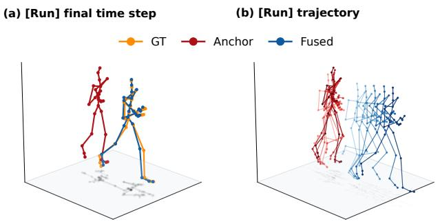  
Figure 2. CMU Run example. (a) The anchor predicts narrower leg separation than the ground truth. (b) The anchor shows little forward progression, whereas the fused prediction recovers the running trajectory.

Table 2. CMU motion results. Baseline results follow TFN (Thomas et al., 2018), SE(3)-Transformer (Fuchs et al., 2020), EGNN (Satorras et al., 2021), EGNO (Xu et al., 2024), and EGNO+ACE (Manolache et al., 2025); EGNO is the equivariant anchor. MSE is reported in units of $1 0 ^ { - 2 }$ . Local-SVD uses the globally centered trajectory representation with $K = 3 2 , \delta = . 9 5 .$ and $H = 3 2$
<table><tr><td>Method / Metric</td><td>Sub #35 (Walk)</td><td>Sub #9 (Run)</td></tr><tr><td>TFN</td><td> $3 2 . 0 \pm 1 . 8$ </td><td> $5 6 . 6 \pm 1 . 7$ </td></tr><tr><td>SE(3)-Tr.</td><td> $3 1 . 5 \pm 2 . 1$ </td><td> $6 1 . 2 \pm 2 . 3$ </td></tr><tr><td>EGNN</td><td> $2 8 . 7 \pm 1 . 6$ </td><td> $5 0 . 9 \pm 0 . 9$ </td></tr><tr><td>EGNO</td><td> $8 . 1 \pm 1 . 6$ </td><td> $3 3 . 9 \pm 1 . 7$ </td></tr><tr><td> $\mathrm { E G N O } + \mathrm { A C E }$ </td><td> $7 . 4 \pm 0 . 2$ </td><td> $2 3 . 8 \pm 1 . 5$ </td></tr><tr><td> $\mathrm { E G N O } + \mathrm { o u r s }$ </td><td> ${ \bf 6 . 9 7 \pm 0 . 9 0 }$ </td><td> $2 2 . 8 3 \pm 2 . 0 4$ </td></tr><tr><td> $\kappa _ { r }$ </td><td>0.124</td><td>0.348</td></tr><tr><td> $\Delta \rho ^ { \perp }$  (%) ↑</td><td>60.6</td><td>81.7</td></tr></table>

in Section 4.3.

Residual survival, anchor-relative geometry, and task relevance. As shown in Table 2, both Walk and Run exhibit residual survival $( \kappa _ { r } : 0 . 1 2 4 / 0 . 3 4 8 )$ , high excess transverse energy $( \Delta \rho ^ { \perp } : 6 0 . 6 / 8 1 . 7 \% )$ , and improved held-out MSE, respectively. Without adaptive control of equivariance relaxation, our model achieves performance comparable to EGNO+ACE (Manolache et al., 2025), an adaptive equivariance-relaxation approach. CMU exhibits a surviving residual that is strongly transverse to local anchor variation and improves predictive performance.

Direct physical tracing. Figure 2 shows that the anchor predicts a largely in-place running motion, resembling motion without effective ground propulsion, whereas the fused prediction recovers forward progression. Thus, a prominent component of the surviving residual compensates for forward translational motion that is underrepresented by the equivariant anchor. To examine the joint-specific structure accompanying this translational compensation, we apply the direct element-wise diagnostic $L _ { p }$ in Section 4.2, as joint-wise correspondence is preserved at the readout. The numerator of $L _ { p }$ subtracts the mean residual across joints, isolating joint-specific deviations from any shared translational component. Figure 3(a,b) shows that the resulting $L _ { p }$ localization is concentrated on the bilateral tibia, foot, and toe joints. This lower-leg emphasis appears in both motions, but is sharper in Run than in Walk.

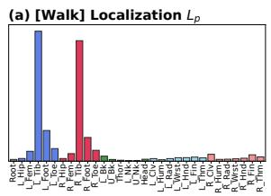

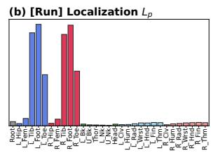

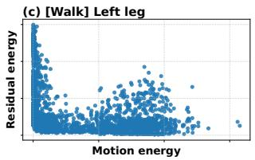

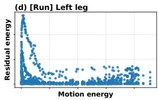

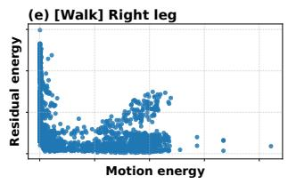

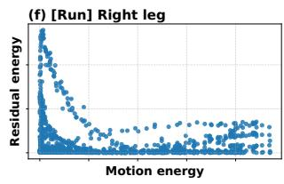

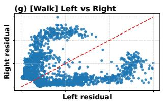

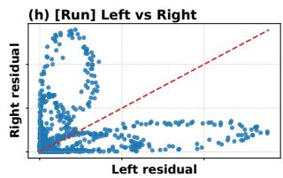  
Figure 3. CMU physical tracing. (a,b) Joint-wise localization $L _ { p } .$ (c–f) Motion-conditioned residual patterns. (g,h) Left–right residual-energy relations.

However, $L _ { p }$ aggregates over prediction time steps, obscuring the temporal relationship between the localized residual and lower-leg motion. We therefore quantify lower-leg motion and joint-specific residual variation at each prediction time step using motion and residual energies, respectively. We denote by $\bar { v } _ { i , t , p } ^ { \mathrm { G T } } \in \mathbb { R } ^ { 3 }$ the ground-truth velocity of joint $p ,$ and by $r _ { i , t , p } \in \mathbb { R } ^ { 3 }$ its residual vector, for sample i at prediction time step t. Let $S _ { L }$ and $S _ { R }$ denote the tibia, foot, and toe joints of the left and right lower legs, respectively. For each side $b \in \{ L , R \}$ , we define

$$
E _ { i , t , b } ^ { \mathrm { m o t } } = \sum _ { p \in S _ { b } } \Vert v _ { i , t , p } ^ { \mathrm { G T } } \Vert _ { 2 } ^ { 2 } , \quad E _ { i , t , b } ^ { \mathrm { r e s } } = \sum _ { p \in S _ { b } } \Vert r _ { i , t , p } - \bar { r } _ { i , t } \Vert _ { 2 } ^ { 2 } ,
$$

where $P$ is the total number of body joints and $\begin{array} { r l } { \bar { r } _ { i , t } } & { { } = } \end{array}$

$\begin{array} { r } { P ^ { - 1 } \sum _ { p = 1 } ^ { P } r _ { i , t , p } } \end{array}$ is the mean residual across joints.

In Run, residual energy is largest when lower-leg motion is small in Figure 3(d,f), and the left- and right-leg residual energies exhibit alternating dominance in Figure 3(h). These patterns suggest stronger residual contributions around ground-contact phases, consistent with alternating ground support during running. Because ground contact depends on the fixed ground as an external reference beyond the body configuration, we interpret this pattern as consistent with symmetry-breaking structure relative to the prescribed E(3) prior. This interpretation is qualitatively consistent with prior contact-aware human-motion forecasting (Mao et al., 2022). In Walk, this motion–residual pattern is weaker in Figure 3(c,e,g). Taken together, the recovery of forward progression, residual localization to lower-leg joints near the ground, and motion-dependent patterns consistent with ground-contact phases suggest that task-relevant, groundassociated symmetry-breaking structure can survive through the restricted residual path.

## 5.4. ScanObjectNN

We evaluate ScanObjectNN (Uy et al., 2019), a real-world point cloud object classification benchmark, using the challenging PB T50 RS setting and VN-DGCNN (Wang et al., 2019; Deng et al., 2021) as the anchor under the same setting as (Melnyk et al., 2024). We compare two matched rotation conditions: $Z / Z$ applies random z-axis rotations during both training and testing, preserving the gravity-aligned vertical axis, whereas $\mathrm { S O ( 3 ) } / \mathrm { S O ( 3 ) }$ applies random 3D rotations during both, largely removing this gravity-related orientation structure. This comparison tests whether the surviving residual structure depends on the availability of gravity-aligned orientation structure. ScanObjectNN exhibits asymmetry tunneling, which we characterize through the four diagnostics in Section 4.3.

Residual survival, anchor-relative geometry, and task relevance. As shown in Table 3, both $Z / Z$ and $\mathrm { S O ( 3 ) } / \mathrm { S O ( 3 ) }$ exhibit residual survival $( \kappa _ { r } : 0 . 4 6 4 / 0 . 1 7 7 )$ high excess transverse energy $( \Delta \rho ^ { \perp } : 8 4 . 0 / 8 2 . 6 \% )$ , and improved held-out accuracy, respectively. ScanObjectNN exhibits a surviving residual that is strongly transverse to local anchor variation and improves classification accuracy under both rotation conditions.

Attribution-based physical tracing. Because global pooling in point-cloud classification removes explicit point-level correspondence at the readout, we apply the Grad-CAM Lift diagnostic in Section 4.2 to quantify the localization of anchor and residual attributions to object and background points using the dataset’s object/background labels. As shown in Table 3, the anchor remains background-biased relative to the chance-level Lift of 1 under both rotation conditions. In contrast, the residual reverses its localization: Object/Background Lift changes from 1.10/0.95 under $Z / Z$ to 0.94/1.14 under $\mathrm { S O ( 3 ) } / \mathrm { S O ( 3 ) }$ . Figure 4 qualitatively illustrates this shift from object-side localization under $Z / Z$ to background-side localization under SO(3)/SO(3).

Object Background Object of Top 5% Grad-CAM Background of Top 5% Grad-CAM  
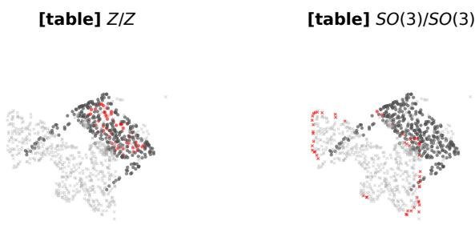  
Figure 4. Residual Grad-CAM visualization on ScanObjectNN under Z/Z (left) and SO(3)/SO(3) (right). The label [table] denotes the object category. Red highlights the top 5% attributed points; circles and crosses denote object and background points.

Table 3. ScanObjectNN results. Accuracy baselines follow Li et al. (2021), Yu et al. (2023), VN-DGCNN (Wang et al., 2019; Deng et al., 2021), and TetraSphere (Melnyk et al., 2024); VN-DGCNN is the equivariant anchor. Local-SVD uses $K = 1 2 8 , \delta = . 9 5$ , and H = 32. Lift uses the top-5% Grad-CAM support and is reported as Object/Background (Obj/Back), with 1 denoting chance.
<table><tr><td>Method / Metric</td><td>Z/Z</td><td>SO(3)/SO(3)</td></tr><tr><td>Accuracy (%)</td><td></td><td></td></tr><tr><td>Li et al.</td><td>74.6</td><td>74.9</td></tr><tr><td>Yu et al.</td><td>77.2</td><td>77.4</td></tr><tr><td>VN-DGCNN</td><td>77.9</td><td>78.5</td></tr><tr><td>TetraSphere  $( K = 4 )$ </td><td>79.2</td><td>79.0</td></tr><tr><td>VN-DGCNN + ours</td><td>80.7</td><td>79.5</td></tr><tr><td>Residual diagnostics</td><td></td><td></td></tr><tr><td> $\kappa _ { r }$ </td><td>0.464</td><td>0.177</td></tr><tr><td> $\Delta \rho ^ { \perp } \left( \% \right) \uparrow$ </td><td>84.0</td><td>82.6</td></tr><tr><td>Anchor Lift (Obj/Back)</td><td>0.99 / 1.17</td><td>0.91 / 1.30</td></tr><tr><td>Residual Lift (Obj/Back)</td><td>1.10 / 0.95</td><td>0.94 / 1.14</td></tr></table>

These patterns suggest stronger residual localization to object points under $Z / Z$ , aligning residual attribution with the classification target. Because $Z / Z$ preserves a consistent gravity-aligned orientation reference that can aid object classification, whereas $\mathrm { S O ( 3 ) } / \mathrm { S O ( 3 ) }$ disrupts this reference, we interpret this rotation-dependent localization as consistent with symmetry-breaking structure relative to the prescribed $\mathrm { S O ( 3 ) }$ prior. Together with the larger accuracy gain under $Z / Z$ , these results suggest that task-relevant, gravity-related symmetry-breaking structure can survive through the restricted residual path.

Table 4. PDBbind results. GVP denotes the reproduced GVP-GNN baseline (Jing et al., 2021). Mixed and Had. denote the mixed and Hadamard operators used in the restricted residual path, respectively. Local-SVD uses $K = 3 2 , \delta = . 9 5 .$ , and $\bar { H } =$ 32. Lift uses the top-5% Grad-CAM support and is reported as Ligand/Protein (L/P), with 1 denoting chance.
<table><tr><td>Method / Metric</td><td>GVP+Mixed</td><td>GVP+Had.</td><td>GVP</td></tr><tr><td colspan="4">Prediction performance</td></tr><tr><td>RMSE↓</td><td>1.449</td><td>1.518</td><td>1.565</td></tr><tr><td>R↑</td><td>0.531</td><td>0.521</td><td>0.428</td></tr><tr><td colspan="4">Residual diagnostics</td></tr><tr><td> $\kappa _ { r }$ </td><td>0.223</td><td>0.298</td><td></td></tr><tr><td> $\Delta \rho ^ { \perp } \left( \% \right) \uparrow$ </td><td>44.1</td><td>12.9</td><td></td></tr><tr><td>Anchor Lift (L/P)</td><td>5.00 / 0.77</td><td>6.35 / 0.69</td><td></td></tr><tr><td>Residual Lift (L/P)</td><td>0.63 / 1.02</td><td>1.10 / 0.99</td><td>一</td></tr></table>

## 5.5. PDBbind

We evaluate the ATOM3D experimentally measured ligandbinding affinity (LBA) benchmark derived from the PDBbind refined set (Townshend et al., 2020; Wang et al., 2004; Liu et al., 2015), using GVP-GNN (Jing et al., 2020) as the anchor under the original ATOM3D LBA setting (Jing et al., 2021), which includes chirality-related local geometry. Molecular chirality refers to the inability of a molecule to be superimposed on its reflection. A chiral molecule and its reflected counterpart, known as enantiomers, can interact differently with stereoselective protein binding pockets, resulting in different ligand-binding affinities (Dumitrescu et al., 2024; Wang et al., 2025). Although GVP provides reflection-equivariant functions (Jing et al., 2020), its scalar predictions remain reflection-invariant and thus cannot distinguish globally reflected molecular configurations (Dumitrescu et al., 2024). To capture molecular chirality beyond the GVP anchor, we introduce mixed-product features into the restricted residual path, following prior work on cross- and mixed-product operations (Shi et al., 2026; Dunn & Koes, 2026). Specifically, the scalar triple product $\chi = \left( v _ { 1 } \times v _ { 2 } \right) \cdot u .$ , formed from learned combinations $v _ { 1 }$ , v2 of GVP vector channels and an edge direction $u ,$ is invariant under proper rotations but changes sign under reflection. To examine the role of mixed-product geometry, we compare two restricted residual-path variants that differ only in the feature construction: Mixed uses $\chi _ { \mathrm { M } } = ( v _ { 1 } \times v _ { 2 } ) \cdot u$ whereas Hadamard uses $\chi _ { \mathrm { H } } ~ = ~ ( v _ { 1 } \odot v _ { 2 } ) \cdot u$ , where ⊙ denotes element-wise multiplication. Unlike the preceding benchmarks, we explicitly design the residual path to capture reflection-sensitive local geometry associated with molecular chirality and evaluate asymmetry tunneling using the four diagnostics in Section 4.3.

Residual survival, anchor-relative geometry, and task relevance. As shown in Table 4, both Mixed and Hadamard exhibit residual survival $( \kappa _ { r } : 0 . 2 2 3 / 0 . 2 9 8 )$ and improved held-out RMSE and Pearson correlation, while Mixed exhibits greater excess transverse energy $( \Delta \rho ^ { \perp } : 4 4 . 1 / 1 2 . 9 \% )$ PDBbind therefore exhibits surviving residuals under both variants, with Mixed showing stronger anchor-relative transverse structure and greater predictive improvement.

Attribution-based physical tracing. Because graph-level pooling in affinity prediction removes explicit atom-level correspondence at the readout, we apply the Grad-CAM Lift diagnostic in Section 4.2 to quantify the localization of anchor and residual attributions to ligand and protein atoms. As shown in Table 4, the anchor is strongly ligandbiased, with Ligand/Protein Lift of 5.00/0.77 for Mixed and 6.35/0.69 for Hadamard. In contrast, the Mixed residual shifts attribution toward protein atoms (Ligand/Protein Lift: 0.63/1.02), whereas Hadamard retains a slight ligand-side preference (1.10/0.99).

The anchor’s strong ligand-side attribution suggests that its predictions emphasize ligand-related features. However, stereoselective binding depends not only on ligand geometry but also on its 3D compatibility with the protein binding pocket (Wang et al., 2025), highlighting the potential relevance of the Mixed residual’s protein-side attribution to reflection-sensitive ligand–protein interactions. Because mixed-product features can encode reflection-sensitive local geometric distinctions in the ligand–protein binding environment that the GVP anchor cannot resolve, we interpret this operator-dependent localization as consistent with symmetry-breaking structure relative to the prescribed E(3) prior. Together with the stronger anchor-relative transverse structure $( \Delta \rho ^ { \perp } \ = \ 4 4 . 1 \%$ for Mixed versus 12.9% for Hadamard) and greater affinity-prediction improvement under Mixed, these results suggest that taskrelevant, reflection-sensitive symmetry-breaking structure can survive through the restricted residual path.

## 6. Discussion and Limitations

Cross-task patterns. Across the five benchmarks, the four diagnostics in Section 4.3 reveal distinct patterns of residual collapse and survival under strictly equivariant anchors. Charged N-body, a synthetic symmetry-matched control, exhibits residual collapse without predictive improvement. ETH/UCY shows weak survival or collapse across subsets, with inconsistent performance changes. CMU motion exhibits residual survival with high excess transverse energy, predictive gains comparable to those of the adaptive equivariance-relaxation method EGNO+ACE, and groundassociated residual patterns. In ScanObjectNN, residuals survive with high excess transverse energy under both rotation settings, while gravity-related orientation structure under $Z / Z$ accompanies stronger alignment of residual attribution with the classification target and larger predictive gains. In PDBbind, residuals survive under both operators, but Mixed, explicitly designed to capture reflection-sensitive geometry associated with molecular chirality, exhibits a shift toward protein-side attribution, higher excess transverse energy, and greater predictive improvement than the Hadamard variant. Taken together, these observations characterize asymmetry tunneling as a task- and condition-dependent empirical phenomenon.

Scope and limitations of residual diagnosis. A natural concern is that predictive gains may simply reflect the residual path’s additional capacity rather than symmetrybreaking structure. Our objective, however, is to characterize asymmetry tunneling as an empirical phenomenon: we design the residual path with ample expressive capacity to represent potential symmetry-breaking structure and examine its transmitted contribution through the four diagnostics in Section 4.3. These diagnostics do not directly establish a particular symmetry-breaking mechanism: Local-SVD does not recover an exact manifold-normal component, and physical tracing does not establish causality. A further limitation arises when the prescribed symmetry group G is misaligned with the task. In this case, residual survival may reflect compensation for an inadequate symmetry prior rather than localized symmetry-breaking structure, while residual collapse does not establish the absence of such structure.

## 7. Conclusion

Across five benchmarks, we observe both residual collapse and asymmetry tunneling under a restricted interface with strictly equivariant anchors, and characterize the surviving residuals through complementary empirical diagnostics. Our results suggest that a restricted residual path can transmit task-relevant contributions associated with potential symmetry-breaking structure without adaptively controlling equivariance relaxation toward an appropriate level for the data.

Broader perspectives. The physical tracing results reveal task-specific localization patterns, while PDBbind illustrates how residual features can be explicitly designed to probe reflection-sensitive molecular geometry. Together, these observations motivate residual paths that combine ample expressive capacity with physical traceability for investigating potential symmetry-breaking structure while retaining strictly equivariant anchors.

## References

Alahi, A., Goel, K., Ramanathan, V., Robicquet, A., Fei-Fei, L., and Savarese, S. Social lstm: Human trajectory prediction in crowded spaces. In Proceedings ofthe IEEE conference on computer vision and pattern recognition, pp. 961–971, 2016.

Bietti, A. and Mairal, J. Group invariance, stability to deformations, and complexity of deep convolutional representations. Journal of Machine Learning Research, 20 (25):1–49, 2019.

Brandstetter, J., Hesselink, R., van der Pol, E., Bekkers, E. J., and Welling, M. Geometric and physical quantities improve e(3) equivariant message passing. arXiv preprint arXiv:2110.02905, 2021.

Chen, S., Dobriban, E., and Lee, J. H. A group-theoretic framework for data augmentation. Journal ofMachine Learning Research, 21(245):1–71, 2020.

CMU. The cmu motion capture dataset. URL https: //mocap.cs.cmu.edu/, 2003.

Cohen, T. and Welling, M. Group equivariant convolutional networks. In International conference on machine learning, pp. 2990–2999. PMLR, 2016.

Cohen, T. S. and Welling, M. Steerable CNNs. In International Conference on Learning Representations, 2017. URL https://openreview.net/forum? id=rJQKYt5ll.

Dehmamy, N., Walters, R., Liu, Y., Wang, D., and Yu, R. Automatic symmetry discovery with lie algebra convolutional network. Advances in Neural Information Processing Systems, 34:2503–2515, 2021.

Deng, C., Litany, O., Duan, Y., Poulenard, A., Tagliasacchi, A., and Guibas, L. J. Vector neurons: A general framework for so(3)-equivariant networks. In Proceedings of the IEEE/CVF international conference on computer vision, pp. 12200–12209, 2021.

Desai, K., Nachman, B., and Thaler, J. Symmetry discovery with deep learning. Physical Review D, 105(9):096031, 2022.

Dumitrescu, A., Korpela, D., Heinonen, M., Verma, Y., Iakovlev, V., Garg, V., and Lahdesm¨ aki, H. E(3)-¨ equivariant models cannot learn chirality: Field-based molecular generation. arXiv preprint arXiv:2402.15864, 2024.

Dunn, I. and Koes, D. R. Flowmol3: flow matching for 3d de novo small-molecule generation. Digital Discovery, 5 (5):2052–2066, 2026.

Finzi, M., Benton, G., and Wilson, A. G. Residual pathway priors for soft equivariance constraints. Advances in Neural Information Processing Systems, 34:30037–30049, 2021.

Fuchs, F., Worrall, D., Fischer, V., and Welling, M. Se(3)- transformers: 3d roto-translation equivariant attention networks. Advances in neural information processing systems, 33:1970–1981, 2020.

Gilmer, J., Schoenholz, S. S., Riley, P. F., Vinyals, O., and Dahl, G. E. Neural message passing for quantum chemistry. In International conference on machine learning, pp. 1263–1272. Pmlr, 2017.

Gupta, A., Johnson, J., Fei-Fei, L., Savarese, S., and Alahi, A. Social gan: Socially acceptable trajectories with generative adversarial networks. In Proceedings ofthe IEEE conference on computer vision and pattern recognition, pp. 2255–2264, 2018.

Jing, B., Eismann, S., Suriana, P., Townshend, R. J., and Dror, R. Learning from protein structure with geometric vector perceptrons. arXiv preprint arXiv:2009.01411, 2020.

Jing, B., Eismann, S., Soni, P. N., and Dror, R. O. Equivariant graph neural networks for 3d macromolecular structure. arXiv preprint arXiv:2106.03843, 2021.

Kipf, T., Fetaya, E., Wang, K.-C., Welling, M., and Zemel, R. Neural relational inference for interacting systems. In International conference on machine learning, pp. 2688– 2697. Pmlr, 2018.

Kondor, R. and Trivedi, S. On the generalization of equivariance and convolution in neural networks to the action of compact groups. In International conference on machine learning, pp. 2747–2755. PMLR, 2018.

Lerner, A., Chrysanthou, Y., and Lischinski, D. Crowds by example. In Computer graphics forum, volume 26, pp. 655–664. Wiley Online Library, 2007.

Li, F., Fujiwara, K., Okura, F., and Matsushita, Y. A closer look at rotation-invariant deep point cloud analysis. In 2021 IEEE/CVF International Conference on Computer Vision (ICCV), pp. 16198–16207. IEEE, 2021.

Liu, Z., Li, Y., Han, L., Li, J., Liu, J., Zhao, Z., Nie, W., Liu, Y., and Wang, R. Pdb-wide collection of binding data: current status of the pdbbind database. Bioinformatics, 31(3):405–412, 2015.

Manolache, A., Chamon, L. F., and Niepert, M. Learning (approximately) equivariant networks via constrained optimization. arXiv preprint arXiv:2505.13631, 2025.

Mao, W., Hartley, R. I., Salzmann, M., et al. Contactaware human motion forecasting. Advances in Neural Information Processing Systems, 35:7356–7367, 2022.

Melnyk, P., Robinson, A., Felsberg, M., and Wadenback,¨ M. Tetrasphere: A neural descriptor for o (3)-invariant point cloud analysis. In Proceedings of the IEEE/CVF Conference on Computer Vision and Pattern Recognition, pp. 5620–5630, 2024.

Pellegrini, S., Ess, A., Schindler, K., and Van Gool, L. You’ll never walk alone: Modeling social behavior for multi-target tracking. In 2009 IEEE 12th international conference on computer vision, pp. 261–268. IEEE, 2009.

Pertigkiozoglou, S., Chatzipantazis, E., Trivedi, S., and Daniilidis, K. Improving equivariant model training via constraint relaxation. Advances in Neural Information Processing Systems, 37:83497–83520, 2024.

Petrache, M. and Trivedi, S. Approximation-generalization trade-offs under (approximate) group equivariance. Advances in Neural Information Processing Systems, 36: 61936–61959, 2023.

Ravanbakhsh, S., Schneider, J., and Poczos, B. Equivariance through parameter-sharing. In International conference on machine learning, pp. 2892–2901. PMLR, 2017.

Sannai, A., Imaizumi, M., and Kawano, M. Improved generalization bounds of group invariant/equivariant deep networks via quotient feature spaces. In Uncertainty in artificial intelligence, pp. 771–780. PMLR, 2021.

Satorras, V. G., Hoogeboom, E., and Welling, M. E(n) equivariant graph neural networks. In International conference on machine learning, pp. 9323–9332. PMLR, 2021.

Schutt, K., Kindermans, P.-J., Sauceda Felix, H. E., Chmiela,¨ S., Tkatchenko, A., and Muller, K.-R. Schnet: A¨ continuous-filter convolutional neural network for modeling quantum interactions. Advances in neural information processing systems, 30, 2017.

Selvaraju, R. R., Cogswell, M., Das, A., Vedantam, R., Parikh, D., and Batra, D. Grad-cam: Visual explanations from deep networks via gradient-based localization. In Proceedings of the IEEE international conference on computer vision, pp. 618–626, 2017.

Shi, R., Zhang, C., Yu, G., Huo, X., and Yang, Y. A unifying geometric framework for computational representation of stereoisomers based on mixed product. Cell Reports Physical Science, 7(1), 2026.

Smidt, T. E., Geiger, M., and Miller, B. K. Finding symmetry breaking order parameters with euclidean neural networks. Physical Review Research, 3(1):L012002, 2021.

Thomas, N., Smidt, T., Kearnes, S., Yang, L., Li, L., Kohlhoff, K., and Riley, P. Tensor field networks: Rotation-and translation-equivariant neural networks for 3d point clouds. arXiv preprint arXiv:1802.08219, 2018.

Townshend, R. J., Vogele, M., Suriana, P., Derry, A., Pow-¨ ers, A., Laloudakis, Y., Balachandar, S., Jing, B., Anderson, B., Eismann, S., et al. Atom3d: Tasks on molecules in three dimensions. arXiv preprint arXiv:2012.04035, 2020.

Uy, M. A., Pham, Q.-H., Hua, B.-S., Nguyen, T., and Yeung, S.-K. Revisiting point cloud classification: A new benchmark dataset and classification model on real-world data. In Proceedings of the IEEE/CVF international conference on computer vision, pp. 1588–1597, 2019.

Wang, R., Fang, X., Lu, Y., and Wang, S. The pdbbind database: collection of binding affinities for protein- ligand complexes with known three-dimensional structures. Journal ofmedicinal chemistry, 47(12):2977–2980, 2004.

Wang, R., Walters, R., and Yu, R. Approximately equivariant networks for imperfectly symmetric dynamics. In International Conference on Machine Learning, pp. 23078– 23091. PMLR, 2022.

Wang, R., Hofgard, E., Gao, H., Walters, R., and Smidt, T. E. Discovering symmetry breaking in physical systems with relaxed group convolution. arXiv preprint arXiv:2310.02299, 2023.

Wang, X., Sun, J., Ahmad, S., Yang, D., Li, F., Chan, U. H., Zeng, H., Simoben, C. V., Green, S. R., Silva, M., et al. Enantioselective protein affinity selection mass spectrometry (e-asms). Nature Communications, 17(1):651, 2025.

Wang, Y., Sun, Y., Liu, Z., Sarma, S. E., Bronstein, M. M., and Solomon, J. M. Dynamic graph cnn for learning on point clouds. ACM Transactions on Graphics (tog), 38 (5):1–12, 2019.

Xu, C., Tan, R. T., Tan, Y., Chen, S., Wang, Y. G., Wang, X., and Wang, Y. Eqmotion: Equivariant multi-agent motion prediction with invariant interaction reasoning. In Proceedings of the IEEE/CVF conference on computer vision and pattern recognition, pp. 1410–1420, 2023.

Xu, M., Han, J., Lou, A., Kossaifi, J., Ramanathan, A., Azizzadenesheli, K., Leskovec, J., Ermon, S., and Anandkumar, A. Equivariant graph neural operator for modeling 3d dynamics. arXiv preprint arXiv:2401.11037, 2024.

Yang, J., Walters, R., Dehmamy, N., and Yu, R. Generative adversarial symmetry discovery. In International conference on machine learning, pp. 39488–39508. PMLR, 2023.

Yu, J., Zhang, C., and Cai, W. Rethinking rotation invariance with point cloud registration. In Proceedings ofthe AAAI Conference on Artificial Intelligence, volume 37, pp. 3313–3321, 2023.

Yuan, Y., Weng, X., Ou, Y., and Kitani, K. M. Agentformer: Agent-aware transformers for socio-temporal multi-agent forecasting. In Proceedings of the IEEE/CVF international conference on computer vision, pp. 9813–9823, 2021.

Zhou, A., Knowles, T., and Finn, C. Meta-learning symmetries by reparameterization. arXiv preprint arXiv:2007.02933, 2020.

## A. Task-Specific Residual Token Correspondence

The residual decoder operates on layer-aligned token representations, but the tokenization depends on the task. For explicitly indexed physical elements, token identity is preserved directly. For unordered point sets and molecular graphs, shared learned queries first aggregate element features into latent tokens. Within the residual decoder, the detached final-layer token representations then serve as cross-attention queries over the layer–token history. The decoded residual contributions are mapped back to physical elements before fusion, preserving the correspondence needed for physical tracing.

In ETH/UCY, predictions are agent-wise, although the ordering of pedestrians has no intrinsic meaning. The residual representation therefore maintains agent-level correspondence without assigning semantic significance to arbitrary agent ordering.

In CMU motion forecasting, joints and prediction time steps have fixed physical and temporal identities. The detached anchor states are organized into joint–time tokens, allowing the residual decoder to aggregate layer history while preserving the assignment of each contribution to its corresponding joint and time step.

In ScanObjectNN, unordered points are aggregated into latent tokens using shared learned queries across anchor layers. The decoded residual contributions are mapped back to individual points through attention-based assignments before globa pooling. This supports point-level localization without treating the input point order as semantically meaningful.

In PDBbind, molecular nodes are exchangeable in their indexing, while graph connectivity and local geometric relationships remain essential. Node representations, including edge-derived geometric information, are aggregated into latent tokens. The decoded residual contributions are then mapped back to atoms before graph-level pooling, allowing physical tracing at the node level.

These task-specific constructions preserve the correspondence needed for residual tracing without imposing a universal tokenization rule across different physical structures.

## B. Code Availability

The implementation and experimental code will be made publicly available at https://github.com/Jeong-Eunho.