# BETTER POLICIES, WORSE VERIFIER AUDITS

Daniel Cieslak´ ∗   
Gdansk University of Technology´   
Gdansk, Poland´   
Jacek Łubinski´   
Gdansk University of Technology´   
Gdansk, Poland´

## ABSTRACT

Verifier stacks increasingly sit inside post-training and test-time compute loops. We study a specific control loop: a component verifier is evaluated on fresh policy outputs against thefull success label and refreshed when that aggregate score falls. For a conjunctive target $y = F \land M$ , its on-policy AUC is $( 1 - q ) A _ { \mathrm { o w n } } + q A _ { \mathrm { c r o s s } } ,$ where $q = \operatorname* { P r } [ F = 1 \mid y = 0 ]$ . As the policy masters F, q can rise toward one, removing weight from F-failures and rewarding information about M. We call this on-policy audit collapse. We derive a sharp identified set, a complete-erasure threshold, and the exact point at which the audit can prefer a worse component verifier; its population optimum is the full-outcome predictor, not the component oracle. An exact oracle exhibits the collapse, a natural multi-label text control shows inversion can select a head with lower canonical F-AUC at the observed failure mixture, and a prediction-registered ECG study shows that acting on the audit can reduce off-policy F-AUC, transfer the damage to an unseen generator, and increase downstream constraint violations. Preserving own-failure support prevents the damage. Matching label-complexity bounds and a controlled-mixture audit give the corresponding repair: audit the component on its own failures, and keep those failures in the refresh distribution.

## 1 INTRODUCTION

Verifier stacks increasingly sit inside the optimization loop. Post-training systems combine outcome, process, rubric and constraint signals, while test-time compute uses verifier scores to search, rank and select candidates (Cobbe et al., 2021; Lightman et al., 2024; Brown et al., 2024; Snell et al., 2025; Mahmoud et al., 2026; Wu et al., 2023; Zhou et al., 2024; Moskovitz et al., 2024; Liu et al., 2026; Bai et al., 2026). A natural but unsafe control loop is to monitor a component verifier on fresh policy samples against the full task outcome; if that aggregate score drops, collect new on-policy data and refresh the verifier. Policy-interaction data are in fact used to refine reward models and iterative RLHF pipelines repeatedly update preference models on fresh policy data (Bai et al., 2022; Sun et al., 2025). This paper shows that this loop can become systematically wrong because the policy improved.

Let success require $y = F \wedge$ M and let $s _ { F }$ be a verifier intended to score F. Among failures, some violate F and others already satisfy F but fail only M. Pairwise additivity of AUC gives

$$
\operatorname { A U C } ( s _ { F } ; y ) = ( 1 - q ) A _ { \mathrm { o w n } } + q A _ { \mathrm { c r o s s } } , \qquad q = \operatorname* { P r } [ F = 1 \mid y = 0 ] .\tag{1}
$$

Here $A _ { \mathrm { o w n } }$ is the audit’s own-failure separability: target successes versus F-failures. It is not, in general, identical to canonical F-AUC; Section 2 separates the two estimands explicitly. $A _ { \mathrm { c r o s s } }$ compares successes with failures that already satisfy $F ;$ an exact $F \cdot$ oracle has ${ A _ { \mathrm { { c r o s s } } } } = 1 / 2 \ : { \mathrm { b y } }$ construction. When optimization increases satisfaction of F faster than the remaining conjunct—in particular as F saturates while M remains imperfect—q rises. Consequently, the standard aggregate monitor progressively removes weight from the verifier’s own failure mode and places it on information about the other conjunct. The paradox is therefore directional: the more completely the policy masters a component, the less the usual on-policy audit measures that component. We call this on-policy audit collapse: optimization removes the very failure mode needed to evaluate the module that learned it.

This creates a concrete failure chain. First, the monitor loses identification: a falling AUC need not imply a worse component verifier. Second, it can become actively anti-aligned with the audit’s intended subproblem: at a calculable $q ^ { * }$ it prefers a head with worse $A _ { \mathrm { o w n } }$ because that head leaks information about $M ;$ in our text and engine controls this can also select a head with worse canonical F-AUC. Third, the usual response to a bad monitor—on-policy refresh—can remove component competence. Once optimization has depleted F-failures, refresh data alone no longer identify the boundary the component verifier must retain; outcome labels can actively entangle it, while even correct $\dot { F }$ labels cannot reconstruct failures absent from support. The result can look benign on the monitored distribution while becoming worse exactly on the off-support failures a constraint checker must catch after a generator, prompt distribution, or policy shift.

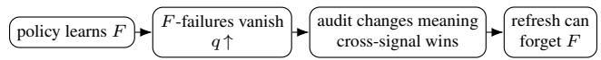

Viewed as a learning system, this is a control-plane failure: optimizing the policy changes the data used to decide whether its verifier should be replaced or refreshed.

When does the failure apply? The central result requires three ingredients: a head intended for component $F _ { ; }$ , an on-policy audit against the full outcome y rather than a component-specific label, and use of that audit to compare, early-stop or trigger refreshes. If trusted F labels are available and the component is audited directly (preferably on a reference distribution that preserves F-failures), the collapse in Eq. 1 is avoided. Our claim is therefore about this specific but natural interface, not about every verifier evaluation protocol.

Why this interface is current. Its ingredients already coexist in modern post-training systems. Rubric RL independently scores prompt-specific criteria and aggregates them into a scalar on-policy reward (Gunjal et al., 2026; Mahmoud et al., 2026); policy-aware rubric work reports that substantial criterion mass is already saturated or dead under current policies (Tyagi et al., 2026); and fresh policyinteraction data are used to refine reward models or preference models (Sun et al., 2025; Bai et al., 2022). We do not claim that these systems implement our exact audit-trigger-refresh controller end to end. They establish that criterion-level verifiers, policy-induced saturation, scalar aggregation and on-policy refinement are contemporary ingredients; Appendix AD.3 maps the interfaces explicitly.

Our experiments are organized to test this chain rather than to accumulate unrelated benchmarks. The engine domain gives an exact component oracle, allowing us to separate real verifier failure from a case-mix artifact. GSM8K supplies a familiar language-domain negative control for ranking inversion. A natural multi-label GoEmotions stress test uses separately annotated semantic criteria to test audit collapse, inversion and refresh under support depletion; a constructed AG News control is reported in the appendix. ECG then stresses the operational consequence on a frozen external benchmark with three generator families, subject-held-out splits, two refresh model classes, downstream best-of-16 selection, and a precommitted set of predictions. Across these settings the observations line up with the mechanism: exact-oracle AUC collapses, the analytic inversion threshold predicts where inversion does and does not occur, optimization removes own-failure support, outcome refresh damages offpolicy canonical F-AUC and downstream constraints in every paired split, and deliberately restoring failure support prevents the damage.

Contributions. (1) On-policy audit collapse. We derive the mixture law, a sharp identified set, and the complete-erasure threshold $q \ge \operatorname* { m a x } ( A , 1 - A )$ (Section 4). (2) Audit inversion. We give the threshold $q ^ { * }$ at which cross-component signal overtakes own-failure separability and show that the aggregate audit’s population maximizer is the full-outcome predictor, not the component oracle (Proposition 2). (3) The refresh trap. A controlled semantic-language stress test and a prediction-registered ECG study separate label mismatch from support mismatch and connect refresh to downstream harm (Section 5). (4) Support-preserving repair. We give matching passive labelcomplexity bounds and a designed two-mixture audit whose error does not depend on the deployed policy’s saturation (Section 6). Downstream selection/training-interface results are deliberately kept as a boundary analysis in the appendix.

## 2 MECHANISM-FIRST EVALUATION

We test the chain implied by Eq. 1, not a collection of interchangeable benchmarks. Engine supplies an exact oracle and matched pools for the inversion threshold; GSM8K is a language-domain negative control where inversion should not occur; GoEmotions supplies two separately annotated semantic criteria; and ECG is the frozen operational stress test with three generator families, subject-held-out evaluation, two refresh model classes and a downstream gate. Protocols and domain-specific details are in the appendices.

In every domain $y = F \land M$ . We keep two component estimands distinct. The theory isolates own-failure separability $A _ { \mathrm { o w n } } = \mathrm { A U C } ( s _ { F } ; F = 1 , \bar { M } = 1 \mathrm { v s } F = 0 )$ , because these are exactly the outcome-audit pairs whose negative is an F-failure. Canonical component quality is instead $A _ { F } ~ = ~ \mathrm { A U C } ( s _ { F } ; F = 1 \mathrm { v s } ~ F { = } 0 )$ . They need not agree: if $\rho ~ = ~ \operatorname* { P r } [ M ~ = ~ 1 ~ | ~ F ~ = ~ 1 ]$ and $A _ { \mathrm { a u x } } = \mathrm { A U C } ( s _ { F } ; F = 1 , M = 0 \mathrm { v s } F { = } 0 )$ , then

$$
A _ { F } = \rho A _ { \mathrm { o w n } } + ( 1 - \rho ) A _ { \mathrm { a u x } } .\tag{2}
$$

Equation 2 is just the law of total probability over M within the canonical positive class $F = 1 ;$ no independence assumption is used. Propositions 1–2 characterize what the outcome audit identifies and rewards about $A _ { \mathrm { o w n } } ;$ whenever we claim actual component degradation we report $A _ { F }$ separately. Best-of-K supply, selection efficiency and Answer@ $K$ are defined and audited in Appendix AC.

## 3 THE PARADOX: POLICY IMPROVES, AUDIT COLLAPSES

The first empirical fact is intentionally paradoxical. In engine, oracle target success per draw rises 3.6× while the feasibility head’s aggregate AUC falls from 0.80 to 0.51. In GSM8K, target success rises 2.1× while the format head falls from 0.92 to 0.51. At the same time the native selectors fail to convert the newly available supply into selected success: selection efficiency falls to 0.05 and 0.09. If aggregate on-policy AUC were a direct measure of component quality, these numbers would suggest that both components deteriorated sharply just as the policies learned to satisfy them.

The exact-oracle control rules out that interpretation. The component itself remains available. Two unused engine critics with different seeds show the same on-policy collapse (0.45–0.58) while their mass heads stay at 0.96–0.98; the feasibility head retains own-property AUC 0.940–0.991 on matched DPO pools, and the GSM8K format head retains 0.995 accuracy against unboxed failures. More strongly, the next section shows that an exact component oracle exhibits the same aggregate symptom. Thus the collapse cannot, by itself, identify component degradation. It is the empirical signature predicted by a changing failure mixture.

## 4 ON-POLICY AUDIT COLLAPSE

For one candidate pool r, every negative example belongs to one of two semantic failure bins: it either fails the scored condition F, or it satisfies $\bar { F }$ and fails M. Pairwise additivity of AUC therefore gives

$$
A _ { r } = ( 1 - q _ { r } ) A _ { \mathrm { o w n } , r } + q _ { r } A _ { \mathrm { c r o s s } , r } , \qquad q _ { r } = \mathrm { P r } [ F = 1 \mid y = 0 , r ] .\tag{3}
$$

Here $A _ { \mathrm { o w n } , r }$ is the audit’s own-failure separability: target successes versus failures of $F .$ Equation 2 distinguishes this audit estimand from canonical F-AUC. The second term, $A _ { \mathrm { c r o s s } , r } ,$ , asks the same

Table 1: The policy improves under the oracle target while the component head’s full-target AUC falls toward chance. The component is feasibility for engine and boxed format for GSM8K. Engine: $K = 1 6$ , three seeds, 1 600 pairs (the original round; the matched study of Appendix AF uses 4 000 pairs). GSM8K: 500 prompts, $K = 1 6$ prefix of 64, three seeds.
<table><tr><td></td><td>policy</td><td>target/draw</td><td>component/draw</td><td>supply@16</td><td>full-target AUC</td><td>native selector@16</td><td>η</td></tr><tr><td rowspan="2">engine</td><td>base</td><td>0.026</td><td>0.26</td><td>0.285</td><td>0.802</td><td>0.093</td><td>0.26</td></tr><tr><td>after DPO</td><td> $\mathbf { 0 . 0 9 5 \pm 0 . 0 0 6 }$ </td><td>0.87</td><td> $0 . 4 6 0 \pm 0 . 0 1 5$ </td><td>0.512 ± 0.010</td><td> $0 . 1 1 2 \pm 0 . 0 0 8$ </td><td> $0 . 0 5 \pm 0 . 0 4$ </td></tr><tr><td rowspan="2">GSM8K base</td><td></td><td>0.302</td><td>0.42</td><td>0.872</td><td>0.919</td><td>0.734</td><td> $0 . 7 6$ </td></tr><tr><td>after DPO</td><td> $\mathbf { 0 . 6 4 7 \pm 0 . 0 0 6 }$ </td><td>0.98</td><td></td><td>0.933 ± 0.005 0.506 ± 0.004</td><td> $0 . 6 7 3 \pm 0 . 0 1 4$ </td><td> $0 . 0 9 \pm 0 . 0 3$ </td></tr></table>

head to order target successes against failures that already satisfy F. As qr grows, the aggregate audit places less weight on the head’s own subproblem.

All statements below are per pool; because $\bar { A } \ne ( 1 - \bar { q } ) \bar { A } _ { \mathrm { o w n } } + \bar { q } \bar { A } _ { \mathrm { c r o s s } }$ in general, every reconstruction averages the per-pool identity (Section 2).

Proposition 1 (Identified set for own-failure separability). Partition negatives into semantic failure bins $B _ { 1 } , \ldots , B _ { J }$ , with $\pi _ { j } = \operatorname* { P r } [ B _ { j } \mid y = 0 ]$ and $a _ { j } = \tilde { \mathrm { A U C } } ( s ; y = 1 \mathrm { v \bar { s } } B _ { j } )$ . Given only aggregate $\mathrm { { A U C } } \ A$ and the observed bin weights π, the sharp identified set is

$$
{ \mathcal { T } } ( A , \pi ) = \{ a \in [ 0 , 1 ] ^ { J } : \pi ^ { \top } a = A \} .
$$

For the two-bin split in Eq. 3, if $q < 1$

$$
A _ { \mathrm { o w n } } \in \left[ \operatorname* { m a x } \left( 0 , \frac { A - q } { 1 - q } \right) , \operatorname* { m i n } \left( 1 , \frac { A } { 1 - q } \right) \right] .\tag{4}
$$

This interval is all of [0, 1] exactly when

$$
\begin{array} { r } { q \geq \operatorname* { m a x } ( A , 1 - A ) = \frac { 1 } { 2 } + \left| A - \frac { 1 } { 2 } \right| . } \end{array}\tag{5}
$$

The bounds are attainable. If the bin-conditional score distributions are held fixed and aggregate AUC is measured under known mixture rows of Π, then the vector a is point-identified for every compatible value iff $\operatorname { r a n k } ( \Pi ) = J ;$ with two bins, two distinct mixture weights suffice. If the scores, but not the bins, of all negatives are also observed, the sharp interval for $\bar { A _ { \mathrm { o w n } } }$ becomes a trimming bound (Horowitz & Manski, 1995): the means of the lowest and of the highest $( 1 - q )$ -fraction of the values $h ( x )$ , the share of positives ranked above negative x (Appendix AB).

More than two conjuncts. For $J > 2$ semantic failure modes the same object is simply $A =$ $\textstyle \sum _ { j } \pi _ { j } a _ { j }$ . Mastering one component shrinks the weight of its own-failure bin and reallocates audit mass to whichever other failure modes remain. There is no privileged scalar $q$ in the multi-bin case, but the identification question is unchanged: the auditor needs either direct bin labels or enough deliberately distinct mixture rows for the resulting mixture matrix to have full column rank.

What complete erasure means. Equation 5 is stronger than saying that AUC is sensitive to case mix. Even after the auditor observes the mixture weight q exactly, the aggregate statistic can contain zero information about $A _ { \mathrm { o w n } }$ . Every matched engine row in Table 2 is in this regime: $q \geq 0 . 9 1 6$ and aggregate $\operatorname { A U C } 0 . 4 9 – 0 . 5 8$ are compatible with every $A _ { \mathrm { o w n } } \in [ 0 , 1 ]$ , while direct bin audits measure 0.94–0.99.

What does a realistic auditor know? An auditor usually has outcome labels and scores for every candidate but failure causes only on a labelled subsample, from which q is estimated. This extra information barely helps: on the ECG base test pools, observing every negative’s score lowers the share of erased pools only from 37% to 34% (Llama) and from 48% to 48% (Phi), and estimating q from 50 labels leaves $3 6 \%$ and 48%, because in small pools most h-values sit at 0 or 1 (Appendix AB).

The same point holds without a learned verifier. The exact oracle $s _ { F } = F$ has $\mathrm { A U C } ( F ; y ) = 1 - q / 2 $ on stored pools this perfect head falls from 0.833 to 0.515 (engine) and from 0.922 to 0.519 (GSM8K), realizing a composition-only path $( A _ { \mathrm { o w n } } = 1 , A _ { \mathrm { c r o s s } } = 1 / 2 )$ . Section 7 gives the opposite control, genuine critic exploitation, with the same aggregate symptom.

External check in a non-extreme regime. On ECG the deployability head is effectively exact $( A _ { \mathrm { o w n } } = 1 . 0 0 0 )$ , yet the aggregate reads 0.751 and 0.791 at $q = 0 . 6 1 – 0 . 6 7$ (Table 2); the mean per-pool interval from $( A _ { r } , q _ { r } )$ is $[ 0 . 4 7 , 1 ]$ and [0.45, 1], with 37% and 48% of pools erased.

## 4.1 AUDIT INVERSION: CROSS-COMPONENT SIGNAL CAN WIN

Non-identification says the aggregate cannot certify a component. Equation 3 says more: it states what the aggregate rewards when used to compare, select or refresh verifiers.

Proposition 2 (Audit inversion and its maximizer). Fix a pool with mixture $q . \ ( \mathbf { i } )$ For two heads $f , \dot { g , \ A } ( g ) - \dot { A } ( f ) = ( 1 - q ) ( a _ { g } ^ { \mathrm { o w n } } - a _ { f } ^ { \mathrm { o w n } } ) + q ( a _ { g } ^ { \mathrm { c r o s s } } - a _ { f } ^ { \mathrm { c r o s s } } )$ . If f has better own-failure

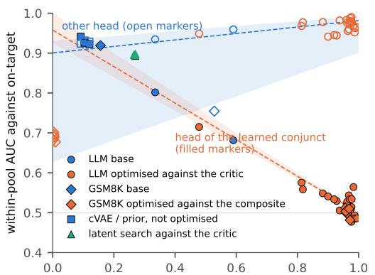  
q: share of off-target candidates satisfying the head's conjunct

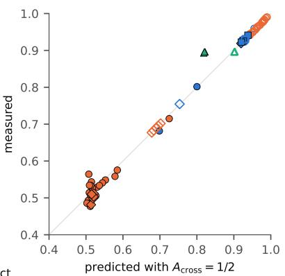  
Figure 1: Audit collapse. Left: aggregate outcome AUC changes systematically with the failure mixture q even when the component’s own-bin ordering remains strong. Right: the zero-parameter $A _ { \mathrm { c r o s s } } = 1 / 2$ reconstruction tracks measured AUC. The complete-erasure region of Eq. 5 is shown separately in Appendix P.

separability $( \Delta _ { \mathrm { o w n } } = a _ { f } ^ { \mathrm { o w n } } - a _ { q } ^ { \mathrm { o w n } } > 0 )$ but g separates F-satisfying candidates by M better $( \Delta _ { \mathrm { c r o s s } } = a _ { g } ^ { \mathrm { c r o s s } } - a _ { f } ^ { \mathrm { c r o s s } } > 0 )$ , the audit prefers $g$ iff

$$
q > q ^ { * } = \frac { \Delta _ { \mathrm { o w n } } } { \Delta _ { \mathrm { o w n } } + \Delta _ { \mathrm { c r o s s } } } ,
$$

and for $\Delta _ { \mathrm { o w n } } = 0$ it prefers g at every $q > 0$ . (ii) Over all scores s(x) of the candidate, the pool’s aggregate AUC is maximized by any strictly increasing transform of $\eta _ { y } ( x ) = \mathrm { P r } [ y = 1 \mid x ]$ . (iii) If ${ \bar { \boldsymbol { F } } } \equiv \phi ( { \boldsymbol { x } } )$ is computable from the candidate, then $\bar { a } ^ { \mathrm { o w n } } ( \eta _ { y } ) = 1$ , and the exact oracle $s = \phi$ satisfies $A ( \eta _ { y } ) - A ( \phi ) = q \left( a ^ { \mathrm { c r o s s } } ( \eta _ { y } ) - \textstyle { \frac { 1 } { 2 } } \right) \ge 0 \colon$ the outcome predictor weakly dominates the perfect component verifier at every q, strictly unless $\eta _ { y }$ is constant on F-satisfying candidates.

Part (i) is Eq. 3 differenced; (ii) is the Neyman–Pearson property of AUC (Clémençon et al., 2008); (iii) follows because $y = 1$ implies $F = 1$ , so $\eta _ { y } = 0$ on every F-failure while the oracle is constant on $\{ F = 1 \}$ (Appendix AD). The content is not the arithmetic but its use. If aggregate on-policy AUC is used to compare or early-stop component heads, its selection pressure favors scores increasingly aligned with $\eta _ { y } .$ hence with information about the rest of the target. A subsequent outcome-labelled refresh is a distinct training intervention, studied in Section 5; it need not literally optimize AUC to inherit the same entangling signal. The within/cross split mirrors the xAUC decomposition used for group fairness (Kallus & Zhou, 2019); here the groups are semantic failure bins and the question is which head the audit statistic prefers.

Table 2: Chance-level aggregate AUC can coexist with near-perfect ordering of the component’s own failures. q is the share of off-target candidates that already satisfy the scored conjunct. ECG rows are frozen pre-DPO test pools; Gemma’s has no informative target-positive requirement and is omitted rather than imputed.
<table><tr><td>policy</td><td>q</td><td>aggregate AUC</td><td> $A _ { \mathrm { o w n } }$ </td><td> $A _ { \mathrm { { c r o s s } } }$ </td></tr><tr><td>1.5B sum</td><td> $0 . 9 7 0 \pm 0 . 0 0 7$ </td><td> $0 . 5 3 2 \pm 0 . 0 0 4$ </td><td> $0 . 9 6 6 \pm 0 . 0 2 0$ </td><td> $0 . 5 1 9 \pm 0 . 0 0 7$ </td></tr><tr><td>1.5B hard gate</td><td> $0 . 9 1 6 \pm 0 . 0 1 4$ </td><td> $0 . 5 3 5 \pm 0 . 0 0 6$ </td><td> $0 . 9 4 4 \pm 0 . 0 1 6$ </td><td> $0 . 4 9 4 \pm 0 . 0 0 1$ </td></tr><tr><td>7B sum</td><td> $0 . 9 8 4 \pm 0 . 0 0 5$ </td><td> $0 . 4 9 4 \pm 0 . 0 2 4$ </td><td> $0 . 9 8 7 \pm 0 . 0 1 7$ </td><td> $0 . 4 8 7 \pm 0 . 0 2 5$ </td></tr><tr><td>7B hard gate</td><td> $0 . 9 5 3 \pm 0 . 0 1 1$ </td><td> $0 . 5 8 3 \pm 0 . 0 0 7$ </td><td> $0 . 9 6 2 \pm 0 . 0 3 7$ </td><td> $0 . 5 6 1 \pm 0 . 0 0 4$ </td></tr><tr><td>GSM8K base</td><td>0.16</td><td>0.919</td><td>0.997</td><td>0.507</td></tr><tr><td>GSM8K sum DPO</td><td>0.96</td><td> $0 . 5 0 6 \pm 0 . 0 0 4$ </td><td>0.995</td><td> $0 . 4 8 9 \pm 0 . 0 0 6$ </td></tr><tr><td>ECG Llama base</td><td>0.611</td><td>0.751</td><td>1.000</td><td>0.607</td></tr><tr><td>ECG Phi base</td><td>0.666</td><td>0.791</td><td>1.000</td><td>0.690</td></tr></table>

The threshold predicts where inversion appears. On matched 1.5B sum-DPO engine pools the learned feasibility head has $( a ^ { \mathrm { o w n } } , a ^ { \mathrm { c r o s s } } ) = ( \bar { 0 } . 9 6 6 , 0 . 5 1 9 )$ and the exact oracle $( 1 , \textstyle { \frac { 1 } { 2 } } ) , { \mathrm { s o } } q ^ { * } = 0 . 6 4 ;$ at the observed $q = 0 . 9 7 0$ the audit ranks the oracle below the imperfect head (0.515 vs 0.532). The oracle also has canonical $F { \mathrm { - } } \mathbf { A U } \mathbf { C } \ 1$ 1 by definition, while direct feasibility AUC of the learned heads is 0.940–0.991 on the matched DPO pools (Appendix AC), so this is not merely a relabelling of $A _ { \mathrm { o w n } }$ . On GSM8K the format head’s $\overline { { a ^ { \mathrm { c r o s s } } } } = \bar { 0 } . 4 8 9 < \frac { 1 } { 2 }$ , so no $q ^ { * }$ exists, and indeed the oracle stays above it (0.518 vs 0.506; Appendix C). A holistic on-target engine classifier, the extreme of entanglement, avoids the component-AUC cliff yet captures only $\eta = 0 . 4 9$ –0.60 of the best-of-K lift versus 0.90–0.94 for the gated two-head critic (Appendix AC): the head favored by the aggregate audit is not the best component representation for the selector.

Optimization drives audits into this regime. On the post-DPO ECG test pools, scored by the same frozen critic, the within-pool own-failure bin of the deployability head is empty in every evaluable pool of the four evaluable Llama gate/inference runs and in 64–72% of evaluable pools of the six Phi gate/inference runs, up from $1 3 \%$ and 36% at base. There no passive audit recovers $A _ { \mathrm { o w n } }$ from the deployed mixture (Section 6), and the on-policy refresh data no longer identify how the head should rank the missing own-failure mode. The next section tests what happens when a refresh procedure acts on that depleted support.

## 5 THE REFRESH TRAP: ACTING ON AUDIT COLLAPSE

Proposition 2 describes what the aggregate audit prefers. Deployment makes the problem operational: a low monitor value can trigger collection of fresh policy samples and a verifier refresh. The mixture law predicts two distinct hazards. Label mismatch: if a component verifier is refreshed against the full outcome y, optimization explicitly moves it toward the audit’s preferred entangled predictor. Support mismatch: even with the correct component labels F, a saturated policy may provide almost no F-failures, so the refresh data contain little or no information about the decision boundary the verifier must retain. The second hazard means the problem is not fixed simply by choosing the “right” label.

Natural multi-label semantic stress test. On GoEmotions (Demszky et al., 2020), keep $F$ as absence of annoyance and use a post-hoc, transparently reported high-q positive control with $M =$ absence of gratitude. At the naturally observed $q = . 5 2 2$ , the component specialist has canonical F-AUC .679 but an aggregate audit of only .442. The deliberately entangled score $z ( s _ { F } ) + z ( s _ { M } )$ has substantially worse canonical F-AUC (.570) yet the aggregate audit prefers it (.681; bootstrap 95% difference [.210, .270]), with predicted crossing $q ^ { * } = . 1 2 6$ . Sweeping leakage strength $s _ { \lambda } =$ $z ( s _ { F } ) + \lambda z ( s _ { M } )$ produces the same quantitative tradeoff: as canonical F-AUC falls from .668 to .483, the observed aggregate audit rises from .470 to .725. Support depletion is equally directional. With correct F labels, canonical F-AUC is .545 when only eight own failures remain; adding 80 random development examples barely changes it (.550), whereas adding 80 targeted own failures raises it to .606 (full support .679). The pair choice, leakage sweep, random-vs-targeted replay and the original near-boundary disapproval control are all post hoc and reported in full in Appendix AD.6; AG News supplies an independent constructed replication (Appendix AD.7).

Immediately before this study, the post-DPO ECG pools already exhibit the predicted support shift: the own-failure bin of the deployability head is empty in every evaluable pool of the four Llama gate/inference runs and in 64–72% of evaluable pools of the six Phi runs, versus 13% and 36% at base. We therefore test not merely whether the monitor changes, but whether acting on it causes measurable off-policy and downstream harm.

Protocol: held-out subjects, two refresh classes, and an unseen generator. We use the frozen ECG pools, where F is a hard deployment constraint: a valid pipeline within latency, cycle and RAM budgets. For Llama and Phi, a specialist S is trained on the base-policy train pool with F labels, in two head classes: an MLP with the frozen critic’s architecture and gradient-boosted trees. Refresh data are post-DPO test pools from one half of test subjects; every reported refresh metric is evaluated on the complementary subject half over 10 random subject splits. $R _ { y }$ refreshes with outcome labels, $R _ { F }$ with component labels, and $R _ { \mathrm { m i x } }$ with component labels plus an equal number of re-injected base-policy candidates. We evaluate four levels of evidence: the on-policy monitor, off-policy F-AUC on the source generator, transfer F-AUC on unseen Gemma outputs, and a best-of-16 gated consumer. Six predictions were hashed before the run (Appendix AD); an exploratory pilot using a different head procedure and split seed had informed P1–P3, while P4–P6 were untested. The four family×head-class configurations are the primary experimental settings; the 10 overlapping subject splits within each setting are robustness resamples, so counts such as 40/40 below report sign consistency rather than 40 independent replications.

Table 3: Refreshing a component verifier on on-policy ECG data (subject-held-out half; mean of 10 paired splits; each cell MLP / GBM). The monitor is full-target on-policy AUC. F-AUC is measured off-policy on base pools from the source generator and unseen Gemma. The gate column tests whether verifier damage changes a downstream best-of-16 decision; violations up to about .15 are unavoidable because some pools contain no feasible candidate.
<table><tr><td>head</td><td></td><td>monitor AUC</td><td></td><td>F-AUC, base F-AUC, unseen gen. gate F-violation gate Answer@ 16</td><td></td><td></td></tr><tr><td></td><td>Llama S (deployed)</td><td>.545 / .614</td><td> $1 . 0 0 0 / 1 . 0 0 0$ </td><td> $. 9 9 8 / 1 . 0 0 0$ </td><td> $. 1 5 2 / . 1 5 1$ </td><td>.495 / .495</td></tr><tr><td></td><td> $R _ { y } \mathrm { : }$  outcome refresh</td><td>.649 / .564</td><td> $. 8 8 3 / . 5 6 7$ </td><td> $. 7 0 8 / . 4 9 3$ </td><td>.163 / .206</td><td>.475 / .447</td></tr><tr><td></td><td> $R _ { F } \mathrm { : c o m p o n e n t r e f r e s h }$ </td><td>.552 / .494</td><td> $. 9 9 9 / . 7 6 5$ </td><td> $. 9 9 6 / . 7 7 5$ </td><td>.153 / .177</td><td>.491 / .478</td></tr><tr><td></td><td> $R _ { \mathrm { m i x } } \colon R _ { F } + \mathrm { b a s e ~ f a i l u r e s }$ </td><td>.551 / .617</td><td> $1 . 0 0 0 / 1 . 0 0 0$ </td><td> $. 9 9 8 / 1 . 0 0 0$ </td><td>.152 / .151</td><td>.495 / .495</td></tr><tr><td>Phi</td><td>S (deployed)</td><td> $. 6 4 1 / . 5 0 7$ </td><td> $1 . 0 0 0 / 1 . 0 0 0$ </td><td> $. 9 9 9 / . 9 9 9$ </td><td> $. 1 4 5 / . 1 4 4$ </td><td>.565 / .565</td></tr><tr><td></td><td>outcome refresh</td><td> $. 6 8 2 / . 4 9 5$ </td><td> $. 9 0 8 / . 5 1 9$ </td><td> $. 6 3 5 / . 5 1 9$ </td><td> $. 1 6 3 / . 1 8 4$ </td><td>.535 / .508</td></tr><tr><td> $R _ { y } \mathrm { : }$   $\bar { R _ { F } } \colon$ </td><td>component refresh</td><td> $. 6 7 4 / . 6 1 8$ </td><td> $. 9 9 4 / 1 . 0 0 0$ </td><td> $. 9 9 9 / . 9 9 9$ </td><td> $. 1 4 4 / . 1 4 4$ </td><td>.564 / .565</td></tr><tr><td></td><td> $R _ { \mathrm { m i x } } { \mathrm { : } }$   $\bar { R _ { F } }$  + base failures</td><td> $. 6 7 1 / . 7 6 2$ </td><td> $1 . 0 0 0 / 1 . 0 0 0$ </td><td> $. 9 9 9 / . 9 9 8$ </td><td> $. 1 4 4 / . 1 4 4$ </td><td>.565 / .565</td></tr></table>

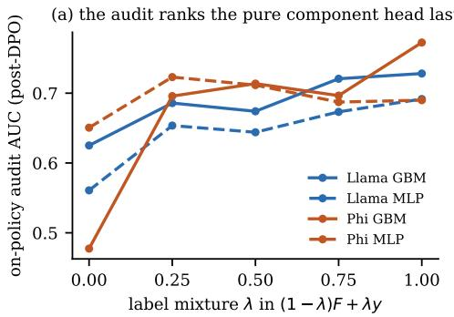

(b) refresh vs. deployed head, per split  
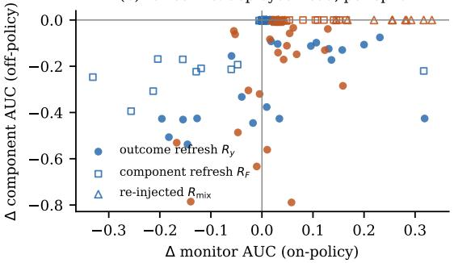  
Figure 2: (a) The audit prefers entanglement. Heads trained on base data with labels $( 1 - \lambda ) F + \lambda y \colon$ the pure component head $( \lambda = 0 )$ , which has canonical F-AUC 1.000, receives the lowest on-policy audit AUC in all four family×class settings (P1). (b) Acting on the audit damages the component. Refresh minus deployed specialist in each of 10 held-out-subject splits and two head classes. Outcome refresh lowers off-policy canonical F-AUC in every paired split while its effect on the monitor changes sign across settings; restoring base failures leaves canonical F-AUC essentially unchanged.

Result 1: the monitor selects the wrong representation. P1 held in all four family×class settings. Among heads trained from the same base data with label mixture $( 1 - \lambda ) F + \lambda y$ , the pure component head (λ = 0) had the lowest on-policy aggregate AUC, despite F-AUC 1.000. This is the empirical analogue of Proposition 2: adding outcome information improves the audit score while moving the representation away from a pure component verifier.

Result 2: outcome refresh causes systematic off-policy forgetting. P3 and P5 held. Relative to the deployed specialist, $R _ { y }$ lowered source-generator off-policy F-AUC with the same sign in every held-out-subject split across both families and both head classes (40/40 paired evaluations; sign robustness, not independent replications): by 0.09–0.12 for MLPs and 0.43–0.48 for GBMs. The effect is not confined to the refresh generator: on unseen Gemma it drops 0.29–0.51. By contrast, the monitor itself is not a consistent indicator of this damage: its mean change is positive in two settings and negative in two, and the preregistered P2 prediction that Phi’s monitor would improve by at least 0.05 in both classes failed $( \bar { + } 0 . 0 \bar { 4 2 } , - 0 . 0 1 2 )$ . The intervention can therefore destroy the component without producing a reliable improvement even in the statistic that motivated it.

Result 3: the forgotten component changes downstream decisions. P6 held. Using $R _ { y }$ as the feasibility gate of a best-of-16 selector increases constraint violations with the same sign in every held-out-subject split across both families and both head classes $( 4 0 / 4 0$ paired evaluations; sign robustness, not independent replications), by +0.011 to +0.055 above the unavoidable floor, and lowers Answer@16 by 0.02–0.06. This closes the loop from an apparently bad audit to an operationally worse consumer: the effect is not only a metric disagreement.

Result 4: correct labels are insufficient; restored support is sufficient here. $R _ { F }$ isolates support mismatch from label mismatch. It still loses 0.235 source-generator F-AUC in the Llama-GBM setting and admits more violations, despite being refreshed with the correct component labels. In contrast, P4 held for $R _ { \mathrm { m i x } } \mathrm { : }$ re-injecting base-policy candidates while keeping component labels preserves F-AUC at 1.000 in every source setting, keeps unseen-generator AUC at 0.998–1.000, and returns the gate metrics to the deployed specialist. The difference between $R _ { F }$ and $R _ { \mathrm { m i x } }$ is support, not supervision.

Closed-loop counterfactual. Composing the frozen trigger signal with the already-trained refresh heads closes the loop without new training. Refreshing with $R _ { y }$ whenever aggregate audit AUC falls by at least .05 from base triggers all four primary settings even though each deployed specialist retains F-AUC 1.000; the resulting mean F-AUC/violation/Answer@16 changes from 1.000/.148/.530 to .719/.179/.491. Thresholds .10–.25 trigger fewer settings but remain worse than no refresh on all three outcomes; a reference-distribution F-specific trigger fires in none. The full trigger–harm curve is shown in Appendix AD.5.

Empirical conclusion. Across the study, five of six registered predictions held. More importantly, the evidence follows the mechanism at four levels: the audit rewards entanglement, optimization removes own-failure support, refresh causes held-out and cross-generator component forgetting, and that forgetting raises downstream violations. The failed prediction is informative rather than cosmetic: the monitored AUC is not reliably repaired by refresh, strengthening the narrower conclusion that it is an unsuitable control signal. The successful rescue identifies the actionable fix used in the next section: preserve or deliberately reconstruct the component’s own failure distribution.

## 6 REPAIR: RESTORE FAILURE SUPPORT

When can the audit recover component behavior? Three routes exist: condition directly on semantic failure bins when they have support; impose an externally justified restriction $A _ { \mathrm { c r o s s } } \in [ \dot { \ell } , u ]$ which for $q < 1$ gives

$$
\begin{array} { r } { A _ { \mathrm { o w n } } \in \left[ \operatorname* { m a x } \left( 0 , \frac { A - q u } { 1 - q } \right) , \operatorname* { m i n } \left( 1 , \frac { A - q \ell } { 1 - q } \right) \right] ; } \end{array}\tag{6}
$$

or vary the failure mixture with bin-conditional distributions fixed, which by Proposition 1 reduces recovery to the rank of the mixture matrix and also restores support lost to saturation (Appendix P). This is a designed reweighting/resampling operation, not a license to treat arbitrary policy checkpoints as mixture rows: if either bin-conditional score distribution changes, naive two-row inversion is biased. Appendix S gives the explicit drift term and an empirical boundary case where $A _ { \mathrm { o w n } }$ shifts from .965 to .821 out of distribution and the transported forecast misses by .101. Across two policies, the AUC change splits exactly into a mixture-shift term and conditional-ordering drift, so both mechanisms can coexist (Eq. 7, Appendix AC).

An audit card. When aggregate outcome AUC changes for a component head: (1) define semantic failure bins and report their weights and per-pool identified intervals (Eq. 4) with a cluster-bootstrap outer interval, flagging pools with $q \geq \operatorname* { m a x } ( A , 1 - A )$ ; (2) if the interval is uninformative, label m random off-target candidates and estimate the pair-weighted within-pool $A _ { \mathrm { o w n } }$ directly; (3) if the ownfailure bin lacks support, construct two controlled negative mixtures by reweighting or resampling fixed bin-conditional candidates, then invert the $2 \times 2$ system of Eq. 3; (4) do not use aggregate on-policy outcome AUC as the sole criterion to select, early-stop or refresh a component verifier (Proposition 2); refresh only on data that contain its own failures and report its quality off-policy (Section 5); (5) audit separately the interface that consumes the score (Appendices AE–AF). The next result prices steps 2 and 3.

Proposition 3 (Cost of restoring identification). Fix a pool’s positives and let $h ( x ) \in [ 0 , 1 ]$ be the fraction of them the head ranks above a negative x (ties $\textstyle { \frac { 1 } { 2 } } )$ , so $A _ { \mathrm { o w n } } = \mathbb { E } [ h ( X ) \mid \dot { X } \in \dot { B } _ { \mathrm { o w n } } ]$ (i) Passive audit. Label m negatives drawn i.i.d. from the pool’s failure mixture and average h over the revealed own failures. If $m ( 1 - q ) \geq \operatorname* { m a x } \{ 8 \log ( 2 / \delta )$ , log $( 4 / \delta ) / \varepsilon ^ { 2 } \}$ , the estimate is within ε of $A _ { \mathrm { o w n } }$ with probability at least $1 - \delta .$ Conversely, for $\varepsilon \leq { \frac { 1 } { 4 } }$ and $\delta \ < \ { \textstyle { \frac { 1 } { 4 } } }$ , every estimator built from such a sample errs by at least ε with probability above δ on some instance unless $m ( 1 - q ) \ge \operatorname* { m a x } \{ q \log ( 1 / ( 2 \delta ) )$ ), lo $\langle \dot { 1 } \rangle ( 4 \delta ) ) / ( 2 4 \varepsilon ^ { 2 } ) \}$ }, so the two budgets match up to constants. (ii) Designed audit. If aggregate AUCs are estimated within $\varepsilon _ { 1 } , \varepsilon _ { 2 }$ at known weights $q _ { 1 } \neq q _ { 2 } .$ inverting Eq. 3 gives $| \hat { A } _ { \mathrm { o w n } } - A _ { \mathrm { o w n } } | \leq ( q _ { 2 } \varepsilon _ { 1 } + q _ { 1 } \varepsilon _ { 2 } ) / | q _ { 2 } - q _ { 1 } |$ , independent of the deployed policy’s q.

The passive audit thus becomes expensive exactly where Proposition 1 makes the aggregate uninformative, and impossible once the own bin is empty; a designed mixture removes the dependence (proofs in Appendix AA). On the ECG utility head, $\sqrt { m ( 1 - q ) }$ · RMSE stays at 0.20–0.24 for every $q \leq 0 . 9 5 , m = 1 0 0$ labels give 96–98% subject-bootstrap coverage, and two-mixture inversion reaches RMSE $0 . 0 1 { - } 0 . 0 2 $ at $| q _ { 2 } - q _ { 1 } | = 0 . 6$ (Appendices $\mathrm { Y } , \mathrm { A A } )$ . The same designed mixture is what protects a refresh: $R _ { \mathrm { m i x } }$ in Table 3 differs from $R _ { F }$ only by re-injected base-policy failures and keeps canonical $F { \mathrm { - } } \mathrm { A U C }$ at 1.000 in every setting, and re-injection likewise recovers $\dot { A } _ { \mathrm { o w n } }$ with $\mathrm { R M S E } \le 0 . 0 2$ on post-DPO ECG pools whose own bin is empty (Appendix AA).

## 7 SCOPE: WHAT THE RESULTS DO AND DO NOT ESTABLISH

The AUC symptom does not identify its cause: an exact oracle collapses and an unbounded autoencoder genuinely exploits the critic (feasibility 0.9999 predicted, 1.8% actual; Appendix F); this is not a claim that in-bounds exploitation is absent. Proposition 2 is exact, but its engine and GSM8K checks reuse published quantities and are post-hoc. The GoEmotions study is a post-hoc natural multi-label text stress test with a small bag-of-words verifier; the AG News experiment is a more constructed control with 24 deterministic robustness splits rather than independent replications. Together they establish that the mechanism is not specific to engineered numeric features, not that our refresh effect has been measured with an LLM-scale semantic verifier. Contemporary rubric-RL work independently shows criterion-level saturation and scalar aggregation at LLM scale (Gunjal et al., 2026; Tyagi et al., 2026); we use that literature only to establish interface relevance, not as validation of our inversion or refresh claims. The ECG refresh study is CPU-only and uses one benchmark whose component is a deterministic resource constraint, two head classes and ten subject splits; we did not refresh an LLM-scale verifier, did not study online RL with a refreshed verifier, and our prediction that refresh repairs the monitor failed. Engine and GSM8K policies are Qwen2.5, the strongest training result is offline DPO with three seeds, and ECG training is informative in one family. The audit requires trusted component labels (proxy bins change the estimand); the engine oracle is simplified, and ECG is a signal-processing benchmark, not a clinical validation.

## 8 RELATED WORK

Modern post-training makes the component/aggregate interface concrete. Rubric RL scores promptspecific criteria separately and then aggregates them into scalar on-policy rewards (Gunjal et al., 2026; Mahmoud et al., 2026); policy-aware rubric work further shows that criterion informativeness changes with the policy because many criteria become saturated or dead (Tyagi et al., 2026). Fresh policy interactions are also used to refine reward or preference models (Sun et al., 2025; Bai et al., 2022). Two adjacent loop failures are especially relevant: on-policy optimization against one verifier can remove behaviors needed for later objectives (Wei et al., 2026), and a verifier useful on one task can regress a learner after task shift (Lin, 2026). We instead study the audit interface: full-outcome AUC can stop identifying one component, prefer an entangled verifier, and induce a harmful refresh even when the component verifier was initially correct.

The statistical ingredients are classical. ROC behavior depends on case mix (Sadatsafavi et al., 2022); partial identification and trimming bounds describe incomplete observables (Manski, 2003; Tamer, 2010; Horowitz & Manski, 1995); deliberately varying mixture weights is a linear special case of finite-mixture identification (Henry et al., 2014); the within/cross split parallels xAUC (Kallus & Zhou, 2019); and the population AUC maximizer is the classical optimal ranker (Clémençon et al.,

2008). We do not claim these ingredients as new. The new consequence is their combination under policy-induced semantic failure mixtures: complete loss of component identification, a calculable verifier-ranking inversion, and an audit-driven maintenance failure.

## AI USE STATEMENT

Generative AI was used to improve the clarity and presentation of manuscript claims, assist with software implementation and debugging, and provide critical feedback on claims and arguments during manuscript development. AI-generated suggestions were treated as editorial and technical assistance rather than as evidence or independent validation. The authors are fully responsible for the final claims, proofs, code, citations, analyses, and submission.

## ETHICS STATEMENT

The engine evaluations concern a simplified geometry, mass and printability model, not safety certification or fabrication validation; propulsion design can have dual-use implications. The ECG study uses public, de-identified PhysioNet recordings (MIT-BIH Arrhythmia and Noise Stress Test databases) under their published terms; it is a signal-processing deployment benchmark, not a diagnostic or clinical validation, and its outputs should not be used for patient care.

## REPRODUCIBILITY STATEMENT

The supplement contains the exact anonymous source snapshot, the CPU-only GoEmotions and AG News semantic stress-test scripts with frozen JSON summaries, and the frozen controller threshold analysis used in the final revision. The original large engine/ECG/GSM8K candidate pools and model checkpoints are not bundled in this lightweight artifact; their protocols, registered predictions, assumptions and reported frozen summaries are documented in the appendix. Thus the supplement supports an exact paper rebuild and independent reruns of the public-data semantic controls, but not an end-to-end regeneration of every large system experiment from raw candidates. See Appendices G, AD.6, AD.7, I and K.

## REFERENCES

Yang Bai, Kaiyuan Liu, Ziyuan Zhuang, Jiahong Zhou, Rongxiang Weng, Xin Chen, Jingang Wang, and Xunliang Cai. Multi-objective and mixed-reward reinforcement learning via rewarddecorrelated policy optimization. arXiv preprint arXiv:2605.13641, 2026. URL https:// arxiv.org/abs/2605.13641.

Yuntao Bai, Andy Jones, Kamal Ndousse, Amanda Askell, Anna Chen, Nova DasSarma, Dawn Drain, Stanislav Fort, Deep Ganguli, Tom Henighan, et al. Training a helpful and harmless assistant with reinforcement learning from human feedback. arXiv preprint arXiv:2204.05862, 2022.

Jon L. Bentley, H. T. Kung, Mario Schkolnick, and Clark D. Thompson. On the average number of maxima in a set of vectors and applications. Journal ofthe ACM, 25(4):536–543, 1978.

Bradley Brown, Jordan Juravsky, Ryan Ehrlich, Ronald Clark, Quoc V. Le, Christopher Ré, and Azalia Mirhoseini. Large language monkeys: Scaling inference compute with repeated sampling. arXiv preprint arXiv:2407.21787, 2024.

Stéphan Clémençon, Gábor Lugosi, and Nicolas Vayatis. Ranking and empirical minimization of U-statistics. The Annals ofStatistics, 36(2):844–874, 2008.

Karl Cobbe, Vineet Kosaraju, Mohammad Bavarian, Mark Chen, Heewoo Jun, Lukasz Kaiser, Matthias Plappert, Jerry Tworek, Jacob Hilton, Reiichiro Nakano, Christopher Hesse, and John Schulman. Training verifiers to solve math word problems. arXiv preprint arXiv:2110.14168, 2021.

Juntao Dai, Xuehai Pan, Ruiyang Sun, Jiaming Ji, Xinbo Xu, Mickel Liu, Yizhou Wang, and Yaodong Yang. Safe RLHF: Safe reinforcement learning from human feedback. In International Conference on Learning Representations, 2024.

Dorottya Demszky, Dana Movshovitz-Attias, Jeongwoo Ko, Alan Cowen, Gaurav Nemade, and Sujith Ravi. GoEmotions: A dataset of fine-grained emotions. In Proceedings ofthe 58th Annual Meeting of the Association for Computational Linguistics, pp. 4040–4054, 2020. doi: 10.18653/ v1/2020.acl-main.372. URL https://aclanthology.org/2020.acl-main.372/.

Florian E. Dorner, Yatong Chen, André F. Cruz, and Fanny Yang. Roc-n-reroll: How verifier imperfection affects test-time scaling. In The Fourteenth International Conference on Learning Representations, 2026. URL https://openreview.net/forum?id=3Gy5mmyuxn.

Leo Gao, John Schulman, and Jacob Hilton. Scaling laws for reward model overoptimization. In International Conference on Machine Learning, 2023.

Anisha Gunjal, Anthony Wang, Elaine Lau, Vaskar Nath, Yunzhong He, Bing Liu, and Sean Hendryx. Rubrics as rewards: Reinforcement learning beyond verifiable domains. In International Conference on Learning Representations, 2026.

Moritz Hardt, Ben Recht, and Yoram Singer. Train faster, generalize better: Stability of stochastic gradient descent. In International Conference on Machine Learning, 2016.

Marc Henry, Yuichi Kitamura, and Bernard Salanié. Partial identification of finite mixtures in econometric models. Quantitative Economics, 5(1):123–144, 2014. doi: 10.3982/QE170.

Wassily Hoeffding. Probability inequalities for sums of bounded random variables. Journal of the American Statistical Association, 58(301):13–30, 1963.

Joel L. Horowitz and Charles F. Manski. Identification and robustness with contaminated and corrupted data. Econometrica, 63(2):281–302, 1995.

Nathan Kallus and Angela Zhou. The fairness of risk scores beyond classification: Bipartite ranking and the xAUC metric. In Advances in Neural Information Processing Systems, 2019.

Sunghwan Kim, Dongjin Kang, Taeyoon Kwon, Hyungjoo Chae, Dongha Lee, and Jinyoung Yeo. Rethinking reward model evaluation through the lens of reward overoptimization. In Proceedings of the 63rd Annual Meeting of the Association for Computational Linguistics (Volume 1: Long Papers), pp. 13252–13280, 2025. doi: 10.18653/v1/2025.acl-long.649. URL https://aclanthology. org/2025.acl-long.649/.

James Kirkpatrick, Razvan Pascanu, Neil Rabinowitz, Joel Veness, Guillaume Desjardins, Andrei A. Rusu, Kieran Milan, John Quan, Tiago Ramalho, Agnieszka Grabska-Barwinska, Demis Hassabis, Claudia Clopath, Dharshan Kumaran, and Raia Hadsell. Overcoming catastrophic forgetting in neural networks. Proceedings ofthe National Academy ofSciences, 114(13):3521–3526, 2017.

Hunter Lightman, Vineet Kosaraju, Yuri Burda, Harrison Edwards, Bowen Baker, Teddy Lee, Jan Leike, John Schulman, Ilya Sutskever, and Karl Cobbe. Let’s verify step by step. In International Conference on Learning Representations, 2024.

Jianzhe Lin. When good verifiers go bad: Silent negative transfer in verifier-guided VLM training. arXiv preprint arXiv:2606.14629, 2026. doi: 10.48550/arXiv.2606.14629. URL https:// arxiv.org/abs/2606.14629.

Shih-Yang Liu, Xin Dong, Ximing Lu, Shizhe Diao, et al. GDPO: Group reward-decoupled normalization policy optimization for multi-reward RL optimization. arXiv preprint arXiv:2601.05242, 2026. URL https://arxiv.org/abs/2601.05242.

Anas Mahmoud, MohammadHossein Rezaei, Zihao Wang, Anisha Gunjal, Bing Liu, and Yunzhong He. Reward hacking in rubric-based reinforcement learning. arXiv preprint arXiv:2605.12474, 2026. URL https://arxiv.org/abs/2605.12474.

Charles F. Manski. Partial Identification ofProbability Distributions. Springer, 2003.

Kaisa Miettinen. Nonlinear Multiobjective Optimization. Kluwer Academic Publishers, 1999.

Ted Moskovitz, Aaditya K. Singh, DJ Strouse, Tuomas Sandholm, Ruslan Salakhutdinov, Anca D. Dragan, and Stephen McAleer. Confronting reward model overoptimization with constrained RLHF. In International Conference on Learning Representations, 2024.

Rafael Rafailov, Yaswanth Chittepu, Ryan Park, Harshit Sikchi, Joey Hejna, W. Bradley Knox, Chelsea Finn, and Scott Niekum. Scaling laws for reward model overoptimization in direct alignment algorithms. In Advances in Neural Information Processing Systems, volume 37, pp. 126207–126242, 2024. doi: 10.52202/079017-4009.

Alexandre Ramé, Guillaume Couairon, Corentin Dancette, Jean-Baptiste Gaya, Mustafa Shukor, Laure Soulier, and Matthieu Cord. Rewarded soups: Towards Pareto-optimal alignment by interpolating weights fine-tuned on diverse rewards. In Advances in Neural Information Processing Systems, 2023.

Noam Razin, Zixuan Wang, Hubert Strauss, Stanley Wei, Jason D. Lee, and Sanjeev Arora. What makes a reward model a good teacher? an optimization perspective. In Advances in Neural Information Processing Systems, 2025. doi: 10.52202/085713-1981.

Anthony Robins. Catastrophic forgetting, rehearsal and pseudorehearsal. Connection Science, 7(2): 123–146, 1995.

Davide Romano, Kanak Raj, Jerrod Parker, and Daniele Giofrè. Test-time scaling in the wild: Why exploitation, not exploration, is the bottleneck. arXiv preprint arXiv:2608.18931, 2026.

Mohsen Sadatsafavi, Paramita Saha-Chaudhuri, and John Petkau. Model-based roc curve: Examining the effect of case mix and model calibration on the roc plot. Medical Decision Making, 42(4): 487–499, 2022. doi: 10.1177/0272989X211050909.

KaShun Shum, Binyuan Hui, Jiawei Chen, Lei Zhang, X. W., Jiaxi Yang, Yuzhen Huang, Junyang Lin, and Junxian He. SWE-RM: Execution-free feedback for software engineering agents. In International Conference on Learning Representations, 2026. URL https://arxiv.org/ abs/2512.21919.

Joar Skalse, Nikolaus H. R. Howe, Dmitrii Krasheninnikov, and David Krueger. Defining and characterizing reward hacking. In Advances in Neural Information Processing Systems, 2022.

Charlie Snell, Jaehoon Lee, Kelvin Xu, and Aviral Kumar. Scaling LLM test-time compute optimally can be more effective than scaling parameters for reasoning. In International Conference on Learn ing Representations, 2025. URL https://openreview.net/forum?id=4FWaWZtd2n.

Zexu Sun, Yiju Guo, Yankai Lin, Xu Chen, Qi Qi, Xing Tang, Xiuqiang He, and Ji-Rong Wen. Uncertainty and influence aware reward model refinement for reinforcement learning from human feedback. In International Conference on Learning Representations, 2025.

Elie Tamer. Partial identification in econometrics. Annual Review ofEconomics, 2:167–195, 2010.

Alexandre B. Tsybakov. Introduction to Nonparametric Estimation. Springer, 2009.

Utkarsh Tyagi, Xingang Guo, MohammadHossein Rezaei, Daniel George, Anas Mahmoud, Jackson Lee, Bing Liu, and Yunzhong He. Not every rubric teaches equally: Policy-aware rubric rewards for RLVR. arXiv preprint arXiv:2605.20164, 2026.

Shaohang Wei, Zikun Su, Feifan Song, Wen Luo, Wei Li, Guangyue Peng, and Houfeng Wang. Verifier-induced support reshaping in on-policy optimization. arXiv preprint arXiv:2608.00220, 2026. doi: 10.48550/arXiv.2608.00220. URL https://arxiv.org/abs/2608.00220.

Xueru Wen, Jie Lou, Yaojie Lu, Hongyu Lin, Xing Yu, Xinyu Lu, Ben He, Xianpei Han, Debing Zhang, and Le Sun. Rethinking reward model evaluation: Are we barking up the wrong tree? In International Conference on Learning Representations, 2025.

Zeqiu Wu, Yushi Hu, Weijia Shi, Nouha Dziri, Alane Suhr, Prithviraj Ammanabrolu, Noah A. Smith, Mari Ostendorf, and Hannaneh Hajishirzi. Fine-grained human feedback gives better rewards for language model training. In Advances in Neural Information Processing Systems, 2023.

Xiang Zhang, Junbo Zhao, and Yann LeCun. Character-level convolutional networks for text classification. In Advances in Neural Information Processing Systems, pp. 649–657, 2015.

Zhanhui Zhou, Jie Liu, Jing Shao, Xiangyu Yue, Chao Yang, Wanli Ouyang, and Yu Qiao. Beyond one-preference-fits-all alignment: Multi-objective direct preference optimization. In Findings of the Association for Computational Linguistics: ACL 2024, pp. 10586–10613, 2024. doi: 10.18653/ v1/2024.findings-acl.630. URL https://aclanthology.org/2024.findings-acl. 630/.

## APPENDIX ROADMAP

The appendix is intentionally evidence-first. Appendices A–AD contain the oracle definitions, core audit-collapse controls, identification proofs, transfer checks, preregistration material and the refresh/semantic experiments that support the main claim. Appendices AE–AF are optional boundary analyses of downstream selection and DPO interfaces; they are not needed for Propositions 1–3 or the refresh-trap conclusion. Bundled scripts and frozen summaries are indexed in the supplement README; appendix-only workspace paths are provenance labels and do not imply that the corresponding large artifacts are packaged.

## A THE ENGINE ORACLE

The solver decodes a design vector to a multi-zone body, computes its mass by integration, evaluates printability (overhang, minimum ligament and wall, DfAM flags) and envelope fit, and returns feasible as their conjunction, in 7.9 ms; the 200 000-row reference sample took 72 s. Its thermochemistry is checked against NASA CEA through rocketcea, independent of the project’s own Cantera path: across 28 operating points the maximum error is 0.25% on chamber temperature and 1.7% on characteristic velocity. The flow solver is grid-convergent on the Sod problem $( L _ { 1 }$ error 0.0079 → 0.0042 → 0.0024 at 100/200/400 cells) and reproduces the oblique-shock relation to 1.2◦. Those checks cover the flow path, which is sized from the requirement and not the generator’s to choose. The on-target criterion is two-sided because under a one-sided one 86.4% of on-target draws in the reference sample satisfy it by being small rather than by meeting the budget.

## B THE IDENTITY FOR THE MASS HEAD

With the roles swapped, the mass head’s score against y = F ∧ M decomposes as (1 − q $) \operatorname { A U C } ( s _ { M } ; y = 1 \mathrm { ~ v s ~ } F = 0 ) + q \operatorname { A U C } ( s _ { M } ; y = 1 \mathrm { ~ v s ~ } F = 1 , M = 0 )$ The second term is the head’s own sub-problem and is 0.96–0.99 on every arm; the first is 0.84–0.95, since infeasible designs are also, on average, further from the budget. $\mathrm { A s } ~ q $ 1 the mass head’s AUC against y rises to its own accuracy (0.937 on the base pool, 0.98 on the trained pools).

## C GSM8K WITH A CONJUNCTIVE TARGET

At K=64 supply is 0.948 (base) and 0.967–0.969 (trained); best-of-64 by the sum is 0.762 (base) against 0.645 ± 0.012 and 0.657 ± 0.011. Pairs built from the base train slice by the sum and by the gate coincide (chosen on target 0.521 against 0.520, rejected 0.079 against 0.080); pairs built from a trained policy’s own samples separate on target from off at 0.70 against 0.59 under each tested rule, which closely follows the correctness head there.

## D ENGINE ARMS NOT IN THE MAIN TEXT

Sampling budget. From one 64-sample run per arm (first K taken, nested), answer rate under the two-stage gate, one seed each (1 600-pair policies): 1.5B base 0.028/0.078/0.204/0.291/0.391 and 1.5B DPO 0.104/0.265/0.452/0.512/0.561 at K = 1/4/16/32/64; 7B base 0.044/0.142/0.318/0.441/0.544 and 7B DPO 0.096/0.204/0.365/0.428/0.504. The single-seed 7B reversal at K=64 is 1.8 standard errors and uses the weakest of the three 7B seeds; we do not claim it.

Table 4: GSM8K, 500 test prompts, three training seeds per trained arm. Upper: policy rates, median within-pool score SD at $K = 6 4$ , and correctness-head AUC against the conjunctive target. Lower: supply and answer at $K = 1 6$ (first 16 of 64 samples) under sum, soft log-probability and correctness-only selectors.
<table><tr><td>policy</td><td colspan="2">correct</td><td>boxed</td><td>on target</td><td>SD format SD correct</td><td></td><td>correct AUC</td></tr><tr><td>base</td><td>0.601</td><td></td><td>0.42</td><td>0.302</td><td>8.6</td><td> $1 . 4 5$ </td><td>0.755</td></tr><tr><td>sum DPO</td><td></td><td> $0 . 6 4 8 \pm 0 . 0 0 6$ </td><td>0.98</td><td> $0 . 6 4 7 \pm 0 . 0 0 6$ </td><td>0.02</td><td> $0 . 8 5 \pm 0 . 0 5$ </td><td> $0 . 6 9 0 \pm 0 . 0 0 6$ </td></tr><tr><td>gated DPO</td><td></td><td> $0 . 6 4 4 \pm 0 . 0 0 9$ </td><td>0.98</td><td> $0 . 6 4 2 \pm 0 . 0 0 9$ </td><td>0.02</td><td> $0 . 8 3 \pm 0 . 0 8$ </td><td> $0 . 6 8 9 \pm 0 . 0 1 2$ </td></tr><tr><td></td><td>policy</td><td>supply@16</td><td></td><td>sum</td><td>log-prob</td><td>correct only</td><td></td></tr><tr><td>base</td><td></td><td> $0 . 8 7 2$ </td><td></td><td> $_ { 0 . 7 3 4 }$ </td><td>0.736</td><td>0.576</td><td></td></tr><tr><td></td><td>sum DPO</td><td> $0 . 9 3 3 \pm 0 . 0 0 5$ </td><td></td><td> $0 . 6 7 3 \pm 0 . 0 1 4$ </td><td> $0 . 6 6 9 \pm 0 . 0 1 4$ </td><td> $0 . 6 7 0 \pm 0 . 0 1 5$ </td><td></td></tr><tr><td></td><td>gated DPO</td><td> $0 . 9 2 7 \pm 0 . 0 0 6$ </td><td></td><td> $0 . 6 8 5 \pm 0 . 0 1 1$ </td><td> $0 . 6 8 6 \pm 0 . 0 1 4$ </td><td> $0 . 6 8 5 \pm 0 . 0 1 5$ </td><td></td></tr></table>

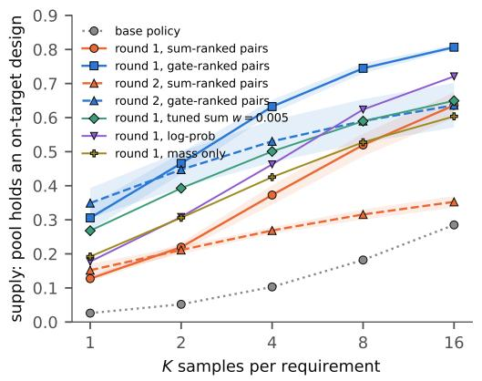

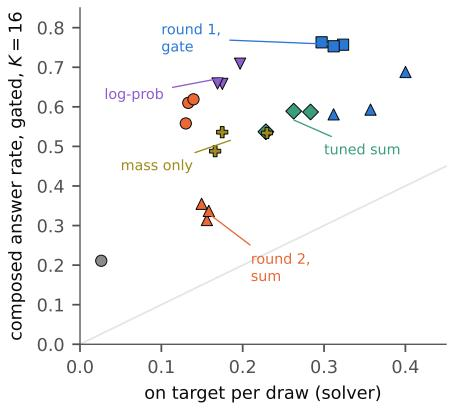  
Figure 3: Training-side supply and selection geometry. Left: supply against K (seed means; bands one sd for packaged arms). Right: per-draw success against composed answer under the gate, one marker per seed.

Training-side mitigations. DPO at $\beta \in \{ 0 . 1 , 0 . 5 , 1 . 0 \}$ and IPO at target margins 0.005 and 0.020 on the 1.5B designer (1 600 pairs, one seed each) reach feasible rates 0.39–0.87; each sits on Eq. 3 at its own q (Table 2); under the two-stage gate they capture 0.75–0.93 of their supply and the best composed system is the one with the most supply $( \beta = 1 . 0 , 0 . 5 1 4 )$ . An IPO target 40× out of reach (5.0 nats/token) broke the output format (parse rate 0.40) and is excluded from every table.

Scale. Under the gate the 7B designer after DPO reaches $0 . 4 1 4 \pm 0 . 0 2 9$ at $K { = } 1 6$ against the 1.5B’s $0 . 4 3 9 \pm 0 . 0 1 5 ;$ its feasibility head saturates to the same endpoint with five times the seed spread. The 7B base policy’s parse rate is 0.76; on parsed candidates its feasible rate is 0.43.

Latent search. Two hundred steps of gradient ascent on the unconstrained autoencoder’s latent code against the critic’s two terms give supply $0 . 9 3 7 \pm 0 . 0 1 7$ at K=64 against $0 . 3 3 6 \pm 0 . 0 0 3$ for direct sampling (three decoder seeds), not compute-matched. Its pools are the ones with $A _ { \mathrm { c r o s s } } = 0 . 7 9$ joint ascent couples the heads.

## E THE DESIGNS IN PARAMETER SPACE

Every policy’s on-target designs have 2.85–2.97 active zones on average, a printability score of 1.0, and mass at 0.99 of the budget on average (design\_degeneracy.py). The benchmark — oracle, critic, splits, pools and every result file — is released with the paper.

Table 5: On-target designs of each policy (test split, all seeds pooled) against the prior’s on-target designs in the reference sample. “At bound”: radius controls within 0.05 of 0 or 1; “block-like”: every radius control above 0.9; “sd”: mean per-coordinate standard deviation; $L _ { \mathrm { 2 } } { \mathrm { : } }$ mean pairwise distance between designs; “families”: share of the four lattice families (gyroid / Schwarz-P / diamond / IWP).
<table><tr><td>designs</td><td>n</td><td>distinct</td><td>radius mean</td><td>at bound</td><td>block-like</td><td> $\mathrm { s d }$ </td><td> $L _ { 2 }$ </td><td>families</td></tr><tr><td>prior (reference)</td><td>1594</td><td>1.00</td><td>0.50</td><td>0.03</td><td>0.00</td><td>0.28</td><td>2.15</td><td>.24/.25/.25/.26</td></tr><tr><td>base policy</td><td>418</td><td>0.96</td><td>0.49</td><td>0.05</td><td>0.00</td><td>0.23</td><td>1.80</td><td>.30/.27/.24/.19</td></tr><tr><td>round 1, sum pairs</td><td>6442</td><td>1.00</td><td>0.42</td><td>0.00</td><td>0.00</td><td>0.17</td><td>1.34</td><td>.42/.40/.16/.03</td></tr><tr><td>round 1, gate pairs</td><td>14915</td><td>1.00</td><td>0.49</td><td>0.01</td><td>0.00</td><td>0.17</td><td>1.34</td><td>.09/.32/.48/.12</td></tr><tr><td>round 2, sum pairs</td><td>7420</td><td>1.00</td><td>0.42</td><td>0.00</td><td>0.00</td><td>0.07</td><td>0.57</td><td>.00/.45/.55/.00</td></tr><tr><td>round 2, gate pairs</td><td>17104</td><td>1.00</td><td>0.48</td><td>0.00</td><td>0.00</td><td>0.13</td><td>1.04</td><td>.17/.45/.35/.03</td></tr></table>

Within-requirement diversity. Conditional on at least two on-target samples per requirement, mean within-requirement coordinate spread is 0.101–0.104 for matched sum DPO and 0.097–0.103 for gated DPO. It falls to 0.038–0.039 in the sum-ranked second round, against 0.059–0.064 for gated ranking. This conditions on successful samples and is descriptive.

## F THE ESCAPE

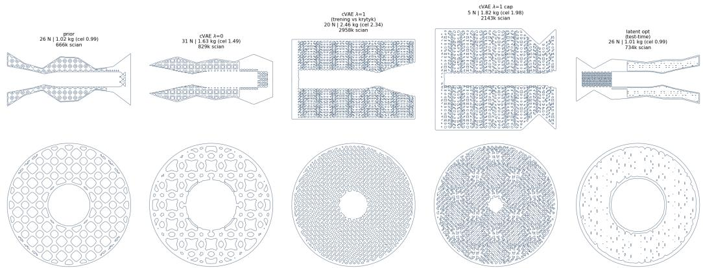  
Figure 4: One design from each cVAE arm’s pool, decoded by the function the solver grades (longitudinal section above, cross-section at mid-length below). The prior, the unconstrained decoder and latent search produce engines with visibly different lattice families; the decoder trained on the critic’s terms produces a block — every radius control pinned at maximum after clipping from far outside the box — that passes the mass-and-printability criterion and that the critic scored feasible at 0.9999 before clipping.

## G TRAINING DETAILS

Policies: Qwen2.5-1.5B-Instruct and Qwen2.5-7B-Instruct, LoRA rank 16 (α = 32, dropout 0.05), DPO $\beta = 0 . 1$ (sigmoid loss), learning rate $5 \times 1 0 ^ { - 5 }$ , batch 4× accumulation 2 at 1.5B and 2×4 at 7B, three epochs, max length 2560 for engine DPO, bf16, trl. Pairs: the score’s top-4 against bottom-4 of 16 samples per requirement (engine) or of 8 per prompt (GSM8K); unparseable completions carry the score $- 1 0 ^ { 3 }$ and so form the rejected side. Engine pair pools: the original arms used 400 requirements drawn by the bench (1 600 pairs, ≈ 600 steps); the round-1 arms of Table 39 use the first 1 000 requirements of the committed train split (4 000 pairs, ≈ 1 500 steps); round 2 starts from the round-1 sum policy (seed 0), merged, which is also its reference. Seeds vary initialisation and batch order; the pairs are deterministic given the pool. GSM8K heads: RoBERTa-base, two labels, two epochs, learning rate $2 \times 1 0 ^ { - 5 }$ , on 12 000 (prompt, completion) pairs from the train slice with a 15% validation split.

Engine DPO hard-gated ranking uses the squared log-mass proximity score for $P ( F ) \ge 0 . 5$ and subtracts 100 below the threshold; unparsed rows remain at −1000. Two-stage evaluation instead minimises relative linear-mass error among passing candidates and falls back to maximum $P ( F )$ if none pass. GRPO uses a soft reward log $\sigma ( s _ { F } )$ + mass\_term versus $s _ { F } + \tt m a s s \_ t e r m$ , and unparsed reward −100. The TRL 1.12.0 GRPOTrainer recipe uses its default DAPO token-normalised loss and group reward scaling, not the original sequence- normalised GRPO loss. Group size 8, LoRA $r = 1 6 .$ , two epochs over 1000 prompts, lr $1 0 ^ { - 5 } , \beta = 0 . 0 4$ , temperature 0.9, top-p 1.0 for training, completion limit 700, per-device completion batch $^ { 8 , }$ accumulation 2, yield 1000 optimizer steps; evaluation uses top-p 0.95.

## H 7B AND ONLINE GRPO EXPERIMENTS: REGISTRATION AND SUPPORT

Registered 2026-09-15 before the runs. P-A1 held: hard-gated DPO at 7B improves per-draw and two-stage composed answer on each seed, ratio 1.79× inside [1.3, 2.3]. P-A2 held: feasibility is lower on every gated seed. P-A3 is partial: exact identity, $A _ { \mathrm { c r o s s } } \in [ 0 . 4 5 , \dot { 0 } . 5 8 ]$ and sum-arm $q \geq 0 . 9$ all hold; $A _ { \mathrm { o w n } } \geq 0 . 9 3$ on every arm fails on gated seed 1 (0.9193 parsed-only, 0.9250 including unparsed failures). No run is removed or threshold changed.

Table 6: Parsed-only own-bin support for the added 7B runs. Bootstrap intervals are post-hoc percentile intervals from 3000 requirement-level resamples, seed 20260918, not training-seed intervals; pairs within a requirement are dependent.
<table><tr><td colspan="3"></td><td rowspan="2">supported requirements</td><td rowspan="2">positive-infeasible pairs</td><td rowspan="2">95% CI</td></tr><tr><td>ranking</td><td>seed</td><td> $A _ { \mathrm { o w n } }$ </td></tr><tr><td>sum</td><td>0</td><td>1.0000</td><td>11</td><td>127</td><td>[1.0000, 1.0000]</td></tr><tr><td>sum</td><td>1</td><td>0.9679</td><td>38</td><td>313</td><td>[0.9371, 0.9933]</td></tr><tr><td>sum</td><td>2</td><td>0.9929</td><td>20</td><td>270</td><td>[0.9762, 1.0000]</td></tr><tr><td>hard gate</td><td>0</td><td>0.9834</td><td>70</td><td>815</td><td>[0.9677, 0.9964]</td></tr><tr><td>hard gate</td><td>1</td><td>0.9193</td><td>83</td><td>1218</td><td>[0.8634, 0.9662]</td></tr><tr><td>hard gate 2</td><td></td><td>0.9822</td><td>69</td><td>773</td><td>[0.9612, 0.9969]</td></tr></table>

An empirical interval of [1, 1] with only 11 supported requirements indicates no observed errors, not proof of perfect ordering. The interval for the failed seed includes 0.93 but does not change the registered outcome. The intersection of requirements supporting $A _ { \mathrm { o w n } }$ in all six matched 7B arms contains only one requirement, so restricting every arm to a common support would replace one support problem with a more severe one. Identity statistics therefore average each arm over its informative pools; the direct feasibility audit in Appendix M uses 40–225 informative requirements per seed and gives AUC 0.940–0.991.

GRPO predictions: feasibility above 0.8 (P-B1) and sum per-draw in [0.08, 0.18] held; supply advantage at least 0.10 (P-B2) failed. Gate per-draw above the sum on every seed held, but gate per-draw at least 0.20 (P-B3) failed. Coordinate sd below 0.17 (P-B4) held for both rewards. All parse rates exceed 0.998, so no engineering discard applies. The strict no-difference branch is not supported for supply, but this is a modest online result, not a large two-algorithm replication. Endpoint outcomes do not establish the predicted reward-optimisation trajectory.

Table 7: Training scope checks: a second DPO round and online GRPO. “Composed” uses the same two-stage evaluator as Table 39; mean ± sd over three seeds.
<table><tr><td>policy</td><td>pairs/reward</td><td>on target / draw</td><td>feasible / draw</td><td>supply @16</td><td>parse</td><td>composed @16</td></tr><tr><td>round 2</td><td>sum pairs</td><td> $0 . 1 5 5 \pm 0 . 0 0 5$ </td><td>0.86</td><td> $0 . 3 5 3 \pm 0 . 0 1 7$ </td><td>0.95 ± 0.05</td><td> $0 . 3 3 5 \pm 0 . 0 2 1$ </td></tr><tr><td>round 2</td><td>gate pairs</td><td> $0 . 3 5 6 \pm 0 . 0 4 4$ </td><td>0.88</td><td> $0 . 6 3 6 \pm 0 . 0 6 6$ </td><td>0.98</td><td> $0 . 6 2 1 \pm 0 . 0 5 9$ </td></tr><tr><td>GRPO, online</td><td>sum reward</td><td> $0 . 0 8 6 \pm 0 . 0 0 2$ </td><td>0.85</td><td> $0 . 4 8 1 \pm 0 . 0 0 4$ </td><td>1.00</td><td> $0 . 4 6 0 \pm 0 . 0 0 4$ </td></tr><tr><td>GRPO, online</td><td>log-prob reward</td><td> $0 . 0 8 9 \pm 0 . 0 0 3$ </td><td>0.82</td><td> $0 . 5 2 8 \pm 0 . 0 0 3$ </td><td>1.00</td><td> $0 . 4 9 2 \pm 0 . 0 0 8$ </td></tr></table>

Table 8: Evidence chronology for the follow-up studies. “Pre-specified” means the named plan/protocol was committed before the corresponding new analysis or training run; it does not imply that earlier results in the paper were unknown.
<table><tr><td>follow-up</td><td>record</td><td>status before result</td><td>role in paper</td></tr><tr><td>7B hard-gate / GRPO</td><td>registration</td><td>before added runs</td><td>scale / optimization-scope checks; misses retained</td></tr><tr><td>strong scalar controls</td><td>protocol</td><td>after original sum-vs-gate, before new policies</td><td>tests tuned, log-prob, and mass-only pair builders</td></tr><tr><td>three-conjunct gate</td><td>plan</td><td>before job</td><td>omitted-objective boundary test</td></tr><tr><td>1.5B contrast scalar source-term transfer</td><td>plan</td><td>before w = 0.1 training source terms/code frozen; rough</td><td>endpoint test after pair-geometry sweep pre-specified transfer, not fully</td></tr><tr><td></td><td>plan</td><td>outcome location known</td><td>prospective forecast</td></tr><tr><td>within-run transfer</td><td>plan</td><td>before checkpoint pools</td><td>next-checkpoint forecast</td></tr><tr><td>7B contrast scalar</td><td>none</td><td>after 1.5B contrast result</td><td>non-preregistered scale follow-up</td></tr></table>

## I REGISTERED PREDICTIONS AND OUTCOMES

Committed predictions are reported with misses rather than filtered post hoc. The chronology above distinguishes original results, prospective follow-ups, and later post-hoc or non-preregistered checks. The detailed registered statements follow. (1) Identity within 0.03 with $A _ { \mathrm { c r o s s } } \in [ 0 . 4 5 , 0 . 5 8 ]$ on every engine arm: partially held (mean 0.016, max 0.057, so not every arm is within 0.03; cross 0.47–0.56 on the original arms). (2) Variance-normalised sums below $\eta = 0 . 5$ , gates above 0.85: held for the z-scorings and the gates; exceeded by 0.03 by the rank average; a fixed weight of 0.005, identified in a later unregistered ablation, was not registered and matches the gates. (3) Argmax dominance of the logit separating trained from base pools: failed (dominance is 0.70–0.93 on every arm). (4) Round-1 gated pairs: per-draw above 0.095, supply above 0.460, feasible below 0.88: held. Registered before the matched control existed; against the matched control the gated advantage is 2.3×, not 3.3×. (5) Round-2 sum pairs: per-draw at or below 0.10: failed (0.155); supply fell instead. (6) GSM8K: boxed rate above 0.85 and q above 0.85: held (0.98, 0.96). $A _ { \mathrm { c r o s s } } \in [ 0 . 5 0 , 0 . 6 5 ]$ : missed low by 0.02 on some seeds (0.47–0.51). Composite: the registered no-cliff branch (spread ratio below 0.5, rules agree within 0.1) obtained. Gate pairs carry more correctness contrast than sum pairs: failed (identical pairs). The fall in best-of-16 was not registered. (7) Strong training controls (T1–T5, Appendix O): tuned sum and log-prob within 0.04 of the gate — failed, both below by 0.19 and 0.08; mass-only below its falsifier — held; every new arm above the unit sum — failed; $q > 0 . 9$ on tuned-sum arms — failed (0.57–0.63), $A _ { \mathrm { o w n } } > 0 . 9 - \mathrm { h e l d }$ . (8) Pre-specified later-arm forecast on the twelve new arms (F1–F6, Appendix S): error ≤ 0.05 — held (0.020); persistence $> 0 . 1 0$ on the non-saturated subset — missed by 0.007; AUC monotone in q with mass-only highest — held on the mean, missed on one seed (0.737 against a registered > 0.80); $\eta \geq 0 . 5$ everywhere — held, but the gate ties the tuned sum under the raw selector; three-conjunct terms unchanged — held. (9) Pair-contrast sweep and conditioning of the new arms (C1–C4, Appendices O, W, X): no weight within 0.85 of the gate’s contrast — failed (0.91 at $w \approx 0 . 1 )$ ; mass gain 0.95 for tuned sum and mass-only, 0.45 for log-prob — all failed at $0 . 7 2 \mathrm { - } 0 . 7 4 ;$ printability below 0.80 under mass-only — held (0.57); envelope conditioning by rule — held on all four; no second-level collapse — held; mass-trackers hottest — held; every arm above base survival — failed on two seeds. (10) Three-conjunct DPO (Appendix X): seven of eleven held, falsifier not fired, all misses toward a smaller effect. (11) Contrast-matched sum, 1.5B (Appendix O): decision rule returned “contrast suffices”; every registered point value (feasible 0.79, per draw 0.27, supply 0.76, composed 0.70, gain 0.80, q 0.90, envelope $\rho < 0 . 4 5 )$ missed upward — the policy reached the gate; $A _ { \mathrm { o w n } } > 0 . 9$ and the base-pool forecast within 0.04 held. A later, non-preregistered 7B follow-up at $w = 0 . 0 5$ is reported in Appendix O; it is not counted as a registered outcome. (12) Within-run forecast (Appendix S): next-checkpoint error $\leq 0 . 0 6$ with persistence worse and $\geq 1 4 / 1 8$ wins — held (0.049, 0.096, 15/18; 0.021 against 0.064 with pooled source terms, an unregistered variant); $q \geq 0 . 8$ by step 500 on the saturating runs and persistence worst on the first transition — held; $A _ { \mathrm { o w n } } \geq 0 . 9$ at every checkpoint — failed once (0.853); tuned-sum $q > 0 . 5$ by step 500 — missed by 0.002; base-pool error $\leq 0 . 0 7 -$ held (0.032); null arm — held.

Table 9: Closest literatures and the distinction relevant to this paper. We separate ingredients that are classical from the new verifier-audit consequence.
<table><tr><td>literature</td><td>closest object</td><td>distinction in this work</td></tr><tr><td>safavi et al., 2022)</td><td>ROC / case mix (Sadat- how population composition changes ROC behavior</td><td>inverse identification from semantic fail- ure bins; complete-erasure threshold and component-specific audit target finite-mixture identifica- identification as mixture weights our two-mixture rank condition is a special</td></tr><tr><td></td><td>tion (Henry et al., 2014) vary while components stay fixed linear case; novelty is the verifier-audit inter-</td><td>pretation and its operational consequences rubric RL / policy-aware criterion-level judgments are ag- establishes the modern compo-</td></tr><tr><td></td><td>policy</td><td>criteria (Gunjal et al., gregated for on-policy RL; crite- nent/aggregate setting; we analyze 2026; Tyagi et al., 2026) rion saturation changes with the outcome-audit identification and mainte- nance rather than reward weighting</td></tr><tr><td>2025; Razin et al., 2025; optimized-policy quality Shum et al., 2026)</td><td></td><td>RM evaluation (Wen static verifier/RM metrics need a specific structural reason: outcome AUC et al., 2025; Kim et al., not determine downstream of a component verifier becomes a moving semantic mixture and can prefer the wrong verifier</td></tr><tr><td>2026)</td><td>later objectives</td><td>verifier-induced support optimizing one verifier can re- support loss is not claimed as new; we show reshaping (Wei et al., move policy behaviors needed for that the audit itself loses component identifi- cation and can trigger a refresh that forgets</td></tr><tr><td>(Lin, 2026)</td><td></td><td>the missing failure mode verifier-loop regression a verifier that is useful on one task our failure occurs even without a bad ver- can regress a learner after task ifier: an exact component oracle can look worse solely because policy success changes</td></tr><tr><td>play (Robins, 1995; Kirk- sequential distribution shift</td><td>shift</td><td>the failure mixture continual learning / re- preserving old capabilities under audit geometry predicts when optimization removes the semantic failure support that</td></tr><tr><td>patrick et al., 2017) verifier failure (Gao et al., timization</td><td></td><td>refresh needs; replay is a repair, not the nov- elty reward overoptimization / proxy or verifier failure under op- the same full-target-AUC symptom can arise from an exact own-conjunct oracle or</td></tr><tr><td>2023; Rafailov et al., 2024; Skalse et al., 2022; Mahmoud et al., 2026) selection (Cobbe et al., scaling 2021; Lightman et al., 2024; Brown et al., 2024;</td><td></td><td>from genuine critic exploitation verifier-guided test-time ranker quality and inference-time marginal component AUC does not deter- mine relative component influence inside a composite selector</td></tr><tr><td>Snell et al., 2025; Dorner et al., 2026; Romano et al., 2026) 2026)</td><td>interface transfer in re- similar test-time selection can co- formal separation among component audit,</td><td>ward models (Shum et al., exist with different RL outcomes composite selection, and the preference-pair training interface</td></tr><tr><td>multi-objective Moskovitz et al., 2024; tion Ramé et al., 2023; Zhou et al., 2024; Wu et al.,</td><td>post- constraints, reward combination, before DPO, scalarization is a data- training (Dai et al., 2024; model interpolation, or scalariza- construction operator: a selection-optimal</td><td>weight need not preserve useful training- pair contrasts</td></tr></table>

## J CLOSEST-WORK MAP

## K COMPUTE

Original GPU experiments ran on single A100-80GB nodes; the added 7B jobs allowed A100-80GB or H100. Actual accelerator assignment for the added 7B jobs is not recoverable from the packaged logs, so we do not attribute those runs to a more specific GPU model. Original DPO at 1.5B: ≈ 2.5 h per seed; at 7B: ≈ 5 h. Generating 1 000 engine requirements at K=16: ≈ 4.5 h at 1.5B; GSM8K

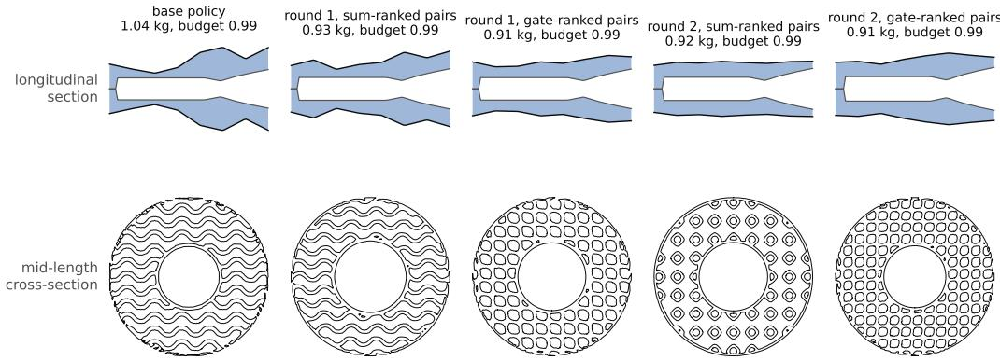  
Figure 5: One on-target design from each policy on the same requirement, decoded by the function the solver grades: longitudinal section (bore and wall) and mid-length cross-section through the lattice. The policies propose engines with different lattice families and wall profiles, not blocks.

$5 0 0 \times 6 4 \colon \approx 3 \mathrm { h }$ . The cVAE arms, latent search, oracle scoring and every analysis of $\ S 4 { \mathrm { - A F } }$ ran on CPU; re-labelling a 16 000-candidate pool takes 20 s on 20 cores.

## L ADDITIONAL GEOMETRY OBSERVATIONS

What the original 1.5B designers propose. The on-target criterion can be met by a degenerate body — the constrained autoencoder of §7 met it with a block — so we grade the policies’ on-target designs in parameter space against the prior’s (Appendix E, Figure 5). None are blocks: across 6 400–17 000 on-target designs per policy, no design has every radius control near its bound, 0–1% of radius controls sit at a bound (prior 3%), the mean radius control is 0.42–0.49 (prior 0.50), every design is distinct at two decimals, bodies use 2.9 zones on average, and the oracle’s printability score is 1.0. What training changes is diversity: the per-coordinate spread of on-target designs falls from 0.28 (prior) and 0.23 (base) to 0.17 after round 1 under either score, and to 0.07 after a sum-ranked second round, whose designs use two of the four lattice families; the gate-ranked second round keeps 0.13 and three. The narrowing of Figure 3 is visible in the geometry.

## M POST-HOC SELECTION AND UNCERTAINTY AUDIT

Table 10: Selection efficiency η at $K = 1 6$ on identical engine pools using the same critic. The raw unit sum performs poorly after feasibility saturates. Rules that make the feasibility contribution flat in the saturated region recover most of the available selection lift. Mean ± sd over seeds where applicable.
<table><tr><td>rule</td><td></td><td></td><td></td><td>1.5B base 1.5B DPO, 1.6k 1.5B DPO, 4k 1.5B DPO, gated 7B base</td><td></td><td>7B DPO</td></tr><tr><td>logit + mass (as trained)</td><td>0.26</td><td> $0 . 0 5 \pm 0 . 0 4$ </td><td> $0 . 1 0 \pm 0 . 0 2$ </td><td> $0 . 0 8 \pm 0 . 0 2$ </td><td>0.18</td><td> $0 . 0 5 \pm 0 . 0 2$ </td></tr><tr><td>z-scored, reference statistics</td><td>0.52</td><td> $0 . 4 9 \pm 0 . 0 2$ </td><td> $0 . 4 8 \pm 0 . 0 3$ </td><td> $0 . 3 6 \pm 0 . 0 1$ </td><td>0.47</td><td> $0 . 4 7 \pm 0 . 1 1$ </td></tr><tr><td>z-scored per pool</td><td>0.49</td><td> $0 . 2 9 \pm 0 . 0 2$ </td><td> $0 . 3 3 \pm 0 . 0 2$ </td><td> $0 . 4 9 \pm 0 . 0 1$ </td><td>0.52</td><td> $0 . 3 5 \pm 0 . 0 4$ </td></tr><tr><td>rank average</td><td>0.70</td><td> $0 . 5 3 \pm 0 . 0 3$ </td><td> $0 . 5 8 \pm 0 . 0 1$ </td><td> $0 . 7 1 \pm 0 . 0 3$ </td><td>0.69</td><td> $0 . 5 4 \pm 0 . 0 3$ </td></tr><tr><td> $0 . 0 5 \cdot \mathrm { 1 0 9 ^ { i t } } + \mathrm { m a s s }$ </td><td>0.54</td><td> $0 . 5 3 \pm 0 . 0 3$ </td><td> $0 . 5 0 \pm 0 . 0 3$ </td><td> $0 . 3 7 \pm 0 . 0 1$ </td><td>0.50</td><td> $0 . 5 0 \pm 0 . 1 1$ </td></tr><tr><td> $0 . 0 0 5 \cdot \mathtt { l o g i t } + \mathtt { m a s s }$ </td><td>0.85</td><td> $0 . 9 1 \pm 0 . 0 3$ </td><td> $0 . 8 8 \pm 0 . 0 2$ </td><td> $0 . 8 3 \pm 0 . 0 2$ </td><td>0.90</td><td> $0 . 9 2 \pm 0 . 0 3$ </td></tr><tr><td> $\log { \sigma ( \log { \tt i t } ) } + \tt { m a s s }$ </td><td>0.51</td><td> $0 . 9 2 \pm 0 . 0 2$ </td><td> $0 . 8 9 \pm 0 . 0 0$ </td><td> $0 . 8 2 \pm 0 . 0 3$ </td><td>0.76</td><td> $0 . 9 0 \pm 0 . 0 5$ </td></tr><tr><td> $p \geq 0 . 5 ,$  then closest mass</td><td>0.71</td><td> ${ \bf 0 . 9 4 \pm 0 . 0 2 }$ </td><td> $\mathbf { 0 . 9 2 \pm 0 . 0 1 }$ </td><td> $\mathbf { 0 . 9 0 \pm 0 . 0 1 }$ </td><td>0.92</td><td> ${ \bf 0 . 9 4 \pm 0 . 0 4 }$ </td></tr><tr><td>mass head alone</td><td>0.50</td><td> $0 . 9 3 \pm 0 . 0 2$ </td><td> $0 . 9 1 \pm 0 . 0 1$ </td><td> $0 . 8 6 \pm 0 . 0 1$ </td><td>0.74</td><td> $0 . 9 1 \pm 0 . 0 8$ </td></tr><tr><td>one head trained on on-target</td><td>0.58</td><td> $0 . 5 2 \pm 0 . 0 3$ </td><td> $0 . 4 4 \pm 0 . 0 2$ </td><td> $0 . 4 3 \pm 0 . 0 4$ </td><td>0.67</td><td> $0 . 5 4 \pm 0 . 0 5$ </td></tr></table>

This follow-up uses stored test pools; it is post-hoc, not a new registered prediction. We compute AUC directly against oracle feasibility on parsed samples, using every feasible sample as positive,

Table 11: AUC-preserving scale sensitivity on the matched 1.5B sum-DPO pools. Multiplying the feasibility logit by positive c preserves its marginal ROC/AUC exactly, yet changes the additive selector’s best-of-16 answer. Candidate pools and critic outputs are fixed.
<table><tr><td>C</td><td>0.01</td><td>0.1</td><td>1</td><td>10</td><td>100</td></tr><tr><td>raw-sum answer@16</td><td>0.544</td><td>0.312</td><td>0.185</td><td>0.162</td><td>0.160</td></tr></table>

including feasible mass misses. Across the matched DPO arms it is 0.940–0.991, with 40–225 informative requirements per seed. Precision of the predicted passing set is 0.961–0.981. These measurements supplement own-bin AUC, which only uses on-target positives. A fixed held-out score alone does not establish on-policy reliability.

Table 12: Right-minus-sum differences on the same test requirements. DPO right arm: hard-gated ranking; GRPO right arm: log-probability reward. Intervals use 2000 paired requirement bootstrap resamples after averaging the three fixed training seeds within each requirement. They quantify test-requirement variation conditional on those seeds, not population uncertainty over training seeds. Seed SD is reported separately in the training tables.
<table><tr><td>family</td><td>endpoint</td><td>difference</td><td>requirement bootstrap 95% CI</td></tr><tr><td>DPO 1.5B</td><td>per draw</td><td>0.1765</td><td>[0.1630,0.1905]</td></tr><tr><td>DPO 1.5B</td><td>supply@16</td><td>0.1707</td><td>[0.1453, 0.1973]</td></tr><tr><td>DPO 1.5B</td><td>two-stage answer@16</td><td>0.1620</td><td>[0.1373,0.1877]</td></tr><tr><td>DPO 7B</td><td>per draw</td><td>0.0827</td><td>[0.0707, 0.0951]</td></tr><tr><td>DPO 7B</td><td>supply@16</td><td>0.1597</td><td>[0.1377, 0.1820]</td></tr><tr><td>DPO 7B</td><td>two-stage answer@16</td><td>0.1477</td><td>[0.1260, 0.1690]</td></tr><tr><td>GRPO 1.5B</td><td>per draw</td><td>0.0035</td><td>[−0.0014, 0.0086]</td></tr><tr><td>GRPO 1.5B</td><td>supply@16</td><td>0.0467</td><td>[0.0287,0.0653]</td></tr><tr><td>GRPO 1.5B</td><td>two-stage answer@16</td><td>0.0320</td><td>[0.0123,0.0513]</td></tr></table>

Residual spread is not uniformly noise. We permute feasibility logits within each requirement’s predicted passing set, preserving the set and mass scores, and re-evaluate the raw sum (100 permutations). On gated 7B pools mean raw answer falls from 0.237 to 0.209: residual ordering retains useful signal. This does not make the raw sum competitive with two-stage selection, but it precludes treating all residual feasibility variation as irrelevant noise. Permutation is a conditional score ablation, not an intervention on training.

Parsing and the second-round lineage. Relative to the single parent policy, sum-ranked children lose supply even on requirements where both parent and child pools are fully parsed: differences −0.141, −0.110, −0.061 on 915, 762, 685 requirements. Gated children improve supply on the corresponding subsets by 0.050, 0.103, 0.218. This shows that format breakage alone cannot account for all observed loss; the subsets are post-hoc and selected, so this is not a causal correction for parsing. Within-requirement coordinate spread is reported in the main text conditional on at least two successful samples.

Top-1 failures and sampling budget. The analysis artifact includes nested K = 1, 2, 4, 8, 16 answer curves, failures split into unparsed, infeasible parsed, and feasible mass misses, and the fraction of requirements with a solution that the selector misses. These directly measure the top of the ranking, which AUC alone does not determine. For matched sum DPO at 1.5B, the raw sum misses an available solution on 0.446–0.482 of requirements, compared with 0.035–0.048 under two-stage selection.

Table 13: Eq. 3 on the head that scores the learned conjunct, the original policy-sampled pool, parsed candidates only; the identity is evaluated per requirement before aggregation, and rows with ± are mean ± sd over three training seeds. “Predicted” is $( 1 - q ) A _ { \mathrm { o w n } } + { \textstyle { \frac { 1 } { 2 } } } q .$ i.e. the identity with $A _ { \mathrm { { c r o s s } } }$ set to $\begin{array} { l } { { \frac { 1 } { 2 } } } \end{array}$ ; the one constant it uses, $A _ { \mathrm { o w n } } ,$ is measured on the same pool. The engine’s 7B base has parse rate 0.76, the 1.5B base 0.97; all other engine rows ≥ 0.95.
<table><tr><td></td><td>policy</td><td>conjunct rate</td><td>q</td><td>measured</td><td> $A _ { \mathrm { o w n } }$ </td><td> $A _ { \mathrm { { c r o s s } } }$ </td><td>predicted</td></tr><tr><td rowspan="10">engine</td><td>1.5B base</td><td>0.26</td><td>0.33</td><td>0.802</td><td>0.951</td><td>0.496</td><td>0.800</td></tr><tr><td>1.5B DPO, sum pairs, 1.6k</td><td>0.87</td><td>0.97</td><td>0.512 ± 0.010</td><td>0.976 ± 0.013</td><td>0.500 ± 0.008</td><td>0.513</td></tr><tr><td>1.5B DPO, sum pairs, 4k</td><td>0.87</td><td>0.97</td><td>0.532 ± 0.004</td><td>0.966 ± 0.020</td><td> $0 . 5 1 9 \pm 0 . 0 0 7$ </td><td>0.513</td></tr><tr><td>1.5B DPO, gated pairs, 4k</td><td>0.80</td><td>0.92</td><td>0.535 ± 0.006</td><td>6 0.944 ± 0.016</td><td>0.494 ± 0.001</td><td>0.537</td></tr><tr><td>1.5B round 2, sum pairs</td><td>0.86</td><td>0.99</td><td>0.488 ± 0.004</td><td>0.984 ± 0.023</td><td>0.484 ± 0.004</td><td>0.505</td></tr><tr><td>1.5B round 2, gated pairs</td><td>0.88</td><td>0.97</td><td>0.545 ± 0.019</td><td>0.943 ± 0.010</td><td>0.533 ± 0.023</td><td>0.513</td></tr><tr><td>1.5B IPO / DPO β sweep (4 arms)</td><td>0.39–0.83</td><td>0.48–0.94</td><td>0.715-0.506</td><td>0.93-0.95</td><td>0.47-0.49</td><td>0.725–0.527</td></tr><tr><td>7B base</td><td>0.32</td><td>0.59</td><td>0.682</td><td>0.983</td><td>0.481</td><td>0.698</td></tr><tr><td>7B DPO, sum pairs</td><td>0.79</td><td>0.92</td><td>0.513 ± 0.054</td><td>0.978 ± 0.015</td><td>0.476 ± 0.013</td><td>0.537</td></tr><tr><td rowspan="3">GSM8K base</td><td></td><td>0.42</td><td>0.16</td><td>0.919</td><td>0.997</td><td>0.507</td><td>0.920</td></tr><tr><td>DPO, sum pairs</td><td>0.98</td><td>0.96</td><td>0.506 ± 0.004</td><td>0.995</td><td>0.489 ± 0.006</td><td>0.518</td></tr><tr><td>DPO, gated pairs</td><td>0.98</td><td>0.96</td><td>0.497 ± 0.016</td><td>0.995</td><td>0.479 ± 0.013</td><td>0.518</td></tr></table>

## N COMPLETE ORIGINAL MIXTURE TABLE

## O MATCHED TRAIN-PAIR FOLLOW-UP: TUNED SUM, LOG-PROBABILITY AND MASS-ONLY DPO

Protocol, fixed before training. The protocol, committed as PROTOCOL\_STRONG\_CONTROLS\_2026-09-18.md, was written after the original sumversus-gate result was known and before any new pool or policy existed; it is a prospective follow-up, not an original preregistration. A new Qwen2.5-1.5B-Instruct pool on all 500 committed validation requirements (K=16, seed 0, the same shots and critic) selects a weight from the thirteen-point grid 0, 0.0005, 0.001, 0.002, 0.005, 0.01, 0.02, 0.05, 0.1, 0.2, 0.5, 1, 2 by the highest oracle-labelled validation top-1 answer; no test label enters. The sweep peaks at w = 0.005 (0.238) and is monotone on either side (0.166 at w = 0, 0.208 at 0.01, 0.134 at 0.1, 0.090 at 1). Three rules — the weighted sum at that weight, log σ(logit) + mass\_term, and mass\_term alone — were then trained on the stored 1000 × 16 train pool with exactly the original recipe (4 000 pairs, four per prompt, $\beta = 0 . 1$ , three epochs, lr $5 \times 1 0 ^ { - 5 }$ , LoRA r = 16), three seeds each, no seed dropped, and evaluated on the committed 1 000 test requirements with common selectors. All nine pools were re-labelled by the oracle independently of the bench.

Pair content. We reconstruct the original sum pairs exactly from the stored train pool and build the other rules’ pairs with the same top-four versus bottom-four builder. Table 14 gives the oracle content of each rule’s pairs and Table 15 the policies trained on them.

Table 14: Matched train-pair content, chosen/rejected: feasible rate, on-target rate and median absolute oracle log-mass error (parsed sides). Exact triple overlap (requirement, chosen, rejected) is 0.099 between sum and gate, 0.586 between sum and log-prob, 0.210 between gate and w = 0.005, and 0.463 between w = 0.005 and mass-only.
<table><tr><td>ranking</td><td>feasible</td><td>on target</td><td>mass error</td></tr><tr><td>sum (w = 1)</td><td>0.654/0.015</td><td>0.0653/0.0018</td><td>0.495/0.604</td></tr><tr><td>hard gate</td><td>0.565/0.084</td><td>0.0890/0.0005</td><td>0.290/0.918</td></tr><tr><td>tuned sum (w = 0.005)</td><td>0.349/0.223</td><td>0.1008/0.0000</td><td>0.193/1.007</td></tr><tr><td>log-prob</td><td>0.635/0.019</td><td>0.0823/0.0008</td><td>0.436/0.616</td></tr><tr><td>mass-only</td><td>0.279/0.245</td><td>0.0930/0.0000</td><td>0.172/1.007</td></tr></table>

Registered predictions and outcomes. Before any result was read (PREREG\_TUNED\_SUM\_THEORY\_2026-09-18.md) we registered, from the aggregation argument of §AE, that the tuned sum and the log-probability form would each land within 0.04 of the gate’s composed answer and 0.05 of its per-draw rate and supply (T1, T2), that mass-only would stay below 0.70 composed with the falsifier “within 0.03 of the $\mathrm { g a t e } ^ { \prime \prime } \left( \mathrm { T } 3 \right)$ , that every new arm would beat the unit sum (T4), and that $q > 0 . 9$ and $A _ { \mathrm { o w n } } > 0 . 9$ on every tuned-sum and log-prob arm (T5). T3 held on every seed and the falsifier did not fire. T1, T2 and T4 missed: the tuned sum is 0.187 below the gate, the log-probability form 0.082 below, and the tuned sum and mass-only fall below the unit sum on composed answer. T5 missed on $q$ for the tuned sum (0.57–0.63) with $A _ { \mathrm { o w n } } > 0 . 9 2$ everywhere. The prediction that failed was the extrapolation of a selection-side argument to pair construction; the selection-side part held (the validation-selected weight lies in the registered band [0.001, 0.005]).

Table 15: Policies trained on the five rules; test $1 0 0 0 \times 1 6 ,$ , mean ± seed sd. The last three columns are the gate’s advantage under the common two-stage selector with a paired requirement bootstrap (seeds fixed), and the head’s mixture terms on the trained policy’s pool.
<table><tr><td>ranking</td><td>per draw</td><td>feasible</td><td> $\operatorname { s u p p l y } @ 1 6$ </td><td>two-stage</td><td>gate – rule [95% CI]</td><td></td><td>q</td><td>AUC</td><td> $A _ { \mathrm { o w n } }$ </td></tr><tr><td>sum</td><td> $0 . 1 3 4 \pm 0 . 0 0 5$ </td><td>0.867</td><td> $0 . 6 3 6 \pm 0 . 0 3 7$ </td><td> $0 . 5 9 6 \pm 0 . 0 3 3$ </td><td> $0 . 1 6 2 \ [ 0 . 1 3 5 , 0 . 1 8 7 ]$ </td><td></td><td>0.970</td><td>0.532</td><td>0.966</td></tr><tr><td>hard gate</td><td> $0 . 3 1 1 \pm 0 . 0 1 3$ </td><td>0.804</td><td> $0 . 8 0 7 \pm 0 . 0 0 7$ </td><td> $0 . 7 5 8 \pm 0 . 0 0 5$ </td><td></td><td></td><td>0.916</td><td>0.535</td><td>0.944</td></tr><tr><td>tuned sum</td><td> $0 . 2 5 8 \pm 0 . 0 2 8$ </td><td>0.658</td><td> $0 . 6 4 9 \pm 0 . 0 2 3$ </td><td> $0 . 5 7 1 \pm 0 . 0 3 0$ </td><td></td><td> $0 . 1 8 7 \left[ 0 . 1 5 9 , 0 . 2 1 5 \right]$ </td><td>0.601</td><td>0.674</td><td>0.928</td></tr><tr><td>contrast-matched sum, w=0.1</td><td> $0 . 3 1 2 \pm 0 . 0 2 1$ </td><td>0.867</td><td> $0 . 8 2 1 \pm 0 . 0 1 7$ </td><td> $0 . 7 7 0 \pm 0 . 0 2 3$ </td><td></td><td> $- 0 . 0 1 2 \left[ - 0 . 0 3 0 , 0 . 0 \dot { 0 } 6 \right]$ </td><td></td><td>0.961 0.515 0.927</td><td></td></tr><tr><td>log-prob</td><td> $0 . 1 8 0 \pm 0 . 0 1 5$ </td><td>0.871</td><td> $0 . 7 2 1 \pm 0 . 0 3 8$ </td><td> $0 . 6 7 5 \pm 0 . 0 2 9$ </td><td></td><td> $0 . 0 8 2 \ \mathrm { \AA } 0 . 0 5 9 , 0 . 1 0 4 ]$ </td><td></td><td>0.973 0.524 0.947</td><td></td></tr><tr><td>mass-only</td><td> $0 . 1 9 0 \pm 0 . 0 3 5$ </td><td>0.451</td><td> $0 . 6 0 4 \pm 0 . 0 2 4$ </td><td> $0 . 5 1 9 \pm 0 . 0 2 7$ </td><td></td><td> $0 . 2 3 8 \ [ 0 . 2 0 8 , 0 . 2 6 7 ]$ </td><td></td><td>0.381 0.778 0.948</td><td></td></tr></table>

Why the tuned weight is the wrong training weight. Figure 8 sweeps w over the train pool. Among parsed train candidates the logit’s spread (9.96) is ten times the mass term’s (0.97), so the pair contrast in feasibility, ∆F, falls monotonically as w shrinks while the mass contrast ∆M rises: (0.64, 0.11) at w = 1, (0.13, 0.82) at 0.005, (0.03, 0.84) at 0. The gate sits at (0.48, 0.63). The scalar curve passes close to that point near $w \approx 0 . 1$ ((0.48, 0.52)), a weight 20× the validation-selected one and one the selection criterion ranks fifth from the bottom of thirteen; we had registered that no weight would come within 0.85 of the gate on both contrasts, and the sweep refutes that (0.91 at $w = 0 . 0 7 5 )$ . The chosen sets of $w = 0 . 1$ and of the gate overlap 65%, the full pairs 15%: the gate’s rejected candidates are the infeasible ones with the worst mass term, while a scalar score rejects by whichever term dominates at that weight.

The contrast-matched weight matches the observed gate endpoint. Whether that weight recovers the gate’s outcome was registered before training (PLAN\_CONTRAST\_ $\mathsf { D P O \_ } 2 0 2 6 \mathsf { - } 0 9 \mathsf { - } 1 9$ .md: $w = 0 . 1$ at 1.5B, three seeds, recipe unchanged), with a decision rule: mass gain $\geq 0 . 9 5$ and composed ≥ 0.74 would mean contrast suffices and the gate is a weight in disguise; $\mathrm { g a i n } \le 0 . 7 8$ and composed ≤ 0.66 at feasibility ≥ 0.75 would mean the rejected set matters. The rule returned contrast suffices: per draw $0 . 3 1 2 { \pm } 0 . 0 2 1$ , feasible 0.867, supply $0 . { \dot { 8 } } 2 1 { \pm } 0 . 0 1 7 $ , composed 0.770±0.023, mass gain $0 . 9 8 \pm 0 . 0 2 , q 0 . 9 6 1 , A _ { \mathrm { o w n } }$ 0.927 (Table 15); the paired gate-minus-sum differences are −0.001 $[ - 0 . 0 1 5 , 0 . 0 1 2 ]$ per draw, −0.014 [−0.031, 0.003] supply, −0.012 [−0.030, 0.006] composed and $- 0 . 0 2 0 \left[ - 0 . 0 3 9 , - 0 . 0 0 1 \right]$ under the log-probability selector. Every registered point value missed, all in the same direction: we had expected a partial recovery (feasible 0.79, per draw 0.27, composed 0.70, gain 0.80, envelope $\rho < 0 . 4 5 )$ and the policy reached the gate on every count and installed envelope conditioning as well $( 0 . 6 9 \pm 0 . 0 6 )$ , which no other rule does together with unit budget tracking. The 0.72 plateau of the three mis-weighted scalar rules is therefore a property of their contrast, not of scalar scores, and the gate’s distinctive rejected set does not matter. The base-pool forecast of §4 lands within 0.024 on these arms. The 7B base train pool is used below to test whether the weight-selection criterion itself transfers; a later follow-up then trains the corresponding 7B scalar arm.

Choosing the contrast weight without gold labels. The trained $w = 0 . 1$ arm above was selected by oracle-unit contrasts $\Delta F$ and $\Delta M$ . We subsequently pre-specified a label-free repetition using only the critic on the same train pool: $\Delta P$ is the difference in predicted feasibility probability between chosen and rejected samples, and $\Delta \widehat { M }$ is the reduction in predicted absolute log-mass error. Across the weight grid, $\Delta P$ and $\Delta F$ have Spearman correlation 1.000 at 1.5B and 0.999 at $\widehat { 7 } \mathrm { B } ; \Delta \widehat { M }$ and $\Delta M$ have 0.995 and 0.999. Matching the hard gate in critic units selects $w = 0 . 0 7 5$ at 1.5B and $w = 0 . 0 5 6 \mathrm { - } 0 . 0 7 5$ at 7B, the same narrow region as the oracle-unit sweep.

A further post-hoc criterion removes even the gate as a reference. For each w, we normalise $\Delta P$ and $\Delta \widehat { M }$ by their respective maxima over the sweep and maximise the smaller of the two normalised contrasts. This intrinsic maximin rule selects $w = 0 . 0 7 5$ at 1.5B and $w = 0 . 0 5 6$ at 7B; maximising their product or minimising distance to the ideal point (1, 1) selects exactly the same weights. This criterion by itself does not prove that the resulting policy must match a gate; the 1.5B experiment above and the later 7B follow-up below test that training claim. It answers the practical weightselection question using critic outputs alone and is distinct from the failed label-free diagnostic in Appendix T.

Post-hoc split stability of the intrinsic criterion. As a sampling-sensitivity check, we recompute the critic-only maximin rule on the independently generated base test pools, which were not used to build the training pairs. It selects exactly the train-pool choices: $w = 0 . 0 7 4 9 8 9$ at 1.5B and $w = 0 . 0 5 6 2 3 4$ at 7B. In 500 requirement-bootstrap resamples of each test pool, the 1.5B maximin choice is 0.074989 in 499/500 resamples (and 0.1 once); at 7B it is 0.056234 in 415/500, 0.05 in 66/500 and 0.074989 in 19/500. Thus every resample at both scales stays in the same [0.05, 0.10] region. Product and distance-to-ideal criteria choose the same full-test-pool points. This audit is post-hoc and is evidence for split stability of the criterion, not a new policy training result.

7B follow-up of contrast-matched training. We subsequently trained three 7B DPO seeds at $w = 0 . 0 5$ , the nearest implemented weight to the intrinsic 7B choice near 0.056, with the same 4 000- pair recipe. This run occurred after the 1.5B contrast result and is not preregistered. The three policies reach target success per draw $0 . 2 1 8 \pm 0 . 0 2 1$ and supply@ $1 6 \ : 0 . 6 1 5 \pm 0 . 0 6 8$ . Re-evaluating the stored pools with the common two-stage selector gives composed answer $0 . 5 6 5 \pm 0 . 0 6 5$ , compared with $0 . 5 6 2 \pm 0 . 0 2 6$ for the matched 7B hard gate. The paired requirement bootstrap for contrast-matched minus gate is $0 . 0 0 3 \left[ - 0 . 0 1 5 , 0 . 0 2 0 \right]$ ; against the 7B unit-sum policy it is 0.151 [0.126, 0.175]. The scalar’s own weighted-sum selector reaches only $0 . 2 6 1 \pm 0 . 0 \hat { 4 } 5$ , so the result supports transfer of the pair-construction criterion without collapsing the distinction between training and inference-time selection. The follow-up export retained target labels, critic scores, parse masks, and design vectors, but not the separate oracle-feasibility label; we therefore do not report a follow-up feasibility rate in Table 39.

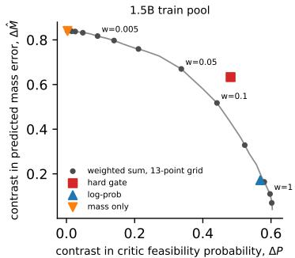

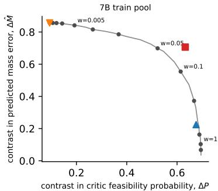  
Figure 6: Label-free pair contrast in critic units over scalar weights. The balanced region is near w ≈ 0.05–0.1 at both scales, far from the validation-tuned $w = 0 . 0 0 5$ . Oracle labels are not used by these axes.

## P PROOF OF THE SHARP AUC IDENTIFIED SET

Let $S ^ { + }$ denote a score drawn from the positive class and $S _ { j } ^ { - }$ a score drawn from negative failure bin $B _ { j }$ . With the usual half-credit convention for ties, $\begin{array} { r } { a _ { j } = \mathrm { P r } [ \bar { S } ^ { + } > S _ { j } ^ { - } ] + \frac { 1 } { 2 } \mathrm { P r } [ S ^ { + } = S _ { j } ^ { - } ] } \end{array}$ . Drawing a negative first chooses bin $j$ with probability $\pi _ { j }$ , so the law of total probability gives $\begin{array} { r } { A { \stackrel { \cdot } { = } } \sum _ { j } \pi _ { j } a _ { j } = } \end{array}$ $\pi ^ { \top } a$ . Hence every data-generating process compatible with $( A , \pi )$ lies in $\{ a \in [ 0 , 1 ] ^ { J } : \pi ^ { \bar { \top } } a = A \}$ The set is sharp. For any $a \in [ 0 , 1 ] ^ { J }$ satisfying the equality, take $S ^ { + } \sim \mathrm { U n i f } ( 0 , 1 )$ . For $a _ { j } \in ( 0 , 1 )$ choose the negative-bin score to be the constant $S _ { j } ^ { - } = 1 - a _ { j } ; $ for the endpoints choose any constant above 1 or below 0. Then the positive-versus-bin AUC is exactly $a _ { j }$ for every bin simultaneously, so every point in the set is attainable. For $J = 2 , A = ( 1 - q ) \dot { A _ { \mathrm { o w n } } } + q A _ { \mathrm { c r o s s } }$ and eliminating $A _ { \mathrm { c r o s s } } \doteq [ 0 , 1 ]$ yields Eq. 4; exchanging the roles gives the symmetric bound. I $\dot { \cdot } q = 1 , A _ { \mathrm { o w n } }$ drops out completely. This proves Proposition 1.

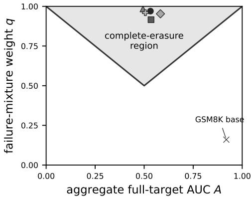  
Figure 7: Complete erasure for the two-bin audit. In the shaded region $q \geq \operatorname* { m a x } ( A , 1 - A )$ , the sharp identified interval for $A _ { \mathrm { o w n } }$ is all of [0, 1].

Controlled-mixture audit design. Suppose the bin-specific ordering vector a is held fixed while an auditor constructs K negative mixtures with known rows $\pi ^ { ( k ) }$ . Writing Π for the resulting $K \times J$ matrix, the aggregate audits satisfy $A = \Pi a$ . Hence a is point-identified for every possible value iff rank $\langle \Pi \rangle \stackrel { } { = } J ;$ otherwise a null-space direction that remains inside $[ 0 , 1 ] ^ { J }$ is observationally equivalent. For the binary split, two audits with $q _ { 1 } \neq q _ { 2 }$ give

$$
A _ { \mathrm { o w n } } = { \frac { q _ { 2 } A _ { 1 } - q _ { 1 } A _ { 2 } } { q _ { 2 } - q _ { 1 } } } , \qquad A _ { \mathrm { c r o s s } } = { \frac { ( 1 - q _ { 1 } ) A _ { 2 } - ( 1 - q _ { 2 } ) A _ { 1 } } { q _ { 2 } - q _ { 1 } } } .
$$

This is a controlled-reweighting result; it does not license combining ordinary policy checkpoints whose conditional score distributions may themselves change.

A useful corollary is the exact condition for complete loss of information about $A _ { \mathrm { o w n } }$ when $q < 1 \colon$ its sharp interval is [0, 1] iff $1 - q \leq A \leq q .$ All four matched engine rows in Table 2 satisfy this condition. The result is an identification statement about the aggregate statistic; it does not say that direct own-bin estimates are unreliable when their support is adequate.

## Q WHY VALIDATION-TUNED SELECTION WEIGHTS NEED NOT BEPAIR-OPTIMAL

For two candidates $i , j$ scored by $\begin{array} { r } { r _ { w } = w s _ { F } + s _ { M } } \end{array}$ , their order can change only when

$$
w ( s _ { F , i } - s _ { F , j } ) + ( s _ { M , i } - s _ { M , j } ) = 0 .
$$

Thus, away from the finite set of pairwise crossing weights, every within-pool ranking is fixed. Any top-k selector and any deterministic top-versus-bottom pair builder is consequently piecewise constant in w. If two rules induce the same chosen–rejected multiset, the DPO loss is literally the same function of the policy parameters because the scalar score is no longer an input to DPO. This proves Proposition 7.

For the approximate statement, write the per-pair DPO loss as $\ell _ { \theta } ( z ) = \log ( 1 + \exp [ - \beta d _ { \theta } ( z ) ] )$ . If $| d _ { \theta } ( z ) | \leq R .$ , then $\ell _ { \theta }$ ranges over an interval of width exactly βR. The variational characterisation of total variation therefore gives $| \mathbb { E } _ { P } \ell - \mathbb { E } _ { Q } \ell | \leq \beta R d _ { \mathrm { T V } } ( P , \mathbf { \dot { Q } } )$ . For the gradient bound, project the gradient difference onto an arbitrary unit vector; the projected per-pair gradient lies in $[ \bar { - } G , G ]$ , so its expectation changes by at most $2 G d _ { \mathrm { T V } } ( P , Q )$ . Taking the supremum over unit vectors proves Proposition 7. For uniform finite pair multisets, total variation equals one minus their overlap coefficient (counting multiplicity).

## A local bridge from pair contrasts to the first DPO update.

Proposition 4 (Reference-gradient contrast bound). Let $\theta _ { 0 }$ equal the DPO reference policy, let $g ( z ) = \nabla _ { \theta } d _ { \theta } ( z ) | _ { \theta _ { 0 } }$ , and let $\phi ( z ) \in \mathbb { R } ^ { d }$ be a vector of pair-property contrasts. Suppose $g ( z ) =$ $B \phi ( z ) + r ( z )$ , with $\mathbb { E } _ { P } \| r \| \le \epsilon _ { P }$ and $\mathbb { E } _ { Q } \lVert r \rVert \leq \epsilon _ { Q }$ . Then

$$
\| \nabla L _ { P } ( \theta _ { 0 } ) - \nabla L _ { Q } ( \theta _ { 0 } ) \| \le \frac { \beta } { 2 } \Big ( \| B \| \ \| \mathbb { E } _ { P } \phi - \mathbb { E } _ { Q } \phi \| + \epsilon _ { P } + \epsilon _ { Q } \Big ) .
$$

For DPO, $\ell _ { \theta } ( z ) = \log ( 1 + \exp [ - \beta d _ { \theta } ( z ) ] )$ . At the reference policy $\theta _ { 0 } , d _ { \theta _ { 0 } } ( z ) = 0$ for every pair, hence

$$
\nabla L _ { P } ( \theta _ { 0 } ) = - \frac { \beta } { 2 } \mathbb { E } _ { P } [ g ( z ) ] .
$$

Subtracting the expressions for P and Q, applying the triangle inequality and then Jensen proves Proposition 4. The assumption is an explicit local feature model for the preference-log-ratio gradient. We did not retain the per-pair gradient artifacts needed to estimate its residual for these runs, so the proposition is a sufficient-condition bridge, not an empirically established mechanism or a claim that oracle contrasts are sufficient statistics for later optimization.

There is nevertheless no implication from validation top-1 optimality to balanced training-pair contrast. A two-prompt counterexample suffices. Each row below is a candidate with gold conjuncts (F, M) and proxy components $\left( { \boldsymbol { s } } _ { F } , { \boldsymbol { s } } _ { M } \right)$

<table><tr><td></td><td>1</td><td>2</td><td>3</td></tr><tr><td>prompt A prompt B</td><td>(0, 1; 5, 1) (0, 1; 5, 2)</td><td>(1, 1; 0, 6) (0, 0; 3, 4)</td><td>(0, 1; 2, 0) (1, 1; 4, 5).</td></tr></table>

At $w = 0 . 5$ , the successful (1, 1) candidate is top-ranked for both prompts, so top-1 success is 1, but top-versus-bottom pairs have average oracle contrasts $( \Delta F , \Delta M ) \dot { = } ( \dot { 1 , } 0 ) . \dot { \mathrm { A t } } \dot { w } = 2 .$ , top-1 success falls to $1 / 2 ,$ , while the average contrasts become $( 1 / 2 , 1 / 2 )$ . Hence a weight that is strictly better for selection can erase one training contrast that a worse selector preserves. The example is only an existence result; the engine experiment tests whether this mismatch matters in the observed system.

Pair overlap is not the empirical explanation. All 1.5B round-1 rules use 4 000 pairs from the same train pool. Their full-pair overlap with the hard gate and eventual composed answer are
<table><tr><td>ranking rule</td><td>pair overlap with gate</td><td>composed @16</td></tr><tr><td>unit sum</td><td>0.099</td><td>0.596</td></tr><tr><td>validation-tuned sum</td><td>0.210</td><td>0.571</td></tr><tr><td>contrast-matched sum  $( w = 0 . 1 )$ </td><td>0.150</td><td>0.770</td></tr><tr><td>log-probability</td><td>0.140</td><td>0.675</td></tr><tr><td>mass-only</td><td>0.262</td><td>0.519</td></tr></table>

Thus the best-performing scalar is not the one whose examples most resemble the gate’s. Its chosencandidate set overlaps the gate by 65%, but only 15% of complete chosen–rejected pairs coincide.

Across-rule contrast alignment. For the five scalar rules trained with the same 1.5B recipe, define the bottleneck contrast relative to the hard gate as

$$
b ( r ) = \operatorname* { m i n } \left\{ \frac { \Delta F _ { r } } { \Delta F _ { \mathrm { g a t e } } } , \frac { \Delta M _ { r } } { \Delta M _ { \mathrm { g a t e } } } \right\} , \qquad ( \Delta F _ { \mathrm { g a t e } } , \Delta M _ { \mathrm { g a t e } } ) = ( 0 . 4 8 1 , 0 . 6 2 8 ) .
$$

The quantities below use only the already reported pair-content and endpoint tables:

<table><tr><td>scalar rule</td><td>b(r)</td><td>pair overlap with gate</td><td>composed @16</td></tr><tr><td>unit sum</td><td>0.174</td><td>0.099</td><td>0.596</td></tr><tr><td>validation-tuned sum</td><td>0.262</td><td>0.210</td><td>0.571</td></tr><tr><td>contrast-matched sum (w = 0.1)</td><td>0.828</td><td>0.150</td><td>0.770</td></tr><tr><td>log-probability</td><td>0.287</td><td>0.140</td><td>0.675</td></tr><tr><td>mass-only</td><td>0.071</td><td>0.262</td><td>0.519</td></tr></table>

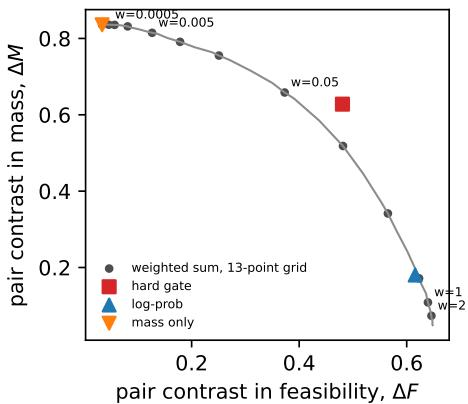  
Figure 8: Matched 1.5B pair geometry: tuned $w = 0 . 0 0 5$ is mass-dominated, the unit sum feasibilitydominated; the pre-specified $\bar { w } \approx 0 . \dot { 1 }$ passes near the gate.

Across these five points, Spearman correlation with composed @16 is 0.90 for $b ( r )$ and −0.60 for exact pair overlap. With $n = 5$ this is deliberately presented as a descriptive ordering check, not a significance result or a fitted predictive model. It nevertheless tests the claim on every scalar rule that was actually trained under the matched recipe, rather than only on the successful $w = 0 . 1$ arm.

These are descriptive overlaps from the fixed training pool, not a statistical test.

## R PERFECT-CONJUNCT AND FINITE-POOL CONTROLS

These are post-hoc controls on existing candidates, not part of the original preregistration. The exact feasibility oracle (engine) and boxed-format regex (GSM8K) replace only the head of the correspond ing conjunct for AUC measurement. A binary perfect conjunct head ties every successful candidate with every failure that satisfies that conjunct. Thus its full-target AUC is $1 - q / 2 ,$ , with half credit for ties. We average over requirements containing both target classes; engine candidates are parsed-only. Support is 285 base requirements and 658, 657, 593 for the three matched 1.5B sum-DPO seeds. Their perfect-head AUCs are 0.8326 and 0.5187, 0.5145, 0.5113, respectively. GSM8K support is 474 at base and 431, 443, 439 after sum-DPO, with AUCs 0.9219 and 0.5189, 0.5210, 0.5155. Own-task oracle correctness is exact by construction; this is not an oracle for the full conjunction.

We also measure best-of-k averaged over every uniform size-k subset of each stored GSM8K pool of $N = 6 4 .$ , without replacement. For a deterministic selector order, candidate rank $r \in \{ 1 , \ldots , \bar { N } \}$ is selected with probability $\binom { N - r } { k - 1 } / \binom { N } { k }$ ; averaging its target label with these weights gives the exact conditional answer rate. Supply is $\bar { 1 } - \binom { N - P } { k } / \binom { N } { k }$ , where $P$ is the number of successes. Ties use original candidate index. Exhaustive small-pool subset enumeration verifies the implementation. This is a finite-pool estimator, not a new scaling law or a prediction beyond $N ;$ related ROC-based scaling theory is in Dorner et al. (2026).

For sum-DPO, averaging training seeds, raw-sum answers at k = 4, 16, 64 are 0.693, 0.680, 0.645, versus base 0.606, 0.736, 0.762. Supplies after sum-DPO are 0.839, 0.929, 0.969 at those budgets. Replacing the learned format gate with the exact boxed regex and retaining the learned correctness ranker gives 0.679 at $k = 1 6$ and 0.639 at k = 64 after sum-DPO (base 0.737, 0.758). This control removes format-classification error without repairing the remaining ranker. It does not establish impossibility for other correctness models or selection methods.

Finally, a fixed scale grid $T \in \{ 0 . 0 1 , 0 . 1 , 1 , 1 0 , 1 0 0 \}$ applied to feasibility logits preserves every head AUC but changes raw-sum answers. Matched 1.5B sum-DPO has mean answers 0.544, 0.312, 0.185, 0.162, 0.160, respectively. This test-set sensitivity analysis illustrates the distinction between ranking metrics and aggregation units; it is not validation-based hyperparameter tuning. Code and complete tables are in scripts/audit\_perfect\_head.py, scripts/audit\_gsm\_tails.py, and the corresponding results directories.

The paired requirement-bootstrap difference (sum-DPO minus base), conditional on these fixed training seeds, $\mathrm { i s ~ - 0 . 0 5 5 5 ~ [ - 0 . 0 7 3 8 , - 0 . 0 3 6 8 ] }$ for raw-sum answers at $k ~ = ~ 1 6$ and −0.1167 $[ - 0 . 1 \bar { 5 } 0 0 , - 0 . 0 8 3 3 ]$ at $k = 6 4$ . Exact-format-gate differences are $- 0 . 0 5 7 8 \ [ - 0 . 0 7 6 7 , - 0 . 0 4 0 2 ]$ and $- 0 . 1 1 9 3 \left[ - 0 . 1 5 3 3 , - 0 . 0 8 7 3 \right]$ . These intervals quantify requirement uncertainty, not population training-seed uncertainty.

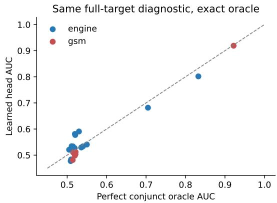

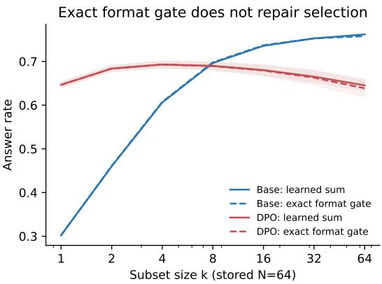  
Figure 9: Post-hoc controls. Left: full-target AUC for learned versus perfect own-conjunct heads on the same pools. Right: GSM8K finite-pool subset-averaged answers; exact format gating does not repair the remaining correctness ranker. Bands show training-seed SD, not confidence intervals.

## S TRANSFER FORECAST OF ON-POLICY AUC

Equation 3 is exact on the pool whose terms it uses, so reconstructing an AUC there is arithmetic rather than evidence. This control asks the out-of-sample question instead. The bin terms $A _ { \mathrm { o w n } }$ and $A _ { \mathrm { { c r o s s } } }$ are measured on a source pool; from a target pool we read only q and never the head’s ordering; we then predict the target’s on-policy AUC. Every arm answers the same committed test split, so requirement i denotes the same requirement in both pools: a prediction is formed per requirement and averaged over the requirements that contain both target classes in both pools. We compare four predictors: chance $( \textstyle { \frac { 1 } { 2 } } ) ;$ persistence, the source pool’s own AUC, which is what assuming an earlier audit of the same verifier still describes the policy amounts to; the zero-parameter form $( 1 - q ) A _ { \mathrm { o w n } } + q / 2 $ and the transported form $( 1 - q ) A _ { \mathrm { o w n } } + q A _ { \mathrm { c r o s s } } .$

Five protocols supply 57 source–target pairs: the 1.5B base pool to 26 trained 1.5B arms (matched sum and hard-gate DPO, the earlier DPO arms, the five IPO/DPO mitigation arms, both GRPO rewards and the second round), the 7B base pool to 9 trained 7B arms, the 1.5B base pool to those same 9 7B arms, the 1.5B base pool to 7 cVAE-family pools scored by the same critic, and the GSM8K base pool to its 6 trained arms. Measured arm AUC spans 0.408 to 0.937.

Why ordinary checkpoints are not a designed two-mixture audit. Suppose an auditor observes $( A _ { 1 } , q _ { 1 } )$ and $( A _ { 2 } , q _ { 2 } )$ but the conditional terms drift from $( a _ { 1 } , c _ { 1 } )$ to $\left( a _ { 2 } , c _ { 2 } \right)$ . If it nevertheless applies the fixed-component inversion $\hat { a } = ( q _ { 2 } A _ { 1 } - q _ { 1 } A _ { 2 } ) / ( q _ { 2 } - q _ { 1 } )$ , then relative to the first pool

$$
\hat { a } - a _ { 1 } = \frac { q _ { 1 } ( 1 - q _ { 2 } ) ( a _ { 1 } - a _ { 2 } ) + q _ { 1 } q _ { 2 } ( c _ { 1 } - c _ { 2 } ) } { q _ { 2 } - q _ { 1 } } .
$$

Thus separation in mixture weights cannot remove conditional drift; it can amplify it when $\left| q _ { 2 } - q _ { 1 } \right|$ is small. Proposition 3(ii) is therefore a statement about controlled reweighting/resampling of fixed bin-conditional score distributions. The transfer experiments below ask how far that assumption approximately travels across real policy changes; they are diagnostics, not the designed-audit guarantee.

The 11 target arms whose own conjunct has not saturated (mean $q < 0 . 9 $ the seven cVAE pools, two low $- \beta \bar { / } \mathrm { l o w } - \tau$ mitigation arms and two earlier 7B DPO arms) carry the discriminating evidence, because a chance forecast cannot be right there by construction. Their measured AUC spans 0.508 to 0.937, and the zero-parameter MAE is 0.0429 (worst arm 0.0613) against 0.2863 for chance and 0.1596 for persistence. Transporting the measured cross term gives 0.0404.

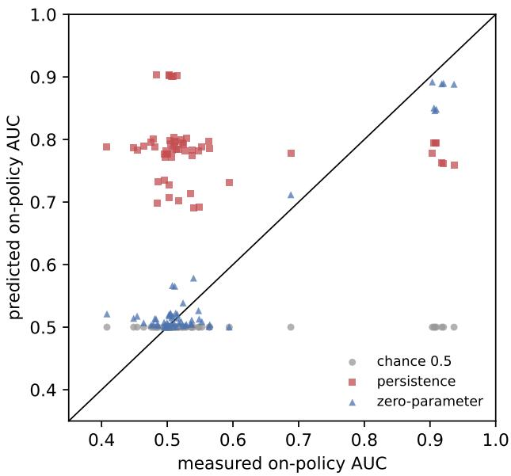  
Figure 10: Forecast against measurement for all 57 target arms. Each point is one target policy or pool. The zero-parameter form tracks the diagonal across the measured range; persistence sits in a band set by the source audit regardless of the target; chance is correct only in the saturated cluster.

Table 16: Arm-level forecast error over all 57 target arms: absolute error of the arm’s mean predicted AUC against its mean measured AUC. The bootstrap resamples requirements jointly across arms and holds the training seeds fixed; it is requirement uncertainty, not population variance over training runs.
<table><tr><td>predictor</td><td>MAE</td><td>worst arm</td><td>signed bias</td><td>r(pred, measured)</td></tr><tr><td>chance  $\textstyle { \frac { 1 } { 2 } }$ </td><td>0.0745 [0.0742, 0.0821]</td><td>0.4366</td><td>-0.0622</td><td></td></tr><tr><td>persistence</td><td>0.2566 [0.2432, 0.2707]</td><td>0.4204</td><td>+0.2231</td><td>-0.093</td></tr><tr><td> $\dot { ( 1 - q ) } A _ { \mathrm { o w n } } + q / 2$ </td><td>0.0280 [0.0275, 0.0357]</td><td>0.1130</td><td>-0.0012</td><td>0.967</td></tr><tr><td> $( 1 - q ) A _ { \mathrm { o w n } } + q A _ { \mathrm { c r o s s } }$ </td><td>0.0325 [0.0322, 0.0496]</td><td>0.1162</td><td>+0.0010</td><td>0.956</td></tr></table>

A further post-hoc baseline makes the interpretation of the full 57 comparisons more conservative. The perfect-head predictor $1 - q / 2$ has MAE 0.0261, and a leave-one-arm-out linear regression of AUC on q has MAE 0.0261, both slightly below the source-own forecast’s 0.0280. Deduplicating the repeated 7B targets leaves 48 unique target pools and gives the same conclusion (0.0261 and 0.0259). Thus the stored-arm analysis demonstrates the composition relation over a wide policy range, but does not show incremental predictive value from source-bin terms beyond $q$ alone. That incremental comparison is reserved for the later arms below.

What this does and does not establish. The forecast avoids re-auditing the head’s ordering on the target policy; it does not avoid target-side labels, since q is an oracle-label statistic of the target pool. All arms existed before this control was written, so this is a post-hoc transfer protocol across stored pools, not a preregistered forward forecast of an unrun experiment. Transporting $A _ { \mathrm { o w n } }$ assumes the head’s ordering against own-conjunct failures is stable across policies; the residual errors in Table 16 bound how far that assumption travels here and do not license it for arbitrary policies, critics or tasks. Accuracy on the saturated arms is unimpressive on its own, since chance achieves it. Code: scripts/predict\_auc\_transfer.py; complete per-arm tables in results/predictive\_audit/.

Arms trained after the forecast was frozen. The forecast code and the 1.5B base pool’s bin terms were fixed on the day the control was written; the nine strong-controls arms (Appendix O) and the three three-conjunct arms (Appendix X) were trained afterwards, with predictions registered before any term was computed on their pools (PLAN\_NEW\_ARMS\_FORECAST\_2026-09-19.md). What remains post-hoc is that their outcome rates had been read, so the rough location of $q _ { t }$ could be anticipated; that anticipation is written in the plan. We therefore call this a pre-specified transfer test with frozen source terms, not a fully prospective forecast. Table 18 gives the result. The registered arm-level error of $0 . 0 3 0 ( \mathrm { b a n d } \leq 0 . { \dot { 0 } } { \dot { 5 } } )$ was met (0.020). Two post-hoc baselines address how much of this is merely $q \colon$ the perfect-head form $1 - q / 2$ gives MAE 0.030, and a linear AUC–q model fitted once on the earlier 57 comparisons gives 0.025. On the six non-saturated arms the corresponding errors are 0.016, 0.036 and 0.027. A post-hoc two-level bootstrap resamples the 1 000 committed test requirements jointly across arms and, within each of the four training rules, resamples the three observed training seeds. It gives source-own advantages over $1 - q / 2$ of 0.0098 [0.0046, 0.0139] and over the historical linear baseline of 0.0054 [0.0005, 0.0096]. On the six non-saturated arms the corresponding gaps are 0.0193 [0.0092, 0.0271] and 0.0100 [0.0006, 0.0177]. A requirement-only bootstrap with arms/seeds fixed gives the slightly narrower intervals reported in the artifact. These are empirical uncertainty checks over the observed seeds and requirements, not population intervals over unseen model families or training recipes. Averaged within training-rule families, source-own improves on $1 - q / 2$ in all four families and on the linear baseline in three of four; the three-conjunct family is essentially tied with the latter. On that subset persistence was slightly better than the registered $^ { \ast \ast } > 0 . 1 0 ^ { 3 } ( 0 . 0 9 3 )$ , a miss that leaves the ranking of the registered predictors unchanged. Spearman correlation between measured AUC and q over the fifteen single-gate 1.5B arms is −0.82; $A _ { \mathrm { o w n } }$ lies in [0.92, 0.98] on every one of the eighteen arms, and the three-conjunct training leaves the feasibility head’s terms where the two-conjunct gate had them (q 0.946 against 0.916). Artifact: results/new\_arms\_audit/; code scripts/audit\_new\_arms.py.

Table 17: Arm-level forecast MAE by protocol. Chance is accurate exactly where the target has saturated its own conjunct, and fails on the cVAE pools, which have not.
<table><tr><td>source → target</td><td>arms</td><td>chance</td><td>persistence</td><td>zero-param</td><td>transported</td></tr><tr><td>1.5B base → 1.5B trained</td><td>26</td><td>0.0305</td><td>0.2767</td><td>0.0279</td><td>0.0374</td></tr><tr><td>7B base → 7B trained</td><td>9</td><td>0.0302</td><td>0.1868</td><td>0.0278</td><td>0.0291</td></tr><tr><td>1.5B base → 7B trained</td><td>9</td><td>0.0252</td><td>0.2668</td><td>0.0262</td><td>0.0223</td></tr><tr><td>1.5B base → cVAE pools</td><td>7</td><td>0.4145</td><td>0.1365</td><td>0.0425</td><td>0.0416</td></tr><tr><td>GSM8K base → GSM8K trained</td><td>6</td><td>0.0088</td><td>0.3991</td><td>0.0144</td><td>0.0213</td></tr></table>

Table 18: Pre-specified transfer test on the twelve arms trained after the source terms were frozen (means of three seeds; 1.5B base as source). $q _ { t } ,$ measured AUC and the forecast are over the requirements whose pools support the terms in both source and target; $A _ { \mathrm { o w n } }$ is the target arm’s own, shown for comparison and not used. “Forecast” is the zero-parameter form $( 1 - q _ { t } ) A _ { \mathrm { o w n } } ^ { \mathrm { s r c } } + q _ { t } / 2 .$
<table><tr><td>training rule</td><td>feasible</td><td> $q _ { t }$ </td><td>measured AUC</td><td> $A _ { \mathrm { o w n } }$ </td><td>forecast</td><td>|error|</td></tr><tr><td>tuned sum  $( w = 0 . 0 0 5 )$ </td><td>0.658</td><td>0.642</td><td>0.644</td><td>0.928</td><td>0.661</td><td>0.017</td></tr><tr><td>log-prob</td><td>0.871</td><td>0.993</td><td>0.509</td><td>0.947</td><td>0.503</td><td>0.034</td></tr><tr><td>mass-only</td><td>0.451</td><td>0.429</td><td>0.748</td><td>0.948</td><td>0.757</td><td>0.015</td></tr><tr><td>three-conjunct gate</td><td>0.812</td><td>0.961</td><td>0.518</td><td>0.958</td><td>0.517</td><td>0.013</td></tr></table>

12 arms: source-own 0.020, transported 0.019, $1 - q / 2 0 . 0 3 0 .$ , historical linear AUC–q 0.025 6 non-saturated arms: source-own 0.016, transported $0 . 0 1 2 , 1 - q / 2 0 . 0 3 6 ,$ historical linear AUC–q 0.027

Along a run. The within-run version, registered before any checkpoint pool was generated (PLAN\_WITHIN\_RUN\_FORECAST $2 0 2 6 \mathrm { - } 0 9 \mathrm { - } 1 9 . \mathrm { m d } )$ , forecasts the head’s on-policy AUC at checkpoint k+1 from the bin terms at checkpoint k, exactly as across arms. Four seed-0 runs with adapters saved every 250 steps (log-probability, tuned sum, three-conjunct gate, mass-only) were sampled on the first 250 committed test requirements at $K { = } 1 6 ;$ step 0 and step 1 500 are the corresponding rows of the stored base and final pools. Table 19 and Figure 11 give the result. Over the 18 transitions of the three arms whose q moves, the zero-parameter forecast has arm-level error 0.049 (registered 0.03, band $\leq 0 . 0 6 )$ against 0.096 for persistence and 0.138 for chance, and beats persistence on 15 of 18; from the base pool’s terms alone the error over every later checkpoint is 0.032. That per-requirement comparison is confined to the requirements where the source checkpoint still has both negative bins, which on a saturated checkpoint are its least saturated ones; applying the source’s pooled own term to every target requirement instead (the arm-level form used out of distribution, and what Figure 11 plots) gives 0.021 against 0.064 for persistence and 0.080 for chance, 13 of 18 transitions in the forecast’s favour, worst transition 0.064. Saturation is fast: on the log-probability and three-conjunct runs q exceeds 0.9 by step 500 (registered), the first transition is persistence’s worst, and the head’s AUC has already fallen to 0.54 and 0.49 at step 250 while per-draw success is 0.09 and 0.16. The mass-only run is the registered null: its q stays in [0.28, 0.41], persistence is within 0.030, and the forecast gains only 0.010 on it — the forecast wins where q moves and only there. Two registered checks missed: $A _ { \mathrm { o w n } } \geq 0 . 9 0$ at every checkpoint fails once (0.853, log-probability step 1 000, on a saturated pool with few own-bin pairs among 250 requirements), and the tuned sum’s q reached 0.498 rather than $> 0 . 5$ by step 500. Single seed, 250 requirements, and generation batches that differ between the checkpoint pools and the stored endpoints are the limits of this control. Artifact: $\mathtt { r e s u l t s / w i t h i n \_ r u n \_ f o r e c a s t / 3 }$ ; code scripts/forecast\_within\_run.py.

Table 19: Within-run forecast from the previous checkpoint: arm-level mean absolute error of each predictor over the six transitions of each run (250 requirements, K=16, seed 0). The mass-only run is the registered null case whose q does not move.
<table><tr><td>run</td><td>q: step 0 → 250 → 1500</td><td>chance</td><td>persistence</td><td>zero-param</td><td>transported</td></tr><tr><td>log-probability</td><td> $0 . 3 4  0 . 9 5  0 . 9 7$ </td><td>0.095</td><td>0.116</td><td>0.074</td><td>0.119</td></tr><tr><td>tuned sum  ${ w { = } 0 . 0 0 5 }$ </td><td> $0 . 3 4  0 . 4 4  0 . 5 9$ </td><td>0.214</td><td>0.052</td><td>0.014</td><td>0.026</td></tr><tr><td>three-conjunct gate</td><td> $0 . 3 4 \to 0 . 8 8 \to 0 . 9 3$ </td><td>0.105</td><td>0.120</td><td>0.061</td><td>0.083</td></tr><tr><td>mass-only (null)</td><td> $0 . 3 4  0 . 3 0  0 . 3 3$ </td><td>0.282</td><td>0.030</td><td>0.020</td><td>0.015</td></tr></table>

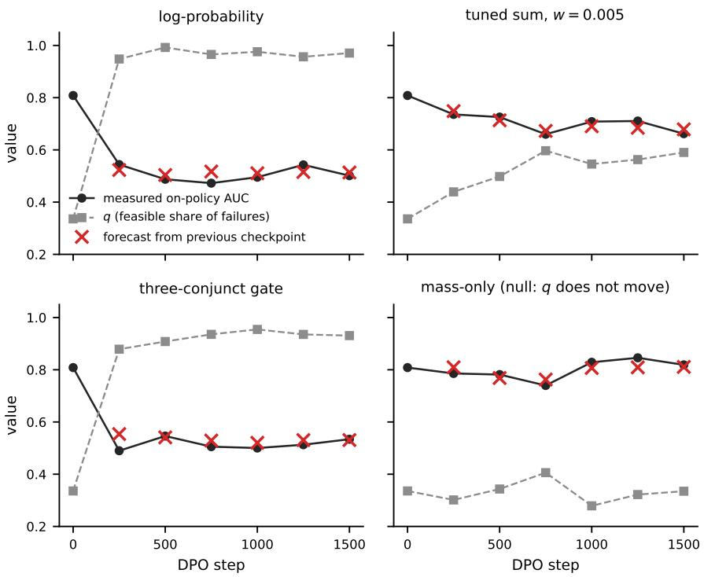  
Figure 11: Measured on-policy AUC of the feasibility head (dots), q (squares) and the zero-parameter forecast from the previous checkpoint’s pooled own term (crosses) along four DPO runs; 250 requirements, $K { = } 1 6 .$ , seed 0.

Out of distribution. The benchmark ships a fourth split of 500 requirements drawn beyond the training prior (thrust to 61.8 N against a 5–60 N prior, expansion ratio to 23.3). Fifteen stored cVAE pools answer it. Requirement indices do not correspond across splits, so this forecast is arm-level: each generator family’s mean bin terms from the test split, that family’s mean q on the OOD split, and its OOD AUC predicted. Over the five families the zero-parameter mean absolute error is 0.0282, against 0.0752 for persistence and 0.3640 for chance, and the identity still reconstructs every OOD requirement to $1 0 ^ { - 9 }$ . Four families land within 0.024. The capped decoder is the exception, missing by 0.101, and the terms say why: its own-bin ordering does not transport, falling from $A _ { \mathrm { o w n } } = 0 . 9 6 5$ on the test split to 0.821 out of distribution. That is the assumption the forecast rests on and this arm is where it breaks. The transported variant fares worse still on latent search, whose $A _ { \mathrm { { c r o s s } } }$ drops from 0.817 to 0.651. Artifact: results/ood\_split/audit.json; code scripts/audit\_ood\_split.py.

## T A LABEL-FREE VERSION OF THE DIAGNOSTIC DOES NOT TRANSFER

Every measurement above needs oracle labels: $q , A _ { \mathrm { o w n } }$ and $A _ { \mathrm { { c r o s s } } }$ are all label statistics. A deployed pipeline has none, so we asked whether the critic’s own scores already reveal that an additive composition is losing best-of-K lift. Three label-free statistics were computed per arm from the two term arrays alone: the share of pools whose sum-argmax equals the saturated term’s argmax, the median within-pool SD of the saturated term over the other term’s, and the share of candidates the saturated head calls satisfied with $p > 0 . 9 9$ . They were asked to predict two oracle-measured quantities: $\eta _ { \mathrm { r a w } }$ , the share of attainable best-of-K lift the additive rule captures, and the gain from switching to a gate. Leave-one-arm-out linear fits were compared against predicting the training-fold mean over 32 engine arms and the same 32 plus 7 GSM8K arms.

On the engine arms alone the relations look usable: saturated fraction against gate gain reaches $r = 0 . 7 0$ with leave-one-out MAE 0.140 against 0.227 for the mean, and the SD ratio against $\eta _ { \mathrm { r } { \mathrm { : } } }$ aw reaches $r = 0 . 7 3$ with MAE 0.112 against 0.151. The SD ratio’s sign is nevertheless opposite to the mechanism, because a dominant feasibility term also marks pools where feasibility genuinely discriminates. Adding GSM8K removes the effect: saturated fraction against gate gain falls to $r = 0 . 0 2$ and the SD ratio to $r = - 0 . 1 4$ , both worse than predicting the mean (0.339 and 0.336 against 0.332).

We therefore make no label-free claim. This is a negative result on three specific statistics and two targets, not a proof that no label-free diagnostic exists; a learned combination, per-requirement rather than per-arm targets, or a calibrated head might do better. Code: scripts/label\_free\_diagnostic.py; full table in results/label\_free\_diagnostic/audit.json.

## U FEASIBILITY’S OWN SUB-CONSTRAINTS: A CASE WHERE THE MIX MOVES AND THE AUC DOES NOT

The packaged oracle defines feasible as printable AND fits\_envelope: no DfAM flag (overhang, minimum wall, channel-versus-ligament, minimum TPMS cell) and length $\leq$ envelope (the radius clause $2 r _ { \mathrm { m a x } } \leq$ envelope cannot bind: $2 \times 5 5 \mathrm { m m } < 2 0 0 \mathrm { m m } )$ . Both are consequential geometric constraints, and neither is syntactic. The main text treats feasibility as one conjunct; here we split it.

The two are learned at very different rates. Printability rises from 0.396 at the 1.5B base and 0.544 at the 7B base to 0.93–1.00 across every matched DPO and GRPO arm; envelope fit starts at 0.808 in both bases and ends between 0.811 and 0.880. The envelope rate is capped: for 4.9% of test requirements the sized length exceeds the envelope even at the policy’s shortest setting, so no design fits. Among attainable requirements the fit rate moves from 0.85 to 0.92 under sum-ranked pairs and stays at 0.86–0.87 under gated pairs (Appendix W). The composition of the head’s negative bin therefore shifts hard: writing p = Pr[printable | not feasible], the share of remaining failures that print but do not fit rises from 0.081 (1.5B base) and 0.052 (7B base) to 0.21–0.93 after training.

Splitting the feasibility head’s negatives the same way gives $\mathrm { A U C } ( s _ { F } ; F ) = ( 1 - p ) A _ { \mathrm { p r i n t } } + p A _ { \mathrm { e n v } } ,$ checked to $1 0 ^ { - 9 }$ per requirement. Unlike the conjunctive case of the main text, the inherited term is not near chance: $A _ { \mathrm { e n v } }$ lies between 0.889 and 0.995 on every arm, and $\operatorname { A U C } ( s _ { F } ; F )$ stays between

0.940 and 0.991 throughout. The extreme case is the 7B sum arm at seed $^ { 2 , }$ where $p = 0 . 9 3 2 -$ almost every remaining failure is an envelope failure — and the AUC is 0.983.

This is the control the conjunctive claim needs. Negative composition moves at least as far here as it does in the main text $( q$ reaching 0.98), in the same pools and with the same critic, and no collapse follows, because the head kept its ordering in the bin it inherited. Composition and bin quality are separately necessary; neither on its own predicts the diagnostic. The envelope-only bin is sparse on the strongest arms (33–201 supported requirements, listed per arm in the artifact), so the $A _ { \mathrm { e n v } }$ estimates there carry correspondingly wide uncertainty; the direction of the contrast does not depend on any single arm. Code: scripts/audit\_feasibility\_substructure.py; per-arm table in results/subconstraint\_audit/audit.json.

## V THE SAME CRITIC AS A TRAINING TARGET AND AS A SEARCH OBJECTIVE

The cVAE family lets the critic enter the generator in two different places, on one design space with one oracle. Five families, three decoder seeds each, 1 000 test requirements and $K = 6 4 ;$ mean ± seed SD.

Table 20: Generator families on the engine task. Per-draw on-target is flat across the first three families while supply collapses, which is the dissociation of §AE in the generator-training direction rather than the selection direction. Latent search is not compute-matched with the decoders.
<table><tr><td>generator</td><td>feasible</td><td>on target</td><td>supply@64</td></tr><tr><td>prior, random latent</td><td> $0 . 0 8 1 \pm 0 . 0 0 1$ </td><td> $0 . 0 0 7 4 \pm 0 . 0 0 0 2$ </td><td> $0 . 3 2 1 \pm 0 . 0 1 3$ </td></tr><tr><td>decoder,  $\lambda = 0$ </td><td> $0 . 0 9 3 \pm 0 . 0 0 5$ </td><td> $0 . 0 0 8 6 \pm 0 . 0 0 0 5$ </td><td> $0 . 3 3 6 \pm 0 . 0 0 3$ </td></tr><tr><td>decoder,  $\lambda = 1$ </td><td> $0 . 1 0 1 \pm 0 . 1 2 0$ </td><td> $0 . 0 0 9 0 \pm 0 . 0 1 1 1$ </td><td> $0 . 0 9 1 \pm 0 . 0 5 6$ </td></tr><tr><td>decoder,  $\lambda = 1 ,$  capped</td><td> $0 . 0 3 6 \pm 0 . 0 3 8$ </td><td> $0 . 0 0 3 8 \pm 0 . 0 0 3 8$ </td><td> $0 . 0 7 2 \pm 0 . 0 6 0$ </td></tr><tr><td>latent search on  $\lambda = 0$ </td><td> $0 . 4 8 1 \pm 0 . 0 4 7$ </td><td> $0 . 3 4 1 7 \pm 0 . 0 2 9 4$ </td><td> $0 . 9 3 7 \pm 0 . 0 1 7$ </td></tr></table>

Training the decoder against the critic’s two terms leaves per-draw on-target where the untrained prior already was and removes two thirds of the coverage; capping the output layer, the obvious fix for the escape of Appendix $\mathrm { F , }$ does not recover it and in these runs is worse. The $\lambda = 1$ rows carry very large seed spread — one seed reaches feasible 0.238 and another 0.049 — so we read the supply collapse, which is consistent across seeds, and not the feasible column. Using the same critic as a search objective over the same decoder’s latent space instead reaches 0.342 on target and 0.937 supply.

We do not claim an optimality result for latent search, which is not compute-matched, and we do not claim that no decoder training against a critic can work. The reading we do take is that a critic which ranks candidates well (Table 2) is not thereby a good objective for shaping the generator that produces them, and that the failure shows up as lost coverage rather than lost per-draw quality — the same place it shows up in the language-model arms. The ordering survives the out-of-distribution split: supply at $K { = } 6 4$ falls to 0.256 for the prior and 0.255 for $\lambda ~ = ~ 0$ , stays at 0.095 and 0.083 for the two critic-trained decoders — which have no coverage left to lose — and falls to 0.596 for latent search, which degrades most in relative terms and still dominates. Artifacts: results/generator\_families/audit.json and results/ood\_split/audit.json.

## W WHAT THE GENERATOR LEARNS TO CONDITION ON THE REQUIREMENT

The engine target has one conjunct that does not depend on the requirement and two that do. Printability is a set of DfAM rules on walls, ligaments, overhang and cell size; the requirement enters only through the bore radii. Envelope fit is, from the oracle code, L(thrust, ε) $( 0 . { \bar { 8 } } 5 + 0 . 4 v _ { 3 0 } ) \leq$ envelope: one design coordinate, the length scale $v _ { 3 0 } .$ , against a sized length and a per-prompt envelope. Mass on target needs the body’s mass to track the prompt’s budget $m ^ { \star }$ . Reading the rule off the code and re-applying it to stored candidates reproduces the oracle’s envelope flag on 100.0% of parsed candidates on all 39 pools. Table 21 measures, per generator, whether each conjunct is satisfied as a habit or as a function of the prompt: the partial correlation of the requirement-mean $v _ { 3 0 }$ with log envelope given log sized length, and the OLS gain of requirement-mean log m on log m⋆. Every quantity is behavioural, measured on outputs; nothing here inspects a representation inside a model.

Table 21: What each generator conditions on the requirement. Printable is the requirementindependent conjunct; its rate and its spread across thrust terciles (pp). Envelope is the requirementdependent conjunct with one control, the length scale v30: partial correlation of the requirement-mean v30 with log envelope given log sized length (reads the envelope?), and the fit rate where fitting is attainable at all (95.1% of requirements). Mass: OLS slope of requirement-mean log m on log $m ^ { \star }$ (a gain; 1 is one-to-one tracking) and its partial correlation given thrust. Test split, mean $\pm \thinspace \mathrm { S D }$ over three seeds; single-seed rows unmarked. LLM arms $K { = } 1 6$ , cVAE $K { = } 6 4 .$ . †Arms trained after the audit was written, with predictions registered beforehand.
<table><tr><td rowspan="2">generator</td><td colspan="2">printable</td><td colspan="2">envelope</td><td colspan="2">mass</td><td rowspan="2">on target</td></tr><tr><td>rate</td><td>∆thrust</td><td>ρpart</td><td>fit|att.</td><td>gain</td><td>ρpart</td></tr><tr><td>1.5B base</td><td> $0 . 4 0$ </td><td>42</td><td>0.22</td><td> $0 . 8 5$ </td><td>0.04</td><td> $_ { 0 . 1 6 }$ </td><td>0.027</td></tr><tr><td>1.5B DPO, sum</td><td> $0 . 9 9 \pm 0 . 0 1$ </td><td>3 ± 2</td><td> $0 . 8 0 \pm 0 . 0 4$ </td><td> $0 . 9 2 \pm 0 . 0 0$ </td><td> $0 . 4 8 \pm 0 . 0 4$ </td><td> $0 . 8 7 \pm 0 . 0 1$ </td><td> $0 . 1 3 4 \pm 0 . 0 0 5$ </td></tr><tr><td>1.5B DPO, gate</td><td> $0 . 9 8 \pm 0 . 0 1$ </td><td>3±1</td><td> $0 . 1 3 \pm 0 . 0 2$ </td><td>0.86 ± 0.01</td><td> $1 . 0 3 \pm 0 . 0 8$ </td><td> $0 . 9 7 \pm 0 . 0 0$ </td><td> $0 . 3 1 1 \pm 0 . 0 1 3$ </td></tr><tr><td>1.5B DPO, gate, round 2</td><td> $1 . 0 0 \pm 0 . 0 0$ </td><td>1 ± 0</td><td> $0 . 4 5 \pm 0 . 1 4$ </td><td> $0 . 9 5 \pm 0 . 0 1$ </td><td> $1 . 1 1 \pm 0 . 0 2$ </td><td> $0 . 9 7 \pm 0 . 0 0$ </td><td> $0 . 3 6 3 \pm 0 . 0 4 2$ </td></tr><tr><td>1.5B DPO, tuned sum w=0.005†</td><td> $0 . 8 0 \pm 0 . 0 3$ </td><td>35 ± 4</td><td> $0 . 0 8 \pm 0 . 0 1$ </td><td> $0 . 8 9 \pm 0 . 0 1$ </td><td> $0 . 7 4 \pm 0 . 0 4$ </td><td> $0 . 9 7 \pm 0 . 0 0$ </td><td> $0 . 2 5 8 \pm 0 . 0 2 8$ </td></tr><tr><td>1.5B DPO, contrast-matched sum w=0.1†</td><td> $0 . 9 9 \pm 0 . 0 0$ </td><td>3± 1</td><td> $0 . 6 9 \pm 0 . 0 6$ </td><td> $0 . 9 2 \pm 0 . 0 0$ </td><td> $0 . 9 8 \pm 0 . 0 2$ </td><td> $0 . 9 6 \pm 0 . 0 0$ </td><td> $0 . 3 1 2 \pm 0 . 0 2 1$ </td></tr><tr><td>1.5B DPO, log-prob†</td><td> $0 . 9 9 \pm 0 . 0 0$ </td><td>1± 1</td><td> $0 . 7 9 \pm 0 . 0 5$ </td><td> $0 . 9 2 \pm 0 . 0 0$ </td><td> $0 . 7 2 \pm 0 . 0 4$ </td><td> $0 . 9 0 \pm 0 . 0 0$ </td><td> $0 . 1 8 0 \pm 0 . 0 1 5$ </td></tr><tr><td>1.5B DPO, mass-only†</td><td> $0 . 5 7 \pm 0 . 0 7$ </td><td>36 ± 6</td><td> $0 . 1 1 \pm 0 . 0 2$ </td><td> $0 . 8 8 \pm 0 . 0 1$ </td><td> $0 . 7 3 \pm 0 . 0 2$ </td><td> $0 . 9 7 \pm 0 . 0 0$ </td><td> $0 . 1 9 0 \pm 0 . 0 3 5$ </td></tr><tr><td>1.5B DPO, three-conjunct gate†</td><td> $0 . 9 9 \pm 0 . 0 1$ </td><td>1 ± 1</td><td> $0 . 1 1 \pm 0 . 0 2$ </td><td> $0 . 8 6 \pm 0 . 0 0$ </td><td> $1 . 0 6 \pm 0 . 0 2$ </td><td> $0 . 9 6 \pm 0 . 0 0$ </td><td> $0 . 2 5 7 \pm 0 . 0 0 2$ </td></tr><tr><td>7B base</td><td>0.54</td><td>22</td><td>0.63</td><td>0.85</td><td>0.30</td><td> $_ { 0 . 6 8 }$ </td><td> $0 . 0 5 9$ </td></tr><tr><td>7B DPO, sum</td><td> $1 . 0 0 \pm 0 . 0 0$ </td><td>0 ± 0</td><td> $0 . 9 2 \pm 0 . 0 2$ </td><td> $0 . 9 2 \pm 0 . 0 1$ </td><td> $0 . 2 0 \pm 0 . 0 1$ </td><td> $0 . 6 3 \pm 0 . 0 4$ </td><td> $0 . 1 0 7 \pm 0 . 0 0 4$ </td></tr><tr><td>7B DPO, gate</td><td> $0 . 9 4 \pm 0 . 0 1$ </td><td>11 ± 2</td><td> $0 . 5 5 \pm 0 . 0 7$ </td><td> $0 . 8 7 \pm 0 . 0 1$ </td><td> $0 . 6 2 \pm 0 . 0 6$ </td><td> $0 . 9 3 \pm 0 . 0 1$ </td><td> $0 . 1 8 9 \pm 0 . 0 1 0$ </td></tr><tr><td>1.5B GRPO, sum</td><td> $0 . 9 9 \pm 0 . 0 0$ </td><td>2±1</td><td> $0 . 6 8 \pm 0 . 0 3$ </td><td> $0 . 9 0 \pm 0 . 0 0$ </td><td> $0 . 2 0 \pm 0 . 0 2$ </td><td> $0 . 6 1 \pm 0 . 0 3$ </td><td> $0 . 0 8 6 \pm 0 . 0 0 2$ </td></tr><tr><td>1.5B GRPO, soft gate</td><td> $0 . 9 6 \pm 0 . 0 1$ </td><td>7±1</td><td> $0 . 6 0 \pm 0 . 0 1$ </td><td> $0 . 9 0 \pm 0 . 0 0$ </td><td> $0 . 2 1 \pm 0 . 0 2$ </td><td> $0 . 6 3 \pm 0 . 0 3$ </td><td> $0 . 0 8 9 \pm 0 . 0 0 3$ </td></tr><tr><td>cVAE prior</td><td>0.13</td><td>15</td><td>0.01</td><td>0.80</td><td>0.00</td><td>0.00</td><td>0.007</td></tr><tr><td>decoder,  $\lambda = 0$ </td><td> $0 . 1 5 \pm 0 . 0 1$ </td><td>16 ± 1</td><td> $0 . 0 6 \pm 0 . 0 2$ </td><td></td><td>0.80 ± 0.01 −0.00 ± 0.00</td><td> $- 0 . 0 3 \pm 0 . 0 3$ </td><td> $0 . 0 0 9 \pm 0 . 0 0 1$ </td></tr><tr><td>decoder, λ = 1</td><td> $0 . 1 1 \pm 0 . 1 3$ </td><td>7±5</td><td> $0 . 0 7 \pm 0 . 0 6$ </td><td>1.00 ± 0.00 −0.00 ± 0.00</td><td></td><td> $- 0 . 0 4 \pm 0 . 0 3$ </td><td> $0 . 0 0 9 \pm 0 . 0 1 1$ </td></tr><tr><td>decoder, λ = 1, capped</td><td> $0 . 0 4 \pm 0 . 0 4$ </td><td>6 ± 9</td><td> $0 . 0 9 \pm 0 . 1 2$ </td><td> $1 . 0 0 \pm 0 . 0 0$ </td><td> $- 0 . 0 0 \pm 0 . 0 0$ </td><td> $- 0 . 0 2 \pm 0 . 0 1$ </td><td> $0 . 0 0 4 \pm 0 . 0 0 4$ </td></tr><tr><td>latent search on  $\lambda \stackrel { } { = } 0$ </td><td> $0 . 6 1 \pm 0 . 0 0$ </td><td>14 ± 0</td><td> $0 . 4 2 \pm 0 . 0 0$ </td><td> $0 . 9 3 \pm 0 . 0 0$ </td><td> $0 . 7 6 \pm 0 . 0 0$ </td><td> $0 . 9 9 \pm 0 . 0 0$ </td><td> $0 . 3 7 4 \pm 0 . 0 0 3$ </td></tr></table>

The requirement-independent conjunct goes to ceiling under every rule that contrasts it. Printability is 0.40 and 0.54 at the two bases and 0.93–1.00 on every DPO and GRPO arm whose pairs contrast feasibility; its dependence on thrust, 42 and 22 pp across terciles at the bases, falls to 0–5 pp on those arms. This is the conjunct whose head saturates in the main text. The two rules whose pairs barely contrast feasibility (Table 14) leave it short of ceiling: $0 . 5 7 \pm 0 . 0 7$ under mass-only, whose pairs contrast it by 0.03, and $0 . 8 0 \pm 0 . 0 3$ under the tuned sum (0.13), with the thrust dependence of the base intact (35–36 pp). We had registered the mass-only value as 0.60 (band < 0.80) before computing it.

Which requirement-dependent conjunct is conditioned on is set by the ranking rule. Pairs ranked by the unit-weight sum, which the saturated feasibility logit dominates, install envelope conditioning: the partial correlation of $v _ { 3 0 }$ with the envelope rises from 0.22 to 0.76–0.84 at 1.5B and from 0.63 to 0.91–0.94 at 7B, on every seed, while the mass gain reaches only 0.44–0.52 at 1.5B and falls from the 7B base’s 0.30 to 0.19–0.22. Pairs ranked by the hard gate leave envelope conditioning where the base had it (0.12–0.16 at 1.5B; 0.48–0.62 at 7B) and install mass conditioning with near-unit gain: $1 . 0 3 \pm 0 . 0 8$ at 1.5B with partial correlation 0.97 on every seed, $0 . 6 2 \pm 0 . 0 6$ at 7B. At 1.5B the across-requirement SD of the gated policy’s mean log m is 0.66, the SD of the log-uniform budget prior itself being 0.61: the policy’s mass distribution has become the budget distribution. Per-draw on-target tracks mass gain, the quantity on-target requires: Spearman 0.96 over the seven trained LLM families and 0.88 with the two bases, whose printability is still far from ceiling, included. The two GRPO rewards, whose effect on supply and per-draw is small in §AF, are indistinguishable here as well (0.68 vs 0.60 envelope, 0.20 vs 0.21 mass). Both DPO rules still vary v30 within a requirement (SD 0.04–0.07); “not conditioned” means not set by the prompt, not held constant.

Scalar rules that contrast mass install partial tracking; the gates install full tracking. The four arms trained after this audit was written († in Table 21) test the rule-chooses-the-conjunct claim prospectively. On envelope they behave as registered: the tuned sum and mass-only leave it where the base had it (0.08, 0.11), the log-probability form installs it like the sum (0.79), and the three-conjunct gate leaves it like the gate (0.11). On mass they do not: we registered gains of 0.95 for the tuned sum and mass-only (band [0.8, 1.15]) and 0.45 for log-prob (band [0.3, 0.65]), and all three land at 0.72–0.74, whatever their pairs’ mass contrast (0.18 for log-prob, 0.81–0.84 for the other two); the three-conjunct gate lands at 1.06, as registered. Across the five single-gate rules the trained printable rate follows the pairs’ feasibility contrast (Spearman 0.9) but mass gain does not follow the mass contrast (0.6): both gates reach unit gain with an across-requirement mass SD of 0.66–0.68 that matches the budget prior’s 0.61, while these scalar rules stop at 0.44–0.50. The contrast-matched sum of Appendix O settles what this means: at $w = 0 . 1$ a scalar score installs unit budget tracking (0.98 ± 0.02, mass SD 0.64) and envelope conditioning $( 0 . 6 9 \pm 0 . 0 6 ) $ , the only rule that installs both. The plateau belonged to the wrong weights, not to scalar scores.

The continuous decoder takes the unconditional shortcut; search does not. No cVAE decoder conditions mass on the budget (gain −0.01–0.00 on all nine seeds, prior included), although the decoder is conditional by construction. Trained against the critic’s terms, the $\lambda = 1$ and capped decoders satisfy the envelope by collapsing $v _ { 3 0 }$ to 0.000±0.001 on every seed — the shortest allowed length for every prompt — reaching fit 1.000 while printability falls to 0.00–0.25. Latent search over the untrained decoder, under the same critic, attains mass gain 0.76 with partial correlation 0.99: in the continuous representation the prompt dependence arrives through search at inference, not through the learned map. This is the same contrast as Table 20, one level down: the critic that shapes a token policy’s conditioning through pair ranking shapes a decoder into a constant.

Registered predictions and misses. Five predictions were written before the audit (context/docs/PLAN\_CONDITIONING\_2026-09-18.md); each part is scored there. Held: sum gain below gate gain at both scales; printability flat across envelope classes; gated arms spread mass across requirements more than sum arms. Missed, in the informative direction: we predicted that trained token policies would take the decoders’ shortcut (global shrink, $| \rho | < 0 . 1 5 )$ — they condition instead, on the conjunct the rule rewards; that gated mass gain would lie in 0.30–0.70 — at 1.5B it is 1.03; that the base 7B model would not read the budget — it does, partially (0.30); and that sum arms would narrow their mass below the base’s spread — at 1.5B they widen it, because they track the budget partially. Also missed: the attainable fraction is 0.951, not 0.90, and printability on the 7B gated and GRPO gated arms keeps a 6–14 pp thrust dependence. Base and single-lineage rows are one seed and all arms pre-existed the audit; this is a post-hoc characterisation with pre-registered quantities, not a prospective test. Code: scripts/audit\_conditioning.py, tests in scripts/test\_conditioning.py; perarm values in results/conditioning\_audit/audit.json.

## X A PHYSICS CONJUNCT OUTSIDE EVERY SCORE

Nothing in the paper’s engine target asks whether the printed body would survive a firing. The repository’s print-and-fire readiness screen does: Bartz throat heat flux at the operating point the requirement implies $( p _ { c } = F / ( C _ { F } A _ { t } ) = 1 . 3 0$ bar for every requirement, since $r _ { t } \propto \sqrt { F } ; \phi = 1$ $\bar { T _ { c } } \overset { ^ { . } = 2 2 8 7 } { \mathrm { K } } , c ^ { \bar { * } } = 1 2 4 9 \mathrm { m / s }$ , within 1.1% of the repository’s Cantera values); a closed-form steady hot face through the liner, cooled by regenerative air at 9 bar through the body’s own cooling-zone channels (film coefficient from the air velocity in the channels that fit mid-wall); von Mises margin against the AlSi10Mg yield at the hot-face temperature; and a Coffin–Manson low-cycle-fatigue life of at least 20 fires. It is closed-form, 0.14 ms per candidate, and we applied it to every stored candidate in all 39 pools (Table 22). Ignition is excluded because $L ^ { * }$ is fixed by the oracle’s sizing and the verdict is constant. Neither the critic nor any policy was trained on any of this; the critic scores printability, envelope and mass.

The conjunct binds, and its lever is the cooling channels. Among feasible bodies, 29–64% survive. The hot face is set by the coolant film coefficient, i.e. by the total channel flow area $A _ { \mathrm { c o o l } } = n \pi r _ { \mathrm { e f f } } ^ { 2 } { : }$ more or wider channels slow the air and heat the wall. This is the metal that mass minimisation removes. The 7B gated policy, whose mass tracks the budget with gain 0.62 (Appendix W), opens $8 6 \mathrm { m m ^ { 2 } }$ against the sum policy’s 51 $\mathrm { m m ^ { 2 } }$ and runs its median hot face at 604◦C against $4 0 { \bar { 9 } } ^ { \circ } \mathrm { C } ,$ so 0.31 of its feasible bodies survive against 0.54. Latent search, the best generator under the original target (0.375 per draw, supply 0.94), opens $1 1 6 \mathrm { m m ^ { 2 } } .$ , runs at $1 1 1 4 ^ { \circ } \mathrm { C }$ and survives at 0.18. The two critic-trained decoders have no cooling zone in $1 0 0 \%$ of their designs — the printability rule that penalises a channel against its ligament is satisfied by deleting the channels — and zero survival.

Table 22: A physics conjunct no score has seen. Every stored candidate is re-graded by the readiness screen (hot-face temperature of the AlSi10Mg liner under Bartz throat flux, cooled by regenerative air through its own channels; yield margin at temperature; Coffin–Manson $\mathrm { l i f e } \geq 2 0$ fires) at the operating point the requirement implies $( p _ { c } = 1 . 3 0$ bar, $\phi = 1 )$ $A _ { \mathrm { c o o l } } \colon$ mean total cooling-channel flow area $( \mathrm { m m ^ { 2 } } )$ , which sets the coolant velocity and hence the hot face. ready|feasible: survival among feasible bodies. Supply and two-stage answer are given for the original target (on target) and the extended one (on target ∧ ready), with the screen’s selection efficiency $\eta _ { \mathrm { e x t } }$ and the efficiency of the same rule if it could also see the readiness verdict. Mean ± SD over seeds; $K { = } 1 6$ (LLM) and 64 (cVAE). †Arms trained after the audit was written; the three-conjunct gate ranks pairs by feasibility ∧ readiness, then mass.
<table><tr><td rowspan="2">generator</td><td rowspan="2">Acool med. [°C]</td><td rowspan="2"> $T _ { \mathrm { h o t } }$ </td><td rowspan="2">no cooling zone</td><td rowspan="2">ready</td><td colspan="2">supply@K</td><td colspan="2">two-stage answer</td><td rowspan="2"></td><td rowspan="2">ηext, physics-aware</td></tr><tr><td>|feasible</td><td></td><td>target</td><td>extended</td><td>ηext</td></tr><tr><td>1.5B base</td><td>105</td><td>730</td><td>0.07</td><td>0.32</td><td>0.28</td><td>0.09</td><td>0.21</td><td>0.06</td><td>0.62</td><td>0.80</td></tr><tr><td>1.5B DPO, sum</td><td>56</td><td>499 ± 29</td><td>0.11 ± 0.03</td><td>0.41 ± 0.03</td><td>0.64 ± 0.04</td><td>0.37 ± 0.02</td><td>0.60 ± 0.03</td><td>0.26 ± 0.02</td><td>0.64 ± 0.03</td><td>0.92 ± 0.01</td></tr><tr><td>1.5B DPO, gate</td><td>59</td><td>485 ± 10</td><td>0.06 ± 0.01</td><td>0.40 ± 0.01</td><td>0.81 ± 0.01</td><td>0.44 ± 0.03</td><td>0.76 ± 0.01</td><td>0.30 ± 0.01</td><td>0.56 ± 0.01</td><td>0.91 ± 0.01</td></tr><tr><td>1.5B DPO, tuned sum w=0.005†</td><td>93</td><td>692 ± 86</td><td>0.05 ± 0.01</td><td>0.29 ± 0.06</td><td>0.65 ± 0.02</td><td>0.27 ± 0.04</td><td>0.57 ± 0.03</td><td>0.15 ± 0.02</td><td>0.37 ± 0.05</td><td>0.85 ± 0.02</td></tr><tr><td>1.5B DPO, contrast-matched sum w=0.1†</td><td>62</td><td>507 ± 30</td><td>0.06 ± 0.01</td><td>0.40 ± 0.03</td><td>0.82 ± 0.02</td><td>0.46 ± 0.03</td><td>0.77 ± 0.02</td><td>0.29 ± 0.02</td><td>0.52 ± 0.02</td><td>0.90 ± 0.03</td></tr><tr><td>1.5B DPO, log-prob†</td><td>54</td><td>479 ± 21</td><td>0.10 ± 0.02</td><td>0.42 ± 0.03</td><td>0.72 ± 0.04</td><td>0.46 ± 0.01</td><td>0.68 ± 0.03</td><td>0.30 ± 0.00</td><td>0.59 ± 0.01</td><td>0.90 ± 0.03</td></tr><tr><td>1.5B DPO, mass-only†</td><td>104</td><td>719 ± 20</td><td>0.06 ± 0.02</td><td>0.28 ± 0.03</td><td>0.60 ± 0.02</td><td>0.23 ± 0.01</td><td>0.52 ± 0.03</td><td>0.12 ± 0.01</td><td>0.40 ± 0.01</td><td>0.87 ± 0.04</td></tr><tr><td>1.5B DPO, three-conjunct gate†</td><td>40</td><td>365 ± 13</td><td>0.04 ± 0.01</td><td>0.55 ± 0.02</td><td>0.74 ± 0.01</td><td>0.50 ± 0.02</td><td>0.69 ± 0.01</td><td>0.37 ± 0.03</td><td>0.65 ± 0.04</td><td>0.89 ± 0.02</td></tr><tr><td>7B base</td><td>61</td><td>516</td><td>0.14</td><td>0.29</td><td>0.36</td><td>0.13</td><td>0.34</td><td>0.10</td><td>0.74</td><td>0.91</td></tr><tr><td>7B DPO, sum</td><td>51</td><td>409 ± 49</td><td>0.01 ± 0.01</td><td>0.54 ± 0.09</td><td>0.43 ± 0.03</td><td>0.27 ± 0.05</td><td>0.41 ± 0.03</td><td>0.23 ± 0.04</td><td>0.83 ± 0.03</td><td>0.97 ± 0.03</td></tr><tr><td>7B DPO, gate</td><td>86</td><td>604 ± 6</td><td>0.01 ± 0.00</td><td>0.31 ± 0.01</td><td>0.59 ± 0.03</td><td>0.25 ± 0.02</td><td>0.56 ± 0.03</td><td>0.20 ± 0.01</td><td>0.76 ± 0.03</td><td>0.93 ± 0.03</td></tr><tr><td>1.5B GRPO, sum</td><td>75</td><td>738 ± 27</td><td>0.17 ± 0.02</td><td>0.23 ± 0.01</td><td>0.48 ± 0.00</td><td>0.16 ± 0.01</td><td>0.46 ± 0.00</td><td>0.12 ± 0.01</td><td>0.70 ± 0.01</td><td>0.94 ± 0.02</td></tr><tr><td>1.5B GRPO, soft gate</td><td>84</td><td>647 ± 6</td><td>0.07 ± 0.01</td><td>0.26 ± 0.00</td><td>0.53 ± 0.00</td><td>0.18 ± 0.02</td><td>0.49 ± 0.01</td><td>0.13 ± 0.01</td><td>0.68 ± 0.02</td><td>0.91 ± 0.01</td></tr><tr><td>cVAE prior</td><td>113</td><td>620</td><td>0.07</td><td>0.33</td><td>0.33</td><td>0.13</td><td>0.23</td><td>0.07</td><td>0.58</td><td>0.79</td></tr><tr><td>decoder, λ = 0</td><td>112</td><td>619 ± 40</td><td>0.07 ± 0.01</td><td>0.29 ± 0.03</td><td>0.34 ± 0.00</td><td>0.11 ± 0.01</td><td>0.23 ± 0.01</td><td>0.07 ± 0.02</td><td>0.60 ± 0.09</td><td>0.81 ± 0.04</td></tr><tr><td>decoder, λ = 1</td><td>0</td><td></td><td>1.00 ± 0.00</td><td>0.00 ± 0.00</td><td>0.09 ± 0.06</td><td>0.00 ± 0.00</td><td>0.04 ± 0.02</td><td>0.00 ± 0.00</td><td></td><td></td></tr><tr><td>decoder, λ = 1, capped</td><td>0</td><td></td><td>1.00 ± 0.00</td><td>0.01 ± 0.02</td><td>0.07 ± 0.06</td><td>0.00 ± 0.00</td><td>0.04 ± 0.03</td><td>0.00 ± 0.00</td><td></td><td></td></tr><tr><td>latent search on λ = 0</td><td>116</td><td>1114 ± 2</td><td>0.26 ± 0.00</td><td>0.18 ± 0.00</td><td>0.94 ± 0.00</td><td>0.53 ± 0.00</td><td>0.82 ± 0.02</td><td>0.19 ± 0.01</td><td>0.26 ± 0.03</td><td>0.87 ± 0.02</td></tr></table>

What the training rules protect is what the score ranks. Under the extended target, on target ∧ ready, the gate’s composed advantage over the sum shrinks at 1.5B (0.296 against 0.260; supply 0.444 against 0.371) and inverts on two of three seeds at 7B (0.203 against 0.231; supply 0.249 against 0.268). Survival among feasible bodies is higher than the base’s on every trained DPO arm $( 1 2 / 1 2 ) ,$ but the ordering between rules is not stable across scales. We had registered that the gate would keep its advantage on every seed at both scales; it does not, and the reversal at 7B is the informative miss. The selection side is more robust: the two-stage screen, which sees no physics, still captures $\eta _ { \mathrm { e x t } } = 0 . 5 1 \mathrm { - } 0 . 8 6$ of the attainable extended lift, because feasibility and mass are necessary conditions; the same rule given the readiness verdict as one more conjunct reaches 0.87–0.97. The feasibility head’s own ordering against the physics bin is not at chance $( A _ { \mathrm { p h y s } }$ 0.44–0.69; three-bin identity exact to $2 \times 1 0 ^ { - 1 6 } )$ , which is the wall–ligament coupling, not knowledge of heat transfer.

Registered predictions and misses. Eight predictions were written before the audit (context/docs/PLAN\_PHYSICS\_GATE\_2026-09-18.md). Held: every trained DPO arm survives better than its base; the identity is exact; $A _ { \mathrm { p h y s } }$ on gated 1.5B is 0.554 against a registered $0 . 5 5 ; \eta _ { \mathrm { e x t } }$ on gated 1.5B is 0.557 against 0.55. Missed: every absolute survival rate (we predicted 0.45–0.65 and measured 0.29–0.41; the screen is harsher on AlSi10Mg than the CuCrZr numbers we calibrated on); gate above sum on every seed (reversed at 7B); supply and answer under the extended target for gated 1.5B (0.444 and 0.296 against 0.55 and 0.35); latent search survival (0.18 against 0.50); and that no trained policy sets its wall from the thrust — the sum-ranked and GRPO policies do (partial correlation 0.30–0.63), through the bore radii that printability depends on, while the gated 1.5B policy does not (0.01–0.08). All arms in the paragraphs above pre-existed the audit. Code: scripts/audit\_physics\_gate.py; per-arm values and the declared operating point in results/physics\_gate\_audit/audit.json.

The policies that track mass hardest run hottest. The four arms trained afterwards († in Table 22) were screened with predictions registered first (PLAN\_NEW\_ARMS\_CPU\_2026-09-19.md). The two rules whose pairs contrast mass and not feasibility open the widest channels (93 and 104 mm2 against the gate’s 59), run at 692 and ${ 7 1 9 ^ { \circ } \mathrm { C } }$ , and survive at 0.28–0.29 among feasible bodies, below the gate on every seed and at the base’s level; the log-probability form sits with the sum (0.42; registered within 0.05 of it). The registered claim that every trained arm survives better than the base in absolute terms fails on two of twelve seeds (tuned sum and mass-only, at 0.26–0.27 against the base’s 0.28), because those policies never installed the feasibility that survival rides on.

The gate composes conjuncts, at a price. Putting the readiness verdict into the gate — pairs ranked by mass\_term $- 1 0 0 [ \mathrm { p r o b } ^ { - } < 0 . 5 ] - 1 0 \bar { 0 } [ \cdot$ ¬ready], the readiness label computed for the stored train pool in seconds, the recipe otherwise unchanged — and training three seeds $( \mathtt { P L A N \_ P H Y S I C S \_ D P O \_ 2 0 2 6 - 0 9 - 1 8 \_ m o l }$ , registered before the job) raises survival among feasible bodies from 0.40 to 0.55 (0.52–0.57, every seed above the two-conjunct gate), the extended composed answer from 0.30 to 0.37, and the physics-aware ceiling from 0.41 to 0.46, with mass tracking intact (gain 1.04–1.08) and printability at ceiling. Of eleven registered checks seven held and four missed, all in the direction of a smaller effect: survival 0.55 against a registered 0.60, extended perdraw 0.135 against 0.20, extended supply 0.50 against 0.60; the falsifier (survival below 0.45) did not fire. The miss that says most: the policy’s channel area still does not depend on the thrust $( 0 . 3 0  0 . 3 1$ partial correlation), so it improved survival unconditionally — channels $\mathrm { 5 9 \to 4 0 m m ^ { 2 } }$ , median hot face $4 8 5  3 6 5 ^ { \circ } \mathrm { C } .$ — rather than by learning the coolant requirement the thrust implies, the same pattern as the unconditional shortcut in Appendix W. The price is paid on the original target: per-draw $0 . 3 1 1  0 . 2 5 7$ , supply $0 . 8 1  0 . 7 4 .$ , composed 0 $. 7 6 \to 0 . 6 9$ . The feasibility head’s mixture terms are unchanged (q 0.946, $A _ { \mathrm { o w n } } \ 0 . 9 5 8 )$ . Artifacts: reproduced/physics\_gate\_dpo/; code scripts/summarize\_physics\_gate\_dpo.py.

## Y SELECTION AMBIGUITY AND THE AUDIT CARD: PROOFS AND VALIDATION

Proof of Proposition 5. Let the pool be $\{ x _ { 1 } , \ldots , x _ { n } \}$ with distinct score pairs $( f _ { i } , m _ { i } ) \ =$ $( s _ { F } ( x _ { i } ) , s _ { M } ( x _ { i } ) )$ and let Par be the set of candidates not weakly dominated by any other. Only Pareto candidates can win. $\operatorname { I f } x _ { j }$ dominates $x _ { i } ( f _ { j } \geq f _ { i } , m _ { j } \geq m _ { i }$ , one strict), then for any strictly increasing $g , g ( f _ { j } ) + m _ { j } > g ( f _ { i } ) + m _ { i }$ , so x is never the top-1 choice. Every Pareto candidate can win. Fix p ∈ Par. Every $x _ { i }$ with $f _ { i } > f _ { p }$ has $m _ { i } < m _ { p }$ (otherwise it would dominate $p )$ , and no other candidate has $f _ { i } = f _ { p }$ with $m _ { i } \geq m _ { p } .$ Let $\Delta = \operatorname* { m i n } \dot { \{} m _ { p }  - m _ { i } : f _ { i } \geq f _ { p } , i \neq p \} > 0 \mathrm { ( o r } \Delta = 1 \quad$ if the set is empty), ρ = maxi fi − mini fi, µ = maxi mi − mini $m _ { i } ,$ choose $\varepsilon > 0$ with $\varepsilon \rho < \Delta$ , and set $g ( t ) = \varepsilon t$ for $t < f _ { p }$ and $g ( t ) = K + \varepsilon t { \mathrm { f o r } } t \geq f _ { p }$ with $K > \mu + \varepsilon \rho$ . Then g is strictly increasing; every candidate with $\bar { f _ { i } } < f _ { p }$ scores below p because $K > \mu + \varepsilon \rho ;$ and every candidate with $f _ { i } \geq f _ { p } ,$ $i \neq p ,$ scores $K + \varepsilon \dot { f } _ { i } + \dot { m _ { i } } < K + \varepsilon f _ { p } + m _ { p }$ because $\varepsilon ( f _ { i } - f _ { p } ) \leq \varepsilon \rho < \Delta \leq m _ { p } - m _ { i }$ . Hence p is the unique top-1 choice. Linear rescalings. For $g ( t ) = c t , c > 0 .$ , the top-1 choice maximizes the linear functional $( c , 1 ) \cdot ( f , m )$ , whose maximizers over the finite set are exactly the points of the convex hull exposed by a direction in the open positive quadrant; these are Pareto points on the upper hull. The identification statements follow because an audit statistic invariant to monotone reparameterization is constant on the class $\{ g ( s _ { F } ) \}$ while the decision ranges over Par. □

With ties (duplicated candidates are common when a policy repeats a program), apply the result to distinct score pairs; tied candidates share scores and, in our tasks, oracle labels.

Measured ambiguity. Table 23 reports, per requirement pool of parsed candidates, the mean Pareto size, the share of pools whose Pareto set is a singleton, the share mixing on- and off-target candidates, and the per-pool outer range of Answer@16 reachable by audit-equivalent composites (all monotone g) and by positive rescalings. Pair-weight-trained Phi policies nearly eliminate ambiguity because they emit one program (Section AF).

Audit-card validation. All numbers use the frozen ECG base test pools, parsed candidates, and 12-subject cluster resampling (seed fixed in the released script). Identified interval (step 1). For the deployability head, the per-pool intervals average to [0.472, 1] for Llama (292 pools with a positive and a negative; outer 95% interval [0.396, 1]) and [0.452, 1] for Phi ([0.389, 1]), while the direct value is 1.000; 37% and 48% of pools are individually erased. For the utility head, q is small (0.013–0.018), the interval is tight ([0.894, 0.900] and [0.872, 0.877]), and no labelling is needed. Label budget (step 2). We label m off-target candidates uniformly at random, compare each revealed own-failure with

Table 23: Selection ambiguity on ECG test pools (post-hoc). Ranges are per-pool outer bounds: a single transform must serve all pools, so the attainable aggregate range can be narrower.
<table><tr><td>pools</td><td> $\overline { { | \operatorname { P a r } | } }$ </td><td>singleton</td><td>mixed labels</td><td>Answer@16 range (monotone g)</td><td>range (linear c)</td></tr><tr><td>Llama base</td><td>2.28</td><td>.28</td><td>.21</td><td>[.33, .54]</td><td>[.34, .54]</td></tr><tr><td>Gemma base</td><td>1.75</td><td>.41</td><td>.00</td><td>[.00, .00]</td><td>[.00, .00]</td></tr><tr><td>Phi base</td><td>2.18</td><td>.28</td><td>.14</td><td>[.46, .60]</td><td>[.46, .59]</td></tr><tr><td>Phi gate (3 seeds)</td><td>2.43-2.53</td><td>.19-.24</td><td>.06-.09</td><td>[.65–.68, .73–.74]</td><td>[.65–.68, .73–.74]</td></tr><tr><td>Phi inference (3 seeds)</td><td>2.27–2.71</td><td>.18-.28</td><td>.06-.10</td><td>[.65–.67, .73–.75]</td><td>[.65–.67, .73–.74]</td></tr><tr><td>Phi pair (3 seeds)</td><td>1.01-1.10</td><td>.91-.99</td><td>.00-.01</td><td>[.51–.54, .51–.55]</td><td>[.51–.54, .51–.55]</td></tr></table>

all positives in its pool, and use the ratio estimator of the pair-weighted within-pool $A _ { \mathrm { o w n } }$ , with a subject-cluster bootstrap over the labelled items (200 repetitions per m).

Table 24: Label budget for a direct own-bin audit of the ECG utility head (post-hoc). Target: pairweighted within-pool $A _ { \mathrm { o w n } }$ with all labels (0.895 Llama, 0.842 Phi).
<table><tr><td>m labelled negatives</td><td>25</td><td>50</td><td>100</td><td>200</td><td>400</td><td>800</td></tr><tr><td>Llama: mean estimate Llama: CI width / coverage Phi: mean estimate</td><td>.896 .19 /.89 .852</td><td>.896 .14/.91 .846</td><td>.895 .12 / .96 .841</td><td>.894 .10 / .98 .841</td><td>.895 .09 / 1.00 .843</td><td>.896 .08 / 1.00 .842</td></tr></table>

Controlled mixtures (step 3). Pooling the bin-conditional score distributions, we draw 200 positives and 400 negatives at mixture weights $q _ { 1 } , q _ { 2 } .$ compute the two aggregate AUCs, and solve $A _ { \mathrm { o w n } } =$ $( q _ { 2 } A _ { 1 } - q _ { 1 } A _ { 2 } ) / ( q _ { 2 } - q _ { 1 } )$ . Over 200 repetitions the bias is below 0.015 in all settings; RMSE is 0.010–0.021 at $( q _ { 1 } , q _ { 2 } ) = ( 0 . 2 , 0 . 8 ) , 0 . 0 3 4 \mathrm { - } 0 . 0 4 7$ at (0.4, 0.6) and 0.075–0.090 at (0.45, 0.55) for both heads and families. The utility head’s inherited bin is small (25 and 57 candidates), so its mixtures resample those candidates heavily.

## Z PREREGISTERED EMBEDDED-ECG STRESS TEST

Purpose. This study was designed after the original engine results as an external stress test, not as an exploratory search for another positive domain. The benchmark, critic, model revisions, pair builders, scalar grids, DPO recipe, primary endpoint, equivalence margin, and 30-run matrix were frozen before confirmatory DPO. The optional INCART OOD phase was disabled before the primary freeze and was not run. The freeze is an internal commitment: protocol, manifest and predictions are SHA-256 hashed in the project repository (freeze commit f0b5895) before any confirmatory DPO run, but were not deposited with an external registry, so their timing rests on the repository history rather than on a third-party timestamp.

Data and split. The primary signals are MIT-BIH Arrhythmia Database v1.0.0 (DOI 10.13026/C2F305), with baseline-wander, muscle-artifact and electrode-motion recordings from MIT-BIH Noise Stress Test Database v1.0.0. Records 201 and 202 are grouped as one subject. Subjects are split before window construction into 27 train, 8 validation and 12 test subjects, yielding 1,000/300/500 fixed 30-s requirements. Beat annotations are used only for eligibility and the biomedical oracle and do not enter the prompt features.

Pipeline DSL and target. Each generator emits a finite causal ECG pipeline with whitelisted high-pass and low-pass settings, filter family, notch setting, downsampling, derivative flag, integration window, adaptive threshold multiplier, refractory period and numeric format. The deployment label is

$$
F = \mathrm { v a l i d } / \mathrm { s t a b l e } \wedge [ \mathrm { c y c l e s } \leq C _ { r } ] \wedge [ \mathrm { R A M } \leq R _ { r } ] \wedge [ \mathrm { l a t e n c y } \leq L _ { r } ] .
$$

The biomedical label is

$$
M = [ F 1 _ { \mathrm { Q R S } } \geq 0 . 8 0 ] \wedge [ \mathrm { M A E } _ { R } \leq 6 5 \mathrm { m s } ] ,
$$

and the full target is $y = F \land M$ . Benchmark difficulty was resolved from 131,072 Sobol configurations before generator experiments: $P ( F ) = 0 . 5 8 4 8 { \overset { \cdot } { , } } P ( M \mid F ) = 0 . 2 4 0 8$ , with semantic counts $5 4 , 4 2 1 ~ F = 0 , 5 8 , 1 9 2 ~ F = 1 , M = 0 , \mathrm { a n d } ~ 1 8 , 4 5 9 ~ F = 1 , M = 1 .$

Fixed critic. One two-head MLP critic is trained independently of the generator families and then frozen. Its held-out test AUC is 1.000 for feasibility and 0.930 for utility. The same critic scores Llama, Gemma and Phi candidate pools.

Models and generation. The frozen generator revisions are Llama-3.2-3B-Instruct (revision $0 \mathrm { c b } 8 8 \mathrm { a } 4 \ldots )$ $\mathrm { G e m m a - } 3 { \mathrm { - } } 4 \mathrm { B \mathrm { - } I T } \left( 0 9 3 \pounds 9 \pounds 3 \ldots \right)$ , and Phi-4-mini-instruct $( \mathsf { c f b e f a c . . . } )$ . Each requirement has $K = 1 6$ samples at temperature 0.8 and $\mathrm { t o p } { - } p = 0 . 9 5$ . The first prompt implementation was rejected before the preregistration freeze because it produced no usable Gemma outputs and almost no schema-valid Llama outputs; no valid biomedical outcomes from that attempt were available for scientific tuning. A shared prompt-v2 was accepted by a parse-only train pilot under a criterion fixed before inspecting those outputs, then hashed and frozen. The Phi checkpoint required disabling incompatible remote model code before any model weights or completions were produced; all scientific settings remained unchanged. These engineering deviations are retained in the package.

Selection and pair construction. The scalar grid is $\{ . 0 0 1 , . 0 0 3 , . 0 1 , . 0 3 , . 1 , . 3 , 1 , 3 , 1 0 \}$ . Validation selection gives $w _ { \mathrm { s e l } } = . 0 0 3 , . 0 0 1 , . 0 3$ for Llama, Gemma and Phi. A critic-only normalized maximin of chosen/rejected feasibility and utility contrasts on the frozen train pools (each contrast divided by its maximum over the grid; the gate-free criterion of Appendix O) gives $w _ { \mathrm { p a i r } } = 1 , . 1 , . 3$ . Each rule constructs 4,000 deterministic top-4-versus-bottom-4 pairs. Llama additionally includes a unitsum arm. Exact pair overlap with the hard gate is 92.3%/25.6% for Llama inference/pair weights, 99.5%/71.1% for Gemma, and 79.6%/31.0% for Phi. Llama pair-weight and unit-sum pairs are exactly identical.

DPO and evaluation. All runs use sigmoid DPO with $\beta = . 1$ , two epochs, learning rate $1 0 ^ { - 5 }$ LoRA rank 16 $( \alpha = 3 2 ,$ dropout .05), batch 2 with accumulation 8, and maximum length 768. The matrix contains 12 Llama runs and 9 each for Gemma and Phi, three seeds per rule. All 30 runs completed and all 30 aligned test pools contain 500 requirements by 16 candidates. Evaluation uses one common hard-feasibility-then-utility selector, not the training rule. The primary endpoint is Answer@16; the preregistered gate-equivalence margin is ±.04.

Per-seed endpoints. Table 25 lists all 30 runs. No seed was removed or repeated. Typical invalid outputs include numeric values in the notch field, quoted numeric notch values, unquoted Q15, and refractory values outside the finite schema.

Table 25: All ECG DPO runs: Answer@16 (parse rate) per training seed under the common evaluator. Llama pair-weight and unit-sum were trained on identical pair sets.
<table><tr><td>family</td><td>rule</td><td>seed 0</td><td>seed 1</td><td>seed 2</td></tr><tr><td>Llama</td><td>inference</td><td>.512 (1.00)</td><td>.518 (1.00)</td><td>.470 (1.00)</td></tr><tr><td>Llama</td><td>gate</td><td>.512 (.47)</td><td>.520 (1.00)</td><td>.488 (1.00)</td></tr><tr><td>Llama</td><td>pair</td><td>.000 (.00)</td><td>.000 (.00)</td><td>.512 (1.00)</td></tr><tr><td>Llama</td><td>unit sum</td><td>.000 (.00)</td><td>.002 (.00)</td><td>.512 (1.00)</td></tr><tr><td>Gemma</td><td>inference</td><td>.008 (1.00)</td><td>.000 (.00)</td><td>.006 (.96)</td></tr><tr><td>Gemma</td><td>gate</td><td>.006 (.97)</td><td>.000 (.00)</td><td>.006 (1.00)</td></tr><tr><td>Gemma</td><td>pair</td><td>.000 (.00)</td><td>.124 (1.00)</td><td>.244 (1.00)</td></tr><tr><td>Phi</td><td>inference</td><td>.718 (.75)</td><td>.724 (.98)</td><td>.714 (.79)</td></tr><tr><td>Phi</td><td>gate</td><td>.722 (.98)</td><td>.698 (1.00)</td><td>.724 (.99)</td></tr><tr><td>Phi</td><td>pair</td><td>.512 (.92)</td><td>.512 (.82)</td><td>.544 (.89)</td></tr></table>

Sensitivity to the number of test subjects (post-hoc). The frozen bootstrap resamples only 12 test subjects. A leave-one-subject-out jackknife with $t _ { 1 1 }$ intervals gives $[ - . 3 8 6 , \bar { - } . 2 7 3 ] , \bar { [ + . 0 4 3 , + . 1 9 4 ] }$ and $[ - . 2 6 4 , - . 1 2 8 ]$ for pair minus inference (Llama, Gemma, Phi), $[ - . 3 9 0 , - . 2 8 3 ] , [ + . 0 4 3 , + . 1 9 4 ]$ and $\mathbf { \bar { [ - . 2 5 3 , - . 1 3 1 ] } }$ for pair minus gate, and $[ - . 0 0 3 , + . 0 1 6 ] , [ - . 0 \dot { 0 } 2 , + . 0 0 1 ] \mathrm { a n d } [ - . 0 1 8 , + . 0 1 0 ]$ for gate minus inference. Dropping any single subject moves no estimate by more than 0.024. Per-seed contrasts are the informative caveat: pair minus gate is $- . 2 1 , - . 1 9 , - . 1 8$ for Phi, but $- . 5 1 , - . 5 2 , + . 0 2$ for Llama and $- . 0 1 , + . 1 2 , + . 2 4$ for Gemma, so only the Phi sign is stable across training seeds.

Output diversity and a requirement-blind program (post-hoc). One pipeline (IIR4 filter, 0.5– 25 Hz band, no notch, no downsampling, derivative on, 140 ms integration, threshold multiplier 0.35,

220 ms refractory, Q15 arithmetic) satisfies the full target on 51.2% of test requirements regardless of the request. It is already the most frequent Llama base output (38.5% of train samples). It accounts for $7 8 \mathrm { - } 1 0 0 \%$ of parsed outputs in six of the eight Llama arms that parse, and for $9 7 . 1 \mathrm { - } 1 0 0 \%$ of parsed outputs in all three Phi pair-weight seeds, versus 0–8% in Phi gate and inference arms, which retain 79–113 distinct pipelines per 500×16 pool. Gemma never emits it. Endpoints near 0.512 therefore indicate a requirement-blind policy, not partial success.

Gate-referenced versus gate-free contrast criteria (post-hoc). Rebuilding the pairs of the frozen builder on the frozen train pools for every grid weight (which reproduces the frozen gate pair sets exactly), the critic contrasts at the gate coincide with those of the smallest weights: the gate’s feasibility contrast is matched within 1.2% at $w \leq 0 . 0 1$ in every family, while its utility contrast equals the sweep maximum within 0.2%. The gate-free maximin therefore moves away from the gate toward feasibility. Selecting instead the grid weight nearest the gate in gate-normalized critic-contrast space gives $w = 0 . 0 1$ (Llama), 0.003 (Gemma) and 0.003 (Phi), with exact pair overlap with the gate of 87.3%, 99.0% and 94.7%. At $w _ { \mathrm { p a i r } }$ , the oracle utility contrast falls from .524 to .461 (Llama) and from .303 to .259 (Phi) relative to the gate, while the oracle feasibility contrast is unchanged or slightly higher. No policy was trained with the gate-referenced weights; these numbers locate the criteria, they are not training outcomes.

Interpretation. The study supports transfer of the audit and selection separations and the pairequivalence reading of the training interface. It rejects the gate-free contrast criterion as a transferable recipe; in its one informative family (Phi) the failure has the engine’s feasibility-dominated signature and ends in a requirement-blind program. It does not establish that gate-referenced contrast matching would succeed outside the near-identical-pair regime.

## AA AUDIT, SELECTION AND RERANKER ANALYSES: PROOFS AND CPU-ONLY RESULTS

All analyses in this appendix are post hoc, CPU-only, and use the frozen ECG pools, the frozen critic and the frozen common evaluator; scripts are $\mathtt { v } 2 3 \_ \star \cdot \mathtt { p } \mathtt { y }$ and $\mathtt { v } 2 4 \_ \star \cdot \mathtt { p } \mathtt { y }$ in the supplement. No policy was trained for this appendix.

## AA.1 PROOF OF PROPOSITION 3

(i), upper bound. Let $N \sim \mathrm { B i n } ( m , 1 - q )$ be the number of revealed own failures and $\mu = m ( 1 - q )$ Conditional on $N = k$ , the revealed h values are i.i.d. in $[ 0 , 1 ]$ with mean $A _ { \mathrm { o w n } } .$ so by Hoeffding’s inequality (Hoeffding, $1 9 6 3 ) \operatorname* { P r } [ | \hat { A } - A _ { \mathrm { o w n } } | > \varepsilon | N = k ] \leq 2 e ^ { - 2 k \varepsilon ^ { 2 } }$ . The multiplicative Chernoff bound gives $\operatorname* { P r } [ N < \mu / 2 ] \leq e ^ { - \mu / 8 } \leq \delta / 2$ when $\mu \geq 8 \log ( 2 / \delta )$ , and on $N \geq \mu / 2$ the conditional failure probability is at most $2 e ^ { - \mu \varepsilon ^ { 2 } } \leq \delta / 2$ when $\mu \geq \log ( 4 / \delta ) / \varepsilon ^ { 2 }$ . A union bound completes the claim. (i), lower bound. Take two instances that share the positives, $q ,$ and the inherited bin, but whose own bins have $A _ { \mathrm { o w n } } = 0$ and $A _ { \mathrm { o w n } } = 1$ . On the event $N = 0$ , which has probability $q ^ { m }$ under both, the labelled sample has the same law, so any estimator has the same output distribution; since the targets differ by $1 > 2 \varepsilon$ , it errs by more than ε on at least one instance with probability at least $q ^ { m } / 2 .$ Requiring this to be at most δ gives $m \ge \log ( 1 / ( 2 \delta ) ) / \log ( 1 / q ) \ge q \log ( 1 / ( 2 \delta ) ) \dot { / } ( 1 - q )$ using $\log ( \bar { 1 } / q ) \stackrel { \textstyle \cdot } { \leq } ( 1 - q ) / q .$ . (i), ε-dependent lower bound. Take two instances that share the positives, q and the inherited bin, and whose own-bin negatives all score either below every positive $( h = 1 )$ or above every positive $( h = 0 )$ , with $\begin{array} { r } { \operatorname* { P r } [ h = 1 ] = \frac { 1 } { 2 } + \frac { 3 } { 2 } \varepsilon } \end{array}$ in one instance and $\mathrm { ~ \frac ~ { ~ 1 ~ } ~ { ~ - ~ } ~ } \frac { 3 } { 2 } \varepsilon$ in the other. For $\varepsilon \ \leq \ { \frac { 1 } { 4 } }$ these are valid Bernoulli laws and the two values of $A _ { \mathrm { o w n } }$ differ by $3 \varepsilon > 2 \varepsilon$ . A labelled negative reveals its bin, which has the same law under both, and, if it is an own failure, one Bernoulli draw. Hence the KL divergence between the laws of an m-sample is $m ( 1 - q ) \operatorname { K L } ( \operatorname { B e r } ( { \textstyle { \frac { 1 } { 2 } } } + { \textstyle { \frac { 3 } { 2 } } } \varepsilon ) \| \operatorname { B e r } ( { \textstyle { \frac { 1 } { 2 } } } - { \textstyle { \frac { 3 } { 2 } } } \varepsilon ) )$ . A direct one-variable bound gives $\mathrm { K L } \leq 2 4 \varepsilon ^ { 2 }$ on $0 < \varepsilon \leq$ $\textstyle { \frac { 1 } { 4 } }$ (equivalently, with $\bar { x = 3 \varepsilon } \leq 3 \bar { / 4 } , \bar { x } \log ( ( 1 + x ) / ( 1 - x ) ) \leq ( 8 / 3 ) x ^ { 2 } )$ . Because the targets are more than 2ε apart, an estimate cannot be within ε of both. Bretagnolle–Huber (Tsybakov, 2009) therefore implies that the larger of the two probabilities of error greater than ε is at least $\begin{array} { r } { \frac { 1 } { 4 } \exp ( - 2 4 m ( 1 - q ) \varepsilon ^ { 2 } ) } \end{array}$ Requiring it to be at most $\delta \ < \ \frac { 1 } { 4 }$ gives m $( 1 - q ) \ge \log ( 1 / ( 4 \delta ) ) / ( 2 4 \varepsilon ^ { 2 } )$ . Together with the upper bound, the passive budget is $\Theta ( \log ( 1 / \delta ) / ( \varepsilon ^ { 2 } ( 1 - q ) ) )$ up to universal constants. (ii). From

$A _ { i } = ( 1 - q _ { i } ) A _ { \mathrm { o w n } } + q _ { i } A _ { \mathrm { c r o s s } } { \mathrm { f o r } } i = 1 , 2 , A _ { \mathrm { o w n } } = ( q _ { 2 } A _ { 1 } - q _ { 1 } A _ { 2 } ) / ( q _ { 2 } - q _ { 1 } )$ ; substituting estimates with errors $e _ { i } , | e _ { i } | \leq \varepsilon _ { i }$ , changes the right-hand side by $( q _ { 2 } e _ { 1 } - q _ { 1 } e _ { 2 } ) / ( q _ { 2 } - q _ { 1 } )$ □

## AA.2 PROOF OF PROPOSITION 6

With continuous coordinates there are no ties almost surely. Order candidates by decreasing $s _ { F } .$ Candidate i in this order is dominated iff some earlier candidate has larger $s _ { M } .$ , so it is Pareto iff its $s _ { M }$ is the maximum of the first i values. By independence of $s _ { F }$ and $s _ { M }$ , the sM sequence in this order is i.i.d. continuous, and its record indicators are independent Bernoulli(1/i) (Rényi’s record theorem; Bentley et al. 1978). Summing gives E| $\mathrm { P a r } | = \bar { H _ { K } } ; | \mathrm { P a r } | = 1$ iff the first candidate holds the overall maximum, probability $1 / \bar { K }$ . Under comonotone heads the $\mathrm { t o p } { \cdot } s _ { F }$ candidate also has top $s _ { M }$ and dominates all others. A Monte-Carlo check with 20 000 pools per $K \in \{ 2 , 4 , 8 , 1 6 , 6 4 \}$ matches $H _ { K }$ and $1 / K$ to within 0.006 and 0.004.

## AA.3 PROOF OF PROPOSITION 7(IV)

Let $\delta _ { t } = \Vert \theta _ { t } ^ { P } - \theta _ { t } ^ { Q } \Vert \mathrm { ~ a n d ~ } \Delta = \operatorname* { s u p } _ { \theta } \Vert \nabla L _ { P } ( \theta ) - \nabla L _ { Q } ( \theta ) \Vert \leq 2 G d _ { \mathrm { T V } } ( P , Q )$ by part (iii). Then $\delta _ { t + 1 } \leq \| ( \theta _ { t } ^ { P } - \eta \nabla L _ { P } ( \theta _ { t } ^ { P } ) ) - ( \theta _ { t } ^ { Q } - \eta \nabla L _ { P } ( \theta _ { t } ^ { Q } ) ) \| + \eta \Delta$ . For convex L-smooth $L _ { P }$ and $\eta \leq 2 / L$ the gradient step is non-expansive (Hardt et al., 2016), so $\delta _ { t + 1 } \leq \delta _ { t } + \eta \Delta$ and $\delta _ { T } \leq \eta T \Delta$ . With smoothness alone the step is (1+ηL)-Lipschitz, giving $\begin{array} { r } { \delta _ { T } \leq \dot { \Delta } \sum _ { t < T } \eta ( 1 \dot { + } \eta L ) ^ { t } = \Delta ( ( \dot { 1 } + \eta L ) ^ { T } - } \end{array}$ $1 ) / L$ . Any evaluation functional that is Λ-Lipschitz in θ then differs by at most $\Lambda \delta _ { T }$ . The DPO objective is convex for log-linear policies; for LoRA fine-tuning neither assumption is guaranteed, which is why the main text treats overlap as a predictor, not a guarantee, for endpoints. □

## AA.4 SELECTION AMBIGUITY VERSUS POOL SIZE

For each requirement we draw K of the 16 stored candidates (20 draws for $K < 1 6 )$ , keep parsed candidates, collapse identical score pairs, and compute the Pareto set. $H _ { n }$ and $1 / n$ are the independence values of Proposition 6 at the observed number n of distinct points; the permutation null shuffles $s _ { M }$ within the pool. The range is the per-pool outer range of Answer@K over audit-equivalent composites, averaged over requirements.

Table 26: Selection ambiguity on ECG test pools as a function of K (post hoc).
<table><tr><td>pools</td><td>K</td><td>distinct n</td><td> $| \mathrm { P a r }$  _</td><td> $H _ { n }$ </td><td>permuted</td><td> $\mathrm { P r } [ | \mathrm { P a r } | = 1 ]$ </td><td> $1 / n$ </td><td>Answer@K range</td></tr><tr><td>Llama base</td><td>2</td><td>1.79</td><td>1.25</td><td>1.40</td><td>1.39</td><td>0.75</td><td>0.60</td><td>0.058</td></tr><tr><td></td><td>4</td><td>3.09</td><td>1.57</td><td>1.83</td><td>1.81</td><td>0.52</td><td>0.35</td><td>0.107</td></tr><tr><td></td><td>8</td><td>5.10</td><td>1.88</td><td>2.27</td><td>2.25</td><td>0.39</td><td>0.21</td><td>0.153</td></tr><tr><td></td><td>16</td><td>8.32</td><td>2.28</td><td>2.73</td><td>2.68</td><td>0.28</td><td>0.13</td><td>0.212</td></tr><tr><td>Phi base</td><td>2</td><td>1.73</td><td>1.28</td><td>1.36</td><td>1.36</td><td>0.72</td><td>0.64</td><td>0.049</td></tr><tr><td></td><td>4</td><td>2.79</td><td>1.60</td><td>1.74</td><td>1.73</td><td>0.49</td><td>0.40</td><td>0.084</td></tr><tr><td></td><td>8</td><td>4.17</td><td>1.89</td><td>2.09</td><td>2.09</td><td>0.36</td><td>0.26</td><td>0.112</td></tr><tr><td></td><td>16</td><td>6.31</td><td>2.18</td><td>2.46</td><td>2.44</td><td>0.28</td><td>0.17</td><td>0.140</td></tr><tr><td>Phi gate (3 seeds)</td><td>2</td><td>1.88</td><td>1.31</td><td>1.44</td><td>1.44</td><td>0.70</td><td>0.56</td><td>0.030</td></tr><tr><td></td><td>4</td><td>3.44</td><td>1.65</td><td>1.94</td><td>1.93</td><td>0.48</td><td>0.31</td><td>0.051</td></tr><tr><td></td><td>8</td><td>5.93</td><td>2.05</td><td>2.42</td><td>2.41</td><td>0.32</td><td>0.18</td><td>0.064</td></tr><tr><td></td><td>16</td><td>9.53</td><td>2.49</td><td>2.87</td><td>2.82</td><td>0.22</td><td>0.11</td><td>0.069</td></tr></table>

The permutation null reproduces $H _ { n }$ within 0.05 in every row, confirming the proposition on real score marginals; the observed Pareto sets are smaller because $s _ { F }$ and $s _ { M }$ are positively dependent within pools, and they still grow roughly logarithmically in $K .$

## AA.5 AUDIT DECOMPOSITION ON POST-DPO POOLS

Table 27 lists every trained ECG arm with at least one evaluable pool (a pool is evaluable when its parsed candidates contain both oracle classes). “Own support” is the share of evaluable pools whose own-failure bin $( F = 0 )$ is non-empty; “erased” is the share with $q \geq \operatorname* { m a x } ( A , 1 - A )$ , which includes every pool with $q = 1$

Table 27: Deployability-head audit on base and post-DPO ECG test pools (post hoc).
<table><tr><td>pool</td><td>evaluable</td><td>own support</td><td>erased</td><td>macro A</td><td>macro q</td></tr><tr><td>llama base</td><td>292</td><td>0.87</td><td>0.37</td><td>0.751</td><td>0.611</td></tr><tr><td>llama hard gate s1</td><td>85</td><td>0.00</td><td>1.00</td><td>0.671</td><td>1.000</td></tr><tr><td>llama hard gate s2</td><td>110</td><td>0.00</td><td>1.00</td><td>0.604</td><td>1.000</td></tr><tr><td>llama inference weight s1</td><td>43</td><td>0.00</td><td>1.00</td><td>0.605</td><td>1.000</td></tr><tr><td>llama inference weight s2</td><td>123</td><td>0.00</td><td>1.00</td><td>0.628</td><td>1.000</td></tr><tr><td>gemma pair weight s1</td><td>19</td><td>0.00</td><td>1.00</td><td>0.211</td><td>1.000</td></tr><tr><td>gemma pair weight s2</td><td>2</td><td>0.00</td><td>1.00</td><td>0.000</td><td>1.000</td></tr><tr><td>phi base</td><td>283</td><td>0.64</td><td>0.48</td><td>0.791</td><td>0.666</td></tr><tr><td>phi hard gate s0</td><td>168</td><td>0.36</td><td>0.64</td><td>0.836</td><td>0.661</td></tr><tr><td>phi hard gate s1</td><td>197</td><td>0.28</td><td>0.72</td><td>0.811</td><td>0.719</td></tr><tr><td>phi hard gate s2</td><td>184</td><td>0.33</td><td>0.67</td><td>0.817</td><td>0.681</td></tr><tr><td>phi inference weight s0</td><td>158</td><td>0.36</td><td>0.64</td><td>0.800</td><td>0.649</td></tr><tr><td>phi inference weight s1</td><td>163</td><td>0.37</td><td>0.64</td><td>0.754</td><td>0.648</td></tr><tr><td>phi inference weight s2</td><td>169</td><td>0.34</td><td>0.66</td><td>0.730</td><td>0.673</td></tr><tr><td>phi pair weight s1</td><td>2</td><td>0.50</td><td>0.50</td><td>0.500</td><td>0.500</td></tr><tr><td>phi pair weight s2</td><td>29</td><td>0.21</td><td>0.79</td><td>0.759</td><td>0.798</td></tr></table>

Designed re-injection. For the 12 Llama and Phi gate/inference runs we draw 200 positives from the trained pool and 400 negatives mixing the trained pool’s inherited bin with base-policy own failures of the same family at $q _ { 1 } = 0 . 2$ and $q _ { 2 } = 0 . 8$ , and invert the $2 \times 2$ system (200 repetitions). Against the direct pooled value $A _ { \mathrm { o w n } } = 1 . 0 0 0$ the estimates average $0 . 9 9 8 { - } 1 . 0 0 3 $ with RMSE 0.016– 0.020. Because the deployability head is near-perfect, this checks the procedure rather than detecting degradation.

## AA.6 LABEL BUDGET AS A FUNCTION OF q

Utility head, pooled base test candidates; positives $y = 1$ , own bin $M = 0 ,$ , inherited bin $F =$ $0 \land M = 1$ . Each of 2 000 repetitions labels m negatives from a mixture with weight q and averages h over the revealed own failures.

Table 28: Passive audit cost (post hoc). The scaled error $\sqrt { m ( 1 - q ) }$ ·RMSE is constant, as Proposition 3 predicts, until own failures stop appearing.
<table><tr><td colspan="2"></td><td colspan="3">m = 100</td><td colspan="2"> $m = 4 0 0$ </td></tr><tr><td>family</td><td>q</td><td>RMSE</td><td>scaled</td><td>no own failure</td><td>RMSE</td><td>scaled</td></tr><tr><td>Llama</td><td>0.00</td><td>0.021</td><td>0.20</td><td>0.000</td><td>0.010</td><td>0.21</td></tr><tr><td rowspan="12">Phi</td><td>0.50</td><td>0.029</td><td>0.20</td><td>0.000</td><td>0.014</td><td>0.20</td></tr><tr><td>0.80</td><td>0.046</td><td>0.21</td><td>0.000</td><td>0.023</td><td>0.21</td></tr><tr><td>0.90</td><td>0.067</td><td>0.21</td><td>0.000</td><td>0.033</td><td>0.21</td></tr><tr><td>0.95</td><td>0.102</td><td>0.23</td><td>0.006</td><td>0.047</td><td>0.21</td></tr><tr><td>0.99</td><td>0.174</td><td>0.17</td><td>0.351</td><td>0.120</td><td>0.24</td></tr><tr><td>0.00</td><td>0.023</td><td>0.23</td><td>0.000</td><td>0.011</td><td>0.23</td></tr><tr><td>0.50</td><td>0.033</td><td>0.23</td><td>0.000</td><td>0.016</td><td>0.23</td></tr><tr><td>0.80</td><td>0.053</td><td>0.24</td><td>0.000</td><td>0.025</td><td>0.22</td></tr><tr><td>0.90</td><td>0.076</td><td>0.24</td><td>0.000</td><td>0.036</td><td>0.23</td></tr><tr><td>0.95</td><td>0.106</td><td>0.24</td><td>0.005</td><td>0.053</td><td>0.24</td></tr><tr><td>0.99</td><td>0.205</td><td>0.20</td><td>0.359</td><td>0.136</td><td>0.27</td></tr></table>

## AA.7 SEED-AND-SUBJECT INTERVALS FOR THE ECG CONTRASTS

The frozen intervals of Table 40 condition on the three training seeds. Table 29 resamples, in each of 5 000 replicates, the three seeds of each rule independently and the 12 test subjects, and recomputes the mean Answer@16 difference under the frozen common evaluator.

Table 29: Two-level (seed and subject) bootstrap intervals (post hoc).
<table><tr><td>family</td><td>contrast</td><td>estimate</td><td>95% interval</td></tr><tr><td>Llama</td><td>gate-inference</td><td>+0.007</td><td>[−0.026, +0.045]</td></tr><tr><td>Llama</td><td>pair-gate</td><td>-0.336</td><td>[−0.557, -0.005]</td></tr><tr><td>Llama</td><td>pair-inference</td><td>-0.329</td><td>[−0.551, +0.000]</td></tr><tr><td>Gemma</td><td>gate-inference</td><td>-0.001</td><td>[-0.008, +0.006]</td></tr><tr><td>Gemma</td><td>pair-gate</td><td>+0.119</td><td>-0.002, +0.266]</td></tr><tr><td>Gemma</td><td>pair-inference</td><td>+0.118</td><td>[−0.001, +0.266]</td></tr><tr><td>Phi</td><td>gate-inference</td><td>-0.004</td><td>[-0.026, +0.015]</td></tr><tr><td>Phi</td><td>pair-gate</td><td>-0.192</td><td>[−0.254, −0.141]</td></tr><tr><td>Phi</td><td>pair-inference</td><td>-0.196</td><td>[−0.263, -0.143]</td></tr></table>

## AA.8 PREDICTION-REGISTERED CONVEX DPO RERANKER

Design, frozen before running. The design and four predictions were written to v23b\_PREDICTIONS.md (SHA-256 d6863c3a8fb1ff40...) before any training run; this study is post hoc relative to the ECG preregistration. For Llama and Phi (Gemma excluded a priori for lack of supply) a reranker $\pi _ { \boldsymbol { \theta } } ( i \mid \bar { r ) } \propto \bar { \exp ( \boldsymbol { \theta } ^ { \top } \boldsymbol { \phi } ( r , i ) ) }$ over the parsed candidates of each frozen base pool uses DSL one-hot features and their products with standardized requirement features (588 dimensions); the reference is uniform $( \theta _ { 0 } = 0 )$ , so the DPO log-ratio of a same-pool pair is $\displaystyle { \dot { \theta } ^ { \top } } ( \phi _ { c } - \phi _ { r } )$ and the objective is convex. Sigmoid DPO with $\beta = 0 . 1$ , minibatch 16, two epochs over the rule’s 4 000 pairs, ten shuffle seeds; the learning rate was chosen once per family from {1, 3, 10, 30} by the gate-trained reranker’s validation success (seed 0) and frozen (30 in both, the grid edge). Pairs are rebuilt with the frozen builder and reproduce the frozen gate, $w _ { \mathrm { s e l } }$ and $w _ { \mathrm { p a i r } }$ files exactly. The endpoint is expected per-draw target success on the test pools; intervals resample seeds and the 12 test subjects. Uniform reranking scores 0.360 (Llama) and 0.443 (Phi).

Predictions and outcomes. P1 (gate-referenced weight within ±0.04 of the gate in both families): held. P2 (Phi’s gate-free $w _ { \mathrm { p a i r } }$ not within ±0.04): held, with a small effect (−0.016). P3 (|gap| negatively rank-correlated with overlap): held, Spearman −0.60 (Llama) and −0.93 (Phi). P4 (full-batch GD distances respect Proposition 7(iv)): held; distances are monotone in 1−overlap (Spearman 1.0) and at most 1.1% of the bound, which is therefore valid but loose. Post hoc, after seeing results: the test top-1 choice is the requirement-blind program for 25% (gate), 27% (gate-referenced) and 67% $( w _ { \mathrm { p a i r } } )$ of Phi requirements, and 48%, 52% and 86% for Llama.

Table 30: Convex DPO reranker on frozen ECG candidate pools, ten seeds per rule (predictionregistered, CPU-only). “dist” is the full-batch GD parameter distance to the gate after 200 steps.
<table><tr><td>family</td><td>rule</td><td></td><td>role</td><td>overlap</td><td>per-draw</td><td>gate</td><td>95% (seed+subject)</td><td>dist</td></tr><tr><td>Llama</td><td>gate</td><td></td><td></td><td>1.000</td><td>0.512</td><td></td><td></td><td>0.00</td></tr><tr><td></td><td></td><td>w = 0.001</td><td></td><td>0.938</td><td>0.509</td><td>-0.003</td><td>[-0.009, +0.001]</td><td>0.08</td></tr><tr><td></td><td></td><td>w = 0.003</td><td> $w _ { \mathrm { s e l } }$ </td><td>0.923</td><td>0.510</td><td>-0.002</td><td>[-0.007, +0.003]</td><td>0.08</td></tr><tr><td></td><td></td><td>w = 0.01</td><td>gate-referenced</td><td>0.873</td><td>0.516</td><td>+0.004</td><td>[−0.005, +0.015]</td><td>0.13</td></tr><tr><td></td><td></td><td>w = 0.03</td><td></td><td>0.762</td><td>0.523</td><td>+0.011</td><td>[-0.010, +0.036]</td><td>0.36</td></tr><tr><td></td><td></td><td>w = 0.1</td><td></td><td>0.559</td><td>0.511</td><td>-0.001</td><td>[−0.021, +0.025]</td><td>0.92</td></tr><tr><td></td><td></td><td>w = 0.3</td><td>(gate-free); unit sum</td><td>0.366</td><td>0.510</td><td>-0.002</td><td>[-0.028, +0.026]</td><td>1.81</td></tr><tr><td></td><td>w = 1</td><td></td><td> $w _ { \mathrm { p a i r } }$ </td><td>0.256</td><td>0.506</td><td>-0.006</td><td>[−0.034, +0.025]</td><td>2.52</td></tr><tr><td></td><td>w = 3</td><td></td><td></td><td>0.183</td><td>0.482</td><td>-0.030</td><td>[-0.056, -0.002]</td><td>2.75</td></tr><tr><td></td><td></td><td>w = 10</td><td></td><td>0.160</td><td>0.460</td><td>-0.052</td><td>[-0.081, -0.024]</td><td>2.85</td></tr><tr><td>Phi</td><td>gate</td><td></td><td></td><td>1.000</td><td>0.537</td><td></td><td></td><td>0.00</td></tr><tr><td></td><td></td><td>w = 0.001</td><td></td><td>0.962</td><td>0.535</td><td>-0.002</td><td>[−0.006, +0.001]</td><td>0.12</td></tr><tr><td></td><td></td><td>w = 0.003</td><td>gate-referenced</td><td>0.947</td><td>0.535</td><td>-0.002</td><td>[-0.007, +0.002]</td><td>0.14</td></tr><tr><td></td><td></td><td>w = 0.01</td><td></td><td>0.903</td><td>0.537</td><td>+0.001</td><td>[−0.004, +0.006]</td><td>0.24</td></tr><tr><td></td><td></td><td>w = 0.03</td><td>Wsel</td><td>0.796</td><td>0.531</td><td>-0.006</td><td>[-0.021, +0.007]</td><td>0.69</td></tr><tr><td></td><td></td><td>w = 0.1</td><td></td><td>0.558</td><td>0.533</td><td>-0.004</td><td>[-0.025, +0.017]</td><td>1.79</td></tr><tr><td></td><td>w = 0.3</td><td></td><td>wpair (gate-free)</td><td>0.310</td><td>0.521</td><td>-0.016</td><td>[−0.044,+0.015]</td><td>3.04</td></tr><tr><td></td><td>w = 1</td><td></td><td>unit sum</td><td>0.165</td><td>0.517</td><td>-0.020</td><td>[-0.048, +0.013]</td><td>4.06</td></tr><tr><td></td><td>w = 3</td><td></td><td></td><td>0.127</td><td>0.515</td><td>-0.022</td><td>[-0.052, +0.013]</td><td>4.21</td></tr><tr><td></td><td>w = 10</td><td></td><td></td><td>0.116</td><td>0.512</td><td>-0.025</td><td>[−0.054, +0.011]</td><td>4.24</td></tr></table>

## AB RICHER AUDIT INFORMATION, REALISTIC SELECTION, AND RULE-LEVEL PAIR GEOMETRY

All results in this appendix are post hoc and CPU-only on frozen artifacts (v24\_trimming\_bounds.py, $\mathtt { v } 2 4 \_ \mathtt { r e a l i s t i c \_ s e l e c t o r . p y } ,$ $\mathtt { v } 2 4 \_ \mathtt { r u } 1 \mathtt { e \_ g e o m e t r y } . \mathtt { p y } ;$ no policy was trained.

## AB.1 IDENTIFIED SET WHEN EVERY NEGATIVE’S SCORE IS OBSERVED

Fix a pool with n negatives, of which $n _ { \mathrm { o w n } } = ( 1 - q ) n$ fail F, and let $h _ { ( 1 ) } \leq \cdots \leq h _ { ( n ) }$ be the sorted values $h ( x )$ over negatives (the share of the pool’s positives ranked above x, ties $\textstyle { \frac { 1 } { 2 } } )$ . Suppose the auditor observes all scores and all outcome labels y, and $q ,$ but not which negatives fail F. Then

$$
\begin{array} { r } { A _ { \mathrm { o w n } } \in \Big [ \frac { 1 } { n _ { \mathrm { o w n } } } \sum _ { i \leq n _ { \mathrm { o w n } } } h _ { ( i ) } , ~ \frac { 1 } { n _ { \mathrm { o w n } } } \sum _ { i > n - n _ { \mathrm { o w n } } } h _ { ( i ) } \Big ] , } \end{array}
$$

and the interval is sharp. Proof. $A _ { \mathrm { o w n } }$ is the mean of h over the own bin, a subset of size $n _ { \mathrm { o w n } }$ of the negatives; every such subset is compatible with the observations because bin membership is unobserved and $q$ fixes only its size, and the extreme means are attained by the lowest and highest $n _ { \mathrm { o w n } }$ values. In the population version this is the trimming bound of Horowitz & Manski (1995). It equals [0, 1] iff at least $n _ { \mathrm { o w n } }$ negatives have $h = 0$ and at least $n _ { \mathrm { o w n } }$ have $h = 1$ . If q is known only to an interval, the identified set is the union over the admissible $n _ { \mathrm { o w n } }$ □

Table 31 compares three information structures on the ECG deployability head: (I0) $( A , q )$ only, Eq. 4; (I1) plus every negative’s score; (I2) as I1 but with q replaced by a 95% Clopper–Pearson interval from 50 labelled negatives. Every interval contains the directly measured $A _ { \mathrm { o w n } }$ where the own bin has support $( \mathrm { I } 2 \colon \ge \bar { 9 } 8 \%$ of pools). Observing the scores barely helps, because with $K = 1 6$ most negatives are ranked below all positives or above them.

Table 31: Mean interval width / share of evaluable pools with an uninformative interval (width ≥ 0.999) under three information structures. Post-DPO Llama pools have no own-bin support; pair-weight arms have almost no evaluable pools (Phi: 0, 2, 29).
<table><tr><td>pool</td><td>evaluable</td><td>own support</td><td>I0:  $( A , q )$ </td><td>I1: +scores</td><td>I2: +scores, ♀</td></tr><tr><td>Llama base</td><td>292</td><td>0.87</td><td>0.528 / 0.37</td><td>0.486 / 0.34</td><td>0.496 / 0.36</td></tr><tr><td>Phi base</td><td>283</td><td>0.64</td><td>0.548 / 0.48</td><td>0.538 / 0.48</td><td>0.538 / 0.48</td></tr><tr><td>Phi hard gate s0</td><td>168</td><td>0.36</td><td>0.662 / 0.64</td><td>0.662 / 0.64</td><td>0.668 / 0.65</td></tr><tr><td>Phi hard gate s1</td><td>197</td><td>0.28</td><td>0.720 / 0.72</td><td>0.720 / 0.72</td><td>0.721 / 0.72</td></tr><tr><td>Phi hard gate s2</td><td>184</td><td>0.33</td><td>0.682 / 0.67</td><td>0.682 / 0.67</td><td>0.684 / 0.67</td></tr><tr><td>Phi inference weight s0</td><td>158</td><td>0.36</td><td>0.648 / 0.64</td><td>0.648 / 0.64</td><td>0.649 / 0.64</td></tr><tr><td>Phi inference weight s1</td><td>163</td><td>0.37</td><td>0.646 / 0.64</td><td>0.646 / 0.64</td><td>0.649 / 0.64</td></tr><tr><td>Phi inference weight s2</td><td>169</td><td>0.34</td><td>0.677 / 0.66</td><td>0.677 / 0.66</td><td>0.679 / 0.67</td></tr></table>

## AB.2 SELECTION WITH A VALIDATION-TUNED COMMON WEIGHT

Proposition 5 bounds what an audit leaves open. A deployed selector uses one common weight w in $w s _ { F } + s _ { M }$ chosen on validation Answer@16. Table 32 reports, on the base test pools, the test value at the frozen $w _ { \mathrm { s e l } }$ and the best and worst values over the frozen grid; all grid points share every component AUC.

Table 32: Validation-tuned common weight versus the test range over audit-equivalent common weights (Answer@16, ECG base test pools).
<table><tr><td>family</td><td> $w _ { \mathrm { s e l } }$ </td><td>test at  $w _ { \mathrm { s e l } }$ </td><td>best common</td><td>worst common</td><td>regret</td><td>hard gate</td></tr><tr><td>Llama</td><td>0.003</td><td>0.480</td><td>0.500</td><td>0.392</td><td>0.020</td><td>0.486</td></tr><tr><td>Phi</td><td>0.03</td><td>0.542</td><td>0.546</td><td>0.512</td><td>0.004</td><td>0.548</td></tr></table>

## AB.3 RULE-LEVEL PAIR GEOMETRY FOR ALL TRAINED SCALAR RULES

Table 33 lists every trained scalar rule with its exact pair overlap with the gate, the bottleneck oracle contrast $b ( r ) = \bar { \operatorname* { m i n } } \{ \Delta F _ { r } / \Delta F _ { \mathrm { g a t e } } , \Delta M _ { r } / \Delta M _ { \mathrm { g a t e } } \}$ of Appendix Q, and its endpoint. A family is informative for training iff its hard-gate arm exceeds its reference by more than the ±0.04 margin (ECG: the single requirement-blind pipeline, 0.512; engine: the base policy’s supply@16, 0.285, an upper bound on its Answer@16); the rule does not use the gaps. It was fixed after the endpoints were known and is not part of the ECG preregistration. Without it, all three rules with overlap $\geq 0 . 7 9$ match the gate within 0.007 (Llama and Gemma inference weights against degenerate gates), and the next-highest overlap, Gemma’s pair weight at 0.71, does not (+0.119, with every arm far below the requirement-blind program). Among the seven informative rules, the one with overlap $\geq 0 . 7 9$ matches the gate; five of six below miss by $\ge 0 . 0 8$ . All four with $b < 0 . 5$ miss, but among low-overlap rules with $b \geq 0 . 5$ one matches (engine $w = 0 . 1 )$ and one misses (Phi pair, whose policies collapse onto the requirement-blind program). Over the seven informative rules the Spearman correlation of the signed gap is 0.54 with b and −0.21 with overlap. Neither statistic is sufficient in the low-overlap regime; overlap near one is sufficient by Proposition 7.

Table 33: All eleven trained scalar rules (Answer@16 under the common evaluator; three seeds). Engine values from Table 39 and Appendix $\mathrm { Q } ;$ ECG from Table 40 and the frozen pair sets.
<table><tr><td>rule</td><td>overlap</td><td>b(r)</td><td>endpoint</td><td>gate</td><td>gap</td><td>informative</td></tr><tr><td>engine unit sum</td><td>0.099</td><td>0.174</td><td>0.596</td><td>0.758</td><td>-0.162</td><td>yes</td></tr><tr><td>engine validation-tuned  $\scriptstyle w = . 0 0 5$ </td><td>0.210</td><td>0.262</td><td>0.571</td><td>0.758</td><td>-0.187</td><td>yes</td></tr><tr><td>engine contrast-matched w=.1</td><td>0.150</td><td>0.828</td><td>0.770</td><td>0.758</td><td>+0.012</td><td>yes</td></tr><tr><td>engine log-probability</td><td>0.140</td><td>0.287</td><td>0.675</td><td>0.758</td><td>-0.083</td><td>yes</td></tr><tr><td>engine mass-only</td><td>0.262</td><td>0.071</td><td>0.519</td><td>0.758</td><td>-0.239</td><td>yes</td></tr><tr><td>Llama inference w=0.003</td><td>0.923</td><td>0.969</td><td>0.500</td><td>0.507</td><td>-0.007</td><td>no</td></tr><tr><td>Llama pair w=1</td><td>0.256</td><td>0.879</td><td>0.171</td><td>0.507</td><td>-0.336</td><td>no</td></tr><tr><td>Gemma inference w=0.001</td><td>0.995</td><td>0.923</td><td>0.005</td><td>0.004</td><td>+0.001</td><td>no</td></tr><tr><td>Gemma pair w=0.1</td><td>0.711</td><td>1.000</td><td>0.123</td><td>0.004</td><td>+0.119</td><td>no</td></tr><tr><td>Phi inference w=0.03</td><td>0.796</td><td>0.980</td><td>0.719</td><td>0.715</td><td>+0.004</td><td>yes</td></tr><tr><td>Phi pair w=0.3</td><td>0.310</td><td>0.855</td><td>0.523</td><td>0.715</td><td>-0.192</td><td>yes</td></tr></table>

## AC AUC-CHANGE DECOMPOSITION AND ENGINE SELECTION CONTROLS

Mixture-shift versus ordering-drift decomposition. Across two policies, the AUC change can also be decomposed into mixture shift and conditional-ordering drift:

$$
\begin{array} { r l } & { A _ { t } - A _ { s } = ( q _ { t } - q _ { s } ) ( A _ { \mathrm { c r o s s } } ^ { s } - A _ { \mathrm { o w n } } ^ { s } ) } \\ & { \qquad + ( 1 - q _ { t } ) ( A _ { \mathrm { o w n } } ^ { t } - A _ { \mathrm { o w n } } ^ { s } ) + q _ { t } ( A _ { \mathrm { c r o s s } } ^ { t } - A _ { \mathrm { c r o s s } } ^ { s } ) . } \end{array}\tag{7}
$$

The first term changes only composition; the last two change conditional ordering. Both mechanisms can therefore coexist. The identity extends to any disjoint failure-bin partition and requires no independence assumptions.

Rules that reduce the saturated component’s influence recover selection. Holding the candidate pools and critic fixed, the raw unit sum reaches $\eta = 0 . 1 0 \pm 0 . 0 2$ on matched 1.5B pools, rank averaging $0 . 5 8 \pm 0 . 0 1$ , a validation-tuned feasibility weight of 0.005 reaches $0 . 8 8 \pm 0 . 0 2$ , the soft log-probability rule reaches $0 . 8 9 \pm 0 . 0 0$ , and threshold-then-mass reaches $0 . 9 2 \pm 0 . 0 1$ . At 7B, the raw sum remains poor $( 0 . 0 5 \pm 0 . 0 2 ) $ while threshold-then-mass reaches $0 . 9 4 \pm 0 . 0 4$ (full sweep in Appendix M).

The residual feasibility ordering is not useless (permuting it within the passing set lowers raw-sum answer on gated 7B pools from 0.237 to 0.209, post-hoc); the problem is excessive influence, not absence of cross-signal.

Controls. A holistic on-target classifier (held-out AUC 0.974) avoids the component-AUC cliff but captures only $\eta = 0 . 4 9 – 0 . 6 0$ , versus 0.90–0.94 for the gated two-head critic. This is not evidence that decomposition is universally superior: the mass regressor contains ordinal distance-to-budget information. GSM8K shows the opposite saturation geometry. Its format-head within-pool SD falls from 8.6 to 0.02, so the tested composites effectively reduce to the correctness head and agree within 0.01 (Appendix C).

## AD AUDIT INVERSION AND THE REFRESH STUDY: PROOFS, PROTOCOL AND FULL RESULTS

## AD.1 PROOF OF PROPOSITION 2

(i) Subtract Eq. 3 for f and g in the same pool (same q); the sign of $( 1 - q ) ( - \Delta _ { \mathrm { o w n } } ) + q \Delta _ { \mathrm { c r o s s } }$ is positive iff $q > \Delta _ { \mathrm { o w n } } / ( \Delta _ { \mathrm { o w n } } + \Delta _ { \mathrm { c r o s s } } ) . ( i i )$ In a pool with candidate law $P , \operatorname { A U C } ( s ) = \operatorname* { P r } [ s ( X ) >$ $\dot { s } ( X ^ { \prime } ) ] + \bar { \bar { \jmath } ^ { \mathrm { } } } \mathrm { P r } [ s ( X ) { \overset { , } { = } } s ( X ^ { \prime } ) ]$ for $X \sim P ( \cdot \mid \mathit { \hat { y } } = 1 ) , X ^ { \prime } \sim P ( \cdot \mid \mathit { y } = 0 )$ independent. The likelihood ratio $d P ( \cdot \mid y = 1 ) / d P ( \cdot \mid y = 0 )$ is a strictly increasing function of $\eta _ { y } ,$ , and any scorer that is a strictly increasing transform of it maximizes this probability (Clémençon et al., 2008, Proposition 1). (iii) Since $y = F \land M , y = 1$ implies $F = \phi ( x ) = 1 , \ : \mathrm { s o } \ : \eta _ { y } ( x ) = 0$ whenever $\phi ( x ) = 0$ , while $\eta _ { y } ( x ) > 0$ almost surely under $P ( \cdot \mid y = 1 )$ ; hence every positive outranks every own failure and $a ^ { \mathrm { o w n } } ( \eta _ { y } ) = 1$ . On $\{ \phi = 1 \}$ we have $y = M$ and $\eta _ { y } = \operatorname* { P r } [ M = 1 \mid x ]$ , which is the optimal ranker for the cross subproblem by (ii) applied to that subpopulation, so $\begin{array} { r } { a ^ { \mathrm { c r o s s } } ( \eta _ { y } ) \geq \frac { 1 } { 2 } } \end{array}$ (the value of any constant scorer), with equality iff $\eta _ { y }$ is a.s. constant there. The oracle ϕ has $a ^ { \mathrm { o w \tilde { n } } } = 1$ and $\begin{array} { r } { a ^ { \mathrm { c r o s s } } = \frac { 1 } { 2 } } \end{array}$ ; substituting in Eq. 3 gives $A ( \eta _ { y } ) - A ( \phi ) = q ( a ^ { \mathrm { c r o s s } } ( \eta _ { y } ) - \textstyle \frac { 1 } { 2 } )$ . □

Remark (support). Refresh data drawn from a policy whose negatives contain no own failures carry no information about how a head orders own failures: any two heads that agree on the refresh support fit it equally well, however they rank off-support F-failures. This is Proposition 1 with $\pi _ { \mathrm { o w n } } = 0 .$ now read as a statement about learning rather than auditing.

## AD.2 PROTOCOL

Data are the frozen ECG pools of Appendix Z: base-policy train pools (Llama, Phi), base-policy test pools (Llama, Phi, and Gemma as an unseen generator), and the test pools of the six post-DPO policies per family trained with gate or inference-weight pairs. Features are the frozen critic’s 55 inputs (requirement descriptors and one-hot DSL fields). Head classes: an MLP with the critic’s architecture (256-128-64, Adam, batch 256, up to 40 epochs) and histogram gradient boosting (200 trees, no early stopping). Label-mixture heads (P1) are trained from scratch on the base train pool with each candidate duplicated and labelled y with probability λ and F otherwise, for three seeds. Refresh heads continue training the specialist $S \left( \lambda = 0 \right)$ : the MLP by 20 epochs of $\mathtt { p a r t i a l \_ f i t } .$ the GBM by 100 additional trees on the refresh data. Refresh data are all parsed candidates of the post-DPO pools whose requirement belongs to a random half of the test subjects (seeds 100– 109); $R _ { \mathrm { m i x } }$ adds an equal number of base-train candidates drawn uniformly. All metrics use the complementary subject half. The monitor is the within-pool full-target AUC of Section 2, averaged over the six post-DPO policies; canonical F-AUC is computed over all parsed candidates of the base pools; the gate selects the highest frozen utility score among candidates with head probability ≥ 0.5 and otherwise the head’s top candidate.

## AD.3 WHERE THE INTERFACE INGREDIENTS ALREADY APPEAR

The exact controller we analyze is a composition of interfaces, not a claim about one named product. Table 34 records the closest modern ingredients. Rubric systems expose criterion-level judgments but ultimately aggregate them for policy optimization; policy-aware rubric work explicitly measures saturation; and separate reward-model work refreshes models from fresh policy-interaction data. At LLM scale, POW3R reports 17–26% saturated and 20–33% dead rubric criteria across its fresh-policy diagnostics, so criterion informativeness is visibly policy-dependent even before any maintenance decision is made (Tyagi et al., 2026). The unsafe loop arises when an aggregate outcome statistic is reused as the maintenance signal for one component head.

## AD.4 REGISTERED PREDICTIONS AND OUTCOMES

The predictions file was hashed (SHA-256 ac50e1a1...) before the confirmatory run and is included in the supplement with the exploratory pilot, which used refitting from scratch rather than continued training and one split seed. P1 (pure component head ranked last on the post-DPO audit, all four settings): held. P2 (Phi monitor repaired by $\geq 0 . 0 5$ in both classes): failed $( + 0 . 0 4 2 , - 0 . 0 1 2 )$ P3 (outcome refresh lowers off-policy $\mathbf { \dot { \gamma } } _ { F - \mathrm { A U C } } \mathbf { \dot { b } } \mathbf { y } \geq 0 . 0 5$ , all four): held. P4 (re-injection within

Table 34: Contemporary systems instantiate the ingredients of the analyzed interface. We do not claim that any cited system implements the exact audit-trigger-refresh controller end to end.
<table><tr><td>work</td><td>ture</td><td>component-level struc- policy-dependent ingre- interface relevance dient</td><td></td></tr><tr><td>Rubrics as Rewards (Gunjal et al., 2026)</td><td>prompt-specific rubric criteria judged sepa- rately</td><td>on-policy rubric RL</td><td>criterion signals are ag- gregated into a scalar re- ward</td></tr><tr><td>Reward hacking in rubric RL (Mahmoud et al., 2026)</td><td>criterion-level training- verifier judgments</td><td>exploitation grows dur- ing RL</td><td>aggregate proxy re- ward can diverge from broader reference evalu-</td></tr><tr><td>POW3R (Tyagi et al., 2026)</td><td>rubric criteria</td><td>independently judged criteria become satu- shows criterion informa- rated, dead or mixed un- der the current policy</td><td>ation tiveness changes with policy state</td></tr><tr><td>UGDA / iterative RLHF (Sun et al., 2025; Bai et al., 2022) learned</td><td>ward/preference model</td><td>re- fresh policy interactions enter later updates</td><td>supplies the on-policy refinement step used in our controller abstrac- tion</td></tr></table>

0.01 of S, all four): held. P5 (P3 and P4 on the unseen generator): held. P6 (more gate violations under $R _ { y }$ than S, MLP, both families): held.

Table 35: P1: on-policy audit AUC of label-mixture heads $( 1 - \lambda ) F + \lambda y$ (mean of three seeds). The pure component head (λ = 0) is lowest in every row labelled “audit”.
<table><tr><td>setting</td><td>quantity</td><td>λ = 0</td><td>0.25</td><td>0.5</td><td>0.75</td><td>1</td></tr><tr><td>Llama GBM</td><td>post-DPO audit</td><td>0.625</td><td>0.686</td><td>0.674</td><td>0.721</td><td>0.728</td></tr><tr><td></td><td>base audit</td><td>0.855</td><td>0.897</td><td>0.902</td><td>0.905</td><td>0.917</td></tr><tr><td></td><td>F-AUC (base)</td><td>1.000</td><td>0.999</td><td>0.999</td><td>0.997</td><td>0.964</td></tr><tr><td>Llama MLP</td><td>post-DPO audit</td><td>0.561</td><td>0.654</td><td>0.644</td><td>0.673</td><td>0.692</td></tr><tr><td></td><td>base audit</td><td>0.747</td><td>0.829</td><td>0.858</td><td>0.874</td><td>0.891</td></tr><tr><td></td><td>F-AUC (base)</td><td>1.000</td><td>0.999</td><td>0.998</td><td>0.997</td><td>0.936</td></tr><tr><td>Phi GBM</td><td>post-DPO audit</td><td>0.477</td><td>0.696</td><td>0.714</td><td>0.696</td><td>0.773</td></tr><tr><td></td><td>base audit</td><td>0.809</td><td>0.859</td><td>0.874</td><td>0.875</td><td>0.881</td></tr><tr><td></td><td>F-AUC (base)</td><td>1.000</td><td>1.000</td><td>1.000</td><td>0.999</td><td>0.965</td></tr><tr><td>Phi MLP</td><td>post-DPO audit</td><td>0.651</td><td>0.723</td><td>0.712</td><td>0.687</td><td>0.690</td></tr><tr><td></td><td>base audit</td><td>0.710</td><td>0.819</td><td>0.815</td><td>0.840</td><td>0.851</td></tr><tr><td></td><td>F-AUC (base)</td><td>1.000</td><td>0.998</td><td>0.998</td><td>0.996</td><td>0.941</td></tr></table>

Table 36: Refresh minus deployed specialist, paired by subject split (mean; in parentheses the number of the 10 splits with a positive difference).
<table><tr><td>head</td><td>setting</td><td>monitor AUC</td><td>F-AUC base</td><td>F-AUC unseen</td><td>gate F-violation</td><td>Answer@16</td></tr><tr><td> $R _ { y }$ </td><td>Llama GBM</td><td>-0.050 (3)</td><td>-0.433 (0)</td><td>-0.507 (0)</td><td>+0.055 (10)</td><td>-0.048 (0)</td></tr><tr><td> $R _ { y }$ </td><td>Llama MLP</td><td>+0.105 (9)</td><td>-0.117 (0)</td><td>-0.291 (0)</td><td>+0.011 (10)</td><td>−0.020 (2)</td></tr><tr><td> $R _ { y }$ </td><td>Phi GBM</td><td>−0.012 (4)</td><td>-0.481 (0)</td><td>-0.481 (0)</td><td>+0.040 (10)</td><td>-0.056 (0)</td></tr><tr><td> $R _ { y }$ </td><td>Phi MLP</td><td>+0.042 (8)</td><td>−0.091 (0)</td><td>-0.364 (0)</td><td>+0.018 (10)</td><td>-0.030 (0)</td></tr><tr><td> $R _ { F }$ </td><td>Llama GBM</td><td>-0.120 (1)</td><td>-0.235 (0)</td><td>-0.224 (0)</td><td>+0.027 (10)</td><td>-0.017 (0)</td></tr><tr><td> $R _ { F }$ </td><td>Llama MLP</td><td>+0.008 (8)</td><td>-0.000 (0)</td><td>−0.002 (0)</td><td>+0.001 (2)</td><td>-0.004 (0)</td></tr><tr><td> $R _ { F }$ </td><td>Phi GBM</td><td>+0.111 (10)</td><td>-0.000 (0)</td><td>+0.000 (6)</td><td>+0.000 (0)</td><td>+0.000 (0)</td></tr><tr><td> $R _ { F }$ </td><td>Phi MLP</td><td>+0.033 (10)</td><td>−0.006 (0)</td><td>-0.000 (8)</td><td>−0.001 (0)</td><td>-0.000 (0)</td></tr><tr><td> $R _ { \mathrm { m i x } }$ </td><td>Llama GBM</td><td>+0.003 (6)</td><td>+0.000 (0)</td><td>-0.000 (0)</td><td>+0.000 (0)</td><td>+0.000 (0)</td></tr><tr><td> $R _ { \mathrm { m i x } }$ </td><td>Llama MLP</td><td>+0.006 (9)</td><td>+0.000 (5)</td><td>+0.000 (9)</td><td>+0.000 (0)</td><td>+0.000 (0)</td></tr><tr><td> $R _ { \mathrm { m i x } }$ </td><td>Phi GBM</td><td>+0.255 (10)</td><td>-0.000 (0)</td><td>-0.001 (3)</td><td>+0.000 (0)</td><td>+0.000 (0)</td></tr><tr><td> $R _ { \mathrm { m i x } }$ </td><td>Phi MLP</td><td>+0.030 (10)</td><td>+0.000 (9)</td><td>+0.000 (7)</td><td>−0.001 (0)</td><td>+0.000 (0)</td></tr></table>

## AD.5 CLOSED-LOOP TRIGGER ANALYSIS

This post-hoc analysis composes already frozen quantities; it trains no new head. For each of the four family×head-class settings, let the controller compare the pure specialist’s base-policy audit to its post-DPO audit (Table 35) and choose $R _ { y }$ iff the drop is at least τ. If it does not trigger, it leaves the deployed specialist S unchanged. Table 37 reports the resulting mean over the four primary settings. A reference-distribution component controller using the same threshold on off-policy F-AUC triggers no refresh because S retains F-AUC 1.000 in all four settings. The threshold sweep is illustrative rather than preregistered; its purpose is to test whether the measurement error can actually induce the harmful action posited by the control-loop framing.

Table 37: Counterfactual controller on frozen ECG heads. “Triggered” is the number of the four primary family×class settings in which aggregate audit AUC falls by at least τ from base to post-DPO. Triggered settings deploy $R _ { y } ;$ others keep S. No-refresh/component-specific control has F-AUC 1.000, violation .148, Answer@16 .530.
<table><tr><td>T</td><td>triggered</td><td>mean F-AUC</td><td>gate F-violation</td><td>Answer@16</td></tr><tr><td>.05</td><td>4/4</td><td>.719</td><td>.179</td><td>.491</td></tr><tr><td>.10</td><td>3/4</td><td>.742</td><td>.175</td><td>.499</td></tr><tr><td>.15</td><td>3/4</td><td>.742</td><td>.175</td><td>.499</td></tr><tr><td>.20</td><td>2/4</td><td>.772</td><td>.172</td><td>.504</td></tr><tr><td>.25</td><td>1/4</td><td>.880</td><td>.158</td><td>.516</td></tr><tr><td>no refresh / reference-F trigger</td><td>0/4</td><td>1.000</td><td>.148</td><td>.530</td></tr></table>

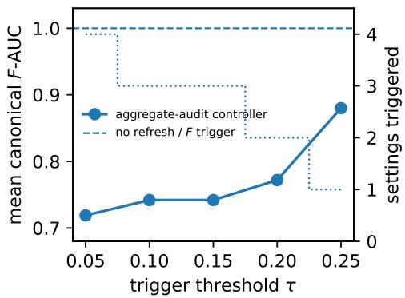

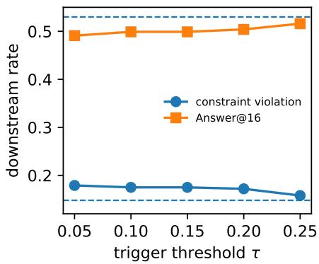  
Figure 12: Frozen closed-loop threshold sweep. Left: aggregate-audit triggers deploy the alreadytrained outcome-refresh head and reduce canonical $F { \mathrm { - A U C } } ;$ the dotted secondary axis is the number of the four primary settings that trigger. Right: the same controller raises constraint violations and lowers Answer@16. Dashed horizontal lines are the no-refresh/reference-F controller.

## AD.6 NATURAL MULTI-LABEL SEMANTIC STRESS TEST: GOEMOTIONS

We use the official GoEmotions development and test splits (Demszky et al., 2020), with 5,426 and 5,427 Reddit comments. Each comment can carry multiple human-annotated emotion labels. The component F is fixed throughout as absence of annoyance; the development/test sets contain 303/320 annoyance-labelled own failures. We train Laplace-smoothed multinomial Naive Bayes heads on the development split over a fixed bag-of-words vocabulary (terms occurring at least twice; at most 10,000). This small transparent model is intentional: the experiment tests the audit geometry without conflating it with a large verifier’s capacity.

Near-boundary control fixed in v31. With M = absence of disapproval, the test set has $q = . 4 3 4$ The F specialist has $( A _ { \mathrm { o w n } } , A _ { \mathrm { c r o s s } } , A _ { F } ) = ( . 6 8 3 , . 5 6 9 , . 6 7 9 ) ;$ the deliberately entangled $s _ { \mathrm { l e a k } } ~ =$ $z ( s _ { F } ) + z ( s _ { M } )$ has (.646, .631, .640) and predicted $q ^ { * } = . 3 7 4$ . At the natural mixture the audit difference is only .006 and its 500-resample bootstrap interval $\left[ - . 0 0 9 , . 0 1 9 \right]$ spans zero. This is therefore a useful near-boundary sanity check rather than a claim of naturally observed inversion.

Natural high-q positive control. After the near-boundary result, an explicitly post-hoc exploratory scan kept the same F specialist and varied the second annotated criterion; the scan identified absence of gratitude as a high-support natural positive control. We then reran this pair under the original frozen vocabulary/protocol. The test set contains 4,757 target positives, 320 own failures and 350 cross failures, hence $q = . 5 2 2$ . The unchanged $\dot { F }$ specialist has $A _ { \mathrm { o w n } } = . 6 6 5 , A _ { \mathrm { c r o s s } } = . 2 3 8$ canonical F-AUC .679, and aggregate outcome AUC .442. With $s _ { \lambda } = z ( s _ { F } ) + \lambda z ( s _ { M } )$ at $\lambda = 1$ canonical F-AUC falls to .570 and $A _ { \mathrm { o w n } }$ to .589, while $A _ { \mathrm { { c r o s s } } }$ rises to .765. Proposition 2 predicts $q ^ { * } = . 1 2 6$ (bootstrap [.092, .153]), so the naturally observed mixture lies well past the crossing: the aggregate audit prefers the worse component verifier, .681 versus .442. A 500-resample bootstrap interval for the audit difference is [.210, .270], and the canonical F-AUC gap favoring the specialist is [.089, .128]. Because the second criterion was selected post hoc, these intervals quantify stability of this fixed official test split; they are not a confirmatory multiplicity-adjusted discovery claim.

Table 38: Leakage-strength sweep for the natural annoyance/gratitude control. The specialist is the $\lambda = 0$ reference: canonical F-AUC .679 and aggregate audit .442 at observed $q = . 5 2 2$ . Increasing cross-component leakage makes the component classifier worse while making the aggregate audit better.
<table><tr><td>λ</td><td>canonical F-AUC</td><td> $A _ { \mathrm { o w n } }$ </td><td> $A _ { \mathrm { c r o s s } }$ </td><td>q* / observed audit</td></tr><tr><td>.10</td><td>.668</td><td>.656</td><td>.299</td><td>.120 / .470</td></tr><tr><td>.50</td><td>.619</td><td>.623</td><td>.564</td><td>.113 / .592</td></tr><tr><td>1.00</td><td>.570</td><td>.589</td><td>.765</td><td>.126 / .681</td></tr><tr><td>2.00</td><td>.520</td><td>.547</td><td>.879</td><td>.155 / .721</td></tr><tr><td>4.00</td><td>.483</td><td>.512</td><td>.919</td><td>.183 / .725</td></tr></table>

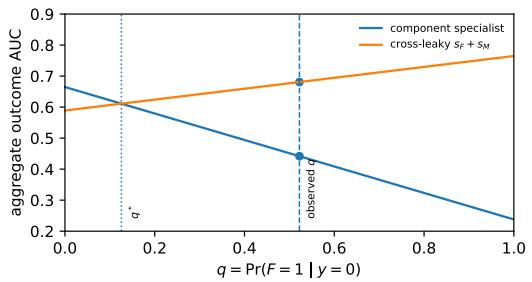

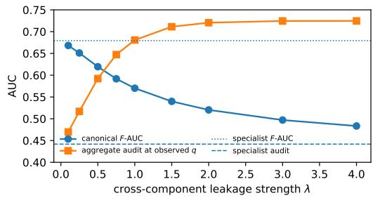  
Figure 13: Natural semantic inversion and a severity sweep. Left: for the post-hoc annoyance/gratitude positive control, the observed $q = . 5 2 2$ lies well past the analytic crossing. Right: increasing cross-component leakage monotonically degrades canonical F-AUC while the outcome audit improves over most of the sweep.

Support depletion and targeted replay. We next retrain the correct F classifier while retaining all $F = 1$ development examples and a nested number of annoyance-labelled failures. Canonical F-AUC rises from .537 with two own failures to .545 (8), .594 (64), .638 (128), .671 (256), and .679 with all 303 failures. The original fixed 8+80 own-failure replay arm reaches .615. To distinguish targeted failure support from generic extra data, we additionally repeat 100 deterministic draws. Adding 80 random development examples to the 8-failure arm adds only $4 . 4 2 \pm 1 . 9 6$ own failures on average and raises canonical F-AUC only to $5 5 0 \pm . 0 0 4$ . Adding 80 targeted own failures instead reaches . $6 0 6 \pm . 0 0 8$ . At the development-set prevalence, a uniform sample would require about 1,433 examples in expectation to contain 80 own failures. The rescue is therefore about reconstructing the missing semantic support, not merely increasing the update set.

The exact script, source blob SHAs and frozen v31/v32 JSON summaries are included in the supplement. All GoEmotions analyses are post hoc; the natural-positive-control scan and replay comparison were added after v31 and are labelled as such.

## AD.7 ADDITIONAL CONSTRUCTED SEMANTIC-LANGUAGE CONTROL: AG NEWS

This post-hoc stress test uses the 2,000-row AG News sample distributed in the OpenAI Cookbook (blob ${ \mathrm { S H A } } \ { \mathrm { f } } \ { \mathrm { 6 } } 3 { \mathrm { d } } 8 { \mathrm { b } } { \mathrm { e } } 6 \ldots { \mathrm { ) } }$ and the standard four topic labels of Zhang et al. (2015). We concatenate title and description and define $F = \mathbf { 1 }$ {topic ̸= World}, $M = { \bf 1 } \{ \mathrm { t o p i c } \neq \mathrm { S p o r t s } \}$ , so $y = F \land M$ iff the topic is Business or Sci/Tech. Thus World examples are the own-failure bin and Sports examples are the cross-failure bin. The construction is deliberately simple: it supplies semantic natural-language components with ground-truth labels while retaining the exact two-bin geometry used by the theory.

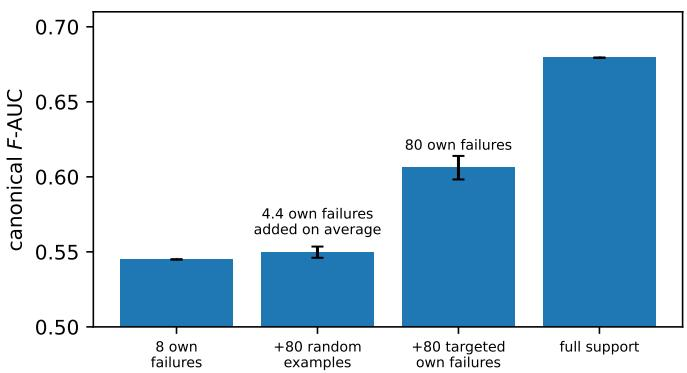  
Figure 14: Failure-targeted replay is sample-efficient. Starting from only eight own failures, 80 indiscriminate examples add few relevant failures and barely move canonical F-AUC; 80 explicit own failures recover substantially more component discrimination. Error bars show SD over 100 deterministic replay draws; the full-support bar uses all 303 development failures.

For each of 24 deterministic 65/35 hash splits, we train Laplace-smoothed multinomial Naive Bayes heads over a fixed bag-of-words vocabulary (tokens occurring in at least two training documents; maximum 7,000 terms). The $F$ specialist obtains $A _ { \mathrm { o w n } } = 0 . 9 \bar { 5 } 1 \pm 0 . 0 1 0 , A _ { \mathrm { c r o s s } } = 0 . \bar { 6 } 1 8 \pm 0 . 0 3 4 .$ and canonical $F { \cdot } \mathrm { A U C } \ 0 . 9 4 9 \pm 0 . 0 1 1$ . Holding the head fixed and changing only the negative-bin mixture therefore moves the observed audit from 0.951 at $q = 0 \mathrm { t o } 0 . 7 8 4$ at $q = . 5 , 0 . 6 5 1$ at $q = . 9$ and 0.625 at $q = . 9 8$ . To instantiate Proposition 2 as a controlled positive control, we standardize the separately trained $F$ and M scores on the training split and form $s _ { \mathrm { l e a k } } = 0 . 5 z ( s _ { F } ) + z ( s _ { M } )$ This score is worse on both own-failure separability $( A _ { \mathrm { o w n } } = 0 . 8 8 6 \pm 0 . 0 1 6 )$ and canonical $F { \mathrm { - A U C } }$ $( 0 . 6 0 7 \pm 0 . 0 2 5 )$ , but nearly perfect on the cross bin $( A _ { \mathrm { c r o s s } } = 0 . 9 9 3 \pm 0 . 0 0 2 )$ ; the measured crossing is $q ^ { * } = 0 . 1 4 8 \pm 0 . 0 3 0$ , and the aggregate audit prefers $s _ { \mathrm { l e a k } }$ at $q = . 9$ in every split.

For a support-only refresh test we keep the correct F labels and vary only the number of World failures retained from the training split, leaving all non-World examples available. The canonical F-AUC follows the same dose-response as $A _ { \mathrm { o w n } } \colon$ full support gives $0 . 9 4 9 \pm 0 . 0 1 1$ , the 8-failure arm $0 . 8 9 8 \pm 0 . 0 1 6$ , and 8+80 replay $0 . 9 3 8 \pm 0 . 0 1 2$ . The retained failure sets are nested within each split. Mean held-out $A _ { \mathrm { o w n } }$ rises smoothly with own-failure support: $0 . 8 8 8 \pm 0 . 0 1 5$ with 2 failures, $0 . 8 9 5 \pm 0 . 0 1 4$ with $4 , 0 . 9 0 4 \pm 0 . 0 1 4$ with $8 , 0 . 9 1 7 \pm 0 . 0 1 4$ with $1 6 , 0 . 9 2 7 \pm 0 . 0 1 1$ with 32, $0 . 9 3 7 \pm 0 . 0 1 1$ with $6 4 , 0 . 9 4 4 \pm 0 . 0 1 0$ with 128, and $0 . 9 4 9 \pm 0 . 0 1 0$ with 256, versus $0 . 9 5 1 \pm 0 . 0 1 0$ under full support. The 8-failure arm is below full support in every split; re-injecting 80 baseline World failures raises it to $0 . 9 4 1 \pm 0 . 0 1 1$ and improves on the collapsed refresh in every split. These 24 deterministic splits are robustness checks, not independent replications. Figure 15 shows the audit inversion and the support-dose curve. The exact script, source-file SHA and frozen summary JSON are included in the supplement; no result in this subsection was preregistered.

## AE SELECTION INTERFACE: AUDIT EQUIVALENCE DOES NOT IMPLY EQUAL INFLUENCE

The audit in Section 4 uses only the ordering within one component score, so it is invariant to every strictly increasing reparameterization $s _ { F } \mapsto g ( s _ { F } )$ . A multi-component selector also consumes the scale of $s _ { F }$ relative to the other heads. The next result characterizes exactly how much of the selector’s decision the audit leaves open.

Proposition 5 (Selection ambiguity is the Pareto set). Fix a pool with component scores $\left( { \boldsymbol { s } } _ { F } , { \boldsymbol { s } } _ { M } \right)$ and distinct score pairs (duplicates are merged; Appendix Y). As $g$ ranges over strictly increasing maps—all of which leave every $\mathrm { R O C / A U C }$ of $s _ { F }$ unchanged—the set of top-1 choices of $g ( s _ { F } ) + s _ { M }$ is exactly the Pareto set Par of the pool in $\left( \boldsymbol { s } _ { F } , \boldsymbol { s } _ { M } \right)$ . Over positive rescalings $g ( t ) = c t$ it is the subset of Par on the upper convex hull. Hence an audit statistic invariant to monotone reparameterization determines the composite decision iff $| \operatorname { P a r } | = 1$ , and determines whether that decision is on target iff all Pareto candidates share one oracle label.

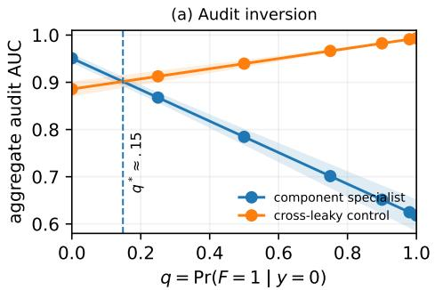

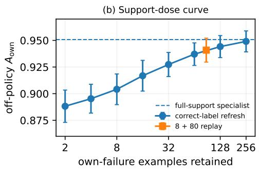  
Figure 15: Controlled natural-language stress test. Left: the same fixed component verifier looks progressively worse as its own-failure bin vanishes, while a verifier contaminated with the other component overtakes it near the predicted $q ^ { * }$ . Right: with correct component labels fixed, held-out $A _ { \mathrm { o w n } }$ degrades smoothly as own-failure support is removed; the square marks the 8-failure refresh plus 80 re-injected baseline failures. Bands/error bars show one standard deviation across 24 deterministic splits.

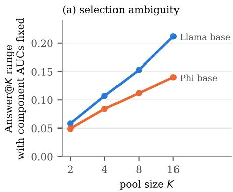

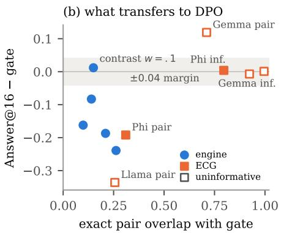  
Figure 16: (a) With every component AUC fixed, the range of Answer@K reachable by auditequivalent composites on the ECG base test pools grows with K (Proposition 6; 20 subsamples per pool). (b) Endpoint minus hard gate against exact pair overlap for all eleven trained scalar rules (engine 1.5B and ECG; three seeds each; common evaluator). Filled: families whose gate clears the requirement-blind floor (engine, Phi); open: uninformative (Llama near the blind pipeline, Gemma without supply); this post-hoc split uses only each family’s gate arm, never a rule’s gap (Appendix AB). All three rules with overlap $\geq 0 . 7 9$ match the gate within 0.007 (two in uninformative families); five of six informative low-overlap rules miss ${ \tt b y } \geq 0 . 0 8$ , the exception being the contrast-matched $w = 0 . 1$

The proof is constructive (Appendix $\mathrm { Y } ) { \mathrm { : } }$ a dominated candidate loses under every increasing $^ { g , }$ and each Pareto candidate wins under a $g$ that jumps at its own $s _ { F }$ . This is the classical correspondence between Pareto optimality and monotone scalarization (Miettinen, 1999), read here as a statement about what an audit leaves open. Its size is predictable.

Proposition 6 (Ambiguity grows with pool size). If the K candidates’ score pairs are i.i.d. with continuous, independent $s _ { F }$ and $s _ { M }$ , then $\left| \operatorname* { P a r } \right|$ is a sum of independent Bernoul $\mathrm { i } ( 1 / i )$ variables, $i = 1 , \ldots , K$ . Hence E| $\operatorname* { P a r } | = H _ { K } = \dot { \ln } K + 0 . 5 7 7 + o ( 1 )$ and $\mathrm { P r } [ | \mathrm { P a r } | = 1 ] \stackrel { \cdot } { = } 1 ^ { \cdot } / K$ . If the heads are comonotone, $| \operatorname { P a r } | = 1$

Sorting candidates by decreasing $s _ { F }$ , a candidate is Pareto iff its $s _ { M }$ is a running maximum, which happens with probability $1 / i$ independently across i (Bentley et al., 1978). Under independent heads the audit therefore determines the best-of- $\boldsymbol { . K }$ decision with probability only $1 / K$ , which vanishes as test-time compute grows; in our pools positively dependent heads slow this growth without stopping it (Figure 16a).

How large is the ambiguity? On the ECG base test pools at $K = 1 6$ the Pareto set has 2.3 (Llama) and 2.2 (Phi) candidates, below the independence values 2.7 and $2 . 5 \ : ( H _ { n }$ over the n distinct score pairs) that a within-pool permutation of $s _ { M }$ restores. It mixes on- and off-target candidates in 21% and 14% of pools, so with every component AUC fixed Answer@16 ranges over [0.33, 0.54] (Llama) and [0.46, 0.60] (Phi). These are outer bounds because one g must serve all pools, yet a common rescaling $c s _ { F } + s _ { M }$ already moves Llama’s Answer@16 from 0.500 (c = 0.1) to 0.392 (c = 10) with supply unchanged. A single common weight chosen on validation still lands within 0.02 (Llama) and 0.004 (Phi) of the best common weight on test (Appendix AB): the ambiguity is resolved by validating the consumer, not by auditing the component.

The engine shows the saturated extreme. On matched 1.5B DPO pools, rescaling the feasibility logit by $c \in \{ 0 . 0 1 , . . . , 1 0 0 \}$ leaves its AUC unchanged but moves raw-sum best-of-16 from 0.544 to 0.160 (Appendix M); the unit sum follows the saturated logit on 82% of pools $( \eta = 0 . 1 0 )$ . Rules that reduce its influence—a validation-tuned weight, a soft log-probability rule, threshold-then-mass— reach $\eta = 0 . 8 8 \mathrm { - } 0 . 9 2 \ : ( 0 . 9 4$ at 7B; Appendix AC).

Takeaway. Component AUC fixes the order within a score; the selector’s decision is fixed only up to the Pareto set, whose size and label mix at the deployed K should be reported alongside any component audit. A weight tuned for this interface is a selection weight; Section AF shows why that does not make it a training weight.

## AF TRAINING INTERFACE: A GOOD SELECTOR NEED NOT BUILD GOOD DPO DATA

Once a score constructs preference data, DPO sees only the chosen/rejected pairs, so selection quality and training-pair quality are different objectives even for one scalar ranking rule.

Proposition 7 (What reaches DPO). Fix pools, policy, reference model, β, and a deterministic rank-based pair builder. (i) The empirical DPO objective and gradient depend on the scoring rule only through the induced pair multiset; for $\begin{array} { r } { r _ { w } = w s _ { F } + s _ { M } } \end{array}$ this multiset is piecewise constant in w, changing only at crossing weights $w _ { i j } = - ( s _ { M , i } - s _ { M , j } ) / ( s _ { F , i } - s _ { F , j } )$ . (ii) Neither component-order nor top-k equivalence implies pair equivalence when the builder uses ranks outside the top k. (iii) For uniform pair multisets $P , Q$ of equal size, $d _ { \mathrm { T V } } ( P , Q ) = 1 - \operatorname { o v e r l a p } ( P , Q )$ ; if the preference log-ratio satisfies $\lceil d _ { \theta } \rceil \leq R$ and per-pair gradients are bounded by G, then $\left| L _ { P } - L _ { Q } \right| \leq \beta R \left( 1 - \frac { } { } \right.$ overlap) and $\| \nabla \dot { L } _ { P } - \nabla L _ { Q } \| \dot { \leq } 2 \dot { G } ( 1 - \mathrm { o v e r l a p } )$ . (iv) If both objectives are convex and L-smooth, fullbatch gradient descent with step $\eta \leq 2 / L$ from a common initialization satisfies $\lVert { \boldsymbol { \theta } } _ { T } ^ { P } - { \boldsymbol { \theta } } _ { T } ^ { Q } \rVert \leq$ $2 \eta G T \left( 1 - \mathrm { o v e r l a p } \right)$ ; with L-smoothness alone the factor ηT becomes $( ( 1 + \eta L ) ^ { T } - 1 ) / L$

Together with Proposition 5, this gives a strict hierarchy: composite order determines the pair multiset, which determines the DPO objective; component order determines neither, and a good top-k selector need not fix the pairs (Appendix Q gives a two-candidate example). Exact pair overlap therefore certifies closeness of the objective, of its gradient and, under (iv), of short training trajectories; because the trajectory bound grows with the horizon (Hardt et al., 2016), overlap certifies objectives, and endpoints only when it is near one. Mean property contrasts are only a projection of the pair distribution with an unmeasured residual (Proposition 4).

Matched DPO exposes the mismatch. With the same base model, critic, train pool, 4 000 pairs and recipe, the hard-gate policy reaches 0.311 target/draw and 0.758 Answer@16; unit-sum pairs reach 0.134 and 0.596 (Table 39). A validation pool selects w = 0.005 for top-1 inference, yet training on its pairs reaches only 0.571; registered predictions that it and a soft log-probability rule would match the gate within 0.04 failed. In pair space $w = 0 . 0 0 5$ contrasts mass but barely feasibility, and the unit sum the opposite.

A pre-specified $\ w \ = \ 0 . 1$ passes near the gate in this two-dimensional contrast space (Figure 8, Appendix Q) and reaches 0.312 target/draw, 0.821 supply, and 0.770 Answer@16, versus 0.311/0.807/0.758 for the gate. It shares only 15% of pairs with the gate, so the match is not near-duplicate data; across the five engine rules a bottleneck contrast relative to the gate orders the endpoints (Spearman with the endpoint 0.90, versus −0.60 for overlap: at low overlap, overlap does not order endpoints; descriptive), and a pre-specified critic-only version selects $w = 0 . 0 7 5$ without oracle labels (Appendices Q, O).

Table 39: Matched DPO endpoints under a common fixed gate evaluator. $\Delta F$ is chosen-minusrejected feasibility and $\Delta M$ is rejected-minus-chosen absolute oracle log-mass error. “Overlap” is exact full-pair overlap with the gate. 7B arms are in Appendix H.
<table><tr><td>pairs ranked by</td><td>∆F</td><td>∆M</td><td>overlap</td><td>target/draw</td><td>supply@16</td><td>Answer@16</td></tr><tr><td>1.5B unit sum</td><td>.64</td><td>.11</td><td>.099</td><td> $. 1 3 4 \pm . 0 0 5$ </td><td> $. 6 3 6 \pm . 0 3 7$ </td><td> $. 5 9 6 \pm . 0 3 3$ </td></tr><tr><td>1.5B hard gate</td><td>.48</td><td>.63</td><td>1.000</td><td> $\mathbf { . 3 1 1 \pm . 0 1 3 }$ </td><td> ${ \bf 8 0 7 \pm . 0 0 7 }$ </td><td> ${ \bf 7 5 8 \pm . 0 0 5 }$ </td></tr><tr><td>1.5B tuned, w = .005</td><td>.13</td><td>.82</td><td>.210</td><td> $. 2 5 8 \pm . 0 2 8$ </td><td> $. 6 4 9 \pm . 0 2 3$ </td><td> $. 5 7 1 \pm . 0 3 0$ </td></tr><tr><td> $1 . 5 { \mathrm { B } } \thinspace \mathrm { c o n t r a s t , } w = . 1$ </td><td>.48</td><td>.52</td><td>.150</td><td> $\mathbf { . 3 1 2 \pm . 0 2 1 }$ </td><td> ${ \bf . 8 2 1 \pm . 0 1 7 }$ </td><td> $\mathbf { 7 7 0 \pm . 0 2 3 }$ </td></tr></table>

Table 40: Preregistered ECG training stress test (Answer@16 under the common evaluator; mean $\pm$ training-seed SD). Overlap is exact pair overlap with the gate’s 4 000 pairs. Last columns: the frozen primary contrast with its paired patient-cluster bootstrap CI (conditional on the seeds) and a post-hoc CI that also resamples seeds. The single requirement-blind pipeline scores 0.512.
<table><tr><td>family</td><td> $w _ { \mathrm { s e l } }$ </td><td>Wpair</td><td></td><td>overlap sel overlap pair</td><td>inference</td><td>gate</td><td>pair</td><td></td><td>pair — gate [frozen CI]</td><td>[seed+subject]</td></tr><tr><td>Llama</td><td>.003</td><td>1.0</td><td>.923</td><td>.256</td><td>.500 ± .026</td><td>.507 ± .017</td><td>.171 ± .296</td><td>-.336</td><td>[−.380, −.288]</td><td> $[ - . 5 5 7 , - . 0 0 5 ]$ </td></tr><tr><td>Gemma</td><td>.001</td><td>.1</td><td>.995</td><td>.711</td><td>.005 ± .004</td><td>.004 ± .003</td><td>.123 ±.122</td><td>+.119</td><td>[+.056, +.184]</td><td> $- . 0 0 2 , + . 2 6 6 \bar { ] }$ </td></tr><tr><td>Phi</td><td>.03</td><td>.3</td><td>.796</td><td>.310</td><td></td><td>.719 ± .005 .715 ± .014</td><td>.523 ± .018</td><td></td><td>−.192 [−.249, −.145]</td><td> $\dot { \phantom { - } } . 2 5 4 , - . 1 4 1 \dot { ] }$ </td></tr></table>

Boundary case. In GSM8K the format-score spread collapses after saturation, sum and gate pairs carry nearly identical target signal, and the trained policies agree (0.647 vs 0.642 target/draw; Appendix C): the separation vanishes where the interfaces coincide.

Preregistered external stress test (ECG). Because Proposition 7 constrains only full pair distribu tions, we froze an external test before training: per family, validation selects $w _ { \mathrm { s e l } }$ and the gate-free variant of our engine criterion (normalize each critic contrast by its grid maximum, maximize the smaller) selects $w _ { \mathrm { p a i r } } ;$ each rule builds 4 000 pairs from one frozen train pool; three seeds; one common evaluator; margin ±0.04. No seed was rerun or removed.

Frozen outcome. The preregistered primary outcome is negative for our criterion: pair weighting is gate-equivalent in no family (Table 40). In Gemma it even exceeds the gate (+0.119), but no Gemma arm approaches the requirement-blind pipeline (best seed 0.244 vs 0.512), so this is not evidence for the criterion. Gate and inference weight differ by at most 0.007 with 79.6–99.5% shared pairs. With training seeds resampled together with subjects, only Phi’s pair deficit stays clear of zero (Appendices Z, AA). Llama’s $w _ { \mathrm { p a i r } } = 1$ pairs are identical to those of an added unit-sum arm, and both fail to parse on two seeds, a shared collapse rather than a test of Proposition 7.

What the endpoints mean (post-hoc). Llama arms that parse mostly emit the requirement-blind pipeline (0.512), and Gemma has near-zero supply. In Phi, gate and inference policies keep 79–113 distinct pipelines, whereas all pair-weight seeds collapse onto the blind program $( \geq 9 7 \%$ of parsed outputs). The gate-free criterion fails because in ECG the gate sits at the M-heavy end of the sweep, so normalizing by sweep maxima pushes toward $F ;$ a gate-referenced criterion would select $w = 0 . 0 0 3 – 0 . 0 1$ with 87–99% gate overlap.

A trained check on CPU. We trained a log-linear DPO reranker on the frozen Llama and Phi pools, where DPO is convex and Proposition 7(iv) applies exactly: gate and nine grid weights, ten seeds each, with design and four predictions hashed before any run (Appendix AA). All four held: the gate-referenced weight matches the gate $( + 0 . 0 0 4 \left[ - 0 . 0 0 5 , 0 . 0 1 5 \right] ; - 0 . 0 0 2 \left[ - 0 . 0 0 7 , 0 . 0 0 2 \right] )$ ; Phi’s gate-free weight is not shown equivalent and, like the LLM policies, shifts top-1 choices onto the blind program (67% vs 25%); across the grid |gap| shrinks as overlap grows (Spearman of |gap| on overlap −0.60, −0.93); and parameter distances respect the bound. The reranker has little headroom above the blind program, so it corroborates direction and ordering, not LLM effect sizes. Where gate pairs can be built, training on them is simpler than any gate-referenced scalar.

Takeaway. Inference scalarization is a decision rule; pre-DPO scalarization is a data-construction operator. The evidence is one-directional and thin (Figure 16b, Appendix AB): all three rules with ≥ 79% gate overlap reached the gate’s endpoint, consistent with Proposition 7, but only Phi’s comes from a family whose gate is informative; low overlap left the endpoint undetermined. A weak bottleneck contrast accompanied all four informative misses, but Phi’s pair weight also missed with balanced contrasts, a residual that two contrast coordinates cannot see. In practice: when a tuned selection weight trains poorly, check its pair overlap with the rule it should emulate; if overlap is low, neither overlap nor mean contrasts certify it, and the reference rule’s own pairs are the safe default.