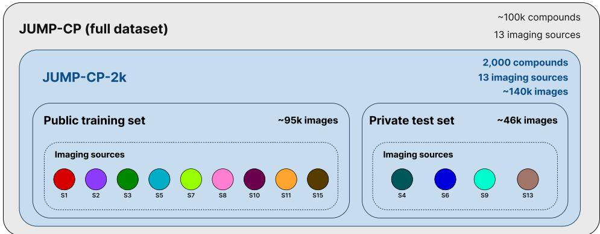

# BatchBench: Benchmarking AI Robustness to Batch Effects and Domain Shift in Biomedical Images – A JUMP Cell Painting Leaderboard

Sonja Topf1,2 Ana Sanchez-Fernandez1 Gunter Klambauer¨ 1,2 1ELLIS Unit Linz and LIT AI Lab, Institute for Machine Learning, 2Clinical Research Institute for Medical AI Johannes Kepler University, Linz, Austria

## Abstract

Despite recent advances, current AI systems remain highly susceptible to domain shifts, particularly in biomedical imaging, where images are usually acquired under substantially different experimental conditions. Although recent domain adaptation methods have made substantial progress, significant performance gaps under domain shift persist. To measure progress in this regard, we introduce BatchBench, a leaderboard that evaluates and compares the robustness of AI systems on biomedical images from unseen experimental batches and data sources. BatchBench is built on JUMP-CP, one of the largest publicly available biomedical imaging datasets. Generated using the Cell Painting assay, JUMP-CP exhibits pronounced batch effects and domain shifts, making it a challenging testbed for evaluating robustness to distributional changes.

Keywords: biomedical imaging, domain-adaptation, test-time-adaptation, cell-painting, jump-cp, microscopy, distribution-shift

## 1 Introduction

  
Figure 1: Source-level split of the BatchBench leaderboard. Nine sources of JUMP-CP-2k are public (eight for training, source 2 for validation). Sources 4, 6, 9, and 13 are held out as the private test set, so that every leaderboard entry is evaluated on unseen data-generating sources.

Vulnerability of AI systems under domain shift and batch effects. Deep learning methods often assume that training and test data are sampled from the same underlying distribution. However, in practice, biological images are acquired across experimental batches, plates, and sites, which introduces non-biological variation known as batch effects. These effects shift the distribution of the input images, such that a model that performs well on its training distribution can fail on images from a new experimental batch or laboratory. This limits the use of AI in applications such as drug discovery, where new data are generated continuously and under changing conditions.

JUMP-CP and CellPainting. High-content screening data obtained with the Cell Painting assay1 provide a clear example of this problem. The JUMP Cell Painting dataset (JUMP-CP)2, one of the largest public biomedical imaging datasets, was obtained from 13 data-generating centers (sources) using different microscopes and laboratory workflows. As a result, JUMP-CP exhibits substantial batch effects across multiple levels of its data hierarchy. Because every image is annotated with its source, experimental batch, and plate, JUMP-CP provides a exceptional setting in which domain shifts are both pronounced and explicitly annotated at multiple levels.

Domain adaptation (DA) methods address domain shift either by learning domain-invariant representations during training or by adapting the model to unlabeled target data at inference time, i.e. test-time adaptation $( \mathrm { \overline { { T T A } } } ) ^ { 3 , 5 , 7 - 9 , 1 1 }$ . These methods have substantially improved robustness on natural images. Nevertheless, their effectiveness on biomedical images from unseen experimental conditionsremains poorly characterized, and results reported on different subsets, splits, and metrics are rarely comparable.

The BatchBench Leaderboard. We introduce the BatchBench leaderboard, an open benchmark for comparing AI models on the identification of chemical perturbations in Cell Painting images acquired from sources not seen during training. The leaderboard is designed to be used by several research communities:

• Domain adaptation and test-time adaptation. BatchBench evaluates multi-source adaptation to unseen target domains under combined covariate and label shift. Methods that adapt to unlabeled test images, as well as methods that do not perform test-time adaptation, can be submitted through a common adapt() / predict() interface.

• Biomedical imaging and foundation models. BatchBench evaluates whether pretrained image encoders and specialized architectures generalize to unseen imaging sites, an important requirement for deployment that is not captured by in-distribution evaluation.

• Cell Painting and JUMP-CP. BatchBench provides a standardized source-level evaluation of image-based compound profiling on JUMP-CP using fixed splits and a private test set.

The leaderboard presents three components: (i) JUMP-CP-2k, a curated subset of JUMP-CP covering 2,000 compounds, with nine public sources and four sources held out as a private test set (Section 2); (ii) a containerized submission protocol that keeps the test data private and supports both conventional and test-time adaptation methods (Section 3); and (iii) six baseline entries covering standard supervised training, domain-invariant training, test-time adaptation, and meta-learning (Sections 5 and 6). The baseline entries show that test-time adaptation reduces the domain gap but does not close it. For compounds with few training images, every current entry remains close to chance level. The leaderboard is open for submissions on Hugging Face.

## 2 The BatchBench leaderboard

Problem setting. Let $\mathcal { D } ^ { ( 1 ) } , \ldots , \mathcal { D } ^ { ( S ) }$ denote labeled data from S training sources, where each sample consists of an image x, its compound label $y \in \{ 1 , \ldots , K \}$ , and its domain metadata $\pmb { d } = ( \mathrm { s o u r c e }$ , batch, plate). At test time, a submission receives the unlabeled images $\{ \pmb { x } _ { n } \} _ { n = 1 } ^ { N }$ and their metadata $\{ d _ { n } \} _ { n = 1 } ^ { N }$ from sources that do not occur in the training data. It may adapt to these images before predicting their labels. The leaderboard thus evaluates multi-source domain adaptation to unseen target domains. The setting covers domain generalization (no adaptation), test-time adaptation, and in-context adaptation as special cases. As the the domain metadata are hierarchical, submissions can define domains at the level of sources, experimental batches, or plates.

Task. Each input is a single five-channel Cell Painting image (DNA, RNA, ER, AGP, and Mito). The task is to identify which of the $K = 2 { , } 0 0 0$ compounds the imaged cells were treated with. Test images come exclusively from held-out sources, so every test image also originates from an unseen experimental batch and an unseen plate.

Compound selection and sampling. JUMP-CP comprises images from 13 sources and more than 100,000 compound and genetic perturbations2. We used the dataset cpg00162, available from the Cell Painting Gallery10 on the Registry of Open Data on AWS (https://registry.opendata.aws/cellpainting-gallery/). To obtain a dataset that is practical to download and train on, we selected the 2,000 most frequent compounds, retained all wells treated with these compounds, and sampled one image (field of view) per well uniformly at random.

Domain metadata and controls. Each sample is annotated with its source, experimental batch, and plate identifiers. Submissions may use these identifiers as domain labels during training and to group test images at inference. Images of negative-control wells (DMSO-treated, unperturbed cells) from the training sources are provided as a separate file. They can be used, for example, for control-based normalization7.

Preprocessing. From each original image we extract a 500 × 500 pixel center crop. We then apply illumination correction by clipping the top 0.01% of pixel intensities in each channel.

Splits. Sources 4, 6, 9, and 13 form the private test set of the leaderboard and are never released (Figure 1). The remaining nine sources are public. Source 2 serves as the validation set for model selection, and the other eight sources form the training set.

Evaluation subsets. Compounds differ greatly in their number of training images and in the strength of their phenotypes. In addition to the overall accuracy, the leaderboard therefore reports accuracy on three subsets of the test set:

• POSCON: the eight positive-control compounds, present on every plate, usually at fixed well positions. They have many training images and strong, well-characterized phenotypes.

• TARGET: 293 compounds from the JUMP-Target collection, a reference library chosen to cover diverse biological targets and mechanisms of action.

• REST: all remaining compounds, each represented by few images (about 12 per compound in the public split).

The three subsets correspond to increasingly difficult regimes: abundant data with strong phenotypes (POSCON), a curated mechanism-of-action reference set (TARGET), and a long tail of rare classes (REST).

Label shift. In addition to the source shift, the class distribution differs between the public and the test split. POSCON images make up 51% of the public split but 36% of the test set; TARGET images increase from 25% to 55%; REST images decrease from 24% to 9% (Table 1). The leaderboard therefore evaluates adaptation under combined covariate and label shift, a setting in which many TTA methods are known to degrade6,12.

Table 1: Statistics of JUMP-CP-2k per split and evaluation subset. The private test set of the leaderboard consists of the held-out sources 4, 6, 9, and 13. Samples/compound is the mean number of images per compound. Source, batch, and plate identifiers are provided for every sample.
<table><tr><td>Split</td><td>Subset</td><td>Compounds</td><td>Samples</td><td>Samples/compound</td><td>Sources</td><td>Batches</td><td>Plates</td></tr><tr><td rowspan="3">Public (train + val)</td><td>POSCON</td><td>8</td><td>48,574</td><td>6,071.75</td><td>9</td><td>102</td><td>1,534</td></tr><tr><td>TARGET</td><td>293</td><td>23,455</td><td>80.05</td><td>7</td><td>63</td><td>76</td></tr><tr><td>REST</td><td>1,926</td><td>23,186</td><td>12.04</td><td>9</td><td>85</td><td>931</td></tr><tr><td rowspan="3">Private test</td><td>POSCON</td><td>8</td><td>16,691</td><td>2,086.38</td><td>4</td><td>42</td><td>370</td></tr><tr><td>TARGET</td><td>293</td><td>25,352</td><td>86.53</td><td>4</td><td>40</td><td>62</td></tr><tr><td>REST</td><td>1,864</td><td>4,107</td><td>2.20</td><td>2</td><td>18</td><td>179</td></tr></table>

Research questions. The leaderboard is designed to answer questions that are open in each of the communities above, for example:

• Do domain adaptation and TTA methods developed on natural-image benchmarks transfer to biological domain shift?

• At which level of the domain hierarchy (source, batch, or plate) should adaptation be performed?

• Do pretrained microscopy foundation models generalize to unseen imaging sources better than models trained from scratch?

• Can models identify compounds with weak phenotypes and few training images (TARGET, REST) on unseen sources?

## 3 Submitting to the leaderboard

Submission format. A leaderboard submission is a public Git repository together with a commit hash. The repository must contain the training code and a Dockerfile from which the evaluation server builds a container image. Submissions are therefore independent of the deep learning frame work and model architecture. The image must provide a Submission class that implements two methods, adapt() and predict() . Ready-to-run example submissions for all baseline entries are available in our baseline repository and can serve as templates.

Evaluation. The evaluation server passes the private test images, as an array of shape (N, H, W, 5), together with a metadata list containing the source, batch, and plate identifier of every image, to both adapt() and predict() . No labels are provided. adapt() may update the model using the unlabeled test images and their metadata, which permits test-time adaptation. Methods that do not adapt should implement it as a no-op. predict() must return one prediction per image, in the original order.

Metric and ranking. Leaderboard entries are ranked by overall accuracy, i.e., the fraction of correctly classified images in the entire test set. Because POSCON and TARGET together contain over 90% of the test images, this metric is dominated by these two subsets. The leaderboard therefore additionally reports accuracy on POSCON, TARGET, and REST separately, so that progress on rare compounds remains visible. Scores are published on the leaderboard once the manual evaluation finishes.

Rules. Submissions may not use any data from the held-out sources (4, 6, 9, and 13) for training, pre-training, or model selection. This also applies to pretrained models whose pre-training data include these sources. Test-time adaptation on the unlabeled test images through adapt() is permitted.

## 4 Development datasets

To lower the entry barrier and enable fast prototyping before a leaderboard submission, we release two smaller variants of JUMP-CP-2k:

• JUMP-CP-MNIST contains only the eight positive-control compounds. Its images are downsampled to 200 × 200 pixels, and the five imaging channels (DNA, RNA, ER, AGP, and Mito) are combined into three channels, so that standard RGB architectures and pretrained models can be applied without modification.

• JUMP-CP-2k-200 contains all 2,000 compounds of JUMP-CP-2k at the reduced resolution of 200 × 200 pixels, with all five channels.

Both variants use the same source-level split as JUMP-CP-2k. Leaderboard rankings are computed on the full-resolution private test set.

## 5 Baseline entries

The leaderboard is initialized with six baseline entries that represent the main strategies for handling domain shift. All use a ResNet184 backbone whose first convolution takes five input channels.

• No adaptation (ResNet18). A classifier trained with standard empirical risk minimization on the training sources and applied to the test sources unchanged.

• Domain-invariant training: DANN3 and deepCORAL8. Both methods encourage representations that do not depend on the domain during training, adversarially (DANN) or by aligning second-order feature statistics (deepCORAL). We use the source identifier as the domain label.

• Test-time adaptation: AdaBN5 and $\mathbf { T E N T } ^ { 9 }$ . Both use the trained ResNet18 baseline and adapt it only at inference. AdaBN replaces the BatchNorm statistics with statistics computed on the test images. TENT additionally updates the BatchNorm affine parameters by minimizing the entropy of the predictions. For both methods, test images are grouped by plate, so that each plate is adapted separately.

• Meta-learning: ARM-BN11. and CS-ARM-BN7 ARM-BN trains the model episodically to classify images using BatchNorm statistics computed from an unlabeled context batch of the same domain. At test time, the statistics are computed in the same way from the unlabeled test images.

Hyperparameters were tuned with Bayesian optimization, and for every method the model with the highest accuracy on source 2 was selected. The code of all baseline entries is available in our GitHub repository.

## 6 Results

Table 2 reports the current leaderboard entries.

Test-time adaptation reduces the domain gap. Without adaptation, ResNet18 reaches an average overall accuracy of 0.175. Re-estimating the BatchNorm statistics on each test plate (AdaBN) raises this to 0.244. Most of this gain comes from POSCON, where accuracy increases from 0.465 to 0.646. TENT’s additional entropy minimization yields a higher performance in the POSCON group, but no improvement in TARGET or REST. Domain-invariant training does not improve over the non-adapted baseline: DANN reaches 0.170.

The domain gap remains for compounds with few images. Performance on POSCON is substantially higher than on TARGET and REST, consistent with the much larger number of training images per compound, lower number of classes and strong phenotypes. These factors are absent for most TARGET and REST compounds, and none of the current entries compensates for them. Identifying compounds with weak phenotypes and few training images on unseen sources is therefore the main open problem posed by the leaderboard.

Table 2: Baseline entries of the BatchBench leaderboard, evaluated on the private test set (held-out sources 4, 6, 9, and 13). Values are the mean ± sample standard deviation over three runs with different random seeds. Chance level is $1 / 2 , 0 0 0 = 0 . 0 \bar { 0 } 0 5$
<table><tr><td>Entry</td><td>Overall</td><td>POSCON</td><td>TARGET</td><td>REST</td></tr><tr><td>ResNet18 (no adaptation)</td><td> $0 . 1 7 5 \pm 0 . 0 1 5$ </td><td> $0 . 4 6 5 \pm 0 . 0 3 6$ </td><td> $0 . 0 1 2 \pm 0 . 0 0 4$ </td><td> $0 . 0 0 2 \pm 0 . 0 0 0$ </td></tr><tr><td>DANN</td><td> $0 . 1 7 0 \pm 0 . 0 1 1$ </td><td> $0 . 4 6 5 \pm 0 . 0 2 6$ </td><td> $0 . 0 0 3 \pm 0 . 0 0 4$ </td><td> $0 . 0 0 1 \pm 0 . 0 0 1$ </td></tr><tr><td>deepCORAL</td><td> $0 . 2 0 1 \pm 0 . 0 0 6$ </td><td> $0 . 5 0 2 \pm 0 . 0 2 4$ </td><td> $0 . 0 3 4 \pm 0 . 0 0 6$ </td><td> $0 . 0 0 7 \pm 0 . 0 0 2$ </td></tr><tr><td>AdaBN</td><td> $0 . 2 4 4 \pm 0 . 0 0 5$ </td><td> $0 . 6 4 6 \pm 0 . 0 0 5$ </td><td> $0 . 0 1 9 \pm 0 . 0 0 5$ </td><td> $0 . 0 0 2 \pm 0 . 0 0 1$ </td></tr><tr><td>TENT</td><td> $0 . 2 4 9 \pm 0 . 0 0 7$ </td><td> $0 . 6 6 1 \pm 0 . 0 1 1$ </td><td> $0 . 0 1 7 \pm 0 . 0 0 5$ </td><td> $0 . 0 0 2 \pm 0 . 0 0 1$ </td></tr><tr><td>CS-ARM-BN</td><td> $0 . 2 5 6 \pm 0 . 0 0 4$ </td><td> $0 . 6 6 0 \pm 0 . 0 0 5$ </td><td> $0 . 0 3 1 \pm 0 . 0 0 4$ </td><td> $0 . 0 0 4 \pm 0 . 0 0 1$ </td></tr><tr><td>ARM-BN</td><td> $0 . 2 6 0 \pm 0 . 0 0 2$ </td><td> $0 . 6 6 5 \pm 0 . 0 0 3$ </td><td> $0 . 0 3 5 \pm 0 . 0 0 2$ </td><td> $0 . 0 0 4 \pm 0 . 0 0 1$ </td></tr></table>

## Acknowledgements

We thank Anne Carpenter, Shantanu Singh, and Runxi Shen (Broad Institute of MIT and Harvard) for helpful discussions during the design of the leaderboard.

## References

[1] Bray, M. A., Singh, S., Han, H., Davis, C. T., Borgeson, B., Hartland, C., Kost-Alimova, M., Gustafsdottir, S. M., Gibson, C. C., and Carpenter, A. E. (2016). Cell painting, a high-content image-based assay for morphological profiling using multiplexed fluorescent dyes. Nature protocols, 11:1757.

[2] Chandrasekaran, S. N., Ackerman, J., Alix, E., Ando, D. M., Arevalo, J., Bennion, M., Boisseau, N., Borowa, A., Boyd, J. D., Brino, L., et al. (2023). Jump cell painting dataset: morphological impact of 136,000 chemical and genetic perturbations. BioRxiv, pages 2023–03.

[3] Ganin, Y., Ustinova, E., Ajakan, H., Germain, P., Larochelle, H., Laviolette, F., March, M., and Lempitsky, V. (2016). Domain-adversarial training of neural networks. Journal of machine learning research, 17(59):1–35.

[4] He, K., Zhang, X., Ren, S., and Sun, J. (2016). Deep residual learning for image recognition. In Proceedings ofthe IEEE Conference on Computer Vision and Pattern Recognition (CVPR).

[5] Li, Y., Wang, N., Shi, J., Liu, J., and Hou, X. (2016). Revisiting batch normalization for practical domain adaptation. In International Conference on Learning Representations.

[6] Park, S., Yang, S., Choo, J., and Yun, S. (2023). Label shift adapter for test-time adaptation under covariate and label shifts. Proceedings ofthe IEEE International Conference on Computer Vision, pages 16375–16385.

[7] Sanchez-Fernandez, A., Pinetz, T., Zellinger, W., and Klambauer, G. (2026). Stabilizing incontext multi-source domain adaptation for biomedical images through controls. In Proceedings of the 43rd International Conference on Machine Learning (ICML).

[8] Sun, B. and Saenko, K. (2016). Deep coral: Correlation alignment for deep domain adaptation. In European conference on computer vision, pages 443–450. Springer.

[9] Wang, D., Shelhamer, E., Liu, S., Olshausen, B., and Darrell, T. (2021). TENT: Fully test-time adaptation by entropy minimization. In International Conference on Learning Representations.

[10] Weisbart, E., Kumar, A., Arevalo, J., Carpenter, A. E., Cimini, B. A., and Singh, S. (2024). Cell painting gallery: an open resource for image-based profiling. Nat. Methods.

[11] Zhang, M., Marklund, H., Dhawan, N., Gupta, A., Levine, S., and Finn, C. (2021). Adaptive risk minimization: Learning to adapt to domain shift. In Ranzato, M., Beygelzimer, A., Dauphin, Y., Liang, P., and Vaughan, J. W., editors, Advances in Neural Information Processing Systems, volume 34, pages 23664–23678. Curran Associates, Inc.

[12] Zhao, H., Liu, Y., Alahi, A., and Lin, T. (2023). On pitfalls of test-time adaptation. Proceedings ofMachine Learning Research, 202:42058–42080.