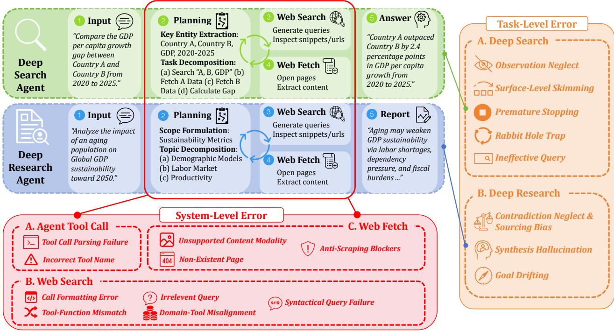

# Benchmarking and Error Analysis of Deep Search and Deep Research LLM Agents

Zixuan Yu <sup>\*</sup> <sup>1</sup> Zhenheng Tang <sup>\*</sup> <sup>2</sup> Xiaowen Chu <sup>3</sup> Bo Han <sup>4</sup>

## Abstract

As Large Language Models (LLMs) evolve into autonomous Deep Search and Deep Research Agents capable of executing long-horizon, multistep tasks, evaluating their reliability becomes increasingly critical. However, existing evaluation paradigms predominantly focus on final task outcomes, leaving a significant gap in understanding the intermediate execution traces, where agents are highly susceptible to various errors. To address this critical gap, we introduce a comprehensive methodology and analytical framework designed specifically to diagnose errors in intermediate workflows. Building upon this framework, we establish a structured taxonomy that categorizes these vulnerabilities into two primary dimensions: System-Level Errors and Task-Level Errors. Through a systematic examination of step-by-step execution traces and agent-environment interactions, we reveal how these underlying errors affect overall performance. Finally, through empirical experiments and systematic analysis of the identified error types, we provide actionable design guidelines, aiming to enhance the robustness, reasoning capabilities, and reliability of Deep Search and Deep Research agents.

## 1. Introduction

Recent advancements in Large Language Models (LLMs) (Achiam et al., 2023; Yang et al., 2025) have catalyzed a pivotal shift from passive text generators to autonomous agents capable of sustained interaction with external environments (Guo et al., 2024; Luo et al., 2025; Schick et al.,

2023; Yao et al., 2022). At the forefront of this evolution are two distinct yet equally critical agentic paradigms designed to address knowledge-intensive tasks: Deep Search (Xi et al., 2025; Li et al., 2025) and Deep Research (Xu & Peng, 2025) agentic frameworks. While Deep Search agents emphasize dynamic, long-horizon information acquisition, iteratively navigating the unstructured web to identify specific facts, Deep Research agents focus on synthesizing large-scale, multi-source context into comprehensive analytical reports. As these frameworks are increasingly deployed in complex real-world scenarios, understanding their structural bottlenecks and execution limitations has emerged as an important research priority (Zhou et al., 2023; Wei et al., 2025).

However, prevailing benchmarks (Mialon et al., 2023; Wei et al., 2025) often obscure the true capabilities of these agents by relying primarily on end-to-end performance metrics. This outcome-oriented paradigm introduces a significant blind spot in agent evaluation, as a correct response may not arise from a valid reasoning process, while an incorrect outcome offers limited insight into the underlying architectural deficiencies or sources of failure. Unlike single-turn interactions, LLM agents are highly susceptible to complex, cascading errors throughout their iterative workflows (Zhu et al., 2025). Although recent studies have begun to examine intermediate reasoning trajectories and processlevel behaviors (Mohammadi et al., 2025), systematic investigations remain limited, particularly for deep-search and deep-research agents that operate over extended, multi-stage information-seeking workflows.

To address this gap, we formalize a two-level error perspective for agent evaluation. System-Level errors are shared across both Deep Search and Deep Research, including malformed tool calls, schema violations, environment rejections, and infrastructure failures (e.g., timeouts and rate limits). Task-Level errors are paradigm-specific and reflect the cognitive objective of each workflow.

For Deep Search, task-level failures primarily arise from incomplete exploration, weak evidence accumulation, and premature termination. For Deep Research, task-level failures primarily arise from long-context synthesis weaknesses, such as poor cross-source reconciliation and insufficient

<sup>\*</sup>Equal contribution <sup>1</sup>School of Computer science and engineering, Sun Yat-sen University <sup>2</sup>CSE, The Hong Kong University of Science and Technology <sup>3</sup>DSA Thrust, The Hong Kong University of Science and Technology (GuangZhou) <sup>4</sup>TMLR Group, Department of Computer Science, Hong Kong Baptist University. Correspondence to: Bo Han <bhanml@comp.hkbu.edu.hk>.

citation-grounded reasoning. We intentionally defer finegrained category definitions to the taxonomy section.

Building on this formulation, we present a unified error diagnosis framework and benchmark for process-level evaluation from full execution traces. Based on this framework, we derive a structured taxonomy spanning both levels and both paradigms, and then conduct an empirical study to characterize how error types emerge and propagate across agent workflows. Our main contributions are as follows:

• We introduce a process-oriented evaluation framework that captures full agent trajectories, enabling reproducible diagnosis beyond end-to-end accuracy.

• We propose a structured taxonomy that separates shared System-Level failures from paradigm-specific Task-Level failures in Deep Search and Deep Research.

• We perform trace-based analysis to quantify how different error types occur and propagate, and we summarize actionable implications for improving agent robustness and reliability.

## 2. Preliminary

We analyze the process-level behaviors and architectural failure modes specific to Deep Search and Deep Research workflows. While Deep Search relies on iterative, goaloriented exploration to pinpoint specific information across dynamic environments, Deep Research prioritizes the semantic synthesis of multi-source data into long-form analytical reports. This section formalizes these two paradigms and introduces the core terminology of our study.

## 2.1. Deep Search Agents

Definition. A Deep Search agent is an interactive decisionmaking system that incrementally acquires external evidence to answer a query requiring multi-step exploration. Unlike single-shot retrieval, the agent must repeatedly decide what to search next, which source to inspect, and when to terminate.

Formalization. We model Deep Search as a finite-horizon interactive process with a minimal tool set

$$
{ \mathcal { A } } _ { \mathrm { s e a r c h } } = \{ { \mathrm { w e b } } _ { - } s \in { \mathrm { a r c h } } , { \mathrm { w e b } } _ { - } { \mathrm { f e t c h } } , s \in { \mathrm { o p } } \} .
$$

Given query $q ,$ at step t the agent maintains history $h _ { t } =$ $\left( q , o _ { 1 : t } , a _ { 1 : t - 1 } \right)$ and chooses an action. For web search, the agent submits a search query $u _ { t }$ to a search engine and receives the top-k ranked results

$$
R _ { t } = \{ ( \mathrm { t i t l e } _ { i } , \mathrm { u r l } _ { i } , \mathrm { s n i p p e t } _ { i } ) \} _ { i = 1 } ^ { k } ,
$$

where each item contains title, URL, and snippet. For web fetch, the agent submits a URL and receives the corresponding raw webpage content c(url) (e.g., HTML or parsed text). The agent iterates between search and fetch until termination, then outputs an answer $\hat { y }$ with evidence set $E _ { T }$

## 2.2. Deep Research Agents

Definition. A Deep Research agent is a long-context synthesis system that transforms web-scale evidence into a structured analytical report. Compared with Deep Search, its primary challenge is not sparse fact lookup, but crosssource reconciliation, hierarchical organization, and logically consistent synthesis.

Formalization. We adopt the same minimal tool set as Deep Search,

$$
{ \mathcal { A } } _ { \mathrm { r e s e a r c h } } = \{ { \mathrm { w e b } } _ { - } s \in { \mathsf { a r c h } } , { \mathrm { w e b } } _ { - } { \mathsf { f e t c h } } , s \in \mathsf { o p } \} .
$$

Given objective q, the agent iteratively invokes web search and web fetch to build an evidence pool $\begin{array} { l l l } { { \mathcal { D } } } & { { = } } & { { \{ d _ { 1 } , \ldots , d _ { n } \} } } \end{array}$ , where search returns top-k metadata triplets

$$
R _ { t } = \{ ( { \mathrm { t i t l e } } _ { i } , { \mathrm { u r l } } _ { i } , { \mathrm { s n i p p e t } } _ { i } ) \} _ { i = 1 } ^ { k } ,
$$

and fetch returns raw page content $c ( \mathrm { u r l } )$ . It then generates a report

$$
r = f _ { \boldsymbol { \theta } } ( q , \mathcal { D } ) .
$$

We evaluate report quality with three coupled objectives: factual grounding $G ( r , \mathcal { D } )$ , cross-source consistency $C ( r , \mathcal { D } )$ , and task completeness $U ( r , q )$ . A high-quality report requires all three to be jointly satisfied rather than optimized in isolation.

## 3. Methodology

We evaluate agent failures through a bifurcated methodology that explicitly categorizes breakdowns into System-Level errors and Task-Level errors. Because LLM agents operate at the interface of programmatic tool execution and probabilistic reasoning, this separation is essential to avoid conflating deterministic infrastructure faults with semantic cognitive limitations. Accordingly, our diagnostic pipeline combines rule-based parsing to isolate System-Level errors with a human-guided LLM-as-a-Judge framework to evaluate Task-Level errors.

## 3.1. System-Level Errors

To systematically identify system-level errors, we develop a hybrid diagnostic pipeline that combines rule-based extraction with LLM-assisted evaluation. First, we employ regular expressions and structured parsing to precisely extract the specific tool invocation and its corresponding reasoning at each step of the agent’s trajectory. Once these actionthought pairs are isolated from the raw logs, they are submitted to an LLM evaluator. The LLM acts as a targeted judge, analyzing the semantic alignment between the agent’s stated intent and the executed tool syntax to accurately diagnose system-level anomalies, such as tool-function mismatches or domain misalignments. The pipeline transitions from deterministic parsing directly to semantic validation. By having the parser handle the structural extraction, the LLM is freed from parsing raw logs and can focus purely on evaluating the logical correspondence between what the agent wanted to do and the tool it actually used.

  
Figure 1. Overview of Error Analysis of Deep Search & Deep Research

We categorize these System-Level errors across three critical phases of the Deep Search and Deep Research pipeline: Agent Tool Call, Web Search, and Web Fetch.

Agent Tool Call Errors. This category encompasses failures where the LLM’s raw generation cannot be translated into an actionable command by the environment parsing engine. We categorize these failures into two modes: Tool Call Parsing Failure. The agent fails to generate well-formed structural tags, preventing the system from extracting the intended action. Incorrect Tool Name. The agent hallucinates or incorrectly formats the name of a tool, invoking an API that does not exist in the predefined environment toolkit.

Web Search Errors. These errors occur when the agent successfully invokes a tool, but the provided arguments or query logic are fundamentally flawed, leading to immediate API rejections or guaranteed zero-hit returns. We categorize these failures into five modes: Call Formatting Error. The tool is invoked, but mandatory arguments are missing or violate the required JSON/string schema. Tool-Function Mismatch. The agent provides an argument that conflicts with the tool’s intended utility. A common pattern identified in our logs is passing a raw URL into a text-based search engine instead of using a dedicated web-browsing tool.Irrelevant Query. The agent mistakenly inputs internal thoughts or system instructions as search queries. Domain Tool Misalignment. The agent uses an inappropriate specialized tool for a specific domain entity. For example, the agent identifies an arXiv preprint ID but erroneously queries it using a Wikipedia search tool, resulting in empty returns. Syntactical Query Failure. The generated query contains excessive special characters, regex artifacts, or bizarre string structures that overwhelm the search engine and inevitably yield zero results.

Web-Fetch Retrieval Errors. These errors are environment driven failures triggered during the actual execution of web scraping or document retrieval. We categorize these failures into three modes: Unsupported Content Modality. The agent attempts to read media types (e.g., audio, video, or highly complex multimodal formats) that the textbased web-scraping parser cannot process. Non-Existent Page. The agent attempts to scrape a webpage that has been removed, resulting in dead links or unresolved domains. Anti-Scraping Blockers. The fetch action is intercepted by server-side security mechanisms. We identify these by matching log keywords for HTTP 403 Forbidden, CAPTCHA challenges, or specific firewall intercepts, which prevent content extraction.

In summary, by categorizing System-Level errors across the agent tool call, web search and web fetch, we establish a structured taxonomy of deterministic failures. This classification ensures that these syntax and environment-driven breakdowns are explicitly recognized within the trajectory logs, preventing them from being misattributed as cognitive reasoning deficiencies during the Task-Level evaluation.

## 3.2. Task-Level Errors

When infrastructure execution succeeds, agents may still fail at the task level due to higher-order cognitive, strategic, or synthesis limitations that emerge across extended reasoning trajectories and large context windows. Because these semantic breakdowns are difficult to capture through rigid rule-based parsing alone, we adopt a human-guided LLM-as-a-Judge pipeline to systematically interpret the execution logs. To ensure our evaluation rubric is empirically grounded rather than arbitrarily defined, we first conduct a qualitative, human-in-the-loop analysis of sampled intermediate traces to inductively construct a behavioral taxonomy. Building upon this foundation, we then employ the LLM-as-a-Judge framework to automatically categorize these process-level deviations at scale. Given the distinct characteristics, we separately address the specific cognitive bottlenecks observed in Deep Search and Deep Research tasks, with the full judge prompts provided in Appendix C.

Deep Search Error Taxonomy. Deep Search tasks require agents to navigate unstructured environments to locate specific and often deeply embedded factual information. Tasklevel errors in this setting primarily manifest as failures in retrieval strategy and localized reasoning. We categorize these failures into five modes: Observation Neglect. The agent successfully retrieves relevant information within its environment observations but fails to extract or incorporate this evidence into subsequent reasoning steps. Surface-Level Skimming. The agent relies predominantly on short searchengine snippets rather than accessing underlying sources. When the required information is absent from snippets, the agent avoids deeper inspection and instead repeatedly reformulates queries or terminates exploration prematurely. Premature Stopping. The agent concludes the search process and produces a final answer before collecting all necessary evidence required to satisfy the task objective. This behavior frequently appears in exhaustive retrieval or multihop counting scenarios. Rabbit Hole Trap. The agent exhibits inefficient navigation by spending multiple consecutive steps traversing low-relevance sub-domains or entering repetitive navigation loops, without demonstrating effective backtracking or trajectory correction. Ineffective Query. The agent generates search queries that are overly broad, weakly grounded in task requirements, or semantically misaligned with the information need. In many cases, the agent repeatedly issues identical or minimally modified queries despite consistently uninformative results, indicating limited adaptive retrieval behavior.

Deep Research Error Taxonomy. Unlike targeted search tasks, Deep Research tasks require agents to autonomously aggregate, cross-reference, and synthesize large volumes of information into structured reports over extended interaction horizons. Task-level errors in this setting primarily arise from breakdowns in global context management and evidence synthesis. We categorize these failures into three modes: Contradiction Neglect and Sourcing Bias. Realworld information retrieval frequently produces conflicting evidence across sources. Agents may fail to reconcile such discrepancies through cross-validation, instead disproportionately relying on early or prominently encountered sources, leading to unverified claims propagated in the final report. Synthesis Hallucination. When available evidence is incomplete or insufficient, the agent generates synthesized content that is weakly grounded in retrieved sources. This commonly occurs when fulfilling complex structural requirements, where missing information is implicitly filled using parametric knowledge rather than verified observations. Goal Drifting. As the context window expands during long-horizon research trajectories, accumulated observations may dilute task salience. The agent increasingly attends to tangential details within retrieved content and ultimately produces outputs that deviate from key constraints or formatting requirements specified in the original user instruction.

## 4. Experiment

Setup. To empirically validate our proposed error taxonomy and systematically diagnose bottlenecks in long-horizon autonomous agents, we design a controlled evaluation pipeline spanning both Deep Search and Deep Research paradigms. Importantly, our objective is not to benchmark end-to-end performance, but to construct experimental environments that expose process-level behaviors and failure patterns during extended agent execution. Each setup therefore emphasizes controllability and comparability, enabling consistent analysis of error emergence across different agent architectures and model backbones.

Deep Search. For Deep Search tasks, we employ the Miroflow (Su et al., 2026) agent framework and deliberately restrict the agent’s action space to core information-seeking operations. Specifically, the agent is equipped with only two tools: search, which retrieves search engine results and summaries, and fetch, which extracts full textual content from selected webpages. This constrained design minimizes confounding factors introduced by complex tool ecosystems and allows errors to be attributed primarily to navigation, retrieval, and evidence utilization behaviors. Such a controlled environment enables fine-grained observation of process-level failures, including Surface-Level Skimming and Observation Neglect. The framework is instantiated with two base models, GPT-5-mini (Singh et al., 2025) and Mirothinker-30b (Team et al., 2025), allowing us to examine whether observed error patterns remain consistent across different model families under identical interaction constraints.

Benchmarking and Error Analysis of Deep Search and Deep Research LLM Agents
<table><tr><td>Error Level</td><td>Category</td><td>Error Type</td><td>Example</td></tr><tr><td rowspan="7">System Level</td><td rowspan="2">Tool Call</td><td>Tool Call Parsing Failure</td><td>The agent outputs a malformed tool call that cannot be parsed.</td></tr><tr><td>Incorrect Tool Name</td><td>The agent calls a non-existent tool such as browse. The query is passed with invalid arguments or missing required</td></tr><tr><td rowspan="5">Web Search</td><td>Call Formatting Error</td><td>fields. The agent uses a search tool for a task that requires fetching a</td></tr><tr><td>Tool–Function Mismatch</td><td>specific page.</td></tr><tr><td>Irrelevant Query</td><td>The generated query drifts away from the current sub-goal. The agent searches the general web when a domain-specific</td></tr><tr><td>Domain Tool Misalignment</td><td>source is required.</td></tr><tr><td>Syntactical Query Failure</td><td>The query contains broken operators, unmatched quotes, or mal- formed constraints.</td></tr><tr><td rowspan="3">Web Fetch</td><td>Unsupported Content Modality</td><td>The returned page requires video, image, or interactive content that the agent cannot access.</td></tr><tr><td>Non-Existent Page Anti-Scraping Blockers</td><td>The agent attempts to open a dead link or a 404 page. The page blocks automated access through CAPTCHA or anti-</td></tr><tr><td></td><td>bot mechanisms.</td></tr><tr><td rowspan="7">Task Level</td><td rowspan="5">Deep Search</td><td>Observation Neglect</td><td>The agent ignores useful evidence already present in retrieved snippets.</td></tr><tr><td>Surface-Level Skimming</td><td>The agent relies on snippets without opening or verifying the source page.</td></tr><tr><td>Premature Stopping</td><td>The agent stops searching before collecting sufficient evidence.</td></tr><tr><td>Rabbit Hole Trap</td><td>The agent repeatedly follows marginally related information paths.</td></tr><tr><td>Ineffective Query</td><td>The agent keeps issuing vague or poorly targeted queries.</td></tr><tr><td>Contradiction Neglect &amp; Sourcing Bias</td><td>The agent overlooks conflicting sources or over-relies on one source.</td></tr><tr><td rowspan="2">Deep Research</td><td>Synthesis Hallucination</td><td>The final report introduces claims not supported by retrieved evidence.</td></tr><tr><td>Goal Drifting</td><td>The generated analysis gradually shifts away from the original research objective.</td></tr></table>

Table 1. Overview of the proposed error taxonomy across system-level and task-level failures, with representative examples for each error type.

Deep Research. For Deep Research tasks, which involve long-context reasoning and multi-source synthesis, we evaluate two research-oriented agent frameworks: open-deepresearch and step-deep-research. These frameworks support iterative planning, large-context aggregation, and structured report generation over extended trajectories, reflecting realistic deep research workflows. Rather than optimizing task success rates, our configuration aims to capture how errors accumulate and propagate during prolonged reasoning and synthesis processes.The open-deep-research framework is implemented with GPT-5, while step-deepresearch employs Step-3.5-Flash. This enables us to analyze whether error taxonomies generalize across distinct agent designs and execution dynamics.

Benchmarks and Datasets. To ground our error analysis in realistic agent workflows, we draw tasks from a collection of established and widely adopted benchmarks spanning both agentic paradigms. Rather than using these benchmarks for conventional performance evaluation, we leverage them as representative task sources to elicit diverse long-horizon agent trajectories suitable for diagnostic analysis. Detailed dataset statistics and configurations are provided in Appendix B. For Deep Search agent, to capture representative information-seeking and web navigation behaviors, we sample tasks from four commonly used Deep Search benchmarks: BrowseComp (Wei et al., 2025) A benchmark frequently used to study complex web browsing and autonomous navigation across heterogeneous HTML environments. BrowseComp-zh (Zhou et al., 2025) A standardized Chinese-language counterpart emphasizing multilingual web navigation and retrieval scenarios. GAIA-valtext-only (Mialon et al., 2023) A challenging benchmark for multi-step question answering and tool-assisted reasoning. We use the text-only validation split to focus specifically on textual retrieval and reading processes. XBench-DS (Chen et al., 2025) A dataset designed around iterative query reformulation and multi-hop web retrieval, representative of typical deep search workflows. For Deep Research agent, to study long-horizon synthesis and analytical report generation, we draw tasks from Deep Research Bench (Du et al., 2025), a benchmark commonly used to evaluate autonomous research agents on open-ended analytical requests requiring multi-source aggregation and structured synthesis.

Although these benchmarks are traditionally employed for end-to-end accuracy evaluation, our framework instead uses them to generate complete execution traces. By leveraging their curated task prompts, reference answers, and structural requirements, we obtain standardized problem settings that enable consistent, process-oriented error diagnosis across diverse agent trajectories. We adopt GPT-5 as the LLM judge for both system-level error and task-level error.

Result. In this section, we report process-level findings from both Deep Search and Deep Research settings under the unified taxonomy introduced in Section 3. We first analyze System-Level errors to characterize interaction-side reliability, and then analyze Task-Level errors to reveal paradigm-specific cognitive bottlenecks in retrieval and synthesis workflows. These results provide a fine-grained view of where current agent systems fail and which components should be prioritized for improvement.

System-Level Error. We conduct an empirical analysis centered on Deep Search traces, with a primary focus on the system-level errors of MiroThinker-30B. This setting provides a clear basis for cross-dataset comparison under a unified execution pipeline.

Concretely, for each Deep Search benchmark, we report both trajectory-scale and error-composition statistics, including average steps per task, total executed steps, total systemlevel error steps, and category-wise counts of system-level failures. This supports normalized cross-dataset comparison by jointly characterizing overall interaction burden and the dominant failure profile under the same system-level

## taxonomy.

From Table 2, we observe clear dataset-dependent differences in system-level robustness. XBench-DS exhibits the highest concentration of system-level failures, whereas BrowseComp and BrowseComp-zh remain comparatively stable. This suggests that interaction-layer difficulty is shaped not only by trajectory length, but also by how strongly a benchmark stresses tool invocation and environment interaction.

Error compositions further reveal dataset-specific bottlenecks. BrowseComp is primarily constrained by tool–function alignment issues and web accessibility limitations, highlighting the joint importance of action precision and environmental reliability. BrowseComp-zh shows stronger domain–tool alignment challenges alongside accessibility failures, indicating increased pressure on tool selection under multilingual or domain-shifted conditions. In contrast, XBench-DS is dominated by tool orchestration failures, where functional mismatches outweigh low-level parsing errors. Together, these results suggest that systemlevel failures are structurally heterogeneous across benchmarks.

More broadly, the analysis reveals a shift in the operational bottlenecks of autonomous web agents. Purely syntactic failures are now rare, indicating that modern language models generally handle the mechanics of tool invocation reliably. Instead, systemic friction arises mainly from semantic misalignment, such as inappropriate tool usage, weakly grounded queries, and resistance from real-world web environments. Notably, frequent system-level disruptions do not necessarily preclude successful task completion. Agents often recover through iterative adjustment and continued interaction, compensating for imperfect instruction adherence or environmental obstacles. This observation suggests that robustness in open environments emerges less from flawless execution than from an agent’s ability to detect, adapt to, and recover from inevitable failures during interaction.

Task-Level Error. Task-level errors capture higher-order cognitive and strategic failures that occur even when tool execution is syntactically valid. Unlike system-level breakdowns, these errors are reflected in how agents explore, accumulate evidence, and decide when to stop. In this section, we analyze task-level error distributions across benchmarks and models to identify paradigm-specific bottlenecks in Deep Search and Deep Research workflows.

As detailed in Table 3, our task-level evaluation of Deep Search agents reveals a strong positive correlation between process-level reliability (No Error Rate) and final task accuracy (Acc). Models that successfully navigate intermediate cognitive bottlenecks consistently achieve higher end-to-end success, confirming the diagnostic validity of our taxonomy.

Benchmarking and Error Analysis of Deep Search and Deep Research LLM Agents
<table><tr><td>Metric</td><td>BrowseComp</td><td>BrowseComp-zh</td><td>GAIA-val-text-only</td><td>XBench-DS</td></tr><tr><td>No Error</td><td>3504</td><td>4861</td><td>1217</td><td>2750</td></tr><tr><td>Tool Call Parsing Failure</td><td>22</td><td>6</td><td>3</td><td>15</td></tr><tr><td>Incorrect Tool Name</td><td>109</td><td>70</td><td>232</td><td>236</td></tr><tr><td>Call Formatting Error</td><td>4</td><td>13</td><td>34</td><td>23</td></tr><tr><td>Tool-Function Mismatch</td><td>434</td><td>286</td><td>1227</td><td>650</td></tr><tr><td>Irrelevant Query</td><td>30</td><td>36</td><td>169</td><td>22</td></tr><tr><td>Domain Tool Misalignment</td><td>72</td><td>426</td><td>1163</td><td>369</td></tr><tr><td>Syntactical Query Failure</td><td>84</td><td>6</td><td>180</td><td>15</td></tr><tr><td>Unsupported Content Modality</td><td>5</td><td>8</td><td>61</td><td>13</td></tr><tr><td>Non-Existent Page</td><td>0</td><td>1</td><td>39</td><td>2</td></tr><tr><td>Anti-Scraping</td><td>392</td><td>437</td><td>30</td><td>268</td></tr><tr><td>New Pattern Errors</td><td>10</td><td>20</td><td>7</td><td>13</td></tr><tr><td>Avg. Steps / Task</td><td>46.66</td><td>61.7</td><td>42.34</td><td>43.76</td></tr><tr><td>Total Steps</td><td>4666</td><td>6170</td><td>4362</td><td>4376</td></tr><tr><td>Error Steps</td><td>1162</td><td>1309</td><td>3145</td><td>1626</td></tr><tr><td>No Error Rate</td><td>75.10</td><td>78.78</td><td>27.90</td><td>62.84</td></tr><tr><td>Acc</td><td>17.00</td><td>42.00</td><td>63.11</td><td>73.00</td></tr></table>

Table 2. System-Level error summary for Deep Search traces.

Furthermore, the error distributions expose stark behavioral divergences between model architectures. GPT-5-mini predominantly fail due to Premature Stop and Surface Skim, which indicates an inherent reluctance to sustain multi-hop exploration. Conversely, the open-weight Miro-30B demonstrates strong execution endurance, but heavily bottlenecked by Ineffective Query formulation and Obs. Neglect. This highlights a critical gap in strategic reasoning, that while the agent is willing to search extensively, it struggles to translate complex intents into optimal search syntax or to extract target signals from dense retrieved contexts. Table 4 demonstrates that different Deep Research frameworks succumb to entirely distinct cognitive vulnerabilities. The Open Deep Research framework maintains a relatively higher process reliability but is primarily sabotaged by Goal Drifting. As the context window expands during extensive evidence gathering, the framework frequently loses track of core user constraints and formatting instructions. In contrast, Step Deep Research struggles with Synthesis Hallucination rather than Goal Drifting, which indicate that it attempts to forcefully fulfill structural requirements by fabricating data when sufficient factual evidence is missing. Additionally, Step Deep Research exhibits a higher propensity for compounded errors, such as the dangerous combination of Contradiction Neglect and Sourcing Bias with Synth Hallucination.This highlight how aggressive synthesis protocols can trigger cascading cognitive failures if the underlying retrieval phase

is fundamentally flawed.

## 5. Discussion

Our fine-grained, trace-level evaluation provides actionable insights for designing next-generation Deep Search and Deep Research agents. Unlike end-to-end metrics that only assess final correctness, our framework identifies where and how failures emerge throughout the operational trajectory. This process-level visibility is particularly important for long-horizon agents, where small intermediate deviations—such as misaligned queries or overlooked evidence—can accumulate into downstream failure. By exposing these hidden bottlenecks, our taxonomy connects empirical evaluation with concrete system design considerations.

Implications for Model Training. The separation between System-Level and Task-Level errors enables more targeted supervision strategies. Current training pipelines often penalize deterministic execution mistakes and genuine reasoning failures equally, despite their fundamentally different causes. Our taxonomy suggests decoupling these objectives: models can first learn reliable tool execution and formatting behaviors, while higher-level training focuses on exploration strategy, evidence integration, and synthesis quality. This perspective naturally supports trace-aware optimization objectives that reward intermediate reasoning quality, evidence coverage, and recovery after failed actions rather than finalanswer accuracy alone. Moreover, the taxonomy provides structured reward signals for iterative fine-tuning and Reinforcement Learning from AI Feedback (RLAIF), allowing training procedures to discourage trajectory-level behaviors such as premature termination or inefficient exploration.

Table 3. Distribution of task-level errors in Deep Search agents. Miro-30B denotes MiroThinker-30B-v1.5.
<table><tr><td></td><td colspan="2">BrowseComp</td><td colspan="2">BrowseComp-zh</td></tr><tr><td>Failure Mode</td><td>Miro-30B</td><td>GPT-5-mini</td><td>Miro-30B</td><td>GPT-5-mini</td></tr><tr><td>No Error</td><td>17</td><td>14</td><td>45</td><td>27</td></tr><tr><td>Obs. Neglect</td><td>12</td><td>2</td><td>8</td><td>1</td></tr><tr><td>Surface Skim.</td><td>17</td><td>20</td><td>9</td><td>14</td></tr><tr><td>Premature Stop</td><td>4</td><td>20</td><td>1</td><td>38</td></tr><tr><td>Rabbit Hole</td><td>9</td><td>3</td><td>8</td><td>0</td></tr><tr><td>Ineffective Query</td><td>47</td><td>41</td><td>25</td><td>20</td></tr><tr><td>No Error Rate</td><td>17.00</td><td>14.00</td><td>45.00</td><td>27.00</td></tr><tr><td>Acc</td><td>17.00</td><td>15.00</td><td>42.00</td><td>29.00</td></tr><tr><td rowspan="2">Failure Mode</td><td colspan="2">GAIA</td><td colspan="2">XBench-DS</td></tr><tr><td>Miro-30B</td><td>GPT-5-mini</td><td>Miro-30B</td><td>GPT-5-mini</td></tr><tr><td>No Error</td><td>64</td><td>53</td><td>72</td><td>19</td></tr><tr><td>Obs. Neglect</td><td>12</td><td>1</td><td>18</td><td>2</td></tr><tr><td>Surface Skim.</td><td>5</td><td>4</td><td>3</td><td>0</td></tr><tr><td>Premature Stop</td><td>12</td><td>41</td><td>1</td><td>75</td></tr><tr><td>Rabbit Hole</td><td>7</td><td>1</td><td>2</td><td>1</td></tr><tr><td>Ineffective Query</td><td>3</td><td>3</td><td>4</td><td>3</td></tr><tr><td>No Error Rate</td><td>62.14</td><td>51.46</td><td>72.00</td><td>19.00</td></tr><tr><td>Acc</td><td>63.11</td><td>56.31</td><td>73.00</td><td>41.00</td></tr></table>

Implications for Toolset Design. System-level error patterns indicate that tools should function not merely as passive interfaces but as stabilizing components within the agent–environment loop. Improved schema constraints, informative semantic error feedback, and built-in recovery affordances can substantially reduce cascading failures. For Deep Search, tools should support progressive evidence accumulation and abstract away low-level navigation burdens such as pagination handling. For Deep Research, where long-context overload becomes dominant, tools should facilitate source alignment, contradiction detection, and citationgrounded synthesis. In this sense, tool design becomes a central factor shaping agent robustness rather than a peripheral implementation detail.

Implications for Agentic Frameworks. Observed error propagation further highlights limitations of monolithic reasoning loops. When planning, navigation, reading, and synthesis are handled within a single continuous process, context degradation and strategic drift become inevitable. More robust frameworks should introduce modular control stages separating planning, verification, and repair. Deep Search agents benefit from adaptive stopping criteria and explicit exploration-coverage checks, while Deep Research systems require staged synthesis pipelines that isolate retrieval from reconciliation and report generation. Incorporating lightweight runtime self-diagnosis mechanisms based on our taxonomy can enable early intervention, allowing agents to revise trajectories before failures fully propagate.

Table 4. Distribution of task-level errors in Deep Research agents. C denotes Contradiction Neglect and Sourcing Bias, S denotes Synthesis Hallucination, and G denotes Goal Drift.
<table><tr><td>Failure Mode</td><td>Open-DR</td><td>Step-DR</td></tr><tr><td>No Error</td><td>44</td><td>13</td></tr><tr><td>Contradiction Neglecet &amp; Sourcing Bias (C)</td><td>10</td><td>23</td></tr><tr><td>Synthesis Hallucination (S)</td><td>25</td><td>80</td></tr><tr><td>Goal Drifting (G)</td><td>51</td><td>7</td></tr><tr><td>C only</td><td>0</td><td>3</td></tr><tr><td>S only</td><td>5</td><td>60</td></tr><tr><td>G only</td><td>30</td><td>2</td></tr><tr><td>C + S</td><td>0</td><td>17</td></tr><tr><td>S + G</td><td>11</td><td>2</td></tr><tr><td>C + G</td><td>1</td><td>2</td></tr><tr><td>C + S + G</td><td>9</td><td>1</td></tr><tr><td>No Error Rate</td><td>44</td><td>13</td></tr><tr><td>RACE</td><td>0.536</td><td>0.4802</td></tr><tr><td>FACT</td><td>0.468</td><td>0.4143</td></tr></table>

Broader Takeaway. Fine-grained evaluation serves as an enabling infrastructure for reliable autonomous agents. By transforming opaque failures into structured diagnostic signals, it supports systematic improvements across training, tool ecosystems, and framework architecture. As agent autonomy and interaction horizons continue to expand, shifting from outcome-based evaluation toward process-level diagnosis is essential for developing systems that are not only capable, but consistently reliable in open environments.

## 6. Conclusion

In this work, we present a unified, process-oriented framework for evaluating Deep Search and Deep Research agents through full execution traces rather than final outcomes alone. By separating failures into System-Level and Task-Level categories, our framework makes intermediate failure mechanisms observable and comparable across paradigms. Our empirical findings show that performance bottlenecks often stem from error propagation during interaction, rather than solely from weaknesses in final response generation, enabling a more faithful diagnosis of agent reliability in longhorizon workflows. Beyond evaluation, the proposed taxonomy offers practical guidance for agent design, supporting targeted training objectives, more robust tool interfaces, and modular architectures with explicit planning, verification, and repair mechanisms. We hope this work contributes toward agents that are not only accurate on benchmarks but also process-stable in realistic deployments. Future work will extend this framework to broader environments, richer tool ecosystems, and automated online error recovery.

## References

Achiam, J., Adler, S., Agarwal, S., Ahmad, L., Akkaya, I., Aleman, F. L., Almeida, D., Altenschmidt, J., Altman, S., Anadkat, S., et al. Gpt-4 technical report. arXiv preprint arXiv:2303.08774, 2023.

Chen, K., Ren, Y., Liu, Y., Hu, X., Tian, H., Xie, T., Liu, F., Zhang, H., Liu, H., Gong, Y., et al. xbench: Tracking agents productivity scaling with profession-aligned real-world evaluations. arXiv preprint arXiv:2506.13651, 2025.

Deng, X., Gu, Y., Zheng, B., Chen, S., Stevens, S., Wang, B., Sun, H., and Su, Y. Mind2web: Towards a generalist agent for the web. Advances in Neural Information Processing Systems, 36:28091–28114, 2023.

Du, M., Xu, B., Zhu, C., Wang, X., and Mao, Z. Deepresearch bench: A comprehensive benchmark for deep research agents. arXiv preprint arXiv:2506.11763, 2025.

Gendron, G., Bao, Q., Witbrock, M., and Dobbie, G. Large language models are not strong abstract reasoners. arXiv preprint arXiv:2305.19555, 2023.

Google LLC. Gemini deep research. https://gemini. google/overview/deep-research/, 2024.

Guo, T., Chen, X., Wang, Y., Chang, R., Pei, S., Chawla, N. V., Wiest, O., and Zhang, X. Large language model based multi-agents: A survey of progress and challenges. arXiv preprint arXiv:2402.01680, 2024.

He, H., Yao, W., Ma, K., Yu, W., Dai, Y., Zhang, H., Lan, Z., and Yu, D. Webvoyager: Building an end-to-end web agent with large multimodal models. In Proceedings ofthe 62nd Annual Meeting ofthe Associationfor Computational Linguistics (Volume 1: Long Papers), pp. 6864–6890, 2024.

Ji, Z., Lee, N., Frieske, R., Yu, T., Su, D., Xu, Y., Ishii, E., Bang, Y. J., Madotto, A., and Fung, P. Survey of hallucination in natural language generation. ACM computing surveys, 55(12):1–38, 2023.

Kadavath, S., Conerly, T., Askell, A., Henighan, T., Drain, D., Perez, E., Schiefer, N., Hatfield-Dodds, Z., DasSarma, N., Tran-Johnson, E., et al. Language models (mostly) know what they know. arXiv preprint arXiv:2207.05221, 2022.

Lewis, P., Perez, E., Piktus, A., Petroni, F., Karpukhin, V., Goyal, N., Kuttler, H., Lewis, M., Yih, W.-t., Rockt ¨ aschel,¨ T., et al. Retrieval-augmented generation for knowledgeintensive nlp tasks. Advances in neural information processing systems, 33:9459–9474, 2020.

Li, K., Zhang, Z., Yin, H., Zhang, L., Ou, L., Wu, J., Yin, W., Li, B., Tao, Z., Wang, X., et al. Websailor: Navigating super-human reasoning for web agent. arXiv preprint arXiv:2507.02592, 2025.

Liu, X., Lai, H., Yu, H., Xu, Y., Zeng, A., Du, Z., Zhang, P., Dong, Y., and Tang, J. Webglm: towards an efficient web-enhanced question answering system with human preferences. In Proceedings of the 29th ACM SIGKDD conference on knowledge discovery and data mining, pp. 4549–4560, 2023.

Luo, J., Zhang, W., Yuan, Y., Zhao, Y., Yang, J., Gu, Y., Wu, B., Chen, B., Qiao, Z., Long, Q., et al. Large language model agent: A survey on methodology, applications and challenges. arXiv preprint arXiv:2503.21460, 2025.

Mialon, G., Fourrier, C., Wolf, T., LeCun, Y., and Scialom, T. Gaia: a benchmark for general ai assistants. In The Twelfth International Conference on Learning Representations, 2023.

Mohammadi, M., Li, Y., Lo, J., and Yip, W. Evaluation and benchmarking of llm agents: A survey. In Proceedings of the 31st ACM SIGKDD Conference on Knowledge Discovery and Data Mining V. 2, pp. 6129–6139, 2025.

Nakano, R., Hilton, J., Balaji, S., Wu, J., Ouyang, L., Kim, C., Hesse, C., Jain, S., Kosaraju, V., Saunders, W., et al. Webgpt: Browser-assisted question-answering with human feedback. arXiv preprint arXiv:2112.09332, 2021.

OpenAI. Deep research. https://openai.com/ index/introducing-deep-research/, 2025.

Patil, S. G., Zhang, T., Wang, X., and Gonzalez, J. E. Gorilla: Large language model connected with massive apis. Advances in Neural Information Processing Systems, 37: 126544–126565, 2024.

Press, O., Zhang, M., Min, S., Schmidt, L., Smith, N. A., and Lewis, M. Measuring and narrowing the compositionality gap in language models. In Findings ofthe Associationfor Computational Linguistics: EMNLP 2023, pp. 5687–5711, 2023.

Qin, Y., Liang, S., Ye, Y., Zhu, K., Yan, L., Lu, Y., Lin, Y., Cong, X., Tang, X., Qian, B., et al. Toolllm: Facilitating large language models to master 16000+ real-world apis. arXiv preprint arXiv:2307.16789, 2023.

Schick, T., Dwivedi-Yu, J., Dess\`ı, R., Raileanu, R., Lomeli, M., Hambro, E., Zettlemoyer, L., Cancedda, N., and Scialom, T. Toolformer: Language models can teach themselves to use tools. Advances in neural information processing systems, 36:68539–68551, 2023.

Shao, Y., Jiang, Y., Kanell, T., Xu, P., Khattab, O., and Lam, M. Assisting in writing wikipedia-like articles from scratch with large language models. In Proceedings of the 2024 Conference of the North American Chapter of the Associationfor Computational Linguistics: Human Language Technologies (Volume 1: Long Papers), pp. 6252–6278, 2024.

Shinn, N., Cassano, F., Gopinath, A., Narasimhan, K., and Yao, S. Reflexion: Language agents with verbal reinforcement learning. Advances in neural information processing systems, 36:8634–8652, 2023.

Singh, A., Fry, A., Perelman, A., Tart, A., Ganesh, A., El-Kishky, A., McLaughlin, A., Low, A., Ostrow, A., Ananthram, A., et al. Openai gpt-5 system card. arXiv preprint arXiv:2601.03267, 2025.

Su, S., Xing, S., Dong, X., Zhong, M., Wang, B., Zhu, X., Chen, Y., Wang, W., Deng, Y., Zhu, P., et al. Miroflow: Towards high-performance and robust open-source agent framework for general deep research tasks. arXiv preprint arXiv:2602.22808, 2026.

Team, M., Bai, S., Bing, L., Chen, C., Chen, G., Chen, Y., Chen, Z., Chen, Z., Dai, J., Dong, X., et al. Mirothinker: Pushing the performance boundaries of open-source research agents via model, context, and interactive scaling. arXiv preprint arXiv:2511.11793, 2025.

Wang, L., Xu, W., Lan, Y., Hu, Z., Lan, Y., Lee, R. K.-W., and Lim, E.-P. Plan-and-solve prompting: Improving zero-shot chain-of-thought reasoning by large language models. In Proceedings ofthe 61st annual meeting ofthe association for computational linguistics (volume 1: long papers), pp. 2609–2634, 2023.

Wei, J., Sun, Z., Papay, S., McKinney, S., Han, J., Fulford, I., Chung, H. W., Passos, A. T., Fedus, W., and Glaese, A. Browsecomp: A simple yet challenging benchmark for browsing agents. arXiv preprint arXiv:2504.12516, 2025.

Wu, Q., Bansal, G., Zhang, J., Wu, Y., Li, B., Zhu, E., Jiang, L., Zhang, X., Zhang, S., Liu, J., et al. Autogen: Enabling next-gen llm applications via multi-agent conversations. In First conference on language modeling, 2024.

Xi, Y., Lin, J., Xiao, Y., Zhou, Z., Shan, R., Gao, T., Zhu, J., Liu, W., Yu, Y., and Zhang, W. A survey of llm-based deep search agents: Paradigm, optimization, evaluation, and challenges. arXiv preprint arXiv:2508.05668, 2025.

Xu, R. and Peng, J. A comprehensive survey of deep research: Systems, methodologies, and applications. arXiv preprint arXiv:2506.12594, 2025.

Yang, A., Li, A., Yang, B., Zhang, B., Hui, B., Zheng, B., Yu, B., Gao, C., Huang, C., Lv, C., et al. Qwen3 technical report. arXiv preprint arXiv:2505.09388, 2025.

Yang, Z., Qi, P., Zhang, S., Bengio, Y., Cohen, W., Salakhutdinov, R., and Manning, C. D. Hotpotqa: A dataset for diverse, explainable multi-hop question answering. In Proceedings of the 2018 conference on empirical methods in natural language processing, pp. 2369–2380, 2018.

Yao, S., Zhao, J., Yu, D., Du, N., Shafran, I., Narasimhan, K. R., and Cao, Y. React: Synergizing reasoning and acting in language models. In The eleventh international conference on learning representations, 2022.

Zhou, P., Leon, B., Ying, X., Zhang, C., Shao, Y., Ye, Q., Chong, D., Jin, Z., Xie, C., Cao, M., et al. Browsecompzh: Benchmarking web browsing ability of large language models in chinese. arXiv preprint arXiv:2504.19314, 2025.

Zhou, S., Xu, F. F., Zhu, H., Zhou, X., Lo, R., Sridhar, A., Cheng, X., Ou, T., Bisk, Y., Fried, D., et al. Webarena: A realistic web environment for building autonomous agents. arXiv preprint arXiv:2307.13854, 2023.

Zhu, K., Liu, Z., Li, B., Tian, M., Yang, Y., Zhang, J., Han, P., Xie, Q., Cui, F., Zhang, W., et al. Where llm agents fail and how they can learn from failures. arXiv preprint arXiv:2509.25370, 2025.

## A. Related Work

## A.1. Evolution of Deep Search and Deep Research Agents

The paradigm of Large Language Models (LLMs) has fundamentally shifted from static, closed-book text generators to dynamic, environment-grounded autonomous agents. Early efforts demonstrated that augmenting LLMs with external tools—such as search engines and computation APIs—significantly mitigates knowledge cut-off limitations and reduces factual hallucinations. Pioneering works like WebGPT (Nakano et al., 2021), WebGLM (Liu et al., 2023), and Toolformer (Schick et al., 2023) established that language models could generate explicit API calls to offload factual retrieval to external environments. Subsequent developments in tool-augmented LLMs, such as Gorilla (Patil et al., 2024) and ToolLLM (Qin et al., 2023), further expanded the versatility of models to interact with vast, realworld API ecosystems.

However, as user queries evolved from simple factual lookups to complex, knowledge-intensive tasks, standard single-turn Retrieval-Augmented Generation (RAG) (Lewis et al., 2020) proved fundamentally insufficient. A primary limitation of traditional RAG systems is their inherent reliance on static, pre-indexed local corpora, which renders them incapable of autonomously exploring and acquiring up-to-date knowledge from the open, dynamically evolving internet environment. This critical bottleneck catalyzed the emergence of the Deep Search paradigm.

Built upon interleaved reasoning and acting frameworks like ReAct (Yao et al., 2022), hierarchical planning mechanisms like Plan-and-Solve (Wang et al., 2023), and selfcorrecting loops like Reflexion (Shinn et al., 2023), Deep Search agents are engineered to execute iterative, multi-hop information retrieval. Rather than fetching a single snippet from a closed database, these agents actively engage with the web. Driven by the need to solve complex tasks evaluated in realistic benchmarks like WebArena (Zhou et al., 2023) and Mind2Web (Deng et al., 2023), Deep Search frameworks such as WebSailor (Li et al., 2025) and Web-Voyager (He et al., 2024) enable agents to autonomously navigate complex HTML Document Object Models (DOM), traverse pagination, filter irrelevant hyperlinks, and dynamically refine their search queries based on live environmental observations.

Concurrently, the frontier of agentic capabilities has expanded beyond mere information acquisition toward openended synthesis and long-horizon planning, giving rise to Deep Research architectures. While Deep Search focuses on the precise retrieval of targeted facts across multiple web hops, Deep Research demands that agents autonomously compile, evaluate, and synthesize massive volumes of unstructured information into comprehensive reports over extended temporal horizons. Proprietary commercial systems, such as OpenAI’s Deep Research (OpenAI, 2025) and Gemini Deep Research (Google LLC, 2024), have recently demonstrated advanced synthesis engines capable of orchestrating complex research workflows. Alongside these, academic and open-source initiatives have made significant structural leaps. Frameworks like STORM (Shao et al., 2024) simulate multi-perspective discovery and drafting processes to generate Wikipedia-like articles, while systems like Open Deep Research leverage underlying search mechanisms to autonomously orchestrate extensive literature reviews and cross-reference multiple sources. To manage these immense cognitive loads, modern research architectures often incorporate multi-agent debate protocols (e.g., AutoGen (Wu et al., 2024)) and dynamic context management to maintain coherence. Yet, as both Deep Search and Deep Research frameworks transition toward these highly autonomous, long-horizon workflows, they become increasingly susceptible to compounding cognitive bottlenecks. Despite these architectural leaps, the field still lacks a systematic, granular understanding of how and why these agents fail during their intermediate exploration and synthesis phases.

## A.2. Evaluation Paradigms of Deep Search and Deep Research Agents

To evaluate the effectiveness of Web autonomous systems, the research community has developed a diverse set of benchmarks targeting web navigation and open-ended knowledge synthesis. For Deep Search capabilities, early multi-hop question answering datasets such as HotpotQA (Yang et al., 2018) established foundational settings for evaluating complex retrieval and reasoning. Subsequent benchmarks extend this paradigm into interactive, web-grounded environments, including Mind2Web (Deng et al., 2023), WebArena (Zhou et al., 2023), and BrowseComp (Wei et al., 2025), where agents must execute long-horizon navigation over real web environment. In parallel, evaluation of Deep Research frameworks has shifted toward large-context integration and long-form synthesis. Benchmarks such as Deep Research Bench and ADR-Bench assess an agent’s ability to aggregate information across extensive sources and produce coherent analytical reports.

While these benchmarks have driven significant architectural progress, they are fundamentally constrained by their outcome-centric evaluation paradigms. Existing methodologies predominantly assess agents based on end-to-end metrics: binary task success rates, exact string matches for factual queries, or LLM-as-a-Judge holistic scoring of the final synthesized report. This reliance on terminal outcomes creates a substantial evaluation blind spot. A correct final answer often masks severe process-level flaws, while an incorrect outcome provides no actionable insight into the specific cognitive or navigational bottleneck. Particularly in Deep Search and Deep Research settings, where agent trajectories span dozens of steps and consume large context windows, intermediate failures are poorly reflected by aggregate outcome metrics, making error attribution difficult despite low final accuracy scores. Our work directly challenges this opaque paradigm. By shifting the evaluation focus from terminal outcome metrics to step-level diagnostic analysis, we enable finer-grained analysis of failures that are difficult to observe through aggregate benchmark scores alone.

## A.3. Error Analysis and Diagnostics in LLMs

Prior work on LLM error analysis has primarily examined failures arising in static generation and localized reasoning settings. Early diagnostic studies investigated factual hallucinations and model reliability, analyzing how language models produce unsupported or fabricated content under knowledge-intensive queries (Ji et al., 2023; Kadavath et al., 2022). Complementary lines of work further examined reasoning inconsistencies in Chain-of-Thought (CoT) outputs, revealing mismatches between intermediate reasoning traces and final answers, as well as limitations in compositional generalization (Gendron et al., 2023; Press et al., 2023).

As language models have evolved into interactive agents, analytical attention has increasingly shifted toward failures arising during tool use and environment interaction. Recent studies conduct systematic error analyses of tool-augmented LLMs, identifying recurrent execution issues such as invalid action formatting, incorrect argument grounding, and inconsistent tool-selection behaviors (Zhu et al., 2025). While these analyses provide valuable insights into generalpurpose agent behavior across broad task settings, they place less emphasis on information-seeking systems centered on iterative retrieval and large-scale evidence synthesis. Failure modes specific to Deep Search and Deep Research workflows therefore remain comparatively underexplored. Our work introduces a taxonomy aimed at more systematically characterizing failure patterns in long-horizon, informationdense autonomous research workflows.

## B. Dataset

This appendix summarizes the dataset scale used in our evaluation.

For Deep Search, we use four benchmarks: BrowseComp, BrowseComp-zh, GAIA-val-text, and XBench-DS. Due to evaluation cost constraints, BrowseComp and BrowseCompzh are evaluated using subsampled subsets.

For Deep Research, we use DeepResearch Bench as the evaluation source for long-horizon synthesis tasks.

Success Criterion. For Deep Search, success is defined by answer correctness against the ground truth. Given model output yˆ and reference answer y<sup>∗</sup>, a run is considered successful when yˆ matches y<sup>∗</sup> under benchmark normalization rules (e.g., alias normalization and formatting tolerance). This criterion is relatively uniform across Deep Search benchmarks because these tasks typically have explicit reference answers.

For Deep Research, success criteria are benchmarkdependent rather than uniform. In this work, we follow the DeepResearch Bench (Du et al., 2025) setting and evaluate along two dimensions:

• RACE (Reference-based and Adaptive Criteria-driven Evaluation)

– Comprehensiveness: coverage breadth and depth of the research topic.

– Insight/Depth: quality of analysis and insight generation.

– Instruction-Following: adherence to specific task requirements.

– Readability: clarity, organization, and presentation quality.

• FACT (Factual Abundance and Citation Trustworthiness)

– Citation Accuracy: percentage of correctly supported citations.

– Effective Citations: average number of verifiably supported citations per task.

## C. Prompt

System Prompt for System-Level Error Diagnosis   
" "   
You are an expert AI Agent Behavior   
Auditor. Your goal is to analyze the   
internal reasoning and tool-calling   
behavior of an AI Agent to identify   
specific error patterns based on provided   
logs and standard specifications.   
## Input Data   
1. Think Fragment : {{THINK\_CONTENT}}   
2. Tool Call Details : {{TOOL\_DETAILS}}   
## Standard Tool Specifications   
{'name': 'tool-reasoning',   
'tools': [{'name': 'reasoning',   
'description': 'This tool is for pure   
text-based reasoning, analysis, and   
logical thinking. It integrates   
collected information, organizes final   
logic, and provides planning   
insights.\n\nIMPORTANT: This tool   
cannot access the internet, read files,   
program, or process multimodal content.   
It only performs pure text   
reasoning.\n\nUse this tool for:\n-  
Integrating and synthesizing collected   
information\n- Analyzing patterns and   
relationships in data\n- Logical   
reasoning and problem-solving\n-  
Planning and strategy development\n-  
Complex math problems, puzzles, riddles,   
and IQ tests\n\nDO NOT use this tool for   
simple and obvious   
questions.\n\nArgs:\n question: The   
complex question or problem requiring   
step-by-step reasoning. Should include   
all relevant information needed to solve   
the problem.\n\nReturns:\n The   
reasoned answer to the question.',   
'schema': {'properties': {'question':   
{'title': 'Question', 'type':   
'string'}}, 'required': ['question'],   
'type': 'object'}}]},   
{'name': 'tool-searching',   
'tools': [

Table 5. Dataset statistics used in this work.
<table><tr><td>Benchmark</td><td>Paradigm</td><td>Language</td><td>#Tasks</td><td>Primary Use</td></tr><tr><td>BrowseComp</td><td>Deep Search</td><td>English</td><td>100</td><td>Multi-hop web retrieval/navigation</td></tr><tr><td>BrowseComp-zh</td><td>Deep Search</td><td>Chinese</td><td>100</td><td>Multilingual web retrieval/navigation</td></tr><tr><td>GAIA (val-text-only)</td><td>Deep Search</td><td>English</td><td>103</td><td>Tool-assisted textual reasoning</td></tr><tr><td>XBench-DS</td><td>Deep Search</td><td>Chinese</td><td>100</td><td>Iterative query reformulation/retrieval</td></tr><tr><td>DeepResearch Bench</td><td>Deep Research</td><td>English, Chinese</td><td>100</td><td>Long-horizon synthesis/report generation</td></tr></table>

{'name': 'google\_search', 'description': \"Perform google searches via Serper API and retrieve rich results.\\nIt is able to retrieve organic search results, people also ask, related searches, and knowledge graph.\\n\\nArgs:\\n q: Search query string.\\n gl: Country context for search (e.g., 'us' for United States, 'cn' for China, 'uk' for United Kingdom). Influences regional results priority. Default is 'us'.\\n hl: Google interface language (e.g., 'en' for English, 'zh' for Chinese, 'es' for Spanish). Affects snippet language preference. Default is 'en'.\\n location: City-level location for search results (e.g., 'SoHo, New York, United States', 'California, United States').\\n num: The number of results to return (default: 10).\\n tbs: Time-based search filter ('qdr:h' for past hour, 'qdr:d' for past day, 'qdr:w' for past week, 'qdr:m' for past month, 'qdr:y' for past year).\\n page: The page number of results to return (default: 1).\\n\\nReturns:\\n The search results.\", 'schema': {'properties': {'q': {'title': 'Q', 'type': 'string'}, 'gl': {'default': 'us', 'title': 'Gl', 'type': 'string'}, 'hl': {'default': 'en', 'title': 'Hl', 'type': 'string'}, 'location': {'default': None, 'title': 'Location', 'type': 'string'}, 'num': {'default': 10, 'title': 'Num', 'type': 'integer'}, 'tbs': {'default': None, 'title': 'Tbs', 'type': 'string'}, 'page': {'default': 1, 'title': 'Page', 'type': 'integer'}}, 'required': ['q'], 'type': 'object'}}

{'name': 'wiki\_get\_page\_content',   
'description': 'Get specific Wikipedia   
page content for the specific entity   
(people, places, concepts, events) and   
return structured   
information.\\n\\nThis tool searches   
Wikipedia for the given entity and   
returns either the first few   
sentences\\n(which typically contain   
the summary/introduction) or full page   
content based on parameters.\\nIt   
handles disambiguation pages and   
provides clean, structured   
output.\\n\\nArgs:\\n entity: The   
entity to search for in Wikipedia.\\n   
first\_sentences: Number of first   
sentences to return from the page. Set to   
0 to return full content. Defaults to   
10.\\n\\nReturns:\\n str: Formatted   
search results containing title, first   
sentences/full content, and URL.\\n   
Returns error message if page not found   
or other issues occur.', 'schema':   
{'properties': {'entity': {'title':   
'Entity', 'type': 'string'},   
'first\_sentences': {'default': 10,   
'title': 'First Sentences', 'type':   
'integer'}}, 'required': ['entity'],   
'type': 'object'}} {'name': 'search\_wiki\_revision',   
'description': 'Search for an entity in Wikipedia and return the revision   
history for a specific   
month.\\n\\nArgs:\\n entity: The   
entity to search for in Wikipedia.\\n year: The year of the revision (e.g.   
2024).\\n month: The month of the   
revision (1-12).\\n max\_revisions: Maximum number of revisions to return. Defaults to 50.\\n\\nReturns:\\n str: Formatted revision history with   
timestamps, revision IDs, and URLs.\\n Returns error message if page not found or other issues occur.', 'schema':   
{'properties': {'entity': {'title':   
'Entity', 'type': 'string'}, 'year': {'title': 'Year', 'type': 'integer'}, 'month': {'title': 'Month', 'type':   
'integer'}, 'max\_revisions':   
{'default': 50, 'title': 'Max   
Revisions', 'type': 'integer'}},   
'required': ['entity', 'year',   
'month'], 'type': 'object'}}   
{'name': 'search\_archived\_webpage', 'description': 'Search the Wayback   
Machine (archive.org) for archived   
versions of a webpage, optionally for a specific date.\\n\\nArgs:\\n url: The URL to search for in the Wayback   
Machine.\\n year: The target year   
(e.g., 2023).\\n month: The target   
month (1-12).\\n day: The target day (1-31).\\n\\nReturns:\\n str:   
Formatted archive information including archived URL, timestamp, and status.\\n Returns error message if URL not found or other issues occur.', 'schema':   
{'properties': {'url': {'title': 'Url', 'type': 'string'}, 'year': {'title': 'Year', 'type': 'integer'}, 'month': {'title': 'Month', 'type': 'integer'}, 'day': {'title': 'Day', 'type':   
'integer'}}, 'required': ['url',   
'year', 'month', 'day'], 'type':   
'object'}},

{'name': 'read\_file', 'description': \"Read various types of resources (Doc, PPT, PDF, Excel, CSV, ZIP file etc.)\\ndescribed by an file: or data: URI.\\n\\nArgs:\\n uri: Required. The URI of the resource to read. Need to start with 'file:' or 'data:' schemes. Files from sandbox are not supported. You should use the local file path.\\n\\nReturns:\\n str: The content of the resource, or an error message if reading fails.\", 'schema': {'properties': {'uri': {'title': 'Uri', 'type': 'string'}}, 'required': ['uri'], 'type': 'object'}}]}]

## ## Error Taxonomy

Please evaluate the interaction against the following categories:

\### 1. Agent Logic & Decision Errors - Tool Call Parsing Failure : The Agent failed to output valid syntax for the tool environment. Crucial Example : Unclosed tags (e.g., \`<mcp-server>\` without a closing \`</mcp-server>\`) or malformed structural markers. This is an Agent error, NOT a tool argument error. - <sub>\*\*</sub>Incorrect Tool Name<sub>\*\*</sub>: The Agent attempts to call a tool that does not exist in the specifications (e.g., typos or hallucinations).

## ### 2. Search Tool Errors

\- <sub>\*\*</sub>Call Formatting Error<sub>\*\*</sub>: Missing required arguments or incorrect data types.

- <sub>\*\*</sub>Tool-Function Mismatch<sub>\*\*</sub>: Using a   
search query field for tasks like URL   
scraping (e.g., q="http://...").   
- <sub>\*\*</sub>Irrelevant Query<sub>\*\*</sub>: The query is   
meta-talk or non-functional (e.g.,   
q="scrape website" or q="find info").   
- <sub>\*\*</sub>Domain Tool Misalignment<sub>\*\*</sub>: Using a general tool when a specific one is   
required (e.g., searching Wikipedia for a known Arxiv ID).   
- <sub>\*\*</sub>Syntatical Query Failure<sub>\*\*</sub>: Query   
contains excessive special characters or "hallucinated" syntax that results in zero hits.

## ### 3. Read/Scrape Errors

\- <sub>\*\*</sub>Unsupported Content Type<sub>\*\*</sub>: Attempting to "read" multimodal data (images/video) or unsupported file formats. - <sub>\*\*</sub>Non-Existent Page<sub>\*\*</sub>: The target URL/Path is invalid or returns a 404 error.

```jsonl
- <sub>**</sub>Anti-Scraping Blockers<sub>**</sub>: The result
indicates the Agent was blocked by a WAF,
CAPTCHA, or "Access Denied" page.
### 4. Discovery: New Error Patterns
- <sub>**</sub>Undefined Error<sub>**</sub>: If you identify a
behavior that is clearly erroneous,
suboptimal, or logically flawed but <sub>**</sub>does
not fit into any of the categories above<sub>**</sub>,
you MUST report it as a "New Error Pattern",
and try to explain what type it is.
## Output Instructions
Analyze the inputs step-by-step.
1. <sub>**</sub>Validation<sub>**</sub>: Compare the "Tool Call
Details" against the "Standard Tool
Specifications."
2. <sub>**</sub>Analysis<sub>**</sub>: If the reasoning, tool
choice, and parameters are correct and
logical, and the execution result (if
provided) shows no failure, classify the
interaction as correct.
3. Error Reporting : If an error is
found, identify the category. If it is an
error not listed above, report it as a "New
Error Pattern".
Output Format (JSON):
```json
{
"is_error": true/false,
"status": "Correct / Error Detected",
"pattern_category": "Category - Sub-item
(or 'No Error' or 'New Error Pattern')",
"is_new_pattern": true/false,
"evidence": "Snippet from the input
supporting the status",
"analysis": "Explanation of why the
interaction is correct or why it is
considered an error."
}
" n "
```

1. SUCCESS: The agent formulated effective   
queries, explored adequately, and   
successfully retrieved all necessary   
context matching the Ground Truth.   
2. INFORMATION\_MISSING: The agent   
completely failed to retrieve the core   
information, or the transcript lacks   
crucial details present in the Ground   
Truth.   
3. PREMATURE\_STOPPING: The agent stopped   
searching before gathering all elements of   
the Ground Truth (e.g., in exhaustive   
counting tasks).   
4. RABBIT\_HOLE\_TRAP: The agent wasted   
multiple steps (3+ steps) clicking through   
irrelevant sub-domains, or got stuck in an   
infinite loop.   
5. INEFFECTIVE\_QUERY: The agent used   
poorly formulated search queries or   
repeatedly submitted the exact same query   
despite no useful results.

- Compare the facts retrieved in the [CLEAN   
EXECUTION TRANSCRIPT] against the facts   
explicitly stated in the [GROUND TRUTH].   
- Track the agent's logic step-by-step.   
- Provide reasoning diagnosing the search   
process before outputting the final   
classification.   
I " "

## D. Case Studies

To complement aggregate statistics, we present representative case studies from Deep Search and Deep Research. Each case highlights how intermediate failures emerge, propagate, and affect final outcomes, illustrating the practical value of our process-level taxonomy.

## D.1. System-Level Error

## Tool-Function Mismatch Tool-Function Mismatch

System Prompt for Task-Level Error Diagnosis   
Thought: “Open the page.”   
Tool Call: google search   
" " " Arguments:{"q": "https://www.history.nav   
You are an expert evaluator auditing the y.mil/.../allied-ships.html"}   
intermediate execution traces of a Deep Diagnosis: The agent’s intent was to open and   
Search Agent. read a specific webpage. However, it invoked the   
Your objective is to evaluate whether the google search tool using the full URL as the query.   
agent successfully retrieved the complete This explicitly mismatches the tool’s intended purpose,   
information required to answer the query. as google search is designed to return search result   
snippets rather than full DOM content. The correct tool   
Analyze the provided [USER QUERY], the for this operation is scrape website via the url   
[GROUND TRUTH] answer, and the [CLEAN argument. Although the invocation format is syntactically   
EXECUTION TRANSCRIPT]. flawless, the improper tool selection directly constitutes   
a Tool-Function Mismatch, demonstrating a gap in the   
# TAXONOMY OF DEEP SEARCH ERRORS: agent’s environmental grounding

Result: Tool-Function Mismatch

## Call Formatting Error

Thought: “Now open the page.”   
Tool Call: google search   
Arguments: {"q": "Bull Wall Wikipedia page content", "gl": "ie", "hl":   
"en", "num": 100, "first sentences": 0}   
Diagnosis: The agent’s stated intent was to open and read a specific webpage. However, it mistakenly invoked the google search tool instead of a targeted scraping tool. More critically, the agent hallucinated the argument "first sentences": 0. This parameter is entirely absent from the google search schema but is typically associated with Wikipedia-specific retrieval tools (e.g., wiki get page content). This cross-contamination of tool schemas results in an immediate API rejection. The failure highlights a severe environmental confusion where the agent conflates the parameters of distinct tools, ultimately triggering a strict Call Formatting Error error.   
Result: Call Formatting Error

## D.2. Task-Level Error

## Deep Search: Ineffective Query

Trajectory Summary: The agent never retrieved concrete evidence from web pages and failed to identify any candidate band or video. It cycled through broad, unfocused, and increasingly speculative queries (e.g., generic searches for bands with ’Saint’ in the name, music videos about mother–child grief, various national tragedies) without drilling into specific sources or scraping actual pages. No substantive observations were collected that could be compared to the Ground Truth (’The Light’). There is no sign of ignoring retrieved evidence (so not OBSERVATION NEGLECT), nor reliance on snippets (SURFACE LEVEL SKIMMING) because no snippets or scraped content were presented. The session ended with the agent acknowledging failure, having relied on poorly targeted queries and conjecture rather than effective information retrieval. Hence, the primary failure is INEFFECTIVE QUERY at the initial search stage.

Error Category: INEFFECTIVE QUERY

## Deep Research: Synthesis Hallucination, Contradiction Neglect and Sourcing Bias

Prompt: Find data and evidence to support or refute the hypothesis that an airport handling an annual passenger throughput of 500,000 (five hundred thousand) can generate significant and measurable socioeconomic

## impacts on its surrounding region.

Contradiction Neglect and Sourcing Bias: The agent presented conflicting quantitative figures without reconciliation. For Rapid City Regional Airport, a search snippet indicated direct spending of \$295M in 2023 (Table 19), yet the report cites \$153M direct and \$188M total impact for 338k passengers without cross-validating or explaining the discrepancy. The job-per-seat calculation is also internally inconsistent: after quoting 0.0114 jobs per departing seat (non-hub) and 0.005 (small hub), the agent derives 182.5 jobs from 36,500 seats (which matches 0.005, not 0.0114) and later scales 500k seats to 1,560 jobs (which doesn’t match either multiplier). These contradictions were neither flagged nor reconciled.

Synthesis Hallucination: Many cited sources were never successfully accessed (e.g., PSP economic impact report, RAP report PDF, Dane County study, EU SGEI CMS page, ACI Europe connectivity elasticities), yet the agent provided precise figures (e.g., PSP: 18,377 jobs, \$1.5B GDP, \$2.5B output; Dane County: 5,512 direct jobs, \$425.3M wages; ACI Europe: 10% connectivity -¿ 0.5% GDP and 1.6% employment) and detailed scaling estimates. The agent also used internal placeholders (web xxxxx) as if they were verified citations. This indicates the agent filled a complex structure with unverified or invented data rather than acknowledging access failures or uncertainty.

Goal Drifting: Despite sourcing issues, the final report remained focused on the original task: evaluating whether a 500,000-passenger airport can generate significant, measurable socioeconomic impacts. It presented supportive evidence, counter-evidence, methodological notes, and a synthesized conclusion addressing the hypothesis.

Error Categories: Synthesis Hallucination, Contradiction Neglect and Sourcing Bias