# CORD: Conflict-Aware Optimization for Joint RL and Distillation in Agents

Wenhao Yu1, Zhengcheng Wang2, Jiahong Liu1, Zexuan Qiu1, Minda Hu1, Shaohang Wei3, Jiafei Lyu2, Junyan Lyu2, Haobo Fu2, Irwin King1

1The Chinese University of Hong Kong 2Tencent 3Peking University

Email: yuwenhao117@gmail.com, jensencwang@tencent.com

## Abstract

Joint reinforcement learning and self-distillation combines task rewards with dense teacher guidance for agent training, but their gradients can partly cancel. A mixing coeficient controls relative scale without selectively removing opposing components. We present CORD, a general framework for conflict-aware optimization of two objectives. CORD separates the choice of protected objective from the condition that triggers projection, and combines the gradients once per optimizer mini-batch. A nearest-point formulation yields a closed-form update and characterizes its first-order efect on the protected objective before optimizer transformations. Gradient diagnostics connect conflict in agent training to lost local optimization progress and motivate selective correction. As a gradientcombination mechanism, CORD can be added to diferent joint training recipes while retaining their objectives. Across three such recipes, it improves ALFWorld success by 1.5–15.9 percentage points. On WebShop, it improves two of the three pairs, with SDAR rising from 60.7% to 64.6% success. Our analyses explain why protection direction and projection gate must be chosen together, and why the distillation objective and its mixing weight remain consequential after projection.

Code github.com/LvAoAo/CORD-release

## 1 Introduction

Language-model agents learn to complete tasks through sequences of actions, but outcome rewards provide limited credit for individual decisions (Feng et al., 2025). Group Relative Policy Optimization (GRPO) compares returns across sampled attempts (Shao et al., 2024), yet supplies little learning signal when rewards tie. On-policy distillation (OPD) provides dense token-level feedback on student trajectories (Agarwal et al., 2024), but its usefulness depends on the teacher’s guidance. Joint training couples this guidance with reward-based optimization, allowing agents to learn from both task outcomes and informed action preferences (Lu et al., 2026).

Existing approaches refine how teacher guidance enters learning. Skill-conditioned self-distillation supplies an informed contextual view of the policy (Wang et al., 2026), while SDAR weights token supervision using detached teacher–student confidence gaps (Lu et al., 2026). RLSD incorporates detached log-probability diferences into token advantages, preserving their signs without a separate distillation loss (Yang et al., 2026a). Confidence gates reweight token signals, whereas a gradient inner-product gate tests their accumulated efect. The two operations can be composed for separate RL and OPD losses.

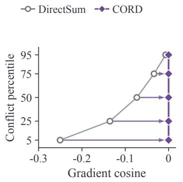

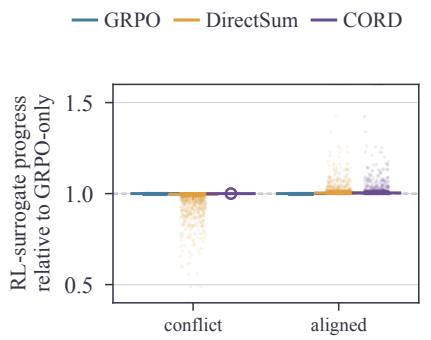

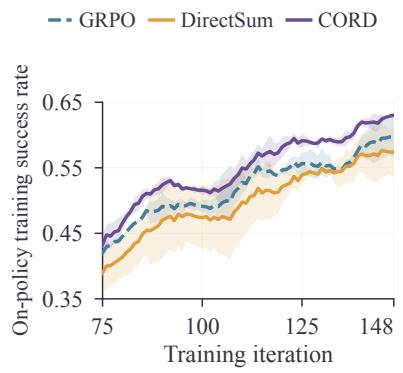  
Figure 1. From gradient conflict to improved agent training. Left, observations (a) and (c): cosine quantiles of conflicting WebShop/Qwen3-1.7B gradient records (Qwen Team, 2025), before and after analytic CORD projection. Middle, observation (b): first-order RL-surrogate progress relative to RL alone on the same log, evaluated at $\lambda = 0 . 0 0 5$ with RL protection. Right: preliminary WebShop/3B training success with $k _ { 3 } ,$ $\lambda = 0 . 0 0 1$ , and conflict-only distillation protection. The right panel shows iterations 75–148 after 21-iteration smoothing. Curves average two training seeds and bands show their range. Appendix C.1 gives measurement and smoothing details.

Joint optimization still requires a rule for combining these gradients. Which contribution to preserve on conflict depends on the losses’ roles and the training goal. A mixing coeficient changes scale but cannot selectively remove opposing components. Figure 1 diagnoses this interaction:

(a) Conflict occurs during agent training. In the WebShop (Yao et al., 2022) log used for the left panel, 48.2% of mini-batch gradient records have negative RL–distillation cosine.

(b) Conflict reduces local optimization progress. The middle panel shows that a conflicting distillation gradient reduces first-order progress on the RL surrogate relative to RL alone.

(c) The opposing component can be removed selectively. On conflict, projecting one gradient onto the other’s orthogonal complement moves the displayed cosine quantiles to zero and recovers the protected gradient’s first-order progress. Aligned pairs remain unchanged.

We introduce CORD, a general framework for conflict-aware optimization of two objectives. CORD accumulates both gradients under the specified loss weights for each optimizer mini-batch. It retains the selected protected gradient and minimally modifies the other before combining them. Conflict-only projection removes opposing components, while an always-projection variant also removes aligned components. Either objective can be protected. Our analysis relates the resulting first-order contribution on fixed sampled losses to finite step size and optimizer transformations. The agent experiments evaluate protection, triggering, and loss construction while retaining each host’s objectives. Appendix A discusses related work.

Our contributions are threefold:

• Conflict-aware joint optimization. We connect measured gradient conflict to lost first-order progress and formulate CORD to preserve a selected objective’s contribution while correcting the conflicting component of the other.

• Incremental gains across training methods. CORD improves all three host recipes on ALFWorld by 1.5–15.9 percentage points, and two of three on WebShop. These paired comparisons establish the value of gradient combination while retaining each host’s objectives.

• Guidance for configuring joint training. We show why protection direction and triggering must be selected together, and how the distillation loss, mixing weight, and aggregation determine the gradient that projection receives. Agent cases connect these choices to attribute completion, repeated actions, and token probability changes.

## 2 Preliminaries

## 2.1 Group Relative Policy Optimization (GRPO)

An agent samples response tokens $y _ { t }$ from a rollout policy $\pi _ { \mathrm { o l d } } ,$ conditioned on interaction history $x _ { t }$ . GRPO (Shao et al., 2024) compares returns within a group of attempts at the same task. Each response record receives a fixed advantage $\widehat { A } _ { t } = ( R _ { t } - \mu _ { g ( t ) } ) / ( \sigma _ { g ( t ) } + \epsilon )$ , where $\mu _ { g ( t ) }$ and $\sigma _ { g ( t ) }$ are its group’s return mean and standard deviation. The host specifies which response records enter these statistics. With probability ratio $r _ { t } = \pi _ { \theta } ( y _ { t } \mid x _ { t } ) / \pi _ { \mathrm { o l d } } ( y _ { t } \mid x _ { t } )$ , the clipped policy loss to minimize is

$$
\mathcal { L } _ { \mathrm { c l i p } } = - \mathcal { A } _ { B } \Big [ \operatorname* { m i n } \Big ( r _ { t } \widehat { A } _ { t } , \mathrm { c l i p } ( r _ { t } , 1 - \varepsilon , 1 + \varepsilon ) \widehat { A } _ { t } \Big ) \Big ] .\tag{1}
$$

Here $\mathcal { A } _ { B }$ aggregates valid response tokens in mini-batch � with the host’s specified weights, with padding and observation tokens masked. Our GRPO actor loss $\mathcal { L } _ { \mathrm { G R P O } }$ includes the host’s clipping safeguards, reference-policy KL regularization, and entropy term when enabled (Appendix B.3). All gradients below are loss gradients, so a descent update subtracts the combined gradient.

## 2.2 On-Policy Distillation

On-policy distillation scores the student’s sampled tokens with a teacher rather than requiring teacher-generated trajectories (Agarwal et al., 2024; Zhao et al., 2026; Wang et al., 2026). In our skill-conditioned instantiation, the teacher uses the current policy with additional skill context $S ( x _ { t } )$ and gradients disabled (Lu et al., 2026). Define

$$
\begin{array} { r } { s _ { t } = \log \pi _ { \theta } ( y _ { t } \mid x _ { t } ) , \qquad q _ { t } = s g \bigl [ \log \pi _ { \theta } ( y _ { t } \mid x _ { t } \oplus S ( x _ { t } ) ) \bigr ] , \qquad \ell _ { t } = s _ { t } - q _ { t } , } \end{array}\tag{2}
$$

where sg denotes stop-gradient. A token objective $\psi _ { t }$ and confidence weight $w _ { t }$ define a separate loss

$$
\mathcal { L } _ { \mathrm { O P D } } = \mathcal { A } _ { B } [ w _ { t } \psi _ { t } ] , \qquad \psi _ { t } ^ { k _ { 3 } } = \rho _ { \mathrm { o n } , t } ( e ^ { - \ell _ { t } } - 1 + \ell _ { t } ) , \qquad \psi _ { t } ^ { \rho _ { \mathrm { d } } } = \rho _ { \mathrm { o n } , t } \ell _ { t } .\tag{3}
$$

Equation 3 suppresses the numerical exponential cap. Gradients pass through the capped studentto-rollout ratio $\rho _ { \mathrm { o n } , t }$ and $s _ { t . }$ , while teacher scores and enabled confidence weights are detached. The host $k _ { 1 }$ term and numerical caps follow the inherited recipes in Appendix B.2. Token weights enter before aggregation, while the mixing coeficient below scales the resulting loss.

## 2.3 Multi-Objective Optimization and Gradient Conflict

Bold symbols denote parameter-space vectors. Losses, inner products, and coeficients are scalars. We use $G _ { j }$ for a complete aggregated objective gradient and $\mathbf { \bar { \mathbf { g } } } _ { j } ^ { ( m ) }$ for a micro-batch gradient. The role vectors ${ \mathbf { } } u , v , a , b$ refer to these aggregates after the stated weighting and protection choices.

For two mini-batch losses $F _ { 1 } , F _ { 2 }$ and parameters $\theta \in  { \mathbb { R } } ^ { d }$ , weighted-sum optimization minimizes $F _ { 1 } + \lambda F _ { 2 }$ . At fixed $\lambda > 0$ , write

$$
\begin{array} { r } { u = G _ { 1 } = \nabla F _ { 1 } ( \theta ) , \qquad v = \lambda G _ { 2 } = \lambda \nabla F _ { 2 } ( \theta ) , \qquad g _ { \mathrm { s u m } } = u + v . } \end{array}\tag{4}
$$

Our agent instantiation uses $F _ { 1 } = \mathcal { L } _ { \mathrm { G R P O } }$ and $F _ { 2 } = \mathrm { \mathcal { L } } _ { \mathrm { O P D } }$ . The same combination applies to any two diferentiable losses with specified aggregation. A small step along $- g _ { \mathrm { s u m } }$ changes $F _ { 1 }$ by

$$
F _ { 1 } ( \theta - \eta g _ { \mathrm { s u m } } ) - F _ { 1 } ( \theta ) = - \eta \big ( \lVert \boldsymbol { u } \rVert ^ { 2 } + \langle \boldsymbol { u } , \boldsymbol { v } \rangle \big ) + o ( \eta ) .\tag{5}
$$

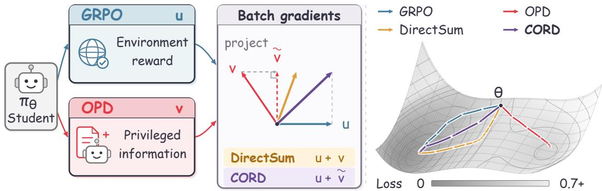  
Figure 2. CORD combines two learning signals through gradient projection. Left: GRPO uses environment rewards, while OPD uses a teacher conditioned on privileged skill context, with teacher gradients disabled. Middle: accumulated gradients $u = \nabla F _ { 1 }$ and $\boldsymbol { v } = \lambda \nabla F _ { 2 }$ give the DirectSum $u + v$ . For the conflicting pair shown, CORD protects � and removes the opposing component of �, giving $\boldsymbol { u } + \tilde { \boldsymbol { v } }$ . Either objective can be protected. Right: illustrative paths in an analytic two-loss construction with GRPO protection. Height and shading encode its GRPO loss. Arrows denote updates of step size 0 7, stopping within 0 10 of either local minimum.

For $\lambda F _ { 2 } ,$ , the corresponding expression replaces $\| u \| ^ { 2 }$ by $\| \boldsymbol { v } \| ^ { 2 }$ . A negative cross term therefore reduces each objective’s first-order progress relative to its own gradient. We call this gradient conflict. Scaling $\lambda > 0$ changes its magnitude but not its sign. CORD addresses this interaction by choosing which weighted gradient to preserve and minimally modifying the other.

## 3 Method

CORD combines two objective gradients by making the protected direction and projection gate explicit. It keeps one weighted gradient intact and makes the smallest change to the other that satisfies the chosen geometric constraint. The same construction accommodates either protection direction. The loss functions and their relative weight specify the signals supplied to it. Figure 2 illustrates the combination for GRPO and OPD, with an analytic loss surface showing example update paths.

## 3.1 Choosing a protected direction

Using the weighted gradients in Equation 4, CORD selects a protected gradient � and a candidate gradient � from $( a , b ) \in \{ ( u , v ) , ( v , u ) \}$ }. The protected loss $F _ { a }$ is correspondingly $F _ { 1 }$ or $\lambda F _ { 2 } ,$ so that $\nabla F _ { a } = \pmb { a }$ . The loss definitions and training goal inform this protection choice. Swapping roles alters the combined direction without redefining losses or fixing priority across problems.

## 3.2 Projection direction and gate

Under the conflict-only gate, CORD combines gradients as

$$
g _ { \mathrm { f i n a l } } = a + \tilde { b } , \qquad \tilde { b } = \left\{ \begin{array} { l l } { b - \frac { \left. a , b \right. } { \| a \| ^ { 2 } } a , } & { \left. a , b \right. < 0 , } \\ { b , } & { \left. a , b \right. \ge 0 . } \end{array} \right.\tag{6}
$$

A zero protected gradient leaves the candidate unchanged.

Lemma 1 (Closest feasible replacement). For $a , b \in \mathbb { R } ^ { d }$ , the candidate $\tilde { b }$ in Equation 6 is the unique solution of

$$
\operatorname* { m i n } _ { z \in \mathbb { R } ^ { d } } \ \frac { 1 } { 2 } \| z - b \| ^ { 2 } \quad s u b j e c t \ t o \quad \langle a , z \rangle \geq 0 .\tag{7}
$$

Proof. For ${ \textbf { \em a } } = { \textbf { 0 } }$ every vector is feasible, and the minimizer is �. For ${ \pm \ 0 } ,$ the Lagrangian is $\begin{array} { r } { \frac 1 2 \| z - b \| ^ { 2 } - \mu \langle a , z \rangle } \end{array}$ . Stationarity gives $z = b + \mu a$ . Feasibility, $\mu \geq 0 ,$ , and complementary slackness give $\mu = 0$ when $\langle a , b \rangle \geq 0 .$ , and $\mu = - { \langle a , b \rangle } / { | a | | ^ { 2 } }$ otherwise. These conditions are suficient for this convex problem, and strict convexity makes the minimizer unique. □

The always gate instead requires $\langle a , { \tilde { b } } \rangle = 0 \mathrm { : }$ : for nonzero � it applies the projection in the first branch at every update, including aligned gradients. Disabling projection sets ${ \tilde { b } } = b$ and restores weighted summation. CORD uses the single-constraint geometry of A-GEM (Chaudhry et al., 2019), with two current objective gradients and an explicit choice of protection direction and gate. PCGrad (Yu et al., 2020) modifies both gradients on conflict, whereas CORD keeps the protected gradient intact. Proposition 1 (First-order efect on the protected loss). Fix $\theta , \lambda ,$ , and the mini-batch losses, and suppose $F _ { a }$ is diferentiable at �. With conflict-only projection,

$$
\begin{array} { r l r } & { } & { \langle a , g _ { \mathrm { f i n a l } } \rangle = \| a \| ^ { 2 } + \operatorname* { m a x } \{ \langle a , b \rangle , 0 \} , } \\ & { } & { F _ { a } ( \theta - \eta g _ { \mathrm { f i n a l } } ) - F _ { a } ( \theta ) = - \eta \langle a , g _ { \mathrm { f i n a l } } \rangle + o ( \eta ) . } \end{array}\tag{8}
$$

for $\eta  0 ^ { + }$ . Whenever projection is applied, $\langle \pmb { a } , \pmb { g } _ { \mathrm { f i n a l } } \rangle = \| \pmb { a } \| ^ { 2 }$ . This equality also holds under the always gate.

Proof. The projected candidate is orthogonal to �, giving the equality on projection. Otherwise $\tilde { b } = b$ and the inner product is nonnegative. Diferentiability gives the stated expansion for this fixed direction. The zero-reference case has both inner products equal to zero. □

Projection preserves the protected gradient’s first-order descent rate. When it applies with ${ \pm \mathrm { \bf ~ 0 } } _ { \mathrm { \bf ~ \ell } }$ orthogonal decomposition of � gives

$$
\langle b , \tilde { b } \rangle = \| \tilde { b } \| ^ { 2 } = \| b \| ^ { 2 } - \frac { \langle a , b \rangle ^ { 2 } } { \| a \| ^ { 2 } } .\tag{9}
$$

This identity describes the surviving candidate alone. The full direction also includes �, so the unprotected loss need not decrease. These properties concern the ideal combined gradient. Global norm clipping rescales it, whereas AdamW’s momentum, adaptive scaling, and weight decay can change the update direction (Loshchilov and Hutter, 2019). Appendix B.3 relates the first-order term to the actual parameter displacement and finite-step loss change.

## 3.3 How protection interacts with the mixing weight

The two protection directions share a conflict test but respond diferently to the coeficient. Write $G _ { 1 } = \nabla F _ { 1 }$ and $G _ { 2 } = \nabla F _ { 2 }$ , and fix a conflicting pair with $c = \left. G _ { 1 } , G _ { 2 } \right. < 0$ . Equation 6 becomes

$$
g _ { \mathrm { p r o t e c t 1 } } = G _ { 1 } + \lambda \left( G _ { 2 } - \frac { c } { \| G _ { 1 } \| ^ { 2 } } G _ { 1 } \right) ,\tag{10}
$$

$$
g _ { \mathrm { p r o t e c t } 2 } = \lambda G _ { 2 } + \left( G _ { 1 } - \frac { c } { \| G _ { 2 } \| ^ { 2 } } G _ { 2 } \right) .\tag{11}
$$

In the first case, � scales the candidate and its correction together. In the second, it scales the protected gradient, while the correction to $G _ { 1 }$ is independent of �. If $\phi$ is the angle between the unweighted gradients, the corresponding correction norms are $\lambda \| G _ { 2 } \|$ cos �| and $\| G _ { 1 } \| \|$ cos $\phi | .$ Swapping protection therefore changes which gradient component � controls.

Algorithm 1: CORD gradient combination. $\mathrm { A t } \lambda = 0 ,$ use $G _ { 1 }$ directly.   
Input: mini-batch $B ;$ losses $\overline { { F _ { 1 } , F _ { 2 } } }$ with specified aggregation; coeficient �; protection   
direction; gate   
Accumulate $G _ { 1 } = \nabla F _ { 1 }$ and $G _ { 2 } = \nabla F _ { 2 }$ separately over $B$   
$u  G _ { 1 } , v  \lambda G _ { 2 }$   
Select $( a , b ) \gets ( u , v )$ or $( v , u )$   
Reduce the inner-product and norm statistics across gradient shards   
$\tilde { b } \gets b$   
if $\| \boldsymbol { a } \| ^ { 2 } > 0$ and (gate is always or (gate is conflict-only and $\langle { \pmb a } , { \pmb b } \rangle < 0 ) )$ then   
$\tilde { b }  b - ( \langle a , b \rangle / \| a \| ^ { 2 } ) a$   
end   
Pass $g _ { \mathrm { f i n a l } }  a + \tilde { b }$ to the optimizer

For a fixed pair and $\lambda > 0$ , scaling does not change the conflict decision. Conflict-only projection retains aligned candidates. The always gate removes their parallel component as well. The coeficient controls scale, while the gate controls whether a helpful component is retained. Appendix C.3 isolates these efects at fixed gradients, while RQ2 compares the resulting trained policies.

## 3.4 Accumulation and agent training

For an aggregation rule $\begin{array} { r } { F _ { j } = \sum _ { m } \alpha _ { m } F _ { j } ^ { ( m ) } } \end{array}$ , with fixed weights $\alpha _ { m } ,$ , define $g _ { j } ^ { ( m ) } = \nabla F _ { j } ^ { ( m ) }$ and $G _ { j } =$ $\begin{array} { r } { \sum _ { m } \alpha _ { m } g _ { j } ^ { ( m ) } } \end{array}$ . CORD acts once on these accumulated mini-batch gradients. Projection is nonlinear in the gradient pair, so projecting each micro-batch separately usually produces a diferent update. Accumulating first defines the projection at the optimizer’s update scale. The loss aggregation rule sets the weights before accumulation. Keeping those weights fixed makes repartitioning a computational choice, whereas changing from micro-batch to global-token or trajectory averaging changes the gradients themselves. Appendix C.4 compares these choices.

For agents, Equation 4 becomes $\pmb { u } = G _ { r }$ and $v = \lambda G _ { o } \colon$ protecting GRPO projects OPD, while protecting OPD projects GRPO. Skill-SD (Wang et al., 2026) uses $k _ { 3 }$ $_ \mathrm { G R P O + O P S D }$ and SDAR (Lu et al., 2026) retain their host $k _ { 1 }$ objectives and weighting conventions. The loss analysis also examines $\rho _ { \mathrm { d } }$ from Equation 3. Appendix B.2 specifies the recipes. Main host comparisons protect RL with conflict-only projection. The direction and gate analysis tests both protection choices.

Computational complexity. Given the two objective gradients, CORD uses �(�) arithmetic and �(�) additional gradient storage for � trainable parameters. With � PPO mini-batches per training iteration, the gradient-combination cost is $O ( K d )$ . When the objectives depend on the same student outputs, their gradient evaluations can share the forward computation. They still require distinct objective-gradient information, followed by inner products, a projection, and vector addition. Shared computation and fused vector operations can reduce redundant work without changing the projection rule. For a fixed workload, actor overhead difers from full-iteration overhead. Rollout, teacher scoring, and environment interaction are shared stages, so their share of each iteration determines how additional gradient work afects total time. The component model in Appendix C.6 holds the workload fixed and separates measured actor timings from estimated iteration overhead.

## 4 Experiments

We test whether changing the gradient-combination rule adds value across joint training methods, then use the analyses to guide its configuration. The experiments answer three research questions: (RQ1) Efectiveness: How much does CORD improve existing joint training recipes? (RQ2) Projection choices: How do the protected objective, projection gate, and loss construction guide practical configuration? (RQ3) Agent behavior: How do update choices appear in agent interactions?

## 4.1 Experimental setup

Tasks and training. We use the SDAR agent suite (Lu et al., 2026) with Qwen2.5-3B-Instruct (Yang et al., 2024). ALFWorld (Shridhar et al., 2021) evaluates household tasks over at most 50 actions. We report success across six categories and the pooled average. WebShop (Yao et al., 2022) evaluates instruction-following shopping. We cap episodes at 15 actions and report graded task score and strict success rate on a 0–100 scale. Our shared trainer uses 150 training iterations, eight rollouts per prompt, AdamW at $1 0 ^ { - 6 }$ , reference-KL coeficient 0.01, and responses capped at 512 tokens on eight NVIDIA A100 40 GB GPUs. Full settings are given in Appendix B.

Methods. Table 1 includes Vanilla, Skill-Prompt, and OPSD values reported by Lu et al. (2026). GRPO and RLSD results are our own runs. RLSD incorporates the self-distillation signal into the policy optimization objective (Yang et al., 2026a). Following SDAR, the joint recipes share a predefined skill bank whose contents remain fixed throughout training. Each Base–CORD pair uses the same bank and skill-selection rule to isolate gradient combination. Household tasks select task-specific manipulation skills, while shopping instructions select relevant skills by keyword alongside general strategies. This context guides teacher scoring of student-generated actions and is absent from the student’s rollout and evaluation inputs. We apply CORD to three joint training recipes in this shared interface: Skill-SD (Wang et al., 2026) $( k _ { 3 } , \lambda = 0 . 0 0 1 )$ , GRPO+OPSD (host $k _ { 1 } ,$ $\lambda = 0 . 0 0 5 )$ , and SDAR (Lu et al., 2026) (confidence-weighted host $k _ { 1 } , \lambda = 0 . 0 1 )$ . Each recipe without CORD uses naive addition. + CORD retains its coeficient, protects the RL gradient, and projects only on conflict. RQ2 then varies the protected objective and projection gate.

Evaluation. We fix validation tasks to track progress on the same problems during training and hold the final evaluation tasks constant across paired methods. For the main comparison and full-training analyses in RQ2, including PCGrad (Yu et al., 2020), we evaluate the final policy four times after 150 updates at temperature 0.4. Each run uses one training seed, and the displayed ± is the population standard deviation across these four passes. Our WebShop evaluation uses 500 tasks, whereas the published baseline values in Table 1 use the 128-task protocol of Lu et al. (2026). Appendix B.3 details the protocol.

## 4.2 RQ1: Incremental efectiveness

Table 1 measures the increment from adding CORD to each joint training recipe. On ALFWorld, CORD improves all three recipes: pooled success increases from 76.4% to 77.9% for Skill-SD, from 65.0% to 80.9% for $\mathrm { G R P O + O P S D } _ {  }$ , and from 73.8% to 77.7% for SDAR. These are gains of 1.5, 15.9, and 3.9 percentage points, respectively. The largest gain occurs for $\mathrm { G R P O + O P S D }$ , which reaches the highest pooled success in the main comparison.

On WebShop, CORD improves Skill-SD success by 3.6 points (55.8% to 59.4%) and SDAR success by 3.9 points (60.7% to 64.6%). Their task scores also increase, from 72.1 to 78.1 and from 76.6 to 78.2, respectively. For $_ \mathrm { G R P O + O P S D }$ , success changes from 64.8% to 64.5% and task score from 80.5 to

Table 1. Final results on Qwen2.5-3B-Instruct. ALFWorld success and WebShop score/success are on a 0–100 scale. †: Lu et al. (2026). ∗: skills at inference. Our step-150 results use one training seed and four evaluation passes. ± denotes decode standard deviation. CORD protects RL with conflict-only projection. Δ = CORD − Base uses displayed means: success diferences are percentage points and score diferences are score points, with red/green indicating increases/decreases. Deltas have no assigned standard deviation and are excluded from ranking. Bold/underline mark the largest/second-largest distinct method means. Ties share the mark.
<table><tr><td></td><td colspan="7">ALFWorld</td><td colspan="2">WebShop</td></tr><tr><td>Method</td><td>Pick</td><td>Look</td><td>Clean</td><td>Heat</td><td>Cool</td><td>Pick2</td><td>Avg.</td><td>Score</td><td>Success Rate</td></tr><tr><td>Vanilla†</td><td>44.4</td><td>11.1</td><td>6.2</td><td>15.4</td><td>28.6</td><td>12.5</td><td>21.9</td><td>6.7</td><td>0.8</td></tr><tr><td>Skill-Prompt*†</td><td>51.7</td><td>66.7</td><td>48.4</td><td>0.0</td><td>4.3</td><td>10.0</td><td>28.9</td><td>0.2</td><td>0.8</td></tr><tr><td>OPSD†</td><td>48.8</td><td>41.7</td><td>16.7</td><td>0.0</td><td>15.8</td><td>16.7</td><td>28.1</td><td>11.3</td><td>3.1</td></tr><tr><td>GRPO</td><td>93.5±3.1</td><td>72.9±12.3</td><td>67.0±3.0</td><td>62.5±5.9</td><td>59.5±2.4</td><td>66.3±8.3</td><td>71.3±1.9</td><td>71.1±1.1</td><td>59.2±1.5</td></tr><tr><td>RLSD</td><td>95.4±1.6</td><td>68.8±3.6</td><td>83.0±3.9</td><td>87.5±7.8</td><td>56.0±3.9</td><td>53.8±6.7</td><td>74.4±2.2</td><td>69.8±0.7</td><td>54.4±1.0</td></tr><tr><td>Skill-SD</td><td>89.3±2.4</td><td>78.8±6.4</td><td>85.2±3.7</td><td>65.6±7.0</td><td>60.0±2.8</td><td>70.8±7.8</td><td>76.4±1.7</td><td>72.1±0.9</td><td>55.8±0.9</td></tr><tr><td>+ CORD</td><td>91.4±3.5</td><td>67.3±6.4</td><td>87.0±4.1</td><td>67.2±5.2</td><td>78.0±2.0</td><td>60.4±2.1</td><td>77.9±1.5</td><td>78.1±0.2</td><td>59.4±0.8</td></tr><tr><td>Δ</td><td>+2.1</td><td>-11.5</td><td>+1.8</td><td>+1.6</td><td>+18.0</td><td>-10.4</td><td>+1.5</td><td>+6.0</td><td>+3.6</td></tr><tr><td>GRPO+OPSD</td><td>94.4±6.1</td><td>60.4±12.3</td><td>75.0±2.5</td><td>58.9±5.9</td><td>50.0±5.3</td><td>41.3±4.2</td><td>65.0±2.6</td><td>80.5±0.6</td><td>64.8±0.2</td></tr><tr><td>+ CORD</td><td>98.6±1.4</td><td>75.0±6.4</td><td>88.0±4.0</td><td>75.0±6.3</td><td>66.0±2.0</td><td>69.8±4.5</td><td>80.9±1.6</td><td>77.5±0.2</td><td>64.5±1.0</td></tr><tr><td>Δ</td><td>+4.2</td><td>+14.6</td><td>+13.0</td><td>+16.1</td><td>+16.0</td><td>+28.5</td><td>+15.9</td><td>-3.0</td><td>-0.3</td></tr><tr><td>SDAR</td><td>96.3±2.6</td><td>64.6±3.6</td><td>81.2±3.0</td><td>67.9±3.6</td><td>59.5±7.9</td><td>61.5±4.7</td><td>73.8±1.4</td><td>76.6±1.0</td><td>60.7±0.7</td></tr><tr><td>+ CORD</td><td>88.6±6.4</td><td>76.9±0.0</td><td>89.8±1.6</td><td>79.7±8.1</td><td>74.0±3.5</td><td>51.0±3.5</td><td>77.7±3.1</td><td>78.2±1.1</td><td>64.6±1.1</td></tr><tr><td>∆</td><td>-7.7</td><td>+12.3</td><td>+8.6</td><td>+11.8</td><td>+14.5</td><td>-10.5</td><td>+3.9</td><td>+1.6</td><td>+3.9</td></tr></table>

77.5. Thus, the same projection configuration improves all three recipes on ALFWorld and two on WebShop. Appendix C.7 reports the corresponding statistical tests. Appendix B.4 adds 7B results with gains on ALFWorld and mixed outcomes on WebShop. These diferences motivate examining how protection and gating interact with the loss, coeficient, and gradient aggregation.

## 4.3 RQ2: The roles of projection and gradient choices

Table 2. Protection direction and gating on WebShop. Qwen2.5-3B-Instruct with $k _ { 3 } ,$ reporting success (%). Values are means and population standard deviations across four evaluation passes at temperature 0 4 after 150 updates, with one training seed. Protect RL projects the distillation gradient. Protect distillation projects the RL gradient. PCGrad projects both on conflict. Bold identifies the largest observed mean at each coeficient.
<table><tr><td>Projection rule</td><td>Gate</td><td>λ = 0.001</td><td>λ = 0.005</td></tr><tr><td>No projection</td><td></td><td> $5 5 . 7 5 \pm 0 . 9 1$ </td><td>56.75±0.89</td></tr><tr><td>Protect RL</td><td>Conflict-only</td><td> $5 9 . 3 5 \pm 0 . 7 9$ </td><td>61.85±1.59</td></tr><tr><td>Protect RL</td><td>Always</td><td> $6 2 . 6 5 \pm 0 . 7 9$ </td><td>61.25±0.92</td></tr><tr><td>Protect distillation</td><td>Conflict-only</td><td> $5 8 . 3 5 \pm 0 . 7 4$ </td><td>61.90 ±1.08</td></tr><tr><td>Protect distillation</td><td>Always</td><td> $3 8 . 9 0 \pm 0 . 9 5$ </td><td>62.10 ±1.54</td></tr><tr><td>PCGrad (Yu et al., 2020)</td><td>Conflict-only</td><td> ${ \bf 6 3 . 1 0 \pm 0 . 9 1 }$ </td><td>58.85±0.95</td></tr></table>

Table 3. Token objectives at $\lambda = 0 . 0 0 5 .$ . ALFWorld success and WebShop score/success are on a 0–100 scale. CORD protects RL with conflict-only projection. Values are mean ± standard deviation across four decoding passes of step-150 Qwen2.5-3B-Instruct checkpoints at temperature 0.4, with one training seed. Bold marks the largest mean per column.
<table><tr><td></td><td colspan="7">ALFWorld</td><td colspan="2">WebShop</td></tr><tr><td>Objective</td><td>Pick</td><td>Look</td><td>Clean</td><td>Heat</td><td>Cool</td><td>Pick2</td><td> $\mathbf { A v } \mathbf { g } .$ </td><td>Score</td><td>Success</td></tr><tr><td> $k _ { 1 }$ </td><td>95.71</td><td>71.15</td><td>71.30</td><td>56.25</td><td>67.00</td><td>66.67</td><td>74.11</td><td>73.68</td><td>59.95</td></tr><tr><td></td><td>±4.74 92.14</td><td>±6.38</td><td>±4.81</td><td>±4.42</td><td>±9.54</td><td>±5.10</td><td>±3.00</td><td>±0.79</td><td>±0.77</td></tr><tr><td> $\rho _ { \mathrm { d } }$ </td><td></td><td>65.38</td><td>85.19</td><td>78.13</td><td>70.00</td><td>70.83</td><td>79.11</td><td>69.13</td><td>58.95</td></tr><tr><td></td><td>±3.11</td><td>±3.85</td><td>±2.62</td><td>±3.13</td><td>±2.00</td><td>±2.95</td><td>±1.28</td><td>±0.73</td><td>±0.38</td></tr><tr><td> $k _ { 3 }$ </td><td>93.57</td><td>80.77</td><td>91.67</td><td>79.69</td><td>85.00</td><td>63.54</td><td>83.75</td><td>74.66</td><td>55.55</td></tr><tr><td></td><td>±1.24</td><td>±8.60</td><td>±3.07</td><td>±6.81</td><td>±1.73</td><td>±1.80</td><td>±1.06</td><td>±0.44</td><td>±0.79</td></tr></table>

Choose protection direction and trigger together. The protected objective determines which gradient remains intact, while the gate determines whether projection also removes aligned components. Table 2 compares these choices on WebShop. $\mathrm { A t } \lambda = 0 . 0 0 1$ , conflict-only projection improves success over no projection for both RL and distillation protection, from 55.75% to 59.35% and 58.35%, respectively. Switching to always projection raises success to 62.65% when protecting RL but lowers it to 38.90% when protecting distillation. $\mathrm { A t } \lambda = 0 . 0 0 5$ , all four CORD configurations instead lie between 61.25% and 62.10%, above the 56.75% unprojected result. Direction and gating therefore interact with the coeficient: removing the aligned component has a diferent efect depending on which objective is protected and the relative gradient scales.

CORD keeps one gradient intact, whereas the two-objective PCGrad adaptation (Yu et al., 2020) modifies both when they conflict (Appendix B.3). $\mathrm { A t } \lambda = 0 . 0 0 1$ , PCGrad has the largest observed mean of 63.10%, but at $\lambda = 0 . 0 0 5$ its 58.85% is below all four CORD configurations.

The fixed-gradient analysis in Appendix C.3 clarifies how CORD’s protection direction interacts with �. Protecting RL changes the weighted distillation gradient, so the correction scales with �. Protecting distillation changes the RL gradient, whose correction is unchanged when only � varies. A small auxiliary coeficient therefore does not make distillation protection a small intervention. Because conflict-only projection retains aligned contributions, the efect of always projection depends on the selected protection direction.

Tune the loss and its coeficient together. The token objective determines the distillation gradient supplied to CORD. Table 3 compares $k _ { 3 } ,$ , the importance-weighted log-ratio variant $\rho _ { \mathrm { d } } ,$ , and the host $k _ { 1 }$ implementation at $\lambda = 0 . 0 0 5$ , with RL protection and conflict-only projection. The relative performance of the objectives changes across environments: $\rho _ { \mathrm { d } }$ exceeds $k _ { 3 }$ on WebShop (58.95% versus 55.55%), while $k _ { 3 }$ exceeds $\rho _ { \mathrm { d } }$ on ALFWorld (83.75% versus 79.11%). The host $k _ { 1 }$ reaches 59.95% and 74.11%, respectively. The two importance-weighted losses supply diferent token gradients: away from numerical caps, their derivatives with respect to the student log-probability are $\rho _ { \mathrm { o n } , t } \ell _ { t }$ for $k _ { 3 }$ and $\rho _ { \mathrm { o n } , t } ( \ell _ { t } + 1 )$ for $\rho _ { \mathrm { d } }$ (Equation 15). Changing the loss therefore changes what CORD projects, even at the same coeficient. On WebShop, $k _ { 3 }$ also has the highest graded score despite lower strict success, so loss selection must follow the intended metric.

Figure 3 shows how the efect of � depends on the token objective. Increasing it from 0.001 to 0.005 lowers $k _ { 3 }$ success from 59.35% to 55.55%, but raises $\rho _ { \mathrm { d } }$ success from 56.20% to 58.95%. Projection therefore does not make a coeficient transferable between losses. These loss and coeficient analyses use a separate checkpoint collection from the direction and gate analysis.

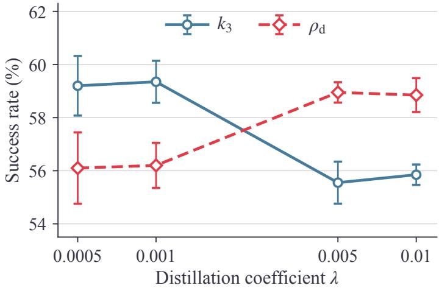  
Figure 3. Efect of � on WebShop success. Error bars show standard deviation across decoding passes.

Fix aggregation before comparing projection choices. The mini-batch size sets how many response sequences contribute to each gradient pair. Five-round ALFWorld continuations from the same checkpoint and AdamW state vary this size from 32 to 128 at a fixed episode budget (Table 4). Success under RL protection varies by 0.78 percentage points, while distillation protection peaks at size 64. Larger mini-batches change both gradient estimation and the number of optimizer updates. These continuations update the policy and collect new trajectories, testing training consequences beyond the geometry of a fixed gradient pair.

Aggregation also determines how tokens and trajectories contribute to each gradient. At size 64, the protection directions nearly tie under microbatch weighting. Distillation protection has the higher mean under global-token weighting, whereas RL protection has the higher mean under trajectory weighting. All three paired intervals include zero, so these orderings remain descriptive. Appendix C.4 defines the weights and protocol. Repartitioning fixed weights changes the computation, whereas changing the weights changes the objectives being protected.

Table 4. Efect of gradient aggregation and mini-batch size. ALFWorld task-macro success (%) after five continuation rounds from the same Qwen2.5-3B step-90 checkpoint and AdamW state. � counts response rows per optimizer mini-batch. Appendix C.4 specifies the single-seed evaluation protocol and aggregation weights. Bold marks row maxima.
<table><tr><td>Aggregation</td><td>B</td><td>No projection</td><td>Protect RL</td><td>Protect distillation</td></tr><tr><td>Microbatch</td><td>64</td><td>53.98</td><td>57.55</td><td>57.42</td></tr><tr><td>Global token</td><td>32</td><td>52.52</td><td>57.46</td><td>49.22</td></tr><tr><td>Global token</td><td>64</td><td>59.11</td><td>57.33</td><td>61.03</td></tr><tr><td>Global token</td><td>128</td><td>61.81</td><td>58.10</td><td>55.86</td></tr><tr><td>Trajectory</td><td>64</td><td>60.99</td><td>61.77</td><td>57.42</td></tr></table>

## 4.4 RQ3: Case analysis of agent behavior

Success rates do not show which attributes an agent missed or how many actions it repeated. Figure 4 compares three policies that open the same product to buy a youth garment in dark heather, size 4t. The unprojected policy selects the size and age group but omits the color, receiving a partial score of 0.90. Both projected policies complete all requested options and receive 1.00.

With RL protection, the agent selects each option once and purchases in six steps. With distillation protection, it repeats four selections and purchases in ten. Attribute completion and action eficiency are thus separate aspects of behavior: both directions succeed here, but their repetitions difer. Further examples are provided in Appendices C.8 and C.9.

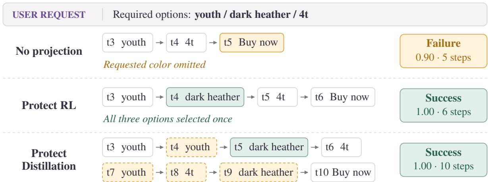  
Figure 4. Option completion and repetition in WebShop. Qwen2.5-3B-Instruct, �3, � = 0.005, step 150, conflict-only projection, and greedy decoding. Boxes show selected options and the purchase action, with original step indices. Green highlights selection of the requested color. Dashed amber boxes mark repeated selections. Scores are on [0 1]. Success requires 1.00.

## 5 Conclusion

Joint RL and distillation gives agents complementary feedback, but opposing gradient components can reduce its local optimization benefit. CORD applies a simple projection rule to this interaction, allowing either objective to be protected and making the trigger explicit. The first-order analysis explains the correction on fixed surrogates before optimizer transformations, and the agent experiments establish incremental gains across three host recipes on ALFWorld and two of three on WebShop. The analyses also yield concrete configuration guidance: choose protection and triggering together, tune the mixing weight for the selected distillation loss, and specify aggregation before comparing gradient directions. CORD thus makes gradient combination a reusable design choice.

## References

Rishabh Agarwal, Nino Vieillard, Yongchao Zhou, Piotr Stanczyk, Sabela Ramos Garea, Matthieu Geist, and Olivier Bachem. On-policy distillation of language models: Learning from self-generated mistakes. In The Twelfth International Conference on Learning Representations (ICLR 2024). OpenReview.net, 2024. URL https://openreview.net/forum?id=3zKtaqxLhW.

Arslan Chaudhry, Marc’Aurelio Ranzato, Marcus Rohrbach, and Mohamed Elhoseiny. Eficient lifelong learning with A-GEM. In 7th International Conference on Learning Representations (ICLR). OpenReview.net, 2019. URL https://openreview.net/forum?id=Hkf2\_sC5FX.

Zhao Chen, Vijay Badrinarayanan, Chen-Yu Lee, and Andrew Rabinovich. Gradnorm: Gradient normalization for adaptive loss balancing in deep multitask networks. In Proceedings ofthe 35th International Conference on Machine Learning (ICML), volume 80 of Proceedings ofMachine Learning Research, pages 794–803. PMLR, 2018. URL http://proceedings.mlr.press/v80/chen18a.html.

Lasse Espeholt, Hubert Soyer, Rémi Munos, Karen Simonyan, Vlad Mnih, Tom Ward, Yotam Doron, Vlad Firoiu, Tim Harley, Iain Dunning, Shane Legg, and Koray Kavukcuoglu. IMPALA: scalable distributed deep-rl with importance weighted actor-learner architectures. In Proceedings of the 35th International Conference on Machine Learning (ICML), volume 80 of Proceedings of Machine Learning Research, pages 1407–1416. PMLR, 2018. URL http://proceedings.mlr.press/v80/espeholt18a.html.

Mehrdad Farajtabar, Navid Azizan, Alex Mott, and Ang Li. Orthogonal gradient descent for continual learning. In The 23rd International Conference on Artificial Intelligence and Statistics (AISTATS), volume 108 of Proceedings of Machine Learning Research, pages 3762–3773. PMLR, 2020. URL http://proceedings.mlr.press/v108/farajtabar20a.html.

Lang Feng, Zhenghai Xue, Tingcong Liu, and Bo An. Group-in-group policy optimization for LLM agent training. In Advances in Neural Information Processing Systems 38 (NeurIPS 2025), 2025. URL http://papers.nips.cc/paper\_files/paper/2025/hash/420c9f777c0b4f78d515e53cf74d58b2-Abs tract-Conference.html.

Alex Kendall, Yarin Gal, and Roberto Cipolla. Multi-task learning using uncertainty to weigh losses for scene geometry and semantics. In 2018 IEEE Conference on Computer Vision and Pattern Recognition (CVPR), pages 7482–7491. Computer Vision Foundation / IEEE Computer Society, 2018. doi: 10.1109/CVPR.2018.00781. URL http://openaccess.thecvf.com/content\_cvpr\_2018/html/Kendall\_Multi-Task\_Learning\_Usi ng\_CVPR\_2018\_paper.html.

Woosuk Kwon, Zhuohan Li, Siyuan Zhuang, Ying Sheng, Lianmin Zheng, Cody Hao Yu, Joseph E. Gonzalez, Hao Zhang, and Ion Stoica. Eficient memory management for large language model serving with PagedAttention. In Proceedings of the 29th Symposium on Operating Systems Principles, SOSP ’23, pages 611–626. Association for Computing Machinery, 2023. doi: 10.1145/3600006.3613165. URL https://doi.org/10.1145/3600006.3613165.

Bo Liu, Xingchao Liu, Xiaojie Jin, Peter Stone, and Qiang Liu. Conflict-averse gradient descent for multi-task learning. In Advances in Neural Information Processing Systems 34 (NeurIPS), pages 18878–18890, 2021. URL https://proceedings.neurips.cc/paper/2021/hash/9d27fdf2477ffbff837d73ef7ae23db9-Abstrac t.html.

Ilya Loshchilov and Frank Hutter. Decoupled weight decay regularization. In 7th International Conference on Learning Representations (ICLR). OpenReview.net, 2019. URL https://openreview.net/forum?id=Bkg6RiCqY7.

Zhengxi Lu, Zhiyuan Yao, Zhuowen Han, Zi-Han Wang, Jinyang Wu, Qi Gu, Xunliang Cai, Weiming Lu, Jun Xiao, Yueting Zhuang, and Yongliang Shen. Self-distilled agentic reinforcement learning. CoRR, abs/2605.15155, 2026. doi: 10.48550/ARXIV.2605.15155. URL https://doi.org/10.48550/arXiv.2605.15155.

Qwen Team. Qwen3 technical report. CoRR, abs/2505.09388, 2025. doi: 10.48550/ARXIV.2505.09388. URL https://doi.org/10.48550/arXiv.2505.09388.

John Schulman, Filip Wolski, Prafulla Dhariwal, Alec Radford, and Oleg Klimov. Proximal policy optimization algorithms. CoRR, abs/1707.06347, 2017. URL http://arxiv.org/abs/1707.06347.

Zhihong Shao, Peiyi Wang, Qihao Zhu, Runxin Xu, Junxiao Song, Xiao Bi, Haowei Zhang, Mingchuan Zhang, Y. K. Li, Y. Wu, and Daya Guo. Deepseekmath: Pushing the limits of mathematical reasoning in open language models. CoRR, abs/2402.03300, 2024. doi: 10.48550/ARXIV.2402.03300. URL https://doi.org/10.48550/arXiv.2402.03300.

Mohit Shridhar, Xingdi Yuan, Marc-Alexandre Côté, Yonatan Bisk, Adam Trischler, and Matthew Hausknecht. ALFWorld: aligning text and embodied environments for interactive learning. In 9th International Conference on Learning Representations (ICLR). OpenReview.net, 2021. URL https://openreview.net/forum?id=0IOX0YcCdTn.

Hao Wang, Guozhi Wang, Han Xiao, Yufeng Zhou, Yue Pan, Jichao Wang, Ke Xu, Yafei Wen, Xiaohu Ruan, Xiaoxin Chen, and Honggang Qi. Skill-sd: Skill-conditioned self-distillation for multi-turn LLM agents. CoRR, abs/2604.10674, 2026. doi: 10.48550/ARXIV.2604.10674. URL https://doi.org/10.48550/arXiv.2604.10674.

Jinyang Wu, Shuo Yang, Zhengxi Lu, Fan Zhang, Yuhao Shen, Lang Feng, Haoran Luo, Zheng Lian, Shuai Zhang, Zhengqi Wen, and Jianhua Tao. Seed: Self-evolving on-policy distillation for agentic reinforcement learning. arXiv preprint arXiv:2607.14777, 2026. doi: 10.48550/ARXIV.2607.14777. URL https://arxiv.org/abs/2607.14777.

Peng Xia, Jianwen Chen, Hanyang Wang, Jiaqi Liu, Kaide Zeng, Yu Wang, Siwei Han, Yiyang Zhou, Xujiang Zhao, Haifeng Chen, Zeyu Zheng, Cihang Xie, and Huaxiu Yao. Skillrl: Evolving agents via recursive skill-augmented reinforcement learning. CoRR, abs/2602.08234, 2026. doi: 10.48550/ARXIV.2602.08234. URL https://doi.org/10.48550/arXiv.2602.08234.

An Yang et al. Qwen2.5 technical report. CoRR, abs/2412.15115, 2024. doi: 10.48550/ARXIV.2412.15115. URL https://doi.org/10.48550/arXiv.2412.15115.

Chenxu Yang, Chuanyu Qin, Qingyi Si, Minghui Chen, Naibin Gu, Dingyu Yao, Zheng Lin, Weiping Wang, Jiaqi Wang, and Nan Duan. Self-distilled RLVR. CoRR, abs/2604.03128, 2026a. doi: 10.48550/ARXIV.2604.03128. URL https://doi.org/10.48550/arXiv.2604.03128.

Shuo Yang, Jinyang Wu, Zhengxi Lu, Yuhao Shen, Fan Zhang, Lang Feng, Shuai Zhang, Haoran Luo, Zheng Lian, Zhengqi Wen, and Jianhua Tao. OPID: on-policy skill distillation for agentic reinforcement learning. CoRR, abs/2606.26790, 2026b. doi: 10.48550/ARXIV.2606.26790. URL https://doi.org/10.48550/arXiv.2606.26790.

Shunyu Yao, Howard Chen, John Yang, and Karthik Narasimhan. WebShop: towards scalable real-world web interaction with grounded language agents. In Advances in Neural Information Processing Systems 35 (NeurIPS), 2022. URL http://papers.nips.cc/paper\_files/paper/2022/hash/82ad13ec01f9fe44c01 cb91814fd7b8c-Abstract-Conference.html.

Tianhe Yu, Saurabh Kumar, Abhishek Gupta, Sergey Levine, Karol Hausman, and Chelsea Finn. Gradient surgery for multi-task learning. In Advances in Neural Information Processing Systems 33 (NeurIPS), 2020. URL https://proceedings.neurips.cc/paper/2020/hash/3fe78a8acf5fda99de95303940a2420c-Abs tract.html.

Xiaoying Zhang, Zichen Liu, Yipeng Zhang, Xia Hu, and Wenqi Shao. Retroagent: From solving to evolving via retrospective dual intrinsic feedback. CoRR, abs/2603.08561, 2026. doi: 10.48550/ARXIV.2603.08561. URL https://doi.org/10.48550/arXiv.2603.08561.

Siyan Zhao, Zhihui Xie, Mengchen Liu, Jing Huang, Guan Pang, Feiyu Chen, and Aditya Grover. Self-distilled reasoner: On-policy self-distillation for large language models. In International Conference on Machine Learning (ICML), 2026. URL https://icml.cc/virtual/2026/poster/64784.

Yanli Zhao, Andrew Gu, Rohan Varma, Liang Luo, Chien-Chin Huang, Min Xu, Less Wright, Hamid Shojanazeri, Myle Ott, Sam Shleifer, Alban Desmaison, Can Balioglu, Pritam Damania, Bernard Nguyen, Geeta Chauhan, Yuchen Hao, Ajit Mathews, and Shen Li. PyTorch FSDP: Experiences on scaling fully sharded data parallel. Proceedings ofthe VLDB Endowment, 16(12):3848–3860, 2023. doi: 10.14778/3611540.3611569. URL https://www.vldb.org/pvldb/vol16/p3848-huang.pdf.

Binbin Zheng, Zijun Xie, Guanqun Zhao, Enlei Gong, Xing Ma, Xiaoliang Fu, and Zeyu Chen. Group-reflective self-distillation for agentic reinforcement learning. arXiv preprint arXiv:2607.28076, 2026. doi: 10.48550/ARXIV.2607.28076. URL https://arxiv.org/abs/2607.28076.

## Appendix Contents

A Additional Related Work . 16   
A.1 On-policy and skill-conditioned distillation 16   
A.2 Evolving skills and reflection memory 16   
A.3 Conflicting gradients and projection. 17   
A.4 Agent RL and GRPO-style policy optimization . 17   
B Experimental Details and Additional Results 17   
B.1 Datasets and Tasks 17   
B.2 Baselines . 18   
B.3 Implementation and Evaluation Details 21   
B.4 Additional Experiments Across Model Scales. 23   
Supplementary Analyses 24   
C.1 Motivation Diagnostics 24   
C.2 Token Objectives and Mixing Coeficients 25   
C.3 Task-level Projection Intervention 25   
C.4 Sensitivity to Optimization Choices 26   
C.5 Training Dynamics 28   
C.6 Computational cost . 31   
C.7 Statistical Significance 32   
C.8 Additional Case Analyses. 33   
C.9 Token-Level Efects of Projection 37

## A Additional Related Work

## A.1 On-policy and skill-conditioned distillation

On-policy distillation trains a student on its own generated sequences while a teacher supplies token-level targets, reducing the distribution mismatch between training and inference. Agarwal et al. (2024) develop generalized knowledge distillation with a separate teacher. On-policy selfdistillation instead uses diferent contextual views of a model: Zhao et al. (2026) condition the teacher on privileged information, such as verified reasoning traces, while the student sees the original question. For multi-turn agents, Skill-SD (Wang et al., 2026) derives dynamic skills from completed trajectories and uses an importance-weighted reverse-KL objective with a periodically synchronized teacher. These methods supply dense supervision on student-generated trajectories.

SDAR (Lu et al., 2026) combines GRPO with skill-conditioned distillation and modulates token-level supervision using a detached sigmoid gate. Its experimental protocol draws on the SkillBank of SkillRL (Xia et al., 2026), which learns a hierarchical skill library and evolves it with the policy. SDAR also evaluates retrieved-skill adaptations of Skill-SD and OPSD, together with prompt-based skill injection. Our three host recipes—Skill-SD, GRPO+OPSD, and SDAR—follow the agent-training implementations described in Section 3 and Appendix B. In particular, the retrieved-skill $k _ { 3 }$ host follows the adaptation in Lu et al. (2026), which difers from the original Skill-SD dynamic skillgeneration protocol. A token-level distillation gate changes the input gradient, whereas CORD’s projection gate decides when to modify the relationship between the two accumulated gradients. The two operations can therefore be composed.

Another approach incorporates teacher information directly into the advantage or policy-loss signal. RLSD (Yang et al., 2026a) uses detached teacher–student log-probability diferences to reweight token advantages while preserving their signs. This route modifies the policy update internally, without a separate distillation loss to combine.

## A.2 Evolving skills and reflection memory

The guidance available to an agent can evolve with its experience. SkillRL expands and refines a hierarchical skill library using failure analysis (Xia et al., 2026). RetroAgent stores retrospective lessons from successful and failed attempts in a growing reflection memory, and combines retrieved lessons with progress-based intrinsic rewards (Zhang et al., 2026). Its RL-trained variant also jointly optimizes decision making and self-reflection. These approaches improve what the agent retains from its interactions and retrieves for later tasks.

Evolving guidance need not reside in a persistent library. SEED trains the policy to generate hindsight skills from its current trajectories and internalizes their guidance through joint RL and on-policy distillation (Wu et al., 2026). OPID constructs episode- and step-level skills whose induced log-probability shifts enter the policy update (Yang et al., 2026b). GRSD uses reflections from successful and failed rollouts to form group-level guidance and modulate advantages (Zheng et al., 2026). CORD operates at the subsequent combination of objective gradients, so its use is orthogonal to whether guidance comes from a fixed bank or evolves with the policy. Potential applications include combining reward and distillation gradients in SEED, or decision-making and reflection gradients in the RL-trained RetroAgent variant, while preserving their respective guidance mechanisms.

## A.3 Conflicting gradients and projection

Multi-task loss balancing adjusts objective scales using gradient magnitudes or learned uncertainty (Chen et al., 2018; Kendall et al., 2018). Gradient projection instead changes directions and has a long history in multi-task and continual learning. For two conflicting task gradients, PCGrad (Yu et al., 2020) removes each gradient’s component along the other before combining them. A-GEM (Chaudhry et al., 2019) uses an asymmetric projection: it modifies the current-task gradient to satisfy a single half-space constraint defined by the gradient estimated from a sampled episodic-memory batch. This constraint prevents an increase in that sampled memory loss under a first-order approximation. Orthogonal gradient descent (Farajtabar et al., 2020) projects updates away from a stored subspace of gradients of previous network outputs. CAGrad (Liu et al., 2021) balances progress on the mean task loss with the worst local improvement among tasks.

CORD reuses the single-half-space projection underlying A-GEM (Lemma 1). The protected reference in CORD comes from one of the two jointly trained objectives, and the projected candidate is added to that reference. Either objective can be protected. Conflict-only projection uses a halfspace constraint, while the always-project variant imposes an orthogonality constraint even when the gradients agree. The agent experiments study how protection, triggering, loss construction, and aggregation afect learning. The main host comparisons protect GRPO with conflict-only projection, while the direction and gate analyses test both choices.

## A.4 Agent RL and GRPO-style policy optimization

GRPO (Shao et al., 2024) estimates advantages relative to groups of sampled responses, avoiding a separate learned critic. PPO (Schulman et al., 2017) supplies the clipped policy surrogate used by these host implementations. The truncated importance weighting in our $k _ { 3 }$ and $\rho _ { \mathrm { d } }$ distillation objectives is related to the correction used in V-trace/IMPALA (Espeholt et al., 2018), although the distillation weight does not implement the full V-trace return estimator. GiGPO (Feng et al., 2025) improves multi-turn credit assignment by combining episode-level advantages with step-level comparisons among actions grouped by shared anchor states. These choices determine the rewardderived gradient. CORD operates after the two objective gradients have been accumulated for a mini-batch, so credit assignment and gradient combination address diferent parts of the update.

## B Experimental Details and Additional Results

This section provides the task definitions, baseline configurations, and evaluation procedures used to study CORD. Our implementation extends the SDAR codebase (Lu et al., 2026), which builds on the multi-turn training framework verl-agent released with GiGPO (Feng et al., 2025). We retain this environment and skill interface for the three host recipes.

## B.1 Datasets and Tasks

Table 5 summarizes the two environments. ALFWorld and WebShop require an agent to execute actions whose consequences determine which observations become available next. Both tasks connect token-level distillation to rewards obtained after several decisions.

ALFWorld. ALFWorld (Shridhar et al., 2021) provides text-based household tasks in which the agent navigates rooms, locates objects, and performs the operations specified by a goal. We use the TextWorld interface and the training split shared by SDAR and GiGPO. Evaluation uses the in-distribution split, whose games contain environments seen during training. The six task categories are Pick and Place (Pick), Examine in Light (Look), Clean and Place (Clean), Heat and Place (Heat), Cool and Place (Cool), and Pick Two and Place (Pick2). Success requires completing the full goal within 50 turns. We report the success rate for each category and the pooled success rate over evaluated episodes, so the overall score weights categories by their number of evaluated tasks.

Table 5. Task and environment configuration. A turn denotes one generated response followed by an environment interaction. Evaluation sizes describe the source task pools or episode assignments. Section B.3 specifies the fixed evaluation protocol. The WebShop catalogue size counts products, rather than training instructions.
<table><tr><td>Environment Training source</td><td></td><td>Evaluation source</td><td></td><td>Turns Metric</td></tr><tr><td>ALFWorld</td><td>3,553 training games</td><td>140 in-distribution games</td><td>50</td><td>Success rate</td></tr><tr><td>WebShop</td><td>Goal pool from a 1,000-product 500 worker-goal assignments catalogue</td><td></td><td>15</td><td>Score; success</td></tr></table>

WebShop. WebShop (Yao et al., 2022) asks the agent to find and purchase a product that satisfies an instruction, including constraints such as attributes, options, and price. We use the text interface and the small catalogue selected by the inherited environment configuration. The agent searches the catalogue, opens product pages, selects options, and purchases an item within 15 turns. The environment constructs goals from this catalogue: the wrapper reserves goal indices 0–499 for evaluation and samples training goals from the remaining indices. This index partition is interpreted within each worker’s seeded goal ordering. We retain both the graded task score, which measures how closely the purchase satisfies the instruction, and strict success, which requires a task score of 1. Both are reported on a 0–100 scale.

## B.2 Baselines

We instantiate Skill-SD, GRPO+OPSD, and SDAR in a common trainer. Each recipe combines the GRPO objective with a token-level auxiliary loss, and uses the same skill bank and teacher-input construction. Their diferences can be expressed through three choices: the distillation coeficient �, whether teacher-confidence weighting is enabled, and the OPD token objective. Table 6 states these choices explicitly.

Token objectives and confidence weights. For a sampled response token $y _ { t }$ and its interaction history $x _ { t } ,$ define

$$
s _ { t } = \log \pi _ { \theta } ( y _ { t } \mid x _ { t } ) , \qquad q _ { t } = s g \left[ \log \pi _ { \theta } ( y _ { t } \mid x _ { t } \oplus S ( x _ { t } ) ) \right] , \qquad \ell _ { t } = s _ { t } - q _ { t } .\tag{12}
$$

These log-probabilities follow Equation 2. The teacher receives skill context $S ( x _ { t } )$ . Its scores $q _ { t }$ and the rollout log-probabilities $s _ { t } ^ { \mathrm { o l d } }$ are detached. The capped on-policy ratio is

$$
\rho _ { \mathrm { o n } , t } = \mathrm { m i n } \Big \{ \exp \Big ( \mathrm { m i n } \{ s _ { t } - s _ { t } ^ { \mathrm { o l d } } , 1 0 \} \Big ) , 2 \Big \} .\tag{13}
$$

The token objectives used by the host recipes and loss analysis are

$$
\psi _ { t } = \left\{ \begin{array} { l l } { \rho _ { \mathsf { o n } , t } \big ( \exp ( \operatorname* { m i n } \{ - \ell _ { t } , 2 0 \} ) - 1 + \ell _ { t } \big ) , } & { k _ { 3 } , } \\ { \rho _ { \mathsf { o n } , t } \ell _ { t } , } & { \rho _ { \mathsf { d } } , } \\ { - \ell _ { t } , } & { \mathrm { S D A R - s t y l e } k _ { 1 } . } \end{array} \right.\tag{14}
$$

The $k _ { 3 }$ and $\rho _ { \mathrm { d } }$ objectives retain the student-side gradient through $\rho _ { \mathrm { o n } , t }$ . For fixed sampled tokens, with neither ratio nor exponential cap active,

$$
\frac { \partial \psi _ { t } ^ { k _ { 3 } } } { \partial s _ { t } } = \rho _ { \mathrm { o n } , t } \ell _ { t } , \qquad \frac { \partial \psi _ { t } ^ { \rho _ { \mathrm { d } } } } { \partial s _ { t } } = \rho _ { \mathrm { o n } , t } ( \ell _ { t } + 1 ) .\tag{15}
$$

Thus $k _ { 3 }$ has zero token derivative at matched teacher and student log-probabilities, while $\rho _ { \mathrm { d } }$ retains an ofset. The objectives can change the direction of the aggregate gradient, rather than only its scale. The loss and coeficient analyses examine the $\rho _ { \mathrm { d } }$ log-ratio objective as an alternative to the host objectives in Table $6 ,$ which remain unchanged. The $k _ { 1 }$ term follows the SDAR and GRPO+OPSD implementations. With fixed sampled tokens and detached $q _ { t } ,$ its gradient is $- \nabla s _ { t }$ . Teacher scores afect this host variant through confidence weights when those weights are enabled. Confidence weights are $w _ { t } = 1$ when disabled and $w _ { t } = \operatorname { s g } [ \sigma ( - \beta \ell _ { t } ) ]$ when enabled, where $\sigma$ is the sigmoid function. These weights act before gradient accumulation, whereas the projection gate acts on the resulting gradient pair.

Loss aggregation. Let $m _ { t }$ mask padding and inactive response tokens. The standard host path forms a valid-token mean within each physical micro-batch $B ^ { m }$ and applies its accumulation and distributed scaling $\alpha _ { m }$

$$
\mathcal { L } _ { \mathrm { O P D } } ( B ) = \mathcal { A } _ { B } [ w _ { t } \psi _ { t } ] = \sum _ { m } \alpha _ { m } \frac { \sum _ { t \in B ^ { m } } m _ { t } w _ { t } \psi _ { t } } { \sum _ { t \in B ^ { m } } m _ { t } } .\tag{16}
$$

The sum is over nonempty micro-batches. For a complete mini-batch with � equally weighted micro-batches, $\alpha _ { m } = 1 / M$ . Thus a token’s efective weight also depends on its micro-batch’s valid-token count. A global-token mean instead uses one denominator $\textstyle \sum _ { t \in B } m _ { t }$ for the complete optimizer mini-batch. Appendix C.4 defines and compares micro-batch, global-token, and trajectory aggregation. The coeficient � multiplies the aggregated loss separately from these weights.

Importance weighting of the host $k _ { 1 }$ term would give $\psi _ { t } = - \rho _ { \mathrm { o n } , t } \ell _ { t }$ , which difers in sign from the $\rho _ { \mathrm { d } }$ objective and is not used by the Base recipes in Table $6 .$

Table 6. Base recipes in the shared implementation. The OPD column specifies the token term, including importance weighting. Every Base configuration disables projection.
<table><tr><td>Base recipe</td><td>λ</td><td>Confidence weighting  $w _ { t }$ </td><td>OPD token term  $\psi _ { t }$ </td></tr><tr><td>Skill-SD</td><td> $1 0 ^ { - 3 }$ </td><td>1 (off)</td><td>Importance-weighted  $k _ { 3 }$ </td></tr><tr><td>GRPO+OPSD</td><td> $5 \times 1 0 ^ { - 3 }$ </td><td>1 (off)</td><td> $k _ { 1 } ,$  without  $\rho _ { \mathrm { o n } , t }$ </td></tr><tr><td>SDAR</td><td> $1 0 ^ { - 2 }$ </td><td>sg[σ(−5lt)]</td><td> $k _ { 1 } ,$  without  $\rho _ { \mathrm { o n } , t }$ </td></tr></table>

Skill-SD. Our shared implementation of the Skill-SD recipe uses the importance-weighted $k _ { 3 }$ surrogate and a coeficient of $1 0 ^ { - 3 }$ . It retains the SDAR skill interface. In this implementation, the student-to-rollout importance ratio is capped at 2, and the exponential argument in the $k _ { 3 }$ term is upper-clamped at 20 for numerical stability. These safeguards are applied identically to the Base and + CORD configurations. The auxiliary loss uses Equation 16 without teacher-confidence weighting.

GRPO+OPSD. GRPO+OPSD uses the plain teacher-minus-student log-probability term and uniform token weights. Its coeficient in our unified implementation is $\lambda = 0 . 0 0 5$ . This matches the efective scale of the SDAR implementation’s GRPO+OPSD configuration: the latter sets the outer coeficient to 0.01 and the sigmoid sharpness to zero, yielding a constant weight $\sigma ( 0 ) = 0 . 5 .$ . Our gate-of branch uses $w _ { t } = 1$ , so absorbing this constant into � preserves the auxiliary loss and its gradient. The numerical diference in coeficients therefore reflects the gate convention rather than a separate hyperparameter search.

SDAR. SDAR uses the same $k _ { 1 }$ token term with $\lambda = 0 . 0 1$ and $\beta = 5 .$ Its detached sigmoid weight assigns greater weight to sampled tokens for which the skill-conditioned teacher has a higher log-probability than the student. This confidence weighting acts before diferentiation. CORD subsequently acts on the accumulated auxiliary gradient, using its alignment with the GRPO actor gradient to decide whether to project. This separates token weighting from the subsequent choice of gradient combination.

Additional baselines. Our GRPO runs disable the distillation contribution. RLSD uses the skillconditioned self-teacher with coeficient 0.5, a 100-step warmdown, and clipping parameter 0.2. We evaluate its final policies after 150 updates in four passes using the ordered ALFWorld assignments and the full WebShop task set described in Appendix B.3. The reference Vanilla, Skill-Prompt, and OPSD entries in Table 1 are reported values from the SDAR paper.

Fixed skill bank and teacher context. Following SDAR, we use the predefined SkillBank adopted from SkillRL (Lu et al., 2026; Xia et al., 2026). The bank contains general strategies and task-specific skills distilled from successful experience and failure analysis. We keep its contents fixed throughout training. Thus, we use SkillRL’s bank as a source of guidance without its recursive bank-evolution procedure. In ALFWorld, the household task determines the task-specific skills. In WebShop, instruction keywords select relevant skills alongside the general strategies. Table 7 illustrates representative content.

The teacher is a skill-conditioned view of the current policy, not a separately trained model. It scores the student’s generated tokens with gradients disabled. The student receives no additional skill context during rollout or evaluation. Each Base–CORD pair shares the bank, skill-selection rule, and auxiliary coeficient, so its comparison isolates the gradient-combination rule. CORD does not prescribe how the skill bank is selected or constructed.

Table 7. Representative content from the fixed skill bank, paraphrased for brevity. These entries guide the teacher without entering the student’s rollout or evaluation input.
<table><tr><td>Skill context</td><td>Guidance</td></tr><tr><td>ALFWorld: cleaning</td><td>Take the object, clean it at a sink, move to the target location, and place it there.</td></tr><tr><td>WebShop: apparel</td><td>Select the required size and color, then check the price of the chosen variant before purchasing.</td></tr><tr><td>ery</td><td>WebShop: search recov- After two or three unproductive variant changes, return to search instead of continuing the same loop.</td></tr></table>

CORD configuration. The main CORD configuration protects the GRPO actor gradient, uses the Euclidean inner product, and projects once per complete mini-batch only when the two gradients conflict. The coeficient is constant, and the projection reference is the current protected gradient without EMA smoothing.

## B.3 Implementation and Evaluation Details

Training configuration. Table 8 summarizes the common settings. We use Qwen2.5-3B-Instruct for the comparisons currently reported in Table 1, with FSDP (Zhao et al., 2023) for model training and vLLM (Kwon et al., 2023) for rollout generation. Each iteration samples 16 task groups with eight trajectories per group. Group members share the initial task and environment state, while their actions are sampled. The resulting trajectories are converted into step-level prompt–response records for optimization. Accordingly, the PPO mini-batch sizes below count these records rather than complete multi-turn episodes.

Table 8. Common training settings for the three base recipes and their CORD variants. Task groups and trajectories are counted before trajectories are expanded into step-level training records. Learning rates are constant after the indicated warm-up.
<table><tr><td>Setting</td><td>ALFWorld</td><td>WebShop</td></tr><tr><td>Training iterations</td><td>150</td><td>150</td></tr><tr><td>Task groups per rollout</td><td>16</td><td>16</td></tr><tr><td>Trajectories per group</td><td>8</td><td>8</td></tr><tr><td>Maximum prompt tokens</td><td>2,048</td><td>4,096</td></tr><tr><td>Maximum response tokens per turn</td><td>512</td><td>512</td></tr><tr><td>History retained (previous turns)</td><td>2</td><td>2</td></tr><tr><td>PPO mini-batch size (step records)</td><td>256</td><td>64</td></tr><tr><td>PPO epochs per rollout batch</td><td>1</td><td>1</td></tr><tr><td>Learning rate</td><td>10⁻6</td><td>10⁻6</td></tr><tr><td>Learning-rate warm-up fraction</td><td>0</td><td>0</td></tr><tr><td>Reference-policy KL coefficient</td><td>0.01</td><td>0.01</td></tr><tr><td>Invalid-action penalty</td><td>0.1</td><td>0.1</td></tr><tr><td>Training rollout temperature</td><td>1.0</td><td>1.0</td></tr></table>

The group-relative advantage in Section 2 uses the host’s response-record returns, with group statistics pooled across the records from all attempts at the same task. Each record’s normalized advantage is broadcast over its valid response tokens. The policy-loss implementation additionally uses dual clipping for negative advantages: if $c _ { t } = -$ min $( r _ { t } \widehat { A } _ { t } , \mathrm { c l i p } ( r _ { t } , 1 - \varepsilon , 1 + \varepsilon ) \widehat { A } _ { t } )$ is the token loss in Equation 1, it replaces $c _ { t }$ by min $\left( { { c } _ { t } } , - 3 { \widehat { A } } _ { t } \right)$ when $\widehat { A } _ { t } < 0$ . The full minimized actor loss is $\mathcal { L } _ { \mathrm { G R P O } } = \mathcal { L } _ { \mathrm { p g } } + \beta _ { \mathrm { r e f } } \mathcal { K } _ { \mathrm { r e f } } - \beta _ { \mathrm { H } } \mathcal { H } ,$ , where $\mathcal { L } _ { \mathrm { { p g } } }$ includes this safeguard and the regularization terms use the same valid-token aggregation. The frozen rollout probabilities and advantages carry no gradient.

We optimize with AdamW, using momentum coeficients (0.9 0.999), weight decay 0.01, a PPO clip ratio of 0.2, and gradient-norm clipping at 1. The frozen initial policy supplies the reference for the low-variance KL regularizer, with the same coeficient across recipes. The GRPO leg accumulated by CORD diferentiates the complete host actor loss: the clipped policy surrogate plus reference-policy KL, and the entropy term when enabled. Protection therefore refers to this actor surrogate. The skill-conditioned auxiliary loss is computed separately. The interactive environments assign reward 10 for completing the goal and 0 otherwise. Invalid actions receive the additional penalties in Table 8. The graded WebShop task score is retained as an evaluation metric even though its training reward uses strict success.

Multi-turn inputs and gradient accumulation. Following verl-agent, each decision uses the current observation, the task description, and a bounded history of previous interactions. ALFWorld and WebShop retain the two most recent turns. Losses are computed on the generated responses. Environment observations and padding do not provide target tokens. We accumulate the GRPO actor and auxiliary gradients over the full PPO mini-batch with the selected aggregation weights before computing their inner product and applying the projection. In the fixed-coeficient implementation, the auxiliary backward already includes $\lambda ,$ so its bufer stores $\lambda G _ { o }$ . After distributed gradient reduction and accumulation, a packed reduction supplies inner products and norms across parameter shards. The reported CORD configurations use Euclidean statistics. Numerical protection skips projection when the squared reference norm is at most � and otherwise divides by $\| a \| ^ { 2 } + \epsilon$ , with $\epsilon = 1 0 ^ { - 1 2 }$ . The ideal projection identities in Proposition 1 omit this numerical adjustment. Writing $A = \| a \| ^ { 2 }$ and $c = \langle a , b \rangle$ , the regularized combined gradient $g _ { \epsilon }$ satisfies $\langle a , g _ { \epsilon } \rangle = A + c \epsilon / ( A + \epsilon )$ before floating-point error. For $c < 0$ , this is below $A$ and need not be positive. Skipping projection instead gives $A + c$ . The combined gradient is clipped before the AdamW optimizer step. Task sampling and data order use recorded seeds, and the rollout implementation separately exposes the generation seed so that sampled decoding can be reproduced with a fixed worker configuration.

PCGrad two-objective adaptation. We apply PCGrad (Yu et al., 2020) to the host’s fully accumulated actor gradient � and �-weighted distillation gradient �. When they conflict, each is projected against the other’s original gradient, and the two projected gradients are summed. Aligned pairs are added unchanged. Each projection adds $\epsilon = 1 0 ^ { - \bar { 1 } 2 }$ to its squared-reference-norm denominator and is skipped when that squared norm is at most �. The runs in Table 2 use $k _ { 3 }$ and the final-evaluation protocol below.

From the combined gradient to the parameter step. At an anchor $\theta ,$ fix the sampled inputs and responses, masks, rollout and reference-policy probabilities, advantages, teacher scores, detached confidence values, aggregation weights, the stochastic realization, and �. These define a local surrogate $F _ { a }$ with $\pmb { a } = \nabla F _ { a } ( \theta )$ . For the actual optimizer displacement $\Delta ,$ write $p = - \pmb { a } ^ { \top } \Delta$

If $F _ { a }$ has an �-Lipschitz gradient on a neighborhood of the segment from � to $\theta + \Delta ,$ , then

$$
F _ { a } ( \theta + \Delta ) - F _ { a } ( \theta ) \leq - p + \frac { L } { 2 } \| \Delta \| ^ { 2 } .\tag{17}
$$

Indeed, the fundamental theorem of calculus expresses the remainder as $\begin{array} { r } { \int _ { 0 } ^ { 1 } [ \nabla F _ { a } ( \theta + t \Delta ) - \pmb { a } ] ^ { \top } \Delta d t } \end{array}$ Cauchy–Schwarz and the Lipschitz condition bound its absolute value by $L \| \Delta \| ^ { 2 } / 2 .$ For ideal SGD, $\Delta = - \eta g _ { \mathrm { f i n a l } } ,$ , strict descent follows when $L > 0 , a ^ { \top } g _ { \mathrm { f i n a l } } > 0$ , and

$$
0 < \eta < \frac { 2 a ^ { \top } g _ { \mathrm { f i n a l } } } { L \vert \vert g _ { \mathrm { f i n a l } } \vert \vert ^ { 2 } } .\tag{18}
$$

This is a suficient local condition, without an estimate of $L .$ PPO or ratio-cap kinks can invalidate the smoothness assumption. Scalar gradient clipping preserves the sign of $a ^ { \top } g _ { \mathrm { f i n a l } }$ but changes the efective step size. AdamW’s momentum, coordinate scaling, and weight decay change $\Delta ,$ so the Euclidean projection identity alone does not establish $p > 0$ . These statements concern the fixed surrogate and imply neither monotonic return improvement nor training convergence.

Fixed validation and final-evaluation tasks. We fix the validation tasks so that training progress is measured on the same problems at each evaluation. In the inherited ALFWorld protocol, we preserve an ordered list of 128 episode assignments drawn from the in-distribution evaluation pool. The list contains 91 distinct games. Retaining repeated assignments preserves their evaluation weights. Analyses identified as full-game evaluations use all 140 in-distribution ALFWorld games with fixed assignments. For WebShop, final evaluation uses 500 predetermined task assignments. Each comparison uses the same tasks, ordering, and decoding settings for Base and CORD, separating changes in the policy from changes in task composition.

Monitoring and final evaluation. We separate training-time monitoring from the measurements reported as final performance. When enabled, monitoring uses greedy decoding on a fixed set every five training iterations. Final evaluation uses the policy after 150 updates, without selecting the checkpoint with the highest intermediate validation score. This follows the verl-agent authors’ clarification that final scores are obtained by repeatedly evaluating the step-150 checkpoint and averaging the results.1

The final-evaluation protocol performs four evaluation passes, generating one trajectory per task in each pass. Sampled evaluation uses temperature 0.4 and top-� = 1, without top-� truncation. If �� is a reported metric in pass �, we report

$$
\bar { s } = \frac { 1 } { K } \sum _ { r = 1 } ^ { K } s _ { r } , \qquad \sigma _ { \mathrm { e v a l } } = \sqrt { \frac { 1 } { K } \sum _ { r = 1 } ^ { K } ( s _ { r } - \bar { s } ) ^ { 2 } } , \qquad K = 4 .\tag{19}
$$

Thus, $\overline { { s } } \pm \sigma _ { \mathrm { e v a l } }$ reports the mean and population standard deviation across four evaluation passes of the final policy. It does not estimate variation across training seeds, and averaging four passes does not change the metric into a best-of-four success rate. The final-evaluation comparisons use one training seed.

Relation to the reported SDAR scores. SDAR reports WebShop results on 128 fixed validation tasks (Lu et al., 2026). The paper does not specify the number of independent final-evaluation passes or report variability across such passes. We use 500 fixed assignments and report the mean and population standard deviation over four independently sampled passes of the final policy. These protocol diferences limit direct comparison with the published scores, identified separately in Table 1. Our Base–CORD comparisons share task coverage and evaluation settings.

## B.4 Additional Experiments Across Model Scales

Table 9 provides supplementary results with Qwen2.5-7B-Instruct for GRPO, RLSD, and the Skill-SD and SDAR host pairs. On ALFWorld, CORD raises Skill-SD success from 69.5% to 77.0% and SDAR from 68.9% to 76.8%, with displayed-mean gains of 7.5 and 7.9 percentage points. WebShop outcomes depend on the host: SDAR gains 4.7 score points and 2.9 success percentage points, whereas Skill-SD loses 2.9 score points and 1.8 success percentage points. These single-seed 7B results supplement the 3B comparison and show that the benefit depends on both task and host.

Table 9. Final results on Qwen2.5-7B-Instruct. ALFWorld success and WebShop score/success are on a 0–100 scale. Results use one training seed and four evaluation passes at temperature 0.4 after update 150. ALFWorld uses 128 fixed assignments and WebShop uses 500 fixed tasks. ± denotes population standard deviation across the four decoding passes. CORD protects RL with conflict-only projection. Δ = CORD−Base uses displayed means, in percentage points for success and score points for score. Red/green indicate increases/decreases. Bold/underline mark the largest/second-largest method means.
<table><tr><td rowspan=2 colspan=4>ALFWorld                                            WebShopMethod      Pick    Look    Clean    Heat    Cool    Pick2</td></tr><tr><td rowspan=1 colspan=1>Avg.</td><td rowspan=1 colspan=2>Score Sucte</td></tr><tr><td rowspan=1 colspan=1>GRPO       95.4±3.1  64.6±3.6  83.0±5.3  71.4±5.1  45.2±5.3  65.4±2.7</td><td rowspan=1 colspan=1>72.9±1.2</td><td rowspan=1 colspan=1>80.1±0.8</td><td rowspan=1 colspan=1>69.3±1.1</td></tr><tr><td rowspan=1 colspan=1>RLSD       95.4±3.1  72.9±9.1  67.0±3.9  42.9±5.1  32.1±6.2  69.2±3.8</td><td rowspan=1 colspan=1>65.6±1.8</td><td rowspan=1 colspan=1>84.4±0.3</td><td rowspan=1 colspan=1>71.0±0.6</td></tr><tr><td rowspan=1 colspan=1>Skill-SD    96.3±2.6  68.8±9.1  80.4±4.0  75.0±6.2  48.8±3.9  44.2±8.4</td><td rowspan=1 colspan=1>69.5±3.3</td><td rowspan=2 colspan=1>84.2±0.581.3±1.3</td><td rowspan=2 colspan=1>71.6±0.769.8±1.5</td></tr><tr><td rowspan=1 colspan=1>+ CORD 99.1±1.6  83.3±5.9  76.8±4.0  73.2±5.9  51.2±3.9  74.0±3.2</td><td rowspan=1 colspan=1>77.0±1.3</td></tr><tr><td rowspan=1 colspan=1>∆           +2.8     +14.5     -3.6     -1.8     +2.4     +29.8</td><td rowspan=1 colspan=1>+7.5</td><td rowspan=1 colspan=1>-2.9</td><td rowspan=1 colspan=1>-1.8</td></tr><tr><td rowspan=1 colspan=1>SDAR       90.7±5.6  75.0±0.0  59.8±4.6 58.9±11.7 45.2±5.3  77.9±5.7</td><td rowspan=1 colspan=1>68.9±3.5</td><td rowspan=1 colspan=1>79.0±1.0</td><td rowspan=2 colspan=1>65.8±0.468.7±0.4</td></tr><tr><td rowspan=1 colspan=1>+CORD93.5±4.8  87.5±9.3  80.4±3.1  71.4±5.1  48.8±3.9  76.0±6.9</td><td rowspan=1 colspan=1>76.8±3.5</td><td rowspan=1 colspan=1>83.7±0.5</td></tr><tr><td rowspan=1 colspan=1>∆           +2.8    +12.5   +20.6   +12.5    +3.6     -1.9</td><td rowspan=1 colspan=1>+7.9</td><td rowspan=1 colspan=1>+4.7</td><td rowspan=1 colspan=1>+2.9</td></tr></table>

We omit GRPO+OPSD from this 7B comparison because, for fixed sampled tokens, its $k _ { 1 }$ auxiliary term uses constant token weights and a detached teacher. Its auxiliary gradient therefore does not vary with teacher log-probabilities and cannot express teacher–student mismatch in this implementation. SDAR’s detached confidence weights still depend on this mismatch.

## C Supplementary Analyses

## C.1 Motivation Diagnostics

Gradient diagnostics. Figure 1 uses 2,741 WebShop/Qwen3-1.7B mini-batch gradient records collected with projection disabled and � = 0 001. Negative RL–distillation cosine occurs in 1,322 records (48.2%). The left panel shows the 5th, 25th, 50th, 75th, and 95th percentiles of this subset, using linear interpolation. It compares the original cosines with those after analytic conflict-only projection of the same pairs before the optimizer. Aligned records are omitted from this panel. The middle panel reweights distillation to � = 0.005 and compares DirectSum with conflict-only RL protection. Negative and nonnegative cosines define the conflict and aligned groups. RL-surrogate progress is normalized by the RL-gradient-alone value. The plotted coordinates are recovered from the archived vector figure, with tails clipped to the displayed range.

Training comparison. The right panel uses WebShop/Qwen2.5-3B-Instruct, $k _ { 3 } , \lambda = 0 . 0 0 1$ , and conflict-only distillation protection. It shows success on on-policy training trajectories over iterations 75–148 after 21-step smoothing, with limits 0.35–0.65. Curves average training seeds 0 and 1, and bands span the two seed curves. Two unprojected seed-0 runs are averaged before combining seeds. GRPO-only is trained separately at seeds 0 and 1.

## C.2 Token Objectives and Mixing Coeficients

Table 3 reports the category-level results for the token-objective comparison in RQ2. Figure 5 adds the WebShop task score to the success-rate curves in Figure 3. These experiments use RL protection and conflict-only projection. Each point summarizes four evaluations of the step-150 checkpoint at temperature 0.4. The ALFWorld comparison uses the full-game protocol described in Appendix B.3.

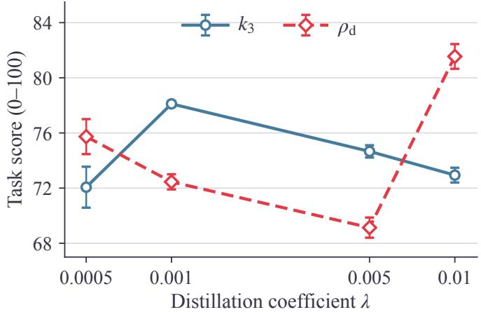  
Figure 5. Efect of the mixing coeficient on WebShop score. The checkpoints and evaluation protocol are the same as in Figure 3. Error bars show standard deviation across decoding passes.

## C.3 Task-level Projection Intervention

Measurement protocol. Figure 6 compares the two protection directions under local coeficient reweighting. For this diagnostic, $G _ { r }$ and $G _ { o }$ denote the two objective gradients aggregated over eight complete attempts at one task, before the outer coeficient � is applied. We measure

$$
1 0 0 \frac { \| d _ { \mathrm { C O R D } } ( \lambda ) - d _ { \mathrm { s u m } } ( \lambda ) \| } { \| d _ { \mathrm { s u m } } ( \lambda ) \| } , \qquad d _ { \mathrm { s u m } } ( \lambda ) = - ( \boldsymbol { u } + \boldsymbol { v } ( \lambda ) ) , \quad d _ { \mathrm { C O R D } } ( \lambda ) = - g _ { \mathrm { f i n a l } } .
$$

Here $\pmb { u } = \pmb { G } _ { r }$ and $v ( \lambda ) = \lambda G _ { o , }$ , matching the weighting in Equation 4. The bold � symbols denote descent directions, hence the minus signs. The ratio requires a nonzero direct-sum direction. Within each environment, both columns reuse the same checkpoint, trajectories, and unweighted gradients, with $v ( \lambda ) = ( \lambda / \lambda _ { 0 } ) v ( \lambda _ { 0 } )$ . ALFWorld uses checkpoint 90, confidence-weighted $k _ { 1 }$ with $\beta = 5$ , and native $\lambda _ { 0 } = 0 . 0 1$ . WebShop uses checkpoint 75, $k _ { 3 } ,$ , and $\lambda _ { 0 } = 0 . 0 0 1$ . We use the eight ALFWorld source tasks whose direct gradients were available, out of 32 source tasks, and all 16 WebShop source tasks. The ALFWorld subset follows a failed task-to-block gradient reconstruction check. Task indices retain the same order in both columns. These interventions compare changes to fixed gradient pairs, without training a new policy at each coeficient.

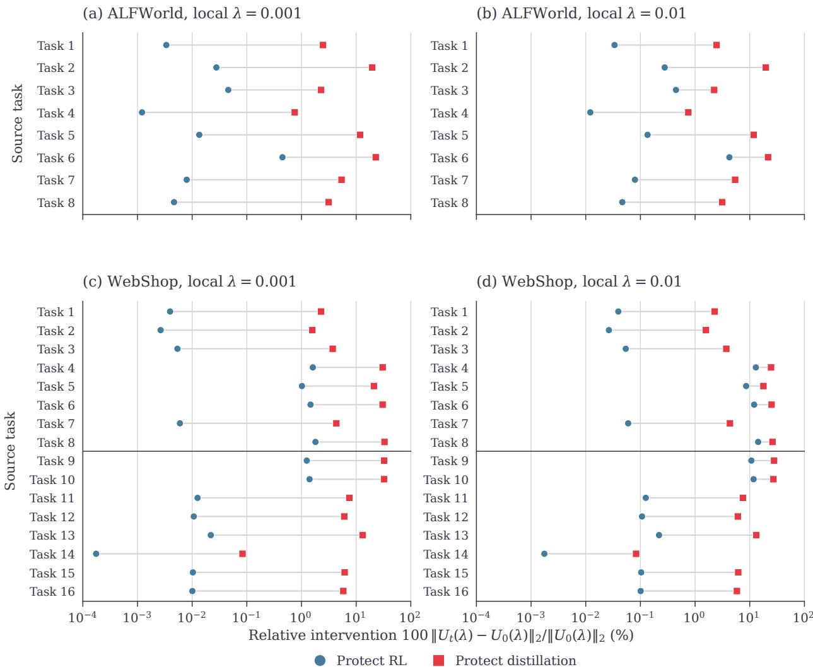  
Figure 6. Task-level projection intervention under local coeficient reweighting. Each line connects the two protection directions for one source task under always projection. Columns reuse the same gradients at diferent coeficients. The horizontal axis reports the relative change in the combined update. Its labels $U _ { 0 }$ and $U _ { t }$ denote $d _ { \mathrm { s u m } }$ and �CORD, respectively.

Dependence on the coeficient. For fixed nonzero loss gradients $G _ { r }$ and $G _ { o } ,$ write $\mathbf { v } = \lambda G _ { o }$ with $\lambda > 0$ , and let $\phi$ be the angle between $G _ { r }$ and $G _ { o }$ . Under the always gate used here, the projection correction has norm $\lambda | | G _ { o } | |$ cos $\phi |$ when protecting RL and $\| G _ { r } \| \|$ cos �| when protecting distillation, by Equation 6. Thus the second correction is independent of � at this fixed gradient pair, whereas the kept distillation term still scales with �. These identities also hold on the conflicting branch of the conflict-only gate, whose aligned branch has zero correction.

## C.4 Sensitivity to Optimization Choices

Table 4 reports the endpoints of the aggregation and mini-batch study in Section 4.3. Here we specify the continuation protocol and token weights, and examine the corresponding uncertainty in Figure 7.

Continuation protocol. Every configuration starts from the same ALFWorld/Qwen2.5-3B checkpoint at training step 90 and its AdamW state. We continue for five rounds with one training seed, gated $k _ { 1 } , \lambda = . 0 1 , \beta = 5 ,$ and conflict-only projection. Each run uses 640 episodes, including the same initial 128 episodes. Four response rows per GPU on eight GPUs give $1 / 2 / 4$ accumulation steps for optimizer mini-batch sizes $B = 3 2 / 6 4 / 1 2 8$ . Evaluation uses 512 attempts over 91 in-distribution tasks at temperature 0.4, with success averaged across tasks. The 95% task-bootstrap intervals describe evaluation uncertainty for this seed. Paired contrasts are descriptive. The figure labels Protect GRPO and Protect OPD denote RL and distillation protection, respectively.

Aggregation weights. Let � be an optimizer mini-batch containing � valid response rows, where � is the configured mini-batch size. For objective � and token � in response row �, let $f _ { i t } ^ { ( j ) }$ include its token loss and any confidence weight: in particular, $f _ { i t } ^ { ( 2 ) } = w _ { i t } \psi _ { i t }$ for OPD. Then $\begin{array} { r } { F _ { j } ( S ) = \sum _ { ( i , t ) \in S } \omega _ { i t } f _ { i t } ^ { ( j ) } } \end{array}$ before projection. The three rules assign token weights

$$
\omega _ { i t } = \left\{ \begin{array} { l l } { 1 / ( M T _ { m } ) , } & { \mathrm { m i c r o b a t c h a v e r a g i n g } \left( L _ { 1 } \right) , } \\ { 1 / T , } & { \mathrm { g l o b a l \mathrm { - } t o k e n a v e r a g i n g } \left( L _ { 2 } \right) , } \\ { R / ( N b L _ { \tau ( i ) } ) , } & { \mathrm { t r a j e c t o r y a v e r a g i n g } \left( L _ { 3 } \right) . } \end{array} \right.
$$

Here $T _ { m }$ and � count valid tokens in microbatch � and $S ,$ and � counts nonempty microbatches across GPUs. For trajectory averaging, � and � count response rows and complete trajectories in the rollout. Let $\tau ( i )$ identify the complete trajectory containing row $i ,$ and let $L _ { k }$ count valid response tokens across all rows of trajectory �. When $b = R$ , the trajectory-averaged objective is

$$
F _ { j , 3 } = \frac { 1 } { N } \sum _ { k = 1 } ^ { N } \frac { 1 } { L _ { k } } \sum _ { ( i , t ) : \tau ( i ) = k } f _ { i t } ^ { ( j ) } ,
$$

so every complete trajectory has equal total weight. Mini-batches of response rows retain these complete-trajectory length weights.

$$
\mathrm { - } \infty { \mathrm { - ~ } } \operatorname* { P r o t e c t } \mathrm { G R P O }
$$

$$
- \diamond - \mathrm { P r o t e c t } \mathrm { O P D }
$$

(a) Optimizer mini-batch (L2)  
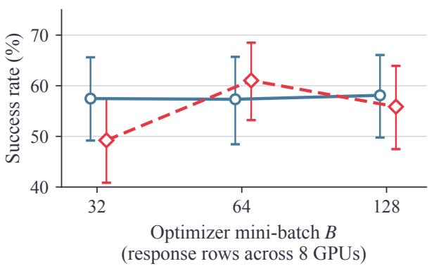

(b) Loss aggregation (B = 64)  
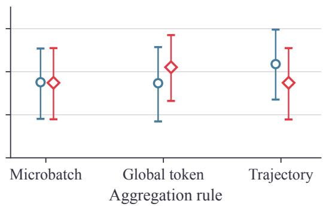  
Figure 7. ALFWorld continuation results with task-bootstrap uncertainty. Panel (a) varies mini-batch size under global-token averaging $( L _ { 2 } )$ , while panel (b) varies aggregation at $B = 6 4$ . Error bars show 95% intervals over tasks under the protocol above.

Optimizer mini-batch size. At fixed $L _ { 2 } ,$ RL-protected success spans 0.78 percentage points over $B \in \{ 3 2 , 6 4 , 1 2 8 \}$ , whereas distillation protection peaks at � = 64 (Figure 7a). $\mathrm { A t } B = 1 2 8 ,$ distillation protection is 5.95 percentage points below no projection, with a paired 95% interval of [−11.13 −0.96].

Using $u = G _ { 1 }$ � and $\mathbf { v } = \lambda G _ { o }$ as in Equation 4, during conflict, correction norms are $\lambda | | G _ { o } | |$ cos �| under RL protection and $\| G _ { r } \| \|$ cos �| under distillation protection (Appendix C.3), where $\phi$ is the angle between $G _ { r }$ and $G _ { o }$ . Small � thus leaves the reverse correction unattenuated at fixed gradients. Logged median ratios $\| v \| / \| u \|$ of 0.009–0.013 describe the scale regime in which this contrast occurs. At fixed episode budget and learning rate $1 0 ^ { - 6 }$ , increasing � reduces the number of updates from 616 to 300 to 150 under distillation protection. This sweep therefore changes both gradient estimation and the number of optimizer updates.

Loss aggregation. At $B = 6 4 _ { , }$ , the directions nearly tie under microbatch averaging. Distillation protection leads by 3.71 points under global-token averaging, and RL protection leads by 4.35 under trajectory averaging (Figure 7b). All three paired intervals include zero, so this ordering remains descriptive. Aggregation reweights gradients before projection, changing the conflict test and protected objective. Global-token averaging (�2) weights each valid token equally, while trajectory averaging (�3) gives each complete trajectory equal total weight when all rollout rows are included.

## C.5 Training Dynamics

We examine how gradient combination afects rollout success, interaction length, and policy statistics during training. Each Base/CORD pair below shares its code revision, active training configuration, and training seed, with conflict-only RL protection enabled only for CORD. The plots include 3B settings and an additional 7B training setting. All measurements describe single-seed on-policy training trajectories and are separate from the final evaluations.

Reward progress and interaction length. Both settings show higher late-training success and shorter episodes with CORD (Figure 8). Using unsmoothed means over iterations 101–148, WebShop success increases from 50.0% to 57.1% while episode length decreases from 8.58 to 7.48 turns. In the 7B ALFWorld setting, success increases from 61.0% to 76.0% and episode length decreases from 30.67 to 25.34 turns. Mean reference-KL estimates are close within each pair: 0.188 versus 0.189 on WebShop and 0.274 versus 0.271 on ALFWorld. Thus, the shorter episodes accompany higher training success at a similar logged reference-KL level. Within these runs, the success and episode-length diferences retain their signs over the alternative windows 76–148 and 124–148.

Token entropy and response length. CORD increases token entropy while slightly reducing mean response length (Figure 9). Over iterations 101–148, entropy increases from 0.780 to 0.925 nats, while mean response length decreases from 137.1 to 133.3 tokens. The entropy diference remains positive in both alternative windows. These observations distinguish changes in the token distribution from changes in response verbosity. Entropy is measured on each policy’s own visited states, so it does not by itself measure exploration quality or establish a final-evaluation gain.

Base + CORD  
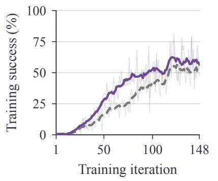

WebShop / SDAR / Qwen2.5-3B  
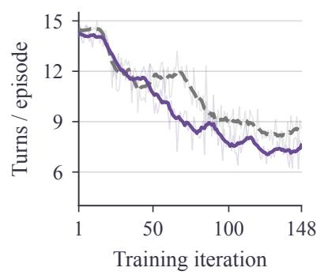  
ALFWorld / Skill-SD / Qwen2.5-7B

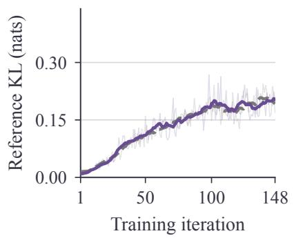

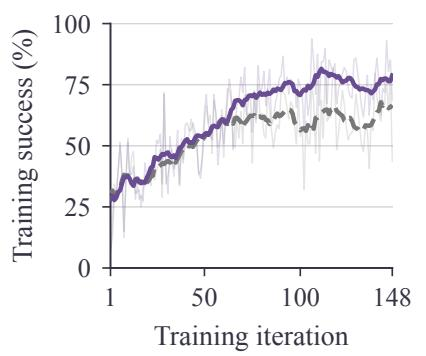

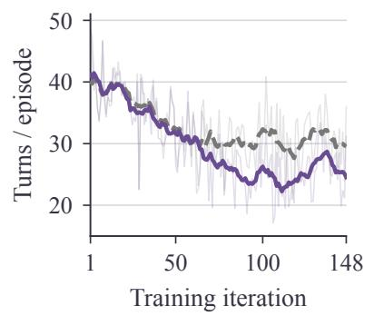

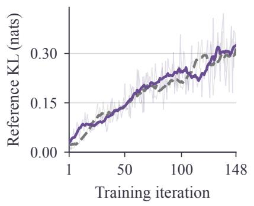  
Figure 8. Training success, interaction length, and reference KL. Top: SDAR on WebShop with Qwen2.5-3B $( \lambda = 0 . 0 1 )$ . Bottom: Skill-SD on ALFWorld with Qwen2.5-7B (� = 0 001). Columns show rollout success, mean environment turns per episode, and the logged sample-based KL estimate to the frozen reference policy. Faint curves show raw observations, while darker curves show 11-iteration centered moving averages with shorter windows at the boundaries. Each method has one training seed, shown over the common range of iterations 1–148.

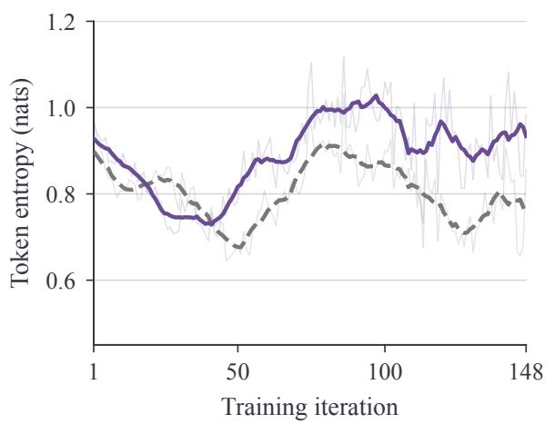  
Base + CORD ALFWorld / Skill-SD / Qwen2.5-3B

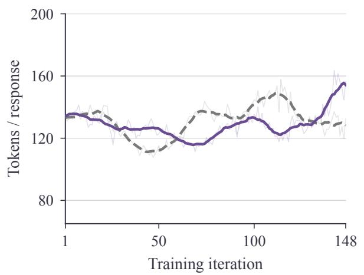  
Figure 9. Token entropy and response length on ALFWorld. Skill-SD with Qwen2.5-3B at $\lambda = 0 . 0 0 1$ Left: token-mean policy entropy on the rollout responses, measured before the actor update. Right: mean response-token count, rather than tokens per complete episode. Each method uses one training seed. The raw overlays, 11-iteration smoothing, and common range of iterations 1–148 follow Figure 8.

## C.6 Computational cost

Let � be the number of trainable parameters and let a training iteration contain � PPO mini-batches, each partitioned into � micro-batches. CORD accumulates the two objective gradients over each complete PPO mini-batch before applying the projection. Computing their inner products, norms, and combined update requires $O ( d )$ arithmetic per mini-batch, or $O ( K d )$ per iteration. The additional gradient bufers require $O ( d )$ storage, which is distributed across workers when gradients are sharded. The scalar inner products and norms can be communicated in a packed reduction whose message size does not grow with �.

For gradient evaluation, write � for the cost of a student forward computation and $B _ { 1 } , B _ { 2 }$ for the reverse-mode computations of the two objectives on a fixed micro-batch. If both objectives use the same student outputs, a shared-forward schedule has actor-update cost

$$
T _ { \mathrm { C O R D } } ^ { \mathrm { a c t o r } } = K M ( F + B _ { 1 } + B _ { 2 } ) + O ( K d ) + T _ { \mathrm { o p t } } ,
$$

where $T _ { \mathrm { o p t } }$ includes gradient clipping and optimizer updates. A fused-loss Base instead has cost

$$
T _ { \mathrm { B a s e } } ^ { \mathrm { a c t o r } } = K M ( F + B _ { \mathrm { s u m } } ) + T _ { \mathrm { o p t } } ,
$$

with $B _ { \mathrm { s u m } }$ denoting the reverse-mode computation of the weighted loss sum. These expressions use equal-sized micro-batches to simplify notation. For variable workloads, the corresponding costs are summed over micro-batches. Parameter and gradient communication belong to the gradient evaluation costs, separately from the packed reduction for projection.

Sharing the forward computation avoids evaluating identical student outputs twice. It does not make two objective-gradient evaluations equivalent to one backward pass on their summed loss: the latter supplies only the combined gradient, which generally does not determine the inner products needed by CORD. Both schedules have the same asymptotic order when the reverse-mode costs are comparable, while their constant factors depend on graph reuse, gradient-bufer handling, sharding, and hardware. Forward sharing, fused vector operations, and selective diagnostic collection are implementation opportunities rather than a fixed wall-clock guarantee. Teacher scores already computed for the auxiliary objective are reused.

Cost of a complete training iteration. Let � denote the actor-update time of an ordinary fused-loss Base, and let � include rollout and environment interaction, teacher, reference, and old-policy scoring, reward and advantage computation, and the remaining work within a training iteration. For a fixed workload, if these shared stages remain unchanged and the actor-update multiplier is �actor, then

$$
R _ { \mathrm { i t e r } } = { \frac { S + r _ { \mathrm { a c t o r } } A } { S + A } } = 1 + ( r _ { \mathrm { a c t o r } } - 1 ) f _ { \mathrm { a c t o r } } , \qquad f _ { \mathrm { a c t o r } } = { \frac { A } { S + A } } .
$$

Thus, the actor-update multiplier is weighted by its share of Base iteration time. This comparison excludes initialization, periodic evaluation, checkpoint saving, and time outside the training iteration.

Component-based estimate. We evaluate an isolated shared-forward implementation on Qwen2.5- 3B with eight A100-40GB GPUs, FSDP, activation checkpointing, a global PPO mini-batch size of 64, and a per-GPU micro-batch size of four. We replay the first, middle, and last complete mini-batches saved from one ALFWorld iteration. All replays use the same checkpoint, optimizer, and random states, with fixed $\lambda = 0 . 0 1$ and conflict-only projection with GRPO protection. After two warmup calls, each setting has seven timed repeats per mini-batch. Timings include the student forward and backward computations, communication, gradient combination, clipping, and AdamW, with GPU synchronization and the maximum elapsed time across workers. The ratio of summed per-mini-batch median times is 1.78× relative to an ordinary Base that backpropagates the summed loss once.

To estimate the iteration-level impact, we use two recorded WebShop workload profiles with the same model, GPU type and count, and actor configuration. Both profiles cover the same 131 iterations between iterations 11 and 148 after excluding evaluation and checkpoint-saving iterations. The projection-of profile already collects both objective gradients for diagnostics. We therefore reconstruct ordinary Base actor time by dividing the logged actor time by its separately measured calibration ratio: 2.00 for the diagnostic path and 2.01 for the original CORD path. Applying the shared-forward multiplier to these reconstructed actor times gives Table 10. The estimated Base actor share is 25–27%, yielding an estimated iteration multiplier of 1.20–1.21×. Applying the same calculation within the three consecutive windows 11–50, 51–100, and 101–148 gives 1.17–1.22×.

Table 10. Component-based estimates for two WebShop workload profiles. Each row holds the recorded workload fixed for both methods. Shared-stage times are observed means, whereas actor times and iteration ratios are estimates for the ordinary Base and the shared-forward CORD implementation.
<table><tr><td>Recorded workload</td><td>Shared stages (s)</td><td>Base actor (s, est.)</td><td>CORD actor (s, est.)</td><td>Iteration ratio (est.)</td></tr><tr><td>Projection-off run</td><td>150.2</td><td>54.8</td><td>97.2</td><td>1.21×</td></tr><tr><td>CORD run</td><td>147.7</td><td>50.0</td><td>88.8</td><td>1.20×</td></tr></table>

These estimates assume that the actor ratios measured on the ALFWorld replay inputs transfer to the WebShop workloads and approximate the logged actor stage, which also includes worker and data-transfer overhead. The historical profiles and replay use diferent physical machines of the same GPU type. The estimates describe the recorded workloads with shared-stage costs held fixed and exclude policy-dependent changes in subsequent trajectories. They are not measurements of a complete training run with the optimized implementation.

## C.7 Statistical Significance

The fixed-task, repeated-evaluation protocol in Appendix B.3 separates decoding variability from changes in task composition. We compare Base and CORD using two-sided Welch tests on the four evaluation-pass means for each checkpoint (Table 11). These tests summarize variation across decoding passes at one training seed. Holm correction is applied jointly to all 27 ALFWorld and WebShop comparisons.

Table 11. Significance tests for Table 1. Raw two-sided Welch �-values are reported to three significant digits. Bold † entries have Holm-adjusted $p < 0 . 0 5 .$
<table><tr><td>Metric</td><td>Skill-SD</td><td> $_ \mathrm { G R P O + O P S D }$ </td><td>SDAR</td></tr><tr><td>ALFWorld</td><td></td><td></td><td></td></tr><tr><td>Pick</td><td> $4 . 1 8 \times 1 0 ^ { - 1 }$ </td><td> $3 . 3 2 \times 1 0 ^ { - 1 }$ </td><td> $1 . 2 5 \times 1 0 ^ { - 1 }$ </td></tr><tr><td>Look</td><td> $6 . 8 6 \times 1 0 ^ { - 2 }$ </td><td> $1 . 3 5 \times 1 0 ^ { - 1 }$ </td><td> $9 . 6 2 \times 1 0 ^ { - 3 }$ </td></tr><tr><td>Clean</td><td> $5 . 8 5 \times 1 0 ^ { - 1 }$ </td><td> $5 . 1 6 \times 1 0 ^ { - 3 }$ </td><td> $8 . 3 9 \times 1 0 ^ { - 3 }$ </td></tr><tr><td>Heat</td><td> $7 . 6 7 \times 1 0 ^ { - 1 }$ </td><td> $1 . 7 9 \times 1 0 ^ { - 2 }$ </td><td> $8 . 0 1 \times 1 0 ^ { - 2 }$ </td></tr><tr><td>Cool</td><td> ${ \bf 1 . 8 8 \times 1 0 ^ { - 4 } } ^ { \dagger }$ </td><td> $9 . 1 5 \times 1 0 ^ { - 3 }$ </td><td> $4 . 2 3 \times 1 0 ^ { - 2 }$ </td></tr><tr><td>Pick2</td><td> $1 . 0 0 \times 1 0 ^ { - 1 }$ </td><td> $\mathbf { 2 . 1 4 \times 1 0 ^ { - 4 } } ^ { \dagger }$ </td><td> $2 . 3 3 \times 1 0 ^ { - 2 }$ </td></tr><tr><td>Average</td><td> $3 . 1 6 \times 1 0 ^ { - 1 }$ </td><td> ${ \bf 2 . 8 8 } { \times } { \bf 1 0 ^ { - 4 } } ^ { \dagger }$ </td><td> $1 . 1 8 \times 1 0 ^ { - 1 }$ </td></tr><tr><td>WebShop</td><td></td><td></td><td></td></tr><tr><td>Score</td><td> ${ \bf 9 . 0 9 } { \times } { { 1 0 } ^ { - 4 } } ^ { \dagger }$ </td><td> ${ \bf 1 . 0 5 } { \times } { \bf 1 0 } ^ { - 3 ^ { \dag } }$ </td><td> $1 . 2 8 \times 1 0 ^ { - 1 }$ </td></tr><tr><td>Success rate</td><td> ${ \bf 2 . 2 0 } { \bf \times 1 0 ^ { - 3 } } ^ { \dagger }$ </td><td> $6 . 9 5 \times 1 0 ^ { - 1 }$ </td><td> $2 . 8 4 \times 1 0 ^ { - 3 }$ </td></tr></table>

## C.8 Additional Case Analyses

These four cases extend Section 4.4 using Qwen2.5-3B-Instruct, $k _ { 3 } ,$ step-150 checkpoints and greedy decoding, with $\lambda = 0 . 0 0 5$ for WebShop and 0.001 for ALFWorld. The unprojected variant adds the gradients directly, while both protected variants use conflict-only projection. The ALFWorld tasks and decoding settings match, but training used eight GPUs for distillation protection and sixteen for the other checkpoints.

WebShop: repetition and attribute completion. In the rug case (Figure 10a), all three policies buy the same product and options with score 1.00, but the policy with RL protection makes eight repeated option clicks and uses 14 steps, compared with six under distillation protection. This reverses the ordering by total steps in Figure 4. For the garment (Figure 10b), all three finish in five steps. The policy with RL protection omits the requested size, scoring 0.80 compared with 1.00 for the other two. Thus, reaching a purchase promptly and completing its required attributes are separate aspects of behavior.

(a) Same purchase, diferent repetition  
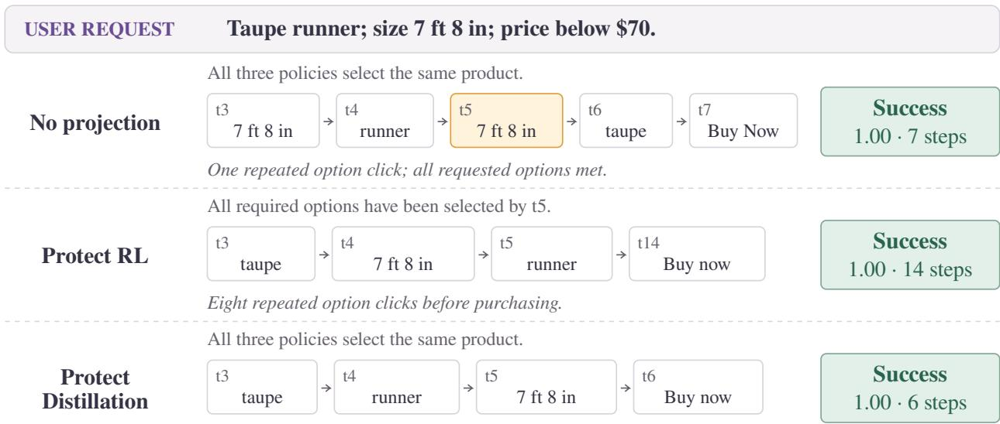  
Each option selected once; no redundant option clicks.

(b) Equal step counts, diferent attribute completion  
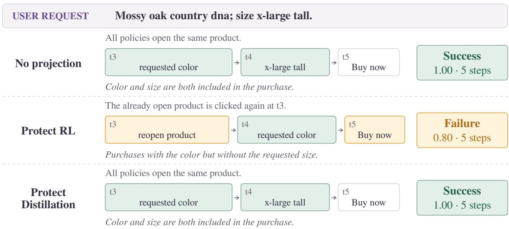  
Figure 10. Additional WebShop trajectories. Trajectories retain the original step indices and use context lines to summarize omitted actions. Green marks requested attributes and amber marks repeated or incomplete actions. Outcomes report the final score and total number of steps, with score 1 00 required for success.

ALFWorld: object state and completed subgoals. In Figure 11a, the unprojected policy repeatedly cools eggs and never heats one within 50 steps. Both projected policies finish with the same fouraction heating-and-placement sequence, taking eight steps under RL protection and sixteen under distillation protection. The extra actions occur before this shared sufix, including five inefective actions under distillation protection. Figure 11b reverses the length ordering. With distillation protection, the agent keeps the first clock on the dresser and completes the second delivery in 11 steps, compared with 25 steps after backtracking under RL protection. The unprojected policy attempts placement with the wrong held object or at the wrong location and ends with only one delivered clock. The shorter successful trajectory occurs under diferent protection directions in these two cases.

(a) ALFWorld: satisfying the requested object state  
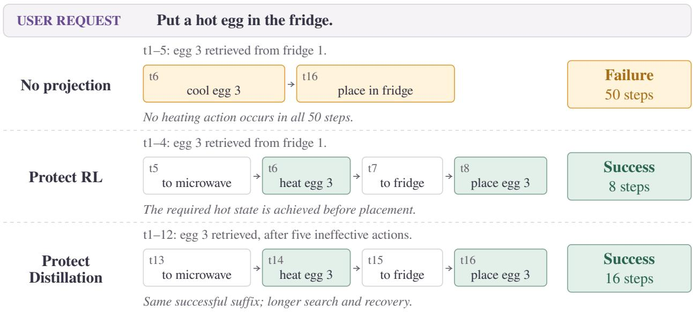

(b) ALFWorld: preserving progress while delivering two objects  
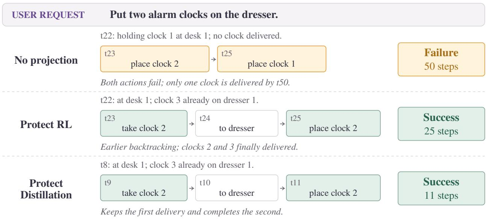  
Figure 11. Additional ALFWorld trajectories. (a) Achieving the requested object state. (b) Completing two deliveries. Action labels are abbreviated, with original step indices and context for omitted intervals. “Clock” denotes an alarm clock and “place” denotes the environment’s move action. Green marks goal-relevant manipulation, and amber marks incorrect or inefective actions.

## C.9 Token-Level Efects of Projection

Figure 12 follows a complete 12-step WebShop trajectory. From the Qwen2.5-3B step-75 checkpoint and identical AdamW states, we apply one update per rule on the same conflicting batch (OPD weight � = 0.001), then rescore tokens at their saved prefixes. In the query, CORD with OPD protection retains more probability on the token he in heather and the fit term men than DirectSum. For 3, it reduces suppression at the first size selection (step 5), but reverses DirectSum’s increase when the choice repeats (step 7). This parameter-space projection produces context-dependent token changes, including an adverse increase for the unlisted [next token.

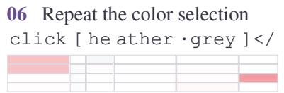

## USER REQUEST

Find me officially licensed men's t-shirts & tanks with needle sleeve, classic fit with color: heather grey, and fit type: men, and size: 3x-large, and price lower than 60.00 dollars.

## 01 Search with the requested attributes

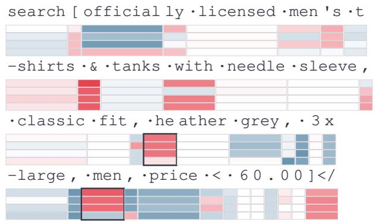

## 02 Open the \$22.99 shirt

07 Repeat 3x-large after step 5 click [ 3 x -large ]</

08 Try tanks (not listed on the page) click [t anks ]</

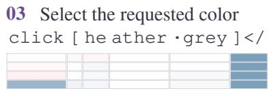

## 04 Try next (not listed on the page)

09 Select the men option click [ men ]</

10 Select the same color a third time click [ he ather ·grey ]</

11 Select 3x-large a third time click [ 3 x -large ]</

05 Select 3x-large for the first time click [ 3 x -large ] ·</

12 Buy the shirt; recorded reward 10/10 click [b uy ·now ]</

<table><tr><td>Selected tokens</td><td>Before (%)</td><td>DirectSum ∆p</td><td>CORD Δp</td><td>CORD - DirectSum</td></tr><tr><td>01 ·he (heather)</td><td>14.374</td><td>-1.457</td><td>-0.019</td><td>+1.439</td></tr><tr><td>01 ·men (fit type)</td><td>23.685</td><td>-2.027</td><td>+0.165</td><td>+2.192</td></tr><tr><td>04 [next (unlisted)</td><td>99.628</td><td>+0.001</td><td>+0.115</td><td>+0.114</td></tr><tr><td>05 3 (first size click)</td><td>99.244</td><td>-0.347</td><td>-0.334</td><td>+0.014</td></tr><tr><td>07 3 (repeated size)</td><td>99.664</td><td>+0.042</td><td>-0.028</td><td>-0.070</td></tr><tr><td>∆p (percentage points)</td><td colspan="4">-12 -0.1 0 +0.1 +12</td></tr></table>

Figure 12. Token probability changes along a complete trajectory. Legend keys mark row positions, while outlines identify tabulated tokens, not update quality. CORD protects OPD. GRPO protection matches DirectSum at measured precision and is omitted. Dots denote spaces, and tag-boundary pieces are retained. The recorded outcome predates these updates.