# Conditional Flow Models Convert Epistemic Uncertainty into Apparent Aleatoric Variance

Navodita Sharma1\* Abhishek Shetty2 Max Simchowitz³† Pulkit Agrawal¹†

1Massachusetts Institute of Technology 2Georgia Institute of Technology 3Carnegie Mellon University

## ABSTRACT

Conditional Flow Models (CFMs) are increasingly being used in place of deterministic predictors across machine learning, including for tasks that were classically formulated as regression. Given their success in such tasks, we ask the question: what useful information do the conditional distributions produced by CFMs carry beyond what a point predictor would provide?

We identify a systematic phenomenon: in many natural regimes, CFM samples routinely have larger variance than the true conditional distribution, even in nearly deterministic regression problems. This effect is most pronounced where the model has not resolved the dependence on the conditioning variable, and thus the additional variance can be viewed as converting epistemic uncertainty in fitting the ground truth conditional distribution into apparent aleatoric variance in the generated samples. Through controlled synthetic and real-data experiments, and comparisons with explicit smoothing estimators, we show that the induced variance tracks model underfitting of complex or hard-to-fit targets, and decreases with additional training or data. We provide a theoretical account of the phenomenon in a simplified setting and demonstrate a consequent practical use-case of conditional flow-matching: designing high-coverage predictive sets that cover the ground-truth regression target.

## 1 INTRODUCTION

The role of generative models in machine learning has expanded rapidly. Rather than returning a single point prediction, these models produce a conditional distribution over possible outputs. Perhaps surprisingly, they have gained traction even in settings where predicting a single value, rather than distribution over values, suffices. These setting, which we will call point-prediction problems, encompass predicting high-performing actions in robotics (Chi et al., 2023), accurate estimates of a policy value function in reinforcement learning (Agrawalla et al., 2025), and numerous other scientific estimation and time-series problems (Klein et al., 2025).

In this work, we focus on conditional flow-matching models (CFMs), which produce samples by integrating a learned velocity field from base noise to the output space, and suggest that these models confer a complementary benefit: they can naturally express estimation uncertainty, even in point-prediction problem in which observations are nearly noiseless.

In the idealized setting, the optimal flow v\* transports the base distribution to the true conditional law (Lipman et al., 2023; Albergo & Vanden-Eijnden, 2023). In practice, however, the flow field is parametrized by a neural network vθ that is learned imperfectly, due to a combination of limited training data, network capacity, and incomplete optimization (e.g. early stopping, popular in the robot learning community). Thus the learned conditional distribution is shaped not only by the target distribution, but also by the inductive biases caused by fitting the ground-truth vector-field learning with a neural network. In particular, neural networks tend to oversmooth high-frequency features during learning (Rahaman et al., 2019; Xu et al., 2020; Tancik et al., 2020), causing the learned vector-field vθ to underfit the ground-truth v\*.

We demonstrate, both across domains and in natural theoretical setups, that under this common underfitting behavior, conditional flow models convert epistemic uncertainty into apparent aleatoric variance. That is, the approximation error or uncertainty about the dependence of the generated variable on the conditioning variable is expressed as a larger spread in the learned conditional distribution.

Beyond scientific interest, this has actionable consequences. One can train conditional flow-matching models to fit potentially deterministic target functions and, as long as the model does not overfit, use the spread of their resulting samples to define confidence sets containing the ground-truth function with no conformal correction.

Across the application domains we study, including RL policy evaluation, cell perturbation prediction, and robot policy learning, predictive sets built this way are approximately calibrated empirically in the underfitting regime, a property the variance-inflation phenomenon enables. A practitioner receives an uncertainty estimate “for free" alongside the point prediction.

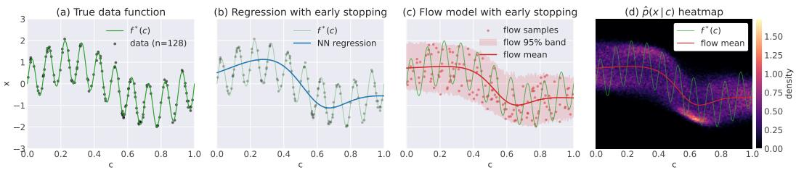  
Figure 1: Flow models vs Regression during underfitting.

More concretely, we make the following contributions:

• We identify a surprisingly general relationship between learning error in the conditional flow field and the resulting generated samples: whenever a learned CFM underfits the ground-truth velocity field as a function of the conditioning variable, its generated samples have conditional variance strictly larger than that of the true distribution, in expectation over the conditioning variable. This stands in sharp contrast to deterministic regression, where underfitting manifests only as oversmoothing of the predictive mean.

• We trace this variance inflation to a single mechanism: smoothing bias in vector-field learning. Any inductive bias that smooths the learned conditional vector field along the conditioning variable, whether early stopping, or explicit regularization, produces the same effect. We demonstrate this empirically on synthetic regression problems, controlled smoothing estimators, and highdimensional offline RL benchmarks.

• We propose an idealized setting of regularized smoothing to theoretically study the variance inflation phenomenon. Under an equivalent-kernel approximation to regularized vector-field learning, the learned conditional distribution is a local mixture of true conditionals around the query point. This yields a clean bias-variance relation: on average, the learned conditional variance is at least the true conditional variance plus the squared bias of the learned conditional mean. This simplified setting serves as a useful explanatory model to understand the variance inflation phenomenon empirically observed in neural CFMs. We also discuss the validity of this approximation to neural CFMs and the regimes where the approximation fails.

• Motivated by our theoretical study, we identify another empirical consequence of the variance inflation phenomenon – the distribution learned by CFMs is approximately calibrated in the underfitting regime. We give a practical method for leveraging variance inflation for predictive coverage. Across three application domains, policy evaluation, cell perturbation prediction, and behavior cloning for robotics, predictive sets built directly from CFM samples are approximately calibrated in the underfitting regime, and are competitive with or tighter than conformal-prediction baselines.

## 2 RELATED WORK

Flow matching and conditional transport. Flow matching and related stochastic-interpolant and rectified-flow methods learn continuous-time transports by regressing a time-dependent vector field along a path between base noise and data (Lipman et al., 2023; Liu et al., 2022; Albergo et al., 2025). Conditional flow matching indexes this transport by side information, yielding a model of the conditional law of an output given a conditioning variable. Conditional Flow Models (CFMs) have been applied broadly in robotics (Chisari et al., 2024; Rouxel et al., 2024; Zhang et al., 2024) and scientific modeling (Klein et al., 2025; Miller et al., 2024).

Inductive biases and generalization in diffusion and flow models. Several recent works study why diffusion or score-based models generalize rather than simply memorizing the training data. Recent work has attributed this behavior to several sources of bias: variance in the denoising scorematching target (Vastola, 2025), architectural bias (Kamb & Ganguli, 2025), and selective underfitting of the learned score (Song et al., 2025). These papers are closest in spirit to ours, however, they focus on unconditional generation, whereas we study conditional generation and ask how underfitting with respect to the conditioning variable changes the conditional law.

Implicit regularization, spectral bias, and smoothing. Our explanation is based on smoothing bias in the learned conditional vector field. Neural networks are known to preferentially fit lowfrequency or smoother structure early in training, a phenomenon often called spectral bias (Rahaman et al., 2019; Xu et al., 2020). In wide-network regimes, training dynamics can be approximated by kernel gradient flow, connecting early stopping and finite-time training to classical regularization in function space (Jacot et al., 2018). Related ideas appear throughout nonparametric regression, smoothing splines, kernel ridge regression, and inverse problems, where regularized estimators can be described by equivalent kernels or linear smoothing operators. We build on this viewpoint, but study a different object: not the bias of a point estimator, but the distribution obtained after integrating a smoothed conditional vector field.

## 3 PRELIMINARIES

We study conditional generative modeling. Given samples from a joint distribution $p ^ { \star }$ over random variables $( X , C ) \in \mathbb { R } ^ { \tilde { d } _ { x } } \times \mathbb { R } ^ { d _ { c } }$ , where X is the generated variable and $C$ is the conditioning variable, conditional generative models learn to generate new samples from the conditional distribution of X given $C = c _ { ; }$ denoted $p ^ { \star } ( \cdot \mid c )$ . Flow models represent such distributions as continuous normalizing flows (CNF) and ODEs transporting a simple initial distribution to a terminal distribution approximating $p ^ { \star }$ . Here, we consider the conditional variant.

Definition 3.1 (Continuous Normalizing Flow). (Chen et al., 2018) Given a joint distribution $p _ { 1 }$ over $( X , C )$ , an initial distribution $p _ { 0 }$ over $( X , C )$ , and conditional vector field $\bar { v ^ { \cdot } } [ 0 , 1 ] \times \mathbb { R } ^ { d _ { x } } \times \mathbf { \tilde { \mathbb { R } } } ^ { \bar { d } _ { x } } $ $\dot { \mathbb R } ^ { d _ { c } }$ mapping $( t , x , c ) \to v _ { t } ( x \mid c )$ , we say that $( v , p _ { 0 } )$ is a conditional continuous normalization flow (CCNF) for $p _ { 1 }$ if, for every $c \in \mathbb { R } ^ { d _ { c } }$ , the random process $( X _ { t } ) _ { t \in [ 0 , 1 ] }$ defined by the

$$
\begin{array} { r } { X _ { 0 } \sim p _ { 0 } ( \cdot \mid C = c ) , \quad \frac { \mathrm { d } } { \mathrm { d } t } X _ { t } = v _ { t } ( X _ { t } , c ) } \end{array}\tag{3.1}
$$

satisfies $X _ { 1 } \sim p ( \cdot \mid c )$ . We let $\Phi _ { t } ^ { v } ( X _ { 0 } \mid c )$ denote the deterministic function, called a flow-map, mapping $X _ { 0 }$ to $X _ { t }$ in $\mathrm { E q } . ( 3 . 1 )$ . Given $( p _ { 0 } , v )$ , we let $p _ { t } ^ { v } ( \cdot \mid c , p _ { 0 } )$ denote the distribution of $X _ { t } \mid c$ marginalized over $X _ { 0 } \sim p _ { 0 } ( \cdot \mid c )$ under Eq. (3.1). Note then that, by definition, $( v , p _ { 0 } )$ is a CCNF for $p _ { 1 } ^ { v } ( \cdot \mid \cdot , p _ { 0 } )$ . We suppress dependence on po when clear from context.

Flow-matching (Lipman et al., 2023; Albergo & Vanden-Eijnden, 2023; Liu et al., 2022) provides a generic recipe for learning (C)CNFs from data. Let $p _ { 0 }$ and differentiable coefficients $\alpha _ { t } , \beta _ { t }$ $[ 0 , 1 ] \to \mathbb { R }$ satisfying $\alpha _ { 0 } = \beta _ { 1 } = 1$ and $\beta _ { 0 } = \alpha _ { 1 } = 0$ both be given. The induced (linear) stochastic interpolant is the random variable $X _ { t } = \alpha _ { t } X _ { 0 } + \beta _ { t } X _ { 1 }$ , where $X _ { 0 } \sim p _ { 0 } ( \cdot \mid c )$ and $X _ { 1 } \sim p ^ { \star } ( \cdot \mid c )$ Flow-matching is based on the following observation:

Proposition 3.1 (Albergo et al. (2025)). Define the vector field $v ^ { \star }$ via $v _ { t } ^ { \star } ( \cdot \mid c ) = \mathbb { E } [ \dot { X } _ { t } \mid X _ { t } , c ] ,$ where $\dot { X } _ { t } = \dot { \alpha } _ { t } X _ { 0 } + \dot { \beta } _ { t } X _ { 1 }$ . Then, $( v ^ { \star } , p _ { 0 } )$ is a CNF for $p ^ { \star }$ . Moreover, v\* satisfies $v ^ { \star } \in$ arg min, $\mathcal { L } _ { \mathrm { F M } } ( v )$ where the $\mathcal { L } _ { \mathrm { F M } }$ is the flow-matching loss

$$
\mathcal { L } _ { \mathrm { F M } } ( v ) : = \mathbb { E } _ { ( X , C ) \sim p ^ { \star } } \mathbb { E } _ { t \sim \mathrm { U n i f } ( [ 0 , 1 ] ) , X _ { 0 } \sim p _ { 0 } ( \cdot \vert c ) } \mathbb { E } [ \| v _ { t } ( X _ { t } , C ) - \dot { X } _ { t } \| ^ { 2 } ]\tag{3.2}
$$

Motivated by Proposition 3.1, flow matching trains a velocity field $v _ { \theta } = \left( v _ { \theta ; t } ( x , c ) \right)$ by (approximately) minimizing an empirical approximation to the flow matching loss $\mathcal { L } _ { \mathrm { F M } }$

## 4 VARIANCE INFLATION IN UNDERFIT CONDITIONAL FLOWS

In this section, we uncover two surprising phenomena about underfit conditional flow models: First, the resulting samples have larger conditional variance than the ground-truth distribution (in expectation over the conditioning variable), even in nearly deterministic regression problems. Second, this variance inflation is a consequence of smoothing bias in the learned vector field: any mechanism that smooths the conditional vector field along the conditioning variable produces the same effect We demonstrate the phenomenon on a synthetic 1D problem (Figure 1), establish that it is driven by smoothing (Figure 2), and verify that it transfers to a high-dimensional benchmark used in offline RL (Figure 3)

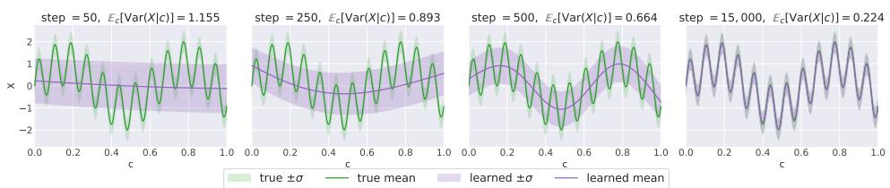

(a) NN vector field parameterization: [Left to Right] Distributions learned with increasing training time  
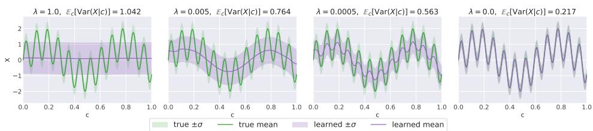

(b) NN vector field parameterization with explicit regularization penalty $\lambda ( \partial _ { c } v ) ^ { 2 }$  
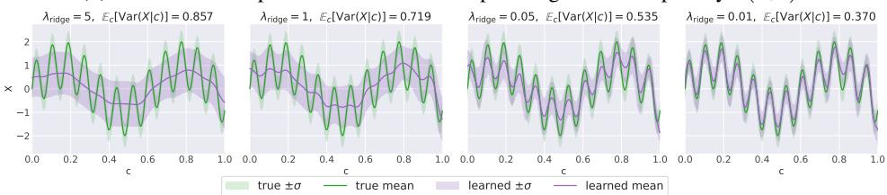  
(c) Vector field learning with kernel ridge regression with penalty λ

Figure 2: Any smoothing bias in vector-field learning induces variance inflation. In all three cases, the average learned conditional variance (reported in each panel title) decreases monotonically as smoothing decreases.

Figure 1, given in the introduction, illustrates a one-dimensional synthetic regression problem in which the target function contains both low and high-frequency structure. When a neural-network regressor is trained with early stopping, underfitting leads to oversmoothing of the predictive mean; the learned function captures the coarse trend but fails to recover the finer oscillations.

For a conditional flow model trained under the same regime, the learned conditional mean is similarly oversmoothed, but unlike the deterministic regressor, the flow also learns substantial additional variance, visible in the wide 95% band around the mean. Even in a nearly deterministic problem, underfitting in the conditional vector field appears not only as bias in the learned mean, but also as extra variance in the generated conditional distribution. Panel (d) shows the full learned conditional density ${ \hat { p } } ( x \mid c )$ , which is broad and roughly bimodal in regions where $f ^ { \star }$ (the conditional mean) has high-frequency oscillations within a smoothing neighborhood; the flow's conditional distribution effectively averages over the local oscillations of $\bar { f } ^ { \star }$ . This finding is not specific to this example, and Appendix C shows that similar phenomena arise across a number of synthetic target functions.

Why do we call this uncertainty epistemic? The excess variance arises from unresolved dependence of the target on the conditioning variable: the learned model smooths over distinctions between nearby conditions that the true conditional mean resolves. This uncertainty is therefore reducible and model-dependent, rather than irreducible randomness in the data-generating process. As the model resolves more of this structure, for example with additional data or training, both the smoothing bias and the excess variance decrease. However, in a CFM this unresolved variation appears as spread within the learned conditional distribution, and hence as apparent aleatoric variance. From the learned distribution alone, this model-induced spread is not distinguishable from genuine aleatoric variation.

## 4.1 VARIANCE INFLATION TRACKS SMOOTHING BIAS

Figure 2 reveals that the phenomenon in Figure 1 is not tied to a single estimator or training recipe. We compare three mechanisms that induce smoothing in the learned conditional vector field: early stopping of a neural network which biases training towards low-frequency components of the target (Yao et al., 2007; Rahaman et al., 2019; Tancik et al., 2020), an explicit roughness penalty $\lambda ( \partial _ { c } \overline { { v } } ) ^ { 2 }$ in the conditioning variable as used in classic non-parametric regression (Wahba, 1990; Green & Silverman, 1994), and kernel ridge regression with an RKHS-norm regularization penalty λ (Caponnetto & De Vito, 2007). All these methods induce smoothing of the conditional mean function, as can be observed from the plotted learned mean at different regularization strengths (Figure 2). In all three cases, this smoothing is accompanied by another consistent effect: the learned conditional variance increases as the learned mean becomes smoother. The average learned conditional variance (reported in each panel title) decreases monotonically as smoothing decreases.

Our key finding, corroborated across additional functions in Appendix C, is that the key object is the smoothing bias in vector-field learning, not flow matching alone. Flow matching simply provides a mechanism through which this smoothing bias is expressed as conditional spread. Also note in Figure 2 that the induced variance is often largest precisely when the learned mean is most biased.

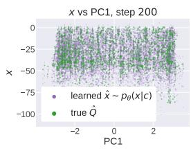

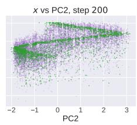

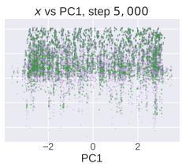

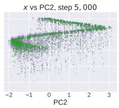

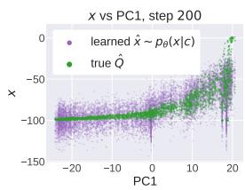

(a) Cube Single  
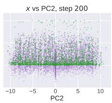  
(b) Antmaze

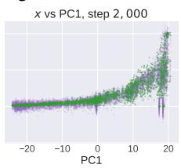

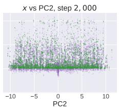  
Figure 3: Policy Evaluation: learned (purple) and true (green) conditional distributions against the first two principal components of the state-action conditioning

## 4.2 BEYOND ONE-DIMENSIONAL SYNTHETIC REGRESSION: MONTE-CARLO POLICY EVALUATION

We next test whether the variance-inflation phenomenon persists when the conditioning variable is high-dimensional. For this, we use a Policy Evaluation task, where we train a CFM to predict Q-values conditioned on state-action pairs $c = ( s , a )$ , using Monte-Carlo targets. We evaluate on two OGBench (Park et al., 2025) environments, ${ \mathsf { C u b e - S i n g l e } }$ and Antmaze-large, where the conditioning variable is high-dimensional while the target remains scalar.

Figure 3 visualizes the learned and empirical distributions against the first two principal components of the conditioning variable. At early training steps, the learned conditional distribution is noticeably more diffuse than the empirical target, but still 'covers’ the target distribution samples; at later checkpoints, the learned samples contract and align more closely with the target scatter. This mirrors the synthetic experiments: underfitting in the conditional vector field leads to excess spread, which decreases as training proceeds.

## 5 AN IDEALIZED MODEL FOR VARIANCE INFLATION

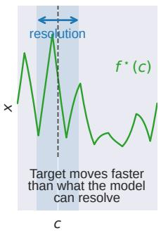  
1. Target vs. resolution

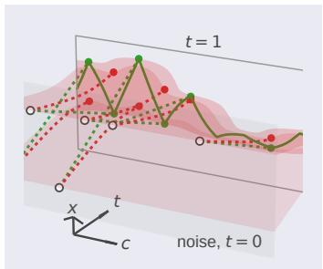  
True (green) vs smoothed (red) field  
2. Density weighted smoothing of velocity field

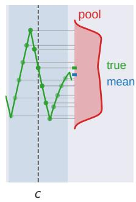  
3. Pooling of targets from nearby contexts

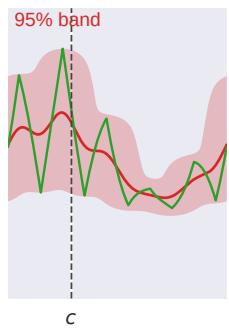  
4. Resulting spread  
Figure 4: Underfitting of the velocity field leads to local mixing of conditional distributions, not just smoothing of the mean.

Due to finite data, capacity constraints on the learned network, and optimization choices (e.g. early stopping), vθ is an imperfect approximation of $v ^ { \star }$ . Because the precise form of this approximation is difficult to characterize for neural function approximators, we study the following idealized population-level regularized flow-matching problem.

$$
v _ { \lambda } \in \arg \operatorname* { m i n } _ { v \in \mathcal { V } } \left\{ \mathbb { E } \left[ \left\| v _ { T } ( C , X _ { T } ) - \dot { X } _ { T } \right\| ^ { 2 } \right] + \lambda \mathbb { E } \left[ \left\| ( L _ { c } v _ { T } ) ( C , X _ { T } ) \right\| ^ { 2 } \right] \right\} .\tag{5.1}
$$

Above, operator $L _ { c }$ is a linear operator inducing smoothing in the conditioning variable. Specifically, for each fixed $( t , x ) , L _ { c }$ acts on the function $c \mapsto v _ { t } ( c , x )$ while treating t and x as fixed. This matches the regime of interest: the learned vector field may depend flexibly on the flow state x and on time t, but its dependence on the conditioning variable c is smoothed. Concrete examples include first-derivative penalties $L _ { c } = \nabla _ { c }$ , higher-order smoothness penalties $L _ { c } = \nabla _ { c } ^ { k }$ , and RKHS-type penalties on $c \mapsto v _ { t } ( c , x )$ (Wahba, 1990). It is well-known that such regularized regression problems have equivalent kernel representations (Schölkopf et al., 2001). This objective serves as an idealized model of neural-network smoothing bias; related regularized models have been studied for conditional diffusion models (Pfrommer et al., 2025). Appendix A provides further motivation, and Appendix A.4 numerically evaluates our equivalent-kernel approximation (Equations (5.3) and (5.4)) for neural CFMs on synthetic tasks.

Since $L _ { c }$ only induces smoothing in the conditioning variable c and treats t and x as fixed, for any fixed $( t , x )$ , up to a multiplicative constant independent of $^ { g , }$ the regularized least-squares problem

for the slice $g ( c ) : = v _ { t } ( c , x )$ is

$$
\widehat { g } _ { t , x } \in \arg \operatorname* { m i n } _ { g } \left\{ \int _ { \mathcal { C } } \left( \| g ( c ) - v _ { t } ^ { \star } ( c , x ) \| ^ { 2 } + \lambda \| ( L _ { c } g ) ( c ) \| ^ { 2 } \right) p _ { t } ^ { \star } ( x \mid c ) P _ { C } ( d c ) \right\} .\tag{5.2}
$$

For Tikhonov-type penalties, the solution is a linear smoother in the regression target, with some equivalent kernel $K _ { \lambda , t , x }$ depending on (t, x) (Silverman, 1984) :

$$
v _ { \lambda , t } ( c , x ) = \hat { g } _ { t , x } ( c ) = \int K _ { \lambda , t , x } ( c , c ^ { \prime } ) v _ { t } ^ { \star } ( c ^ { \prime } , x ) p _ { t } ^ { \star } ( x \mid c ^ { \prime } ) P _ { C } ( d c ^ { \prime } ) .\tag{5.3}
$$

For the constant-preserving smoothers considered here, the equivalent kernel is normalized so that $\begin{array} { r } { \int K _ { \lambda , t , x } ( c , c ^ { \prime } ) p _ { t } ^ { \star } ( x \mid c ^ { \prime } ) P _ { C } ^ { - } ( d c ^ { \prime } ) = 1 } \end{array}$ . The factor $p _ { t } ^ { \star } ( x \mid c ^ { \prime } )$ is the design density of the slice problem, not a separate modeling choice. The starting point of our analysis is a structural assumption on the kernel $K _ { \lambda , t , x }$

Assumption 5.1 (Factorization of the kernel). The exact kernel $K _ { \lambda , t , x }$ depends on $( t , x )$ through the design density $\rho _ { t , x } ( c ) : = p _ { t } ^ { \star } ( x \mid c ) p _ { C } ( c )$ . We adopt the standard equivalent-kernel approximation that assumes the spatial shape of the kernel depends weakly on $( t , x )$

$$
K _ { \lambda , t , x } ( c , c ^ { \prime } ) = a _ { t , x } ( c ) K _ { \lambda } ^ { \prime } ( c , c ^ { \prime } ) ,\tag{5.4}
$$

for some normalization $a _ { t , x } ( c )$ and a kernel $K _ { \lambda } ^ { \prime }$ that depends on $\lambda$ but not on $( t , x )$

Appendix A motivates this assumption and discusses its regime of validity (small t, large path variance, or locally slowly varying conditional mean) in detail. Under Assumption 5.1, together with mild moment and regularity conditions (Assumptions A.1, A.2, and A.3 in Appendix $\mathrm { A } )$ , the conditional distribution generated by $v _ { \lambda }$ satisfies the following bias-variance relation.

Theorem 1 (Excess Variance and Covariance). Suppose Assumption 5.1 and Assumptions A.1, A.2, and A.3 hold. Let $\widehat { X } _ { 1 }$ denote the endpoint sample generated by integrating $v _ { \lambda }$ at conditioning C, and let $X _ { 1 }$ denote the true target.

$$
\mathbb { E } _ { C } \Big [ \mathrm { C o v } ( \widehat { X } _ { 1 } \mid C ) \Big ] \succeq \mathbb { E } _ { C } [ \mathrm { C o v } ( X _ { 1 } \mid C ) ] + \mathbb { E } _ { C } \Big [ \Big ( \mathbb { E } [ \widehat { X } _ { 1 } \mid C ] - \mathbb { E } [ X _ { 1 } \mid C ] \Big ) ^ { \otimes 2 } \Big ] .\tag{5.5}
$$

The proof proceeds by showing that Assumption 5.1 reduces the regularized flow-matching solution to a density-weighted local average of the true velocity field, which in turn implies that the endpoint distribution generated by the learned velocity field is a local mixture of the true conditional distributions. Taking moments of this mixture and using standard assumptions on the smoothing kernel (Assumptions A.2, A.3) gives Theorem 1. The full proof is deferred to Appendix $\mathrm { A }$

The comparison above is in the Loewner order. Equivalently, in every direction $u ,$ the average learned conditional variance of $u ^ { \top } \widehat { X } _ { 1 }$ is at least the corresponding true conditional variance plus the average squared directional bias of the learned conditional mean. In the scalar case, Theorem 1 says that, on average over the conditioning variable, the learned conditional variance is at least the true conditional variance plus the squared bias of the learned conditional mean. Thus, any smoothing bias incurred in fitting the conditional mean is reflected as additional spread in the generated samples. Figure 5 plots squared bias with excess variance for vector fields trained using different smoothing estimators on multiple one-dimensional synthetic distributions, and the figure reflects the relation predicted in Eq. (5.5).

## 6 COVERAGE PROPERTIES OF CONDITIONAL FLOW MODELS

We now evaluate whether the variance induced by conditional flow models yields meaningful predictive coverage on real-world tasks. The heatmap in panel (d) of Figure 1 suggests that the excess variance of an underfit CFM has structure: it assigns more mass to regions of higher density under the true distribution. Motivated by this, we aim to test a practical consequence of the variance-inflation phenomenon: whether the learned conditional distributions assign appropriate mass to the true outcomes, even in regimes where the conditional mean may be biased. We consider three application domains: Monte-Carlo policy evaluation, cell perturbation prediction, and behavior cloning. We focus on the underfitting regime, the regime where the smoothing bias of neural networks holds.

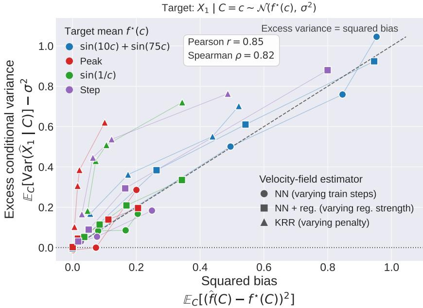  
Figure 5: Excess variance tracks squared bias. Colors identify the mean functions $f ^ { \star }$ of the synthetic target distributions $X _ { 1 } ~ | ~ C = c \sim { \hat { \mathcal { N } } } ( f ^ { \star } ( c ) , \sigma ^ { 2 } )$ , and marker shapes identify vector-field estimators. For neural networks, we plot results at different training checkpoints. For roughness-penalized neural networks and kernel ridge regression, we vary the regularization strength. Lines connect results for the same target-estimator pair. Squared bias and excess conditional variance are both averaged over C. The corresponding conditional distributions are shown in Fig. 2 (blue) and Figs. 16–18 (green, red, and purple, respectively).

Coverage and interval definitions. For a CFM $\hat { p } _ { \boldsymbol { \theta } } ( { \boldsymbol { x } } \mid c )$ and nominal level $\alpha ~ \in ~ ( 0 , 1 )$ , let $C _ { \theta , \alpha } ( c )$ denote a predictive set containing approximately α probability mass. We measure empirical coverage on $\begin{array} { r } { \mathcal { D } = \{ ( x _ { i } , c _ { i } ) \} _ { i = 1 } ^ { | \mathcal { D } | } \operatorname { a s } \widehat { \operatorname { C o v } } _ { \alpha } ( \mathcal { D } ) = \frac { 1 } { | \mathcal { D } | } \sum _ { i = 1 } ^ { | \mathcal { D } | } \mathbf { 1 } \{ x _ { i } \in C _ { \theta , \alpha } ( c _ { i } ) \} } \end{array}$ . We report coverage at $\alpha \in \{ 0 . 7 5 , 0 . 9 0 , 0 . 9 5 \}$ . For scalar outputs (policy evaluation), we construct $C _ { \theta , \alpha } ( c )$ as the central α-mass interval of the learned conditional distribution; for high-dimensional outputs (cell-pertubation, behavior cloning), we use sample-based KNN predictive sets (Wang et al., 2022). Full constructions are given in Appendix B.

The question investigated through these experiments is: Do predictive sets constructed from CFMs as above provide meaningful coverage? We experiment on the following tasks:

i) Monte-Carlo Policy Evaluation. We use three OGBench environments (Park et al., 2025). The CFM models the distribution of scalar Monte-Carlo returns x conditioned on the stateaction pair $c = ( s , a )$ . Figure 6 reports results for Antmaze-large; Cube-Single and Humanoidmaze-medium are deferred to Appendix B.4.

ii) Single-cell perturbation prediction. We evaluate on Norman, PBMC cytokines, and SciPlex3 from scPerturb (Peidli et al., 2024) datasets, using the CellFlow architecture (Klein et al., 2025). The CFM models the distribution of perturbed-cell states x, with control cells as the source distribution and a pretrained perturbation embedding as the condition c. Figure 7 reports Norman results; PBMC and SciPlex3 are deferred to Appendix B.4.

iii) Behavior cloning. We evaluate a flow-matching policy on PushT (Chi et al., 2023). The CFM models the distribution of short action chunks x conditioned on the robot's observation history c.

Figures 6–8 and 12–15 report our results. We plot CFM training and validation losses, empirical coverage, predictive-set sizes, and utility metrics. We include the loss curves to identify when the trained model begins to overfit. In particular, they indicate the training regime over which we expect coverage to remain reliable: from the beginning of training until the train and validation loss curves diverge (or validation improvement saturates). This is shaded in the figures. In practice, models are generally not trained far into the overfitting regime; techniques such as early stopping, regularization and large-data training are used to prevent this. Here, however, we deliberately train for longer to demonstrate that coverage remains reliable in the underfitting regime and changes thereafter. For scalar-output tasks we additionally plot pointwise predictive variance against squared prediction error. Set sizes are reported as interval widths for scalar outputs and KNN radii for high-dimensional outputs, while validation log-likelihood (or task success rate for behavior cloning) is tracked to assert that high coverage is not obtained from a degenerate predictive distribution.

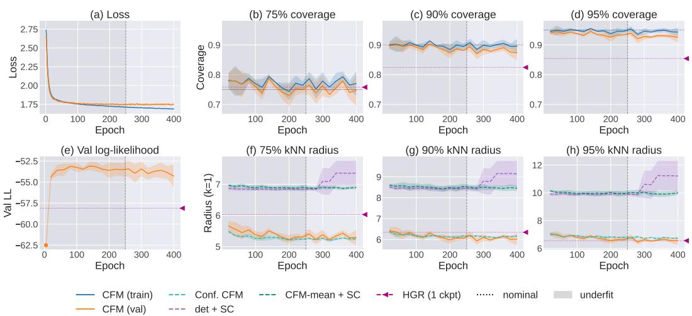

Baselines. We compare against six baselines. For scalar outputs, det + SC applies split conformal prediction to a deterministic regressor with the same conditioning backbone as the CFM, while det + CQR uses conformalized quantile regression to obtain locally adaptive intervals. Conf CFM conformalizes the raw CFM predictive sets, whereas CFM mean + SC applies split conformal prediction to the CFM conditional mean. We additionally compare against Deep Evidential Regression (DER) (Amini et al., 2020) for scalar outputs and Heteroscedastic Gaussian Regression (HGR), using a diagonal Gaussian model for high-dimensional outputs. DER and HGR are reported for fully trained models. Complete experimental details are given in Appendix B. The takeaways are as follows:

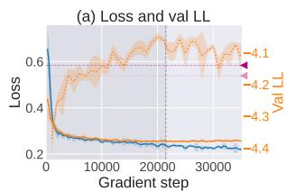

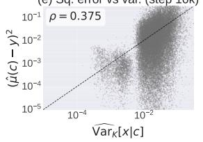

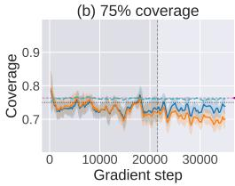

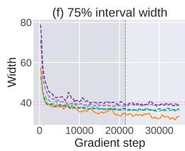

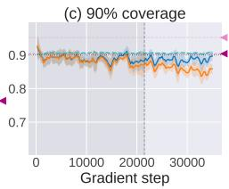

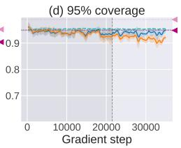

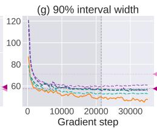

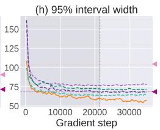  
Figure 6: Policy Evaluation: Antmaze-Large  
Figure 7: Cell-pertubation dataset: Norman

1. Coverage in the underfitting regime is approximately calibrated. There are two takeaways here: i) Up till the point CFM train and val loss curves diverge (underfitting regime), coverage of CFM on val data stays approx. ≥ nominal level $\widehat { ( \mathrm { C o v } } _ { \alpha } ( \mathcal { D } ) \gtrsim \alpha )$ , and dips afterwards. ii) Interestingly, coverage of CFMs on the training data stays ≥ nominal throughout training. This is because the training data is always 'in-distribution' for the model. Once the model starts to overfit, the training data stays in-distribution w.r.t to the model's learned distribution, whereas the validation does not.

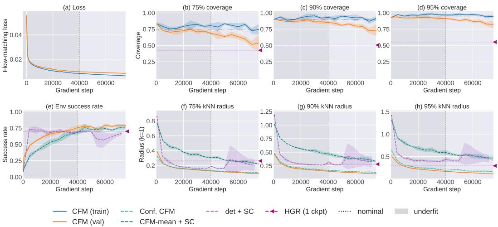  
Figure 8: Behavioral Cloning

2. Variance tracks pointwise prediction error. Examples with larger flow variance also tend to have larger squared prediction error for the flow mean, with positive Spearman correlation across all three environments with one-dimensional outputs (panel (e) in Figures 6, 12, 13). The variance is larger precisely where the model's mean is less accurate, consistent with the interpretation that underfitting is expressed as conditional sample variance.

3. CFM based coverage sets are tight. Throughout the regime of interest (before overfitting sets in): i) CFM-based coverage widths / KNN-radii are tighter than split-conformals. This is because split-conformals are not locally adaptive, and also shows that CFM-based coverage sets are. ii) CFM coverage set sizes are competitive with CQR and other baselines that produce close-to nominal coverage. iii) CFM and conformalized CFM sets have very similar sizes, showing that additional conformalization changes the sets only minimally.

## 7 CONCLUSION AND LIMITATIONS

We identify a surprising inductive bias of conditional flow models: smoothing bias in vector-field learning causes unresolved dependence on the conditioning variable to appear as excess predictive variance, converting epistemic uncertainty into apparent aleatoric variance. We observe this phenomenon across synthetic and real-world tasks, and provide an idealized model to study it. We empirically find that this excess variance has approximate coverage properties, and, at any point in training before overfitting, predictive sets constructed directly from CFM samples achieve approximately nominal coverage without explicit calibration training.

Limitations. Our theory analyzes an idealized population-level regularized smoothing model and does not establish the variance-inflation result for arbitrary neural-network training. Although the theoretical result characterizes the variance inflation phenomenon, it does not imply formal predictivecoverage guarantees. The coverage properties studied here are empirical, and developing stronger theoretical coverage guarantees is left for future work.

## REFERENCES

Bhavya Agrawalla, Michal Nauman, Khush Agrawal, and Aviral Kumar. floq: Training critics via flow-matching for scaling compute in value-based rl, 2025. URL https : //arxiv. org/ab s/2509.06863.

Sumukh K Aithal, Pratyush Maini, Zachary C Lipton, and J Zico Kolter. Understanding hallucinations in diffusion models through mode interpolation. Advances in neural information processing systems, 37:134614–134644,2024.

Michael S. Albergo and Eric Vanden-Eijnden. Building normalizing flows with stochastic interpolants. In International Conference on Learning Representations, 2023.

Michael S. Albergo, Nicholas M. Boffi, and Eric Vanden-Eijnden. Stochastic interpolants: A unifying framework for flows and diffusions, 2025. URL https://arxiv.org/abs/2303.08797.

Alexander Amini, Wilko Schwarting, Ava Soleimany, and Daniela Rus. Deep evidential regression Advances in neural information processing systems, 33:14927–14937, 2020.

Andrea Caponnetto and Ernesto De Vito. Optimal rates for the regularized least-squares algorithm. Foundations of Computational Mathematics, 7(3):331–368, 2007. doi: 10.1007/s10208-006-019 6-8.

Ricky T. Q. Chen, Yulia Rubanova, Jesse Bettencourt, and David K. Duvenaud. Neural ordinary differential equations. In Advances in Neural Information Processing Systems, volume 31, 2018.

Cheng Chi, Siyuan Feng, Yilun Du, Zhenjia Xu, Eric Cousineau, Benjamin Burchfiel, and Shuran Song. Diffusion policy: Visuomotor policy learning via action diffusion. arXiv preprint arXiv:2303.04137, 2023.

Eugenio Chisari, Nick Heppert, Max Argus, Tim Welschehold, Thomas Brox, and Abhinav Valada. Learning robotic manipulation policies from point clouds with conditional flow matching, 2024. URLhttps://arxiv.org/abs/2409.07343.

Felipe Cucker and Steve Smale. On the mathematical foundations of learning. Bulletin of the American Mathematical Society, 39(1):1–49, 2002. doi: 10.1090/S0273-0979-01-00923-5.

Amit Daniely. Sgd learns the conjugate kernel class of the network, 2017. URL https : //arxiv. org/abs/1702.08503.

Heinz W Engl, Martin Hanke, and Andreas Neubauer. Regularization of Inverse Problems, volume 375 of Mathematics and Its Applications. Kluwer Academic Publishers, Dordrecht, 1996.

Peter J Green and Bernard W Silverman. Nonparametric Regression and Generalized Linear Models: A Roughness Penalty Approach. Chapman and Hall, London, 1994.

Lukas Heumos, Yuge Ji, Lilly May, et al. Pertpy: an end-to-end framework for perturbation analysis. bioRxiv, 2024. doi: 10.1101/2024.08.04.606516.

Arthur Jacot, Franck Gabriel, and Clément Hongler. Neural tangent kernel: Convergence and generalization in neural networks. In Advances in Neural Information Processing Systems, volume 31 2018.

Mason Kamb and Surya Ganguli. An analytic theory of creativity in convolutional diffusion models. In Proceedings of the 42nd International Conference on Machine Learning, 2025. URL ht tps : //openreview.net/forum?id=ilpL2qACla.

Dominik Klein et al. CellFlow enables generative single-cell phenotype modeling with flow matching. bioRxiv, 2025. doi: 10.1101/2025.04.11.648220. Preprint, doi:10.1101/2025.04.11.648220.

Rainer Kress. Linear Integral Equations, volume 82 of Applied Mathematical Sciences. Springer, New York, 3 edition, 2014. doi: 10.1007/978-1-4614-9593-2.

Jaehoon Lee, Lechao Xiao, Samuel Schoenholz, Yasaman Bahri, Roman Novak, Jascha Sohl-Dickstein, and Jeffrey Pennington. Wide neural networks of any depth evolve as linear models under gradient descent. Advances in neural information processing systems, 32, 2019.

Zeming Lin, Halil Akin, Roshan Rao, Brian Hie, Zhongkai Zhu, Wenting Lu, Nikita Smetanin, Robert Verkuil, Ori Kabeli, Yaniv Shmueli, Allan dos Santos Costa, Maryam Fazel-Zarandi, Tom Sercu, Salvatore Candido, and Alexander Rives. Evolutionary-scale prediction of atomic-level protein structure. Science, 379(6637):1123–1130, 2023. doi: 10.1126/science.ade2574.

Yaron Lipman, Ricky T. Q. Chen, Heli Ben-Hamu, Maximilian Nickel, and Matt Le. Flow matching for generative modeling, 2023.URL https://arxiv.org/abs/2210.02747.

Xingchao Liu, Chengyue Gong, and Qiang Liu. Flow straight and fast: Learning to generate and transfer data with rectified flow, 2022. URL https://arxiv.org/abs/2209.03003.

Benjamin Kurt Miller, Ricky T. Q. Chen, Anuroop Sriram, and Brandon M Wood. FlowMM: Generating materials with riemannian flow matching. In Forty-first International Conference on Machine Learning, 2024. URL https://openreview.net/forum?id=W4pB7VbzZI.

Thomas M. Norman, Max A. Horlbeck, Joseph M. Replogle, Alex Y. Ge, Albert Xu, Marco Jost Luke A. Gilbert, and Jonathan S. Weissman. Exploring genetic interaction manifolds constructed from rich single-cell phenotypes. Science, 365(6455):786–793, 2019. doi: 10.1126/science.aax4 438.

Seohong Park, Kevin Frans, Benjamin Eysenbach, and Sergey Levine. Ogbench: Benchmarking offline goal-conditioned rl,2025. URL https://arxiv.org/abs/2410.20092.

Parse Biosciences. 10 Million Human PBMCs in a Single Experiment, 2024. URL ht tps : //www.parsebiosciences.com/datasets/10-million-human-pbmcs-in-a -single-experiment/. Accessed: 2026-05-04.

Stefan Peidli, Tessa D Green, Ciyue Shen, Torsten Gross, Joseph Min, Samuele Garda, Bo Yuan, Linus J Schumacher, Jake P Taylor-King, Debora S Marks, Augustin Luna, Nils Blüthgen, and Chris Sander. scPerturb: harmonized single-cell perturbation data. Nature Methods, 21:531–540, 2024.

Daniel Pfrommer, Zehao Dou, Christopher Scarvelis, Max Simchowitz, and Ali Jadbabaie. Is your conditional diffusion model actually denoising?, 2025. URL https : //arxiv. org/abs/25 12.18736.

Zoe Piran, Niv Cohen, Yedid Hoshen, and Mor Nitzan. Disentanglement of single-cell data with biolord. Nature Biotechnology, 42:1678–1683, 2024. doi: 10.1038/s41587-023-02079-x.

Nasim Rahaman, Aristide Baratin, Devansh Arpit, Felix Draxler, Min Lin, Fred A. Hamprecht, Yoshua Bengio, and Aaron Courville. On the spectral bias of neural networks. In International Conference on Machine Learning, pp. 5301–5310. PMLR, 2019.

Quentin Rouxel, Andrea Ferrari, Serena Ivaldi, and Jean-Baptiste Mouret. Flow matching imitation learning for multi-support manipulation, 2024. URL https://arxiv.org/abs/2407.1 2381.

Christopher Scarvelis, Haitz Sáez de Ocáriz Borde, and Justin Solomon. Closed-form diffusion models. arXiv preprint arXiv:2310.12395, 2023.

Bernhard Schölkopf, Ralf Herbrich, and Alex J. Smola. A generalized representer theorem. In Computational Learning Theory, pp. 416–426. Springer, 2001.

Bernard W Silverman. Spline smoothing: The equivalent variable kernel method. The Annals of Statistics, 12(3):898–916, 1984. doi: 10.1214/aos/1176346710.

Kiwhan Song, Jaeyeon Kim, Sitan Chen, Yilun Du, Sham Kakade, and Vincent Sitzmann. Selective underfitting in diffusion models. arXiv preprint arXiv:2510.01378, 2025.

Sanjay R. Srivatsan, José L. McFaline-Figueroa, Vijay Ramani, Lauren Saunders, Junyue Cao, Jonathan Packer, Hannah A. Pliner, Daniel L. Jackson, Riza M. Daza, Lena Christiansen, Fan Zhang, Frank Steemers, Jay Shendure, and Cole Trapnell. Massively multiplex chemical transcriptomics at single-cell resolution. Science, 367(6473):45–51, 2020. doi: 10.1126/science.aax6234.

Matthew Tancik, Pratul Srinivasan, Ben Mildenhall, Sara Fridovich-Keil, Nithin Raghavan, Utkarsh Singhal, Ravi Ramamoorthi, Jonathan Barron, and Ren Ng. Fourier features let networks learn high frequency functions in low dimensional domains. In Advances in Neural Information Processing Systems, volume 33, pp. 7537–7547, 2020.

John J. Vastola. Generalization through variance: How noise shapes inductive biases in diffusion models. In The Thirteenth International Conference on Learning Representations, 2025. URL https://openreview.net/forum?id=71Udo8Vuqa.

Grace Wahba. Spline Models for Observational Data, volume 59 of CBMS-NSF Regional Conference Series in Applied Mathematics. SIAM, Philadelphia, 1990. doi: 10.1137/1.9781611970128.

Zhendong Wang, Ruijiang Gao, Mingzhang Yin, Mingyuan Zhou, and David M. Blei. Probabilistic conformal prediction using conditional random samples, 2022. URL https : //arxiv. org/ abs/2206.06584.

Zhi-Qin John Xu, Yaoyu Zhang, Tao Luo, Yanyang Xiao, and Zheng Ma. Frequency principle: Fourier analysis sheds light on deep neural networks. Communications in Computational Physics, 28(5):1746–1767, 2020.

Yuan Yao, Lorenzo Rosasco, and Andrea Caponnetto. On early stopping in gradient descent learning. Constructive approximation, 26(2):289–315, 2007.

TaeHo Yoon, Joo Young Choi, Sehyun Kwon, and Ernest K Ryu. Diffusion probabilistic models generalize when they fail to memorize. In ICML 2023 workshop on structured probabilistic inference {\&} generative modeling, 2023.

Qinglun Zhang, Zhen Liu, Haoqiang Fan, Guanghui Liu, Bing Zeng, and Shuaicheng Liu. Flowpolicy: Enabling fast and robust 3d flow-based policy via consistency flow matching for robot manipulation, 2024.URLhttps://arxiv.org/abs/2412.04987.

## A THEORETICAL MODEL OF VARIANCE INFLATION

This section provides the formal setup and proof of Theorem 1 from Section 5. The argument proceeds in three steps

• First, an equivalent-kernel approximation (Section A.1) reduces the regularized flowmatching solution to a density-weighted local average of the true velocity field.

• Second, this representation implies that the endpoint distribution generated by the regularized flow is a local mixture of true conditionals (Proposition A.2).

• Third, taking moments of this mixture gives an explicit decomposition of the learned covariance into true conditional covariance and unresolved variation of the conditional mean. A short operator argument then shows that, on average, this unresolved variation dominates the squared smoothing bias, yielding Theorem 1.

Setup. We restate the regularized flow-matching problem from Section 5: we study the populationlevel optimum

$$
v _ { \lambda } \in \arg \operatorname* { m i n } _ { v \in \mathcal { V } } \left\{ \mathbb { E } \Big [ \| v _ { T } ( C , X _ { T } ) - \dot { X } _ { T } \| ^ { 2 } \Big ] + \lambda \mathbb { E } \big [ \| ( L _ { c } v _ { T } ) ( C , X _ { T } ) \| ^ { 2 } \big ] \right\} ,\tag{A.1}
$$

as a proxy for the inductive bias of a learned conditional flow. Here V is the chosen vector-field class, $\lambda \geq 0$ controls the strength of regularization, and $L _ { c }$ is a linear operator acting only on the conditioning variable: for each fixed $( \bar { t } , x ) , L _ { c }$ acts on the function $c \mapsto v _ { t } ( c , x )$ while treating t and x as fixed. Examples include derivative penalties such as $L _ { c } = \nabla _ { c } ,$ higher-order smoothness penalties, and RKHS-type penalties. This captures the regime of interest: the learned vector field may depend flexibly on the flow state x and time t, but its dependence on the conditioning variable c is smoothed.

Justification for studying this setup: Prior work has established that neural networks exhibit a spectral or smoothness bias during training, preferentially fitting smoother and lower-frequency components before finer-scale structure (Daniely, 2017; Jacot et al., 2018; Rahaman et al., 2019; Xu et al., 2020; Lee et al., 2019). Equation (5.1) captures this behavior in an idealized population-level model. Closely related, Pfrommer et al. (2025) study a special case with $L _ { c } = \bar { \nabla } _ { c } ^ { 2 }$ as a model of smoothness bias in conditional diffusion models. More broadly, underfitting of learned velocity and score fields has been studied extensively in the diffusion and flow-matching literature. Prior work has linked smoothness and selective underfitting of these fields to generalization, interpolation, and hallucination in generative models (Yoon et al., 2023; Scarvelis et al., 2023; Aithal et al., 2024; Song et al., 2025). Finally, in Appendix A.4 we numerically evaluate how well the factorized equivalentkernel representation in Equations (5.3) and (5.4) approximates trained neural CFMs on synthetic one-dimensional regression tasks.

For brevity, throughout this appendix we write $\hat { v } : = v _ { \lambda }$ for the regularized population solution.

For any vector field $v ,$ the endpoint distribution generated at condition c is the law of $\Phi _ { 1 } ^ { v } ( c , Z )$ with $Z \sim \rho _ { 0 }$ . We write its conditional mean and covariance as

$$
\begin{array} { r } { m _ { v } ( c ) : = \mathbb { E } _ { Z } [ \Phi _ { 1 } ^ { v } ( c , Z ) ] , \qquad \Sigma _ { v } ( c ) : = \operatorname { C o v } _ { Z } ( \Phi _ { 1 } ^ { v } ( c , Z ) ) . } \end{array}\tag{A.2}
$$

When the generated variable is scalar, we write $s _ { v } ^ { 2 } ( c ) : = \Sigma _ { v } ( c )$ . In the unregularized realizable population limit, $\Sigma _ { v } ( c )$ matches the true conditional covariance of $X _ { 1 } \mid C = c .$ The central question of this section is what happens to this endpoint covariance when the vector field is regularized or underfit in the c-direction. We show that the learned endpoint distribution can have substantially larger spread than the true conditional distribution, with the excess spread reflecting unresolved variation of the true conditional mean over the model's effective smoothing neighborhood.

Assumption A.1 (Target moments). The target satisfies

$$
X _ { 1 } = \mu ^ { \star } ( C ) + \xi , \qquad \mathbb { E } [ \xi \mid C ] = 0 , \qquad \operatorname { C o v } ( \xi \mid C ) = \Sigma ^ { \star } ( C ) ,\tag{A.3}
$$

where $X _ { 1 } \in \mathbb { R } ^ { d _ { x } }$ and all second moments are finite. The base variable $X _ { 0 } \sim \rho _ { 0 }$ is independent of $( C , \xi ) .$ , and $p _ { 0 } ^ { \star } ( \cdot \mid c ) = \rho _ { 0 }$ does not depend on $c .$ In the scalar case $d _ { x } = 1$ , we write $\mu ^ { \star } = f ^ { \star }$ and $\dot { \Sigma } ^ { \star } = \sigma ^ { 2 }$

The above assumption simply means that $L _ { 2 }$ regression is well-specified and second moments are finite. We make no parametric assumption about ξ beyond its first two conditional moments.

A.1 ASSUMPTIONS: EQUIVALENT-KERNEL MODEL OF REGULARIZED FLOW MATCHING, AND REGULARITY CONDITIONS

The regularized objective in $( \mathrm { A } . 1 )$ penalizes variation of $c \mapsto v _ { t } ( c , x )$ . For each fixed $( t , x )$ , this is a supervised regression problem in c whose population design distribution is the conditional law of $\bar { C } \mid X _ { t } = x , \bar { \mathrm { i } } . \mathbf { e }$ ., proportional to $p _ { t } ^ { \star } ( x \mid c ^ { \prime } ) \dot { P } _ { C } ( d c ^ { \prime } )$ . Classical equivalent-kernel calculations for regularized least squares show that the fitted value at c is a local average of the regression target (Silverman, 1984), which gives Eq. (5.3). We now simplify this equivalent-kernel representation into the form used in our analysis.

Simplifying the Kernel. We first restate Assumption 5.1 for convenience.

Assumption 5.1 (Factorization of the kernel). The exact kernel $K _ { \lambda , t , x }$ depends on $( t , x )$ through the design density $\rho _ { t , x } ( c ) : = p _ { t } ^ { \star } ( x \mid c ) p _ { C } ( c )$ . We adopt the standard equivalent-kernel approximation that assumes the spatial shape of the kernel depends weakly on $( t , x )$

$$
K _ { \lambda , t , x } ( c , c ^ { \prime } ) = a _ { t , x } ( c ) K _ { \lambda } ^ { \prime } ( c , c ^ { \prime } ) ,\tag{5.4}
$$

for some normalization $a _ { t , x } ( c )$ and a kernel $K _ { \lambda } ^ { \prime }$ that depends on λ but not on $( t , x )$

We now show that Assumption 5.1 implies Lemma A.1, and then motivate Assumption 5.1 in the light of prior literature.

Lemma A.1 (Density-weighted equivalent kernel). For each regularization level λ, there exists a Markov kernel $W _ { \lambda } ( \dot { d } c ^ { \prime } \mid c )$ on the conditioning space such that the regularized population velocity in (5.1) satisfies

$$
\hat { v } _ { t } ( c , x ) = \frac { \int v _ { t } ^ { \star } ( c ^ { \prime } , x ) p _ { t } ^ { \star } ( x \mid c ^ { \prime } ) W _ { \lambda } ( d c ^ { \prime } \mid c ) } { \int p _ { t } ^ { \star } ( x \mid c ^ { \prime } ) W _ { \lambda } ( d c ^ { \prime } \mid c ) } .\tag{A.4}
$$

Proof. Substituting (5.4) into the slice solution Eq. (5.3) and absorbing $a _ { t , x } ( c )$ into the normalization, we obtain

$$
\hat { v } _ { t } ( c , x ) = \frac { \int K _ { \lambda } ^ { \prime } ( c , c ^ { \prime } ) v _ { t } ^ { \star } ( c ^ { \prime } , x ) p _ { t } ^ { \star } ( x \mid c ^ { \prime } ) p _ { C } ( c ^ { \prime } ) d c ^ { \prime } } { \int K _ { \lambda } ^ { \prime } ( c , c ^ { \prime } ) p _ { t } ^ { \star } ( x \mid c ^ { \prime } ) p _ { C } ( c ^ { \prime } ) d c ^ { \prime } } .\tag{A.5}
$$

The form in $\left( \mathrm { A } . 5 \right)$ is exactly the representation in Lemma A.1, with $W _ { \lambda }$ obtained concretely by normalizing $\dot { K } _ { \lambda } ^ { \prime } ( c , c ^ { \prime } ) p _ { C } ( c ^ { \prime } )$ in c $c ^ { \prime }$ □

Motivating Assumption 5.1. The factorization (5.4) is an equivalent-kernel approximation of the kind used for smoothing splines and other roughness-penalized estimators (Silverman, 1984; Wahba, 1990; Green & Silverman, 1994). The exact kernel $K _ { \lambda , t , x }$ depends on (t, x) only through the design density $\rho _ { t , x } ( c ) : = p _ { t } ^ { \star } ( x \mid c ) p _ { C } ( c )$ , so replacing it by a common kernel is justified when $\rho _ { t , x }$ is locally stable over the smoothing length scale of the penalty. Equivalently, using the normal-equation resolvent $R _ { \rho } : = ( M _ { \rho } + \lambda L _ { c } ^ { * } L _ { c } \bar { ) } ^ { - 1 }$ , the second-resolvent identity

$$
R _ { \rho _ { t , x } } - R _ { \bar { \rho } } = - R _ { \rho _ { t , x } } \big ( { \cal M } _ { \rho _ { t , x } } - { \cal M } _ { \bar { \rho } } \big ) R _ { \bar { \rho } }\tag{A.6}
$$

shows that the exact kernels are stable whenever the perturbation $M _ { \rho _ { t , x } } - M _ { \bar { \rho } }$ is small in the operator norm induced by the regularized problem. This is the standard Fredholm/resolvent picture behind Tikhonov-regularized least squares and kernel ridge regression (Cucker & Smale, 2002; Caponnetto & De Vito, 2007; Kress, 2014; Engl et al., 1996). For the Gaussian-like paths we consider, the approximation is expected to be best for small t, large path variance, or locally slowly varying conditional mean $\mu ^ { \star }$ . It is weakest near $t = 1$ in low-noise regions, where $p _ { t } ^ { \star } ( x \mid c )$ sharply localizes around level sets of the conditional mean.

Also, in Section A.4 we numerically test how well Eq. (A.4) approximates the velocity field learned by a neural network, on a synthetic task. This is equivalent to verifying how well Eq. (5.3) and Eq. (5.4) together approximate a neural CFM's learned velocity field.

Remark A.1. The learned vector field representation Eq. (A.4) obtained from Lemma A.1 is stronger than saying that $\hat { v } _ { t } ( c , x )$ is an ordinary pointwise smoother of $v _ { t } ^ { \star } ( c , x )$ : ordinary smoothing in c at fixed $( t , x )$ would replace the conditional mean by a smoothed mean and would not create the same excess endpoint variance. The density-weighted form in (A.5) is structurally different: it locally blends the conditional probability paths themselves, weighting by how likely each $c ^ { \prime }$ is to have produced the observed x under the true model. This blending is what produces the variance inflation.

We conclude this subsection with two assumptions on the resulting kernel $W _ { \lambda }$ . First, we require mild regularity conditions ensuring that the mixed path above is the path generated by .

Assumption A.2 (Path regularity and uniqueness). For $W _ { \lambda }$ in Lemma ${ \mathrm { A . 1 } }$ , the mixture density

$$
\hat { p } _ { t } ^ { \lambda } ( x \mid c ) : = \int p _ { t } ^ { \star } ( x \mid c ^ { \prime } ) W _ { \lambda } ( d c ^ { \prime } \mid c )\tag{A.7}
$$

is positive and continuously differentiable in $( t , x )$ , differentiation under the $W _ { \lambda }$ -integral is valid, and the multivariate continuity equation

$$
\partial _ { t } p _ { t } ( x \mid c ) + \nabla _ { x } \cdot ( p _ { t } ( x \mid c ) \widehat { v } _ { t } ( c , x ) ) = 0\tag{A.8}
$$

with initial law $\rho _ { 0 }$ admits a unique weak solution.

Second, we assume reversibility and positive semidefiniteness of the kernel — two standard properties of self-adjoint smoothing operators on $L ^ { 2 } ( P _ { C } )$ . In particular, for example, they are satisfied by the Markov kernels arising from Tikhonov regularization with symmetric quadratic penalties (Engl et al., 1996).

Assumption A.3 (Symmetric positive smoothing). The kernel $W _ { \lambda }$ preserves $P _ { C }$ and is reversible:

$$
P _ { C } ( d c ) W _ { \lambda } ( d c ^ { \prime } \mid c ) = P _ { C } ( d c ^ { \prime } ) W _ { \lambda } ( d c \mid c ^ { \prime } ) .\tag{A.9}
$$

Moreover, the smoothing operator

$$
( S _ { \lambda } g ) ( c ) : = \int g ( c ^ { \prime } ) W _ { \lambda } ( d c ^ { \prime } \mid c )
$$

is positive semidefinite as an operator on $L ^ { 2 } ( P _ { C } )$

## A.2 FORMAL MAIN RESULTS

We are now ready to state our formal main results, deferring proofs to Section A.3. First, we show that under our assumptions, smoothing over the flows directly translates to smoothing over the conditionals. This is the key bridge between regularization of the vector field and variance inflation in the generated distribution.

Proposition A.2 (Regularization induces a local mixture). Suppose Assumptions A.1, A.2 and 5.1 hold. Then the conditional path $\hat { p } _ { t } ^ { \lambda } ( \cdot \mid c )$ defined in Assumption A.2 satisfies the continuity equation

$$
\partial _ { t } \hat { p } _ { t } ^ { \lambda } ( x \mid c ) + \nabla _ { x } \cdot \left( \hat { p } _ { t } ^ { \lambda } ( x \mid c ) \hat { v } _ { t } ( c , x ) \right) = 0 ,\tag{A.10}
$$

with initial law $\hat { p } _ { 0 } ^ { \lambda } ( \cdot \mid c ) = \rho _ { 0 }$ . Consequently, the endpoint law generated by  is the $W _ { \lambda }$ -mixture of true conditionals:

$$
\hat { p } _ { 1 } ^ { \lambda } ( x \mid c ) = \int p ^ { \star } ( x \mid c ^ { \prime } ) W _ { \lambda } ( d c ^ { \prime } \mid c ) .\tag{A.11}
$$

At this point, the flow-dynamics part of the argument is complete: the regularized flow generates a local mixture of the true conditional distributions. The remainder of the variance analysis follows from the moments of this mixture.

Let

$$
C _ { \lambda } ^ { \prime } \mid C = c \sim W _ { \lambda } ( \cdot \mid c ) , \qquad X _ { 1 } ^ { \prime } \sim p ^ { \star } ( \cdot \mid C _ { \lambda } ^ { \prime } ) .\tag{A.12}
$$

By Proposition A.2,

$$
{ \hat { X } } _ { 1 } \mid C = c { \overset { d } { = } } X _ { 1 } ^ { \prime } .\tag{A.13}
$$

Therefore, by the laws of total expectation and total covariance,

$$
\hat { \mu } _ { \lambda } ( c ) : = \mathbb { E } [ \hat { X } _ { 1 } \mid C = c ] = \mathbb { E } [ \mu ^ { \star } ( C _ { \lambda } ^ { \prime } ) \mid C = c ] = ( S _ { \lambda } \mu ^ { \star } ) ( c ) ,\tag{A.14}
$$

$$
\begin{array} { r l } & { \hat { \Sigma } _ { \lambda } ( c ) : = \operatorname { C o v } ( \hat { X } _ { 1 } \mid C = c ) } \\ & { \quad \quad = \operatorname { \mathbb { E } } [ \Sigma ^ { \star } ( C _ { \lambda } ^ { \prime } ) \mid C = c ] + \operatorname { C o v } ( { \mu ^ { \star } ( C _ { \lambda } ^ { \prime } ) } \mid C = c ) . } \end{array}\tag{A.15}
$$

The decomposition in (A.15) already exposes the variance-inflation mechanism. The first term is the true conditional covariance averaged over the smoothing neighborhood, while the second is the variation of nearby conditional means that the smoothed model has failed to resolve.

Variance in the Scalar Case. For simplicity, first consider scalar outputs. Write $\mu ^ { \star } = f ^ { \star }$ and $\Sigma ^ { \star } = \sigma ^ { 2 }$ , and define

$$
\hat { f } _ { \lambda } ( c ) : = \mathbb { E } [ f ^ { \star } ( C _ { \lambda } ^ { \prime } ) \mid C = c ] = ( S _ { \lambda } f ^ { \star } ) ( c ) ,\tag{A.16}
$$

$$
\delta _ { \lambda } ( c ) : = \hat { f } _ { \lambda } ( c ) - f ^ { \star } ( c ) ,\tag{A.17}
$$

together with

$$
s _ { \lambda } ^ { 2 } ( c ) : = \operatorname { V a r } ( f ^ { \star } ( C _ { \lambda } ^ { \prime } ) \mid C = c ) ,\tag{A.18}
$$

$$
\begin{array} { r } { \bar { \sigma } _ { \lambda } ^ { 2 } ( c ) : = \mathbb { E } [ \sigma ^ { 2 } ( C _ { \lambda } ^ { \prime } ) \ | \ C = c ] . } \end{array}\tag{A.19}
$$

Specializing (A.14)–(A.15) to the scalar case gives

$$
\mathbb { E } [ \hat { X } _ { 1 } \mid C = c ] = f ^ { \star } ( c ) + \delta _ { \lambda } ( c ) ,\tag{A.20}
$$

$$
\mathrm { V a r } ( \hat { X } _ { 1 } \mid C = c ) = s _ { \lambda } ^ { 2 } ( c ) + \bar { \sigma } _ { \lambda } ^ { 2 } ( c ) .\tag{A.21}
$$

Equation (A.21) makes the source of the additional variance explicit. The term $s _ { \lambda } ^ { 2 } ( c )$ is the variance of $\bar { f } ^ { \star }$ over the smoothing neighborhood $W _ { \lambda } ( \cdot \mid c )$ , i.e., the unresolved variation of the regression function over the model's effective receptive field around c. The term $\bar { \sigma } _ { \lambda } ^ { 2 } ( c )$ is the local average of the irreducible noise variance $\sigma ^ { 2 }$ over the same neighborhood. In the unregularized limit $( \lambda \to 0 , W _ { \lambda } \to$ $\delta _ { c } )$ , the first term vanishes and the second collapses to $\sigma ^ { 2 } ( c )$ , recovering the correct conditional variance.

Thus, the learned conditional variance exceeds the local average noise level by exactly $s _ { \lambda } ^ { 2 } ( c )$ . The remaining question is whether this unresolved variation is large enough to account for the squared bias $\delta _ { \lambda } ^ { 2 } ( c )$ induced by the same smoothing operator.

Proposition A.3 (Average excess variance dominates squared bias). Suppose $d _ { x } = 1$ . Under Assumptions A.1 to A.3 and 5.1,

$$
\mathbb { E } _ { C } \big [ s _ { \lambda } ^ { 2 } ( C ) - \delta _ { \lambda } ^ { 2 } ( C ) \big ] = 2 \langle S _ { \lambda } f ^ { \star } , ( I - S _ { \lambda } ) f ^ { \star } \rangle _ { L ^ { 2 } ( P _ { C } ) } \geq 0 .\tag{A.22}
$$

Average scalar excess variance. Proposition ${ \mathrm { A } } . 3$ can be equivalently phrased directly in terms of the conditional variance learned by the flow. Let

$$
\hat { V } _ { \lambda } ( c ) : = \operatorname { V a r } ( \hat { X } _ { 1 } \mid C = c ) = s _ { \lambda } ^ { 2 } ( c ) + \bar { \sigma } _ { \lambda } ^ { 2 } ( c ) ,\tag{A.23}
$$

$$
V ^ { \star } ( c ) : = \operatorname { V a r } ( X _ { 1 } \mid C = c ) = \sigma ^ { 2 } ( c ) ,\tag{A.24}
$$

and

$$
\operatorname { B i a s } _ { \lambda } ( c ) : = \mathbb { E } [ \hat { X } _ { 1 } \mid C = c ] - \mathbb { E } [ X _ { 1 } \mid C = c ] = \delta _ { \lambda } ( c ) .\tag{A.25}
$$

Combining (A.21) with Proposition A.3 and using $\mathbb { E } [ \bar { \sigma } _ { \lambda } ^ { 2 } ( C ) ] = \mathbb { E } [ \sigma ^ { 2 } ( C ) ]$ by stationarity,

$$
\begin{array} { r l } & { \mathbb { E } _ { C } [ \hat { V } _ { \lambda } ( C ) ] - \mathbb { E } _ { C } [ V ^ { \star } ( C ) ] - \mathbb { E } _ { C } [ \mathrm { B i a s } _ { \lambda } ( C ) ^ { 2 } ] } \\ & { \quad \quad \quad = \mathbb { E } _ { C } [ s _ { \lambda } ^ { 2 } ( C ) - \delta _ { \lambda } ^ { 2 } ( C ) ] \geq 0 . } \end{array}\tag{A.26}
$$

Equivalently,

$$
\begin{array} { r } { \mathbb { E } _ { C } [ \hat { V } _ { \lambda } ( C ) ] \geq \mathbb { E } _ { C } [ V ^ { \star } ( C ) ] + \mathbb { E } _ { C } [ \mathrm { B i a s } _ { \lambda } ( C ) ^ { 2 } ] . } \end{array}\tag{A.27}
$$

Thus, on average over the conditioning variable, the learned conditional variance is at least the true conditional variance plus the squared smoothing bias of the learned conditional mean.

This gives a precise sense in which the conditional flow converts epistemic uncertainty into apparent aleatoric variance. The smoothing operator $S _ { \lambda }$ captures unresolved variation of the regression function $f ^ { \star }$ in the conditioning variable, which the model cannot represent given its inductive bias. This unresolved variation manifests as bias $\delta _ { \lambda } ( c )$ in the learned conditional mean; (A.27) shows that the same smoothing also induces enough additional conditional spread to cover the squared bias on average. Underfit conditional flows therefore do not merely smooth their predictions toward a less informative estimate; they also produce stochastic outputs whose extra variance carries the unresolved dependence on $C .$

Vector Case. The vector case follows by applying the same scalar argument along every direction in the output space, and admits the same interpretation.

Proposition A.4 (Vector-valued excess covariance). Suppose $X _ { 1 } \in \mathbb { R } ^ { d _ { x } }$ . Let

$$
b _ { \lambda } ( c ) : = \hat { \mu } _ { \lambda } ( c ) - \mu ^ { \star } ( c ) .\tag{A.28}
$$

Under Assumptions A.1 to A.3 and 5.1,

$$
\mathbb { E } _ { C } [ \hat { \Sigma } _ { \lambda } ( C ) ] \succeq \mathbb { E } _ { C } [ \Sigma ^ { \star } ( C ) ] + \mathbb { E } _ { C } [ b _ { \lambda } ( C ) b _ { \lambda } ( C ) ^ { \top } ] ,\tag{A.29}
$$

where ≥ denotes the Loewner order.

## A.3 DEFERRED PROOFS

We first prove the local-mixture representation that connects smoothing of the velocity field to smoothing of the generated conditional distribution.

Proof of Proposition A.2. For every fixed $c ^ { \prime } ,$ the exact conditional path satisfies the multivariate continuity equation

$$
\begin{array} { r } { \partial _ { t } p _ { t } ^ { \star } ( x \mid c ^ { \prime } ) + \nabla _ { x } \cdot ( p _ { t } ^ { \star } ( x \mid c ^ { \prime } ) v _ { t } ^ { \star } ( c ^ { \prime } , x ) ) = 0 . } \end{array}\tag{A.30}
$$

Integrating this identity against $W _ { \lambda } ( d c ^ { \prime } \mid c )$ and exchanging the integral with the derivatives, by Assumption $\mathrm { A . } 2 .$ gives

$$
\partial _ { t } \hat { p } _ { t } ^ { \lambda } ( x \mid c ) + \nabla _ { x } \cdot \left( \int p _ { t } ^ { \star } ( x \mid c ^ { \prime } ) v _ { t } ^ { \star } ( c ^ { \prime } , x ) W _ { \lambda } ( d c ^ { \prime } \mid c ) \right) = 0 .\tag{A.31}
$$

By Lemma A.1,

$$
\int p _ { t } ^ { \star } ( x \mid c ^ { \prime } ) v _ { t } ^ { \star } ( c ^ { \prime } , x ) W _ { \lambda } ( d c ^ { \prime } \mid c ) = \hat { p } _ { t } ^ { \lambda } ( x \mid c ) \hat { v } _ { t } ( c , x ) .\tag{A.32}
$$

The initial law is $\rho _ { 0 }$ since $p _ { 0 } ^ { \star } ( \cdot \mid c ^ { \prime } ) = \rho _ { 0 }$ does not depend on $c ^ { \prime } .$ Uniqueness in Assumption $\mathrm { A } . 2$ then identifies $\hat { p } _ { t } ^ { \lambda }$ as the law generated by . Evaluating at $t = 1$ gives (A.11). □

Proof of Proposition A.3 (scalar case). The proof compares two effects of the same smoothing operator: the unresolved variation $s _ { \lambda } ^ { 2 }$ created by averaging nearby values of $f ^ { \star }$ , and the squared bias $\delta _ { \lambda } ^ { 2 }$ created by moving $f ^ { \star }$ toward $\dot { S } _ { \lambda } f ^ { \star }$ . Their difference reduces to a quadratic form involving $\ddot { S _ { \lambda } } ( I - S _ { \lambda } )$ •

By definition,

$$
s _ { \lambda } ^ { 2 } ( c ) = ( S _ { \lambda } f ^ { \star 2 } ) ( c ) - ( S _ { \lambda } f ^ { \star } ) ( c ) ^ { 2 } .
$$

Taking expectation over $C \sim P _ { C }$ and using stationarity of $W _ { \lambda }$

$$
\begin{array} { r } { \mathbb { E } [ s _ { \lambda } ^ { 2 } ( C ) ] = \mathbb { E } [ f ^ { \star } ( C ) ^ { 2 } ] - \mathbb { E } [ ( S _ { \lambda } f ^ { \star } ) ( C ) ^ { 2 } ] . } \end{array}\tag{A.33}
$$

Similarly, since

$$
\delta _ { \lambda } ( c ) = ( S _ { \lambda } f ^ { \star } ) ( c ) - f ^ { \star } ( c ) ,
$$

we have

$$
\begin{array} { r } { \mathbb { E } [ \delta _ { \lambda } ^ { 2 } ( C ) ] = \mathbb { E } [ ( S _ { \lambda } f ^ { \star } ) ( C ) ^ { 2 } ] - 2 \mathbb { E } [ ( S _ { \lambda } f ^ { \star } ) ( C ) f ^ { \star } ( C ) ] + \mathbb { E } [ f ^ { \star } ( C ) ^ { 2 } ] . } \end{array}\tag{A.34}
$$

Subtracting (A.34) from (A.33) and writing inner products in $L ^ { 2 } ( P _ { C } )$ gives

$$
\begin{array} { r l } & { \mathbb { E } [ s _ { \lambda } ^ { 2 } ( C ) - \delta _ { \lambda } ^ { 2 } ( C ) ] = 2 \langle S _ { \lambda } f ^ { \star } , f ^ { \star } \rangle - 2 \langle S _ { \lambda } f ^ { \star } , S _ { \lambda } f ^ { \star } \rangle } \\ & { \quad \quad \quad = 2 \langle S _ { \lambda } f ^ { \star } , ( I - S _ { \lambda } ) f ^ { \star } \rangle . } \end{array}\tag{A.35}
$$

It remains to show that this quadratic form is nonnegative. By Assumption $\mathrm { A } . 3 , S _ { \lambda }$ is self-adjoint on $L ^ { 2 } ( P _ { C } )$ by reversibility and positive semidefinite by assumption. As a Markov operator preserving $P _ { C }$ , it is also a contraction. Hence its spectrum lies in $[ 0 , 1 ]$ , and so $S _ { \lambda } ( I - S _ { \lambda } )$ is positive semidefinite. Therefore,

$$
\langle S _ { \lambda } f ^ { \star } , ( I - S _ { \lambda } ) f ^ { \star } \rangle = \langle f ^ { \star } , S _ { \lambda } ( I - S _ { \lambda } ) f ^ { \star } \rangle \geq 0 .\tag{A.36}
$$

Proof of Proposition $A . 4$ (vector case). The vector result follows by applying the scalar argument to every one-dimensional projection of the conditional mean.

By (A.15),

$$
\hat { \Sigma } _ { \lambda } ( c ) = \mathbb { E } [ \Sigma ^ { \star } ( C _ { \lambda } ^ { \prime } ) \mid C = c ] + A _ { \lambda } ( c ) , \qquad A _ { \lambda } ( c ) : = \operatorname { C o v } ( \mu ^ { \star } ( C _ { \lambda } ^ { \prime } ) \mid C = c ) .\tag{A.37}
$$

Since $W _ { \lambda }$ preserves $P _ { C }$

$$
\mathbb { E } _ { C } [ \mathbb { E } [ \Sigma ^ { \star } ( C _ { \lambda } ^ { \prime } ) \mid C ] ] = \mathbb { E } _ { C } [ \Sigma ^ { \star } ( C ) ] .\tag{A.38}
$$

It therefore remains to show

$$
\mathbb { E } _ { C } [ A _ { \lambda } ( C ) ] \succeq \mathbb { E } _ { C } [ b _ { \lambda } ( C ) b _ { \lambda } ( C ) ^ { \top } ] .\tag{A.39}
$$

Fix $u \in \mathbb { R } ^ { d _ { x } }$ and define $g _ { u } ( c ) : = u ^ { \top } \mu ^ { \star } ( c )$ . Then

$$
u ^ { \top } A _ { \lambda } ( c ) u = \mathrm { V a r } ( g _ { u } ( C _ { \lambda } ^ { \prime } ) \mid C = c ) ,\tag{A.40}
$$

$$
\begin{array} { r } { \boldsymbol { u } ^ { \top } b _ { \lambda } ( \boldsymbol { c } ) = ( S _ { \lambda } g _ { \boldsymbol { u } } ) ( \boldsymbol { c } ) - g _ { \boldsymbol { u } } ( \boldsymbol { c } ) . } \end{array}\tag{A.41}
$$

Applying the scalar calculation from Proposition ${ \mathrm { A } } . 3$ to $g _ { u }$ gives

$$
\begin{array} { r } { u ^ { \top } \left( \mathbb { E } _ { C } [ A _ { \lambda } ( C ) ] - \mathbb { E } _ { C } [ b _ { \lambda } ( C ) b _ { \lambda } ( C ) ^ { \top } ] \right) u = 2 \langle S _ { \lambda } g _ { u } , ( I - S _ { \lambda } ) g _ { u } \rangle _ { L ^ { 2 } ( P _ { C } ) } \geq 0 , } \end{array}\tag{A.42}
$$

where the final inequality follows from Assumption A.3. Since this holds for every $u ,$ the Loewner inequality follows:

$$
\mathbb { E } _ { C } [ A _ { \lambda } ( C ) ] \succeq \mathbb { E } _ { C } [ b _ { \lambda } ( C ) b _ { \lambda } ( C ) ^ { \top } ] .\tag{A.43}
$$

Combining this with the covariance decomposition in (A.15) gives (A.29).

We emphasize that both (A.27) and (A.29) are average statements over C. They do not assert that the scalar excess variance dominates squared bias pointwise, nor that the learned covariance pointwise dominates the true covariance in every heteroscedastic problem. The empirical observations in Section 6 go somewhat beyond this, showing that pointwise predicted variance correlates strongly with pointwise squared error of the flow's mean.

## A.4 VALIDITY OF THE EQUIVARIANT-KERNEL ASSUMPTION (ASSUMPTION 5.1)

In this section, we numerically test how well Eq. (A.4) approximates the velocity field learned by a neural network, on a synthetic task. This is equivalent to verifying how well Eq. (5.3) and $\mathrm { E q . } \left( 5 . 4 \right)$ together approximate a neural CFM's learned velocity field. Let $\hat { v } _ { \theta } ( c , x _ { t } , t )$ denote a neural CFM, and $v _ { t } ^ { * } , p _ { t } ^ { * }$ denote the true velocity field and distribution respectively at time t. Specifically, we want to test if there exists a kernel $W$ such that $\begin{array} { r } { { \tilde { v } } _ { W , t } ( c , x ) = \frac { \int \bar { v } _ { t } ^ { \star } ( c ^ { \prime } , x ) \bar { p _ { t } ^ { \star } } ( x | c ^ { \prime } ) W ( d c ^ { \prime } | c ) } { \int p _ { t } ^ { \star } ( x | c ^ { \prime } ) W ( d c ^ { \prime } | c ) } } \end{array}$ closely approximates $\hat { v } _ { \theta }$

To assess the validity of the equivalent-kernel assumption, we use a 1D Gaussian target:

$$
X _ { 1 } \mid C = c \sim \mathcal { N } ( f ^ { \star } ( c ) , \sigma ^ { 2 } ) , \qquad X _ { 0 } \sim \mathcal { N } ( 0 , \sigma _ { 0 } ^ { 2 } ) ,
$$

with linear path $X _ { t } = ( 1 - t ) X _ { 0 } + t X _ { 1 }$ , giving

$$
X _ { t } \mid C = c \sim \mathcal { N } \big ( t f ^ { \star } ( c ) , s _ { t } ^ { 2 } \big ) , \qquad s _ { t } ^ { 2 } = ( 1 - t ) ^ { 2 } \sigma _ { 0 } ^ { 2 } + t ^ { 2 } \sigma ^ { 2 } .
$$

The factorized kernel approximation is most accurate when the slice-design density $\rho _ { t , x } ( c ^ { \prime } ) = p _ { t } ^ { \star } ( x \mid$ $c ^ { \prime } ) p _ { C } ( c ^ { \prime } )$ varies little over the smoothing bandwidth $h _ { \lambda }$ With $p _ { C }$ locally constant, the path mean shifts by $\approx t h _ { \lambda } | f ^ { \star \prime } ( c ) |$ over this neighborhood while the path std is $s _ { t } .$ giving the heuristic condition

$$
\frac { t h _ { \lambda } | f ^ { \star \prime } ( c ) | } { \sqrt { ( 1 - t ) ^ { 2 } \sigma _ { 0 } ^ { 2 } + t ^ { 2 } \sigma ^ { 2 } } } \ll 1 .
$$

For our experiments, we use $f ^ { \star } ( c ) = \sin ( 2 \pi c ) + \sin ( 1 0 \pi c ) , \sigma = 0 . 0 5$ , and train a CFM $\hat { v } _ { \theta } ( c , x _ { t } , t )$ analyzing checkpoints $N _ { \mathrm { s t e p s } } \in \{ 1 0 0 0 , 3 0 0 0 , 5 0 0 0 \}$ (heavy/moderate/mild underfitting).

To test the equivalent-kernel (EK) approximation, we discretize c on a uniform grid $\{ c _ { j } \} _ { j = 1 } ^ { N }$ and define

$$
\tilde { v } _ { \phi , t } ( c _ { i } , x ) = \frac { \sum _ { j } W _ { \phi , i j } v _ { t } ^ { \star } ( c _ { j } , x ) p _ { t } ^ { \star } ( x \mid c _ { j } ) } { \sum _ { j } W _ { \phi , i j } p _ { t } ^ { \star } ( x \mid c _ { j } ) } ,
$$

where $v _ { t } ^ { \star }$ and $p _ { t } ^ { \star }$ are available in closed form. We parameterize $W _ { \phi }$ as a learned-embedding Gibbs kernel,

$$
K _ { \phi , i j } = \exp \left( - \frac { \| h _ { \phi } ( c _ { i } ) - h _ { \phi } ( c _ { j } ) \| ^ { 2 } } { 2 \sigma _ { K } ^ { 2 } } \right) , \qquad W _ { \phi } = D _ { \phi } K _ { \phi } D _ { \phi } ,
$$

where $h _ { \phi } : [ 0 , 1 ] \to \mathbb { R } ^ { 2 }$ is a small MLP and $\sigma _ { K }$ is learned. The positive diagonal matrix $D _ { \phi }$ is obtained by symmetric Sinkhorn normalization so that $W _ { \phi } { \bf 1 } = { \bf 1 }$ . This construction ensures

$$
\begin{array} { r } { W _ { \phi } = W _ { \phi } ^ { \top } , \qquad W _ { \phi } \succeq 0 , \qquad ( W _ { \phi } ) _ { i j } \geq 0 , \qquad W _ { \phi } \mathbf { 1 } = \mathbf { 1 } . } \end{array}
$$

Denoting $\hat { v } _ { \theta , t } = \hat { v } _ { \theta } ( \cdot , \cdot , t )$ , we fit φ by minimizing

$$
\mathcal { L } ( \phi ) = \mathbb { E } _ { t , C , X _ { t } \sim \hat { p } _ { t } ( \cdot \vert C ) } \left[ \left( \tilde { v } _ { \phi , t } ( C , X _ { t } ) - \hat { v } _ { \theta , t } ( C , X _ { t } ) \right) ^ { 2 } \right] ,
$$

where $\hat { p } _ { t } ( \cdot \mid c )$ is the marginal induced by integrating the learned field $\hat { v } _ { \theta }$ from the Gaussian base distribution up to time t. Thus, we test whether the EK approximation explains the trained field on the region of state space actually visited by the learned model.

Let $\hat { p } _ { 1 } ( \cdot \mid c ) , \tilde { p } _ { 1 } ( \cdot \mid c )$ be the endpoint distributions obtained by integrating $\hat { v } _ { \theta } , \tilde { v } _ { \phi }$ from a shared $\mathcal { N } ( 0 , 1 )$ base, with means/variances $\hat { f } , \hat { \sigma } ^ { 2 }$ and $\tilde { f } , \tilde { \sigma } ^ { 2 }$ respectively. Writing

$$
\begin{array} { r } { \langle \cdot \rangle = \mathbb { E } _ { C , X _ { t } \sim \hat { p } _ { t } ( \cdot | C ) } [ \cdot ] , } \end{array}
$$

we report the field error

$$
E _ { \mathrm { f i e l d } } ( t ) = \frac { \left. ( \tilde { v } _ { \phi , t } - \hat { v } _ { \theta , t } ) ^ { 2 } \right. } { \left. \hat { v } _ { \theta , t } ^ { 2 } \right. }
$$

as a function of t in Figure 9, Column 1. We also plot $\tilde { v } _ { \phi , t } ( c , x _ { t } )$ and $\hat { v } _ { \theta , t } ( c , x _ { t } )$ as a function of c at $x _ { t } = 0 \mathrm { f o r } t = 0 . 2 5 , 0 . 5 , 0 . 7 , 0 . 9$ in Figure 9, Columns $2 { - } 5$ . As expected, Figure 9 shows that $\tilde { v } _ { \phi }$ is a good approximation of ûθ over much of the learned trajectory, with the approximation becoming weaker in some regions as $t \to 1$ . In Figure 11, we also plot the endpoint distributions obtained by integrating $\hat { v } _ { \theta }$ and $\tilde { v } _ { \phi }$ Interestingly, the endpoint distributions look very similar, and the vector-field approximation error close to $t = 1$ does not affect the integral significantly. Finally, in Figure 10 we visualize how both $\hat { v } _ { \theta }$ and $\tilde { v } _ { \phi }$ look like density-weighted smoothed functions of the true velocity field $v ^ { \star }$

## B COVERAGE EXPERIMENTS

This section provides full constructions of the predictive sets and conformal baselines used in Section $^ { 6 , }$ along with experimental details.

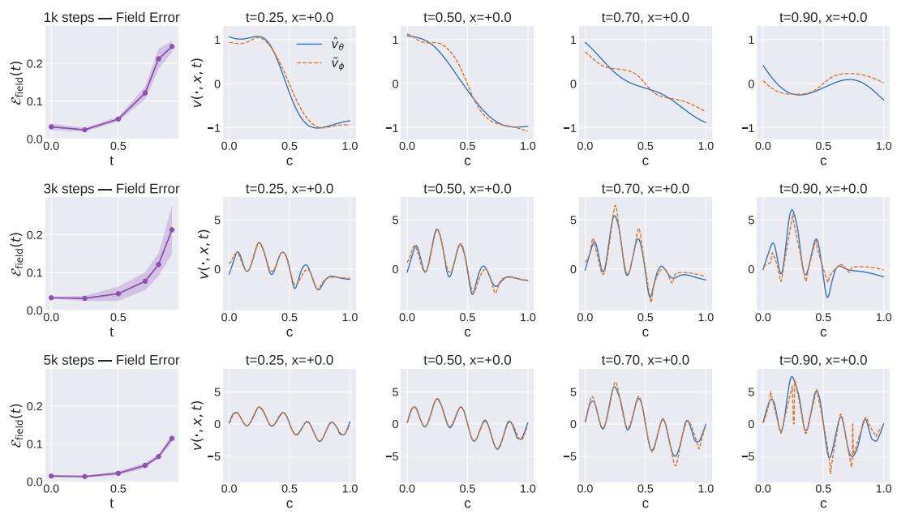  
Figure 9: Kernel approximation error and velocity field visualization

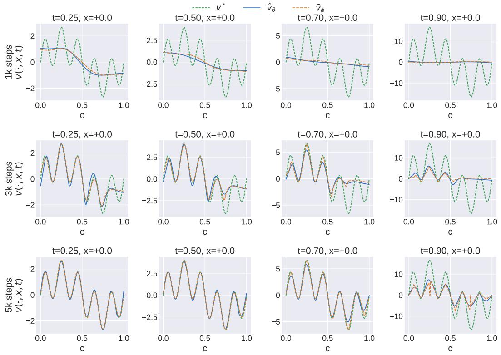  
Figure 10: Visualization of density-weighted smoothing in the learned velocity field and the kernel approximation

## B.1 COVERAGE SET CREATION

Flow predictive intervals (scalar outputs) In the Monte-Carlo policy-evaluation experiments, the target variable is one-dimensional. We write each example as $( x _ { i } , c _ { i } )$ , where $c _ { i }$ is the conditioning input and $x _ { i } \in \mathbb { R }$ is the target value. Given a trained conditional flow with flow map $\Phi _ { 1 } ^ { \theta } ( \cdot \mid c )$ and

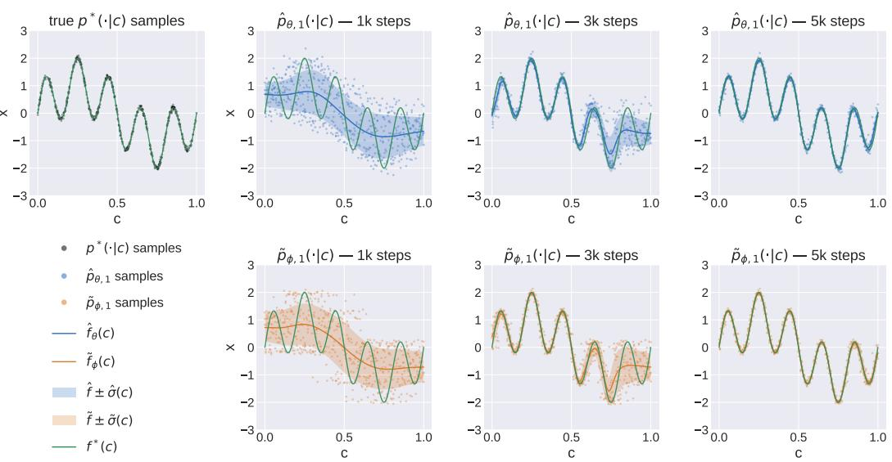  
Figure 11: Effect of kernel approximation on the endpoint distribution

base distribution $\rho _ { 0 }$ , the learned conditional distribution at condition c is the law of

$$
\Phi _ { 1 } ^ { \theta } ( Z \mid c ) , \qquad Z \sim \rho _ { 0 } .
$$

Because the output is one-dimensional, flow trajectories do not cross. The map $z \mapsto \Phi _ { 1 } ^ { \theta } ( z \mid c )$ is therefore order-preserving, and central predictive intervals can be obtained by transporting quantiles of the base distribution. For a nominal coverage level $\alpha \in ( 0 , 1 )$ , let

$$
z _ { \alpha } ^ { - } = \mathrm { Q u a n t i l e } _ { ( 1 - \alpha ) / 2 } ( \rho _ { 0 } ) , \qquad z _ { \alpha } ^ { + } = \mathrm { Q u a n t i l e } _ { ( 1 + \alpha ) / 2 } ( \rho _ { 0 } ) .
$$

We define the raw flow predictive interval by

$$
C _ { \theta , \alpha } ^ { \mathrm { f l o w } } ( c ) = \left[ \Phi _ { 1 } ^ { \theta } ( z _ { \alpha } ^ { - } \mid c ) , \Phi _ { 1 } ^ { \theta } ( z _ { \alpha } ^ { + } \mid c ) \right] .\tag{B.1}
$$

Equivalently, this is the central α-mass interval of the learned one-dimensional conditional distribution. The corresponding interval width is

$$
W _ { \alpha } ^ { \mathrm { { f l o w } } } ( c ) = \Phi _ { 1 } ^ { \theta } ( z _ { \alpha } ^ { + } \mid c ) - \Phi _ { 1 } ^ { \theta } ( z _ { \alpha } ^ { - } \mid c ) .\tag{B.2}
$$

For a dataset ${ \mathcal { D } } ,$ we report the empirical coverage $\widehat { \mathrm { C o v } } _ { \alpha } (  { \mathcal { D } } )$ and the average interval width

$$
\overline { { W } } _ { \alpha } ^ { \mathrm { f l o w } } ( \mathcal { D } ) = \frac { 1 } { | \mathcal { D } | } \sum _ { ( x _ { i } , c _ { i } ) \in \mathcal { D } } W _ { \alpha } ^ { \mathrm { f l o w } } ( c _ { i } ) .\tag{B.3}
$$

KNN predictive sets (high-dimensional outputs) For high-dimensional outputs, central quantile intervals are not well-defined, and the standard conformal baselines (split conformal, CQR) do not generalize naturally to multivariate outputs. We instead use a sample-based KNN predictive set, similar to what is proposed in Wang et al. (2022).

For a condition $c ,$ draw $\tilde { x } _ { 1 } , \dots , \tilde { x } _ { M } \sim \hat { p } _ { \theta } ( \cdot \mid c )$ . For any candidate point $x ,$ define $d _ { k } ( x ; c )$ as the distance from x to its k-th nearest neighbor among the generated samples. We compute the same score for the generated samples themselves using leave-one-out nearest neighbors, and define

$$
\tau _ { \theta , \alpha } ( c ) = \mathrm { Q u a n t i l e } _ { \alpha } \bigl ( \{ d _ { k } ( \tilde { x } _ { m } ; c ) \} _ { m = 1 } ^ { M } \bigr ) .
$$

The KNN predictive set is

$$
C _ { \theta , \alpha } ^ { \mathrm { K N N } } ( c ) = \{ x : d _ { k } ( x ; c ) \leq \tau _ { \theta , \alpha } ( c ) \} .\tag{B.4}
$$

A held-out target $x _ { i }$ is counted as covered if $d _ { k } ( x _ { i } ; c _ { i } ) \leq \tau _ { \theta , \alpha } ( c _ { i } )$ . Throughout, we use $k = 1$ for computing coverage metrics.

## B.2 BASELINES

All conformal methods use a held-out calibration set $\mathcal { D } _ { \mathrm { c a l } }$ disjoint from the training set. The deterministic baselines use the same backbone architecture as the flow's conditioning encoder and are trained on the same training set with matched optimizer, learning rate, and number of gradient steps. Split conformal prediction is applied either to a deterministic regressor (det + SC) or to the conditional mean of the trained CFM (CFM mean $\mathbf { \nabla } + \mathbf { S } \mathbf { C } )$ . Conf CFM instead applies conformal calibration directly to the raw predictive set produced by the CFM.

Split conformal prediction. Let ${ \hat { f } } ( c )$ denote a point predictor. For det $+ \mathbf { S C } , \hat { f } ( c )$ is the output of the deterministic regressor, whereas for CFM mean $+ \mathbf { S C } , \hat { f } ( c )$ is the conditional mean of the trained CFM.

On $\mathcal { D } _ { \mathrm { c a l } }$ , we compute absolute residual scores

$$
r _ { i } = | x _ { i } - { \hat { f } } ( c _ { i } ) | .
$$

Let $q _ { \alpha } ^ { \mathrm { s p l i t } }$ be the α-quantile of $\{ r _ { i } \}$ , with the standard finite-sample correction. The split-conformal interval is

$$
\begin{array} { r } { C _ { \alpha } ^ { \mathrm { s p l i t } } ( c ) = \left[ \hat { f } ( c ) - q _ { \alpha } ^ { \mathrm { s p l i t } } , \hat { f } ( c ) + q _ { \alpha } ^ { \mathrm { s p l i t } } \right] , } \end{array}
$$

with width $W _ { \alpha } ^ { \mathrm { s p l i t } } ( c ) = 2 q _ { \alpha } ^ { \mathrm { s p l i t } }$ . Every input receives the same expansion, so split conformal achieves marginal coverage but is not locally adaptive.

For high-dimensional outputs, CFM mean + SC uses the analogous construction with Euclidean residual scores

$$
r _ { i } = \Big \| x _ { i } - \hat { f } ( c _ { i } ) \Big \| _ { 2 } .
$$

The resulting predictive set is the conformal ball

$$
C _ { \alpha } ^ { \mathrm { C F M - m e a n + S C } } ( c ) = \left\{ x : \left\| x - \hat { f } ( c ) \right\| _ { 2 } \leq q _ { \alpha } ^ { \mathrm { s p l i t } } \right\} .
$$

Conformalized quantile regression. For det + CQR, at each coverage level $\alpha ,$ we train two predictors $\hat { \ell } _ { \alpha } ( c )$ and $\hat { u } _ { \alpha } ( \boldsymbol { c } )$ using quantile losses for the lower and upper tails, with target quantile levels $( 1 - \alpha ) / 2$ and $( 1 + \alpha ) / 2$ , respectively. Before conformal calibration, these define the interval $[ \hat { \ell } _ { \alpha } ( c ) , \hat { u } _ { \alpha } ( c ) ]$

On $\mathcal { D } _ { \mathrm { c a l } }$ , we compute CQR scores

$$
s _ { i } = \operatorname* { m a x } \left\{ \hat { \ell } _ { \alpha } ( c _ { i } ) - x _ { i } , x _ { i } - \hat { u } _ { \alpha } ( c _ { i } ) \right\} .
$$

Let $q _ { \alpha } ^ { \mathrm { C Q R } }$ be the α-quantile of $\{ s _ { i } \}$ , with the standard finite-sample correction. The conformalized CQR interval is

$$
\begin{array} { r } { C _ { \alpha } ^ { \mathrm { C Q R } } ( c ) = \left[ \hat { \ell } _ { \alpha } ( c ) - q _ { \alpha } ^ { \mathrm { C Q R } } , \hat { u } _ { \alpha } ( c ) + q _ { \alpha } ^ { \mathrm { C Q R } } \right] , } \end{array}
$$

with width

$$
W _ { \alpha } ^ { \mathrm { C Q R } } ( c ) = \hat { u } _ { \alpha } ( c ) - \hat { \ell } _ { \alpha } ( c ) + 2 q _ { \alpha } ^ { \mathrm { C Q R } } .
$$

Unlike split conformal prediction, CQR can produce different interval widths at different conditioning inputs.

Conformalized CFM. For scalar outputs, let

$$
C _ { \theta , \alpha } ( c ) = \left[ \hat { \ell } _ { \theta , \alpha } ( c ) , \hat { u } _ { \theta , \alpha } ( c ) \right]
$$

denote the raw CFM predictive interval. On $\mathcal { D } _ { \mathrm { c a l } }$ , we compute the conformity scores

$$
s _ { i } ^ { \mathrm { C F M } } = \operatorname* { m a x } \left\{ \hat { \ell } _ { \boldsymbol { \theta } , \alpha } ( c _ { i } ) - x _ { i } , x _ { i } - \hat { u } _ { \boldsymbol { \theta } , \alpha } ( c _ { i } ) \right\} .
$$

Let $q _ { \alpha } ^ { \mathrm { C F M } }$ be their α-quantile, with the standard finite-sample correction. The conformalized CFM interval is

$$
C _ { \theta , \alpha } ^ { \mathrm { C o n f C F M } } ( c ) = \left[ \hat { \ell } _ { \boldsymbol { \theta } , \alpha } ( c ) - q _ { \alpha } ^ { \mathrm { C F M } } , \hat { u } _ { \boldsymbol { \theta } , \alpha } ( c ) + q _ { \alpha } ^ { \mathrm { C F M } } \right] .
$$

For high-dimensional outputs, we conformalize the KNN predictive set. Let $\tau _ { \theta , \alpha } ( c )$ denote the raw CFM KNN threshold defined above. We compute calibration scores

$$
s _ { i } ^ { \mathrm { C F M } } = d _ { k } ( x _ { i } ; c _ { i } ) - \tau _ { \theta , \alpha } ( c _ { i } )
$$

and let $q _ { \alpha } ^ { \mathrm { C F M } }$ be their conformal quantile. The resulting predictive set is

$$
C _ { \theta , \alpha } ^ { \mathrm { C o n f C F M } } ( c ) = \left\{ x : d _ { k } ( x ; c ) \leq \tau _ { \theta , \alpha } ( c ) + q _ { \alpha } ^ { \mathrm { C F M } } \right\} .
$$

Thus, Conf CFM applies a conformal correction to the boundary of the raw CFM predictive set without changing the underlying learned distribution.

Deep Evidential Regression. We use the standard Deep Evidential Regression method of Amini et al. (2020) as an additional probabilistic uncertainty baseline. DER is evaluated only for scalar outputs, and its predictive intervals are obtained from its learned predictive distribution. We report DER at its best validation checkpoint.

Heteroscedastic Gaussian Regression. Heteroscedastic Gaussian Regression models the conditional distribution as

$$
\begin{array} { r } { p _ { \psi } ( x \mid c ) = \mathcal { N } \left( x ; \mu _ { \psi } ( c ) , \Sigma _ { \psi } ( c ) \right) . } \end{array}
$$

For scalar outputs, the network predicts a conditional mean $\mu _ { \psi } ( c )$ and variance $\sigma _ { \psi } ^ { 2 } ( c ) > 0$ , and is trained by minimizing the Gaussian negative log-likelihood

$$
\mathcal { L } _ { \mathrm { H G R } } = \frac { 1 } { 2 } \left[ \frac { \left( x - \mu _ { \psi } ( c ) \right) ^ { 2 } } { \sigma _ { \psi } ^ { 2 } ( c ) } + \log \sigma _ { \psi } ^ { 2 } ( c ) \right] ,
$$

up to an additive constant. The central α-mass predictive interval is

$$
C _ { \psi , \alpha } ^ { \mathrm { H G R } } ( c ) = \left[ \mu _ { \psi } ( c ) + z _ { ( 1 - \alpha ) / 2 } \sigma _ { \psi } ( c ) , \mu _ { \psi } ( c ) + z _ { ( 1 + \alpha ) / 2 } \sigma _ { \psi } ( c ) \right] ,
$$

where $z _ { q }$ denotes the q-quantile of the standard normal distribution.

For d-dimensional outputs, HGR predicts a diagonal conditional covariance,

$$
\Sigma _ { \psi } ( c ) = \mathrm { d i a g } \left( \sigma _ { \psi , 1 } ^ { 2 } ( c ) , \dots , \sigma _ { \psi , d } ^ { 2 } ( c ) \right) ,
$$

and minimizes

$$
\mathcal { L } _ { \mathrm { H G R } } = \frac { 1 } { 2 } \sum _ { j = 1 } ^ { d } \left[ \frac { \left( x _ { j } - \mu _ { \psi , j } ( c ) \right) ^ { 2 } } { \sigma _ { \psi , j } ^ { 2 } ( c ) } + \log \sigma _ { \psi , j } ^ { 2 } ( c ) \right] .
$$

Computing k-NN radii across methods. For high-dimensional outputs, we express all methods predictive-region sizes on the same k-NN radius scale used for the CFM. At each condition c, the sample-based radius is the α-quantile of the leave-one-out k-nearest-neighbor distances among $K$ samples from the predictive distribution; we report its average over conditions. We hold K and k fixed across methods within each task to ensure a common sampling resolution. This preserves the CFM's original radius statistic while avoiding an ellipsoidal approximation to its predictive region.

For the CFM, we sample from the learned conditional flow; for HGR, from the predicted diagonal Gaussian. HGR radii are computed separately at each condition because Euclidean k-NN distances depend on the full shape of the diagonal covariance, not only on the geometric mean of its marginal standard deviations.

For the point-predictor split-conformal baselines (det + SC and CFM mean $+ \mathbf { S } \mathbf { C } )$ , no per-condition sampling is required. At each nominal level α, we interpret the conformal $L _ { 2 }$ ball of radius $R _ { \alpha }$ as the central α-mass region of an isotropic Gaussian $\mathcal { N } ( \mu ( \bar { c } ) , s _ { \alpha } ^ { 2 } I _ { D } )$ , where $\mu ( c )$ is the corresponding point prediction and D is the output dimension. This fixes

$$
s _ { \alpha } = \frac { R _ { \alpha } } { \sqrt { \chi _ { \alpha } ^ { 2 } ( D ) } } ,
$$

where $\chi _ { \alpha } ^ { 2 } ( D )$ denotes the α-quantile of the chi-squared distribution with $D$ degrees of freedom. Since pairwise distances are translation-invariant and scale linearly with $s _ { \alpha } .$ the corresponding radius is

$$
\tau _ { \alpha } = \frac { R _ { \alpha } } { \sqrt { \chi _ { \alpha } ^ { 2 } ( D ) } } q _ { \alpha , k } ( K , D ) ,
$$

where $q _ { \alpha , k } ( K , D )$ is the reference radius obtained by applying the same leave-one-out k-NN quantile procedure to a cloud of K standard Gaussian samples in D dimensions. We estimate this reference quantity once by simulation for each $( \alpha , k , K , D )$ and reuse it for both ball-based baselines. The distance rescaling is exact under the isotropic-Gaussian representation; only the reference quantity is estimated numerically. This representation is used solely to express the ball radius on the common k-NN scale.

For Conf CFM, we report the sample-based CFM threshold after adding the conformal correction defined above, again averaged over conditions.

## B.3 DATASETS AND TRAINING SETUP

All the plots are created using 3 random seeds. Dataset specific details and training setup are given below.

## B.3.1 BIOLOGY DATASETS

We evaluate conditional flow matching on three single-cell perturbation benchmarks from the harmonized scPerturb collection (Peidli et al., 2024): Norman, SciPlex3, and PBMC cytokines. In each dataset, a cell is represented by a PCA-reduced gene-expression vector $x \in \mathbb { R } ^ { d }$ , and each sample is annotated with a perturbation condition c together with a control condition. The perturbation prediction problem is cast as conditional generation: the source distribution is the population of control cells, the target distribution is the population of cells under the perturbation condition, and the conditioning variable c is a pretrained embedding of the perturbation. With the source distribution of control cells fixed, the flow learns the distribution of perturbed-cell states conditioned on c.

Norman (Perturb-seq). The Norman et al. (Norman et al., 2019) Perturb-seq dataset consists of single-cell RNA-seq profiles of K562 cells subjected to CRISPRa-induced overexpression of one or two genes. We use the preprocessed AnnData release distributed by the authors of biolord (Piran et al., 2024), which contains \~89k cells across 229 single and double-gene perturbation conditions plus unperturbed controls; this is the same release used by the CellFlow benchmark (Klein et al., 2025). Of biolord's predefined train/test partitions, we use the “train" perturbation conditions (～42k cells) for our flow-matching experiments and the in-distribution cells are then randomly split into a training set and a validation set (80-20 split). The 7353 unperturbed control cells form the pool from which xo samples are drawn at training time. The condition $c \in \mathbb { R } ^ { 2 5 6 0 }$ is the concatenation of two ESM2-650M (Lin et al., 2023) protein embeddings, one per perturbed gene. The target $\boldsymbol { x } \in \mathbb { R } ^ { 5 0 }$ is the 50-component PCA projection of the log-normalized expression vector, with PCA fit on all cells.

The $x _ { 0 }$ distribution is control-pool + Gaussian noise: $x _ { 0 } = z + \sigma \epsilon$ with $z \sim$ Uniform(control pool), $\epsilon \sim \mathcal { N } ( 0 , I )$ , and $\sigma \ : = \ : 1 . 0$ The velocity field is a CellFlow-style (Klein et al., 2025) threebranch MLP: a condition encoder $( [ 1 0 2 4 , 1 0 2 4 ]  2 5 6 )$ , a cell-state encoder ([512, 512, 512] → 512), and a sinusoidal time embedding (128d) followed by $[ 5 1 2 , 5 1 2 , 5 1 2 ]  5 1 2$ , fused by a [1024, 1024, 1024] →50 decoder. Activations are SiLU throughout. We train with Adam at learning rate $1 0 ^ { - 3 }$ , batch size 1024. Sampling at evaluation uses 100 Euler steps.

PBMC (cytokine stimulation). The PBMC cytokine atlas released by Parse Biosciences (Parse Biosciences, 2024) contains single-cell RNA-seq profiles of peripheral blood mononuclear cells from 12 donors stimulated with 90 cytokines plus PBS controls (\~9.7M cells over 2,000 highly-variable genes). We access this dataset through the CellFlow data loader (Klein et al., 2025) and restrict to a single donor (Donor 1), which contains \~1.3m cells: \~90k PBS-stimulated controls and \~1.2m cytokine-stimulated cells across the 90 cytokines. To keep the per-condition cell count balanced, we subsample uniformly at random to at most 1,000 cells per cytokine condition (and the same cap for controls), yielding 91,000 cells which are split into a training set and a validation set (80–20 split). The 1000 subsampled PBS controls form the pool from which $x _ { 0 }$ samples are drawn at training time. The condition $c \in \mathbb { R } ^ { 2 5 6 0 }$ is the ESM2 (Lin et al., 2023) protein embedding of the cytokine. The target $x \in \mathbb { R } ^ { 1 0 0 }$ is the 100-component PCA projection of the log-normalized expression vector, with PCA fit on all cells.

The $x _ { 0 }$ distribution is again control-pool + Gaussian noise with standard deviation $\sigma = 1 0 . 0 \nonumber$ The velocity field used a condition encoder ([1024, 1024] → 256), a cell-state encoder $( [ 5 1 2 , 5 1 2 , 5 1 2 ] $

512), and a sinusoidal time embedding (1024d) followed by [1024, 1024, 1024] → 1024, fused by a [1024, 1024, 1024] → 100 decoder. We use SiLU activations, train with Adam at learning rate $1 0 ^ { - 3 }$ batch size 1024. Sampling at evaluation uses 1,000 Euler steps.

SciPlex (small-molecule perturbations). The SciPlex3 dataset of Srivatsan et al. (Srivatsan et al., 2020) profiles single-cell transcriptomes of three cancer cell lines (A549, MCF7, K562) exposed to \~188 small-molecule drugs at four doses each, with DMSO as the vehicle control. We restrict to the A549 lung-adenocarcinoma line, retrieve the dataset through the pertpy library (Heumos et al., 2024) via pertpy.data.sciplex3\_raw () and follow the preprocessing of the CellFlow benchmark (Klein et al., 2025). After filtering, the dataset contains 703 in-distribution conditions covering 187 drugs, with ～136k perturbed cells and \~3k DMSO control cells, which are split into train-val datasets (80-20 split). The condition $c \in \mathbb { R } ^ { 1 0 2 5 }$ is [Morgan-1024-fingerprint(drug), $\log _ { 1 0 }$ (dose in nM)]. The target $\dot { x } \in \mathbb { R } ^ { 1 0 0 }$ is the 100-component PCA projection of the log-normalized expression vector, with PCA fit on all cells.

Similar to the previous two datasets, th $x _ { 0 }$ distribution is constructed by adding gaussian noise with standard-deviation = 10.0 on the control pool. The velocity field architecture is the same as that used in the Norman experiments. Activations are SiLU throughout. We train with Adam at learning rate $1 0 ^ { - 3 }$ , batch size 1024, for 1,000 epochs. Sampling at evaluation uses 1000 Euler steps.

## B.3.2 POLICY EVALUATION

We construct three policy-evaluation datasets on top of the OGBench (Park et al., 2025) offline RL benchmark, one per environment. For each environment, we take the trained floq agent of Agrawalla et al. (2025) as the policy π to be evaluated, and distill its true return $Q ^ { \pi } ( s , a )$ into a flow-matching predictor by Monte-Carlo: for each $( s , a )$ pair we average the discounted return over $n _ { \mathrm { M C } }$ independent on-policy rollouts of π from $( s , a )$ , giving a stochastic target $\hat { Q } ( s , a ) \in \mathbb { R }$ . The condition is $c = [ s , a ]$ and the target is $x = \hat { Q } ( s , a )$

The per-environment details are:

<table><tr><td>Dataset</td><td>nMC</td><td>H</td><td> $\gamma$ </td><td>dim s</td><td>dim a</td><td>dim c</td><td>|D|</td></tr><tr><td>Cube-single</td><td>20</td><td>200</td><td>0.99</td><td>28</td><td>5</td><td>33</td><td>200,000</td></tr><tr><td>AntMaze-large</td><td>20</td><td>1000</td><td>0.998</td><td>29</td><td>8</td><td>37</td><td>200,000</td></tr><tr><td>Humanoid-Maze-medium</td><td>20</td><td>2000</td><td>0.999</td><td>69</td><td>21</td><td>90</td><td>200,000</td></tr></table>

Table 1: nMC is the number of independent on-policy rollouts averaged into $\hat { Q } ( s , a )$ , H is the fixed rollout horizon, and $\gamma$ is the discount factor.

$x _ { 0 }$ distribution. All three FloQ runs use an isotropic Gaussian prior $x _ { 0 } \sim \mathcal { N } ( 0 , 1 )$ in the 1-D target space.

Architecture and training. For all three FloQ datasets we use the same MLP velocity field with hidden widths [512, 512, 512, 512] and ReLU activations, taking the full input $[ c , x _ { t } ,$ TimeEmb(t)], where TimeEmb is a 32-dimensional cosine-geometric time embedding. The output is a scalar velocity. We optimize with Adam (lr $3 \times 1 0 ^ { - 4 }$ , no weight decay) using batch size 1024.

## B.3.3 BEHAVIOR CLONING

We train a flow-matching behavior-cloning policy on the state-based variant of the PushT benchmark introduced by Chi et al. (2023), where a 2-D end-effector pushes a T-shaped block toward a fixed target pose. The observation is the 5-dimensional state [agentx, agent, blockx, blocky, blockθ] and the action is the 2-dimensional target end-effector position. Following the standard receding-horizon BC setup, each example predicts an 8-step action chunk from 2 steps of observation history. Both observations and actions are MinMax-normalized over the training set. We use an 80 — 20 train-val split. The condition $c \in \mathbb { R } ^ { 1 0 }$ is the flattened observation history, the target $x \in \mathbb { R } ^ { 1 6 }$ is the flattened action chunk and a 128-dimensional sinusoidal time embedding is used. The $x _ { 0 }$ distribution is a standard gaussian.

The velocity field is an 8-block residual MLP with embedding width 512, feed-forward expansion factor 4 (i.e., a 2,048-dim FFN), GELU activations, LayerNorm, and dropout 0.1. Time is encoded with a 128-dim sinusoidal positional embedding with frequencies linear in [0, 100] followed by an MLP. No image encoder is used (state-based variant). We train using Adam with learning rate $1 \dot { 0 } ^ { - 4 }$ weight decay $\mathrm { \bar { 1 0 } ^ { - 5 } }$ , gradient clipping at norm 10 and batch size 1024.

## B.4 ADDITIONAL EXPERIMENTS

Policy Evaluation Section 6 reports policy-evaluation results for Antmaze-Large in the main paper (Figure 6). The same analysis on the remaining two OGBench environments, Cube-Single and Humanoidmaze-medium, is shown in Figures 12 and 13 below. Both figures use the layout described in Section 6: the top row shows training loss and flow coverage at three nominal levels, and the bottom row shows the variance-vs-error scatter along with mean interval widths for the flow, split conformal, and CQR. The qualitative findings discussed in Section 6, all hold consistently across these two additional environments.

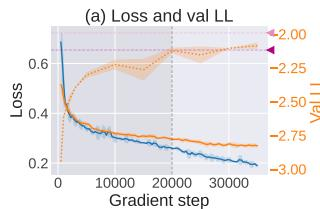

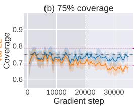

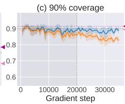

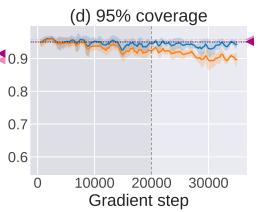

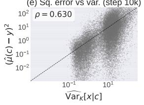

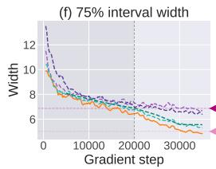

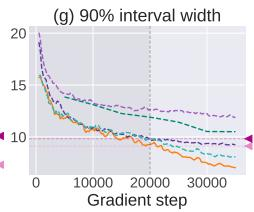

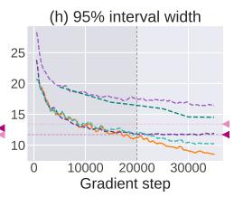

Figure 12: Coverage on Cube-Single. Layout matches Figure 6.  
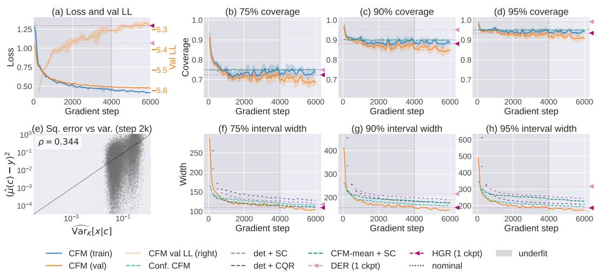  
Figure 13: Coverage on Humanoidmaze-medium. Layout matches Figure 6.

Cell perturbation Section 6 reports coverage results for Norman in the main paper (Figure 7) The same analysis on the remaining PBMC cytokines and scPerturb benchmark SciPlex3 (drug-dose perturbations), is shown in figures 14 and 15 respectively. The figures use the same layout as Figure 7: training and validation flow-matching loss alongside KNN-based coverage at the three nominal levels.

The qualitative findings discussed in Section 6 hold here as well: training coverage remains at or above nominal throughout training, and validation coverage is close to nominal during the underfitting regime. The flow's predictive sets are approximately calibrated on SciPlex3 and PBMC, consistent with the pattern observed on Norman.

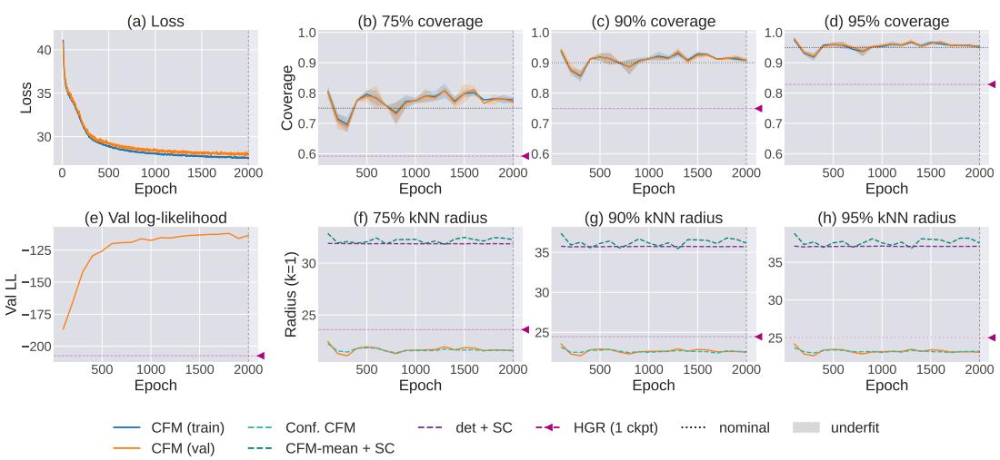  
Figure 14: Coverage on PBMC. Layout matches Figure 7.

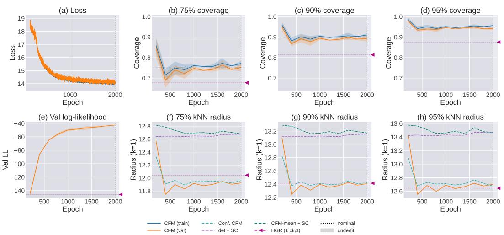  
Figure 15: Coverage on SciPlex3 (drug-dose perturbations). Layout matches Figure 7.

## C VARIANCE INFLATION: ADDITIONAL SYNTHETIC EXPERIMENTS

In this section, we present evidence of variance inflation trends similar to Figure 2 across several more synthetic datasets. Similar to Figure 2, for all the experiments below, the learned conditional variance increases as the learned mean becomes smoother. The average learned conditional variance decreases monotonically as smoothing decreases across all three estimators.

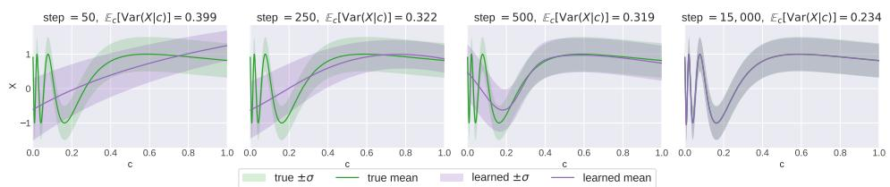

(a) NN vector field parameterization: [Left to Right] Distributions learned with increasing training time  
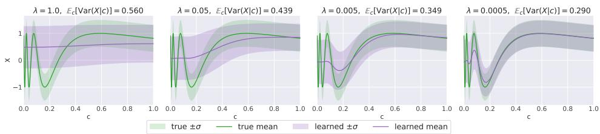

(b) NN vector field parameterization with explicit regularization penalty $\lambda ( \partial _ { c } v ) ^ { 2 }$  
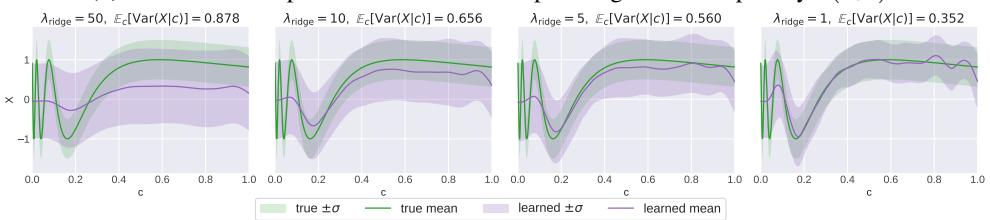  
(c) Vector field learning with kernel ridge regression with penalty λ

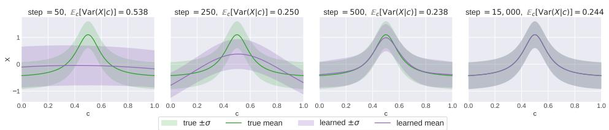

(a) NN vector field parameterization: [Left to Right] Distributions learned with increasing training time  
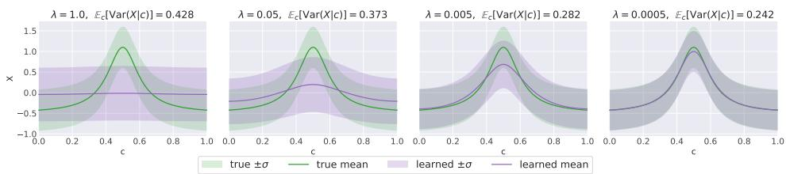

(b) NN vector field parameterization with explicit regularization penalty λ(∂cv)²  
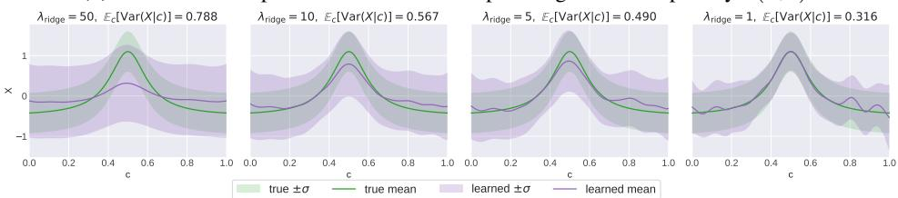  
(c) Vector field learning with kernel ridge regression with penalty λ  
Figure 17

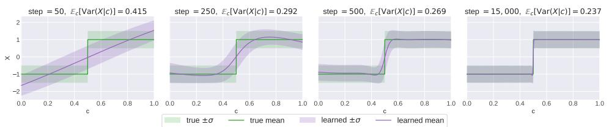

(a) NN vector field parameterization: [Left to Right] Distributions learned with increasing training time  
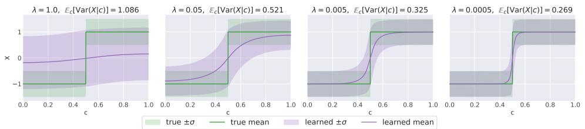

(b) NN vector field parameterization with explicit regularization penalty $\lambda ( \partial _ { c } v ) ^ { 2 }$  
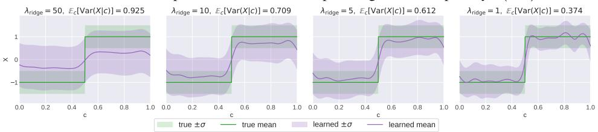  
(c) Vector field learning with kernel ridge regression with penalty λ  
Figure 18