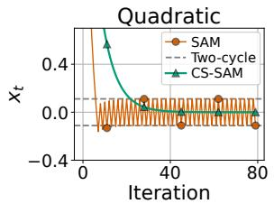
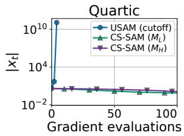
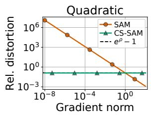
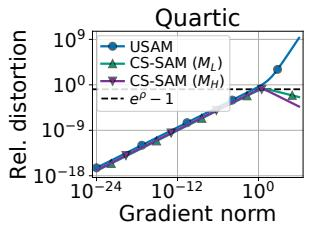

# Curvature-Scaled Sharpness-Aware Minimization: Convergence Beyond Smoothness

Dimitris Oikonomou1,2 doikono1@jh.edu

Nicolas Loizou1,3 nloizou@jhu.edu

1Mathematical Institute for Data Science (MINDS), Johns Hopkins University 2Department of Computer Science, Johns Hopkins University 3Department of Applied Mathematics and Statistics, Johns Hopkins University

## Abstract

Sharpness-Aware Minimization (SAM) has established itself as a widely used method for training deep neural networks. Despite its popularity, existing convergence guarantees for SAM-type methods require smoothness, a restrictive assumption. Generalized smoothness conditions have recently been proposed in the analysis of gradient methods but remain underexplored for SAM. To analyze the efect of SAM’s perturbation under generalized smoothness, we use relative gradient distortion to quantify how the sharpness-aware direction departs from the original gradient. Under (L0, L1)-smoothness, we show that this distortion can become unbounded near stationarity for SAM and at large gradients for its unnormalized variant (USAM), with examples where SAM cycles and USAM diverges. We then establish a necessary condition for uniform distortion control among perturbations along the gradient whose nonnegative multipliers depend only on its norm. Motivated by this condition, we propose Curvature-Scaled SAM (CS-SAM), which scales both the perturbation and the descent step by suitable curvature upper bounds, and prove that it uniformly bounds the distortion. Under both $( L _ { 0 } , L _ { 1 } ) \ –$ - and $( H _ { 0 } , H _ { 1 } )$ -smoothness, we establish deterministic O(1/T) rates for the best squared gradient norm on nonconvex objectives, lastiterate O(1/T) rates for the function gap on convex objectives with a minimizer, and linear convergence under the Polyak–Łojasiewicz condition. With zero perturbation, our guarantees recover the rates for gradient descent with $( L _ { 0 } , L _ { 1 } ) – \ \mathrm { o r } \ ( H _ { 0 } , H _ { 1 } )$ -based step-sizes. Minibatch experiments on computer vision tasks demonstrate competitive performance for both variants, with the $( H _ { 0 } , H _ { 1 } )$ variant achieving the highest mean best-test accuracy in all four settings against tuned SAM and USAM with constant and cosine annealing schedules.

## 1 Introduction

Sharpness-Aware Minimization (SAM) was introduced to improve generalization by seeking parameters whose training loss remains low throughout a local neighborhood [Foret et al., 2021]. It pursues this objective through a simple two-step procedure: first perturb the parameters in a direction of increasing loss, then update the original parameters using the gradient evaluated at the perturbed point. The choice of perturbation therefore determines how the resulting update departs from ordinary gradient descent. For a diferentiable objective $f :  { \mathbb { R } ^ { d } } \to  { \mathbb { R } }$ , standard SAM uses a fixed-radius perturbation of length r along the normalized gradient, whereas its unnormalized variant (USAM) uses a fixed multiple ρ of the gradient itself [Andriushchenko and Flammarion, 2022]:

$$
y _ { t } = x _ { t } + r \frac { \nabla f ( x _ { t } ) } { \| \nabla f ( x _ { t } ) \| } , \qquad x _ { t + 1 } = x _ { t } - \eta _ { t } \nabla f ( y _ { t } ) ,\tag{SAM}
$$

$$
y _ { t } = x _ { t } + \rho \nabla f ( x _ { t } ) , \qquad x _ { t + 1 } = x _ { t } - \eta _ { t } \nabla f ( y _ { t } ) ,\tag{USAM}
$$

with radius $r > 0$ , multiplier $\rho \geq 0 ;$ , and outer step $\eta _ { t } > 0 .$ . Both rules cost two gradient evaluations per iteration, one at the iterate $x _ { t }$ and one at the perturbed point $y _ { t }$

Throughout, we consider the problem

$$
\operatorname* { m i n } _ { x \in \mathbb { R } ^ { d } } f ( x ) , \qquad f _ { \star } : = \operatorname* { i n f } _ { x \in \mathbb { R } ^ { d } } f ( x ) > - \infty ,\tag{1}
$$

where $f :  { \mathbb { R } ^ { d } } \to  { \mathbb { R } }$ is twice continuously diferentiable. In model training, x represents the model parameters and f the training loss. We call the Hessian operator norm $\| \nabla ^ { 2 } f ( x ) \|$ the local curvature at x. Classical smoothness bounds this quantity by a constant $L > 0$ :

$$
\left\| \nabla ^ { 2 } f ( x ) \right\| \leq L \qquad \forall x \in \mathbb { R } ^ { d } .\tag{2}
$$

Classical L-smoothness can fail even for simple neural-network training objectives [Alimisis et al., 2026]. Motivated by empirical observations that local curvature grows with the gradient norm during neural-network training, Zhang et al. [2020b] introduced $( L _ { 0 } , L _ { 1 } )$ -smoothness, which allows the Hessian norm to grow with the gradient norm. Subsequent theoretical results support this condition for specific neural-network models. In particular, the bounds of Taheri and Thrampoulidis [2023] imply $( L _ { 0 } , L _ { 1 } )$ -smoothness for two-layer networks with fixed output weights and smoothed leaky-ReLU activations, trained with exponential loss on linearly separable data. Complementary results establish $( H _ { 0 } , H _ { 1 } )$ -smoothness for two-layer networks trained with ℓ2-regularized cross-entropy loss under suitable activation assumptions [Alimisis et al., 2026]. These findings motivate the gradient-dependent and loss-dependent curvature bounds considered here:

$$
\left\| \nabla ^ { 2 } f ( x ) \right\| \le M _ { L } ( x ) : = L _ { 0 } + L _ { 1 } \left\| \nabla f ( x ) \right\| ,
$$

$$
( L _ { 0 } , L _ { 1 } ) – \mathrm { s m o o t h n e s s } ,\tag{3}
$$

$$
\begin{array} { r } { \big \| \nabla ^ { 2 } f ( x ) \big \| \leq M _ { H } ( x ) : = H _ { 0 } + H _ { 1 } \big ( f ( x ) - f _ { \star } \big ) , } \end{array}
$$

$$
( H _ { 0 } , H _ { 1 } ) – \mathrm { s m o o t h n e s s } ,\tag{4}
$$

for every $x \in \mathbb { R } ^ { d }$ , with $L _ { 0 } > 0 , L _ { 1 } \ge 0$ , and $H _ { 0 } , H _ { 1 } \geq 0$ . Note that both models contain classical smoothness as a special case $( L _ { 1 } = 0$ or $H _ { 1 } = 0 )$ . With slight abuse of notation, in several parts of the paper we write $M _ { L } : = M _ { L } ( x )$ and $M _ { H } : = M _ { H } ( x )$ . We refer to a positive function that upper-bounds the local curvature everywhere as a curvature scale; $M _ { L }$ and, for nonconstant objectives, $M _ { H }$ provide the two scales studied in this work (Proposition 2.4).

The dificulty is that the curvature bound must control the gradient change along the perturbation, as wel as the subsequent descent step. Even under classical smoothness, a fixed perturbation radius can prevent exact convergence: Bartlett et al. [2023] analyzed cycling of fixed-radius SAM on convex quadratics, and Si and Yun [2023] established stationarity neighborhoods in several settings. The inexact-gradient viewpoint of Khanh et al. [2024] makes the perturbation-induced error explicit, while the clipped rule of Adly and Le [2026] controls it near stationarity by making the perturbation proportional to the gradient. Under (3), however, a gradient-proportional perturbation can also become too large when the gradient grows. Thus, extending SAM to generalized smoothness requires control at both ends of the gradient scale.

For ordinary gradient methods, adapting to curvature growth is already well studied. The $( L _ { 0 } , L _ { 1 } )$ model was introduced by Zhang et al. [2020b] to explain gradient clipping and has since supported analyses of clipped, normalized, and adaptive methods [Chen et al., 2023, Crawshaw et al., 2022, Koloskova et al., 2023, Li et al., 2023, Zhang et al., 2020a]. In particular, Gorbunov et al. [2025] and Vankov et al. [2025] analyzed steps inversely proportional to gradient-dependent curvature bounds. The loss-dependent model has likewise been used to explain learning-rate warm-up [Alimisis et al., 2026] and to analyze line search and adaptive gradient methods [Vaswani and Babanezhad Harikandeh, 2025, Vaswani et al., 2026]. These results motivate scaling the outer descent step by a curvature bound. The remaining question for SAM is how that bound should also determine the perturbation.

## 1.1 Main Contributions

⋄ Complementary failures and a necessary condition for distortion control. In Section 2.1, we show that the relative gradient distortion of SAM can become unbounded as the gradient vanishes, while that of USAM can become unbounded as the gradient grows. Proposition 2.1 gives explicit examples within the $( L _ { 0 } , L _ { 1 } )$ -smooth class: fixed-radius SAM admits a nonzero two-cycle on a quadratic, and USAM diverges from suficiently large initializations on a quartic. Motivated by these complementary failures, Theorem 2.2 establishes a necessary condition for uniformly bounded distortion over this class among perturbations along the gradient whose nonnegative multipliers depend only on its norm. The perturbation length must be at most proportional to the gradient norm near stationarity and bounded at large gradients. This condition motivates the gradient-dependent perturbation of CS-SAM.

⋄ Curvature-Scaled Sharpness-Aware Minimization. In Section 2.2, we construct CS-SAM, which, for a curvature scale M, iterates

$$
y _ { t } = x _ { t } + { \frac { \rho } { M ( x _ { t } ) } } \nabla f ( x _ { t } ) , \qquad x _ { t + 1 } = x _ { t } - { \frac { \gamma } { M ( y _ { t } ) } } \nabla f ( y _ { t } ) ,\tag{CS-SAM}
$$

with perturbation multiplier $\rho / M ( x _ { t } )$ and descent step $\gamma / M ( y _ { t } )$ , where $\rho \geq 0$ and $\gamma > 0$ . We identify conditions on the curvature scale M that ensure uniform distortion control and show that both $M _ { L }$ and $M _ { H }$ satisfy them. For every scale satisfying these conditions, Theorem 2.5 bounds the distortion by $e ^ { \rho } - 1$ at every nonstationary iterate.

⋄ Convergence under generalized smoothness. We establish convergence guarantees for CS-SAM under $( L _ { 0 } , L _ { 1 } )$ -smoothness with $M = M _ { L }$ and under $( H _ { 0 } , H _ { 1 } )$ -smoothness with $M = M _ { H }$ (Theorems 3.1 and 3.2). In each setting, for suitable perturbation and step parameters, we prove $\mathcal { O } ( 1 / T )$ rates for the best squared gradient norm on nonconvex objectives and last-iterate $\mathcal { O } ( 1 / T )$ rates for the function gap on convex objectives with a minimizer. We also prove linear convergence in both settings under the Polyak–Łojasiewicz (PL) condition, $\left\| \nabla f ( x ) \right\| ^ { 2 } / 2 \geq \mu ( f ( x ) - f _ { \star } )$ for every x and some $\mu > 0$

⋄ Recovery of gradient descent guarantees for $\rho = 0$ . Setting $\rho = 0$ recovers gradient descent with step $\gamma / M ( x _ { t } )$ . Our bounds recover the known nonconvex and convex rates for gradient-dependent steps [Gorbunov et al., 2025, Vankov et al., 2025], and the convex and PL rates for loss-dependent steps [Alimisis et al., 2026], while allowing larger step sizes in the latter case. Thus the analysis extends existing gradient descent guarantees to positive sharpness-aware perturbations.

⋄ Numerical Evaluation. In Section 4.1, we verify Proposition 2.1 and Theorem 2.5: SAM cycles and USAM diverges, whereas CS-SAM converges with a distortion below $e ^ { \rho } - 1$ for both scales. In Section 4.2, we evaluate minibatch variants beyond the deterministic setting of our theory on ResNet-20/32 and CIFAR-10/100. Both use two gradient evaluations per iteration. Against tuned constant-step and cosine annealing-scheduled SAM and USAM, the loss-dependent variant achieves the highest mean best-test accuracy in all four settings, while the gradient-dependent variant exceeds all these baselines in three of four settings.

Table 1 summarizes the distortion control and convergence guarantees alongside prior work.

## 2 From gradient distortion to curvature-scaled SAM

In this section, we define relative gradient distortion and explain how it controls the diference between a sharpness-aware direction and the gradient used by gradient descent. We then show that SAM and USAM can lose this control at opposite ends of the gradient scale, and derive a necessary condition for keeping it uniformly bounded. This condition motivates the CS-SAM update, for which we prove a uniform distortion bound under both generalized smoothness models. The proofs are deferred to Appendix $\mathrm { C } ;$ the distortion bound follows from the auxiliary lemmas in Appendix B.

Table 1: Comparison with the closest prior work. $D ( x , d ) = \left\| \nabla f ( x + d ) - \nabla f ( x ) \right\| / \left\| \nabla f ( x ) \right\|$ is the relative gradient distortion of the perturbation d (Section 2.1). Curvature models: L means $\left\| \nabla ^ { 2 } f ( x ) \right\| \leq L ; \left( L _ { 0 } , L _ { 1 } \right)$ means $\left\| \nabla ^ { 2 } f ( x ) \right\| \leq L _ { 0 } + L _ { 1 } \left\| \nabla f ( x ) \right\| ; ( H _ { 0 } , H _ { 1 } )$ means $\left\| \nabla ^ { 2 } f ( x ) \right\| \le H _ { 0 } + H _ { 1 } ( f ( x ) - \ddot { f } _ { \star } )$ , with $f _ { \star } = \operatorname* { i n f } _ { x } f ( x )$ $\checkmark : D$ is bounded by a constant; $\pmb { \chi } ;$ the bound degenerates. Rates are on the best squared gradient norm over T iterations (nonconvex), on the last-iterate gap $f ( x _ { T } ) - f _ { \star }$ for convex objectives with a minimizer (convex), and on the function gap under PL.
<table><tr><td>Method</td><td>Perturbation d(x)</td><td>Curvature model</td><td>D uniformly bounded</td><td>Nonconvex</td><td>Convex</td><td>PL</td></tr><tr><td>SAM [Foret et al., 2021] rates: [Si and Yun, 2023], [Oikonomou and Loizou, 2025]</td><td> $r \nabla f ( x ) / \left\| \nabla f ( x ) \right\|$ </td><td>L</td><td>x</td><td> $\mathcal { O } ( 1 / T ) + L ^ { 2 } r ^ { 2 }$ </td><td>no last-iterate gap rate</td><td>linear to a neighborhood</td></tr><tr><td>USAM [Andriushchenko and Flammarion, 2022]</td><td> $\rho \nabla f ( x )$ </td><td>L</td><td>√</td><td>O(1/T)</td><td>O(1/T)</td><td>linear</td></tr><tr><td>Unified SAM [Oikonomou and Loizou, 2025]</td><td> $\rho [ ( 1 - \lambda ) + \lambda / \left\| \nabla f ( x ) \right\| ] \cdot \nabla f ( x )$ </td><td>L</td><td> $\begin{array} { r } { \checkmark \mathrm { i f } \lambda = 0 ; } \end{array}$  X otherwise</td><td>O(T−1/2) (in expectation)</td><td>not analyzed</td><td>λ = 0: linear λ &gt; 0: linear to a neighborhood</td></tr><tr><td>Clipped perturbation [Adly and Le, 2026]</td><td> $\rho _ { k } \nabla f ( x ) / \left\| \nabla f ( x ) \right\| ^ { \alpha } ,$   $\begin{array} { r } { \rho _ { k } = \operatorname* { m i n } \{ \rho , \frac { \theta } { L } \left\| \nabla f ( x ) \right\| ^ { \alpha } \} } \end{array}$ </td><td>L</td><td>√</td><td>O(1/T)</td><td>not analyzed</td><td>not analyzed</td></tr><tr><td>Inexact-gradient SAM [Khanh et al., 2024]</td><td>normalized and unnormalized variants</td><td>L</td><td>normalized: X USAM: √</td><td> $\| \nabla f ( x _ { t } ) \|  0$  (no generic rate)</td><td> $f ( x _ { T } )  f _ { \star }$  (no rate)</td><td>USAM: linear under KL exponent 1/2</td></tr><tr><td>Ours, CS-SAM with  ${ { M } _ { L } }$  Ours, CS-SAM with  $M _ { H }$ </td><td> $\rho \nabla f ( x ) / ( L _ { 0 } + L _ { 1 } \| \nabla f ( x ) \| )$   $\rho \nabla f ( x ) / ( H _ { 0 } + H _ { 1 } ( f ( x ) - f _ { \star } ) )$ </td><td> $( L _ { 0 } , L _ { 1 } )$   $( H _ { 0 } , H _ { 1 } )$ </td><td>✓ √</td><td>O(1/T) O(1/T)</td><td>O(1/T) O(1/T)</td><td>linear linear</td></tr></table>

## 2.1 Relative gradient distortion and the failures of SAM and USAM

The outer step of SAM and USAM is a gradient step that uses $\nabla f ( y _ { t } )$ in place of $\nabla f ( x _ { t } )$ , so a descent analysis must account for the efect of this substitution as well as the step size. We now measure the relative error of this substitution. For $\nabla f ( x ) \neq 0$ and a displacement $d ,$ we define the relative gradient distortion

$$
D ( x , d ) : = \frac { \| \nabla f ( x + d ) - \nabla f ( x ) \| } { \| \nabla f ( x ) \| } .\tag{5}
$$

Let us explain why this is the right quantity. If $D ( x , d ) \leq \delta < 1$ , then $\nabla f ( x + d )$ makes an acute angle with $\nabla f ( x )$ , since ⟨∇f(x), $\nabla f ( x + d ) \rangle \geq ( 1 - \delta ) \left\| \nabla f ( x ) \right\| ^ { 2 }$ , and has comparable length, since $\begin{array} { r } { ( 1 - \delta ) \| \nabla f ( x ) \| \leq } \end{array}$ $\| \nabla f ( x + d ) \| \ \leq \ ( 1 + \delta ) \| \nabla f ( x ) \|$ . These are exactly the two properties the descent lemma requires, so $D ( x , d ) \leq \delta < 1$ is the property we want a perturbation to have, and we want it at every point. Controlling the perturbation-induced gradient error is also the viewpoint of the inexact-gradient analyses of Khanh et al. [2024], and relative control of this error near stationarity is what the clipped rule of Adly and Le [2026] enforces; the quantity itself is therefore not new. Our question is which perturbation rules keep it uniforml bounded under generalized smoothness.

We first record what the two base rules can guarantee. Under (2) we have

$$
D _ { \mathrm { S A M } } \leq \frac { L r } { \| \nabla f ( x ) \| } , \qquad D _ { \mathrm { U S A M } } \leq L \rho .\tag{6}
$$

Note that the bound for SAM degenerates as $\| \nabla f ( x ) \| \to 0$ , while the bound for USAM is uniform. Under the more general (3), for $L _ { 1 } > 0$ (both bounds are proved in Appendix C):

$$
D _ { \mathrm { S A M } } \leq \left( e ^ { L _ { 1 } r } - 1 \right) \left( 1 + \frac { L _ { 0 } } { L _ { 1 } \| \nabla f ( x ) \| } \right) , \qquad D _ { \mathrm { U S A M } } \leq \frac { L _ { 0 } + L _ { 1 } \| \nabla f ( x ) \| } { L _ { 1 } \| \nabla f ( x ) \| } \big ( e ^ { L _ { 1 } \rho \| \nabla f ( x ) \| } - 1 \big ) .\tag{7}
$$

The bound for SAM tends to the constant $e ^ { L _ { 1 } r } - 1$ at large gradients and degenerates as $\| \nabla f ( x ) \| \to 0$ . The bound for USAM tends to $\rho L _ { 0 }$ as $\| \nabla f ( x ) \| \to 0$ and grows exponentially as $\| \nabla f ( x ) \| \to + \infty$ . This suggests that SAM’s distortion can explode when the gradient vanishes, while USAM’s distortion can explode when the gradient grows. The following proposition makes the two failures precise.

Proposition 2.1. Both perturbations can fail on one-dimensional convex objectives: SAM admits a nonzero two-cycle on a quadratic, and USAM diverges for large initializations on a quartic.

(i) Let $f ( x ) = x ^ { 2 } / 2$ , which satisfies (2) with $L = 1$ . Run SAM with $r > 0$ and $\eta \in ( 0 , 2 )$ . For every $x \neq 0 ,$

$$
D _ { \mathrm { S A M } } ( x ) : = D ( x , r \operatorname { s i g n } ( x ) ) = \frac { r } { | x | } , \qquad x _ { t + 1 } = \left[ 1 - \eta \left( 1 + D _ { \mathrm { S A M } } ( x _ { t } ) \right) \right] x _ { t } .\tag{8}
$$

Let $a = \eta r / ( 2 - \eta )$ . Then $| x _ { t + 1 } | < | x _ { t } | { \mathrm { ~ i f ~ } } | x _ { t } | > a , | x _ { t + 1 } | > | x _ { t } | { \mathrm { ~ i f ~ } } 0 < | x _ { t } | < a$ , and $x _ { t + 1 } = - x _ { t }$ if $| x _ { t } | = a$ . Consequently $\pm a$ is a two-cycle, and no trajectory converges to the minimizer (unless it lands on it exactly).

(ii) Let $f ( x ) = x ^ { 4 } / 4$ , which satisfies (3) with $( L _ { 0 } , L _ { 1 } ) = ( 4 , 1 )$ Run USAM with $\rho > 0$ and $\eta > 0$ . For every $x \neq 0$

$$
D _ { \mathrm { U S A M } } ( x ) : = D ( x , \rho x ^ { 3 } ) = ( 1 + \rho x ^ { 2 } ) ^ { 3 } - 1 , \qquad x _ { t + 1 } = \left[ 1 - \eta \left( 1 + D _ { \mathrm { U S A M } } ( x _ { t } ) \right) x _ { t } ^ { 2 } \right] x _ { t } .\tag{9}
$$

Consequently, $\mathrm { i f } \ | x _ { 0 } | > ( 2 / ( \eta \rho ^ { 3 } ) ) ^ { 1 / 8 }$ , then $x _ { t + 1 }$ has the opposite sign of $x _ { t }$ and $| x _ { t + 1 } | > | x _ { t } |$ for every $t ,$ and $| x _ { t } |  \infty$

The quadratic construction can be viewed as an exact illustration of established late-stage phenomena: Bartlett et al. [2023] showed that fixed-radius SAM typically approaches a two-cycle on convex quadratics, and Si and Yun [2023] established unavoidable stationarity neighborhoods for practical fixed-radius SAM in several settings. Our point is the complementarity: the distortion can become unbounded at opposite ends of the gradient scale, with nonconvergence for these fixed-parameter updates. The following theorem addresses all perturbations along the gradient whose nonnegative multiplier depends only on the gradient norm: it gives a necessary condition for uniform boundedness of the relative distortion over the whole class of objectives in (3).

Theorem 2.2. Let $L _ { 0 } > 0 , L _ { 1 } > 0$ , and consider the perturbation given by a nonnegative collinear rule $d ( \boldsymbol { x } ) = \alpha ( \| \nabla f ( \boldsymbol { x } ) \| ) \nabla f ( \boldsymbol { x } )$ . Suppose that for every one-dimensional objective satisfying (3) and every point with nonzero gradient, $D ( x , d ( x ) ) \leq \delta$ . Then, for every $s > 0$

$$
\alpha ( s ) \leq \operatorname* { m i n } \left\{ \frac { \delta } { L _ { 0 } } , \frac { \log ( 1 + \delta ) } { L _ { 1 } s } \right\} .\tag{10}
$$

Note that the theorem covers SAM with $\alpha ( s ) = r / s$ and USAM with $\alpha ( s ) = \rho .$ . The bound says that the perturbation length $\alpha ( s ) s$ must be at most linear in the gradient near $s = 0$ and at most a constant for large s. SAM violates the first requirement since $r / s \to \infty { \mathrm { ~ a s ~ } } s \to 0$ , and USAM violates the second since $\rho s  \infty$ as $s \to \infty$ . In words, every perturbation of this form with uniformly bounded distortion must be USAM-like near stationarity and SAM-like at large gradients. Dividing $\rho \nabla f ( x )$ by $L _ { 0 } + L _ { 1 } \left\| \nabla f ( x ) \right\|$ gives the multiplier $\alpha ( s ) = \rho / ( L _ { 0 } + L _ { 1 } s )$ , which has both properties and lies below (10) for every s once $\delta = e ^ { \rho } - 1$ . Satisfying the necessary condition alone does not establish bounded distortion. We prove that this construction is suficient next, and extend it to the loss-dependent scale.

## 2.2 Admissible scales and the CS-SAM update

Theorem 2.2 motivates a perturbation that divides the gradient by a local curvature upper bound. In this subsection we isolate the properties of such a bound that our analysis uses, state the update, and prove that it keeps the distortion bounded for any scale with these properties.

Definition 2.3 (Admissible curvature scale). Let $\kappa \geq 0$ . A function $M : \mathbb { R } ^ { d }  ( 0 , \infty )$ is κ-admissible for f

$$
\begin{array} { r l } { \operatorname { i f , ~ f o r ~ a l l } \ x , y \in \mathbb { R } ^ { d } , } \\ { \qquad \quad \left\| \nabla ^ { 2 } f ( x ) \right\| \leq M ( x ) , \qquad } & { M ( y ) \leq M ( x ) e ^ { \kappa \| y - x \| } , \qquad \kappa \| \nabla f ( x ) \| \leq M ( x ) . } \end{array}\tag{11}
$$

Let us read the three conditions in (11). The first says that M is a curvature scale, that is, it upper-bounds the local curvature everywhere. The second says that the scale varies at most exponentially in the distance travelled, so that a short move changes it by a bounded factor. The third ties the scale to the gradient norm; it is what makes a step proportional to $\nabla f ( x ) / M ( x )$ short, so that it stays under control along the perturbation. Under (3), the scale $M _ { L } ( x ) = L _ { 0 } + L _ { 1 } \left\| \nabla f ( x ) \right\|$ is $L _ { \mathrm { 1 } } \mathrm { - a d m i s s i b l e } ,$ so the concrete scale suggested by Theorem 2.2 is an instance of this definition. The following proposition records this together with the corresponding facts for the scales of (2) and (4).

Proposition 2.4 (Properties of the curvature scales).

(i) Under (2), the constant scale $M \equiv L$ is admissible with $\kappa = 0$

(ii) Under (3), the scale $M _ { L }$ is admissible with $\kappa = L _ { 1 }$

(iii) Under (4), either $M _ { H } \equiv 0$ and f is constant, or $M _ { H } > 0$ everywhere and the scale $M _ { H }$ is admissible with $\kappa = \sqrt { H _ { 1 } }$

(iv) Under (3), for every $x \in \mathbb { R } ^ { d }$

$$
L _ { 0 } + L _ { 1 } \left\| \nabla f ( x ) \right\| \le \frac { 3 } { 2 } L _ { 0 } + \frac { 3 L _ { 1 } ^ { 2 } } { 2 \left( 2 \log 2 - 1 \right) } \big ( f ( x ) - f _ { \star } \big ) .\tag{12}
$$

In particular, (3) implies (4) with the constants $H _ { 0 } = 3 L _ { 0 } / 2$ and $H _ { 1 } = 3 L _ { 1 } ^ { 2 } / ( 2 ( 2 \log 2 - 1 ) )$ .

Items (i)–(iii) say that the three curvature bounds in (2), (3) and (4) are admissible, with $\kappa = 0 , \kappa = L _ { 1 }$ and $\kappa = \sqrt { H _ { 1 } }$ respectively; the only exception is the trivial case of a constant $f ,$ , for which $M _ { H }$ vanishes and every point is a global minimizer. Item $( \mathrm { i v } )$ is an inclusion between the two general models: every objective satisfying (3) also satisfies (4), with $H _ { 0 } = 3 L _ { 0 } / 2$ and $H _ { 1 } = 3 L _ { 1 } ^ { 2 } / ( 2 ( 2 \log 2 - 1 ) )$ . This inclusion also appears as Proposition B.1 of Alimisis et al. [2026] and as Proposition 3 of Vaswani and Babanezhad Harikandeh [2025], with diferent constants.

The update. Given an admissible curvature scale M, parameters $\rho \geq 0$ and $\gamma > 0$ , and a starting point $x _ { 0 } .$ we propose Curvature-Scaled SAM, which iterates

$$
y _ { t } = x _ { t } + { \frac { \rho } { M ( x _ { t } ) } } \nabla f ( x _ { t } ) , \qquad x _ { t + 1 } = x _ { t } - { \frac { \gamma } { M ( y _ { t } ) } } \nabla f ( y _ { t } ) .\tag{CS-SAM}
$$

Here, $\rho \geq 0$ sets the perturbation and $\gamma > 0$ the descent step. The perturbation step $\rho / M ( x _ { t } )$ and the descent step $\gamma / M ( y _ { t } )$ use the same curvature scale, each evaluated at the point where the corresponding gradient is taken. I $\mathrm { ~ f ~ } \nabla f ( x _ { t } ) = 0$ the method stops at $x _ { t }$ . Two instances are of particular interest and are compared in Table 2. With the gradient scale $M = M _ { L }$ , the perturbation step is $\rho / ( L _ { 0 } + L _ { 1 } \left\| \nabla f ( x _ { t } ) \right\| )$ and the descent step is $\gamma / ( L _ { 0 } + L _ { 1 } \left\| \nabla f ( y _ { t } ) \right\| )$ ; in particular, the perturbation multiplier is exactly the $\alpha ( s ) = \rho / ( L _ { 0 } + L _ { 1 } s )$ permitted by Theorem 2.2. With the loss scale $M = M _ { H }$ , the perturbation step is $\rho / ( H _ { 0 } + H _ { 1 } ( f ( x _ { t } ) - f _ { \star } ) )$ and the descent step is $\gamma / ( H _ { 0 } + H _ { 1 } ( f ( y _ { t } ) - f _ { \star } ) )$ . Note that in this case, the perturbation multiplier is not covered by Theorem 2.2. Like SAM and USAM, CS-SAM costs two gradient evaluations per iteration; the scale $M _ { L }$ is computed from the gradient already in hand, and $M _ { H }$ from the function value and $f _ { \star }$

Let us highlight the degenerate case. For $\rho = 0$ we have $y _ { t } = x _ { t }$ , and CS-SAM reduces to curvature-scaled gradient descent, that is, gradient descent with the curvature-scaled step $\gamma / M ( x _ { t } )$ :

$$
x _ { t + 1 } = x _ { t } - { \frac { \gamma } { M ( x _ { t } ) } } \nabla f ( x _ { t } ) .\tag{CS-GD}
$$

Table 2: The curvature scales associated with (2), (3) and (4) as instances of CS-SAM. For each scale we list the assumption under which it is a curvature scale, the admissibility constant κ of Proposition 2.4, the perturbation and descent steps of CS-SAM, and the curvature-scaled gradient method obtained at $\rho = 0$ (CS-GD, Section 2.2).
<table><tr><td>Curvature scale M(x)</td><td>Assumption</td><td>κ</td><td>Perturbation step ρ/M(xt)</td><td>Descent step γ/M(yt)</td><td>CS-SAM at  $\rho = 0 \ \mathrm { ( C S - G D ) }$ </td></tr><tr><td>L (constant)</td><td>(2)</td><td>0</td><td> $\rho / L$ </td><td> $\gamma / L$ </td><td>gradient descent with step γ/L</td></tr><tr><td rowspan="2"> $M _ { L } ( x ) = L _ { 0 } + L _ { 1 } \left\| \nabla f ( x ) \right\|$ </td><td rowspan="2">(3)</td><td rowspan="2"> $L _ { 1 }$ </td><td></td><td></td><td rowspan="2">the gradient method of Vankov et al. [2025], Gorbunov et al. [2025]</td></tr><tr><td> $\frac { \rho } { L _ { 0 } + L _ { 1 } \left. \nabla f ( x _ { t } ) \right. }$ </td><td> $\frac { \gamma } { L _ { 0 } + L _ { 1 } \Vert \nabla f ( y _ { t } ) \Vert }$ </td></tr><tr><td> $M _ { H } ( x ) = H _ { 0 } + H _ { 1 } ( f ( x ) - f _ { \star } )$ </td><td></td><td></td><td></td><td>γ</td><td>a loss-dependent step similar to</td></tr><tr><td></td><td>(4)</td><td> $\sqrt { H _ { 1 } }$ </td><td> $\frac { \rho } { H _ { 0 } + H _ { 1 } ( f ( x _ { t } ) - f _ { \star } ) }$ </td><td> $\overline { { H _ { 0 } + H _ { 1 } ( f ( y _ { t } ) - f _ { \star } ) } }$ </td><td>Alimisis et al. [2026]</td></tr></table>

CS-SAM is thus a generalization of CS-GD, whose instances at the three scales are listed in the last column of Table 2, and in Section 3 we compare its guarantees with known gradient descent results.

In contrast to SAM and USAM, the relative distortion of CS-SAM is uniformly bounded for any admissible curvature scale, as we now show.

Theorem 2.5. Let M be κ-admissible, let $\rho \ge 0 , \gamma > 0$ , and run CS-SAM. Then every iteration with $\nabla f ( x _ { t } ) \neq 0$ satisfies

$$
e ^ { - \rho } M ( x _ { t } ) \leq M ( y _ { t } ) \leq e ^ { \rho } M ( x _ { t } ) , \qquad { \frac { \| \nabla f ( y _ { t } ) - \nabla f ( x _ { t } ) \| } { \| \nabla f ( x _ { t } ) \| } } \leq e ^ { \rho } - 1 .\tag{13}
$$

In particular, $D _ { \mathrm { C S - S A M } } \leq e ^ { \rho } - 1$ .

Let us highlight what Theorem 2.5 says. The curvature scale at the perturbed point stays within a factor $e ^ { \pm \rho }$ of the scale at the iterate, and the relative gradient distortion never exceeds $e ^ { \rho } - 1$ . This is exactly the uniform control that (6), (7), and Proposition 2.1 show SAM and USAM lack: the bound does not degenerate as $\| \nabla f ( x _ { t } ) \|  0 .$ , nor as $\| \nabla f ( x _ { t } ) \|  \infty$ . Moreover, the bound depends neither on the admissibility constant κ nor on which admissible scale is used, so the constant scale, the $( L _ { 0 } , L _ { 1 } )$ scale, and the $( H _ { 0 } , H _ { 1 } )$ scale all inherit it. In particular, taking $\delta = e ^ { \rho } - 1$ in Section 2.1, $D _ { \mathrm { C S - S A M } } < 1$ whenever $\rho < \log 2$ , which is a necessary condition for the rates of Section 3: the condition $\chi ( \rho , \gamma ) > 0$ of (14) under which they hold forces $\rho < \log 2$

## 3 Convergence rates

In this section, we present convergence rates for CS-SAM run with the curvature scales $M _ { L }$ of (3) and $M _ { H }$ of (4). We first fix the constants and the function classes that appear in the bounds. Then, Section 3.1 states the rates for the gradient scale $M _ { L }$ and Section 3.2 those for the loss scale $M _ { H }$ , each as one theorem with a nonconvex, a convex, and a PL item. The proofs can be found in Appendices D.1 and D.2; the auxiliary lemmas they rely on are collected in Appendix B.

Constants. For $u \geq 0$ let $\omega ( u ) : = ( e ^ { u } - 1 - u ) / u ^ { 2 }$ for $u > 0$ and $\omega ( 0 ) : = 1 / 2$ . Define

$$
\chi ( \rho , \gamma ) : = 2 - e ^ { \rho } - \gamma \omega ( \gamma ) e ^ { 3 \rho } , \qquad c _ { 0 } : = 1 - \frac { \rho \left( e ^ { \rho } - 1 \right) } { 2 \log { 2 } - 1 } - \frac { \gamma e ^ { 3 \rho } } { 2 \left( 2 \log { 2 } - 1 \right) } .\tag{14}
$$

The condition $\chi ( \rho , \gamma ) > 0$ forces $\rho < \log 2$ . All results below assume $\chi ( \rho , \gamma ) > 0 ;$ the convex results assume in addition $c _ { 0 } \geq 0$ . The two conditions restrict how large the perturbation and the step may be taken. In the degenerate case $\rho = 0$ , that is, for CS-GD, the constants reduce to $\gamma \chi ( 0 , \gamma ) = 1 + 2 \gamma - e ^ { \gamma }$ and $c _ { 0 } = 1 - \gamma / ( 2 ( 2 \log 2 - 1 ) )$ .

Function classes. We say that f is convex with a minimizer if $f$ is convex and attains $f _ { \star }$ at some $x _ { \star }$ . We say that f satisfies the $\mu { - } P L$ condition for some $\mu > 0$ if

$$
\begin{array} { r } { \frac { 1 } { 2 } \left\| \nabla f ( x ) \right\| ^ { 2 } \geq \mu \big ( f ( x ) - f _ { \star } \big ) \qquad \forall x \in \mathbb { R } ^ { d } . } \end{array}\tag{15}
$$

## 3.1 $( L _ { 0 } , L _ { 1 } )$ curvature scale: $M = M _ { L }$

Throughout this subsection f satisfies (3) and CS-SAM is run with the curvature scale $M = M _ { L }$ , so that the perturbation step is $\rho / ( L _ { 0 } + L _ { 1 } \left\| \nabla f ( x _ { t } ) \right\| )$ and the descent step is $\gamma / ( L _ { 0 } + L _ { 1 } \left\| \nabla f ( y _ { t } ) \right\| )$ . We collect the three rates in one statement.

Theorem 3.1. Let f satisfy (3), let $\rho \geq 0$ and $\gamma > 0$ satisfy $\chi ( \rho , \gamma ) > 0$ , and let $( x _ { t } ) _ { t \geq 0 }$ be generated by CS-SAM with $M = M _ { L }$ . Then, for every $T \geq 1$ , the following hold:

(i) (Nonconvex rate)

$$
\operatorname* { m i n } _ { 0 \leq t < T } \| \nabla f ( x _ { t } ) \| ^ { 2 } \leq \left( \sqrt { \frac { e ^ { \rho } L _ { 0 } \left( f ( x _ { 0 } ) - f _ { \star } \right) } { \gamma \chi ( \rho , \gamma ) T } } + \frac { e ^ { \rho } L _ { 1 } \left( f ( x _ { 0 } ) - f _ { \star } \right) } { \gamma \chi ( \rho , \gamma ) T } \right) ^ { 2 } .\tag{16}
$$

(ii) (Convex rate) If in addition f is convex with a minimizer $x _ { \star }$ and $c _ { 0 } \geq 0$ , then

$$
f ( x _ { T } ) - f _ { \star } \leq \frac { e ^ { \rho } \Big ( L _ { 0 } \left\| x _ { 0 } - x _ { \star } \right\| ^ { 2 } + L _ { 1 } \left\| x _ { 0 } - x _ { \star } \right\| \left( f ( x _ { 0 } ) - f _ { \star } \right) \Big ) } { \gamma \chi ( \rho , \gamma ) T } .\tag{17}
$$

(iii) (PL rate) If in addition f satisfies the $\mu { - } \mathrm { P L }$ condition (15), then

$$
f ( x _ { T } ) - f _ { \star } \le \left( 1 - \frac { 2 \mu \gamma e ^ { - \rho } \chi ( \rho , \gamma ) } { L _ { 0 } + L _ { 1 } \sqrt { 2 \mu \left( f ( x _ { 0 } ) - f _ { \star } \right) } } \right) ^ { T } \left( f ( x _ { 0 } ) - f _ { \star } \right) .\tag{18}
$$

Let us read the three items in turn. Item (i) shows that the best squared gradient norm decays as $\mathcal { O } ( 1 / T )$ expanding the square, the leading term is $e ^ { \rho } L _ { 0 } ( f ( x _ { 0 } ) - f _ { \star } ) / ( \gamma \chi ( \rho , \gamma ) T )$ and depends on $L _ { 0 }$ alone, while the gradient-dependent constant $L _ { 1 }$ enters only through terms of lower order in T. Note that the bound requires nothing beyond (3) and $\chi ( \rho , \gamma ) > 0$ , that is, no bounded gradients and no bounded iterates, and that running the method needs nothing beyond the constants $L _ { 0 } , L _ { 1 }$ that define the scale. Item (ii) gives an $\mathcal { O } ( 1 / T )$ bound on the gap of the last iterate for convex objectives, with a leading term proportional to $L _ { 0 } \left\| x _ { 0 } - x _ { \star } \right\| ^ { 2 }$ and a second term proportional to $L _ { 1 } \left\| x _ { 0 } - x _ { \star } \right\| \left( f ( x _ { 0 } ) - f _ { \star } \right)$ . The additional condition $c _ { 0 } \geq 0$ is what keeps the iterates within the initial distance of $x _ { \star }$ (Lemma B.6), and it is the only place where the second constant of (14) enters. Item (iii) gives a linear rate under the PL condition.

Comparison with gradient methods at $\rho = 0 .$ . Let us now compare our guarantees with the known ones in the degenerate case. For $\rho ~ = ~ 0$ CS-SAM with $M \ = \ M _ { L }$ is the gradient descent with step $\gamma / ( L _ { 0 } + L _ { 1 } \left\| \nabla f ( x _ { t } ) \right\| )$ , and the constant $e ^ { \rho } / ( \gamma \chi ( \rho , \gamma ) )$ ) in items (i) and (ii) equals $1 / ( 1 + 2 \gamma - e ^ { \gamma } )$ , which is $1 / ( 2 \log 2 - 1 ) \approx 2 . 5 9$ at $\gamma = \log 2$ . This is the method analyzed by Vankov et al. [2025] and Gorbunov et al. [2025], and Theorem 3.1(i)–(ii) give the same rates as Theorems 3.1 and 3.2 of Vankov et al. [2025]: the best squared gradient norm decays as $1 / T$ with the $L _ { 1 }$ term of lower order, and the gap decays as $1 / T$ with an $L _ { 1 } \left\| x _ { 0 } - x _ { \star } \right\|$ term. Our analysis therefore recovers the known asymptotic rate orders in T of the curvature-scaled gradient method as the special case $\rho = 0$ , and extends them to the SAM setting. To the best of our knowledge, Theorem 3.1 provides the first convergence rates for a $_ \mathrm { S A M - t y p e }$ method under the $( L _ { 0 } , L _ { 1 } )$ curvature scale.

## 3.2 $( H _ { 0 } , H _ { 1 } )$ curvature scale: $M = M _ { H }$

Throughout this subsection f satisfies (4) and is nonconstant, so that $M _ { H } > 0$ everywhere by Proposition $2 . 4 ( \mathrm { i i i } )$ , and CS-SAM is run with the curvature scale $M = M _ { H } \colon$ the perturbation step is $\rho / ( H _ { 0 } +$ $H _ { 1 } ( f ( x _ { t } ) - f _ { \star } ) )$ and the descent step is $\gamma / ( H _ { 0 } + H _ { 1 } ( f ( y _ { t } ) - f _ { \star } ) )$ ). Note that the loss scale is evaluated relative to $f _ { \star }$ , which the method therefore needs, in contrast to the gradient scale of Section 3.1.

Theorem 3.2. Let f satisfy (4) and be nonconstant, let $\rho \geq 0$ and $\gamma > 0$ satisfy $\chi ( \rho , \gamma ) > 0$ , and let $( x _ { t } ) _ { t \geq 0 }$ be generated by CS-SAM with $M = M _ { H }$ . Then, for every $T \geq 1$ , the following hold:

(i) (Nonconvex rate)

$$
\operatorname* { m i n } _ { 0 \leq t < T } \left\| \nabla f ( x _ { t } ) \right\| ^ { 2 } \leq \frac { e ^ { \rho } \big ( H _ { 0 } + H _ { 1 } ( f ( x _ { 0 } ) - f _ { \star } ) \big ) \big ( f ( x _ { 0 } ) - f _ { \star } \big ) } { \gamma \chi ( \rho , \gamma ) T } .\tag{19}
$$

(ii) (Convex rate) If in addition f is convex with a minimizer $x _ { \star }$ and $c _ { 0 } \geq 0$ , then

$$
f ( x _ { T } ) - f _ { \star } \le \frac { e ^ { \rho } \big ( H _ { 0 } + H _ { 1 } ( f ( x _ { 0 } ) - f _ { \star } ) \big ) \| x _ { 0 } - x _ { \star } \| ^ { 2 } } { \gamma \chi ( \rho , \gamma ) T } .\tag{20}
$$

(iii) (PL rate) If in addition f satisfies the $\mu { - } \mathrm { P L }$ condition (15), then

$$
f ( x _ { T } ) - f _ { \star } \le \left( 1 - \frac { 2 \mu \gamma e ^ { - \rho } \chi ( \rho , \gamma ) } { H _ { 0 } + H _ { 1 } \bigl ( f ( x _ { 0 } ) - f _ { \star } \bigr ) } \right) ^ { T } \bigl ( f ( x _ { 0 } ) - f _ { \star } \bigr ) .\tag{21}
$$

The three items have the same shape as in Theorem 3.1, with one diference worth pointing out: the dependence on the curvature parameters is diferent. Item (i) bounds the best squared gradient norm by $\mathcal { O } ( 1 / T )$ with a constant proportional to $( H _ { 0 } + H _ { 1 } ( f ( x _ { 0 } ) - f _ { \star } ) ) ( f ( x _ { 0 } ) - f _ { \star } )$ . Thus, unlike the $L _ { 1 }$ contribution in Theorem 3.1(i), the $H _ { 1 }$ contribution occurs at the leading $1 / T$ order. Item (ii) gives an $\mathcal { O } ( 1 / T )$ bound on the last-iterate gap for convex objectives, proportional to $\left( H _ { 0 } + H _ { 1 } ( f ( x _ { 0 } ) - f _ { \star } ) \right) \| x _ { 0 } - x _ { \star } \| ^ { 2 }$ , again under $c _ { 0 } \geq 0$ , which bounds the iterates as in Section 3.1. Item (iii) gives a linear rate under the PL condition, with contraction factor $1 - 2 \mu \gamma e ^ { - \rho } \chi ( \rho , \gamma ) / ( H _ { 0 } + H _ { 1 } ( f ( x _ { 0 } ) - f _ { \star } ) )$

Comparison with gradient methods at $\rho = 0 .$ . For $\rho = 0$ , CS-SAM with $M = M _ { H }$ is gradient descent with the step $\gamma / ( H _ { 0 } + H _ { 1 } ( f ( x _ { t } ) - f _ { \star } ) )$ , and, as in Section 3.1, the constant $e ^ { \rho } / ( \gamma \chi ( \rho , \gamma ) )$ in items (i) and (ii) equals $1 / ( 1 + 2 \gamma - e ^ { \gamma } )$ , which is $1 / ( 2 \log 2 - 1 ) \approx 2 . 5 9$ at $\gamma = \log 2$ . This kind of loss-dependent step was used by Alimisis et al. [2026], who took $1 / ( 1 0 H _ { 0 } + 2 0 H _ { 1 } ( f ( x _ { t } ) - f _ { \star } ) )$ , and Theorem $3 . 2 ( \mathrm { i i } ) { - } ( \mathrm { i i i } )$ give the same rates as their Theorems 4.2 and 4.3, namely a $1 / T$ gap in the convex case and a linear rate under the PL condition, with a larger step at γ = log 2: their denominator coeficients 10 and 20 are both replaced by $1 / \log 2 \approx 1 . 4 4$ At $\rho = 0$ our guarantees thus match the known rates for gradient descent with a loss-dependent step and allow larger step sizes, and they extend to any positive perturbation with $\chi ( \rho , \gamma ) > 0$ . To the best of our knowledge, Theorem 3.2 provides the first convergence rates for a SAM-type method under the $( H _ { 0 } , H _ { 1 } )$ curvature scale.

Remark 3.3. As we show in Proposition $2 . 4 ( \mathrm { i v } )$ , every objective satisfying (3) also satisfies (4) with $H _ { 0 } = 3 L _ { 0 } / 2$ and $H _ { 1 } = 3 L _ { 1 } ^ { 2 } / ( 2 ( 2 \log 2 - 1 ) )$ , so one could ask why we treat the two scales separately. Note that CS-SAM with $M = M _ { L }$ and CS-SAM with $M = M _ { H }$ are the same algorithm run with diferent steps: while one assumption implies the other, the perturbation step and the descent step are scaled by $M _ { L }$ in one case and by $M _ { H }$ in the other. Theorems 3.1 and 3.2 are therefore guarantees for two diferent step choices.

  
(a) Quadratic: iterates

  
(b) Quartic: |xt|

  
(c) Quadratic: distortion

  
(d) Quartic: distortion  
Figure 1: Verification of Section 2 on the objectives of Proposition 2.1. (a) Iterates of SAM on $f ( x ) = x ^ { 2 } / 2$ against the predicted two-cycle (dashed), with CS-SAM. (b) |x | of USAM on $f ( x ) = x ^ { 4 } / 4$ against the number of gradient evaluations, with CS-SAM for both scales. (c)–(d) Relative gradient distortion (5) against the gradient norm and the bound $e ^ { \rho } - 1$ of Theorem 2.5.

## 4 Numerical experiments

In this section, we first verify the results of Section 2 on the two one-dimensional objectives of Proposition 2. (Section 4.1), and we then test CS-SAM on the training of deep neural networks against tuned SAM and USAM baselines (Section 4.2). The complete protocols are given in Appendix E.

## 4.1 Verification of Section 2

The experiments of this subsection are deterministic and one-dimensional, with exact function values and gradients. We use the quadratic $f ( x ) = x ^ { 2 } / 2$ and the quartic $f ( x ) = x ^ { 4 } / 4$ of Proposition 2.1. The two scales coincide on the quadratic, $M _ { L } = M _ { H } \equiv 1$ , while on the quartic $M _ { L } ( x ) = 4 + | x | ^ { 3 }$ and $M _ { H } ( x ) = 3 + 3 x ^ { 4 } / 4$ that is, the constants $( L _ { 0 } , L _ { 1 } ) = ( 4 , 1 )$ of Proposition 2.1(ii) and $( H _ { 0 } , H _ { 1 } ) = ( 3 , 3 )$ ; both bound the curvature $3 x ^ { 2 }$ at every x (Appendix E.1). Throughout, CS-SAM is run with $\rho = \gamma = 1 / 8$ , for which $\chi ( \rho , \gamma ) > 0$ and $c _ { 0 } \geq 0$ . The results are collected in Figure 1.

Two-cycle and divergence. We first run the three methods on the two objectives. On the quadratic, SAM with $r = 1$ and $\eta = 0 . 2$ is started at $x _ { 0 } = 3 ;$ by Proposition 2.1(i), its iterates approach the two-cycle ±a with $a = \eta r / ( 2 - \eta ) = 1 / 9$ . On the quartic, USAM with $\rho = 1 / 8$ and $\eta = 1 / 3 2$ is started at $x _ { 0 } = 4$ , which exceeds the threshold $( 2 / ( \eta \rho ^ { 3 } ) ) ^ { 1 / 8 } \approx 3 . 6 7$ of Proposition 2.1(ii). Figures 1a and 1b show the iterates. We observe that SAM oscillates between ±1/9 (dashed lines) and does not converge, and that USAM changes sign and grows at every step, reaching $| x _ { 2 } | \approx 1 0 ^ { 1 1 }$ after two updates, at which point we stop the run. In contrast, CS-SAM converges to the minimizer on both objectives, with either scale.

Uniform distortion control. We next evaluate the relative gradient distortion (5) of each perturbation as a function of the gradient norm, no outer step enters this measurement. Here SAM uses $r = 1 / 8$ on the quadratic and USAM uses $\rho = 1 / 8$ on the quartic, so that all three perturbations share the numerical parameter $1 / 8 .$ . Figures 1c and 1d show the distortion together with the bound $e ^ { \rho } - 1 \approx 0 . 1 3 3$ of Theorem 2.5. We observe the two failures of Section 2.1: the distortion of SAM equals $r / \parallel \nabla f ( x ) \parallel$ and grows without bound as the gradient vanishes, while that of USAM equals $( 1 + \rho x ^ { 2 } ) ^ { 3 } - 1$ and grows without bound as the gradient grows. The distortion of CS-SAM stays below $e ^ { \rho } - 1$ at every gradient norm and for both scales, as Theorem 2.5 guarantees. Note that on the quadratic it equals $\rho$ exactly, and on the quartic it peaks below the bound and decays at both ends.

## 4.2 DNN experiments

In this subsection, we test CS-SAM on the training of deep neural networks and compare it with tuned SAM and USAM baselines. We go beyond the deterministic setting of Section 4.1 and of our guarantees: the networks are trained with minibatch gradients, and the curvature scales are evaluated on minibatch quantities. The experiments are designed to test whether the two scales are competitive in practice. The complete grids and the per-run configurations are given in Appendix E.2.

Table 3: Best test accuracy $( \% ,$ maximum over 200 epochs), mean ± standard deviation over 3 seeds, for ResNet-20/32 trained on CIFAR-10/100. Bold marks the best mean in each column.
<table><tr><td>Method</td><td>ResNet-20  / CIFAR-10</td><td></td><td> ResNet-32 / CIFAR-10 ResNet-20 / CIFAR-100 1</td><td>ResNet-32 / CIFAR-100</td></tr><tr><td>SAM, constant lr</td><td> $9 0 . 6 0 { \scriptstyle \pm 0 . 2 0 }$ </td><td> $9 1 . 2 4 { \scriptstyle \pm 0 . 0 8 }$ </td><td> $6 4 . 6 6 { \scriptstyle \pm 0 . 6 1 }$ </td><td> $6 5 . 5 5 { \scriptstyle \pm 0 . 6 2 }$ </td></tr><tr><td>SAM, cosine</td><td> $9 0 . 4 9 _ { \pm 0 . 1 6 }$ </td><td> $9 1 . 1 6 _ { \pm 0 . 2 3 }$ </td><td> $6 5 . 3 2 _ { \pm 0 . 2 1 }$ </td><td> $6 6 . 0 7 _ { \pm 0 . 6 9 }$ </td></tr><tr><td>USAM, constant lr</td><td> $9 0 . 1 5 { \scriptstyle \pm 0 . 3 0 }$ </td><td> $9 0 . 9 1 _ { \pm 0 . 1 1 }$ </td><td> $6 4 . 7 3 { \scriptstyle \pm 0 . 1 2 }$ </td><td> $6 5 . 6 1 _ { \pm 0 . 4 0 }$ </td></tr><tr><td>USAM, cosine</td><td> $9 0 . 1 3 { \scriptstyle \pm 0 . 4 1 }$ </td><td> $9 0 . 8 4 { \scriptstyle \pm 0 . 1 9 }$ </td><td> $6 5 . 3 3 { \scriptstyle \pm 0 . 1 3 }$ </td><td> $6 6 . 7 7 { \scriptstyle \pm 0 . 3 4 }$ </td></tr><tr><td>CS-SAM with  $M _ { L }$ </td><td> $9 0 . 8 7 _ { \pm 0 . 3 0 }$ </td><td> $9 1 . 7 2 _ { \pm 0 . 3 3 }$ </td><td> $6 5 . 1 8 _ { \pm 0 . 4 2 }$ </td><td> $6 6 . 8 0 _ { \pm 0 . 5 9 }$ </td></tr><tr><td>CS-SAM with  $M _ { H }$ </td><td> $\mathbf { 9 1 . 0 1 _ { \pm 0 . 0 6 } }$ </td><td> $\mathbf { 9 1 . 7 3 _ { \pm 0 . 2 2 } }$ </td><td> $\mathbf { 6 5 . 6 8 _ { \pm 0 . 3 4 } }$ </td><td> ${ \bf 6 7 . 0 6 _ { \pm 0 . 4 4 } }$ </td></tr></table>

We train ResNet-20 and ResNet-32 with batch normalization on CIFAR-10 and CIFAR-100 for 200 epochs with batch size 128, random-crop and horizontal-flip augmentation without cutout, and the cross-entropy loss. Momentum and weight decay are 0 for every method, so that the comparison isolates the update rules. In the minibatch setting the $M _ { L }$ scale is $L _ { 0 } + L _ { 1 } \| \nabla f _ { i } ( x ) \|$ , and the $M _ { H }$ scale is $H _ { 0 } + H _ { 1 } [ f _ { i } ( x ) - \ell _ { i } ^ { \star } ] _ { + }$ , where $\ell _ { i } ^ { \star }$ is a lower bound of $f _ { i }$ and $[ z ] _ { + } = \operatorname* { m a x } \{ z , 0 \}$ . We set $\ell _ { i } ^ { \star } = 0$ in all our expriments. We compare against SAM and USAM, each with a constant and with a cosine annealing schedule, tuned on $\mathrm { ~ a ~ 4 ~ } \times \mathrm { ~ 4 ~ }$ grid of learning rate × radius (respectively multiplier) for every model–dataset cell. For CS-SAM we tune the $M _ { L }$ scale over ρ ∈ {0.2, 0.4, 0.8, 1.6}, γ ∈ {0.2, 0.4, 0.8}, $L _ { 0 } \in \{ 0 . 0 2 , 0 . 5 , 2 \}$ , and the $M _ { H }$ scale over $\rho , \gamma \in \{ 0 . 3 , 1 , 3 \}$ $H _ { 1 } \in \{ 1 , 3 , 1 0 , 3 0 \}$ . We run each experiment for 200 epochs. Table 3 reports, for each method and cell, the mean and standard deviation over the three seeds of the best test accuracy. We observe that both curvature scales are competitive: CS-SAM with $M _ { H }$ achieves the highest mean best-test accuracy in all four settings, while CS-SAM with $M _ { L }$ beats tuned SAM and USAM in three out of four settings.

## 5 Conclusion

In this work, we studied sharpness-aware minimization under generalized smoothness through the relative gradient distortion. We showed that the distortion of SAM and USAM can become unbounded at opposite ends of the gradient scale, derived a necessary condition for uniform distortion control, and introduced CS-SAM, which scales the perturbation and the descent step by the same admissible curvature scale and keeps the distortion bounded. Under $( L _ { 0 } , L _ { 1 } )$ - and $( H _ { 0 } , H _ { 1 } )$ -smoothness, we established $\mathcal { O } ( 1 / T )$ rates for the best squared gradient norm on nonconvex objectives and for the last-iterate gap on convex objectives, and linear convergence under the PL condition, recovering the known gradient descent rates for $\rho = 0$ . Our experiments confirmed the two failures and the distortion bound on one-dimensional objectives, and showed that both curvature scales are competitive with tuned SAM and USAM on ResNet-20/32 and CIFAR-10/100, beyond the deterministic setting of our theory. Future directions include extending the analysis to the stochastic setting, in which the curvature scales are evaluated on minibatch quantities as in our experiments, removing the dependence of the loss scale on $f _ { \star }$ , and combining CS-SAM with momentum and weight decay in larger-scale training.

## AI use statement

We used generative AI tools to suggest proof ideas, which the authors checked and wrote up, and to streamline and edit the wording of some paragraphs and sentences. We take responsibility for the final content of this work.

## Acknowledgments

The authors’ contribution to this work was supported by NSF CAREER 2542902, and AFOSR YIP FA9550- 26-1-B353.

## References

Samir Adly and Ba Khiet Le. Stationarity floors and vanishing perturbations in sharpness-aware minimization. arXiv preprint arXiv:2608.06692, 2026.

Foivos Alimisis, Rustem Islamov, and Aurelien Lucchi. Why do we need warm-up? A theoretical perspective. In ICML, 2026.

Maksym Andriushchenko and Nicolas Flammarion. Towards understanding sharpness-aware minimization. In ICML, 2022.

Maksym Andriushchenko, Francesco Croce, Maximilian Müller, Matthias Hein, and Nicolas Flammarion. A modern look at the relationship between sharpness and generalization. In ICML, 2023.

Peter L. Bartlett, Philip M. Long, and Olivier Bousquet. The dynamics of sharpness-aware minimization: Bouncing across ravines and drifting towards wide minima. Journal of Machine Learning Research, 24 (316):1–36, 2023.

Ziyi Chen, Yi Zhou, Yingbin Liang, and Zhaosong Lu. Generalized-smooth nonconvex optimization is as eficient as smooth nonconvex optimization. In ICML, 2023.

Yifei Cheng, Li Shen, Hao Sun, Nan Yin, Xiaochun Cao, and Enhong Chen. LightSAM: Parameter-agnostic sharpness-aware minimization. arXiv preprint arXiv:2505.24399, 2025.

Sayantan Choudhury and Nicolas Loizou. Extragradient method for $( L _ { 0 } , L _ { 1 } )$ -Lipschitz root-finding problems. In NeurIPS, 2025.

Michael Crawshaw, Mingrui Liu, Francesco Orabona, Wei Zhang, and Zhenxun Zhuang. Robustness to unbounded smoothness of generalized signSGD. In NeurIPS, 2022.

Yan Dai, Kwangjun Ahn, and Suvrit Sra. The crucial role of normalization in sharpness-aware minimization. In NeurIPS, 2023.

Jiaxin Deng and Junbiao Pang. On the implicit flatness bias of sharpness-aware minimization: A linear stability analysis with quantitative hyperparameter bounds. arXiv preprint arXiv:2608.03197, 2026.

Pierre Foret, Ariel Kleiner, Hossein Mobahi, and Behnam Neyshabur. Sharpness-aware minimization for eficiently improving generalization. In ICLR, 2021.

Eduard Gorbunov, Nazarii Tupitsa, Sayantan Choudhury, Alen Aliev, Peter Richtárik, Samuel Horváth, and Martin Takáč. Methods for convex $( L _ { 0 } , L _ { 1 } )$ )-smooth optimization: Clipping, acceleration, and adaptivity. In ICLR, 2025.

Ezra Greenberg and Nicolas Loizou. Extragradient and past extragradient methods for $( L _ { 0 } , L _ { 1 } ) – \mathrm { L i p s c h i t z }$ variational inequalities. arXiv preprint arXiv:2610.16886, 2026.

T. H. Gronwall. Note on the derivatives with respect to a parameter of the solutions of a system of diferential equations. Annals of Mathematics, 20(4):292–296, 1919.

Moritz Haas, Jin Xu, Volkan Cevher, and Leena Chennuru Vankadara. $\mu \mathrm { P ^ { 2 } }$ : Efective sharpness aware minimization requires layerwise perturbation scaling. In NeurIPS, 2024.

Zhen Huang, Jiaxin Deng, and Junbiao Pang. Gradient-energy guided block-wise perturbations for sharpnessaware minimization. arXiv preprint arXiv:2607.18306, 2026.

Pham Duy Khanh, Hoang-Chau Luong, Boris S. Mordukhovich, and Dat Ba Tran. Fundamental convergence analysis of sharpness-aware minimization. In NeurIPS, 2024.

Minyoung Kim, Da Li, Shell X Hu, and Timothy Hospedales. Fisher SAM: Information geometry and sharpness aware minimisation. In ICML, 2022.

Anastasia Koloskova, Hadrien Hendrikx, and Sebastian U. Stich. Revisiting gradient clipping: Stochastic bias and tight convergence guarantees. In ICML, 2023.

Jungmin Kwon, Jeongseop Kim, Hyunseo Park, and In Kwon Choi. ASAM: Adaptive sharpness-aware minimization for scale-invariant learning of deep neural networks. In ICML, 2021.

Haochuan Li, Jian Qian, Yi Tian, Alexander Rakhlin, and Ali Jadbabaie. Convex and non-convex optimization under generalized smoothness. In NeurIPS, 2023.

Ilya Loshchilov and Frank Hutter. SGDR: Stochastic gradient descent with warm restarts. In ICLR, 2017.

Dimitris Oikonomou and Nicolas Loizou. Sharpness-aware minimization: General analysis and improved rates. In ICLR, 2025.

Dimitris Oikonomou and Nicolas Loizou. Adaptive sharpness-aware minimization with a Polyak-type step size: A theory-grounded scheduler. In ICML, 2026.

Chanwoong Park, Uijeong Jang, Ernest K. Ryu, and Insoon Yang. Sharpness-aware minimization can hallucinate minimizers. In ICML, 2026.

Adam Paszke, Sam Gross, Francisco Massa, Adam Lerer, James Bradbury, Gregory Chanan, Trevor Killeen, Zeming Lin, Natalia Gimelshein, Luca Antiga, Alban Desmaison, Andreas Köpf, Edward Yang, Zachary DeVito, Martin Raison, Alykhan Tejani, Sasank Chilamkurthy, Benoit Steiner, Lu Fang, Junjie Bai, and Soumith Chintala. PyTorch: An imperative style, high-performance deep learning library. In NeurIPS, 2019.

Andrei Semenov, Martin Jaggi, and Nikita Doikov. Gradient-normalized smoothness for optimization with approximate Hessians. In ICLR, 2026.

Dongkuk Si and Chulhee Yun. Practical sharpness-aware minimization cannot converge all the way to optima. In NeurIPS, 2023.

Sidak Pal Singh, Hossein Mobahi, Atish Agarwala, and Yann Dauphin. Avoiding spurious sharpness minimization broadens applicability of SAM. In ICML, 2025.

Tianxiao Sun and Quoc Tran-Dinh. Generalized self-concordant functions: A recipe for Newton-type methods. Mathematical Programming, 178(1–2):145–213, 2019.

Hossein Taheri and Christos Thrampoulidis. Fast convergence in learning two-layer neural networks with separable data. In Proceedings of the AAAI Conference on Artificial Intelligence, volume 37, pages 9944–9952, 2023.

Daniil Vankov, Angelia Nedich, and Lalitha Sankar. Generalized smooth variational inequalities: Methods with adaptive stepsizes. In ICML, 2024.

Daniil Vankov, Anton Rodomanov, Angelia Nedich, Lalitha Sankar, and Sebastian U. Stich. Optimizing (L , L )-smooth functions by gradient methods. In ICLR, 2025.

Sharan Vaswani and Reza Babanezhad Harikandeh. Armijo line-search can make (stochastic) gradient descent provably faster. In ICML, 2025.

Sharan Vaswani, Yifan Sun, and Reza Babanezhad. Convergence of steepest descent and Adam under non-uniform smoothness. In ICML, 2026

Jinping Wang, Qinhan Liu, Zhiwu Xie, and Zhiqiang Gao. Fix the loss, not the radius: Rethinking the adversarial perturbation of sharpness-aware minimization. In ICML, 2026.

Xuehao Wang, Weisen Jiang, Shuai Fu, and Yu Zhang. Enhancing sharpness-aware minimization by learning perturbation radius. In European Conference on Machine Learning and Principles and Practice of Knowledge Discovery in Databases, 2024.

TaeHo Yoon, Sayantan Choudhury, Ezra Greenberg, and Nicolas Loizou. Polyak-type extragradient methods for monotone root-finding problems. arXiv preprint arXiv:2609.26581, 2026.

Bohang Zhang, Jikai Jin, Cong Fang, and Liwei Wang. Improved analysis of clipping algorithms for non-convex optimization. In NeurIPS, 2020a.

Jingzhao Zhang, Tianxing He, Suvrit Sra, and Ali Jadbabaie. Why gradient clipping accelerates training: A theoretical justification for adaptivity. In ICLR, 2020b.

Zhanpeng Zhou, Mingze Wang, Yuchen Mao, Bingrui Li, and Junchi Yan. Sharpness-aware minimization eficiently selects flatter minima late in training. In ICLR, 2025.

## Supplementary Material

The appendix is organized as follows. In Appendix A, we give a more detailed discussion of related work. In Appendix B, we collect the auxiliary lemmas on admissible curvature scales and on a single iteration of CS-SAM that all proofs rely on. Appendix C presents the proofs for Section 2: the verification of the distortion bounds (6) and (7), and the proofs of Proposition 2.1, Theorem 2.2, Proposition 2.4, and Theorem 2.5. Appendix D presents the proofs for Section 3, with Appendix D.1 for the $( L _ { 0 } , L _ { 1 } )$ curvature scale (Theorem 3.1) and Appendix D.2 for the $( H _ { 0 } , H _ { 1 } )$ curvature scale (Theorem 3.2). Finally, Appendix E gives the experimental details for Section 4.

## Contents

1 Introduction 1   
1.1 Main Contributions . 2   
2 From gradient distortion to curvature-scaled SAM 3   
2.1 Relative gradient distortion and the failures of SAM and USAM 4   
2.2 Admissible scales and the CS-SAM update . 5   
3 Convergence rates 7   
3.1 $( L _ { 0 } , L _ { 1 } )$ curvature scale: M = ML 8   
3.2 $( H _ { 0 } , H _ { 1 } )$ curvature scale: M = M 9   
Numerical experiments 10   
4.1 Verification of Section 2 10   
4.2 DNN experiments . 10   
Conclusion 11   
A Further Related Work 16   
B Auxiliary lemmas 18   
C Proofs for Section 2 23   
D Proofs for Section 3 26   
D.1 Proofs for Section 3.1: the $( L _ { 0 } , L _ { 1 } )$ curvature scale 26   
D.2 Proofs for Section 3.2: the $( H _ { 0 } , H _ { 1 } )$ curvature scale . 27   
E Experimental details 29   
E.1 Verification experiments of Section 4.1 29   
E.2 Deep-network experiments of Section 4.2 . 30

## A Further Related Work

In this section, we complement the discussion of related work in Section 1 with a more detailed survey. We proceed from the broader literature on the dynamics of SAM and on adaptive perturbation rules to the lines closest to our work: relative control of the perturbation-induced gradient error, optimization under the curvature models (3) and (4), and relative gradient models. We close each paragraph with a brief comparison with our results.

SAM, normalization, and optimization dynamics. Sharpness-Aware Minimization replaces the gradient at the current iterate with a gradient evaluated after a parameter perturbation, motivated by minimizing the loss over a fixed local neighborhood [Foret et al., 2021]. Subsequent work has shown that its behavior cannot be understood solely as ordinary descent on a smooth objective. Andriushchenko and Flammarion [2022] studied the implicit bias of SAM and the role of stochastic sharpness, while Dai et al. [2023] identified stabilization and continued motion along manifolds of minima as important efects of the gradient normalization. Bartlett et al. [2023] showed that fixed-radius SAM typically approaches a two-cycle on convex quadratics and that analogous oscillations can induce drift toward regions with smaller Hessian spectral norm on nonquadratic landscapes. Si and Yun [2023] established unavoidable stationarity neighborhoods for practical fixed-radius SAM in several settings, and Park et al. [2026] showed that SAM can converge to points at which the perturbed-point gradient vanishes even though the original gradient does not. Our quadratic construction in Proposition 2.1(i) should therefore be viewed as an exact illustration of established late-stage phenomena. Our new point is that the low-gradient failure of SAM and the high-gradient amplification of USAM are complementary consequences of expressing the perturbation budget in inappropriate units, which Theorem 2.2 makes precise.

Unified and adaptive perturbation rules. Unified SAM [Oikonomou and Loizou, 2025] interpolates between SAM and USAM through a fixed normalization rule and provides deterministic and stochastic convergence guarantees under several sampling and step-size choices. Other methods adapt the perturbation: ASAM [Kwon et al., 2021] rescales the parameter-space neighborhood to obtain scale invariance, whereas Fisher SAM [Kim et al., 2022] replaces the Euclidean ball by a Fisher-information geometry. LETS [Wang et al., 2024] learns the perturbation radius through a bilevel training–validation objective, LightSAM [Cheng et al., 2025] adapts the perturbation radius and the outer learning rate using AdaGrad- and Adam-style statistics, and LE-SAM [Wang et al., 2026] replaces the fixed parameter-space radius by a fixed loss-space budget. More recent methods adapt the radius from the observed Taylor-approximation error [Deng and Pang, 2026] or redistribute a fixed global radius across parameter blocks using moving averages of blockwise gradient energy [Huang et al., 2026]. Polyak-type SAM schedulers instead adapt the outer step from function values under classical smoothness [Oikonomou and Loizou, 2026]. In contrast, CS-SAM adapts the perturbation through one scalar quantity, an upper bound on the local curvature (Definition 2.3), rather than through validation performance, optimizer statistics, parameter scale, blockwise gradient energy, or a loss-space budget. Moreover, the scaling of the perturbation is derived rather than chosen: it is motivated by the necessary condition of Theorem 2.2 for uniformly bounded relative gradient distortion, and Theorem 2.5 shows that it meets this requirement for every admissible scale. Finally, the same curvature scale sets the outer step, so that a single quantity controls both the perturbation and the descent step.

Relative-error control and exact stationarity. Inexact-gradient analysis provides a natural framework for studying gradients evaluated at perturbed points. Khanh et al. [2024] used this perspective to establish convergence results for several normalized and unnormalized SAM variants, including conditions that control the perturbation-induced gradient error. Adly and Le [2026] analyzed the deterministic family

$$
y _ { t } = x _ { t } + \rho \frac { \nabla f ( x _ { t } ) } { \left\| \nabla f ( x _ { t } ) \right\| ^ { \alpha } } , \qquad 0 \leq \alpha \leq 1 ,
$$

under classical smoothness (2). They identified stationarity floors for constant-parameter rules and proposed a clipped perturbation that agrees with the original rule away from stationarity but becomes gradientproportional near stationary points, yielding $\| \nabla f ( x _ { t } ) \|  0$ . Relative control of the gradient error is therefore not new by itself. Our contribution is to derive the scaling required to enforce such control uniformly under gradient-dependent curvature: by Theorem 2.2, every perturbation in the gradient direction with uniformly bounded distortion over the class (3) must be USAM-like near stationarity and SAM-like at large gradients. The curvature-scaled perturbation of CS-SAM realizes both regimes and couples the resulting inner perturbation to a curvature-scaled outer step.

Optimization beyond uniform smoothness. The $( L _ { 0 } , L _ { 1 } )$ )-smoothness model (3) was introduced to describe objectives whose local curvature can grow with the gradient norm and to explain the efectiveness of clipping and normalized gradients [Zhang et al., 2020b]. Subsequent work developed sharper clipping, acceleration, normalization, and adaptive methods for this class [Chen et al., 2023, Crawshaw et al., 2022, Gorbunov et al., 2025, Koloskova et al., 2023, Li et al., 2023, Vankov et al., 2025, Zhang et al., 2020a]. Curvature-scaled ordinary gradient steps are therefore established machinery rather than a contribution of this paper. The same model has also been extended to variational inequalities and root-finding problems, with adaptive-stepsize and extragradient-type methods [Choudhury and Loizou, 2025, Greenberg and Loizou, 2026, Vankov et al., 2024, Yoon et al., 2026]. The loss-dependent condition (4) has likewise been used to explain learning-rate warm-up [Alimisis et al., 2026] and to analyze line search, steepest descent, and adaptive methods [Vaswani and Babanezhad Harikandeh, 2025, Vaswani et al., 2026]. Our contribution is to use the same machinery for the perturbation: in CS-SAM, the curvature scale that sets the descent step also sets the perturbation, and Theorem 2.5 shows that this keeps the relative gradient distortion uniformly bounded. The resulting rates have the same asymptotic orders in T as those of curvature-scaled gradient descent, with diferent dependence on the curvature parameters and initial conditions, and they recover the known gradient-descent rates at $\rho = 0$ (Section 3).

Relative gradient models and curvature geometry. Gradient-normalized smoothness characterizes the neighborhood in which the gradient admits a reliable relative approximation, and uses it to globalize methods based on approximate Hessians [Semenov et al., 2026]. We specialize this relative-locality principle to a first-order sharpness-aware perturbation, with an explicit rule based on a scalar curvature scale and a necessity result for perturbations in the gradient direction (Theorem 2.2). The exponential local models of (11) are also reminiscent of generalized self-concordance, where controlled curvature growth replaces a uniform Hessian bound [Sun and Tran-Dinh, 2019]; unlike that convex, Newton-oriented framework, our analysis certifies a two-gradient SAM update on nonconvex objectives.

Geometry, generalization, and scope. Parameter-space sharpness is sensitive to neural-network reparameterization, and empirical evaluations show that no single sharpness measure universally predicts generalization [Andriushchenko et al., 2023, Kwon et al., 2021]. Fisher SAM and $\mu \mathrm { P } ^ { 2 }$ further illustrate that informationgeometric or layerwise perturbation scaling can be important in modern networks [Haas et al., 2024, Kim et al., 2022]. Moreover, late-stage SAM can be especially efective for selecting flatter minima [Zhou et al., 2025], while standard parameter-space SAM can optimize spurious notions of sharpness in language modeling [Singh et al., 2025]. CS-SAM should therefore be viewed as an optimization method rather than a parameterization-invariant theory of generalization. The present analysis is deterministic, assumes exact gradients and function values, and uses a global Euclidean scalar curvature scale.

## B Auxiliary lemmas

In this section, we collect the lemmas used in Appendices C and D. All of them are stated for a general κ-admissible scale M (Definition 2.3), with three exceptions: Lemma B.1 is the diferential form of Grönwall’s inequality, Lemmas B.7 and B.8 concern the loss scale $M _ { H }$ of (4) and Lemma B.9 is an elementary fact about sequences.

Conventions for the proofs. The constants $\chi ( \rho , \gamma )$ and $c _ { 0 }$ are defined in (14). If the method stops at some $x _ { t } ,$ then $\nabla f ( x _ { t } ) = 0 ;$ : the best gradient norm is then zero, and under convexity or the PL condition $x _ { t }$ is a global minimizer, so every bound below holds trivially from that index on. We therefore assume in all proofs that $\nabla f ( x _ { t } ) \neq 0$ for every t. Note that $\chi ( \rho , \gamma ) > 0$ implies $2 - e ^ { \rho } > \gamma \omega ( \gamma ) e ^ { 3 \rho } > 0$ , hence $\rho < \log 2$ and $\gamma e ^ { - \rho } \chi ( \rho , \gamma ) > 0$ . Finally, recall that ω $\begin{array} { r } { \ d _ { \Omega } u ( u ) = \sum _ { k > 0 } u ^ { k } / ( k + 2 ) ! } \end{array}$ , so ω is increasing on $[ 0 , \infty )$ , and that

$$
u + u ^ { 2 } \omega ( u ) = e ^ { u } - 1 , \qquad u - u ^ { 2 } \omega ( u ) = 1 + 2 u - e ^ { u } \qquad ( u \geq 0 ) .\tag{22}
$$

We begin with the diferential form of Grönwall’s inequality [Gronwall, 1919], stated for absolutely continuous functions because the gradient scale $M _ { L }$ is only Lipschitz along a segment. We include the short proof for completeness.

Lemma B.1 (Grönwall’s inequality; see Gronwall, 1919). Let $c \geq 0$ and let $g : [ 0 , 1 ]  [ 0 , \infty )$ be absolutely continuous with $g ^ { \prime } ( s ) \leq c g ( s )$ for almost every $s \in [ 0 , 1 ]$ . Then $g ( s ) \leq g ( 0 ) e ^ { c s }$ for every $s \in [ 0 , 1 ]$

Proof. The function $h ( s ) : = e ^ { - c s } g ( s )$ is absolutely continuous on $[ 0 , 1 ] ,$ , with $h ^ { \prime } ( s ) = e ^ { - c s } \bigl ( g ^ { \prime } ( s ) - c g ( s ) \bigr ) \leq 0$ for almost every s. Hence $\begin{array} { r } { h ( s ) = h ( 0 ) + \int _ { 0 } ^ { s } h ^ { \prime } ( u ) d u \leq h ( 0 ) = g ( 0 ) } \end{array}$ , that is $g ( s ) \leq g ( 0 ) e ^ { c s }$ □

Lemma B.2. Let M be κ-admissible for $f .$ Then, for all $x , d \in \mathbb { R } ^ { d }$

$$
\begin{array} { r l } & { \quad \quad \left\| \nabla f ( x + d ) - \nabla f ( x ) \right\| \le M ( x ) \frac { e ^ { \kappa \| d \| } - 1 } { \kappa \left\| d \right\| } \left\| d \right\| , } \\ & { \quad \quad \left| f ( x + d ) - f ( x ) - \langle \nabla f ( x ) , d \rangle \right| \le M ( x ) \omega ( \kappa \left\| d \right\| ) \left\| d \right\| ^ { 2 } , } \end{array}\tag{23}
$$

where the quotient is interpreted as 1 when $\kappa \| d \| = 0$ .

Proof. By the fundamental theorem of calculus and the first two admissibility conditions,

$$
\begin{array} { l } { \displaystyle \| \nabla f ( x + d ) - \nabla f ( x ) \| \leq \int _ { 0 } ^ { 1 } \big \| \nabla ^ { 2 } f ( x + s d ) \big \| \| d \| \ d s } \\ { \displaystyle \leq \| d \| \int _ { 0 } ^ { 1 } M ( x ) e ^ { \kappa s \| d \| } \ d s = M ( x ) \| d \| \ \frac { e ^ { \kappa \| d \| } - 1 } { \kappa \| d \| } . } \end{array}
$$

For the second inequality, write

$$
f ( x + d ) - f ( x ) - \langle \nabla f ( x ) , d \rangle = \int _ { 0 } ^ { 1 } \langle \nabla f ( x + s d ) - \nabla f ( x ) , d \rangle \ d s
$$

and apply the first inequality with $d = s d ,$ which gives

$$
\| \nabla f ( x + s d ) - \nabla f ( x ) \| \leq M ( x ) \| d \| \ { \frac { e ^ { s \kappa \| d \| } - 1 } { \kappa \| d \| } } .
$$

Integrating,

$$
\begin{array} { r l r } {  { \big \vert f ( x + d ) - f ( x ) - \langle \nabla f ( x ) , d \rangle \big \vert \leq M ( x ) \| d \| ^ { 2 } \int _ { 0 } ^ { 1 } \frac { e ^ { s \kappa \| d \| } - 1 } { \kappa \| d \| } d s } } \\ & { } & { = M ( x ) \| d \| ^ { 2 } \frac { e ^ { \kappa \| d \| } - 1 - \kappa \| d \| } { ( \kappa \| d \| ) ^ { 2 } } = M ( x ) \omega ( \kappa \| d \| ) \| d \| ^ { 2 } . } \end{array}
$$

Lemma B.3. Let M be κ-admissible for $f .$ Then, for every $x \in \mathbb { R } ^ { d }$ ,

$$
f ( x ) - f _ { \star } \geq \left( 2 \log 2 - 1 \right) \frac { \left. \nabla f ( x ) \right. ^ { 2 } } { M ( x ) } .\tag{24}
$$

Proof. Fix $\alpha \geq 0$ and consider the point $x - \alpha \nabla f ( x ) / M ( x )$ . The third admissibility condition gives $\kappa \| \alpha \nabla f ( x ) / M ( x ) \| = \alpha \kappa \left\| \nabla f ( x ) \right\| / M ( x ) \leq \alpha .$ , so by Lemma B.2, the monotonicity of $\omega ,$ and (22),

$$
\begin{array} { r l } & { f _ { \star } \leq f \Big ( x - \alpha \displaystyle \frac { \nabla f ( x ) } { M ( x ) } \Big ) \leq f ( x ) - \alpha \displaystyle \frac { \| \nabla f ( x ) \| ^ { 2 } } { M ( x ) } + M ( x ) \omega ( \alpha ) \alpha ^ { 2 } \displaystyle \frac { \| \nabla f ( x ) \| ^ { 2 } } { M ( x ) ^ { 2 } } } \\ & { \qquad = f ( x ) - \big ( \alpha - \alpha ^ { 2 } \omega ( \alpha ) \big ) \displaystyle \frac { \| \nabla f ( x ) \| ^ { 2 } } { M ( x ) } = f ( x ) - \big ( 1 + 2 \alpha - e ^ { \alpha } \big ) \displaystyle \frac { \| \nabla f ( x ) \| ^ { 2 } } { M ( x ) } . } \end{array}
$$

Thus we get $f ( x ) - f _ { \star } \geq \left( 1 + 2 \alpha - e ^ { \alpha } \right) \left. \nabla f ( x ) \right. ^ { 2 } / M ( x )$ for every $\alpha \geq 0$ . The coeficient is maximized at $\alpha = \log 2$ , where it equals $2 \log 2 - 1$ □

Lemma B.4. Let M be κ-admissible for $f ,$ let $\rho \geq 0$ , and let $x _ { t }$ be an iterate of CS-SAM. Then

$$
\begin{array} { r } { e ^ { - \rho } M ( { x } _ { t } ) \le M ( { y } _ { t } ) \le e ^ { \rho } M ( { x } _ { t } ) , \qquad \| \nabla f ( { y } _ { t } ) - \nabla f ( { x } _ { t } ) \| \le ( e ^ { \rho } - 1 ) \| \nabla f ( { x } _ { t } ) \| , } \end{array}\tag{25}
$$

$$
\begin{array} { r } { \left\| \nabla f ( y _ { t } ) \right\| \leq e ^ { \rho } \left\| \nabla f ( x _ { t } ) \right\| , \qquad \left. \nabla f ( x _ { t } ) , \nabla f ( y _ { t } ) \right. \geq ( 2 - e ^ { \rho } ) \left\| \nabla f ( x _ { t } ) \right\| ^ { 2 } . } \end{array}\tag{26}
$$

Proof. For $\rho = 0$ we have $y _ { t } = x _ { t }$ and all claims are trivial, so let $\rho > 0$ . The third admissibility condition gives $\kappa \left\| y _ { t } - x _ { t } \right\| = \rho \kappa \left\| \nabla f ( x _ { t } ) \right\| / M ( x _ { t } ) \leq \rho$ . The second condition, applied from $x _ { t }$ to $y _ { t }$ and from $y _ { t }$ to $x _ { t } ,$ gives $M ( y _ { t } ) \leq M ( x _ { t } ) e ^ { \kappa \| y _ { t } - x _ { t } \| } \leq e ^ { \rho } M ( x _ { t } )$ and $M ( x _ { t } ) \leq e ^ { \rho } M ( y _ { t } )$ . Lemma B.2 with $d = y _ { t } - x _ { t }$ gives

$$
\begin{array} { r l } { \| \nabla f ( y _ { t } ) - \nabla f ( x _ { t } ) \| \le M ( x _ { t } ) \displaystyle \frac { e ^ { \kappa \| y _ { t } - x _ { t } \| } - 1 } { \kappa \| y _ { t } - x _ { t } \| } \displaystyle \frac { \rho \| \nabla f ( x _ { t } ) \| } { M ( x _ { t } ) } } & { } \\ { \le \rho \| \nabla f ( x _ { t } ) \| \displaystyle \frac { e ^ { \rho } - 1 } { \rho } = ( e ^ { \rho } - 1 ) \| \nabla f ( x _ { t } ) \| , } & { } \end{array}
$$

since $u \mapsto ( e ^ { u } - 1 ) / u$ is increasing and $\kappa \| y _ { t } - x _ { t } \| \leq \rho .$ . The claims in (26) follow from the triangle and Cauchy–Schwarz inequalities:

$$
\begin{array} { r l } & { \quad \quad \| \nabla f ( y _ { t } ) \| \leq \| \nabla f ( x _ { t } ) \| + \| \nabla f ( y _ { t } ) - \nabla f ( x _ { t } ) \| \leq e ^ { \rho } \left\| \nabla f ( x _ { t } ) \right\| , } \\ & { \left. \nabla f ( x _ { t } ) , \nabla f ( y _ { t } ) \right. = \left\| \nabla f ( x _ { t } ) \right\| ^ { 2 } + \left. \nabla f ( x _ { t } ) , \nabla f ( y _ { t } ) - \nabla f ( x _ { t } ) \right. } \\ & { \qquad \geq \left\| \nabla f ( x _ { t } ) \right\| ^ { 2 } - \left( e ^ { \rho } - 1 \right) \left\| \nabla f ( x _ { t } ) \right\| ^ { 2 } . } \end{array}
$$

Lemma B.5. Let M be κ-admissible for $f ,$ let $\rho \geq 0$ and $\gamma > 0$ satisfy $\chi ( \rho , \gamma ) > 0$ , and let $x _ { t }$ be an iterate of CS-SAM. Then

$$
f ( x _ { t + 1 } ) \leq f ( x _ { t } ) - \chi ( \rho , \gamma ) \frac { \gamma } { M ( y _ { t } ) } \left\| \nabla f ( x _ { t } ) \right\| ^ { 2 } \leq f ( x _ { t } ) - \gamma e ^ { - \rho } \chi ( \rho , \gamma ) \frac { \| \nabla f ( x _ { t } ) \| ^ { 2 } } { M ( x _ { t } ) } .\tag{27}
$$

In particular, $f ( x _ { t } ) - f _ { \star }$ is nonincreasing in t.

Proof. By the third admissibility condition at $y _ { t } .$ , the displacement $x _ { t + 1 } - x _ { t } = - \gamma \nabla f ( y _ { t } ) / M ( y _ { t } )$ satisfies

$$
\kappa \| x _ { t + 1 } - x _ { t } \| = \gamma \kappa \frac { \| \nabla f ( y _ { t } ) \| } { M ( y _ { t } ) } \leq \gamma .
$$

Lemma B.2 at $x _ { t }$ and the monotonicity of ω give

$$
f ( x _ { t + 1 } ) \leq f ( x _ { t } ) - \frac { \gamma } { M ( y _ { t } ) } \left. \nabla f ( x _ { t } ) , \nabla f ( y _ { t } ) \right. + M ( x _ { t } ) \omega ( \gamma ) \frac { \gamma ^ { 2 } } { M ( y _ { t } ) ^ { 2 } } \left\| \nabla f ( y _ { t } ) \right\| ^ { 2 } .
$$

By Lemma B.4, $\langle \nabla f ( x _ { t } ) , \nabla f ( y _ { t } ) \rangle \geq ( 2 - e ^ { \rho } ) \left\| \nabla f ( x _ { t } ) \right\| ^ { 2 } , M ( x _ { t } ) / M ( y _ { t } ) \leq e ^ { \rho } , { \mathrm { a n d } } \left\| \nabla f ( y _ { t } ) \right\| ^ { 2 } \leq e ^ { 2 \rho } \left\| \nabla f ( x _ { t } ) \right\| ^ { 2 } .$ Hence

$$
\begin{array} { r l } & { f ( x _ { t + 1 } ) \leq f ( x _ { t } ) - \displaystyle \frac { \gamma } { M ( y _ { t } ) } \big [ 2 - e ^ { \rho } - \gamma \omega ( \gamma ) e ^ { 3 \rho } \big ] \left\| \nabla f ( x _ { t } ) \right\| ^ { 2 } } \\ & { \quad \quad \quad = f ( x _ { t } ) - \chi ( \rho , \gamma ) \displaystyle \frac { \gamma } { M ( y _ { t } ) } \left\| \nabla f ( x _ { t } ) \right\| ^ { 2 } . } \end{array}
$$

Since $\chi ( \rho , \gamma ) > 0$ and $M ( y _ { t } ) \leq e ^ { \rho } M ( x _ { t } )$ , the second inequality in (27) follows.

Lemma B.6. Let f be convex with a minimizer $x _ { \star } ,$ let M be κ-admissible for $f ,$ let $\rho \geq 0$ and $\gamma > 0$ , and let $x _ { t }$ be an iterate of CS-SAM. Then

$$
\left\| x _ { t + 1 } - x _ { \star } \right\| ^ { 2 } \leq \left\| x _ { t } - x _ { \star } \right\| ^ { 2 } - 2 c _ { 0 } \frac { \gamma } { M ( y _ { t } ) } \big ( f ( x _ { t } ) - f _ { \star } \big ) .\tag{28}
$$

In particular, if $c _ { 0 } \geq 0$ , then $\| x _ { t } - x _ { \star } \| \leq \| x _ { 0 } - x _ { \star } \|$ for all t.

Proof. Expanding the square,

$$
\left\| x _ { t + 1 } - x _ { \star } \right\| ^ { 2 } = \left\| x _ { t } - x _ { \star } \right\| ^ { 2 } - 2 \frac { \gamma } { M ( y _ { t } ) } \left. \nabla f ( y _ { t } ) , x _ { t } - x _ { \star } \right. + \frac { \gamma ^ { 2 } } { M ( y _ { t } ) ^ { 2 } } \left\| \nabla f ( y _ { t } ) \right\| ^ { 2 } .
$$

Convexity at yt gives $\langle \nabla f ( y _ { t } ) , y _ { t } - x _ { \star } \rangle \geq f ( y _ { t } ) - f _ { \star }$ , and convexity at $x _ { t }$ gives $f ( y _ { t } ) \geq f ( x _ { t } ) + \langle \nabla f ( x _ { t } ) , y _ { t } - x _ { t } \rangle =$ $f ( x _ { t } ) + \rho \left\| \nabla f ( x _ { t } ) \right\| ^ { 2 } / M ( x _ { t } )$ . Since $x _ { t } - x _ { \star } = ( y _ { t } - x _ { \star } ) - \rho \nabla f ( x _ { t } ) / M ( x _ { t } )$ 2

$$
\begin{array} { r l } & { \langle \nabla f ( y _ { t } ) , x _ { t } - x _ { \star } \rangle \ge f ( y _ { t } ) - f _ { \star } - \frac { \rho } { M ( x _ { t } ) } \langle \nabla f ( y _ { t } ) , \nabla f ( x _ { t } ) \rangle } \\ & { \qquad \ge f ( x _ { t } ) - f _ { \star } - \frac { \rho } { M ( x _ { t } ) } \langle \nabla f ( y _ { t } ) - \nabla f ( x _ { t } ) , \nabla f ( x _ { t } ) \rangle } \\ & { \qquad \ge f ( x _ { t } ) - f _ { \star } - \frac { \rho ( e ^ { \rho } - 1 ) } { M ( x _ { t } ) } \| \nabla f ( x _ { t } ) \| ^ { 2 } \ge \Big ( 1 - \frac { \rho ( e ^ { \rho } - 1 ) } { 2 \log 2 - 1 } \Big ) \big ( f ( x _ { t } ) - f _ { \star } \big ) , } \end{array}
$$

where we used the Cauchy–Schwarz inequality with Lemma B.4, and then Lemma B.3 in the form $\left\| \nabla f ( x _ { t } ) \right\| ^ { 2 } / M ( x _ { t } ) \leq ( f ( x _ { t } ) - f _ { \star } ) / ( 2 \log 2 - 1 )$ . Moreover, by Lemmas B.3 and B.4,

$$
\frac { \Vert \nabla f ( y _ { t } ) \Vert ^ { 2 } } { M ( y _ { t } ) } \leq \frac { e ^ { 2 \rho } \Vert \nabla f ( x _ { t } ) \Vert ^ { 2 } } { e ^ { - \rho } M ( x _ { t } ) } = e ^ { 3 \rho } \frac { \Vert \nabla f ( x _ { t } ) \Vert ^ { 2 } } { M ( x _ { t } ) } \leq \frac { e ^ { 3 \rho } } { 2 \log 2 - 1 } \big ( f ( x _ { t } ) - f _ { \star } \big ) .
$$

Substituting both bounds into the expansion,

$$
\left\| x _ { t + 1 } - x _ { \star } \right\| ^ { 2 } \leq \left\| x _ { t } - x _ { \star } \right\| ^ { 2 } - 2 \frac { \gamma } { M ( y _ { t } ) } \biggl [ 1 - \frac { \rho ( e ^ { \rho } - 1 ) } { 2 \log 2 - 1 } - \frac { \gamma e ^ { 3 \rho } } { 2 ( 2 \log 2 - 1 ) } \biggr ] \left( f ( x _ { t } ) - f _ { \star } \right) ,
$$

and the bracket equals $c _ { 0 }$ . The last claim follows since $f ( x _ { t } ) - f _ { \star } \geq 0 .$

The next two lemmas concern the loss scale $M _ { H }$ of (4) only.

Lemma B.7. Under (4), for every $x \in \mathbb { R } ^ { d }$

$$
\| \nabla f ( x ) \| ^ { 2 } \leq 2 H _ { 0 } { \big ( } f ( x ) - f _ { \star } { \big ) } + H _ { 1 } { \big ( } f ( x ) - f _ { \star } { \big ) } ^ { 2 } , \qquad \sqrt { H _ { 1 } } \ \| \nabla f ( x ) \| \leq M _ { H } ( x ) .\tag{29}
$$

Proof. If $\nabla f ( x ) = 0$ there is nothing to prove. Suppose first $H _ { 1 } = 0$ . If $H _ { 0 } = 0$ , then $\nabla ^ { 2 } f \equiv 0$ , so $f$ is afine and, being bounded below, constant, whence $\nabla f ( x ) = 0$ . If $H _ { 0 } > 0 .$ , then $f$ is H -smooth and the descent lemma at the point $x - \nabla f ( x ) / H _ { 0 }$ gives $f _ { \star } \leq f ( x - \nabla f ( x ) / H _ { 0 } ) \leq f ( x ) - \left\| \nabla f ( x ) \right\| ^ { 2 } / ( 2 H _ { 0 } )$ , which is the first claim; the second is trivial.

Now let $H _ { 1 } > 0$ . We compare the loss along the negative gradient direction with the solution of a scalar diferential equation, using $f \geq f _ { \star }$ to bound $\| \nabla f ( x ) \|$ . Define, for $t \geq 0 .$ , the function

$$
\psi ( t ) : = f { \bigg ( } x - t { \frac { \nabla f ( x ) } { \| \nabla f ( x ) \| } } { \bigg ) } - f _ { \star } + { \frac { H _ { 0 } } { H _ { 1 } } } .
$$

Then $\psi \geq H _ { 0 } / H _ { 1 } , \psi ( 0 ) = f ( x ) - f _ { \star } + H _ { 0 } / H _ { 1 } , \psi ^ { \prime } ( 0 ) = - \| \nabla f ( x ) \|$ , and, by (4),

$$
\psi ^ { \prime \prime } ( t ) \leq \Big \| \nabla ^ { 2 } f \Big ( x - t \frac { \nabla f ( x ) } { \| \nabla f ( x ) \| } \Big ) \Big \| \leq H _ { 0 } + H _ { 1 } \Big ( f \Big ( x - t \frac { \nabla f ( x ) } { \| \nabla f ( x ) \| } \Big ) - f _ { \star } \Big ) = H _ { 1 } \psi ( t ) .
$$

Let q solve $q ^ { \prime \prime } = H _ { 1 } q$ with $q ( 0 ) = \psi ( 0 )$ and $q ^ { \prime } ( 0 ) = \psi ^ { \prime } ( 0 )$ , that is

$$
q ( t ) = \psi ( 0 ) \cosh \bigl ( \sqrt { H _ { 1 } } t \bigr ) - \frac { \| \nabla f ( x ) \| } { \sqrt { H _ { 1 } } } \sinh \bigl ( \sqrt { H _ { 1 } } t \bigr ) .
$$

The diference $\psi - q$ vanishes together with its derivative at $t = 0$ and satisfies $( \psi - q ) ^ { \prime \prime } - H _ { 1 } ( \psi - q ) =$ $\psi ^ { \prime \prime } - H _ { 1 } \psi \leq 0$ , so by the variation-of-constants formula

$$
\psi ( t ) - q ( t ) = \int _ { 0 } ^ { t } \frac { \sinh ( \sqrt { H _ { 1 } } ( t - s ) ) } { \sqrt { H _ { 1 } } } \big ( \psi ^ { \prime \prime } ( s ) - H _ { 1 } \psi ( s ) \big ) d s \leq 0 .
$$

Hence $q ( t ) \geq \psi ( t ) \geq H _ { 0 } / H _ { 1 }$ for all $t \geq 0 . \mathrm { ~ I f ~ } \Vert \nabla f ( x ) \Vert > \sqrt { H _ { 1 } } \psi ( 0 )$ , then $q ( t ) \to - \infty$ as $t \to \infty ,$ , a contradiction; thus $\| \nabla f ( x ) \| \le \sqrt { H _ { 1 } } \psi ( 0 )$ , and then $\begin{array} { r } { \operatorname* { i n f } _ { t \geq 0 } q ( t ) = \surd \psi ( 0 ) ^ { 2 } - \left. \nabla f ( x ) \right. ^ { 2 } / H _ { 1 } } \end{array}$ . This infimum is at least $H _ { 0 } / H _ { 1 }$ so

$$
\begin{array} { l } { \displaystyle \| \nabla f ( x ) \| ^ { 2 } \leq H _ { 1 } \Big ( \psi ( 0 ) ^ { 2 } - \frac { H _ { 0 } ^ { 2 } } { H _ { 1 } ^ { 2 } } \Big ) = H _ { 1 } \Big ( f ( x ) - f _ { \star } + \frac { H _ { 0 } } { H _ { 1 } } \Big ) ^ { 2 } - \frac { H _ { 0 } ^ { 2 } } { H _ { 1 } } } \\ { \displaystyle = H _ { 1 } \big ( f ( x ) - f _ { \star } \big ) ^ { 2 } + 2 H _ { 0 } \big ( f ( x ) - f _ { \star } \big ) , } \end{array}
$$

which is the first claim. For the second, multiply the first claim by $H _ { 1 }$

$$
H _ { 1 } \left\| \nabla f ( x ) \right\| ^ { 2 } \leq 2 H _ { 0 } H _ { 1 } { \big ( } f ( x ) - f _ { \star } { \big ) } + H _ { 1 } ^ { 2 } { \big ( } f ( x ) - f _ { \star } { \big ) } ^ { 2 } \leq { \big ( } H _ { 0 } + H _ { 1 } ( f ( x ) - f _ { \star } ) { \big ) } { \big ) } \zeta
$$

Lemma B.8. Under (4), if $M _ { H } ( x _ { 0 } ) = 0$ for some $x _ { 0 } \in \mathbb { R } ^ { d }$ , then $M _ { H } \equiv 0$ and f is constant.

Proof. $M _ { H } ( x _ { 0 } ) = 0$ forces $H _ { 0 } = 0$ and $f ( x _ { 0 } ) = f _ { \star }$ . If $H _ { 1 } = 0$ , then $\nabla ^ { 2 } f \equiv 0 ,$ , so f is afine and bounded below, hence constant, and $M _ { H } \equiv 0$ . Let $H _ { 1 } > 0$ and fix $\boldsymbol { y } \in \mathbb { R } ^ { d }$ . The function $s \mapsto M _ { H } ( x _ { 0 } + s ( y - x _ { 0 } ) ) =$ $H _ { 1 } \big ( f ( x _ { 0 } + s ( y - x _ { 0 } ) ) - f _ { \star } \big )$ is nonnegative and vanishes at $s = 0$ , and by Lemma B.7 its derivative satisfies

$$
\begin{array} { l } { \displaystyle \frac { d } { d s } M _ { H } \big ( x _ { 0 } + s ( y - x _ { 0 } ) \big ) = H _ { 1 } \big \langle \nabla f ( x _ { 0 } + s ( y - x _ { 0 } ) ) , y - x _ { 0 } \big \rangle } \\ { \displaystyle \qquad \leq \sqrt { H _ { 1 } } M _ { H } \big ( x _ { 0 } + s ( y - x _ { 0 } ) \big ) \left\| y - x _ { 0 } \right\| . } \end{array}
$$

Lemma B.1 with $c = { \sqrt { H _ { 1 } } } \| y - x _ { 0 } \|$ gives $M _ { H } ( x _ { 0 } + s ( y - x _ { 0 } ) ) \leq M _ { H } ( x _ { 0 } ) e ^ { \sqrt { H _ { 1 } } s \| y - x _ { 0 } \| } = 0 \mathrm { o n } \ [ 0 , 1 ]$ , so $M _ { H } ( y ) = 0$ , that is $f ( y ) = f _ { \star }$ . As y was arbitrary, f is constant. □

We close this section with the elementary sequence lemma that turns a quadratic decrease of the gap into a $1 / T$ rate.

Lemma B.9. Let $( x _ { t } ) _ { t \geq 0 }$ be a sequence such that $f ( x _ { t } ) - f _ { \star }$ is nonincreasing in t and

$$
f ( x _ { t + 1 } ) - f _ { \star } \leq \left( f ( x _ { t } ) - f _ { \star } \right) - \beta \big ( f ( x _ { t } ) - f _ { \star } \big ) ^ { 2 } \qquad \mathrm { f o r ~ a l l ~ } t \geq 0 ,
$$

where $\beta > 0$ . Then $f ( x _ { T } ) - f _ { \star } \leq 1 / ( \beta T )$ for every $T \geq 1$ .

Proof. If $f ( x _ { T } ) = f _ { \star }$ there is nothing to prove. Otherwise $f ( x _ { t } ) - f _ { \star } \geq f ( x _ { T } ) - f _ { \star } > 0$ for all $t \leq T$ , and for $t < T$

$$
\frac { 1 } { f ( x _ { t + 1 } ) - f _ { \star } } - \frac { 1 } { f ( x _ { t } ) - f _ { \star } } = \frac { \left( f ( x _ { t } ) - f _ { \star } \right) - \left( f ( x _ { t + 1 } ) - f _ { \star } \right) } { \left( f ( x _ { t } ) - f _ { \star } \right) \left( f ( x _ { t + 1 } ) - f _ { \star } \right) } \geq \beta \frac { f ( x _ { t } ) - f _ { \star } } { f ( x _ { t + 1 } ) - f _ { \star } } \geq \beta .
$$

Summing over $t < T { \mathrm { ~ g i v e s ~ } } 1 / ( f ( x _ { T } ) - f _ { \star } ) \geq 1 / ( f ( x _ { 0 } ) - f _ { \star } ) + \beta T \geq \beta T .$

## C Proofs for Section 2

In this section, we present the proofs of the results of Section 2. We first verify the distortion bounds (6) and (7) for SAM and USAM. We then prove Proposition 2.1 by direct computation on the two one-dimensional examples, Theorem 2.2 by exhibiting two one-dimensional objectives in the class (3), and Proposition 2.4 using the lemmas of Appendix B. For completeness, we restate each result before its proof.

Verification of (6) and (7). The displacement is $d = r \nabla f ( x ) / \left. \nabla f ( x ) \right.$ for SAM and $d = \rho \nabla f ( x )$ for USAM, so $\| d \| = r$ and $\| d \| = \rho \| \nabla f ( x ) \|$ respectively. Under (2), $\| \nabla f ( x + d ) - \nabla f ( x ) \| \leq L \| d \|$ , and dividing by $\| \nabla f ( x ) \|$ gives (6). Under (3) with $L _ { 1 } > 0$ , the scale $M _ { L }$ is L -admissible by Proposition $2 . 4 ( \mathrm { i i } )$ , which is proved below, so the first inequality in Lemma B.2 gives

$$
\| \nabla f ( x + d ) - \nabla f ( x ) \| \leq \left( L _ { 0 } + L _ { 1 } \left\| \nabla f ( x ) \right\| \right) \frac { e ^ { L _ { 1 } \| d \| } - 1 } { L _ { 1 } } .
$$

Inserting the two values of $\lVert d \rVert$ and dividing by $\| \nabla f ( x ) \|$ gives the two bounds in (7).

## Proposition 2.1 (restated).

(i) Let $f ( x ) = x ^ { 2 } / 2$ , which satisfies (2) with $L = 1$ . Run SAM with $r > 0$ and $\eta \in ( 0 , 2 )$ . For every $x \neq 0 ,$

$$
D _ { \mathrm { S A M } } ( x ) : = D ( x , r \operatorname { s i g n } ( x ) ) = \frac { r } { | x | } , \qquad x _ { t + 1 } = \left[ 1 - \eta \left( 1 + D _ { \mathrm { S A M } } ( x _ { t } ) \right) \right] x _ { t } .
$$

Let $a = \eta r / ( 2 - \eta )$ . Then $| x _ { t + 1 } | < | x _ { t } | { \mathrm { ~ i f ~ } } | x _ { t } | > a , | x _ { t + 1 } | > | x _ { t } | { \mathrm { ~ i f ~ } } 0 < | x _ { t } | < a ,$ and $x _ { t + 1 } = - x _ { t }$ if $| x _ { t } | = a .$ Consequently $\pm a$ is a two-cycle, and no trajectory converges to the minimizer (unless it lands on it exactly).

(ii) Let $f ( x ) = x ^ { 4 } / 4$ , which satisfies (3) with $( L _ { 0 } , L _ { 1 } ) = ( 4 , 1 )$ . Run USAM with $\rho > 0$ and $\eta > 0$ . For every x $\neq 0$

$$
D _ { \mathrm { U S A M } } ( x ) : = D ( x , \rho x ^ { 3 } ) = ( 1 + \rho x ^ { 2 } ) ^ { 3 } - 1 , \qquad x _ { t + 1 } = \left[ 1 - \eta \left( 1 + D _ { \mathrm { U S A M } } ( x _ { t } ) \right) x _ { t } ^ { 2 } \right] x _ { t } .
$$

Consequently, if $| x _ { 0 } | > ( 2 / ( \eta \rho ^ { 3 } ) ) ^ { 1 / 8 }$ , then $x _ { t + 1 }$ has the opposite sign of $x _ { t }$ and $| x _ { t + 1 } | > | x _ { t } |$ for every t, and $| x _ { t } |  \infty .$

Proof of Proposition 2.1. (i) Here $\nabla f ( x ) = x ,$ so for $x \neq 0$ the perturbed point of SAM is $y = x + r \mathrm { s i g n } ( x )$ and since $r \operatorname { s i g n } ( x ) = ( r / | x | ) x$

$$
D _ { \mathrm { S A M } } ( x ) = \frac { \left| y - x \right| } { \left| x \right| } = \frac { r } { \left| x \right| } , \qquad x ^ { + } = x - \eta y = x - \eta \Big ( 1 + \frac { r } { \left| x \right| } \Big ) x = \left[ 1 - \eta \left( 1 + D _ { \mathrm { S A M } } ( x ) \right) \right] x .
$$

Write $c ( x ) : = 1 - \eta - \eta r / | x |$ for the factor in brackets, so that $\left| x ^ { + } \right| = \left| c ( x ) \right| \left| x \right|$ . Since $\eta > 0$ we have $c ( x ) < 1$ ， and since $\eta < 2$

$$
c ( x ) > - 1 \iff 2 - \eta > { \frac { \eta r } { | x | } } \iff | x | > { \frac { \eta r } { 2 - \eta } } = a .
$$

Hence $| c ( x ) | < 1 { \mathrm { ~ i f ~ } } | x | > a , | c ( x ) | > 1 { \mathrm { ~ i f ~ } } 0 < | x | < a ,$ , and $c ( x ) = - 1 { \mathrm { ~ i f ~ } } | x | = a$ , which are the three claims. In particular $a \mapsto - a \mapsto a .$ so ±a is a two-cycle. Finally, suppose $x _ { t } \neq 0$ for all t and $x _ { t } \to 0$ . Then $0 < | x _ { t } | < a$ for all large t, so $\left| x _ { t } \right|$ is eventually strictly increasing, which contradicts $x _ { t } \to 0$

(ii) Here $f ^ { \prime } ( x ) = x ^ { 3 }$ and $f ^ { \prime \prime } ( x ) = 3 x ^ { 2 }$ . For $u \geq 0$ the function $3 u ^ { 2 } - u ^ { 3 }$ attains its maximum 4 at $u = 2$ so $3 x ^ { 2 } \leq 4 + | x | ^ { 3 } = 4 + | f ^ { \prime } ( x ) |$ and (3) holds with $( L _ { 0 } , L _ { 1 } ) = ( 4 , 1 )$ . The perturbed point of USAM is $y = x + \rho x ^ { 3 } = x ( 1 + \rho x ^ { 2 } )$ , so that $y ^ { 3 } = ( 1 + \rho x ^ { 2 } ) ^ { 3 } x ^ { 3 }$ and, for x $\neq 0 ,$

$$
D _ { \mathrm { U S A M } } ( x ) = \frac { | y ^ { 3 } - x ^ { 3 } | } { | x | ^ { 3 } } = ( 1 + \rho x ^ { 2 } ) ^ { 3 } - 1 , \qquad x ^ { + } = x - \eta y ^ { 3 } = \left[ 1 - \eta \left( 1 + D _ { \mathrm { U S A M } } ( x ) \right) x ^ { 2 } \right] x .
$$

If $| x | > ( 2 / ( \eta \rho ^ { 3 } ) ) ^ { 1 / 8 }$ , then $\eta ( 1 + \rho x ^ { 2 } ) ^ { 3 } x ^ { 2 } \geq \eta \rho ^ { 3 } x ^ { 8 } > 2 ;$ so the factor in brackets is less than $- 1 \colon x ^ { + }$ has the opposite sign of x and $\vert x ^ { + } \vert > \vert x \vert$ . In particular $| x ^ { + } | > ( 2 / ( \eta \rho ^ { 3 } ) ) ^ { 1 / 8 }$ again, so by induction the sign alternates and $\left| x _ { t } \right|$ increases strictly for every t. Moreover, $| x _ { t + 1 } | \geq ( \eta \rho ^ { 3 } x _ { t } ^ { 8 } - 1 ) | x _ { t } | \geq ( \eta \rho ^ { 3 } x _ { 0 } ^ { 8 } - 1 ) | x _ { t } |$ with $\eta \rho ^ { 3 } x _ { 0 } ^ { 8 } - 1 > 1$ so $| x _ { t } |  \infty$ □

Theorem 2.2 (restated). Let $L _ { 0 } > 0 , L _ { 1 } > 0$ and consider the perturbation given by a nonnegative collinear rule $d ( \boldsymbol { x } ) = \alpha ( \| \nabla f ( \boldsymbol { x } ) \| ) \nabla f ( \boldsymbol { x } )$ . Suppose that for every one-dimensional objective satisfying (3) and every point with nonzero gradient, $D ( x , d ( x ) ) \leq \delta$ . Then, for every $s > 0 ,$

$$
\alpha ( s ) \leq \operatorname* { m i n } \left\{ \frac { \delta } { L _ { 0 } } , \frac { \log ( 1 + \delta ) } { L _ { 1 } s } \right\} .\tag{10}
$$

Proof of Theorem 2.2. Fix $s > 0$ . Consider first $f _ { q } ( x ) = L _ { 0 } x ^ { 2 } / 2$ . It is bounded below with $f _ { q } ^ { \prime \prime } \equiv L _ { 0 } \leq$ $L _ { 0 } + L _ { 1 } | f _ { q } ^ { \prime } ( x ) |$ , so it satisfies (3). At the point $x = s / L _ { 0 }$ we have $f _ { q } ^ { \prime } ( x ) = s$ , the perturbation is $d ( x ) = \alpha ( s ) s$ and

$$
D \big ( x , d ( x ) \big ) = \frac { | f _ { q } ^ { \prime } ( x + d ( x ) ) - f _ { q } ^ { \prime } ( x ) | } { | f _ { q } ^ { \prime } ( x ) | } = \frac { L _ { 0 } \alpha ( s ) s } { s } = L _ { 0 } \alpha ( s ) .
$$

The hypothesis $D ( x , d ( x ) ) \leq \delta$ gives $\alpha ( s ) \leq \delta / L _ { 0 }$

Next consider $f _ { e } ( x ) = e ^ { L _ { 1 } x } / L _ { 1 } ^ { 2 }$ . It is positive, hence bounded below, with $f _ { e } ^ { \prime } ( x ) = e ^ { L _ { 1 } x } / L _ { 1 } > 0$ and $f _ { e } ^ { \prime \prime } ( x ) = e ^ { L _ { 1 } x } = L _ { 1 } f _ { e } ^ { \prime } ( x ) \leq L _ { 0 } + L _ { 1 } | f _ { e } ^ { \prime } ( x ) |$ , so it satisfies (3). At the point $x = \log ( L _ { 1 } s ) / L _ { 1 }$ we have $f _ { e } ^ { \prime } ( x ) = s ,$ the perturbation is $d ( x ) = \alpha ( s ) s \geq 0$ , and since $f _ { e } ^ { \prime } ( x + d ) = e ^ { L _ { 1 } d } f _ { e } ^ { \prime } ( x )$

$$
D \big ( x , d ( x ) \big ) = \frac { f _ { e } ^ { \prime } ( x + d ( x ) ) - f _ { e } ^ { \prime } ( x ) } { f _ { e } ^ { \prime } ( x ) } = e ^ { L _ { 1 } \alpha ( s ) s } - 1 .
$$

The hypothesis gives $e ^ { L _ { 1 } \alpha ( s ) s } \leq 1 + \delta _ { }$ , that is $\alpha ( s ) \leq \log ( 1 + \delta ) / ( L _ { 1 } s )$ . Together with the first bound this is (10). □

Proposition 2.4 (restated).

(i) Under (2), the constant scale $M \equiv L$ is admissible with $\kappa = 0$

(ii) Under (3), the scale $M _ { L }$ is admissible with $\kappa = L _ { 1 }$

(iii) Under (4), either $M _ { H } \equiv 0$ and f is constant, or $M _ { H } > 0$ everywhere and the scale $M _ { H }$ is admissible with $\kappa = \sqrt { H _ { 1 } }$

(iv) Under (3), for every $x \in \mathbb { R } ^ { d }$ ,

$$
L _ { 0 } + L _ { 1 } \left\| \nabla f ( x ) \right\| \le \frac { 3 } { 2 } L _ { 0 } + \frac { 3 L _ { 1 } ^ { 2 } } { 2 \left( 2 \log 2 - 1 \right) } \big ( f ( x ) - f _ { \star } \big ) .\tag{12}
$$

In particular, (3) implies (4) with the constants $H _ { 0 } = 3 L _ { 0 } / 2$ and $H _ { 1 } = 3 L _ { 1 } ^ { 2 } / ( 2 ( 2 \log 2 - 1 ) )$ .

Proof of Proposition $\it { 2 . 4 . } \ ( i )$ With $M \equiv L$ and $\kappa = 0$ , the three conditions in (11) read $\left\| \nabla ^ { 2 } f ( x ) \right\| \leq L .$ $L \leq L$ , and $0 \leq L$

(ii) The first condition is (3), and the third holds with $\kappa = L _ { 1 }$ because $L _ { 1 } \left\| \nabla f ( x ) \right\| \le L _ { 0 } + L _ { 1 } \left\| \nabla f ( x ) \right\|$ For the second, fix $x , y$ . Since $\nabla f$ is continuously diferentiable, the function $s \mapsto M _ { L } ( x + s ( y - x ) ) = L _ { 0 } +$ $L _ { 1 } \parallel \nabla f ( x + s ( y - x ) ) \parallel$ is Lipschitz on [0, 1], hence absolutely continuous, and at every point of diferentiability

$$
\begin{array} { l } { \displaystyle \frac { d } { d s } M _ { L } \big ( x + s ( y - x ) \big ) \leq L _ { 1 } \left\| \nabla ^ { 2 } f ( x + s ( y - x ) ) ( y - x ) \right\| \leq L _ { 1 } \left\| \nabla ^ { 2 } f ( x + s ( y - x ) ) \right\| \left\| y - x \right\| } \\ { \leq L _ { 1 } M _ { L } \big ( x + s ( y - x ) \big ) \left\| y - x \right\| . } \end{array}
$$

Lemma B.1 with $c = L _ { 1 } \parallel y - x \parallel$ gives $M _ { L } ( y ) \leq M _ { L } ( x ) e ^ { L _ { 1 } \| y - x \| }$

(iii) If MH vanishes somewhere, Lemma B.8 gives $M _ { H } \equiv 0$ and f constant. Otherwise $M _ { H } > 0$ everywhere. The first condition is (4), and the third, with $\kappa = \sqrt { H _ { 1 } }$ , is Lemma B.7. For the second, fix x, y; by Lemma B.7,

$$
\begin{array} { r l r } {  { \frac { d } { d s } M _ { H } \big ( x + s ( y - x ) \big ) = H _ { 1 } \langle \nabla f ( x + s ( y - x ) ) , y - x \rangle \le H _ { 1 } \| \nabla f ( x + s ( y - x ) ) \| \| y - x \| } } \\ & { } & \\ & { } & { \le \sqrt { H _ { 1 } } M _ { H } \big ( x + s ( y - x ) \big ) \| y - x \| , } \end{array}
$$

and Lemma B.1 with $c = { \sqrt { H _ { 1 } } } \| y - x \|$ gives $M _ { H } ( y ) \leq M _ { H } ( x ) e ^ { \sqrt { H _ { 1 } } \| y - x \| }$

(iv) By (ii), Lemma B.3 applies to $M _ { L }$ and gives $\begin{array} { r } { ( 2 \log 2 - 1 ) \| \nabla f ( x ) \| ^ { 2 } \leq ( f ( x ) - f _ { \star } ) \big ( L _ { 0 } + L _ { 1 } \| \nabla f ( x ) \| \big ) } \end{array}$ that is

$$
\| \nabla f ( x ) \| ^ { 2 } - { \frac { L _ { 1 } ( f ( x ) - f _ { \star } ) } { 2 \log 2 - 1 } } \| \nabla f ( x ) \| - { \frac { L _ { 0 } ( f ( x ) - f _ { \star } ) } { 2 \log 2 - 1 } } \leq 0 .
$$

Since $s ^ { 2 } \leq A + B s$ with $A , B , s \geq 0$ implies $s \leq \left( B + \sqrt { B ^ { 2 } + 4 A } \right) / 2 \leq B + \sqrt { A } .$

$$
\| \nabla f ( x ) \| \leq \frac { L _ { 1 } ( f ( x ) - f _ { \star } ) } { 2 \log 2 - 1 } + \sqrt { \frac { L _ { 0 } ( f ( x ) - f _ { \star } ) } { 2 \log 2 - 1 } } .
$$

Therefore, using $\sqrt { A B } \leq ( A + B ) / 2$ with $A = L _ { 0 }$ and $B = L _ { 1 } ^ { 2 } ( f ( x ) - f _ { \star } ) / ( 2 \log 2 - 1 )$

$$
\begin{array} { r l } & { L _ { 0 } + L _ { 1 } \| \nabla f ( x ) \| \le L _ { 0 } + \frac { L _ { 1 } ^ { 2 } \left( f ( x ) - f _ { \star } \right) } { 2 \log 2 - 1 } + \sqrt { L _ { 0 } \cdot \frac { L _ { 1 } ^ { 2 } \left( f ( x ) - f _ { \star } \right) } { 2 \log 2 - 1 } } } \\ & { \qquad \le \displaystyle \frac { 3 } { 2 } L _ { 0 } + \frac { 3 L _ { 1 } ^ { 2 } } { 2 ( 2 \log 2 - 1 ) } \big ( f ( x ) - f _ { \star } \big ) , } \end{array}
$$

which is (12). Combined with (3), this bounds $\| \nabla ^ { 2 } f ( x ) \|$ by the same right-hand side, which is (4) with the stated constants. □

Theorem 2.5 (restated). Let M be κ-admissible, let $\rho \ge 0 , \gamma > 0$ , and run CS-SAM. Then every iteration with $\nabla f ( x _ { t } ) \neq 0$ satisfies

$$
e ^ { - \rho } M ( x _ { t } ) \leq M ( y _ { t } ) \leq e ^ { \rho } M ( x _ { t } ) , \qquad { \frac { \| \nabla f ( y _ { t } ) - \nabla f ( x _ { t } ) \| } { \| \nabla f ( x _ { t } ) \| } } \leq e ^ { \rho } - 1 .
$$

In particular, $D _ { \mathrm { C S - S A M } } \leq e ^ { \rho } - 1$ .

Proof of Theorem 2.5. The two claims are the inequalities in (25) of Lemma B.4, which holds for every κ-admissible scale M and every $\rho \geq 0 ;$ since $\nabla f ( x _ { t } ) \neq 0$ , dividing the second inequality by $\| \nabla f ( x _ { t } ) \|$ gives the distortion bound. □

## D Proofs for Section 3

In this section, we present the proofs of Theorem 3.1 in Appendix D.1 and of Theorem 3.2 in Appendix $\mathrm { D . 2 ; }$ for completeness, each theorem is restated before its proofs.

## D.1 Proofs for Section 3.1: the $( L _ { 0 } , L _ { 1 } )$ curvature scale

Throughout this subsection f satisfies (3) and $M = M _ { L }$ , which is admissible with $\kappa = L _ { 1 }$ by Proposition $2 . 4 ( \mathrm { i i } )$ so Lemmas B.2 to B.6 apply with $M ( x _ { t } ) = L _ { 0 } + L _ { 1 } \left\| \nabla f ( x _ { t } ) \right\|$ and $M ( y _ { t } ) = L _ { 0 } + L _ { 1 } \left\| \nabla f ( y _ { t } ) \right\|$ . We use repeatedly that the map $s \mapsto s ^ { 2 } / ( L _ { 0 } + L _ { 1 } s )$ is increasing on $[ 0 , \infty )$ , since its derivative is $( 2 L _ { 0 } s + L _ { 1 } s ^ { 2 } ) / ( L _ { 0 } +$ $L _ { 1 } s ) ^ { 2 } \geq 0$ . In this setting Lemma B.5 reads

$$
f ( x _ { t + 1 } ) - f _ { \star } \leq \left( f ( x _ { t } ) - f _ { \star } \right) - \gamma e ^ { - \rho } \chi ( \rho , \gamma ) \frac { \| \nabla f ( x _ { t } ) \| ^ { 2 } } { L _ { 0 } + L _ { 1 } \left\| \nabla f ( x _ { t } ) \right\| } .\tag{30}
$$

Theorem 3.1 (restated). Let f satisfy (3), let $\rho \geq 0$ and $\gamma > 0$ satisfy $\chi ( \rho , \gamma ) > 0$ , and let $( x _ { t } ) _ { t \geq 0 }$ be generated by CS-SAM with $M = M _ { L }$ . Then, for every $T \geq 1$ , the following hold:

(i) (Nonconvex rate)

$$
\operatorname* { m i n } _ { 0 \leq t < T } \| \nabla f ( x _ { t } ) \| ^ { 2 } \leq \left( \sqrt { \frac { e ^ { \rho } L _ { 0 } \left( f ( x _ { 0 } ) - f _ { \star } \right) } { \gamma \chi ( \rho , \gamma ) T } } + \frac { e ^ { \rho } L _ { 1 } \left( f ( x _ { 0 } ) - f _ { \star } \right) } { \gamma \chi ( \rho , \gamma ) T } \right) ^ { 2 } .\tag{16}
$$

(ii) (Convex rate) If in addition f is convex with a minimizer $x _ { \star }$ and $c _ { 0 } \geq 0$ , then

$$
f ( x _ { T } ) - f _ { \star } \leq \frac { e ^ { \rho } \Big ( L _ { 0 } \left\| x _ { 0 } - x _ { \star } \right\| ^ { 2 } + L _ { 1 } \left\| x _ { 0 } - x _ { \star } \right\| \left( f ( x _ { 0 } ) - f _ { \star } \right) \Big ) } { \gamma \chi ( \rho , \gamma ) T } .\tag{17}
$$

(iii) (PL rate) If in addition f satisfies the $\mu { - } \mathrm { P L }$ condition (15), then

$$
f ( x _ { T } ) - f _ { \star } \le \left( 1 - \frac { 2 \mu \gamma e ^ { - \rho } \chi ( \rho , \gamma ) } { L _ { 0 } + L _ { 1 } \sqrt { 2 \mu \left( f ( x _ { 0 } ) - f _ { \star } \right) } } \right) ^ { T } \left( f ( x _ { 0 } ) - f _ { \star } \right) .\tag{18}
$$

Proof of Theorem 3.1. (i) Summing (30) over $t < T$ gives

$$
\gamma e ^ { - \rho } \chi ( \rho , \gamma ) \sum _ { t < T } \frac { \| \nabla f ( x _ { t } ) \| ^ { 2 } } { L _ { 0 } + L _ { 1 } \left\| \nabla f ( x _ { t } ) \right\| } \leq f ( x _ { 0 } ) - f ( x _ { T } ) \leq f ( x _ { 0 } ) - f _ { \star } .
$$

Since the map $s \mapsto s ^ { 2 } / ( L _ { 0 } + L _ { 1 } s )$ is increasing, each summand is bounded below by the value of this map at the smallest of the gradient norms, hence

$$
\Big ( \operatorname* { m i n } _ { t < T } \| \nabla f ( x _ { t } ) \| \Big ) ^ { 2 } \leq \frac { e ^ { \rho } \big ( f ( x _ { 0 } ) - f _ { \star } \big ) } { \gamma \chi ( \rho , \gamma ) T } \Big ( L _ { 0 } + L _ { 1 } \operatorname* { m i n } _ { t < T } \| \nabla f ( x _ { t } ) \| \Big ) .
$$

Since $s ^ { 2 } \leq A + B s$ with A, $B , s \geq 0$ implies $s \leq B + { \sqrt { A } }$ , we get

$$
\operatorname* { m i n } _ { t < T } \| \nabla f ( x _ { t } ) \| \leq \sqrt { \frac { e ^ { \rho } L _ { 0 } \big ( f ( x _ { 0 } ) - f _ { \star } \big ) } { \gamma \chi ( \rho , \gamma ) T } } + \frac { e ^ { \rho } L _ { 1 } \big ( f ( x _ { 0 } ) - f _ { \star } \big ) } { \gamma \chi ( \rho , \gamma ) T } ,
$$

and squaring gives (16).

(ii) Since $c _ { 0 } \geq 0$ , Lemma B.6 gives $\| x _ { t } - x _ { \star } \| \leq \| x _ { 0 } - x _ { \star } \|$ for all t. Convexity and the Cauchy–Schwarz inequality give

$$
f ( x _ { t } ) - f _ { \star } \leq \left. \nabla f ( x _ { t } ) , x _ { t } - x _ { \star } \right. \leq \left\| \nabla f ( x _ { t } ) \right\| \left\| x _ { 0 } - x _ { \star } \right\| .
$$

Since the map $s \mapsto s ^ { 2 } / ( L _ { 0 } + L _ { 1 } s )$ is increasing and $f ( x _ { t } ) - f _ { \star } \leq f ( x _ { 0 } ) - f _ { \star }$

$$
\begin{array} { r } { \frac { \left. \nabla f ( x _ { t } ) \right. ^ { 2 } } { L _ { 0 } + L _ { 1 } \left. \nabla f ( x _ { t } ) \right. } \geq \frac { \left( f ( x _ { t } ) - f _ { \star } \right) ^ { 2 } } { L _ { 0 } \left. x _ { 0 } - x _ { \star } \right. ^ { 2 } + L _ { 1 } \left. x _ { 0 } - x _ { \star } \right. \left( f ( x _ { t } ) - f _ { \star } \right) } } \\ { \geq \frac { \left( f ( x _ { t } ) - f _ { \star } \right) ^ { 2 } } { L _ { 0 } \left. x _ { 0 } - x _ { \star } \right. ^ { 2 } + L _ { 1 } \left. x _ { 0 } - x _ { \star } \right. \left( f ( x _ { 0 } ) - f _ { \star } \right) } . } \end{array}
$$

Inserting this into (30) gives

$$
\begin{array} { c } { f ( x _ { t + 1 } ) - f _ { \star } \le \big ( f ( x _ { t } ) - f _ { \star } \big ) } \\ { - \displaystyle \frac { \gamma e ^ { - \rho } \chi ( \rho , \gamma ) } { L _ { 0 } \left\| x _ { 0 } - x _ { \star } \right\| ^ { 2 } + L _ { 1 } \left\| x _ { 0 } - x _ { \star } \right\| \big ( f ( x _ { 0 } ) - f _ { \star } \big ) } \big ( f ( x _ { t } ) - f _ { \star } \big ) ^ { 2 } . } \end{array}
$$

Since $f ( x _ { t } ) - f _ { \star }$ is nonincreasing by Lemma B.5, Lemma B.9 applies and gives (17).

(iii) If $f ( x _ { 0 } ) = f _ { \star }$ all iterates are minimizers and there is nothing to prove, so let $f ( x _ { 0 } ) > f _ { \star }$ . The PL condition (15) gives $\| \nabla f ( x _ { t } ) \| \ge \sqrt { 2 \mu ( f ( x _ { t } ) - f _ { \star } ) }$ , so by the monotonicity of $s \mapsto s ^ { 2 } / ( L _ { 0 } + L _ { 1 } s )$ , (30), and $f ( x _ { t } ) - f _ { \star } \leq f ( x _ { 0 } ) - f _ { \star }$

$$
\begin{array} { r l } & { f ( x _ { t + 1 } ) - f _ { \star } \leq \big ( f ( x _ { t } ) - f _ { \star } \big ) - \gamma e ^ { - \rho } \chi ( \rho , \gamma ) \frac { 2 \mu \left( f ( x _ { t } ) - f _ { \star } \right) } { L _ { 0 } + L _ { 1 } \sqrt { 2 \mu \left( f ( x _ { t } ) - f _ { \star } \right) } } } \\ & { \qquad \leq \left( 1 - \frac { 2 \mu \gamma e ^ { - \rho } \chi ( \rho , \gamma ) } { L _ { 0 } + L _ { 1 } \sqrt { 2 \mu ( f ( x _ { 0 } ) - f _ { \star } ) } } \right) \big ( f ( x _ { t } ) - f _ { \star } \big ) . } \end{array}
$$

Applying this with $t = 0$ and using $f ( x _ { 1 } ) - f _ { \star } \geq 0$ and $f ( x _ { 0 } ) - f _ { \star } > 0$ shows that the factor in parentheses is nonnegative, and it is less than one since $\mu \gamma e ^ { - \rho } \chi ( \rho , \gamma ) > 0$ . Induction on t then gives (18).

## D.2 Proofs for Section 3.2: the $( H _ { 0 } , H _ { 1 } )$ curvature scale

Throughout this subsection f satisfies (4), is nonconstant, and $M = M _ { H }$ , which is positive and admissible with $\kappa = \sqrt { H _ { 1 } }$ by Proposition 2.4(iii), so Lemmas B.2 to B.6 apply with $M ( x _ { t } ) = H _ { 0 } + H _ { 1 } ( f ( x _ { t } ) - f _ { \star } )$ and $M ( y _ { t } ) = H _ { 0 } + H _ { 1 } ( f ( y _ { t } ) - f _ { \star } )$ . Since $f ( x _ { t } ) - f _ { \star }$ is nonincreasing by Lemma B.5, we have $M ( x _ { t } ) \stackrel { < } { { } _ { \longrightarrow } }$ $H _ { 0 } + H _ { 1 } ( f ( x _ { 0 } ) - f _ { \star } )$ for all t, and Lemma B.5 gives

$$
\begin{array} { r l } & { f ( x _ { t + 1 } ) - f _ { \star } \leq \left( f ( x _ { t } ) - f _ { \star } \right) - \gamma e ^ { - \rho } \chi ( \rho , \gamma ) \frac { \| \nabla f ( x _ { t } ) \| ^ { 2 } } { H _ { 0 } + H _ { 1 } \left( f ( x _ { t } ) - f _ { \star } \right) } } \\ & { \qquad \leq \left( f ( x _ { t } ) - f _ { \star } \right) - \gamma e ^ { - \rho } \chi ( \rho , \gamma ) \frac { \| \nabla f ( x _ { t } ) \| ^ { 2 } } { H _ { 0 } + H _ { 1 } \left( f ( x _ { 0 } ) - f _ { \star } \right) } . } \end{array}\tag{31}
$$

Note that the second inequality in (31) has a constant coeficient in front of $\| \nabla f ( x _ { t } ) \| ^ { 2 }$ , which is why the $H _ { 1 }$ contribution enters the rates of Theorem 3.2 at the leading order, in contrast to Theorem 3.1.

Theorem 3.2 (restated). Let f satisfy (4) and be nonconstant, let $\rho \ge 0$ and $\gamma > 0$ satisfy $\chi ( \rho , \gamma ) > 0 ;$ and let $( x _ { t } ) _ { t \geq 0 }$ be generated by CS-SAM with $M = M _ { H }$ . Then, for every $T \geq 1$ , the following hold:

(i) (Nonconvex rate)

$$
\operatorname* { m i n } _ { 0 \le t < T } \left\| \nabla f ( x _ { t } ) \right\| ^ { 2 } \le \frac { e ^ { \rho } \big ( H _ { 0 } + H _ { 1 } ( f ( x _ { 0 } ) - f _ { \star } ) \big ) \big ( f ( x _ { 0 } ) - f _ { \star } \big ) } { \gamma \chi ( \rho , \gamma ) T } .\tag{19}
$$

(ii) (Convex rate) If in addition f is convex with a minimizer $x _ { \star }$ and $c _ { 0 } \geq 0$ , then

$$
f ( x _ { T } ) - f _ { \star } \le \frac { e ^ { \rho } \big ( H _ { 0 } + H _ { 1 } ( f ( x _ { 0 } ) - f _ { \star } ) \big ) \| x _ { 0 } - x _ { \star } \| ^ { 2 } } { \gamma \chi ( \rho , \gamma ) T } .\tag{20}
$$

(iii) (PL rate) If in addition f satisfies the $\mu { - } \mathrm { P L }$ condition (15), then

$$
f ( x _ { T } ) - f _ { \star } \le \left( 1 - \frac { 2 \mu \gamma e ^ { - \rho } \chi ( \rho , \gamma ) } { H _ { 0 } + H _ { 1 } \bigl ( f ( x _ { 0 } ) - f _ { \star } \bigr ) } \right) ^ { T } \bigl ( f ( x _ { 0 } ) - f _ { \star } \bigr ) .\tag{21}
$$

Proof of Theorem $\begin{array} { r l } { { } \mathcal { B . Q . } \quad } & { { } \mathrm { ( i ) } } \end{array}$ Summing the second inequality in (31) over $t < T$ gives

$$
\frac { \gamma e ^ { - \rho } \chi ( \rho , \gamma ) } { H _ { 0 } + H _ { 1 } ( f ( x _ { 0 } ) - f _ { \star } ) } \sum _ { t < T } \| \nabla f ( x _ { t } ) \| ^ { 2 } \leq f ( x _ { 0 } ) - f ( x _ { T } ) \leq f ( x _ { 0 } ) - f _ { \star } ,
$$

and the minimum over $t < T$ is at most the average, which gives (19).

(ii) Since $c _ { 0 } \geq 0$ , Lemma B.6 gives $\| x _ { t } - x _ { \star } \| \leq \| x _ { 0 } - x _ { \star } \|$ , and convexity gives $\| \nabla f ( x _ { t } ) \| \geq ( f ( x _ { t } ) -$ $f _ { \star } ) / \| x _ { 0 } - x _ { \star } \|$ as in the proof of Theorem 3.1(ii). Inserting this into the second inequality in (31),

$$
f ( x _ { t + 1 } ) - f _ { \star } \le \left( f ( x _ { t } ) - f _ { \star } \right) - \frac { \gamma e ^ { - \rho } \chi ( \rho , \gamma ) } { \| x _ { 0 } - x _ { \star } \| ^ { 2 } \left( H _ { 0 } + H _ { 1 } ( f ( x _ { 0 } ) - f _ { \star } ) \right) } \big ( f ( x _ { t } ) - f _ { \star } \big ) ^ { 2 } ,
$$

and Lemma B.9 gives (20).

(iii) Let $f ( x _ { 0 } ) > f _ { \star }$ , the other case being trivial. The PL condition (15) and the second inequality in (31) give

$$
f ( x _ { t + 1 } ) - f _ { \star } \le \Big ( 1 - \frac { 2 \mu \gamma e ^ { - \rho } \chi ( \rho , \gamma ) } { H _ { 0 } + H _ { 1 } ( f ( x _ { 0 } ) - f _ { \star } ) } \Big ) \big ( f ( x _ { t } ) - f _ { \star } \big ) .
$$

As in the proof of Theorem 3.1(iii), the case $t = 0$ shows that the factor in parentheses lies in $[ 0 , 1 )$ , and induction gives (21).

## E Experimental details

In this section, we give the details needed to reproduce the experiments of Section 4. Appendix E.1 specifies the one-dimensional verification experiments of Section 4.1: the update rules, the curvature scales and the constants that make them valid everywhere, the stopping rules, and the evaluation of the distortion. Appendix E.2 gives, for the deep-network experiments of Section 4.2, the training protocol, the minibatch curvature scales and their fixed coeficients, the tuning campaign with the complete grid of every method, the selection rule, and the selected configuration of every method in every model–dataset setting (Table 4).

The pseudocode for CS-SAM is given in Algorithm 1.

Algorithm 1 Curvature-Scaled SAM (CS-SAM).   
Require: starting point $x _ { 0 } \in \mathbb { R } ^ { d } ;$ perturbation multiplier $\rho \geq 0 ;$ step multiplier $\gamma > 0 ;$ admissible curvature   
scale M (Definition 2.3)   
1: for $t = 0 , 1 , \ldots$ . do   
2: if $\nabla f ( x _ { t } ) = 0$ then   
3: return $x _ { t }$ ▷ stationary point reached; the method stops   
4: end if   
5: $y _ { t } \gets x _ { t } + \frac { \rho } { M ( x _ { t } ) } \nabla f ( x _ { t } )$   
6: $x _ { t + 1 }  x _ { t } - \frac { \gamma } { M ( y _ { t } ) } \nabla f ( y _ { t } )$   
7: end for

## E.1 Verification experiments of Section 4.1

The experiments of Section 4.1 are deterministic and one-dimensional, with analytic function values and gradients, so there are no datasets, minibatches, random seeds, or hyperparameter searches. All computations use double precision.

Update rules and scales. The three methods are run exactly as stated in (SAM), (USAM), and (CS-SAM), with $\nabla f = f ^ { \prime }$ and the norm equal to the absolute value. Both objectives attain $f _ { \star } = 0$ at $x = 0 .$ , and the two scales are

$$
M _ { L } ( x ) = L _ { 0 } + L _ { 1 } | f ^ { \prime } ( x ) | , \qquad M _ { H } ( x ) = H _ { 0 } + H _ { 1 } \bigl ( f ( x ) - f _ { \star } \bigr ) .
$$

For the quadratic $f ( x ) = x ^ { 2 } / 2$ we have $f ^ { \prime \prime } \equiv 1$ and take $\left( L _ { 0 } , L _ { 1 } \right) = \left( H _ { 0 } , H _ { 1 } \right) = \left( 1 , 0 \right)$ , so that $M _ { L } = M _ { H } \equiv 1$ and a single CS-SAM curve is shown. For the quartic $f ( x ) = x ^ { 4 } / 4$ we have $f ^ { \prime \prime } ( x ) ~ = ~ 3 x ^ { 2 }$ and take $( L _ { 0 } , L _ { 1 } ) = ( 4 , 1 )$ and $( H _ { 0 } , H _ { 1 } ) = ( 3 , 3 )$ , that is, $M _ { L } ( x ) = 4 + | x | ^ { 3 }$ and $M _ { H } ( x ) = 3 + 3 x ^ { 4 } / 4$

Parameter regime. The common choice $\rho = \gamma = 1 / 8$ for CS-SAM lies in the regime of Theorems 3.1 and 3.2. With the constants of $( 1 4 ) , \ 2 - e ^ { 1 / 8 } \approx 0 . 8 6 7$ and $\gamma \omega ( \gamma ) e ^ { 3 \rho } = \textstyle { \frac { 1 } { 8 } } \omega ( \frac { 1 } { 8 } ) e ^ { 3 / 8 }$ ≈ 0.095, so that $\chi ( 1 / 8 , 1 / 8 ) \approx 0 . 7 7 2 > 0 \ :$ ; moreover $\rho ( e ^ { \rho } - 1 ) / ( 2 \log 2 - 1 ) \approx 0 . 0 4 3$ and $\gamma e ^ { 3 \rho } / ( 2 ( 2 \log 2 - 1 ) ) \approx 0 . 2 3 5$ , so that $c _ { 0 } \approx 0 . 7 2 2 \geq 0$ . Since both objectives are convex with the minimizer $x _ { \star } = 0$ , the convergence of CS-SAM in Figures 1a and 1b is the one guaranteed by Theorem 3.1(ii) with $M = M _ { L }$ and by Theorem 3.2(ii) with $M = M _ { H }$ , and the bound $e ^ { \rho } - 1$ in Figures 1c and 1d is that of Theorem 2.5, which holds for every $\rho \geq 0$

Two-cycle and divergence (Figures 1a and 1b). A run stops when $| f ^ { \prime } ( x ) | \leq 1 0 ^ { - 1 2 }$ , when an update no longer changes the double-precision iterate or when an iterate or a perturbed point has absolute value at least $1 0 ^ { 1 2 }$ . On the quadratic, SAM uses $r = 1$ and $\eta = 0 . 2$ , and CS-SAM uses $\rho = \gamma = 1 / 8$ , both from $x _ { 0 } = 3$ with at most 500 updates. The SAM recurrence is $x _ { t + 1 } = 0 . 8 x _ { t } - 0 . 2 \mathrm { s i g n } ( x _ { t } )$ , whose twocycle has amplitude $a = \eta r / ( 2 - \eta ) = 1 / 9$ , marked by the dashed lines, and the CS-SAM recurrence is $\begin{array} { r } { x _ { t + 1 } = ( 1 - \gamma ( 1 + \rho ) ) x _ { t } = \frac { 5 5 } { 6 4 } x _ { t } } \end{array}$ . SAM completes the 500 updates, whereas CS-SAM reaches the gradient tolerance after 190 updates. On the quartic, USAM uses $\rho = 1 / 8$ and $\eta = 1 / 3 2$ with at most 20 updates, and CS-SAM uses $\rho = \gamma = 1 / 8$ with either scale and at most 10,000 updates, all from $x _ { 0 } = 4$ . For USAM, the first perturbed point is $y _ { 0 } = 4 + { \textstyle { \frac { 1 } { 8 } } } \cdot 4 ^ { 3 } = 1 2$ , so that $x _ { 1 } = 4 - { \textstyle { \frac { 1 } { 3 2 } } } \cdot 1 2 ^ { 3 } = - 5 0$ , then $x _ { 2 } \approx 1 . 2 \times 1 0 ^ { 1 1 }$ and the next perturbed point exceeds the cutof; the trace therefore ends after two completed updates, and the plotted curve consists of its three recorded points. Both CS-SAM traces complete the 10,000 updates. Figure 1b shows $| x _ { t } |$ against the number 2t of gradient evaluations, two per completed update, over the first 50 updates. Note that the cutof is a numerical termination rule; the divergence itself is the statement of Proposition 2.1(ii), whose threshold $( 2 / ( \eta \rho ^ { 3 } ) ) ^ { 1 / 8 }$ ≈ 3.67 is exceeded by $x _ { 0 } = 4$

Distortion (Figures 1c and 1d). These figures evaluate independent points rather than trajectories. At each nonstationary x we form the perturbed point $y$ of the method and record the gradient norm $s = | f ^ { \prime } ( x ) |$ and the distortion $D = | f ^ { \prime } ( y ) - f ^ { \prime } ( x ) | / | f ^ { \prime } ( x ) |$ of $( 5 )$ ; no outer step enters. The perturbations are those of SAM with $r = 1 / 8$ on the quadratic, of USAM with $\rho = 1 / 8$ on the quartic, and of CS-SAM with $\rho = 1 / 8$ on both, with each scale separately on the quartic. Note that the SAM radius is 1 in the two-cycle experiment and $1 / 8$ here; the two are separate experiments, and a common numerical value of the parameters does not mean equal perturbation lengths across methods. The dashed line is the bound $e ^ { \rho } - 1 = e ^ { 1 / 8 } - 1 \approx 0 . 1 3 3$ of Theorem 2.5.

## E.2 Deep-network experiments of Section 4.2

Training protocol. All runs train ResNet-20 or ResNet-32 with batch normalization on CIFAR-10 or CIFAR-100 for 200 epochs with batch size 128 and the cross-entropy loss, with random-crop and horizontal-flip augmentation and no cutout. Momentum and weight decay are zero for every method. The test accuracy is evaluated after every epoch. Every method computes two minibatch gradients per iteration, one at the iterate and one at the perturbed point, so that equal numbers of epochs correspond to equal numbers of gradient evaluations. The runs were performed on four RTX 6000 Ada GPUs.

Learning-rate schedules. The schedule of SAM and USAM acts on the outer step $\eta _ { t }$ only; the radius r and the multiplier $\rho$ are constant throughout training. With the constant schedule, $\eta _ { t } \equiv \eta$ . With the cosine schedule, the outer step is held fixed within each epoch and annealed from $\eta$ towards 0 over the $E = 2 0 0$ epochs: during epoch $e \in \{ 0 , \ldots , E - 1 \}$ ,

$$
\eta _ { t } = \frac { \eta } { 2 } \Big ( 1 + \cos { \frac { \pi e } { E } } \Big ) ,\tag{32}
$$

so that $\eta _ { t } = \eta$ during the first epoch and $\eta _ { t } \approx 6 \times 1 0 ^ { - 5 } \eta$ during the last. This is cosine annealing without restarts, warm-up, or a positive floor [Loshchilov and Hutter, 2017], applied once per epoch through the scheduler interface of PyTorch [Paszke et al., 2019].

Minibatch curvature scales. As stated in Section 4.2, the $M _ { L }$ scale of a minibatch is $L _ { 0 } + L _ { 1 } \| \nabla f _ { i } ( x ) \|$ and the $M _ { H }$ scale is $H _ { 0 } + H _ { 1 } [ f _ { i } ( x ) - \ell _ { i } ^ { \star } ] _ { + }$ + with $\ell _ { i } ^ { \star } = 0$ , where $f _ { i }$ and $\nabla f _ { i }$ are the minibatch loss and gradient. Note that multiplying $\left( \rho , \gamma , L _ { 0 } , L _ { 1 } \right)$ , or $( \rho , \gamma , H _ { 0 } , H _ { 1 } )$ , by one positive constant leaves CS-SAM unchanged, since the perturbation step $\rho / M ( x _ { t } )$ and the descent step $\gamma / M ( y _ { t } )$ are ratios. Only three of the four coeficients of each scale are therefore free, and we fix $L _ { 1 } = 1$ for the $M _ { L }$ scale and $H _ { 0 } = 1$ for the $M _ { H }$ scale, so that the tuned coeficients are $( \rho , \gamma , L _ { 0 } )$ and $( \rho , \gamma , H _ { 1 } )$ respectively. The coeficients are constant over training; CS-SAM uses no learning-rate schedule, since the perturbation and the descent step adapt through the scale.

Tuning protocol. The protocol has three stages, each run on all four model–dataset settings.

(i) Baselines. SAM and USAM, each with a constant and with a cosine annealing schedule, are tuned on seed 3107 over a $4 \times 4 ~ \mathrm { g r i d }$ of learning rate and radius (multiplier): $\eta \in \{ 0 . 0 3 , 0 . 1 , 0 . 3 , 1 \}$ for all four baselines, $r \in \{ 0 . 0 1 , 0 . 0 5 , 0 . 1 , 0 . 2 \}$ for SAM, and $\rho \in \{ 0 . 1 , 0 . 3 , 1 , 3 \}$ for USAM. For the cosine annealing schedule (32), η is the initial learning rate.

(ii) CS-SAM. The $M _ { L }$ scale is tuned on seed 3107 over $\rho \in \{ 0 . 2 , 0 . 4 , 0 . 8 , 1 . 6 \} , \gamma \in \{ 0 . 2 , 0 . 4 , 0 . 8 \}$ , and $L _ { 0 } \in$ {0.02, 0.5, 2} with $L _ { 1 } = 1$ , and the $M _ { H }$ scale over $\rho \in \{ 0 . 3 , 1 , 3 \} , \gamma \in \{ 0 . 3 , 1 , 3 \}$ , and $H _ { 1 } \in \{ 1 , 3 , 1 0 , 3 0 \}$ with $H _ { 0 } = 1$ . This stage comprises 36 configurations per scale and setting, that is, 288 runs.

(iii) Seeds. For every method and setting, the configuration with the highest best test accuracy over the 200 epochs on seed 3107 is rerun with seeds 3407 and 4096. Table 3 reports the mean and the sample standard deviation over the three seeds of the best test accuracy over epochs.

Selected configurations. Table 4 lists, for every method and setting, the configuration selected in stages (i) and (ii) and rerun in stage (iii); these are the configurations behind the entries of Table 3.

Table 4: Configurations selected on seed 3107 by the best test accuracy over 200 epochs, for every method and setting of Table 3. For SAM and USAM, η is the constant learning rate or the initial learning rate of the cosine annealing schedule (32), $r$ is the radius of SAM, and $\rho$ is the multiplier of USAM. For CS-SAM, ρ and $\gamma$ are the perturbation and step multipliers, $L _ { 0 }$ is the constant term of the $M _ { L }$ scale $L _ { 0 } + L _ { 1 } \| \nabla f _ { i } ( x ) \|$ with $L _ { 1 } = 1$ , and $H _ { 1 }$ is the loss coeficient of the $M _ { H }$ scale $H _ { 0 } + H _ { 1 } [ f _ { i } ( x ) - \ell _ { i } ^ { \star } ] _ { + }$ with $H _ { 0 } = 1$ and $\ell _ { i } ^ { \star } = 0 .$
<table><tr><td>Method</td><td>Parameters</td><td>ResNet-20 / CIFAR-10</td><td>ResNet-32  / CIFAR-10</td><td>ResNet-20 / /CIFAR-100</td><td>ResNet-32 / CIFAR-100</td></tr><tr><td>SAM, constant lr</td><td> $( \eta , r )$ </td><td>(0.3, 0.2)</td><td>(0.3, 0.2)</td><td>(0.1, 0.2)</td><td>(0.1, 0.2)</td></tr><tr><td>SAM, cosine</td><td>(η, r)</td><td>(1, 0.1)</td><td>(0.3, 0.2)</td><td>(0.3, 0.2)</td><td>(0.3, 0.2)</td></tr><tr><td>USAM, constant lr</td><td>(η, ρ)</td><td>(0.3, 0.3)</td><td>(0.3, 1)</td><td>(0.3, 1)</td><td>(0.3, 0.3)</td></tr><tr><td>USAM, cosine</td><td>(η, ρ)</td><td>(0.3, 0.3)</td><td>(0.3, 0.3)</td><td>(0.3, 0.3)</td><td>(0.3, 0.3)</td></tr><tr><td>CS-SAM with</td><td> $\begin{array} { r l } { M _ { L } } & { { } \left( \rho , \gamma , L _ { 0 } \right) } \end{array}$ </td><td>(0.8, 0.4, 0.02)</td><td>(0.8, 0.4, 0.02)</td><td>(0.4, 0.2, 0.02)</td><td>(0.4, 0.4, 0.02)</td></tr><tr><td>CS-SAM with</td><td> $\begin{array} { r l } { M _ { H } } & { { } \left( \rho , \gamma , H _ { 1 } \right) } \end{array}$ </td><td>(3, 3, 10)</td><td>(3, 1, 1)</td><td>(3, 3, 3)</td><td>(3, 3, 3)</td></tr></table>