# DISRL: Dual-Scale Incremental Semi-Supervised Reinforcement Learning for Dynamic Community Tracking

Tianming Zhang   
College of Computer Science and   
Software Engineering   
Zhejiang University of Technology   
Hangzhou, China   
tmzhang@zjut.edu.cn Zhengyi Yang   
School of Computer Science The University of Sydney Sydney, Australia   
zhengyi.yang@sydney.edu.au   
Jinxu Wang   
College of Computer Science and   
Software Engineering   
Zhejiang University of Technology   
Hangzhou, China   
jinxuwang@zjut.edu.cn   
Chenyu Hou   
College of Computer Science and   
Software Engineering   
Zhejiang University of Technology   
Hangzhou, China   
houcy@zjut.edu.cn   
Jing Fan∗   
College of Computer Science and   
Software Engineering   
Zhejiang University of Technology   
Hangzhou, China   
fanjing@zjut.edu.cn   
Yixuan Zhang   
College of Computer Science and   
Software Engineering   
Zhejiang University of Technology   
Hangzhou, China   
zhangyixuan@zjut.edu.cn   
Bin Cao   
College of Computer Science and   
Software Engineering   
Zhejiang University of Technology   
Hangzhou, China   
bincao@zjut.edu.cn

## Abstract

Dynamic local community detection tracks the evolving community of designated seed nodes across graph snapshots. However, it faces two critical challenges: temporal supervision uncertainty, where sparse and outdated labels fail to provide seed-specific guid ance under topology changes, and unbounded error cascades, where sequential policy transfer accumulates exploration errors over long horizons. To address these challenges, we propose DISRL, a Dualscale Incremental Semi-supervised Reinforcement Learning framework. DISRL introduces a supervision construction module that dy namically generates seed-specific guidance from sparse known communities, and a dual-scale community exploration module that stabilizes policy evolution by decoupling short-term adaptation within temporal windows from long-term parameter consolidation across windows. Furthermore, we construct a dynamic graph benchmark with diverse community evolution scenarios. Extensive experiments demonstrate that DISRL consistently outperforms state-of-the-art baselines under various dynamic settings.

## CCS Concepts

• Information systems → Social networks; • Theory of com putation → Graph algorithms analysis.

## Keywords

Dynamic Graphs, Local Community Detection, Semi-supervised Learning, Reinforcement Learning

## 1 Introduction

Real-world networks, including social platforms [22], citation graphs [13], and fraud networks [32], exhibit prominent community structures. In these networks, partially observed communities [38] often provide critical structural guidance for discovering seed centered communities around entities of interest. Semi-supervised local community detection aims to leverage such sparse supervisory information to identify the specific community surrounding a seed node without exhaustively partitioning the entire graph [37]. However, as interactions evolve across Web platforms and other real-world networks, communities surrounding queried users or entities may expand, shrink, merge, or split across temporal snapshots [28], requiring adaptive approaches that can track local structural changes while preserving temporal coherence.

Existing methods remain inadequate for dynamic local community tracking. Static approaches [3, 5, 12, 14, 16, 24–26, 33–35, 38] ignore temporal dependencies by processing snapshots independently, while traditional dynamic methods [2, 7, 19, 22, 36, 41] often rely on handcrafted transition rules. Although recent learningbased models [4, 8, 11, 15, 17, 20, 29, 31, 39] capture complex temporal patterns, they mainly process temporal streams passively via embedding aggregation rather than active exploration. Under non-stationary evolution, such continual transfer may accumulate tracking errors over long horizons.

To establish an active tracking paradigm, this paper investigates semi-supervised dynamic local community detection, aiming to accurately track the evolving community surrounding each seed node from graph snapshots with sparse supervision. This problem introduces two fundamental challenges.

First challenge: Temporal supervision uncertainty. Rapid structural mutations (e.g., community splits or mergers) render historical predictions obsolete or misaligned with the current topology. Meanwhile, sparse supervision restricted to general known communities creates a structural mismatch with fine-grained, seed-specific local target boundaries.

Second challenge: Unbounded error cascade. In non-stationary temporal graphs, the environmental Markov property is highly volatile. While continuously passing policy parameters across sequential snapshots preserves short-term temporal dependencies, exploratory errors from noisy snapshots can compound over long horizons, causing policy drift and performance degradation.

To address these challenges, we propose DISRL, a Dual-scale Incremental Semi-Supervised Reinforcement Learning framework that formulates dynamic local community tracking as structured sequential decision-making. DISRL combats these challenges via two synergistic modules. First, a semi-supervision construction module resolves supervision uncertainty. By dynamically synthesizing seedspecific pseudo-reference communities from sparse annotations, it incrementally aligns historical predictions with current topologies, retrieving structurally relevant local guidance to counteract label sparsity. Second, a dual-scale community exploration module mitigates unbounded error cascades through a decoupled, asynchronous policy adaptation pipeline. Within each temporal window (intra-window level), a fast policy propagates and adapts across consecutive snapshots to capture fine-grained evolutionary trajectories, initialized from a stable window-level master parameter. Concurrently, the master parameter remains stationary throughout the window to serve as a reliable geometric anchor and is centrally updated at the inter-window level only at the window’s end by aggregating all intra-window transition gradients.

Furthermore, to bridge the evaluation gap caused by synthetic or oversimplified datasets, we construct a dynamic graph benchmark based on empirical network topologies and authentic community structures. It generates temporally ordered snapshots with diverse community evolution patterns, including expansion, shrinkage, splitting, merging, and topological perturbations, enabling rigorous evaluation under non-stationary settings. The main contributions are summarized as follows:

• We pioneer the formulation of dynamic local community tracking as an incremental Reinforcement Learning (RL) sequence, shifting the traditional passive temporal embedding paradigms into a goal-directed, multi-step active exploration process around seed nodes.

• We develop DISRL, featuring a semi-supervised supervision construction module that synthesizes seed-specific adap tive guidance, and an asynchronous dual-scale exploration pipeline that decouples intra-window trajectory optimization from inter-window gradient aggregation, efectively stabilizing policy transfer and mitigating the risk of long horizon error accumulation.

• We construct a non-stationary dynamic graph benchmark that explicitly simulates fine-grained community evolutions. Compared with the strongest baseline in each setting,

DISRL achieves F1-score gains of 2.89 and up to 6.42 percentage points on the real-world dataset and the simulatedevolution datasets, respectively.

## 2 Related Work

Static Community Detection: Static community detection methods have been extensively studied based on optimization [5], matrix factorization [16], generative models [14], and graph representation learning [3, 9, 12, 30]. To exploit limited prior knowledge, Semisupervised methods are proposed. SEAL [38] adopts a generatordiscriminator framework, SLSS [24] and SLFM [35] exploit known communities to guide seed-centered local community detection. Recently, RL-based methods, including CLARE [34] and SLRL [26], formulate community expansion as sequential decision-making; prompt-based methods such as ProCom [33] and PPSL [25] improve label eficiency. However, these methods are designed for static topologies and cannot exploit temporal continuity, causing learned structural patterns to misalign with evolving communities. Dynamic Community Detection: Traditional approaches model temporal evolution through evolutionary clustering [7], modelbased approaches [19, 36], incremental updates [41], seed-centered tracking such as DevDynaP [2], and temporal community search methods [18, 40]. Recent learning-based methods leverage temporal graph neural networks [11, 17, 31, 39] and topology-regularized clustering [15, 20, 29] to capture complex evolutionary patterns. Nevertheless, these methods rarely address seed-centered local community detection under sparse supervision. Without explicit seed-specific supervision, sparse known communities may provide weak guidance for evolving local targets; meanwhile, continual parameter transfer across snapshots can propagate transient errors over long horizons. These limitations call for an adaptive and stable framework for dynamic local community detection.

## 3 Methodology

## 3.1 Problem Formulation and Overview

Let $\mathcal { G } = \{ G ^ { t } = ( \mathcal { V } ^ { t } , \mathcal { E } ^ { t } ) \} _ { t = 1 } ^ { T }$ denote a dynamic graph with � temporal snapshots, where $\mathbf { \mathcal { V } } ^ { t }$ and $\boldsymbol { \mathcal { E } ^ { t } }$ are the node and edge sets at timestamp �, respectively. At each snapshot, only a sparse set of known communities is available as incomplete supervision, denoted by $C _ { \mathrm { k n o w n } } ^ { t } = \{ C _ { i } ^ { t } \} _ { i = 1 } ^ { m } ,$ , where $C _ { i } ^ { t } \subseteq \mathcal { V } ^ { t } ( 1 \leq i \leq m )$ . Given a set of designated seed nodes $s ,$ our goal is to track the evolving local community of each seed node over temporal snapshots. Specifically, for each seed $s \in S$ at snapshot $G ^ { t } { } _ { ; }$ we aim to identify a community $C _ { \mathrm { p r e d } } ^ { t } ( s ) ~ \subseteq ~ \mathcal { V } ^ { t }$ satisfying $s \in C _ { \mathrm { p r e d } } ^ { t } ( s )$ . The objective is to sequentially infer the dynamic local communities $C _ { \mathrm { p r e d } } = \{ C _ { \mathrm { o r e d } } ^ { t } ( s ) ~ | ~ s ~ \in ~ S , t ~ = ~ 1 , . . . , T \}$ by leveraging temporal graph evolution and sparse supervision.

Existing reinforcement learning-based community detection methods mainly target static graphs or short-term refinement, and cannot address temporal supervision uncertainty and unbounded error cascade in dynamic local tracking. To address these challenges, we propose DISRL, which is an incremental reinforcement learning framework. As shown in Fig. 1, DISRL consists of two synergistic modules. The Supervision Construction Module resolves temporal supervision uncertainty by dynamically refining sparse known communities into seed-specific adaptive guidance $C _ { \mathrm { r e l } } ^ { t }$ . The Dual-scale

Community Exploration Module performs reinforcement-learningbased boundary expansion under this guidance. To mitigate longhorizon error cascades, DISRL decouples policy optimization into intra-window fast adaptation across consecutive snapshots and inter-window master anchoring across temporal windows.

## 3.2 Supervision Construction Module

In dynamic graphs, coarse global annotations $C _ { \mathrm { k n o w n } } ^ { t }$ capture macrolevel partitions, often exhibiting spatial and structural mismatch with the micro-vicinity of a target seed �. To bridge this supervision gap without losing temporal consistency, the Supervision Construction module implements a two-stage process: reference community synthesis and relevant community retrieval.

3.2.1 Reference CommunitySynthesis. The objective is to construct a topology-congruent local structural anchor $C _ { \mathrm { r e f } } ^ { t }$ for the current snapshot $G ^ { t }$ . Rather than serving as the final prediction, this reference acts as an inductive bias to filter out irrelevant global annotations. For a specified seed $s , C _ { \mathrm { r e f } } ^ { t } ( s )$ is defined as:

$$
C _ { \mathrm { r e f } } ^ { t } ( s ) = \mathrm { C C } \left( G ^ { t } \big [ C _ { \mathrm { p r e d } } ^ { t - 1 } ( s ) \cap \mathcal { V } ^ { t } \big ] \right)\tag{1}
$$

where $G ^ { t } [ V ^ { \prime } ]$ is the subgraph of $G ^ { t }$ induced by $V ^ { \prime } ,$ and CC(·) extracts the connected component containing �.

Cold-start Bootstrapping $( t = 1 ) \colon \mathrm { A t }$ the temporal onset, historical predictions are inaccessible $( t = 1 )$ . DISRL switches to the cold-start mode, executing the Community Explorer in the inference phase (as defined in Sec. 3.3.1) over $G ^ { 1 }$ initialized by a generic policy pretrained on $C _ { \mathrm { k n o w n } } ^ { 1 } .$ The generated initial seed-centric boundary is captured as $C _ { \mathrm { r e f } } ^ { 1 } .$

Warm-start Alignment $( t > 1 ) :$ For subsequent snapshots, directly inheriting $\bar { C } _ { \mathrm { p r e d } } ^ { t - 1 } ( s )$ introduces geometric misalignment due to localized edge mutations in $G ^ { t }$ . DISRL projects $C _ { \mathrm { p r e d } } ^ { t - 1 } ( s )$ onto the current topology. As formalized in Eq. (1), valid active nodes are retained, while CC(·) prunes disconnected fragments caused by community shrinkage or splits, ensuring that $C _ { \mathrm { r e f } } ^ { t }$ remains seedconnected.

3.2.2 Relevant Community Retrieval. To eliminate macro-level topological noise, DISRL retrieves a compact set of known communities that are structurally similar to the synthesized reference community $C _ { \mathrm { r e f } } ^ { t } ( s )$ . Let ${ \bar { { \mathcal G } _ { \mathrm { r e f } } ^ { t } } } ( s ) = G ^ { t } [ C _ { \mathrm { r e f } } ^ { t } ( \dot { s } ) ]$ denote the reference subgraph. For each known community $C _ { i } ^ { t } ~ \in ~ C _ { \mathrm { k n o w n } } ^ { t }$ , let $\mathcal { G } _ { i } ^ { t } = G ^ { t } [ C _ { i } ^ { t } ]$ denote its induced subgraph. To capture fine-grained path-level structural patterns without resorting to NP-hard exact graph isomorphism, DISRL employs a normalized shortest-path graph kernel [6]. The structural similarity between the reference and the �-th known community is computed as:

$$
\sin ( \mathcal { G } _ { \mathrm { r e f } } ^ { t } ( s ) , \mathcal { G } _ { i } ^ { t } ) = \frac { K _ { \mathrm { s p } } ( \mathcal { G } _ { \mathrm { r e f } } ^ { t } ( s ) , \mathcal { G } _ { i } ^ { t } ) } { \sqrt { K _ { \mathrm { s p } } ( \mathcal { G } _ { \mathrm { r e f } } ^ { t } ( s ) , \mathcal { G } _ { \mathrm { r e f } } ^ { t } ( s ) ) \cdot K _ { \mathrm { s p } } ( \mathcal { G } _ { i } ^ { t } , \mathcal { G } _ { i } ^ { t } ) } } ,\tag{2}
$$

where $K _ { \mathrm { s p } } ( \cdot , \cdot )$ counts matching shortest-path lengths between graph node pairs, preserving geodesic path distributions that are sensitive to community boundary variations.

Subsequently, DISRL ranks all candidates in $C _ { \mathrm { k n o w n } } ^ { t }$ in descend ing order of the similarity scores in Eq. (2) and selects the top-�

communities to form the seed-specific relevant supervision set $C _ { \mathrm { r e l } } ^ { t } .$

$$
C _ { \mathrm { r e l } } ^ { t } ( s ) = \mathrm { T o p - K } \Big ( \big \{ C _ { i } ^ { t } \in C _ { \mathrm { k n o w n } } ^ { t } \big | \operatorname { s i m } ( \mathcal { G } _ { \mathrm { r e f } } ^ { t } ( s ) , \mathcal { G } _ { i } ^ { t } ) \big \} \Big ) .\tag{3}
$$

3.3 Dual-scale Community Exploration Module After obtaining $C _ { \mathrm { r e l } } ^ { t } ( s )$ , DISRL formulates seed-centered community tracking on $G ^ { \dagger }$ as an MDP-based sequential expansion process. As shown in Fig. 1, the exploration module uses a dual-scale update pipeline to coordinate snapshot-level micro-exploration with temporal horizon-level macro-anchoring. At the intra-window scale, a fast policy $\Phi _ { m , t }$ executes incremental transfer and rapid adaptation across adjacent snapshots to capture short-term topology changes. At the inter-window scale, a master parameter $\Theta _ { m }$ serves as a long-term stable anchor, periodically consolidating transition meta-gradients at window boundaries to limit the consecutive propagation of historical exploration errors and mitigate the risk of unbounded error cascades across long horizons.

3.3.1 Intra-window Scale Exploration and Fast Adaptation. To efficiently approximate target boundaries without global graph traversal, DISRL employs a Community Explorer based on an active search policy. During training, the policy is fine-tuned within $C _ { \mathrm { r e l } } ^ { t } { : }$ for each $C ^ { * } \in C _ { \mathrm { r e l } } ^ { t } ,$ the agent performs rollouts from a randomly sampled virtual seed, with rewards derived from $C ^ { * }$ . During inference, the adapted policy is deployed on the target seed � to greedily explore the snapshot graph $G ^ { t }$ and obtain the predicted community $C _ { \mathrm { { n r e d } } } ^ { t } ( s )$ . The exploration process is formulated as a snapshot-level MDP.

State Space. At exploration step � in snapshot $G ^ { t }$ , the environment state $\mathsf { S } _ { k } ^ { t }$ is composed of (i) the currently explored community $C _ { k } ^ { t } ; ( \mathrm { { i i } ) }$ its immediate candidate action boundary $N ( C _ { k } ^ { t } )$ , which is defined as:

$$
N ( C _ { k } ^ { t } ) = \left\{ u \in \mathcal { V } ^ { t } \setminus C _ { k } ^ { t } \ \middle | \ \exists v \in C _ { k } ^ { t } , \ ( u , v ) \in \mathcal { E } ^ { t } \right\} ,\tag{4}
$$

and (iii) the node representations computed on a subgraph centered around $C _ { k } ^ { t }$

To capture the local structural context eficiently, DISRL extracts an �-hop localized subgraph induced by the expanded community region:

$$
\begin{array} { r } { \mathcal { V } _ { \mathrm { s u b } , k } ^ { t } = C _ { k } ^ { t } \cup N ^ { L } ( C _ { k } ^ { t } ) , \quad \mathcal { G } _ { \mathrm { s u b } , k } ^ { t } = G ^ { t } \left[ \mathcal { V } _ { \mathrm { s u b } , k } ^ { t } \right] , } \end{array}\tag{5}
$$

where $\mathcal { N } ^ { L } ( C _ { k } ^ { t } )$ is the �-hop neighborhood set enclosing $C _ { k } ^ { t } .$

Within the subgraph $\mathcal { G } _ { \mathrm { s u b } , k } ^ { t } ,$ we initialize a two-channel indicator matrix $\mathbf { X } _ { k } ^ { t } \in \mathbb { R } ^ { | \mathcal { V } _ { \mathrm { s u b } , k } ^ { t } | \times 2 }$ to explicitly parameterize the geometric orientation of the root seed $s _ { \mathrm { i n i t } }$ and the membership of the currently explored community $C _ { k } ^ { t } .$ . For each node $u \in \mathcal { V } _ { \mathrm { s u b } , k } ^ { t } .$ , its corresponding row is defined as:

$$
\mathbf { X } _ { k } ^ { t } ( u , : ) = \left[ \mathbb { I } ( u = s _ { \mathrm { i n i t } } ) , \mathbb { I } ( u \in C _ { k } ^ { t } ) \right] ,\tag{6}
$$

where I(·) denotes the indicator function.

To efectively propagate the localized structural context and resolve the structural anonymity of partitions, an incremental Graph Pointer Network (iGPN) [38] is then deployed over $\mathcal { G } _ { \mathrm { s u b } , k } ^ { t } .$ Setting the base hidden state $\mathbf { H } ^ { ( 0 ) } = \mathbf { X } _ { k } ^ { t }$ , the latent node embeddings $\mathbf { H } ^ { ( l ) } \in \mathbb { R } ^ { | \mathcal { V } _ { \mathrm { s u b } , k } ^ { t } | \times 2 }$ at the �-th propagation layer are iteratively computed as:

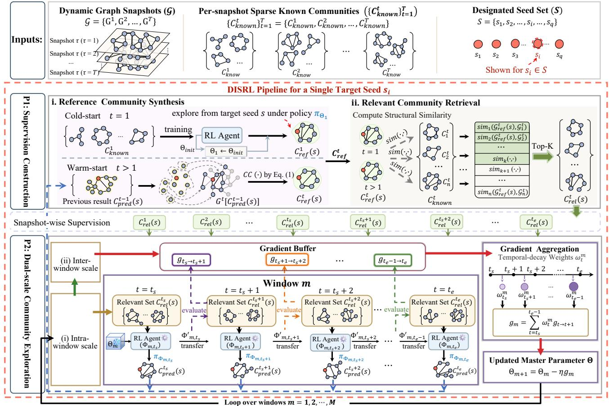  
Figure 1: Overall framework of DISRL, consisting of supervision construction and dual-scale community exploration.

$$
\mathbf { H } ^ { ( l ) } = \alpha \widetilde { \mathbf { A } } _ { \mathrm { s u b } , k } ^ { t } \mathbf { H } ^ { ( l - 1 ) } + ( 1 - \alpha ) \mathbf { X } _ { k } ^ { t } , \quad l = 1 , 2 , . . . , L\tag{7}
$$

where $\widetilde { \mathbfcal { A } } _ { \mathrm { s u b } , k } ^ { t } \in \mathbb { R } ^ { | \mathcal { V } _ { \mathrm { s u b } , k } ^ { t } | \times | \mathcal { V } _ { \mathrm { s u b } , k } ^ { t } | }$ is the symmetrically normalized adjacency matrix of $\mathcal { G } _ { \mathrm { s u b } , k } ^ { t }$ , and $\alpha \in ( 0 , 1 )$ is the propagation coeficient. The final output $\mathbf { H } ^ { ( L ) }$ yields continuous node representations that simultaneously encapsulate seed-aware and community-aware features.

To strictly penalize boundary leakage and shape distortions during sequential expansion, we further introduce a community-level structural deviation feature $\delta _ { u , k } ^ { t } \in \mathbb { R }$ for each node $u \in \mathcal { V } _ { \mathrm { s u b } , k } ^ { t } .$

$$
\delta _ { u , k } ^ { t } = \Big | \mathbf { H } ^ { ( L ) } ( u , 2 ) - \frac { 1 } { | C _ { k } ^ { t } | } \sum _ { v \in C _ { k } ^ { t } } \mathbf { H } ^ { ( L ) } ( v , 2 ) \Big | .\tag{8}
$$

Subsequently, the propagated structural feature channels and localized deviation scalar are concatenated into a compact lowdimensional node feature vector $\mathbf { z } _ { u , k } ^ { t } \in \mathbb { R } ^ { 3 }$ :

$$
\begin{array} { r } { \mathbf { z } _ { u , k } ^ { t } = \left[ \mathbf { H } ^ { ( L ) } ( u , : ) \parallel \delta _ { u , k } ^ { t } \right] . } \end{array}\tag{9}
$$

Finally, the complete environment state $\mathsf { S } _ { k } ^ { t }$ is formalized as:

$$
\mathbf { S } _ { k } ^ { t } = \left( C _ { k } ^ { t } , N ( C _ { k } ^ { t } ) , \left\{ \mathbf { z } _ { v , k } ^ { t } \ \middle | \ v \in C _ { k } ^ { t } \cup N ( C _ { k } ^ { t } ) \right\} \right) .\tag{10}
$$

Action Space. At exploration step �, the action space $\mathcal { A } _ { k } ^ { t }$ consists of boundary candidates and a termination token (EOS):

$$
\mathcal { A } _ { k } ^ { t } = N ( C _ { k } ^ { t } ) \cup \{ \mathrm { E O S } \} .\tag{11}
$$

Selecting $a = u \in N ( C _ { k } ^ { t } )$ expands the current community as $C _ { k + 1 } ^ { t } = C _ { k } ^ { t } \cup \{ u \}$ , while EOS terminates exploration and returns the final community. To bound exploration, we additionally terminate the rollout when the explored community reaches the maximum size among the available known communities.

The policy $\pi _ { \Phi _ { m , t } } ( \cdot | \mathbf { S } _ { k } ^ { t } )$ is parameterized by an MLP over node representations. During training, the fast policy is updated via policy gradient:

$$
\Phi _ { m , t } ^ { ' } = \Phi _ { m , t } + \eta \sum _ { k = 0 } ^ { T _ { e } } \nabla _ { \Phi _ { m , t } } \log \pi _ { \Phi _ { m , t } } \left( a _ { k } ^ { t } \mid \mathsf { S } _ { k } ^ { t } \right) R _ { k } ^ { t } ,\tag{12}
$$

where � is the learning rate, $T _ { e }$ is the terminal exploration step, and $\begin{array} { r } { { \cal R } _ { k } ^ { t } = \sum _ { j = k } ^ { T _ { e } } \gamma ^ { j - k } r _ { j } ^ { t } } \end{array}$ is the discounted return with discount factor � and immediate reward $\boldsymbol { r } _ { j } ^ { t } = \operatorname { F } 1 ( C _ { j + 1 } ^ { t } , C ^ { * } ) - \operatorname { F } 1 ( C _ { j } ^ { t } , C ^ { * } )$ . The updated policy is then transferred to initialize the explorer at the next

snapshot:

$$
\Phi _ { m , t + 1 }  \Phi _ { m , t } ^ { ' } , \quad \forall t \in \{ t _ { s } , . . . , t _ { e } - 1 \} ,\tag{13}
$$

$t _ { s }$ and $t _ { e }$ are the start and end timestamps of the window, respectively. This incremental policy inheritance enables fast adaptation to local temporal changes while preserving evolutionary continuity within each temporal window.

3.3.2 Inter-window Scale Meta-Anchoring and Temporal-Decay Gradient Aggregation. To mitigate unbounded error cascades during long-term temporal adaptation, DISRL introduces an inter-window consolidation mechanism driven by first-order transition metagradients. The master parameter $\Theta _ { m }$ provides a stable initialization anchor for fast policies across temporal windows. After intrawindow adaptation, the transferred policy is evaluated upon the arrival of snapshot � + 1, using the available training supervision $C _ { \mathrm { r e l } } ^ { t + 1 }$ to compute a transition meta-loss:

$$
\mathcal { L } _ { t  t + 1 } ^ { \mathrm { m e t a } } ( \Phi _ { m , t + 1 } ) = - \sum _ { i = 1 } ^ { B } \sum _ { k = 0 } ^ { T _ { i } - 1 } R _ { i , k } ^ { t + 1 } \log \pi _ { \Phi _ { m , t + 1 } } ( a _ { i , k } ^ { t + 1 } \mid \mathsf { S } _ { i , k } ^ { t + 1 } ) ,\tag{14}
$$

where � denotes the meta-batch size, and �� denotes the exploration horizon of the �-th trajectory rollout.

Deriving the exact meta-gradient with respect to the master parameter $\Theta _ { m }$ requires backpropagating through the complete unrolled intra-window adaptation path:

$$
\nabla _ { \Theta _ { m } } \mathcal { L } _ { t  t + 1 } ^ { \mathrm { m e t a } } = ( \frac { \partial \Phi _ { m , t + 1 } } { \partial \Theta _ { m } } ) ^ { \top } \nabla _ { \Phi _ { m , t + 1 } } \mathcal { L } _ { t  t + 1 } ^ { \mathrm { m e t a } } .\tag{15}
$$

Instead of computing the exact meta-gradient through the entire adaptation trajectory, DISRL adopts first-order meta-learning approximation [27] and directly estimates the transition correction:

$$
\begin{array} { r } { \mathbf { g } _ { t  t + 1 } = \nabla _ { \Phi _ { m , t + 1 } } \mathcal { L } _ { t  t + 1 } ^ { \mathrm { m e t a } } ( \Phi _ { m , t + 1 } ) . } \end{array}\tag{16}
$$

These transition gradients capture the discrepancy between current policy adaptation and future topology evolution and are bufered without immediately updating the fast policy.

At the end of each temporal window, DISRL aggregates transition gradients with temporal decay weights $\omega _ { t } ^ { m }$ controlled by a decay factor $\rho \in \left( 0 , 1 \right]$ :

$$
\omega _ { t } ^ { m } = \frac { \rho ^ { t _ { e } - 1 - t } } { \sum _ { q = t _ { s } } ^ { t _ { e } - 1 } \rho ^ { t _ { e } - 1 - q } } , \quad t = t _ { s } , \ldots , t _ { e } - 1 ,\tag{17}
$$

$$
\mathbf { g } _ { m } = \sum _ { t = t _ { s } } ^ { t _ { e } - 1 } \omega _ { t } ^ { m } \mathbf { g } _ { t  t + 1 } , \quad \Theta _ { m + 1 } = \Theta _ { m } - \eta \mathbf { g } _ { m } ,\tag{18}
$$

where recent transitions receive larger weights. The updated master parameter initializes the next window, providing stable policy evolution and reducing long-term tracking drift.

## 3.4 Theoretical Analysis

We theoretically analyze why continuous fast-parameter transfer may sufer from long-horizon error accumulation and how the proposed dual-scale mechanism mitigates this issue. Detailed proofs are provided in Appendix A. Let $\Phi _ { m , t }$ and $\Phi _ { m , t } ^ { \star }$ denote the actual and ideal fast parameters at snapshot $G ^ { t }$ , respectively. We define the tracking error as $d _ { m , t } = \lVert \Phi _ { m , t } - \Phi _ { m , t } ^ { \star } \rVert _ { 2 }$ . We consider three standard assumptions: (1) bounded local adaptation perturbation $\| \xi _ { m , t } \| _ { 2 } \leq \xi , ( 2 )$ bounded temporal drift $\| { \Phi } _ { m , t + 1 } ^ { \star } - { \Phi } _ { m , t } ^ { \star } \| _ { 2 } \leq \Delta$ , and (3) a Lipschitz adaptation operator with coeficient � [10], which is expressed as

$$
\lVert \mathcal { U } _ { t } ( \Phi _ { a } ) - \mathcal { U } _ { t } ( \Phi _ { b } ) \rVert _ { 2 } \leq \kappa \lVert \Phi _ { a } - \Phi _ { b } \rVert _ { 2 } .\tag{19}
$$

The perturbed fast adaptation is

$$
\Phi _ { m , t + 1 } = \Phi _ { m , t } ^ { \prime } = \mathcal { U } _ { t } ( \Phi _ { m , t } ) + \xi _ { m , t } ,\tag{20}
$$

where the ideal parameter satisfies the fixed-point condition $\mathcal { U } _ { t } ( \Phi _ { m , t } ^ { \star } ) = \Phi _ { m , t } ^ { \star }$ . We establish the following proposition.

Proposition 1 (Single-step Error Propagation). For two consecutive snapshots within the same temporal window, the fastparameter tracking error satisfies:

$$
d _ { m , t + 1 } \leq \kappa d _ { m , t } + \xi + \Delta .\tag{21}
$$

The proposition indicates that each snapshot transition may introduce adaptation perturbations and temporal drift, potentially contributing to error accumulation during continuous policy transfer. By recursively applying Proposition 1 within a temporal window $\mathcal { W } _ { m } .$ , the tracking error satisfies the following upper bound:

$$
d _ { m , t } \leq \kappa ^ { t - t _ { s } } d _ { m , t _ { s } } + ( \xi + \Delta ) \sum _ { r = 0 } ^ { t - t _ { s } - 1 } \kappa ^ { r } .\tag{22}
$$

Therefore, without periodic policy anchoring, sequential fastparameter transfer over long temporal horizons may allow historical errors to accumulate or amplify, increasing the risk of error cascades, particularly when $\kappa \geq 1$

Corollary 1 (Window-confined Error Propagation). In DISRL, the fast parameter is reinitialized from the master parameter $\Theta _ { m }$ at each temporal window boundary. Therefore, direct consecutive fast-parameter transfer is restricted to at most � − 1 transitions within a window of size $w = | { \mathcal { W } } _ { m } | ;$ , yielding:

$$
d _ { m , t _ { e } } \leq d _ { m , t _ { s } } + ( w - 1 ) ( \xi + \Delta ) , \quad \mathrm { w h e n } \kappa = 1 .\tag{23}
$$

Hence, the dual-scale design restricts direct error propagation within each temporal window, mitigating the risk of long-horizon error accumulation. This efect is further supported by the ablation study in Section 4.3 and the long-horizon evaluation in Section 4.4.

## 4 Experiments

## 4.1 Experimental Setup

Dynamic Benchmark Construction. Existing benchmarks provide limited support for dynamic local community tracking: realworld datasets are mostly static, while synthetic evolutionary benchmarks (e.g., CoDÆN [28]) mainly focus on global community partitioning and fail to simulate sparse, seed-centered local tracking. To address this limitation, we construct a non-stationary benchmark by synthesizing controlled, chronologically ordered evolutionary mutations onto four empirical networks while preserving their original topological complexity and community fidelity. Specifically, we generate temporal graph streams through four representative evolutionary operations, including community expansion, shrinkage, merging, and splitting, together with background topological perturbations (random node/edge insertions and deletions). The ground-truth communities are synchronously updated with graph evolution to provide reliable supervision.

Table 1: Dataset statistics.� denotes the number of snapshots; |V |, |E |, |C|, and � denote the average numbers of nodes, edges, and communities, and the average modularity [23], respectively. All averages are taken over snapshots.
<table><tr><td>Dataset</td><td>T</td><td>IV</td><td>|ē]</td><td>|CI</td><td>0</td></tr><tr><td colspan="6">Real-world dynamic dataset</td></tr><tr><td>Football</td><td>24</td><td>137</td><td>653.9</td><td>19.8</td><td>0.5867</td></tr><tr><td colspan="6">Expansion &amp; shrinkage setting</td></tr><tr><td>Amazon</td><td>25</td><td>18256.2</td><td>56573.5</td><td>1291.0</td><td>0.9301</td></tr><tr><td>DBLP</td><td>25</td><td>132172.3</td><td>540405.8</td><td>4520</td><td>0.9105</td></tr><tr><td>Twitter</td><td>13</td><td>99566.3</td><td>1334284.8</td><td>2651</td><td>0.6313</td></tr><tr><td>YouTube</td><td>13</td><td>227400.2</td><td>1426123.3</td><td>2821.9</td><td>0.5422</td></tr><tr><td colspan="6">Merging &amp; splitting setting</td></tr><tr><td>Amazon</td><td>9</td><td>13178</td><td>38359.2</td><td>809.3</td><td>0.9837</td></tr><tr><td>DBLP</td><td>9</td><td>114095</td><td>485261.7</td><td>2829.7</td><td>0.9164</td></tr></table>

Datasets and Evaluation Scenarios. We evaluate DISRL on five datasets covering simulated evolution and real-world dynamics. For real-world dynamics, we use Football, derived from the Century of College Football dataset [1], comprising 24 yearly snapshots from 2000–2024, with real game interactions and conference-based com munity labels. For simulated evolution, we use four SNAP datasets1 with authentic community annotations: Amazon, DBLP, YouTube, and Twitter. We consider two scenarios: (1) expansion&shrinkage on all four datasets, which evaluates gradual community growth and contraction; and (2) merging&splitting on Amazon and DBLP, which tests structural reorganization among communities. Dataset statistics are summarized in Table 1. Detailed generation procedures and evaluation protocols are provided in Appendix B.

Baselines. We compare DISRL with representative baselines from two categories:

(i) Static Local Baselines: Applied independently to isolated snap shots using snapshot-specific topologies and annotations. SLSS [24] leverages graph-kernel similarity for local expansion; SLRL [26] uses an RL-based extractor-expander mechanism; CLARE [34] operates on a locator-rewriter framework; and ProCom [33] adopts a pre-training prompt paradigm for few-shot target localization.

(ii) Dynamic Tracking Baselines: Optimized across temporal streams. DevDynaP [2] executes incremental heuristic exploration; MFC-TopoReg [15] enforces topological regularization over dynamic matrix factorization partitions; QTCS [18] optimizes query-centered temporal searches; and CS-TGN [11] employs a query-driven temporal GNN.

Metrics and Implementation Details. Following [24, 26], we evaluate tracking accuracy across snapshots by comparing predictions against evolving ground-truth boundaries using four metrics: Precision, Recall, F1-score, and Jaccard. All metrics are computed per seed-snapshot pair and macro-averaged across all evaluated seeds and snapshots.

DISRL is implemented in PyTorch on an NVIDIA RTX 3090 GPU (24GB). For fair comparison, MFC-TopoReg is post-processed to extract the community containing the target seed; query-based methods (CS-TGN, QTCS, and DevDynaP) are evaluated under single-seed queries. Following [26], the number of generated candidate communities for CLARE and ProCom is set to 5000. Stochastic methods are evaluated over five random seeds, with results reported as mean ± standard deviation; deterministic methods are evaluated once. For each target seed, we exclude its ground-truth community from the available supervision. Specifically, Football uses all remaining annotated communities, while the other datasets randomly sample 100 communities per snapshot and remove the target community if present. Each target seed is tracked independently with its own policy parameters. Snapshots are processed chronologically, using only current and historical supervision, while target-community labels are reserved for evaluation. The detailed hyper-parameter configurations of DISRL are provided in Appendix Table 4. We highlight three key parameters corresponding to our proposed modules: the number of retrieved relevant communities � = 5 for Football and � = 50 for the other datasets, iGPN propagation layers � = 2 for Football and � = 3 for the other datasets, and temporal window size � = 4 for all datasets. The anonymized source code is available at https://anonymous.4open.science/r/DISRL-code-5D02.

## 4.2 Main Results

Comparison with Static Baselines. As shown in Table 2, DISRL achieves the best F1-score and Jaccard similarity on the real-world Football dataset and across all four benchmarks under expansion&shrinkage dynamics. Compared with the strongest static baseline, DISRL obtains absolute F1 gains of 8.07, 3.70, 10.01, 10.24, and 4.86 percentage points (pp) on Football, Amazon, DBLP, YouTube, and Twitter, respectively. Static baselines sufer from temporal isolation: processing snapshots independently prevents them from using historical trajectories to alleviate sparse supervision. Candidate-generation methods such as CLARE and ProCom further optimize global candidate pools rather than seed-centered local targets, often producing mismatched boundaries. In contrast, DISRL combines active seed-centric MDP rollouts with adaptive supervision construction, enabling temporally consistent tracking. Under merging&splitting dynamics, DISRL also maintains top F1 and Jaccard performance on both Amazon and DBLP, showing robustness to abrupt boundary mutations.

Comparison with Dynamic Baselines. Table 2 compares DISRL with dynamic tracking models. DISRL achieves the best F1-score and Jaccard similarity across all settings. On the real-world Football dataset, DISRL achieves an F1 gain of 2.89 pp over the strongest dynamic baseline. Under expansion&shrinkage and merging&splitting settings, its largest F1 gains reach 4.25 pp on Twitter and 6.42 pp on DBLP, respectively. Although dynamic baselines exploit temporal information, they remain weakly aligned with seed-centered tracking. Heuristic methods such as DevDynaP and QTCS rely on topological propagation or proximity thresholds, making them sensitive to edge noise. Matrix-factorization methods such as MFC-TopoReg prioritize global clustering consistency and may sacrifice local boundary fidelity. Temporal GNNs such as CS-TGN capture structural evolution but still rely on passive node representations

Table 2: Main comparison on simulated evolutionary settings and a real-world dynamic dataset. All metrics are reported in percentages (%). Best and second-best results are marked in bold and underlined within each comparison group, respectively.

$$
{ \bf 9 4 . 3 2 \pm 0 . 6 3 }
$$

$$
9 1 . 9 9 \pm 0 . 2 9
$$

$$
{ \bf 9 5 . 2 4 \pm 0 . 3 6 }
$$

$$
8 8 . 5 5 \pm 0 . 9 0
$$

$$
{ \bf 9 1 . 3 3 \pm 0 . 6 2 }
$$

$$
\underline { { 8 7 . 1 7 \pm 0 . 6 7 } }
$$

$$
\mathbf { 9 7 . 0 0 \pm 0 . 2 1 }
$$

$$
9 4 . 3 2 \pm 0 . 6 3 
$$

$$
\underline { { 8 1 . 0 3 \pm 0 . 8 8 } }
$$

$$
{ \bf 9 5 . 2 4 \pm 0 . 3 6 }
$$

$$
3 8 . 8 6 \pm 1 . 1 0
$$

$$
{ \bf 9 1 . 3 3 \pm 0 . 6 2 }
$$

$$
4 7 . 4 9 \pm 1 . 3 9
$$

$$
\overline { { 4 2 . 2 1 \pm 1 . 1 9 } }
$$

$$
9 1 . 0 2 \pm 4 . 2 7
$$

$$
{ \bf 9 6 . 2 2 \pm 0 . 8 5 }
$$

$$
3 2 . 0 2 \pm 1 . 1 4
$$

$$
9 2 . 3 5 \pm 1 . 6 3 
$$

$$
8 7 . 5 3 \pm 3 . 4 0
$$

$$
5 4 . 0 8 \pm 3 . 0 0
$$

$$
2 9 . 9 0 \pm 1 . 5 8
$$

$$
3 4 . 4 1 \pm 1 . 6 3
$$

$$
2 3 . 5 8 \pm 1 . 4 2
$$

$$
\overline { { 6 5 . 3 8 \pm 3 . 4 0 } }
$$

$$
6 2 . 1 8 \pm 3 . 2 0
$$

$$
6 3 . 4 2 \pm 3 . 2 8
$$

$$
\overline { { 5 2 . 9 2 \pm 3 . 7 4 } }
$$

$$
8 8 . 1 1
$$

$$
{ \underline { { 9 6 . 1 4 } } }
$$

$$
9 1 . 8 0 
$$

$$
7 7 . 4 2 
$$

$$
\mathbf { 8 6 . 7 8 \pm 0 . 5 3 }
$$

$$
9 5 . 1 5 \pm 0 . 4 3
$$

$$
7 9 . 7 7 \pm 0 . 4 6
$$

$$
{ \bf 8 9 . 8 6 \pm 0 . 1 0 }
$$

$$
{ \bf 9 7 . 3 4 \pm 0 . 6 1 }
$$

$$
{ \bf 8 3 . 1 0 \pm 0 . 1 6 }
$$

$$
\underline { { 8 6 . 1 6 \pm 0 . 6 6 } }
$$

$$
\underline { { 8 6 . 7 8 \pm 0 . 5 3 } }
$$

$$
9 5 . 1 5 \pm 0 . 4 3
$$

$$
{ \bf 8 9 . 8 6 \pm 0 . 1 0 }
$$

$$
8 6 . 0 6 \pm 0 . 0 3
$$

$$
7 5 . 3 6 \pm 0 . 5 1
$$

$$
8 6 . 7 6 \pm 0 . 6 9
$$

$$
{ \bf 8 3 . 1 0 \pm 0 . 1 6 }
$$

$$
7 8 . 5 4 \pm 0 . 3 3
$$

$$
9 2 . 8 7 \pm 0 . 7 2
$$

$$
6 8 . 4 5 \pm 0 . 3 0
$$

$$
\underline { { 8 8 . 2 2 \pm 0 . 0 2 } }
$$

$$
\underline { { 8 6 . 0 7 \pm 0 . 2 8 } }
$$

$$
7 5 . 7 9 \pm 0 . 5 6
$$

$$
7 8 . 2 3 \pm 0 . 0 8
$$

$$
7 8 . 4 9 \pm 0 . 4 5
$$

$$
9 3 . 7 5 \pm 0 . 0 9
$$

$$
6 9 . 4 8 \pm 0 . 6 1
$$

$$
8 4 . 1 0 \pm 0 . 0 8
$$

$$
7 4 . 8 1 \pm 0 . 1 0
$$

$$
9 3 . 6 0 
$$

$$
8 5 . 3 6
$$

$$
\mathbf { 7 6 . 1 0 \pm 0 . 5 1 }
$$

$$
\overline { { 8 3 . 8 3 \pm 0 . 4 9 } }
$$

$$
\overline { { 7 8 . 4 8 \pm 0 . 4 6 } }
$$

$$
\mathbf { 7 0 . 2 6 \pm 0 . 3 8 }
$$

$$
\overline { { 8 3 . 8 3 \pm 0 . 4 9 } }
$$

$$
7 6 . 1 0 \pm 0 . 5 1
$$

$$
\overline { { 7 8 . 4 8 \pm 0 . 4 6 } }
$$

$$
5 6 . 9 2 \pm 1 . 3 0
$$

$$
\pm \mathbf { 0 . 9 0 \pm 0 . 5 7 }
$$

$$
\mathbf { 7 0 . 2 6 \pm 0 . 3 8 }
$$

$$
\underline { { 6 8 . 4 7 \pm 0 . 4 0 } }
$$

$$
5 5 . 0 9 \pm 0 . 5 1
$$

$$
8 2 . 9 7 \pm 2 . 8 3 
$$

$$
7 5 . 6 3 \pm 0 . 6 5
$$

$$
6 0 . 8 5 \pm 0 . 7 9
$$

$$
\overline { { 7 6 . 3 1 \pm 0 . 4 7 } }
$$

$$
6 1 . 8 3 \pm 0 . 3 4
$$

$$
6 6 . 1 2 \pm 0 . 7 6
$$

$$
5 9 . 9 8 \pm 0 . 4 9
$$

$$
4 9 . 8 8 \pm 0 . 6 2
$$

$$
7 2 . 8 9 \pm 0 . 2 3
$$

$$
5 3 . 5 1 \pm 0 . 2 4
$$

$$
6 0 . 8 5 \pm 0 . 2 4
$$

$$
\underline { { 6 4 . 6 0 \pm 0 . 7 3 } }
$$

$$
4 9 . 2 4 \pm 0 . 2 2
$$

$$
7 2 . 0 2 \pm 1 . 3 1
$$

$$
6 6 . 2 0 \pm 1 . 0 3
$$

$$
{ \underline { { 5 8 . 1 6 \pm 0 . 9 9 } } }
$$

$$
{ \underline { { 7 0 . 9 3 \pm 0 . 3 2 } } }
$$

$$
{ \bf 6 7 . 7 6 \pm 0 . 0 3 }
$$

$$
{ \underline { { 5 7 . 1 6 \pm 1 . 0 4 } } }
$$

$$
{ \bf 5 6 . 8 7 \pm 0 . 0 8 }
$$

$$
\underline { { 7 0 . 9 3 \pm 0 . 3 2 } }
$$

$$
\mathbf { 7 2 . 0 2 \pm 0 . 3 1 }
$$

$$
\overline { { 7 4 . 7 6 \pm 1 . 6 3 } }
$$

$$
{ \bf 6 7 . 7 6 \pm 0 . 0 3 }
$$

$$
{ \underline { { 5 7 . 5 2 \pm 1 . 7 4 } } }
$$

$$
{ \bf 5 6 . 8 7 \pm 0 . 0 8 }
$$

$$
4 4 . 2 1 \pm 1 . 5 0
$$

$$
4 2 . 7 4 \pm 0 . 2 7
$$

$$
{ \underline { { 6 0 . 0 2 \pm 1 . 0 0 } } }
$$

$$
4 4 . 7 2 \pm 0 . 2 5
$$

$$
\mathbf { 8 0 . 2 8 \pm 1 . 0 6 }
$$

$$
3 3 . 9 4 \pm 0 . 3 4
$$

$$
\underline { { 6 4 . 5 7 \pm 0 . 4 9 } }
$$

$$
2 9 . 4 9 \pm 0 . 5 5
$$

$$
5 1 . 7 7 \pm 0 . 5 6
$$

$$
3 8 . 8 5 \pm 0 . 5 9
$$

$$
4 9 . 9 4 \pm 0 . 9 3
$$

$$
3 2 . 1 4 \pm 0 . 5 4
$$

$$
4 8 . 8 1 \pm 0 . 7 8
$$

$$
3 8 . 9 7 \pm 0 . 7 0
$$

$$
\overline { { 6 5 . 3 2 \pm 1 . 3 9 } }
$$

$$
\overline { { 6 4 . 1 1 \pm 0 . 6 8 } }
$$

$$
\underline { { 4 8 . 3 5 \pm 0 . 0 6 } }
$$

$$
\overline { { { \bf 6 1 . 3 0 \pm 0 . 4 1 } } }
$$

$$
\overline { { { \bf 4 8 . 1 7 \pm 0 . 5 3 } } }
$$

$$
{ 7 7 . 3 4 \pm 0 . 2 3 }
$$

$$
\overline { { 6 5 . 3 2 \pm 1 . 3 9 } }
$$

$$
\overline { { 6 4 . 1 1 \pm 0 . 6 8 } }
$$

$$
5 6 . 4 4 \pm 0 . 0 2
$$

$$
\overline { { 6 1 . 3 0 \pm 0 . 4 1 } }
$$

$$
3 9 . 2 4 \pm 0 . 5 9
$$

$$
\underline { { 4 1 . 5 7 \pm 0 . 0 7 } }
$$

$$
\overline { { { \bf 4 8 . 1 7 \pm 0 . 5 3 } } }
$$

$$
3 5 . 1 5 \pm 0 . 4 8
$$

$$
{ \underline { { 4 9 . 1 6 \pm 2 . 8 4 } } } 
$$

$$
3 5 . 3 0 \pm 0 . 5 2
$$

$$
{ \bf 8 8 . 4 9 \pm 1 . 2 8 }
$$

$$
2 3 . 6 6 \pm 0 . 4 7
$$

$$
{ \underline { { 5 7 . 0 5 \pm 1 . 8 1 } } }
$$

$$
4 6 . 8 5 \pm 0 . 8 4
$$

$$
\underline { { 4 3 . 5 6 \pm 1 . 9 3 } }
$$

$$
3 1 . 8 1 \pm 0 . 8 1
$$

$$
5 0 . 3 2 \pm 1 . 1 1
$$

$$
4 2 . 6 3 \pm 0 . 6 1
$$

$$
3 1 . 5 5 \pm 0 . 6 3
$$

$$
4 0 . 5 7 \pm 1 . 1 7
$$

$$
3 4 . 4 1 \pm 0 . 9 2
$$

$$
2 3 . 9 2 \pm 0 . 6 9
$$

$$
7 7 . 7 1 \pm 0 . 5 7
$$

$$
9 5 . 5 1 \pm 0 . 2 8
$$

$$
6 8 . 8 9 \pm 1 . 0 8 
$$

$$
\mathbf { 8 3 . 4 9 \pm 0 . 5 0 }
$$

$$
{ \bf 9 6 . 8 4 \pm 0 . 8 8 }
$$

$$
{ \bf 7 3 . 9 7 \pm 0 . 7 5 }
$$

$$
{ \underline { { 7 7 . 0 0 \pm 1 . 3 5 } } }
$$

$$
7 7 . 7 1 \pm 0 . 5 7
$$

$$
{ \underline { { 6 6 . 3 6 \pm 1 . 9 7 } } }
$$

$$
9 5 . 5 1 \pm 0 . 2 8
$$

$$
\mathbf { 8 3 . 4 9 \pm 0 . 5 0 }
$$

$$
\mathbf { 8 6 . 0 3 \pm 0 . 2 4 }
$$

$$
{ \bf 7 3 . 9 7 \pm 0 . 7 5 }
$$

$$
\underline { { 8 4 . 3 2 \pm 0 . 2 4 } }
$$

$$
6 3 . 8 5 \pm 0 . 4 2
$$

$$
6 9 . 1 2 \pm 0 . 3 6
$$

$$
7 5 . 3 8 \pm 1 . 3 5
$$

$$
5 6 . 6 5 \pm 0 . 3 8
$$

$$
7 6 . 3 2 \pm 1 . 0 3
$$

$$
6 4 . 6 9 \pm 1 . 1 8
$$

$$
8 5 . 7 2 \pm 0 . 3 0
$$

$$
7 1 . 2 4 \pm 0 . 1 8
$$

$$
6 2 . 8 0 \pm 0 . 6 6
$$

$$
{ \bf 9 6 . 4 3 \pm 0 . 2 0 }
$$

$$
6 8 . 0 5 \pm 0 . 4 0
$$

$$
5 6 . 0 5 \pm 0 . 5 4
$$

$$
\underline { { 8 0 . 0 0 \pm 0 . 1 9 } }
$$

$$
\underline { { 6 9 . 1 0 \pm 0 . 2 1 } }
$$

$$
7 3 . 6 9 
$$

$$
{ \underline { { 5 3 . 3 4 } } } \pm 1 . 0 2 
$$

$$
7 5 . 0 9 \pm 1 . 4 0
$$

$$
\overline { { 5 6 . 6 3 \pm 1 . 2 7 } }
$$

$$
3 7 . 7 6 \pm 1 . 0 5
$$

$$
\overline { { { \bf 4 4 . 5 6 \pm 1 . 4 9 } } }
$$

$$
{ \bf 8 6 . 6 7 \pm 0 . 1 9 }
$$

$$
4 6 . 7 4 \pm 0 . 1 4
$$

$$
3 4 . 6 3 \pm 0 . 1 7
$$

$$
\overline { { 5 3 . 3 4 \pm 1 . 0 2 } }
$$

$$
\overline { { 7 5 . 0 9 \pm 1 . 4 0 } }
$$

$$
\overline { { 5 6 . 6 3 \pm 1 . 2 7 } }
$$

$$
\overline { { { 4 4 . 5 6 \pm 1 . 4 9 } } }
$$

$$
4 9 . 0 5 \pm 0 . 5 3
$$

$$
4 5 . 3 9 \pm 0 . 0 9
$$

$$
4 8 . 2 4 \pm 2 . 1 9
$$

$$
3 3 . 5 7 \pm 0 . 1 2
$$

$$
{ \pm } \mathrm { { \bf 5 5 . 7 6 \pm 1 . 0 0 } }
$$

$$
{ \underline { { 6 8 . 9 1 \pm 2 . 1 4 } } }
$$

$$
5 0 . 2 1 \pm 0 . 8 7
$$

$$
5 5 . 6 0 \pm 0 . 7 6
$$

$$
3 6 . 5 1 \pm 0 . 8 6
$$

$$
2 5 . 6 4 \pm 0 . 2 8
$$

$$
4 9 . 9 2 \pm 0 . 5 4
$$

$$
3 8 . 0 4 \pm 0 . 4 7
$$

$$
5 7 . 0 3 \pm 0 . 3 1
$$

$$
3 1 . 7 4 \pm 0 . 3 1
$$

$$
2 1 . 6 6 \pm 0 . 2 5
$$

Table 3: Ablation results. Each cell reports F1/Jaccard.
<table><tr><td rowspan="2">Variant</td><td>Real-world dynamics</td><td colspan="2">Expansion&amp;shrinkage</td><td colspan="2">Merging&amp;splitting</td></tr><tr><td>Football</td><td>Amazon</td><td>DBLP</td><td>Amazon</td><td>DBLP</td></tr><tr><td>w/o cc</td><td>93.42 ± 0.27/87.94 ± 0.44</td><td>88.02 ± 0.12/80.32 ± 0.16</td><td>75.89 ± 0.13/67.39 ± 0.23</td><td>81.48 ± 0.52/71.40 ± 0.87</td><td>52.54 ± 1.18/40.81 ± 1.40</td></tr><tr><td>w/o rcs</td><td> $9 4 . 2 3 \pm 0 . 3 0 / 9 0 . 1 8 \pm 0 . 4 9$ </td><td> $8 8 . 2 8 \pm 0 . 1 5 / 8 0 . 6 3 \pm 0 . 1 9$ </td><td> $7 6 . 5 3 \pm 0 . 2 4 / 6 7 . 6 7 \pm 0 . 3 2$ </td><td> $8 2 . 8 6 \pm 0 . 4 4 / 7 3 . 3 5 \pm 0 . 3 1$ </td><td> $5 3 . 5 8 \pm 1 . 0 8 / 4 1 . 6 5 \pm 1 . 2 4$ </td></tr><tr><td>w/o sim</td><td> $8 8 . 2 9 \pm 1 . 8 6 / 8 1 . 9 5 \pm 2 . 1 5$ </td><td> $8 7 . 2 8 \pm 1 . 0 0 / 7 9 . 2 7 \pm 1 . 4 2$ </td><td> $7 5 . 2 9 \pm 1 . 7 1 / 6 6 . 8 0 \pm 1 . 6 6$ </td><td> $8 1 . 7 6 \pm 1 . 9 4 / 7 1 . 4 6 \pm 1 . 9 5$ </td><td> $5 3 . 2 5 \pm 2 . 2 4 / 4 1 . 7 2 \pm 2 . 4 9$ </td></tr><tr><td>w/o win</td><td>92.97 ± 0.46/88.20 ± 0.62</td><td> $8 7 . 1 4 \pm 0 . 5 4 / 7 8 . 9 2 \pm 0 . 6 4$ </td><td>74.81 ± 0.41/65.07 ± 0.76</td><td> $7 9 . 9 6 \pm 1 . 1 4 / 6 9 . 6 8 \pm 1 . 1 7$ </td><td>49.07 ± 1.65/37.66 ± 1.53</td></tr><tr><td>w/o decay</td><td> $9 4 . 8 6 \pm 0 . 3 0 / 9 0 . 6 7 \pm 0 . 4 9$ </td><td> $8 8 . 5 3 \pm 0 . 4 6 / 8 1 . 1 7 \pm 0 . 8 0$ </td><td> $7 7 . 0 8 \pm 0 . 8 4 / 6 8 . 5 7 \pm 1 . 1 2$ </td><td> $8 2 . 4 6 \pm 0 . 3 6 / 7 2 . 8 4 \pm 0 . 5 4$ </td><td> $5 4 . 9 8 \pm 1 . 5 8 / 4 3 . 2 0 \pm 1 . 4 0$ </td></tr><tr><td>DISRL</td><td> $\mathbf { 9 5 . 2 4 \pm 0 . 3 6 / 9 1 . 3 3 \pm 0 . 6 2 }$ </td><td> $\mathbf { 8 9 . 8 6 \pm 0 . 1 0 / 8 3 . 1 0 \pm 0 . 1 6 }$ </td><td> $7 8 . 4 8 \pm 0 . 4 6 / 7 0 . 2 6 \pm 0 . 3 8$ </td><td> $\mathbf { 8 3 . 4 9 \pm 0 . 5 0 / 7 3 . 9 7 \pm 0 . 7 5 }$ </td><td> $5 6 . 6 3 \pm 1 . 2 7 / 4 4 . 5 6 \pm 1 . 4 9$ </td></tr></table>

without explicit boundary expansion or stopping decisions. In contrast, DISRL dynamically constructs seed-specific supervision and employs dual-scale policy updating, efectively reducing supervision mismatch and error accumulation in evolving graphs.

Supervision Construction Module. To evaluate reference community synthesis, we consider two variants: w/o cc, which removes connected-component extraction and directly inherits previous predictions as reference communities; and w/o rcs, which replaces reference community synthesis with the two-hop neighborhood of the target seed. Their performance degradation highlights the importance of constructing topology-consistent reference communities for reliable seed-specific supervision. To assess relevant community retrieval, we further introduce w/o sim, which randomly

## 4.3 Ablation Study

To investigate the contributions of the modules of DISRL, we conduct five ablation experiments, with results reported in Table 3.

selects � known communities instead of using structural similarity. Its inferior performance suggests that structural similarity-based retrieval helps reduce supervision mismatch and provides more relevant guidance for community boundary expansion.

Dual-scale Community Exploration Module. To investigate the efect of window-level master anchoring, we consider w/o win, which removes window-level master anchoring and continuously transfers the fast policy across snapshots. Its performance degradation suggests that window-level anchoring helps mitigate the accumulation of localized adaptation errors across snapshots. We further evaluate temporal-decay gradient aggregation through w/o decay, which replaces temporal-decay weighting with uniform averaging. The inferior performance of this variant indicates that emphasizing more recent transition gradients benefits policy adaptation across windows. Overall, DISRL consistently outperforms all five variants under real-world dynamics, expansion&shrinkage, and merging&splitting settings.

## 4.4 Long-Horizon Error Mitigation Analysis

To empirically investigate the error-mitigation mechanism, we compare DISRL with its window-free variant (w/o win) across 24 consecutive snapshots of the real-world Football dataset, spanning six temporal windows $( w = 4 )$ . As illustrated in Fig. 2, both variants achieve comparable performance in the early snapshots, whereas their performance diverges more noticeably in later stages. Specifically, the window-free variant exhibits more pronounced performance degradation and fluctuations, while DISRL maintains relatively high F1-score and Jaccard similarity throughout the sequence. As established by Corollary 1 in Section 3.4, periodic master-policy anchoring restricts direct fast-parameter error propagation to each temporal window. These experimental observations are consistent with this theoretical analysis, suggesting that the dual-scale mechanism helps mitigate the adverse efects of accumulated adaptation errors on long-horizon tracking performance.

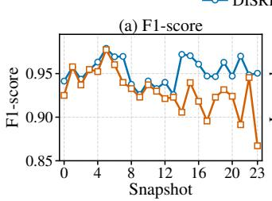

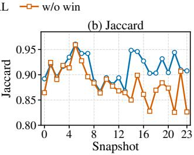  
Figure 2: Long-horizon tracking performance on Football.

## 4.5 Hyper-parameter Sensitivity

Retrieved relevant communities. We report the supervision retrieval parameter � in Fig. 3. For the simulated-evolution datasets, DISRL achieves stable performance with $K = 5 0 ,$ balancing supervision coverage and structural relevance. When $K = 1 0 0 \mathrm { ; }$ , all known communities are included, leading to performance degradation due to potentially irrelevant supervision. On the Football dataset, we evaluate � from 1 to 10, with the best F1-score achieved at $K = 5 \AA$ Performance initially improves as � increases, but gradually declines beyond this point, highlighting the importance of selecting an appropriate number of relevant communities.

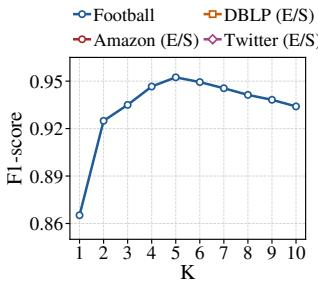  
(a) Football

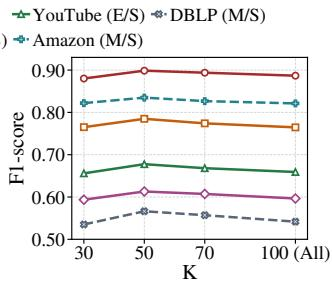  
(b) Other datasets  
Figure 3: Efect of the retrieved community number �.

iGPN Propagation Layers. We then study the sensitivity of DISRL to the number of iGPN propagation layers � used by the localized state encoder on the real-world Football dataset and three expansion&shrinkage benchmarks (Amazon, DBLP, and Twitter). As shown in Fig. 4, $L = 2$ achieves the best performance on Football, whereas $L \ = \ 3$ achieves the best performance on Amazon, DBLP, and Twitter. As � controls the depth of localized structural propagation, too few layers may miss multi-hop boundary context, whereas too many layers may introduce remote structural noise into seed-centered representations. These results suggest that two-layer propagation is suficient for Football, while three-layer localized propagation better balances structural context modeling and noise control on the other datasets.

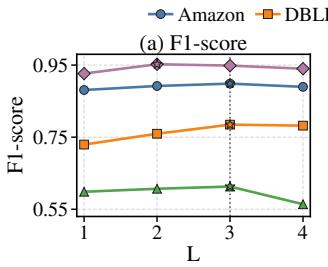

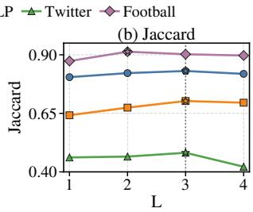  
Figure 4: Sensitivity to iGPN propagation.

Temporal Window Horizon. We further evaluate the sensitivity of DISRL to the temporal window size � $\in \{ 2 , 3 , 4 , 5 , 6 \}$ on Football, Amazon, and DBLP, with the latter two evaluated under the expansion&shrinkage setting. As illustrated in Fig. $5 , w = 4$ achieves the best overall performance across these three datasets, indicating a trade-of between policy stabilization and temporal drift:

• Under-sized Windows $( w = 2 ) \colon$ Restricting the horizon induces temporal myopia. The fast parameters $( \Phi _ { m , t } )$ overfit to transient single-frame fluctuations, starving the master anchor $\left( \Theta _ { m } \right)$ of continuous, long-horizon meta-gradients.

• Over-sized Windows $( w = 6 ) \mathrm { : }$ Expanding the horizon excessively introduces optimization lag. Under non-stationary graph streams, historical transition gradients from distant snapshots carry stale topological signals, causing gradient smearing that misaligns the window-level master update.

Consequently, setting the default horizon to $ w = 4$ harmonizes short-term micro-evolution tracking with long-term macro-trend anchoring, mitigating the risk of long-horizon error accumulation.

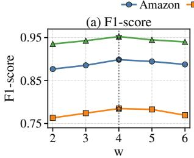

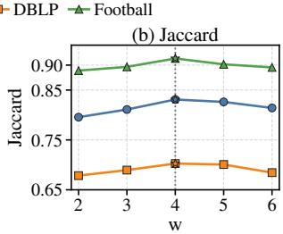  
Figure 5: Sensitivity to temporal window size.

## 4.6 Additional Experimental Analyses

The qualitative case study and eficiency comparison are provided in Appendices C and D, respectively. DISRL achieves up to 10.35× speedup over CS-TGN and efectively tracks evolving community boundaries through adaptive supervision construction and dualscale policy consolidation.

## 5 Conclusion

In this paper, we proposed DISRL, a dual-scale incremental semisupervised reinforcement learning framework for dynamic local community tracking. DISRL addresses temporal supervision uncertainty by constructing seed-specific adaptive guidance from sparse communities, and mitigates long-horizon error cascades through a dual-scale policy optimization strategy. We further developed a dynamic graph benchmark with diverse community evolution patterns. Extensive experiments demonstrate that DISRL consistently outperforms state-of-the-art baselines with improved eficiency and tracking stability.

## Acknowledgments

This work was supported by the National Natural Science Foundation of China under Grant Nos. 62302451 and 62276233.

## References

[1] [n. d.]. Century of College Football Dataset. GitHub repository. https://github. com/JacobH140/century-of-college-football Accessed: 2026-10-08.

[2] S. Bakhtar and H. A. Harutyunyan. 2025. DevDynaP: A dynamic local community detection algorithm. SN Computer Science 6, 4 (2025), 299. doi:10.1007/s42979- 025-03801-z

[3] A. Bhowmick, M. Kosan, Z. Huang, Ambuj Singh, and S. Medya. 2024. DG-CLUSTER: A neural framework for attributed graph clustering via modularity maximization. Proceedings ofthe AAAI Conference on Artificial Intelligence 38, 10 (2024), 11069–11077. doi:10.1609/aaai.v38i10.28983

[4] M. Bianco, L. Cagliero, and L. Vassio. 2025. Semi-supervised community detection in dynamic graphs. In Proceedings ofthe Workshops ofthe EDBT/ICDT 2025 Joint Conference (CEUR Workshop Proceedings, Vol. 3946). https://ceur-ws.org/Vol-3946/DARLI-AP-1.pdf

[5] V. D. Blondel, J.-L. Guillaume, R. Lambiotte, and E. Lefebvre. 2008. Fast unfolding of communities in large networks. Journal ofStatistical Mechanics: Theory and Experiment 2008, 10 (2008), P10008. doi:10.1088/1742-5468/2008/10/P10008

[6] K. M. Borgwardt and H.-P. Kriegel. 2005. Shortest-path kernels on graphs. In Proceedings ofthe 5th IEEE International Conference on Data Mining. 74–81. doi:10.1109/ICDM.2005.132

[7] D. Chakrabarti, R. Kumar, and A. Tomkins. 2006. Evolutionary clustering. In Proceedings ofthe 12th ACM SIGKDD International Conference on Knowledge Discovery and Data Mining. 554–560. doi:10.1145/1150402.1150467

[8] A. R. Costa and C. G. Ralha. 2023. AC2CD: An actor-critic architecture for community detection in dynamic social networks. Knowledge-Based Systems 261 (2023), 110202. doi:10.1016/j.knosys.2022.110202

[9] A. Grover and J. Leskovec. 2016. node2vec: Scalable feature learning for networks. In Proceedings ofthe 22nd ACM SIGKDD International Conference on Knowledge Discovery and Data Mining. 855–864. doi:10.1145/2939672.2939754

[10] Moritz Hardt, Benjamin Recht, and Yoram Singer. 2016. Train faster, generalize better: Stability of stochastic gradient descent. In Proceedings ofthe 33rd International Conference on Machine Learning. PMLR, 1225–1234.

[11] F. Hashemi, A. Behrouz, and M. R. Hajidehi. 2023. CS-TGN: Community search via temporal graph neural networks. In Companion Proceedings ofthe ACM Web Conference. 1196–1203. doi:10.1145/3543873.3587654

[12] D. He, Y. Song, D. Jin, Z. Feng, B. Zhang, Z. Yu, and W. Zhang. 2020. Communitycentric graph convolutional network for unsupervised community detection. In Proceedings ofthe Twenty-Ninth International Joint Conference on Artificial Intelligence. 3515–3521. doi:10.24963/ijcai.2020/486

[13] G. He, Z. Xue, Z. Jiang, Y. Kang, S. Zhao, and W. Lu. 2023. H2CGL: Modeling dynamics of citation network for impact prediction. Information Processing & Management 60, 6 (2023), 103512. doi:10.1016/j.ipm.2023.103512

[14] P. W. Holland, K. B. Laskey, and S. Leinhardt. 1983. Stochastic blockmodels: First steps. Social Networks 5, 2 (1983), 109–137. doi:10.1016/0378-8733(83)90021-7

[15] D. Kong, A. Zhang, and Y. Li. 2024. Learning persistent community structures in dynamic networks via topological data analysis. In Proceedings ofthe AAAI Conference on Artificial Intelligence, Vol. 38. 8617–8626. doi:10.1609/aaai.v38i8. 28706

[16] D. Kuang, C. Ding, and H. Park. 2012. Symmetric nonnegative matrix factorization for graph clustering. In Proceedings of the SIAM International Conference on Data Mining. 106–117. doi:10.1137/1.9781611972825.10

[17] X. Li, X. Zhen, X. Qi, H. Han, L. Zhang, and Z. Han. 2023. Dynamic community detection based on graph convolutional networks and contrastive learning. Chaos, Solitons & Fractals 176 (2023), 114157. doi:10.1016/j.chaos.2023.114157

[18] L. Lin, P. Yuan, R.-H. Li, C. Zhu, H. Qin, H. Jin, and T. Jia. 2024. QTCS: Eficient query-centered temporal community search. Proceedings of the VLDB Endowment 17, 6 (2024), 1187–1199. doi:10.14778/3648160.3648163

[19] Y.-R. Lin, Y. Chi, S. Zhu, H. Sundaram, and B. L. Tseng. 2008. FacetNet: A framework for analyzing communities and their evolutions in dynamic networks. In Proceedings ofthe 17th International Conference on World Wide Web. 685–694. doi:10.1145/1367497.1367590

[20] M. Liu, Y. Liu, K. Liang, W. Tu, S. Wang, S. Zhou, and X. Liu. 2024. Deep Temporal Graph Clustering. In The Twelfth International Conference on Learning Representations. https://openreview.net/forum?id=ViNe1fjGME

[21] Liam Madden, Stephen Becker, and Emiliano Dall’Anese. 2020. Bounds for the tracking error of first-order online optimization methods. arXiv preprint arXiv:2003.02400 (2020).

[22] M. Mazza, G. Cola, and M. Tesconi. 2023. Modularity-based approach for tracking communities in dynamic social networks. Knowledge-Based Systems 281 (2023), 111067. doi:10.1016/j.knosys.2023.111067

[23] M. E. J. Newman. 2006. Modularity and community structure in networks. Proceedings ofthe National Academy ofSciences 103, 23 (2006), 8577–8582. doi:10. 1073/pnas.0601602103

[24] L. Ni, J. Ge, Y. Zhang, W. Luo, and V. S. Sheng. 2024. Semi-supervised local community detection. IEEE Transactions on Knowledge and Data Engineering 36, 2 (2024), 823–839. doi:10.1109/TKDE.2023.3290095

[25] L. Ni, H. Xu, L. Mu, Y. Zhang, and W. Luo. 2025. Pre-trained prompt-driven semi-supervised local community detection. arXiv:2505.12304.

[26] L. Ni, R. Ye, W. Luo, Y. Zhang, L. Zhang, and V. S. Sheng. 2025. SLRL: Semisupervised local community detection based on reinforcement learning. In Proceedings ofthe AAAI Conference on Artificial Intelligence, Vol. 39. 631–639. doi:10.1609/aaai.v39i1.32044

[27] Alex Nichol, Joshua Achiam, and John Schulman. 2018. On First-Order Meta Learning Algorithms. arXiv preprint arXiv:1803.02999 (2018).

[28] G. Paoletti, L. Gioacchini, M. Mellia, L. Vassio, and J. Almeida. 2025. CoDÆN: Benchmarks and comparison of evolutionary community detection algorithms for dynamic networks. ACM Transactions on the Web 19, 3 (2025), 1–25. doi:10. 1145/3718988

[29] N. Park, R. A. Rossi, E. Koh, I. A. Burhanuddin, S. Kim, F. Du, N. K. Ahmed, and C. Faloutsos. 2022. CGC: Contrastive graph clustering for community detection and tracking. In Proceedings ofthe ACM Web Conference. 1115–1126. doi:10.1145/3485447.3512160

[30] B. Perozzi, R. Al-Rfou, and S. Skiena. 2014. DeepWalk: Online learning of social representations. In Proceedings ofthe 20th ACM SIGKDD International Conference on Knowledge Discovery and Data Mining. 701–710. doi:10.1145/2623330.2623732

[31] E. Rossi, B. Chamberlain, F. Frasca, D. Eynard, F. Monti, and M. Bronstein. 2020. Temporal graph networks for deep learning on dynamic graphs. arXiv:2006.10637.

[32] X. Wang, J. Guo, X. Luo, and H. Yu. 2024. DyHDGE: Dynamic heterogeneous transaction graph embedding for safety-centric fraud detection in financial scenarios. Journal ofSafety Science and Resilience 5, 4 (2024), 486–497. doi:10. 1016/j.jnlssr.2024.05.005

[33] X. Wu, K. Xiong, Y. Xiong, X. He, Y. Zhang, Y. Jiao, and J. Zhang. 2024. ProCom: A few-shot targeted community detection algorithm. In Proceedings ofthe 30th ACM SIGKDD Conference on Knowledge Discovery and Data Mining. 3414–3424. doi:10.1145/3637528.3671749

[34] X. Wu, Y. Xiong, Y. Zhang, Y. Jiao, C. Shan, Y. Sun, Y. Zhu, and P. S. Yu. 2022. CLARE: A semi-supervised community detection algorithm. In Proceedings of the 28th ACM SIGKDD Conference on Knowledge Discovery and Data Mining. 2059–2069. doi:10.1145/3534678.353937

[35] H. Xiong, L. Sun, Y. Xiong, S. Zhou, H. Ren, and Y. Zhu. 2026. SLFM: Semi supervised local community detection based on hyperbolic flow matching. In Proceedings ofthe ACM Web Conference. 1357–1367. doi:10.1145/3774904.3792548

[36] T. Yang, Y. Chi, S. Zhu, Y. Gong, and R. Jin. 2011. Detecting communities and their evolutions in dynamic social networks: A Bayesian approach. Machine Learning 82, 2 (2011), 157–189. doi:10.1007/s10994-010-5214-7

[37] M. Zafarmand, Y. Talebirad, E. Austin, C. Largeron, and O. R. Zaiane. 2023. Fast local community discovery relying on the strength of links. Social Network Analysis and Mining 13 (2023), 112. doi:10.1007/s13278-023-01115-7

[38] Y. Zhang, Y. Xiong, Y. Ye, T. Liu, W. Wang, Y. Zhu, and P. S. Yu. 2020. SEAL: Learning heuristics for community detection with generative adversarial networks. In Proceedings ofthe 26th ACM SIGKDD International Conference on Knowledge Discovery & Data Mining. 1103–1113. doi:10.1145/3394486.3403154

[39] Y. Zheng, X. Zhang, S. Chen, X. Zhang, X. Yang, and D. Wang. 2023. When convolutional network meets temporal heterogeneous graphs: An efective com munity detection method. IEEE Transactions on Knowledge and Data Engineering 35, 2 (2023), 2173–2178. doi:10.1109/TKDE.2021.3096122

[40] Y. Zhou, Y. Jiang, Y. Fang, W. Luo, Y. Hu, Y. Hu, and C. Chen. 2025. Efective durable community search in large temporal graph. Proceedings ofthe VLDB Endowment 19, 2 (2025), 127–140. doi:10.14778/3773749.3773753

[41] Di Zhuang, J. Morris Chang, and Mingchen Li. 2021. DynaMo: Dynamic Community Detection by Incrementally Maximizing Modularity. IEEE Transactions on Knowledge and Data Engineering 33, 5 (2021), 1934–1945. doi:10.1109/TKDE. 2019.2951419

## A Theoretical Analysis

We analyze how localized adaptation errors propagate and accumulate during sequential fast-parameter transfer within a temporal window $\mathcal { W } _ { m }$ spanning from $t _ { s }$ to $t _ { e }$ . Let $\Phi _ { m , t }$ and $\Phi _ { m , i } ^ { \star }$ � denote the actual fast parameter and the ideal error-free parameter at snapshot $G ^ { t }$ , respectively.

Following time-varying optimization analyses [21], the snapshotlevel tracking error is defined as $d _ { m , t } = \left. \Phi _ { m , t } - \Phi _ { m , t } ^ { \star } \right. _ { 2 }$ , using the standard L2 norm. We establish the tracking dynamics under three standard stability assumptions.

Assumption 1 (Bounded Adaptation Perturbation). The local optimization perturbation $\xi _ { m , t }$ introduced during adaptation on $G ^ { t }$ is uniformly bounded; that is, there exists a constant $\xi \ge 0$ such that

$$
\left\| { \boldsymbol { \xi } } _ { m , t } \right\| _ { 2 } \leq \xi .\tag{24}
$$

Assumption 2 (Bounded Ideal-parameter Drift). The temporal variation of the ideal tracking target across adjacent snapshots is bounded; that is, there exists a constant $\Delta \geq 0$ such that

$$
\left\| \Phi _ { m , t + 1 } ^ { \star } - \Phi _ { m , t } ^ { \star } \right\| _ { 2 } \leq \Delta .\tag{25}
$$

Assumption 3 (Lipschitz Adaptation Operator). For theoretical analysis, let $\mathcal { U } _ { t } ( \cdot )$ denote the error-free counterpart of the snapshotlevel adaptation on $G ^ { t }$ . Corresponding to the policy-gradient update and fast-parameter transfer defined in the main paper, the adapted parameter and its subsequent transfer can be written as

$$
\Phi _ { m , t } ^ { \prime } = \mathcal { U } _ { t } ( \Phi _ { m , t } ) + \xi _ { m , t } , \qquad \Phi _ { m , t + 1 } \gets \Phi _ { m , t } ^ { \prime } .\tag{26}
$$

Following standard stability analyses of gradient-based optimization [10], we assume that $\mathcal { U } _ { t } ( \cdot )$ is uniformly Lipschitz continuous. Specifically, there exists a constant $\kappa \geq 0$ such that

$$
\begin{array} { r } { \| \mathcal { U } _ { t } ( \Phi _ { a } ) - \mathcal { U } _ { t } ( \Phi _ { b } ) \| _ { 2 } \leq \kappa \| \Phi _ { a } - \Phi _ { b } \| _ { 2 } . } \end{array}\tag{27}
$$

The ideal parameter $\Phi _ { m , t } ^ { \star }$ is assumed to be a fixed point of the error-free adaptation on $G ^ { t }$ , i.e., $\mathcal { U } _ { t } ( \Phi _ { m , t } ^ { \star } ) = \Phi _ { m , t } ^ { \star }$

Proposition 1 (Single-step Error Propagation). Under Assumptions 1–3, for any adjacent snapshots $G ^ { t }$ and $G ^ { t + 1 }$ within the same temporal window $\mathcal { W } _ { m }$ , the fast-parameter error satisfies

$$
d _ { m , t + 1 } \leq \kappa d _ { m , t } + \xi + \Delta .\tag{28}
$$

Proof. By the definition of $d _ { m , t + 1 }$ and the fast-parameter transfer relation in Eq. (26), we have

$$
\begin{array} { r l } & { d _ { m , t + 1 } = \left\| \Phi _ { m , t + 1 } - \Phi _ { m , t + 1 } ^ { \star } \right\| _ { 2 } } \\ & { \qquad = \left\| \mathcal { U } _ { t } ( \Phi _ { m , t } ) + \xi _ { m , t } - \Phi _ { m , t + 1 } ^ { \star } \right\| _ { 2 } } \\ & { \qquad \leq \left\| \mathcal { U } _ { t } ( \Phi _ { m , t } ) - \mathcal { U } _ { t } ( \Phi _ { m , t } ^ { \star } ) \right\| _ { 2 } + \left\| \xi _ { m , t } \right\| _ { 2 } } \\ & { \qquad + \left\| \mathcal { U } _ { t } ( \Phi _ { m , t } ^ { \star } ) - \Phi _ { m , t + 1 } ^ { \star } \right\| _ { 2 } . } \end{array}
$$

The first term is bounded by $\kappa d _ { m , t }$ by Assumption 3, and the second term is bounded by � by Assumption 1. For the third term, using $\mathcal { U } _ { t } ( \Phi _ { m , t } ^ { \star } ) = \Phi _ { m , t } ^ { \star }$ and Assumption 2, we obtain

$$
\begin{array} { r l } & { \left\| \mathcal { U } _ { t } ( \Phi _ { m , t } ^ { \star } ) - \Phi _ { m , t + 1 } ^ { \star } \right\| _ { 2 } } \\ & { \quad \quad = \left\| \Phi _ { m , t } ^ { \star } - \Phi _ { m , t + 1 } ^ { \star } \right\| _ { 2 } \leq \Delta . } \end{array}
$$

Combining the three bounds yields Eq. (28).

Long-horizon Error Accumulation. By recursively applying Eq. (28) from the window start $t _ { s }$ to any snapshot $t \in \mathcal { W } _ { m } ,$ , we obtain

$$
d _ { m , t } \leq \kappa ^ { t - t _ { s } } d _ { m , t _ { s } } + ( \xi + \Delta ) \sum _ { r = 0 } ^ { t - t _ { s } - 1 } \kappa ^ { r } .\tag{29}
$$

When $0 \leq \kappa < 1$ , the geometric sum is bounded by $1 / ( 1 - \kappa )$ so the tracking-error upper bound remains bounded for a fixed window-initial error. When $\kappa = 1$ , this reduces to

$$
d _ { m , t } \leq d _ { m , t _ { s } } + ( t - t _ { s } ) ( \xi + \Delta ) ,\tag{30}
$$

showing that the tracking-error upper bound grows at most linearly with the length of continuous fast-parameter transfer. When � > 1, Eq. (29) permits geometric growth of the worst-case bound. These upper bounds do not imply that the actual tracking error necessarily increases. Nevertheless, without periodic policy anchoring, continuous fast-parameter transfer may allow historical errors to accumulate or amplify, increasing the risk of error cascades, particularly when $\kappa \geq 1 .$

Illustrative Example of Unbounded Error Accumulation. To illustrate that unbounded tracking-error accumulation is possible, consider a one-dimensional adaptation process over an arbitrarily long sequence without periodic anchoring. Let $\mathcal { U } _ { t } ( x ) = x ,$ the ideal parameter be $x _ { t } ^ { \star } = 0 ;$ and the adaptation perturbation be a constant $\epsilon > 0$ . Starting from $x _ { 0 } = 0 ,$ , the perturbed adaptation satisfies

$$
x _ { t + 1 } = x _ { t } + \epsilon , \qquad x _ { t } = t \epsilon .
$$

Consequently, the tracking error is $d _ { t } = | x _ { t } - x _ { t } ^ { \star } | = t \epsilon$ , which grows without bound as $t \to \infty$ . This construction satisfies Assumptions 1– 3 with $\xi = \epsilon , \Delta = 0 ;$ , and $\kappa = 1$ . It demonstrates that unbounded error accumulation is possible under the stated assumptions.

Corollary 1 (Window-confined Error Propagation). Let $\boldsymbol { w } =$ $| \mathcal { W } _ { m } | = t _ { e } - t _ { s } + 1$ denote the size of temporal window ${ \mathcal { W } } _ { m } . { \mathrm { A t } }$ the beginning of each window, DISRL initializes the snapshot-level fast parameter from the window-level master parameter, i.e., $\Phi _ { m , t _ { s } } \gets$ $\Theta _ { m }$ . Since the fast parameter is directly transferred only within the current window, the recurrence in Eq. (29) can be expanded for at most $w - 1$ consecutive transition steps.

When $\kappa = 1 ,$ , the window-end error is therefore bounded by

$$
d _ { m , t _ { e } } \leq d _ { m , t _ { s } } + ( w - 1 ) ( \xi + \Delta ) .\tag{31}
$$

This bound highlights the role of periodic master-policy anchoring in limiting error propagation within each temporal window. Specifically, the additional error contribution from continuous fastparameter transfer is bounded by $( w - 1 ) ( \xi + \Delta )$ when $\kappa = 1$ , while the window-initial error $d _ { m , t _ { s } } = \lVert \Theta _ { m } - \Phi _ { m , t _ { s } } ^ { \star } \rVert$ ∥2 is determined by the evolving master parameter. This window-level bound does not im ply a uniform error bound across windows, as the master-parameter initialization error remains unbounded by the analysis.

In contrast, without window-level anchoring, continuous fastparameter transfer over the entire graph sequence would make the direct accumulation length grow with the total number of snapshots. Since the window size � is fixed and smaller than the full sequence length � , the dual-scale design restricts direct error propagation to each temporal window through periodic master-policy anchoring, thereby mitigating the risk of unbounded long-horizon drift.

## B Evaluation Settings and Hyper-parameters

## B.1 Dynamic Generation Procedures

We implement four core topological operators alongside continuous background noise (random node/edge insertions and deletions) to evolve graphs into temporal snapshot sequences:

• Expansion & Shrinkage: Expansion injects boundary nodes mimicking local homophily connectivity patterns, whereas shrinkage prunes peripheral members while preserving the structural core.

• Merging & Splitting: Merging introduces bridge edges between structurally related community pairs to unify their labels, whereas splitting fractures a cohesive group into disjoint, internally coherent sub-components.

## B.2 Evaluation Protocols

We evaluate simulated evolution under two scenarios and additionally use a real-world dynamic dataset:

• Expansion & Shrinkage Dynamic Setting: This setting is evaluated on the four SNAP datasets. Starting from � = 1, Amazon and DBLP undergo six consecutive expansion steps followed by six shrinkage steps, and then twelve additional steps in which expansion or shrinkage is randomly selected at each step, producing $T = 2 5$ snapshots. YouTube and Twitter undergo six consecutive expansion steps followed by six shrinkage steps, producing � = 13 snapshots. We randomly sample 100 target seed nodes from each of the Amazon, DBLP, YouTube, and Twitter datasets.

• Merge & Split Dynamic Setting: This setting is evaluated on Amazon and DBLP due to their sharp modularity boundaries. Each sequence undergoes four merge operations followed by four split operations, producing $T = 9$ snapshots over 100 sampled target seed nodes per dataset.

• Real-world Dynamic Setting: Football is derived from the Century of College Football dataset [1]. We aggregate games from 2000–2024 into 24 yearly snapshots, excluding

2020 due to the COVID-19 pandemic, and use each team’s annual conference afiliation as its community label. We track 10 fixed target teams present in all snapshots, without introducing any artificial community evolution events.

The query-specific supervision exclusion is performed independently at each snapshot by the evaluation procedure. The target community’s ground-truth annotation is used to identify and remove it from the candidate supervision pool and to compute evaluation metrics, but is not supplied as training supervision for that query. For each independently tracked seed, the fast policy is adapted using the available annotations before target prediction. Upon the arrival of the next snapshot, its permitted supervision is used to compute transition meta-gradients, which are bufered rather than immediately applied. These gradients are aggregated to update the master policy only at window boundaries, without accessing unobserved future snapshots.

## B.3 Hyper-parameter Configurations

Table 4 summarizes the key hyper-parameter configurations used in the experiments.

Table 4: Hyper-parameter configurations of DISRL.
<table><tr><td>Component</td><td>Configuration</td><td>Value</td></tr><tr><td rowspan="2">Supervision Retrieval</td><td>Known communities</td><td>100,all except target</td></tr><tr><td>Top-K</td><td>50,5</td></tr><tr><td rowspan="7">Community Explorer</td><td>Batch size</td><td>16</td></tr><tr><td>Epochs per snapshot</td><td>50</td></tr><tr><td>Hidden dimension</td><td>64</td></tr><tr><td>iGPN layers</td><td>3,2</td></tr><tr><td>MLP layers</td><td>2</td></tr><tr><td>Learning rate</td><td>10⁻2</td></tr><tr><td>Discount factor y</td><td>0.99</td></tr><tr><td rowspan="3">Dual-scale Update</td><td>Window size</td><td>4</td></tr><tr><td>Decay factor ρ</td><td>0.8</td></tr><tr><td>Learning rate η</td><td>0.01</td></tr></table>

## C Case Study

To visually dissect the boundary tracking behavior of DISRL under fine-grained topological mutations, Fig. 6 qualitatively orchestrates a temporal case study on DBLP under expansion&shrinkage dynamics. The tracking sequence tracks a specific target seed node � across four consecutive snapshots $( t _ { 0 }$ to $t _ { 3 } )$ , during which the local ground-truth community size dynamically swells from 7 to 16 nodes.

Empirically, DISRL demonstrates remarkable adaptive stabilization throughout this structural expansion, registering high F1- scores of 0.93, 0.95, 0.96, and 0.97 chronologically. In sharp contrast, both ProCom [33] and CS-TGN [11] sufer from severe synchronization delay at the initial onset (� ), stagnating at an F1-score of 0.55. As the stream advances to $t _ { 1 } ,$ , ProCom fails to capture the newly incorporated members and its tracking accuracy drops to 0.47. Concurrently, while the dynamic GNN baseline CS-TGN slowly recaptures the community boundary through continuous representation updates, its accuracy consistently trails DISRL across the entire temporal window.

This qualitative divergence provides a clear microcosm of the underlying algorithmic mechanisms. The early-stage performance collapse of ProCom and CS-TGN uncovers their vulnerability to cold-start topological changes; without specialized localized historical anchors, they easily over-expand into adjacent dense graph fragments. Conversely, DISRL circumvents this tracking lag via its dual-stage coordination. At the initial frame $t _ { 0 } ,$ the cold-start bootstrapping policy isolates the immediate vicinity of seed �. In subsequent snapshots $( t _ { 1 } ~  ~ t _ { 3 } )$ , the reference community synthesis operator explicitly applies topological filtering through the reference-synthesis rule defined in the main paper to prune disconnected structural noise. This mechanism allows the explorer agent to seamlessly inherit previous predictions as historical context, accurately identifying boundary-expanding members while preserving temporal tracking continuity.

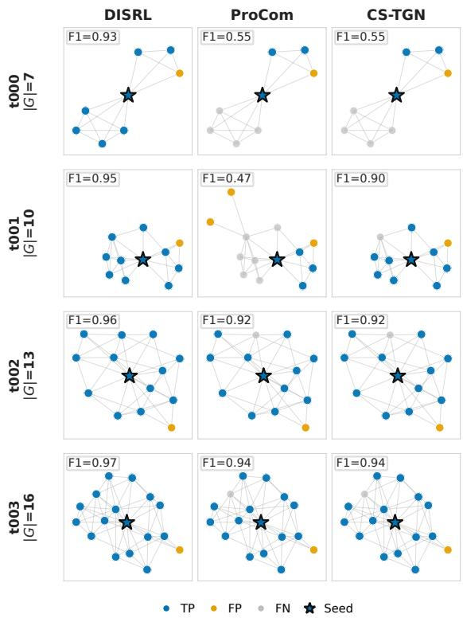  
Figure 6: DBLP case study over four snapshots. Rows show snapshots and columns show methods; each panel reports F1. The target community grows from 7 to 16 nodes.

## D Eficiency Study

To evaluate the computational eficiency of DISRL, we benchmark its wall-clock execution time against competitive baselines under the expansion&shrinkage setting. As illustrated in Fig. 7, DISRL consistently outperforms all baselines, achieving the lowest execution latency across all three datasets. Compared with CS-TGN, DISRL obtains 1.96×, 4.78×, and 10.35× speedups, respectively. The advantage is especially clear on Twitter, where the larger and denser topology increases the cost of repeatedly processing temporal graph structures. The eficiency diference comes from the execution patterns of the compared methods. CS-TGN learns temporal GNN representations over all snapshot graphs and repeatedly scans training queries across epochs. SLRL retrains a local detector for each seed-snapshot pair, where each detector performs two optimization rounds and repeatedly updates the expander across multiple epochs. SLSS incurs costly similar-community matching during community expansion, while QTCS is slowed by seed-wise TPPR-guided ALS search over temporal transition states. In contrast, DISRL performs policy adaptation on a compact Top-� seed-specific relevant supervision set and localized subgraphs, avoiding full-graph temporal representation learning.

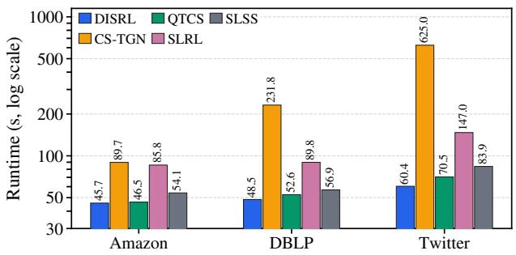  
Figure 7: Eficiency comparison under the expansion&shrinkage setting. The reported runtime is normalized per target seed per snapshot over 50 independent queries.