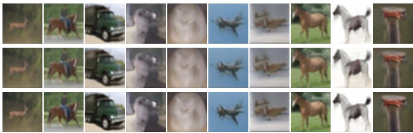
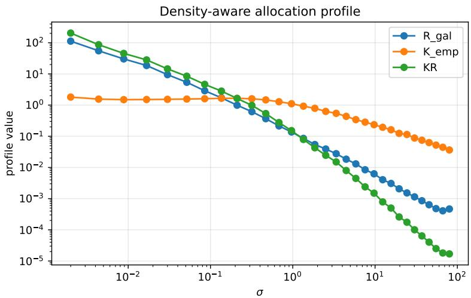
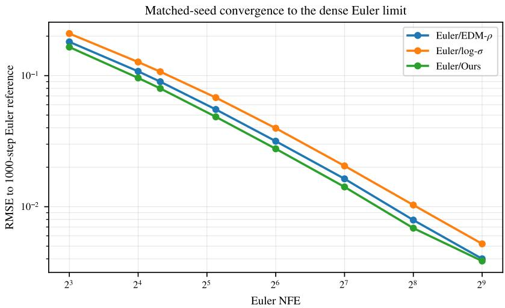
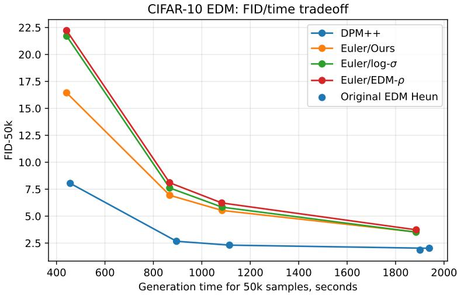
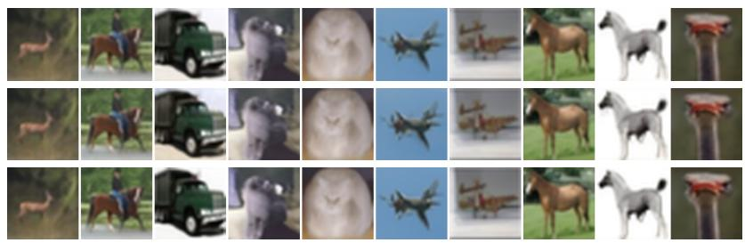
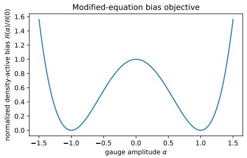
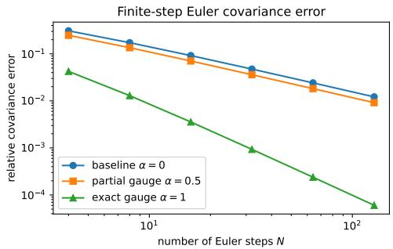
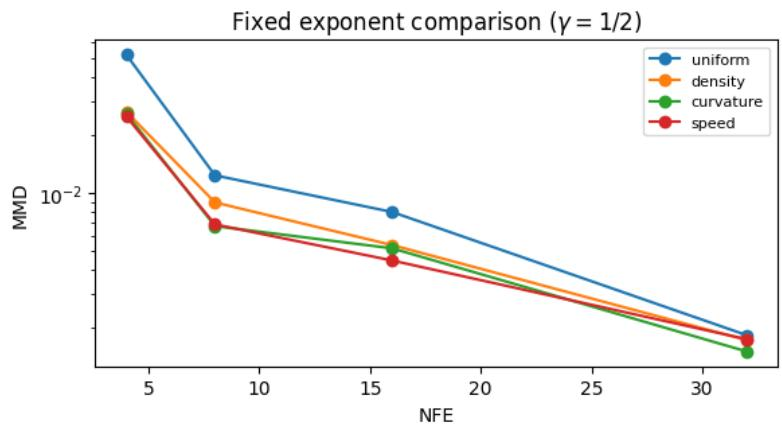
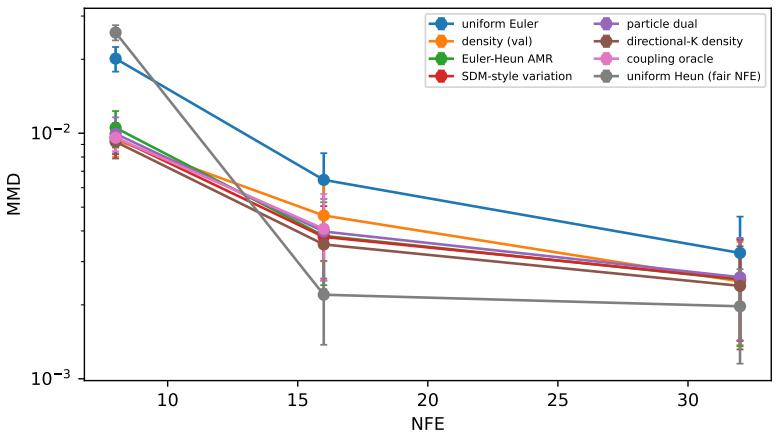
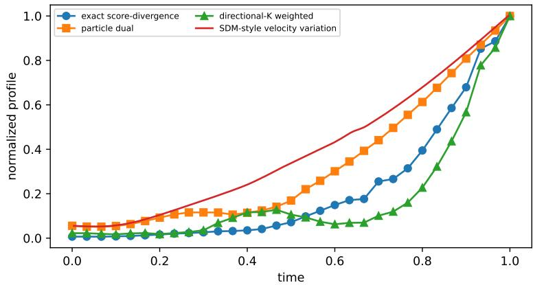

# Density-Level Backward Error for Low-NFE Generative Flows

Ewsey Obzherin1,2 Valentin Khrulkov1

1FusionBrain Lab 2MIRIAI

## ABSTRACT

Low-NFE generative ODE sampling is constrained not only by solver order, but also by how a fixed budget of network evaluations is distributed along the flow. We develop a density-level backward-error framework that identifies the component of a solver’s modified-equation defect that changes the evolving marginal, while excluding solenoidal trajectory distortion that is invisible in Wasserstein tangent geometry. The resulting residual induces a solver-order-aware compute-allocation rule and, through gauge freedom, an objective for selecting numerically favorable velocity representatives of the same density path. This separates our approach from schedule search driven by trajectory or endpoint surrogates and from higherorder solver design. Exact Gaussian and mixture models establish the mechanism, including cases where curvature-based allocation fails and continuum-optimal transport is not discretization-optimal. On a pretrained CIFAR-10 EDM probabilityflow ODE, density-aware allocation consistently improves fixed-update Euler sampling in the low-NFE regime. Matched-seed convergence to a dense Euler reference confirms that the method accelerates approximation of the same high-NFE flow rather than changing the asymptotic sampler.

## 1 INTRODUCTION

Diffusion and flow-based generators sample by numerically integrating a learned time-dependent velocity field. Let $v _ { t }$ be a reference velocity transporting a prescribed density path $p _ { t }$ through

$$
\begin{array} { r } { \partial _ { t } p _ { t } + \nabla \cdot ( p _ { t } v _ { t } ) = 0 . } \end{array}\tag{1}
$$

When only a few network evaluations are available, generation quality depends not only on the learned field and solver formula, but also on where those evaluations are placed along the path.

Timestep design has therefore become an optimization problem in its own right. Align Your Steps optimizes schedules for a given solver, model, and dataset; optimized-time-step methods fit nodes against a reference ODE solution; LD3 learns a discretization for a pretrained sampler; Optimal Stepsize Distillation uses dynamic programming over reference trajectories; and differentiable solver search jointly tunes timesteps and solver coefficients (Sabour et al., 2024; Xue et al., 2024; Tong et al., 2025; Pei et al., 2025; Wang et al., 2025). These methods show that evaluation placement matters. They do not, however, isolate which part of a local numerical defect changes the evolving marginal, nor do they use the fact that several velocity fields can generate the same density path.

Three design variables should therefore be separated. Solver design chooses the update formula. Schedule design chooses where that formula evaluates the field. Representative design chooses which velocity field to discretize when several fields generate the same continuum marginals. Our paper connects the last two through density-level backward error.

To make this non-uniqueness explicit, define ${ \mathcal { U } } _ { p } = \{ { \boldsymbol { u } } : \nabla \cdot ( p _ { t } \boldsymbol { u } _ { t } ) = 0$ for almost every t}. If $u \in \mathcal { U } _ { p } ,$ , then $w = v + u$ generates the same continuum density curve as v, although a finite numerical map need not preserve this equivalence. A trajectory-level defect can therefore contain substantial particle motion that is invisible to the marginal. The relevant question is not simply where is the ODE difficult?, but which part of the solver defect moves probability mass?

This also separates continuum and finite-step optimality. Probability-flow endpoint maps coincide with quadratic Monge maps in important Gaussian and symmetric settings (Khrulkov et al., 2023), but not in general (Lavenant & Santambrogio, 2022). Here the density curve $p _ { t }$ is fixed. We ask which continuum-equivalent velocity representative and which timestep grid make the discrete transport maps most accurate in $W _ { 2 }$ . Even for isotropic Gaussians, the minimum-action gradient representative can be less accurate for Euler than a non-gradient marginal-preserving representative.

Let $\Psi _ { h } ^ { w }$ be one numerical step for a representative $w ,$ and suppose an order-r method admits the local modified field

$$
w _ { h } = w + h ^ { r } { \mathcal E } _ { r } [ w ] + O ( h ^ { r + 1 } ) .\tag{2}
$$

Write $P _ { \nabla , p _ { t } }$ for the $L ^ { 2 } ( p _ { t } )$ -orthogonal projection onto gradient fields. This projection keeps the Wasserstein tangent component that changes the marginal and removes marginal-invisible solenoidal motion. Our central local result is

$$
( \Psi _ { h } ^ { w } ) _ { \# } p _ { t } - p _ { t + h } = - h ^ { r + 1 } \nabla \cdot ( p _ { t } \mathcal { E } _ { r } [ w ] ) + o ( h ^ { r + 1 } ) ,\tag{3}
$$

$$
W _ { 2 } ( ( \Psi _ { h } ^ { w } ) _ { \# } p _ { t } , p _ { t + h } ) = h ^ { r + 1 } \left. P _ { \nabla , p _ { t } } \mathcal { E } _ { r } [ w ] \right. _ { L ^ { 2 } ( p _ { t } ) } + o ( h ^ { r + 1 } ) .\tag{4}
$$

For Euler, $\mathcal { E } _ { 1 } [ w ] = - \frac { 1 } { 2 } a _ { w }$ with $a _ { w } = \partial _ { t } w + \nabla$ w w. Thus the projected modified-equation defect, rather than the full trajectory defect, determines the leading marginal error.

This separates continuum transport optimality from two finite-solver questions: where to place evaluations and which continuum-equivalent field to discretize.

## Contributions.

1. Density-level backward error. We project the first nonzero modified-equation differential onto the weighted Wasserstein tangent space. Equations $\textcircled { 3 } - \textcircled { 4 }$ identify its norm with the leading local marginal $W _ { 2 }$ defect and discard solenoidal motion that is invisible to the density.

2. Finite-budget compute allocation. Let $R _ { r } ( t ) = \| P _ { \nabla , p _ { t } } \mathcal { E } _ { r } [ w ] \| _ { L ^ { 2 } ( p _ { t } ) }$ , and let $K ( 1 , t )$ denote the amplification of a density perturbation introduced at time t and propagated to terminal time. Then

$$
n ^ { \star } ( t ) \propto [ K ( 1 , t ) R _ { r } ( t ) ] ^ { 1 / ( r + 1 ) } .
$$

The solver order fixes the exponent; the associated quantile grid exactly minimizes the finite-N local surrogate defined in Section 6, and a Renyi identity quantifies residual ´ misspecification.

3. Solver-aware representative selection. Among fields $w = v + u$ with $u \in \mathcal { U } _ { p }$ , we define a continuum solver objective. For Euler, renormalized discrete local- $. W _ { 2 }$ objectives converge uniformly—and hence Γ-converge—to this functional. Gaussian paths give explicit controls and separate continuum minimum action from finite-step solver accuracy.

4. Mechanism-aligned validation. Analytic Gaussian and mixture experiments test the projected defect, propagation, and representative-selection predictions. On pretrained CIFAR-10 EDM, we keep the Euler update fixed and change only the timestep grid. A dense-reference study verifies faster convergence to the same high-NFE Euler limit rather than a change of the target sampler.

Two optimization problems. Representative selection minimizes

$$
\operatorname* { m i n } _ { u \in \mathcal { U } _ { p } } \mathcal { B } ( v + u ) , \qquad \mathcal { B } ( w ) = \frac { 1 } { 2 } \int _ { 0 } ^ { 1 } \| P _ { \nabla , p _ { t } } a [ w ] \| _ { L ^ { 2 } ( p _ { t } ) } ^ { 2 } d t .
$$

For an order-r solver, let $W _ { r } ( t ) = K ( 1 , t ) R _ { r } ( t )$ . Timestep allocation solves

$$
\operatorname* { m i n } _ { n > 0 } \int _ { 0 } ^ { 1 } W _ { r } ( t ) n ( t ) ^ { - r } d t \quad \mathrm { s . t . } \quad \int _ { 0 } ^ { 1 } n ( t ) d t = N .
$$

The first problem chooses a continuum-equivalent velocity field for a fixed solver; the second distributes that solver’s evaluation budget along the path.

The empirical comparisons keep this separation explicit. Euler schedules use the same network, update rule, NFE, and sampling cost. DPM++ and the original EDM Heun sampler are shown only

as stronger-solver context: they change the integration formula, whereas our method changes where a fixed first-order solver spends its evaluations. The offline allocation profile is reusable across generated samples and NFE choices.

## 2 RELATED WORK AND POSITIONING

Generative flows and optimal transport. Continuous normalizing flows and neural ODEs formulate generation as numerical integration of a learned velocity field (Chen et al., 2018). Diffusion and score-based models admit probability-flow ODE descriptions (Ho et al., 2020; Song et al., 2021), while flow matching directly regresses vector fields for prescribed probability paths (Lipman et al., 2023; Albergo et al., 2023). Rectified and multisample flow matching simplify transport through straighter trajectories or improved couplings (Liu et al., 2023; Pooladian et al., 2023). Probability-flow endpoint maps agree with quadratic optimal transport in important structured cases (Khrulkov et al., 2023), but not universally (Lavenant & Santambrogio, 2022). These works concern the continuum path or endpoint map. We fix the marginal curve and optimize the numerical realization of its gauge-equivalent lifts. This also differs from Wasserstein spline and second-order transport models, which optimize the curve itself (Benamou et al., 2019).

Solver and schedule optimization. Backward error analysis and B-series modified equations are classical in geometric numerical integration (Hairer et al., 2006) and have been applied to diffusion sampling (Gao et al., 2023); the probability-flow ODE also admits nonasymptotic convergence analyses (Chen et al., 2023). Solver design ranges from the EDM Heun construction to DPM-Solver and empirical-statistics refinements (Karras et al., 2022; Lu et al., 2022; Zheng et al., 2023).

A complementary line optimizes the discretization itself. Align Your Steps uses stochastic-calculus objectives specialized to a solver, model, and data distribution (Sabour et al., 2024). Xue et al. (2024) optimize time nodes by comparing the numerical and reference ODE solutions. LD3 learns a lightweight discretization for pretrained samplers (Tong et al., 2025), while Optimal Stepsize Distillation applies dynamic programming to reference trajectories (Pei et al., 2025). Differentiable Solver Search jointly searches timesteps and solver coefficients (Wang et al., 2025). Adaptive step control, Wasserstein-bounded schedules, continuous-time clock control, and instance-aware grids further enlarge the schedule class (Chen et al., 2024; Jo & Choi, 2026; Huang et al., 2026; Yuan et al., 2026). Our contribution is orthogonal to how that class is searched: we derive the local quantity to allocate by projecting the first modified-equation differential through the continuity equation. This yields a marginal residual, a solver-order exponent, and an additional optimization variable—the marginal-preserving velocity representative.

Gauge freedom and marginal observability. The non-uniqueness of a velocity field realizing a fixed density path is increasingly visible in diffusion and flow modeling. Horvat & Pfister (2024) analyze gauge freedom and conservativity; recent work separates gradient and solenoidal components by marginal observability (Khelifa et al., 2026). EDDY uses divergence-free freedom for marginalpreserving particle diversity (Vinograd et al., 2026), while Gauge Flow Models, Flux Matching, and Wasserstein-flow reinterpretations treat the field itself as a design variable (Strunk & Assam, 2025; Pao-Huang et al., 2026; Vuong et al., 2025). Curvature minimization and strain/vorticity decompositions instead diagnose trajectory-level integration difficulty (Lee et al., 2023; Tao & Choi, 2026). We apply the weighted Hodge projection to the solver’s modified-equation defect: only its gradient component contributes to the leading marginal W error, and the remaining gauge freedom can be optimized for numerical integrability.

Optimization viewpoint. The schedule layer is a continuous resource-allocation problem, whereas representative selection is a PDE-constrained optimization problem with weighted Poisson projections. This connects the construction to computational optimal transport and Wasserstein geometry (Benamou & Brenier, 2000; Otto, 2001; Ambrosio et al., 2008; Villani, 2009; Santambrogio, 2015) and to PDE-constrained optimization (Hinze et al., 2009). The local theorem provides an exact solver-level bridge, while the variational limit connects the discrete and continuum optimization problems. Exact Gaussian analyses of diffusion discretization provide a complementary controlled perspective (Pierret & Galerne, 2025).

## 3 MARGINAL-PRESERVING GAUGES

Analytic setting. Throughout the main text we work on either the flat torus $\mathbb { T } ^ { d } .$ , a smooth compact boundaryless domain, or $\mathbf { \overline { { \mathbb { R } } } } ^ { d }$ with sufficient decay so that all integrations by parts below have no boundary contribution. We assume $p _ { t } > 0 , \int p _ { t } = 1$ , and enough smoothness of $p _ { t }$ and the vector fields to justify the displayed identities; a convenient sufficient condition is $p \in C _ { t , x } ^ { 2 }$ and $v , u \in C _ { t } ^ { 1 } C _ { x } ^ { 2 }$ with bounded derivatives on compact time intervals. On $\mathbb { R } ^ { d }$ test functions are compactly supported unless stronger decay is imposed. All divergence constraints may equivalently be read in the weak sense. Let $\overset { \smile } { T } = { C } ^ { \infty } \dot { (} M ) / \mathbb { R }$ on a compact boundaryless domain and $\dot { \mathcal { T } } = C _ { c } ^ { \infty } \dot { ( \mathbb { R } ^ { d } ) }$ in the Euclidean case.

Definition 1 (Solenoidal gauge class). For a fixed density $p _ { t } ,$ , define

$$
\mathcal { U } _ { p _ { t } } = \left\{ u \in L ^ { 2 } ( p _ { t } ) : \int p _ { t } \langle u , \nabla \phi \rangle d x = 0 \quad \forall \phi \in \mathcal { T } \right\} .\tag{5}
$$

For smooth fields this is equivalent to $\nabla \cdot \left( p _ { t } \boldsymbol { u } _ { t } \right) = 0$ in distributions. Over time we write ${ \mathcal { U } } _ { p } = \{ u _ { t } \in { \dot { \mathcal { U } } } _ { p _ { t } } f o r a . e . \ t \}$ and the representative fiber as $\mathcal { G } ( v , p ) = v + \mathcal { U } _ { p }$

Proposition 1 (Gauge invariance). ${ \mathit { I f v } } _ { t }$ satisfies equation 1 and $u _ { t } \in \mathcal { U } _ { p } ,$ , then $w _ { t } = v _ { t } + u _ { t }$ satisfies

$$
\begin{array} { r } { \partial _ { t } p _ { t } + \nabla \cdot \left( p _ { t } w _ { t } \right) = 0 . } \end{array}\tag{6}
$$

Proof. By linearity,

$$
\begin{array} { r } { \partial _ { t } p _ { t } + \nabla \cdot ( p _ { t } ( v _ { t } + u _ { t } ) ) = \partial _ { t } p _ { t } + \nabla \cdot ( p _ { t } v _ { t } ) + \nabla \cdot ( p _ { t } u _ { t } ) = 0 . } \end{array}
$$

The proposition is elementary, but it defines the feasible set of the optimization problem. In one dimension, this feasible set is trivial under standard decay assumptions: $\mathbf { \bar { \partial } } _ { x } ( p _ { t } u _ { t } ) = \mathbf { \bar { 0 } }$ implies $p _ { t } u _ { t } =$ $c ( t )$ , and decay gives $c ( t ) = 0$ . Hence nontrivial gauge optimization is intrinsically multidimensional.

## 4 SOLVER-AWARE DENSITY DEFECT

Let $\Psi _ { h } ^ { w }$ denote one step of a numerical method applied to the non-autonomous ODE $\dot { x } _ { t } = w _ { t } ( x _ { t } )$ We use the extended system $( x , \tau ) ^ { \prime } = ( w _ { \tau } ( x ) , 1 )$ when invoking modified-equation expansions.

Definition 2 (Leading modified-equation differential). An order-r method is said to admit a first modified differential $\bar { \mathcal { E } } _ { r } [ w ]$ on a class $\boldsymbol { \mathcal { A } } \boldsymbol { i } f$ its local modifiedfield satisfies

$$
w _ { h } = w + h ^ { r } \mathcal { E } _ { r } [ w ] + h ^ { r + 1 } \rho _ { h } [ w ] , \qquad \operatorname* { s u p } _ { w \in \mathcal { A } , h < h _ { 0 } } \| \rho _ { h } [ w ] \| _ { C _ { x } ^ { 1 } } < \infty .\tag{7}
$$

Theorem 1 (Solver-aware density-level backward error). Suppose $w _ { t }$ transports $p _ { t }$ and equation 7 holds. Then

$$
\partial _ { t } p _ { t } + \nabla \cdot ( p _ { t } \boldsymbol { w } _ { h } ) = h ^ { r } \nabla \cdot ( p _ { t } \mathcal { E } _ { r } [ \boldsymbol { w } ] ) + O ( h ^ { r + 1 } )\tag{8}
$$

in distributions and in any negative Sobolev norm controlled by the stated remainder. Over one step,

$$
( \Psi _ { h } ^ { w } ) _ { \# } p _ { t } - p _ { t + h } = - h ^ { r + 1 } \nabla \cdot ( p _ { t } \mathcal { E } _ { r } [ w ] ) + o ( h ^ { r + 1 } ) .\tag{9}
$$

The first identity is immediate after subtracting the continuity equation; the second integrates the $h ^ { r }$ velocity perturbation for time h. Appendix H gives a weak proof and records the uniformity needed later.

Euler specialization. The exact solution has

$$
x ( t + h ) = x + h w _ { t } ( x ) + \frac { h ^ { 2 } } { 2 } a _ { w } ( x , t ) + O ( h ^ { 3 } ) , \qquad a _ { w } = \partial _ { t } w + \nabla w w .
$$

Hence explicit Euler has

$$
{ \mathcal E } _ { 1 } [ w ] = - \frac 1 2 a _ { w } , \qquad w _ { h } = w - \frac h 2 a _ { w } + O ( h ^ { 2 } ) ,\tag{10}
$$

and equation 8 becomes

$$
\partial _ { t } p _ { t } + \nabla \cdot \left( p _ { t } \boldsymbol { w } _ { h } \right) = - \frac { h } { 2 } \nabla \cdot \left( p _ { t } \boldsymbol { a } _ { w } \right) + O ( h ^ { 2 } ) .\tag{11}
$$

Thus the familiar Euler acceleration is one instance of a general object: the first modified-equation differential seen through weighted divergence. For midpoint or Heun, the first nonzero object is $\mathcal { E } _ { 2 } [ w ]$ and enters at order $h ^ { 2 ^ { \dagger } }$ in the modified field.

## 5 DENSITY-ACTIVE WASSERSTEIN GEOMETRY

Equip $L ^ { 2 } ( p _ { t } )$ with $\begin{array} { r } { \langle r , s \rangle _ { p _ { t } } = \int p _ { t } \langle r , s \rangle } \end{array}$ dx and define

$$
\mathcal { G } _ { p _ { t } } = \overline { { \left\{ \nabla \phi : \phi \in \mathcal { T } \right\} } } ^ { L ^ { 2 } \left( p _ { t } \right) } ,
$$

where $\tau$ is the test-function space fixed in Section 3. The gauge definition gives the orthogonal splitting

$$
L ^ { 2 } ( p _ { t } ) = { \mathcal G } _ { p _ { t } } \oplus { \mathcal U } _ { p _ { t } } .\tag{12}
$$

Write $P _ { \nabla , p _ { t } }$ for the gradient projection. Weakly, $P _ { \nabla , p _ { t } } z = \nabla \phi$ is characterized by

$$
\int p _ { t } \langle \nabla \phi , \nabla \psi \rangle d x = \int p _ { t } \langle z , \nabla \psi \rangle d x ,\tag{13}
$$

or, in strong form,

$$
\nabla \cdot ( p _ { t } \nabla \phi ) = \nabla \cdot ( p _ { t } z ) .\tag{14}
$$

Definition 3 (Weighted negative norm). For a mean-zero distribution f, let

$$
\| f \| _ { \dot { H } ^ { - 1 } ( p _ { t } ) } = \operatorname* { s u p } _ { \| \nabla \psi \| _ { L ^ { 2 } ( p _ { t } ) } \leq 1 } \langle f , \psi \rangle .\tag{15}
$$

Proposition 2 (Density-active projection). For every sufficiently regular field z,

$$
\nabla \cdot ( p _ { t } z ) = \nabla \cdot ( p _ { t } P _ { \nabla , p _ { t } } z ) , \qquad \| \nabla \cdot ( p _ { t } z ) \| _ { \dot { H } ^ { - 1 } ( p _ { t } ) } = \| P _ { \nabla , p _ { t } } z \| _ { L ^ { 2 } ( p _ { t } ) } .\tag{16}
$$

Proof. The solenoidal component is orthogonal to every test gradient, so it vanishes both under weighted divergence and in the dual norm. The remaining supremum is the Hilbert norm of the gradient projection. □

Apply the proposition to $z = \mathcal { E } _ { r } [ w ]$ and define the solver-aware local residual

$$
R _ { r } [ \boldsymbol { w } ] ( t ) : = \| P _ { \nabla , p _ { t } } \mathcal { E } _ { r } [ \boldsymbol { w } ] \| _ { L ^ { 2 } ( p _ { t } ) } = \| \nabla \cdot ( p _ { t } \mathcal { E } _ { r } [ \boldsymbol { w } ] ) \| _ { \dot { H } ^ { - 1 } ( p _ { t } ) } .\tag{17}
$$

Theorem 2 (Local Wasserstein defect for an order-r method). Under the regular Wassersteinchart and uniformity assumptions of Appendix H,

$$
W _ { 2 } ( ( \Psi _ { h } ^ { w } ) _ { \# } p _ { t } , p _ { t + h } ) = h ^ { r + 1 } R _ { r } [ w ] ( t ) + o ( h ^ { r + 1 } ) .\tag{18}
$$

For Euler this is

$$
W _ { 2 } ( ( \mathrm { I d } + h w _ { t } ) _ { \# } p _ { t } , p _ { t + h } ) = \frac { h ^ { 2 } } { 2 } \| P _ { \nabla , p _ { t } } a _ { w } \| _ { L ^ { 2 } ( p _ { t } ) } + o ( h ^ { 2 } ) .\tag{19}
$$

The theorem turns the modified-equation residual into a Wasserstein tangent norm rather than a heuristic indicator. It also defines a solver-dependent gauge objective

$$
B _ { r } ( w ) = \frac { 1 } { 2 } \int _ { 0 } ^ { 1 } R _ { r } [ w ] ( t ) ^ { 2 } d t .\tag{20}
$$

For Euler, $\boldsymbol { B } _ { 1 } = \boldsymbol { B } / 4$ , where

$$
B ( w ) = \frac { 1 } { 2 } \int _ { 0 } ^ { 1 } \| P _ { \nabla , p _ { t } } a _ { w } \| _ { L ^ { 2 } ( p _ { t } ) } ^ { 2 } d t ;\tag{21}
$$

the constant does not affect representative selection.

Solver-aware transport chain.

$$
\begin{array} { r } { \mathcal { E } _ { r } [ w ] \xrightarrow { P _ { \nabla , p _ { t } } } R _ { r } ( t ) \xrightarrow { K ( 1 , t ) } K ( 1 , t ) R _ { r } ( t ) \xrightarrow { \int n = N } n ^ { \star } ( t ) . } \end{array}
$$

Only the horizontal component contributes to the leading marginal defect. Large pt-solenoidal modified differentials may bend particle trajectories without producing leading density error.

## 6 SOLVER-ORDER TIMESTEP ALLOCATION

Let $R _ { r } ( t )$ be the geometric residual in equation 17. A local defect may be amplified before terminal time. For the transport evolution $U _ { w } ( 1 , \bar { t } )$ , assume

$$
\| U _ { w } ( 1 , t ) f \| _ { X } \leq K ( 1 , t ) \| f \| _ { Y } .\tag{22}
$$

Theorem 3 (Propagated order-r density defect). Under the differentiability and modified-equation assumptions in Appendices L and H, a smooth local step profile $h ( t )$ satisfies

$$
\| p _ { 1 } ^ { \mathrm { n u m } } - p _ { 1 } \| _ { X } \leq \int _ { 0 } ^ { 1 } K ( 1 , t ) h ( t ) ^ { r } \| \nabla \cdot ( p _ { t } \mathcal { E } _ { r } [ w ] ) \| _ { Y } d t + O ( \| h \| _ { \infty } ^ { r + 1 } ) .\tag{23}
$$

For the canonical source norm $Y = \dot { H } ^ { - 1 } ( p _ { t } )$ , Proposition 2 identifies the integrand with $R _ { r } ( t )$ . The terminally weighted residual is therefore $\dot { W } _ { r } ( t ) \dot { = } K ( 1 , t ) R _ { r } ( t )$ . If $n ( t )$ dt steps are placed in $d t .$ then $h ( t ) \overset { \cdot } { \simeq } n ( \overline { { t } } ) ^ { - 1 }$ and the accumulated leading defect is

$$
\mathcal { T } _ { r } [ n ] = \int _ { 0 } ^ { 1 } W _ { r } ( t ) n ( t ) ^ { - r } d t , \qquad \int _ { 0 } ^ { 1 } n ( t ) d t = N .\tag{24}
$$

For a generic exponent $q > 0$ we use $\begin{array} { r } { \mathcal { I } _ { q } ^ { W } [ n ] = \int _ { 0 } ^ { 1 } W ( t ) n ( t ) ^ { - q } d t } \end{array}$

Theorem 4 (Solver-order allocation and finite-N surrogate). Let $W > 0 , q > 0$ , and $\alpha =$ $( q + 1 ) ^ { - 1 }$ . The unique continuous minimizer of $\int W n ^ { - q }$ under $\textstyle \int n = N$ is

$$
n ^ { \star } ( t ) = \frac { N W ( t ) ^ { \alpha } } { Z } , \qquad Z = \int _ { 0 } ^ { 1 } W ( s ) ^ { \alpha } d s .\tag{25}
$$

For any partition $\pi = \{ 0 = t _ { 0 } < \cdots < t _ { N } = 1 \}$ define

$$
S _ { q } ( \pi ) = \sum _ { k = 0 } ^ { N - 1 } \left( \int _ { t _ { k } } ^ { t _ { k + 1 } } W ( t ) ^ { \alpha } d t \right) ^ { q + 1 } .\tag{26}
$$

Then

$$
\begin{array} { l } { \displaystyle { S _ { q } ( \pi ) \geq \frac { Z ^ { q + 1 } } { N ^ { q } } , } } \end{array}\tag{27}
$$

with equality exactly when

$$
\int _ { 0 } ^ { t _ { k } } W ( t ) ^ { \alpha } d t = { \frac { k } { N } } Z .\tag{28}
$$

The continuous law follows from the KKT equation $- q W n ^ { - q - 1 } + \lambda = 0$ . For the finite-N surrogate $\textstyle S _ { q } ,$ , strict convexity applied to the interval masses $\begin{array} { r } { a _ { k } = \int _ { t _ { k } } ^ { t _ { k + 1 } } W ^ { \alpha } } \end{array}$ gives the exact quantile minimizer. This is exact finite-N surrogate optimality; it is not a claim that the same grid exactly minimizes the full nonlinear terminal error. For an order-r solver, $q = r ,$ so

$$
n ^ { \star } ( t ) \propto [ K ( 1 , t ) R _ { r } ( t ) ] ^ { 1 / ( r + 1 ) } .\tag{29}
$$

Euler, second-order, and third-order methods therefore use powers $1 / 2 , 1 / 3 ,$ and $1 / 4 ,$ , respectively. The quantile rule in equation 28 directly converts the continuous optimum into a realizable mesh; its local step asymptotics and $O ( N ^ { - 2 } )$ endpoint approximation are stated in Appendix H.

## 6.1 ALLOCATION ROBUSTNESS AND PROPAGATION

Suppose a schedule is built from $\widehat { W }$ instead of W. Let

$$
\rho = \frac { W ^ { \alpha } } { Z } , \qquad \widehat { \rho } = \frac { \widehat { W } ^ { \alpha } } { \widehat { Z } } .\tag{30}
$$

Theorem 5 (Exact schedule degradation). For $\widehat { n } = N \widehat { \rho } ,$

$$
\frac { \mathcal { I } _ { q } ^ { W } [ \widehat { n } ] } { \mathcal { I } _ { q } ^ { W } [ n ^ { \star } ] } = \int _ { 0 } ^ { 1 } \rho ^ { q + 1 } \widehat { \rho } ^ { - q } d t = \exp ( q D _ { q + 1 } ( \rho \| \widehat { \rho } ) ) .\tag{31}
$$

For Euler,

$$
\frac { \mathcal { I } _ { 1 } ^ { W } [ \widehat { n } ] } { \mathcal { I } _ { 1 } ^ { W } [ n ^ { \star } ] } = 1 + \chi ^ { 2 } ( \rho \| \widehat { \rho } ) .\tag{32}
$$

$$
I f | \log ( \widehat { W } / W ) | \leq \varepsilon , t h e r a t i o i s a t m o s t \exp ( 2 q \varepsilon / ( q + 1 ) ) .
$$

Thus schedule quality depends on the normalized allocation density, not on the absolute scale of the residual. The regularization $W _ { \varepsilon } = \varepsilon + R$ ensures positivity and controls sensitivity near zeros.

Propagation weighting is structurally consequential: even for a constant local residual, Appendix H constructs smooth scalar flows for which the residual-only objective ratio grows as $\sqrt { M } / 4 \to \infty$ relative to the propagation-aware optimum.

The proofs of Theorems 4 and 5, together with the mesh asymptotics and the propagation-separation construction, are collected in Appendix H.

Practical residual estimation. The theory uses $R _ { r } ( t ) = \| P _ { \nabla , p _ { t } } \mathcal { E } _ { r } [ w ] \| _ { L ^ { 2 } ( p _ { t } ) }$ . Controlled Euler experiments also use the score–divergence proxy

$$
\widehat { R } _ { \mathrm { d e n s } } ( t ) = \| p _ { t } ^ { - 1 } \nabla \cdot ( p _ { t } a _ { w } ) \| _ { L ^ { 2 } ( p _ { t } ) } ,\tag{33}
$$

which upper-controls, but is not identical to, the geometric norm under a weighted Poincare inequality.´ CIFAR-10 instead uses a Galerkin projection and empirical propagation; Appendix D validates a particle-only estimator against the exact controlled residual.

## 7 GAUGE OPTIMIZATION AND ITS DISCRETE LIMIT

For Euler, the representative-selection problem is

$$
\operatorname* { m i n } _ { u \in \mathcal { U } _ { p } } \mathcal { B } ( v + u ) , \qquad \mathcal { B } ( w ) = \frac { 1 } { 2 } \int _ { 0 } ^ { 1 } \| P _ { \nabla , p _ { t } } a [ w ] \| _ { L ^ { 2 } ( p _ { t } ) } ^ { 2 } d t .\tag{34}
$$

The first variation, projected descent, KKT system, and weighted-Poisson projection are given in Appendix I. The feasible direction is the solenoidal projection of the ambient gradient, so the optimization remains inside the fiber of fields that realize the same density path.

Why optimize a continuum functional when the target is a finite-step solver? For a partition $\pi ,$ define the discrete local- $- W _ { 2 }$ objective

$$
\mathcal { B } _ { \pi } ( w ) = \sum _ { k = 0 } ^ { N - 1 } \frac { 2 } { h _ { k } ^ { 3 } } W _ { 2 } ^ { 2 } \big ( ( \operatorname { I d } + h _ { k } w _ { t _ { k } } ) _ { \# } p _ { t _ { k } } , p _ { t _ { k + 1 } } \big ) , \qquad h _ { k } = t _ { k + 1 } - t _ { k } .\tag{35}
$$

Theorem 6 (Γ-limit of discrete Euler gauge optimization). Let $\mathcal { A } \subset v + \mathcal { U } _ { p }$ be compact in a topology τ . Assume the Euler local-W2 expansion is uniform on ${ \mathcal { A } } ,$ its $\bar { O ( } h ^ { 3 } )$ remainder is uniformly bounded, and $t \mapsto \| P _ { \nabla , p _ { t } } a [ w ] \| ^ { 2 }$ is uniformly Lipschitz over w $\in { \mathcal { A } }$ . Then

$$
\operatorname* { s u p } _ { w \in \mathcal { A } } | B _ { \pi } ( w ) - \mathcal { B } ( w ) | \leq C | \pi | \longrightarrow 0 .\tag{36}
$$

Consequently $B _ { \pi } \stackrel { \Gamma } {  }$ B in $\tau .$ Every convergent sequence ofdiscrete minimizers has a continuumminimizing limit. The same conclusion holds on noncompact admissible sets when an added regularizer makes the objectives equicoercive.

Thus the continuum representative-selection problem is the variational limit of the discrete solver objective, not merely an analogy suggested by backward error. Appendix H gives the proof and the regularized equicoercive form.

Classical optimal transport selects a horizontal lift by minimizing continuum kinetic energy. Here the prescribed marginal curve is held fixed, while the chosen numerical method induces a second horizontal criterion: minimize the local transport defect of its discrete maps. This complements endpoint-map interpretations of probability-flow ODEs in Gaussian settings (Khrulkov et al., 2023) and the classical Otto–Benamou–Brenier geometry (Benamou & Brenier, 2000; Otto, 2001).

Gaussian exact control. For $p _ { t } = \mathcal { N } ( 0 , \Sigma _ { t } )$ and $w _ { t } ( x ) = B _ { t } x$ , continuum transport and zero leading Euler bias reduce to

$$
B _ { t } \Sigma _ { t } + \Sigma _ { t } B _ { t } ^ { \top } = \dot { \Sigma } _ { t } , \qquad 2 B _ { t } \Sigma _ { t } B _ { t } ^ { \top } = \ddot { \Sigma } _ { t } .\tag{37}
$$

For $\Sigma _ { t } = s ( t ) ^ { 2 } I _ { d }$ , feasible lifts are $B _ { t } = ( \dot { s } / s ) I _ { d } + A _ { t } , A _ { t } ^ { \top } = - A _ { t }$ , and cancellation requires

$$
A _ { t } ^ { 2 } = - \frac { \ddot { s } ( t ) } { s ( t ) } I _ { d } .\tag{38}
$$

When $\ddot { s } / s > 0 .$ , exact skew gauges exist in even dimension, whereas one scalar direction remains unavoidable in odd dimension; the full classification is in Appendix J.

Continuum OT optimality is not finite-step solver optimality. The radial Gaussian lift $v _ { t } =$ $( { \dot { s } } / s ) x$ is the gradient, minimum-kinetic-energy representative, yet

$$
{ \cal W } _ { 2 } ( ( \mathrm { I d } + h v _ { t } ) _ { \# } p _ { t } , p _ { t + h } ) = \frac { \sqrt d } 2 | \ddot { s } ( t ) | h ^ { 2 } + { \cal O } ( h ^ { 3 } ) .
$$

In even dimension the admissible non-gradient lift $[ ( \dot { s } / s ) I + \sqrt { \ddot { s } / s } J ] x .$ , with $J ^ { \top } = - J$ and $J ^ { 2 } = - I ,$ , cancels the leading covariance defect and achieves $O ( h ^ { 3 } )$ The same continuum density path therefore admits a Brenier-favored lift and a distinct Euler-favored lift. The gauge fiber is a genuine finite-solver control space.

## 8 CONTROLLED AND PRETRAINED VALIDATION

Controlled checks. Representative selection is tested in exact and controlled models; the pretrained experiment below isolates timestep allocation. Exact Gaussian paths recover the predicted local-W orders and the even/odd gauge obstruction. Analytic mixture paths verify the finite-N quantile surrogate, propagation weighting, and robustness of the square-root allocation. A unified hard-GMM protocol compares density-active scheduling with embedded Euler–Heun refinement, Jo–Choi velocity-variation resampling, a particle-only dual residual, propagation-aware weighting, a trajectorycoupling oracle, and fair-NFE Heun. These comparisons support competitiveness rather than uniform dominance; the same appendix validates the particle-only residual against the exact controlled profile. Full protocols and quantitative checks are in Appendices B, C, D, and E.

Pretrained EDM CIFAR-10. We integrate the deterministic probability-flow ODE of the pretrained CIFAR-10 EDM network (Karras et al., 2022) in the noise variable σ,

$$
\frac { \mathrm { d } x } { \mathrm { d } \sigma } = f _ { \sigma } ( x ) = \frac { x - D _ { \theta } ( x , \sigma ) } { \sigma } .
$$

Table 1: Pretrained CIFAR-10 EDM: FID-50k / generation time. The first block keeps the Euler update fixed and changes only timestep placement. The second block changes the solver class. FID evaluation time is excluded.
<table><tr><td>Method</td><td>8NFE</td><td>16 NFE</td><td>20 NFE</td><td>35 NFE</td></tr><tr><td colspan="5">Fixed Euler update: schedule comparison 16.4420 / 441.8s 6.9354 / 867.7s5.5274 / 1084.0s3.5285 / 1884.6s</td></tr><tr><td>Euler/Ours</td><td></td><td>21.6984 / 442.2s7.6153 / 867.4s5.8316 / 1084.3s3.5154 / 1884.7s</td><td></td><td></td></tr><tr><td>Euler/log-σ</td><td></td><td></td><td>22.2181 / 441.8s8.1022 / 867.2s6.2264 / 1082.5s 3.7318 / 1885.4s</td><td></td></tr><tr><td>Euler/EDM-ρ</td><td></td><td></td><td></td><td></td></tr><tr><td colspan="5">Stronger solver context 8.0429 / 456.8s 2.6684 / 895.6s 2.3117 / 1114.4s 2.0205 / 1939.6s</td></tr><tr><td>DPM++</td><td></td><td></td><td></td><td></td></tr><tr><td>Original EDM Heun</td><td></td><td></td><td></td><td>1.8486 / 1901.2s</td></tr></table>

  
Figure 1: Matched-seed CIFAR-10 samples at 8 NFE for the three Euler grids. Every row uses the same network and update rule; only timestep placement changes. The visual comparison therefore matches the fixed-solver claim tested by the first block of Table 1.

A single offline profile estimates the Euler modified-equation residual $\mathcal { E } _ { 1 } = ( \partial _ { \sigma } f _ { \sigma } + J f _ { \sigma } f _ { \sigma } ) / 2$ projects it onto a random-feature Wasserstein-horizontal space, and weights it by empirical terminal amplification. Euler timesteps are quantiles of $[ K _ { \mathrm { e m p } } ( \sigma ) R _ { \mathrm { g a l } } ( \sigma ) ] ^ { 1 / 2 }$ in the actual solver variable.

Within Euler, the proposed grid reduces FID relative to log-σ at 8, 16, and 20 NFE and improves over EDM-ρ at every displayed budget. The gain nearly vanishes by 35 NFE, where the first-order mesh is already dense. These rows are the direct test of the paper: network, update rule, NFE, seeds, and runtime are matched, so the only design variable is timestep placement.

DPM++ and EDM Heun address a different axis: they improve the update formula through multistep or second-order information. Their lower FID therefore measures solver design, not Euler-grid quality. Our method instead optimizes where a fixed stateless first-order solver spends its evaluations and produces an offline profile reusable across seeds and budgets. A matched-seed dense-grid study in Appendix A finds our grid closest to a 1000-step Euler reference at every tested budget from 8 to 512 NFE, while all three Euler schedules become indistinguishable at 1000 NFE. Thus the gain is faster convergence to the same Euler limit, complementary to higher-order solver engineering.

Appendix A reports the profile construction, dense-limit convergence, FID–time tradeoff, and the matched Euler comparison at 16 NFE before the controlled and proof supplements.

## 9 CONCLUSION

The density-active component of a solver’s modified equation determines its leading marginal transport error. This yields a solver-order allocation law and a representative-selection objective over marginal-preserving gauges, with a discrete-to-continuum justification for Euler. Controlled and pretrained experiments validate the mechanism, while matched-seed dense-grid convergence shows that the gain is faster approximation of the same high-NFE Euler limit. DPM++ and EDM Heun delimit the scope: they change the integration formula; ours allocates the budget of a fixed low-order solver.

## REFERENCES

Michael S. Albergo, Nicholas M. Boffi, and Eric Vanden-Eijnden. Stochastic interpolants: A unifying framework for flows and diffusions, 2023. arXiv preprint arXiv:2303.08797.

Luigi Ambrosio, Nicola Gigli, and Giuseppe Savare.´ Gradient Flows in Metric Spaces and in the Space ofProbability Measures. Birkhauser, 2008.¨

Jean-David Benamou and Yann Brenier. A computational fluid mechanics solution to the Monge– Kantorovich mass transfer problem. Numerische Mathematik, 84(3):375–393, 2000.

Jean-David Benamou, Thomas O. Gallouet, and Fran¨ c¸ois-Xavier Vialard. Second-order models for optimal transport and cubic splines on the Wasserstein space. Foundations ofComputational Mathematics, 19(5):1113–1143, 2019. doi: 10.1007/s10208-018-9389-x.

Ricky T. Q. Chen, Yulia Rubanova, Jesse Bettencourt, and David K. Duvenaud. Neural ordinary differential equations. In Advances in Neural Information Processing Systems, 2018.

Sitan Chen, Sinho Chewi, Holden Lee, Yuanzhi Li, Jianfeng Lu, and Adil Salim. The probability flow ODE is provably fast. In Advances in Neural Information Processing Systems, volume 36, pp. 68552–68575, 2023.

Yuzhu Chen, Fengxiang He, Shi Fu, Xinmei Tian, and Dacheng Tao. Adaptive time-stepping schedules for diffusion models. In Proceedings of the Fortieth Conference on Uncertainty in Artificial Intelligence, volume 244 of Proceedings of Machine Learning Research, pp. 685–697. PMLR, 2024.

Yansong Gao, Zhihong Pan, Xin Zhou, Le Kang, and Pratik Chaudhari. Fast diffusion probabilistic model sampling through the lens of backward error analysis, 2023. arXiv preprint arXiv:2304.11446.

Ernst Hairer, Christian Lubich, and Gerhard Wanner. Geometric Numerical Integration: Structure-Preserving Algorithms for Ordinary Differential Equations. Springer, 2006.

Michael Hinze, Rene Pinnau, Michael Ulbrich, and Stefan Ulbrich. Optimization with PDE Constraints. Springer, 2009.

Jonathan Ho, Ajay Jain, and Pieter Abbeel. Denoising diffusion probabilistic models. In Advances in Neural Information Processing Systems, 2020.

Christian Horvat and Jean-Pascal Pfister. On gauge freedom, conservativity and intrinsic dimensionality estimation in diffusion models. In International Conference on Learning Representations, 2024.

Yilie Huang, Wenpin Tang, and Xun Yu Zhou. ART for diffusion sampling: Continuous-time control and actor–critic learning, 2026. arXiv preprint arXiv:2607.02137.

Sangwoo Jo and Sungjoon Choi. Formalizing the sampling design space of diffusion-based generative models via adaptive solvers and wasserstein-bounded timesteps, 2026. arXiv preprint arXiv:2602.12624.

Tero Karras, Miika Aittala, Timo Aila, and Samuli Laine. Elucidating the design space of diffusionbased generative models. In Advances in Neural Information Processing Systems, volume 35, pp. 26565–26577, 2022.

Na¨ıl B. Khelifa, Richard E. Turner, and Ramji Venkataramanan. Diffusion models observe only gradients: A geometric perspective on score matching errors, 2026. arXiv preprint arXiv:2606.06179.

Valentin Khrulkov, Gleb Ryzhakov, Andrei Chertkov, and Ivan Oseledets. Understanding DDPM latent codes through optimal transport. In International Conference on Learning Representations, 2023.

Hugo Lavenant and Filippo Santambrogio. The flow map of the Fokker–Planck equation does not provide optimal transport. Applied Mathematics Letters, 133:108225, 2022. doi: 10.1016/j.aml. 2022.108225.

Sangyun Lee, Beomsu Kim, and Jong Chul Ye. Minimizing trajectory curvature of ODE-based generative models. In International Conference on Machine Learning, 2023.

Yaron Lipman, Ricky T. Q. Chen, Heli Ben-Hamu, Maximilian Nickel, and Matt Le. Flow matching for generative modeling. In International Conference on Learning Representations, 2023.

Xingchao Liu, Chengyue Gong, and Qiang Liu. Flow straight and fast: Learning to generate and transfer data with rectified flow. In International Conference on Learning Representations, 2023.

Cheng Lu, Yuhao Zhou, Fan Bao, Jianfei Chen, Chongxuan Li, and Jun Zhu. DPM-Solver: A fast ODE solver for diffusion probabilistic model sampling in around 10 steps. In Advances in Neural Information Processing Systems, 2022.

Felix Otto. The geometry of dissipative evolution equations: The porous medium equation. Communications in Partial Differential Equations, 26(1–2):101–174, 2001.

Peter Pao-Huang, Xiaojie Qiu, and Stefano Ermon. Generative modeling with flux matching, 2026. arXiv preprint arXiv:2605.07319.

Jianning Pei, Han Hu, and Shuyang Gu. Optimal stepsize for diffusion sampling, 2025. arXiv preprint arXiv:2503.21774.

Emile Pierret and Bruno Galerne. Diffusion models for gaussian distributions: Exact solutions and wasserstein errors, 2025.

Aram-Alexandre Pooladian, Heli Ben-Hamu, Carles Domingo-Enrich, Brandon Amos, and Yaron Lipman. Multisample flow matching: Straightening flows with minibatch couplings. In Proceedings ofthe 40th International Conference on Machine Learning, volume 202 of Proceedings ofMachine Learning Research, pp. 28100–28127. PMLR, 2023.

Amirmojtaba Sabour, Sanja Fidler, and Karsten Kreis. Align your steps: Optimizing sampling schedules in diffusion models. In Proceedings ofthe 41st International Conference on Machine Learning, volume 235 of Proceedings of Machine Learning Research, pp. 42947–42975. PMLR, 2024.

Filippo Santambrogio. Optimal Transportfor Applied Mathematicians. Birkhauser, 2015.¨

Yang Song, Jascha Sohl-Dickstein, Diederik P. Kingma, Abhishek Kumar, Stefano Ermon, and Ben Poole. Score-based generative modeling through stochastic differential equations. In International Conference on Learning Representations, 2021.

Alexander Strunk and Roland Assam. Gauge flow models, 2025. arXiv preprint arXiv:2507.13414.

Chenxi Tao and Seung-Kyum Choi. On the role of strain and vorticity in numerical integration error for flow matching, 2026. arXiv preprint arXiv:2605.06680.

Vinh Tong, Dung Trung Hoang, Anji Liu, Guy Van den Broeck, and Mathias Niepert. Learning to discretize denoising diffusion ODEs. In The Thirteenth International Conference on Learning Representations, 2025.

Cedric Villani. Optimal transport: Old and new, 2009.´

Gal Vinograd, Idan Achituve, and Ethan Fetaya. Diverse sampling in diffusion models with marginal preserving particle guidance, 2026. arXiv preprint arXiv:2605.06553.

An B. Vuong, Michael T. McCann, Javier E. Santos, and Yen Ting Lin. Are we really learning the score function? reinterpreting diffusion models through wasserstein gradient flow matching, 2025. arXiv preprint arXiv:2509.00336.

Shuai Wang, Zexian Li, Qipeng Zhang, Tianhui Song, Xubin Li, Tiezheng Ge, Bo Zheng, and Limin Wang. Differentiable solver search for fast diffusion sampling. In Proceedings ofthe 42nd International Conference on Machine Learning, volume 267 of Proceedings of Machine Learning Research, pp. 63549–63568. PMLR, 2025.

Shuchen Xue, Zhaoqiang Liu, Fei Chen, Shifeng Zhang, Tianyang Hu, Enze Xie, and Zhenguo Li. Accelerating diffusion sampling with optimized time steps. In Proceedings of the IEEE/CVF Conference on Computer Vision and Pattern Recognition, pp. 8292–8301, 2024.

Liangyu Yuan, Ruoyu Wang, Tong Zhao, Dingwen Fu, Mingkun Lei, Beier Zhu, and Chi Zhang. Few-step diffusion sampling through instance-aware discretizations, 2026. arXiv preprint arXiv:2603.17671.

Kaiwen Zheng, Cheng Lu, Jianfei Chen, and Jun Zhu. DPM-Solver-v3: Improved diffusion ODE solver with empirical model statistics. In Advances in Neural Information Processing Systems, volume 36, pp. 55502–55542, 2023.

## APPENDIX CONTENTS

A. Pretrained EDM CIFAR-10 Details

B. Exact Mechanism Checks

C. Hard-GMM Allocation Study

D. Unified Baselines and Estimator Validation

E. Additional Theorem-Linked Quantitative Checks

F. Applications and Optimization Relevance

G. Local Optimal-Transport Interpretation

H. Solver-Aware Extensions and Variational Limits

I. Projected Gauge Optimization

J. Exact and Obstructed Gaussian Gauges

K. Additional Projection Details

L. Propagation of the Density Defect and Cost Accounting

M. Mixtures and Practical Parameterizations

N. Additional Explicit Examples

O. Connection Viewpoint

## A PRETRAINED EDM CIFAR-10 DETAILS

This appendix expands the image-model validation from Section 8. All methods use the same classconditional pretrained EDM network, seeds 0–49999, batch size 32, and CIFAR-10 FID reference. The Euler rows in Table 1 differ only in timestep placement. DPM++ uses a second-order EDM multistep update, whereas the original EDM configuration uses a Heun-style correction with 18 steps, i.e. 35 network evaluations.

Two distinct comparisons. The direct test of the proposed method is Euler against Euler at fixed NFE: the learned field and numerical update are unchanged, and only the nodes of the grid move. DPM++ and EDM Heun instead modify the integration formula. They calibrate the accuracy of stronger solvers but do not test the timestep allocation claim. A density-active profile can also be used as a diagnostic or combined with a different solver; this paper isolates it with Euler so that the allocation effect is identifiable.

  
Figure A.1: Offline profile used by the Euler allocation: the Galerkin estimate of the density-active residual, the empirical terminal-propagation factor, and their product. The schedule is obtained from quantiles of the square root of the propagated profile in the solver variable σ.

The profile assigns more of the Euler budget to the low-noise region without collapsing all evaluations at the endpoint. It is estimated once and then reused for every image seed and every displayed Euler budget. Consequently, the three Euler rows have essentially identical generation time at fixed NFE.

Dense-grid convergence and asymptotic target. To distinguish faster convergence from a changed high-NFE target, we compare matched-seed endpoints against a dense numerical reference. For each of 1024 shared noise seeds and class labels, the reference is a 1000-step Euler trajectory on the EDM-ρ grid. We then integrate the same initial condition with each Euler schedule at 8, 16, 20, 35, 64, 128, 256, and 512 NFE. Choosing an $\mathrm { E D M } - \rho$ reference is conservative for our method, yet the density-aware grid has the smallest endpoint RMSE at every tested budget.

  
Figure A.2: Matched-seed convergence to a 1000-step Euler reference. The proposed schedule is closest to the dense reference at every tested budget, while the three curves approach one another as NFE grows. The reference is numerical, not an exact ODE solution.

The endpoint result is complemented by an independent FID-5k run at 1000 NFE. The three values differ by less than 0.002, while generation times stay within a few percent. Thus the low-NFE improvement does not create a different asymptotic sampler; it accelerates a fixed Euler update toward the same dense-grid regime.

Table A.1: High-NFE Euler check on 5000 CIFAR-10 samples. Every row uses 1000 Euler evaluations; FID computation time is excluded.
<table><tr><td>Schedule</td><td>FID-5k</td><td>Generation time (s)</td></tr><tr><td>Euler/Ours</td><td>6.64496</td><td>5187.9</td></tr><tr><td>Euler/log-σ</td><td>6.64442</td><td>5112.5</td></tr><tr><td>Euler/EDM-ρ</td><td>6.64618</td><td>5289.6</td></tr></table>

  
Figure A.3: FID-50k versus wall-clock generation time. The Euler schedules lie at nearly identical cost for each NFE. DPM++ and EDM Heun reach lower FID by using stronger update formulas, with a small implementation-dependent overhead for DPM++.

  
Figure A.4: Matched-seed CIFAR-10 samples at 16 NFE for the three Euler schedules. As in the main-text figure, the comparison changes only timestep placement.

Numerical protocol. The residual profile is estimated from 256 trajectories on 31 noise levels. A 128-step Heun trajectory supplies the fine reference, and a random-feature Galerkin solve approximates the weighted-gradient projection. The terminal factor is estimated by propagating small residual-aligned perturbations with the same fine solver. All main-table FID values use 50,000 generated images; generation times in Table 1 exclude FID computation. The dense-limit endpoint study uses 1024 matched samples, and Table A.1 uses an independent 5000-sample FID run.

## B EXACT MECHANISM CHECKS

The following analytic examples verify the mechanisms that motivate the allocation rule. They are deliberately small: the relevant marginals, velocities, and density-active defects are available in closed form, so the numerical observation can be compared directly with the theorem rather than with a learned proxy.

## B.1 GAUSSIAN CANCELLATION AND PARITY

Consider

$$
p _ { t } = \mathcal { N } ( 0 , s ( t ) ^ { 2 } I _ { 2 } ) , \qquad s ( t ) = 1 + t ^ { 2 } ,\tag{39}
$$

and the feasible linear gauges

$$
w _ { t } ^ { \alpha } ( x ) = \beta ( t ) x + \alpha \omega ( t ) J x , \qquad \beta ( t ) = \frac { \dot { s } ( t ) } { s ( t ) } , \qquad \omega ( t ) = \sqrt { \frac { \ddot { s } ( t ) } { s ( t ) } } .\tag{40}
$$

Here $J ^ { \top } = - J$ and $J ^ { 2 } = - I _ { 2 }$ . The density-active acceleration coefficient is $\frac { \ddot { s } ( t ) } { s ( t ) } ( 1 - \alpha ^ { 2 } )$ , hence the continuum bias functional vanishes exactly at $\alpha = \pm 1$

  
Figure B.5: Exact Gaussian gauge check. Left: normalized density-active modified-equation bias, with zeros at the predicted gauges $\alpha = \pm 1$ . Right: finite-step Euler covariance error for the same continuum density path; the cancelling skew gauge reduces the error at every displayed step count.

Table B.2: Relative covariance error for the Gaussian path $s ( t ) = 1 + t ^ { 2 }$ under Euler integration.
<table><tr><td> $N$ </td><td> $\alpha = 0$ </td><td> $\alpha = 0 . 5$ </td><td> $\alpha = 1$ </td></tr><tr><td>4</td><td>3.0856e-01</td><td>2.4783e-01</td><td>4.2401e-02</td></tr><tr><td>8</td><td>1.7267e-01</td><td>1.3500e-01</td><td>1.2940e-02</td></tr><tr><td>16</td><td>9.1856e-02</td><td>7.0496e-02</td><td>3.5626e-03</td></tr><tr><td>32</td><td>4.7453e-02</td><td>3.6023e-02</td><td>9.3324e-04</td></tr><tr><td>64 128</td><td>2.4128e-02 1.2167e-02</td><td>1.8209e-02 9.1540e-03</td><td>2.3871e-04 6.0355e-05</td></tr></table>

The same construction yields the parity obstruction: an orthogonal complex structure can cancel the isotropic residual in even dimension, whereas one scalar direction remains in odd dimension. Direct minimization of the linear residual gives zero to numerical precision in dimensions 2 and 4 and a strictly positive residual in dimensions 3 and 5, matching Theorem 12.

## B.2 WHY FULL MATERIAL ACCELERATION IS NOT THE ALLOCATION SIGNAL

A time-dependent skew gauge can rotate rapidly while leaving the leading marginal covariance defect equal to zero. In the controlled four-dimensional construction, the maximum density-active residual is approximately $5 \times 1 0 ^ { - 1 5 }$ , whereas the full material-acceleration proxy reaches about 136. Thus a schedule based on the full acceleration would concentrate nodes around a large but marginal-invisible spike. The example is an exact counterexample to the rule “more trajectory curvature always means more marginal error”; no performance claim relies on the visual appearance of a particular tick plot.

Mechanism check. The Gaussian examples establish two points used later: a marginal-preserving gauge can cancel the leading density error of a finite solver, and a large trajectory-level acceleration can remain invisible to the marginal. The hard-GMM and CIFAR-10 studies then evaluate timestep allocation in nontrivial distributional settings.

## C HARD-GMM ALLOCATION STUDY

This appendix tests the scheduling consequence on a controlled eight-mode Gaussian-mixture path with unequal weights, rotating and separating centers, and decreasing component variance. Unlike the exact Gaussian checks, the proxies are correlated rather than artificially separated; the experiment asks whether the theory-linked density-active schedule remains competitive under a fixed low-NFE budget.

## C.1 PRIMARY PROTOCOL

The profile is evaluated at 31 times using 1536 particles per time. Schedules are constructed from the density-active residual, the full material- acceleration norm, or the velocity norm. The allocation exponent is either fixed at the theoretical Euler value $\gamma = 1 / 2$ or selected on disjoint validation seeds. Final metrics use independent test seeds.

Table C.3: Primary hard-GMM evaluation protocol.
<table><tr><td>Quantity</td><td>Value</td></tr><tr><td>Profile grid</td><td>31 points in [0, 1], 1536 particles per time</td></tr><tr><td>Sampling budget</td><td>2048 particles per evaluation seed</td></tr><tr><td>Validation/test split</td><td>validation selects γ; test seeds are disjoint</td></tr><tr><td>MMD</td><td>RBF MMD with deterministic truncation to 512 points</td></tr><tr><td>Sliced Wasserstein</td><td>128 random directions</td></tr><tr><td>Schedule family Fair NFE convention</td><td>uniform or proxy quantiles with  $\gamma \in \{ 0 . 2 5 , 0 . 5 , 0 . 7 5 , 1 \}$  one Euler interval costs one field evaluation; one Heun inter-</td></tr></table>

## C.2 THEORY-LINKED FIXED-EXPONENT COMPARISON

The three profiles are

$$
\begin{array} { r l } & { R _ { \mathrm { d e n s } } ( t ) = \left( \mathbb { E } _ { p _ { t } } \left[ ( \nabla \cdot \boldsymbol { a } _ { v } + \langle \nabla \log p _ { t } , \boldsymbol { a } _ { v } \rangle ) ^ { 2 } \right] \right) ^ { 1 / 2 } , } \\ & { \quad R _ { \mathrm { a c c } } ( t ) = \left( \mathbb { E } _ { p _ { t } } \| \boldsymbol { a } _ { v } \| ^ { 2 } \right) ^ { 1 / 2 } , \qquad R _ { \mathrm { s p e e d } } ( t ) = \left( \mathbb { E } _ { p _ { t } } \| v _ { t } \| ^ { 2 } \right) ^ { 1 / 2 } . } \end{array}
$$

Legacy filenames call $R _ { \mathrm { a c c } }$ “curvature,” but the measured quantity is the full material-acceleration norm. On this path all three proxies increase near the difficult late-time region, so their schedules are expected to be similar; the exact Gaussian example in Appendix B is the selective counterexample where they separate.

## C.3 VALIDATION-SELECTED AND MIXED-ORDER BASELINES

Appendix D reports the disjoint validation/test comparison against embedded Euler–Heun refinement, an Jo–Choi velocity-variation schedule, a particle-only dual residual, directional propagation weighting, a trajectory oracle, and fair-NFE Heun. A separate hybrid experiment spends Heun corrections only on intervals selected by a proxy; the density-active signal can therefore be used either to move Euler nodes or to allocate a mixed-order budget.

Table C.4: Theory-linked hard-GMM comparison with the fixed Euler exponent $\gamma = 1 / 2$
<table><tr><td>NFE</td><td>Proxy</td><td>γ</td><td>MMD↓</td><td>SW↓</td><td>Wt. err. ↓</td><td>Leak. ↓</td></tr><tr><td>8</td><td>Uniform</td><td>0.00</td><td>0.01235</td><td>0.7819</td><td>0.1196</td><td>1.0000</td></tr><tr><td>8</td><td>Density</td><td>0.50</td><td>0.008942</td><td>0.5546</td><td>0.2264</td><td>0.8704</td></tr><tr><td>8</td><td>Mat. acc.</td><td>0.50</td><td>0.006744</td><td>0.5673</td><td>0.1221</td><td>0.9993</td></tr><tr><td>8</td><td>Speed</td><td>0.50</td><td>0.006880</td><td>0.5749</td><td>0.1517</td><td>0.9966</td></tr><tr><td>16</td><td>Üniform</td><td>0.00</td><td>0.007978</td><td>0.4685</td><td>0.0857</td><td>0.9764</td></tr><tr><td>16</td><td>Density</td><td>0.50</td><td>0.005379</td><td>0.3247</td><td>0.1178</td><td>0.2305</td></tr><tr><td>16</td><td>Mat. acc.</td><td>0.50</td><td>0.005172</td><td>0.3463</td><td>0.0891</td><td>0.5260</td></tr><tr><td>16</td><td>Speed</td><td>0.50</td><td>0.004475</td><td>0.3376</td><td>0.0929</td><td>0.4727</td></tr></table>

  
Figure C.6: Terminal MMD at fixed $\gamma = 1 / 2 .$ Every nonuniform schedule improves on uniform Euler. The close values of the three proxies reflect their shared late-time concentration on this benchmark, rather than equivalence of the underlying error signals.

Table C.5: Hybrid Euler/Heun allocation under a fixed NFE budget. On this correlated benchmark the three nonuniform selectors choose nearly the same late-time intervals and all improve over uniform selection.
<table><tr><td>NFE</td><td>Selector</td><td>K</td><td>q</td><td> $\mathbf { M M D } \downarrow$ </td><td> $\operatorname { s w } _ { \downarrow }$ </td></tr><tr><td>8</td><td>Uniform</td><td>5</td><td>3</td><td>0.01636</td><td>0.6496</td></tr><tr><td>8</td><td>Density</td><td>5</td><td>3</td><td>0.003201</td><td>0.3333</td></tr><tr><td>8</td><td>Mat. acc.</td><td>5</td><td>3</td><td>0.003201</td><td>0.3333</td></tr><tr><td>8</td><td>Speed</td><td>5</td><td>3</td><td>0.003201</td><td>0.3333</td></tr><tr><td>16</td><td>Úniform</td><td>10</td><td>6</td><td>0.001887</td><td>0.2866</td></tr><tr><td>16</td><td>Density</td><td>10</td><td>6</td><td>0.001766</td><td>0.1459</td></tr><tr><td>16</td><td>Mat. acc.</td><td>10</td><td>6</td><td>0.001766</td><td>0.1459</td></tr><tr><td>16</td><td>Speed</td><td>10</td><td>6</td><td>0.001766</td><td>0.1459</td></tr><tr><td>32</td><td>Úniform</td><td>21</td><td>11</td><td>0.000455</td><td>0.2053</td></tr><tr><td>32</td><td>Density</td><td>21</td><td>11</td><td>0.000386</td><td>0.1311</td></tr><tr><td>32</td><td>Mat. acc.</td><td>21</td><td>11</td><td>0.000386</td><td>0.1311</td></tr><tr><td>32</td><td>Speed</td><td>21</td><td>11</td><td>0.000386</td><td>0.1311</td></tr></table>

Hard-GMM takeaway. The density-active schedule improves over uniform Euler at the theorypredicted exponent and remains competitive with simpler geometric proxies when the proxies are strongly correlated. The purpose of the exact distractor is to show why the density projection is the principled signal; the purpose of this mixture study is to test that the resulting schedule remains useful in a hard, non-Gaussian path.

## D UNIFIED ADDITIONAL BASELINES AND ESTIMATOR VALIDATION

Every method below is evaluated on the same hard-GMM path, with the same metric implementation and independent validation/test seeds. The Jo–Choi baseline implements the fixed-budget velocityvariation resampling principle of Jo & Choi (2026) on the same analytic path and evaluation protocol.

## D.1 PROTOCOL

The analytic eight-mode path and evaluation metrics are unchanged. Residual profiles use 31 time points and 1536 particles per point. Four validation seeds choose $\gamma$ from {0.15, 0.25, 0.35, 0.5, 0.75, 1}; the selected schedule is then evaluated on eight disjoint test seeds. Each test seed uses 1536 generated and target samples, an RBF MMD computed from 384 points, and 64 sliced-Wasserstein directions. Tables report mean ± standard error over the eight test seeds.

Compared schedules.

1. Density, acceleration, and speed with validation selection. The exponent is selected only on validation seeds and frozen before test evaluation.

2. Embedded Euler–Heun AMR. Starting from [0, 1], the interval with largest pilot RMS Euler–Heun discrepancy is bisected until the requested number of Euler intervals is reached.

3. Jo–Choi velocity variation. On a 128-interval pilot trajectory we estimate

$$
\eta _ { i } = \left( \mathbb { E } \| v _ { t _ { i + 1 } } ( X _ { t _ { i + 1 } } ) - v _ { t _ { i } } ( X _ { t _ { i } } ) \| ^ { 2 } \right) ^ { 1 / 2 } .
$$

The fixed-NFE grid is uniform in the cumulative length $\sum _ { i } \eta _ { i } ^ { 1 / 2 }$ , matching the squareroot resampling power used by the official N-step resampling construction of Jo & Choi (2026).

4. Particle dual. The residual identity (104) is optimized in a finite critic space consisting of 64 Gaussian RBFs and low-order polynomial features. This estimator uses particles and material acceleration, but no score and no explicit divergence.

5. Directional-K density. A directional tangent-amplification proxy is estimated by perturbing particles along $\boldsymbol { a } _ { v }$ and propagating both copies to $t = 1$ with fine RK4. Because raw amplification is heavy-tailed near responsibility boundaries, we take the median over three pilot seeds, apply a width-three median filter in log scale, and clip only to its empirical 5–95% range. This is explicitly a robust proxy for $K ( 1 , t )$ , not an operator-norm estimate.

6. Coupling oracle. A differentiable grid minimizes samplewise squared deviation from a 256-step RK4 reference on separate training particles. It is a trajectory-coupling oracle and need not minimize MMD.

7. Fair-NFE Heun. A uniform Heun solver uses $N / 2$ intervals under an N-evaluation budget.

## D.2 UNIFIED RESULTS

The validation-selected density schedule reduces MMD from 0.02013±0.00232 to 0.00939±0.00138 at NFE 8, and from 0.00646 ± 0.00184 to $0 . 0 0 4 6 2 \pm 0 . 0 0 1 6 1$ at NFE 16. The Euler–Heun AMR and Jo–Choi schedules are comparable: at NFE 8 their MMD values are $0 . 0 1 0 5 2 \pm 0 . 0 0 1 7 9$ and

Table D.6: Unified hard-GMM test results after validation-only hyperparameter selection. The coupling oracle is optimized for trajectory MSE, not for either displayed distribution metric.
<table><tr><td>NFE</td><td>Method</td><td>MMD↓</td><td>SW↓</td></tr><tr><td>8</td><td>Uniform Euler</td><td> $0 . 0 2 0 1 \pm 0 . 0 0 2$ </td><td> $0 . 7 9 8 7 \pm 0 . 0 1 7$ </td></tr><tr><td>8</td><td>Density (val.)</td><td> $0 . 0 0 9 4 \pm 0 . 0 0 1$ </td><td> $0 . 5 5 2 8 \pm 0 . 0 1 6$ </td></tr><tr><td>8</td><td>Acceleration (val.)</td><td> $0 . 0 0 9 6 \pm 0 . 0 0 1$ </td><td> $0 . 5 8 8 3 \pm 0 . 0 1 5$ </td></tr><tr><td>8</td><td>Speed (val.)</td><td> $0 . 0 0 9 5 \pm 0 . 0 0 1$ </td><td> $0 . 5 8 6 7 \pm 0 . 0 1 5$ </td></tr><tr><td>8</td><td>Euler-Heun AMR</td><td> $0 . 0 1 0 5 \pm 0 . 0 0 2$ </td><td> $0 . 5 4 6 9 \pm 0 . 0 1 9$ </td></tr><tr><td>8</td><td>SDM variation</td><td> $0 . 0 0 9 6 \pm 0 . 0 0 1$ </td><td> $0 . 5 8 1 1 \pm 0 . 0 2 2$ </td></tr><tr><td>8</td><td>Particle dual</td><td> $0 . 0 0 9 9 \pm 0 . 0 0 2$ </td><td> $0 . 5 5 8 9 \pm 0 . 0 2 0$ </td></tr><tr><td>8</td><td>Directional-K</td><td> $0 . 0 0 9 2 \pm 0 . 0 0 1$ </td><td> $0 . 5 2 2 5 \pm 0 . 0 2 4$ </td></tr><tr><td>8</td><td>Coupling oracle</td><td> $0 . 0 0 9 6 \pm 0 . 0 0 1$ </td><td> $0 . 5 5 2 3 \pm 0 . 0 2 2$ </td></tr><tr><td>8</td><td>Uniform Heun</td><td> $0 . 0 2 5 7 \pm 0 . 0 0 2$ </td><td> $0 . 8 9 3 7 \pm 0 . 0 1 5$ </td></tr><tr><td>16</td><td>Uniform Euler</td><td> $0 . 0 0 6 5 \pm 0 . 0 0 2$ </td><td> $0 . 4 3 0 5 \pm 0 . 0 1 2$ </td></tr><tr><td>16</td><td>Density (val.)</td><td> $0 . 0 0 4 6 \pm 0 . 0 0 2$ </td><td> $0 . 3 5 0 9 \pm 0 . 0 1 1$ </td></tr><tr><td>16</td><td>Acceleration (val.)</td><td> $0 . 0 0 3 6 \pm 0 . 0 0 0 9$ </td><td> $0 . 3 0 1 5 \pm 0 . 0 1 7$ </td></tr><tr><td>16</td><td>Speed (val.)</td><td> $0 . 0 0 3 7 \pm 0 . 0 0 1 0$ </td><td> $0 . 3 1 5 5 \pm 0 . 0 1 5$ </td></tr><tr><td>16</td><td>Euler-Heun AMR</td><td> $0 . 0 0 3 8 \pm 0 . 0 0 1$ </td><td> $0 . 3 0 7 9 \pm 0 . 0 1 6$ </td></tr><tr><td>16</td><td>SDM variation</td><td> $0 . 0 0 3 8 \pm 0 . 0 0 1$ </td><td> $0 . 3 1 3 0 \pm 0 . 0 1 3$ </td></tr><tr><td>16</td><td>Particle dual</td><td> $0 . 0 0 4 0 \pm 0 . 0 0 1$ </td><td> $0 . 3 1 4 5 \pm 0 . 0 1 4$ </td></tr><tr><td>16</td><td>Directional-K</td><td> $0 . 0 0 3 5 \pm 0 . 0 0 1$ </td><td> $0 . 2 8 6 5 \pm 0 . 0 1 5$ </td></tr><tr><td>16</td><td>Coupling oracle</td><td> $0 . 0 0 4 1 \pm 0 . 0 0 2$ </td><td> $0 . 3 1 1 9 \pm 0 . 0 1 2$ </td></tr><tr><td>16</td><td>Uniform Heun</td><td> $0 . 0 0 2 2 \pm 0 . 0 0 0 8$ </td><td> $0 . 1 6 5 1 \pm 0 . 0 1 2$ </td></tr></table>

  
Figure D.7: MMD under the unified protocol. Density-active schedules remain competitive with embedded Euler–Heun refinement and Jo–Choi velocity-variation resampling. Fair-NFE Heun illustrates the complementary benefit of higher-order integration as the budget supports more secondorder intervals.

$0 . 0 0 9 6 0 \pm 0 . 0 0 1 4 0 .$ , respectively. Thus the density-active signal is not merely beating a uniform grid;   
it lies on the same controlled Pareto scale as two solver-error or Wasserstein-variation alternatives.

The robust directional-K weighting gives the lowest displayed Euler MMD at NFE 8 and 16, namely $0 . 0 0 9 2 3 \pm 0 . 0 0 1 3 4$ and $0 . 0 0 \bar { 3 } 5 3 \bar { \pm } \bar { 0 } . 0 0 1 2 1$ . Its close agreement with the residual-only schedule supports propagation weighting as a refinement, while the robust median filtering stabilizes the directional sensitivity profile near responsibility boundaries.

The trajectory-coupling oracle reaches MMD 0.00959 ± 0.00114 at NFE 8 and 0.00408 ± 0.00158 at NFE 16. It achieves comparable terminal MMD while minimizing a distinct paired-trajectory objective. This makes the trajectory-versus-density distinction operational in a second way, complementary to the solenoidal distractor.

## D.3 PARTICLE-ONLY RESIDUAL

  
Figure D.8: Exact score–divergence, particle-only dual, robust directional-K-weighted, and Jo–Choi velocity-variation profiles, normalized independently.

Across the 31 profile times, the finite RBF dual estimator has Pearson correlation 0.9760 and Spearman correlation 0.9907 with the exact score–divergence profile. Its $\operatorname { f i x e d - } \gamma = 1 / 2$ schedule yields MMD $0 . 0 0 9 9 5 \pm 0 . 0 0 1 6 6$ at NFE 8 and $0 . 0 0 3 9 8 \hat { \pm } 0 . 0 0 \hat { 1 } 4 2$ at NFE 16. Hence the unknowndensity route in the dual residual identity (104) is not only formal: in this controlled experiment it recovers the ordering of difficult time regions and produces a competitive grid without access to ∇ log pt.

Profile cost and amortization. On the reported CPU environment, a 31 × 1024 exact score– divergence profile takes 1.21 seconds and the finite particle-dual profile takes 2.76 seconds. For a batch of 1536 particles, uniform Euler at NFE 16 takes 0.0310 seconds, while density-scheduled Euler at NFE 8 takes 0.0159 seconds. Under this implementation, amortizing the exact profile requires about 80 batches $( 1 . 2 2 \times 1 0 ^ { 5 }$ generated samples), while the particle-dual profile requires about 182 batches $( 2 . 8 0 \times 1 0 ^ { 5 }$ samples). These values are implementation-specific and are included only to make the offline/online cost separation explicit.

Unified evidence. Hyperparameters are chosen on disjoint validation seeds; density scheduling is compared against embedded local-error refinement and an Jo–Choi Wasserstein-variation schedule; the particle-only dual residual is empirically validated; and profile cost is converted into a concrete amortization threshold. The protocol therefore combines tuning, baseline comparison, score-free residual estimation, and explicit profile-cost amortization in one controlled evaluation.

## E ADDITIONAL THEOREM-LINKED QUANTITATIVE CHECKS

This appendix collects compact numerical checks whose quantities are known analytically or can be evaluated against an independently optimized oracle. They support the local-order, propagation, and robustness statements without serving as the main empirical benchmark; the pretrained CIFAR-10 result remains the primary image-model validation.

## E.1 ANALYTIC MIXTURE PATH AND OBJECTIVE SPECIFICITY

The two-dimensional path contains eight unequal-weight Gaussian components whose centers rotate and separate while their common variance contracts. Responsibilities give an analytic global velocity satisfying the continuity equation; the normalized finite-difference continuity residual is below $1 0 ^ { - 8 }$ RMS. At $N = 8 .$ , four independently constructed grids are compared on held-out particles.

Table E.7: Analytic GMM grid comparison at $N = 8$ . MMD is mean ± standard error over three evaluation seeds. The density-quantile grid exactly minimizes the local surrogate, while the terminal and trajectory oracles optimize different objectives.
<table><tr><td>Grid</td><td>Test MMD</td><td>Local surrogate</td><td> $d ( \pi , \pi _ { \mathrm { m a r g } } )$ </td></tr><tr><td>Uniform</td><td> $0 . 0 4 0 0 \pm 0 . 0 0 9 4$ </td><td>1.184</td><td>0.0858</td></tr><tr><td>Density quantile</td><td> $0 . 0 3 6 3 \pm 0 . 0 1 7 5$ </td><td>1.000</td><td>0.1412</td></tr><tr><td>Trajectory oracle</td><td> $0 . 0 3 5 7 \pm 0 . 0 1 5 3$ </td><td>1.040</td><td>0.1272</td></tr><tr><td>Marginal RFF oracle</td><td> $0 . 0 3 8 1 \pm 0 . 0 1 0 7$ </td><td>2.377</td><td>0</td></tr></table>

The terminal marginal oracle minimizes a fixed random-feature MMD on separate optimization particles. Its local-surrogate value is therefore not expected to be optimal. Conversely, the density grid is closer to the trajectory oracle than to the terminal-feature oracle. The result makes the paper’s distinction operational: local marginal error, paired-trajectory error, and a terminal feature metric can induce different timestep geometries.

## E.2 ORDER, PROPAGATION, AND PROFILE ROBUSTNESS

Table E.8 summarizes the theorem-linked checks in a compact numerical form. Reporting the numerical quantities directly avoids over-interpreting finite collections of points as performance curves.

Table E.8: Compact theorem-linked checks. The propagation row reports terminal $W _ { 2 }$ at $N = 1 6 ;$ the robustness row compares the coarsest and finest grids.
<table><tr><td>Claim</td><td>Prediction</td><td>Observed check</td></tr><tr><td>Local marginal order</td><td>radial order  $^ { 2 ; }$  dimensional skew order 3; odd- and 2.000–2.00004, respectively dimensional obstruction order 2</td><td>cancelled even- fitted tail slopes 2.000, 2.998–3.002,</td></tr><tr><td>Propagation weighting</td><td> $K ( 1 , t ) R ( t )$  terminal-grid oracle</td><td>approaches the at N = 16: uniform 0.18544, residual- only 0.19615, K-weighted 0.18514, or- acle 0.18509</td></tr><tr><td>Profile robustness</td><td>the continuous  $\chi ^ { 2 }$  covered as the quantile grid is 8 to 0.995 at refined</td><td>identity is re- correlation increases from 0.891 at  $N =$   $N \ = \ 6 4 ;$  median rela- tive discrepancy decreases from 0.751 to 0.125</td></tr></table>

The residual-only schedule can be worse on the anisotropic propagation example because it ignores how a local perturbation is amplified before the terminal time. The K-weighted grid nearly matches the direct oracle, which motivates the empirical terminal factor used in the CIFAR-10 experiment. The robustness check also supports the square-root allocation: under multiplicative profile noise, it perturbs the grid less than the linear-power alternative.

## F APPLICATIONS AND OPTIMIZATION RELEVANCE

The framework has three optimization-oriented applications.

Adaptive low-NFE schedules. The most robust application is timestep optimization. The density-active residual $R ( t )$ is derived from a marginal backward-error identity, rather than from a purely trajectory-level local error. Theorem 3 shows that the terminally relevant profile is $\dot { K ( 1 , t ) R _ { \mathrm { l o c } } ( t ) }$ , and Theorem 4 gives the corresponding constrained allocation. The controlled residual-only ablations set $K \equiv 1$ , while the pretrained EDM experiment estimates a reusable empirical propagation factor $K _ { \mathrm { e m p } }$

Solver diagnostics. The residual

$$
\nabla \cdot \left( p _ { t } a _ { v } \right) = p _ { t } { \big ( } \nabla \cdot a _ { v } + \left. \nabla \log p _ { t } , a _ { v } \right. { \big ) }
$$

identifies where a finite-step solver creates density-level bias. This can be used independently of any velocity correction: high-residual intervals should receive more steps or a higher-order local solver. Conversely, a high full material-acceleration interval should not automatically be treated as important unless its acceleration is density-active; the Gaussian curvature-distractor experiment gives an explicit counterexample.

Gauge-aware sampler design. The gauge theory complements the schedule layer by characterizing numerically favorable representatives. It explains why marginal-preserving perturbations can be harmful after discretization and gives a trust-region formulation for safe corrections:

$$
\operatorname* { m i n } _ { u \in \mathcal { U } _ { p } } \mathcal { B } ( v + u ) \quad \mathrm { s . t . } \quad \frac { \int \mathbb { E } _ { p _ { t } } \| u _ { t } \| ^ { 2 } d t } { \int \mathbb { E } _ { p _ { t } } \| v _ { t } \| ^ { 2 } d t } \leq \rho ^ { 2 } .
$$

The controlled experiments suggest that this layer should be conservative and combined with line search or validation, rather than used as an unrestricted learned correction.

Diversity with numerical-bias control. Divergence-free particle guidance can increase diversity, but it can also increase finite-step density bias. The constrained formulation allows one to add diversity-promoting gauges under a side constraint on $\boldsymbol { B } ( \boldsymbol { v } + \boldsymbol { u } )$

$$
\operatorname* { m a x } _ { u \in \mathcal { U } _ { p } } \mathrm { D i v e r s i t y } ( v + u ) \quad \mathrm { s . t . } \quad \mathcal { B } ( v + u ) \leq \mathcal { B } ( v ) + \varepsilon .
$$

This separates continuum marginal preservation from numerical harmlessness.

## G LOCAL OPTIMAL-TRANSPORT INTERPRETATION

This appendix proves the Euler specialization of Theorem 2 and the isotropic Gaussian separation stated in Section $7 ;$ Appendix H gives the order-r argument. We work on a compact boundaryless domain or on $\mathbb { R } ^ { d }$ with sufficient decay and finite second moments. Assume that $p _ { t }$ is smooth and strictly positive, $w _ { t }$ has the derivatives required for the Taylor expansions below, and the involved density perturbations lie in a regular Wasserstein chart around $p _ { t }$ . The standard tangent characterization of $W _ { 2 }$ identifies a perturbation

$$
\rho _ { \varepsilon } = \rho - \varepsilon \nabla \cdot ( \rho \xi ) + o ( \varepsilon )\tag{41}
$$

with tangent norm

$$
W _ { 2 } ( \rho _ { \varepsilon } , \rho ) = \lvert \varepsilon \rvert \lVert P _ { \nabla , \rho } \xi \rVert _ { L ^ { 2 } ( \rho ) } + o ( \lvert \varepsilon \rvert ) ,\tag{42}
$$

consistent with the Otto–Benamou–Brenier geometry (Benamou $\&$ Brenier, 2000; Otto, 2001;   
Ambrosio et al., 2008).

## G.1 PROOF OF THE LOCAL DEFECT FORMULA

Let $q _ { t , h } ^ { w } = ( \operatorname { I d } + h w _ { t } ) _ { \# } p _ { t }$ . For a smooth test function $\varphi ,$

$$
\begin{array} { l } { \displaystyle \int \varphi d q _ { t , h } ^ { w } = \int \varphi ( \boldsymbol { x } + h w _ { t } ( \boldsymbol { x } ) ) p _ { t } ( \boldsymbol { x } ) d \boldsymbol { x } } \\ { \displaystyle = \int \varphi p _ { t } + h \int \langle \nabla \varphi , w _ { t } \rangle p _ { t } + \frac { h ^ { 2 } } { 2 } \int w _ { t } ^ { \top } \nabla ^ { 2 } \varphi w _ { t } p _ { t } + O ( h ^ { 3 } ) . } \end{array}\tag{43}
$$

(44)

For $\textstyle F ( t ) = \int \varphi p _ { t }$ , the continuity equation and the transport differentiation rule give

$$
F ^ { \prime } ( t ) = \int \langle \nabla \varphi , w _ { t } \rangle p _ { t } ,\tag{45}
$$

$$
\boldsymbol { F } ^ { \prime \prime } ( t ) = \int \left( \boldsymbol { w } _ { t } ^ { \top } \nabla ^ { 2 } \boldsymbol { \varphi w } _ { t } + \left. \nabla \boldsymbol { \varphi } , \boldsymbol { a } _ { w } \right. \right) \boldsymbol { p } _ { t } .\tag{46}
$$

Consequently,

$$
\int \varphi ( q _ { t , h } ^ { w } - p _ { t + h } ) = - \frac { h ^ { 2 } } { 2 } \int \langle \nabla \varphi , a _ { w } \rangle p _ { t } + O ( h ^ { 3 } ) ,\tag{47}
$$

or, in distributions,

$$
q _ { t , h } ^ { w } - p _ { t + h } = \frac { h ^ { 2 } } { 2 } \nabla \cdot ( p _ { t } \boldsymbol { a } _ { w } ) + O ( h ^ { 3 } ) = - \frac { h ^ { 2 } } { 2 } \nabla \cdot ( p _ { t } ( - \boldsymbol { a } _ { w } ) ) + O ( h ^ { 3 } ) .\tag{48}
$$

Applying equation 42 with $\varepsilon = h ^ { 2 } / 2$ and $\xi = - a _ { w }$ yields

$$
W _ { 2 } ( q _ { t , h } ^ { w } , p _ { t + h } ) = \frac { h ^ { 2 } } { 2 } \| P _ { \nabla , p _ { t } } a _ { w } \| _ { L ^ { 2 } ( p _ { t } ) } + o ( h ^ { 2 } ) .\tag{49}
$$

Proposition 2 gives the equivalent $\dot { H } ^ { - 1 } ( p _ { t } )$ formula.

Squaring the expansion gives

$$
\frac { 2 } { h _ { k } ^ { 3 } } W _ { 2 } ^ { 2 } ( q _ { t _ { k } , h _ { k } } ^ { w } , p _ { t _ { k + 1 } } ) = \frac { h _ { k } } { 2 } \| P _ { \nabla , p _ { t _ { k } } } a _ { w } \| _ { L ^ { 2 } ( p _ { t _ { k } } ) } ^ { 2 } + o ( h _ { k } ) .\tag{50}
$$

Thus, for regular refining partitions $\pi = \{ t _ { k } \}$ },

$$
\mathcal { B } ( w ) = \operatorname* { l i m } _ { | \pi | \to 0 } \sum _ { k } \frac { 2 } { h _ { k } ^ { 3 } } W _ { 2 } ^ { 2 } \big ( ( \mathrm { I d } + h _ { k } w _ { t _ { k } } ) _ { \# } p _ { t _ { k } } , p _ { t _ { k + 1 } } \big ) .\tag{51}
$$

Likewise,

$$
\sum _ { k } W _ { 2 } ( q _ { t _ { k } , h _ { k } } ^ { w } , p _ { t _ { k + 1 } } ) = \frac { 1 } { 2 } \sum _ { k } h _ { k } ^ { 2 } R _ { W _ { 2 } } ( t _ { k } ) + o \biggl ( \sum _ { k } h _ { k } ^ { 2 } \biggr ) .\tag{52}
$$

Writing $h ( t ) = n ( t ) ^ { - 1 }$ converts the leading Riemann sum to $\begin{array} { r } { \frac { 1 } { 2 } \int R _ { W _ { 2 } } ( t ) n ( t ) ^ { - 1 } d t } \end{array}$ , which is the Euler case of the solver-order allocation rule equation 29.

## G.2 ISOTROPIC GAUSSIAN SEPARATION

Let $p _ { t } = \mathcal { N } ( 0 , s ( t ) ^ { 2 } I _ { d } )$ . For the gradient lift $v _ { t } ( x ) = \beta ( t ) x$ with $\beta = \dot { s } / s$ , Euler produces

$$
( \mathrm { I d } + h v _ { t } ) _ { \# } p _ { t } = \mathcal { N } \big ( 0 , ( s + h \dot { s } ) ^ { 2 } I _ { d } \big ) .\tag{53}
$$

For centered isotropic Gaussians, $W _ { 2 } ( \mathcal { N } ( 0 , \sigma _ { 1 } ^ { 2 } I _ { d } ) , \mathcal { N } ( 0 , \sigma _ { 2 } ^ { 2 } I _ { d } ) ) = \sqrt { d } \left| \sigma _ { 1 } - \sigma _ { 2 } \right|$ . Since

$$
s ( t + h ) = s + h \dot { s } + \frac { h ^ { 2 } } { 2 } \ddot { s } + O ( h ^ { 3 } ) ,\tag{54}
$$

we obtain the displayed $O ( h ^ { 2 } )$ formula in Section 7.

Now let $B = \beta I _ { d } + A$ with $A ^ { \top } = - A$ and $A ^ { 2 } = - \kappa I _ { d } , \kappa = \ddot { s } / s > 0$ . The Euler covariance is

$$
\Sigma _ { t + h } ^ { E } = s ^ { 2 } ( I + h B ) ( I + h B ) ^ { \top }\tag{55}
$$

$$
= s ^ { 2 } \left[ I + 2 h \beta I + h ^ { 2 } ( \beta ^ { 2 } I - A ^ { 2 } ) \right]\tag{56}
$$

$$
= s ^ { 2 } \left[ I + 2 h \beta I + h ^ { 2 } ( \beta ^ { 2 } + \kappa ) I \right] .\tag{57}
$$

On the other hand,

$$
s ( t + h ) ^ { 2 } = s ^ { 2 } + 2 h s \dot { s } + h ^ { 2 } \big ( \dot { s } ^ { 2 } + s \ddot { s } \big ) + O \big ( h ^ { 3 } \big ) = s ^ { 2 } \left[ 1 + 2 h \beta + h ^ { 2 } \big ( \beta ^ { 2 } + \kappa \big ) \right] + O \big ( h ^ { 3 } \big ) .\tag{58}
$$

The covariance, hence its positive square root, agrees through order $h ^ { 2 }$ , which proves the displayed $O ( h ^ { 3 } )$ formula in Section 7. The field Ax is nonzero and rotational, so the lift is not gradient and is not the Otto-horizontal minimum-kinetic-energy representative. It is nevertheless Euler-optimal to the displayed order.

## H SOLVER-AWARE EXTENSIONS AND VARIATIONAL LIMITS

Variational takeaway. This appendix collects the proof details linking local modified equations, propagated allocation, robustness to residual misspecification, and the Euler Γ-limit. The assumptions are stated uniformly over admissible representatives so that the resulting objectives can be used for optimization, not only pointwise error expansion.

This appendix proves the order-r local result, the exact allocation and robustness statements, the propagation separation, and the Euler Γ-convergence theorem. The assumptions are stated so that the uniformity required for optimization is explicit.

## H.1 ORDER-r DENSITY AND WASSERSTEIN DEFECTS

Assume that the numerical map $\Psi _ { h } ^ { w }$ is the time-h map of

$$
w _ { h } = w + h ^ { r } \mathcal { E } _ { r } [ w ] + h ^ { r + 1 } \rho _ { h } [ w ] , \qquad \operatorname* { s u p } _ { w \in A , h < h _ { 0 } } \| \rho _ { h } [ w ] \| _ { C _ { x } ^ { 1 } } < \infty .
$$

Subtracting the continuity equation for w gives

$$
\partial _ { t } p _ { t } + \nabla \cdot ( p _ { t } \boldsymbol { w } _ { h } ) = h ^ { r } \nabla \cdot ( p _ { t } \mathcal { E } _ { r } [ \boldsymbol { w } ] ) + h ^ { r + 1 } \nabla \cdot ( p _ { t } \rho _ { h } [ \boldsymbol { w } ] ) ,
$$

which proves equation 8. Equivalently, linearize the continuity equation around w in the velocity perturbation $h ^ { r } \dot { \mathcal { E } } _ { r } [ w ] + O ( h ^ { \dot { r } + 1 } )$ . Over a time interval of length h, variation of constants yields, for every smooth test function $\varphi _ { : }$

$$
\int \varphi d ( ( \Psi _ { h } ^ { w } ) _ { \# } p _ { t } - p _ { t + h } ) = h ^ { r + 1 } \int p _ { t } \langle \mathcal { E } _ { r } [ w ] , \nabla \varphi \rangle d x + o ( h ^ { r + 1 } )\tag{59}
$$

$$
= \left. - h ^ { r + 1 } \nabla \cdot ( p _ { t } \mathcal { E } _ { r } [ w ] ) , \varphi \right. + o ( h ^ { r + 1 } ) .\tag{60}
$$

This proves equation 9.

In a regular Wasserstein chart, a density perturbation $- \varepsilon \nabla \cdot ( p _ { t } z ) + o ( \varepsilon )$ has tangent norm

$$
\begin{array} { r } { W _ { 2 } ( p _ { t } - \varepsilon \nabla \cdot ( p _ { t } z ) + o ( \varepsilon ) , p _ { t } ) = | \varepsilon | \| P _ { \nabla , p _ { t } } z \| _ { L ^ { 2 } ( p _ { t } ) } + o ( | \varepsilon | ) . } \end{array}
$$

Taking $\varepsilon = h ^ { r + 1 }$ and $z = \mathcal { E } _ { r } [ w ]$ proves Theorem 2. Uniformity over A follows if the modifiedequation remainder and the Wasserstein-chart remainder are uniform there. For Euler, $\mathcal { E } _ { 1 } = - a _ { w } / 2$ so the formula agrees with the direct calculation in Appendix G.

## H.2 PROPAGATION AND SOLVER ORDER

The velocity-to-density derivative satisfies

$$
\eta _ { 1 } = - \int _ { 0 } ^ { 1 } U _ { w } ( 1 , t ) \nabla \cdot ( p _ { t } b _ { t } ) d t
$$

as shown in Appendix L. A nonuniform order-r modified field has leading perturbation $b _ { t } \ =$ $h ( t ) ^ { r } \mathcal { E } _ { r } [ w ] ( t )$ and a remainder $O ( \| h \| _ { \infty } ^ { r + 1 } )$ ), provided the step profile varies regularly. Applying equation 22 gives

$$
\| \eta _ { 1 } \| _ { X } \leq \int _ { 0 } ^ { 1 } K ( 1 , t ) h ( t ) ^ { r } \| \nabla \cdot ( p _ { t } \mathcal { E } _ { r } [ w ] ) \| _ { Y } d t ,
$$

and the differentiability remainder proves Theorem 3.

## H.3 EXACT CONTINUOUS AND DISCRETE ALLOCATION

For generic $q > 0$ , write

$$
\mathcal { I } _ { q } ^ { W } [ n ] = \int _ { 0 } ^ { 1 } W ( t ) n ( t ) ^ { - q } d t , \qquad \int _ { 0 } ^ { 1 } n = N .
$$

The Lagrangian derivative is $- q W n ^ { - q - 1 } + \lambda$ . Strict convexity gives the unique stationary point

$$
n ^ { \star } ( t ) = \frac { N W ( t ) ^ { 1 / ( q + 1 ) } } { \int _ { 0 } ^ { 1 } W ^ { 1 / ( q + 1 ) } } .
$$

For the discrete statement, set $\begin{array} { r } { \alpha = 1 / ( q + 1 ) , a _ { k } = \int _ { t _ { k } } ^ { t _ { k + 1 } } W ^ { \alpha } } \end{array}$ , and $Z = \textstyle \sum _ { k } a _ { k }$ . Jensen’s inequality for the strictly convex map $x \mapsto x ^ { q + 1 }$ gives

$$
S _ { q } ( \pi ) = \sum _ { k } a _ { k } ^ { q + 1 } \geq N \left( \frac { Z } { N } \right) ^ { q + 1 } = \frac { Z ^ { q + 1 } } { N ^ { q } } .
$$

Equality holds exactly when every $a _ { k } = Z / N$ , which is equation 28.

For the quantile-mesh asymptotics, the mean-value theorem gives

$$
{ \frac { Z } { N } } = \int _ { t _ { k } } ^ { t _ { k + 1 } } W ( t ) ^ { \alpha } d t = W ( \xi _ { k } ) ^ { \alpha } h _ { k }
$$

for some $\xi _ { k }$ in the interval. Since $W \geq m > 0 ,$ the quantile density is bounded below, so $h _ { k } =$ $O ( N ^ { - 1 } )$ . If $W \in C ^ { 1 }$ , then $W ( \xi _ { k } ) ^ { - \alpha } = W ( t _ { k } ) ^ { - \alpha } \overset { \cdot } { + } O ( h _ { k } )$ uniformly; multiplication by $N ^ { - 1 }$ yields the $O ( N ^ { - 2 } )$ endpoint approximation.

## H.4 RENYI ROBUSTNESS IDENTITY´

Let $\alpha = 1 / ( q + 1 )$ and use equation 30. Since $W = Z ^ { q + 1 } \rho ^ { q + 1 }$

$$
\mathcal { T } _ { q } ^ { W } [ N \widehat { \rho } ] = N ^ { - q } Z ^ { q + 1 } \int _ { 0 } ^ { 1 } \rho ^ { q + 1 } \widehat { \rho } ^ { - q } d t ,\tag{61}
$$

$$
\mathcal { T } _ { q } ^ { W } [ N \rho ] = N ^ { - q } Z ^ { q + 1 } .\tag{62}
$$

By the definition

$$
D _ { \beta } ( \rho \| \widehat { \rho } ) = \frac { 1 } { \beta - 1 } \log \int \rho ^ { \beta } \widehat { \rho } ^ { 1 - \beta } d t ,
$$

the ratio is $\exp ( q D _ { q + 1 } )$ . When $q = 1$

$$
\int \frac { \rho ^ { 2 } } { \widehat { \rho } } = 1 + \int \frac { ( \rho - \widehat { \rho } ) ^ { 2 } } { \widehat { \rho } } ,
$$

which proves equation 32.

$\mathrm { I f ~ } | \log ( \widehat { W } / W ) | \ \leq \ \varepsilon$ , then $e ^ { - \alpha \varepsilon } \leq \widehat { W } ^ { \alpha } / W ^ { \alpha } \leq e ^ { \alpha \varepsilon }$ and the same bounds hold for ${ \widehat { Z } } / Z$ . Thus $e ^ { - 2 \alpha \varepsilon } \leq \hat { \rho } / \rho \stackrel { \cdot } { \leq } e ^ { 2 \alpha \varepsilon }$ , and

$$
\int \rho ^ { q + 1 } \widetilde { \rho } ^ { - q } = \int \rho \left( \frac { \rho } { \widehat { \rho } } \right) ^ { q } \leq e ^ { 2 q \varepsilon / ( q + 1 ) } .
$$

## H.5 PROPAGATION SEPARATION

Let $R \equiv 1$ and let $K _ { M } = M$ on a set $A _ { M }$ of measure $\delta _ { M } = M ^ { - 1 / 2 }$ and $K _ { M } = 1$ elsewhere. Residual-only scheduling is uniform, $n _ { R } = N$ , and

$$
\mathcal { I } _ { 1 } ^ { K _ { M } } [ n _ { R } ] = \frac { 1 } { N } ( 1 - \delta _ { M } + M \delta _ { M } ) .
$$

The optimal value is

$$
\mathcal { I } _ { 1 } ^ { K _ { M } } [ n ^ { \star } ] = \frac { 1 } { N } \left( 1 - \delta _ { M } + \sqrt { M } \delta _ { M } \right) ^ { 2 } = \frac { 1 } { N } ( 2 - M ^ { - 1 / 2 } ) ^ { 2 } .
$$

Consequently,

$$
\frac { \mathcal { I } _ { 1 } ^ { K _ { M } } [ n _ { R } ] } { \mathcal { I } _ { 1 } ^ { K _ { M } } [ n ^ { \star } ] } = \frac { 1 - M ^ { - 1 / 2 } + M ^ { 1 / 2 } } { ( 2 - M ^ { - 1 / 2 } ) ^ { 2 } } \sim \frac { \sqrt { M } } { 4 } .
$$

Smooth positive approximations of $K _ { M }$ preserve the divergence of the ratio. Such profiles are realizable as scalar linear amplification: for $\begin{array} { r } { \dot { x } = \lambda ( t ) x , K ( 1 , t ) = \exp ( \int _ { t } ^ { 1 } \lambda ( s ) d s ) } \end{array}$ , so a smooth target profile with $K ( 1 , 1 ) = 1$ is obtained from $\lambda ( t ) = - \partial _ { t } \log K ( 1 , t )$

## H.6 Γ-CONVERGENCE OF EULER GAUGE OBJECTIVES

For $w \in { \mathcal { A } } .$ write $R _ { w } ( t ) = \| P _ { \nabla , p _ { t } } a [ w ] ( t ) \| _ { L ^ { 2 } ( p _ { t } ) }$ . The assumed uniform local expansion is

$$
W _ { 2 } ( ( \mathrm { I d } + h w _ { t } ) _ { \# } p _ { t } , p _ { t + h } ) = \frac { h ^ { 2 } } { 2 } R _ { w } ( t ) + h ^ { 3 } e _ { h } ( w , t ) , \qquad \operatorname* { s u p } | e _ { h } | < \infty .
$$

Compactness and continuity give sup $_ { , t } R _ { w } ( t ) < \infty$ . After squaring,

$$
\frac { 2 } { h _ { k } ^ { 3 } } W _ { 2 } ^ { 2 } = \frac { h _ { k } } { 2 } R _ { w } ( t _ { k } ) ^ { 2 } + O ( h _ { k } ^ { 2 } )
$$

uniformly in $w .$ Since $\begin{array} { r } { \sum _ { k } h _ { k } ^ { 2 } \le | \pi | \sum _ { k } h _ { k } = | \pi | } \end{array}$ and the squared residuals are uniformly Lipschitz in time,

$$
\operatorname* { s u p } _ { w \in A } \left| \mathcal { B } _ { \pi } ( w ) - \frac { 1 } { 2 } \int _ { 0 } ^ { 1 } R _ { w } ( t ) ^ { 2 } d t \right| \leq C | \pi | .
$$

This proves equation 36.

Uniform convergence implies the Γ-liminf inequality: if $w _ { \pi } $ w in τ, continuity of B and the uniform error give lim inf $B _ { \pi } ( w _ { \pi } ) \geq B ( w )$ . The constant recovery sequence $w _ { \pi } = w$ gives the matching Γ-limsup. Compactness yields convergent subsequences of minimizers, and the fundamental minimizer argument shows that every limit minimizes B.

On a noncompact admissible set, the same conclusion holds for

$$
B _ { \pi } ( v + u ) + \frac { \lambda } { 2 } \| u \| _ { L ^ { 2 } ( p _ { t } d t ) } ^ { 2 }
$$

whenever the regularized family is equicoercive and the local expansion is uniform on its sublevel sets. These hypotheses are essential: pointwise local asymptotics alone do not imply convergence of minimizing sequences.

## I PROJECTED GAUGE OPTIMIZATION

We now derive a projected optimization step for the solenoidal-constrained representative-selection problem

$$
\operatorname* { m i n } _ { u \in \mathcal { U } _ { p } } \ B ( v + u ) + \frac { \lambda } { 2 } \int _ { 0 } ^ { 1 } \mathbb { E } _ { p _ { t } } \| u _ { t } \| ^ { 2 } d t .\tag{63}
$$

Fix a feasible lift $v _ { t }$ and consider a vertical perturbation $v ^ { \alpha } = v + \alpha u$ , where $u \in \mathcal { U } _ { p } .$ . Assume u vanishes at the temporal endpoints, or equivalently restrict to compactly supported variations in time.

The acceleration expands as

$$
a _ { v + \alpha u } = a _ { v } + \alpha \mathcal { L } _ { v } u + \alpha ^ { 2 } \nabla u u ,\tag{64}
$$

with

$$
\mathcal { L } _ { v } u = \partial _ { t } u + \nabla u v + \nabla v u .\tag{65}
$$

Let

$$
\begin{array} { r } { b _ { v } = P _ { \nabla , p _ { t } } a _ { v } . } \end{array}\tag{66}
$$

Because $P _ { \nabla , p _ { t } }$ is self-adjoint and $b _ { v }$ lies in its range,

$$
D B ( v ) [ u ] = \int _ { 0 } ^ { 1 } \langle b _ { v } , \mathcal { L } _ { v } u \rangle _ { p _ { t } } \mathrm { d } t .\tag{67}
$$

Define the material derivative $D _ { t } ^ { v } f = \partial _ { t } f + ( v \cdot \nabla ) f$ . The continuity equation implies the transport integration-by-parts identity

$$
\int _ { 0 } ^ { 1 } \langle b , D _ { t } ^ { v } u \rangle _ { p _ { t } } d t = - \int _ { 0 } ^ { 1 } \langle D _ { t } ^ { v } b , u \rangle _ { p _ { t } } d t ,\tag{68}
$$

whenever the temporal boundary term $\langle b , u \rangle _ { p _ { t } } | _ { 0 } ^ { 1 }$ vanishes. Applying this to equation 67 gives

$$
D B ( v ) [ u ] = \int _ { 0 } ^ { 1 } \langle z _ { v } , u \rangle _ { p t } \mathrm { d } t , \qquad z _ { v } = - D _ { t } ^ { v } b _ { v } + ( \nabla v ) ^ { \top } b _ { v } .\tag{69}
$$

Theorem 7 (Projected descent and stationarity). Let $P _ { \mathrm { \it 4 _ { p } } }$ be the orthogonal projection onto $\mathcal { U } _ { p }$ in $L ^ { 2 } ( p _ { t } \mathrm { d } t )$ . The direction

$$
u ^ { \star } = - P u _ { p } z _ { v }\tag{70}
$$

solves the steepest linearized descent problem over unit-norm $p _ { t }$ -solenoidal directions. Moreover,

$$
D B ( v ) [ u ^ { \star } ] = - \| P _ { \mathcal { U } _ { p } } z _ { v } \| _ { L ^ { 2 } ( p _ { t } \mathrm { d } t ) } ^ { 2 } \le 0 .\tag{71}
$$

Hence, $i f P _ { \mathcal { U } _ { p } } z _ { v } \ne 0$ , then $\mathcal { B } ( v + \alpha u ^ { \star } ) < \mathcal { B } ( v )$ for all sufficiently small $\alpha > 0 .$ . A feasible lift is first-order stationary for equation 21 inside its gauge class iff

$$
P _ { \mathcal { U } _ { p } } z _ { v } = 0 .\tag{72}
$$

Proof. For feasible directions $u \in \mathcal { U } _ { p } ,$ , equation 69 gives $D B ( v ) [ u ] = \langle P _ { \mathcal { U } _ { p } } z _ { v } , u \rangle _ { L ^ { 2 } ( p _ { t } d t ) }$ , because u is orthogonal to the gradient component of $z _ { v }$ . Minimizing this linear functional over $\| u \| _ { L ^ { 2 } ( p _ { t } d t ) } \leq 1$ gives the normalized negative projected gradient; without normalization the steepest descent vector $\mathrm { i s } - P _ { \mathscr U _ { o } } z _ { v }$ . Substitution yields equation $^ { 7 1 }$ . If the projected gradient is nonzero, differentiability of B gives strict decrease for sufficiently small positive steps. The stationarity condition is exactly vanishing of the derivative against all feasible directions, equivalently $P _ { \mathcal { U } _ { p } } z _ { v } = 0$

The projection onto $\mathcal { U } _ { p }$ is again a weighted Poisson solve:

$$
\begin{array} { r } { P \mathcal { U } _ { p } z = z - \nabla \phi , \qquad \nabla \cdot ( p _ { t } \nabla \phi _ { t } ) = \nabla \cdot ( p _ { t } z _ { t } ) . } \end{array}\tag{73}
$$

Thus each projected step consists of evaluating the bias gradient and solving a scalar elliptic projection problem at each time.

Proposition 3 (Weighted Poisson projection). For any $z _ { t } \in L ^ { 2 } ( p _ { t } )$ , let $\phi _ { t }$ be the zero-mean weak solution of

$$
\int p _ { t } \langle \nabla \phi _ { t } , \nabla \psi \rangle d x = \int p _ { t } \langle z _ { t } , \nabla \psi \rangle d x \qquad \forall \psi .\tag{74}
$$

Then $P _ { \nabla , p _ { t } } z _ { t } = \nabla \phi _ { t }$ and

$$
P _ { \mathcal { U } _ { p } } z _ { t } = z _ { t } - \nabla \phi _ { t } .\tag{75}
$$

In strong form, $\phi _ { t }$ solves $\nabla \cdot \left( p _ { t } \nabla \phi _ { t } \right) = \nabla \cdot \left( p _ { t } z _ { t } \right)$ with the usual normalization modulo constants.

Proof. The weak problem is the normal equation for the orthogonal projection of $z _ { t }$ onto the closed gradient subspace $\mathcal { G } _ { p _ { t } }$ . Hence $z _ { t } - \nabla \phi _ { t }$ is orthogonal to all gradients, which is precisely the weak definition of $\mathcal { U } _ { p _ { t } }$ in equation 5. The strong form follows by integration by parts when $z _ { t } , p _ { t }$ are smooth. □

Corollary 1 (Closed-form regularized subproblem). The linearized regularized problem

$$
\operatorname* { m i n } _ { u \in \mathcal { U } _ { p } } \langle z _ { v } , u \rangle _ { p } + \frac { \lambda } { 2 } \| u \| _ { p } ^ { 2 }\tag{76}
$$

has the unique solution

$$
u _ { \lambda } ^ { \star } = - { \frac { 1 } { \lambda } } P _ { { \mathcal U } _ { p } } z _ { v } .\tag{77}
$$

Theorem 8 (KKT system for regularized representative selection). Let u be a smooth local minimizer of

$$
\operatorname* { m i n } _ { u \in \mathcal { U } _ { p } } \mathcal { B } ( v + u ) + \frac { \lambda } { 2 } \| u \| _ { L ^ { 2 } ( p _ { t } d t ) } ^ { 2 } .
$$

Set w = v + u, bw = P∇,paw, and zw = −Dwt bw + (∇w)⊤bw. Then

$$
P _ { \mathcal { U } _ { p } } ( z _ { w } + \lambda u ) = 0 , \qquad \nabla \cdot ( p _ { t } \boldsymbol { u } _ { t } ) = 0 .
$$

Equivalently, under the regularity assumptions ensuring that gradient elements admit potential representatives, there exists a scalar multiplier $\pi _ { t }$ such that

$$
z _ { w } + \lambda u = \nabla \pi _ { t } , \qquad \nabla \cdot ( p _ { t } \boldsymbol { u } _ { t } ) = 0 .
$$

Proof. Taking variations $\delta u \in \mathcal { U } _ { p }$ gives $\langle z _ { w } + \lambda u , \delta u \rangle _ { p } = 0$ for all feasible variations. Thus $z _ { w } + \lambda u$ lies in the weighted-orthogonal complement of $\mathcal { U } _ { p } .$ , which is the closed gradient subspace. The multiplier form follows whenever this gradient element admits a potential representative; otherwise the equality is understood in the closure of gradients. □

Theorem 9 (Linearized exact cancellation and minimal residual). Let $\Re _ { v } : \mathcal { U } _ { p } \to L ^ { 2 } ( p _ { t } )$ be the linear map

$$
\begin{array} { r } { \mathfrak { R } _ { v } u = P _ { \nabla , p _ { t } } ( \mathcal { L } _ { v } u ) . } \end{array}\tag{78}
$$

The linearized problem of cancelling the leading Euler density bias,

$$
P _ { \nabla , p _ { t } } \big ( a _ { v } + \mathcal { L } _ { v } u \big ) = 0 , \qquad u \in \mathcal { U } _ { p } ,\tag{79}
$$

is exactly solvable if and only if

$$
- b _ { v } \in \mathfrak { R } _ { v } ( \mathcal { U } _ { p } ) .\tag{80}
$$

Moreover, the minimal linearized residual is

$$
\operatorname* { i n f } _ { u \in \mathcal { U } _ { p } } \| b _ { v } + \mathfrak { R } _ { v } u \| _ { L ^ { 2 } ( p _ { t } d t ) } ^ { 2 } = \mathrm { d i s t } ^ { 2 } \big ( - b _ { v } , \overline { { \mathfrak { R } _ { v } ( \mathcal { U } _ { p } ) } } \big ) ,\tag{81}
$$

and the infimum is zero if and only $i f - b _ { v } \in \overline { { \mathfrak { R } _ { v } ( \mathcal { U } _ { p } ) } }$

Proof. The first-order expansion equation 64 gives $P _ { \nabla , p } ( a _ { v + u } ) = b _ { v } + \mathfrak { R } _ { v } u + O ( \| u \| ^ { 2 } )$ . Thus exact first-order cancellation is equivalent to solving $\Re _ { v } u = - b _ { v }$ over the feasible linear space $\mathcal { U } _ { p } .$ . If the range is not closed, exact solvability requires membership in the actual range, while arbitrarily small residual requires membership in the range closure. Formula equation 81 is the Hilbert-space projection identity for the distance to the attainable affine subspace. □

Theorem 10 (Projected-gradient decrease after discretization). Consider a finite-dimensional parameterization of feasible gauges $u _ { \theta } \in \mathcal { U } _ { p }$ or a spatial-temporal discretization of equation 63. Let $F ( \theta ) = B ( v + \dot { u } _ { \theta } )$ and assume F has an L-Lipschitz gradient on a neighborhood of θ. Then

the projected-gradient step

$$
\theta ^ { + } = \theta - \alpha \nabla F ( \theta ) , \qquad 0 < \alpha \leq L ^ { - 1 } ,\tag{82}
$$

satisfies

$$
F ( { \boldsymbol { \theta } } ^ { + } ) \leq F ( { \boldsymbol { \theta } } ) - { \frac { \alpha } { 2 } } \| \nabla F ( { \boldsymbol { \theta } } ) \| ^ { 2 } .\tag{83}
$$

In the Hilbert-space formalism this corresponds to the infinitesimal direction $- P _ { { \mathcal { U } } _ { p } } z _ { v } ~ f r o m$ equation 70.

Proof. The result is the standard descent lemma for smooth unconstrained optimization after the solenoidal constraint has been built into the parameterization or after applying the orthogonal projection. The identification of the projected gradient follows from equation 69. □

Algorithm I.1 Projected modified-equation representative-selection step   
1: Input feasible velocity $v _ { t } ,$ density path $p _ { t } ,$ step size α.   
2: Compute $a _ { v } = \partial _ { t } v + \nabla v v .$   
3: Compute $b _ { v } = P _ { \nabla , p _ { t } } a _ { v }$ by solving equation 14.   
4: Compute $z _ { v } = - D _ { t } ^ { v } b _ { v } + ( \nabla v ) ^ { \top } b _ { v }$   
5: Compute $P _ { \mathcal { U } _ { p } } z _ { v } = z _ { v } - \nabla \phi$ by solving equation 73.   
6: Return $v _ { t } ^ { + } = v _ { t } - \alpha P _ { \mathcal { U } _ { p } } z _ { v } .$

## J EXACT AND OBSTRUCTED GAUSSIAN GAUGES

Exact Gaussian takeaway. This appendix gives the explicit finite-dimensional model behind the main Gaussian claim. The Lyapunov equation fixes the continuum density path, while the Riccati-type equation identifies when a linear gauge cancels the leading Euler covariance defect. The isotropic case then reduces to a parity obstruction for skew-symmetric controls.

We now show that the proposed optimization problem has nontrivial explicit solutions. Let $p _ { t } =$ $\textstyle { \mathcal { N } } ( 0 , \Sigma _ { t } )$ with $\Sigma _ { t } \succ 0$ and consider linear lifts

$$
w _ { t } ( x ) = B _ { t } x .\tag{84}
$$

The covariance evolves according to

$$
\dot { \Sigma } _ { t } = B _ { t } \Sigma _ { t } + \Sigma _ { t } B _ { t } ^ { \top } .\tag{85}
$$

Thus the gauge class consists of all matrices $B _ { t }$ solving the Lyapunov constraint equation 85. The material acceleration is linear,

$$
a _ { w } ( x ) = M _ { t } x , \qquad M _ { t } = \dot { B } _ { t } + B _ { t } ^ { 2 } .\tag{86}
$$

The acceleration is density-invisible iff

$$
M _ { t } \Sigma _ { t } + \Sigma _ { t } M _ { t } ^ { \top } = 0 .\tag{87}
$$

Combining equation 85 with time differentiation gives the following finite-dimensional characterization.

Theorem 11 (Gaussian Lyapunov–Riccati gauge). A linear Gaussian lift $w _ { t } ( x ) = B _ { t } x$ transports   
$\textstyle { \mathcal { N } } ( 0 , \Sigma _ { t } )$ and has zero leading Euler covariance bias within the linear Gaussian class iff   
BtΣt + ΣtB⊤ = Σ˙ t, 2BtΣtB⊤t = Σ¨t. (88)   
Equivalently, it transports the path and satisfies $\nabla \boldsymbol { \cdot } ( p _ { t } \boldsymbol { a } _ { w } ) = 0$ for the linear acceleration   
$a _ { w } ( x ) = ( \dot { B } _ { t } + B _ { t } ^ { 2 } ) x .$

Proof. The first equation is the covariance continuity condition. One Euler step gives

$$
\Sigma _ { t + h } ^ { E } = ( I + h B _ { t } ) \Sigma _ { t } ( I + h B _ { t } ) ^ { \top } = \Sigma _ { t } + h \dot { \Sigma } _ { t } + h ^ { 2 } B _ { t } \Sigma _ { t } B _ { t } ^ { \top } .
$$

The exact covariance path satisfies

$$
\Sigma _ { t + h } = \Sigma _ { t } + h \dot { \Sigma } _ { t } + \frac { h ^ { 2 } } { 2 } \ddot { \Sigma } _ { t } + O ( h ^ { 3 } ) .
$$

The order- $\cdot h ^ { 2 }$ covariance bias vanishes iff the second equation in equation 88 holds. Differentiating equation 85 gives

$$
\ddot { \Sigma } _ { t } = ( \dot { B } _ { t } + B _ { t } ^ { 2 } ) \Sigma _ { t } + \Sigma _ { t } ( \dot { B } _ { t } + B _ { t } ^ { 2 } ) ^ { \top } + 2 B _ { t } \Sigma _ { t } B _ { t } ^ { \top } .
$$

Thus the second equation in equation 88 is equivalent to $M _ { t } \Sigma _ { t } + \Sigma _ { t } M _ { t } ^ { \top } = 0 ,$ i.e. equation 87. For a zero-mean Gaussian and linear acceleration $M _ { t } x$ , this is exactly the condition $\nabla \cdot \left( p _ { t } M _ { t } x \right) = 0$ □

Corollary 2 (Covariance cone obstruction). For a Gaussian covariance path, exact one-step second-order Euler covariance matching by a linear lift requires

$$
\begin{array} { r } { \ddot { \Sigma } _ { t } \succeq 0 . } \end{array}
$$

Indeed, the exact matching condition in Theorem 11 reads $\ddot { \Sigma } _ { t } = 2 B _ { t } \Sigma _ { t } B _ { t } ^ { \top }$ , and the right-hand side is positive semidefinite. Thus some covariance paths cannot be made second-order accurate by any linear marginal-preserving gauge.

## J.1 ISOTROPIC CLASSIFICATION AND PARITY OBSTRUCTION

Let $\Sigma _ { t } = s ( t ) ^ { 2 } I _ { d }$ . Then every feasible linear lift has the form

$$
B _ { t } = \beta ( t ) I _ { d } + A _ { t } , \qquad \beta ( t ) = \frac { \dot { s } ( t ) } { s ( t ) } , \qquad A _ { t } ^ { \top } = - A _ { t } .\tag{89}
$$

The exact second-order condition reduces to

$$
A _ { t } ^ { 2 } = - \kappa ( t ) I _ { d } , \qquad \kappa ( t ) = \frac { \ddot { s } ( t ) } { s ( t ) } .\tag{90}
$$

Theorem 12 (Parity obstruction). Fix t and set $\kappa = \ddot { s } / s .$ . Then

$$
\operatorname* { m i n } _ { A ^ { \top } = - A } \| A ^ { 2 } + \kappa I _ { d } \| _ { F } ^ { 2 } = \left\{ \begin{array} { l l } { 0 , } & { \kappa > 0 a n d d e \nu e n , } \\ { \kappa ^ { 2 } , } & { \kappa > 0 a n d d o d d , } \\ { d \kappa ^ { 2 } , } & { \kappa \leq 0 . } \end{array} \right.\tag{91}
$$

When d = 2m and $\kappa > 0 ,$ , the exact gauges are

$$
A = \sqrt { \kappa } J , J ^ { \top } = - J , J ^ { 2 } = - I _ { d } .\tag{92}
$$

Their set is isomorphic to the homogeneous space $O ( 2 m ) / U ( m )$

Proof. The eigenvalues of a real skew-symmetric matrix are pairs $\pm i \omega _ { j }$ and, if d is odd, one zero eigenvalue. Hence the eigenvalues of $A ^ { 2 }$ are $- \omega _ { j } ^ { 2 }$ with even multiplicity, plus possibly one zero. The minimization of $\| A ^ { 2 } + \kappa I \| _ { F } ^ { 2 }$ therefore separates over these blocks. If $\kappa > 0$ , each two-dimensional block is minimized by $\omega _ { j } ^ { 2 } = \kappa$ . In odd dimension one zero direction remains, giving residual $\kappa ^ { 2 }$ . If $\kappa \leq 0 .$ , choosing $\omega _ { j } \neq 0$ only moves the eigenvalues further away from $- \kappa \geq 0 ,$ , so $A = 0$ is optimal. The last claim is the standard parametrization of orthogonal complex structures. □

The theorem gives a sharp no-free-lunch result: even in the simplest Gaussian family, exact solverbias cancellation can be impossible because of dimension and sign constraints. Conversely, in even dimensions with $\ddot { s } / s > 0$ , the continuum path admits an entire manifold of exact discretizationcancelling gauges.

Geometric meaning. In even dimension, exact isotropic gauges are not isolated. They are parametrized by orthogonal complex structures J, hence by $O ( 2 m ) / U ( m )$ . The rotational gauge is therefore not an arbitrary trick: it is the finite-dimensional shadow of choosing a numerically favorable horizontal representative inside a gauge fiber.

Proposition 4 (Finite-dimensional Gaussian gauge optimization). For a fixed triple $( \Sigma , \dot { \Sigma } , \ddot { \Sigma } )$ the linear Gaussian representative-selection problem can be written as

$$
\operatorname* { m i n } _ { \boldsymbol { B } } \left\| \boldsymbol { B } \boldsymbol { \Sigma } \boldsymbol { B } ^ { \intercal } - \frac { 1 } { 2 } \ddot { \boldsymbol { \Sigma } } \right\| _ { F } ^ { 2 } \quad s . t . \quad \boldsymbol { B } \boldsymbol { \Sigma } + \boldsymbol { \Sigma } \boldsymbol { B } ^ { \intercal } = \dot { \boldsymbol { \Sigma } } .
$$

The objective is the order- $\cdot h ^ { 2 }$ Euler covariance bias. Zero objective is attainable exactly when the Lyapunov–Riccati system equation 88 is solvable.

## K ADDITIONAL PROJECTION DETAILS

For completeness, we recall the projection argument. A vector field u is in $\mathcal { U } _ { p }$ iff $\nabla \cdot ( p \boldsymbol { u } ) = 0$ . For any smooth potential $\phi ,$

$$
\int p \langle \boldsymbol { u } , \nabla \phi \rangle \mathrm { d } \boldsymbol { x } = - \int \phi \nabla \cdot ( p \boldsymbol { u } ) \mathrm { d } \boldsymbol { x } = 0 .\tag{93}
$$

Thus gradients are orthogonal to $\mathcal { U } _ { p }$ . To project z onto $\mathcal { U } _ { p }$ , write $P _ { \mathcal { U } _ { p } } z = z - \nabla \phi$ and impose

$$
0 = \nabla \cdot ( p ( z - \nabla \phi ) ) ,\tag{94}
$$

which yields

$$
\nabla \cdot ( p \nabla \phi ) = \nabla \cdot ( p z ) .\tag{95}
$$

In d dimensions, a sufficient way to enforce $\nabla \cdot ( p \boldsymbol { u } ) = 0$ is to introduce a skew-symmetric matrix potential $A _ { i j } = - A _ { j i }$ and set

$$
p u = m , \qquad m _ { i } = \sum _ { j = 1 } ^ { d } \partial _ { j } A _ { i j } .\tag{96}
$$

Then

$$
\nabla \cdot m = \sum _ { i , j } \partial _ { i } \partial _ { j } A _ { i j } = 0\tag{97}
$$

by symmetry of second derivatives and skew-symmetry of A. This is the higher-dimensional analogue of the stream-function representation in two dimensions.

## L PROPAGATION OF THE DENSITY DEFECT AND COST ACCOUNTING

## L.1 PROOF OF THEOREM 3

Let

$$
\mathcal F ( p , w ) = \partial _ { t } p + \nabla \cdot ( p w ) .
$$

By assumption, the solution map $w \mapsto p [ w ]$ is differentiable from a neighborhood of v into the chosen trajectory space with terminal norm $\dot { X }$ . Differentiating

$$
\mathcal { F } ( p ^ { \varepsilon } , v + \varepsilon b ) = 0
$$

at $\varepsilon = 0$ gives

$$
\partial _ { t } \eta _ { t } + \nabla \cdot ( v _ { t } \eta _ { t } ) = - \nabla \cdot ( p _ { t } b _ { t } ) , \qquad \eta _ { 0 } = 0 .\tag{98}
$$

Variation of constants for the evolution family $U _ { v } ( t , s )$ associated with the homogeneous linear transport equation yields

$$
\eta _ { t } = - \int _ { 0 } ^ { t } U _ { v } ( t , s ) \nabla \cdot \left( p _ { s } b _ { s } \right) d s .\tag{99}
$$

Setting $t = 1$ gives the terminal first-variation formula used in Theorem 3. The stability assumption equation 22, the triangle inequality, and Bochner integrability give

$$
\| \eta _ { 1 } \| _ { X } \leq \int _ { 0 } ^ { 1 } \| U _ { v } ( 1 , t ) \nabla \cdot ( p _ { t } b _ { t } ) \| _ { X } d t \leq \int _ { 0 } ^ { 1 } K ( 1 , t ) \| \nabla \cdot ( p _ { t } b _ { t } ) \| _ { Y } d t ,
$$

which is the stated stability estimate.

For a smoothly varying nonuniform Euler grid, let $h ( t )$ be a piecewise-smooth interpolation of the local step lengths. Standard modified-equation interpolation gives, locally on each interval,

$$
v _ { h } ( t , x ) = v ( t , x ) - \frac { h ( t ) } { 2 } a _ { v } ( t , x ) + r _ { h } ( t , x ) , \qquad \| r _ { h } \| = O ( \| h \| _ { \infty } ^ { 2 } ) ,\tag{100}
$$

under the same regularity assumptions as Theorem 1, with additional control of the variation of h. Applying the first variation with $\bar { b } _ { t } = - \frac { 1 } { 2 } h ( t ) a _ { v _ { t } }$ gives the leading term

$$
\frac { 1 } { 2 } \int _ { 0 } ^ { 1 } K ( 1 , t ) h ( t ) \| \nabla \cdot ( p _ { t } a _ { v _ { t } } ) \| _ { Y } d t .
$$

If the velocity-to-terminal-density map is twice Frechet differentiable and the remainder in equa-´ tion 100 is uniformly controlled, the omitted terms are $O ( \| h \| _ { \infty } ^ { 2 } )$ in X. This proves the Euler specialization of equation 23.

Remark 1 (Choice of terminal and source norms). The theorem is deliberately norm-agnostic. A natural source norm is $Y = \dot { H } ^ { - 1 } ( p _ { t } )$ because Proposition 2 identifies it with the weightedgradient component ofthe acceleration. The terminal norm X may be another negative Sobolev norm, a dual-Lipschitz norm, or a problem-specific weak metric, provided the transport evolution admits equation 22. The propagation factor $K ( 1 , t )$ depends on this choice.

Remark 2 (Residual-only schedule). Setting $K ( 1 , t ) = 1$ gives the local marginal-defect schedule and is exact when the chosen transport norm is nonexpansive along the reference flow. Directional amplification in Appendix D provides a propagation-aware extension.

## L.2 OFFLINE PROFILE COST AND AMORTIZATION

Let M be the number of profile times, S the number of profile particles, and H the number of trace probes. A schematic model-equivalent profile cost is

$$
C _ { \mathrm { p r o f } } \approx M S \big ( c _ { \mathrm { a c c } } + H c _ { \mathrm { t r } } \big ) ,\tag{101}
$$

where $c _ { \mathrm { a c c } }$ accounts for evaluating or differentiating the material acceleration and $c _ { \mathrm { t r } }$ accounts for one divergence probe. The constants depend on whether automatic differentiation, finite differences, JVPs, or VJPs are used, so particle–probe counts should not be conflated with exact wall-clock NFE.

If one offline profile is reused for B generated samples, then a sampler with N field evaluations per sample has amortized model-equivalent cost

$$
C _ { \mathrm { a m o r t i z e d } } ( B ) = N + { \frac { C _ { \mathrm { p r o f } } } { B } } .\tag{102}
$$

Consequently, a schedule can be attractive for large batches even when profiling is expensive. Appendix D reports implementation-specific CPU wall-clock measurements and the resulting breakeven batch sizes; they complement sampler NFE but do not define hardware-independent modelequivalent costs.

## L.3 A PARTICLE-ONLY DUAL RESIDUAL ESTIMATOR

The negative norm admits a variational form that avoids an explicit score or divergence. For $f _ { t } = \nabla \cdot \left( p _ { t } a _ { v _ { t } } \right)$

$$
\| f _ { t } \| _ { \dot { H } ^ { - 1 } ( p _ { t } ) } ^ { 2 } = \operatorname* { s u p } _ { \phi : \mathbb { E } _ { p _ { t } } \phi = 0 } \left\{ 2 \langle f _ { t } , \phi \rangle - \mathbb { E } _ { p _ { t } } \| \nabla \phi \| ^ { 2 } \right\}\tag{103}
$$

$$
\begin{array} { r l } {  { } } & { = \operatorname* { s u p } _ { \phi } \{ - 2 \mathbb { E } _ { p _ { t } } \langle a _ { v _ { t } } , \nabla \phi \rangle - \mathbb { E } _ { p _ { t } } \| \nabla \phi \| ^ { 2 } \} . } \end{array}\tag{104}
$$

The second line follows by integration by parts. Consequently, samples $x _ { i } \sim p _ { t }$ and evaluations of $a _ { v _ { t } } ( x _ { i } )$ are sufficient to fit a critic $\phi _ { \omega }$ and estimate the geometric residual without separately estimating ∇ log pt or $\nabla \cdot \boldsymbol { a } _ { v }$ . At the population optimum, $\nabla \phi _ { \star } = - P _ { \nabla , p _ { t } } a _ { v _ { t } }$ and the objective equals $\| P _ { \nabla , p _ { t } } a _ { v _ { t } } \| _ { L ^ { 2 } ( p _ { t } ) } ^ { 2 }$ . Appendix D validates a finite RBF version of this estimator on the hard-GMM path. The controlled result supplies direct evidence that the variational route recovers a useful schedule without access to the score.

## M MIXTURES AND PRACTICAL PARAMETERIZATIONS

The Gaussian examples show exact solvability. For multimodal densities, exact cancellation is harder, but solenoidal feasible directions remain explicit. Let

$$
p _ { t } ( x ) = \sum _ { m = 1 } ^ { M } \pi _ { m } p _ { m , t } ( x ) , \qquad r _ { m } ( x , t ) = { \frac { \pi _ { m } p _ { m , t } ( x ) } { p _ { t } ( x ) } } .\tag{105}
$$

If $\nabla \cdot ( p _ { m , t } u _ { m , t } ) = 0$ for every component, then

$$
u _ { t } ( x ) = \sum _ { m = 1 } ^ { M } r _ { m } ( x , t ) u _ { m , t } ( x )\tag{106}
$$

obeys $\nabla \cdot \left( p _ { t } \boldsymbol { u } _ { t } \right) = 0$ , because

$$
p _ { t } u _ { t } = \sum _ { m } \pi _ { m } p _ { m , t } u _ { m , t } .
$$

For Gaussian mixtures in two dimensions, a concrete choice is

$$
u _ { m , t } ( x ) = \omega _ { m } ( t ) R ( x - \mu _ { m } ( t ) ) , \qquad R = { \binom { 0 } { 1 } } \cdot \phantom { \frac { 1 } { 1 } } 0 \sp { - 1 } \cdot\tag{107}
$$

This yields a multimodal gauge that rotates locally around each component center. It is exactly marginal-preserving in the continuum and can be optimized through the projected objective equation 21.

For general two-dimensional densities, the constraint can be enforced through a stream function:

$$
p _ { t } u _ { t } = \nabla ^ { \perp } \psi _ { t } = ( - \partial _ { 2 } \psi _ { t } , \partial _ { 1 } \psi _ { t } ) , \qquad u _ { t } = \frac { \nabla ^ { \perp } \psi _ { t } } { p _ { t } } .\tag{108}
$$

In computations one can use $\psi _ { t } = p _ { t } \chi _ { i }$ t or a regularized denominator $p _ { t } + \varepsilon$ to avoid instabilities in low-density regions. In higher dimensions, one may parameterize $p _ { t } u _ { t }$ as the divergence of a skew-symmetric matrix potential.

## N ADDITIONAL EXPLICIT EXAMPLES

This appendix records explicit examples used to test and stress the theory. The goal is to separate five phenomena: disappearance of gauge freedom, exact cancellation, non-Gaussian cancellation, multimodal feasibility, and harmful pure gauges.

## N.1 ONE-DIMENSIONAL OBSTRUCTION

Let $M = \mathbb { R } , p _ { t } ( x ) > 0$ , and assume $p _ { t } ( x ) u _ { t } ( x )  0 \mathrm { ~ a s ~ } | x |  \infty$ . The solenoidal constraint becomes

$$
\partial _ { x } ( p _ { t } u _ { t } ) = 0 .\tag{109}
$$

Thus $p _ { t } u _ { t } = c ( t )$ , and the decay condition forces $c ( t ) = 0$ . Hence $u _ { t } \equiv 0$

Proposition 5 (No nontrivial decaying gauges in one dimension). Under the assumptions above, ${ { \mathcal { U } } _ { p } } = \left\{ 0 \right\}$ . Therefore the optimization problem equation 63 is intrinsically multidimensional.

## N.2 CONFORMAL ANISOTROPIC GAUSSIAN PATH

Let

$$
p _ { t } = { \mathcal N } ( 0 , s ( t ) ^ { 2 } D ) , \qquad D = \mathrm { d i a g } ( a ^ { 2 } , b ^ { 2 } ) , \qquad a , b > 0 ,\tag{110}
$$

and consider the scaling lift

$$
v _ { t } ( x ) = \beta ( t ) x , \qquad \beta ( t ) = \frac { \dot { s } ( t ) } { s ( t ) } .\tag{111}
$$

Let

$$
J = \left( { 0 } _ { 1 } \cdots { 1 } \right) , \qquad A _ { t } = c ( t ) J D ^ { - 1 } , \qquad u _ { t } ( x ) = A _ { t } x .\tag{112}
$$

Since $\Sigma _ { t } = s ( t ) ^ { 2 } D$ , we have

$$
A _ { t } \Sigma _ { t } + \Sigma _ { t } A _ { t } ^ { \top } = c ( t ) s ( t ) ^ { 2 } J - c ( t ) s ( t ) ^ { 2 } J = 0 ,\tag{113}
$$

so $u _ { t }$ is $p _ { t }$ -solenoidal. The corrected lift is $w _ { t } = ( \beta I + A _ { t } ) x$ . Its acceleration matrix is

$$
M _ { t } = \dot { B } _ { t } + B _ { t } ^ { 2 } , \qquad B _ { t } = \beta I + A _ { t } .\tag{114}
$$

Using $A _ { t } ^ { 2 } = - c ( t ) ^ { 2 } ( a b ) ^ { - 2 } I .$ , we obtain

$$
{ \cal M } _ { t } = \left( \frac { \ddot { s } ( t ) } { s ( t ) } - \frac { c ( t ) ^ { 2 } } { a ^ { 2 } b ^ { 2 } } \right) { \cal I } + ( \dot { c } ( t ) + 2 \beta ( t ) c ( t ) ) { \cal J } { \cal D } ^ { - 1 } .\tag{115}
$$

The second term is weighted-solenoidal for the conformal Gaussian. Hence the density-active acceleration vanishes whenever

$$
c ( t ) ^ { 2 } = a ^ { 2 } b ^ { 2 } \frac { \ddot { s } ( t ) } { s ( t ) } .\tag{116}
$$

Proposition 6 (Exact anisotropic cancellation). $I f \ddot { s } ( t ) / s ( t ) > 0 ,$ , then the conformal anisotropic Gaussian path admits a nonzero linear solenoidal gauge that cancels the leading Euler densitylevel bias. The gauge is given by

$$
u _ { t } ( x ) = a b \sqrt { \frac { \ddot { s } ( t ) } { s ( t ) } } J D ^ { - 1 } x .\tag{117}
$$

This example is not rotationally isotropic in Euclidean coordinates; the correct rotation is skew only in the covariance-weighted geometry.

## N.3 RADIAL DENSITIES AND CENTRIFUGAL COMPENSATION

Let $p _ { t } ( x ) = \rho _ { t } ( r )$ on $\mathbb { R } ^ { 2 }$ , where $r = \| x \|$ . Consider a radial feasible lift

$$
\begin{array} { r } { \boldsymbol { v } _ { t } = \boldsymbol { b } _ { t } ( \boldsymbol { r } ) \boldsymbol { e } _ { r } , } \end{array}\tag{118}
$$

where $b _ { t }$ satisfies the radial continuity equation

$$
\partial _ { t } \rho _ { t } + \frac { 1 } { r } \partial _ { r } ( r \rho _ { t } b _ { t } ) = 0 .\tag{119}
$$

Any angular field

$$
u _ { t } = c _ { t } ( r ) e _ { \theta }\tag{120}
$$

is $p _ { t }$ -solenoidal because

$$
\nabla \cdot \left( \rho _ { t } c _ { t } ( r ) e _ { \theta } \right) = \frac { 1 } { r } \partial _ { \theta } ( \rho _ { t } c _ { t } ( r ) ) = 0 .\tag{121}
$$

For $w _ { t } = b _ { t } ( r ) e _ { r } + c _ { t } ( r ) e _ { \theta }$ , the polar acceleration components are

$$
a _ { r } = \partial _ { t } b + b \partial _ { r } b - \frac { c ^ { 2 } } { r } , \qquad a _ { \theta } = \partial _ { t } c + b \partial _ { r } c + \frac { b c } { r } .\tag{122}
$$

The angular component is density-invisible for radial $p _ { t }$ , whereas the radial component is densityactive. Thus the choice

$$
c _ { t } ( r ) ^ { 2 } = r \left( \partial _ { t } b _ { t } ( r ) + b _ { t } ( r ) \partial _ { r } b _ { t } ( r ) \right)\tag{123}
$$

whenever the right-hand side is nonnegative, cancels the density-active acceleration.

Proposition 7 (Centrifugal cancellation). For radial density paths in two dimensions, angular solenoidal gauges can cancel the leading Euler density bias whenever equation 123 is nonnegative. The mechanism is centrifugal: the term $- c ^ { 2 } / r$ offsets the material radial acceleration.

## N.4 MIXTURE SUPERPOSITION

Let

$$
p _ { t } ( x ) = \sum _ { m = 1 } ^ { M } \pi _ { m } p _ { m , t } ( x ) , \qquad r _ { m } ( x , t ) = { \frac { \pi _ { m } p _ { m , t } ( x ) } { p _ { t } ( x ) } } .\tag{124}
$$

Suppose $u _ { m , t }$ is solenoidal with respect to the m-th component:

$$
\nabla \cdot ( p _ { m , t } u _ { m , t } ) = 0 .\tag{125}
$$

Define

$$
u _ { t } ( x ) = \sum _ { m = 1 } ^ { M } r _ { m } ( x , t ) u _ { m , t } ( x ) .\tag{126}
$$

Then

$$
p _ { t } u _ { t } = \sum _ { m } \pi _ { m } p _ { m , t } u _ { m , t } ,\tag{127}
$$

and therefore

$$
\nabla \cdot \left( p _ { t } \boldsymbol { u } _ { t } \right) = 0 .\tag{128}
$$

Proposition 8 (Mixture of componentwise gauges). A responsibility-weighted mixture ofcomponentwise solenoidal gauges is exactly solenoidal with respect to the mixture density. For a two-dimensional Gaussian mixture, a concrete choice is

$$
u _ { m , t } ( x ) = \omega _ { m } ( t ) R ( x - \mu _ { m } ( t ) ) , \qquad R = { \binom { 0 } { 1 } } \cdot \phantom { \frac { 1 } { 1 } } 0 \sp { - 1 } \cdot\tag{129}
$$

This gives a feasible multimodal family. Inside each component, the construction behaves like Gaussian rotation; near mode boundaries, the responsibilities create nontrivial interactions.

## N.5 A HARMFUL PURE GAUGE ON THE TORUS

Let $M =  { \mathbb { T } } ^ { 2 }$ and $p \equiv 1$ . Every divergence-free field preserves the uniform density in the continuum. Take the stream function

$$
\psi ( x , y ) = \sin x \sin y ,\tag{130}
$$

and

$$
\boldsymbol { u } = \nabla ^ { \perp } \psi = ( - \sin x \cos y , \cos x \sin y ) .\tag{131}
$$

Then $\nabla \cdot u = 0$ , so the continuum density is stationary. However, the Euler density-level defect is governed by $\nabla \cdot \boldsymbol { a } _ { u } .$ , where $a _ { u } = ( u \cdot \nabla ) u$ . A direct computation gives

$$
\begin{array} { r } { \nabla \cdot a _ { u } = \cos ( 2 x ) + \cos ( 2 y ) , } \end{array}\tag{132}
$$

In particular, this quantity is not identically zero.

Proposition 9 (Continuum-invisible does not mean numerically harmless). There exist divergencefree fields on $\mathbb { T } ^ { 2 }$ that preserve the uniform density exactly in the continuum but produce nonzero leading Euler marginal bias. Therefore marginal-preserving gauges must be selected by a solver-aware criterion, not arbitrarily.

## N.6 CURVATURE-DISTRACTOR GAUSSIAN GAUGE

This example makes precise why the full material-acceleration norm is not the same object as marginal density bias. Let $d = 4$ and

$$
p _ { t } = \mathcal { N } ( 0 , s ( t ) ^ { 2 } I _ { 4 } ) , \qquad s ( t ) = 1 + t ^ { 2 } .
$$

Let $J _ { 0 } = \mathrm { d i a g } ( J _ { 2 } , J _ { 2 } )$ , where

$$
J _ { 2 } = \left( { 0 \atop 1 } \right. \ \left. { - 1 \atop 0 } \right) ,
$$

and let $Q ( t ) \in O ( 4 )$ rotate the two complex blocks. Define

$$
\boldsymbol { J } ( t ) = \boldsymbol { Q } ( t ) J _ { 0 } \boldsymbol { Q } ( t ) ^ { \top } , \qquad \boldsymbol { B } _ { t } = \beta ( t ) \boldsymbol { I } + \sqrt { \kappa ( t ) } \boldsymbol { J } ( t ) , \qquad \beta ( t ) = \frac { \dot { s } ( t ) } { s ( t ) } , \quad \kappa ( t ) = \frac { \ddot { s } ( t ) } { s ( t ) } .
$$

Since $J ( t ) ^ { \top } = - J ( t )$ and $J ( t ) ^ { 2 } = - I ,$ , the skew part $A _ { t } = \sqrt { \kappa ( t ) } J ( t )$ is $p _ { t }$ -solenoidal and satisfies

$$
A _ { t } ^ { 2 } = - \kappa ( t ) I .
$$

Therefore the Gaussian second-order matching condition from Theorem 11 holds:

$$
2 B _ { t } \Sigma _ { t } B _ { t } ^ { \top } = \ddot { \Sigma } _ { t } , \qquad \Sigma _ { t } = s ( t ) ^ { 2 } I .
$$

Thus the leading Euler covariance bias vanishes, equivalently the density-active residual is zero. However,

$$
a _ { w } ( x , t ) = ( \dot { B } _ { t } + B _ { t } ^ { 2 } ) x
$$

contains the term $\sqrt { \kappa ( t ) } \dot { J } ( t ) x$ . By choosing $Q ( t )$ to vary rapidly on a short interval, $\left\| a _ { w } \right\| _ { L ^ { 2 } \left( p _ { t } \right) }$ and full material-acceleration proxies can be made arbitrarily large while the leading density-active residual remains zero.

Proposition 10 (Curvature can be marginal-invisible). There exist smooth Gaussian lifts $w _ { t } ( x ) =$ $B _ { t } x$ transporting the same isotropic covariance path such that the leading Euler marginal covariance bias is zero for all t, while the full material-acceleration energy $\mathbb { E } _ { p _ { t } } \Vert \check { a } _ { w } \Vert ^ { 2 }$ is arbitrarily large on a prescribed small time interval.

This construction is the analytical basis of the curvature-distractor check summarized in Appendix B. It shows that scheduling by full material acceleration can chase motion inside a gauge fiber rather than motion of the marginal density itself.

## O CONNECTION VIEWPOINT

Although the main paper is phrased as constrained optimization, the same construction has a geometric interpretation. Let Dif(M) act on densities by push-forward and define

$$
\pi : \operatorname { D i f f } ( M ) \to { \mathcal { P } } ( M ) , \qquad \pi ( \varphi ) = \varphi _ { \# } p _ { 0 } .
$$

The fiber over $p$ consists of all particle maps producing the same density. The vertical tangent space at $p$ is precisely

$$
\mathcal { V } _ { p } = \{ u : \nabla \cdot ( p u ) = 0 \} .
$$

Classical optimal transport chooses a horizontal lift by minimizing kinetic energy, yielding gradient velocities. In contrast, the present paper chooses a horizontal representative by minimizing modified equation density bias.

Proposition 11 (Numerical horizontal condition). A feasible lift v is stationary for the modified equation bias functional inside its gauge fiber iff

$$
P _ { \mathcal { V } _ { p } } \left[ - D _ { t } ^ { v } b _ { v } + ( \nabla v ) ^ { \top } b _ { v } \right] = 0 .
$$

Thus the solver induces a horizontal distribution distinctfrom the Otto/optimal-transport horizontal distribution.

For a two-parameter density surface $p ( s , t )$ with numerical horizontal lifts $v _ { s } , v _ { t }$ , the curvature of this solver-induced connection is the vertical component of the commutator

$$
\Omega _ { p } ( \partial _ { s } p , \partial _ { t } p ) = P \nu _ { p } \left( \partial _ { s } v _ { t } - \partial _ { t } v _ { s } + [ v _ { s } , v _ { t } ] \right) .
$$

Nonzero curvature means that two density paths with the same endpoints may induce different particle rearrangements inside the final density fiber. This offers a geometric interpretation of hidden diversity and holonomy effects, but it is not needed for the projected optimization algorithm.

Relation to Wasserstein splines. Second-order optimal-transport models and Wasserstein splines minimize an acceleration action while selecting the marginal curve subject to interpolation constraints (Benamou et al., 2019). Here the entire curve $p _ { t }$ is fixed. The optimization acts vertically, over the family of Lagrangian lifts that realize that curve, and the action is induced by the leading defect of a specified numerical solver. Thus $\boldsymbol { B }$ is not the intrinsic spline energy of the marginal curve; it is a solver-induced second-order transport action on its gauge fiber.