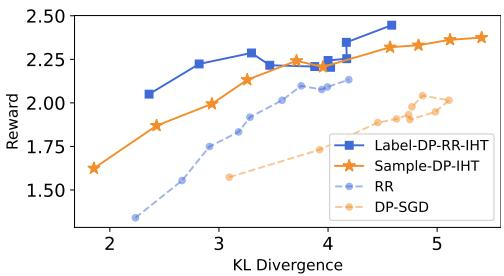
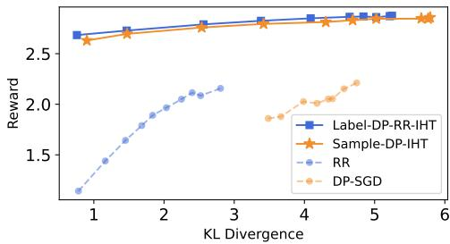
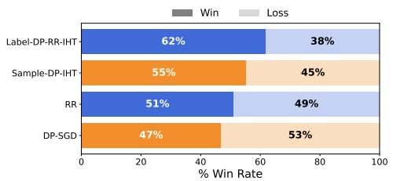
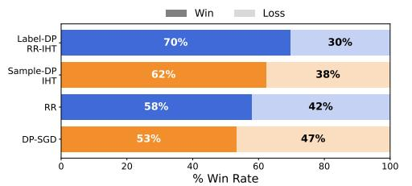
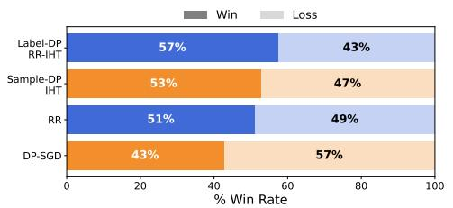
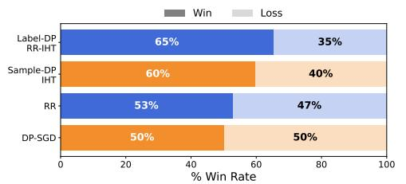

# Differentially Private Sparse Reward Estimation with Preference Feedback

Meng Ding   
Department of Computer Science   
University of Massachusetts Boston Boston, MA, USA   
Jie Zhang   
ETH Zürich   
Zürich, Switzerland

Mingxi Lei Department of Computer Science and Engineering University at Buffalo, SUNY Buffalo, NY, USA

Jinyan Liu Beijing Institute of Technology Beijing, China

Di Wang∗ King Abdullah University of Science and Technology (KAUST) Thuwal, Saudi Arabia

## Abstract

Reinforcement Learning with Human Feedback (RLHF) has become a central paradigm for aligning Large Language Models with human values. However, the reliance on sensitive preference data necessitates rigorous differential privacy (DP) guarantees to prevent user information leakage. Existing private alignment methods typically assume dense reward parameterizations, resulting in estimation error bounds that scale polynomially with the ambient model size d. Such dependence is prohibitive in modern overparameterized models where d is vast. In this work, we study Private Sparse RLHF problem to address this limitation, assuming that human preferences (reward model) are governed by a subset of s∗ ≪ d relevant features. We provide the first comprehensive theoretical framework for differentially private sparse reward estimation from pairwise preference feedback under the Bradley Terry-Luce model, and introduce efficient algorithms for both Sample-DP and Label-DP settings. Theoretically, under the squared $\ell _ { 2 }$ parameter estimation error, we establish upper bounds of $\widetilde O ( s ^ { * } / n + s ^ { * 2 } / n ^ { 2 } \varepsilon ^ { 2 } )$ for (ε, δ)-Sample-DP and $\widetilde { O } ( s ^ { * } / n + s ^ { * } / n \varepsilon ^ { 2 } )$ for ε-Label-DP based on randomized response, where n is the training data size. For the lower bounds, we show that the Sample-DP rate is nearly optimal, and that the guarantee for our Label-DP method cannot be further improved within the randomized-response framework. We also provide a general lower bound for the problem with Label-DP. Empirically, our framework demonstrates superior efficacy over dense baselines across sentiment generation and safety alignment benchmarks, offering a significantly more favorable privacyutility trade-off.

## 1 Introduction

Large Language Models (LLMs) have demonstrated remarkable capabilities in generalization and reasoning, yet their pre-training on vast, unfiltered corpora often results in behaviors that are misaligned with harmful or biased content. To address this, Reinforcement Learning from Human Feedback (RLHF) has emerged as the standard paradigm for steering LLMs to align pretrained models with human values and objectives [16, 41, 36, 3]. In the typical RLHF pipeline, a reward model is first trained on a dataset of pairwise human preferences (e.g., response $y _ { 1 }$ is preferred over y2) to approximate the underlying human utility function. This learned reward model then guides the optimization of the language model policy via algorithms such as Direct Preference Optimization (DPO) [38].

Table 1: Estimation error rates for private RLHF in non-sparse and sparse settings with error metric $\| \cdot \| _ { 2 } ^ { 2 }$ . Here d is the ambient dimension, $s ^ { * }$ is the sparsity level, n is the sample size, and $( \varepsilon , \delta )$ are the privacy parameters. † indicates that the lower bound is for the randomized-response mechanism, and ‡ denotes a general central Label-DP lower bound for arbitrary Label-DP mechanisms. § denotes a best-case upper bound and ¶ indicates lower bound only for Label-DP.
<table><tr><td></td><td>Sample-DP</td><td>Label-DP</td><td>Upper Bound</td></tr><tr><td>Sparse (Ours)</td><td>√</td><td></td><td> $\begin{array} { r } { \widetilde { O } \left( \frac { s ^ { * } } { n } + \frac { ( s ^ { * } ) ^ { 2 } } { n ^ { 2 } \varepsilon ^ { 2 } } \right) } \end{array}$   $\begin{array} { r } { \widetilde \Omega \left( \frac { s ^ { * } } { n } + \frac { ( s ^ { * } ) ^ { 2 } } { n ^ { 2 } \varepsilon ^ { 2 } } \right) } \end{array}$ </td></tr><tr><td>Sparse (Ours)</td><td></td><td> $\begin{array} { r } { \widetilde O \Big ( \frac { s ^ { * } } { n } + \frac { s ^ { * } } { n \varepsilon ^ { 2 } } \Big ) } \end{array}$  √</td><td> $\begin{array} { r } { \widetilde \Omega \left( \frac { s ^ { * } } { n } + \frac { s ^ { * } } { n \varepsilon ^ { 2 } } \right) \dag } \end{array}$   $\begin{array} { r } { \widetilde \Omega \left( \frac { s ^ { * } } { n } + \frac { s ^ { * } } { n ^ { 2 } \varepsilon ^ { 2 } } \right) \sharp \qquad } \end{array}$ </td></tr><tr><td>Non-Sparse [15]</td><td>√</td><td>√</td><td> $\begin{array} { r } { \widetilde { O } \left( \frac { d ^ { 2 } } { n } + \frac { d ^ { 3 } } { n ^ { 2 } \varepsilon ^ { 2 } } \right) \ S } \end{array}$   $\begin{array} { r } { \widetilde \Omega \left( \frac { d } { n } + \frac { d } { n ^ { 2 } \varepsilon ^ { 2 } } \right) \bullet \qquad } \end{array}$ </td></tr></table>

Despite its success, the reliance on human feedback introduces significant privacy vulnerabilities. The preference datasets used to train reward models often contain sensitive information, ranging from personal opinions to implicit biases, which can be memorized by the model. Consequently, deploying these models risks exposing user data through privacy attacks [8, 9, 22, 56]. To mitigate these risks, recent works have integrated Differential Privacy (DP)[23], which requires that the private trained model (or its output distribution) does not significantly change when any single entry in the training data is altered, into the alignment process [56, 15, 61, 59] (refer to Section 2 for further discussion).

However, a fundamental limitation of existing private alignment methods is their implicit treatment of the reward model as a dense parameter vector. In practice, collecting high-quality human preference data for aligning large language models is both costly and time-consuming [13, 35, 58]. For instance, aligning models with general human values often requires a substantial number of annotations from experienced annotators to reliably distinguish between “helpful” and “harmless” responses. This data scarcity becomes even more pronounced in specialized domains such as medical or legal reasoning [40, 18, 21], where preference labels must be provided by highly qualified experts. These challenges impose a strict budget on the available sample size n, while the semantic richness and complexity of such domains naturally induce a feature space of extremely high dimension d. Standard differentially private mechanisms require noise injection proportional to the ambient dimension $( \mathrm { i . e . , } \propto d / n )$ to hide individual contributions [23]. When $d \gg n$ , this noise overwhelms the utility signal, rendering the high estimation error and alignment ineffective.

Moreover, recent empirical studies [2, 17] suggest that the underlying reward functions and feature representations in LLM alignment exhibit significant intrinsic sparsity. Specifically, preference signals are often governed by a small subset of salient features or tokens, rather than the full high-dimensional embedding. In parallel, foundational theoretical work on differentially private sparse learning has shown that, for problems such as linear regression, one can circumvent polynomial dependence on the ambient dimension d [42, 50, 6, 19, 63, 47, 20]. By leveraging sparsity, the estimation error can be reduced to scale logarithmically with the sparsity $( \mathrm { i . { \dot { e } } . , } \propto s ^ { * } { \bar { / } } n )$ , thereby enabling accurate private estimation even in high-dimensional settings. This naturally raises the following question:

Can we design effective mechanisms for private sparse RLHF with rigorous theoretical guarantees that are not polynomial in the dimension $d \mathrm { ? }$

We answer this question affirmatively and summarize our contributions as follows:

• First Analysis of Private Sparse RLHF. To the best of our knowledge, this is the first work to investigate sparsity in the context of private alignment, i.e., DP Sparse RLHF. We formulate the problem under the high-dimensional Bradley-Terry model and introduce two specialized algorithms: Sample-DP-IHT, which integrates iterative hard thresholding with a private peeling mechanism to protect the entire interaction tuple, and Label-DP RR+IHT, which combines randomized response with debiased gradient estimation to protect preference labels.

• Minimax Optimality. As summarized in Table 1, we establish upper bounds under the squared $\ell _ { 2 }$ parameter estimation error. Specifically, we achieve rates of $\widetilde { O } ( s ^ { * } / n + ( s ^ { * } ) ^ { 2 } / ( n ^ { 2 } \varepsilon ^ { 2 } ) )$ for $( \varepsilon , \delta )$ -Sample-DP and $\widetilde O ( s ^ { * } / n + s ^ { * } / ( n \varepsilon ^ { 2 } ) )$ for ε-Label-DP, where $n$ is the training data size. For the lower bounds, we show that the Sample-DP rate is nearly optimal, and that our theoretical analysis for the Label-DP method cannot be further improved. We also provide a general lower bound $\begin{array} { r } { \widetilde \Omega \left( \frac { s ^ { * } } { n } + \frac { s ^ { * } } { n ^ { 2 } \varepsilon ^ { 2 } } \right) } \end{array}$ for the problem with Label-DP.

• Experimental Evaluation. We empirically validate our framework on Sentiment Generation and Safety Alignment benchmarks. Our results demonstrate that exploiting sparsity consistently yields superior privacy-utility trade-offs compared to dense baselines (e.g., DP-SGD and Randomized Response), effectively mitigating the noise overhead in high-privacy regimes and achieving significantly higher reward scores and alignment rates.

## 2 Related Work

Differentially Private Reward Learning and Alignment Recent work has increasingly focused on integrating differential privacy into the alignment of LLMs. Chowdhury et al. [15] investigates differ entially private reward estimation using preference feedback, while subsequent studies extend these guarantees to Direct Preference Optimization and unified offline alignment frameworks Chowdhury et al. [14], Zhou et al. [61], Chen et al. [12]. Beyond reward estimation, privacy-aware regularization has received growing attention. Wu et al. [57] analyzes offline and online $\dot { \mathrm { \kappa } } { } $ -regularized RLHF under differential privacy, while Zhang et al. [60] shows that KL regularization itself can inherently induce differential privacy guarantees in bandit and RLHF settings. The scope of private alignment has further expanded to more complex interaction models, such as reinforcement learning with self-play [37] and user-level differential privacy in RLHF pipelines [59]. Despite these advancements, prior works largely focused on dense reward structures or general function approximation, whose the estimation errors always depend on polynomial of the dimension, leaving the sparse reward learning under privacy constraints unexplored.

Differentially Private Sparse Learning Differentially private sparse learning builds on a broader line of work on private empirical risk minimization (ERM) and convex optimization [11, 31, 29, 52, 53, 44]. Early studies [46] investigated the stability of the Lasso estimator, clarifying the conditions required for robust feature selection under privacy constraints. Building on these foundations, Talwar et al. [42] gives near-optimal utility guarantees for differentially private Lasso, establishing sharp statistical rates (up to logarithmic factors) in sparse linear regression under central DP. More recent work has expanded both the algorithmic toolbox and the problem settings. Wang and Gu [54] propose a knowledge-transfer framework that can improve utility for private sparse regressions. [43, 26] addressed private stochastic convex optimization under heavy-tailed gradients by robust estimation and median techniques. In parallel, sparse learning under local differential privacy, Wang and Xu [50] develops $\mathrm { L D P }$ iterative hard thresholding procedures, and subsequent analysis Zhu et al. [62] sharpen lower/upper bounds and provide the first non-interactive $\mathrm { L D } \bar { \mathrm { P } }$ algorithms for the problem. Beyond regression, privacy-preserving sparse spectral estimation has also been studied. Hu et al. [28, 27], Wang and Xu [51] examined the sparse generalized eigenvalue problem underlying sparse principal component analysis, canonical correlation analysis, and Fisher’s discriminant analysis. Despite these advances, existing private sparse learning results can not straightforwardly extend to the preference-based learning setting central to RLHF, along with the non-linear Bradley-Terry-Luce model and paired data dependency.

## 3 Preliminaries

In this section, we present the formal problem setup for private alignment in RLHF from pairwise comparisons, along with the necessary definitions and assumptions. Let $\boldsymbol { \mathcal { D } } = \{ ( \boldsymbol { k } _ { i } , a _ { i } ^ { 0 } , a _ { i } ^ { 1 } , y _ { i } ) \} _ { i = 1 } ^ { n }$ be a dataset consisting of n labeled comparisons drawn i.i.d. from D, where $k _ { i } \in \mathcal { K }$ denotes a context (e.g., a prompt or state), $a _ { i } ^ { 0 } , a _ { i } ^ { 1 } \in \mathcal { A }$ consists of two candidate actions/responses, and the label $y _ { i } \in \{ 0 , 1 \}$ } indicates which candidate is preferred $( \mathrm { i } . \mathrm { e } . , y _ { i } = l$ means that $a _ { i } ^ { l }$ is chosen as the preferred response). Let $r _ { \theta } : \mathcal { K } \times \mathcal { A }  \mathbb { R }$ be a parametric reward model indexed by $\theta \in \Theta$ , and let $\theta ^ { \star }$ denote the unknown ground-truth parameter. We assume the preferences are generated according to the softmax comparison model: for each $i \in [ n ]$ and $l \in \{ 0 , \bar { 1 } \}$

$$
\mathbb { P } _ { \theta ^ { \star } } [ y _ { i } = l | k _ { i } , a _ { i } ^ { 0 } , a _ { i } ^ { 1 } | = \frac { \exp ( r _ { \theta ^ { \star } } ( k _ { i } , a _ { i } ^ { l } ) ) } { \exp ( r _ { \theta ^ { \star } } ( k _ { i } , a _ { i } ^ { 0 } ) ) + \exp ( r _ { \theta ^ { \star } } ( k _ { i } , a _ { i } ^ { 1 } ) ) } ,
$$

where $r _ { \theta ^ { * } } ( \cdot , \cdot )$ denotes the reward model parameterized by $\theta ^ { * }$ . This model is known as the Bradley-Terry-Luce (BTL) model [5, 33]. In this work, we focus on the BTL model with a linear reward parameterization. Specifically, let $\phi : \mathcal { K } \times \mathcal { A }  \mathbb { R } ^ { d }$ be a known feature map and assume $r _ { \theta } ( k , a ) =$ $\langle \phi ( k , a ) , \theta \rangle , \theta \in \mathbb { R } ^ { d }$ . Define the comparison (difference) feature $x _ { i } : = \phi ( k _ { i } , a _ { i } ^ { 1 } ) - \phi ( k _ { i } , a _ { i } ^ { 0 } ) \in \mathbb { R } ^ { d }$ Under this model, the conditional distribution reduces to logistic regression:

$$
\begin{array} { r } { \mathbb { P } _ { \theta ^ { \star } } \big [ y _ { i } = 1 \big | k _ { i } , a _ { i } ^ { 0 } , a _ { i } ^ { 1 } \big ] = \sigma ( \langle x _ { i } , \theta ^ { \star } \rangle ) , \mathbb { P } _ { \theta ^ { \star } } \big [ y _ { i } = 0 \big | k _ { i } , a _ { i } ^ { 0 } , a _ { i } ^ { 1 } \big ] = \sigma ( - \langle x _ { i } , \theta ^ { \star } \rangle ) , } \end{array}
$$

where $\begin{array} { r } { \sigma ( z ) = \frac { 1 } { 1 + e ^ { - z } } } \end{array}$ refers to the sigmoid function.

Given $D ,$ our objective is to estimate $\theta ^ { \star }$ (and hence the reward function $r _ { \theta ^ { \star } } )$ by maximizing the likelihood of the observed comparisons with privacy constraints. Formally, we seek a randomized estimator $\mathcal { M } : D  \mathbb { R } ^ { d }$ that minimizes the empirical risk ${ \mathcal { L } } _ { n } ( \theta )$ subject to the privacy constraint, where ${ \mathcal { L } } _ { n } ( \theta )$ is defined as follows: $\begin{array} { r } { \mathcal { L } _ { n } ( \theta ) = \frac { 1 } { n } \sum _ { i = 1 } ^ { n } \Big ( \log ( 1 { + } \mathrm { e x p } ( \langle x _ { i } , \theta \rangle ) ) { - } y _ { i } \langle x _ { i } , \theta \rangle \Big ) } \end{array}$ . To account for the high-dimensional nature of the feature space $( d \gg n )$ , we adopt the following assumptions, which are standard in the literature [39, 15, 61, 58].

Assumption 3.1 (Boundedness). (a) $\theta ^ { * }$ lies in the set $\Theta _ { B , s ^ { * } } = \left\{ \theta \in \mathbb { R } ^ { d } \ | \ \| \theta \| _ { 2 } \leq B , \| \theta \| _ { 0 } \leq s ^ { * } \right\}$ (b) Features are bounded, i.e., $\| x \| _ { \infty } \leq 1 , \forall x = \phi ( k , a ^ { 1 } ) - \phi ( \dot { k } , a ^ { 0 } ) . \ ( \mathbf { c } ) \ \mathrm { L e t } \ \Sigma : = \mathbb { E } [ x x ^ { \top } ]$ , and suppose there exist constants $0 < \mu \leq \gamma <$ ∞ such that $\mu \leq \lambda _ { \operatorname* { m i n } } ( \Sigma ) \leq \lambda _ { \operatorname* { m a x } } ( \Sigma ) \leq \gamma .$

Our boundedness assumptions differ from the $\ell _ { 2 }$ feature bound used in [15]. Note that in the high dimensional setting, $\ell _ { \infty }$ -boundness assumption is more reasonable than $\ell _ { 2 } { \mathrm { - n o r m } }$ . Such an assumption has been widely used in the existing literature on high-dimensional statistics [49]. Under an $\ell _ { 2 }$ bound $\| x \| _ { 2 } \leq L ,$ , one has $\mathrm { t r } ( \Sigma ) = \mathbb { E } \| x \| _ { 2 } ^ { 2 } \leq L ^ { 2 }$ , and hence $\begin{array} { r } { \lambda _ { \operatorname* { m i n } } ( \Sigma ) \le \frac { L ^ { 2 } } { d } } \end{array}$ . Thus, when $L = O ( 1 )$ , a dense design cannot have all covariance eigenvalues bounded below by a constant; the curvature parameter µ may scale as $1 / d .$ , leading to dimension dependence through the condition number. In our work, we assume the coordinate-wise bound $\| x \| _ { \infty } \leq 1$ , which allows $\| x \| _ { 2 } = O ( { \sqrt { d } } )$ and permits covariance eigenvalues $\mu , \gamma = \Theta ( 1 )$ . We will provide more discussions in the later parts.

Now, we recall the definition of differential privacy [23]. Informally, it ensures that the privately trained model (or its output distribution) does not significantly change when any single entry in the training data is altered. Depending on the scenario, there are two levels of privacy: label-DP [10, 24] and sample-DP [11, 23, 1]. We provide their formal definitions in the following.

Definition 3.2 (Differential Privacy [23]). Let $\varepsilon \geq 0$ and $\delta \in ( 0 , 1 ]$ . A randomized algorithm M is said to satisfy $( \varepsilon , \delta )$ -differential privacy with respect to an adjacency relation ∼, if for any pair of adjacent datasets $\bar { D _ { \mathrm { \scriptsize \sim } } D ^ { \prime } }$ , and for any measurable set S in the output space of M, it holds that

$$
\mathbb { P } [ \mathcal { M } ( D ) \in S ] \le e ^ { \varepsilon } \cdot \mathbb { P } \left[ \mathcal { M } \left( D ^ { \prime } \right) \in S \right] + \delta .
$$

When $\delta = 0$ , we say that M is ε-differentially private. Throughout the paper, we consider two specific types of adjacency: 1) Sample Adjacency (Sample-DP). D and $\bar { D ^ { \prime } }$ differ in exactly one sample record $( \mathrm { i . e . } ,$ , replacement or addition/removal of a pair $( x _ { i } , y _ { i } ) )$ . 2) Label Adjacency (Label-DP). D and $D ^ { \prime }$ differ only in the label of a single sample (i.e., fixed features $x _ { i } ,$ different $y _ { i } )$

Definition 3.2 guarantees that the trained reward model remains statistically stable regardless of variations in a single user’s data. Particularly, Label-DP ensures that an adversary cannot determine the specific preference $y _ { i }$ for a fixed pair of responses. In contrast, Sample-DP provides a strictly stronger guarantee by protecting the entire interaction tuple $( k _ { i } , a _ { i } ^ { 0 } , a _ { i } ^ { 1 } , \bar { y _ { i } } )$ , concealing not just the preference but also the context of the query itself. Notably, prior works on private RLHF have mainly focused on the Label-DP setting [15, 61], leaving the theoretical analysis of Sample-DP largely unexplored even under non-sparse settings.

## 4 Differentially Private Sparse RLHF

In this section, we develop sparse reward estimators with differential privacy guarantees under two privacy regimes: Sample-DP and Label-DP. For Sample-DP, under our BTL model and Assumption 3.1, we establish nearly matching upper and lower bounds, demonstrating minimax optimality up to logarithmic factors. For Label-DP, we focus on the randomized-response label privatization paradigm and show that our RR-based sparse estimator cannot be further improved within this framework. We further provide a general lower bound for arbitrary central Label-DP mechanisms.

Algorithm 1 Sample-DP-IHT   
1: Input: Dataset $D = \{ ( y _ { i } , z _ { i } ) \} _ { i \in [ n ] }$ , step size η, sparsity level s, privacy parameters $( \varepsilon , \delta )$ , total   
steps $T .$   
2: Initialize: $\theta ^ { 0 }  0 .$   
3: {Step $\mathit { l } \colon$ Sample Splitting}   
4: Split $D$ into $\dot { T }$ disjoint parts $\{ D _ { t } \} _ { t = 1 } ^ { T }$ , each containing $m = n / T$ samples.   
5: {Step $2 { : }$ Iterative Optimization}   
6: for $t = 0$ to $T - 1$ do   
7: Compute the gradient update: $\begin{array} { r } { \theta ^ { t + \frac { 1 } { 2 } } \gets \theta ^ { t } - \frac { \eta } { m } \sum _ { i \in D _ { t } } \nabla \ell ( z _ { i } , y _ { i } ; \theta ^ { t } ) } \end{array}$   
8: Apply Private Hard Thresholding (Algorithm 2):   
$\theta ^ { t + 1 } \gets \Pi _ { B } \left( \mathrm { P e e l i n g } \left( \theta ^ { t + \frac { 1 } { 2 } } , s , \varepsilon , \delta , \frac { \eta } { m } \right) \right)$   
where $\Pi _ { B }$ is the projection onto the B-radius ball   
9: end for   
10: Output: $\theta ^ { T }$

## 4.1 Sample-DP

To achieve sample-level differential privacy, a natural approach is to incorporate the Gaussian mechanism, for instance via DP-SGD [1]. However, in high-dimensional sparse settings, directly applying DP-SGD may lead to suboptimal utility, as the injected noise scales with the ambient dimension and may not provide an efficient estimation of the sparse parameter. Therefore, we introduce a differentially private variant of the iterative hard thresholding (IHT) algorithm. Algorithm 1 begins with a sample-splitting strategy, wherein disjoint subsets of the data are used for successive gradient updates across iterations. We then replace the deterministic hard thresholding step with a differentially private Peeling Mechanism [6]. At each iteration, the peeling mechanism privately selects the indices corresponding to the largest s entries in magnitude and retains only these coordinates, setting all remaining entries to zero. Refer to Algorithm 1 and Algorithm 2 for details.

Theorem 4.1. For any $0 < \varepsilon , \delta < 1$ , Algorithm 1 satisfies $( \varepsilon , \delta )$ -Sample-DP. Under Assumption $3 . l ,$ suppose that the initialization $\theta ^ { 0 }$ satisfies $\begin{array} { r } { \left\| \theta ^ { 0 } - \theta ^ { * } \right\| \leq O \left( \frac { B \mu } { \gamma } \right) } \end{array}$ . Assumefurther that the sample size n is sufficiently large such that $\begin{array} { r } { n ^ { 2 } \geq O \left( \frac { \gamma } { \mu m ( B ) } \frac { s ^ { 2 } T ^ { 2 } \log ^ { 2 } \frac { s } { \zeta } \log \frac { 1 } { \delta } } { B \varepsilon ^ { 2 } } \right) } \end{array}$ . If we choose $\begin{array} { r } { T = \widetilde { O } \left( \frac { \gamma } { \mu } \log n \right) } \end{array}$ $s \asymp s ^ { * }$ and $\begin{array} { r } { \eta = \frac { 8 } { 3 \gamma } } \end{array}$ , then with high probability, it holds that $\begin{array} { r } { \| \theta ^ { T } - \theta ^ { * } \| _ { 2 } ^ { 2 } \leq \widetilde { O } \left( \frac { \gamma ^ { 2 } s ^ { * } } { \mu ^ { 3 } n } + \frac { \gamma ( s ^ { * } ) ^ { 2 } } { \mu ^ { 4 } n ^ { 2 } \varepsilon ^ { 2 } } \right) } \end{array}$

Remark 4.2. Theorem 4.1 shows that our Sample-DP-IHT estimator achieves an error bound that is polynomial in the sparsity $s ^ { * }$ , instead of ambient dimension $d .$ This is the main distinction from prior dense private reward estimation results [15] (we need to clarify that although their main objectiveperturbation result is stated for Label-DP, the same objective perturbation mechanism can naturally extend to Sample-DP. Under their most favorable parameter choices, this yields the best-case upper bound $\begin{array} { r } { \widetilde { O } ( \frac { d ^ { 2 } } { n } + \frac { d ^ { 3 } } { n ^ { 2 } \varepsilon ^ { 2 } } ) . } \end{array}$ ) Note that this comparison should not be interpreted by simply setting $s ^ { * } = d .$ In the dense case, our bound is not directly comparable to that of [15], because the two analyses use different feature-normalization assumptions. Specifically, [15] assumes an $\ell _ { 2 }$ feature bound $\ \bar { \| } \boldsymbol { x } \|$ whereas our Assumption 3.1 imposes the coordinate-wise bound $\| { \boldsymbol x } \| _ { \infty }$ . These differences lead to different dimension dependence through the curvature and coverage parameters.

In the following, we formally define the minimax risk for private estimation and introduce the Score Attack framework [7] used to derive our lower bounds.

Recall the dataset $D = \{ ( x _ { i } , y _ { i } ) \} _ { i = 1 } ^ { n }$ consisting of n i.i.d. observations, where $x _ { i } \in \mathbb { R } ^ { d }$ denotes the difference feature vector (as defined in Section 3) drawn from a distribution $\mathcal { D } _ { x }$ , and $y _ { i } \in \{ 0 , 1 \}$ is the preference label. Consistent with the BTL assumption, the conditional distribution of $y _ { i }$ given $x _ { i }$ follows the logistic model, which belongs to the canonical exponential family:

$$
f _ { \theta ^ { \star } } \left( y _ { i } \mid x _ { i } \right) = \exp \left( y _ { i } \langle x _ { i } , \theta ^ { \star } \rangle - \psi ( \langle x _ { i } , \theta ^ { \star } \rangle ) \right) ,\tag{1}
$$

where $\psi ( u ) = \log ( 1 + e ^ { u } )$ is the log-partition function.

Algorithm 2 Peeling Procedure   
1: Input: Vector $\theta \in \mathbb { R } ^ { d } .$ , sparsity s, privacy parameters $( \varepsilon , \delta )$ , noise scale λ.   
2: Initialize: $S  \emptyset .$   
3: {Phase 1: Iterative Support Selection}   
4: for $i = 1$ to s do   
5: Generate noise vector $v _ { i } \in \mathbb { R } ^ { d }$ where each component is drawn from:   
6: $\begin{array} { r } { v _ { i , j } \sim \mathrm { L a p } \left( \frac { 2 \lambda \sqrt { 3 k \log ( { 1 / \delta } ) } } { \varepsilon } \right) , \quad \forall j \in [ d ] } \end{array}$   
7: Select the index with the maximum noisy magnitude:   
8: $\begin{array} { r } { j ^ { \star }  \arg \operatorname* { m a x } _ { j \in [ d ] \backslash S } ( | \theta _ { j } | + v _ { i , j } ) , \quad \bar { S }  \bar { S } \cup \{ j ^ { \star } \} } \end{array}$   
9: end for   
10: {Phase 2: Final Parameter Perturbation}   
11: Generate output noise vector $\widetilde { v } \in \mathbb { R } ^ { d . }$   
12: vej ∼ Lap $\left( \frac { 2 \lambda \sqrt { 3 k \log ( 1 / \delta ) } } { \varepsilon } \right)$ $\forall j \in [ d ]$   
13: Output: $\theta \vert _ { S } \dot { + } \widetilde { v } _ { S }$

We aim to estimate the unknown parameter $\theta ^ { * }$ using an estimator $\hat { \theta } : ( \mathbb { R } ^ { d } \times \{ 0 , 1 \} ) ^ { n } \to \Theta$ . The quality of the estimator is measured by the squared $\ell _ { 2 } { \mathrm { - n o r m } }$ loss $L ( \hat { \theta } , \theta ^ { * } ) = \lVert \hat { \theta } - \theta ^ { * } \rVert _ { 2 } ^ { 2 }$ . Then, the classical statistical minimax risk is defined as follows:

$$
\mathfrak { M } _ { n } ( \Theta _ { B , s ^ { * } } ) : = \operatorname* { i n f } _ { \hat { \theta } } \operatorname* { s u p } _ { \theta \in \Theta _ { B , s ^ { * } } } \mathbb { E } _ { D \sim P _ { \theta } } \left[ \Vert \hat { \theta } ( D ) - \theta \Vert _ { 2 } ^ { 2 } \right] ,
$$

where $P _ { \theta }$ denotes the joint distribution of the dataset induced by the parameter $\theta .$

In the $( \varepsilon , \delta )$ -differential privacy model, the estimator must be obtained via a randomized mechanism $\mathcal { M }$ (as defined in Section 3). Let $\mathcal { Q } _ { \varepsilon , \delta }$ denote the set of all $( \varepsilon , \delta ) – \mathrm { D P }$ mechanisms. The $( \varepsilon , \delta )$ -private minimax risk is defined as: $\begin{array} { r } { \mathfrak { M } _ { n , \varepsilon , \delta } ( \Theta _ { B , s ^ { * } } ) : = \operatorname* { i n f } _ { \mathcal { M } \in \mathcal { Q } _ { \varepsilon , \delta } } \operatorname* { s u p } _ { \theta \in \Theta _ { B , s ^ { * } } } \mathbb { E } _ { \mathcal { M } , D \sim P _ { \theta } } \left[ \| \mathcal { M } ( D ) - \theta \| _ { 2 } ^ { 2 } \right] } \end{array}$

To derive tight lower bounds for the private minimax risk, we utilize the Score Attack framework [7]. Given Eq. (1), the score statistic for a data point ${ \boldsymbol z } _ { i } ~ = ~ ( x _ { i } , y _ { i } )$ is defined as $S ( z _ { i } ; \theta ) : =$ $( y _ { i } - \sigma ( \langle x _ { i } , \theta \rangle ) ) x _ { i }$ . This statistic is centered with variance equal to the Fisher information matrix ${ \dot { \mathcal { I } } } ( \theta )$ . The Score Attack statistic $\scriptstyle A _ { \theta }$ is defined as the correlation between the estimation error and the score function: $\mathcal { A } _ { \theta } ( z , \mathcal { M } ( D ) ) : = \left. \mathcal { M } ( D ) - \theta , S ( z ; \theta ) \right.$

The Score Attack captures the fundamental tension between utility and privacy. Intuitively, a good estimator must react to the signal in the training data, leading to a high total correlation with the score function on D. However, differential privacy strictly limits this correlation to prevent membership inference, which is quantified by the following lemma:

Lemma 4.3 (Privacy Bound on Score Attack [7]). If M satisfies $( \varepsilon , \delta )$ -differential privacy with $\begin{array} { r c c c l } { 0 } & { \textless } & { \varepsilon } & { \textless } & { 1 } \end{array}$ , then for any $\theta \in \Theta ,$ it holds that $\begin{array} { r l } { | \sum _ { i = 1 } ^ { n } \mathbb { E } [ \mathcal { A } _ { \theta } ( z _ { i } , \mathcal { M } ( D ) ) ] | } & { { } \overset { . } { \leq } } \end{array}$ $\begin{array} { r } { n \varepsilon \sqrt { \lambda _ { \operatorname* { m a x } } ( \mathcal { T } ( \theta ) ) } \sqrt { \mathbb { E } \| \mathcal { M } ( D ) - \theta \| _ { 2 } ^ { 2 } } + 2 n \delta s ^ { \ast } \sqrt { \log ( 1 / \delta ) } } \end{array}$

By combining the statistical necessity of a high score correlation (for utility) with the privacy upper bound in Lemma 4.3, we obtain the following minimax lower bound, where full proofs are detailed in Appendix C.

Theorem 4.4. Consider i.i.d. observations $( y _ { 1 } , x _ { 1 } ) , \cdot \cdot \cdot , ( y _ { n } , x _ { n } )$ drawn from $E q . ( 1 )$ with $\theta ^ { \ast } \in \Theta$ and Assumption 3.1 holds. Suppose that $s ^ { * }$ satisfies $s ^ { * } \lesssim \sqrt { d } ,$ and $s ^ { * } \gg \log ^ { 2 } \left( d / s ^ { * } \right)$ . Ifthe estimator M is $( \varepsilon , \delta )$ -sample-differentially private with $0 < \varepsilon < 1 , s ^ { * }$ log $( d / s ^ { * } ) \lesssim n \varepsilon$ , and $\delta \lesssim n ^ { - ( 1 + c ) } f o r$ some $c > 0 ,$ , then in $\begin{array} { r } { \mathsf { f } _ { \mathcal { M } \in \mathcal { Q } _ { \varepsilon , \delta } } \operatorname* { s u p } _ { \theta \in \Theta } \mathbb { E } \| \mathcal { M } ( D ) - \theta \| _ { 2 } ^ { 2 } \geq \widetilde \Omega \left( \frac { s ^ { * } } { \gamma n } + \frac { ( s ^ { * } ) ^ { 2 } } { \gamma n ^ { 2 } \varepsilon ^ { 2 } } \right) } \end{array}$

Theorem 4.4 establishes a matching lower bound to Theorem 4.1 up to logarithmic factors (if we omit other factors), showing the nearly minimax optimality of our proposed estimator.

## 4.2 Label-DP

To achieve Label-DP, the privacy requirement is relaxed such that the feature vectors $x _ { i }$ (derived from contexts and prompts) are considered public, while only the preference labels $y _ { i }$ are sensitive.

Algorithm 3 Label-DP RR + IHT   
1: Input: Dataset $D = \{ ( x _ { i } , y _ { i } ) \} _ { i = 1 } ^ { n }$ , sparsity level s, privacy budget ε, step size η, total iterations   
$T .$   
2: Initialize: ${ \theta } ^ { 0 }  0 .$   
3: Parameters: $\textstyle p \gets { \frac { e ^ { \varepsilon } } { e ^ { \varepsilon } + 1 } } , q \gets { \frac { 1 } { e ^ { \varepsilon } + 1 } }$   
4: {Step 1: Label Privatization (Randomized Response)}   
5: for $i = 1$ to n do   
6: Sample $\tilde { y } _ { i } \in \{ 0 , 1 \}$ such that: $P ( \tilde { y } _ { i } = y _ { i } ) = p$ and $P ( \tilde { y } _ { i } = 1 - y _ { i } ) = q .$   
7: end for   
8: Let $\widetilde { \cal D } = \{ ( x _ { i } , \widetilde { y } _ { i } ) \} _ { i = 1 } ^ { n }$ be the privatized dataset.   
9: {Step 2 $\acute { \alpha } 3 :$ Debiased Gradient Calculation & IHT}   
10: for $\bar { t } = 0$ to $T - 1$ do   
11: Compute the empirical gradient on noisy labels: $\begin{array} { r } { \hat { g } ^ { t } \gets \frac { 1 } { n } \sum _ { i = 1 } ^ { n } \nabla \ell ( \theta ^ { t } ; x _ { i } , \tilde { y } _ { i } ) } \end{array}$   
12: Compute the bias correction terms:   
13: $\begin{array} { r } { g ^ { - }  \frac { 1 } { n } \sum _ { i = 1 } ^ { n } \nabla \ell ( \theta ^ { t } ; x _ { i } , 0 ) , \quad g ^ { + }  \frac { 1 } { n } \sum _ { i = 1 } ^ { n } \nabla \ell ( \theta ^ { t } ; x _ { i } , 1 ) } \end{array}$   
14: Construct the unbiased gradient estimator: $\begin{array} { r } { \widetilde { g } ^ { t }  \frac { e ^ { \varepsilon } + 1 } { e ^ { \varepsilon } - 1 } ( \hat { g } ^ { t } - \frac { g ^ { - } + g ^ { + } } { e ^ { \varepsilon } + 1 } ) } \end{array}$   
15: Update and Hard Thresholding: $\theta ^ { t + 1 }  \mathcal { H } _ { s } ( \theta ^ { t } - \eta \widetilde { g } ^ { t } )$   
16: end for   
17: Output: $\theta ^ { T }$

This assumption enables a clean separation between the privatization and optimization stages. Rather than injecting noise into gradients as in the sample-level DP setting, we adopt an input perturbation strategy consisting of three steps: (1) privatizing labels via Randomized Response, (2) constructing unbiased gradient estimators via debiasing, and (3) optimizing the objective using standard Iterative Hard Thresholding.

Step 1: Randomized Response (RR). To protect the privacy of the labels $y _ { i } \in \{ 0 , 1 \}$ , we apply the classical randomized response mechanism $\mathcal { M } _ { \mathrm { R R } }$ [55]. For each sample i, the mechanism outputs a perturbed label $\widetilde { y } _ { i }$ by flipping the true label with a probability determined by the privacy budget ε:

$$
\mathbb { P } ( \widetilde { y } _ { i } = y _ { i } ) = \frac { e ^ { \varepsilon } } { e ^ { \varepsilon } + 1 } , \quad \mathrm { a n d } \quad \mathbb { P } ( \widetilde { y } _ { i } = 1 - y _ { i } ) = \frac { 1 } { e ^ { \varepsilon } + 1 } .
$$

This mechanism guarantees ε-Label DP for each individual response.

Step 2: Debiasing Correction. Directly optimizing the loss with respect to the perturbed labels $\widetilde { y } _ { i }$ would lead to biased estimates of the reward parameter $\theta ^ { \star }$ . To correct for this, we construct an unbiased gradient estimator $\widetilde g$ using the statistical properties of the RR mechanism. Specifically, at iteration $t ,$ we define the debiased gradient as:

$$
\nabla \mathcal { L } _ { n } ^ { \mathrm { d e b i a s } } ( \theta ^ { t } ) = \widetilde { g } ^ { t } = \frac { e ^ { \varepsilon } + 1 } { e ^ { \varepsilon } - 1 } \cdot \left( \hat { g } ^ { t } - \frac { g ^ { - } } { e ^ { \varepsilon } + 1 } - \frac { g ^ { + } } { e ^ { \varepsilon } + 1 } \right) ,
$$

where $\begin{array} { r } { \hat { g } ^ { t } = \frac { 1 } { n } \sum _ { i = 1 } ^ { n } \nabla \ell ( \theta ^ { t } ; x _ { i } , \widetilde { y } _ { i } ) , g ^ { - } = \frac { 1 } { n } \sum _ { i = 1 } ^ { n } \nabla \ell ( \theta ^ { t } ; x _ { i } , 0 ) , g ^ { + } = \frac { 1 } { n } \sum _ { i = 1 } ^ { n } \nabla \ell ( \theta ^ { t } ; x _ { i } , 1 ) } \end{array}$ . Here, $\hat { g } ^ { t }$ is the empirical gradient computed using the noisy labels, while $g ^ { - }$ and $g ^ { + }$ represent the gradients assuming the labels are all 0 or all 1, respectively. It is straightforward to verify that $\mathbb { E } _ { \mathcal { M } _ { \mathrm { R R } } } [ \widetilde { g } ^ { t } ] =$ $\nabla { \mathcal { L } } _ { n } ( \theta ^ { t } )$ , ensuring that this estimator provides an unbiased direction for optimization.

Step 3: Iterative Hard Thresholding (IHT). With the privatized labels $\widetilde { D } = \{ ( x _ { i } , \widetilde { y } _ { i } ) \} _ { i = 1 } ^ { n }$ , the problem reduces to a sparse estimation task with noisy but public targets. Since privacy is enforced entirely during the label perturbation phase (Step 1), the subsequent calculation of the debiased gradient and the parameter updates incur no additional privacy cost due to the post-processing property of differential privacy. Consequently, unlike the sample-level DP setting, no private support selection mechanism (e.g., peeling) is required inside the loop. We apply the standard iterative hard thresholding algorithm using the debiased gradient estimator:

$$
\theta ^ { t + 1 } \gets \mathcal { H } _ { s } \left( \theta ^ { t } - \eta \nabla \mathcal { L } _ { n } ^ { \mathrm { d e b i a s } } ( \theta ^ { t } ) \right) ,
$$

where $\mathcal { H } _ { s }$ is the hard thresholding operator that preserves the s largest entries in magnitude.

  
(a) ε = 2

  
(b) $\varepsilon = 8$  
Figure 1: IMDb Sentiment Generation with Llama-7B under different privacy budgets (ε).

Theorem 4.5. For any $0 < \varepsilon , \delta < 1$ , Algorithm 3 satisfies ε-Label-DP. Under Assumption 3.1, suppose that the initialization $\theta ^ { 0 }$ satisfies $\begin{array} { r } { \left\| \theta ^ { 0 } - \theta ^ { * } \right\| \leq O \left( \frac { B \mu } { \gamma } \right) } \end{array}$ . Assume further that the sample size n is sufficiently large such that $\begin{array} { r } { n ^ { 2 } \geq O \left( \frac { \gamma } { \mu m ( B ) } \frac { s \log \frac { 1 } { \delta } } { \varepsilon ^ { 2 } } \right) } \end{array}$ . Ifwe choose $\begin{array} { r } { T = \widetilde { O } \Big ( \frac { \gamma } { \mu } \log n \Big ) , s \asymp s ^ { * } } \end{array}$ and $\begin{array} { r } { \eta = \frac { 8 } { 3 \gamma } } \end{array}$ , then with probability at least $1 - \delta ,$ it holds that $\begin{array} { r } { \| \theta ^ { T } - \theta ^ { * } \| _ { 2 } ^ { 2 } \leq \widetilde { O } \left( \frac { \gamma s ^ { * } } { \mu ^ { 2 } n } + \frac { \gamma s ^ { * } } { \mu ^ { 2 } n \varepsilon ^ { 2 } } \right) } \end{array}$

Remark 4.6. We compare Theorem 4.5 with prior dense private reward estimation results. [15] study non-sparse reward estimation; in the central Label-DP setting, their objective-perturbation estimator has best-case squared $\ell _ { 2 }$ rate $\begin{array} { r } { \widetilde { O } ( \frac { d ^ { 2 } } { n } + \frac { d ^ { 3 } } { n ^ { 2 } \varepsilon ^ { 2 } } ) } \end{array}$ . They also provide RR-based estimators under local Label-DP with a rate of $\scriptstyle { \widetilde { O } } ( { \frac { d ^ { 2 } } { n \varepsilon ^ { 2 } } } )$ . In contrast, our RR+IHT estimator exploits sparsity and achieves $\begin{array} { r } { \widetilde { O } ( \frac { s ^ { * } } { n } + \frac { s ^ { * } } { n \varepsilon ^ { 2 } } ) } \end{array}$ . Thus, our central Label-DP bound replaces the ambient-dimension dependence of dense methods by the sparsity $s ^ { * }$ , up to logarithmic and condition-number factors.

In the following, we adopt the same problem setup and private minimax risk definition $\mathfrak { M } _ { n , \varepsilon , \delta } ( \Theta _ { B , s ^ { * } } )$ introduced above. We first present a lower bound for estimators based on randomized-response mechanisms, showing that the results of our RR-based Label-DP method cannot be further improved within this framework. We then provide a general lower bound.

Theorem 4.7. Consider the BTL model with sparse parameter space $\Theta = \{ \theta \in \mathbb { R } ^ { d } : \| \theta \| _ { 2 } \leq$ $B , \ \| \theta \| _ { 0 } \ \leq \ s ^ { * } \}$ and Assumption 3.1 holds. Then estimator $\mathcal { M } ( D )$ based on randomizedresponse privatized labels $\mathcal { M } _ { R R }$ satisfying central ε-label-DP obeys the minimax lower bound $\begin{array} { r } { \operatorname* { i n f } _ { \mathcal { M } _ { R R } \in Q _ { \varepsilon } } \operatorname* { s u p } _ { \theta ^ { * } \in \Theta } \mathbb { E } \left[ \| \mathcal { M } _ { R R } ( D ) - \theta ^ { * } \| _ { 2 } ^ { 2 } \right] \geq \Omega \left( \frac { s ^ { * } } { \gamma n } + \frac { s ^ { * } } { \gamma n \varepsilon ^ { 2 } } \right) } \end{array}$

Remark 4.8. Theorem 4.7 establishes the optimality of the randomized-response (RR) label privatization paradigm under the sparse BTL model. Since RR is a local label-DP channel, the result can also be interpreted as a sparse lower bound for estimators based on locally privatized labels. It shows that any estimator based on randomized-response privatized labels must incur a privacy-dependent error of order $\begin{array} { r } { \widetilde \Omega \left( \frac { s ^ { * } } { \gamma n \varepsilon ^ { 2 } } \right) } \end{array}$ . This complements the dense local Label-DP results of [15], whose RR-based estimators and lower bounds are dimension-dependent. Our result gives the sparse counterpart, showing that the unavoidable RR privacy cost scales with $s ^ { * }$ rather than d. Therefore, Theorem 4.5 is optimal up to logarithmic and condition-number factors within the sparse RR-based framework.

Theorem 4.9. Consider the BTL model with sparse parameter space $\Theta = \{ \theta \in \mathbb { R } ^ { d } : \| \theta \| _ { 2 } \leq$ $B , \| \theta \| _ { 0 } \leq s ^ { * } \}$ and Assumption 3.1 holds. Then any estimator $\mathcal { M } ( \bar { D } )$ satisfying central ε-label-DP obeys the minimax lower bound in $\begin{array} { r } { \mathrm { f } _ { \mathcal { M } \in \mathcal { Q } _ { \varepsilon } } \operatorname* { s u p } _ { \theta ^ { * } \in \Theta } \mathbb { E } \left[ \left\| \mathcal { M } ( D ) - \theta ^ { * } \right\| _ { 2 } ^ { 2 } \right] \geq \Omega \left( \frac { s ^ { * } } { \gamma n } + \frac { s ^ { * } } { \gamma n ^ { 2 } \varepsilon ^ { 2 } } \right) } \end{array}$

Theorem 4.9 provides a general lower bound for sparse reward estimation under central Label-DP. It shows that, for any central Label-DP mechanism, the squared $\ell _ { 2 }$ estimation error must incur at least $\begin{array} { r } { \Omega ( \frac { s ^ { * } } { \gamma n } + \frac { s ^ { * } } { \gamma n ^ { 2 } \varepsilon ^ { 2 } } ) } \end{array}$ . However, there remains a gap between this general lower bound and the current upper bound for our Label-DP estimator. Designing Label-DP mechanisms with better privacy dependence beyond randomized response remains an interesting open question.

## 5 Experiment

In this section, we empirically evaluate our proposed sparse private RLHF algorithms, Sample-DP-IHT (Algorithm 1) and Label-DP RR+IHT (Algorithm 3). We focus on two distinct alignment tasks:

  
Figure 2: Safety Alignment with Gemma-3-1B Figure 3: Safety Alignment with Llama-2-7B (ε = 8). (ε = 8).

Sentiment Generation and Safety Alignment. Our primary objective is to demonstrate that explicitly exploiting the sparsity of the reward signal yields a superior privacy-utility trade-off.

## 5.1 Experimental Setup

Tasks and Datasets. We conduct our evaluation on two standard benchmarks representing common RLHF applications: (1) Sentiment Generation (IMDb). We use the IMDb movie review dataset [34]. The goal is to generate text conditioned on a prompt such that the output maximizes positive sentiment. Following established RLHF practices, we treat sentiment classification scores as a proxy for human preference rewards. (2) Safety Alignment (Harmful): We utilize the Harmful Dataset provided by the $\mathrm { A I } 2 ^ { 2 }$ . This dataset comprises adversarial prompts designed to elicit harmful or toxic behaviors. The objective is to align the model to safely refuse these requests. We train a safety reward model to penalize harmful compliance and reward safe refusals, evaluating the model’s ability to maintain safety under differential privacy constraints.

Base Models. We employ two different policy networks to demonstrate generalization across architectures: LLaMA-7b [48] for the Sentiment Generation task, and Gemma-3-1B [45] for the Safety Alignment task. For the reward models, we utilize RoBERTa [32] as the backbone architecture. Specifically, we fine-tune separate RoBERTa checkpoints to serve as the sentiment proxy and the safety evaluator, respectively. Unless otherwise noted, all competing methods share identical architectures and initializations to ensure fair comparison.

Baselines. We compare our proposed sparse methods against three distinct categories of private alignment baselines for both Sample-DP and Label-DP settings: (1) DP-SGD: The standard nonsparse approach [1]. We train the reward model using DP-SGD, clipping per-sample gradients to bound sensitivity and injecting noise proportional to the full dimension d. (2) Randomized Response: The standard label-differential privacy baseline [15]. We apply the randomized response mechanism to the preference labels without any sparsity-aware thresholding.

## 5.2 Experimental Results

Sentiment Generation. We visualize the trade-off between reward maximization and KL divergence for the Sentiment Generation task in Figure 1a $\begin{array} { r l r } { ( \varepsilon } & { { } = } & { 2 ) } \end{array}$ and Figure 1b $\begin{array} { r l r } { ( \varepsilon } & { { } = } & { 8 ) } \end{array}$ Table 2 summarizes the peak performance for each method. The results consistently demonstrate the advan-

tage of sparsity. Across both high-privacy $( \varepsilon = 2 )$ and low-privacy $( \varepsilon = 8 )$ regimes, our sparse algorithms (DP-IHT and RR-IHT) achieve significantly higher rewards for any given KL divergence compared to their dense counterparts (DP-SGD and RR). This indicates that our methods preserve a stronger utility signal, leading to more effective alignment.

Table 2: Performance comparison under different privacy budgets. Higher is better.
<table><tr><td></td><td>DP-IHT</td><td>RR-IHT</td><td>DP-SGD</td><td>RR</td></tr><tr><td> $\varepsilon = 2$ </td><td>2.37</td><td>2.44</td><td>1.98</td><td>2.12</td></tr><tr><td>ε = 8</td><td>2.87</td><td>2.88</td><td>2.26</td><td>2.20</td></tr></table>

Safety Alignment. Figures 2 and 3 present the win rates for the Safety Alignment task under $\varepsilon = 8$ using Gemma-3-1B and Llama-2-7B, respectively. Across both models, the sparse private methods consistently outperform their dense counterparts. On Gemma-3-1B, Label-DP RR-IHT achieves the highest win rate of 62%, followed by Sample-DP IHT at 55%, while RR and DP-SGD obtain 51% and 47%, respectively. On Llama-2-7B, the advantage is even more pronounced: Label-DP RR-IHT reaches 70% and Sample-DP IHT reaches 62%, compared with 58% for RR and 53% for DP-SGD. This confirms that sparse mechanisms are essential for preventing utility loss in high-dimensional private alignment tasks.

## 6 Conclusion

In this work, we studied differentially private sparse reward estimation for RLHF under the BTL preference model. By exploiting the intrinsic sparsity of human preferences, we introduced two efficient algorithms: Sample-DP-IHT and Label-DP RR+IHT. Our theory establishes nearly minimax optimal sparse rates for Sample-DP and shows that the guarantee for RR-based Label-DP cannot be further improved within the randomized-response framework. We also provide a general lower bound for arbitrary central Label-DP mechanisms. Experiments on Sentiment Generation and Safety Alignment demonstrate that sparsity-aware private reward estimation substantially improves the privacy-utility trade-off over dense baselines in the challenging d ≫ n regime.

## Acknowledgements

We thank the anonymous NeurIPS reviewers for their constructive feedback and valuable suggestions, which helped us strengthen and expand this work.

## References

[1] Martin Abadi, Andy Chu, Ian Goodfellow, H Brendan McMahan, Ilya Mironov, Kunal Talwar, and Li Zhang. Deep learning with differential privacy. In Proceedings of the 2016 ACM SIGSAC conference on computer and communications security, pages 308–318, 2016.

[2] Armen Aghajanyan, Sonal Gupta, and Luke Zettlemoyer. Intrinsic dimensionality explains the effectiveness of language model fine-tuning. In Proceedings ofthe 59th annual meeting ofthe associationfor computational linguistics and the 11th international joint conference on natural language processing (volume 1: long papers), pages 7319–7328, 2021.

[3] Yuntao Bai, Andy Jones, Kamal Ndousse, Amanda Askell, Anna Chen, Nova DasSarma, Dawn Drain, Stanislav Fort, Deep Ganguli, Tom Henighan, et al. Training a helpful and harmless assistant with reinforcement learning from human feedback. arXiv preprint arXiv:2204.05862, 2022.

[4] Francesco Barbieri, Jose Camacho-Collados, Luis Espinosa Anke, and Leonardo Neves. Tweet-Eval: Unified benchmark and comparative evaluation for tweet classification. In Findings ofthe Associationfor Computational Linguistics: EMNLP 2020, pages 1644–1650, Online, November 2020. Association for Computational Linguistics. doi: 10.18653/v1/2020.findings-emnlp.148. URL https://aclanthology.org/2020.findings-emnlp.148.

[5] Ralph Allan Bradley and Milton E Terry. Rank analysis of incomplete block designs: I. the method of paired comparisons. Biometrika, 39(3/4):324–345, 1952.

[6] T Tony Cai, Yichen Wang, and Linjun Zhang. The cost of privacy: Optimal rates of convergence for parameter estimation with differential privacy. The Annals ofStatistics, 49(5):2825–2850, 2021.

[7] T Tony Cai, Yichen Wang, and Linjun Zhang. Score attack: A lower bound technique for optimal differentially private learning. arXiv preprint arXiv:2303.07152, 2023.

[8] Nicholas Carlini, Chang Liu, Úlfar Erlingsson, Jernej Kos, and Dawn Song. The secret sharer: Evaluating and testing unintended memorization in neural networks. In 28th USENIX security symposium (USENIX security 19), pages 267–284, 2019.

[9] Nicholas Carlini, Florian Tramer, Eric Wallace, Matthew Jagielski, Ariel Herbert-Voss, Katherine Lee, Adam Roberts, Tom Brown, Dawn Song, Ulfar Erlingsson, et al. Extracting training data from large language models. In 30th USENIX security symposium (USENIX Security 21), pages 2633–2650, 2021.

[10] Kamalika Chaudhuri and Daniel Hsu. Sample complexity bounds for differentially private learning. In Proceedings of the 24th Annual Conference on Learning Theory, pages 155–186. JMLR Workshop and Conference Proceedings, 2011.

[11] Kamalika Chaudhuri, Claire Monteleoni, and Anand D Sarwate. Differentially private empirical risk minimization. Journal ofMachine Learning Research, 12(3), 2011.

[12] Keyu Chen, Hao Tang, Qinglin Liu, and Yizhao Xu. Improved algorithms for differentially private language model alignment. arXiv preprint arXiv:2505.08849, 2025.

[13] Xiaoyu Chen, Han Zhong, Zhuoran Yang, Zhaoran Wang, and Liwei Wang. Human-in-the-loop: Provably efficient preference-based reinforcement learning with general function approximation. In International Conference on Machine Learning, pages 3773–3793. PMLR, 2022.

[14] Sayak Ray Chowdhury, Anush Kini, and Nagarajan Natarajan. Provably robust dpo: Aligning language models with noisy feedback. arXiv preprint arXiv:2403.00409, 2024.

[15] Sayak Ray Chowdhury, Xingyu Zhou, and Nagarajan Natarajan. Differentially private reward estimation with preference feedback. In International Conference on Artificial Intelligence and Statistics, pages 4843–4851. PMLR, 2024.

[16] Paul F Christiano, Jan Leike, Tom Brown, Miljan Martic, Shane Legg, and Dario Amodei. Deep reinforcement learning from human preferences. Advances in neural information processing systems, 30, 2017.

[17] Fenia Christopoulou, Ronald Cardenas, Gerasimos Lampouras, Haitham Bou-Ammar, and Jun Wang. Sparsepo: Controlling preference alignment of llms via sparse token masks. arXiv preprint arXiv:2410.05102, 2024.

[18] Jiaxi Cui, Zongjian Li, Yang Yan, Bohua Chen, and Li Yuan. Chatlaw: Open-source legal large language model with integrated external knowledge bases. CoRR, 2023.

[19] Meng Ding, Mingxi Lei, Liyang Zhu, Shaowei Wang, Di Wang, and Jinhui Xu. Revisiting differentially private relu regression. Advances in Neural Information Processing Systems, 37: 55470–55506, 2024.

[20] Meng Ding, Mingxi Lei, Shaowei Wang, Tianhang Zheng, Di Wang, and Jinhui Xu. Nearly optimal differentially private relu regression. arXiv preprint arXiv:2503.06009, 2025.

[21] Wenshuo Dong, Qingsong Yang, Shu Yang, Lijie Hu, Meng Ding, Wanyu Lin, Tianhang Zheng, and Di Wang. Understanding and mitigating cross-lingual privacy leakage via language-specific and universal privacy neurons. arXiv preprint arXiv:2506.00759, 2025.

[22] Haonan Duan, Adam Dziedzic, Nicolas Papernot, and Franziska Boenisch. Flocks of stochastic parrots: Differentially private prompt learning for large language models. Advances in Neural Information Processing Systems, 36:76852–76871, 2023.

[23] Cynthia Dwork, Aaron Roth, et al. The algorithmic foundations of differential privacy. Foundations and trends® in theoretical computer science, 9(3–4):211–407, 2014.

[24] Badih Ghazi, Noah Golowich, Ravi Kumar, Pasin Manurangsi, and Chiyuan Zhang. Deep learning with label differential privacy. Advances in neural information processing systems, 34: 27131–27145, 2021.

[25] Jochen Hartmann, Mark Heitmann, Christian Siebert, and Christina Schamp. More than a feeling: Accuracy and application of sentiment analysis. International Journal of Research in Marketing, 40(1):75–87, 2023. doi: https://doi.org/10.1016/j.ijresmar.2022.05.005. URL https://www.sciencedirect.com/science/article/pii/S0167811622000477.

[26] Lijie Hu, Shuo Ni, Hanshen Xiao, and Di Wang. High dimensional differentially private stochastic optimization with heavy-tailed data. In Proceedings of the 41st ACM SIGMOD-SIGACT-SIGAI Symposium on Principles of Database Systems, pages 227–236, 2022.

[27] Lijie Hu, Zihang Xiang, Jiabin Liu, and Di Wang. Nearly optimal rates of privacy-preserving sparse generalized eigenvalue problem. IEEE Transactions on Knowledge and Data Engineering, 36(8):4101–4115, 2023.

[28] Lijie Hu, Zihang Xiang, Jiabin Liu, and Di Wang. Privacy-preserving sparse generalized eigenvalue problem. In International Conference on Artificial Intelligence and Statistics, pages 5052–5062. PMLR, 2023.

[29] Mengdi Huai, Di Wang, Chenglin Miao, Jinhui Xu, and Aidong Zhang. Pairwise learning with differential privacy guarantees. In Proceedings ofthe AAAI Conference on Artificial Intelligence, volume 34, pages 694–701, 2020.

[30] Prateek Jain, Ambuj Tewari, and Purushottam Kar. On iterative hard thresholding methods for high-dimensional m-estimation. Advances in neural information processing systems, 27, 2014.

[31] Daniel Kifer, Adam Smith, and Abhradeep Thakurta. Private convex empirical risk minimization and high-dimensional regression. In Conference on Learning Theory, pages 25–1. JMLR Workshop and Conference Proceedings, 2012.

[32] Yinhan Liu, Myle Ott, Naman Goyal, Jingfei Du, Mandar Joshi, Danqi Chen, Omer Levy, Mike Lewis, Luke Zettlemoyer, and Veselin Stoyanov. Roberta: A robustly optimized bert pretraining approach. arXiv preprint arXiv:1907.11692, 2019.

[33] R Duncan Luce et al. Individual choice behavior, volume 4. Wiley New York, 1959.

[34] Andrew Maas, Raymond E Daly, Peter T Pham, Dan Huang, Andrew Y Ng, and Christopher Potts. Learning word vectors for sentiment analysis. In Proceedings ofthe 49th annual meeting ofthe associationfor computational linguistics: Human language technologies, pages 142–150, 2011.

[35] Dakota Mahan, Duy Van Phung, Rafael Rafailov, Chase Blagden, Nathan Lile, Louis Castricato, Jan-Philipp Fränken, Chelsea Finn, and Alon Albalak. Generative reward models. arXiv preprint arXiv:2410.12832, 2024.

[36] Long Ouyang, Jeffrey Wu, Xu Jiang, Diogo Almeida, Carroll Wainwright, Pamela Mishkin, Chong Zhang, Sandhini Agarwal, Katarina Slama, Alex Ray, et al. Training language models to follow instructions with human feedback. Advances in neural information processing systems, 35:27730–27744, 2022.

[37] Dan Qiao and Yu-Xiang Wang. Differentially private reinforcement learning with self-play. Advances in Neural Information Processing Systems, 37:88117–88146, 2024.

[38] Rafael Rafailov, Archit Sharma, Eric Mitchell, Christopher D Manning, Stefano Ermon, and Chelsea Finn. Direct preference optimization: Your language model is secretly a reward model. Advances in neural information processing systems, 36:53728–53741, 2023.

[39] Nihar B Shah, Sivaraman Balakrishnan, Joseph Bradley, Abhay Parekh, Kannan Ramchandran, and Martin J Wainwright. Estimation from pairwise comparisons: Sharp minimax bounds with topology dependence. Journal ofMachine Learning Research, 17(58):1–47, 2016.

[40] Karan Singhal, Shekoofeh Azizi, Tao Tu, S Sara Mahdavi, Jason Wei, Hyung Won Chung, Nathan Scales, Ajay Tanwani, Heather Cole-Lewis, Stephen Pfohl, et al. Large language models encode clinical knowledge. Nature, 620(7972):172–180, 2023.

[41] Nisan Stiennon, Long Ouyang, Jeffrey Wu, Daniel Ziegler, Ryan Lowe, Chelsea Voss, Alec Radford, Dario Amodei, and Paul F Christiano. Learning to summarize with human feedback. Advances in neural information processing systems, 33:3008–3021, 2020.

[42] Kunal Talwar, Abhradeep Guha Thakurta, and Li Zhang. Nearly optimal private lasso. Advances in Neural Information Processing Systems, 28, 2015.

[43] Youming Tao, Yulian Wu, Xiuzhen Cheng, and Di Wang. Private stochastic convex optimization and sparse learning with heavy-tailed data revisited. In IJCAI, pages 3947–3953, 2022.

[44] Youming Tao, Zuyuan Zhang, Dongxiao Yu, Xiuzhen Cheng, Falko Dressler, and Di Wang. Second-order convergence in private stochastic non-convex optimization. CoRR, abs/2505.15647, 2025.

[45] Gemma Team, Aishwarya Kamath, Johan Ferret, Shreya Pathak, Nino Vieillard, Ramona Merhej, Sarah Perrin, Tatiana Matejovicova, Alexandre Ramé, Morgane Rivière, et al. Gemma 3 technical report. arXiv preprint arXiv:2503.19786, 2025.

[46] Abhradeep Guha Thakurta and Adam Smith. Differentially private feature selection via stability arguments, and the robustness of the lasso. In Conference on Learning Theory, pages 819–850. PMLR, 2013.

[47] Xizhi Tian, Meng Ding, Touming Tao, Zihang Xiang, and Di Wang. Differentially private sparse linear regression with heavy-tailed responses. In Joint European Conference on Machine Learning and Knowledge Discovery in Databases, pages 363–379. Springer, 2025.

[48] Hugo Touvron, Thibaut Lavril, Gautier Izacard, Xavier Martinet, Marie-Anne Lachaux, Timothée Lacroix, Baptiste Rozière, Naman Goyal, Eric Hambro, Faisal Azhar, et al. Llama: Open and efficient foundation language models. arXiv preprint arXiv:2302.13971, 2023.

[49] Roman Vershynin. High-dimensional probability: An introduction with applications in data science, volume 47. Cambridge university press, 2018.

[50] Di Wang and Jinhui Xu. On sparse linear regression in the local differential privacy model. In International Conference on Machine Learning, pages 6628–6637. PMLR, 2019.

[51] Di Wang and Jinhui Xu. Principal component analysis in the local differential privacy model. Theoretical computer science, 809:296–312, 2020.

[52] Di Wang, Adam Smith, and Jinhui Xu. Noninteractive locally private learning of linear models via polynomial approximations. In Algorithmic Learning Theory, pages 898–903. PMLR, 2019.

[53] Di Wang, Marco Gaboardi, Adam Smith, and Jinhui Xu. Empirical risk minimization in the non-interactive local model of differential privacy. Journal ofmachine learning research, 21 (200):1–39, 2020.

[54] Lingxiao Wang and Quanquan Gu. A knowledge transfer framework for differentially private sparse learning. In Proceedings ofthe AAAI Conference on Artificial Intelligence, volume 34, pages 6235–6242, 2020.

[55] Stanley L Warner. Randomized response: A survey technique for eliminating evasive answer bias. Journal ofthe American statistical association, 60(309):63–69, 1965.

[56] Fan Wu, Huseyin A Inan, Arturs Backurs, Varun Chandrasekaran, Janardhan Kulkarni, and Robert Sim. Privately aligning language models with reinforcement learning. arXiv preprint arXiv:2310.16960, 2023.

[57] Yulian Wu, Rushil Thareja, Praneeth Vepakomma, and Francesco Orabona. Offline and online kl-regularized rlhf under differential privacy. arXiv preprint arXiv:2510.13512, 2025.

[58] Yunzhen Yao, Lie He, and Michael Gastpar. Leveraging sparsity for sample-efficient preference learning: A theoretical perspective. arXiv preprint arXiv:2501.18282, 2025.

[59] Jiaming Zhang, Mingxi Lei, Meng Ding, Mengdi Li, Zihang Xiang, Difei Xu, Jinhui Xu, and Di Wang. Towards user-level private reinforcement learning with human feedback. arXiv preprint arXiv:2502.17515, 2025.

[60] Yizhou Zhang, Kishan Panaganti, Laixi Shi, Juba Ziani, and Adam Wierman. Kl-regularization itself is differentially private in bandits and rlhf. arXiv preprint arXiv:2505.18407, 2025.

[61] Xingyu Zhou, Yulian Wu, and Francesco Orabona. A unified theoretical analysis of private and robust offline alignment: from rlhf to dpo. arXiv preprint arXiv:2505.15694, 2025.

[62] Liyang Zhu, Meng Ding, Vaneet Aggarwal, Jinhui Xu, and Di Wang. Improved analysis of sparse linear regression in local differential privacy model. arXiv preprint arXiv:2310.07367, 2023.

[63] Liyang Zhu, Amina Manseur, Meng Ding, Jinyan Liu, Jinhui Xu, and Di Wang. Truthful high dimensional sparse linear regression. Advances in Neural Information Processing Systems, 37: 66995–67033, 2024.

## A Addition Experimental Details and Results

Implementation Details. We describe the training and evaluation setup for both tasks in the following.

• Reward Model Training: For sentiment generation, we initialize the reward model from cardiffnlp/twitter-roberta-base-sentiment, which is trained on public Twitter data [4]. We then adapt it to the IMDb dataset by fine-tuning the classification head. Reward models are trained with differentially private algorithms under $\varepsilon \in \{ 2 , 8 \}$ and $\delta = 1 0 ^ { - 5 }$ . For safety alignment, we follow the same procedure and initialize from cardiffnlp/twitter-roberta-basehate.

• Proximal Policy Optimization: In the sentiment generation task, we follow the protocol of Rafailov et al. [38] and sample prefix prompts with lengths between 2 and 8 tokens. Each approach fine-tunes the base model with PPO using reward signals from its corresponding reward model. In the safety alignment task, we use the toxic prompts in the dataset as prefix prompts and evaluate the models on their generated responses.

• Evaluation: To ensure comparability across methods, in the sentiment generation, all reward scores are computed with a single fixed evaluator, siebert/sentiment-roberta-large-english [25], which we treat as the ground-truth reward model. The reward values are reported on every 20 steps during the training process. For the safety task, we benchmark the algorithms by measuring the win rate against each baseline model. All experiments are conducted on a single NVIDIA A100 GPU.

Table 3 summarizes the PPO hyperparameters used for the Gemma-3-1B and Llama-2-7B safety alignment experiments. We use the same batch size, mini-batch size, learning rate, optimizer, KL penalty coefficient, and LoRA configuration across the two models. This controlled setup ensures that the observed performance differences mainly come from the reward-estimation methods rather than from different PPO training configurations. In particular, both models are trained with RMSProp, a learning rate of 10−5, KL penalty coefficient 0.15, LoRA rank 16, and LoRA alpha 32.

<table><tr><td>Parameter</td><td>Gemma-3-1B</td><td>Llama-2-7B</td></tr><tr><td>Batch Size</td><td>64</td><td>64</td></tr><tr><td>Mini-batch Size</td><td>64</td><td>64</td></tr><tr><td>Learning Rate</td><td>1e-5</td><td>1e-5</td></tr><tr><td>Optimizer</td><td>RMSProp</td><td>RMSProp</td></tr><tr><td>KL Penalty Coefficient</td><td>0.15</td><td>0.15</td></tr><tr><td>LoRA Rank</td><td>16</td><td>16</td></tr><tr><td>LoRA Alpha</td><td>32</td><td>32</td></tr></table>

Table 3: PPO parameter settings for Gemma-3-1B and Llama-2-7B.

Figures 4 and 5 provide additional safety alignment results under a stronger privacy budget ε = 2. Across both Gemma-3-1B and Llama-2-7B, the sparsity-aware methods consistently outperform their dense counterparts. In particular, Label-DP RR+IHT achieves the highest win rates, improving over the dense RR baseline from 51% to 57% on Gemma-3-1B and from 53% to 65% on Llama-2-7B. Similarly, Sample-DP-IHT improves over DP-SGD, increasing the win rate from 43% to 53% on Gemma-3-1B and from 50% to 60% on Llama-2-7B. These results further confirm that exploiting sparsity helps preserve useful reward signals under strong privacy constraints, leading to better safety alignment performance across different model architectures.

## A.1 Additional Evaluation Protocol Details

The sentiment scores are computed by the fixed, independent evaluator siebert/sentiment-robertalarge-english, rather than by the private reward model used for PPO. The safety-alignment win rates are judged by GPT-4.1. The evaluators are held fixed across methods and privacy budgets. We initialize from publicly available pretrained checkpoints and do not train an SFT stage on sensitive user data. PPO uses the private reward model and public prompts, so it is post-processing with respect to the private preference-training data. For the DP-SGD baseline, the clipping norm is 1, and FastDP calibrates the Gaussian noise to the target ε and δ.

  
Figure 4: Safety Alignment with Gemma-3-1B Figure 5: Safety Alignment with Llama-2-7B (ε = 2). (ε = 2).

## A.2 Non-private Reference and Direct Reward-model Evaluation

We supplement the private comparisons with a reward model trained without privacy constraints on the full clean preference dataset and a PPO policy trained using that reward model. Table 4 extends the sentiment-generation comparison with this non-private reference. The highest private policy scores are 2.44 and 2.88 at $\varepsilon = 2$ and $\varepsilon = 8 ,$ , respectively, compared with 3.07 for the non-private reference, corresponding to absolute score gaps of 0.63 and 0.19.

Table 4: Sentiment-generation policy scores with a non-private reference. Higher is better. The same non-private reference is shown in both rows.
<table><tr><td>Privacy budget</td><td>Non-private</td><td>DP-IHT</td><td>RR-IHT</td><td>DP-SGD</td><td>RR</td></tr><tr><td> $\varepsilon = 2$ </td><td>3.07</td><td>2.37</td><td>2.44</td><td>1.98</td><td>2.12</td></tr><tr><td> $\varepsilon = 8$ </td><td>3.07</td><td>2.87</td><td>2.88</td><td>2.26</td><td>2.20</td></tr></table>

To separate reward estimation from downstream PPO optimization, we also report direct held-out reward-model performance in Table 5. DP-IHT and RR-IHT have NLL gaps of 0.0135 and 0.0028 relative to the non-private reference; their preference accuracies are lower by 0.67 and 0.04 percentage points, respectively.

Table 5: Direct reward-model evaluation reported in the rebuttal. Lower mean loss/NLL and higher held-out preference accuracy are better.
<table><tr><td>Method</td><td>Mean loss/NLL ↓</td><td>Loss std.</td><td>Accuracy ↑</td></tr><tr><td>DP-SGD</td><td>0.5154</td><td>0.0090</td><td>0.8302</td></tr><tr><td>RR</td><td>0.4944</td><td>0.0012</td><td>0.8568</td></tr><tr><td>DP-IHT</td><td>0.3316</td><td>0.0008</td><td>0.8583</td></tr><tr><td>RR-IHT</td><td>0.3209</td><td>0.0006</td><td>0.8646</td></tr><tr><td>Non-private</td><td>0.3181</td><td>0.0008</td><td>0.8650</td></tr></table>

## A.3 Reward-model and PPO Learning-rate Sensitivity

Table 3 specifies downstream PPO hyperparameters. The additional reward-model learning-rate search is reported separately in Table 6. Within the tested grid, the lowest reported loss occurs at $1 0 ^ { - 4 }$ for DP-SGD and RR, $\mathrm { i 0 ^ { - 3 } }$ for DP-IHT, and $1 0 ^ { - 2 }$ for RR-IHT.

Table 7 reports the additional PPO learning-rate sweep for safety alignment with Gemma-3-1B at $\varepsilon = 8 .$ . The highest reported win rates within this grid are 59% for RR-IHT, 57% for DP-IHT, 55% for RR, and 47% for DP-SGD.

## B Supported Lemmas and Facts

Lemma B.1 (Lemma 3.4 in Cai et al. [6]). Let S and $\{ w _ { i } \} _ { i = 1 } ^ { s }$ be as defined in Algorithm 2. For any subsets $R _ { 1 } \subseteq S$ and $R _ { 2 } \subseteq S ^ { c }$ satisfying $| R _ { 1 } | = | R _ { 2 } |$ , and for any $c > 0 _ { ; }$ , the following inequality holds:

$$
\| v _ { R _ { 2 } } \| _ { 2 } ^ { 2 } \leq ( 1 + c ) \| v _ { R _ { 1 } } \| _ { 2 } ^ { 2 } + 4 ( 1 + \frac { 1 } { c } ) \sum _ { i \in [ s ] } \| w _ { i } \| _ { \infty } ^ { 2 }
$$

Table 6: Reward-model learning-rate sweep. Loss is lower-is-better and preference accuracy (Acc.) is higher-is-better.
<table><tr><td></td><td colspan="2"> $1 0 ^ { - 2 }$ </td><td colspan="2"> $1 0 ^ { - 3 }$ </td><td colspan="2"> $1 0 ^ { - 4 }$ </td></tr><tr><td>Method</td><td>Loss</td><td> $\operatorname { A c c . }$ </td><td>Loss</td><td> $\operatorname { A c c } .$ </td><td>Loss</td><td>Acc.</td></tr><tr><td>DP-SGD</td><td>0.5378</td><td>0.8398</td><td>0.5328</td><td>0.8336</td><td>0.5154</td><td>0.8302</td></tr><tr><td>RR</td><td>0.5188</td><td>0.8476</td><td>0.5247</td><td>0.8437</td><td>0.4944</td><td>0.8568</td></tr><tr><td>DP-IHT</td><td>0.3654</td><td>0.8425</td><td>0.3316</td><td>0.8583</td><td>0.3587</td><td>0.8554</td></tr><tr><td>RR-IHT</td><td>0.3209</td><td>0.8646</td><td>0.3384</td><td>0.8596</td><td>0.3328</td><td>0.8621</td></tr></table>

Table 7: PPO learning-rate sweep for safety alignment with Gemma-3-1B $( \varepsilon = 8 )$ , as reported in the rebuttal. Higher win rate is better. The comparison policy and evaluation sample size remain to be specified.
<table><tr><td>Learning rate</td><td> $1 \times 1 0 ^ { - 5 }$ </td><td> $2 \times 1 0 ^ { - 5 }$ </td><td> $4 \times 1 0 ^ { - 5 }$ </td></tr><tr><td>Label-DP RR-IHT</td><td>57%</td><td>57%</td><td>59%</td></tr><tr><td>Sample-DP IHT</td><td>55%</td><td>53%</td><td>57%</td></tr><tr><td>RR</td><td>51%</td><td>55%</td><td>53%</td></tr><tr><td>DP-SGD</td><td>47%</td><td>45%</td><td>41%</td></tr></table>

where $v \in \mathbb { R } ^ { d }$ denotes the input vector to Algorithm 2.

Lemma B.2 (Lemma A. 3 in Cai et al. [6]). Consider Algorithm 2 with input vector ve and the index set S. For any index set I, any $v \in \mathbb { R } ^ { | I | }$ which is a subvector ofv and vˆ such that $\| { \hat { v } } \| _ { 0 } \leq { \hat { s } } \leq s ,$ , we have that for every $c > 0$

$$
\| v _ { S } - v \| _ { 2 } ^ { 2 } \leq ( 1 + \frac { 1 } { c } ) \frac { | I | - s } { | I | - \hat { s } } \| \hat { v } - v \| _ { 2 } ^ { 2 } + 4 ( 1 + c ) \sum _ { i \in [ s ] } \| w _ { i } \| _ { \infty } ^ { 2 } .
$$

Lemma B.3 (Lemma A.1 in Cai et al. [6]). For a random vector $w \in \mathbb { R } ^ { d } .$ , where $w _ { i } \sim \operatorname { L a p } ( \lambda )$ , then for any $\zeta > 0 _ { ; }$

$$
\operatorname* { P r } \left( \| w \| _ { \infty } ^ { 2 } \geq 4 \lambda ^ { 2 } \log ^ { 2 } { \frac { 1 } { \zeta } } \log ^ { 2 } { k } \right) \leq \zeta .
$$

Fact B.1. Let $\Sigma : = \mathbb { E } [ x x ^ { \top } ]$ , and suppose : there exist constants $0 < \mu \le \gamma <$ ∞ such that $\mu \leq \lambda _ { \operatorname* { m i n } } ( \Sigma ) \leq \lambda _ { \operatorname* { m a x } } ( \bar { \Sigma } ) \leq \gamma .$ . Given assumptions of covariance and parameters, the following facts holdfor the problem setup:

(1). $L _ { \mathcal { D } }$ is γ -smooth, that is $\begin{array} { r } { \| \nabla L _ { \mathcal { D } } ( \theta ) - \nabla L _ { \mathcal { D } } ( \theta ^ { \prime } ) \| _ { 2 } \le \frac { \gamma } { 4 } \| \theta - \theta ^ { \prime } \| _ { 2 } } \end{array}$

(2). $L _ { \mathcal { D } }$ is α-strongly convex on $\{ \| \theta \| _ { 2 } \leq B \}$ with $\begin{array} { r } { \alpha = m ( B ) \mu = \mu \frac { e ^ { B } } { ( 1 + e ^ { B } ) ^ { 2 } } } \end{array}$ . Thus for all θ, θ′ with $\begin{array} { r } { \| \theta \| _ { 2 } , \| \theta ^ { \prime } \| _ { 2 } \le B , L _ { \mathcal { D } } ( \theta ^ { \prime } ) \ge L _ { \mathcal { D } } ( \theta ) + \langle \nabla L _ { \mathcal { D } } ( \theta ) , \theta ^ { \prime } - \theta \rangle + \frac { \dot { \alpha } } { 2 } \| \theta ^ { \prime } - \theta \| _ { 2 } ^ { 2 } } \end{array}$

Fact B.2. For any $c > 1$ , it holds $\begin{array} { r } { ( 1 - \frac 1 c ) \| a \| ^ { 2 } - ( c - 1 ) \| b \| _ { 2 } ^ { 2 } \leq \| a + b \| ^ { 2 } \leq ( 1 + \frac 1 c ) \| a \| _ { 2 } ^ { 2 } + ( 1 + c ) \| b \| _ { 2 } ^ { 2 } . } \end{array}$

## C Main Proofs

## C.1 Proof of Theorem 4.1

The privacy guarantee relies on the Parallel Composition Theorem [23] (via sample splitting) and the privacy properties of the Peeling Mechanism. Since each iteration operates on disjoint data and satisfies $( \varepsilon , \delta ) – \mathrm { D P }$ via the Peeling Mechanism [6], Algorithm 1 satisfies (ε, δ)-Sample-DP for the entire dataset.

For simplicity, we denote $\begin{array} { r } { \widetilde { g } ^ { t } = \frac { 1 } { m } \sum _ { x \in D _ { t } } \nabla L ( x , w ^ { t } ) , g ^ { t } = \nabla L _ { \mathcal { D } } ( w ^ { t } ) , S ^ { t } = \operatorname { s u p p } ( w ^ { t } ) , S ^ { t + 1 } = } \end{array}$ supp $\cdot ( w ^ { t + 1 } ) , S ^ { * } = \operatorname { s u p p } ( w ^ { * } )$ and $I ^ { t } = \bar { S } ^ { t + 1 } \bigcup S ^ { t } \bigcup S ^ { * }$ . We can see that $| S ^ { t } | \leq s , | S ^ { t + 1 } | \leq s$ and $| I ^ { t } | \leq 2 s + s ^ { * }$ . We also denote $\begin{array} { r } { W ^ { t } = 4 \sum _ { i \in [ s ] } \| w _ { i } \| _ { \infty } ^ { 2 } } \end{array}$ , where $\{ w _ { i } \}$ are the vectors in Algorithm 2 in the t-th iteration. We let $\gamma = \lambda _ { \operatorname* { m a x } } ( \mathbb { E } [ x x ^ { T } ] ) , \mu = \lambda _ { \operatorname* { m i n } } ( \mathbb { E } [ x x ^ { T } ] )$ and $\begin{array} { r } { \eta _ { 0 } = \frac { 4 \eta } { \gamma } } \end{array}$ for some η.

According to Facts B.1, we have:

$$
\begin{array} { r l } & { L _ { \mathcal { D } } ( w ^ { t + 0 . 7 5 } ) - L _ { \mathcal { D } } ( w ^ { t } ) \leq \langle w ^ { t + 0 . 7 5 } - w ^ { t } , g ^ { t } \rangle + \frac { \gamma } { 8 } \| w ^ { t + 0 . 7 5 } - w ^ { t } \| _ { 2 } ^ { 2 } } \\ & { \qquad = \langle w _ { I ^ { t } } ^ { t + 0 . 7 5 } - w _ { I ^ { t } } ^ { t } , g _ { I ^ { t } } ^ { t } \rangle + \frac { \gamma } { 8 } \| w _ { I ^ { t } } ^ { t + 0 . 7 5 } - w _ { I ^ { t } } ^ { t } \| _ { 2 } ^ { 2 } } \\ & { \qquad \leq \frac { \gamma } { 8 } \| w _ { I ^ { t } } ^ { t + 0 . 7 5 } - w _ { I ^ { t } } ^ { t } + \frac { 4 \eta } { \gamma } g _ { I ^ { t } } ^ { t } \| _ { 2 } ^ { 2 } - \frac { 2 \eta ^ { 2 } } { \gamma } \| g _ { I ^ { t } } ^ { t } \| _ { 2 } ^ { 2 } + ( 1 - \eta ) \underbrace { \langle w ^ { t + 0 . 7 5 } - w ^ { t } , g ^ { t } \rangle } _ { \mathrm { T e r m ~ 3 } } . } \end{array}\tag{2}
$$

From the definition of space, it holds that $w ^ { t + 0 . 7 5 } = \hat { w } ^ { t + 0 . 7 5 } + \widetilde { w } _ { S ^ { t + } }$ 1 , where $\hat { w } ^ { t + 0 . 7 5 } = ( w ^ { t } -$ $\eta _ { 0 } \widetilde { g } ^ { t } ) _ { S ^ { t + 1 } }$ . Therefore, Term 3 can be derived as follows:

$$
\begin{array} { r l } & { \mathrm { T e r m } 3 = \langle w ^ { t + 0 . 7 5 } - w ^ { t } , g ^ { t } \rangle = \langle w _ { S ^ { t + 1 } \cup S ^ { t } } ^ { t + 0 . 7 5 } - w _ { S ^ { t + 1 } \cup S ^ { t } } ^ { t } , g _ { S ^ { t + 1 } \cup S ^ { t } } ^ { t } \rangle } \\ & { \qquad = \langle w _ { S ^ { t + 1 } } ^ { t + 0 . 7 5 } - w _ { S ^ { t + 1 } } ^ { t } , g _ { S ^ { t + 1 } } ^ { t } \rangle + \langle w _ { S ^ { t } \cup S ^ { t + 1 } } ^ { t + 0 . 7 5 } - w _ { S ^ { t } \cup S ^ { t + 1 } } ^ { t } , g _ { S ^ { t } \cup S ^ { t + 1 } } ^ { t } \rangle } \\ & { \qquad = \langle w _ { S ^ { t + 1 } } ^ { t + 0 . 7 5 } - w _ { S ^ { t + 1 } } ^ { t } , g _ { S ^ { t + 1 } } ^ { t } \rangle - \langle w _ { S ^ { t } \cup S ^ { t + 1 } } ^ { t } , g _ { S ^ { t } \cup S ^ { t + 1 } } ^ { t } \rangle } \\ & { \qquad = \langle \underbrace { \hat { w } _ { S ^ { t + 1 } } ^ { t + 0 . 7 5 } - w _ { S ^ { t + 1 } } ^ { t } , g _ { S ^ { t + 1 } } ^ { t } } _ { \mathrm { T e m } 3 . 1 } \rangle + \langle \tilde { w } _ { S ^ { t + 1 } } ^ { t + 1 } , g _ { S ^ { t + 1 } } ^ { t } \rangle - \langle w _ { S ^ { t } \cup S ^ { t + 1 } } ^ { t } - g _ { S ^ { t } \cup S ^ { t + 1 } } ^ { t } \rangle . } \end{array}\tag{3}
$$

With the update strategy, we have:

$$
\begin{array} { r l } & { \mathsf { T e r m } \mathsf { 3 . 1 } = \langle \hat { w } _ { S ^ { t + 1 } } ^ { t + 0 . 7 5 } - w _ { S ^ { t + 1 } } ^ { t } , g _ { S ^ { t + 1 } } ^ { t } \rangle = \langle - \eta _ { 0 } \widetilde { { g } } _ { S ^ { t + 1 } } ^ { t } , g _ { S ^ { t + 1 } } ^ { t } \rangle = - \displaystyle \frac { 4 \eta } { \gamma } \langle \widetilde { g } _ { S ^ { t + 1 } } ^ { t } , g _ { S ^ { t + 1 } } ^ { t } \rangle } \\ & { \qquad = - \displaystyle \frac { 4 \eta } { \gamma } \| g _ { S ^ { t + 1 } } ^ { t } \| _ { 2 } ^ { 2 } - \frac { 4 \eta } { \gamma } \langle \widetilde { g } _ { S ^ { t + 1 } } ^ { t } - g _ { S ^ { t + 1 } } ^ { t } , g _ { S ^ { t + 1 } } ^ { t } \rangle } \\ & { \qquad \le - \displaystyle \frac { 4 \eta } { \gamma } \| g _ { S ^ { t + 1 } } ^ { t } \| _ { 2 } ^ { 2 } + \displaystyle \frac { 2 \eta } { \gamma } \| g _ { S ^ { t + 1 } } ^ { t } \| _ { 2 } ^ { 2 } + \displaystyle \frac { 2 \eta } { \gamma } \| \widetilde { g } _ { S ^ { t + 1 } } ^ { t } - g _ { S ^ { t + 1 } } ^ { t } \| _ { 2 } ^ { 2 } } \\ & { \qquad = - \displaystyle \frac { 2 \eta } { \gamma } \| g _ { S ^ { t + 1 } } ^ { t } \| _ { 2 } ^ { 2 } + \displaystyle \frac { 2 \eta } { \gamma } \| \widetilde { g } _ { S ^ { t + 1 } } ^ { t } - g _ { S ^ { t + 1 } } ^ { t } \| _ { 2 } ^ { 2 } . } \end{array}\tag{4}
$$

Substituting the above into Term 3, we obtain, for any $c > 1$

$$
\mathrm { T e r m } \ 3 \leq - \frac { 2 \eta } { \gamma } \| g _ { S ^ { t + 1 } } ^ { t } \| _ { 2 } ^ { 2 } + \frac { 2 \eta } { \gamma } \| \tilde { g } _ { S ^ { t + 1 } } ^ { t } - g _ { S ^ { t + 1 } } ^ { t } \| _ { 2 } ^ { 2 } + c \| \widetilde w _ { S ^ { t + 1 } } \| _ { 2 } ^ { 2 } + \frac { 1 } { 4 c } \| g _ { S ^ { t + 1 } } ^ { t } \| _ { 2 } ^ { 2 } \underbrace { - \langle w _ { S ^ { t } \backslash S ^ { t + 1 } } ^ { t } - g _ { S ^ { t } \backslash S ^ { t + 1 } } ^ { t } \rangle } _  \mathrm { . ~ } \mathrm { ~ } \mathrm { ~ } \mathrm { ~ } \mathrm { ~ } \mathrm { ~ } \mathrm { ~ } \mathrm { ~ } \mathrm { ~ } \mathrm { ~ } \mathrm { ~ } \mathrm { ~ } \mathrm { ~ } \mathrm { ~ } \mathrm { ~ } \mathrm { ~ } \mathrm { ~ } \mathrm { ~ } \mathrm { ~ } \mathrm { ~ } \mathrm { ~ } \mathrm { ~ } \mathrm { ~ } \mathrm { ~ } \mathrm { ~ } \mathrm { ~ } \mathrm { ~ } \mathrm { ~ } \mathrm { ~ } \mathrm { ~ } \mathrm { ~ } \mathrm { ~ } \mathrm { ~ } \mathrm { ~ } \mathrm { ~ } \mathrm { ~ }\tag{5}
$$

Then, it holds that:

$$
\begin{array} { r l r } & { } & { \mathsf { T e r m } 3 . 2 = - \langle w _ { S ^ { t } \backslash S ^ { t + 1 } } ^ { t } - g _ { S ^ { t } \backslash S ^ { t + 1 } } ^ { t } \rangle \le \displaystyle \frac { \gamma } { 8 \eta } \bigl ( \| w _ { S ^ { t } \backslash S ^ { t + 1 } } ^ { t } - \frac { 4 \eta } { \gamma } g _ { S ^ { t } \backslash S ^ { t + 1 } } ^ { t } \| _ { 2 } ^ { 2 } - \bigl ( \frac { 4 \eta } { \gamma } \bigr ) ^ { 2 } \| g _ { S ^ { t } \backslash S ^ { t + 1 } } ^ { t } \| _ { 2 } ^ { 2 } \bigr ) } \\ & { } & { \quad \quad \quad \quad \quad \quad \quad \quad \quad \quad \quad \quad \quad = \displaystyle \frac { \gamma } { 8 \eta } \| w _ { S ^ { t } \backslash S ^ { t + 1 } } ^ { t } - \frac { 4 \eta } { \gamma } g _ { S ^ { t } \backslash S ^ { t + 1 } } ^ { t } \| _ { 2 } ^ { 2 } - \frac { 2 \eta } { \gamma } \| g _ { S ^ { t } \backslash S ^ { t + 1 } } ^ { t } \| _ { 2 } ^ { 2 } . } \end{array}\tag{6}
$$

Let $\begin{array} { r } { v = w ^ { t } - \frac { 4 \eta } { \gamma } \widetilde { g } ^ { t } , R _ { 2 } = S ^ { t } \backslash S ^ { t + 1 } } \end{array}$ and $R _ { 1 } = S ^ { t + 1 } \backslash S ^ { t }$ . From Lemma B.1, for $c > 1$ , we have:

$$
\| w _ { S ^ { t } \setminus S ^ { t + 1 } } ^ { t } - \frac { 4 \eta } { \gamma } \widetilde { g } _ { S ^ { t } \setminus S ^ { t + 1 } } ^ { t } \| _ { 2 } ^ { 2 } \leq ( 1 + \frac { 1 } { c } ) \| w _ { S ^ { t + 1 } \setminus S ^ { t } } ^ { t } - \frac { 4 \eta } { \gamma } \widetilde { g } _ { S ^ { t + 1 } \setminus S ^ { t } } ^ { t } \| _ { 2 } ^ { 2 } + ( 1 + c ) W ^ { t } .\tag{7}
$$

Due to Fact B.2, it also holds:

$$
\begin{array} { r l } & { ( 1 - \displaystyle \frac 1 c ) \| w _ { S ^ { t } \setminus S ^ { t + 1 } } ^ { t } - \frac { 4 \eta } { \gamma } g _ { S ^ { t } \setminus S ^ { t + 1 } } ^ { t } \| _ { 2 } ^ { 2 } - ( c - 1 ) \frac { 1 6 \eta ^ { 2 } } { \gamma ^ { 2 } } \| g _ { S ^ { t } \setminus S ^ { t + 1 } } ^ { t } - \widetilde g _ { S ^ { t } \setminus S ^ { t + 1 } } ^ { t } \| _ { 2 } ^ { 2 } } \\ & { \le \| w _ { S ^ { t } \setminus S ^ { t + 1 } } ^ { t } - \frac { \eta } { 4 \gamma } \widetilde g _ { S ^ { t } \setminus S ^ { t + 1 } } ^ { t } \| _ { 2 } ^ { 2 } \le ( 1 + \displaystyle \frac 1 c ) \| w _ { S ^ { t + 1 } \setminus S ^ { t } } ^ { t } - \frac { 4 \eta } { \gamma } \widetilde g _ { S ^ { t } + 1 \setminus S ^ { t } } ^ { t } \| _ { 2 } ^ { 2 } + ( 1 + c ) W ^ { t } } \\ & { \le ( 1 + \displaystyle \frac 1 c ) [ ( 1 + 1 / c ) \| w _ { S ^ { t + 1 } \setminus S ^ { t } } ^ { t } - \frac { 4 \eta } { \gamma } g _ { S ^ { t } + 1 \setminus S ^ { t } } ^ { t } \| _ { 2 } ^ { 2 } + ( 1 + c ) \frac { 1 6 \eta ^ { 2 } } { \gamma ^ { 2 } } \| g _ { S ^ { t } \setminus S ^ { t + 1 } } ^ { t } - \widetilde g _ { S ^ { t } \setminus S ^ { t + 1 } } ^ { t } \| _ { 2 } ^ { 2 } ] + 2 ( 1 + c ) W ^ { t } . } \end{array}\tag{8}
$$

That is,

$$
\begin{array} { l } { \displaystyle \| w _ { S ^ { t } \setminus S ^ { t + 1 } } ^ { t } - \frac { 4 \eta } { \gamma } g _ { S ^ { t } \setminus S ^ { t + 1 } } ^ { t } \| _ { 2 } ^ { 2 } \leq \frac { ( c + 1 ) ^ { 2 } } { c ( c - 1 ) } \| w _ { S ^ { t + 1 } \setminus S ^ { t } } ^ { t } - \frac { 4 \eta } { \gamma } g _ { S ^ { t + 1 } \setminus S ^ { t } } ^ { t } \| _ { 2 } ^ { 2 } } \\ { + \left( c + \frac { ( c + 1 ) ^ { 2 } } { c } \right) \displaystyle \frac { 4 \eta } { 2 \gamma } ( \| g _ { S ^ { t } \setminus S ^ { t + 1 } } ^ { t } - \tilde { g } _ { S ^ { t } \setminus S ^ { t + 1 } } ^ { t } \| _ { 2 } ^ { 2 } + \| g _ { S ^ { t + 1 } \setminus S ^ { t } } ^ { t } - \tilde { g } _ { S ^ { t + 1 } \setminus S ^ { t } } ^ { t } \| _ { 2 } ^ { 2 } ) + \displaystyle \frac { c ( 1 + c ) } { c - 1 } W ^ { t } . } \end{array}\tag{9}
$$

Plugging the above into Term 3.2 yields:

$$
\begin{array} { l } { \displaystyle - \langle w _ { S ^ { t } \backslash S ^ { t + 1 } } ^ { t } - g _ { S ^ { t } \backslash S ^ { t + 1 } } ^ { t } \rangle \leq \frac { ( c + 1 ) ^ { 2 } } { 2 c ( c - 1 ) } \frac { 4 \eta } { \gamma } \| g _ { S ^ { t + 1 } \backslash S ^ { t } } ^ { t } \| _ { 2 } ^ { 2 } } \\ { \displaystyle + \frac { \gamma c ( 1 + c ) } { 8 \eta ( c - 1 ) } w ^ { t } - \frac { 2 \eta } { \gamma } \| g _ { S ^ { t } \backslash S ^ { t + 1 } } ^ { t } \| _ { 2 } ^ { 2 } + \frac { ( 2 c + 3 ) 2 \eta } { \gamma } ( \| g _ { S ^ { t } \backslash S ^ { t + 1 } } ^ { t } - \tilde { g } _ { S ^ { t } \backslash S ^ { t + 1 } } ^ { t } \| _ { 2 } ^ { 2 } + \| g _ { S ^ { t + 1 } \backslash S ^ { t } } ^ { t } - \tilde { g } _ { S ^ { t + 1 } \backslash S ^ { t } } ^ { t } \| _ { 2 } ^ { 2 } ) . } \end{array}\tag{10}
$$

Therefore, for Term 3, we have:

$$
\begin{array} { r l } & { \mathrm { T e r m 3 } = \langle w ^ { t + 0 : 7 5 - \theta ^ { 6 } } - w ^ { t } , g ^ { t } \rangle } \\ & { \qquad \leq - \frac { 2 \eta } { \gamma } \| g _ { S ^ { t + 1 } } ^ { t } \| _ { 2 } ^ { 2 } + \frac { 2 \eta } { \gamma } \| \tilde { g } _ { S ^ { t + 1 } } ^ { t } - g _ { S ^ { t } + 1 } ^ { t } \| _ { 2 } ^ { 2 } + c \| \tilde { w } _ { \bar { S } ^ { t + 1 } } \| _ { 2 } ^ { 2 } + \frac { 1 } { 4 \epsilon } \| g _ { S ^ { t + 1 } } ^ { t } \| _ { 2 } ^ { 2 } - \langle w _ { \bar { S } ^ { t } \times \bar { S } ^ { t + 1 } } ^ { t } - g _ { S ^ { t } \times \bar { S } ^ { t + 1 } } ^ { t } \rangle } \\ & { \qquad \leq - \frac { 2 \eta } { \gamma } \| g _ { S ^ { t + 1 } } ^ { t } \| _ { 2 } ^ { 2 } + \frac { 2 \eta } { \gamma } \| g _ { S ^ { t + 1 } } ^ { t } - g _ { S ^ { t } + 1 } ^ { t } \| _ { 2 } ^ { 2 } + c \| \tilde { w } _ { \bar { S } ^ { t + 1 } } \| _ { 2 } ^ { 2 } + \frac { 1 } { 4 \epsilon } \| g _ { S ^ { t + 1 } } ^ { t } \| _ { 2 } ^ { 2 } - \frac { 2 \eta } { \gamma } \| g _ { S ^ { t + 1 } } \| _ { 2 } ^ { 2 } } \\ &  \qquad + \frac { ( c + 1 ) ^ { 2 } } { c ( c - 1 ) } \frac { 2 \eta } { \gamma } \| g _ { S ^ { t + 1 } \setminus S , S ^ { t } } \| _ { 2 } ^ { 2 } + \frac { ( 2 c + 3 2 \eta ) } { \gamma } ( \| g _ { S ^ { t } \setminus S ^ { t + 1 } } ^ { t } - \tilde { g } _ { S ^ { t } \times \bar { S } ^ { t + 1 } } ^ { t } \| _ { 2 } ^ { 2 } + \| g _  \end{array}\tag{11}
$$

$$
\begin{array} { r l } & { \mathrm { D e n o t e \ } N ^ { t } = \frac { \gamma c ( 1 + c ) } { 8 \eta ( c - 1 ) } W ^ { t } + \frac { 2 \eta } { \gamma } \| \widetilde { g } _ { S ^ { t + 1 } } ^ { t } - g _ { S ^ { t + 1 } } ^ { t } \| _ { 2 } ^ { 2 } + c \| \widetilde { w } _ { S ^ { t + 1 } } \| _ { 2 } ^ { 2 } + \frac { ( 2 c + 3 ) 4 \eta } { \gamma } \big ( \| g _ { S ^ { t } \backslash S ^ { t + 1 } } ^ { t } - \widetilde { g } _ { S ^ { t } \backslash S ^ { t + 1 } } ^ { t } \| _ { 2 } ^ { 2 } + } \\ & { \| g _ { S ^ { t + 1 } \backslash S ^ { t } } ^ { t } - \widetilde { g } _ { S ^ { t + 1 } \backslash S ^ { t } } ^ { t } \| _ { 2 } ^ { 2 } \big ) ; } \end{array}
$$

$$
\mathrm { T e r m } 3 = \langle w ^ { t + 0 . 7 5 } - w ^ { t } , g ^ { t } \rangle \leq \frac { 2 \eta } { \gamma } \| g _ { S ^ { t + 1 } \setminus S ^ { t } } ^ { t } \| _ { 2 } ^ { 2 } - \frac { 2 \eta } { \gamma } \| g _ { S ^ { t } \setminus S ^ { t + 1 } } ^ { t } \| _ { 2 } ^ { 2 } - \frac { 2 \eta } { \gamma } \| g _ { S ^ { t + 1 } } ^ { t } \| _ { 2 } ^ { 2 } + C _ { 1 } \frac { 4 \eta } { \gamma c } \| g _ { S ^ { t + 1 } } ^ { t } \| _ { 2 } ^ { 2 } + N ^ { t } ,\tag{12}
$$

where $C _ { 1 } > 0$ is some constant. It can be observed that:

$$
\begin{array} { r l } & { \displaystyle \frac { 2 \eta } { \gamma } \| g _ { S ^ { t + 1 } \setminus S ^ { t } } ^ { t } \| _ { 2 } ^ { 2 } - \frac { 2 \eta } { \gamma } \| g _ { S ^ { t } \setminus S ^ { t + 1 } } ^ { t } \| _ { 2 } ^ { 2 } - \frac { 2 \eta } { \gamma } \| g _ { S ^ { t + 1 } } ^ { t } \| _ { 2 } ^ { 2 } = - \displaystyle \frac { 2 \eta } { \gamma } \| g _ { S ^ { t } \setminus S ^ { t + 1 } } ^ { t } \| _ { 2 } ^ { 2 } - \frac { 2 \eta } { \gamma } \| g _ { S ^ { t + 1 } \cap S ^ { t } } ^ { t } \| _ { 2 } ^ { 2 } } \\ & { \qquad = - \displaystyle \frac { 2 \eta } { \gamma } \| g _ { S ^ { t + 1 } \cup S ^ { t } } ^ { t } \| _ { 2 } ^ { 2 } . } \end{array}\tag{13}
$$

In summary, it holds that

$$
\mathrm { T e r m } 3 = \langle w ^ { t + 0 . 7 5 } - w ^ { t } , g ^ { t } \rangle \leq - \frac { 2 \eta } { \gamma } \| g _ { S ^ { t + 1 } \cup S ^ { t } } ^ { t } \| _ { 2 } ^ { 2 } + C _ { 1 } \frac { 4 \eta } { \gamma c } \| g _ { S ^ { t + 1 } } ^ { t } \| _ { 2 } ^ { 2 } + N ^ { t } .\tag{14}
$$

Recall Eq. (2), we have

$$
\begin{array} { r l } { \mathcal { L } _ { \mathcal { D } } ( w ^ { + + ( 2 \nu ) \alpha } ) - \mathcal { L } _ { \mathcal { D } } ( w ^ { + } ) \leq \frac { \gamma } { 8 } \| w _ { i , \mathcal { D } } ^ { + + ( 2 \nu ) \alpha } - w _ { i , \mathcal { D } } ^ { + } \| _ { 2 } ^ { 4 } g _ { \mathcal { D } ^ { 2 , \alpha } } \| _ { 2 } ^ { 2 } - \frac { 2 \eta ^ { 2 } } { 2 } \| \theta _ { i , \mathcal { D } } ^ { + } \| _ { 2 } ^ { 2 } + ( 1 - \eta ) \cdot \nabla \mathsf { H r m } ^ { 3 } } \\ & { \leq \frac { \gamma } { 8 } \| w _ { i , \mathcal { D } } ^ { + + ( 2 \nu ) \alpha } - w _ { i , \mathcal { D } } ^ { + } + \frac { 4 \eta } { 2 } g _ { \mathcal { D } ^ { 2 , \alpha } } ^ { + } \| _ { 2 } ^ { 2 } - \frac { 2 \eta ^ { 2 } } { 2 } \| \theta _ { i , \mathcal { D } } ^ { + } \| _ { 2 } ^ { 2 } } \\ & { - \frac { ( 1 - \eta ) ^ { 2 } } { 7 } \| g _ { \mathcal { D } ^ { 4 , \alpha } , 1 ; 1 ; \mathcal { D } ^ { 2 } } \| _ { 2 } ^ { 2 } - G _ { 1 } ^ { - } \| \mathbf { 1 } - \eta \| _ { \mathcal { D } ^ { 4 , \alpha } } ^ { + } \| _ { 2 } ^ { 4 } g _ { \mathcal { D } ^ { 4 , \alpha } , 1 ; 2 } ^ { 4 } + ( 1 - \eta ) N ^ { 4 } } \\ &  \leq \frac { \gamma } { 8 } \| w _ { i , \mathcal { D } } ^ { + + ( 2 \nu ) \alpha } - w _ { i , \mathcal { D } } ^ { + } + \frac { 4 \eta } { 5 } g _ { \mathcal { D } ^ { 4 , \alpha } , 1 ; 2 } ^ { + } - \frac { 2 \eta ^ { 2 } } { 7 } \| g _ { \mathcal { D } ^ { 4 , \alpha } , 1 ; 2 } ^ { + } \| \mathbf { 2 } - \ \end{array}
$$

where the last inequality is due to $S ^ { t + 1 } \backslash ( S ^ { * } \bigcup S ^ { t } ) \subseteq S ^ { t + 1 } \bigcup S ^ { t }$

(15)

We now focus on Term 1. Choose $R \subseteq S ^ { t } \backslash S ^ { t + 1 }$ such that $| R | = | I ^ { t } \rangle ( S ^ { * } \cup S ^ { t } ) | = | S ^ { t + 1 } \rangle ( S ^ { t } \cup S ^ { * } )$ |. Taking $\begin{array} { r } { v = w ^ { t } - \frac { 4 \eta } { \gamma } \widetilde { g } ^ { t } , R _ { 2 } = R } \end{array}$ , and $R _ { 1 } = I ^ { t } \backslash ( S ^ { * } \cup S ^ { t } )$ ) in Lemma B.1 yields, for $c > 1$

$$
\| w _ { R } ^ { t } - \frac { 4 \eta } { \gamma } \widetilde { g } _ { R } ^ { t } \| _ { 2 } ^ { 2 } \leq ( 1 + c ) \| ( w ^ { t } - \frac { 4 \eta } { \gamma } \widetilde { g } ^ { t } ) _ { I ^ { t } \backslash ( S ^ { * } \cup S ^ { t } ) } \| _ { 2 } ^ { 2 } + ( 1 + \frac { 1 } { c } ) W ^ { t } .\tag{16}
$$

According to Fact B.2 and Eq.(8), we have:

$$
( \frac { 4 \eta } { \gamma } ) ^ { 2 } \| g _ { I ^ { t } \setminus ( S ^ { \ast } \cup S ^ { t } ) } ^ { t } \| _ { 2 } ^ { 2 } \geq ( 1 - \frac { 1 } { c } ) \| w _ { R } ^ { t } - \frac { 4 \eta } { \gamma } g _ { R } ^ { t } \| _ { 2 } ^ { 2 } - c W ^ { t } - c \frac { 1 6 \eta ^ { 2 } } { \gamma ^ { 2 } } ( \| \tilde { g } _ { R } ^ { t } - g _ { R } ^ { t } \| _ { 2 } ^ { 2 } + \| g _ { I ^ { t } \setminus ( S ^ { \ast } \cup S ^ { t } ) } ^ { t } - \widetilde { g } _ { I ^ { t } \setminus ( S ^ { \ast } \cup S ^ { t } ) } ^ { t } \| _ { 2 } ^ { 2 } ) .\tag{17}
$$

Then, for Term 1, it holds that:

$$
\begin{array} { r l } & { \mathrm { T r u m ~ 1 } = \frac { \eta } { 8 } \| u _ { 2 } ^ { x + 2 \eta } - w _ { 1 } ^ { x } + \frac { 4 \eta } { 7 } \vartheta _ { 1 } ^ { y } \| _ { 2 } ^ { 2 } - \frac { 2 \eta ^ { 2 } } { 7 } | g _ { \eta ^ { \prime } \wedge ( y _ { 1 } , \eta , \eta , \eta ) } ^ { x } \| _ { 2 } ^ { 2 } } \\ & { \qquad \le \frac { 2 \eta } { 8 } \| u _ { 2 } ^ { x + \eta + 1 } \| _ { 2 } ^ { 2 } + \frac { \eta } { 7 } \| u _ { 2 } ^ { x + \eta } - u _ { 1 } ^ { x } - \frac { 4 \eta } { 7 } g _ { \eta ^ { \prime } } ^ { y } \| _ { 2 } ^ { 2 } - \frac { 1 } { 8 } ( 1 - \frac { 1 } { \zeta } \| u _ { 1 } ^ { x } - \frac { 4 \eta } { 7 } g _ { \eta ^ { \prime } } ^ { y } \| _ { 2 } ^ { 2 } + \frac { 7 \zeta } { 2 } W ^ { x } } \\ & { \qquad + \frac { 2 \eta ^ { 2 } } { 7 } ( \| \partial _ { x } ^ { y } - g _ { 1 } ^ { y } \| _ { 2 } ^ { 2 } + \| g _ { \eta ^ { \prime } \setminus ( y _ { 1 } , \eta , \eta \eta ) } ^ { x } - \frac { 3 \eta } { 7 } g _ { \eta ^ { \prime } \wedge ( y _ { 1 } , \eta , \eta \eta , \eta ) } ^ { x } ) \| _ { 2 } ^ { 2 } } \\ &  \qquad - \frac { 2 \eta ^ { 2 } } { 8 } ( \| \partial _ { x } ^ { y } - \frac { 4 \eta } { 7 } g _ { \eta ^ { \prime } } ^ { y } \| _ { 2 } ^ { 2 } - \frac { 1 } { 8 } ( \| \partial _ { x } ^ { y } - \partial _ { y } ^ { y } \| _ { 2 } ^ { 2 } - \frac { 1 } { 8 } \partial _ { x } ^ { y } - w _ { 1 } ^ { y } + \frac { 4 \eta } { 7 } g _  \eta ^ \end{array}\tag{18)(18}
$$

where the first inequality comes from $\begin{array} { r } { \big [ \hat { w } _ { I ^ { t } } ^ { t + 0 . 7 5 } - ( w _ { I ^ { t } } ^ { t } - \frac { 4 \eta } { \gamma } g _ { I ^ { t } } ^ { t } ) \big ] _ { S ^ { t + 1 } } = 0 } \end{array}$ , thus $\langle \widetilde { w } _ { S ^ { t + 1 } } , \hat { w } _ { I ^ { t } } ^ { t + 0 . 7 5 } -$ $\begin{array} { r } { ( w _ { I ^ { t } } ^ { t } - \frac { 4 \eta } { \gamma } g _ { I ^ { t } } ^ { t } ) \rangle = 0 } \end{array}$ and the second equality is due to $\hat { w } _ { R } ^ { t + 0 . 7 5 } = 0$

Denote $\begin{array} { r } { N _ { 1 } ^ { t } = \frac { \gamma c } { 8 } W ^ { t } + \frac { \gamma } { 8 c } ( 1 + c ) W ^ { t } + C _ { 2 } c \frac { 8 \eta ^ { 2 } } { \gamma } ( \| \widetilde { g } _ { R } ^ { t } - g _ { R } ^ { t } \| _ { 2 } ^ { 2 } + \| g _ { I ^ { t } \backslash ( S ^ { * } \cup S ^ { t } ) } ^ { t } - \widetilde { g } _ { I ^ { t } \backslash ( S ^ { * } \cup S ^ { t } ) } ^ { t } \| _ { 2 } ^ { 2 } ) } \end{array}$ , with Fact B.2, Eq.(17) and $w _ { I ^ { t } \backslash ( S ^ { * } \cup S ^ { t } ) } ^ { t } = 0 .$ , then by combining the above, the Term 1 follows:

$$
\mathrm { T e r m ~ } 1 \leq \frac { \gamma } { 8 } \underbrace { \Vert \hat { w } _ { I ^ { t } \setminus R } ^ { t + 0 , T 5 } - w _ { I ^ { t } \setminus R } ^ { t } + \frac { 4 \eta } { \gamma } g _ { I ^ { t } \setminus R } ^ { t } \Vert _ { 2 } ^ { 2 } } _ { \mathrm { T e m ~ } 1 . 1 } + \frac { \gamma } { 2 c } ( 1 + \frac { 1 } { c } ) \Vert \frac { 4 \eta } { \gamma } g _ { I ^ { t } \setminus ( S ^ { * } \cup S ^ { t } ) } ^ { t } \Vert _ { 2 } ^ { 2 } + \frac { \gamma } { 8 } \Vert \widetilde { w } _ { S ^ { t + 1 } } \Vert _ { 2 } ^ { 2 } + N _ { 1 } ^ { t } .\tag{19}
$$

In Lemma B.2, qith $\begin{array} { r } { v = w _ { I ^ { t } \setminus R } ^ { t } - \frac { 4 \eta } { \gamma } \widetilde { g } _ { I ^ { t } \setminus R } ^ { t } , \hat { v } = w ^ { \ast } , S = S ^ { t + 1 } } \end{array}$ , for all $c > 1$ , we have:

$$
\mathrm { T e r m ~ } 1 . 1 = \| \hat { w } _ { I ^ { * } \backslash R } ^ { t + 0 . 7 5 } - w _ { I ^ { * } \backslash R } ^ { t } + \frac { 4 \eta } { \gamma } \widetilde { g } _ { I ^ { t } \backslash R } ^ { t } \| _ { 2 } ^ { 2 } \leq ( 1 + \frac { 1 } { c } ) \frac { | I ^ { t } \backslash R | - s } { | I ^ { t } \backslash R | - s ^ { * } } \| w ^ { * } - w _ { I ^ { t } \backslash R } ^ { t } + \frac { 4 \eta } { \gamma } \widetilde { g } _ { I ^ { t } \backslash R } ^ { t } \| _ { 2 } ^ { 2 } + ( 1 + c ) W ^ { t } .\tag{20}
$$

With Fact B.2:

$$
\begin{array} { r l } & { ( 1 - \displaystyle \frac 1 c ) \| \hat { w } _ { I ^ { t } \setminus R } ^ { t + 0 . 7 5 } - w _ { I ^ { t } \setminus R } ^ { t } + \frac { 4 \eta } { \gamma } g _ { I ^ { t } \setminus R } ^ { t } \| _ { 2 } ^ { 2 } - ( c - 1 ) \displaystyle \frac { \eta ^ { 2 } } { \gamma ^ { 2 } } \| g _ { I ^ { t } \setminus R } ^ { t } - \widetilde g _ { I ^ { t } \setminus R } ^ { t } \| _ { 2 } ^ { 2 } } \\ & { \le \| \hat { w } _ { I ^ { t } \setminus R } ^ { t + 0 . 7 5 } - w _ { I ^ { t } \setminus R } ^ { t } + \frac { 4 \eta } { \gamma } \widetilde g _ { I ^ { t } \setminus R } ^ { t } \| _ { 2 } ^ { 2 } } \\ & { \le ( 1 + \displaystyle \frac 1 c ) \displaystyle \frac { | I ^ { t } \setminus R | - s } { | I ^ { t } \setminus R | - s ^ { * } } \| w ^ { * } - w _ { I ^ { t } \setminus R } ^ { t } + \frac { 4 \eta } { \gamma } \widetilde g _ { I ^ { t } \setminus R } ^ { t } \| _ { 2 } ^ { 2 } + ( 1 + c ) W ^ { t } } \\ & { \le ( 1 + \displaystyle \frac 1 c ) \displaystyle \frac { | I ^ { t } \setminus R | - s } { | I ^ { t } \setminus R | - s ^ { * } } [ ( 1 + \displaystyle \frac 1 c ) \| w ^ { * } - w _ { I ^ { t } \setminus R } ^ { t } + \frac { 4 \eta } { \gamma } g _ { I ^ { t } \setminus R } ^ { t } \| _ { 2 } ^ { 2 } + ( 1 + c ) \displaystyle \frac { 1 6 \eta ^ { 2 } } { \gamma ^ { 2 } } \| g _ { I ^ { t } \setminus R } ^ { t } - \widetilde g _ { I ^ { t } \setminus R } ^ { t } \| _ { 2 } ^ { 2 } ] + ( 1 + c ) W ^ { t } . } \end{array}\tag{21}
$$

That is

$$
\begin{array} { r l } & { \mathrm { T e r m ~ 1 . 1 } = \Vert \hat { w } _ { I ^ { \star } \setminus R } ^ { t + 0 . 7 5 } - w _ { I ^ { t } \setminus R } ^ { t } + \frac { 4 \eta } { \gamma } g _ { I ^ { t } \setminus R } ^ { t } \Vert _ { 2 } ^ { 2 } } \\ & { \qquad \le \frac { ( c + 1 ) ^ { 2 } } { c ( c - 1 ) } \frac { 2 s ^ { \ast } } { s + s ^ { \ast } } \Vert w ^ { \ast } - w _ { I ^ { t } \setminus R } ^ { t } + \frac { 4 \eta } { \gamma } g _ { I ^ { t } \setminus R } ^ { t } \Vert _ { 2 } ^ { 2 } } \\ & { \qquad + \frac { ( c + 1 ) ^ { 2 } } { c - 1 } \frac { 1 6 \eta ^ { 2 } } { \gamma ^ { 2 } } \Vert g _ { I ^ { t } \setminus R } ^ { t } - \tilde { g } _ { I ^ { t } \setminus R } ^ { t } \Vert _ { 2 } ^ { 2 } + c \frac { 1 6 \eta ^ { 2 } } { \gamma ^ { 2 } } \Vert g _ { I ^ { t } \setminus R } ^ { t } - \tilde { g } _ { I ^ { t } \setminus R } ^ { t } \Vert _ { 2 } ^ { 2 } + \frac { ( 1 + c ) c } { c - 1 } W ^ { t } . } \end{array}\tag{22}
$$

Let $\begin{array} { r } { c \ge \frac { \sqrt { 3 } } { \sqrt { 3 } - \sqrt { 2 } } } \end{array}$ and denote $N _ { 3 } ^ { t } = C _ { 3 } c ( \| g _ { I ^ { t } \setminus R } ^ { t } - \widetilde { g } _ { I ^ { t } \setminus R } ^ { t } \| _ { 2 } ^ { 2 } + \| g _ { I ^ { t } \setminus R } ^ { t } - \widetilde { g } _ { I ^ { t } \setminus R } ^ { t } \| _ { 2 } ^ { 2 } + W ^ { t } )$ , we have the following due to $| I ^ { t } \backslash R | \leq 2 s ^ { * } + s \colon$

$$
\| { \hat { w } } _ { I ^ { t } \backslash R } ^ { t + 0 . 7 5 } - w _ { I ^ { t } \backslash R } ^ { t } + \frac { 4 \eta } { \gamma } g _ { I ^ { t } \backslash R } ^ { t } \| _ { 2 } ^ { 2 } \leq \frac { 3 } { 2 } \frac { 2 s ^ { * } } { s + s ^ { * } } \| w ^ { * } - w _ { I ^ { t } \backslash R } ^ { t } + \frac { 4 \eta } { \gamma } g _ { I ^ { t } \backslash R } ^ { t } \| _ { 2 } ^ { 2 } + N _ { 3 } ^ { t }\tag{23}
$$

Substituting the above to Term 1, it holds that:

$$
\begin{array} { r l } { \mathrm { T e m 1 } = \displaystyle { \frac { \gamma } { 8 } } | | \boldsymbol { v } _ { t } ^ { t + ( 4 ) \tau \bar { x } } - \boldsymbol { w } _ { t } ^ { t } + \frac { 4 \eta } { \gamma } g _ { t } ^ { t } | | _ { 2 } ^ { 2 } - \frac { 2 \eta ^ { 2 } } { \gamma } | | g _ { t \gamma ( S ^ { t } \cup S \cup S ^ { t } ) } ^ { t } | | _ { 2 } ^ { 2 } } \\ & { \leq \frac { 3 \gamma \epsilon ^ { 3 } } { 8 ( \epsilon + \epsilon ^ { \eta } ) } | | \boldsymbol { w } ^ { * } - \boldsymbol { w } _ { t } ^ { t } \gamma _ { t \gamma , t } | + \frac { 4 \eta } { \gamma } g _ { t \gamma , t } ^ { t } | | _ { 2 } ^ { 2 } + \frac { \gamma } { 8 \epsilon } ( 1 + \frac { 1 } { \epsilon } ) | | \frac { 4 \eta } { \gamma } g _ { t \gamma ( S ^ { t } \cup S ^ { t } ) } ^ { t } | | _ { 2 } ^ { 2 } + \frac { \gamma } { 8 } | | \bar { w } _ { S ^ { t } \cup \mathcal { S } ^ { t } } | | _ { 2 } ^ { 2 } + N _ { 1 } ^ { t } + N _ { 3 } ^ { t } } \\ & { = \frac { 3 \gamma \epsilon ^ { 4 } } { 2 ( 3 + \epsilon ^ { \eta } ) ^ { 1 / 1 0 } } | | \boldsymbol { w } ^ { * } - \boldsymbol { w } _ { t \gamma , t \gamma , t } ^ { t } + \frac { 4 \eta } { \gamma } g _ { t \gamma , t \gamma , t } ^ { t } | | _ { 2 } ^ { 2 } + \frac { \gamma } { 8 \epsilon } ( 1 + \frac { 1 } { \epsilon } ) | | \frac { 4 \eta } { \gamma } g _ { t \gamma + 1 } ^ { t } | | _ { 2 } ^ { 2 } + \frac { \gamma } { 8 } | | \bar { w } _ { S ^ { t + 1 } } | | _ { 2 } ^ { 2 } + N _ { 1 } ^ { t } + N _ { 3 } ^ { t } } \\ &  = \frac { 3 \kappa ^ { * } } { s } \end{array}\tag{24}
$$

Combining above to Eq.(15), we have:

$$
\begin{array} { l } { { \displaystyle { L _ { \mathcal { D } } ( w ^ { t + 0 . 7 5 } ) - L _ { \mathcal { D } } ( w ^ { t } ) } } } \\ { { \displaystyle \leq \frac { \gamma } { 8 } \| w _ { T } ^ { t + 0 . 7 5 } - w _ { T ^ { t } } ^ { t } + \frac { 4 \eta } { \gamma } g _ { T ^ { t } } ^ { t } \| _ { 2 } ^ { 2 } - \frac { 2 \eta ^ { 2 } } { \gamma } \| g _ { T ^ { t } \setminus ( S ^ { t } \cup S ^ { t } ) } ^ { t } \| _ { 2 } ^ { 2 } - \frac { 2 \eta ^ { 2 } } { \gamma } \| g _ { ( S ^ { t } \cup S ^ { t } ) } ^ { t } \| _ { 2 } ^ { 2 } } }  \\ { { \displaystyle - \frac { 2 ( 1 - \eta ) \eta } { \gamma } \| g _ { S ^ { t + 1 } \setminus ( S ^ { * } \cup S ^ { t } ) } ^ { t } \| _ { 2 } ^ { 2 } + C _ { 1 } \frac { ( 1 - \eta ) } { c } \frac { 4 \eta } { \gamma } \| g _ { S ^ { t + 1 } } ^ { t } \| _ { 2 } ^ { 2 } + ( 1 - \eta ) N ^ { t } } } \\ { { \displaystyle \leq \frac { 3 s ^ { * } } { s + s ^ { * } } ( \eta ( L _ { \mathcal { D } } ( w ^ { * } ) - L _ { \mathcal { D } } ( w ^ { t } ) ) + \frac { \gamma / 4 - \eta \mu } { 2 } \| w ^ { * } - w ^ { t } \| _ { 2 } ^ { 2 } + \frac { 2 \eta ^ { 2 } } { c \gamma } \| g _ { T ^ { t } } ^ { t } \| _ { 2 } ^ { 2 } ) + \frac { 2 \eta ^ { 2 } } { c \gamma } ( 1 + \frac { 1 } { c } ) \| g _ { S ^ { t + 1 } } ^ { t } \| _ { 2 } ^ { 2 } } } \\   \displaystyle - \frac { 2 \eta ^ { 2 } } { \gamma } \| g _  ( S ^  t \end{array}\tag{25}
$$

When $c \to \infty$ , we have $\begin{array} { r } { \frac { \eta ^ { 2 } } { 2 c \gamma } \left( 1 + \frac { 1 } { c } \right) \left. g _ { S ^ { t + 1 } } ^ { t } \right. _ { 2 } ^ { 2 } + C _ { 1 } \frac { \left( 1 - \eta \right) } { c } \frac { 4 \eta } { \gamma } \left. g _ { S ^ { t + 1 } } ^ { t } \right. _ { 2 } ^ { 2 } \to 0 . } \end{array}$ . Thus, if $\begin{array} { r } { \eta \geq \frac { 1 } { 2 } } \end{array}$ there must exits a sufficient large c such that

$$
\begin{array} { l } { \displaystyle \frac { 2 \eta ^ { 2 } } { c \gamma } \left( 1 + \frac { 1 } { c } \right) \left. g _ { S ^ { t + 1 } } ^ { t } \right. _ { 2 } ^ { 2 } + \frac { \left( 1 - \eta \right) } { c } \left( \frac { 1 } { 4 } + \frac { 2 \eta } { \gamma } \right) \left. g _ { S ^ { t + 1 } } ^ { t } \right. _ { 2 } ^ { 2 } \leq \frac { \eta \left( 1 - \eta \right) } { \gamma } \left. g _ { S ^ { t + 1 } } ^ { t } \right. _ { 2 } ^ { 2 } } \\ { \displaystyle \leq \frac { \eta ^ { 2 } } { \gamma } \left. g _ { \left( S ^ { t } \cup S ^ { * } \right) } ^ { t } \right. _ { 2 } ^ { 2 } + \frac { \left( 1 - \eta \right) \eta } { \gamma } \left. g _ { S ^ { t + 1 } \setminus \left( S ^ { * } \cup S ^ { t } \right) } ^ { t } \right. _ { 2 } ^ { 2 } . } \end{array}\tag{26}
$$

Therefore,

$$
\begin{array} { r l } & { \quad L _ { \mathcal { D } } ( w ^ { t + 0 . 7 5 } ) - L _ { \mathcal { D } } ( w ^ { t } ) } \\ & { \leq \displaystyle \frac { \gamma } { 8 } \| w _ { T ^ { 6 } } ^ { t + 0 . 7 5 } - w _ { T ^ { t } } ^ { t } + \frac { 4 \eta } { \gamma } g _ { T ^ { t } } ^ { t } \| _ { 2 } ^ { 2 } - \frac { 2 \eta ^ { 2 } } { \gamma } \| g _ { T ^ { t } \backslash ( S ^ { t } \cup S ^ { * } ) } ^ { t } \| _ { 2 } ^ { 2 } - \frac { 2 \eta ^ { 2 } } { \gamma } \| g _ { ( S ^ { t } \cup S ^ { * } ) } ^ { t } \| _ { 2 } ^ { 2 } } \\ & { \quad \quad - \displaystyle \frac { ( 1 - \eta ) 2 \eta } { \gamma } \| g _ { S ^ { t + 1 } \backslash ( S ^ { * } \cup S ^ { t } ) } ^ { t } \| _ { 2 } ^ { 2 } + C _ { 1 } \frac { ( 1 - \eta ) } { c } \frac { 4 \eta } { \gamma } \| g _ { S ^ { t + 1 } } ^ { t } \| _ { 2 } ^ { 2 } + ( 1 - \eta ) N ^ { t } } \\ & { \leq \displaystyle \frac { 3 s ^ { * } } { s + s ^ { * } } ( \eta ( L _ { \mathcal { D } } ( w ^ { * } ) - L _ { \mathcal { D } } ( w ^ { t } ) ) + \frac { \gamma / 4 - \eta \mu } { 2 } \| w ^ { * } - w ^ { t } \| _ { 2 } ^ { 2 } + \frac { 2 \eta ^ { 2 } } { c \gamma } \| g _ { T ^ { t } } ^ { t } \| _ { 2 } ^ { 2 } ) } \\ &  \quad \quad - \displaystyle \frac { \eta ^ { 2 } } { \gamma } \| g _ { ( S ^ { t } \cup S ^ { * } ) } ^ { t } \| _ { 2 } ^ { 2 } - \frac { ( 1 - \eta ) \eta } { \gamma } \| g _  S ^ { t + 1 } \backslash ( S ^   \end{array}\tag{27}
$$

Take $\begin{array} { r } { \eta = \frac { 2 } { 3 } , s = 6 \frac { \gamma ^ { 2 } } { \mu ^ { 2 } } s ^ { * } } \end{array}$ so that $\begin{array} { r } { \frac { 3 s ^ { * } } { s + s ^ { * } } \leq \frac { \mu ^ { 2 } } { 6 \gamma ( \gamma / 4 - \eta \mu ) } \leq \frac { 1 } { 8 } } \end{array}$ . We have

$$
\begin{array} { r l } & { \quad L _ { \mathrm { P r } } ( w ^ { + 1 , ( 2 \cdot \pi ) } ) - L _ { \mathrm { P r } } ( w ^ { + 1 } ) } \\ & { \leq \frac { 3 \alpha ^ { 5 } } { s + s ^ { * } } ( \eta ( L _ { \mathrm { P r } } ( w ^ { \prime } ) - L _ { \mathrm { P r } } ( w ^ { \prime } ) ) + \frac { \gamma / 4 - \eta s } { 2 } \| w ^ { - } - w ^ { \prime } \| _ { 2 } ^ { 2 } + \frac { 2 \eta ^ { 2 } } { c \eta } \| g _ { r } ^ { \prime } \| _ { 2 } ^ { 2 } ) } \\ & { \qquad - \frac { \eta ^ { 2 } } { \gamma } \| g _ { \mathrm { i } \mathrm { S t a r s } ^ { \prime } s } ^ { \prime } \| _ { 2 } ^ { 2 } - \frac { ( 1 - \eta ) \eta } { \gamma } \| g _ { \mathrm { S r } } ^ { * } \ast _ { \mathrm { V i } } ( s , s , s ) \| _ { 2 } ^ { 2 } + ( 1 - \eta ) N ^ { \ast } + N _ { 2 } ^ { \ast } } \\ & { \leq \frac { 2 s ^ { * } } { s + s ^ { * } } ( L _ { \mathrm { P r } } ( w ^ { \prime } ) - L _ { \mathrm { P r } } ( w ^ { \prime } ) ) + \frac { \mu ^ { 2 } } { 4 1 2 \gamma } \| w ^ { - } - w ^ { \prime } \| _ { 2 } ^ { 2 } + \frac { 4 } { 9 \gamma } \| g _ { r } ^ { \prime } \| _ { 2 } ^ { 2 } } \\ &  \qquad - \frac { 4 } { 9 s } \| g _ { \mathrm { S r } } ^ { * } \ast _ { \mathrm { A i } \mathrm { S } ^ { \ast } } \| _ { 2 } ^ { 2 } - \frac { 2 } { 9 \gamma } \| g _ { \mathrm { S r } } ^ { * } \ast _ { \mathrm { V i } } ( s , s ) s \| _ { 2 } ^ { 2 } + O ( N ^ { \ast }  \end{array}\tag{28}
$$

where the penultimate inequality is due to the following Lemma C.1.

Lemma C.1 (Lemma 5 in Jain et al. [30]).

$$
\| g _ { ( S ^ { t } \cup S ^ { * } ) } ^ { t } \| _ { 2 } ^ { 2 } - \frac { \mu ^ { 2 } } { 4 } \| w ^ { * } - w ^ { t } \| _ { 2 } ^ { 2 } \geq \frac { \mu } { 2 } \left( L _ { \mathcal { D } } \left( w ^ { t } \right) - L _ { \mathcal { D } } \left( w ^ { * } \right) \right) .
$$

Therefore, we have:

$$
L _ { \mathcal { D } } \left( w ^ { t + 0 . 7 5 } \right) - L _ { \mathcal { D } } \left( w ^ { * } \right) \leq \left( 1 - \frac { 5 } { 1 8 } \frac { \mu } { \gamma } \right) \left( L _ { \mathcal { D } } \left( w ^ { t } \right) - L _ { \mathcal { D } } \left( w ^ { * } \right) \right) + O \left( N ^ { t } + N _ { 2 } ^ { t } \right) ,\tag{29}
$$

where

$$
\begin{array} { r l } & { N ^ { t } + N _ { 2 } ^ { t } \leq N ^ { t } + \frac { \gamma } { 8 } \| \tilde { w } s _ { 3 ^ { t + 1 } } \| _ { 2 } ^ { 2 } + N _ { 1 } ^ { t } + N _ { 3 } ^ { t } } \\ & { \leq \frac { \gamma C ( 1 + c ) } { 8 \eta ( c - 1 ) } W ^ { t } + \frac { 2 \eta } { \gamma } \| \tilde { g } _ { S ^ { t + 1 } } ^ { t } - g _ { S ^ { t + 1 } } ^ { t } \| _ { 2 } ^ { 2 } + c \| \tilde { w } s _ { 3 ^ { t + 1 } } \| _ { 2 } ^ { 2 } + \frac { ( 2 c + 3 ) 4 \eta } { \gamma } ( \| g _ { S ^ { t } \setminus S ^ { t + 1 } } ^ { t } - \tilde { g } _ { S ^ { t } \setminus S ^ { t + 1 } } ^ { t } \| _ { 2 } ^ { 2 } + \| g _ { S ^ { t + 1 } \setminus S ^ { t } } ^ { t } - \tilde { g } _ { S ^ { t + 1 } \setminus S ^ { t } } ^ { t } \| _ { 2 } ^ { 2 } ) } \\ & { + \frac { \gamma } { 8 } \| \tilde { w } s _ { 3 ^ { t + 1 } } \| _ { 2 } ^ { 2 } } \\ & { + \frac { \gamma } { 8 } W ^ { t } + \frac { \gamma } { 8 c } ( 1 + c ) W ^ { t } + C _ { 2 } c \frac { 8 \eta ^ { 2 } } { \gamma } ( \| \tilde { g } _ { R } ^ { t } - g _ { R } ^ { t } \| _ { 2 } ^ { 2 } + \| g _ { f ^ { * } \setminus ( S ^ { t } \setminus ( S ^ { t } \setminus ( S ^ { t } ) ) } ^ { t } - \tilde { g } _ { I ^ { t } \setminus ( S ^ { t } \setminus ( S ^ { t } ) ) } ^ { t } \| _ { 2 } ^ { 2 } ) } \\ &  + C s c ( \| g _ { t } ^ { t } , \kappa _ { R } ^ { - } \tilde { g } _ { I ^ { t } \setminus R } ^ { t } \| _ { 2 } ^ { 2 } + \| g _ { I ^ { t } \setminus R } ^  \end{array}\tag{30}
$$

where each coordinate of $w _ { i }$ , we sampled from $\begin{array} { r } { \sim \mathrm { L a p } \left( O \left( \frac { \eta _ { 0 } T \sqrt { s \log { \frac { 1 } { \delta } } } } { n \varepsilon } \right) \right) } \end{array}$ . We first bound the term of $\begin{array} { r } { \sum _ { i \in [ s ] } \| w _ { i } \| _ { \infty } ^ { 2 } + s \| \widetilde { w } \| _ { \infty } ^ { 2 } } \end{array}$ . Recall Lemma B.3, with probability at least $1 - \zeta$ , we take the union:

$$
\sum _ { i \in [ s ] } \| w _ { i } \| _ { \infty } ^ { 2 } + s \| \widetilde w \| _ { \infty } ^ { 2 } \leq O \left( \frac { \eta _ { 0 } ^ { 2 } s ^ { 2 } T ^ { 2 } \log ^ { 2 } \frac { s } { \zeta } \log \frac { 1 } { \delta } } { n ^ { 2 } \varepsilon ^ { 2 } } \right)\tag{31}
$$

Therefore,

$$
N ^ { t } + N _ { 2 } ^ { t } \leq O \left( \frac { \eta _ { 0 } ^ { 2 } s ^ { 2 } T ^ { 2 } \log ^ { 2 } \frac { s } { \zeta } \log \frac { 1 } { \delta } } { n ^ { 2 } \varepsilon ^ { 2 } } \right) + O \left( \frac { s T \log \frac { 1 } { \delta } } { n } \right)\tag{32}
$$

According to Fact B.1, we have:

$$
\frac { \gamma } { 8 } \left. \boldsymbol { w } - \boldsymbol { w } ^ { * } \right. _ { 2 } ^ { 2 } \geq L _ { \mathcal { D } } ( \boldsymbol { w } ) - L _ { \mathcal { D } } \left( \boldsymbol { w } ^ { * } \right) \geq \frac { m ( B ) \mu } { 2 } \left. \boldsymbol { w } - \boldsymbol { w } ^ { * } \right. _ { 2 } ^ { 2 } .\tag{33}
$$

Therefore,

$$
L _ { \mathcal { D } } \left( w ^ { t + 0 . 7 5 } \right) - L _ { \mathcal { D } } \left( w ^ { * } \right) \leq \left( 1 - \frac { 5 } { 1 8 } \frac { \mu } { \gamma } \right) \left( L _ { \mathcal { D } } \left( w ^ { t } \right) - L _ { \mathcal { D } } \left( w ^ { * } \right) \right) + O \left( \frac { \eta _ { 0 } ^ { 2 } s ^ { 2 } T ^ { 2 } \log ^ { 2 } \frac { s } { \xi } \log \frac { 1 } { \delta } } { n ^ { 2 } \varepsilon ^ { 2 } } \right) + O \left( \frac { s T \log \frac { 1 } { \delta } } { n } \right) .\tag{34}
$$

In what follows, we show that $w ^ { t + 1 } = w ^ { t + 0 . 7 5 }$ for all t. We proceed by induction. Assume that $w ^ { i + 1 } = w ^ { i + 0 . 7 \acute { 5 } }$ holds for all $i \in \{ 0 , 1 , \ldots , t - 1 \}$ . We will show that it also holds for $i \ = \ t$ Applying Eq.(34) for each $i \in \{ 0 , 1 , \ldots , t - 1 \}$ , we have:

$$
\begin{array} { r l } & { \displaystyle \frac { m ( B ) \mu } { 2 } \left\| w ^ { t + 0 . 7 5 } - w ^ { * } \right\| _ { 2 } ^ { 2 } \leq L _ { \mathcal { D } } \left( w ^ { t + 0 . 7 5 } \right) - L _ { \mathcal { D } } \left( w ^ { * } \right) } \\ & { \leq \left( 1 - \frac { 5 } { 1 8 } \frac { \mu } { \gamma } \right) ^ { t } \left( L _ { \mathcal { D } } \left( w ^ { 1 } \right) - L _ { \mathcal { D } } \left( w ^ { * } \right) \right) + O \left( \frac { \gamma } { m ( B ) \mu } \frac { \eta _ { 0 } ^ { 2 } s ^ { 2 } T ^ { 2 } \log ^ { 2 } \frac { s } { \zeta } \log \frac { 1 } { \delta } } { n ^ { 2 } \varepsilon ^ { 2 } } \right) + O \left( \frac { \gamma } { m ( B ) \mu } \frac { s T \log \frac { 1 } { \delta } } { n } \right) } \\ & { \leq \gamma \left( 1 - \frac { 5 } { 1 8 } \frac { \mu } { \gamma } \right) ^ { t } \left\| w ^ { 1 } - w ^ { * } \right\| _ { 2 } ^ { 2 } + O \left( \frac { \gamma } { m ( B ) \mu } \frac { \eta _ { 0 } ^ { 2 } s ^ { 2 } T ^ { 2 } \log ^ { 2 } \frac { s } { \zeta } \log \frac { 1 } { \delta } } { n ^ { 2 } \varepsilon ^ { 2 } } \right) + O \left( \frac { \gamma } { m ( B ) \mu } \frac { s T \log \frac { 1 } { \delta } } { n } \right) . } \end{array}
$$

When $\begin{array} { r } { \left\| w ^ { 1 } - w ^ { * } \right\| _ { 2 } ^ { 2 } \leq \frac { B } { 2 } \frac { m ( B ) \mu } { \gamma } } \end{array}$ , and n is large enough such that

$$
n ^ { 2 } \geq O \left( \frac { \gamma } { \mu m ( B ) } \frac { s ^ { 2 } T ^ { 2 } \log ^ { 2 } \frac { s } { \zeta } \log \frac { 1 } { \delta } } { \varepsilon ^ { 2 } } \right) .\tag{35}
$$

Then, it holds that $\left\| w ^ { t + 0 . 7 5 } - w ^ { * } \right\| _ { 2 } ^ { 2 } \lesssim B$ , thus $w ^ { t + 1 } = w ^ { t + 0 . 7 5 }$ , which concludes

$$
L _ { \mathcal { D } } \left( w ^ { T + 1 } \right) - L _ { \mathcal { D } } \left( w ^ { * } \right) \leq \left( 1 - \frac { 5 } { 1 8 } \frac { \mu } { \gamma } \right) ^ { T } \left( L _ { \mathcal { D } } \left( w ^ { t } \right) - L _ { \mathcal { D } } \left( w ^ { * } \right) \right) + O \left( \frac { \gamma } { \mu } \frac { \eta _ { 0 } ^ { 2 } s ^ { 2 } T ^ { 2 } \log ^ { 2 } \frac { s } { \zeta } \log \frac { 1 } { \delta } } { n ^ { 2 } \bar { \epsilon } ^ { 2 } } \right) + O \left( \frac { \gamma } { \mu } \frac { S ^ { T } \log \frac { 1 } { \delta } } { n } \right) .
$$

Thus, take $\begin{array} { r } { T = \widetilde { O } \left( \frac { \gamma } { \mu } \log n \right) } \end{array}$ and $\mathrm { E q . } ( 3 5 )$ , we complete the proof.

(36)

## C.2 Proof of Theorem 4.4

Before presenting the proof, let us introduce some useful definitions and lemmas. Score attack introduced by [7] refers to a form of tracing attack applicable to general parametric families of distributions. Formally, let $\mathcal { P } = \{ f _ { \theta } : \theta \in \Theta \}$ be a statistical model with a well-defined score statistic $S ( x ; \theta ) = \nabla _ { \theta } \log f _ { \theta } ( x )$ . Given a private estimator ${ \hat { \theta } } = M ( X )$ computed on a dataset X, and a candidate data point $x ,$ the Score Attack statistic $A _ { \theta } ( x , { \hat { \theta } } )$ is defined as the correlation between the estimation error and the score function at the candidate point:

$$
A _ { \theta } ( x , \hat { \theta } ) = \langle \hat { \theta } - \theta , S ( x ; \theta ) \rangle .
$$

Since DP requires these two estimators to be indistinguishable, the success of the Score Attack implies a violation of privacy. Therefore, to satisfy DP, the estimator cannot be too accurate, which leads to the following:

Lemma C.2 (Theorem 2.1 in Cai et al. [7]). Let $X = \{ x _ { 1 } , x _ { 2 } , \cdot \cdot \cdot , x _ { n } \}$ be an i.i.d. sample drawn from $f _ { \theta } .$ For each $i \in [ n ]$ , let $X _ { i } ^ { \prime }$ denote an adjacent data set of X obtained by replacing $x _ { i }$ with an independent copy $x _ { i } ^ { \prime } \sim f _ { \theta }$ , then it holds that:

1. Soundness: for each $i \in [ n ]$

$$
\begin{array} { r } { \mathbb { E } A _ { \theta } \left( x _ { i } , M \left( X _ { i } ^ { \prime } \right) \right) = 0 ; \mathbb { E } \left| A _ { \theta } \left( x _ { i } , M \left( X _ { i } ^ { \prime } \right) \right) \right| \leq \sqrt { \mathbb { E } \| M ( X ) - \theta \| _ { 2 } ^ { 2 } \sqrt { \lambda _ { \operatorname* { m a x } } ( I ( \theta ) ) } } , } \end{array}
$$

where $I ( \theta )$ is the Fisher information matrix of $f _ { \theta }$

2. Completeness: if for every $j \in [ d ]$ , log $f _ { \theta } ( X )$ is continuously differentiable with respect to $\theta _ { j }$ and $\begin{array} { r } { \left| \frac { \partial } { \partial \theta _ { j } } \log f _ { \theta } ( X ) \right| < g _ { j } ( X ) } \end{array}$ such that E $\mathrm { ~ : ~ } | g _ { j } ( X ) M ( X ) _ { j } | < \infty$ , we have

$$
\sum _ { i \in [ n ] } \mathbb { E } A _ { \theta } \left( x _ { i } , M ( X ) \right) = \sum _ { j \in [ d ] } \frac { \partial } { \partial \theta _ { j } } \mathbb { E } M ( X ) _ { j } .
$$

Our lower bounds leverage the above score attack. Specifically, considering i.i.d. observations $\left( y _ { 1 } , x _ { 1 } \right) , \cdot \cdot \cdot , \left( y _ { n } , x _ { n } \right)$ drawn from $f _ { \theta ^ { \star } } \left( y _ { i } \mid x _ { i } \right) = \exp \left( \bar { y } _ { i } \left. \theta ^ { \star } , x _ { i } \right. - \psi \left( \left. \theta ^ { \star } , x _ { i } \right. \right) \right) ; \quad x _ { i } \sim \mathcal { D } _ { z }$ with $\lVert \boldsymbol { \theta } \rVert _ { 0 } \leq s ^ { * }$ , where $y _ { i } \in \{ 0 , 1 \}$ } is the preference label (mapped from $\{ - 1 , + 1 \}$ labels to the canonical form), $\psi ( u ) = \log ( 1 + e ^ { u } )$ is the log-partition function (cumulant function) for the Bernoulli distribution and the dispersion term $c ( \sigma )$ from the original $\mathrm { E q . } ( 5 . 1 ) $ in Cai et al. [7] is 1 for logistic models. Therefore, we have the following lemma:

Lemma C.3 (Proposition 5.1 in Cai et al. [7]). Suppose Σ is diagonal and according to assumptions that $\lambda _ { \operatorname* { m a x } } ( \Sigma ) \leq \bar { \gamma } , \| x \| _ { \operatorname* { i n f } } < 1$ , and $\| \psi ^ { \prime \prime } \| _ { \infty } < 1 / \overset { . } { 4 }$ . If the estimator M is (ε, δ)-differentially private with $0 < \varepsilon < 1$ and satisfies $\| M ( y , X ) - { \bar { \theta } } \| _ { 2 } ^ { 2 } \leq R \lesssim s ^ { * }$ , then

$$
\sum _ { i \in [ n ] } \mathbb { E } A _ { i } \leq n \varepsilon { \sqrt { \mathbb { E } \| M ( y , X ) - \theta \| _ { 2 } ^ { 2 } } } { \sqrt { \gamma } } + 2 { \sqrt { 2 } } \delta s ^ { * } { \sqrt { \log ( 1 / \delta ) } } .
$$

Lemma C.4 (Proposition 5.2 in Cai et al. [7]). Suppose $s ^ { * } \lesssim \sqrt { d } ,$ , and $s ^ { * } \gg \log ^ { 2 } \left( d / s ^ { * } \right)$ . For every M satisfying $\mathbb { E } _ { y , X | \theta } \| M ( y , x ) - \theta \| _ { 2 } ^ { 2 } \lesssim$ 1 at every θ, we have

$$
\sum _ { i \in [ n ] } \mathbb { E } _ { \pi } \mathbb { E } _ { y , X | \theta } A _ { i } \gtrsim s ^ { * } \log \left( d / s ^ { * } \right)
$$

where π refers to the sparse truncated normal priorfor θ.

Based on above preliminaries, we are ready to prove Theorem 4.4. Consider the parameter space $\Theta = \left\{ \theta \in \mathbb { R } ^ { d } : | | \theta | | _ { 0 } \leq s ^ { * } , | | \theta | | _ { \infty } \leq 1 \right\}$ . It is clear that assumptions of Theorem 4.4 are sufficient to apply Lemma C.3 and Lemma C.4. Therefore, we have:

$$
s ^ { * } \log d \lesssim \sum _ { i \in [ n ] } \mathbb { E } _ { \pi } \mathbb { E } _ { y , X \mid \theta } A _ { i } \leq n \varepsilon \sqrt { \mathbb { E } \| M ( y , X ) - \theta \| _ { 2 } ^ { 2 } } \sqrt { \gamma } + 2 \sqrt { 2 } \delta s ^ { * } \sqrt { \log ( 1 / \delta ) } ,\tag{37}
$$

which indicates

$$
\begin{array} { r } { n \varepsilon \mathbb { E } _ { \boldsymbol \pi } \sqrt { \mathbb { E } _ { \boldsymbol { y } , \boldsymbol X \mid \theta } \| M ( \boldsymbol { y } , \boldsymbol X ) - \theta \| _ { 2 } ^ { 2 } } \sqrt { \boldsymbol \gamma } \gtrsim s ^ { * } \log \big ( d / s ^ { * } \big ) - 2 \sqrt { 2 } n \delta s ^ { * } \sqrt { \log ( 1 / \delta ) / c ( \sigma ) } . } \end{array}\tag{38}
$$

Also, we have $\delta < n ^ { - ( 1 + c _ { 3 } ) }$ for some $c _ { 3 } > 0$ implies that for n sufficiently large, $s ^ { * } \log { ( d / s ^ { * } ) } -$ $2 \sqrt { 2 } n \delta s ^ { * } \sqrt { \log ( 1 / \delta ) } \gtrsim s ^ { * }$ log $( d / s ^ { * } )$ . We then conclude that

$$
\operatorname* { s u p } _ { \theta \in \Theta } \mathbb { E } _ { \pi } \mathbb { E } _ { y , X | \theta } \| M ( y , X ) - \theta \| _ { 2 } ^ { 2 } \gtrsim \mathbb { E } _ { \pi } \mathbb { E } _ { y , X | \theta } \| M ( y , X ) - \theta \| _ { 2 } ^ { 2 } \gtrsim \frac { ( s ^ { * } \log { ( d / s ^ { * } ) } ) ^ { 2 } } { \gamma n ^ { 2 } \varepsilon ^ { 2 } } .\tag{39}
$$

The above bound holds for any M satisfying $\mathbb { E } _ { y , X | \theta } \| M ( y , x ) - \theta \| _ { 2 } ^ { 2 } \lesssim 1$ , according to assumption that $s ^ { * } \log ( d / s ^ { * } ) \lesssim n \varepsilon .$ , then we can extend the results to all $M \in \mathcal { M } _ { \varepsilon , \delta }$ . Combining with the non-private minimax lower bound, then the proof is completed.

## C.3 Proof of Theorem 4.5

To verify the privacy guarantee, consider any two adjacent inputs (labels) $y , y ^ { \prime } \in \{ 0 , 1 \}$ (where $y \ne y ^ { \prime } )$ and any output $\tilde { y } \in \{ 0 , 1 \}$ }. The likelihood ratio is bounded as follows:

$$
\frac { \mathbb { P } ( \mathcal { M } _ { R R } ( y ) = \tilde { y } ) } { \mathbb { P } ( \mathcal { M } _ { R R } ( y ^ { \prime } ) = \tilde { y } ) } \le \frac { \operatorname* { m a x } \mathbb { P } } { \operatorname* { m i n } \mathbb { P } } = \frac { \frac { e ^ { \varepsilon } } { e ^ { \varepsilon } + 1 } } { \frac { 1 } { e ^ { \varepsilon } + 1 } } = e ^ { \varepsilon } .
$$

Thus, the generation of each $\tilde { y } _ { i }$ satisfies ε-DP. Since the labels are processed independently, the full privatized label set $\tilde { D } = \{ ( x _ { i } , \tilde { y } _ { i } ) \} _ { i = 1 } ^ { n }$ satisfies ε-Label-DP. According to the Post-Processing Property of differential privacy, any computation performed on the output of a differentially private mechanism maintains the original privacy guarantee. Therefore, the final output $\theta ^ { T }$ satisfies ε-Label DP.

In the following, we will prove the utility. We denote $\begin{array} { r c l } { g ^ { t } } & { = } & { \nabla L _ { \mathcal D } ( w ^ { t - 1 } ) } \end{array}$ and $\begin{array} { r l } { \widetilde { g } ^ { t } } & { { } = } \end{array}$ $\begin{array} { r } { \frac { e ^ { \varepsilon } + 1 } { e ^ { \varepsilon } - 1 } \cdot \big ( \hat { g } ^ { t } - \frac { \nabla \bar { L } _ { x \in D } ( w ^ { t - 1 } , x , \bar { y = 0 } ) } { e ^ { \varepsilon } + 1 } - \frac { \nabla L _ { x \in D } ( w ^ { \bar { t } - 1 } , x , y = 1 ) } { e ^ { \varepsilon } + 1 } \big ) } \end{array}$ as the debiased gradient, where $\hat { g } ^ { t } \ =$ $\nabla L _ { x \in D } ( w ^ { t - 1 } , x , y = \boldsymbol { \dot { y } } )$ is noisy gradient after random response mechanism. Then, the proof of utility is almost the same as the proof of Theorem 4.1 without noise addition in the index selection and final output. Following the steps, we have:

$$
L _ { \mathcal { D } } \left( w ^ { t + 0 . 7 5 } \right) - L _ { \mathcal { D } } \left( w ^ { * } \right) \leq \left( 1 - \frac { 5 } { 1 8 } \frac { \mu } { \gamma } \right) \left( L _ { \mathcal { D } } \left( w ^ { t } \right) - L _ { \mathcal { D } } \left( w ^ { * } \right) \right) + O \left( N ^ { t } + N _ { 2 } ^ { t } \right) ,\tag{40}
$$

where

$$
\begin{array} { l } { { N ^ { t } + N _ { 2 } ^ { t } \leq N ^ { t } + \frac { \gamma } { 8 } \| \widehat { w } _ { S ^ { t + 1 } } \| _ { 2 } ^ { 2 } + N _ { 1 } ^ { t } + N _ { 3 } ^ { t } } } \\ { { \leq \frac { \gamma C ( 1 + c ) } { 8 \eta ( c - 1 ) } W ^ { t } + \frac { 2 \eta } { \gamma } \| \widehat { g } _ { S ^ { t + 1 } } ^ { t } - g _ { S ^ { t + 1 } } ^ { t } \| _ { 2 } ^ { 2 } + c \| \widetilde { w } _ { S ^ { t + 1 } } \| _ { 2 } ^ { 2 } + \frac { ( 2 c + 3 ) 4 \eta } { \gamma } ( \| g _ { S ^ { t } \setminus S ^ { t + 1 } } ^ { t } - \widetilde { g } _ { S ^ { t } \setminus S ^ { t + 1 } } ^ { t } \| _ { 2 } ^ { 2 } + \| g _ { S ^ { t + 1 } \setminus S ^ { t } } ^ { t } - \widetilde { g } _ { S ^ { t } + 1 \setminus S ^ { t } } ^ { t } \| _ { 2 } ^ { 2 } ) } } \\ { { + \frac { \gamma } { 8 } \| \widehat { w } _ { S ^ { t + 1 } } \| _ { 2 } ^ { 2 } } } \\ { { + \frac { \gamma C } { 8 } W ^ { t } + \frac { \gamma } { 8 } ( 1 + c ) W ^ { t } + C _ { 2 } c \frac { 8 \eta ^ { 2 } } { \gamma } ( \| \widehat { g } _ { R } ^ { t } - g _ { R } ^ { t } \| _ { 2 } ^ { 2 } + \| g _ { I ^ { t } \setminus \{ S ^ { t } \} } ^ { t } ) - \widetilde { g } _ { I ^ { t } \setminus \{ S ^ { t } \} } ^ { t } \| _ { 2 } ^ { 2 } ) } } \\   + \frac { \gamma C } { 8 } \alpha ^ { t } \| \mu _  f ^ { t } \setminus \{ R - \widehat { g } _ { I ^ { t } \setminus A } ^ { t } \} _ { 2 } ^ { 2 } + \| g _  I ^ { t } \setminus \{ R - \widehat { g } _ { I ^ { t } \setminus A } \end{array}\tag{41}
$$

One difference from Theorem 4.1 is that the first and last terms are zero, because no noise is injected during index selection or in the final released output. Another difference is that $\widetilde g ^ { t }$ denotes the debiased gradient after RR mechanisms instead of $\begin{array} { r } { \dot { \bar { g } ^ { t } } = \frac { 1 } { m } \sum _ { x \in D _ { t } } \nabla L \left( x , w ^ { t } \right) } \end{array}$ . Thus, we have with probability at least $1 - \delta ,$ for all $t \in [ T ]$

$$
\left\| \widetilde { g } ^ { t } - g ^ { t } \right\| _ { 2 } ^ { 2 } \leq \left\| \widetilde { g } ^ { t } - \bar { g } ^ { t } \right\| _ { 2 } ^ { 2 } + \left\| \bar { g } ^ { t } - g ^ { t } \right\| _ { 2 } ^ { 2 } \leq O \left( \frac { s \log \frac { 1 } { \delta } } { n } + \frac { s \log \frac { 1 } { \delta } } { n \varepsilon ^ { 2 } } \right)\tag{42}
$$

Therefore,

$$
L _ { \mathcal { D } } \left( w ^ { t + 0 . 7 5 } \right) - L _ { \mathcal { D } } \left( w ^ { * } \right) \leq \left( 1 - \frac { 5 } { 1 8 } \frac { \mu } { \gamma } \right) \left( L _ { \mathcal { D } } \left( w ^ { t } \right) - L _ { \mathcal { D } } \left( w ^ { * } \right) \right) + O \left( \frac { s \log \frac { 1 } { \delta } } { n } + \frac { s \log \frac { 1 } { \delta } } { n \varepsilon ^ { 2 } } \right)\tag{43}
$$

When $\begin{array} { r } { \left\| w ^ { 1 } - w ^ { * } \right\| _ { 2 } ^ { 2 } \leq \frac { B } { 2 } \frac { m ( B ) \mu } { \gamma } } \end{array}$ , and n is large enough such that

$$
n \geq O \left( { \frac { \gamma } { \mu m ( B ) } } { \frac { s \log \log { \frac { 1 } { \delta } } } { \varepsilon ^ { 2 } } } \right) .
$$

Then, it holds that the update still in the ball, which concludes.

## C.4 Proof of Theorem 4.7

For the private part, we consider the set of all binary vectors in $\{ 0 , 1 \} ^ { d }$ with a Hamming weight of exactly s. By the Gilbert-Varshamov bound, there exists a subset of these vectors, denoted by $\Omega = \{ \omega _ { 1 } , \dots , \bar { \omega _ { M } } \}$ , such that:

• Cardinality: log $\begin{array} { r } { M \geq \frac { s } { 8 } \log \left( \frac { d } { s } \right) } \end{array}$

• Sparsity: $\| \omega _ { j } \| _ { 0 } = s$ for all $j \in [ M ]$

• Hamming Separation: For any distinct pair $i \neq j$ , the Hamming distance satisfies $\parallel \omega _ { i } -$ $\begin{array} { r } { \omega _ { j } \| _ { H } \ge \frac { s } { 2 } } \end{array}$

We define our parameter set $\mathcal { V } = \{ \theta _ { 1 } , . . . , \theta _ { M } \}$ by scaling the vectors in $\Omega$ such that $\theta _ { j } = \tau \cdot \omega _ { j }$ Thus, we have:

$$
\| \theta _ { i } - \theta _ { j } \| _ { 2 } ^ { 2 } = \tau ^ { 2 } \| \omega _ { i } - \omega _ { j } \| _ { H } \geq \tau ^ { 2 } \frac { s } { 2 } .\tag{44}
$$

Let $y _ { t } \in \{ 0 , 1 \}$ be the true label and $\widetilde { y } _ { t } \in \{ 0 , 1 \}$ be the private label released by Randomized Response, then we have:

$$
\mathbb { P } ( \widetilde { y } _ { t } = 1 \mid y _ { t } = 1 ) = \frac { e ^ { \varepsilon } } { 1 + e ^ { \varepsilon } } , \qquad \mathbb { P } ( \widetilde { y } _ { t } = 1 \mid y _ { t } = 0 ) = \frac { 1 } { 1 + e ^ { \varepsilon } } .\tag{45}
$$

Let $\eta _ { t } ( \theta ) = \sigma ( \langle z _ { t } , \theta \rangle )$ ) be the probability that the true label $y _ { t } = 1$ . The probability that the private label $\widetilde { y } _ { t } = 1$ , denoted by $q _ { t } ( \theta )$ , is:

$$
q _ { t } ( \theta ) = \eta _ { t } ( \theta ) \cdot \frac { e ^ { \varepsilon } } { 1 + e ^ { \varepsilon } } + \left( 1 - \eta _ { t } ( \theta ) \right) \cdot \frac { 1 } { 1 + e ^ { \varepsilon } } = C _ { \varepsilon } \cdot \eta _ { t } ( \theta ) + \frac { 1 } { 1 + e ^ { \varepsilon } } ,\tag{46}
$$

where $\begin{array} { r } { C _ { \varepsilon } = \frac { e ^ { \varepsilon } - 1 } { e ^ { \varepsilon } + 1 } } \end{array}$ . For Randomized Response, it is clear that the output probability $q _ { t } ( \theta )$ is always bounded within $[ { \frac { 1 } { 1 + e ^ { \varepsilon } } } , { \frac { e ^ { \varepsilon } } { 1 + e ^ { \varepsilon } } } ] ,$ , which indicates that $\frac { 1 } { q _ { t } ( 1 - q _ { t } ) } \leq 4 e .$

Let $Q _ { \theta } ^ { n }$ denote the joint distribution of the private labels $\widetilde { y } _ { 1 } , \ldots , \widetilde { y } _ { n }$ generated by parameter $\theta ,$ , then it holds that

$$
D _ { K L } ( Q _ { \theta _ { i } } ^ { n } | | Q _ { \theta _ { j } } ^ { n } ) = \sum _ { t = 1 } ^ { n } D _ { K L } ( Q _ { \theta _ { i } , t } | | Q _ { \theta _ { j } , t } ) \overset { ( i ) } { \leq } \sum _ { t = 1 } ^ { n } 4 e \left( q _ { t } ( \theta _ { i } ) - q _ { t } ( \theta _ { j } ) \right) ^ { 2 } = K _ { 1 } C _ { \varepsilon } ^ { 2 } \left( \eta _ { t } ( \theta _ { i } ) - \eta _ { t } ( \theta _ { j } ) \right) ^ { 2 }
$$

$$
\leq \sum _ { t = 1 } ^ { n } K _ { 1 } C _ { \varepsilon } ^ { 2 } \left( \eta _ { t } ( \theta _ { i } ) - \eta _ { t } ( \theta _ { j } ) \right) ^ { 2 } = \sum _ { t = 1 } ^ { n } K _ { 1 } C _ { \varepsilon } ^ { 2 } \left( \sigma ( \langle z _ { t } , \theta _ { i } \rangle ) - \sigma ( \langle z _ { t } , \theta _ { j } \rangle ) \right) ^ { 2 } \leq \sum _ { t = 1 } ^ { n } \frac { K _ { 1 } C _ { \varepsilon } ^ { 2 } } { 1 6 } \langle z _ { t } , \theta _ { i } - \theta _ { j } \rangle ^ { 2 }
$$

$$
\leq C \cdot \gamma n \varepsilon ^ { 2 } s \tau ^ { 2 } ,\tag{47}
$$

where C is the constant.

According DP Fano’s inequality, we also have $\begin{array} { r } { C \gamma n \varepsilon ^ { 2 } s \tau ^ { 2 } \leq \frac { 1 } { 2 } \cdot \frac { s } { 8 } \log \left( \frac { d } { s } \right) } \end{array}$ , which indicates that $\tau \leq c ^ { \prime } \sqrt { \frac { \log ( d / s ) } { n \gamma \varepsilon ^ { 2 } } }$ . Therefore, we have

$$
\mathbb { E } [ \| \hat { \theta } - \theta ^ { \star } \| _ { 2 } ] \ge \Omega \left( \sqrt { s } \cdot \sqrt { \frac { \log ( d / s ) } { n \gamma \varepsilon ^ { 2 } } } \right) = \Omega \left( \sqrt { \frac { s \log ( d / s ) } { n \gamma \varepsilon ^ { 2 } } } \right) .\tag{48}
$$

For the non-private part, we consider the same construction and similar proof ideas, and the only difference is the KL distance. Specifically, Let $P _ { \theta } ^ { n }$ denote the joint distribution of the labels $y _ { 1 } , \ldots , y _ { n }$ given inputs $z _ { 1 } , \ldots , z _ { n }$ and parameter θ. The KL divergence can be bounded by:

$$
D _ { K L } ( P _ { \theta _ { i } } ^ { n } | | P _ { \theta _ { j } } ^ { n } ) = \sum _ { t = 1 } ^ { n } D _ { K L } ( P _ { \theta _ { i } , t } | | P _ { \theta _ { j } , t } ) \leq \frac { 1 } { 4 } \sum _ { t = 1 } ^ { n } \langle z _ { t } , \theta _ { i } - \theta _ { j } \rangle ^ { 2 } \leq \frac { n } { 4 } \gamma \| \theta _ { i } - \theta _ { j } \| _ { 2 } ^ { 2 } \leq \frac { n s \gamma \tau ^ { 2 } } { 2 } ,\tag{49}
$$

where the penultimate inequality is due to property of the sigmoid function and the last inequality comes from the construction. Thus, considering Fano’s inequality, we also have $\tau \leq c ^ { \prime } \sqrt { \frac { \log ( d / s ) } { n \gamma } }$ which indicates that $\begin{array} { r } { \mathbb { E } [ \| \hat { \theta } - \theta \| _ { 2 } ] \gtrsim \tau \sqrt { s } \asymp \sqrt { s } \cdot \sqrt { \frac { \log ( d / s ) } { n \gamma } } = \sqrt { \frac { s \log ( d / s ) } { n \gamma } } } \end{array}$ . Thus, combing the above the private result, the proof is completed.

## C.5 Proof of Theorem 4.9

We first introduce several auxiliary lemmas.

Lemma C.5 (Assouad’s lemma [15]). Let $\nu \subseteq \mathcal { P }$ be a set of distributions indexed by the hypercube ${ \mathcal { E } } _ { d } ~ = ~ \{ \pm 1 \} ^ { d }$ . Suppose there exists $a \ \tau \ \in \ \mathbb { R }$ and $\alpha \ > \ 0 _ { : }$ , such that ρ satisfies: (i) for all $\begin{array} { r } { u , v , w \in \mathcal { E } _ { d } , \rho \left( \theta \left( P _ { u } \right) , \theta \left( P _ { v } \right) \right) \geq 2 \tau \cdot \sum _ { i = 1 } ^ { d } \mathcal { k } \left( u _ { i } \neq v _ { i } \right) } \end{array}$ and (ii) $\rho \left( \theta \left( P _ { u } \right) , \theta \left( P _ { v } \right) \right) \ \leq$ α $\left( \rho \left( \theta \left( P _ { u } \right) , \theta \left( P _ { w } \right) \right) + \rho \left( \theta \left( P _ { v } \right) , \theta \left( P _ { w } \right) \right) \right)$ , i.e., α-triangle inequality. For each $i \in [ d ] ,$ , define the mixture distributions:

$$
P _ { + i } : = \frac { 2 } { | \mathcal { E } _ { d } | } \sum _ { e \in \mathcal { E } _ { d } : e _ { i } = 1 } P _ { e } a n d P _ { - i } : = \frac { 2 } { | \mathcal { E } _ { d } | } \sum _ { e \in \mathcal { E } _ { d } : e _ { i } = - 1 } P _ { e } .
$$

Then, we have

$$
R ( \mathcal { P } , \rho ) \geq \frac { \tau } { 2 \alpha } \sum _ { i = 1 } ^ { d } \left( 1 - \Vert P _ { + i } - P _ { - i } \Vert _ { \mathrm { T V } } \right) .
$$

Lemma C.6 (Assouad’s Corollary [15]). Under the same conditions of Lemma C.5, we have

$$
R ( \mathcal { P } , \rho ) \geq \frac { d \tau } { 2 \alpha } \left[ 1 - \left( \frac { 1 } { d } \sum _ { i = 1 } ^ { d } \frac { 1 } { 2 ^ { d } } \sum _ { e \in \mathcal { E } _ { d } } \| P _ { e } - P _ { \bar { e } ^ { i } } \| _ { \mathrm { T V } } ^ { 2 } \right) ^ { 1 / 2 } \right] ,
$$

where $\bar { e } ^ { i }$ is a vector in $\mathcal { E } _ { d }$ that flips the i-th coordinate of e.

Lemma C.7 (Assouad’s lemma for central DP [15]). Let the same conditions ofLemma B. 4 hold. If $f o r a l l i \in [ d ]$ , there exists a coupling $( X , Y )$ between $P _ { + i }$ and $P _ { - i }$ with $\mathbb { E } \left[ \dot { d } _ { \mathrm { H a m } } ( X , Y ) \right] \leq D .$ for some $D \geq { \bar { 0 } } ,$ , then

$$
R _ { c } ( \mathcal { P } , \rho , \varepsilon , \delta ) \geq \frac { d \tau } { 2 \alpha } \cdot \left( 0 . 9 e ^ { - 1 0 \varepsilon D } - 1 0 D \delta \right) .
$$

Then, we are ready to prove Theorem 4.9.

Consider $\Theta _ { B , s ^ { * } } = \{ \theta \in \mathbb { R } ^ { d } : \| \theta \| _ { 0 } \leq s ^ { * } , \| \theta \| _ { 2 } \leq B \}$ . Fix any support set $S \subset [ d ]$ with $| S | = s ^ { * }$ for example $S = \{ 1 , \dots , s ^ { * } \}$ , and define the restricted parameter class $\Theta _ { S } : = \{ \theta \in \Theta _ { B , s ^ { * } } \ :$ $\operatorname { s u p p } ( \theta ) \ { \stackrel { \cdot } { \subseteq } } \ S \}$ . Let $\mathcal { M } _ { ( \varepsilon , \delta ) }$ denote the class of all central $( \varepsilon , \delta ) -$ Label-DP estimators. For an estimator $\mathcal { M } ,$ let $R ( \mathcal { M } , \theta ) : = \mathbb { E } _ { \theta } \| \mathcal { M } ( D ) - \theta \| _ { 2 } ^ { 2 }$ . Since $\Theta _ { S } \ \subseteq \ \Theta _ { B , s ^ { \ast } }$ , for every estimator $\mathcal { M } ,$ $\begin{array} { r } { \operatorname* { s u p } _ { \theta \in \Theta _ { B . s ^ { * } } } R ( \mathcal { M } , \theta ) \geq \operatorname* { s u p } _ { \theta \in \Theta _ { S } } R ( \mathcal { M } , \theta ) } \end{array}$ . Taking the infimum over the same algorithm class $\boldsymbol { A } _ { \mathrm { a l l } }$ on both sides gives

$$
\operatorname* { i n f } _ { \mathcal { M } \in \mathcal { M } _ { ( \varepsilon , \delta ) } } \operatorname* { s u p } _ { \theta \in \Theta _ { B , s ^ { * } } } R ( \mathcal { M } , \theta ) \geq \operatorname* { i n f } _ { \mathcal { M } \in \mathcal { M } _ { ( \varepsilon , \delta ) } } \operatorname* { s u p } _ { \theta \in \Theta _ { S } } R ( \mathcal { M } , \theta ) .\tag{50}
$$

Therefore, it is sufficient to prove a lower bound on the smaller class $\Theta _ { S }$ . Then, we prove the lower bound by reducing sparse BTL reward estimation to testing over the above sparse hypercube.

Sparse hypercube construction. Let $\textit { m } = \textit { s } ^ { * }$ . For every sign vector $v ~ = ~ ( v _ { 1 } , \ldots , v _ { m } ) ~ \in$ $\{ - 1 , + 1 \} ^ { \bar { m } }$ , define $\begin{array} { r } { \theta _ { v } = a \sum _ { i = 1 } ^ { m } v _ { j } e _ { j } = ( a v _ { 1 } , \dots , a v _ { m } , 0 , \dots , 0 ) } \end{array}$ , where $a > 0$ will be chosen later. Then $\lVert \theta _ { v } \rVert _ { 0 } = m = s ^ { * } , \lVert \theta _ { v } \rVert _ { 2 } = a \sqrt { m }$ . Thus, whenever $a \sqrt { m } \leq B$ , we have $\theta _ { v } \in \Theta _ { S } \subseteq \Theta _ { B , s ^ { \ast } }$

For any two vertices $\begin{array} { r } { u , v \in \{ - 1 , + 1 \} ^ { m } , \| \theta _ { u } - \theta _ { v } \| _ { 2 } ^ { 2 } = \Big \| a \sum _ { j = 1 } ^ { m } ( u _ { j } - v _ { j } ) e _ { j } \Big \| _ { 2 } ^ { 2 } = a ^ { 2 } \sum _ { j = 1 } ^ { m } ( u _ { j } - v _ { j } ) e _ { j } \Big \| _ { 2 } ^ { 2 } . } \end{array}$ 112 $v _ { j } ) ^ { 2 } . \mathrm { I f } u _ { j } = v _ { j }$ , then $( u _ { j } - v _ { j } ) ^ { 2 } = 0 ; { \mathrm { i f ~ } } u _ { j } \neq v _ { j }$ , then $( u _ { j } - v _ { j } ) ^ { 2 } = 4 $ . Hence $\| \theta _ { u } - \theta _ { v } \| _ { 2 } ^ { 2 } =$ $4 a ^ { 2 } d _ { \mathrm { H } } ( u , v )$ , where dH denotes Hamming distance.

Let $v ^ { ( j ) }$ denote the vector obtained by flipping the j-th coordinate of v. Then $d _ { \mathrm { H } } ( v , v ^ { ( j ) } ) = 1$ , and therefore $\| \theta _ { v } - \theta _ { v ( j ) } \| _ { 2 } ^ { 2 } = 4 a ^ { 2 }$

We condition on the public covariates $X = ( x _ { 1 } , \ldots , x _ { n } )$ . Under Label-DP, the covariates are public, and only the labels are private. Therefore, all arguments below can be regarded as conditional on $X$

For each $v \in \{ - 1 , + 1 \} ^ { m }$ , let $P _ { v }$ be the conditional distribution of the label vector $Y = \left( y _ { 1 } , \dots , y _ { n } \right)$ under parameter $\theta _ { v }$ . Since the BTL model gives $y _ { i } \mid x _ { i } \sim \operatorname { B e r n o u l l i } \left( \sigma ( \langle x _ { i } , \theta _ { v } \rangle ) \right)$ , and the samples are conditionally independent given $X ,$ , we have $\begin{array} { r } { P _ { v } ( Y \mid X ) = \prod _ { i = 1 } ^ { n } P _ { \theta _ { v } , i } ( y _ { i } \mid x _ { i } ) } \end{array}$ , where $P _ { \theta _ { v } , i } =$ Bernoulli $\left( \sigma ( \langle x _ { i } , \theta _ { v } \rangle ) \right)$ .

Non-private term. We first apply the classical Assouad lemma to obtain the ordinary statistical lower bound. In the notation of the classical Assouad lemma C.5, we take $\dot { \mathcal { E } _ { m } } ~ =$ $\{ - 1 , + 1 \} ^ { m } , \rho ( \theta , \theta ^ { \prime } ) = \| \theta - \theta ^ { \prime } \| _ { 2 } ^ { 2 }$ . The squared Euclidean loss satisfies the 2-triangle inequality: $\tilde { \rho } ( \theta _ { 1 } , \theta _ { 2 } ) \ ' \le 2 \dot { \rho } ( \theta _ { 1 } , \theta _ { 3 } ) + 2 \rho ( \theta _ { 3 } , \overleftarrow { \theta _ { 2 } } )$ . Thus, in the notation of Assouad’s lemma, $\alpha = 2$ . Moreover, for any $u , v \ \in \ \{ - 1 , + 1 \} ^ { m } , \rho ( \theta _ { u } , \theta _ { v } ) = \| \theta _ { u } - \theta _ { v } \| _ { 2 } ^ { 2 } = 4 a ^ { 2 } d _ { \mathrm { H } } ( u , v )$ . We take $\tau = 2 a ^ { 2 }$ to satisfy $\rho ( \theta _ { u } , \theta _ { v } ) \ge 2 \tau \dot { d } _ { \mathrm { H } } ( u , v )$

Now fix v and its one-coordinate flip $v ^ { ( j ) }$ . For sample i, define

$$
\alpha _ { i } = \langle x _ { i } , \theta _ { v } \rangle , \qquad \beta _ { i } = \langle x _ { i } , \theta _ { v ^ { ( j ) } } \rangle .
$$

Since $v ^ { ( j ) }$ differs from v only in coordinate $j , \theta _ { v } - \theta _ { v ^ { ( j ) } } = 2 a v _ { j } e _ { j }$ . Therefore, $\alpha _ { i } - \beta _ { i } = \langle x _ { i } , \theta _ { v } -$ $\theta _ { v ( j ) } \rangle = 2 a v _ { j } x _ { i j }$

Also, we have

$$
\begin{array} { r } { \mathrm { K L } ( P _ { \theta _ { v } , i } \| P _ { \theta _ { v ^ { ( j ) } } , i } ) + \mathrm { K L } ( P _ { \theta _ { v ^ { ( j ) } } , i } \| P _ { \theta _ { v } , i } ) \le ( \alpha _ { i } - \beta _ { i } ) ^ { 2 } = 4 a ^ { 2 } x _ { i j } ^ { 2 } . } \end{array}
$$

Since $P _ { v }$ and $P _ { v ^ { ( j ) } }$ are product distributions over $i = 1 , \ldots , n ,$ we have:

$$
\mathrm { K L } ( P _ { v } \| P _ { v ^ { ( j ) } } ) + \mathrm { K L } ( P _ { v ^ { ( j ) } } \| P _ { v } ) \leq 4 a ^ { 2 } \sum _ { i = 1 } ^ { n } x _ { i j } ^ { 2 } \leq 4 a ^ { 2 } n \gamma ,
$$

where the last inequality comes from the Assumption 3.1. By Pinsker’s inequality,

$$
\| P _ { v } - P _ { v ^ { ( j ) } } \| _ { \mathrm { T V } } ^ { 2 } \leq C a ^ { 2 } n \gamma .
$$

Substituting this into Lemma C.6, with d replaced by $m = s ^ { * } , \alpha = 2$ , and $\tau = 2 a ^ { 2 }$ , gives

$$
\operatorname* { i n f } _ { \hat { \theta } } \operatorname* { s u p } _ { v \in \{ - 1 , + 1 \} ^ { m } } \mathbb { E } _ { v } \| \widehat { \theta } - \theta _ { v } \| _ { 2 } ^ { 2 } \geq \frac { m \tau } { 2 \alpha } \left( 1 - C \sqrt { a ^ { 2 } n \gamma } \right) = \frac { m a ^ { 2 } } { 2 } \left( 1 - C a \sqrt { n \gamma } \right) .
$$

Choosing $\textstyle a ^ { 2 } = { \frac { c _ { 0 } } { \gamma n } }$ with $c _ { 0 } > 0$ sufficiently small ensures $1 - C a { \sqrt { n \gamma } } \geq c$ for a universal constant $c > 0$ . Therefore,

$$
\operatorname* { i n f } _ { \widehat { \theta } } \operatorname* { s u p } _ { v \in \{ - 1 , + 1 \} ^ { m } } \mathbb { E } _ { v } \Vert \widehat { \theta } - \theta _ { v } \Vert _ { 2 } ^ { 2 } \gtrsim m a ^ { 2 } = \frac { s ^ { * } } { \gamma n } .
$$

Since $\mathcal { M } _ { ( \varepsilon , \delta ) }$ is a subset of all estimators, the same lower bound holds for estimators satisfying central Label-DP:

$$
\operatorname* { i n f } _ { \mathcal { M } \in \mathcal { M } _ { \left( \varepsilon , \delta \right) } } \operatorname* { s u p } _ { \theta \in \Theta _ { B , s ^ { * } } } \mathbb { E } _ { \theta } \| \mathcal { M } ( D ) - \theta \| _ { 2 } ^ { 2 } \gtrsim \frac { s ^ { * } } { \gamma n } .
$$

Central Label-DP private term. For each coordinate $j \in [ m ]$ , define the mixture distributions

$$
{ \cal P } _ { + j } = \frac { 1 } { 2 ^ { m - 1 } } \sum _ { v : v _ { j } = + 1 } { \cal P } _ { v } , \qquad { \cal P } _ { - j } = \frac { 1 } { 2 ^ { m - 1 } } \sum _ { v : v _ { j } = - 1 } { \cal P } _ { v } .
$$

By the central-DP Assouad lemma C.7, it remains to construct, for every j, a coupling between $P _ { + j }$ and $P _ { - j }$ whose expected Hamming distance is small.

Fix j and sample V uniformly from $\{ v : v _ { j } = + 1 \}$ and define $V ^ { \prime } = V ^ { ( j ) }$ . Then $V ^ { \prime }$ is uniformly distributed over $\{ v : v _ { j } = - 1 \}$ . Hence, if $Y \mid V = v \sim P _ { v } , Y ^ { \prime } \mid V ^ { \prime } = v ^ { ( j ) } \sim P _ { v ^ { ( j ) } }$ , then the marginal distribution of $Y$ is $P _ { + j }$ and the marginal distribution of $Y ^ { j }$ is $P _ { - j }$

For each sample i, by Pinsker’s inequality and the single-sample KL bound above,

$$
\| P _ { \theta _ { v } , i } - P _ { \theta _ { v } ( j ) , i } \| _ { \mathrm { T V } } \leq C | \alpha _ { i } - \beta _ { i } | = C a | x _ { i j } | .
$$

By the maximal coupling, we can have $y _ { i } \sim P _ { \theta _ { v } , i } , y _ { i } ^ { \prime } \sim P _ { \theta _ { v , ( j ) } , i }$ such that $\mathbb P ( y _ { i } \neq y _ { i } ^ { \prime } ) = \| P _ { \theta _ { v } , i } -$ $P _ { \theta _ { _ { \eta } \left( j \right) } , i } \Vert _ { \mathrm { T V } } \leq C a \vert x _ { i j } \vert$ . Coupling coordinates independently over $i = 1 , \ldots , n$ gives

$$
D : = \mathbb { E } [ d _ { \mathrm { H a m } } ( Y , Y ^ { \prime } ) ] = \sum _ { i = 1 } ^ { n } \mathbb { P } ( y _ { i } \neq y _ { i } ^ { \prime } ) \leq C a \sum _ { i = 1 } ^ { n } | x _ { i j } | \leq C n a \sqrt { \gamma } ,
$$

where the last inequality comes from Cauchy’s inequality and Assumption 3.1. Now apply the central-DP Assouad lemma C.7 with d replaced by $m = s ^ { * } , \alpha = 2$ , and $\tau = 2 a ^ { 2 }$ . Then every central (ε, δ)-Label-DP estimator satisfies

$$
\operatorname* { i n f } _ { \substack { M \in \mathcal { M } _ { \left( \varepsilon , \delta \right) } v \in \left\{ - 1 , + 1 \right\} ^ { m } } } \mathbb { E } _ { v } \Vert \mathcal { M } ( D ) - \theta _ { v } \Vert _ { 2 } ^ { 2 } \geq \frac { m \tau } { 2 \alpha } \left( 0 . 9 e ^ { - 1 0 \varepsilon D } - 1 0 D \delta \right) = \frac { m a ^ { 2 } } { 2 } \left( 0 . 9 e ^ { - 1 0 \varepsilon D } - 1 0 D \delta \right) .
$$

Choosing $\begin{array} { r } { a = \frac { c _ { 1 } } { n \sqrt { \gamma } ( \varepsilon + \delta ) } } \end{array}$ for a sufficiently small universal constant $c _ { 1 } > 0$ , we obtain

$$
\operatorname* { i n f } _ { \mathcal { M } \in \mathcal { M } _ { ( \varepsilon , \delta ) } } \operatorname* { s u p } _ { v \in \{ - 1 , + 1 \} ^ { m } } \mathbb { E } _ { v } \| \mathcal { M } ( D ) - \theta _ { v } \| _ { 2 } ^ { 2 } \gtrsim m a ^ { 2 } = \frac { m } { \gamma n ^ { 2 } ( \varepsilon + \delta ) ^ { 2 } } = \frac { s ^ { * } } { \gamma n ^ { 2 } ( \varepsilon + \delta ) ^ { 2 } } .
$$

## Limitations

This work focuses on sparse linear reward estimation under the BTL model, which provides a clean setting for theoretical analysis. Extending the framework to nonlinear or neural reward models, as well as to other forms of sparsity in representations or parameter-efficient modules, is an important future direction.

## Broader Impact

This work aims to improve privacy-preserving RLHF by reducing the privacy cost of reward estimation in high-dimensional settings. By exploiting sparsity, our methods may help make private alignment more practical when preference data are sensitive or expensive to collect, while still requiring standard safety and bias evaluations in real deployments.

## NeurIPS Paper Checklist

## 1. Claims

Question: Do the main claims made in the abstract and introduction accurately reflect the paper’s contributions and scope?

Answer: [Yes]

Justification: Main contributions are stated in the abstract.

Guidelines:

• The answer [N/A] means that the abstract and introduction do not include the claims made in the paper.

• The abstract and/or introduction should clearly state the claims made, including the contributions made in the paper and important assumptions and limitations. A [No] or [N/A] answer to this question will not be perceived well by the reviewers.

• The claims made should match theoretical and experimental results, and reflect how much the results can be expected to generalize to other settings.

• It is fine to include aspirational goals as motivation as long as it is clear that these goals are not attained by the paper.

## 2. Limitations

Question: Does the paper discuss the limitations of the work performed by the authors?

Answer: [Yes]

Justification: In remarks, we discussed the opening question that hasn’t been addressed in this paper.

Guidelines:

• The answer [N/A] means that the paper has no limitation while the answer [No] means that the paper has limitations, but those are not discussed in the paper.

• The authors are encouraged to create a separate “Limitations” section in their paper.

• The paper should point out any strong assumptions and how robust the results are to violations of these assumptions (e.g., independence assumptions, noiseless settings, model well-specification, asymptotic approximations only holding locally). The authors should reflect on how these assumptions might be violated in practice and what the implications would be.

• The authors should reflect on the scope of the claims made, e.g., if the approach was only tested on a few datasets or with a few runs. In general, empirical results often depend on implicit assumptions, which should be articulated.

• The authors should reflect on the factors that influence the performance of the approach. For example, a facial recognition algorithm may perform poorly when image resolution is low or images are taken in low lighting. Or a speech-to-text system might not be used reliably to provide closed captions for online lectures because it fails to handle technical jargon.

• The authors should discuss the computational efficiency of the proposed algorithms and how they scale with dataset size.

• If applicable, the authors should discuss possible limitations of their approach to address problems of privacy and fairness.

• While the authors might fear that complete honesty about limitations might be used by reviewers as grounds for rejection, a worse outcome might be that reviewers discover limitations that aren’t acknowledged in the paper. The authors should use their best judgment and recognize that individual actions in favor of transparency play an important role in developing norms that preserve the integrity of the community. Reviewers will be specifically instructed to not penalize honesty concerning limitations.

## 3. Theory assumptions and proofs

Question: For each theoretical result, does the paper provide the full set of assumptions and a complete (and correct) proof?

Answer: [Yes]

Justification: All assumptions and proofs are provided.

## Guidelines:

• The answer [N/A] means that the paper does not include theoretical results.

• All the theorems, formulas, and proofs in the paper should be numbered and crossreferenced.

• All assumptions should be clearly stated or referenced in the statement of any theorems.

• The proofs can either appear in the main paper or the supplemental material, but if they appear in the supplemental material, the authors are encouraged to provide a short proof sketch to provide intuition.

• Inversely, any informal proof provided in the core of the paper should be complemented by formal proofs provided in appendix or supplemental material.

• Theorems and Lemmas that the proof relies upon should be properly referenced.

## 4. Experimental result reproducibility

Question: Does the paper fully disclose all the information needed to reproduce the main experimental results of the paper to the extent that it affects the main claims and/or conclusions of the paper (regardless of whether the code and data are provided or not)?

Answer: [Yes]

Justification: All experimental information is provided,

Guidelines:

• The answer [N/A] means that the paper does not include experiments.

• If the paper includes experiments, a [No] answer to this question will not be perceived well by the reviewers: Making the paper reproducible is important, regardless of whether the code and data are provided or not.

• If the contribution is a dataset and/or model, the authors should describe the steps taken to make their results reproducible or verifiable.

• Depending on the contribution, reproducibility can be accomplished in various ways. For example, if the contribution is a novel architecture, describing the architecture fully might suffice, or if the contribution is a specific model and empirical evaluation, it may be necessary to either make it possible for others to replicate the model with the same dataset, or provide access to the model. In general. releasing code and data is often one good way to accomplish this, but reproducibility can also be provided via detailed instructions for how to replicate the results, access to a hosted model (e.g., in the case of a large language model), releasing of a model checkpoint, or other means that are appropriate to the research performed.

• While NeurIPS does not require releasing code, the conference does require all submissions to provide some reasonable avenue for reproducibility, which may depend on the nature of the contribution. For example

(a) If the contribution is primarily a new algorithm, the paper should make it clear how to reproduce that algorithm.

(b) If the contribution is primarily a new model architecture, the paper should describe the architecture clearly and fully.

(c) If the contribution is a new model (e.g., a large language model), then there should either be a way to access this model for reproducing the results or a way to reproduce the model (e.g., with an open-source dataset or instructions for how to construct the dataset).

(d) We recognize that reproducibility may be tricky in some cases, in which case authors are welcome to describe the particular way they provide for reproducibility. In the case of closed-source models, it may be that access to the model is limited in some way (e.g., to registered users), but it should be possible for other researchers to have some path to reproducing or verifying the results.

## 5. Open access to data and code

Question: Does the paper provide open access to the data and code, with sufficient instructions to faithfully reproduce the main experimental results, as described in supplemental material?

## Answer: [Yes]

Justification: The full code will be released after the public version.

## Guidelines:

• The answer [N/A] means that paper does not include experiments requiring code.

• Please see the NeurIPS code and data submission guidelines (https://neurips.cc/ public/guides/CodeSubmissionPolicy) for more details.

• While we encourage the release of code and data, we understand that this might not be possible, so [No] is an acceptable answer. Papers cannot be rejected simply for not including code, unless this is central to the contribution (e.g., for a new open-source benchmark).

• The instructions should contain the exact command and environment needed to run to reproduce the results. See the NeurIPS code and data submission guidelines (https: //neurips.cc/public/guides/CodeSubmissionPolicy) for more details.

• The authors should provide instructions on data access and preparation, including how to access the raw data, preprocessed data, intermediate data, and generated data, etc.

• The authors should provide scripts to reproduce all experimental results for the new proposed method and baselines. If only a subset of experiments are reproducible, they should state which ones are omitted from the script and why.

• At submission time, to preserve anonymity, the authors should release anonymized versions (if applicable).

• Providing as much information as possible in supplemental material (appended to the paper) is recommended, but including URLs to data and code is permitted.

## 6. Experimental setting/details

Question: Does the paper specify all the training and test details (e.g., data splits, hyperparameters, how they were chosen, type of optimizer) necessary to understand the results?

Answer: [Yes]

Justification: All details are stated.

Guidelines:

• The answer [N/A] means that the paper does not include experiments.

• The experimental setting should be presented in the core of the paper to a level of detail that is necessary to appreciate the results and make sense of them.

• The full details can be provided either with the code, in appendix, or as supplemental material.

## 7. Experiment statistical significance

Question: Does the paper report error bars suitably and correctly defined or other appropriate information about the statistical significance of the experiments?

Answer: [Yes]

Justification: All results are discussed.

Guidelines:

• The answer [N/A] means that the paper does not include experiments.

• The authors should answer [Yes] if the results are accompanied by error bars, confidence intervals, or statistical significance tests, at least for the experiments that support the main claims of the paper.

• The factors of variability that the error bars are capturing should be clearly stated (for example, train/test split, initialization, random drawing of some parameter, or overall run with given experimental conditions).

• The method for calculating the error bars should be explained (closed form formula, call to a library function, bootstrap, etc.)

• The assumptions made should be given (e.g., Normally distributed errors).

• It should be clear whether the error bar is the standard deviation or the standard error of the mean.

• It is OK to report 1-sigma error bars, but one should state it. The authors should preferably report a 2-sigma error bar than state that they have a 96% CI, if the hypothesis of Normality of errors is not verified.

• For asymmetric distributions, the authors should be careful not to show in tables or figures symmetric error bars that would yield results that are out of range (e.g., negative error rates).

• If error bars are reported in tables or plots, the authors should explain in the text how they were calculated and reference the corresponding figures or tables in the text.

## 8. Experiments compute resources

Question: For each experiment, does the paper provide sufficient information on the computer resources (type of compute workers, memory, time of execution) needed to reproduce the experiments?

Answer: [Yes]

Justification: All information is provided.

Guidelines:

• The answer [N/A] means that the paper does not include experiments.

• The paper should indicate the type of compute workers CPU or GPU, internal cluster, or cloud provider, including relevant memory and storage.

• The paper should provide the amount of compute required for each of the individual experimental runs as well as estimate the total compute.

• The paper should disclose whether the full research project required more compute than the experiments reported in the paper (e.g., preliminary or failed experiments that didn’t make it into the paper).

## 9. Code of ethics

Question: Does the research conducted in the paper conform, in every respect, with the NeurIPS Code of Ethics https://neurips.cc/public/EthicsGuidelines?

Answer: [Yes]

Justification: Yes.

Guidelines:

• The answer [N/A] means that the authors have not reviewed the NeurIPS Code of Ethics.

• If the authors answer [No], they should explain the special circumstances that require a deviation from the Code of Ethics.

• The authors should make sure to preserve anonymity (e.g., if there is a special consideration due to laws or regulations in their jurisdiction).

## 10. Broader impacts

Question: Does the paper discuss both potential positive societal impacts and negative societal impacts of the work performed?

Answer: [Yes]

Justification: We provide a discussion in the appendix.

Guidelines:

• The answer [N/A] means that there is no societal impact of the work performed.

• If the authors answer [N/A] or [No], they should explain why their work has no societal impact or why the paper does not address societal impact.

• Examples of negative societal impacts include potential malicious or unintended uses (e.g., disinformation, generating fake profiles, surveillance), fairness considerations (e.g., deployment of technologies that could make decisions that unfairly impact specific groups), privacy considerations, and security considerations.

• The conference expects that many papers will be foundational research and not tied to particular applications, let alone deployments. However, if there is a direct path to any negative applications, the authors should point it out. For example, it is legitimate to point out that an improvement in the quality of generative models could be used to generate Deepfakes for disinformation. On the other hand, it is not needed to point out that a generic algorithm for optimizing neural networks could enable people to train models that generate Deepfakes faster.

• The authors should consider possible harms that could arise when the technology is being used as intended and functioning correctly, harms that could arise when the technology is being used as intended but gives incorrect results, and harms following from (intentional or unintentional) misuse of the technology.

• If there are negative societal impacts, the authors could also discuss possible mitigation strategies (e.g., gated release of models, providing defenses in addition to attacks, mechanisms for monitoring misuse, mechanisms to monitor how a system learns from feedback over time, improving the efficiency and accessibility of ML).

## 11. Safeguards

Question: Does the paper describe safeguards that have been put in place for responsible release of data or models that have a high risk for misuse (e.g., pre-trained language models, image generators, or scraped datasets)?

Answer: [N/A]

Justification: The paper poses no such risks.

Guidelines:

• The answer [N/A] means that the paper poses no such risks.

• Released models that have a high risk for misuse or dual-use should be released with necessary safeguards to allow for controlled use of the model, for example by requiring that users adhere to usage guidelines or restrictions to access the model or implementing safety filters.

• Datasets that have been scraped from the Internet could pose safety risks. The authors should describe how they avoided releasing unsafe images.

• We recognize that providing effective safeguards is challenging, and many papers do not require this, but we encourage authors to take this into account and make a best faith effort.

## 12. Licenses for existing assets

Question: Are the creators or original owners of assets (e.g., code, data, models), used in the paper, properly credited and are the license and terms of use explicitly mentioned and properly respected?

Answer: [N/A]

Justification: All assets are cited.

Guidelines:

• The answer [N/A] means that the paper does not use existing assets.

• The authors should cite the original paper that produced the code package or dataset.

• The authors should state which version of the asset is used and, if possible, include a URL.

• The name of the license (e.g., CC-BY 4.0) should be included for each asset.

• For scraped data from a particular source (e.g., website), the copyright and terms of service of that source should be provided.

• If assets are released, the license, copyright information, and terms of use in the package should be provided. For popular datasets, paperswithcode.com/datasets has curated licenses for some datasets. Their licensing guide can help determine the license of a dataset.

• For existing datasets that are re-packaged, both the original license and the license of the derived asset (if it has changed) should be provided.

• If this information is not available online, the authors are encouraged to reach out to the asset’s creators.

## 13. New assets

Question: Are new assets introduced in the paper well documented and is the documentation provided alongside the assets?

Answer: [N/A]

Justification: The paper does not release new assets.

Guidelines:

• The answer [N/A] means that the paper does not release new assets.

• Researchers should communicate the details of the dataset/code/model as part of their submissions via structured templates. This includes details about training, license, limitations, etc.

• The paper should discuss whether and how consent was obtained from people whose asset is used.

• At submission time, remember to anonymize your assets (if applicable). You can either create an anonymized URL or include an anonymized zip file.

## 14. Crowdsourcing and research with human subjects

Question: For crowdsourcing experiments and research with human subjects, does the paper include the full text of instructions given to participants and screenshots, if applicable, as well as details about compensation (if any)?

Answer: [N/A]

Justification: The paper does not involve crowdsourcing nor research with human subjects. Guidelines:

• The answer [N/A] means that the paper does not involve crowdsourcing nor research with human subjects.

• Including this information in the supplemental material is fine, but if the main contribution of the paper involves human subjects, then as much detail as possible should be included in the main paper.

• According to the NeurIPS Code of Ethics, workers involved in data collection, curation, or other labor should be paid at least the minimum wage in the country of the data collector.

## 15. Institutional review board (IRB) approvals or equivalent for research with human subjects

Question: Does the paper describe potential risks incurred by study participants, whether such risks were disclosed to the subjects, and whether Institutional Review Board (IRB) approvals (or an equivalent approval/review based on the requirements of your country or institution) were obtained?

Answer: [N/A]

Justification: The paper does not involve crowdsourcing nor research with human subjects. Guidelines:

• The answer [N/A] means that the paper does not involve crowdsourcing nor research with human subjects.

• Depending on the country in which research is conducted, IRB approval (or equivalent) may be required for any human subjects research. If you obtained IRB approval, you should clearly state this in the paper.

• We recognize that the procedures for this may vary significantly between institutions and locations, and we expect authors to adhere to the NeurIPS Code of Ethics and the guidelines for their institution.

• For initial submissions, do not include any information that would break anonymity (if applicable), such as the institution conducting the review.

## 16. Declaration of LLM usage

Question: Does the paper describe the usage of LLMs if it is an important, original, or non-standard component of the core methods in this research? Note that if the LLM is used only for writing, editing, or formatting purposes and does not impact the core methodology, scientific rigor, or originality of the research, declaration is not required.

## Answer: [N/A]

Justification: The core method development in this research does not involve LLMs as any important, original, or non-standard components.

## Guidelines:

• The answer [N/A] means that the core method development in this research does not involve LLMs as any important, original, or non-standard components.

• Please refer to our LLM policy in the NeurIPS handbook for what should or should not be described.