# Dissimilarity-Based Markov Decision Processes for Stabilizing State Distributions

Xun Shen∗ Tokyo University of Agriculture and Technology, Japan

shen@go.tuat.ac.jp

Yuepeng Wang∗ Tokyo University of Agriculture and Technology, Japan

wangadam38@gmail.com

Daniyal Sajedi-Hosseini∗† Tokyo University of Agriculture and Technology, Japan

danialsj77@gmail.com, s265021u@st.go.tuat.ac.jp

Akifumi Wachi akifumi.wachi@lycorp.co.jp LY Corporation, Japan

Ken Kawano

kawano.k.4e8f@m.isct.ac.jp

Institute of Science Tokyo, Japan

Yoshihiko Fujisawa fujisawa.y.5bdc@m.isct.ac.jp Institute of Science Tokyo, Japan

Mehrshad Sadria mehrshad.sadria@uwaterloo.ca University of Waterloo, Canada

Sébastien Gros Norwegian University of Science and Technology, Norway

Katsuki Fujisawa Institute of Science Tokyo, Japan

sebastien.gros@ntnu.no

fujisawa.k.2110@m.isct.ac.jp

## Abstract

Reinforcement learning for stochastic systems typically optimizes expected cumulative rewards, while reliable and repeatable behavior also depends on how the state distribution evolves over time. Optimizing expected return alone does not guarantee that this distribution converges to a desired target or remains stable. This paper develops a theoretical framework for learning policies that stabilize state distributions. We formulate the problem as a Dissimilarity-based Markov Decision Process (DMDP), in which the policy acts on the current state distribution and the objective measures its dissimilarity to a target distribution. We establish suficient conditions under which the optimal policy makes the target distribution asymptotically stable. To support policy learning, we introduce a finite-dimensional representation of distributions and show how stability guarantees for its parameter dynamics extend to the underlying state distributions. We further develop certificates for the learned policies, including their deployment using estimated distribution parameters. These results quantify how learning and estimation errors afect the guarantees and identify conditions under which learned policies retain asymptotic stability. For practical implementation, we combine distribution estimates and target-dependent rewards with PPO and SAC. A computable example on a linear system illustrates the proposed theoretical certificates. Furthermore, experiments on a HalfCheetah task demonstrate the benefits of distribution feedback and explicit target matching for regulating the velocity distribution.

## 1 Introduction

Reinforcement learning for stochastic systems raises a stability question beyond the optimization of expected return: under what conditions does a learned policy keep the evolving state distribution close to a desired distribution, for example, a distribution concentrated on a high-reward region, and drive it toward that target? This question matters when the desired behavior concerns the variability and concentration of states across repeated executions. For example, a robot’s mean velocity alone does not determine how often it exceeds a prescribed velocity limit. Conventional Markov decision processes (MDPs) and reinforcement learning optimize expected cumulative rewards or costs (Puterman, 1994; Sutton & Barto, 2018), but the resulting expected return can leave important features of individual trajectories unresolved (Baumann et al., 2025). Moreover, even convergence of an expected stage cost need not imply convergence of the state distribution: distinct distributions can have the same expected cost while the closed-loop distribution continues to oscillate. A distributional stability guarantee therefore requires conditions that connect the learning objective and the feedback policy to the evolution of the distribution itself.

Several research directions address parts of this problem. Measure-functional MDPs formulate costs and stability on the space of probability measures, while mean-field formulations incorporate distributions into the decision state. Dissipativity and turnpike notions have been extended to random variables and probability measures (Schießl et al., 2025a;b) and yield closed-loop stability and performance guarantees for stochastic economic model predictive control (Schießl et al., 2024; 2025c). Lyapunov-based learning control provides certificates for learned policies, and distribution steering specifies a desired terminal distribution. Distributional reinforcement learning models the distribution of returns, while state-distribution objectives concern distributions of visited states. These perspectives motivate a more specific theoretical objective: to connect feedback from the current state distribution with infinite-horizon distributional stability, and to characterize when this connection survives learning and estimation errors. Table 1 summarizes the relationship to the cited approaches along six criteria. The first three concern a stage cost that depends nonlinearly on the state distribution (distribution cost), a policy that acts on the distribution or its parameterization (distribution feedback), and a distributional stability notion with suficient conditions (distributional stability). The remaining criteria concern certificates for learned policies under learning, model, and estimation errors (certified learned policies), applicability to nonlinear dynamics, and an infinite-horizon objective or stability property. Under the definitions detailed in Appendix B, the DMDP framework combines all six properties. Its central contribution is the accompanying theory connecting distribution feedback, optimal-policy stability, and certificates for policies obtained from data.

We formulate this problem as a Dissimilarity-based MDP (DMDP). The decision state is the current probability measure, the policy maps that measure to an action, and the stage cost can directly quantify its dissimilarity to a target distribution. For a fixed transition kernel, the distribution evolves deterministically once the current distribution and action are specified. This observation makes it possible to analyze distributional stabilization through deterministic dynamics on the space of probability measures. The resulting problem nevertheless presents two dificulties: its state space is infinite-dimensional, and both the distribution and its evolution must generally be inferred from finite data.

Our theoretical development addresses these dificulties through finite-dimensional representations and Lyapunov certificates. The state distribution $\rho _ { k }$ at time k is represented by a member $\rho _ { \omega _ { k } }$ of a parameterized family with a finite-dimensional parameter $\omega _ { k }$ . The deterministic dynamics of $\omega _ { k }$ are exact when the family is closed under the controlled transition and approximate otherwise. A compatibility condition between parameter distance and distributional dissimilarity then transfers stability from the parameter dynamics to the induced distributions. For learned policies, the key issue is whether a certified decrease survives the errors introduced by learning and deployment. Our results express this relationship through inequalities of the form $W ( \omega _ { k + 1 } ) - W ( \omega _ { k } ) \leq - \sigma ( \| \omega _ { k } - \omega _ { \star } \| ) + \overline { { \Delta } }$ , where W is a Lyapunov function on the parameter space, $\omega _ { \star }$ is the parameter of the target distribution, σ is a class-K decrease margin, and $\overline { { \Delta } }$ collects the relevant error bounds. This inequality identifies where the decrease remains certified. Asymptotic distributional stability follows when the residual is zero or when state-dependent errors leave a strictly positive decrease margin away from the target. With nonzero uniform residuals, the guarantee is a Lyapunov decrease outside an explicitly characterized residual set. Our contributions are as follows:

Table 1: Comparison with related approaches (✓: yes; (✓): not adopted but not excluded by the theory; ✗: no).
<table><tr><td></td><td>Distribution Distributional</td><td></td><td></td><td>Certified learned</td><td>Nonlinear</td><td>Infinite</td></tr><tr><td>Approach</td><td>Distribution cost</td><td>feedback</td><td>stability</td><td>policies</td><td>dynamics</td><td>horizon</td></tr><tr><td>Norm-based MDPs (Puterman, 1994; Sutton &amp; Barto, 2018)</td><td>x</td><td>X</td><td>x</td><td>x</td><td></td><td></td></tr><tr><td>Lyapunov-based learning control (Perkins &amp; Barto, 2002; Berkenkamp et al., 2017; Chang et al.,</td><td>X</td><td>x</td><td>X</td><td>J</td><td></td><td></td></tr><tr><td>2019) Measure-functional MDPs (Gros &amp; Zanon, 2022; Kordabad &amp; Gros, 2022)</td><td></td><td>(S)</td><td>J</td><td>x</td><td></td><td></td></tr><tr><td>Mean-field MDPs and control (Motte &amp; Pham, 2022; Bäuerle, 2023;</td><td></td><td>√</td><td>X</td><td>x</td><td></td><td></td></tr><tr><td>Carmona et al., 2023) Finite-horizon distribution steering (Chen et al., 2016; Balci &amp;</td><td></td><td>x</td><td>X</td><td>x</td><td>x</td><td>X</td></tr><tr><td>Bakolas, 2021) Belief-state MDPs (Kaelbling et al., 1998)</td><td>X</td><td>L</td><td>X</td><td>x</td><td></td><td></td></tr><tr><td>Distributional RL (Bellemare et al., 2017; 2023)</td><td>X</td><td>X</td><td>x</td><td>X</td><td></td><td></td></tr><tr><td>State-distribution objectives (Hazan et al., 2019; Zahavy et al., 2021)</td><td>√</td><td>X</td><td>x</td><td>X</td><td>L</td><td></td></tr><tr><td>DMDP (this paper)</td><td></td><td>L</td><td>J</td><td>1</td><td></td><td></td></tr></table>

• Distribution-level formulation and optimal-policy stability. In Section 2, we formulate distributional regulation as a DMDP, building on the dissimilarity-based stability notion of measurefunctional MDPs (Gros & Zanon, 2022). For the undiscounted infinite-horizon problem, we establish suficient conditions linking the stage cost and optimal value to asymptotic stability of the target distribution. Appendix B.1.2 further shows that the formulation recovers successful norm-based distributional stabilization whenever the corresponding distribution dynamics are representable by an admissible DMDP policy.

• Transfer of Lyapunov certificates to distributional stability. In Section 3, we introduce a finitedimensional distribution representation and a compatibility condition relating parameter distance to distributional dissimilarity. Lemma 1 establishes a policy-independent certificate that transfers a Lyapunov decrease in the parameter space to asymptotic stability of the induced distributions. For the ideal undiscounted problem, dissipativity-based cost rotation connects this certificate to optima control by making the rotated optimal value a Lyapunov function under the stated conditions.

• Error-dependent certificates for learned policies. In Section 4, we extend the analysis to learning and deployment. Theorems 2–5 connect the ideal optimal-policy guarantee to certificates for policies learned ofline with an approximate model, their deployment using estimated distribution parameters, and policies learned from transition data through an estimated Lyapunov decrease. Under the stated high-probability uniform error bounds, the results quantify how approximation and estimation errors enter the Lyapunov decrease and determine the residual sets. We also establish asymptotic recovery of the ideal optimizers within the chosen policy class under uniform convergence of the learned models and infinite-horizon objectives.

• Computable illustration and empirical evaluation. In Appendix D, a computable example on a linear system illustrates the Lyapunov certificates and numerically evaluates their error terms and residual sets. In Section 4.5, we implement distribution feedback and target-dependent rewards using sliding-window estimates with proximal policy optimization (PPO) (Schulman et al., 2017) and soft actor-critic (SAC) (Haarnoja et al., 2018), with and without a safety-cost constraint. The HalfCheetah experiments in Section 5 provide empirical evidence that distribution feedback and explicit target matching improve regulation toward a desired velocity distribution. These experiments illustrate the practical approach; the Lyapunov certificates are examined in the scalar example and are not established for the learned HalfCheetah policies.

## 2 Dissimilarity-Based MDPs

This section introduces the Dissimilarity-based MDP and a notion of stability defined on the space of probability measures. Section 2.1 defines the distribution dynamics, the dissimilarity measure, the resulting stability notion, and the associated optimal control problem; Section 2.2 gives a suficient condition under which an optimal policy renders the DMDP D-asymptotically stable; and Section 2.3 explains why Problem OCP is not directly solvable in practice.

## 2.1 State-Distribution Dynamics and Dissimilarity Measures

Let $\mathbf { s } \in \mathcal { S } \subseteq \mathbb { R } ^ { d _ { s } }$ and $\mathbf { a } \in \mathcal { A } \subseteq \mathbb { R } ^ { d _ { \mathsf { a } } }$ denote the system state and an admissible action, respectively. We consider a continuous-state, continuous-action setting in which both S and A are continuous spaces. Moreover, we assume that $\mathcal { A }$ is compact; this assumption is natural in many real-world applications in which admissible actions are restricted to a closed and bounded set. The evolution of the controlled stochastic system is characterized by a Markov transition kernel τ on $s$ (Hernández-Lerma & Lasserre, 1996; Meyn & Tweedie, 2009). For any measurable set $B \subseteq S , \tau \left[ B \mid \mathbf { s } _ { k } , \mathbf { a } _ { k } \right]$ denotes the probability that the next state $\mathbf { s } _ { k + 1 }$ belongs to B given the current state-action pair $\left( \mathbf { s } _ { k } , \mathbf { a } _ { k } \right)$ . Given an initial distribution $\rho _ { 0 }$ over $s$ and a policy that selects actions from $\mathcal { A } .$ the transition kernel τ induces a sequence of state distributions $\{ \rho _ { k } \} _ { k = 0 } ^ { \infty }$ with $\mathbf { s } _ { k } \sim \rho _ { k }$ Let $M ( s )$ denote the set of all probability measures defined on ${ \mathcal { S } } .$ . For a fixed action $\mathbf { a } \in { \mathcal { A } }$ , we define the distribution transition operator $\mathcal { T } _ { \tau , \mathbf { a } } : M ( S )  M ( S )$ as the mapping from a probability measure $\rho$ to its successor $\rho _ { + }$ under the action a:

$$
\rho _ { + } ( \mathcal { B } ) = \mathcal { T } _ { \tau , \mathbf { a } } \left[ \rho \right] ( \mathcal { B } ) = \int _ { \mathcal { S } } \tau ( \mathcal { B } \mid \mathbf { s } , \mathbf { a } ) \rho ( \mathsf { d } \mathbf { s } ) .\tag{1}
$$

Conventional MDP formulations (Puterman, 1994; Sutton & Barto, 2018), such as the norm-based MDP (NMDP) described in Appendix B.1, aim to optimize the expected cumulative objective associated with state-action pairs through a policy that selects actions based on the instantaneous state. In such formulations, the instantaneous state $\mathbf { s } _ { k }$ is used as the decision variable that characterizes the system at time index k. However, in a stochastic system, even under the same initial distribution and input history, the realized state $\mathbf { s } _ { k }$ remains random, whereas the stochastic dynamics uniquely determine its distribution $\rho _ { k }$ . Therefore, $\mathbf { s } _ { k }$ should be regarded as a sample drawn from $\rho _ { k }$ , rather than a complete characterization of the system’s distributional behavior. Motivated by this observation, we target the state distribution $\rho _ { k }$ rather than an individual realization $\mathbf { s } _ { k }$ . For deterministic state values, a norm such as $\| \mathbf { s } _ { k } - \mathbf { s } _ { \star } \|$ is commonly used to quantify the distance from a target state. For probability distributions, we instead introduce a dissimilarity measure $\mathbb { D } ( \cdot \| \cdot )$ to quantify the discrepancy between two state distributions as follows:

Definition 1 (Dissimilarity). A dissimilarity measure $\mathbb { D } ( \cdot \| \cdot ) : M ( \mathcal { S } ) \times M ( \mathcal { S } ) \to \mathbb { R }$ is a mapping from a pair of probability measures to a nonnegative real number such that

$$
\mathbb { D } ( \rho \| \tilde { \rho } ) \geq 0 \ a n d \ \mathbb { D } ( \rho \| \rho ) = 0 , \ \forall \rho , \tilde { \rho } \in M ( \mathcal { S } ) .\tag{2}
$$

Typical choices of $\mathbb { D } ( \cdot \| \cdot )$ include the Kullback–Leibler (KL) divergence (Kullback & Leibler, 1951) and the Wasserstein distance (Villani, 2009), restricted to pairs of measures for which they are finite. From this perspective, sequential decision-making for stochastic systems can be formulated as the regulation of the dissimilarity between state distributions over time. This formulation leads to a Dissimilarity-based Markov Decision Process (DMDP), defined by the tuple $\mathcal { M } _ { \sf D } : = \langle M ( \mathcal { S } ) , \mathcal { A } , \tau , \mathcal { L } , \gamma , \rho _ { 0 } \rangle$ , where $\mathcal { L } : M ( \mathcal { S } ) \times \mathcal { A } $ R is a stage cost functional defined over the space of probability measures and the action space, and γ is the discount factor. A representative example of such a stage cost functional is $\mathcal { L } [ \rho _ { k } , \mathbf { a } _ { k } ] = \mathbb { D } ( \rho _ { k } \| \rho _ { \star } )$ , where $\rho _ { \star }$ denotes a target distribution. We consider a deterministic causal policy $\psi : M ( S )  A$ such that $\mathbf { a } _ { k } = \psi ( \rho _ { k } )$ Let Ψ denote the set of all such policies. For a given policy ψ, a fixed transition kernel $\tau ,$ and a fixed initial distribution $\rho _ { 0 }$ , the sequence of probability measures $\{ \rho _ { k } \} _ { k = 0 } ^ { \infty }$ associated with the state sequence $\{ \mathbf { s } _ { k } \} _ { k = 0 } ^ { \infty }$ , where $\mathbf { s } _ { k } \sim \rho _ { k } ,$ is uniquely determined through the distribution transition operator in (1). With the dissimilarity measure $\mathbb { D } ( \cdot \| \cdot )$ in Definition 1, the stability of the DMDP can be formalized directly on the space of probability measures as follows:

Definition 2 (Dissimilarity-based stability). A Dissimilarity-based Markov Decision Process is D-stable with respect to a probability measure $\rho _ { \star }$ and a dissimilarity measure D if, for any $\varepsilon > 0$ , there exists a $\delta ( \varepsilon ) > 0$ such that $\mathbb { D } ( \rho _ { 0 } \| \rho _ { \star } ) \le \delta$ implies $\mathbb { D } ( \rho _ { k } \| \rho _ { \star } ) \le \varepsilon$ for all $k \geq 0$ . If, moreover, the probability measure $\rho _ { \star }$ is D-attractive, i.e.,

$$
\operatorname* { l i m } _ { k \to \infty } \mathbb { D } ( \rho _ { k } \| \rho _ { \star } ) = 0\tag{3}
$$

holds, then the Dissimilarity-based Markov Decision Process is called D-asymptotically stable.

Our objective is to design a distribution-dependent policy that stabilizes the stochastic system to a desired target distribution $\rho _ { \star }$ in the sense of D-asymptotic stability. This objective leads to the following problem:

$$
\operatorname* { m i n } _ { \psi \in \Psi } \sum _ { k = 0 } ^ { \infty } \gamma ^ { k } \mathcal { L } [ \rho _ { k } , \psi ( \rho _ { k } ) ] \quad \mathrm { s . t . } \ \rho _ { k + 1 } = \mathcal { T } _ { \tau , \mathbf { a } _ { k } } \rho _ { k } , \ \mathbf { a } _ { k } = \psi ( \rho _ { k } ) .\tag{OCP}
$$

Figure 1 contrasts the two formulations. In the state-feedback loop of the norm-based MDP of Appendix B.1, the policy π acts on the realized state $\mathbf { s } _ { k }$ , which is one sample from the state distribution $\rho _ { k } \ \mathrm { ( g r a y ) }$ , and the objective accumulates the expected stage cost. In the distribution-feedback loop of the DMDP, the policy $\psi$ acts on the state distribution $\rho _ { k }$ itself, the distribution evolves through the distribution transition operator $\mathcal { T } _ { \tau , { \mathbf { a } } _ { k } }$ in (1), and a representative stage cost is the dissimilarity $\mathbb { D } ( \rho _ { k } \| \rho _ { \star } )$ between $\rho _ { k }$ and a target distribution $\rho _ { \star }$ (dashed). The densities in the figure are schematic.

## 2.2 Optimal-Policy Stability

For a policy $\psi \in \Psi$ and an initial distribution $\rho _ { 0 } \in M ( S )$ , let $\begin{array} { r } { J [ \psi ; \rho _ { 0 } ] : = \sum _ { k = 0 } ^ { \infty } \gamma ^ { k } \mathcal { L } [ \rho _ { k } , \psi ( \rho _ { k } ) ] } \end{array}$ denote the objective of Problem OCP along the closed-loop sequence $\rho _ { k + 1 } = T _ { \tau , \psi ( \rho _ { k } ) } \rho _ { k }$ , whenever the series is defined (possibly as +∞). Its optimal value is $\begin{array} { r } { V _ { \star } [ \rho _ { 0 } ] : = \operatorname* { i n f } _ { \psi \in \Psi } J [ \psi ; \rho _ { 0 } ] } \end{array}$ , and a policy $\psi _ { \star } \in \Psi$ is optimal for $\rho _ { 0 }$ if $J [ \psi _ { \star } ; \rho _ { 0 } ] = V _ { \star } [ \rho _ { 0 } ]$ . The following theorem provides a suficient condition under which $\psi _ { \star }$ stabilizes the distribution dynamics of $\rho _ { k }$

Theorem 1. Assume $\gamma = 1$ . Let $\mathcal { P } : = \{ \rho \in M ( \mathcal { S } ) \mid V _ { \star } [ \rho ] < \infty \}$ . Suppose that $\psi _ { \star }$ attains $V _ { \star } [ \rho ]$ for every initial distribution $\rho \in \mathcal P$ , that P is forward invariant under the closed-loop dynamics induced by $\psi _ { \star }$ , that $\rho _ { \star } = \mathcal { T } _ { \tau , \psi _ { \star } ( \rho _ { \star } ) } \rho _ { \star }$ , and that there exist class-K functions (Khalil, 2002; Kellett, 2014) $\kappa _ { 1 }$ and $\kappa _ { 2 }$ such that

$$
\begin{array} { r } { \mathcal { L } \left[ \rho _ { k } , \psi _ { \star } ( \rho _ { k } ) \right] \geq \kappa _ { 1 } \left( \mathbb { D } ( \rho _ { k } \| \rho _ { \star } ) \right) , V _ { \star } \left[ \rho _ { k } \right] \leq \kappa _ { 2 } \left( \mathbb { D } ( \rho _ { k } \| \rho _ { \star } ) \right) , \forall \rho _ { k } \in \mathcal { P } \ g e n e r a t e d \ b y \psi _ { \star } . } \end{array}\tag{4}
$$

Then, the Dissimilarity-based Markov Decision Process under the optimal policy $\psi _ { \star }$ is D-asymptotically stable with respect to the target probability measure $\rho _ { \star }$ and the dissimilarity measure D for any initial distribution $\rho _ { 0 } \in \mathcal { P }$

The proof of Theorem 1 is provided in Appendix A.1. The forward-invariance condition on $\mathcal { P }$ is a mild well-posedness requirement rather than a restrictive structural assumption. For example, this condition holds when $\mathcal { P }$ is chosen as a continuous admissible region, such as a compact subset of $M ( s )$ , on which the optimal closed-loop transition $\rho \mapsto \mathcal { T } _ { \tau , \psi _ { \star } ( \rho ) } \rho$ is well defined and positively invariant, i.e., $\mathcal { T } _ { \tau , \psi _ { \star } ( \rho ) } \rho \in \mathcal { P }$ for all $\rho \in \mathcal { P }$ . Such compact invariant regions commonly arise from bounded admissible distribution families or from bounded parameter domains in the parameterized formulation introduced in Section 3.1.

## 2.3 Challenges in Solving DMDPs

Despite its conceptual appeal, Problem OCP is not directly solvable in practice. The value function $V _ { \star } [ \rho _ { 0 } ]$ is defined over the infinite-dimensional space of probability measures $M ( s )$ , which makes direct computation

(a) norm-based MDP: the policy acts on one realized state sk

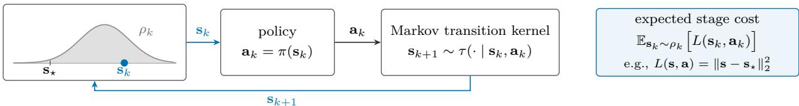

(b) DMDP: the policy acts on the state distribution ρk  
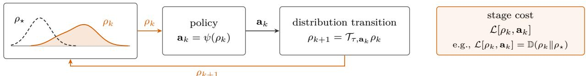  
Figure 1: Norm-based MDP (a) and DMDP (b).

intractable. In addition, the formulation requires access to the evolving state distributions $\{ \rho _ { k } \} _ { k = 0 } ^ { \infty }$ and the distribution transition operator $\mathcal { T } _ { \tau , { \mathbf { a } } _ { k } }$ , which are generally unknown in practical applications. Instead, only finite trajectory data are available, and both the state distributions and their distributional dynamics must be inferred from data. Sections 3 and 4 address these two challenges in turn.

## 3 Finite-Dimensional Representation and Stability Analysis

Although the DMDP in Problem OCP provides a distribution-level stability notion for stochastic systems, it remains infinite-dimensional because the state $\rho _ { k }$ belongs to the space of probability measures $M ( s )$ . We therefore introduce a finite-dimensional parameterization of the state distributions. Section 3.1 introduces this parameterization and the resulting finite-dimensional optimal control problem, Section 3.2 introduces a cost rotation for the undiscounted problem, and Section 3.3 establishes Lyapunov certificates that transfer stability from the parameter space to the space of probability measures. Figure 2 summarizes the theoretical development of Sections 2–4 and the dependencies among the assumptions and results. In the figure, white boxes denote problems, assumptions, and constructions, and orange boxes with thick borders denote results; each result holds under the hypotheses stated in it. An arrow from one box to another indicates that the latter is formulated in terms of the former or that its proof uses the former, and an arrow into a dashed frame applies to every result in that frame. Lemma 1 transfers a Lyapunov decrease in the parameter space to D-asymptotic stability of the induced distributions; it, or the Lyapunov argument in its proof, is used by every result in Section 4, with $W = U _ { \star } ^ { \mathsf { R } }$ in Theorems 3 and 4 and with $W = W _ { n }$ in Theorem 5.

## 3.1 Parameterized Distributions

The parameterization rests on the following assumption.

Assumption 1. Each probability measure $\rho \in M ( S )$ considered in the analysis admits a density representation parameterized by a finite-dimensional vector $\omega \in \Omega \subseteq \mathbb { R } ^ { n _ { \omega } }$ . We write the corresponding measure as $\rho _ { \omega }$

Assumption 1 allows the distributional state $\rho _ { k }$ to be represented by a parameter vector $\omega _ { k }$ estimated from finite data. This parameterization may be obtained, for example, by kernel density estimation (Parzen, 1962; Silverman, 1986), Gaussian mixture models (McLachlan & Peel, 2000), normalizing flows (Rezende & Mohamed, 2015; Papamakarios et al., 2021), or neural density estimators (Papamakarios et al., 2017). Thus, the family need not be a simple parametric one, and the assumption serves as a computational interface between distribution estimation and policy learning. Under this parameterization, the distributional transition $\rho _ { k + 1 } = \mathcal { T } _ { \tau , \mathbf { a } _ { k } } \rho _ { k }$ is represented by the parameter dynamics

$$
\omega _ { k + 1 } = f ( \omega _ { k } , \mathbf { a } _ { k } ) ,\tag{5}
$$

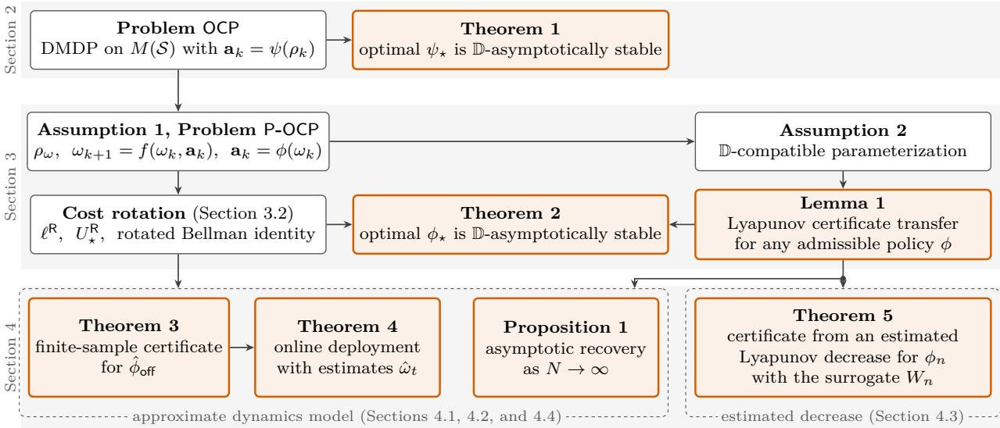  
Figure 2: Roadmap of the theoretical development.

where $f : \Omega \times \mathcal { A }  \Omega$ is an unknown transition map induced by the underlying stochastic dynamics and the chosen density parameterization. Although the sample-level system dynamics are stochastic, the evolution of the distribution parameter $\omega _ { k }$ is deterministic once the current distribution parameter and the action are fixed. The representation (5) is exact when the parameterized family is closed under the controlled transition, i.e., $\mathcal { T } _ { \tau , \mathbf { a } } \rho _ { \omega } = \rho _ { f ( \omega , \mathbf { a } ) }$ for all $\omega \in \Omega$ and $\mathbf { a } \in { \mathcal { A } } ;$ otherwise, $f$ describes the evolution of the fitted parameter only approximately. Closure holds in special cases, such as linear dynamics with additive Gaussian noise and a Gaussian family in Appendix D, but rarely in general, e.g., not for the product of uniform families under the HalfCheetah dynamics in Appendix E. Assumption 1 and the exact representation are thus idealizations that provide a tractable finite-dimensional framework and hold only approximately in practice; Section 4 retains them and bounds the errors of the learned parameter dynamics, value functions, and estimated Lyapunov decrease, as well as of the estimated distribution parameters. We then introduce a parameter-based policy $\phi : \Omega  A$ such that $\mathbf { a } _ { k } = \phi ( \omega _ { k } )$ , and let Φ denote the set of admissible policies. The distributional stage cost functional $\mathcal { L } : M ( \mathcal { S } ) \times \mathcal { A }  \mathbb { R }$ is equivalently represented in the parameter space by $\ell ( \omega , \mathbf { a } ) : = \mathcal { L } [ \rho _ { \omega } , \mathbf { a } ]$ When $\mathcal { L } [ \rho _ { k } , \mathbf { a } _ { k } ] = \mathbb { D } ( \rho _ { k } \| \rho _ { \star } )$ , we have $\ell ( \omega _ { k } , \mathbf { a } _ { k } ) = \mathbb { D } ( \rho _ { \omega _ { k } } \| \rho _ { \star } )$

This parameterization yields the following finite-dimensional optimal control problem:

$$
\operatorname* { m i n } _ { \phi \in \Phi } \sum _ { k = 0 } ^ { \infty } \gamma ^ { k } \left[ \ell ( \omega _ { k } , \phi ( \omega _ { k } ) ) - \ell _ { 0 } \right] \quad \mathrm { s . t . } \quad \omega _ { k + 1 } = f ( \omega _ { k } , \phi ( \omega _ { k } ) ) , \quad \omega _ { 0 } = \omega ,\tag{P-OCP}
$$

where $U _ { \star } ( \omega )$ denotes the optimal value of Problem P-OCP. The constant $\ell _ { 0 }$ is defined by

$$
\ell _ { 0 } : = \operatorname* { m i n } _ { \substack { \phi \in \Phi , \ \omega \in \Omega } } \ell ( \omega , \phi ( \omega ) ) \quad \mathrm { s . t . } \quad \omega = f ( \omega , \phi ( \omega ) ) .\tag{6}
$$

The optimal steady-state parameter is denoted by $\omega _ { \star }$ , and we assume that it exists and that its associated probability measure is $\rho _ { \omega _ { \star } } = \rho _ { \star }$ . Because the state distribution itself is the controlled object, the steady-state problem in (6) is posed in the parameterized space. This problem identifies a stationary parameter $\omega _ { \star }$ satisfying $\omega _ { \star } = f ( \omega _ { \star } , \phi ( \omega _ { \star } ) )$ , whose associated probability measure $\rho _ { \omega } .$ represents the target distribution $\rho _ { \star }$ Thus, ω⋆ is not an additional target beyond $\rho _ { \star } \mathrm { ; }$ ; it is a finite-dimensional representation of the invariant target distribution and is used to normalize the cost through $\ell _ { 0 }$ and to formulate stabilization in the parameter space. Solving Problem P-OCP yields an optimal parameter-based policy $\phi _ { \star } \in \Phi$

## 3.2 Cost Rotation

Since the parameter dynamics in (5) are deterministic, the stability of the parameter trajectory can be analyzed through a dissipativity-based cost rotation (Diehl et al., 2011; Angeli et al., 2012; Faulwasser et al.,

2018). For the undiscounted case $\gamma = 1$ , let $\lambda : \Omega \to \mathbb { R }$ be a storage function (Willems, 1972) and define the rotated stage cost by

$$
\ell ^ { \mathsf { R } } ( \omega , \mathbf { a } ) : = \ell ( \omega , \mathbf { a } ) - \ell _ { 0 } - \lambda ( f ( \omega , \mathbf { a } ) ) + \lambda ( \omega ) .\tag{7}
$$

When the storage function λ is bounded along admissible trajectories in Ω and the terminal storage term $\lambda ( \omega _ { H } )$ is kept in the rotated objective, as in (8) below, the rotated and unrotated undiscounted objectives have the same optimal policies. For any policy ϕ and any finite horizon H, the rotated cost satisfies

$$
\lambda ( \omega _ { H } ) + \sum _ { k = 0 } ^ { H - 1 } \ell ^ { \mathsf { R } } \left( \omega _ { k } , \phi ( \omega _ { k } ) \right) = \lambda ( \omega _ { 0 } ) + \sum _ { k = 0 } ^ { H - 1 } \left[ \ell \left( \omega _ { k } , \phi ( \omega _ { k } ) \right) - \ell _ { 0 } \right] \quad \mathrm { ( t e l e s c o p i n g ~ i d e n t i t y ) } ,\tag{8}
$$

where $\omega _ { k + 1 } = f ( \omega _ { k } , \phi ( \omega _ { k } ) )$ . Therefore, in the undiscounted setting, when the storage function is bounded along admissible trajectories and the infinite-horizon limits are well defined, the rotation preserves the set of optimal policies because it changes the objective only by the initial storage term. We define the rotated optimal value by $\begin{array} { r } { U _ { \star } ^ { \mathrm { R } } ( \omega ) : = \operatorname* { m i n } _ { \phi \in \Phi } \operatorname* { l i m } _ { H \to \infty } \left\lceil \lambda ( \omega _ { H } ) + \sum _ { k = 0 } ^ { H - 1 } \ell ^ { \mathrm { R } } \left( \omega _ { k } , \phi ( \omega _ { k } ) \right) \right\rceil } \end{array}$ , subject to $\omega _ { k + 1 } = f ( \omega _ { k } , \phi ( \omega _ { k } ) )$ and $\omega _ { 0 } = \omega$ . Under the standard dynamic programming principle (Puterman, 1994; Hernández-Lerma & Lasserre, 1996) for the rotated infinite-horizon problem, if an optimal stationary selector $\phi _ { \star }$ exists and $U _ { \star } ^ { \mathsf { R } }$ is finite on an operating set $\Omega _ { \mathrm { c } } .$ , then the rotated optimal value satisfies the Bellman identity

$$
\begin{array} { r } { U _ { \star } ^ { \mathsf { R } } ( \omega ) = \ell ^ { \mathsf { R } } \left( \omega , \phi _ { \star } ( \omega ) \right) + U _ { \star } ^ { \mathsf { R } } \left( f ( \omega , \phi _ { \star } ( \omega ) ) \right) , \quad \forall \omega \in \Omega _ { \mathsf { c } } . } \end{array}\tag{9}
$$

This identity is the rotated analogue of the usual Bellman equation.

## 3.3 Lyapunov Certificates for Distributional Stability

The Lyapunov certificates in this subsection rely on the following compatibility condition between the parameterization and the dissimilarity measure.

Assumption 2 (D-compatible parameterization). Let $\Omega _ { \mathsf { c } } \subseteq \Omega$ be an operating set containing $\omega _ { \star }$ . The parameterization $\omega \mapsto \rho _ { \omega }$ is said to be D-compatible on $\Omega _ { \mathsf { c } }$ with respect to $\omega _ { \star }$ if there exist class-K functions $\alpha _ { 1 }$ and $\alpha _ { 2 }$ such that

$$
\begin{array} { r } { \alpha _ { 1 } \left( \| \omega - \omega _ { \star } \| \right) \leq \mathbb { D } ( \rho _ { \omega } \| \rho _ { \omega _ { \star } } ) \leq \alpha _ { 2 } \left( \| \omega - \omega _ { \star } \| \right) , \quad \forall \omega \in \Omega _ { \mathsf { c } } . } \end{array}\tag{10}
$$

Assumption 2 requires the parameter distance $\lVert \omega - \omega _ { \star } \rVert$ and the distributional dissimilarity $\mathbb { D } ( \rho _ { \omega } \Vert \rho _ { \omega _ { \star } } )$ to be locally comparable on the operating set under consideration. This condition is not a restriction on the dynamics; rather, it ensures that convergence in the finite-dimensional parameter space implies convergence of the corresponding state distribution in the chosen dissimilarity measure. We first state a policy-agnostic Lyapunov certificate (cf. Khalil, 2002; Jiang & Wang, 2002). This result is independent of optimality and is used later to certify stability not only for the ideal optimal policy $\phi _ { \star }$ but also for learned policies.

Lemma 1. Let $\phi : \Omega  A$ be any admissible policy and define the closed-loop parameter map $F _ { \phi } ( \omega ) : = $ $f ( \omega , \phi ( \omega ) )$ ). Let $\Omega _ { \mathsf { c } } \subseteq \Omega$ be positively invariant under $F _ { \phi }$ , and suppose that $F _ { \phi } ( \omega _ { \star } ) = \omega _ { \star }$ . Assume that there exist a continuous function $W : \Omega _ { \mathsf { c } } \to \mathbb { R } _ { > 0 }$ and class-K functions $\underline { { \alpha } } , \overline { { \alpha } } ,$ and σ such that

$$
\begin{array} { r } { \underline { { \alpha } } \left( \| \omega - \omega _ { \star } \| \right) \le W ( \omega ) \le \overline { { \alpha } } \left( \| \omega - \omega _ { \star } \| \right) , \quad \forall \omega \in \Omega _ { \mathsf { c } } , } \end{array}\tag{11}
$$

$$
W ( F _ { \phi } ( \omega ) ) - W ( \omega ) \leq - \sigma \left( \| \omega - \omega _ { \star } \| \right) , \quad \forall \omega \in \Omega _ { \mathsf { c } } .\tag{12}
$$

Suppose further that the parameterization is D-compatible on $\Omega _ { \mathsf { c } }$ in the sense of Assumption 2. Then, the induced distribution dynamics generated by $\omega _ { k + 1 } = F _ { \phi } ( \omega _ { k } ) , \ \rho _ { k } = \rho _ { \omega _ { k } }$ are D-asymptotically stable with respect to $\rho _ { \star } = \rho _ { \omega _ { \star } } \ o n \ \{ \rho _ { \omega } \ | \ \omega \in \Omega _ { \mathsf { c } } \}$

The next theorem recovers the optimal-policy stability guarantee from the rotated-cost dissipativity condition. It shows that, for the ideal parameterized optimal control problem, the rotated optimal value $U _ { \star } ^ { \mathsf { R } }$ can serve as the Lyapunov function in Lemma 1.

Theorem 2. Assume $\gamma = 1$ . Let $\phi ,$ ⋆ be an optimal policy of Problem P-OCP, and define $F _ { \phi _ { \star } } ( \omega ) : = f ( \omega , \phi _ { \star } ( \omega ) )$ Let $\Omega _ { \mathcal { P } } \subseteq \Omega$ be positively invariant under $F _ { \phi _ { \star } }$ , and suppose that $F _ { \phi _ { \star } } ( \omega _ { \star } ) = \omega _ { \star }$ . Suppose that $U _ { \star } ^ { \mathsf { R } }$ is finite, nonnegative, and continuous on $\Omega _ { \mathcal { F } }$ and satisfies the rotated Bellman identity (9) for all $\omega \in \Omega _ { \mathcal { P } }$ . Suppose further that there exist class-K functions $\kappa _ { 1 }$ and $\kappa _ { 2 }$ such that

$$
\ell ^ { \mathsf { R } } \left( \omega , \phi _ { \star } ( \omega ) \right) \geq \kappa _ { 1 } \left( \| \omega - \omega _ { \star } \| \right) , \quad \forall \omega \in \Omega _ { \mathcal { P } } ,\tag{13}
$$

$$
U _ { \star } ^ { \mathsf { R } } ( \omega ) \leq \kappa _ { 2 } \left( \| \omega - \omega _ { \star } \| \right) , \quad \forall \omega \in \Omega _ { \mathcal { P } } .\tag{14}
$$

Suppose that the parameterization is D-compatible on $\Omega _ { \mathcal { P } }$ in the sense of Assumption 2. Then, the optimal policy $\phi _ { \star }$ renders the induced distribution dynamics D-asymptotically stable with respect to $\rho _ { \star } = \rho _ { \omega }$ on $\{ \rho _ { \omega } \mid \omega \in \Omega _ { \mathcal { P } } \}$

The proofs of Lemma 1 and Theorem 2 are provided in Appendices A.2 and $\mathrm { A . 3 , }$ respectively. For the representative stage cost $\ell ( \omega , \mathbf { a } ) = \mathbb { D } ( \rho _ { \omega } \| \rho _ { \star } )$ , which is nonnegative and vanishes at $\omega _ { \star }$ , it follows that $\ell _ { 0 } = 0 ;$ hence, the storage function $\lambda = 0$ gives $\ell ^ { \mathsf { R } } = \ell \geq \alpha _ { 1 } ( \| \omega - \omega _ { \star } \| )$ on $\Omega _ { \mathcal { P } }$ by Assumption 2, i.e., (13) with $\kappa _ { 1 } = \alpha _ { 1 }$ ; other stage costs may require a nonzero storage function.

Intuition behind Lemma 1 and Theorem 2. The key insight is that distributional stabilization does not require directly solving a problem over the infinite-dimensional space of measures. Instead, by parameterizing each distribution $\rho _ { k }$ as $\rho _ { \omega _ { k } }$ and analyzing the deterministic parameter dynamics $\omega _ { k + 1 } = f ( \omega _ { k } , \phi ( \omega _ { k } ) )$ ), we can certify stability through a Lyapunov decrease in the finite-dimensional parameter space.

## 4 Stability Certification for Learned Policies

The results of the preceding section concern policies and value functions for the exact parameter dynamics. Here, we study how approximation and estimation errors afect their Lyapunov certificates. Section 4.1 transfers a decrease condition computed with an approximate dynamics model to the true dynamics. Section 4.2 then accounts for deployment with estimated distribution parameters. Section 4.3 gives a complementary certificate based on an estimated Lyapunov decrease. These results concern the information available for certification and do not prescribe a particular policy-learning algorithm or data-collection schedule. Section 4.4 studies the corresponding limiting behavior, and Section 4.5 describes the practical implementation settings. We use the policy class $\Phi _ { \Theta } : = \{ \phi ( \cdot ; \theta ) : \Omega \to \mathcal { A } \mid \theta \in \Theta \subseteq \mathbb { R } ^ { n _ { \theta } } \} \subseteq \Phi$ , where $\phi ( \omega ; \theta )$ is continuous in $( \omega , \theta )$ . We omit θ when its role is clear. The certificates below apply to a fixed learned policy; stability during policy updates and exploration requires additional analysis.

## 4.1 Certification with an Approximate Dynamics Model

Suppose that an approximate parameter transition map $\hat { f } _ { \mathrm { o f f } }$ is available for the dynamics (5). One way to obtain it is to use M independent trajectories generated from an initial distribution under an action sequence:

$$
\begin{array} { r } { \mathcal { D } _ { \mathsf { o f f } } : = \left\{ \mathcal { D } _ { \mathsf { o f f } } ^ { ( i ) } \right\} _ { i = 1 } ^ { M } , \qquad \mathcal { D } _ { \mathsf { o f f } } ^ { ( i ) } : = \left\{ \left( \mathbf { s } _ { k } ^ { ( i ) } , \mathbf { a } _ { k } , \mathbf { s } _ { k + 1 } ^ { ( i ) } \right) \right\} _ { k = 0 } ^ { T - 1 } . } \end{array}\tag{15}
$$

At each $k ,$ the samples $\{ \mathbf { s } _ { k } ^ { ( i ) } \} _ { i = 1 } ^ { M }$ 1 share the distribution $\rho _ { k }$ and yield an estimate $\hat { \omega } _ { k }$ . The resulting tuples $( \hat { \omega } _ { k } , \mathbf { a } _ { k } , \hat { \omega } _ { k + 1 } )$ are used to learn $\hat { f } _ { \mathrm { o f f } }$ . Here, $N = T M$ is the number of state-transition samples. The density models discussed after Assumption 1 provide possible estimators. This construction is one source of the approximate model; the certificate below depends on its approximation errors.

Candidate policy and value function. Define the approximate rotated stage cost $\widehat { \ell _ { \mathsf { o f f } } ^ { \mathsf { R } } } ( \omega , \mathbf { a } ) : = \ell ( \omega , \mathbf { a } ) -$ $\ell _ { 0 } - \lambda \Big ( \hat { f } _ { \mathrm { o f f } } ( \omega , \mathbf { a } ) \Big ) + \lambda ( \omega )$ . The corresponding rotated optimization problem is

$$
\operatorname* { m i n } _ { \phi \in \Phi _ { \Theta } } \quad \operatorname* { l i m } _ { H \to \infty } \left[ \lambda ( \omega _ { H } ) + \sum _ { k = 0 } ^ { H - 1 } \widehat { \ell } _ { \mathrm { o f f } } ^ { \mathbb { R } } \left( \omega _ { k } , \phi ( \omega _ { k } ) \right) \right] \quad \mathrm { s . t . } \quad \omega _ { k + 1 } = \widehat { f } _ { \mathrm { o f f } } \left( \omega _ { k } , \phi ( \omega _ { k } ) \right) , \ \omega _ { 0 } = \omega .\tag{AP-OCPR}
$$

Let $\widehat { U } _ { \mathrm { o f f } } ^ { \mathsf { R } }$ denote its optimal value. A policy $\hat { \phi } _ { \mathrm { o f f } }$ may be obtained from

$$
\operatorname* { m i n } _ { \phi \in \Phi _ { \Theta } } \quad \sum _ { k = 0 } ^ { \infty } \gamma ^ { k } \ell \left( \omega _ { k } , \phi ( \omega _ { k } ) \right) \quad \mathrm { s . t . } \quad \omega _ { k + 1 } = \hat { f } _ { \mathrm { o f f } } \left( \omega _ { k } , \phi ( \omega _ { k } ) \right) , \ \omega _ { 0 } = \omega .\tag{AP-OCP}
$$

For $\gamma = 1$ , replacing ℓ by $\ell - \ell _ { 0 }$ in Problem $_ { \mathsf { A P - O C P } }$ and retaining the terminal storage term in Problem $A P \mathrm { - } O C P ^ { \mathsf { R } }$ gives the policy equivalence described in Section 3.2. For discounted or approximate optimization, stability instead requires the certificate below. Problem $_ { \mathsf { A P - O C P } } \mathsf { R }$ serves the analysis: the certificate uses its optimal value $\widehat { U } _ { \mathrm { o f f } } ^ { \sf R }$ as a Lyapunov candidate but not the optimality of $\hat { \phi } _ { \mathrm { o f f } }$ , which may therefore be computed from Problem $\mathsf { \Gamma } _ { \mathsf { A P - O C P } }$ , without $\lambda ,$ or obtained by reinforcement learning. For the representative stage cost and $\lambda = 0 , \widehat { U } _ { \circ \mathsf { f f } } ^ { \mathsf { R } }$ is the optimal value of Problem AP-OCP with $\gamma = 1$ , and the certificate of Section 4.3 requires no storage function.

Certificate quantities. Define $\widehat { F } _ { \mathrm { o f f } } ( \omega ) : = \hat { f } _ { \mathrm { o f f } } \left( \omega , \hat { \phi } _ { \mathrm { o f f } } ( \omega ) \right) , F _ { \mathrm { o f f } } ( \omega ) : = f \left( \omega , \hat { \phi } _ { \mathrm { o f f } } ( \omega ) \right)$ . Fix a compact operating region $\Omega _ { \mathsf { c o m } } \subseteq \Omega$ containing $\omega _ { \star }$ . The Lyapunov bounds used below are

$$
\underline { { \alpha } } \left( \| \omega - \omega _ { \star } \| \right) \leq U _ { \star } ^ { \mathsf { R } } ( \omega ) \leq \overline { { \alpha } } \left( \| \omega - \omega _ { \star } \| \right) , \qquad \forall \omega \in \Omega _ { \mathsf { c o m } } ,\tag{16}
$$

where $\underline { { \alpha } } , \overline { { \alpha } } \in \mathcal { K }$ . Define the value-function and successor-induced errors by

$$
\Delta _ { U } : = \operatorname* { s u p } _ { \omega \in \Omega _ { \mathrm { c o m } } } \left| \widehat { U } _ { \mathrm { o f f } } ^ { \mathrm { R } } ( \omega ) - U _ { \star } ^ { \mathrm { R } } ( \omega ) \right| ,\tag{17}
$$

$$
\Delta _ { f } : = \operatorname* { s u p } _ { \omega \in \Omega _ { \mathrm { c o m } } } \left| U _ { \star } ^ { \mathsf { R } } \left( F _ { \mathsf { o f f } } ( \omega ) \right) - U _ { \star } ^ { \mathsf { R } } \left( \widehat { F } _ { \mathsf { o f f } } ( \omega ) \right) \right| , \qquad \Delta : = \Delta _ { f } + 2 \Delta _ { U } .\tag{18}
$$

The approximate decrease condition is

$$
\widehat { U } _ { \mathrm { o f f } } ^ { \mathrm { R } } \left( \widehat { F } _ { \mathrm { o f f } } ( \omega ) \right) - \widehat { U } _ { \mathrm { o f f } } ^ { \mathrm { R } } ( \omega ) \leq - \sigma \left( \| \omega - \omega _ { \star } \| \right) , \qquad \forall \omega \in \Omega _ { \mathrm { c o m } } ,\tag{19}
$$

with $\sigma \in { \mathcal { K } }$ . For an error bound $\bar { \Delta } \geq 0 .$ , define the residual set

$$
\Omega _ { \bar { \Delta } } : = \left\{ \omega \in \Omega _ { \mathsf { c o m } } \mid \sigma \left( \left\| \omega - \omega _ { \star } \right\| \right) \leq \bar { \Delta } \right\} .\tag{20}
$$

Since the data $\mathcal { D } _ { \mathsf { o f f } }$ are random, so are $\hat { f } _ { \mathrm { o f f } } , \hat { \phi } _ { \mathrm { o f f } } , \widehat { U } _ { \mathrm { o f f } } ^ { \mathrm { R } }$ , and $\Delta .$ An event is a set of outcomes of the random data or samples, not of parameters $\omega ,$ and a statement holds on an event if it holds for every outcome in it; ${ \mathcal E } _ { \mathrm { o f f } }$ denotes the event on which $\Delta \le \bar { \Delta }$ and (19) hold.

Theorem 3. With the quantities defined in Section $4 . 1 ,$ suppose that $\Omega _ { \mathsf { c o m } }$ is positively invariant under $F _ { \mathsf { o f f } }$ and $\widehat { F } _ { \mathsf { o f f } } , F _ { \mathsf { o f f } } ( \omega _ { \star } ) = \omega _ { \star }$ , and $U _ { \star } ^ { \mathsf { R } }$ is continuous and satisfies (16). Assume Assumption $\mathcal { Q }$ on $\Omega _ { \mathsf { c o m } }$ . If the event ${ \mathcal E } _ { \mathrm { o f f } }$ has probability at least $1 - \alpha , \alpha \in ( 0 , 1 )$ , then, on ${ \mathcal { E } } _ { \circ { \mathsf { f f } } }$

$$
U _ { \star } ^ { \mathsf { R } } \left( F _ { \mathsf { o f f } } ( \omega ) \right) - U _ { \star } ^ { \mathsf { R } } ( \omega ) \leq - \sigma \left( \| \omega - \omega _ { \star } \| \right) + \bar { \Delta } , \qquad \forall \omega \in \Omega _ { \mathsf { c o m } } .\tag{21}
$$

Thus, $U _ { \star } ^ { \mathsf { R } }$ strictly decreases outside $\Omega _ { \bar { \Delta } }$ , which shrinks to $\left\{ \omega _ { \star } \right\}$ as $\bar { \Delta }  0 . I f \bar { \Delta } = 0$ , or, more generally, if state-dependent errors yield $\begin{array} { r } { U _ { \star } ^ { \mathsf { R } } ( F _ { \mathsf { o f f } } \overline { { ( \omega ) } } ) - U _ { \star } ^ { \mathsf { R } } ( \omega ) \leq - \tilde { \sigma } ( \| \omega - \omega _ { \star } \| ) } \end{array}$ throughout $\Omega _ { \mathsf { c o m } }$ for some $\tilde { \sigma } \in \kappa$ , the induced distribution dynamics are D-asymptotically stable with respect to $\rho _ { \star }$ on $\{ \rho _ { \omega } \mid \omega \in \Omega _ { \mathsf { c o m } } \}$ , on ${ \mathcal E } _ { \mathrm { o f f } }$

The proof is given in Appendix A.4. The theorem transfers an approximate decrease certificate to the true dynamics with residual $\Delta _ { f } + 2 \Delta _ { U }$ . It assumes suitable uniform error bounds and invariance on the operating region; these must be established for the chosen estimation and learning procedure.

## 4.2 Deployment with Estimated Distribution Parameters

We now hold $\hat { \phi } _ { \mathrm { o f f } }$ fixed and account for estimation of its input. At time $t ,$ an estimate $\hat { \omega } _ { t }$ is formed from the available history $\mathcal { H } _ { t } : = \{ ( \mathbf { s } _ { k } , \mathbf { a } _ { k } ) \} _ { k = 0 } ^ { t - 1 } \cup \{ \mathbf { s } _ { t } \}$ , and the action is $\mathbf { a } _ { t } = \hat { \phi } _ { \mathrm { o f f } } ( \hat { \omega } _ { t } )$ . A single state observation generally does not determine $\omega _ { t }$ . Possible constructions use a sliding window, K-nearest neighbors, or importance-weighted observations. The certificate assumes an explicit error bound for the resulting estimator. Retain $F _ { \mathsf { o f f } }$ for exact-parameter feedback and define $F _ { \mathsf { o n } } ( \omega , \tilde { \omega } ) : = f \left( \omega , \hat { \phi } _ { \mathsf { o f f } } ( \tilde { \omega } ) \right)$ . Suppose that we have the certificate

$$
U _ { \star } ^ { \mathrm { R } } \left( F _ { \mathsf { o f f } } ( \omega ) \right) - U _ { \star } ^ { \mathrm { R } } ( \omega ) \leq - \sigma _ { \mathsf { o n } } \left( \| \omega - \omega _ { \star } \| \right) + \bar { \Delta } _ { \mathsf { o f f } } , \qquad \forall \omega \in \Omega _ { \mathsf { c o m } } ,\tag{22}
$$

where $\sigma _ { \mathsf { o n } } \in \kappa$ and $\bar { \Delta } _ { \mathsf { o f f } } \geq 0$ . This may be supplied by Theorem 3. Define the additional perturbation

$$
\Delta _ { \mathsf { o n } } ( \delta ) : = \operatorname* { s u p } _ { \omega , \tilde { \omega } \in \Omega _ { \mathsf { c o m } } \atop \| \tilde { \omega } - \omega \| \leq \delta } \left| U _ { \star } ^ { \mathsf { R } } \left( F _ { \mathsf { o n } } ( \omega , \tilde { \omega } ) \right) - U _ { \star } ^ { \mathsf { R } } \left( F _ { \mathsf { o f f } } ( \omega ) \right) \right| .\tag{23}
$$

For $\delta _ { \mathsf { o n } } \geq 0$ , the required estimation event is

$$
\left\| \hat { \omega } _ { t } - \omega _ { t } \right\| \leq \delta _ { \mathsf { o n } } , \qquad \hat { \omega } _ { t } \in \Omega _ { \mathsf { c o m } } , \qquad \forall t \geq 0 ,\tag{24}
$$

simultaneously for every initial $\omega _ { 0 } \in \Omega _ { \mathsf { c o m } }$ . The associated residual set is

$$
\begin{array} { r } { \Omega _ { \mathsf { o n } } : = \left\{ \omega \in \Omega _ { \mathsf { c o m } } \ \mathsf { \Omega } \middle | \ \sigma _ { \mathsf { o n } } \left( \left\| \omega - \omega _ { \star } \right\| \right) \leq \bar { \Delta } _ { \mathsf { o f f } } + \Delta _ { \mathsf { o n } } ( \delta _ { \mathsf { o n } } ) \right\} . } \end{array}\tag{25}
$$

Theorem 4. Suppose that $U _ { \star } ^ { \mathsf { R } }$ is continuous on the compact set $\Omega _ { \mathsf { c o m } }$ and satisfies (16) and (22). Assume Assumption 2 on $\Omega _ { \mathsf { c o m } }$ and that $F _ { \mathsf { o n } } ( \omega , \tilde { \omega } ) \in \Omega _ { \mathsf { c o m } }$ whenever $\omega , \tilde { \omega } \in \Omega _ { \mathrm { c o m } }$ and $\| \tilde { \omega } - \omega \| \leq \delta _ { \mathsf { o n } } . \ I f$ the uniform event (24) has probability at least $1 - \alpha _ { \mathsf { o n } } , \alpha _ { \mathsf { o n } } \in ( 0 , 1 )$ , then, on that event, every trajectory $\omega _ { t + 1 } = F _ { \mathsf { o n } } ( \omega _ { t } , \hat { \omega } _ { t } )$ initialized in $\Omega _ { \mathsf { c o m } }$ satisfies

$$
\begin{array} { r } { U _ { \star } ^ { \mathrm { R } } ( \omega _ { t + 1 } ) - U _ { \star } ^ { \mathrm { R } } ( \omega _ { t } ) \leq - \sigma _ { \mathsf { o n } } \left( \| \omega _ { t } - \omega _ { \star } \| \right) + \bar { \Delta } _ { \mathsf { o f f } } + \Delta _ { \mathsf { o n } } ( \delta _ { \mathsf { o n } } ) . } \end{array}\tag{26}
$$

Thus, $U _ { \star } ^ { \mathsf { R } }$ strictly decreases outside $\Omega _ { \mathsf { o n } }$ . If the total residual is zero, or, more generally, if state-dependent errors yield $U _ { \star } ^ { \mathrm { R } } ( \omega _ { t + 1 } ) - U _ { \star } ^ { \mathrm { R } } ( \omega _ { t } ) \leq - \tilde { \sigma } _ { \mathsf { o n } } ( \| \omega _ { t } - \omega _ { \star } \| )$ for all $t \geq 0$ and some $\tilde { \sigma } _ { \mathsf { o n } } ~ \in ~ \mathcal { K }$ , then the induced distribution dynamics are D-asymptotically stable with respect to $\rho _ { \star }$ on $\{ \rho _ { \omega } \mid \omega \in \Omega _ { \mathsf { c o m } } \}$ , on the same event.

The proof is given in Appendix A.5. Parameter estimation adds $\Delta _ { \mathsf { o n } } ( \delta _ { \mathsf { o n } } )$ to the exact-parameter residual. If $U _ { \star } ^ { \mathsf { R } } , f ,$ and $\hat { \phi } _ { \mathrm { o f f } }$ are continuous on the relevant compact sets, then $\Delta _ { \mathsf { o n } } ( \delta ) \to 0$ as $\delta  0$ . Thus, a vanishing uniform estimation error recovers the exact-parameter certificate. When (22) holds only on an event, such as ${ \mathcal E } _ { \mathrm { o f f } }$ of Theorem 3, the two certificates apply on the intersection of this event and the event (24).

## 4.3 Certification from an Estimated Lyapunov Decrease

A decrease certificate can also be obtained directly from parameter-level transition data, without constructing an explicit approximation of f. At learning iteration $n ,$ , let

$$
\begin{array} { r } { \mathcal { D } _ { \circ \mathbf { n } } ^ { ( n ) } : = \left\{ \left( \hat { \omega } _ { t } ^ { ( j ) } , \mathbf { a } _ { t } ^ { ( j ) } , \hat { \omega } _ { t + 1 } ^ { ( j ) } \right) \right\} _ { j = 1 } ^ { N _ { n } } } \end{array}\tag{27}
$$

contain estimated distribution parameters before and after the recorded actions. Let $\phi _ { n } : \Omega \to { \mathcal { A } }$ and $W _ { n } : \Omega \to \mathbb { R } _ { \geq 0 }$ be a candidate policy and Lyapunov surrogate. Possible learning procedures include actor-critic methods (Konda & Tsitsiklis, 1999), fitted value iteration (Munos & Szepesvári, 2008), and policy-gradient methods (Sutton et al., 1999) with Lyapunov regularization (Chang et al., 2019; Han et al., 2020). The result below certifies the resulting pair through its decrease and error bounds.

Certificate quantities. For analysis, define the true closed-loop maps

$$
F _ { n } ( \omega ) : = f ( \omega , \phi _ { n } ( \omega ) ) ,\tag{28}
$$

$$
F _ { n } ^ { \mathsf { p l u g } } ( \omega , \tilde { \omega } ) : = f ( \omega , \phi _ { n } ( \tilde { \omega } ) ) .\tag{29}
$$

These maps specify the dynamics being certified. Let $\widehat { \mathcal { D } } _ { n }$ estimate the exact-parameter decrease

$$
\begin{array} { r } { \mathcal { D } _ { n } ( \omega ) : = W _ { n } ( F _ { n } ( \omega ) ) - W _ { n } ( \omega ) . } \end{array}\tag{30}
$$

On a compact region $\Omega _ { \mathsf { c o m } }$ containing $\omega _ { \star }$ , the required Lyapunov bounds and estimated decrease are

$$
\underline { { \alpha } } \left( \| \omega - \omega _ { \star } \| \right) \leq W _ { n } ( \omega ) \leq \overline { { \alpha } } \left( \| \omega - \omega _ { \star } \| \right) , \qquad \forall \omega \in \Omega _ { \mathsf { c o m } } ,\tag{31}
$$

$$
\widehat { \mathcal { D } } _ { n } ( \omega ) \leq - \sigma _ { n } \left( \| \omega - \omega _ { \star } \| \right) , \qquad \forall \omega \in \Omega _ { \mathsf { c o m } } ,\tag{32}
$$

where $\underline { { { \alpha } } } , \overline { { { \alpha } } } , \sigma _ { n } \in { \mathcal { K } }$ . Define the decrease-estimation error and the perturbation caused by estimating the policy input:

$$
\Delta _ { \mathsf { d e c } , n } : = \operatorname* { s u p } _ { \omega \in \Omega _ { \mathsf { c o m } } } \left| \widehat { \mathcal { D } } _ { n } ( \omega ) - \mathcal { D } _ { n } ( \omega ) \right| ,\tag{33}
$$

$$
\Delta _ { \omega , n } ( \delta ) : = \operatorname* { s u p } _ { \omega , \tilde { \omega } \in \Omega _ { \mathrm { c o m } } } \big | W _ { n } \left( F _ { n } ^ { \mathsf { p l u g } } ( \omega , \tilde { \omega } ) \right) - W _ { n } ( F _ { n } ( \omega ) ) \big | .\tag{34}
$$

For bounds $\Delta _ { \mathsf { d e c } , n } \geq 0$ and $\delta _ { \omega , n } \geq 0$ , the required joint event is

$$
\Delta _ { \mathsf { d e c } , n } \leq \bar { \Delta } _ { \mathsf { d e c } , n } , \qquad \left\| \hat { \omega } _ { t } - \omega _ { t } \right\| \leq \delta _ { \omega , n } , \qquad \hat { \omega } _ { t } \in \Omega _ { \mathsf { c o m } } , \qquad \forall t \geq 0 ,\tag{35}
$$

simultaneously for every initial $\omega _ { 0 } \in \Omega _ { \mathsf { c o m } }$ . The corresponding invariance condition is

$$
F _ { n } ^ { \mathrm { p l u g } } ( \omega , \tilde { \omega } ) \in \Omega _ { \mathrm { c o m } } , \qquad \forall \omega , \tilde { \omega } \in \Omega _ { \mathrm { c o m } } \ \mathrm { w i t h } \ \| \tilde { \omega } - \omega \| \leq \delta _ { \omega , n } .\tag{36}
$$

For deployment of the fixed policy $\phi _ { n } ,$ write

$$
\omega _ { t + 1 } = F _ { n } ^ { \mathsf { p l u g } } ( \omega _ { t } , \hat { \omega } _ { t } ) ,\tag{37}
$$

$$
\begin{array} { r } { \Omega _ { \mathsf { m f } , n } : = \left\{ \omega \in \Omega _ { \mathsf { c o m } } \bigm | \sigma _ { n } \left( \left\| \omega - \omega _ { \star } \right\| \right) \le \bar { \Delta } _ { \mathsf { d e c } , n } + \Delta _ { \omega , n } ( \delta _ { \omega , n } ) \right\} . } \end{array}\tag{38}
$$

Theorem 5 (Certificate from estimated Lyapunov decrease). Fix n and the candidate pair $( \phi _ { n } , W _ { n } )$ Suppose that $W _ { n }$ is continuous on $\Omega _ { \mathsf { c o m } }$ and that (31), (32), (36), and Assumption 2 hold on this compact set. If the joint event (35) has probability at least $1 - \alpha _ { n } , \alpha _ { n } \in ( 0 , 1 )$ , then, on that event, every trajectory of (37) initialized in $\Omega _ { \mathsf { c o m } }$ satisfies

$$
W _ { n } ( \omega _ { t + 1 } ) - W _ { n } ( \omega _ { t } ) \leq - \sigma _ { n } \left( \| \omega _ { t } - \omega _ { \star } \| \right) + \bar { \Delta } _ { \mathsf { d e c } , n } + \Delta _ { \omega , n } ( \delta _ { \omega , n } ) .\tag{39}
$$

Thus, $W _ { n }$ strictly decreases outside $\Omega _ { \mathsf { m f } , n }$ . If the total residual is zero, or, more generally, if state-dependent errors yield $W _ { n } ( \omega _ { t + 1 } ) - W _ { n } ( \omega _ { t } ) \leq - \tilde { \sigma } _ { n } ( \| \omega _ { t } - \omega _ { \star } \| )$ for all $t \geq 0$ and some ${ \tilde { \sigma } } _ { n } \in \kappa$ , then the induced distribution dynamics are D-asymptotically stable with respect to $\rho _ { \star }$ on $\{ \rho _ { \omega } \mid \omega \in \Omega _ { \mathsf { c o m } } \}$ , on the same event.

The proof is given in Appendix A.6. The certificate has two error contributions: $\bar { \Delta } _ { { \mathsf { d e c } } , n }$ accounts for estimating the decrease, and $\Delta _ { \omega , n } ( \delta _ { \omega , n } )$ accounts for estimating the policy input. The index n is held fixed throughout deployment; the theorem does not establish stability while the policy and surrogate are being updated. Stability during data collection and exploration requires additional guarantees, as in safe-exploration methods (García & Fernández, 2015; Achiam et al., 2017; Berkenkamp et al., 2017).

## 4.4 Asymptotic Recovery and Limiting Certificates

The preceding results certify a fixed candidate under nonzero errors. We next consider the limit as the available data increase, first for optimization with an approximate dynamics model and then for certification from an estimated decrease.

Objectives and optimizers. For each dataset size N, let $\hat { f } _ { \mathrm { o f f } } ^ { N }$ be the approximate model. For a fixed initial $\omega \in \Omega _ { \mathsf { c o m } }$ and $\theta ~ \in ~ \Theta$ , the rotated objective of the policy $\phi ( \cdot ; \theta )$ under f is $J ^ { \mathsf { R } } ( \theta ; \omega ) : = $ lim $\begin{array} { r } { \mathbf { \Phi } _ { H  \infty } \lceil \lambda ( \omega _ { H } ) + \sum _ { k = 0 } ^ { H - 1 } \ell ^ { \mathsf { R } } ( \omega _ { k } , \phi ( \omega _ { k } ; \theta ) ) \rceil } \end{array}$ , subject to $\omega _ { k + 1 } = f \left( \omega _ { k } , \phi ( \omega _ { k } ; \theta ) \right)$ and $\omega _ { 0 } = \omega ,$ , and $\widehat { J } _ { N } ^ { \mathsf { R } } ( \theta ; \omega )$ is the objective of Problem $_ { \mathsf { A P - O C P } } \mathsf { R }$ for the same policy with $\hat { f } _ { \mathrm { o f f } } = \hat { f } _ { \mathrm { o f f } } ^ { N }$ . Both objectives use the same storage function λ and constant $\ell _ { 0 }$ , neither of which depends on θ. By (8), applied along the trajectory of each model, each objective equals $\lambda ( \omega )$ plus the undiscounted objective of Problem P-OCP for $\phi ( \cdot ; \theta )$ under that model, so the rotation does not change the minimizers. Define $\begin{array} { r } { \Theta _ { \star } ^ { \mathsf { R } } : = \arg \operatorname* { m i n } _ { \theta \in \Theta } J ^ { \mathsf { R } } ( \theta ; \omega ) , \widehat { \theta } _ { N } \in \arg \operatorname* { m i n } _ { \theta \in \Theta } \widehat { J } _ { N } ^ { \mathsf { R } } ( \theta ; \omega ) } \end{array}$ Proposition 1 assumes, rather than proves, two convergence conditions: uniform model consistency,

$$
\operatorname* { s u p } _ { \mathbf { a } \in \Omega _ { \mathrm { c o m } } } \left\| \hat { f } _ { \mathrm { o f f } } ^ { N } ( \omega , \mathbf { a } ) - f ( \omega , \mathbf { a } ) \right\| \longrightarrow 0 \quad \mathrm { a l m o s t ~ s u r e l y ~ a s ~ } N \to \infty ,\tag{40}
$$

and uniform convergence of the infinite-horizon objectives,

$$
\operatorname* { s u p } _ { \theta \in \Theta } \Big | \widehat { J } _ { N } ^ { \mathrm { R } } ( \theta ; \omega ) - J ^ { \mathrm { R } } ( \theta ; \omega ) \Big | \longrightarrow 0 \quad \mathrm { a l m o s t ~ s u r e l y ~ a s ~ } N \to \infty .\tag{41}
$$

Fixed-horizon convergence alone does not establish the second condition.

Proposition 1. Let $\gamma = 1$ , let $\Omega _ { \mathsf { c o m } } , \ \Theta$ , and A be compact, and suppose that $f , \ \ell , \lambda ,$ , and $\phi ( \omega ; \theta )$ are continuous. Assume that (40) and (41) hold, and that both rotated objectives are well defined and continuous in θ on Θ. Suppose that $\Omega _ { \mathsf { c o m } }$ is positively invariant for every true closed loop indexed by $\theta \in \Theta$ , and that, almost surely, there is a finite $N _ { 0 }$ such that it is also positively invariant for every learned closed loop whenever $N \geq N _ { 0 }$ and $\theta \in \Theta$ . Then dist $\left( { \widehat { \theta } } _ { N } , \Theta _ { \star } ^ { \mathsf { R } } \right) \longrightarrow 0$ almost surely. Consequently, every limit point ¯θ of $\lbrace \widehat { \theta } _ { N } \rbrace _ { N = 1 } ^ { \infty }$ belongs to $\Theta _ { \star } ^ { \mathsf { R } }$ almost surely. If every policy indexed by $\bar { \theta } \in \Theta _ { \star } ^ { \mathsf { R } }$ satisfies the certificate in Lemma 1 on $\Omega _ { \mathsf { c o m } } ,$ and Assumption 2 holds there, then every such limit policy renders the induced distribution dynamics D-asymptotically stable with respect to $\rho _ { \star }$ on $\{ \rho _ { \omega } \mid \omega \in \Omega _ { \mathsf { c o m } } \}$

The proof is given in Appendix A.7. Uniform model consistency requires suficient coverage of $\Omega _ { \mathsf { c o m } } \times \mathcal { A }$ and suitable estimation conditions (Munos & Szepesvári, 2008; Chen & Jiang, 2019). Appendix C.2 describes one possible pipeline based on conditional density estimation, maximum-likelihood estimation, and Gaussian process regression. With partial coverage, uncertainty regularization, such as that used in MOPO and MOBILE (Yu et al., 2020; Sun et al., 2023), can help control optimization outside the supported region, but does not by itself establish the uniform consistency required by the proposition. For Theorem $5 ,$ consider a sequence for which $\bar { \Delta } _ { \mathrm { d e c } , n } + \Delta _ { \omega , n } ( \delta _ { \omega , n } ) \longrightarrow 0$ . If a subsequence of $( \phi _ { n } , W _ { n } )$ converges uniformly to a pair $( \phi _ { \infty } , W _ { \infty } )$ that satisfies all conditions of Lemma 1, including a decrease condition with a class- $. \kappa$ function, and the parameterization is D-compatible on the operating region, $\phi _ { \infty }$ is D-asymptotically stable. Vanishing residuals and convergence of the pair alone are insuficient because the decrease margins $\sigma _ { n }$ may also vanish. This is a certificate for the limiting policy. Optimizer recovery is established under Proposition 1’s assumptions.

## 4.5 Practical Implementation

The experiments train PPO and SAC using distribution estimates as policy inputs, with three departures from the idealized problem (OCP). First, a deployed system provides one noisy trajectory, so $\hat { \omega } _ { t }$ is formed from a sliding window as described in Section 4.2. The estimate $\hat { \omega } _ { t }$ contains the means and standard deviations of the last $n _ { \mathrm { w } }$ noisy readings of the regulated features (the forward velocity and the torso pitch of HalfCheetah). Second, to represent the body’s configuration within the gait cycle, the policy also receives the latest benchmark observation $\mathbf { y } _ { t }$ with sensor noise of standard deviation η, $\mathbf { o } _ { t } = \mathbf { y } _ { t } + \eta \pmb { \xi } _ { t } .$ , so that $\mathbf { a } _ { t } = \phi ( \hat { \omega } _ { t } , \mathbf { o } _ { t } )$ . Third, DMDP (PPO/SAC) maximizes the return of $r _ { t } ^ { \mathrm { b } } + r _ { t \mathbb { D } } - \beta \mathbb { D } _ { t }$ , with the benchmark reward $r _ { t } ^ { \mathrm { b } }$ , the dissimilarity $\mathbb { D } _ { t }$ of the empirical distribution of the true feature values in the window to $\rho _ { \star } .$ , its weight $\beta > 0$ , and the threshold reward $r _ { t \mathbb { D } }$ , a constant bonus whenever $\mathbb { D } _ { t } \leq \mathbb { D } _ { \mathsf { t h r } }$ . Figure 7 in Appendix E shows this closed loop, to which the preceding certificates apply once their hypotheses are verified for its actual inputs, induced dynamics, and estimation errors.

## 5 Empirical Validation

Does a DMDP bring the distribution of the velocity and the pitch of the closed loop close to the target $\rho _ { \star }$ and keep it stable? In the HalfCheetah task of Table 7 in Appendix E, the benchmark reward $r _ { t } ^ { \mathsf { b } }$ favors fast forward running, and the safety cost $c _ { t }$ indicates each step whose forward velocity $v _ { t }$ exceeds the velocity limit $v _ { \parallel \mathsf { m } }$ . The target $\rho _ { \star }$ , uniform on the product of a velocity band below $v _ { \parallel \mathsf { m } }$ and a narrow pitch interval around zero, encodes fast and safe running with an upright torso.

The DMDP methods are compared with the baselines of Table 6 in Appendix E, with SAC in this section and with PPO in Appendix F.2, where DMDP-Lag (PPO) is likewise the closest of all methods to the target without noise. The critics of the Distributional baselines learn quantiles of the return instead of its expectation (Dabney et al., 2018b). Since Implicit DMDP $\left( \mathrm { P P O } / \mathrm { S A C } \right)$ difers from the Distributional method of the same learner only in the policy input, it isolates the contribution of feeding back $\hat { \omega } _ { t }$ without $\rho _ { \star } ;$ its return distribution depends on the state distribution only implicitly, whereas the reward of the DMDP methods depends on it explicitly through $\mathbb { D } _ { t } .$ The -Lag methods enforce the episodic cost constraint $\mathbb { E } \big [ \sum _ { t = 0 } ^ { H - 1 } c _ { t } \big ] \leq \bar { c }$ with the cost limit c¯ (Altman, 1999), adapting a Lagrange multiplier $\lambda \geq 0$ as in PPO-Lagrangian (Ray et al., 2019) and SAC-Lagrangian (Ha et al., 2021).

Every method is trained with five seeds and a random η in each training episode, and each policy is evaluated with deterministic actions on 64 episodes per seed at the sensor-noise levels $\eta \in \{ 0 , 0 . 1 , \ldots , 0 . 5 \}$ . The evaluation tables report the return of the evaluation reward $\boldsymbol { r } _ { t } ^ { \mathsf { e v a } }$ of Table 7. Unlike the benchmark reward, it does not reward violating the velocity limit, and its threshold reward $r _ { t \mathbb { D } }$ is also computed for the baselines, which are not trained on it. Whereas $\hat { \omega } _ { t }$ and $\mathbb { D } _ { t }$ use windows of one trajectory, the evaluation uses the velocity marginal $\rho _ { k }$ of the state distribution at step k across the evaluation episodes and the stable velocity distribution $\hat { \rho }$ pooled over their steps $k \geq 5 0 0$ . The target distance $\mathbb { D } ( \hat { \rho } \Vert \rho _ { \star } ^ { v } )$ to the velocity marginal $\rho _ { \star } ^ { v }$ of $\rho _ { \star }$ and the stability distance $\mathbb { D } ( \rho _ { k } \| \hat { \rho } )$ are 1-Wasserstein distances. The evaluation tables average the stability distance over $k < 2 0 0$ and over $k \geq 5 0 0$ , and their last column is the fraction of evaluation steps $k \geq 5 0 0$ with $\mathbb { D } _ { t } \leq \mathbb { D } _ { \mathsf { t h r } }$ . The reliability of the return R of each method’s own training reward is measured by the probability $\mathbb { P } [ R \geq R _ { \mathsf { T h r } } ]$ , one point of the episode-level counterpart of performance profiles (Chan et al., 2020), and by the 10–90% range of $R ,$ with $R _ { \mathsf { T h r } } = 5 0 0 0$ (an average reward of 5 per step).

## 5.1 Results with SAC

Table 2 shows that, at both noise levels, DMDP-Lag (SAC) brings its stable velocity distribution closest to the target and has the highest evaluation return and the largest fraction of steps with $\mathbb { D } _ { t } \leq \mathbb { D } _ { \mathsf { t h r } }$ . Without noise, it leads clearly in all three and also has the lowest cost of all methods. In Figure 3, its noise-free stable distribution is concentrated in the velocity band. Table 3 shows that DMDP-Lag (SAC) reaches $R _ { \mathsf { T h r } }$ most often of all methods at the end of training and in the evaluation at both noise levels, clearly more often than DMDP (SAC), whereas the six baselines never reach it. In Figure 9, the mean R of each DMDP method rises above $R _ { \mathsf { T h r } }$ within about $2 \times 1 0 ^ { 5 }$ training steps, whereas that of each baseline stays below $\mathrm { i t } ;$ from then on, the median window dissimilarity of DMDP-Lag (SAC) lies below $\mathbb { D } _ { \mathtt { t h r } }$ . The cost constraint is efective: at both noise levels, each -Lag method has a clearly lower cost than each method without a cost constraint, and in the second half of training, the costs of the -Lag methods stay near or below ${ \bar { c } } ,$ whereas those of the other methods stay far above it. With the cost constraint, feeding $\hat { \omega } _ { t }$ back to the policy helps even without $\rho _ { \star } \colon$ at both noise levels, Implicit DMDP-Lag (SAC) is second only to DMDP-Lag (SAC) in evaluation return and in distance to the target, and it is clearly better than Distributional SAC-Lag in both. None of the four methods that feed back $\hat { \omega } _ { t }$ has a flipped run at either noise level, whereas SAC, SAC-Lag, and especially the Distributional methods have flipped runs at both, and the low velocities of the flipped runs widen the distributions of these methods in Figure 3. Knowing $\rho _ { \star }$ helps further: DMDP (SAC) is clearly closer to the target than Implicit DMDP (SAC) at both noise levels, at a clearly lower cost. The policy of Implicit DMDP (SAC) spends most steps above $v _ { \mathsf { I i m } } ,$ as its cost shows, so its evaluation return is negative and clearly the lowest of all methods at both noise levels, and its stable distribution is clearly the farthest from the target. Two runs of DMDP (SAC) stay in the velocity band and reach $R _ { \mathsf { T h r } }$ in every episode, forming the sharp peak in the band in Figure ${ 3 ; }$ its other three runs do neither and form the wide part above $v _ { \parallel \mathsf { m } }$

In Figure 4, the stability distance of every method drops within about 100 steps and then changes much more slowly. For $k \geq 5 0 0$ , DMDP-Lag (SAC) has the smallest stability distance of all methods at both noise levels, and Implicit DMDP-Lag (SAC) has the second-smallest, within the seed variation of DMDP-Lag (SAC); both are clearly smaller than those of the other six methods. Implicit DMDP (SAC) and DMDP (SAC) have the largest stability distances, within the seed variation of each other; without noise, these distances come mostly from the oscillation of $\rho _ { k }$ in their synchronized runs, defined in Appendix F.2.

Table 2: Evaluation results with SAC.
<table><tr><td>Method</td><td></td><td>return  $r _ { t } ^ { \mathsf { e v a } } \uparrow$ </td><td>cost↓</td><td> $\mathbb { D } ( \rho _ { k } \| \hat { \rho } )$   $k < 2 0 0 \downarrow$ </td><td> $\mathbb { D } ( \rho _ { k } \| \hat { \rho } )$   $k \geq 5 0 0 \downarrow$ </td><td> $\mathbb { D } ( \hat { \rho } \Vert \rho _ { \star } ^ { v } )$  ↓</td><td> $\mathbb { P } [ \mathbb { D } ( \bar { \rho } _ { t } \| \rho _ { \star } )$   $\leq \mathbb { D } _ { \mathsf { t h r l } } \uparrow$ </td></tr><tr><td rowspan="2">SAC</td><td>η 0</td><td> $4 6 1 \pm 5 6 5$ </td><td> $2 1 8 . 9 \pm 1 2 6 . 1$ </td><td> $0 . 4 7 \pm 0 . 0 8$ </td><td> $0 . 3 0 1 \pm 0 . 0 6 5$ </td><td> $0 . 9 8 \pm 0 . 1 7$ </td><td> $0 . 0 1 \pm 0 . 0 1$ </td></tr><tr><td>0.2</td><td> $5 2 6 \pm 6 1 6$ </td><td> $2 0 5 . 4 \pm 1 3 0 . 0$ </td><td> $0 . 3 7 \pm 0 . 0 7$ </td><td> $0 . 1 9 7 \pm 0 . 0 2 1$ </td><td> $1 . 0 6 \pm 0 . 1 7$ </td><td> $0 . 0 2 \pm 0 . 0 2$ </td></tr><tr><td rowspan="2">SAC-Lag</td><td>0</td><td> $3 8 0 2 \pm 1 9 2 0$ </td><td> $6 . 8 \pm 3 . 7$ </td><td> $0 . 2 6 \pm 0 . 0 2$ </td><td> $0 . 1 5 5 \pm 0 . 0 2 2$ </td><td> $0 . 7 3 \pm 0 . 2 3$ </td><td> $0 . 2 3 \pm 0 . 1 7$ </td></tr><tr><td>0.2</td><td> $3 4 6 7 \pm 1 9 2 9$ </td><td> ${ \bf 4 . 9 \pm 2 . 2 }$ </td><td> $0 . 2 6 \pm 0 . 0 3$ </td><td> $0 . 1 5 5 \pm 0 . 0 3 3$ </td><td> $0 . 8 1 \pm 0 . 2 4$ </td><td> $0 . 2 1 \pm 0 . 1 8$ </td></tr><tr><td rowspan="2">Distributional SAC</td><td>0</td><td> $8 1 9 \pm 1 4 1$ </td><td> $1 0 8 . 7 \pm 4 8 . 7$ </td><td> $0 . 3 6 \pm 0 . 0 4$ </td><td> $0 . 2 3 3 \pm 0 . 0 2 6$ </td><td> $0 . 9 6 \pm 0 . 1 4$ </td><td> $0 . 0 0 \pm 0 . 0 0$ </td></tr><tr><td>0.2</td><td> $8 3 7 \pm 1 0 3$ </td><td> $8 5 . 9 \pm 3 5 . 3$ </td><td> $0 . 3 3 \pm 0 . 0 3$ </td><td> $0 . 2 0 5 \pm 0 . 0 1 8$ </td><td> $1 . 0 3 \pm 0 . 1 3$ </td><td> $0 . 0 0 \pm 0 . 0 0$ </td></tr><tr><td rowspan="2">Distributional SAC-Lag</td><td>0</td><td> $1 2 4 8 \pm 8 5$ </td><td> $1 1 . 2 \pm 6 . 6$ </td><td> $0 . 4 1 \pm 0 . 0 6$ </td><td> $0 . 2 4 7 \pm 0 . 0 2 3$ </td><td> $1 . 0 4 \pm 0 . 1 2$ </td><td> $0 . 0 0 \pm 0 . 0 0$ </td></tr><tr><td>0.2</td><td> $1 1 8 5 \pm 9 5$ </td><td> $7 . 8 \pm 3 . 1$ </td><td> $0 . 3 7 \pm 0 . 0 4$ </td><td> $0 . 2 0 5 \pm 0 . 0 1 1$ </td><td> $1 . 1 2 \pm 0 . 1 0$ </td><td> $0 . 0 0 \pm 0 . 0 0$ </td></tr><tr><td rowspan="2">Implicit DMDP (SAC)</td><td></td><td></td><td> $8 4 4 . 6 \pm 4 6 . 6$ </td><td> $1 . 0 3 \pm 0 . 1 0$ </td><td></td><td></td><td></td></tr><tr><td>0 0.2</td><td> $- 2 4 1 0 \pm 2 4 3$   $- 1 8 2 4 \pm 3 2 9$ </td><td> $7 2 6 . 4 \pm 6 3 . 2$ </td><td> $0 . 8 2 \pm 0 . 0 9$ </td><td> $0 . 5 6 3 \pm 0 . 1 7 1$   $0 . 4 2 7 \pm 0 . 1 3 6$ </td><td> $1 . 8 8 \pm 0 . 1 3$   $1 . 4 6 \pm 0 . 1 7$ </td><td> $0 . 0 0 \pm 0 . 0 0$   $0 . 0 0 \pm 0 . 0 0$ </td></tr><tr><td rowspan="2">Implicit DMDP-Lag</td><td></td><td></td><td></td><td></td><td></td><td></td><td></td></tr><tr><td>0 0.2</td><td> $4 7 2 9 \pm 1 3 4 6$   $8 8 2 4 \pm 1 7 5 8$ </td><td> $2 . 2 \pm 1 . 7$   $9 . 2 \pm 4 . 8$ </td><td> ${ \bf 0 . 2 1 \pm 0 . 0 1 }$   ${ \bf 0 . 2 2 \pm 0 . 0 1 }$ </td><td> $0 . 0 6 1 \pm 0 . 0 1 8$   $0 . 0 7 3 \pm 0 . 0 2 0$ </td><td> $0 . 3 0 \pm 0 . 0 3$   $0 . 2 1 \pm 0 . 0 7$ </td><td> $0 . 2 2 \pm 0 . 1 4$   $0 . 6 8 \pm 0 . 1 7$ </td></tr><tr><td rowspan="2">(SAC) DMDP (SAC)</td><td></td><td></td><td></td><td></td><td></td><td></td><td></td></tr><tr><td>0 0.2</td><td> $4 0 1 0 \pm 3 3 2 5$   $4 1 3 8 \pm 2 9 8 0$ </td><td> $4 0 6 . 1 \pm 1 6 6 . 9$   $3 2 9 . 5 \pm 1 3 2 . 4$ </td><td> $0 . 6 6 \pm 0 . 1 9$   $0 . 5 7 \pm 0 . 1 4$ </td><td> $0 . 4 4 6 \pm 0 . 1 7 6$   $0 . 3 1 1 \pm 0 . 1 0 7$ </td><td> $0 . 8 1 \pm 0 . 2 7$   $0 . 6 3 \pm 0 . 2 2$ </td><td> $0 . 4 0 \pm 0 . 2 4$   $0 . 3 8 \pm 0 . 2 3$ </td></tr><tr><td rowspan="2">DMDP-Lag (SAC)</td><td></td><td></td><td></td><td></td><td></td><td></td><td></td></tr><tr><td>0 0.2</td><td> $\mathbf { 1 1 9 8 1 \pm 1 0 5 }$   $\mathbf { 1 0 6 1 7 \pm 1 1 9 1 }$ </td><td> ${ \bf 1 . 0 \pm 0 . 5 }$   $6 . 3 \pm 3 . 8$ </td><td> ${ \bf 0 . 2 1 \pm 0 . 0 1 }$   ${ \bf 0 . 2 2 \pm 0 . 0 2 }$ </td><td> $\mathbf { 0 . 0 5 6 \pm 0 . 0 0 6 }$   $\mathbf { 0 . 0 6 2 \pm 0 . 0 2 0 }$ </td><td> ${ \bf 0 . 1 3 \pm 0 . 0 1 }$   ${ \bf 0 . 1 4 \pm 0 . 0 5 }$ </td><td> ${ \bf 0 . 9 9 \pm 0 . 0 1 }$   ${ \bf 0 . 8 7 \pm 0 . 1 1 }$ </td></tr></table>

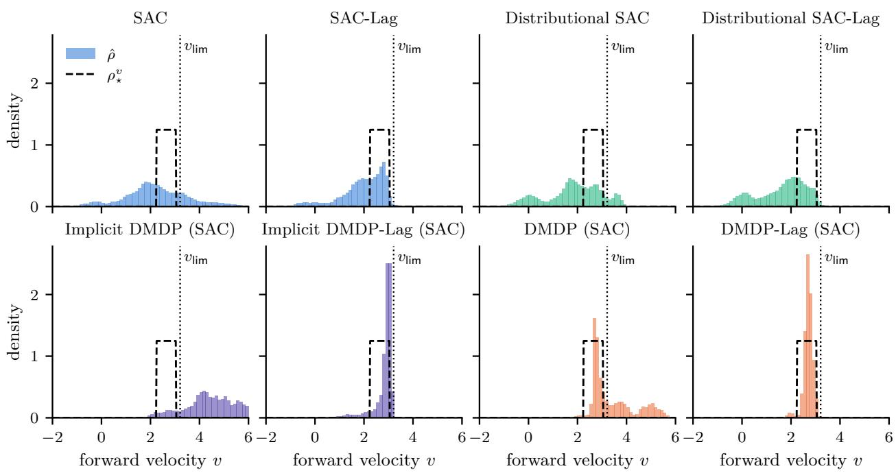  
Figure 3: Stable velocity distributions with SAC.

## 6 Conclusion

This paper introduced Dissimilarity-based Markov Decision Processes, which control the distribution of the state of a stochastic system rather than a single state: the policy acts on the state distribution, and the stage cost is its dissimilarity to a target distribution. A finite-dimensional parameterization turns this problem into the control of deterministic parameter dynamics, for which Lyapunov certificates were derived for the optimal policy, for policies learned ofline with a model of the parameter dynamics, for their online deployment with estimated parameters, and for policies whose Lyapunov decrease is estimated from transition data; in the scalar linear example of Appendix D, these certificates hold wherever they are checked. On HalfCheetah, a sliding-window estimate of the distribution, a window dissimilarity, and a threshold reward enable PPO and SAC to regulate the joint distribution of the velocity and the pitch. Of all compared methods, DMDP-Lag (PPO/SAC) brings the velocity distribution closest to a fast and safe target and attains the highest evaluation return without sensor noise, and DMDP-Lag (SAC) achieves both also under moderate noise. Feeding the distribution estimate back to the policy helps even without the target, and knowing the target takes the DMDP methods further. The Lyapunov certificates of Theorems 2–5 were not computed for the learned HalfCheetah policies; in the example of Appendix D, computing them requires the true model, and the certified residual sets are much larger than the sets in which the learned closed loops settle. Because these certificates hold for any policy whose decrease margin dominates the error terms, whichever learning method produced it, learning a Lyapunov function together with the policy and bounding the error terms from data is a natural next step toward certifying such high-dimensional tasks from data alone. Richer density models in the parameterization of Section 3.1, such as Gaussian mixtures and normalizing flows, further open the way to regulating multimodal distributions of higher-dimensional states.

Table 3: Reliability of the return with SAC.
<table><tr><td>Method</td><td colspan="2">end of training</td><td colspan="2">evaluation, η = 0</td><td colspan="2">evaluation, η = 0.2</td></tr><tr><td></td><td> $\mathbb { P } [ R \geq R _ { \mathsf { T h r } } ] \uparrow$ </td><td>10–90% range ↓</td><td> $\mathbb { P } [ R \ge R _ { \mathsf { T h r } } ] \uparrow$ </td><td>10–90% range ↓</td><td> $\mathbb { P } [ R \ge R _ { \mathsf { T h r } } ] \uparrow$ </td><td>10–90% range ↓</td></tr><tr><td>SAC</td><td> $0 . 0 0 \pm 0 . 0 0$ </td><td>2231</td><td> $0 . 0 0 \pm 0 . 0 0$ </td><td>2154</td><td> $0 . 0 0 \pm 0 . 0 0$ </td><td>2373</td></tr><tr><td>SAC-Lag</td><td> $0 . 0 0 \pm 0 . 0 0$ </td><td>1303</td><td> $0 . 0 0 \pm 0 . 0 0$ </td><td>1365</td><td> $0 . 0 0 \pm 0 . 0 0$ </td><td>1310</td></tr><tr><td>Distributional SAC</td><td> $0 . 0 0 \pm 0 . 0 0$ </td><td>911</td><td> $0 . 0 0 \pm 0 . 0 0$ </td><td>1197</td><td> $0 . 0 0 \pm 0 . 0 0$ </td><td>957</td></tr><tr><td>Distributional SAC-Lag</td><td> $0 . 0 0 \pm 0 . 0 0$ </td><td>589</td><td> $0 . 0 0 \pm 0 . 0 0$ </td><td>672</td><td> $0 . 0 0 \pm 0 . 0 0$ </td><td>586</td></tr><tr><td>Implicit DMDP (SAC)</td><td> $0 . 0 0 \pm 0 . 0 0$ </td><td>1248</td><td> $0 . 0 0 \pm 0 . 0 0$ </td><td>685</td><td> $0 . 0 0 \pm 0 . 0 0$ </td><td>1104</td></tr><tr><td>Implicit DMDP-Lag (SAC)</td><td> $0 . 0 0 \pm 0 . 0 0$ </td><td>668</td><td> $0 . 0 0 \pm 0 . 0 0$ </td><td>548</td><td> $0 . 0 0 \pm 0 . 0 0$ </td><td>735</td></tr><tr><td>DMDP (SAC)</td><td> $0 . 4 0 \pm 0 . 2 4$ </td><td>9545</td><td> $0 . 4 0 \pm 0 . 2 4$ </td><td>8970</td><td> $0 . 4 0 \pm 0 . 2 4$ </td><td>9132</td></tr><tr><td>DMDP-Lag (SAC)</td><td> ${ \bf 0 . 9 2 \pm 0 . 0 8 }$ </td><td>5088</td><td> $\mathbf { 1 . 0 0 \pm 0 . 0 0 }$ </td><td>573</td><td> ${ \bf 0 . 9 7 \pm 0 . 0 2 }$ </td><td>6011</td></tr></table>

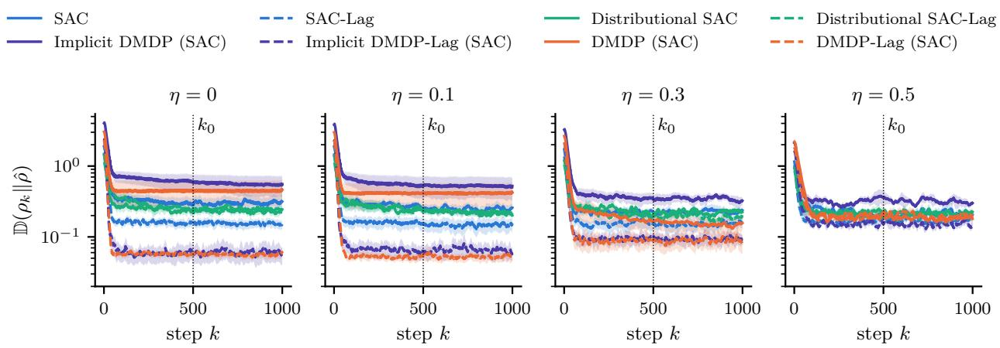  
Figure 4: Stability curves with SAC.

## References

Joshua Achiam, David Held, Aviv Tamar, and Pieter Abbeel. Constrained policy optimization. In Proceedings of the 34th International Conference on Machine Learning, volume 70 of Proceedings of Machine Learning Research, pp. 22–31. PMLR, 2017. URL https://proceedings.mlr.press/v70/achiam17a.html.

Eitan Altman. Constrained Markov Decision Processes. Chapman and Hall/CRC, 1999.

David Angeli, Rishi Amrit, and James B. Rawlings. On average performance and stability of economic model predictive control. IEEE Transactions on Automatic Control, 57(7):1615–1626, 2012. doi: 10.1109/TAC. 2011.2179349.

Mathis Antonetti, Henrique Donancio, and Florence Forbes. An analysis of distributional reinforcement learning with Gaussian mixtures. Transactions on Machine Learning Research, 2026. ISSN 2835-8856. URL https://openreview.net/forum?id=b4VgI1RTv8.

Mauricio Araya-López, Olivier Bufet, Vincent Thomas, and François Charpillet. A POMDP extension with belief-dependent rewards. In Advances in Neural Information Processing Systems, volume 23, pp. 64–72. Curran Associates, Inc., 2010. URL https://proceedings.neurips.cc/paper\_files/paper/ 2010/hash/68053af2923e00204c3ca7c6a3150cf7-Abstract.html.

K. J. Åström. Optimal control of Markov processes with incomplete state information. Journal of Mathematical Analysis and Applications, 10(1):174–205, 1965. doi: 10.1016/0022-247X(65)90154-X.

Isin M. Balci and Efstathios Bakolas. Covariance steering of discrete-time stochastic linear systems based on Wasserstein distance terminal cost. IEEE Control Systems Letters, 5(6):2000–2005, 2021. doi: 10.1109/ LCSYS.2020.3047132.

Nicole Bäuerle. Mean field Markov decision processes. Applied Mathematics & Optimization, 88(1):12, 2023. doi: 10.1007/s00245-023-09985-1.

Dominik Baumann, Erfaun Noorani, James Price, Ole Peters, Colm Connaughton, and Thomas B. Schön. Reinforcement learning with non-ergodic reward increments: robustness via ergodicity transformations. Transactions on Machine Learning Research, 2025. ISSN 2835-8856. URL https://openreview.net/ forum?id=eakh1Edffd.

Marc G. Bellemare, Will Dabney, and Rémi Munos. A distributional perspective on reinforcement learning. In Proceedings of the 34th International Conference on Machine Learning, volume 70 of Proceedings of Machine Learning Research, pp. 449–458. PMLR, 2017. URL https://proceedings.mlr.press/v70/ bellemare17a.html.

Marc G. Bellemare, Will Dabney, and Mark Rowland. Distributional Reinforcement Learning. MIT Press, Cambridge, MA, 2023. doi: 10.7551/mitpress/14207.001.0001.

Felix Berkenkamp, Matteo Turchetta, Angela Schoellig, and Andreas Krause. Safe model-based reinforcement learning with stability guarantees. In Advances in Neural Information Processing Systems, volume 30. Curran Associates, Inc., 2017. URL https://proceedings.neurips.cc/paper\_files/paper/2017/hash/ 766ebcd59621e305170616ba3d3dac32-Abstract.html.

Lucian Buşoniu, Tim de Bruin, Domagoj Tolić, Jens Kober, and Ivana Palunko. Reinforcement learning for control: Performance, stability, and deep approximators. Annual Reviews in Control, 46:8–28, 2018. doi: 10.1016/j.arcontrol.2018.09.005.

René Carmona, Mathieu Laurière, and Zongjun Tan. Model-free mean-field reinforcement learning: Mean-field MDP and mean-field Q-learning. The Annals of Applied Probability, 33(6B), 2023. doi: 10.1214/23-AAP1949.

Stephanie C. Y. Chan, Samuel Fishman, John Canny, Anoop Korattikara, and Sergio Guadarrama. Measuring the reliability of reinforcement learning algorithms. In International Conference on Learning Representations, 2020. URL https://openreview.net/forum?id=SJlpYJBKvH.

Ya-Chien Chang, Nima Roohi, and Sicun Gao. Neural Lyapunov control. In Advances in Neural Information Processing Systems, volume 32. Curran Associates, Inc., 2019. URL https://proceedings.neurips.cc/ paper\_files/paper/2019/hash/2647c1dba23bc0e0f9cdf75339e120d2-Abstract.html.

Jinglin Chen and Nan Jiang. Information-theoretic considerations in batch reinforcement learning. In Proceedings of the 36th International Conference on Machine Learning, volume 97 of Proceedings of Machine Learning Research, pp. 1042–1051. PMLR, 2019. URL https://proceedings.mlr.press/v97/ chen19e.html.

Yongxin Chen, Tryphon T. Georgiou, and Michele Pavon. Optimal steering of a linear stochastic system to a final probability distribution, part I. IEEE Transactions on Automatic Control, 61(5):1158–1169, 2016. doi: 10.1109/TAC.2015.2457784.

Yinlam Chow, Ofir Nachum, Edgar Duenez-Guzman, and Mohammad Ghavamzadeh. A Lyapunov-based approach to safe reinforcement learning. In Advances in Neural Information Processing Systems, volume 31. Curran Associates, Inc., 2018. URL https://proceedings.neurips.cc/paper\_files/paper/ 2018/hash/4fe5149039b52765bde64beb9f674940-Abstract.html.

Will Dabney, Georg Ostrovski, David Silver, and Rémi Munos. Implicit quantile networks for distributional reinforcement learning. In Proceedings of the 35th International Conference on Machine Learning, volume 80 of Proceedings of Machine Learning Research, pp. 1096–1105. PMLR, 2018a. URL https://proceedings. mlr.press/v80/dabney18a.html.

Will Dabney, Mark Rowland, Marc G. Bellemare, and Rémi Munos. Distributional reinforcement learning with quantile regression. In Proceedings of the AAAI Conference on Artificial Intelligence, volume 32, 2018b. doi: 10.1609/aaai.v32i1.11791.

Moritz Diehl, Rishi Amrit, and James B. Rawlings. A Lyapunov function for economic optimizing model predictive control. IEEE Transactions on Automatic Control, 56(3):703–707, 2011. doi: 10.1109/TAC.2010. 2101291.

Timm Faulwasser, Lars Grüne, and Matthias A. Müller. Economic nonlinear model predictive control. Foundations and Trends in Systems and Control, 5(1):1–98, 2018. doi: 10.1561/2600000014.

Javier García and Fernando Fernández. A comprehensive survey on safe reinforcement learning. Journal of Machine Learning Research, 16(42):1437–1480, 2015. URL http://jmlr.org/papers/v16/garcia15a. html.

Sébastien Gros and Mario Zanon. Economic MPC of Markov decision processes: Dissipativity in undiscounted infinite-horizon optimal control. Automatica, 146:110602, 2022. doi: 10.1016/j.automatica.2022.110602

Sehoon Ha, Peng Xu, Zhenyu Tan, Sergey Levine, and Jie Tan. Learning to walk in the real world with minimal human efort. In Proceedings of the 2020 Conference on Robot Learning, volume 155 of Proceedings of Machine Learning Research, pp. 1110–1120, 2021.

Tuomas Haarnoja, Aurick Zhou, Pieter Abbeel, and Sergey Levine. Soft actor-critic: Of-policy maximum entropy deep reinforcement learning with a stochastic actor. In Proceedings of the 35th International Conference on Machine Learning, volume 80 of Proceedings of Machine Learning Research, pp. 1861–1870, 2018.

Minghao Han, Lixian Zhang, Jun Wang, and Wei Pan. Actor-critic reinforcement learning for control with stability guarantee. IEEE Robotics and Automation Letters, 5(4):6217–6224, 2020. doi: 10.1109/LRA.2020. 3011351.

Elad Hazan, Sham Kakade, Karan Singh, and Abby Van Soest. Provably eficient maximum entropy exploration. In Proceedings of the 36th International Conference on Machine Learning, volume 97 of Proceedings of Machine Learning Research, pp. 2681–2691. PMLR, 2019. URL https://proceedings.mlr. press/v97/hazan19a.html.

Onésimo Hernández-Lerma and Jean Bernard Lasserre. Discrete-Time Markov Control Processes: Basic Optimality Criteria. Springer, New York, 1996. doi: 10.1007/978-1-4612-0729-0.

Rob J. Hyndman, David M. Bashtannyk, and Gary K. Grunwald. Estimating and visualizing conditional densities. Journal of Computational and Graphical Statistics, 5(4):315–336, 1996. doi: 10.1080/10618600. 1996.10474715.

Maximilian Igl, Luisa Zintgraf, Tuan Anh Le, Frank Wood, and Shimon Whiteson. Deep variational reinforcement learning for POMDPs. In Proceedings of the 35th International Conference on Machine Learning, volume 80 of Proceedings of Machine Learning Research, pp. 2117–2126. PMLR, 2018. URL https://proceedings.mlr.press/v80/igl18a.html.

Jiaming Ji, Borong Zhang, Jiayi Zhou, Xuehai Pan, Weidong Huang, Ruiyang Sun, Yiran Geng, Yifan Zhong, Juntao Dai, and Yaodong Yang. Safety-Gymnasium: A unified safe reinforcement learning benchmark. In Advances in Neural Information Processing Systems (Datasets and Benchmarks Track), volume 36, pp. 18964–18993. Curran Associates, Inc., 2023. URL https://proceedings.neurips.cc/paper\_files/ paper/2023/hash/3c557a3d6a48cc99444f85e924c66753-Abstract-Datasets\_and\_Benchmarks.html.

Zhong-Ping Jiang and Yuan Wang. A converse Lyapunov theorem for discrete-time systems with disturbances. Systems & Control Letters, 45(1):49–58, 2002. doi: 10.1016/S0167-6911(01)00164-5.

Leslie Pack Kaelbling, Michael L. Littman, and Anthony R. Cassandra. Planning and acting in partially observable stochastic domains. Artificial Intelligence, 101(1–2):99–134, 1998. doi: 10.1016/S0004-3702(98) 00023-X.

Christopher M. Kellett. A compendium of comparison function results. Mathematics of Control, Signals, and Systems, 26(3):339–374, 2014. doi: 10.1007/s00498-014-0128-8.

Hassan K. Khalil. Nonlinear Systems. Prentice Hall, Upper Saddle River, NJ, third edition, 2002.

Vijay Konda and John Tsitsiklis. Actor-critic algorithms. In Advances in Neural Information Processing Systems, volume 12, pp. 1008–1014. MIT Press, 1999. URL https://proceedings.neurips.cc/paper\_ files/paper/1999/hash/6449f44a102fde848669bdd9eb6b76fa-Abstract.html.

Arash Bahari Kordabad and Sébastien Gros. Functional stability of discounted Markov decision processes using economic MPC dissipativity theory. In 2022 European Control Conference (ECC), pp. 1858–1863, 2022. doi: 10.23919/ECC55457.2022.9838064.

Hanna Krasowski, Jakob Thumm, Marlon Müller, Lukas Schäfer, Xiao Wang, and Matthias Althof. Provably safe reinforcement learning: Conceptual analysis, survey, and benchmarking. Transactions on Machine Learning Research, 2023. ISSN 2835-8856. URL https://openreview.net/forum?id=mcN0ezbnzO.

S. Kullback and R. A. Leibler. On information and suficiency. The Annals of Mathematical Statistics, 22(1): 79–86, 1951. doi: 10.1214/aoms/1177729694.

Gaspard Lambrechts, Adrien Bolland, and Damien Ernst. Recurrent networks, hidden states and beliefs in partially observable environments. Transactions on Machine Learning Research, 2022. ISSN 2835-8856. URL https://openreview.net/forum?id=dkHfV3wB2l.

Thomas Le Corre, Ana Busic, and Sean P. Meyn. Moment constrained optimal transport for control applications. Transactions on Machine Learning Research, 2026. ISSN 2835-8856. URL https:// openreview.net/forum?id=2hAtSpnat9.

Armin Lederer, Jonas Umlauft, and Sandra Hirche. Uniform error bounds for Gaussian process regression with application to safe control. In Advances in Neural Information Processing Systems, volume 32. Curran Associates, Inc., 2019. URL https://proceedings.neurips.cc/paper\_files/paper/2019/hash/ fe73f687e5bc5280214e0486b273a5f9-Abstract.html.

Lisa Lee, Benjamin Eysenbach, Emilio Parisotto, Eric Xing, Sergey Levine, and Ruslan Salakhutdinov. Eficient exploration via state marginal matching. arXiv preprint arXiv:1906.05274, 2019. URL https: //arxiv.org/abs/1906.05274.

Carlos E. Luis, Alessandro Giacomo Bottero, Julia Vinogradska, Felix Berkenkamp, and Jan Peters. Uncertainty representations in state-space layers for deep reinforcement learning under partial observability. Transactions on Machine Learning Research, 2025. ISSN 2835-8856. URL https://openreview.net/ forum?id=rfPns0WJyg.

Geofrey McLachlan and David Peel. Finite Mixture Models. John Wiley & Sons, New York, 2000. doi: 10.1002/0471721182.

Sean Meyn and Richard L. Tweedie. Markov Chains and Stochastic Stability. Cambridge University Press, Cambridge, second edition, 2009. doi: 10.1017/CBO9780511626630.

Charles A. Micchelli, Yuesheng Xu, and Haizhang Zhang. Universal kernels. Journal of Machine Learning Research, 7(95):2651–2667, 2006. URL http://jmlr.org/papers/v7/micchelli06a.html.

Médéric Motte and Huyên Pham. Mean-field Markov decision processes with common noise and open-loop controls. The Annals of Applied Probability, 32(2):1421–1458, 2022. doi: 10.1214/21-AAP1713.

Rémi Munos and Csaba Szepesvári. Finite-time bounds for fitted value iteration. Journal of Machine Learning Research, 9(27):815–857, 2008. URL http://jmlr.org/papers/v9/munos08a.html.

Whitney K. Newey and Daniel McFadden. Large sample estimation and hypothesis testing. In Handbook of Econometrics, volume 4, pp. 2111–2245. Elsevier, 1994. doi: 10.1016/S1573-4412(05)80005-4.

George Papamakarios, Theo Pavlakou, and Iain Murray. Masked autoregressive flow for density estimation. In Advances in Neural Information Processing Systems, volume 30. Curran Associates, Inc., 2017. URL https://proceedings.neurips.cc/paper\_files/paper/2017/hash/ 6c1da886822c67822bcf3679d04369fa-Abstract.html.

George Papamakarios, Eric Nalisnick, Danilo Jimenez Rezende, Shakir Mohamed, and Balaji Lakshminarayanan. Normalizing flows for probabilistic modeling and inference. Journal of Machine Learning Research, 22(57):1–64, 2021. URL http://jmlr.org/papers/v22/19-1028.html.

Fabio Pardo, Arash Tavakoli, Vitaly Levdik, and Petar Kormushev. Time limits in reinforcement learning. In Proceedings of the 35th International Conference on Machine Learning, volume 80 of Proceedings of Machine Learning Research, pp. 4045–4054. PMLR, 2018.

Emanuel Parzen. On estimation of a probability density function and mode. The Annals of Mathematical Statistics, 33(3):1065–1076, 1962. doi: 10.1214/aoms/1177704472.

Barna Pásztor, Andreas Krause, and Ilija Bogunovic. Eficient model-based multi-agent mean-field re inforcement learning. Transactions on Machine Learning Research, 2023. ISSN 2835-8856. URL https://openreview.net/forum?id=gvcDSDYUZx.

Theodore J. Perkins and Andrew G. Barto. Lyapunov design for safe reinforcement learning. Journal of Machine Learning Research, 3:803–832, 2002. URL https://www.jmlr.org/papers/v3/perkins02a. html.

Robert Platt, Russ Tedrake, Leslie Pack Kaelbling, and Tomás Lozano-Pérez. Belief space planning assuming maximum likelihood observations. In Robotics: Science and Systems VI, Zaragoza, Spain, 2010. doi: 10.15607/RSS.2010.VI.037.

Martin L. Puterman. Markov Decision Processes: Discrete Stochastic Dynamic Programming. John Wiley & Sons, New York, 1994. doi: 10.1002/9780470316887.

Carl Edward Rasmussen and Christopher K. I. Williams. Gaussian Processes for Machine Learning. MIT Press, Cambridge, MA, 2006. doi: 10.7551/mitpress/3206.001.0001.

Alex Ray, Joshua Achiam, and Dario Amodei. Benchmarking safe exploration in deep reinforcement learning. Technical report, OpenAI, 2019.

Danilo Rezende and Shakir Mohamed. Variational inference with normalizing flows. In Proceedings of the 32nd International Conference on Machine Learning, volume 37 of Proceedings of Machine Learning Research, pp. 1530–1538. PMLR, 2015. URL https://proceedings.mlr.press/v37/rezende15.html.

Mark Rowland, Marc G. Bellemare, Will Dabney, Rémi Munos, and Yee Whye Teh. An analysis of categorical distributional reinforcement learning. In Proceedings of the 21st International Conference on Artificial Intelligence and Statistics, volume 84 of Proceedings of Machine Learning Research, pp. 29–37. PMLR, 2018. URL https://proceedings.mlr.press/v84/rowland18a.html.

Jonas Schießl, Ruchuan Ou, Timm Faulwasser, Michael H. Baumann, and Lars Grüne. Near-optimal performance of stochastic economic MPC. In 2024 IEEE 63rd Conference on Decision and Control (CDC), pp. 2565–2571, 2024. doi: 10.1109/CDC56724.2024.10886281.

Jonas Schießl, Michael H. Baumann, Timm Faulwasser, and Lars Grüne. On the relationship between stochastic turnpike and dissipativity notions. IEEE Transactions on Automatic Control, 70(6):3527–3539, 2025a. doi: 10.1109/TAC.2024.3504352.

Jonas Schießl, Ruchuan Ou, Timm Faulwasser, Michael H. Baumann, and Lars Grüne. Turnpike and dissipativity in generalized discrete-time stochastic linear-quadratic optimal control. SIAM Journal on Control and Optimization, 63(2):1432–1457, 2025b. doi: 10.1137/23M160089X.

Jonas Schießl, Hannah Selder, Ruchuan Ou, Michael H. Baumann, Timm Faulwasser, and Lars Grüne. Stability and performance of stochastic economic MPC: Stochastic characterization of the closed-loop asymptotics. arXiv preprint arXiv:2510.19416, 2025c. URL https://arxiv.org/abs/2510.19416.

John Schulman, Philipp Moritz, Sergey Levine, Michael Jordan, and Pieter Abbeel. High-dimensional continuous control using generalized advantage estimation. In International Conference on Learning Representations, 2016.

John Schulman, Filip Wolski, Prafulla Dhariwal, Alec Radford, and Oleg Klimov. Proximal policy optimization algorithms. arXiv preprint arXiv:1707.06347, 2017.

B. W. Silverman. Density Estimation for Statistics and Data Analysis. Chapman and Hall, London, 1986.

Niranjan Srinivas, Andreas Krause, Sham M. Kakade, and Matthias W. Seeger. Information-theoretic regret bounds for Gaussian process optimization in the bandit setting. IEEE Transactions on Information Theory, 58(5):3250–3265, 2012. doi: 10.1109/TIT.2011.2182033.

Masashi Sugiyama, Ichiro Takeuchi, Taiji Suzuki, Takafumi Kanamori, Hirotaka Hachiya, and Daisuke Okanohara. Conditional density estimation via least-squares density ratio estimation. In Proceedings of the 13th International Conference on Artificial Intelligence and Statistics (AISTATS), volume 9 of JMLR, pp. 781–788, 2010.

Yihao Sun, Jiaji Zhang, Chengxing Jia, Haoxin Lin, Junyin Ye, and Yang Yu. Model-Bellman inconsistency for model-based ofline reinforcement learning. In Proceedings of the 40th International Conference on Machine Learning, volume 202 of Proceedings of Machine Learning Research, pp. 33177–33194. PMLR, 2023. URL https://proceedings.mlr.press/v202/sun23q.html.

Richard S. Sutton and Andrew G. Barto. Reinforcement Learning: An Introduction. MIT Press, Cambridge, MA, second edition, 2018.

Richard S. Sutton, David McAllester, Satinder Singh, and Yishay Mansour. Policy gradient methods for reinforcement learning with function approximation. In Advances in Neural Information Processing Systems, volume 12. MIT Press, 1999. URL https://proceedings.neurips.cc/paper\_files/paper/1999/hash/ 464d828b85b0bed98e80ade0a5c43b0f-Abstract.html.

Emanuel Todorov, Tom Erez, and Yuval Tassa. MuJoCo: A physics engine for model-based control. In IEEE/RSJ International Conference on Intelligent Robots and Systems, pp. 5026–5033, 2012.

A. W. van der Vaart. Asymptotic Statistics. Cambridge University Press, Cambridge, 1998. doi: 10.1017/ CBO9780511802256.

Aad W. van der Vaart and Jon A. Wellner. Weak Convergence and Empirical Processes. Springer Series in Statistics. Springer, New York, 1996. doi: 10.1007/978-1-4757-2545-2.

Cédric Villani. Optimal Transport: Old and New. Grundlehren der mathematischen Wissenschaften. Springer, Berlin, Heidelberg, 2009. doi: 10.1007/978-3-540-71050-9.

Holger Wendland. Scattered Data Approximation. Cambridge University Press, Cambridge, 2004. doi: 10.1017/CBO9780511617539.

Jan C. Willems. Dissipative dynamical systems part I: General theory. Archive for Rational Mechanics and Analysis, 45(5):321–351, 1972. doi: 10.1007/BF00276493.

Tianhe Yu, Garrett Thomas, Lantao Yu, Stefano Ermon, James Zou, Sergey Levine, Chelsea Finn, and Tengyu Ma. MOPO: Model-based ofline policy optimization. In Advances in Neural Information Processing Systems, volume 33, pp. 14129–14142. Curran Associates, Inc., 2020. URL https://proceedings.neurips. cc/paper\_files/paper/2020/hash/a322852ce0df73e204b7e67cbbef0d0a-Abstract.html.

Tom Zahavy, Brendan O’Donoghue, Guillaume Desjardins, and Satinder Singh. Reward is enough for convex MDPs. In Advances in Neural Information Processing Systems, volume 34, pp. 25746–25759. Curran Associates, Inc., 2021. URL https://proceedings.neurips.cc/paper\_files/paper/2021/hash/ d7e4cdde82a894b8f633e6d61a01ef15-Abstract.html.

## Contents of the Appendices

A Proofs of All Main Results 24   
A.1 Proof of Theorem 1 . 24   
A.2 Proof of Lemma 1 24   
A.3 Proof of Theorem 2 . 25   
A.4 Proof of Theorem 3 . 26   
A.5 Proof of Theorem 4 . 26   
A.6 Proof of Theorem 5 . 27   
A.7 Proof of Proposition 1 28   
B Technical Comparison with Related Approaches 29   
B.1 Norm-Based MDPs . 29   
B.1.1 A Counterexample: Convergent Cost without Distributional Convergence 30   
B.1.2 Recovering Successful Norm-Based Stabilization 30   
B.2 Relation to POMDPs and Belief-State MDPs 31   
B.3 Relation to Measure-Functional MDPs 32   
B.4 Relation to Distributional Reinforcement Learning 32   
B.5 Further Related Approaches . 32   
C Distribution Estimation and Model Consistency 33   
C.1 Estimation of the Distribution Parameter ωˆ 33   
C.2 An Example Pipeline for Model Consistency 33   
D A Computable Example 34   
E Implementation Details 38   
F Additional Results 40   
F.1 Additional Results with SAC 40   
F.2 Results with PPO 41

## A Proofs of All Main Results

Each result of the main text is restated with its original numbering before its proof.

## A.1 Proof of Theorem 1

Theorem 1. Assume $\gamma = 1$ . Let $\mathcal { P } : = \{ \rho \in M ( S ) \mid V _ { \star } [ \rho ] < \infty \}$ . Suppose that $\psi _ { \star }$ attains ${ \cal V } _ { \star } [ \rho ] ~ f o r$ every initial distribution $\rho \in \mathcal { P }$ , that P is forward invariant under the closed-loop dynamics induced by $\psi _ { \star }$ , that $\rho _ { \star } = \mathcal { T } _ { \tau , \psi _ { \star } ( \rho _ { \star } ) } \rho _ { \star }$ , and that there exist class-K functions (Khalil, 2002; Kellett, 2014) κ1 and $\kappa _ { 2 }$ such that

$$
\begin{array} { r } { \mathcal { L } \left[ \rho _ { k } , \psi _ { \star } ( \rho _ { k } ) \right] \geq \kappa _ { 1 } \left( \mathbb { D } ( \rho _ { k } \| \rho _ { \star } ) \right) , V _ { \star } \left[ \rho _ { k } \right] \leq \kappa _ { 2 } \left( \mathbb { D } ( \rho _ { k } \| \rho _ { \star } ) \right) , \forall \rho _ { k } \in \mathcal { P } \ g e n e r a t e d \ b y \psi _ { \star } . } \end{array}\tag{4}
$$

Then, the Dissimilarity-based Markov Decision Process under the optimal policy $\psi _ { \star }$ is D-asymptotically stable with respect to the target probability measure $\rho _ { \star }$ and the dissimilarity measure D for any initial distribution $\rho _ { 0 } \in \mathcal { P }$

Proof. Let $\rho _ { 0 } \in \mathcal { P }$ and consider the closed-loop dynamics $\rho _ { k + 1 } = T _ { \tau , \psi _ { \star } ( \rho _ { k } ) } \rho _ { k }$ . Since $\mathcal { P }$ is forward invariant under these dynamics, $\rho _ { k } \in \mathcal { P }$ for all $k \geq 0$ . Since $\gamma = 1$ , the dynamic programming principle (Puterman, 1994; Hernández-Lerma & Lasserre, 1996) gives, along the optimal policy $\psi _ { \star }$ , the Bellman relation $V _ { \star } [ \rho _ { k } ] =$ $\mathcal { L } [ \rho _ { k } , \psi _ { \star } ( \rho _ { k } ) ] + V _ { \star } [ \rho _ { k + 1 } ]$ . With the lower bound on the stage cost functional, it follows that

$$
V _ { \star } [ \rho _ { k + 1 } ] - V _ { \star } [ \rho _ { k } ] = - \mathcal { L } \left[ \rho _ { k } , \psi _ { \star } ( \rho _ { k } ) \right] \leq - \kappa _ { 1 } \left( \mathbb { D } ( \rho _ { k } \| \rho _ { \star } ) \right) .\tag{42}
$$

Moreover, $\begin{array} { r } { V _ { \star } [ \rho _ { k } ] = \sum _ { i = k } ^ { \infty } \mathcal { L } [ \rho _ { j } , \psi _ { \star } ( \rho _ { j } ) ] \ge 0 } \end{array}$ along the optimal closed-loop trajectory, because ${ \mathcal { L } } [ \rho _ { j } , \psi _ { \star } ( \rho _ { j } ) ] \geq$ $\kappa _ { 1 } ( \mathbb { D } ( \rho _ { j } \| \rho _ { \star } ) ) \geq 0$ . Hence, $V _ { \star } [ \rho _ { k } ]$ is nonnegative and nonincreasing, and, by the monotone convergence theorem, $\begin{array} { r } { \operatorname* { l i m } _ { k \to \infty } V _ { \star } [ \rho _ { k } ] = \bar { V } } \end{array}$ for some constant $\bar { V } \geq 0$ . The lower bound on the stage cost functional, the Bellman relation, and $V _ { \star } [ \rho _ { k + 1 } ] \geq 0$ also give

$$
\begin{array} { r } { \kappa _ { 1 } \left( \mathbb { D } ( \rho _ { k } \| \rho _ { \star } ) \right) \leq \mathcal { L } \left[ \rho _ { k } , \psi _ { \star } ( \rho _ { k } ) \right] \leq V _ { \star } [ \rho _ { k } ] , \quad \forall k \geq 0 . } \end{array}\tag{43}
$$

For D-stability, let $\varepsilon > 0$ . Since $\kappa _ { 1 }$ and $\kappa _ { 2 }$ are class-K functions, $\kappa _ { 1 } ( \varepsilon ) > 0$ and there exists $\delta ( \varepsilon ) > 0$ such that $\kappa _ { 2 } ( \delta ( \varepsilon ) ) \leq \kappa _ { 1 } ( \varepsilon )$ . If $\mathbb { D } ( \rho _ { 0 } \| \rho _ { \star } ) \le \delta ( \varepsilon )$ , then the previous bound, the monotonicity of $V _ { \star } [ \rho _ { k } ]$ , and the upper bound on $V _ { \star }$ give

$$
\kappa _ { 1 } \left( \mathbb { D } ( \rho _ { k } \| \rho _ { \star } ) \right) \leq V _ { \star } [ \rho _ { k } ] \leq V _ { \star } [ \rho _ { 0 } ] \leq \kappa _ { 2 } \left( \mathbb { D } ( \rho _ { 0 } \| \rho _ { \star } ) \right) \leq \kappa _ { 2 } ( \delta ( \varepsilon ) ) \leq \kappa _ { 1 } ( \varepsilon ) , \quad \forall k \geq 0 .\tag{44}
$$

Since $\kappa _ { 1 }$ is strictly increasing, $\mathbb { D } ( \rho _ { k } \| \rho _ { \star } ) \le \varepsilon$ for all $k \geq 0 ;$ that is, the closed-loop DMDP is D-stable with respect to $\rho _ { \star }$ .

For D-attractivity, suppose, for contradiction, that $\bar { V } > 0$ . Since $V _ { \star } [ \rho _ { k } ]  \bar { V } .$ , there exists $K \geq 0$ such that, for all $k \ge K , V _ { \star } [ \rho _ { k } ] \ge \bar { V } / 2$ and, hence, by the upper bound on $V _ { \star } , \kappa _ { 2 } ( \mathbb { D } ( \rho _ { k } \| \rho _ { \star } ) ) \geq \bar { V } / 2$ . Since $\kappa _ { 2 }$ is a class-K function, there exists a constant $\varepsilon _ { 0 } > 0$ such that, for all $k \geq K , \mathbb { D } ( \rho _ { k } \| \rho _ { \star } ) \geq \varepsilon _ { 0 }$ and, hence, $\kappa _ { 1 } ( \mathbb { D } ( \rho _ { k } \| \rho _ { \star } ) ) \geq \kappa _ { 1 } ( \varepsilon _ { 0 } ) > 0$ . Summing (42) gives, for all $k > K$

$$
V _ { \star } [ \rho _ { k } ] \leq V _ { \star } [ \rho _ { K } ] - \sum _ { j = K } ^ { k - 1 } \kappa _ { 1 } \left( { \mathbb { D } } ( \rho _ { j } \| \rho _ { \star } ) \right) \leq V _ { \star } [ \rho _ { K } ] - ( k - K ) \kappa _ { 1 } ( \varepsilon _ { 0 } ) .\tag{45}
$$

The right-hand side tends $\mathrm { t o } \mathrm { ~ - \infty ~ }$ as $k  \infty$ , which contradicts $V _ { \star } [ \rho _ { k } ] \ \geq \ 0$ . Therefore, $\bar { V } = 0 _ { ; }$ , and $\kappa _ { 1 } ( \mathbb { D } ( \rho _ { k } \| \rho _ { \star } ) ) \leq V _ { \star } [ \rho _ { k } ]$ yields lim $k {  } { \infty } \kappa _ { 1 } ( \mathbb { D } ( \rho _ { k } \| \rho _ { \star } ) ) = 0$ . Since $\kappa _ { 1 }$ is a class-K function, lim $k \to \infty \mathbb { D } ( \rho _ { k } \| \rho _ { \star } ) = 0 .$ that is, $\rho _ { \star }$ is D-attractive. Together with D-stability, this proves that the DMDP under $\psi _ { \star }$ is D-asymptotically stable with respect to $\rho _ { \star }$ and D. □

## A.2 Proof of Lemma 1

Lemma 1. Let $\phi : \Omega  A$ be any admissible policy and define the closed-loop parameter map $F _ { \phi } ( \omega ) : = $ $f ( \omega , \phi ( \omega ) )$ ). Let $\Omega _ { \mathsf { c } } \subseteq \Omega$ be positively invariant under $F _ { \phi }$ , and suppose that $F _ { \phi } ( \omega _ { \star } ) = \omega _ { \star }$ . Assume that there exist a continuous function $W : \Omega _ { \mathsf { c } } \to \mathbb { R } _ { \geq 0 }$ and class-K functions $\underline { { \alpha } } , \ : \overline { { \alpha } }$ , and σ such that

$$
\begin{array} { r } { \underline { { \alpha } } \left( \| \omega - \omega _ { \star } \| \right) \leq W ( \omega ) \leq \overline { { \alpha } } \left( \| \omega - \omega _ { \star } \| \right) , \quad \forall \omega \in \Omega _ { \mathsf { c } } , } \end{array}\tag{11}
$$

$$
W ( F _ { \phi } ( \omega ) ) - W ( \omega ) \leq - \sigma \left( \| \omega - \omega _ { \star } \| \right) , \quad \forall \omega \in \Omega _ { \mathsf { c } } .\tag{12}
$$

Suppose further that the parameterization is D-compatible on $\Omega _ { \mathsf { c } }$ in the sense of Assumption 2. Then, the induced distribution dynamics generated by $\omega _ { k + 1 } = F _ { \phi } ( \omega _ { k } ) , \ \rho _ { k } = \rho _ { \omega _ { k } }$ are D-asymptotically stable with respect to $\rho _ { \star } = \rho _ { \omega _ { \star } } \ o n \ \{ \rho _ { \omega } \ | \ \omega \in \Omega _ { \mathsf { c } } \}$

Proof. Let $\omega _ { 0 } \in \Omega _ { \mathsf { c } }$ and $\omega _ { k + 1 } = F _ { \phi } ( \omega _ { k } )$ for $k \geq 0$ . Since $\Omega _ { \mathsf { c } }$ is positively invariant under $F _ { \phi } , \omega _ { k } \in \Omega _ { \mathsf { c } }$ for all $k \geq 0$ . With $r _ { k } : = \| \omega _ { k } - \omega _ { \star } \|$ and $W _ { k } : = W ( \omega _ { k } )$ , the decrease condition (12) gives

$$
W _ { k + 1 } - W _ { k } \leq - \sigma ( r _ { k } ) , \quad \forall k \geq 0 .\tag{46}
$$

Since $\sigma$ is nonnegative, $\{ W _ { k } \} _ { k = 0 } ^ { \infty }$ is nonincreasing, and, by (11), $W _ { k } \ge \underline { { \alpha } } ( r _ { k } ) \ge 0$ for all $k \geq 0$

First, the parameter dynamics are stable with respect to $\omega _ { \star }$ . Let $\varepsilon _ { \omega } > 0$ . Since α and α are class-K functions, $\underline { { \alpha } } ( \varepsilon _ { \omega } ) > 0$ and, by the continuity of α at the origin, there exists $\delta _ { \omega } > 0$ such that $\overline { { \alpha } } ( \delta _ { \omega } ) \leq \underline { { \alpha } } ( \varepsilon _ { \omega } )$ . If $r _ { 0 } \le \delta _ { \omega }$ then (11) and the monotonicity of $W _ { k }$ give

$$
\begin{array} { r } { \underline { { \alpha } } ( r _ { k } ) \le W _ { k } \le W _ { 0 } \le \overline { { \alpha } } ( r _ { 0 } ) \le \overline { { \alpha } } ( \delta _ { \omega } ) \le \underline { { \alpha } } ( \varepsilon _ { \omega } ) , \quad \forall k \ge 0 , } \end{array}\tag{47}
$$

and, since α is strictly increasing, $r _ { k } \le \varepsilon _ { \omega }$ for all $k \geq 0$

Second, the parameter dynamics are attractive. Summing (46) from $k = 0$ to $N - 1$ gives $\begin{array} { r } { \sum _ { k = 0 } ^ { N - 1 } \sigma ( r _ { k } ) \le } \end{array}$ $W _ { 0 } - W _ { N } \leq W _ { 0 }$ . Letting $N  \infty \mathrm { y }$ ields $\textstyle \sum _ { k = 0 } ^ { \infty } \sigma ( r _ { k } ) < \infty$ , so lim $\iota _ { k \to \infty } \sigma ( r _ { k } ) = 0$ . Since σ is a class-K function, lim $\iota _ { k \to \infty } r _ { k } = 0 ;$ hence, the closed-loop parameter dynamics are asymptotically stable with respect to $\omega _ { \star }$

It remains to transfer these properties to the distributions $\rho _ { \omega _ { k } }$ . Since the parameterization is D-compatible on $\Omega _ { \mathsf { c } }$ in the sense of Assumption 2 and $\rho _ { \omega _ { \star } } = \rho _ { \star }$

$$
\begin{array} { r } { \alpha _ { 1 } ( r _ { k } ) \le \mathbb { D } ( \rho _ { \omega _ { k } } \| \rho _ { \star } ) \le \alpha _ { 2 } ( r _ { k } ) , \quad \forall k \ge 0 . } \end{array}\tag{48}
$$

Since $r _ { k } \to 0$ and $\alpha _ { 2 }$ is a class-K function, lim $1 _ { k  \infty } \mathbb { D } ( \rho _ { \omega _ { k } } \Vert \rho _ { \star } ) = 0$ , which is D-attractivity. For D-stability, let $\varepsilon _ { \mathbb { D } } > 0$ and choose $\varepsilon _ { \omega } > 0$ such that $\alpha _ { 2 } ( \varepsilon _ { \omega } ) \leq \varepsilon _ { \mathbb { D } }$ . By the stability of the parameter dynamics, there exists $\delta _ { \omega } > 0$ such that $r _ { 0 } \le \delta _ { \omega }$ implies $r _ { k } \le \varepsilon _ { \omega }$ for all $k \geq 0$ . Let $\delta _ { \mathbb { D } } : = \alpha _ { 1 } ( \delta _ { \omega } ) > 0 . { \mathrm { ~ I f ~ } } \mathbb { D } ( \rho _ { \omega _ { 0 } } \| \rho _ { \star } ) \le \delta _ { \mathbb { D } }$ , then the lower compatibility bound gives $\alpha _ { 1 } ( r _ { 0 } ) \leq \mathbb { D } ( \rho _ { \omega _ { 0 } } \| \rho _ { \star } ) \leq \alpha _ { 1 } ( \delta _ { \omega } )$ , so $r _ { 0 } \le \delta _ { \omega }$ because $\alpha _ { 1 }$ is strictly increasing. Hence,

$$
\begin{array} { r } { \mathbb { D } ( \rho _ { \omega _ { k } } \| \rho _ { \star } ) \le \alpha _ { 2 } ( r _ { k } ) \le \alpha _ { 2 } ( \varepsilon _ { \omega } ) \le \varepsilon _ { \mathbb { D } } , \quad \forall k \ge 0 , } \end{array}\tag{49}
$$

which is D-stability. Together, D-stability and D-attractivity prove that the induced distribution dynamics are D-asymptotically stable with respect to $\rho _ { \star } = \rho _ { \omega , }$ on $\{ \rho _ { \omega } \mid \omega \in \Omega _ { \mathrm { c } } \}$ □

## A.3 Proof of Theorem 2

Theorem 2. Assume $\gamma = 1$ . Let $\phi _ { \star }$ be an optimal policy of Problem P-OCP, and define $F _ { \phi _ { \star } } ( \omega ) : = f ( \omega , \phi _ { \star } ( \omega ) )$ Let $\Omega _ { \mathcal { P } } \subseteq \Omega$ be positively invariant under $F _ { \phi _ { \star } }$ , and suppose that $F _ { \phi _ { \star } } ( \omega _ { \star } ) = \omega _ { \star }$ . Suppose that $U _ { \star } ^ { \mathsf { R } }$ is finite, nonnegative, and continuous on $\Omega _ { \mathcal { P } }$ and satisfies the rotated Bellman identity (9) for all $\omega \in \Omega _ { \mathcal { P } }$ . Suppose further that there exist class-K functions $\kappa _ { 1 }$ and $\kappa _ { 2 }$ such that

$$
\ell ^ { \mathsf { R } } \left( \omega , \phi _ { \star } ( \omega ) \right) \geq \kappa _ { 1 } \left( \| \omega - \omega _ { \star } \| \right) , \quad \forall \omega \in \Omega _ { \mathcal { P } } ,\tag{13}
$$

$$
U _ { \star } ^ { \mathsf { R } } ( \omega ) \leq \kappa _ { 2 } \left( \| \omega - \omega _ { \star } \| \right) , \quad \forall \omega \in \Omega _ { \mathcal { P } } .\tag{14}
$$

Suppose that the parameterization is D-compatible on $\Omega _ { \mathcal { P } }$ in the sense of Assumption 2. Then, the optimal policy $\phi _ { \star }$ renders the induced distribution dynamics D-asymptotically stable with respect to $\rho _ { \star } = \rho _ { \omega _ { \star } }$ on $\{ \rho _ { \omega } \mid \omega \in \Omega _ { \mathcal { P } } \}$

Proof. Lemma 1 is applied with $\phi = \phi _ { \star } , W : = U _ { \star } ^ { \sf R }$ , and $\Omega _ { \mathsf { c } } : = \Omega _ { \mathcal { P } }$ . Its invariance, fixed-point, and Dcompatibility conditions hold by assumption, and W is a continuous map into $\mathbb { R } _ { > 0 }$ because $U _ { \star } ^ { \mathsf { R } }$ is finite, nonnegative, and continuous on $\Omega _ { \mathcal { P } }$ . It remains to verify (11) and (12). Let $\omega \in \Omega _ { \mathcal { P } }$ . Since $F _ { \phi _ { \star } } ( \omega ) \in \Omega _ { \mathcal { P } }$

by positive invariance and $U _ { \star } ^ { \mathsf { R } } \geq 0$ on $\Omega _ { \mathcal { P } }$ , the rotated Bellman identity (9), the rotated dissipativity condition (13), and the upper bound (14) give

$$
\begin{array} { r } { U _ { \star } ^ { \mathrm { R } } ( \omega ) = \ell ^ { \mathrm { R } } \left( \omega , \phi _ { \star } ( \omega ) \right) + U _ { \star } ^ { \mathrm { R } } \left( F _ { \phi _ { \star } } ( \omega ) \right) \geq \ell ^ { \mathrm { R } } \left( \omega , \phi _ { \star } ( \omega ) \right) \geq \kappa _ { 1 } \left( \| \omega - \omega _ { \star } \| \right) , } \end{array}\tag{50}
$$

$$
U _ { \star } ^ { \mathsf { R } } ( \omega ) \leq \kappa _ { 2 } \left( \| \omega - \omega _ { \star } \| \right) .\tag{51}
$$

The rotated Bellman identity and the rotated dissipativity condition (13) also give the decrease

$$
\begin{array} { r } { U _ { \star } ^ { \mathsf { R } } \left( F _ { \phi _ { \star } } ( \omega ) \right) - U _ { \star } ^ { \mathsf { R } } ( \omega ) = - \ell ^ { \mathsf { R } } \left( \omega , \phi _ { \star } ( \omega ) \right) \leq - \kappa _ { 1 } \left( \| \omega - \omega _ { \star } \| \right) . } \end{array}\tag{52}
$$

Hence, the Lyapunov bounds (11) hold with $\underline { { \alpha } } = \kappa _ { 1 }$ and $\overline { { \alpha } } = \kappa _ { 2 }$ , and the decrease condition (12) holds with $\sigma = \kappa _ { 1 }$ . By Lemma 1, the induced distribution dynamics generated by $\omega _ { k + 1 } = F _ { \phi _ { \star } } ( \omega _ { k } )$ and $\rho _ { k } = \rho _ { \omega _ { k } }$ are D-asymptotically stable with respect to $\rho _ { \star } = \rho _ { \omega . }$ on $\{ \rho _ { \omega } \mid \omega \in \Omega _ { \mathcal { P } } \}$ □

## A.4 Proof of Theorem 3

Theorem 3. With the quantities defined in Section $4 . 1 ,$ suppose that $\Omega _ { \mathsf { c o m } }$ is positively invariant under $F _ { \mathsf { o f f } }$ and $\widehat { F } _ { \mathsf { o f f } } , F _ { \mathsf { o f f } } ( \omega _ { \star } ) = \omega _ { \star }$ , and $U _ { \star } ^ { \mathsf { R } }$ is continuous and satisfies (16). Assume Assumption $\mathcal { Q }$ on $\Omega _ { \mathsf { c o m } }$ . If the event ${ \mathcal E } _ { \mathrm { o f f } }$ has probability at least $1 - \alpha , \alpha \in ( 0 , 1 )$ , then, on ${ \mathcal { E } } _ { \circ { \mathsf { f f } } }$

$$
U _ { \star } ^ { \mathsf { R } } \left( F _ { \mathsf { o f f } } ( \omega ) \right) - U _ { \star } ^ { \mathsf { R } } ( \omega ) \leq - \sigma \left( \| \omega - \omega _ { \star } \| \right) + \bar { \Delta } , \qquad \forall \omega \in \Omega _ { \mathsf { c o m } } .\tag{21}
$$

Thus, $U _ { \star } ^ { \mathsf { R } }$ strictly decreases outside $\Omega _ { \bar { \Delta } }$ , which shrinks to $\left\{ \omega _ { \star } \right\}$ as $\Delta  0$ . If $\Delta = 0 _ { i }$ or, more generally, if state-dependent errors yield $\begin{array} { r } { U _ { \star } ^ { \mathsf { R } } ( F _ { \mathsf { o f f } } \overline { { ( \omega ) } } ) - U _ { \star } ^ { \mathsf { R } } ( \omega ) \leq - \tilde { \sigma } ( \| \omega - \omega _ { \star } \| ) } \end{array}$ throughout $\Omega _ { \mathsf { c o m } }$ for some $\tilde { \sigma } \in \kappa$ , the induced distribution dynamics are D-asymptotically stable with respect to $\rho _ { \star }$ on $\{ \rho _ { \omega } \mid \omega \in \Omega _ { \mathsf { c o m } } \}$ , on ${ \mathcal E } _ { \mathrm { o f f } }$

Proof. Recall the learned and true closed-loop maps $\widehat { F } _ { \mathsf { o f f } } ( \omega ) = \hat { f } _ { \mathsf { o f f } } ( \omega , \hat { \phi } _ { \mathsf { o f f } } ( \omega ) )$ and $F _ { \mathsf { o f f } } ( \omega ) = f ( \omega , \hat { \phi } _ { \mathsf { o f f } } ( \omega ) )$ All statements are proved on the event ${ \mathcal { E } } _ { \circ { \mathsf { f f } } }$ , of probability at least $1 - \alpha .$ , on which $\Delta \le \Delta$ and the learned decrease margin (19) holds. Let $\omega \in \Omega _ { \mathsf { c o m } } . \mathrm { ~ A ~ }$ telescoping decomposition gives

$$
\begin{array} { r l } & { U _ { \star } ^ { \mathrm { R } } \left( F _ { \mathsf { o f f } } ( \omega ) \right) - U _ { \star } ^ { \mathrm { R } } ( \omega ) } \\ & { = \Big [ U _ { \star } ^ { \mathrm { R } } \left( F _ { \mathsf { o f f } } ( \omega ) \right) - U _ { \star } ^ { \mathrm { R } } \left( \widehat { F } _ { \mathsf { o f f } } ( \omega ) \right) \Big ] + \Big [ U _ { \star } ^ { \mathrm { R } } \left( \widehat { F } _ { \mathsf { o f f } } ( \omega ) \right) - \widehat { U } _ { \mathsf { o f f } } ^ { \mathrm { R } } \left( \widehat { F } _ { \mathsf { o f f } } ( \omega ) \right) \Big ] } \\ & { \quad + \Big [ \widehat { U } _ { \mathsf { o f f } } ^ { \mathrm { R } } \left( \widehat { F } _ { \mathsf { o f f } } ( \omega ) \right) - \widehat { U } _ { \mathsf { o f f } } ^ { \mathrm { R } } ( \omega ) \Big ] + \Big [ \widehat { U } _ { \mathsf { o f f } } ^ { \mathrm { R } } ( \omega ) - U _ { \star } ^ { \mathrm { R } } ( \omega ) \Big ] } \\ & { \le \Delta _ { f } + \Delta _ { U } - \sigma \left( \| \omega - \omega _ { \star } \| \right) + \Delta _ { U } = \Delta - \sigma \left( \| \omega - \omega _ { \star } \| \right) \le \bar { \Delta } - \sigma \left( \| \omega - \omega _ { \star } \| \right) . } \end{array}\tag{53}
$$

The four brackets are bounded by (18), (17), (19), and (17), respectively; the second bound applies because $\widehat { F } _ { \mathrm { o f f } } ( \omega ) \in \Omega _ { \mathsf { c o m } }$ by the positive invariance of $\Omega _ { \mathsf { c o m } }$ under $\widehat { F } _ { \mathrm { o f f } }$ . This proves (21).

If $\omega \in \Omega _ { \mathsf { c o m } }$ and ω $\notin \Omega _ { \bar { \Delta } }$ , with $\Omega _ { \bar { \Delta } }$ the residual set (20), then $\sigma ( \| \omega - \omega _ { \star } \| ) > \bar { \Delta }$ , and (21) gives $U _ { \star } ^ { \mathsf { R } } ( F _ { \mathsf { o f f } } ( \omega ) ) -$ $U _ { \star } ^ { \mathsf { R } } ( \omega ) < 0$ . Hence, $U _ { \star } ^ { \mathsf { R } }$ strictly decreases along the true closed loop outside $\Omega _ { \bar { \Delta } }$ , which certifies the Lyapunov decrease of the learned policy there. Since $\sigma$ is a class-K function, $\Omega _ { \bar { \Delta } }$ shrinks to $\left\{ \omega _ { \star } \right\}$ as $\bar { \Delta } \to 0$

If $\bar { \Delta } = 0$ , then (21) is the decrease condition (12) with $W = U _ { \star } ^ { \sf R } , \Omega _ { \sf c } = \Omega _ { \sf c o m }$ , and $\phi = \hat { \phi } _ { \mathsf { o f f } }$ , for which $F _ { \phi } = F _ { \mathsf { o f f } }$ . The remaining conditions of Lemma 1 are the continuity of $U _ { \star } ^ { \mathsf { R } }$ , the Lyapunov bounds (16), the positive invariance of $\Omega _ { \mathsf { c o m } }$ under $F _ { \mathsf { o f f } }$ , the fixed-point condition $F _ { \mathsf { o f f } } ( \omega _ { \star } ) = \omega _ { \star }$ , and the D-compatibility of the parameterization on $\Omega _ { \mathsf { c o m } }$ in the sense of Assumption 2, all of which hold by assumption. Hence, the induced distribution dynamics under $\hat { \phi } _ { \mathrm { o f f } }$ are D-asymptotically stable with respect to $\rho _ { \star }$ on $\{ \rho _ { \omega } \mid \omega \in \Omega _ { \mathsf { c o m } } \}$ The same argument, with σ replaced by σ˜, applies when the approximation error is state-dependent and dominated by the decrease margin, so that $U _ { \star } ^ { \sf R } ( F _ { \sf o f f } ( \omega ) ) - U _ { \star } ^ { \sf R } ( \omega ) \leq - \tilde { \sigma } ( \| \omega - \omega _ { \star } \| )$ for all $\omega \in \Omega _ { \mathsf { c o m } }$ and some class-K function σ˜. □

## A.5 Proof of Theorem 4

Theorem 4. Suppose that $U _ { \star } ^ { \mathsf { R } }$ is continuous on the compact set $\Omega _ { \mathsf { c o m } }$ and satisfies (16) and (22). Assume Assumption 2 on $\Omega _ { \mathsf { c o m } }$ and that $F _ { \mathsf { o n } } ( \omega , \tilde { \omega } ) \in \Omega _ { \mathsf { c o m } }$ whenever $\omega , \tilde { \omega } \in \Omega _ { \mathrm { c o m } }$ and $\lVert \tilde { \omega } - \omega \rVert \leq \delta _ { \mathsf { o n } }$ . If the uniform

event (24) has probability at least $1 - \alpha _ { \mathsf { o n } } , \alpha _ { \mathsf { o n } } \in ( 0 , 1 )$ , then, on that event, every trajectory $\omega _ { t + 1 } = F _ { \mathsf { o n } } ( \omega _ { t } , \hat { \omega } _ { t } )$ initialized in $\Omega _ { \mathsf { c o m } }$ satisfies

$$
\begin{array} { r } { U _ { \star } ^ { \mathrm { R } } ( \omega _ { t + 1 } ) - U _ { \star } ^ { \mathrm { R } } ( \omega _ { t } ) \leq - \sigma _ { \mathsf { o n } } \left( \| \omega _ { t } - \omega _ { \star } \| \right) + \bar { \Delta } _ { \mathsf { o f f } } + \Delta _ { \mathsf { o n } } ( \delta _ { \mathsf { o n } } ) . } \end{array}\tag{26}
$$

Thus, $U _ { \star } ^ { \mathsf { R } }$ strictly decreases outside $\Omega _ { \mathsf { o n } }$ . If the total residual is zero, $o r ,$ more generally, if state-dependent errors yield $U _ { \star } ^ { \mathrm { R } } ( \omega _ { t + 1 } ) - U _ { \star } ^ { \mathrm { R } } ( \omega _ { t } ) \leq - \tilde { \sigma } _ { \mathsf { o n } } ( \| \omega _ { t } - \omega _ { \star } \| )$ for all $t \geq 0$ and some $\tilde { \sigma } _ { \mathsf { o n } } ~ \in ~ \kappa$ , then the induced distribution dynamics are D-asymptotically stable with respect to $\rho _ { \star }$ on $\{ \rho _ { \omega } \mid \omega \in \Omega _ { \mathsf { c o m } } \}$ , on the same event.

Proof. Throughout, the event in (24), which has probability at least $1 - \alpha _ { \mathsf { o n } } .$ is assumed to hold, so that $\| \hat { \omega } _ { t } - \omega _ { t } \| \leq \delta _ { \mathsf { o n } }$ and $\hat { \omega } _ { t } \in \Omega _ { \mathsf { c o m } }$ for all $t \geq 0$ . Hence, the assumed invariance gives $\omega _ { t + 1 } = F _ { \mathsf { o n } } ( \omega _ { t } , \hat { \omega } _ { t } ) \in \Omega _ { \mathsf { c o m } }$ whenever $\omega _ { t } \in \Omega _ { \mathsf { c o m } } ,$ and, since $\omega _ { 0 } \in \Omega _ { \mathsf { c o m } }$ , induction on t gives $\omega _ { t } \in \Omega _ { \mathsf { c o m } }$ for all $t \geq 0$

Let $\omega , \tilde { \omega } \in \Omega _ { \mathsf { c o m } }$ with $\lVert \tilde { \omega } - \omega \rVert \leq \delta _ { \mathsf { o n } }$ . Adding and subtracting $U _ { \star } ^ { \mathsf { R } } ( F _ { \mathsf { o f f } } ( \omega ) )$ , and bounding the first bracket by the definition (23) of $\Delta _ { \mathsf { o n } }$ and the second by the exact-parameter certificate (22), gives

$$
\begin{array} { r l } & { U _ { \star } ^ { \mathrm { R } } \left( F _ { \circ \mathrm { n } } ( \omega , \tilde { \omega } ) \right) - U _ { \star } ^ { \mathrm { R } } ( \omega ) } \\ & { \ = \left[ U _ { \star } ^ { \mathrm { R } } \left( F _ { \circ \mathrm { n } } ( \omega , \tilde { \omega } ) \right) - U _ { \star } ^ { \mathrm { R } } \left( F _ { \circ \mathrm { f f } } ( \omega ) \right) \right] + \left[ U _ { \star } ^ { \mathrm { R } } \left( F _ { \circ \mathrm { f f } } ( \omega ) \right) - U _ { \star } ^ { \mathrm { R } } ( \omega ) \right] } \\ & { \ \leq - \sigma _ { \circ \mathrm { n } } \left( \| \omega - \omega _ { \star } \| \right) + \bar { \Delta } _ { \mathrm { o f f } } + \Delta _ { \mathrm { o n } } ( \delta _ { \circ \mathrm { n } } ) . } \end{array}\tag{54}
$$

Setting $\omega = \omega _ { t }$ and $\tilde { \omega } = \hat { \omega } _ { t }$ yields (26). If $\omega _ { t } \notin \Omega _ { \mathsf { o n } } .$ , then $\sigma _ { \mathsf { o n } } ( \| \omega _ { t } - \omega _ { \star } \| ) > \bar { \Delta } _ { \mathsf { o f f } } + \Delta _ { \mathsf { o n } } ( \delta _ { \mathsf { o n } } )$ by (25), so (26) gives $\bar { U _ { \star } ^ { \mathsf { R } } } ( \omega _ { t + 1 } ) < U _ { \star } ^ { \mathsf { R } } ( \omega _ { t } )$ . Hence, $U _ { \star } ^ { \mathsf { R } }$ strictly decreases along the online closed loop outside $\Omega _ { \mathsf { o n } }$ , and, since $\sigma _ { \mathsf { o n } }$ is a class-K function, $\Omega _ { \mathsf { o n } }$ shrinks to $\left\{ \omega _ { \star } \right\}$ as $\bar { \Delta } _ { \mathsf { o f f } } + \Delta _ { \mathsf { o n } } ( \delta _ { \mathsf { o n } } ) \to 0$

Now suppose that $U _ { \star } ^ { \mathsf { R } } ( \omega _ { t + 1 } ) - U _ { \star } ^ { \mathsf { R } } ( \omega _ { t } ) \leq - \tilde { \sigma } _ { \mathsf { o n } } ( \| \omega _ { t } - \omega _ { \star } \| )$ for all $t \geq 0$ and some class-K function $\tilde { \sigma } _ { \mathsf { o n } } ;$ by (26), this holds with $\tilde { \sigma } _ { \mathsf { o n } } = \sigma _ { \mathsf { o n } }$ if the total residual is zero. Since the Lyapunov argument in the proof of Lemma 1 uses only the Lyapunov bounds and the decrease inequality along the trajectory, it applies with $W = U _ { \star } ^ { \sf R }$ to every realized trajectory on the event, using this decrease, the bounds (16), the invariance condition, and the D-compatibility in Assumption 2. Hence, the induced distribution dynamics are D-asymptotically stable with respect to $\rho _ { \star }$ on $\{ \rho _ { \omega } \mid \omega \in \Omega _ { \mathsf { c o m } } \}$ □

## A.6 Proof of Theorem 5

Theorem 5 (Certificate from estimated Lyapunov decrease). Fix n and the candidate pair $( \phi _ { n } , W _ { n } )$ Suppose that $W _ { n }$ is continuous on $\Omega _ { \mathsf { c o m } }$ and that $( 3 1 ) , ( 3 2 ) , ( 3 6 )$ , and Assumption 2 hold on this compact set. If the joint event (35) has probability at least $1 - \alpha _ { n } , \alpha _ { n } \in ( 0 , 1 )$ , then, on that event, every trajectory of (37) initialized in $\Omega _ { \mathsf { c o m } }$ satisfies

$$
W _ { n } ( \omega _ { t + 1 } ) - W _ { n } ( \omega _ { t } ) \leq - \sigma _ { n } \left( \| \omega _ { t } - \omega _ { \star } \| \right) + \bar { \Delta } _ { \mathsf { d e c } , n } + \Delta _ { \omega , n } ( \delta _ { \omega , n } ) .\tag{39}
$$

Thus, $W _ { n }$ strictly decreases outside $\Omega _ { \mathsf { m f } , n }$ . If the total residual is zero, or, more generally, if state-dependent errors yield $W _ { n } ( \omega _ { t + 1 } ) - W _ { n } ( \omega _ { t } ) \leq - \tilde { \sigma } _ { n } ( \| \omega _ { t } - \omega _ { \star } \| )$ for all $t \geq 0$ and some ${ \tilde { \sigma } } _ { n } \in \kappa$ , then the induced distribution dynamics are D-asymptotically stable with respect to $\rho _ { \star }$ on $\{ \rho _ { \omega } \mid \omega \in \Omega _ { \mathsf { c o m } } \}$ , on the same event.

Proof. Throughout, the event in (35) is assumed to hold, so that $\Delta _ { \mathsf { d e c } , n } \leq \bar { \Delta } _ { \mathsf { d e c } , n } , \| \hat { \omega } _ { t } - \omega _ { t } \| \leq \delta _ { \omega , n }$ , and $\hat { \omega } _ { t } \in \Omega _ { \mathsf { c o m } }$ for all $t \geq 0$ . Hence, the invariance condition (36) gives $\omega _ { t + 1 } = F _ { n } ^ { \mathsf { p l u g } } ( \omega _ { t } , \hat { \omega } _ { t } ) \in \Omega _ { \mathsf { c o m } }$ whenever $\omega _ { t } \in \Omega _ { \mathsf { c o m } }$ , and, since ω0 $\in \Omega _ { \mathsf { c o m } }$ , induction on t gives $\omega _ { t } \in \Omega _ { \mathsf { c o m } }$ for all $t \geq 0$

For $\omega \in \Omega _ { \mathsf { c o m } }$ , the definition (33) of $\Delta _ { \mathsf { d e c } , n }$ and the empirical decrease certificate (32) give

$$
\begin{array} { r } { W _ { n } ( F _ { n } ( \omega ) ) - W _ { n } ( \omega ) \leq \widehat { \mathcal { D } } _ { n } ( \omega ) + \Delta _ { \mathsf { d e c } , n } \leq - \sigma _ { n } \left( \| \omega - \omega _ { \star } \| \right) + \Delta _ { \mathsf { d e c } , n } . } \end{array}\tag{55}
$$

Let $\tilde { \omega } \in \Omega _ { \mathsf { c o m } }$ with $\lVert \tilde { \omega } - \omega \rVert \leq \delta _ { \omega , n }$ . Adding and subtracting $W _ { n } ( F _ { n } ( \omega ) )$ , and bounding the first bracket by the definition (34) of $\Delta _ { \omega , n }$ and the second by (55) with $\Delta _ { \mathsf { d e c } , n } \leq \bar { \Delta } _ { \mathsf { d e c } , n } ,$ gives

$$
\begin{array} { r l } & { W _ { n } \left( F _ { n } ^ { \mathsf { p l u g } } ( \omega , \tilde { \omega } ) \right) - W _ { n } ( \omega ) } \\ & { ~ = \left[ W _ { n } \left( F _ { n } ^ { \mathsf { p l u g } } ( \omega , \tilde { \omega } ) \right) - W _ { n } ( F _ { n } ( \omega ) ) \right] + \left[ W _ { n } ( F _ { n } ( \omega ) ) - W _ { n } ( \omega ) \right] } \\ & { ~ \leq - \sigma _ { n } \left( \| \omega - \omega _ { \star } \| \right) + \bar { \Delta } _ { \mathsf { d e c } , n } + \Delta _ { \omega , n } ( \delta _ { \omega , n } ) . } \end{array}\tag{56}
$$

Setting $\omega = \omega _ { t }$ and $\tilde { \omega } = \hat { \omega } _ { t }$ yields (39). If $\omega _ { t } \notin \Omega _ { \mathsf { m f } , n }$ , then $\sigma _ { n } ( \| \omega _ { t } - \omega _ { \star } \| ) > \bar { \Delta } _ { \sf d e c , } { n } + \Delta _ { \omega , n } ( \delta _ { \omega , n } )$ by (38), so (39) gives $W _ { n } ( \omega _ { t + 1 } ) < W _ { n } ( \omega _ { t } )$ . Hence, $W _ { n }$ strictly decreases along the plug-in online dynamics outside $\Omega _ { \mathsf { m f } , n }$

Now suppose that $W _ { n } ( \omega _ { t + 1 } ) - W _ { n } ( \omega _ { t } ) \leq - \tilde { \sigma } _ { n } ( \| \omega _ { t } - \omega _ { \star } \| )$ for all $t \geq 0$ and some class-K function ${ \tilde { \sigma } } _ { n } ;$ by (39), this holds with $\tilde { \sigma } _ { n } = \sigma _ { n }$ if the total residual is zero. As in the proof of Theorem 4, the Lyapunov argument in the proof of Lemma 1 then applies with $W = W _ { n }$ to every realized trajectory on the event, using this decrease, the bounds (31), the invariance condition, and the D-compatibility in Assumption 2. Hence, the induced distribution dynamics are D-asymptotically stable with respect to $\rho _ { \star }$ on $\{ \rho _ { \omega } \mid \omega \in \Omega _ { \mathsf { c o m } } \}$ □

## A.7 Proof of Proposition 1

Proposition 1. Let $\gamma = 1$ , let $\Omega _ { \mathsf { c o m } } , \ \Theta$ , and A be compact, and suppose that $f , \ \ell , \lambda ,$ , and $\phi ( \omega ; \theta )$ are continuous. Assume that (40) and (41) hold, and that both rotated objectives are well defined and continuous in θ on Θ. Suppose that $\Omega _ { \mathsf { c o m } }$ is positively invariant for every true closed loop indexed by $\theta \in \Theta$ , and that, almost surely, there is a finite $N _ { 0 }$ such that it is also positively invariant for every learned closed loop whenever $N \geq N _ { 0 }$ and $\theta \in \Theta$ . Then dist $\left( { \widehat { \theta } } _ { N } , \Theta _ { \star } ^ { \mathsf { R } } \right) \longrightarrow 0$ almost surely. Consequently, every limit point ¯θ of $\lbrace \widehat { \theta } _ { N } \rbrace _ { N = 1 } ^ { \infty }$ belongs to $\Theta _ { \star } ^ { \mathsf { R } }$ almost surely. If every policy indexed by $\bar { \theta } \in \Theta _ { \star } ^ { \mathsf { R } }$ satisfies the certificate in Lemma 1 on $\Omega _ { \mathsf { c o m } } .$ and Assumption 2 holds there, then every such limit policy renders the induced distribution dynamics D-asymptotically stable with respect to $\rho _ { \star }$ on $\{ \rho _ { \omega } \mid \omega \in \Omega _ { \mathsf { c o m } } \}$

Proof. For $\theta \in \Theta$ , write $\phi _ { \theta } : = \phi ( \cdot ; \theta )$ , and define the true and learned closed-loop trajectories with $\omega _ { 0 } ^ { \theta } =$ $\widehat { \omega } _ { 0 } ^ { \theta , N } = \omega$ by

$$
\begin{array} { r l } & { \omega _ { k + 1 } ^ { \theta } = f \left( \omega _ { k } ^ { \theta } , \phi _ { \theta } ( \omega _ { k } ^ { \theta } ) \right) , } \\ & { \widehat { \omega } _ { k + 1 } ^ { \theta , N } = \widehat { f } _ { \mathrm { o f f } } ^ { N } \left( \widehat { \omega } _ { k } ^ { \theta , N } , \phi _ { \theta } ( \widehat { \omega } _ { k } ^ { \theta , N } ) \right) . } \end{array}\tag{57}
$$

Let $\ell ^ { \mathsf { R } }$ be the rotated stage cost (7), and let $\widehat { \ell } _ { \mathrm { o f f } } ^ { \mathrm { R } , N }$ be obtained from $\ell ^ { \mathsf { R } }$ by replacing f with $\hat { f } _ { \mathrm { o f f } } ^ { N }$ . For a finite horizon H, the true and learned rotated objectives are

$$
\begin{array} { r l } & { ~ J _ { H } ^ { \mathrm { R } } ( \theta ; \omega ) : = \lambda ( \omega _ { H } ^ { \theta } ) + \displaystyle \sum _ { k = 0 } ^ { H - 1 } \ell ^ { \mathrm { R } } \left( \omega _ { k } ^ { \theta } , \phi _ { \theta } ( \omega _ { k } ^ { \theta } ) \right) , } \\ & { \widehat { J } _ { H , N } ^ { \mathrm { R } } ( \theta ; \omega ) : = \lambda ( \widehat { \omega } _ { H } ^ { \theta , N } ) + \displaystyle \sum _ { k = 0 } ^ { H - 1 } \widehat { \ell } _ { \mathrm { o f f } } ^ { \mathrm { R } , N } \left( \widehat { \omega } _ { k } ^ { \theta , N } , \phi _ { \theta } ( \widehat { \omega } _ { k } ^ { \theta , N } ) \right) , } \end{array}\tag{58}
$$

and $J ^ { \mathsf { R } } ( \theta ; \omega )$ and $\widehat { J } _ { N } ^ { \mathsf { R } } ( \theta ; \omega )$ are their limits as $H \to \infty$ , which are well defined by assumption.

Fix an event of probability one on which $N _ { 0 } < \infty$ and (40) holds. Since $\Omega _ { \mathsf { c o m } } , A$ , and Θ are compact, the continuous maps $f , \ell , \lambda .$ and ϕ are uniformly continuous on the relevant compact sets. By the assumed positive invariance, $\omega _ { k } ^ { \theta } \in \Omega _ { \mathsf { c o m } }$ for all $\theta \in \Theta$ and $k \geq 0$ , and so is $\widehat { \omega } _ { k } ^ { \theta , N }$ once $N \geq N _ { 0 }$ .

For every fixed $H < \infty$

$$
\operatorname* { s u p } _ { \theta \in \Theta } \operatorname* { m a x } _ { 0 \le k \le H } \left\| \widehat { \omega } _ { k } ^ { \theta , N } - \omega _ { k } ^ { \theta } \right\| \to 0 \quad \mathrm { a l m o s t ~ s u r e l y } .\tag{59}
$$

This follows by induction on k. The case $k = 0$ holds because $\widehat { \omega } _ { 0 } ^ { \theta , N } = \omega _ { 0 } ^ { \theta }$ . If the convergence holds at time $k < H$ , the triangle inequality gives

$$
\begin{array} { r l } & { \left\| \widehat { \omega } _ { k + 1 } ^ { \theta , N } - \omega _ { k + 1 } ^ { \theta } \right\| \leq \left\| \left( \widehat { f } _ { \mathrm { o f f } } ^ { N } - f \right) \left( \widehat { \omega } _ { k } ^ { \theta , N } , \phi _ { \theta } ( \widehat { \omega } _ { k } ^ { \theta , N } ) \right) \right\| } \\ & { \qquad + \left\| f \left( \widehat { \omega } _ { k } ^ { \theta , N } , \phi _ { \theta } ( \widehat { \omega } _ { k } ^ { \theta , N } ) \right) - f \left( \omega _ { k } ^ { \theta } , \phi _ { \theta } ( \omega _ { k } ^ { \theta } ) \right) \right\| . } \end{array}\tag{60}
$$

The first term tends to zero uniformly in θ by (40), and the second by the induction hypothesis and the uniform continuity of $f$ and ϕ. By (59), (40), and the uniform continuity of ℓ and λ, it follows that, for every fixed $H < \infty$ 2

$$
\operatorname* { s u p } _ { \theta \in \Theta } \left| \widehat { J } _ { H , N } ^ { \mathrm { R } } ( \theta ; \omega ) - J _ { H } ^ { \mathrm { R } } ( \theta ; \omega ) \right| \to 0 \quad \mathrm { a l m o s t ~ s u r e l y } .\tag{61}
$$

As assumed in Proposition 1, this convergence extends to the infinite-horizon objectives:

$$
\zeta _ { \cal N } : = \operatorname* { s u p } _ { \theta \in \Theta } | \widehat { \cal J } _ { \cal N } ^ { \mathrm { R } } ( \theta ; \omega ) - { \cal J } ^ { \mathrm { R } } ( \theta ; \omega ) |  0 \mathrm { ~ a l m o s t ~ s u r e l y } .\tag{62}
$$

Since Θ is compact and both objectives are continuous, $\Theta _ { \star } ^ { \mathsf { R } }$ is nonempty and ${ \widehat { \theta } } _ { N }$ exists. Let $J _ { \star } ^ { \mathsf { R } } : =$ m $\mathrm { i n } _ { \theta \in \Theta } J ^ { \mathsf { R } } ( \theta ; \omega )$ . For any $\theta _ { \star } \in \Theta _ { \star } ^ { \mathsf { R } }$ , the optimality of ${ \widehat { \theta } } _ { N }$ for the learned objective gives

$$
\begin{array} { r l } & { J _ { \star } ^ { \mathrm { R } } \leq J ^ { \mathrm { R } } ( \widehat \theta _ { N } ; \omega ) \leq \widehat { J } _ { N } ^ { \mathrm { R } } ( \widehat \theta _ { N } ; \omega ) + \zeta _ { N } \leq \widehat { J } _ { N } ^ { \mathrm { R } } ( \theta _ { \star } ; \omega ) + \zeta _ { N } } \\ & { \qquad \leq J ^ { \mathrm { R } } ( \theta _ { \star } ; \omega ) + 2 \zeta _ { N } = J _ { \star } ^ { \mathrm { R } } + 2 \zeta _ { N } . } \end{array}\tag{63}
$$

Hence, $J ^ { \mathsf { R } } ( widehat { \theta } _ { N } ; \omega )  J _ { \star } ^ { \mathsf { R } }$ almost surely.

Suppose, for contradiction, that dist $( \widehat { \theta } _ { N } , \Theta _ { \star } ^ { \mathsf { R } } ) \not \to 0$ . Then, there exist $\varepsilon > 0$ and a subsequence $\{ \widehat { \theta } _ { N _ { j } } \} _ { j = 1 } ^ { \infty }$ with dist $( \widehat { \theta } _ { N _ { j } } , \Theta _ { \star } ^ { \mathsf { R } } ) \geq \varepsilon$ for all j. By the compactness of Θ, a further subsequence, still denoted by $\widehat { \theta } _ { N _ { j } }$ , converges to some $\bar { \theta } \in \Theta$ . Since $J ^ { \mathsf { R } } ( \widehat { \theta } _ { N _ { i } } ; \omega )  J _ { \star } ^ { \mathsf { R } }$ and $J ^ { \mathsf { R } } ( \cdot ; \omega )$ is continuous, $J ^ { \mathsf { R } } ( \bar { \theta } ; \omega ) = J _ { \star } ^ { \mathsf { R } }$ , so $\bar { \theta } \in \Theta _ { \star } ^ { \mathsf { R } }$ . However, the continuity of dist $( \cdot , \Theta _ { \star } ^ { \mathsf { R } } )$ gives dist $( { \bar { \theta } } , \Theta _ { \star } ^ { \mathsf { R } } ) \geq \varepsilon .$ , a contradiction. Therefore, dist $( \widehat { \theta } _ { N } , \Theta _ { \star } ^ { \mathsf { R } } ) \to 0$ almost surely; equivalently, every limit point of $\lbrace \widehat { \theta } _ { N } \rbrace _ { N = 1 } ^ { \infty }$ belongs to $\Theta _ { \star } ^ { \mathsf { R } }$ almost surely.

Finally, suppose that every policy $\phi ( \cdot ; \bar { \theta } )$ with $\bar { \theta } \in \Theta _ { \star } ^ { \mathsf { R } }$ satisfies the Lyapunov certificate in Lemma 1 on $\Omega _ { \mathsf { c o m } }$ and that the parameterization is D-compatible on $\Omega _ { \mathsf { c o m } }$ in the sense of Assumption 2. Then, applying Lemma 1 to each such limit policy shows that its induced distribution dynamics are D-asymptotically stable with respect to $\rho _ { \star }$ on $\{ \rho _ { \omega } \mid \omega \in \Omega _ { \mathsf { c o m } } \}$ □

## B Technical Comparison with Related Approaches

This appendix details the comparison in Table 1. A stage cost, objective, or constraint counts as a distribution cost only if it depends nonlinearly on the distribution of the state or of state-action pairs, not merely through the expectation of a per-state cost or through the return distribution. A policy uses distribution feedback only if it is evaluated at the current distribution, or at a finite-dimensional parameter of it, rather than at a single state or through a time-indexed law computed ofline for a fixed initial distribution. The assumed ergodicity of a fixed Markov chain and the convergence of learning iterates, such as those of distributional reinforcement learning algorithms (Rowland et al., 2018; Antonetti et al., 2026), do not establish distributional stability. Optimality, regret, and sample-complexity guarantees do not certify learned policies.

## B.1 Norm-Based MDPs

The norm-based MDP (NMDP) is the tuple $\mathcal { M } _ { \sf N } : = \langle \boldsymbol { S } , \boldsymbol { A } , \tau , \boldsymbol { L } , \gamma , \rho _ { 0 } \rangle$ , where $\gamma \in ( 0 , 1 ]$ is a discount factor, τ is the Markov transition kernel, ρ0 is the initial state distribution, and $L : S \times \mathcal { A } $ R is a norm-based stage cost, typically $L ( \mathbf { s } , \mathbf { a } ) = \| \mathbf { s } - \mathbf { s } _ { \star } \| _ { 2 } ^ { 2 }$ , which penalizes the instantaneous deviation of the state from a target state $\mathbf { s } _ { \star }$ . For stability analysis, costs replace the rewards common in reinforcement learning; the two formulations are equivalent up to negation. A deterministic causal state-feedback policy $\pi : { \mathcal { S } }  A$ sets $\mathbf { a } _ { k } = \pi ( \mathbf { s } _ { k } )$ , and Π denotes the set of all such policies. For fixed $\pi , \tau _ { \mathrm { { i } } }$ , and $\rho _ { 0 } .$ , the state distributions $\{ \rho _ { k } \} _ { k = 0 } ^ { \infty } ,$ with $\mathbf { s } _ { k } \sim \rho _ { k }$ , are uniquely determined by the closed-loop distribution transition operator $\mathcal { T } _ { \tau , \pi } : M ( S ) \to M ( S )$

$$
\mathcal { T } _ { \tau , \pi } \rho ( \mathcal { B } ) : = \int _ { \mathcal { S } } \tau ( \mathcal { B } \mid \mathbf { s } , \pi ( \mathbf { s } ) ) \rho ( { \mathsf { d } } \mathbf { s } ) \quad \mathrm { f o r ~ e v e r y ~ m e a s u r a b l e ~ } \mathcal { B } \subseteq \mathcal { S } .\tag{64}
$$

A standard reinforcement learning objective (Sutton & Barto, 2018) is the expected discounted cumulative cost:

$$
\operatorname* { m i n } _ { \pi \in \Pi } \sum _ { k = 0 } ^ { \infty } \gamma ^ { k } \mathbb { E } _ { \mathbf { s } _ { k } \sim \rho _ { k } } \left[ L ( \mathbf { s } _ { k } , \pi ( \mathbf { s } _ { k } ) ) \right] \quad \mathrm { s . t . } \quad \rho _ { k + 1 } = \mathcal { T } _ { \tau , \pi } \rho _ { k } .\tag{TRL}
$$

Let $\pi _ { \star }$ be an optimal policy of Problem TRL, and, for $\rho _ { k + 1 } = T _ { \tau , \pi _ { \star } } \rho _ { k }$ , let

$$
\ell _ { \star , k } ( \rho _ { 0 } ) : = \mathbb { E } _ { \mathbf { s } _ { k } \sim \rho _ { k } } \left[ L ( \mathbf { s } _ { k } , \pi _ { \star } ( \mathbf { s } _ { k } ) ) \right] = \int _ { \mathcal { S } } L ( \mathbf { s } , \pi _ { \star } ( \mathbf { s } ) ) \rho _ { k } ( \mathsf { d } \mathbf { s } )\tag{65}
$$

be the expected stage cost at time k. If $\{ \ell _ { \star , k } ( \rho _ { 0 } ) \} _ { k = 0 } ^ { \infty }$ is lower bounded and nonincreasing along the closed-loop distributional dynamics, it converges to a finite limit $\ell _ { \infty }$ . However, this scalar sequence depends on $\rho _ { k }$ only through the integral of $L ,$ whereas distributional stability requires convergence of the entire measure $\rho _ { k }$ Hence, convergence of $\{ \ell _ { \star , k } ( \rho _ { 0 } ) \} _ { k = 0 } ^ { \infty }$ does not, in general, imply that $\rho _ { k }$ converges to a probability measure, as Appendix B.1.1 shows. Convergence of the distribution itself can instead be established through dissipativity: Gros & Zanon (2022) extended the dissipativity theory of economic model predictive control (MPC) to undiscounted infinite-horizon MDPs and showed that, under a strict dissipativity condition with respect to a dissimilarity measure, the state distribution under the optimal policy converges, in that dissimilarity measure, to the optimal steady-state probability measure defined by the stage cost.

## B.1.1 A Counterexample: Convergent Cost without Distributional Convergence

Let $S = \mathbb { R } ^ { d _ { s } } , \mathcal { A } = \{ \mathbf { a } _ { 0 } \}$ , and $L ( \mathbf { s } , \mathbf { a } ) = \| \mathbf { s } - \mathbf { s } _ { \star } \| _ { 2 } ^ { 2 }$ . Then, $\pi _ { \star } ( \mathbf { s } ) = \mathbf { a } _ { 0 }$ is the only admissible, hence optimal, policy of Problem TRL. The transition kernel is deterministic, $\tau ( B \mid \mathbf { s } , \mathbf { a } _ { 0 } ) = \mathbf { 1 } _ { B } ( G ( \mathbf { s } ) )$ ) for every measurable set $B \subseteq S$ with a measurable map $G : S  S$ . The map $G$ preserves the norm around $\mathbf { s } _ { \star } , \mathrm { i . e . , } \| G ( \mathbf { s } ) - \mathbf { s } _ { \star } \| _ { 2 } = \| \mathbf { s } - \mathbf { s } _ { \star } \| _ { 2 }$ for all $\mathbf { s } \in { \mathcal { S } }$ , and has finite order $m \geq 2 , { \mathrm { i . e . , ~ } } G ^ { m }$ is the identity map. The pushforward of a probability measure $\rho$ by $G$ is $G _ { \# } \rho ( B ) : = \rho ( G ^ { - 1 } ( B ) )$ for every measurable set $\boldsymbol { B } \subseteq \boldsymbol { S }$ . The initial distribution $\rho _ { 0 }$ has finite second moment, $\begin{array} { r } { \int _ { S } \| \mathbf { s } - \mathbf { s } _ { \star } \| _ { 2 } ^ { 2 } \rho _ { 0 } ( \mathsf { d } \mathbf { s } ) < \infty } \end{array}$ , and its orbit $\rho _ { 0 } , \ G _ { \# } \rho _ { 0 } , \ . . . , \ G _ { \# } ^ { m - 1 } \rho _ { 0 }$ contains at least two distinct probability measures. Such $G$ and $\rho _ { 0 }$ exist: the point reflection $G ( \mathbf { s } ) = \mathrm { \bar { 2 } s } _ { \star } - \mathbf { s }$ preserves the norm around $\mathbf { s } _ { \star }$ and has order $m = 2$ , and every initial distribution with finite second moment that is not symmetric about $\mathbf { s } _ { \star } , \mathrm { e . g . , a }$ Gaussian distribution whose mean difers from $\mathbf { s } _ { \star }$ , has two distinct measures in its orbit.

The closed-loop operator reduces to the pushforward, $\begin{array} { r } { \mathcal { T } _ { \tau , \pi _ { \star } } \rho ( \mathcal { B } ) = \int _ { \mathcal { S } } \mathbf { 1 } _ { \mathcal { B } } ( G ( \mathbf { s } ) ) \rho ( \mathsf { d } \mathbf { s } ) = \rho ( G ^ { - 1 } ( \mathcal { B } ) ) = G _ { \# } \rho ( \mathcal { B } ) . } \end{array}$ so $\rho _ { k } = G _ { \# } ^ { k } \rho _ { 0 }$ for all $k \geq 0$ . By the change-of-variables formula for pushforward measures and the norm preservation of $G ,$

$$
\ell _ { \star , k } ( \rho _ { 0 } ) = \int _ { S } \| \mathbf { s } - \mathbf { s } _ { \star } \| _ { 2 } ^ { 2 } \rho _ { k } ( \mathrm { d } \mathbf { s } ) = \int _ { S } \| G ^ { k } ( \mathbf { s } ) - \mathbf { s } _ { \star } \| _ { 2 } ^ { 2 } \rho _ { 0 } ( \mathrm { d } \mathbf { s } ) = \int _ { S } \| \mathbf { s } - \mathbf { s } _ { \star } \| _ { 2 } ^ { 2 } \rho _ { 0 } ( \mathrm { d } \mathbf { s } ) = \ell _ { \star , 0 } ( \rho _ { 0 } )\tag{66}
$$

for all $k \geq 0$ . This constant is finite by the second-moment assumption. It is also positive: norm preservation gives $\| G ( \mathbf { s } _ { \star } ) - \mathbf { s } _ { \star } \| _ { 2 } = 0$ , so G fixes $\mathbf { s } _ { \star }$ and the Dirac measure $\delta _ { \mathbf { s } , \mathbf { \vec { \tau } } }$ has a constant orbit, whereas the orbit of $\rho _ { 0 }$ contains two distinct measures; hence, $\rho _ { 0 } \neq \delta _ { \mathbf { s } _ { \star } }$ . Thus, $\{ \ell _ { \star , k } ( \rho _ { 0 } ) \} _ { k = 0 } ^ { \infty }$ is lower bounded, nonincreasing, and convergent.

Since $G ^ { m }$ is the identity map, $\rho _ { k + m } = \rho _ { k }$ for all $k \geq 0$ . For each $j \in \{ 0 , \ldots , m - 1 \}$ , the subsequence $\{ \rho _ { j + i m } \} _ { i = 0 } ^ { \infty }$ is constant and equal to $G _ { \# } ^ { \mathcal { I } } \rho _ { 0 } .$ , and at least two of these constants difer. Since weak limits are unique, $\{ \rho _ { k } \} _ { k = 0 } ^ { \infty }$ does not converge weakly to any probability measure. Moreover, let D be any dissimilarity measure with $\begin{array} { r } { \mathbb { D } ( \rho \| \tilde { \rho } ) = 0 } \end{array}$ only if $\mathbf { \partial } \cdot \boldsymbol { \rho } = \tilde { \rho } .$ . For any probability measure ${ \tilde { \rho } } ,$ the values $\mathbb { D } ( \rho _ { k } \| { \tilde { \rho } } )$ cycle through the finitely many values $\mathbb { D } ( G _ { \# } ^ { j } \rho _ { 0 } \| \tilde { \rho } ) , j = 0 , \dots , m - 1$ , each occurring for infinitely many k. If $\mathbb { D } ( \rho _ { k } \| \tilde { \rho } ) \to 0$ held, all these values would vanish, and the separation property would give $G _ { \# } ^ { j } \rho _ { 0 } = \tilde { \rho }$ for every $j ,$ , contradicting the assumption that the orbit contains two distinct measures. Hence, $\{ \rho _ { k } \} _ { k = 0 } ^ { \infty }$ does not converge in the sense of D either.

Figure 5 illustrates the example for the point reflection in one dimension with schematic densities. Panel $\mathrm { ( a ) }$ shows an initial distribution $\rho _ { 0 }$ that is not symmetric about $\mathbf { s } _ { \star }$ , its pushforward $G _ { \# } \rho _ { 0 }$ , and the quadratic cost $\| \mathbf { s } - \mathbf { s } _ { \star } \| _ { 2 } ^ { 2 }$ (dotted), which is symmetric about $\mathbf { s } _ { \star } .$ . In panel (b), the state distributions alternate, $\rho _ { 2 i } = \rho _ { 0 }$ and $\rho _ { 2 i + 1 } = G _ { \# } \rho _ { 0 }$ (each small axis is centered at $\mathbf { s } _ { \star } )$ , while the expected stage cost stays equal to $\ell _ { \star , 0 } ( \rho _ { 0 } )$ .

## B.1.2 Recovering Successful Norm-Based Stabilization

The example does not mean that a norm-based MDP can never stabilize a probability distribution, only that the scalar objective alone does not guarantee it. Corollary 1 shows that the DMDP formulation recovers every successful norm-based stabilization whose distributional dynamics an admissible DMDP policy can represent.

Corollary 1 (Recovery of successful norm-based distributional stabilization). Let $\pi _ { \star }$ be an optimal policy of the norm-based MDP in Problem TRL. Suppose that $\pi _ { \star }$ is D-asymptotically stable with respect to $\rho _ { \star }$ on a set ${ \mathcal { P } } \subseteq M ( S )$ that is forward invariant under $\mathcal { T } _ { \tau , \pi , \bullet }$ . Suppose further that the measure-level dynamics

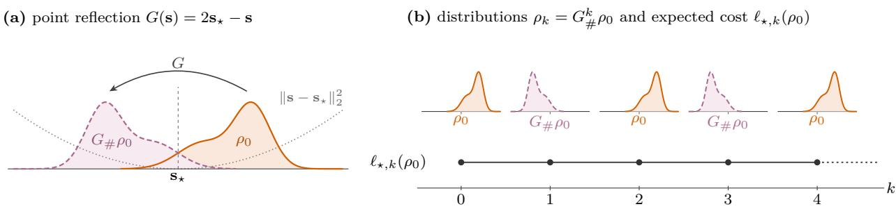  
Figure 5: Counterexample for a point reflection.

induced by $\pi _ { \star }$ are representable in the DMDP formulation, i.e., that there exists an admissible DMDP policy $\psi _ { \pi } \in \Psi$ such that

$$
\mathcal { T } _ { \tau , \psi _ { \pi } \left( \rho \right) } \rho = \mathcal { T } _ { \tau , \pi _ { \star } } \rho , \quad \forall \rho \in \mathcal { P } .\tag{67}
$$

Then, the DMDP admits a policy, namely $\psi _ { \pi }$ , that is D-asymptotically stable with respect to $\rho _ { \star }$ on $\mathcal { P }$

Proof. Let $\psi _ { \pi } \in \Psi$ be the policy in (67), so that

$$
\mathcal { T } _ { \tau , \psi _ { \pi } \left( \rho \right) } \rho = \mathcal { T } _ { \tau , \pi _ { \star } } \rho , \quad \forall \rho \in \mathcal { P } .\tag{68}
$$

Fix $\rho _ { 0 } \in \mathcal { P }$ , and let $\{ \rho _ { k } ^ { \pi _ { \star } } \} _ { k = 0 } ^ { \infty }$ and $\{ \rho _ { k } ^ { \psi _ { \pi } } \} _ { k = 0 } ^ { \infty }$ denote the state-distribution sequences generated from $\rho _ { 0 }$ by $\pi _ { \star }$ and $\psi _ { \pi }$ , respectively. By induction, $\rho _ { k } ^ { \psi _ { \pi } } = \rho _ { k } ^ { \pi _ { \star } }$ holds for all $k \geq 0$ . The claim holds for $k = 0$ , since $\rho _ { 0 } ^ { \psi _ { \pi } } = \rho _ { 0 } ^ { \pi _ { \star } } = \rho _ { 0 }$ . If the claim holds for some $k \geq 0 .$ , then $\rho _ { k } ^ { \pi _ { \star } } \in \mathcal { P }$ by the forward invariance of $\mathcal { P }$ under $\mathcal { T } _ { \tau , \pi _ { \star } }$ and (68) gives

$$
\begin{array} { r } { \rho _ { k + 1 } ^ { \psi _ { \pi } } = \mathcal { T } _ { \tau , \psi _ { \pi } ( \rho _ { k } ^ { \psi _ { \pi } } ) } \rho _ { k } ^ { \psi _ { \pi } } = \mathcal { T } _ { \tau , \psi _ { \pi } ( \rho _ { k } ^ { \pi _ { \star } } ) } \rho _ { k } ^ { \pi _ { \star } } = \mathcal { T } _ { \tau , \pi _ { \star } } \rho _ { k } ^ { \pi _ { \star } } = \rho _ { k + 1 } ^ { \pi _ { \star } } . } \end{array}\tag{69}
$$

Hence, from every initial distribution in ${ \mathcal { P } } _ { : }$ , both policies generate the same distribution sequence. Since $\pi _ { \star }$ is D-asymptotically stable with respect to $\rho _ { \star }$ on ${ \mathcal { P } } ,$ its D-stability carries over to $\psi _ { \pi }$ , and lim $\begin{array} { r } { \operatorname { 1 } _ { k \to \infty } \mathbb { D } ( \rho _ { k } ^ { \psi _ { \pi } } \| \rho _ { \star } ) = } \end{array}$ $\begin{array} { r } { \operatorname* { l i m } _ { k \to \infty } \mathbb { D } ( \rho _ { k } ^ { \pi _ { \star } } \| \rho _ { \star } ) = 0 } \end{array}$ . Therefore, $\psi _ { \pi }$ is D-asymptotically stable with respect to $\rho _ { \star }$ on $\mathcal { P }$ □

In contrast to the NMDP, which obtains distributional stability only indirectly through the closed-loop dynamics, the DMDP formulates distributional stabilization directly through the evolution of $\rho _ { k }$ and the dissimilarity $\mathbb { D } ( \rho _ { k } \| \rho _ { \star } )$

## B.2 Relation to POMDPs and Belief-State MDPs

A POMDP agent is commonly decomposed into a state estimator, which updates a belief state from the previous belief, the executed action, and the new observation, and a policy, which maps the belief state to an action (Åström, 1965; Kaelbling et al., 1998). The belief state is a probability distribution over hidden states and a suficient statistic of the past action-observation history. This view underlies belief-dependent rewards (Araya-López et al., 2010), belief-space planning (Platt et al., 2010), and belief-like representations learned in deep reinforcement learning (Igl et al., 2018; Lambrechts et al., 2022; Luis et al., 2025). In the parameterized DMDP of Problem P-OCP, the parameter $\omega _ { k }$ represents $\rho _ { k }$ through $\rho _ { \omega _ { k } }$ , and the policy $\phi : \Omega \to$ A acts on this representation, much as a POMDP policy acts on a belief state. However, the two distributions difer intrinsically. In a POMDP, the belief state represents epistemic uncertainty about an unobserved physical state, or about unknown model parameters included in the state, and serves as an information state for maximizing the expected return. It remains a pathwise quantity, i.e., it is computed from the observations of a single realization, and the belief-state MDP is stochastic because the belief depends on future random observations. In the DMDP, $\rho _ { k }$ is the distribution of the state across realizations rather than a pathwise quantity, the action is common to all realizations, and $\rho _ { k }$ evolves deterministically through the distribution transition operator in (1). This distributional state results from the stage cost, as Appendix B.3 explains, rather than from missing information, and $\rho _ { k }$ is the controlled object, which the policy stabilizes toward the target distribution $\rho _ { \star }$ in the sense of $\mathbb { D } ( \rho _ { k } \| \rho _ { \star } )$ ).

## B.3 Relation to Measure-Functional MDPs

Measure-functional MDPs (Gros & Zanon, 2022; Kordabad & Gros, 2022) analyze the stability of stochastic MDPs on the space of probability measures rather than solely on the state space. There, a state-feedback law $\mathbf { a } _ { k } = \pi ( \mathbf { s } _ { k } )$ induces the measure sequence $\rho _ { k + 1 } = \mathscr { T } _ { \tau , \pi } \rho _ { k }$ , stage costs and storage functions are generalized to functionals of probability measures, and stability is characterized through a dissimilarity measure. State feedback keeps these works within the standard MDP setting; it is a modeling choice rather than a restriction of their dissipativity theory, and Table 1 therefore marks distribution feedback with $( \checkmark )$ . Whether state feedback sufices is decided by the stage cost: for an expected per-state cost, which is linear in the distribution, an optimal state-feedback policy exists under standard conditions (Puterman, 1994; Hernández-Lerma & Lasserre, 1996), whereas a stage cost such as $\mathbb { D } ( \rho _ { k } \| \rho _ { \star } )$ generally makes the optimal action depend on the whole distribution, e.g., on its variance, concentration, tail behavior, or multimodality. Distribution feedback thus follows from the DMDP stage cost, not from a design preference, which is why the DMDP takes $\rho _ { k }$ as the decision state of the policy $\mathbf { a } _ { k } = \psi ( \rho _ { k } )$ , or $\mathbf { a } _ { k } = \phi ( \omega _ { k } )$ in the parameterized formulation. Conversely, as formalized in Corollary 1, an admissible DMDP policy that represents the stabilizing dynamics $\mathcal { T } _ { \tau , \pi }$ on $M ( s )$ induced by a state-feedback policy π reproduces the same trajectory of probability measures. Dissipativity and turnpike notions have also been extended to random variables and probability measures for stochastic nonlinear optimal control (Schießl et al., 2025a) and, with a stationary stochastic process in place of the optimal steady state, for generalized linear-quadratic problems (Schießl et al., 2025b); for stochastic economic MPC, they yield closed-loop stability and performance guarantees (Schießl et al., 2024; 2025c). These works analyze optimal solutions and MPC closed loops; the DMDP uses dissipativity through the cost rotation in Section 3.2, and Section 4 extends the Lyapunov certificates of Section 3.3 to learned distribution-feedback policies.

## B.4 Relation to Distributional Reinforcement Learning

Distributional reinforcement learning (Bellemare et al., 2017; 2023) usually models the distribution of the random return rather than only its expectation; this richer representation of long-term reward uncertainty can improve value learning or risk-sensitive decision-making (Dabney et al., 2018a). The DMDP instead models and controls the distribution $\rho _ { k }$ of the system state rather than a representation of the value function or return, with the stability objective $\mathbb { D } ( \rho _ { k } \| \rho _ { \star } ) \to 0$ . This distinction matters when reliability, safety, or personalization must be specified at the distribution level: two policies may have similar expected costs or return distributions while inducing very diferent state distributions, with diferent confidence regions, tail risks, or multimodal behaviors, and the DMDP captures these diferences directly.

## B.5 Further Related Approaches

Lyapunov functions of the state have been used to certify the stability or safety of learned policies (Perkins & Barto, 2002; Berkenkamp et al., 2017; Chow et al., 2018; Chang et al., 2019; Han et al., 2020), and Buşoniu et al. (2018) and Krasowski et al. (2023) survey stability and provable safety in reinforcement learning. These certificates concern the realized state rather than its distribution.

Mean-field MDPs have the distribution of a large population of agents as their state (Motte & Pham, 2022; Bäuerle, 2023), and reinforcement learning methods for mean-field control take this population distribution as a policy input (Carmona et al., 2023; Pásztor et al., 2023). These methods do not establish its stability.

Distribution steering drives the state distribution of a linear stochastic system to a prescribed Gaussian distribution at a finite final time, either as a terminal constraint (Chen et al., 2016) or through a Wasserstein terminal cost (Balci & Bakolas, 2021). Optimal transport has also been used to coordinate large populations of controlled agents (Le Corre et al., 2026).

Other objectives are defined on the distribution of the states, or state-action pairs, visited by a policy and aggregated over time, such as the entropy of the state-visitation distribution (Hazan et al., 2019), the matching of a target state marginal distribution (Lee et al., 2019), and convex functions of the stationary state-action distribution (Zahavy et al., 2021).

## C Distribution Estimation and Model Consistency

## C.1 Estimation of the Distribution Parameter $\hat { \omega } _ { k }$

One possible procedure for the parameter-estimation step of Section 4.1 is given below. Fix $k \in \{ 0 , 1 , \ldots , T \}$ and let $c _ { k }$ be the context of time step $k , { \mathrm { ~ e . g . ~ } }$ , the time index or another grouping variable that collects samples from the same state distribution $\rho _ { k } = \rho _ { \omega _ { k } }$ . The density of $\rho _ { \omega } , \omega \in \Omega$ , is $p ( \mathbf { s } ; \boldsymbol { \omega } )$

1. Conditional density estimation. From the ofline dataset $\mathcal { D } _ { \mathsf { o f f } }$ in (15), estimate the conditional density $\hat { p } _ { \mathbf { s } } ^ { N } ( \mathbf { s } \mid c _ { k } )$ of the state sample s given $c _ { k } , \mathrm { e . g . }$ , by kernel conditional density estimation (Hyndman et al., 1996), normalizing flows (Papamakarios et al., 2021), neural density estimators (Papamakarios et al., 2017), or another consistent density estimator.

2. Sample generation. Draw S independent samples $\tilde { \mathbf { s } } _ { k } ^ { ( 1 ) } , \ldots , \tilde { \mathbf { s } } _ { k } ^ { ( S ) } \sim \hat { p } _ { \mathbf { s } } ^ { N } ( \cdot \mid c _ { k } )$

3. Parameter estimation. Estimate $\omega _ { k }$ by maximum likelihood:

$$
\hat { \omega } _ { k } ^ { S , N } : = \arg \operatorname* { m a x } _ { \omega \in \Omega } \frac { 1 } { S } \sum _ { j = 1 } ^ { S } \log p ( \tilde { \mathbf { s } } _ { k } ^ { ( j ) } ; \omega ) .\tag{70}
$$

The superscript $( S , N )$ indicates the dependence on the ofline dataset size N and the number S of generated samples; the main text writes $\hat { \omega } _ { k }$

## C.2 An Example Pipeline for Model Consistency

Proposition 1 assumes the uniform model consistency (40) on the compact set $\Omega _ { \mathsf { c o m } } \times A .$ . The pipeline below, one possible implementation that does not restrict the framework, shows how standard statistical estimators meet this condition under suitable regularity and coverage assumptions.

Step 1: Conditional density estimation. For each context $^ { c , }$ defined as in Appendix C.1, the conditional density of the state sample s in $\mathcal { D } _ { \mathsf { o f f } }$ is $p _ { \mathbf { s } } ( \mathbf { s } \mid c ) = p ( \mathbf { s } ; \omega _ { c } )$ with the distribution parameter $\omega _ { c } \in \Omega$ . Leastsquares conditional density estimation (LS-CDE) (Sugiyama et al., 2010) approximates $p _ { \mathbf { s } } ( \mathbf { s } \mid c )$ by $\beta ^ { \top } \boldsymbol \varphi ( { \bf s } , c )$ where $\varphi ( \mathbf { s } , c ) : = [ \varphi _ { 1 } ( \mathbf { s } , c ) , \ldots , \varphi _ { b } ( \mathbf { s } , c ) ] ^ { \intercal }$ collects nonnegative basis functions and $\beta \in \mathbb { R } ^ { b }$ is a coeficient vector. For the flattened samples $\{ ( \mathbf { s } _ { j } , c _ { j } ) \} _ { j = 1 } ^ { N }$ of $\mathcal { D } _ { \mathsf { o f f } }$ and a regularization parameter $\lambda _ { N }$ , the regularized empirical LS-CDE objective is

$$
\widehat { \mathcal { I } } _ { \lambda _ { N } } ( \beta ) : = \beta ^ { \top } \widehat { \mathbf H } \beta - 2 \widehat { \mathbf h } ^ { \top } \beta + \lambda _ { N } \beta ^ { \top } \beta ,\tag{71}
$$

where $\begin{array} { r } { \widehat { \bf H } : = \frac { 1 } { N } \sum _ { j = 1 } ^ { N } \int \varphi ( { \bf s } , c _ { j } ) \varphi ( { \bf s } , c _ { j } ) ^ { - } } \end{array}$ ⊤ds and $\begin{array} { r } { \widehat { \mathbf { h } } : = \frac { 1 } { N } \sum _ { j = 1 } ^ { N } \varphi ( \mathbf { s } _ { j } , c _ { j } ) } \end{array}$ . Its minimizer has the closed form $\widetilde { \pmb { \beta } } = ( \widehat { \mathbf { H } } + \lambda _ { N } \mathbf { I } _ { b } ) ^ { - 1 } \widehat { \mathbf { h } }$ , and the normalized conditional density estimator is

$$
\hat { p } _ { \bf s } ^ { N } ( { \bf s } \mid c ) : = \frac { [ \tilde { \beta } ^ { \top } \boldsymbol \varphi ( { \bf s } , c ) ] _ { + } } { \int [ \tilde { \beta } ^ { \top } \boldsymbol \varphi ( { \bf s } , c ) ] _ { + } \mathrm { d } { \bf s } } ,\tag{72}
$$

where $[ x ] _ { + } : = \operatorname* { m a x } \{ x , 0 \}$ ensures nonnegativity. Under the regularity conditions of LS-CDE, such as an appropriate choice of $\lambda _ { N }$ and a suficiently rich basis, $\| \hat { p } _ { \mathbf { s } } ^ { N } ( \cdot \mid c ) ^ { - } p _ { \mathbf { s } } ( \cdot \mid c ) \| _ { 2 } \to 0$ in probability and, under strengthened consistency conditions, almost surely; the almost-sure version is assumed below.

Step 2: Parameter estimation by maximum likelihood. As in Appendix C.1, S independent samples $\tilde { \mathbf { s } } _ { c } ^ { ( 1 ) } , \ldots , \tilde { \mathbf { s } } _ { c } ^ { ( S ) } \sim \hat { p } _ { \mathbf { s } } ^ { N } ( \cdot \mid c )$ give the maximum-likelihood estimate

$$
\hat { \omega } _ { c } ^ { S , N } : = \arg \operatorname* { m a x } _ { \omega \in \Omega _ { \mathrm { c o m } } } \frac { 1 } { S } \sum _ { j = 1 } ^ { S } \log p ( \tilde { \mathbf { s } } _ { c } ^ { ( j ) } ; \omega ) .\tag{73}
$$

Its consistency follows a standard route (Newey & McFadden, 1994; van der Vaart, 1998). Define the population log-likelihoods

$$
Q _ { N } ( \omega ) : = \int \log p ( \mathbf { s } ; \omega ) \hat { p } _ { \mathbf { s } } ^ { N } ( \mathbf { s } \mid c ) \mathbf { d s } , \quad Q ( \omega ) : = \int \log p ( \mathbf { s } ; \omega ) p _ { \mathbf { s } } ( \mathbf { s } \mid c ) \mathbf { d s } .\tag{74}
$$

Assume that $\Omega _ { \mathsf { c o m } }$ is compact, the family $\{ p ( \cdot ; \omega ) \mid \omega \in \Omega _ { \mathsf { c o m } } \}$ is identifiable, the true parameter $\omega _ { c }$ is the unique maximizer of $Q .$ , and log $p ( \mathbf { s } ; \boldsymbol { \omega } )$ is continuous in ω. Assume further that an envelope $E _ { : }$ , integrable under $p _ { \mathbf { s } } ( \cdot \mid c )$ , satisfies $| \log p ( \mathbf { s } ; \boldsymbol { \omega } ) | \le E ( \mathbf { s } )$ for all $\omega \in \Omega _ { \mathsf { c o m } }$ , and that the density estimator converges in the E-weighted $L ^ { 1 }$ sense, i.e., $\begin{array} { r } { \int E ( \mathbf { s } ) \left| \hat { p } _ { \mathbf { s } } ^ { N } ( \mathbf { s } \mid c ) - p _ { \mathbf { s } } ( \mathbf { s } \mid c ) \right| } \end{array}$ | ds $ 0$ almost surely. Convergence in $L ^ { 2 }$ alone does not sufice, because the estimated densities may place vanishing mass far in the tails, where $| \log p ( \mathbf { s } ; \omega ) |$ is large. Since this weighted $L ^ { 1 }$ distance bounds $| Q _ { N } ( \omega ) - Q ( \omega ) |$ for every $\omega \in \Omega _ { \mathsf { c o m } }$ , it follows that $\begin{array} { r } { \operatorname* { s u p } _ { \omega \in \Omega _ { \mathrm { c o m } } } | Q _ { N } ( \omega ) - Q ( \omega ) |  0 } \end{array}$ almost surely. By the argmax theorem (van der Vaart & Wellner, 1996), the population maximizer of $Q _ { N }$ converges to $\omega _ { c }$ . Moreover, conditional on $\hat { p } _ { \bf s } ^ { N } ( \cdot \vert ~ c )$ , the empirical log-likelihood in (73) converges uniformly to $Q _ { N }$ as $S $ ∞ under the same compactness and envelope conditions, provided $E$ is integrable under $\hat { p } _ { \bf s } ^ { N } ( \cdot \vert c )$ . Hence, if $S = S ( N )$ grows fast enough for this Monte Carlo error to vanish almost surely as $N \to \infty$ , then $\hat { \omega } _ { c } ^ { S , N } \to \omega _ { c }$ almost surely as $N \to \infty$

Step 3: Learning the parameter transition map. The estimated parameters form the transition dataset $\mathcal { D } _ { \omega } ^ { S , N } : = \{ ( \smile ) ^ { S , N } , \bar { \mathbf { a } _ { j } } , \hat { \omega } _ { j , + } ^ { S , N } ) \} _ { j = 1 } ^ { n _ { \mathrm { t r } } }$ , where $\hat { \omega } _ { j } ^ { S , N }$ and $\hat { \omega } _ { j , + } ^ { S , N }$ estimate the distribution parameters $\omega _ { j }$ and $\omega _ { j , + } = f ( \omega _ { j } , \mathbf { a } _ { j } )$ before and after the action ${ \bf a } _ { j }$ . Since $\hat { \omega } _ { j } ^ { \bar { S } , N }  \omega _ { j }$ and $\hat { \omega } _ { j , + } ^ { S , N }  \omega _ { j , + }$ almost surely, $\mathcal { D } _ { \omega } ^ { S , N }$ provides asymptotically correct training data for $f .$ . Consider Gaussian process regression (Rasmussen & Williams, 2006) with a continuous universal kernel Ker (Micchelli et al., 2006) on the compact domain $\chi _ { \mathsf { c o m } } : = \Omega _ { \mathsf { c o m } } \times \mathcal { A }$ , with one Gaussian process per component of $f : \Omega \times \mathcal { A }  \Omega$ . Assume that each component of $f$ belongs to the reproducing kernel Hilbert space (RKHS) of Ker, that the exact design points $\{ ( \omega _ { j } , \mathbf { a } _ { j } ) \} _ { j = 1 } ^ { n _ { \mathrm { t r } } }$ become dense in ${ \mathcal { X } } _ { \mathsf { c o m } }$ as $n _ { \mathrm { t r } } \to \infty$ , and that the input perturbations caused by parameter estimation vanish uniformly, i.e., $\begin{array} { r } { \operatorname* { m a x } _ { 1 \leq j \leq n _ { \mathrm { t r } } } \| \hat { \omega } _ { j } ^ { S , N } - \omega _ { j } \|  0 } \end{array}$ almost surely. Under these conditions and a suitable regularization and noise schedule, the regression is assumed to be uniformly consistent, i.e., the learned model $\hat { f } _ { \mathrm { o f f } } ^ { S , N }$ satisfies (40) in place of $\hat { f } _ { \mathrm { o f f } } ^ { N }$ . Error bounds for Gaussian process regression and kernel interpolation (Wendland, 2004; Srinivas et al., 2012; Lederer et al., 2019) are available for exactly observed inputs; since the inputs here are estimated, uniform consistency is assumed rather than derived from them.

Consequence. The pipeline reduces the model-consistency condition (40) to two requirements: (i) consistent estimates of the distribution parameters, which Steps 1 and 2 provide under the stated conditions; and (ii) uniform consistency of the regression with estimated inputs, which is assumed. Appendix D applies Steps 2 and 3 to a scalar linear example, in which the model error decreases as the data grow.

## D A Computable Example

This appendix tests Theorems 2–5 and Proposition 1 on a system whose hypotheses can all be checked, as Table 4 shows, and whose certificates can be computed because the model is known.

System. The scalar state follows $s _ { k + 1 } = a _ { k , 1 } s _ { k } + ( 1 - a _ { k , 1 } ) a _ { k , 2 } + \epsilon _ { k }$ with i.i.d. $\epsilon _ { k } \sim \mathcal { N } ( 0 , 0 . 5 ^ { 2 } )$ and an action $\mathbf { a } _ { k } = ( a _ { k , 1 } , a _ { k , 2 } ) \in \mathcal { A } = [ 0 . 7 0 , 0 . 9 5 ] \times [ 0 . 5 , 1 . 5 ]$ common to all realizations. The Gaussian family $\rho _ { \omega } = \mathcal { N } ( \mu , \varsigma ^ { 2 } ) , \ : \omega = ( \mu , \varsigma ) \in \Omega = \mathbb { R } \times ( 0 , \infty )$ , is closed under this transition, so (5) holds exactly with $f ( \omega , \mathbf { a } ) = { \big ( } a _ { 1 } \mu + ( 1 - a _ { 1 } ) a _ { 2 } , ( a _ { 1 } ^ { 2 } \varsigma ^ { 2 } + 0 . 2 5 ) ^ { 1 / 2 } { \big ) }$ for $\mathbf { a } = ( a _ { 1 } , a _ { 2 } ) \in \mathcal { A }$ . Thus, every $\rho _ { k }$ stays in the parameterized family, so the example does not test the approximation of distributions outside ${ \mathrm { i t } } ,$ one of the most dificult aspects of the general problem; it tests the error terms and residual sets of Section 4 under the errors of the learned parameter dynamics and value function, of the estimated decrease, and of the estimated parameters.

The target $\rho _ { \star } = \rho _ { \omega _ { \star } } , \omega _ { \star } = ( 1 , 0 . 8 )$ , is a steady state only under $\mathbf { a } _ { \star } = ( \sqrt { 3 9 } / 8 , 1 ) \approx ( 0 . 7 8 , 1 )$ ). The dissimilarity is the squared 2-Wasserstein distance, $\mathbb { D } ( \rho _ { \omega } \| \rho _ { \star } ) = ( \mu - 1 ) ^ { 2 } + ( \varsigma - 0 . 8 ) ^ { 2 } = r ^ { 2 }$ with $r : = \| \omega - \omega _ { \star } \|$ ; hence, Assumption 2 holds with $\alpha _ { 1 } ( r ) = \alpha _ { 2 } ( r ) = r ^ { 2 }$ . The operating set $\Omega _ { \mathsf { c o m } } = [ - 1 , 3 ] \times [ \varsigma _ { \mathsf { l o } } , \varsigma _ { \mathsf { h i } } ]$ , bounded by the stationary standard deviations $\varsigma _ { \mathsf { l o } } = 0 . 5 / \sqrt { 0 . 5 1 } \approx 0 . 7 0$ at $a _ { 1 } = 0 . 7 0$ and $\varsigma _ { \mathsf { h i } } = 0 . 5 / \sqrt { 0 . 0 9 7 5 } \approx 1 . 6 0$ at $a _ { 1 } = 0 . 9 5$ contains all steady states $\mu = a _ { 2 } , \varsigma ^ { 2 } = 0 . 2 5 / ( 1 - a _ { 1 } ^ { 2 } )$

Table 4: Hypotheses in the example.
<table><tr><td>Result</td><td>Hypothesis</td><td>Status</td><td>Evidence</td></tr><tr><td>All</td><td>closure; D-compatibility with  $\alpha _ { 1 } ( r ) = \alpha _ { 2 } ( r ) = r ^ { 2 }$ </td><td>exact</td><td>Gaussian  $\mathrm { A R } ( 1 ) ; \mathbb { D } = W _ { 2 } ^ { 2 } = r ^ { 2 }$ </td></tr><tr><td>All</td><td> $\Omega _ { \mathsf { c o m } }$  compact and positively invariant under every closed loop</td><td>exact; for  $\widehat { F } _ { \mathrm { o f f } }$  by construction</td><td>Lemma 2; foff projected</td></tr><tr><td>Thm. 2</td><td>optimal  $\phi _ { \star } ; U _ { \star } ^ { \mathsf { R } }$  finite, continuous, Bellman identity;</td><td>exact</td><td>Lemma  $_ { 2 ; }$  max  $\tilde { U } / \mathbb { D } = 1 . 5 7$ </td></tr><tr><td>Thms. 3–5</td><td> $\bar { F _ { \phi _ { \star } } } ( \omega _ { \star } ) = \omega _ { \star } ; \kappa _ { 1 } ( r ) = r ^ { 2 } , \kappa _ { 2 } ( r ) = 2 . 5 6 r ^ { 2 }$   $U _ { \star } ^ { \dot { \mathsf { R } } }$  and the sups over  $\Omega _ { \mathsf { c o m } }$ </td><td>numerical</td><td> $\tilde { U }$  with  $\varepsilon _ { \mathrm { { n u m } } } = 1 . 4 \times 1 0 ^ { - 3 } ;$  maxima over  $^ \mathrm { 1 1 , 8 2 2 }$  points  $^ { ( 2 0 , 0 1 6 }$  for  $\boldsymbol { e } _ { f } ) ;$  80,000 independent points change  $\Delta ,$   ${ \hat { c } } , \Delta _ { \mathsf { d e c } , n }$  of the deployed run by at</td></tr><tr><td>Thm. 3</td><td> $F _ { \mathrm { o f f } } ( \omega _ { \star } ) = \omega _ { \star }$ </td><td>fails</td><td>offset  $> 0 ;$  not used by (21) computed; fails at per run; maximum of 49 runs,</td></tr><tr><td>Thm. 3</td><td>learned margin with  $\sigma ( r ) = 0 . 7 5 r ^ { 2 } ; \Delta \le \bar { \Delta }$  with  $\mathrm { p r o b a b i l i t y } \geq 0 . 9$ </td><td> $n _ { \mathrm { t r } } = 1 0 0$ </td><td>confidence 0.994</td></tr><tr><td>Thms. 4–5</td><td>estimation event for all  $t \geq 0$  with probability  $\geq 0 . 9 5$   $W _ { n } = \mathbb { D } \colon$  bounds and continuity</td><td>exact</td><td>growing  $M _ { t }$ </td></tr><tr><td>Thm. 5 Thm. 5</td><td>empirical decrease with  $\sigma _ { n } ( r ) = 0 . 2 5 r ^ { 2 } ;$ </td><td>exact by construction;</td><td></td></tr><tr><td></td><td> $\Delta _ { \mathsf { d e c } , n } \leq \bar { \Delta } _ { \mathsf { d e c } , n }$  with probability  $\geq 0 . 9$ </td><td>computed</td><td>capped estimate; maximum of 49 runs, with the true  $f$ </td></tr><tr><td>Thms. 3–5</td><td>asymptotic clause</td><td>fails</td><td>residual sets only</td></tr><tr><td>Prop. 1</td><td>uniform model consistency</td><td>trend</td><td> $e _ { f }$ </td></tr><tr><td>Prop. 1</td><td>Θ compact, φ continuous;  $J ^ { \mathsf { R } }$  finite and continuous</td><td>exact; fails</td><td>node actions;  $J ^ { \mathsf { R } }$  infinite with an offset</td></tr></table>

With $\ell ( \omega , \mathbf { a } ) = \mathbb { D } ( \rho _ { \omega } \| \rho _ { \star } ) , \gamma = 1$ , and the storage function $\lambda = 0$ , the value $\ell _ { 0 } = 0$ in (6) is attained only at $\omega _ { \star } ,$ and $\ell ^ { \mathsf { R } } = \ell = r ^ { 2 }$ . The action $\mathbf { a } _ { \mathrm { d b } } ( \omega )$ with $a _ { \mathbf { d b } , 1 } = \sqrt { 0 . 3 9 } / \varsigma$ and $a _ { \mathsf { d b } , 2 } = ( 1 - a _ { \mathsf { d b } , 1 } \mu ) / ( 1 - a _ { \mathsf { d b } , 1 } )$ gives $f ( \omega , \mathbf { a } _ { \mathsf { d b } } ( \omega ) ) = \omega _ { \star }$ , and $\mathcal { R } : = \{ \omega \in \Omega _ { \mathrm { c o m } } \mid \mathbf { a } _ { \mathrm { d b } } ( \omega ) \in \mathcal { A } \}$ is the set from which $\omega _ { \star }$ is reached in one step.

Lemma 2. $( i ) \ f ( \Omega _ { \mathsf { c o m } } \times \mathcal { A } ) \subseteq \Omega _ { \mathsf { c o m } }$

$$
\begin{array} { r } { ( i i ) \parallel f ( \omega , \mathbf { a } _ { \star } ) - \omega _ { \star } \parallel ^ { 2 } \leq \frac { 3 9 } { 6 4 } \parallel \omega - \omega _ { \star } \parallel ^ { 2 } f o r \ a l l \ \omega \in \Omega . } \end{array}
$$

(iii) $U _ { \star } ^ { \mathsf { R } }$ is finite and continuous on $\Omega _ { \mathsf { c o m } }$ , with $r ^ { 2 } \leq U _ { \star } ^ { \mathsf { R } } \leq 2 . 5 6 r ^ { 2 } ;$ an optimal stationary policy $\phi _ { \star }$ exists; the   
Bellman identity (9) holds on $\Omega _ { \mathsf { c o m } } ;$ and $F _ { \phi _ { \star } } ( \omega _ { \star } ) = \omega ,$ ⋆ with $\phi _ { \star } ( \omega _ { \star } ) = \mathbf { a } _ { \star }$   
(iv) $U _ { \star } ^ { \mathsf { R } } = \mathbb { D }$ and $\phi _ { \star } = \mathbf { a } _ { \mathsf { d b } }$ on $\mathcal { R } \supseteq \{ \omega \in \Omega _ { \mathrm { c o m } } \mid r \leq 0 . 0 9 \}$

Proof. (i) The new mean is a convex combination of $\mu \in [ - 1 , 3 ]$ and $a _ { 2 } \in [ 0 . 5 , 1 . 5 ]$ ; the new standard deviation increases in $a _ { 1 }$ and ς and has the fixed points $\varsigma _ { \mathrm { l o } }$ at $a _ { 1 } = 0 . 7 0$ and $\varsigma _ { \mathrm { h i } }$ at $a _ { 1 } = 0 . 9 5$

(ii) For $( \mu ^ { + } , \varsigma ^ { + } ) : = f ( \omega , \mathbf { a } _ { \star } ) , \mu ^ { + } - 1 = a _ { \star , 1 } ( \mu - 1 )$ and $( \varsigma ^ { + } ) ^ { 2 } - 0 . 6 4 = a _ { \star , 1 } ^ { 2 } ( \varsigma ^ { 2 } - 0 . 6 4 )$ . Since $\varsigma ^ { + } \geq a _ { \star , 1 } \varsigma$ and $a _ { \star , 1 } < 1$ , it follows that $| \varsigma ^ { + } - 0 . 8 | = a _ { \star , 1 } ^ { 2 } | \varsigma - 0 . 8 | ( \varsigma + 0 . 8 ) / ( \varsigma ^ { + } + 0 . 8 ) \leq a _ { \star , 1 } | \varsigma - 0 . 8 |$ , and $a _ { \star , 1 } ^ { 2 } = 3 9 / 6 4$ gives (ii).

(iii) Let $\mathbb { D } _ { k } : = \mathbb { D } ( \rho _ { \omega _ { k } } \| \rho _ { \star } )$ , and let $V _ { m } ( \omega )$ be the minimum of $\sum _ { k < m } \mathbb { D } _ { k }$ over action sequences in ${ \mathcal { A } } ^ { m }$ from $\omega _ { 0 } = \omega$ $V _ { m }$ is continuous by Berge’s maximum theorem, since $f$ and D are continuous, $A ^ { m }$ is compact, and $\mathrm { ( i ) }$ removes any state constraint. By (ii), applying $\mathbf { a } _ { \star }$ forever costs at most $r ^ { 2 } / ( 1 - 3 9 / 6 4 ) = 2 . \bar { 5 } 6 r ^ { 2 }$ so $r ^ { 2 } \leq V _ { m } \leq 2 . 5 6 r ^ { 2 }$ . An optimal m-step sequence has a step $k ^ { \prime } < m$ with $\mathbb { D } _ { k ^ { \prime } } \leq V _ { m } / m ;$ following it up to $k ^ { \prime }$ and $\mathbf { a } _ { \star }$ afterwards costs at most $( 1 + 2 . 5 6 / m ) V _ { m }$ . Hence, $V _ { m }$ increases in m and converges uniformly to a continuous $\bar { U } \leq ( 1 + 2 . 5 6 / m ) V _ { m }$ . The Bellman operator $\begin{array} { r } { ( \Gamma U ) ( \omega ) : = \mathbb { D } ( \rho _ { \omega } \| \rho _ { \star } ) + \operatorname* { m i n } _ { \mathbf { a } \in \mathcal { A } } U ( f ( \omega , \mathbf { a } ) ) } \end{array}$ is monotone and nonexpansive in the sup norm, and $V _ { m + 1 } = \Gamma V _ { m }$ , so $\bar { U } = \Gamma \bar { U }$ . For a policy $\phi _ { \star }$ ⋆ that selects a minimizer in ΓU¯ , iterating along $F _ { \phi _ { : } }$ gives $\begin{array} { r } { \sum _ { k < H } \mathbb { D } _ { k } + \bar { U } ( \omega _ { H } ) = \bar { U } ( \omega _ { 0 } ) } \end{array}$ , so $\mathbb { D } _ { k } \to 0 , \bar { U } ( \omega _ { H } ) \le 2 . 5 6 \mathbb { D } _ { H } \to 0$ and $\phi _ { \star }$ attains $\bar { U } .$ . Since every policy costs at least $V _ { m }$ for every m, $U _ { \star } ^ { \mathsf { R } } = \bar { U } , \phi ,$ is optimal, and the Bellman identity holds. At $\omega _ { \star }$ , this identity gives $U _ { \star } ^ { \mathsf { R } } ( F _ { \phi _ { \star } } ( \omega _ { \star } ) ) = 0 ;$ hence, $F _ { \phi _ { \star } } ( \omega _ { \star } ) = \omega _ { \star }$ , which only a achieves.

(iv) On $\mathcal { R } , \mathbb { D } \leq U _ { \star } ^ { \mathsf { R } } \leq \mathbb { D } + U _ { \star } ^ { \mathsf { R } } ( \omega _ { \star } ) = \mathbb { D }$ , so the Bellman identity requires $F _ { \phi _ { \star } } ( \omega ) = \omega _ { \star } ,$ , which only $\mathbf { a } _ { \mathrm { d b } }$ achieves. If $r \leq 0 . 0 9$ , then $a _ { \mathbf { d b } , 1 } \in [ 0 . 7 0 , 0 . 8 8 ]$ and $| a _ { \mathbf { d b } , 2 } - 1 | = a _ { \mathbf { d b } , 1 } | \mu - 1 | / ( 1 - a _ { \mathbf { d b } , 1 } ) \le 0 . 3 8$ , so $\mathbf { a } _ { \mathbf { d b } } ( \omega ) \in { \mathcal { A } } .$ □

Hence, Theorem 2 applies with $\Omega _ { \mathcal { P } } = \Omega _ { \mathsf { c o m } } , \kappa _ { 1 } ( r ) = r ^ { 2 }$ , and $\kappa _ { 2 } ( r ) = 2 . 5 6 r ^ { 2 } \colon \phi$ renders the example D-asymptotically stable and, by (iv), reaches $\rho _ { \star }$ exactly in finitely many steps.

Computations. Value iteration on a grid yields an approximation $\tilde { U }$ of $U _ { \star } ^ { \mathsf { R } }$ . The grid has $\omega _ { \star }$ as a node and is refined near it; a is among the candidate actions; and $U / \mathbb { D }$ is interpolated bilinearly. The error indicator $\varepsilon _ { \mathrm { n u m } }$ is the largest of the Bellman residual, the gap to a rigorous upper bound on $U _ { \star } ^ { \mathsf { R } }$ (the 25-step cost of the greedy policy plus 2.56 D at the end), and the diference from a coarser grid.

For Theorem 3, a data level $( B , M ) \in \{ ( 2 0 , 5 0 ) , ( 4 0 , 2 0 0 ) , ( 8 0 , 8 0 0 ) , ( 1 6 0 , 3 2 0 0 ) \}$ consists of $B$ independent datasets (15) with $T = 5$ , each with ω0 and actions drawn uniformly from $\Omega _ { \mathsf { c o m } }$ and ${ \mathcal { A } } ,$ , so that $n _ { \mathrm { t r } } = B T$ and $N = B T M$ . The maximum-likelihood estimate $\hat { \omega } _ { k }$ from the samples of $\varrho _ { k }$ and the model $\hat { f } _ { \mathrm { o f f } }$ , one Gaussian process per output, are projected onto $\Omega _ { \mathsf { c o m } } ,$ so $\Omega _ { \mathsf { c o m } }$ is invariant under $\dot { F } _ { \mathrm { o f f } }$ . The estimate does not need the density step of Appendix C.1.

The learner solves $\hat { f } _ { \mathrm { o f f } } ( \omega _ { \star } , \hat { \mathbf { a } } ) = \omega _ { \star }$ for aˆ, since otherwise the learned value with $\gamma = 1$ would be infinite, and then solves Problem $_ { \mathsf { A P - O C P } } \mathsf { R }$ by value iteration with actions centered at $\hat { \mathbf { a } } ,$ never at $\mathbf { a } _ { \star }$ . Bilinear interpolation of the node actions θ gives $\dot { \phi } _ { \mathsf { o f f } }$ , with $\hat { \phi } _ { \mathrm { o f f } } ( \omega _ { \star } ) = \hat { \mathbf { a } }$ . The proof of Theorem 3 uses only the learned margin, the invariance, and the definitions of $\Delta _ { U }$ and $\Delta _ { f }$ , so it applies verbatim to the computed $\widehat { U } _ { \mathrm { o f f } } ^ { \mathsf { R } }$

A run passes if aˆ is found, the value iteration converges, and $\begin{array} { r } { \hat { c } : = \operatorname* { m i n } _ { \omega \neq \omega _ { \star } } [ \widehat { U } _ { \mathrm { o f f } } ^ { \mathrm { R } } ( \omega ) - \widehat { U } _ { \mathrm { o f f } } ^ { \mathrm { R } } ( \widehat { F } _ { \mathrm { o f f } } ( \omega ) ) ] / r ^ { 2 } \geq 0 . 7 5 , } \end{array}$ i.e., if (19) holds with the preset $\sigma ( r ) = 0 . 7 5 r ^ { 2 }$ . The score is $S = \Delta$ for a passing run and $S = \infty$ otherwise, so $\{ S \leq \bar { \Delta } \}$ is contained in the event ${ \mathcal { E } } _ { \circ { \mathsf { f f } } }$ of the theorem. Each level has 50 independent runs; $\Delta$ is the largest score of runs $0 { - } 4 8$ , and run 49 is deployed. Hence, with confidence $1 - 0 . 9 ^ { 4 9 }$ ≈ 0.994 over the calibration runs, $S _ { 4 9 } \leq \bar { \Delta }$ holds with probability at least 0.9, i.e., $\alpha = 0 . 1$

Since the proofs of Theorems $3 { - } 5$ are pathwise, a run satisfies their conclusions with its own $\Delta$ or $\Delta _ { \mathsf { d e c } , n }$ in place of $\bar { \Delta }$ or $\bar { \Delta } _ { { \mathsf { d e c } } , n }$ if it satisfies the learned margin and, for Theorems 4 and 5, lies on the estimation event. The residual set (20) is $\Omega _ { \mathsf { c o m } } \cap \{ r \leq \bar { r } \}$ with $\bar { r } : = ( \bar { \Delta } / 0 . 7 5 ) ^ { 1 / 2 }$ , and $e _ { f }$ is the supremum in (40).

For Theorem 4, the deployed $\hat { \phi } _ { \mathrm { o f f } }$ with $n _ { \mathrm { t r } } = 8 0 0$ is used, with $\sigma _ { \mathsf { o n } } = \sigma$ and $\Delta _ { \circ \mathsf { f f } } = \Delta$ . At step $t , \ \hat { \omega } _ { t }$ is estimated as above from $M = M _ { t }$ fresh samples; before the projection, its mean and standard deviation are $\mu _ { t } + \varsigma _ { t } Z / \sqrt { M }$ and $\varsigma _ { t } \sqrt { X / M }$ with independent $Z \sim { \mathcal { N } } ( 0 , 1 )$ and $X \sim \chi _ { M - 1 } ^ { 2 }$

As the projection is nonexpansive, $\| \hat { \omega } _ { t } - \omega _ { t } \| \leq \varsigma _ { t } G _ { M _ { t } }$ with $G _ { M } : = \| ( Z / \sqrt { M } , \sqrt { X / M } - 1 ) \|$ . Since the same draws $( Z , X )$ are used for every $\omega _ { 0 }$ and policy, $G _ { M _ { t } }$ depends on neither. With $\delta _ { \mathsf { o n } } = \alpha _ { \mathsf { o n } } = 0 . 0 5 , M _ { t }$ is the smallest M with $P ( G _ { M } > \delta _ { \mathsf { o n } } / \varsigma _ { \mathsf { h i } } ) \leq \alpha _ { \mathsf { o n } } / ( ( t + 1 ) ( t + 2 ) )$ , computed by quadrature, so a union bound over t gives (24) for every ω0 with probability at least $1 - \alpha _ { \mathsf { o n } } .$ . By Lemma 2(i), $F _ { \mathsf { o n } }$ keeps $\Omega _ { \mathsf { c o m } }$ invariant; with the calibration, the conclusion holds with probability at least $0 . 9 \times 0 . 9 5$

For Theorem 5, $W _ { n } = \mathbb { D }$ satisfies (31) exactly, and the learner runs 160 episodes of 5 steps from uniformly drawn $\omega _ { 0 }$ with 20,000 samples per step. After $n = 2 0 , 4 0 , 8 0$ , 160 episodes, i.e., $N _ { n } = 1 0 0 , \ldots , 8 0 0$ in (27), a Gaussian process $\widehat { W } _ { n } ^ { + } ( \omega , \mathbf { a } )$ is fitted to an unbiased estimate of the next dissimilarity, based on the unbiased sample variance, with the variance of this estimate as the noise variance. The policy $\phi _ { n }$ interpolates the minimizers of $\widehat { W } _ { n } ^ { + }$ over A at the grid nodes.

The learned decrease $\widehat { \mathcal { D } } _ { n } ( \omega ) : = \operatorname* { m i n } \{ \widehat { W } _ { n } ^ { + } ( \omega , \phi _ { n } ( \omega ) ) - \mathbb { D } ( \rho _ { \omega } \| \rho _ { \star } ) , - \sigma _ { n } ( r ) \}$ with $\sigma _ { n } ( r ) = 0 . 2 5 r ^ { 2 }$ satisfies (32) by construction. The cap raises $\Delta _ { \mathsf { d e c } , r }$ by at most $e _ { n } \geq 0$ , the amount by which the uncapped estimate violates (32). The constant $\Delta _ { \mathsf { d e c } , n }$ is calibrated like $\Delta$ , and the same $M _ { t }$ are used with $\delta _ { \omega , n } = 0 . 0 5$ and $\alpha _ { n } = 1 - 0 . 9 \times 0 . 9 5$

All suprema and the minimum in cˆ are taken over finite sets of test points, as Table 4 shows. The smallest residual, i.e., the smallest constant that can replace the total residual in (21), (26), or (39), is evaluated with $\tilde { U }$ and $f$ on these test points for Theorems 3 and 5 and on simulated plug-in steps for Theorems 4 and 5.

If $| \tilde { U } - U _ { \star } ^ { \mathsf { R } } | \leq \varepsilon _ { \mathrm { n u m } } ,$ as the indicators suggest, replacing $U _ { \star } ^ { \mathsf { R } }$ by $\tilde { U }$ changes $\Delta _ { U }$ by at most $\varepsilon _ { \mathrm { n u m } } ; \Delta _ { f } , \Delta _ { \mathsf { o n } }$ , and the smallest residual by at most $2 \varepsilon _ { \mathrm { n u m } } ;$ and $\Delta$ by at most $4 \varepsilon _ { \mathrm { n u m } } ,$ which is small compared with $\bar { \Delta }$ but of the order of $\Delta _ { \mathsf { o n } }$

Results. In Table 5, medians are over the 50 runs, r¯ is the radius of the residual set (20), (25), or (38), and the smallest residual and the limit distance refer to the deployed run. The limit distance is $\lVert \omega - \omega _ { \star } \rVert$ where the closed loop settles: the largest value after 300 steps from eight starts $\mathrm { o r } ,$ for Theorem 4, the median over

200 plug-in runs of the largest value in steps 30–39. “Failed” counts the runs that do not pass for Theorem $^ { 3 , }$ the plug-in runs whose estimation event fails within 40 steps for Theorem 4, and the runs with $e _ { n } > 0$ for Theorem 5.

Table 5: Certificates of the learned policies.
<table><tr><td>Data</td><td> $e _ { f } \mathrm { ~ o r ~ }$   $\Delta _ { \mathsf { d e c } , n } ^ { } ' ( \mathrm { m e d i a n } )$ </td><td> $\bar { \Delta } \ \mathrm { o r }$   $\bar { \Delta } _ { { \sf d e c } , n }$ </td><td> $\Delta _ { \mathsf { o n } } \mathrm { ~ o r ~ }$   $\Delta _ { \omega , n }$ </td><td>residual radius r</td><td>smallest residual</td><td>limit distance</td><td>failed</td></tr><tr><td colspan="8"> $T h m . \ 3 , \ o f f i n e$ </td></tr><tr><td> $n _ { \mathrm { t r } } = 1 0 0$ </td><td>0.22</td><td>∞</td><td></td><td>∞</td><td> $1 . 0 \times 1 0 ^ { - 3 }$ </td><td>0.032</td><td>5/50</td></tr><tr><td> $n _ { \mathrm { t r } } = 2 0 0$ </td><td>0.089</td><td>1.3</td><td></td><td>1.3</td><td> $1 . 9 \times 1 0 ^ { - 5 }$ </td><td> $4 . 2 \times 1 0 ^ { - 3 }$ </td><td>0/50</td></tr><tr><td> $n _ { \mathrm { t r } } = 4 0 0$ </td><td>0.036</td><td>0.56</td><td></td><td>0.86</td><td> $1 . 2 \times 1 0 ^ { - 6 }$ </td><td> $1 . 0 \times 1 0 ^ { - 3 }$ </td><td>0/50</td></tr><tr><td> $n _ { \mathrm { t r } } = 8 0 0$ </td><td>0.014</td><td>0.20</td><td></td><td>0.52</td><td> $1 . 0 \times 1 0 ^ { - 6 }$ </td><td> $9 . 2 \times 1 0 ^ { - 4 }$ </td><td>0/50</td></tr><tr><td colspan="8">Thm. 4, online plug-in</td></tr><tr><td> $n _ { \mathrm { t r } } = 8 0 0$ </td><td></td><td>0.20</td><td> $2 . 7 \times 1 0 ^ { - 3 }$ </td><td>0.52</td><td> $4 . 4 \times 1 0 ^ { - 4 }$ </td><td> $9 . 7 \times 1 0 ^ { - 3 }$ </td><td>2/200</td></tr><tr><td colspan="8">Thm. 5, estimated decrease</td></tr><tr><td> $N _ { n } = 1 0 0$ </td><td>0.14</td><td>0.40</td><td> $0 . 0 2 0$ </td><td>1.3</td><td> $9 . 4 \times 1 0 ^ { - 3 }$ </td><td> $0 . 0 4 0$ </td><td>34/50</td></tr><tr><td> $N _ { n } = 2 0 0$ </td><td>0.058</td><td>0.16</td><td> $6 . 6 \times 1 0 ^ { - 3 }$ </td><td>0.81</td><td> $3 . 2 \times 1 0 ^ { - 4 }$ </td><td> $6 . 1 \times 1 0 ^ { - 3 }$ </td><td>23/50</td></tr><tr><td> $N _ { n } = 4 0 0$ </td><td>0.039</td><td>0.089</td><td> $6 . 3 \times 1 0 ^ { - 3 }$ </td><td>0.62</td><td> $3 . 1 \times 1 0 ^ { - 4 }$ </td><td> $5 . 6 \times 1 0 ^ { - 3 }$ </td><td>8/50</td></tr><tr><td> $N _ { n } = 8 0 0$ </td><td>0.024</td><td>0.068</td><td> $6 . 4 \times 1 0 ^ { - 3 }$ </td><td>0.54</td><td> $3 . 2 \times 1 0 ^ { - 4 }$ </td><td> $5 . 3 \times 1 0 ^ { - 3 }$ </td><td>5/50</td></tr></table>

In Figure 6, panel (a) shows level sets of ${ \tilde { U } } _ { : }$ , the set R (dashed), and three trajectories of $\phi _ { \star } ;$ panels (b)–(d) use the deployed policies with $n _ { \mathrm { t r } } = N _ { n } = 8 0 0$ , and panel (d) starts from $( - 1 , \varsigma _ { \sf h i } )$ , with dashed lines at $\mathbb { D } = \bar { r } ^ { 2 }$

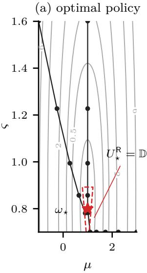

(b) Theorem 3  
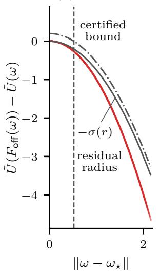

(c) Theorem 5  
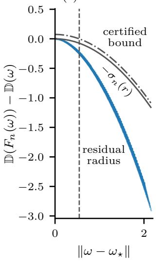

(d) dissimilarity to $\rho _ { \star }$  
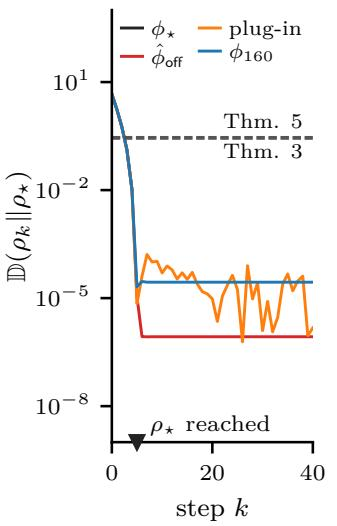  
Figure 6: Certificates in the example.

In Figure 6a and d, $\phi _ { \star }$ reaches $\rho _ { \star }$ in a few steps, and, as Table 4 shows, $\tilde { U }$ stays within the bounds of Lemma 2(iii), well below the upper one.

For Theorem $3 , e _ { f } , \Delta$ , and $\bar { r }$ shrink as the data grow; with the least data, some runs fail, so $\Delta = \infty$ and there is no certificate. In Figure 6b, the true decrease stays below the certified bound at every test point. The smallest residual is orders of magnitude below ${ \bar { \Delta } } ,$ , and the limit distance is far below r¯.

Since $\hat { \mathbf { a } } \neq \mathbf { a } _ { \star }$ , the ofset $\| F _ { \mathsf { o f f } } ( \omega _ { \star } ) - \omega _ { \star } \|$ is positive, so the fixed-point hypothesis of Theorem 3 fails; its proof, however, derives (21) without it. Every learned closed loop settles at a positive distance from $\omega _ { \star } ,$ so the asymptotic clauses of Theorems 3–5 do not apply, and $J ^ { \mathsf { R } }$ of Proposition 1 is infinite for the learned $\theta ;$ the example reflects the proposition through the decrease of $\boldsymbol { e } _ { f } .$

For Theorem 4, $\Delta _ { \mathsf { o n } }$ is small compared with $\bar { \Delta } _ { \mathsf { o f f } }$ , so the online residual set is barely larger than the ofline one. The estimation event holds in all but a few runs, consistent with $\alpha _ { \mathsf { o n } }$ , and every step of these runs satisfies (26). In Figure 6d, the plug-in closed loop stays far inside the residual set, although estimation noise keeps it farther from $\omega _ { \star }$ than the exact-parameter one.

For Theorem $5 , \bar { \Delta } _ { { \sf d e c } , n }$ and r¯ shrink as $N _ { n }$ grows. In Figure 6c, the true decrease stays below the certified bound. At equal numbers of transitions, the radius of Theorem 5 is smaller than that of Theorem 3 with little data and about equal to it with the most, although the learner of Theorem 5 uses more samples per step and the two certificates use diferent Lyapunov functions and margins. The uncapped estimate violates (32) in most runs with the least data and in few runs with the most, always at points well inside the residual set. From $N _ { n } = 2 0 0 \ \mathrm { o n }$ , the smallest residual of the deployed run comes from the plug-in steps, and both this residual and the run’s limit distance change little, whereas the limit distance over all runs keeps shrinking. The policy $\phi _ { n }$ settles far inside the residual set, although farther from $\omega _ { \star }$ than $\hat { \phi } _ { \mathrm { o f f } }$

## E Implementation Details

Figure 7 shows the closed loop of Section 4.5, and Table 6 lists the compared methods.

The regulated distribution $\rho _ { k }$ is the joint distribution of the forward velocity $v _ { k }$ and the torso pitch $\theta _ { k }$ , with marginals $\rho _ { k } ^ { v }$ and $\rho _ { k } ^ { \theta }$ . The parameterized family is a product of two uniform location-scale families,

$$
\begin{array} { r } { \rho _ { \omega } = U \big [ \mu ^ { v } - \sqrt { 3 } \varsigma ^ { v } , \mu ^ { v } + \sqrt { 3 } \varsigma ^ { v } \big ] \otimes U \big [ \mu ^ { \theta } - \sqrt { 3 } \varsigma ^ { \theta } , \mu ^ { \theta } + \sqrt { 3 } \varsigma ^ { \theta } \big ] , } \end{array}\tag{75}
$$

where $\boldsymbol { \omega } = ( \mu ^ { v } , \boldsymbol { \varsigma } ^ { v } , \mu ^ { \theta } , \boldsymbol { \varsigma } ^ { \theta } )$ collects the means and standard deviations of both features. Table 7 gives the target $\rho _ { \star } = \rho _ { \omega _ { \star } }$ , whose velocity marginal $\rho _ { \star } ^ { v }$ is supported on the velocity band $[ 0 . 7 0 v _ { \mathsf { l i m } } , 0 . 9 5 v _ { \mathsf { l i m } } ]$

The pitch target prescribes an upright torso, because the benchmark leaves the posture free and, without noise, a flipped gait has a wide velocity distribution, not concentrated in the velocity band, as Figure 3 shows. Figure 8 labels the torques $a _ { t , 1 } , \dotsc , a _ { t , 6 }$ at the hip, knee, and foot joints of the back and front legs and shows DMDP-Lag (PPO) on the left and a flipped run of SAC on the right, both at one step of a noise-free evaluation episode with seed 0. A run is flipped if more than half of its steps $k \geq 5 0 0$ have $| \theta _ { k } | > \pi / 2$ , as in the right panel; it is upright if its mean absolute pitch for $k \geq 5 0 0$ is at most 0.2 rad, and tilted otherwise.

The training dissimilarity sums the squared 2-Wasserstein distances of the marginals,

$$
\mathbb { D } ( \rho \| \rho _ { \star } ) = W _ { 2 } ^ { 2 } \big ( \rho ^ { v } , \rho _ { \star } ^ { v } \big ) + W _ { 2 } ^ { 2 } \big ( \rho ^ { \theta } , \rho _ { \star } ^ { \theta } \big ) , \qquad W _ { 2 } ^ { 2 } ( \rho , \widetilde { \rho } ) = \int _ { 0 } ^ { 1 } \big ( F ^ { - 1 } ( u ) - \widetilde { F } ^ { - 1 } ( u ) \big ) ^ { 2 } { \mathrm { d } } u ,\tag{76}
$$

where $F ^ { - 1 }$ and $\tilde { F } ^ { - 1 }$ are the quantile functions of $\rho$ and $\tilde { \rho }$ on the real line (Villani, 2009). It satisfies Definition 1 and, on the family $\rho _ { \omega }$ , vanishes only at $\omega _ { \star }$

The window dissimilarity is $\mathbb { D } _ { t } = \mathbb { D } ( \bar { \rho } _ { t } \| \rho _ { \star } )$ , with $\bar { \rho } _ { t }$ the empirical distribution of the true velocities and pitch angles of the last $n _ { \mathsf { w } }$ steps. The threshold reward is $r _ { t \mathbb { D } } = d \mathbf { 1 } [ \mathbb { D } _ { t } \leq \mathbb { D } _ { \mathbf { t h r } } ]$ with a positive threshold $\mathbb { D } _ { \mathtt { t h r } }$ because even a window drawn from $\rho _ { \star }$ has a positive dissimilarity. The penalty $\beta \mathbb { D } _ { t }$ gives a learning signal far from the target, where $r _ { t \mathbb { D } } = 0$ gives none.

Table 6: Compared methods.
<table><tr><td>Method</td><td>Policy input</td><td>Reward</td><td>Reward critic</td><td>Target</td></tr><tr><td>PPO / SAC</td><td> $\mathbf { o } _ { t }$ </td><td> $r _ { t } ^ { \mathsf { b } }$ </td><td>expected return</td><td></td></tr><tr><td>PPO-Lag / SAC-Lag</td><td> $\mathbf { o } _ { t }$ </td><td> $r _ { t } ^ { \mathrm { b } } - \lambda c _ { t }$ </td><td>expected return</td><td></td></tr><tr><td>Distributional PPO / SAC</td><td> $\mathbf { o } _ { t }$ </td><td> $r _ { t } ^ { \mathsf { b } }$ </td><td>32 quantiles of the return</td><td></td></tr><tr><td>Distributional PPO-Lag / SAC-Lag</td><td> $\mathbf { o } _ { t }$ </td><td> $r _ { t } ^ { \mathrm { b } } - \lambda c _ { t }$ </td><td>32 quantiles of the return</td><td></td></tr><tr><td>Implicit DMDP (PPO/SAC)</td><td> $\hat { \omega } _ { t }$  and  $\mathbf { o } _ { t }$ </td><td> $r _ { t } ^ { \mathsf { b } }$ </td><td>32 quantiles of the return</td><td></td></tr><tr><td>Implicit DMDP-Lag (PPO/SAC)</td><td> $\hat { \omega } _ { t }$  and  $\mathbf { o } _ { t }$ </td><td> $r _ { t } ^ { \mathrm { b } } - \lambda c _ { t }$ </td><td>32 quantiles of the return</td><td></td></tr><tr><td>DMDP (PPO/SAC)</td><td> $\hat { \omega } _ { t }$  and  $\mathbf { o } _ { t }$ </td><td> $r _ { t } ^ { \mathsf { b } } + r _ { t { \mathbb { D } } } - \beta \mathbb { D } _ { t }$ </td><td>expected return</td><td> $\rho _ { \star }$ </td></tr><tr><td>DMDP-Lag (PPO/SAC)</td><td> $\hat { \omega } _ { t }$  and  $\mathbf { o } _ { t }$ </td><td> $r _ { t } ^ { \mathsf { b } } + r _ { t { \mathbb { D } } } - \beta \mathbb { D } _ { t } - \lambda c _ { t }$ </td><td>expected return</td><td> $\rho _ { \star }$ </td></tr></table>

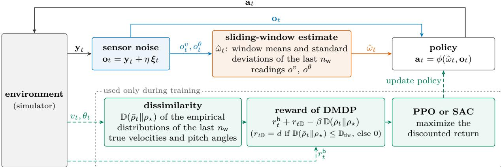  
Figure 7: Practical implementation of DMDP.

Table 7: Task.  
Environment SafetyHalfCheetahVelocity-v1 (Ji et al., 2023), MuJoCo (Todorov et al., 2012); H = 1000   
yt, at $\mathbf { y } _ { t } \in \mathring { \mathbb { R } } ^ { 1 7 } ; \mathbf { a } _ { t } \in [ - 1 , 1 ] ^ { 6 }$   
vt, θt torso velocity from s to s +1; torso pitch of $\mathbf { s } _ { t + 1 }$ in ( π, π]   
rbt , ct $v _ { t } - 0 . 1 \| \mathbf { a } _ { t } \| ^ { 2 } ; { \bf 1 } [ v _ { t } > v _ { \mathsf { l i m } } ] , v _ { \mathsf { l i m } } = 3 . 2 0 9 6$   
$\rho _ { \star }$ $U [ 0 . 7 0 \upsilon _ { \mathrm { l i m } } , 0 . 9 5 \upsilon _ { \mathrm { l i m } } ] \otimes U [ - 0 . 2 , 0 . 2 ] ; \omega _ { \star } \approx ( 2 . 6 5 , 0 . 2 3 , 0 , 0 . 1 2 )$   
ξt,i, η i.i.d. $\textstyle { \frac { 1 } { 2 } } { \mathcal { N } } ( - 0 . 8 , 0 . 6 ^ { 2 } ) + { \frac { 1 } { 2 } } { \mathcal { N } } ( 0 . 8 , 0 . 6 ^ { 2 } ) ;$ training: $\eta \sim U [ 0 , 0 . 3 ]$ per episode   
nw 10   
revat rbt + rtD if vt ≤ vlim; −vlim if vt > vlim

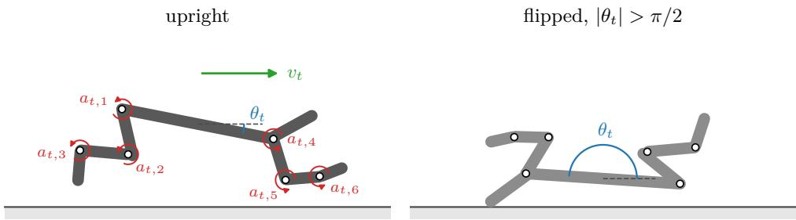  
Figure 8: The HalfCheetah robot.

The method-of-moments estimate $\hat { \omega } _ { t }$ replaces the maximum-likelihood step of Appendix C.1 and uses the entries $o _ { t } ^ { v }$ and $o _ { t } ^ { \theta }$ of $\mathbf { o } _ { t }$ , which read the instantaneous forward velocity and pitch angle at the start of step t. At the start of an episode, the window of $\hat { \omega } _ { t }$ is filled with the first reading, and that of $\bar { \rho } _ { t }$ holds only the steps so far.

Table 8 gives the hyperparameters.

Table 8: Hyperparameters.
<table><tr><td></td><td>PPO</td><td>SAC</td></tr><tr><td>Steps</td><td> $1 4 6 4 \times 8 \times 2 5 6 \approx 3 \cdot 1 0 ^ { 6 }$ </td><td> $1 0 ^ { 6 } ; 4$  envs; 1 update/step; 5000 random</td></tr><tr><td>Batches</td><td>10 epochs × 32 minibatches</td><td>buffer  $1 0 ^ { 6 } ;$  minibatch 256</td></tr><tr><td>Networks</td><td> $2 \times 6 4 , \mathrm { t a n h } ;$  normalized inputs</td><td> $2 \times 2 5 6 , \mathrm { R e L U }$ </td></tr><tr><td>Policy</td><td> $\mathrm { G a u s s i a n } , \log \sigma _ { 0 } = - 1$ </td><td>tanh-Gaussian, log  $\sigma \in [ - 5 , 2 ]$ </td></tr><tr><td>Critics</td><td> $V _ { r } , V _ { c } ; \mathrm { G A E } ^ { \mathrm { - } } 0 . 9 5$  (Schulman et al., 2016)</td><td> $Q 1 , Q _ { 2 } , Q _ { c } ; \mathrm { P o l y a k ~ 0 . 0 0 5 }$ </td></tr><tr><td>Actor</td><td> $\frac { \hat { A } _ { t } ^ { r } - \lambda \hat { A } _ { t } ^ { c } } { 1 + \lambda }$  clip 0.2 on (Schulman et al., 2017; Ray et al., 2019)</td><td> ${ \frac { \alpha \log \pi - \operatorname * { m i n } _ { i } Q _ { i } + \lambda Q _ { c } } { 1 + \lambda } } { \mathrm { ~ ( H a ~ e t ~ a l . , ~ } } 2 0 2 1 { \mathrm { ) } }$ </td></tr><tr><td>Coefficients</td><td>entropy 0; value 0.5; grad. norm 0.5</td><td> $\alpha _ { 0 } = 1 ; \mathrm { t a r g e t ~ e n t r o p y ~ } { - 6 }$ </td></tr><tr><td>Learning rate</td><td> $\mathrm { A d a m } , 3 \times 1 0 ^ { - 4 }$  , linear decay</td><td> $\mathrm { A d a m } , 3 \times 1 0 ^ { - 4 }$ </td></tr><tr><td>λ update</td><td>per update;  ${ \hat { J } } _ { c } \mathbf { : }$  32 episodes</td><td>per 2048 steps;  ${ \hat { J } } _ { c } \mathbf { : }$  16 episodes</td></tr><tr><td>Quantile critic</td><td> $V _ { r } ;$  quantile Huber, κ = 1 (Dabney et al., 2018b)</td><td> $Q _ { 1 } , Q _ { 2 } ;$  quantile Huber, κ = 1</td></tr><tr><td></td><td>PPO and SAC</td><td></td></tr><tr><td></td><td colspan="2"></td></tr><tr><td>γ Reward scale</td><td colspan="2">0.99; bootstrap at truncation (Pardo et al., 2018)  $[ - 1 0 , 1 0 ]$ </td></tr><tr><td> $\lambda$ </td><td colspan="2">÷ running std. of the discounted return; clip</td></tr><tr><td> $\beta , d , \mathbb { D } _ { \mathsf { t h r } } , \bar { c }$ </td><td colspan="2">Adam (0.035) on-  $- \lambda ( \hat { J } _ { c } - \bar { c } ) ; \lambda \ge 0$  0.5, 10, 0.1, 10</td></tr><tr><td>Pilot</td><td colspan="2">PPO, other seeds,  ${ \mathbb D } _ { \mathsf { t h r } } = 0 . 1 4 \colon \beta \in \{ 0 . 5 , 1 , 2 \} , \bar { c } \in \{ 1 0 , 5 , 2 . 5 \}$ </td></tr></table>

## F Additional Results

This appendix contains additional results with SAC and all results with PPO. Unless stated otherwise, values and curves are means over the five seeds, and ± values and bands are standard errors. A diference between two methods is clear if it exceeds the larger of their two standard errors; otherwise, it is within the seed variation. The end-of-training values use the training episodes of the last 10% of the steps, with stochastic actions, and the evaluation values use the deterministic evaluation episodes at the stated noise level. The 10–90% range of R is the diference between the 10th and 90th percentiles of $R$ pooled over the seeds, and the line $k _ { 0 }$ in the stability curves marks k = 500.

## F.1 Additional Results with SAC

Figure 9 shows the training curves discussed in Section 5.1.

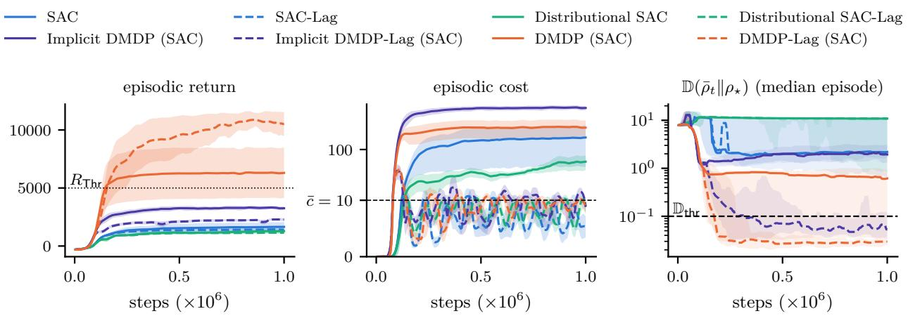  
Figure 9: Training curves with SAC.

Table 9 shows that sensor noise shifts the stable distributions of all methods, the more so the larger $\eta .$ The shift is the 1-Wasserstein distance $\mathbb { D } ( \hat { \rho } _ { \eta } \lVert \hat { \rho } _ { 0 } )$ between the stable velocity distribution $\hat { \rho } _ { \eta }$ at noise level η and the noise-free one ${ \hat { \rho } } _ { 0 } .$ . Distributional SAC-Lag, four of whose runs are flipped, shifts the least, together with DMDP-Lag (SAC) at $\eta = 0 . 1 ;$ up to $\eta = 0 . 4$ , the shift of DMDP-Lag (SAC) stays within its seed variation of the smallest shift. Implicit DMDP (SAC) shifts clearly the most at every noise level.

Table 9: Shift of the stable distribution under sensor noise with SAC.
<table><tr><td></td><td colspan="5"> $\mathbb { D } ( \hat { \rho } _ { \eta } \lVert \hat { \rho } _ { 0 } ) \ d$ </td></tr><tr><td>Method</td><td> $\eta = 0 . 1$ </td><td> $\eta = 0 . 2$ </td><td> $\eta = 0 . 3$ </td><td> $\eta = 0 . 4$ </td><td> $\eta = 0 . 5$ </td></tr><tr><td>SAC</td><td> $0 . 0 4 \pm 0 . 0 1$ </td><td> $0 . 1 2 \pm 0 . 0 3$ </td><td> $0 . 2 1 \pm 0 . 0 3$ </td><td> $0 . 4 8 \pm 0 . 1 3$ </td><td> $0 . 8 0 \pm 0 . 2 6$ </td></tr><tr><td>SAC-Lag</td><td> $0 . 0 4 \pm 0 . 0 2$ </td><td> $0 . 1 1 \pm 0 . 0 3$ </td><td> $0 . 2 1 \pm 0 . 0 6$ </td><td> $0 . 3 7 \pm 0 . 0 8$ </td><td> $0 . 5 7 \pm 0 . 1 1$ </td></tr><tr><td>Distributional SAC</td><td> $0 . 0 5 \pm 0 . 0 2$ </td><td> $0 . 1 3 \pm 0 . 0 5$ </td><td> $0 . 2 8 \pm 0 . 1 1$ </td><td> $0 . 4 0 \pm 0 . 1 5$ </td><td> $0 . 5 6 \pm 0 . 1 9$ </td></tr><tr><td>Distributional SAC-Lag</td><td> $\mathbf { 0 . 0 3 \pm 0 . 0 1 }$ </td><td> ${ \bf 0 . 0 9 \pm 0 . 0 3 }$ </td><td> $\mathbf { 0 . 1 7 \pm 0 . 0 5 }$ </td><td> ${ \bf 0 . 2 7 \pm 0 . 0 8 }$ </td><td> ${ \bf 0 . 3 9 \pm 0 . 1 0 }$ </td></tr><tr><td>Implicit DMDP (SAC)</td><td> $0 . 2 0 \pm 0 . 0 7$ </td><td> $0 . 5 2 \pm 0 . 1 5$ </td><td> $0 . 8 9 \pm 0 . 1 9$ </td><td> $1 . 3 7 \pm 0 . 2 2$ </td><td> $2 . 1 0 \pm 0 . 1 6$ </td></tr><tr><td>Implicit DMDP-Lag (SAC)</td><td> $0 . 0 9 \pm 0 . 0 1$ </td><td> $0 . 2 1 \pm 0 . 0 3$ </td><td> $0 . 3 5 \pm 0 . 0 5$ </td><td> $0 . 5 5 \pm 0 . 0 8$ </td><td> $0 . 8 5 \pm 0 . 1 0$ </td></tr><tr><td>DMDP (SAC)</td><td> $0 . 0 6 \pm 0 . 0 3$ </td><td> $0 . 2 4 \pm 0 . 0 9$ </td><td> $0 . 4 8 \pm 0 . 1 7$ </td><td> $0 . 7 0 \pm 0 . 2 3$ </td><td> $0 . 9 9 \pm 0 . 2 5$ </td></tr><tr><td>DMDP-Lag (SAC)</td><td> $\mathbf { 0 . 0 3 \pm 0 . 0 1 }$ </td><td> $0 . 1 2 \pm 0 . 0 7$ </td><td> $0 . 2 5 \pm 0 . 1 3$ </td><td> $0 . 4 1 \pm 0 . 1 6$ </td><td> $0 . 6 5 \pm 0 . 1 7$ </td></tr></table>

## F.2 Results with PPO

The PPO results have the format of Section 5.1. Each logged training value averages the 32 (PPO) or 16 (SAC) most recently completed training episodes, and the curves of Figures 9 and 11 are smoothed over 10 logged values; their window-dissimilarity panels show the median and interquartile range, over the recent episodes of all five seeds, of the per-episode median of $\mathbb { D } _ { t }$ . Figures 3 and 10 pool $v _ { k }$ for $k \geq 5 0 0$ without noise over all evaluation episodes and seeds, with the horizontal axis ending at $v = 6 .$ , and Figures 4 and 12 average the stability distance over 10 consecutive steps.

The stability distance compares estimates of $\rho _ { k }$ and $\hat { \rho }$ from diferent halves of the evaluation episodes and is averaged over both assignments of the halves. The stationary reference value is the mean stability distance for $k \geq 5 0 0$ of 10 surrogates with independent random circular shifts of the segment $k \geq 5 0 0$ of every episode. The ratio of the stability distance to this value is near 1 for a stationary $\rho _ { k }$ and well above 1 if $\rho _ { k }$ drifts or the run is synchronized. A run is synchronized, i.e., its episodes keep a common phase, if the standard deviation over $k \geq 5 0 0$ of the mean velocity across its episodes exceeds twice the standard error of a mean of 64 independent velocities.

In Table 10, the ratio is close to 1 for every method of both learners from η = 0.4 on, and with SAC from $\eta = 0 . 2 \ \mathrm { o n }$ , except for Implicit DMDP (SAC) and DMDP (SAC), which remain well above 1 at $\eta = 0 . 2$ Without noise, 10 of the 40 runs with PPO and 21 of the 40 runs with SAC, including all five runs of DMDP (SAC), are synchronized, so their $\rho _ { k }$ oscillates and their episodes difer only in their initial states; at $\eta = 0 . 1$ 14 of the 21 synchronized runs with SAC stay synchronized.

Table 11 shows that, without noise, DMDP-Lag (PPO) is the best of all methods with PPO: its stable distribution is clearly the closest to the target, and it has the highest evaluation return and the largest fraction of steps with $\mathbb { D } _ { t } \leq \mathbb { D } _ { \mathsf { t h r } }$ , within the seed variation of PPO-Lag in the return and of PPO-Lag and DMDP (PPO) in the fraction. At $\eta = 0 . 2$ , Distributional PPO-Lag leads in these three columns, with PPO-Lag and DMDP (PPO) within its seed variation in the target distance and DMDP-Lag (PPO) clearly farther; its return and fraction lie within the seed variation of those of the DMDP methods and the other two constrained baselines. The cost constraint brings every baseline clearly closer to the target at both noise levels, and DMDP (PPO) is within the seed variation of the constrained baselines even without it.

At both noise levels, the unconstrained baselines spend many steps above $v _ { \mathsf { I i m } } ,$ , as their costs show, so their evaluation returns are negative and clearly below that of DMDP (PPO), whose cost is clearly lower than theirs but well above c¯. Without noise, the costs of the -Lag methods lie below c¯ and within the seed variation of one another, the lowest being that of PPO-Lag; at $\eta = 0 . 2$ , Implicit DMDP-Lag (PPO) has the lowest cost of all methods, whereas DMDP-Lag (PPO) exceeds c¯, clearly above the constrained baselines.

Feeding back $\hat { \omega } _ { t }$ without $\rho _ { \star }$ clearly lowers the cost at $\eta = 0 . 2 .$ , with and without the cost constraint, but does not bring the stable distribution closer to the target. Knowing $\rho _ { \star }$ does: DMDP (PPO) is clearly closer than Implicit DMDP (PPO) at both noise levels, and DMDP-Lag (PPO) than Implicit DMDP-Lag (PPO) without noise.

Table 10: Ratio to the stationary reference value.
<table><tr><td>Method</td><td>η = 0</td><td> $\eta = 0 . 1$ </td><td> $\eta = 0 . 2$ </td><td>η = 0.3</td><td> $\eta = 0 . 4$ </td><td> $\eta = 0 . 5$ </td></tr><tr><td colspan="7">with PPO</td></tr><tr><td>PPO</td><td>1.32</td><td>1.05</td><td>1.12</td><td>1.05</td><td>1.00</td><td>1.02</td></tr><tr><td>PPO-Lag</td><td>1.62</td><td>1.26</td><td>1.04</td><td>1.05</td><td>1.02</td><td>1.00</td></tr><tr><td>Distributional PPO</td><td>1.10</td><td>1.03</td><td>1.04</td><td>1.07</td><td>1.04</td><td>1.03</td></tr><tr><td>Distributional PPO-Lag</td><td>1.27</td><td>1.05</td><td>1.04</td><td>1.05</td><td>1.04</td><td>1.04</td></tr><tr><td>Implicit DMDP (PPO)</td><td>1.37</td><td>1.32</td><td>1.10</td><td>1.09</td><td>1.03</td><td>1.06</td></tr><tr><td>Implicit DMDP-Lag (PPO)</td><td>1.29</td><td>1.04</td><td>1.07</td><td>1.11</td><td>1.05</td><td>1.00</td></tr><tr><td>DMDP (PPO)</td><td>1.06</td><td>1.03</td><td>1.00</td><td>1.04</td><td>1.01</td><td>1.00</td></tr><tr><td>DMDP-Lag (PPO)</td><td>1.23</td><td>1.01</td><td>1.05</td><td>1.04</td><td>1.03</td><td>1.01</td></tr><tr><td colspan="7">with SAC</td></tr><tr><td>SAC</td><td>1.43</td><td>1.16</td><td>0.92</td><td>1.07</td><td>1.02</td><td>0.98</td></tr><tr><td>SAC-Lag</td><td>1.13</td><td>1.04</td><td>1.06</td><td>0.99</td><td>0.96</td><td>0.97</td></tr><tr><td>Distributional SAC</td><td>1.11</td><td>1.08</td><td>0.92</td><td>1.02</td><td>1.07</td><td>1.00</td></tr><tr><td>Distributional SAC-Lag</td><td>1.29</td><td>1.14</td><td>1.05</td><td>0.95</td><td>0.96</td><td>1.00</td></tr><tr><td>Implicit DMDP (SAC)</td><td>2.58</td><td>2.46</td><td>1.88</td><td>1.31</td><td>1.02</td><td>1.00</td></tr><tr><td>Implicit DMDP-Lag (SAC)</td><td>1.15</td><td>1.13</td><td>1.03</td><td>0.99</td><td>1.00</td><td>1.00</td></tr><tr><td>DMDP (SAC)</td><td>3.79</td><td>3.60</td><td>2.40</td><td>1.11</td><td>0.96</td><td>0.97</td></tr><tr><td>DMDP-Lag (SAC)</td><td>1.70</td><td>1.40</td><td>1.01</td><td>0.99</td><td>1.00</td><td>1.02</td></tr></table>

Table 11: Evaluation results with PPO.
<table><tr><td>Method</td><td></td><td>return  $r _ { t } ^ { \mathsf { e v a } } \uparrow$ </td><td> $\cos t \downarrow$ </td><td> $\mathbb { D } ( \boldsymbol { \rho } _ { k } \| \boldsymbol { \hat { \rho } } )$   $k < 2 0 0 \downarrow$ </td><td> $\mathbb { D } ( \rho _ { k } \| \hat { \rho } )$   $k \geq 5 0 0 \downarrow$ </td><td> $\mathbb { D } ( \hat { \rho } \Vert \rho _ { \star } ^ { v } )$  ↓</td><td> $\mathbb { P } [ \mathbb { D } ( \bar { \rho } _ { t } \| \rho _ { \star } )$   $\leq \mathbb { D } _ { \mathsf { t h r l } } \uparrow$ </td></tr><tr><td rowspan="2">PPO</td><td>η 0</td><td> $- 2 2 0 7 \pm 4 6 8$ </td><td> $7 8 8 . 2 \pm 9 3 . 6 $ </td><td> $0 . 9 2 \pm 0 . 0 7$ </td><td> $0 . 3 5 5 \pm 0 . 1 1 3$ </td><td> $1 . 8 6 \pm 0 . 3 2$ </td><td> $0 . 0 0 \pm 0 . 0 0$ </td></tr><tr><td>0.2</td><td> $- 4 5 4 \pm 4 4 5$ </td><td> $3 9 7 . 7 \pm 1 0 9 . 9$ </td><td> $0 . 9 2 \pm 0 . 1 9$ </td><td> $0 . 3 3 1 \pm 0 . 0 3 3$ </td><td> $1 . 3 3 \pm 0 . 2 4$ </td><td> $0 . 0 1 \pm 0 . 0 0$ </td></tr><tr><td rowspan="2">PPO-Lag</td><td>0</td><td> $9 8 5 6 \pm 1 9 6 6$ </td><td> ${ \bf 1 . 9 \pm 1 . 4 }$ </td><td> $0 . 4 9 \pm 0 . 0 3$ </td><td> $0 . 1 7 4 \pm 0 . 0 5 5$ </td><td> $0 . 2 1 \pm 0 . 0 2$ </td><td> $0 . 7 8 \pm 0 . 1 9$ </td></tr><tr><td>0.2</td><td> $6 1 2 2 \pm 1 3 4 0$ </td><td> $1 0 . 0 \pm 2 . 2$ </td><td> $\mathbf { 0 . 4 6 \pm 0 . 0 3 }$ </td><td> $0 . 2 0 5 \pm 0 . 0 5 8$ </td><td> $0 . 5 2 \pm 0 . 1 3$ </td><td> $0 . 4 5 \pm 0 . 1 3$ </td></tr><tr><td rowspan="2">Distributional PPO</td><td></td><td> $- 2 2 9 3 \pm 5 5 0$ </td><td> $8 1 3 . 5 \pm 1 1 3 . 6$ </td><td> $1 . 0 8 \pm 0 . 1 3$ </td><td></td><td></td><td> $0 . 0 0 \pm 0 . 0 0$ </td></tr><tr><td>0 0.2</td><td> $- 8 9 8 \pm 4 5 0$ </td><td> $4 4 8 . 4 \pm 1 0 6 . 1$ </td><td> $1 . 2 9 \pm 0 . 2 1$ </td><td> $0 . 2 9 3 \pm 0 . 0 3 8$   $0 . 5 0 4 \pm 0 . 0 4 4$ </td><td> $1 . 9 3 \pm 0 . 2 9$   $1 . 6 8 \pm 0 . 1 8$ </td><td> $0 . 0 0 \pm 0 . 0 0$ </td></tr><tr><td rowspan="2">Distributional PPO-Lag</td><td></td><td></td><td> $3 . 6 \pm 2 . 9$ </td><td></td><td></td><td></td><td> $0 . 6 7 \pm 0 . 2 0$ </td></tr><tr><td>0 0.2</td><td> $9 0 5 5 \pm 1 8 0 3$   $\mathbf { 6 9 2 6 \pm 1 1 6 0 }$ </td><td> $1 1 . 7 \pm 1 . 7$ </td><td> ${ \bf 0 . 4 2 \pm 0 . 0 4 }$   $0 . 4 8 \pm 0 . 0 5$ </td><td> $0 . 0 8 7 \pm 0 . 0 2 5$   $\mathbf { 0 . 1 3 7 \pm 0 . 0 1 0 }$ </td><td> $0 . 2 4 \pm 0 . 0 4$   ${ \bf 0 . 4 7 \pm 0 . 1 7 }$ </td><td> ${ \bf 0 . 5 0 \pm 0 . 1 2 }$ </td></tr><tr><td rowspan="2">Implicit DMDP (PPO)</td><td></td><td></td><td></td><td></td><td></td><td></td><td></td></tr><tr><td>0 0.2</td><td> $- 2 5 6 3 \pm 3 0$   $- 2 2 5 \pm 4 1 6$ </td><td> $8 6 4 . 3 \pm 4 . 7$   $3 0 9 . 3 \pm 4 7 . 2$ </td><td> $1 . 3 2 \pm 0 . 0 8$   $1 . 4 1 \pm 0 . 1 8$ </td><td> $0 . 5 6 4 \pm 0 . 1 1 7$ </td><td> $2 . 1 9 \pm 0 . 0 8$ </td><td> $0 . 0 0 \pm 0 . 0 0$   $0 . 0 0 \pm 0 . 0 0$ </td></tr><tr><td rowspan="2">Implicit DMDP-Lag (PPO)</td><td></td><td></td><td></td><td></td><td> $0 . 5 0 7 \pm 0 . 0 5 1$ </td><td> $1 . 6 8 \pm 0 . 1 5$ </td><td></td></tr><tr><td>0 0.2</td><td> $7 8 4 1 \pm 2 0 4 4$ </td><td> $2 . 0 \pm 1 . 8$   ${ \bf 9 . 1 \pm 1 . 1 }$ </td><td> $0 . 4 5 \pm 0 . 0 5$ </td><td> $\mathbf { 0 . 0 7 5 \pm 0 . 0 3 1 }$ </td><td> $0 . 3 2 \pm 0 . 0 7$ </td><td> $0 . 5 5 \pm 0 . 2 3$ </td></tr><tr><td rowspan="2">DMDP (PPO)</td><td></td><td> $5 9 2 9 \pm 1 2 4 0$ </td><td></td><td> $0 . 5 4 \pm 0 . 0 8$ </td><td> $0 . 1 4 7 \pm 0 . 0 4 2$ </td><td> $0 . 7 9 \pm 0 . 2 8$ </td><td> $0 . 4 2 \pm 0 . 1 1$ </td></tr><tr><td>0</td><td> $8 7 3 0 \pm 2 3 2 6$ </td><td> $1 2 2 . 4 \pm 8 3 . 3$   $7 5 . 0 \pm 3 0 . 9$ </td><td> $0 . 5 1 \pm 0 . 0 6$ </td><td> $0 . 1 3 5 \pm 0 . 0 4 5$ </td><td> $0 . 3 0 \pm 0 . 1 7$ </td><td> $0 . 7 8 \pm 0 . 2 0$ </td></tr><tr><td rowspan="2">DMDP-Lag (PPO)</td><td>0.2</td><td> $5 6 5 5 \pm 1 6 7 7$ </td><td></td><td> $0 . 5 1 \pm 0 . 0 2$ </td><td> $0 . 2 1 2 \pm 0 . 0 1 6$ </td><td> $0 . 6 0 \pm 0 . 1 2$ </td><td> $0 . 4 6 \pm 0 . 1 6$ </td></tr><tr><td>0 0.2</td><td> $\mathbf { 1 1 4 1 7 \pm 3 5 0 }$   $6 0 2 1 \pm 7 0 8$ </td><td> $4 . 0 \pm 3 . 2$   $1 6 . 2 \pm 3 . 7$ </td><td> $0 . 5 3 \pm 0 . 0 6$   $0 . 5 2 \pm 0 . 0 2$ </td><td> $0 . 1 2 5 \pm 0 . 0 4 2$   $0 . 2 1 3 \pm 0 . 0 1 4$ </td><td> ${ \bf 0 . 1 3 \pm 0 . 0 5 }$   $0 . 6 6 \pm 0 . 0 8$ </td><td> ${ \bf 0 . 9 7 \pm 0 . 0 2 }$   $0 . 4 6 \pm 0 . 0 7$ </td></tr></table>

Without noise, every run of DMDP (PPO) is upright, although its run with seed 2 never stays in the velocity band; one run of DMDP-Lag (PPO) is tilted. $\mathrm { A t } \ \eta = 0 . 2$ , each unconstrained baseline has one flipped run, whereas the DMDP methods and the constrained baselines have none.

In Figure 10, the unconstrained baselines run mostly above $v _ { \mathsf { I i m } } .$ , the distributions of the constrained baselines peak at the upper edge of the velocity band, just below $v _ { \mathsf { I i m } } ,$ and those of the DMDP methods lie mostly within and spread over the band, with a small tail above $v _ { \parallel \mathsf { m } }$ for DMDP (PPO).

In Figure 11, the returns of the DMDP methods rise above $R _ { \mathsf { T h r } }$ within the first $1 0 ^ { 6 }$ training steps and remain there, whereas those of the baselines stay far below it. In the second half of training, the costs of the constrained baselines and DMDP-Lag (PPO) stay near ${ \bar { c } } ,$ those of the unconstrained baselines far above it, and that of DMDP (PPO) in between, well above $\bar { c } ;$ in this period, the median window dissimilarities of the DMDP methods lie lowest, below $\mathbb { D } _ { \mathtt { t h r } }$ , closely followed by that of Distributional PPO-Lag, whereas those of the unconstrained baselines stay more than an order of magnitude above it.

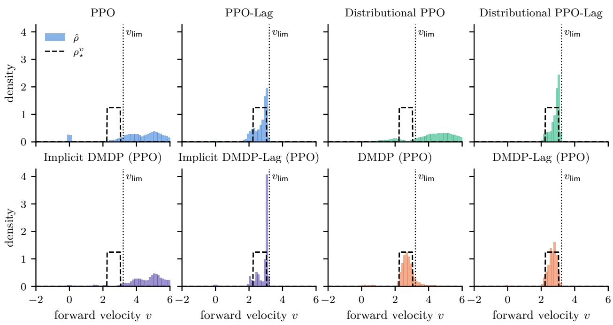  
Figure 10: Stable velocity distributions with PPO.

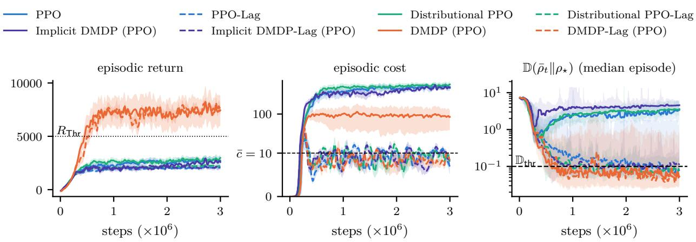  
Figure 11: Training curves with PPO.

In Figure 12, the stability distance of every method drops by about an order of magnitude within 100 steps without noise; that of Distributional PPO then keeps decreasing over several hundred steps, whereas the others change much less. In Table 11, Distributional PPO-Lag and Implicit DMDP-Lag (PPO) have the smallest stability distances for $k \geq 5 0 0$ at both noise levels, within the seed variation of each other, and DMDP (PPO) has a clearly smaller one than the unconstrained baselines.

In Table 12, DMDP-Lag (PPO) reaches $R _ { \mathsf { T h r } }$ most often of all methods at the end of training and in the evaluation at both noise levels, within the seed variation of DMDP (PPO), and both reach it clearly more often than the baselines. In each case, a DMDP method has the widest 10–90% range of R.

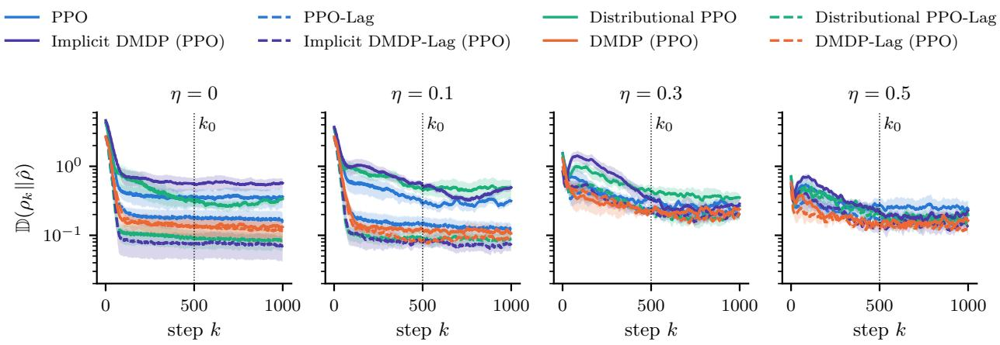  
Figure 12: Stability curves with PPO.

Table 12: Reliability of the return with PPO.
<table><tr><td></td><td colspan="2">end of training</td><td colspan="2">evaluation,  $\eta = 0$ </td><td colspan="2">evaluation,  $\eta = 0 . 2$ </td></tr><tr><td>Method</td><td> $\mathbb { P } [ R \ge R _ { \mathsf { T h r } } ]$ </td><td>↑ 10–90% range ↓</td><td> $\mathbb { P } [ R \geq R _ { \mathsf { T h r } } ]$ </td><td>↑ 10–90% range ↓</td><td> $\mathbb { P } [ R \ge R _ { \mathsf { T h r } } ] $ </td><td>10–90% range ↓</td></tr><tr><td>PPO</td><td> $0 . 0 0 \pm 0 . 0 0$ </td><td>3653</td><td> $0 . 0 0 \pm 0 . 0 0$ </td><td>2150</td><td> $0 . 0 0 \pm 0 . 0 0$ </td><td>2828</td></tr><tr><td>PPO-Lag</td><td> $0 . 0 0 \pm 0 . 0 0$ </td><td>1402</td><td> $0 . 0 0 \pm 0 . 0 0$ </td><td>592</td><td> $0 . 0 0 \pm 0 . 0 0$ </td><td>1129</td></tr><tr><td>Distributional PPO</td><td> $0 . 0 0 \pm 0 . 0 0$ </td><td>3846</td><td> $0 . 0 0 \pm 0 . 0 0$ </td><td>2437</td><td> $0 . 0 0 \pm 0 . 0 0$ </td><td>3249</td></tr><tr><td>Distributional PPO-Lag</td><td> $0 . 0 0 \pm 0 . 0 0$ </td><td>1535</td><td> $0 . 0 0 \pm 0 . 0 0$ </td><td>383</td><td> $0 . 0 0 \pm 0 . 0 0$ </td><td>1496</td></tr><tr><td>Implicit DMDP (PPO)</td><td> $0 . 0 0 \pm 0 . 0 0$ </td><td>3795</td><td> $0 . 0 2 \pm 0 . 0 2$ </td><td>753</td><td> $0 . 0 0 \pm 0 . 0 0$ </td><td>3140</td></tr><tr><td>Implicit DMDP-Lag (PPO)</td><td> $0 . 0 0 \pm 0 . 0 0$ </td><td>2182</td><td> $0 . 0 0 \pm 0 . 0 0$ </td><td>437</td><td> $0 . 0 0 \pm 0 . 0 0$ </td><td>2091</td></tr><tr><td>DMDP (PPO)</td><td> $0 . 6 3 \pm 0 . 1 7$ </td><td>10410</td><td> $0 . 7 8 \pm 0 . 2 0$ </td><td>9003</td><td> $0 . 5 5 \pm 0 . 2 1$ </td><td>9032</td></tr><tr><td>DMDP-Lag (PPO)</td><td> ${ \bf 0 . 6 8 \pm 0 . 0 5 }$ </td><td>10691</td><td> ${ \bf 0 . 9 7 \pm 0 . 0 2 }$ </td><td>691</td><td> ${ \bf 0 . 6 6 \pm 0 . 1 4 }$ </td><td>6713</td></tr></table>

In Table 13, sensor noise shifts the stable distributions of all methods, the more so the larger $\eta .$ At every noise level, $\mathrm { P P O - L a g }$ shifts the least, and DMDP (PPO) is within its seed variation; the two DMDP methods shift within the seed variation of each other.

Table 13: Shift of the stable distribution under sensor noise with PPO.
<table><tr><td></td><td colspan="5"> $\mathbb { D } ( \hat { \rho } _ { \eta } \lVert \hat { \rho } _ { 0 } ) \ d$ </td></tr><tr><td>Method</td><td> $\eta = 0 . 1$ </td><td> $\eta = 0 . 2$ </td><td> $\eta = 0 . 3$ </td><td> $\eta = 0 . 4$ </td><td> $\eta = 0 . 5$ </td></tr><tr><td>PPO</td><td> $0 . 5 8 \pm 0 . 1 2$ </td><td> $1 . 8 5 \pm 0 . 2 0$ </td><td> $2 . 7 1 \pm 0 . 2 1$ </td><td> $3 . 2 3 \pm 0 . 2 9$ </td><td> $3 . 5 6 \pm 0 . 3 7$ </td></tr><tr><td>PPO-Lag</td><td> $\mathbf { 0 . 0 9 \pm 0 . 0 1 }$ </td><td> ${ \bf 0 . 5 3 \pm 0 . 1 0 }$ </td><td> ${ \bf 1 . 3 2 \pm 0 . 1 9 }$ </td><td> ${ \bf 1 . 8 2 \pm 0 . 2 0 }$ </td><td> ${ \bf 2 . 0 5 \pm 0 . 1 4 }$ </td></tr><tr><td>Distributional PPO</td><td> $0 . 9 5 \pm 0 . 2 7$ </td><td> $2 . 1 5 \pm 0 . 5 9$ </td><td> $2 . 9 4 \pm 0 . 5 2$ </td><td> $3 . 4 6 \pm 0 . 4 8$ </td><td> $3 . 7 0 \pm 0 . 4 7$ </td></tr><tr><td>Distributional PPO-Lag</td><td> $0 . 1 2 \pm 0 . 0 6$ </td><td> $0 . 5 7 \pm 0 . 1 8$ </td><td> $1 . 4 2 \pm 0 . 1 8$ </td><td> $2 . 1 1 \pm 0 . 1 1$ </td><td> $2 . 3 4 \pm 0 . 0 8$ </td></tr><tr><td>Implicit DMDP (PPO)</td><td> $0 . 9 4 \pm 0 . 3 2$ </td><td> $2 . 9 6 \pm 0 . 0 6$ </td><td> $3 . 8 2 \pm 0 . 1 8$ </td><td> $3 . 9 6 \pm 0 . 2 0$ </td><td> $4 . 1 2 \pm 0 . 1 7$ </td></tr><tr><td>Implicit DMDP-Lag (PPO)</td><td> $0 . 1 2 \pm 0 . 0 2$ </td><td> $0 . 7 8 \pm 0 . 2 4$ </td><td> $1 . 5 1 \pm 0 . 2 5$ </td><td> $2 . 1 2 \pm 0 . 1 0$ </td><td> $2 . 2 7 \pm 0 . 1 1$ </td></tr><tr><td>DMDP (PPO)</td><td> $0 . 1 2 \pm 0 . 0 4$ </td><td> $0 . 6 0 \pm 0 . 1 0$ </td><td> $1 . 4 6 \pm 0 . 1 9$ </td><td> $1 . 9 8 \pm 0 . 1 3$ </td><td> $2 . 1 8 \pm 0 . 0 8$ </td></tr><tr><td> $\mathrm { { D M D P - L a g } \left( P P O \right) }$ </td><td> $0 . 1 1 \pm 0 . 0 2$ </td><td>0.64 ± 0.06</td><td>1.64 ± 0.15</td><td> $2 . 0 3 \pm 0 . 0 9$ </td><td> $2 . 2 2 \pm 0 . 0 7$ </td></tr></table>