# EPIC: Rethinking Trust Regions for Autoregressive LLM Policies via Exact-KL Prefix Importance-Ratio Clipping

Chengxi Li<sup>∗,2,3</sup>, Hanlin Wu<sup>∗,‡,1,2</sup>, Zhicheng Cai<sup>1,2,3</sup>, Huan-ang Gao<sup>1,2,3</sup>, Wei-Ying Ma<sup>1,2</sup>, Jingjing Liu<sup>1,2</sup>, Hao Zhou<sup>†,1,2</sup>

<sup>1</sup>SIA-Lab of Tsinghua AIR and ByteDance Seed <sup>2</sup>Institute for AI Industry Research (AIR), Tsinghua University <sup>3</sup>Department of Computer Science and Technology, Tsinghua University

## Abstract

Reinforcement learning (RL) based on PPO-style clipping has become an efective approach to improving the reasoning capabilities of large language models (LLMs). However, standard tokenlevel clipping measures policy change only through the conditional probability of the current token, while the prefix conditioning context is itself generated by the policy. This mismatch becomes especially consequential in long-response and of-policy training. We reformulate autoregressive generation as a finite-horizon Markov decision process and derive its performance-diference identity under behavior-policy sampling. The resulting change of measure identifies the cumulative likelihood ratio of the generated prefix as the exact importance weight for each stepwise policy-improvement term. Starting from the monotonic-improvement principle of trust-region policy optimization, we then construct a prefix-level trust region using the exact reverse-KL coordinate r − 1 − log r, whose behavior-policy expectation equals the corresponding prefix-distribution KL divergence. This yields EPIC, a PPO-style sequence-clipping method that directly regulates prefix-level policy drift without relying on a local quadratic approximation or expert-routing replay. Experiments on of-policy reinforcement learning with a sparse mixture-of-experts language model show that EPIC consistently outperforms standard and sequence-level clipping baselines across mathematicalreasoning benchmarks, while remaining competitive with routing-replay-based alternatives. Code is available at https://github.com/LiChengxi666/EPIC.

## 1 Introduction

Reinforcement learning with verifiable rewards (RLVR) has become a central component of large language model (LLM) post-training, driving substantial advances in reasoning and coding capabilities [1–4]. In throughput-oriented modern LLM RL pipelines such as slime [5] and verl [6], fully asynchronous rollout generation and policy optimization [7], together with diferences in kernel implementations between inference and training engines [8], inevitably introduce distributional mismatch that precludes strictly on-policy training. PPO-style clipping [9] is widely adopted to stabilize RL training by discarding gradient contributions associated with large deviations in current-to-behavior probability ratios, which serve as a proxy for policy divergence.

However, even among recently released large-scale models, the appropriate clipping mechanism and granularity for autoregressive LLMs remain unsettled: For example, Ling-2.6 [10], Qwen-AgentWorld [11], and Harvey Tenet [12] adopt sequence-level clipping through GSPO, whereas DeepSeek-V4 [13] and GLM-5 [14] continue to use token-level clipping through GRPO.

(a) Ratio granularity.  
At position t = 6: which likelihood factors are used?  
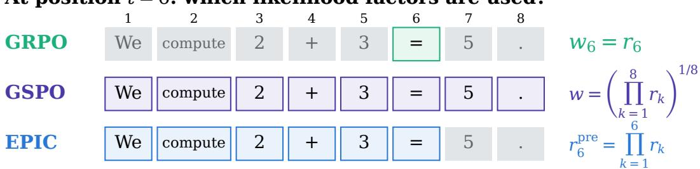

(b) Illustrative clipping behavior.  
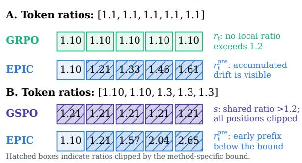

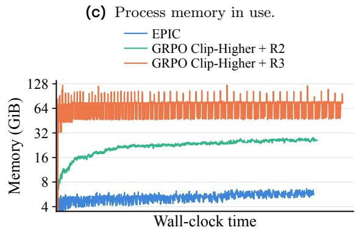  
Figure 1 Over view of EPIC. (a) How GRPO, GSPO, and EPIC compute importance ratios along an autoregressive response. (b) Positive-advantage updates with illustrative clipping bounds. GRPO clips token ratios independently, whereas GSPO uses a shared response-level ratio and can clip all positions together. In these examples, EPIC detects cumulative drift missed by GRPO while preserving early-prefix signals suppressed by GSPO. Hatched boxes indicate clipped positions. (c) Driver-process resident CPU memory during training. EPIC uses substantially less memory than GRPO Clip-Higher combined with R2 or R3, without requiring expert-routing replay. The vertical axis is logarithmic.

This unresolved problem is particularly consequential in modern high-throughput LLM training pipelines, where decoupling rollout generation from optimization improves eficiency but introduces policy lag, causing training to rely on samples generated by outdated behavior policies [15–18]. Existing clipping-based methods remain susceptible to training instability in these of-policy settings [3, 8]. To mitigate this instability, current mixture-of-experts (MoE) training pipelines often rely on auxiliary routing-alignment mechanisms, such as Vanilla Routing Replay (R2) [8] and Rollout Routing Replay (R3) [19], to explicitly suppress the distribution mismatch. However, R2 and R3 limit the freedom of learning and incur additional memory overhead to store expert routing indices, while leaving the more fundamental challenge unresolved: how to stably train LLMs in substantially of-policy settings?

To address this challenge, we revisit the original design and motivation of PPO-clip and reformulate this technique in the autoregressive LLM RL setting. TRPO seeks conservative policy improvement by constraining the KL divergence from the behavior policy, while PPO-clip replaces this update with a first-order clipped surrogate [9, 20]. We formulate autoregressive generation as a finite-horizon MDP and derive its performancediference identity under behavior-policy sampling. The resulting change of measure identifies the cumulative prefix ratio as the exact importance weight for each stepwise improvement term [21]. Applying the monotonic improvement principle of TRPO then leads to a trust region over the behavior- and updated-policy-induced prefix distributions. Thus, the prefix ratio both measures each autoregressive improvement term and provides the ratio coordinate for its KL constraint.

Motivated by this distinction, we propose EPIC, a prefix-aware clipped objective for of-policy LLM reinforcement learning. Based on the prefix policy ratio r<sup>pre</sup>, we use the exact reverse-KL coordinate $r ^ { \mathrm { p r e } } - 1 - \log r ^ { \mathrm { p r e } }$ whose expectation under the behavior policy equals the KL divergence between the behavior- and updatedpolicy-induced prefix distributions. Combining this exact KL characterization with the monotonic-improvement framework of TRPO, we translate the prefix-level trust region into a practical PPO-style clipped objective. This construction stabilizes strongly of-policy MoE training without expert-routing replay, thereby avoiding the additional storage and system complexity required to record and replay expert assignments. Figure 1 illustrates how EPIC difers from token- and response-level clipping and highlights its memory eficiency relative to routing replay.

In conclusion, our contributions are threefold:

• We reformulate trust-region policy optimization for autoregressive generation. By deriving the performance-diference identity under behavior-policy sampling, we show that the cumulative prefix ratio is the exact change-of-measure factor for each stepwise improvement term, and extend the TRPO monotonic-improvement principle to policy-induced prefix distributions.

• Based on this formulation, we develop EPIC, a practical PPO-style clipped objective that constructs prefix-ratio bounds from the exact reverse-KL coordinate $r ^ { \mathrm { p r e } } - 1 - \log r ^ { \mathrm { p r e } }$ and implements the resulting prefix-level trust region through eficient token-level computation.

• In strongly of-policy MoE training, EPIC outperforms GSPO by 6.50 percentage points. Compared with routing-replay baselines, EPIC achieves competitive four-benchmark performance while reducing median driver-side process memory by 77.5% and 93.0% relative to R2 and R3.

## 2 Preliminaries

We consider a Markov decision process (MDP) $( S , A , P , R , \rho _ { 0 } , T )$ . Here $s$ and A are the state and action spaces, $P ( s ^ { \prime } \mid s , a )$ is the transition probability, $R ( s , a )$ is the reward, $\rho _ { 0 }$ is the initial-state distribution, and T is the horizon. A stochastic policy $\pi ( a \mid s )$ induces trajectories through $s _ { 0 } \sim \rho _ { 0 } , a _ { t } \sim \pi ( \cdot \mid s _ { t } )$ , and $s _ { t + 1 } \sim P ( \cdot \mid s _ { t } , a _ { t } )$ . The state-visitation distribution at step t is $d _ { \pi } ^ { t } ( s ) = \operatorname* { P r } ( s _ { t } = s \mid \pi )$

Trust Region Policy Optimization $( T R P O )$ . TRPO motivates trust-region updates with a monotonic policyimprovement bound, aiming to prevent performance collapse caused by large policy changes [20]. Let $\mu = \pi _ { \mathrm { o l d } }$ and $\pi = \pi _ { \theta }$ denote the old and target policies, respectively, and let $\begin{array} { r } { J ( \pi ) = \mathbb { E } _ { \pi } [ \sum _ { t = 0 } ^ { \infty } \gamma ^ { t } R ( s _ { t } , a _ { t } ) ] } \end{array}$ for $\gamma \in ( 0 , 1 )$ . The performance-diference identity gives [22]

$$
J ( \pi ) - J ( \mu ) = \sum _ { s } \rho _ { \pi } ( s ) \sum _ { a } \pi ( a \mid s ) A ^ { \mu } ( s , a ) ,\tag{1}
$$

where $\begin{array} { r } { \rho _ { \pi } ( s ) = \sum _ { t = 0 } ^ { \infty } \gamma ^ { t } d _ { \pi } ^ { t } ( s ) } \end{array}$ is the unnormalized discounted state-visitation frequency and $A ^ { \mu }$ is the advantage under $\mu .$ . Because $\rho _ { \pi }$ changes with $\pi ,$ old-policy samples do not directly represent the new state visitation [23]. Replacing $\rho _ { \pi }$ with $\rho _ { \mu }$ yields the tractable improvement surrogate

$$
S _ { \mu } ( \pi ) = \sum _ { s } \rho _ { \mu } ( s ) \sum _ { a } \pi ( a \mid s ) A ^ { \mu } ( s , a ) .\tag{2}
$$

The original TRPO surrogate is $L _ { \mu } ( \pi ) = J ( \mu ) + S _ { \mu } ( \pi )$ . Thus, $S _ { \mu } ( \pi )$ matches the true improvement in value and policy-parameter gradient at $\pi = \mu ,$ , but can become inaccurate for larger updates. TRPO controls this approximation error through a policy-divergence penalty, giving the lower bound

$$
J ( \pi ) - J ( \mu ) \ge S _ { \mu } ( \pi ) - C D _ { \mathrm { K L } } ^ { \mathrm { m a x } } ( \mu , \pi ) = : B _ { \mu } ( \pi ) ,\tag{3}
$$

where $D _ { \mathrm { K L } } ^ { \mathrm { m a x } } ( \mu , \pi ) =$ max<sub>s</sub> $D _ { \mathrm { K L } } ( \mu ( \cdot \mid s ) \parallel \pi ( \cdot \mid s ) )$ and $C \geq 0$ depends on the discount factor and a bound on the advantage magnitude. Since $B _ { \mu } ( \mu ) = 0$ , an update with $B _ { \mu } ( \pi ) \geq 0$ guarantees nonnegative improvement under the exact bound. This motivates constraining the KL divergence at every state: $D _ { \mathrm { K L } } ^ { \mathrm { m a x } } ( \pi _ { \mathrm { o l d } } , \pi _ { \theta } ) \leq \delta$ For tractability, TRPO replaces this maximum-KL constraint with an average-KL constraint:

$$
\operatorname* { m a x } _ { \theta } \mathbb { E } _ { t , \ s _ { t } \sim d _ { \pi _ { \mathrm { o l d } } } ^ { t } } , \ a _ { t } { \sim } { \pi } _ { \mathrm { o l d } } ( \cdot | s _ { t } ) \ \left[ \frac { { \pi } _ { \theta } \bigl ( a _ { t } \ | \ s _ { t } \bigr ) } { { \pi } _ { \mathrm { o l d } } \bigl ( a _ { t } \ | \ s _ { t } \bigr ) } A _ { t } \right]\tag{4}
$$

$$
\begin{array} { r } { \mathrm { s . t . } \quad \overline { { D } } _ { \mathrm { K L } } ( \theta ) = \mathbb { E } _ { t , s _ { t } \sim d _ { \pi _ { \mathrm { o l d } } } ^ { t } } \left[ D _ { \mathrm { K L } } \left( \pi _ { \mathrm { o l d } } ( \cdot \mid s _ { t } ) \parallel \pi _ { \theta } ( \cdot \mid s _ { t } ) \right) \right] \leq \delta , } \end{array}
$$

Here $A _ { t }$ is the estimated advantage under the old policy, and $\delta$ is the size of the trust region. TRPO approximately solves this problem by linearizing the objective and using a quadratic approximation to the average KL, requiring curvature information and a line search [20].

Proximal Policy Optimization $( P P O )$ PPO-clip seeks conservative policy updates without solving TRPO’s KL-constrained subproblem [9]. Define the importance ratio $r _ { t } ( \theta ) = \pi _ { \theta } ( a _ { t } \mid s _ { t } ) / \pi _ { \mathrm { o l d } } ( a _ { t } \mid s _ { t } )$ . With clipping margin $\epsilon , \mathrm { P P O }$ defines

$$
J _ { \mathrm { P P O } } ( \theta ) = \mathbb { E } _ { \pi _ { \mathrm { o l d } } } \left[ \operatorname* { m i n } \left( r _ { t } ( \theta ) A _ { t } , \mathrm { c l i p } ( r _ { t } ( \theta ) , 1 - \epsilon , 1 + \epsilon ) A _ { t } \right) \right] .\tag{5}
$$

Actually, these clipping bounds admit a local connection to the quadratic approximation of the trust region condition in Eq. (4). Requiring every ratio $r _ { t } ( \theta )$ to lie in $[ 1 - \epsilon , 1 + \epsilon ]$ would bound the max KL max<sub>s</sub> $D _ { \mathrm { K L } } ( \pi _ { \mathrm { o l d } } ( \cdot \mid s ) \parallel \pi _ { \theta } ( \cdot \mid s ) ) \leq \delta$ by $\bar { \epsilon } ^ { 2 } / 2$ (full proof in Appendix B.2).

MDP for Auto-Regressive Generation. Given a prompt x, autoregressive language generation can be represented as a finite-horizon MDP [24, 25]. At position t, the state consists of the prompt and the previously generated tokens, $\boldsymbol { s } _ { t } = \left( x , y _ { < t } \right)$ , while the action is the next token, $a _ { t } = y _ { t }$ . The policy is therefore

$$
\pi _ { \boldsymbol { \theta } } ( a _ { t } \mid s _ { t } ) = \pi _ { \boldsymbol { \theta } } ( y _ { t } \mid x , y _ { < t } ) ,
$$

and taking action $a _ { t }$ deterministically extends the prefix, so that $s _ { t + 1 } = ( x , y _ { \leq t } )$

We consider generation up to a fixed horizon H. If a response terminates before H, it is padded with $\langle \mathrm { e o s } \rangle$ tokens that receive zero additional reward, and the terminal value is set to $V ^ { \mu } ( s _ { H + 1 } ) = 0$ . For a fixed prompt $x ,$ the expected return under policy π is

$$
J _ { x } ( \pi ) = \mathbb { E } _ { y \sim \pi ( \cdot | x ) } \left[ \sum _ { t = 1 } ^ { H } R ( s _ { t } , a _ { t } ) \right] .
$$

For the behavior policy $\mu ,$ define $Q ^ { \mu } ( s _ { t } , a _ { t } )$ as the expected remaining return when the current action is fixed to $a _ { t }$ and all subsequent actions are sampled from $\mu { : }$

$$
Q ^ { \mu } ( s _ { t } , a _ { t } ) = \operatorname { \mathbb { E } } \left[ \sum _ { k = t } ^ { H } R ( s _ { k } , a _ { k } ) \ { \Biggl | } \ s _ { t } , a _ { t } ; \ a _ { k } \sim \mu ( \cdot \ | \ s _ { k } ) \ { \mathrm { f o r ~ } } k > t \right] .
$$

The corresponding value and advantage functions are

$$
V ^ { \mu } ( s _ { t } ) = \mathbb { E } _ { a _ { t } \sim \mu ( \cdot | s _ { t } ) } \left[ Q ^ { \mu } ( s _ { t } , a _ { t } ) \right] , \qquad A ^ { \mu } ( s _ { t } , a _ { t } ) = Q ^ { \mu } ( s _ { t } , a _ { t } ) - V ^ { \mu } ( s _ { t } ) .
$$

In autoregressive generation, taking action $a _ { t } = y _ { t }$ deterministically extends the prefix, fixing the next state to $s _ { t + 1 } = ( x , y _ { \leq t } )$ . The Bellman identity therefore reduces to

$$
Q ^ { \mu } ( s _ { t } , a _ { t } ) = R ( s _ { t } , a _ { t } ) + V ^ { \mu } ( s _ { t + 1 } ) , \quad A ^ { \mu } ( s _ { t } , a _ { t } ) = R ( s _ { t } , a _ { t } ) + V ^ { \mu } ( s _ { t + 1 } ) - V ^ { \mu } ( s _ { t } ) .\tag{6}
$$

## 3 Proximal Trust Regions For Autoregressive Models

In this section, we formulate KL-constrained trust-region optimization for autoregressive language generation. We first derive an exact performance-diference identity with cumulative prefix importance weights, then use prefix KL budgets to obtain ratio intervals and a PPO-style clipped objective.

## 3.1 Performance Difference in Autoregressive Generation

From advantages to performance diference. Eq. (6) holds for any state–action pair, including those generated by π. Along each generated trajectory, summing over positions cancels the intermediate value terms:

$$
\begin{array} { l } { { \displaystyle { \sum _ { t = 1 } ^ { H } A ^ { \mu } ( s _ { t } , a _ { t } ) = \sum _ { t = 1 } ^ { H } R ( s _ { t } , a _ { t } ) + \sum _ { t = 1 } ^ { H } [ V ^ { \mu } ( s _ { t + 1 } ) - V ^ { \mu } ( s _ { t } ) ] } } } \\ { { \displaystyle { \qquad = \sum _ { t = 1 } ^ { H } R ( s _ { t } , a _ { t } ) + V ^ { \mu } ( s _ { H + 1 } ) - V ^ { \mu } ( s _ { 1 } ) } } } \\ { { \displaystyle { \qquad = \sum _ { t = 1 } ^ { H } R ( s _ { t } , a _ { t } ) - V ^ { \mu } ( s _ { 1 } ) } . } } \end{array}
$$

For a fixed prompt, $s _ { 1 } = ( x , \emptyset )$ is fixed and $V ^ { \mu } ( s _ { 1 } ) = J _ { x } ( \mu )$ . Taking the expectation over trajectories sampled from π, while keeping the advantage defined under $\mu ,$ gives the finite-horizon counterpart of Eq. (1):

$$
\begin{array} { r l } & { \mathbb { E } _ { y \sim \pi ( \cdot | x ) } \left[ \displaystyle \sum _ { t = 1 } ^ { H } A ^ { \mu } ( s _ { t } , a _ { t } ) \right] = \mathbb { E } _ { y \sim \pi ( \cdot | x ) } \left[ \displaystyle \sum _ { t = 1 } ^ { H } R ( s _ { t } , a _ { t } ) - V ^ { \mu } ( s _ { 1 } ) \right] } \\ & { \quad \quad \quad \quad = J _ { x } ( \pi ) - J _ { x } ( \mu ) . } \end{array}\tag{7}
$$

Prefix importance correction. To express this identity using behavior-policy samples, assume $\mu ( y _ { 1 : t } \mid x ) > 0$ whenever $\pi ( y _ { 1 : t } \mid x ) > 0$ . The importance weight for a prefix including the current action is

$$
r _ { t } ^ { \mathrm { p r e } } : = \frac { \pi ( y _ { 1 : t } \mid x ) } { \mu ( y _ { 1 : t } \mid x ) } = \prod _ { k = 1 } ^ { t } \frac { \pi ( y _ { k } \mid x , y _ { < k } ) } { \mu ( y _ { k } \mid x , y _ { < k } ) } .\tag{8}
$$

For each $t , A ^ { \mu } ( s _ { t } , a _ { t } )$ depends only on x and $y _ { 1 : t }$ , so a change of measure on the prefix distribution yields

$$
\begin{array} { r l } { \mathbb { E } _ { y \sim \pi ( \cdot \vert x ) } [ A ^ { \mu } ( s _ { t } , a _ { t } ) ] = \displaystyle \sum _ { y _ { 1 : t } } \pi ( y _ { 1 : t } \mid x ) A ^ { \mu } ( s _ { t } , a _ { t } ) } & { } \\ { = \displaystyle \sum _ { y _ { 1 : t } } \mu ( y _ { 1 : t } \mid x ) r _ { t } ^ { \mathrm { p r e } } A ^ { \mu } ( s _ { t } , a _ { t } ) } & { } \\ { = \mathbb { E } _ { y \sim \mu ( \cdot \vert x ) } \left[ r _ { t } ^ { \mathrm { p r e } } A ^ { \mu } ( s _ { t } , a _ { t } ) \right] . } \end{array}\tag{9}
$$

Substituting into Eq. (7) gives the exact autoregressive performance-diference identity:

$$
J _ { x } ( \pi ) - J _ { x } ( \mu ) = \mathbb { E } _ { y \sim \mu ( \cdot | x ) } \left[ \sum _ { t = 1 } ^ { H } r _ { t } ^ { \mathrm { p r e } } A ^ { \mu } ( s _ { t } , a _ { t } ) \right] .\tag{10}
$$

The prefix weight corrects both the probability of reaching $s _ { t }$ and that of selecting $a _ { t } ;$ no sufix ratio is needed because the exact advantage already averages future returns under $\mu .$ . For the sampled response $o _ { i } ,$ we write $r _ { i , t } ^ { \mathrm { p r e } } ( \theta ) = \pi _ { \theta } ( o _ { i , 1 : t } \mid x ) / \mu ( o _ { i , 1 : t } \mid x )$ for the realization of $r _ { t } ^ { \mathrm { p r e } }$ under $\mu = \pi _ { \mathrm { o l d } }$ and $\pi = \pi _ { \theta }$

## 3.2 Monotonic Improvement Guarantee for AR Model

Eq. (10) expresses the true performance improvement using behavior-policy samples. Taking its right-hand side as the optimization objective gives

$$
S _ { \mu , x } ^ { \mathrm { p r e } } ( \pi ) : = \mathbb { E } _ { y \sim \mu ( \cdot | x ) } \left[ \sum _ { t = 1 } ^ { H } r _ { t } ^ { \mathrm { p r e } } A ^ { \mu } ( s _ { t } , a _ { t } ) \right] = J _ { x } ( \pi ) - J _ { x } ( \mu ) .\tag{11}
$$

This plays the role of the surrogate in Eq. (2), while retaining the full prefix correction derived in Section 3.1. We first use it to construct a TRPO-style monotonic update; Section 3.3 then obtains the corresponding clipped objective.

TRPO-style monotonic improvement for AR policies. Following the lower-bound construction in Eq. (3), subtract a nonnegative KL penalty from the improvement objective. Using the same prefix ratio as in Eq. (10), write

$$
\begin{array} { r l } & { K _ { x , t } ( \mu , \boldsymbol { \pi } ) : = \mathbb { E } _ { y \sim \mu ( \cdot \vert x ) } [ - \log r _ { t } ^ { \mathrm { p r e } } ] = D _ { \mathrm { K L } } ( \mu ( y _ { 1 : t } \mid x ) \parallel \boldsymbol { \pi } ( y _ { 1 : t } \mid x ) ) , } \\ & { \mathcal { D } _ { x } ^ { \mathrm { p r e } } ( \mu , \boldsymbol { \pi } ) : = \displaystyle \operatorname* { m a x } _ { 1 \leq t \leq H } \frac { K _ { x , t } ( \mu , \boldsymbol { \pi } ) } { t } . } \end{array}\tag{12}
$$

The KL is taken over all length-t prefixes; $\mathcal { D } _ { x } ^ { \mathrm { p r e } }$ measures the largest cumulative KL per token across prefix lengths. For $\lambda \geq 0$ , define

$$
B _ { \mu , x } ^ { \mathrm { p r e } } ( \pi ) : = S _ { \mu , x } ^ { \mathrm { p r e } } ( \pi ) - \lambda \mathcal { D } _ { x } ^ { \mathrm { p r e } } ( \mu , \pi ) .\tag{13}
$$

Because the prefix correction already gives the exact improvement, λ controls regularization of the update, rather than compensating for a state-visitation approximation.

Proposition 1 (Monotonic Improvement Condition for AR Model) Fix a prompt x and a finite horizon H. Assume bounded rewards, common policy support, exact advantages $A ^ { \mu }$ , and finite $\mathcal { D } _ { x } ^ { \mathrm { p r e } } ( \mu , \pi )$ . For any $\lambda \geq 0$

$$
J _ { x } ( \pi ) - J _ { x } ( \mu ) \geq B _ { \mu , x } ^ { \mathrm { p r e } } ( \pi ) , \qquad B _ { \mu , x } ^ { \mathrm { p r e } } ( \mu ) = 0 .\tag{14}
$$

Consequently, any update satisfying $B _ { \mu , x } ^ { \mathrm { p r e } } ( \pi ^ { + } ) \geq B _ { \mu , x } ^ { \mathrm { p r e } } ( \mu )$ guarantees $J _ { x } ( \pi ^ { + } ) \geq J _ { x } ( \mu )$

Proof. Eq. (10) and the nonnegativity of KL give

$$
J _ { x } ( \pi ) - J _ { x } ( \mu ) - B _ { \mu , x } ^ { \mathrm { p r e } } ( \pi ) = \lambda \mathcal { D } _ { x } ^ { \mathrm { p r e } } ( \mu , \pi ) \geq 0 .
$$

$\pi = \mu$ , both the exact improvement and the KL penalty vanish, so $B _ { \mu , x } ^ { \mathrm { p r e } } ( \mu ) = 0$ . Thus $B _ { \mu , x } ^ { \mathrm { p r e } } ( \pi ^ { + } ) \geq 0$ implies nonnegative performance improvement. □

This yields the TRPO-style monotonic-update problem

$$
\pi ^ { + } \in \arg \operatorname* { m a x } _ { \pi } B _ { \mu , x } ^ { \mathrm { p r e } } ( \pi ) , \qquad J _ { x } ( \pi ^ { + } ) - J _ { x } ( \mu ) \ge B _ { \mu , x } ^ { \mathrm { p r e } } ( \pi ^ { + } ) \ge B _ { \mu , x } ^ { \mathrm { p r e } } ( \mu ) = 0 ,\tag{15}
$$

where the policy class is assumed to contain $\mu .$ As in TRPO, the penalized objective can instead motivate a KL-constrained update with a tunable budget:

$$
\operatorname* { m a x } _ { \pi } \quad S _ { \mu , x } ^ { \mathrm { p r e } } ( \pi ) \qquad \mathrm { s . t . } \quad \mathcal { D } _ { x } ^ { \mathrm { p r e } } ( \mu , \pi ) \leq \delta \quad \Longleftrightarrow \quad K _ { x , t } ( \mu , \pi ) \leq t \delta \quad \forall t .\tag{16}
$$

For fixed λ, its Lagrangian is $B _ { \mu , x } ^ { \mathrm { p r e } } ( \pi ) + \lambda \delta$ . The behavior policy is feasible with objective zero, so an exact constrained maximizer also has nonnegative true improvement. The remaining question is how to replace this explicit KL-constrained optimization by a clipped objective.

## 3.3 PPO-Style Prefix Clipping

We translate the KL-constrained update in Eq. (16) into a PPO-style objective that can be optimized with the existing policy-gradient training loop.

From the KL constraint to clipping bounds. Under common support, $\mathbb { E } _ { \mu } [ r _ { t } ^ { \mathrm { p r e } } ] = 1$ . Therefore the constraint can be expressed through a nonnegative ratio coordinate:

$$
\begin{array} { r l } { K _ { x , t } ( \mu , \boldsymbol { \pi } ) = \mathbb { E } _ { \mu } [ - \log r _ { t } ^ { \mathrm { p r e } } ] + \mathbb { E } _ { \mu } [ r _ { t } ^ { \mathrm { p r e } } - 1 ] } \\ { \quad \quad } & { = \mathbb { E } _ { \mu } [ \phi ( r _ { t } ^ { \mathrm { p r e } } ) ] } \\ { \quad \quad } & { = \displaystyle \sum _ { o _ { 1 : t } } \mu ( o _ { 1 : t } \mid x ) \phi ( r _ { t } ^ { \mathrm { p r e } } ) , \qquad \phi ( r ) = r - 1 - \log r . } \end{array}\tag{17}
$$

Thus, the contribution of a particular prefix $O 1 { : } t$ to the distribution-level KL is weighted by its behavior-policy probability $\mu ( o _ { 1 : t } \mid x )$ [26]. To retain the per-token expected KL-budget target of δ established in Eq. (16), we

use the geometric mean $[ \mu ( o _ { i , 1 : t } \mid x ) ] ^ { 1 / t }$ as the probability-calibration factor. Following the budget in Eq. (16), we impose the calibrated pointwise restriction $\left[ \mu ( o _ { i , 1 : t } \mid x ) \right] ^ { 1 / t } \phi ( r _ { t } ^ { \mathrm { p r e } } ) \le t \delta$ for every prefix at position t. The lower- and upper-side coordinate budgets are therefore

$$
\kappa _ { i , t } ^ { - } = \frac { t \delta ^ { - } } { [ \mu ( o _ { i , 1 : t } \mid x ) ] ^ { 1 / t } } , \qquad \kappa _ { i , t } ^ { + } = \frac { t \delta ^ { + } } { [ \mu ( o _ { i , 1 : t } \mid x ) ] ^ { 1 / t } } .\tag{18}
$$

The factor $t \delta ^ { \pm }$ retains the linear prefix-length scaling implied by $K _ { x , t } ( \mu , \pi ) \leq t \delta$ in Eq. (16), while the geometric-mean behavior probability provides the sample-dependent calibration. Since $\phi$ decreases on (0, 1] and increases on [1, ∞), this defines a ratio interval:

$$
\phi ( \ell _ { i , t } ) = \kappa _ { i , t } ^ { - } , \quad \phi ( u _ { i , t } ) = \kappa _ { i , t } ^ { + } , \qquad 0 < \ell _ { i , t } \leq 1 \leq u _ { i , t } .\tag{19}
$$

The clipped improvement objective. We now use these bounds to remove the incentive for updates that improve an individual advantage term by moving its ratio farther outside the interval, following PPO [9]. The prefix ratio can be computed from the token log probabilities already evaluated in a PPO-style training loop. For a sampled response $o _ { i } = ( o _ { i , 1 } , . . . , o _ { i , T _ { i } } )$ ，

$$
\log r _ { i , t } ^ { \mathrm { p r e } } ( \theta ) = \sum _ { k = 1 } ^ { t } \left[ \log \pi _ { \theta } ( o _ { i , k } \mid x , o _ { i , < k } ) - \log \mu ( o _ { i , k } \mid x , o _ { i , < k } ) \right] .\tag{20}
$$

A cumulative sum obtains the prefix log-ratios at all positions in $O ( T _ { i } )$ work. This calculation requires no additional model pass, rollout, auxiliary network, or vocabulary-wide KL evaluation. These properties make prefix-level clipping compatible with the existing rollout, reward, batching, and optimization pipeline.

For token-level optimization, we use the geometric mean $g _ { i , t } ( \theta ) = [ r _ { i , t } ^ { \mathrm { p r e } } ( \theta ) ] ^ { 1 / t }$ to place the cumulative prefix ratio on a length-normalized scale and mitigate length-dependent gradient spikes, as supported by the ablation in Appendix E.4. We apply the same transformation to the lower and upper bounds, yielding $\stackrel { } { \ell } _ { i , t } ^ { 1 / t }$ and $u _ { i , t } ^ { 1 / t }$ respectively. To prevent an extreme ratio from producing an unbounded negative contribution, we use the sign-aware dual-clipping operator [27]

$$
\mathcal { C } ( \boldsymbol { q } , A ; \ell , u ) = \left\{ \begin{array} { l l } { A \operatorname* { m i n } ( \boldsymbol { q } , u ) , } & { A \ge 0 , } \\ { A \operatorname* { m i n } ( \operatorname* { m a x } ( \boldsymbol { q } , \ell ) , u ) , } & { A < 0 . } \end{array} \right.\tag{21}
$$

Using the straight-through weight $\widetilde { g } _ { i , t } ( \boldsymbol { \theta } )$ , whose forward value is $g _ { i , t } ( \theta )$ while its gradient passes only through the current-token probability, the final training objective is

$$
\mathcal { I } _ { \mathrm { E P I C } } ( \theta ) = \mathbb { E } _ { \{ o _ { i } \} _ { i = 1 } ^ { G } \sim \mu ( \cdot | x ) } \left[ \frac { 1 } { G } \sum _ { i = 1 } ^ { G } \frac { 1 } { T _ { i } } \sum _ { t = 1 } ^ { T _ { i } } \mathcal { C } \left( \widetilde { g } _ { i , t } ( \theta ) , \widehat { A } _ { i } ; \ell _ { i , t } ^ { 1 / t } , u _ { i , t } ^ { 1 / t } \right) \right] .\tag{22}
$$

## 4 Experiments

## 4.1 Experimental Setup

Models and datasets. We train Qwen3-30B-A3B-Base $[ 2 8 ] ^ { 1 }$ , a sparse MoE language model, on the processed DAPO-Math-17K dataset [2]. A rule-based verifier provides binary answer-correctness scores. We evaluate on four held-out mathematical-reasoning benchmarks: AIME 2024, AIME 2025, AMC 2023, and HMMT.

Baselines. We compare EPIC with GRPO, DAPO, GSPO, CTPO, and RIPO [2, 3, 26, 29, 30]. The comparisons use the same training and evaluation protocol. Baselines use their published default clipping parameters, while EPIC uses $\delta ^ { - } = 5 \times 1 0 ^ { - 4 }$ and $\delta ^ { + } = 2 \times 1 0 ^ { - 3 }$ . We additionally compare against GRPO Clip-Higher combined with Vanilla Routing Replay (R2) or Rollout Routing Replay (R3) [3, 8, 19].

Algorithm 1 EPIC for Of-Policy Autoregressive RL   
Require: Policy $\pi _ { \boldsymbol { \theta } } .$ training distribution D, budgets $\delta ^ { - } , \delta ^ { + }$ , group size $G ,$ update depth K   
1: for each training iteration do   
2: Sample prompts $x \sim \mathcal { D }$ and set $\mu  \pi _ { \theta }$   
3: Generate response groups $\{ o _ { i } \} _ { i = 1 } ^ { G } \sim \mu ( \cdot \mid x )$   
4: Compute verifier rewards, group-relative advantages ${ \widehat { A } } _ { i } ,$ and behavior log-probabilities   
5: for $k = 1 , \ldots , K$ do   
6: Evaluate current-policy token log-probabilities   
7: Compute prefix ratios $\begin{array} { r } { \boldsymbol { r } _ { i , t } ^ { \mathrm { p r e } } = \prod _ { j = 1 } ^ { t ^ { ' } } \pi _ { \theta } ( o _ { i , j } \mid \boldsymbol { x } , o _ { i , < j } ) / \mu ( o _ { i , j } \mid \boldsymbol { x } , o _ { i , < j } ) } \end{array}$   
8: Set $g _ { i , t } = ( r _ { i , t } ^ { \mathrm { p r e } } ) ^ { 1 / t }$ and $\bar { p } _ { i , t } ^ { \mathrm { o l d } } = [ \bar { \mu } ( o _ { i , 1 : t } \mid x ) ] ^ { 1 / t }$   
9: Solve $\phi ( \ell _ { i , t } ) = t \delta ^ { - } / \bar { p } _ { i , t } ^ { \mathrm { o l d } }$ and $\phi ( u _ { i , t } ) = t \delta ^ { + } / \bar { p } _ { i , t } ^ { \mathrm { o l d } }$ for $\phi ( r ) = r - 1 -$ log r   
10: Transform bounds to $\big ( \boldsymbol { \ell } _ { i , t } ^ { 1 / t }$ and $u _ { i , t } ^ { 1 / t }$   
11: Form the straight-through weight $\widetilde { g } _ { i , t }$   
12: Compute $\begin{array} { r } { S _ { i , t } = \mathcal { C } ( \widetilde { g } _ { i , t } , \widehat { A } _ { i } ; \ell _ { i , t } ^ { 1 / t } , u _ { i , t } ^ { 1 / t } ) } \end{array}$   
13: Update θ using $\begin{array} { r } { \frac { 1 } { G } \sum _ { i } \frac { 1 } { T _ { i } } \sum _ { t } \mathcal { S } _ { i , t } } \end{array}$   
14: end for   
15: end for

Training and evaluation. Each run is trained under the same protocol. We evaluate before training and every five global steps, sampling eight responses per problem and reporting mean@8, their average binary correctness. For each run, we select the single checkpoint that maximizes the equal-weight average across the four benchmarks and report all four scores at that checkpoint. Main results are averaged over three independent runs. Dataset details and training configurations are provided in Appendix D.

## 4.2 Main Results

Table 1 reports the main comparison under an update depth of eight. For each method, we select the single checkpoint that maximizes the equal-weight arithmetic mean of the four validation mean@8 scores. EPIC achieves the highest four-benchmark average of 39.34%, exceeding GRPO and GSPO by 10.69 and 6.50 percentage points, respectively. The improvements are particularly pronounced on AIME 2024 and HMMT 2025, while the gain on AMC 2023 indicates that performance on the more dificult benchmarks is not obtained at the expense of the relatively easier one. Relative to GSPO, the gains are 8.06, 4.72, 4.48, and 8.75 percentage points on AIME 2024, AIME 2025, AMC 2023, and HMMT 2025, respectively. This consistent direction across benchmarks shows that the aggregate improvement is not driven by a single evaluation set. Figure 2a shows the four-benchmark average throughout training. The advantage becomes clearer during later training, complementing the selected-checkpoint comparison with evidence from the learning trajectories. Figure 2b further shows that EPIC achieves the highest late-stage training reward among the compared methods. Individual benchmark curves and the corresponding analysis are provided in Appendix E.1.

## 4.3 Trust region design analysis

Here we examine whether the proposed trust-region design produces efective and balanced clipping throughout autoregressive generation. Figure 3a shows that EPIC achieves a late-stage position-wise coeficient of variation (CV) of 0.054, compared with 0.085 for CTPO and 0.126 for RIPO. Figure 3b further shows that its positionwise CV remains consistently low throughout training. Together, these observations indicate that clipping activity remains relatively evenly distributed across response positions rather than becoming increasingly concentrated as training progresses. Figure 3c reports the Raw-prob versus default comparison from the ablation study in Appendix E.4. Using raw prefix probabilities concentrates clipping near the beginning of the response, whereas our calibration maintains finite lower bounds across all position bins and clip fractions of approximately 0.20–0.23. This contrast illustrates the role of calibration in preventing later prefixes from becoming efectively unclipped. The normalized position profiles and absolute clip fractions provide complementary diagnostics: the former measures how clipping is distributed within a response, while the latter checks whether clipping remains active at all. A low position-wise CV alone would not establish the latter. Overall, these results support the proposed design by showing that clipping remains active across response positions rather than concentrating on a small portion of the sequence.

Table 1 Main results on Qwen3-30B-A3B-Base. Results are averaged over three independent runs.
<table><tr><td rowspan="2">Method</td><td colspan="5">Accuracy (%)</td></tr><tr><td>AIME 24</td><td>AIME 25</td><td>AMC 23</td><td>HMMT 25</td><td>Average</td></tr><tr><td>GRPO</td><td>23.61</td><td>16.81</td><td>69.48</td><td>4.72</td><td>28.65</td></tr><tr><td>DAPO</td><td>31.67</td><td>24.03</td><td>76.25</td><td>9.86</td><td>35.45</td></tr><tr><td>GSPO</td><td>30.00</td><td>20.56</td><td>73.44</td><td>7.36</td><td>32.84</td></tr><tr><td>CTPO</td><td>30.14</td><td>20.97</td><td>76.04</td><td>8.75</td><td>33.98</td></tr><tr><td>RIPO</td><td>26.94</td><td>21.81</td><td>74.69</td><td>8.47</td><td>32.98</td></tr><tr><td>EPIC (Ours)</td><td>38.06</td><td>25.28</td><td>77.92</td><td>16.11</td><td>39.34</td></tr></table>

(a) Validation performance.  
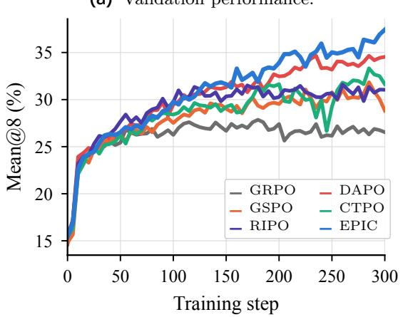

(b) Training reward.  
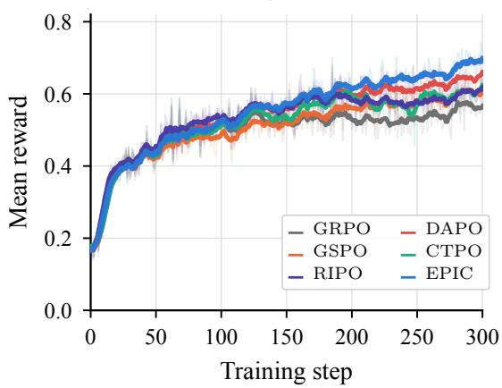  
Figure 2 Validation and reward trajectories under the aligned of-policy MoE setting. Curves average three seeds at matching training steps.

## 4.4 Comparison with Routing Replay

We compare EPIC with GRPO with higher upper clip combined with R2 and R3 under the same protocol. Unlike these replay-based approaches, EPIC does not store or replay expert-routing decisions and modifies only the clipped policy objective. As shown in Figure 4a, both R2 and R3 substantially improve GRPO Clip-Higher in this of-policy setting. EPIC slightly outperforms both replay-based variants on the four-benchmark average without replaying expert-routing decisions. Figure 4b shows that EPIC maintains a substantially lower and more stable process-memory usage than GRPO Clip-Higher with R2 or R3 throughout the recorded training period. As these methods have similar response lengths (8,557, 9,476, and 9,001 tokens for R2, R3, and EPIC), these measurements suggest that EPIC avoids substantial driver-side memory overhead associated with carrying routing-replay state. Together with its competitive benchmark performance, these observations suggest that EPIC ofers a memory-eficient alternative to routing replay in the evaluated setting. The reported memory metric is driver-process resident CPU memory, rather than GPU memory or total cluster memory. It characterizes the observed system-level cost, not an isolated measurement of routing-state storage.

(a) Position profile.  
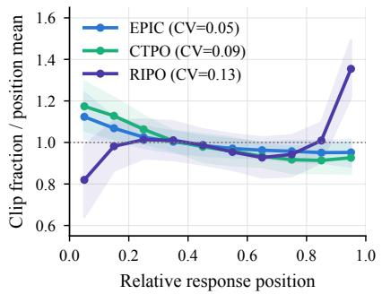

(b) Position-wise CV.  
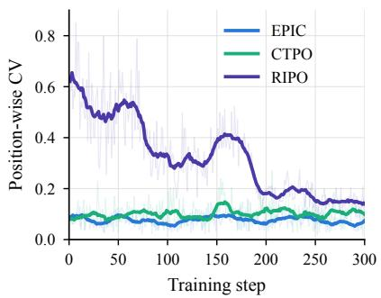

(c) Probability calibration.  
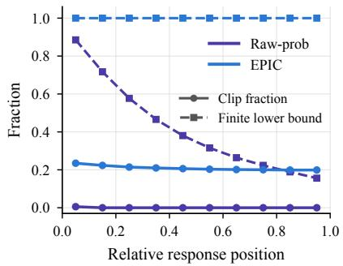  
Figure 3 Position-wise behavior of the calibrated trust region. (a) Normalized late-stage clip fractions across relative response positions. (b) Position-wise clip-fraction variation during training. (c) Clip fraction and finite-lower-bound coverage under raw and geometric-mean behavior-probability calibration.

(a) Benchmark performance.
<table><tr><td>Method</td><td>AIME 24 AIME 25</td><td></td><td>AMC</td><td>HMMT</td><td>Avg.</td></tr><tr><td>GRPO Clip-Higher</td><td>30.83</td><td>25.00</td><td>73.44</td><td>6.67</td><td>33.98</td></tr><tr><td>GRPO Clip-Higher + R2</td><td>32.50</td><td>28.75</td><td>75.94</td><td>10.00</td><td>36.80</td></tr><tr><td>GRPO Clip-Higher + R3</td><td>32.50</td><td>24.17</td><td>79.06</td><td>10.00</td><td>36.43</td></tr><tr><td>EPIC</td><td>36.67</td><td>25.00</td><td>76.56</td><td>14.17</td><td>38.10</td></tr></table>

(b) Process memory in use.  
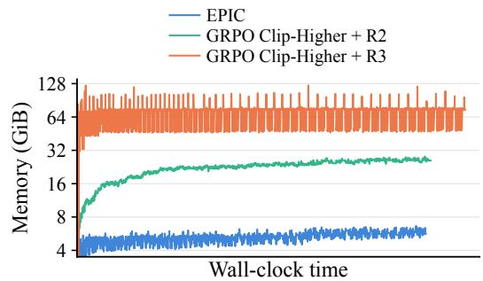  
Figure 4 Comparison with routing replay. (a) Mean@8 accuracy (%) at the checkpoint maximizing the equal-weight average across the four benchmarks. (b) Process-level resident CPU memory during training.

## 5 Conclusion

We revisit PPO-style clipping through a finite-horizon MDP formulation of autoregressive generation, identi fying the prefix ratio as the exact stepwise importance weight. Building on TRPO’s monotonic-improvement framework, we derive clipping bounds from the exact reverse-KL coordinate to obtain EPIC. Experiments show improved reasoning performance over clipping baselines and competitive results with routing replay at lower process-memory cost. This work connects trust-region theory with practical optimization, advancing principled and eficient reinforcement learning for language models.

## AI use statement

Generative AI tools were used to assist with theoretical derivations, language editing, clarification of exposition, literature-search formulation, code implementation, environment configuration, experiment execution, exploratory data analysis, visualization scripts, and LaTeX formatting. AI tools were not used to generate experimental results, fabricate or alter data, make final scientific decisions, or replace author verification of the theoretical derivations and empirical claims.

All AI-assisted text, derivations, code, configurations, experiment procedures, figures, and analytical suggestions were reviewed and revised by the authors. The authors independently checked the mathematical derivations, verified the numerical results against the recorded experiment logs, inspected the generated figures, and tested the analysis code used to produce the reported plots. The final paper, including all claims, equations, experimental results, and artifacts, is the responsibility of the authors. We take responsibility for the final content of this work, including text, claims or artifacts produced with the aid of generative AI.

## Ethics statement

This work studies optimization methods for reinforcement learning post-training of large language models. It does not involve human subjects, human-subject data, personally identifiable information, or the collection of sensitive personal data. The experiments use language-model training and mathematical-reasoning benchmark evaluation in an automated setting.

We are not aware of any immediate ethical risks specific to the methods or experiments presented here. As with other research on large language models, the resulting models may inherit limitations or biases from their training data and should not be deployed in high-stakes settings without appropriate evaluation, monitoring, and safeguards.

## Reproducibility Statement

Our results are based on publicly available language models, datasets, and experimental frameworks. The experiments use publicly released model checkpoints and benchmark datasets, together with the publicly available training framework described in the experimental setup. The experimental section reports the model setting, benchmark suite, training configuration, evaluation protocol, and multi-seed results.

We provide the theoretical assumptions, derivations, and implementation details needed to reproduce the proposed objective in the main paper and appendix. The appendix includes the complete prefix-ratio construction, the reverse-KL identity, the trust-region budget calibration, the clipping objective, and the additional implementation details used in training. In particular, the experimental configurations and hyperparameters are documented in Appendix D while the additional analyses and diagnostic procedures are described in Appendix E.

The method implementation, training configurations, and instructions for environment setup, training, and evaluation are publicly available at https://github.com/LiChengxi666/EPIC. The repository builds on verl and releases the EPIC additions under the Apache-2.0 license, with upstream notices retained.

## References

[1] Daya Guo, Dejian Yang, Haowei Zhang, Junxiao Song, Peiyi Wang, Qihao Zhu, Runxin Xu, Ruoyu Zhang, Shirong Ma, Xiao Bi, Xiaokang Zhang, Xingkai Yu, Yu Wu, Z. F. Wu, Zhibin Gou, Zhihong Shao, Zhuoshu Li, Ziyi Gao, Aixin Liu, Bing Xue, Bingxuan Wang, Bochao Wu, Bei Feng, Chengda Lu, Chenggang Zhao, Chengqi Deng, Chong Ruan, Damai Dai, Deli Chen, Dongjie Ji, Erhang Li, Fangyun Lin, Fucong Dai, Fuli Luo, Guangbo Hao, Guanting Chen, Guowei Li, H. Zhang, Hanwei Xu, Honghui Ding, Huazuo Gao, Hui Qu, Hui Li, Jianzhong Guo, Jiashi Li, Jingchang Chen, Jingyang Yuan, Jinhao Tu, Junjie Qiu, Junlong Li, J. L. Cai, Jiaqi Ni, Jian Liang, Jin Chen, Kai Dong, Kai Hu, Kaichao You, Kaige Gao, Kang Guan, Kexin Huang, Kuai Yu, Lean Wang, Lecong Zhang, Liang Zhao, Litong Wang, Liyue Zhang, Lei Xu, Leyi Xia, Mingchuan Zhang, Minghua Zhang, Minghui Tang, Mingxu Zhou, Meng Li, Miaojun Wang, Mingming Li, Ning Tian, Panpan Huang, Peng Zhang, Qiancheng Wang, Qinyu Chen, Qiushi Du, Ruiqi Ge, Ruisong Zhang, Ruizhe Pan, Runji Wang, R. J. Chen, R. L. Jin, Ruyi Chen, Shanghao Lu, Shangyan Zhou, Shanhuang Chen, Shengfeng Ye, Shiyu Wang, Shuiping Yu, Shunfeng Zhou, Shuting Pan, S. S. Li, Shuang Zhou, Shaoqing Wu, Tao Yun, Tian Pei, Tianyu Sun, T. Wang, Wangding Zeng, Wen Liu, Wenfeng Liang, Wenjun Gao, Wenqin Yu, Wentao Zhang, W. L. Xiao, Wei An, Xiaodong Liu, Xiaohan Wang, Xiaokang Chen, Xiaotao Nie, Xin Cheng, Xin Liu, Xin Xie, Xingchao Liu, Xinyu Yang, Xinyuan Li, Xuecheng Su, Xuheng Lin, X. Q. Li, Xiangyue Jin, Xiaojin Shen, Xiaosha Chen, Xiaowen Sun, Xiaoxiang Wang, Xinnan Song, Xinyi Zhou, Xianzu Wang, Xinxia Shan, Y. K. Li, Y. Q. Wang, Y. X. Wei, Yang Zhang, Yanhong Xu, Yao Li, Yao Zhao, Yaofeng Sun, Yaohui Wang, Yi Yu, Yichao Zhang, Yifan Shi, Yiliang Xiong, Ying He, Yishi Piao, Yisong Wang, Yixuan Tan, Yiyang Ma, Yiyuan Liu, Yongqiang Guo, Yuan Ou, Yuduan Wang, Yue Gong, Yuheng Zou, Yujia He, Yunfan Xiong, Yuxiang Luo, Yuxiang You, Yuxuan Liu, Yuyang Zhou, Y. X. Zhu, Yanping Huang, Yaohui Li, Yi Zheng, Yuchen Zhu, Yunxian Ma, Ying Tang, Yukun Zha, Yuting Yan, Z. Z. Ren, Zehui Ren, Zhangli Sha, Zhe Fu, Zhean Xu, Zhenda Xie, Zhengyan Zhang, Zhewen Hao, Zhicheng Ma, Zhigang Yan, Zhiyu Wu, Zihui Gu, Zijia Zhu, Zijun Liu, Zilin Li, Ziwei Xie, Ziyang Song, Zizheng Pan, Zhen Huang, Zhipeng Xu, Zhongyu Zhang, and Zhen Zhang. Deepseek-r1 incentivizes reasoning in llms through reinforcement learning. Nature, 645(8081):633–638, September 2025. ISSN 1476-4687. doi: 10.1038/s41586-025-09422-z. URL http://dx.doi.org/10.1038/s41586-025-09422-z.

[2] Qiying Yu, Zheng Zhang, Ruofei Zhu, Yufeng Yuan, Xiaochen Zuo, Yu Yue, Weinan Dai, Tiantian Fan, Gaohong Liu, Lingjun Liu, Xin Liu, Haibin Lin, Zhiqi Lin, Bole Ma, Guangming Sheng, Yuxuan Tong, Chi Zhang, Mofan Zhang, Wang Zhang, Hang Zhu, Jinhua Zhu, Jiaze Chen, Jiangjie Chen, Chengyi Wang, Hongli Yu, Yuxuan Song, Xiangpeng Wei, Hao Zhou, Jingjing Liu, Wei-Ying Ma, Ya-Qin Zhang, Lin Yan, Mu Qiao, Yonghui Wu, and Mingxuan Wang. Dapo: An open-source llm reinforcement learning system at scale, 2025. URL https://arxiv.org/abs/2503.14476.

[3] Chujie Zheng, Shixuan Liu, Mingze Li, Xiong-Hui Chen, Bowen Yu, Chang Gao, Kai Dang, Yuqiong Liu, Rui Men, An Yang, Jingren Zhou, and Junyang Lin. Group sequence policy optimization, 2025. URL https: //arxiv.org/abs/2507.18071.

[4] Kimi Team, Angang Du, Bofei Gao, Bowei Xing, Changjiu Jiang, Cheng Chen, Cheng Li, Chenjun Xiao, Chenzhuang Du, Chonghua Liao, Chuning Tang, Congcong Wang, Dehao Zhang, Enming Yuan, Enzhe Lu, Fengxiang Tang, Flood Sung, Guangda Wei, Guokun Lai, Haiqing Guo, Han Zhu, Hao Ding, Hao Hu, Hao Yang, Hao Zhang, Haotian Yao, Haotian Zhao, Haoyu Lu, Haoze Li, Haozhen Yu, Hongcheng Gao, Huabin Zheng, Huan Yuan, Jia Chen, Jianhang Guo, Jianlin Su, Jianzhou Wang, Jie Zhao, Jin Zhang, Jingyuan Liu, Junjie Yan, Junyan Wu, Lidong Shi, Ling Ye, Longhui Yu, Mengnan Dong, Neo Zhang, Ningchen Ma, Qiwei Pan, Qucheng Gong, Shaowei Liu, Shengling Ma, Shupeng Wei, Sihan Cao, Siying Huang, Tao Jiang, Weihao Gao, Weimin Xiong, Weiran He, Weixiao Huang, Weixin Xu, Wenhao Wu, Wenyang He, Xianghui Wei, Xianqing Jia, Xingzhe Wu, Xinran Xu, Xinxing Zu, Xinyu Zhou, Xuehai Pan, Y. Charles, Yang Li, Yangyang Hu, Yangyang Liu, Yanru Chen, Yejie Wang, Yibo Liu, Yidao Qin, Yifeng Liu, Ying Yang, Yiping Bao, Yulun Du, Yuxin Wu, Yuzhi Wang, Zaida Zhou, Zhaoji Wang, Zhaowei Li, Zhen Zhu, Zheng Zhang, Zhexu Wang, Zhilin Yang, Zhiqi Huang, Zihao Huang, Ziyao Xu, Zonghan Yang, and Zongyu Lin. Kimi k1.5: Scaling reinforcement learning with llms, 2025. URL https://arxiv.org/abs/2501.12599.

[5] slime Team. slime: An SGLang-native post-training framework for RL scaling. LMSYS Org blog, July 2025. URL https://lmsys.org/blog/2025-07-09-slime/.

[6] Guangming Sheng, Chi Zhang, Zilingfeng Ye, Xibin Wu, Wang Zhang, Ru Zhang, Yanghua Peng, Haibin Lin, and Chuan Wu. HybridFlow: A flexible and eficient RLHF framework, 2024. URL https://arxiv.org/abs/2409.1 9256.

[7] Wei Fu, Jiaxuan Gao, Xujie Shen, Chen Zhu, Zhiyu Mei, Chuyi He, Shusheng Xu, Guo Wei, Jun Mei, Jiashu Wang, Tongkai Yang, Binhang Yuan, and Yi Wu. AReaL: A large-scale asynchronous reinforcement learning system for language reasoning, 2025. URL https://arxiv.org/abs/2505.24298.

[8] Chujie Zheng, Kai Dang, Bowen Yu, Mingze Li, Huiqiang Jiang, Junrong Lin, Yuqiong Liu, Hao Lin, Chencan Wu, Feng Hu, An Yang, Jingren Zhou, and Junyang Lin. Stabilizing reinforcement learning with llms: Formulation and practices, 2025. URL https://arxiv.org/abs/2512.01374.

[9] John Schulman, Filip Wolski, Prafulla Dhariwal, Alec Radford, and Oleg Klimov. Proximal policy optimization algorithms, 2017. URL https://arxiv.org/abs/1707.06347.

[10] Ang Li, Ben Liu, Bin Han, Bin Hu, Bin Jing, Binbin Hu, Bing Li, Cai Chen, Caizhi Tang, Changxin Tian, et al. Ling and Ring 2.6 technical report: Eficient and instant agentic intelligence at trillion-parameter scale, 2026. URL https://arxiv.org/abs/2606.15079.

[11] Yuxin Zuo, Zikai Xiao, Li Sheng, Fei Huang, Jianhong Tu, Yuxuan Liu, Tianyi Tang, Xiaomeng Hu, Yang Su, Qingfeng Lan, et al. Qwen-AgentWorld: Language world models for general agents, 2026. URL https: //arxiv.org/abs/2606.24597.

[12] Calvin Qi, Vasudha Rengarajan, Julio Pereyra, Niko Grupen, and Gabe Pereyra. Harvey Tenet research preview. Harvey technical blog, August 2026. URL https://www.harvey.ai/blog/post-training-update-harvey-tenet. August 20, 2026.

[13] DeepSeek-AI. DeepSeek-V4: Towards highly eficient million-token context intelligence, 2026. URL https: //arxiv.org/abs/2606.19348.

[14] GLM-5 Team. GLM-5: from vibe coding to agentic engineering, 2026. URL https://arxiv.org/abs/2602.15763.

[15] Lasse Espeholt, Hubert Soyer, Remi Munos, Karen Simonyan, Vlad Mnih, Tom Ward, Yotam Doron, Vlad Firoiu, Tim Harley, Iain Dunning, et al. Impala: Scalable distributed deep-rl with importance weighted actor-learner architectures. In International conference on machine learning, pages 1407–1416. PMLR, 2018.

[16] Michael Noukhovitch, Shengyi Huang, Sophie Xhonneux, Arian Hosseini, Rishabh Agarwal, and Aaron Courville. Asynchronous rlhf: Faster and more eficient of-policy rl for language models, 2025. URL https://arxiv.org/ab s/2410.18252.

[17] Haoyang Li, Sheng Lin, Fangcheng Fu, Yuming Zhou, Xiaodong Ji, Yanfeng Zhao, Lefeng Wang, Jie Jiang, and Bin Cui. Staleflow: Staleness-aware data management for mitigating data skewness in fully disaggregated rl post-training, 2026. URL https://arxiv.org/abs/2601.12784.

[18] DeepSeek-AI. DeepSeek-V3.2: Pushing the frontier of open large language models, 2025. URL https://arxiv.or g/abs/2512.02556.

[19] Wenhan Ma, Hailin Zhang, Liang Zhao, Yifan Song, Yudong Wang, Zhifang Sui, and Fuli Luo. Stabilizing moe reinforcement learning by aligning training and inference routers, 2025. URL https://arxiv.org/abs/2510.11370.

[20] John Schulman, Sergey Levine, Philipp Moritz, Michael I. Jordan, and Pieter Abbeel. Trust region policy optimization. CoRR, abs/1502.05477, 2015. URL http://arxiv.org/abs/1502.05477.

[21] Doina Precup, Richard S Sutton, and Satinder Singh. Eligibility traces for of-policy policy evaluation. 2000

[22] Sham Kakade and John Langford. Approximately optimal approximate reinforcement learning. In Proceedings of the nineteenth international conference on machine learning, pages 267–274, 2002.

[23] Ahmed Touati, Amy Zhang, Joelle Pineau, and Pascal Vincent. Stable policy optimization via of-policy divergence regularization, 2020. URL https://arxiv.org/abs/2003.04108.

[24] Thomas Kwa, Drake Thomas, and Adrià Garriga-Alonso. Catastrophic goodhart: regularizing rlhf with kl divergence does not mitigate heavy-tailed reward misspecification. In A. Globerson, L. Mackey, D. Belgrave, A. Fan, U. Paquet, J. Tomczak, and C. Zhang, editors, Advances in Neural Information Processing Systems, volume 37, pages 14608–14633. Curran Associates, Inc., 2024. doi: 10.52202/079017-0466. URL https://proceedings.neur ips.cc/paper\_files/paper/2024/file/1a8189929f3d7bd6183718f42c3f4309-Paper-Conference.pdf.

[25] Dzmitry Bahdanau, Philemon Brakel, Kelvin Xu, Anirudh Goyal, Ryan Lowe, Joelle Pineau, Aaron Courville, and Yoshua Bengio. An actor-critic algorithm for sequence prediction, 2017. URL https://arxiv.org/abs/1607 .07086.

[26] Zhicheng Cai, Xinyuan Guo, Hanlin Wu, Mingxuan Wang, Wei-Ying Ma, Ya-Qin Zhang, and Hao Zhou. Beyond euclidean clipping: Overcoming exploration collapse in llm rl via riemannian isometric policy optimization, 2026. URL https://arxiv.org/abs/2607.10169.

[27] Deheng Ye, Zhao Liu, Mingfei Sun, Bei Shi, Peilin Zhao, Hao Wu, Hongsheng Yu, Shaojie Yang, Xipeng Wu, Qingwei Guo, Qiaobo Chen, Yinyuting Yin, Hao Zhang, Tengfei Shi, Liang Wang, Qiang Fu, Wei Yang, and Lanxiao Huang. Mastering complex control in moba games with deep reinforcement learning, 2020. URL https://arxiv.org/abs/1912.09729.

[28] An Yang, Anfeng Li, Baosong Yang, Beichen Zhang, Binyuan Hui, Bo Zheng, Bowen Yu, Chang Gao, Chengen Huang, Chenxu Lv, Chujie Zheng, Dayiheng Liu, Fan Zhou, Fei Huang, Feng Hu, Hao Ge, Haoran Wei, Huan Lin, Jialong Tang, Jian Yang, Jianhong Tu, Jianwei Zhang, Jianxin Yang, Jiaxi Yang, Jing Zhou, Jingren Zhou, Junyang Lin, Kai Dang, Keqin Bao, Kexin Yang, Le Yu, Lianghao Deng, Mei Li, Mingfeng Xue, Mingze Li, Pei Zhang, Peng Wang, Qin Zhu, Rui Men, Ruize Gao, Shixuan Liu, Shuang Luo, Tianhao Li, Tianyi Tang, Wenbiao Yin, Xingzhang Ren, Xinyu Wang, Xinyu Zhang, Xuancheng Ren, Yang Fan, Yang Su, Yichang Zhang, Yinger Zhang, Yu Wan, Yuqiong Liu, Zekun Wang, Zeyu Cui, Zhenru Zhang, Zhipeng Zhou, and Zihan Qiu. Qwen3 technical report, 2025. URL https://arxiv.org/abs/2505.09388.

[29] Zhihong Shao, Peiyi Wang, Qihao Zhu, Runxin Xu, Junxiao Song, Xiao Bi, Haowei Zhang, Mingchuan Zhang, Y. K. Li, Y. Wu, and Daya Guo. Deepseekmath: Pushing the limits of mathematical reasoning in open language models, 2024. URL https://arxiv.org/abs/2402.03300.

[30] Yuheng Zhang, Chenlu Ye, Shuowei Jin, Changlong Yu, Wei Xiong, Saurabh Sahu, and Nan Jiang. Rethinking importance sampling in llm policy optimization: A cumulative token perspective, 2026. URL https://arxiv.or g/abs/2605.07331.

[31] Thomas Degris, Martha White, and Richard S. Sutton. Of-policy actor-critic, 2013. URL https://arxiv.org/ abs/1205.4839.

[32] Yao Liu, Pierre-Luc Bacon, and Emma Brunskill. Understanding the curse of horizon in of-policy evaluation via conditional importance sampling, 2020. URL https://arxiv.org/abs/1910.06508.

[33] Nan Jiang and Lihong Li. Doubly robust of-policy value evaluation for reinforcement learning, 2016. URL https://arxiv.org/abs/1511.03722.

[34] Rémi Munos, Tom Stepleton, Anna Harutyunyan, and Marc G. Bellemare. Safe and eficient of-policy reinforcement learning, 2016. URL https://arxiv.org/abs/1606.02647.

[35] Ziyu Wang, Victor Bapst, Nicolas Heess, Volodymyr Mnih, Remi Munos, Koray Kavukcuoglu, and Nando de Freitas. Sample eficient actor-critic with experience replay, 2017. URL https://arxiv.org/abs/1611.01224.

[36] Leslie Pack Kaelbling, Michael L Littman, and Andrew W Moore. Reinforcement learning: A survey. Journal of artificial intelligence research, 4:237–285, 1996.

[37] Richard S Sutton, David McAllester, Satinder Singh, and Yishay Mansour. Policy gradient methods for reinforcement learning with function approximation. Advances in neural information processing systems, 12, 1999.

[38] Long Ouyang, Jef Wu, Xu Jiang, Diogo Almeida, Carroll L. Wainwright, Pamela Mishkin, Chong Zhang, Sandhini Agarwal, Katarina Slama, Alex Ray, John Schulman, Jacob Hilton, Fraser Kelton, Luke Miller, Maddie Simens, Amanda Askell, Peter Welinder, Paul Christiano, Jan Leike, and Ryan Lowe. Training language models to follow instructions with human feedback, 2022. URL https://arxiv.org/abs/2203.02155.

[39] Yuhui Wang, Hao He, and Xiaoyang Tan. Truly proximal policy optimization. In Proceedings of The 35th Uncertainty in Artificial Intelligence Conference, volume 115 of Proceedings of Machine Learning Research, pages 113–122. PMLR, 2020. URL https://proceedings.mlr.press/v115/wang20b.html.

[40] Mohammad Shoeybi, Mostofa Patwary, Raul Puri, Patrick LeGresley, Jared Casper, and Bryan Catanzaro. Megatron-lm: Training multi-billion parameter language models using model parallelism, 2020. URL https: //arxiv.org/abs/1909.08053.

[41] Woosuk Kwon, Zhuohan Li, Siyuan Zhuang, Ying Sheng, Lianmin Zheng, Cody Hao Yu, Joseph E. Gonzalez, Hao Zhang, and Ion Stoica. Eficient memory management for large language model serving with pagedattention, 2023. URL https://arxiv.org/abs/2309.06180.

## Appendix

## A Related work

Importance Sampling in Of-Policy Reinforcement Learning. In of-policy reinforcement learning, importance sampling provides a standard mechanism for estimating expectations under a target policy using samples collected by a diferent behavior policy [31]. In sequential decision problems, a full-trajectory likelihood ratio gives an unbiased correction but can sufer from rapidly increasing variance as the horizon grows [21, 32, 33]. Per-decision importance sampling alleviates this problem by applying only the likelihood ratios associated with the trajectory prefix relevant to each decision [21]. Another widely used approach is to truncate or clip importance ratios. Retrace truncates importance weights in multistep of-policy corrections to reduce variance [34], while PPO clips the likelihood ratio in its surrogate objective to prevent excessively large policy updates [9]. Although their specific objectives difer, both methods limit the influence of extreme likelihood ratios on learning. Ratio truncation therefore provides a practical trade-of: it introduces controlled bias in exchange for reduced variance and a more stable optimization signal. ACER further combines truncated importance sampling with explicit bias correction and an eficient trust-region update to support stable of-policy actor–critic learning with experience replay [35].

Policy Optimization for Language Models. Reinforcement learning studies how an agent learns a policy that maximizes its expected cumulative reward through interaction with an environment [36]. Policy optimization directly parameterizes this policy and improves it using gradients estimated from sampled trajectories [37]. Such methods have become a standard component of reinforcement-learning-based post-training for large language models (LLMs) [29, 38]. Trust Region Policy Optimization constrains policy updates through a KL-divergence trust region but requires an expensive constrained optimization procedure [20]. PPO replaces this procedure with a clipped importance-ratio objective that supports multiple minibatch updates on the same rollout data [9]. GRPO adapts this objective to LLM reinforcement learning by replacing the learned critic with group-relative advantages [29], while DAPO introduces asymmetric clipping and other training techniques to improve exploration and large-scale optimization [2]. More recent methods reconsider the granularity and geometry of the clipping ratio. GSPO applies clipping to the geometric mean of the full-response likelihood ratio, improving the numerical stability of MoE reinforcement learning but assigning the same sequence-level statistic to every token [3]. CTPO instead uses a cumulative prefix ratio and position-dependent log-space bounds, aligning the importance correction more closely with the causal structure of token-level gradients [30]. RIPO approaches clipping from a complementary geometric perspective and adapts the ratio bounds according to the behavior-policy probability, addressing the non-uniform policy divergence induced by fixed ratio intervals [26]. Our work combines prefix-level importance correction with a trust region constructed from the reverse-KL coordinate in its non-approximated nonlinear form, together with position-dependent budgets and behavior-probability calibration.

## B Additional Derivations and Mathematical Properties

## B.1 Conditions for the Prefix Reverse-KL Identity

Fix a prompt x and a prefix length t. The behavior policy µ and the updated policy π induce normalized distributions over prefixes of length t. We assume common support,

$$
\pi ( o _ { 1 : t } \mid x ) > 0 \quad \Longrightarrow \quad \mu ( o _ { 1 : t } \mid x ) > 0 ,
$$

and finite reverse KL divergence. For variable-length responses, an absorbing end-of-sequence state can be used to define a normalized prefix distribution at every position; the distributions considered here are not conditioned on the response remaining unfinished.

Using the cumulative prefix ratio $r _ { t } ^ { \mathrm { p r e } } = \pi ( o _ { 1 : t } \mid x ) / \mu ( o _ { 1 : t } \mid x )$ its expectation under the behavior-prefix

distribution is

$$
\begin{array} { l } { \mathbb { E } _ { o _ { 1 : t } \sim \mu ( \cdot | x ) } \left[ r _ { t } ^ { \mathrm { p r e } } \right] = \displaystyle \sum _ { o _ { 1 : t } } \mu ( o _ { 1 : t } \mid x ) \frac { \pi ( o _ { 1 : t } \mid x ) } { \mu ( o _ { 1 : t } \mid x ) } } \\ { = \displaystyle \sum _ { o _ { 1 : t } } \pi ( o _ { 1 : t } \mid x ) = 1 . } \end{array}\tag{23}
$$

The common-support assumption permits cancellation of the behavior probability throughout the support of the current policy. Starting from the definition of KL divergence, we can therefore express the prefix reverse KL as

$$
\begin{array} { r l } & { K _ { x , t } ( \mu , \pi ) : = D _ { \mathrm { K L } } ( \mu ( \cdot _ { 1 : t } \mid x ) \parallel \pi ( \cdot _ { 1 : t } \mid x ) ) } \\ & { \quad \quad \quad \quad \quad \quad \quad \quad \quad \quad \quad \quad \quad \quad \quad \quad \quad \quad \quad \quad \quad \quad \quad \quad \quad \quad \quad \quad \quad \quad \quad \quad } \\ & { \quad \quad \quad \quad \quad \quad \quad \quad \quad \quad \quad \quad \quad \quad \quad \quad \quad \quad \quad \quad \quad \quad \frac { \mu ( \theta _ { 1 : t } \mid x ) } { \pi ( \theta _ { 1 : t } \mid x ) } } \\ & { \quad \quad \quad \quad \quad \quad \quad \quad \quad \quad \quad \quad \quad \quad \quad \quad \quad \quad \quad \quad \quad \quad \quad \quad \quad \quad \quad \quad \quad \quad \quad \quad \quad \quad \quad \quad \quad \quad \quad \quad \quad \quad } \\ & { \quad \quad \quad \quad \quad \quad \quad \quad \quad \quad \quad \quad \quad \quad \quad \quad \quad \quad \quad \quad \quad \quad \quad \quad \quad \quad \quad \quad \quad \quad \quad \quad \quad \quad \quad \quad \quad \quad \quad \quad \quad \quad } \\ & { \quad \quad \quad \quad \quad \quad \quad \quad \quad \quad \quad \quad \quad \quad \quad \quad \quad \quad \quad \quad \quad \quad \quad \quad \quad \quad \quad \quad \quad \quad \quad \quad \quad \quad \quad \quad \quad \quad \quad \quad \quad } \\ & { \quad \quad \quad \quad \quad \quad \quad \quad \quad \quad \quad \quad \quad \quad \quad \quad \quad \quad \quad \quad \quad \quad \quad \quad \quad \quad \quad \quad \quad \quad \quad \quad \quad \quad \quad \quad \quad \quad \quad \quad } \\ & { \quad \quad \quad \quad \quad \quad \quad \quad \quad \quad \quad \quad \quad \quad \quad \quad \quad \quad \quad \quad \quad \quad \quad \quad \quad \quad \quad \quad \quad \quad \quad \quad \quad \quad \quad \quad \quad \quad \quad } \\ & { \quad \quad \quad \quad \quad \quad \quad \quad \quad \quad \quad \quad \quad \quad \quad \quad \quad \quad \quad \quad \quad \quad \quad \quad \quad \quad \quad \quad \quad \quad \quad \quad \quad \quad \quad \quad \quad \quad \quad \quad } \\ &  \quad \quad \quad \end{array}\tag{24}
$$

The resulting identity is an expectation-level statement: $\phi (  { \boldsymbol { r } } _ { t } ^ { \mathrm { p r e } } )$ is a nonnegative samplewise coordinate whose behavior-policy expectation equals the prefix reverse KL.

## B.2 Local Connection to Direct Ratio Clipping

Local KL geometry and ratio bounds. For any positive likelihood ratio $r ,$ expanding log r around $r = 1$ gives

$$
\log r = ( r - 1 ) - \frac { ( r - 1 ) ^ { 2 } } { 2 } + O \big ( ( r - 1 ) ^ { 3 } \big ) ,\tag{25}
$$

Apply this expansion to the KL divergence:

$$
\begin{array} { r l r l } & { D _ { \mathrm { K L } } ( \pi _ { \mathrm { o l d } } ( \cdot \ \vert \ s ) \ \Vert \ \pi _ { \theta } ( \cdot \ \vert \ s ) ) } \\ & { = \mathbb { E } _ { \pi _ { \mathrm { o l d } } } \left[ - \log \frac { \pi _ { \theta } ( a _ { t } \ \vert \ s _ { t } ) } { \pi _ { \mathrm { o l d } } ( a _ { t } \ \vert \ s _ { t } ) } \right] } & { \mathrm { ( d e f i n i t i o n ~ o f ~ K L ) } } \\ & { = \mathbb { E } _ { \pi _ { \mathrm { o l d } } } [ - \log r _ { t } ] } & { \mathrm { ( d e f i n i t i o n ~ o f ~ } r _ { t } \mathrm { ) } } \\ & { = \mathbb { E } _ { \pi _ { \mathrm { o l d } } } [ r _ { t } - 1 - \log r _ { t } ] } & { \mathrm { ( \mathbb { E } _ { \pi _ { \mathrm { o l d } } } [ r _ { t } ] = 1 ) } } \\ & { \approx \frac { 1 } { 2 } \mathbb { E } _ { \pi _ { \mathrm { o l d } } } [ ( r _ { t } - 1 ) ^ { 2 } ] } & { \mathrm { ( s e c o n d - o r d e r ~ e x p a n s i o n ) } , } \end{array}\tag{26}
$$

Replacing the nonlinear coordinate by its second-order approximation therefore converts a coordinate budget into an approximately symmetric ratio interval:

$$
{ \frac { ( r - 1 ) ^ { 2 } } { 2 } } \leq \delta \quad \Longleftrightarrow \quad 1 - { \sqrt { 2 \delta } } \leq r \leq 1 + { \sqrt { 2 \delta } } .\tag{27}
$$

For small $\delta ,$ this recovers the form of the direct ratio interval used by PPO-style clipping, with $\epsilon = \sqrt { 2 \delta }$ Separate lower- and upper-side budgets yield the approximate radii $\sqrt { 2 \delta ^ { - } }$ and $\sqrt { 2 \delta ^ { + } }$

Applying this argument to $r _ { t } ^ { \mathrm { p r e } }$ shows that direct prefix-ratio bounds correspond locally to a second-order approximation of the reverse-KL coordinate. EPIC instead determines its bounds from the nonlinear coordinate $\phi (  { \boldsymbol { r } } _ { t } ^ { \mathrm { p r e } } )$ without replacing it by the quadratic expression.

Relation between clipping and a hard KL constraint. A samplewise coordinate interval is stronger than an expectation-level KL budget, but optimizing a clipped objective does not project the resulting policy onto that interval. Clipping changes the optimization incentive once a sampled ratio crosses a boundary; it does not impose a hard constraint on every action probability

For example, consider a two-action state with $\mu = ( 1 / 2 , 1 / 2 )$ , advantages $( 1 , - 1 )$ , and $\pi = ( 1 - \eta , \eta )$ . For $0 < \epsilon < 1$ and $0 < \eta \leq ( 1 - \epsilon ) / 2$ , both advantage-favored terms have reached their clipping plateaus, while

$$
D _ { \mathrm { K L } } ( \mu \| \pi ) = - \frac { 1 } { 2 } \log ( 4 \eta ( 1 - \eta ) ) \longrightarrow \infty \quad \mathrm { a s } \quad \eta \downarrow 0 .\tag{28}
$$

Thus, clipping provides a tractable pessimistic objective rather than a hard KL projection [39].

## B.3 Existence and Properties of the Clipping Bounds

Non-negativity and monotonicity. For $r > 0$

$$
\phi ^ { \prime } ( r ) = 1 - \frac { 1 } { r } , \qquad \phi ^ { \prime \prime } ( r ) = \frac { 1 } { r ^ { 2 } } > 0 .\tag{29}
$$

Thus, $\phi$ is strictly convex, decreasing on $( 0 , 1 )$ , and increasing on $( 1 , \infty )$ . Since $\phi ( 1 ) = 0$ , it is nonnegative and has a unique minimum at one. Moreover,

$$
\operatorname * { l i m } _ { r  0 ^ { + } } \phi ( r ) = + \infty , \qquad \operatorname * { l i m } _ { r  + \infty } \phi ( r ) = + \infty .\tag{30}
$$

Every positive finite coordinate budget therefore defines exactly one boundary on each side of one.

Calibrated cumulative-ratio bounds. With the calibrated budgets in Eq. (18), the cumulative-ratio endpoints are the unique solutions of

$$
\phi ( \ell _ { i , t } ) = \frac { t \delta ^ { - } } { [ \mu ( o _ { i , 1 : t } \mid x ) ] ^ { 1 / t } } , \quad \phi ( u _ { i , t } ) = \frac { t \delta ^ { + } } { [ \mu ( o _ { i , 1 : t } \mid x ) ] ^ { 1 / t } } , \qquad 0 < \ell _ { i , t } \leq 1 \leq u _ { i , t } .\tag{31}
$$

The corresponding endpoints for the geometric-average ratio are $\ell _ { i , t } ^ { 1 / t }$ and $u _ { i , t } ^ { 1 / t }$ . Because the t-th-root transformation is strictly increasing, it preserves both endpoint ordering and boundary-violation decisions.

Dependence on the budgets. Holding the sampled prefix and its behavior probability fixed, increasing $\delta ^ { - }$ decreases $\ell _ { i , t }$ , while increasing $\delta ^ { + }$ increases $u _ { i , t }$ . Increasing either budget therefore relaxes the corresponding side of the admissible interval. As either budget approaches zero, its cumulative endpoint and geometricaverage endpoint approach one. As the lower-side budget tends to infinity, $\ell _ { i , t }$ approaches zero; as the upper-side budget tends to infinity, $u _ { i , t }$ grows without bound.

## C Additional Implementation Details

## C.1 Geometric Transformation and Straight-Through Gradient

Transformation of the admissible interval. The geometric-average ratio is

$$
g _ { i , t } = \left( r _ { i , t } ^ { \mathrm { p r e } } \right) ^ { 1 / t } .
$$

Since the t-th-root transformation is strictly increasing,

$$
r _ { i , t } ^ { \mathrm { p r e } } \in \left[ \ell _ { i , t } , u _ { i , t } \right] \quad \Longleftrightarrow \quad g _ { i , t } \in \left[ \ell _ { i , t } ^ { 1 / t } , u _ { i , t } ^ { 1 / t } \right] .\tag{32}
$$

Thus, the transformation preserves which side of the admissible interval a prefix ratio violates, while expressing the optimization weight on a per-token scale.

Current-token-only gradient. Direct diferentiation of $g _  i , $ <sub>t</sub> propagates through all current policy probabilities in the prefix:

$$
\nabla _ { \theta } g _ { i , t } = \frac { g _ { i , t } } { t } \sum _ { k = 1 } ^ { t } \nabla _ { \theta } \log \pi _ { \theta } { \left( o _ { i , k } \mid x , o _ { i , < k } \right) } .\tag{33}
$$

To use prefix information in the forward weight while retaining a current-token-only gradient path, we construct

$$
\widetilde { g } _ { i , t } = \mathrm { s g } ( g _ { i , t } ) \frac { \pi _ { \theta } ( o _ { i , t } \mid x , o _ { i , < t } ) } { \mathrm { s g } ( \pi _ { \theta } ( o _ { i , t } \mid x , o _ { i , < t } ) ) } ,\tag{34}
$$

where sg denotes stop-gradient. Its forward value is $g _ { i , t } ,$ , whereas

$$
\nabla _ { \theta } \widetilde { g } _ { i , t } = g _ { i , t } \nabla _ { \theta } \log \pi _ { \theta } ( o _ { i , t } \mid x , o _ { i , < t } ) .\tag{35}
$$

The cumulative prefix therefore determines the forward weight, while the diferentiable path remains local to the current token. The advantages, behavior-policy probabilities, calibrated budgets, and transformed endpoints $\ell _ { i , t } ^ { 1 / t }$ and $u _ { i , t } ^ { 1 / t }$ are held fixed during diferentiation.

## C.2 Sign-Aware Clipping Operator

For a positive weight $q ,$ advantage A, and interval $0 < \ell \leq 1 \leq u _ { \cdot }$ we define the sign-aware clipping operator

$$
\begin{array} { r } { \mathcal { C } ( { q } , A ; \ell , u ) = A \left\{ \begin{array} { l l } { \operatorname* { m i n } ( { q } , u ) , } & { A \ge 0 , } \\ { \operatorname { c l i p } ( { q } , \ell , u ) , } & { A < 0 . } \end{array} \right. } \end{array}\tag{36}
$$

For positive advantages, the operator removes the incentive to increase the weight beyond the upper endpoint. For negative advantages, it restricts the weight to the full admissible interval, including the additional upper-side cap.

The token-level contribution in the main objective is therefore

$$
\begin{array} { r } { S _ { i , t } = \mathcal { C } \left( \widetilde { g } _ { i , t } , \widehat { A } _ { i } ; \ell _ { i , t } ^ { 1 / t } , u _ { i , t } ^ { 1 / t } \right) . } \end{array}\tag{37}
$$

An equivalent nested representation is

$$
\begin{array} { r } { \mathcal { S } _ { i , t } = \left\{ \begin{array} { l l } { \operatorname* { m i n } \Bigl \{ \widetilde { g } _ { i , t } \widehat { A } _ { i } , \ : \mathrm { c l i p } \Bigl ( \widetilde { g } _ { i , t } , \ell _ { i , t } ^ { 1 / t } , u _ { i , t } ^ { 1 / t } \Bigr ) \widehat { A } _ { i } \Bigr \} , } & { \widehat { A } _ { i } \geq 0 , } \\ { \operatorname* { m a x } \Bigl \{ \operatorname* { m i n } \Bigl \{ \widetilde { g } _ { i , t } \widehat { A } _ { i } , \ : \mathrm { c l i p } \Bigl ( \widetilde { g } _ { i , t } , \ell _ { i , t } ^ { 1 / t } , u _ { i , t } ^ { 1 / t } \Bigr ) \widehat { A } _ { i } \Bigr \} , u _ { i , t } ^ { 1 / t } \widehat { A } _ { i } \Bigr \} , } & { \widehat { A } _ { i } < 0 . } \end{array} \right. } \end{array}\tag{38}
$$

Away from the clipping boundaries, its gradient is

$$
\begin{array} { r l } & { \nabla _ { \theta } S _ { i , t } = \widehat { A } _ { i } g _ { i , t } \nabla _ { \theta } \log \pi _ { \theta } \big ( o _ { i , t } \mid x , o _ { i , < t } \big ) } \\ & { \qquad \times \left\{ \begin{array} { l l } { { \bf 1 } \Big \{ g _ { i , t } < u _ { i , t } ^ { 1 / t } \Big \} , } & { \widehat { A } _ { i } \geq 0 , } \\ { { \bf 1 } \Big \{ \ell _ { i , t } ^ { 1 / t } < g _ { i , t } < u _ { i , t } ^ { 1 / t } \Big \} , } & { \widehat { A } _ { i } < 0 . } \end{array} \right. } \end{array}\tag{39}
$$

The prefix determines the forward weight and the clipping decision, while the diferentiable path remains local to the current token. The training loss is the negative of the objective in Eq. (22).

## C.3 Reference Coding Implementation

Listing 1 presents a compact implementation of the EPIC policy loss. The implementation computes cumulative prefix log-ratios, converts the calibrated cumulative-ratio bounds into the geometric-average endpoints $\ell _ { i , t } ^ { 1 / t }$

and $u _ { i , t } ^ { 1 / t }$ , constructs the current-token-only straight-through weight, and applies the sign-aware operator in Eq. (36).

In the listing, after division by the prefix length, lower and upper denote log $( \ell _ { i , t } ^ { 1 / t } )$ and $\log ( u _ { i , t } ^ { 1 / t } )$ , respectively. The inputs logp, old\_logp, adv, and mask have shape [B, T]. Diagnostic logging, alternative loss modes, and framework-specific distributed reductions are omitted.

Listing 1 Implementation of the EPIC policy loss.

```python
def solve_bounds(log_budget):
2 """Solve exp(z) - 1 - z = budget on both sides of zero."""
3 b = log_budget
c = b.clamp(max=12.0).exp()
5 q = (2.0 * c).sqrt()
6
7 # Small-budget root expansions.
8 lower_small = -(q + c / 3.0)
9 upper_small = (q - c / 3.0).clamp_min(0.0)
10
11 # Positive root: Newton iterations.
12 upper = torch.where(c < 1.0, q, torch.log1p(c) + 0.5)
13 for _ in range(4):
14 d = torch.expm1(upper)
15 upper = (
16 upper - (d - upper - c) / d.clamp_min(1e-12)
17 ).clamp_min(0.0)
18
19 # Negative root: write z = -u, with u >= 0.
20 u = torch.where(c < 1.0, q, c + 1.0)
21 for _ in range(4):
22 residual = torch.exp(-u) - 1.0 + u - c
23 derivative = -torch.expm1(-u)
24 u = (
25 u - residual / derivative.clamp_min(1e-12)
26 ).clamp_min(0.0)
27
28 # Large-budget roots, evaluated using the log budget.
29 upper_large = b.clamp_min(0.0)
30 for _ in range(4):
31 upper_large = torch.logaddexp(
32 b, torch.log1p(upper_large)
33 )
34 lower_large = -(b.exp() + 1.0)
35 lower = torch.where(c < 1e-4, lower_small, -u)
36 upper = torch.where(c < 1e-4, upper_small, upper)
37 lower = torch.where(b > 12.0, lower_large, lower)
38 upper = torch.where(b > 12.0, upper_large, upper)
39 return lower, upper
40
41
42 def epic_loss(
43 logp, old_logp, adv, mask,
44 delta_low=5e-4, delta_high=2e-3,
45 ):
46 # Prefix length and geometric-average log ratio.
47 t = mask.cumsum(dim=-1).clamp_min(1.0)
48 log_r = ((logp - old_logp) * mask).cumsum(dim=-1)
49 log_g = log_r / t
50
51 # Geometric-mean behavior probability calibrates the budget.
52 log_p_old = (old_logp * mask).cumsum(dim=-1) / t
53 log_budget_low = t.log() + math.log(delta_low) - log_p_old
54 log_budget_high = t.log() + math.log(delta_high) - log_p_old
55
56 # Convert cumulative-ratio bounds to geometric-average bounds.
```

```python
57 lower, _ = solve_bounds(log_budget_low)
58 _, upper = solve_bounds(log_budget_high)
59 lower, upper = lower / t, upper / t
60
61 # Prefix-valued weight with a current-token-only gradient path.
62 log_w = logp - logp.detach() + log_g.detach()
63 log_w = log_w.clamp(-10.0, 10.0)
64 log_w_clip = torch.minimum(
65 torch.maximum(log_w, lower), upper
66 ).clamp(-10.0, 10.0)
67
68 # Pessimistic clipping and negative-advantage upper protection.
69 loss = torch.maximum(
70 -adv * log_w.exp(),
71 -adv * log_w_clip.exp(),
72 )
73 negative_cap = -adv * upper.clamp(-10.0, 10.0).exp()
74 loss = torch.where(
75 adv < 0, torch.minimum(loss, negative_cap), loss
76 )
77
78 # Average tokens within each response, then average responses.
79 lengths = mask.sum(dim=-1)
80 response_loss = (loss * mask).sum(dim=-1) / (lengths + 1e-8)
81 valid = (lengths > 0)
82 return (response_loss * valid).sum() / valid.sum().clamp_min(1)
```

## D Experimental Configurations

## D.1 Model and Training Framework

All experiments use Qwen3-30B-A3B-Base [28] <sup>2</sup>, a sparse mixture-of-experts language model. We conduct reinforcement learning experiments using verl [6], with Megatron [40] as the policy-training backend and vLLM [41] as the rollout-generation backend. Experiments are conducted using 32 NVIDIA A100 GPUs.

The main comparison evaluates GRPO, DAPO, GSPO, CTPO, RIPO, and EPIC under the same training and evaluation protocol [2, 3, 26, 29, 30]. The methods share the base model, training data, sampling settings, and optimization schedule, while their clipping parameters follow their respective definitions. We additionally evaluate routing-replay variants under the configuration described in Section D.5.

## D.2 Datasets and Reward Verification

Training data and verification. We use a processed version of DAPO-Math-17K<sup>3</sup>, containing 17,917 training entries [2]. A rule-based verifier compares the normalized final answer with the reference answer, assigning a correctness score of 1 for a correct response and 0 otherwise. Evaluation uses the same binary correctness scores.

Evaluation benchmarks. The evaluation suite contains 130 distinct prompts: 30 from AIME 2024<sup>4</sup>, 30 from AIME 2025<sup>5</sup>, 40 from AMC 2023<sup>6</sup>, and 30 from HMMT February 2025<sup>7</sup>. For AMC 2023, we remove repeated entries with identical prompt text so that each retained problem is evaluated once.

Table 2 Configurations of the main Qwen3-30B-A3B-Base experiments. Batch and minibatch sizes are measured in prompts.
<table><tr><td>Parameter</td><td>GRPO</td><td>DAPO</td><td>GSPO</td><td>CTPO</td><td>RIPO</td><td>EPIC</td></tr><tr><td>Sampling and sequence limits</td><td></td><td></td><td></td><td></td><td></td><td></td></tr><tr><td>Temperature (train / val)</td><td> $1 . 0 ~ / ~ 1 . 0$ </td><td> $1 . 0 ~ / ~ 1 . 0$ </td><td> $1 . 0 ~ / ~ 1 . 0$ </td><td> $1 . 0 ~ / ~ 1 . 0$ </td><td> $1 . 0 ~ / ~ 1 . 0$ </td><td> $1 . 0 ~ / ~ 1 . 0$ </td></tr><tr><td>Top-p (train / val)</td><td> $1 . 0 ~ / ~ 0 . 7$  8/8</td><td> $1 . 0 ~ / ~ 0 . 7$ </td><td> $1 . 0 ~ / ~ 0 . 7$ </td><td> $1 . 0 ~ / ~ 0 . 7$ </td><td> $1 . 0 ~ / ~ 0 . 7$ </td><td> $1 . 0 ~ / ~ 0 . 7$ </td></tr><tr><td>Responses per prompt (train / val)</td><td>0.1</td><td>8/8 0.1</td><td>8/8</td><td>8/8</td><td>8/8</td><td>8/8</td></tr><tr><td>Oversampling ratio Maximum prompt length (tokens)</td><td>2,048</td><td>2,048</td><td>0.1 2,048</td><td>0.1</td><td>0.1</td><td>0.1</td></tr><tr><td>Maximum response length (tokens)</td><td>16,384</td><td>16,384</td><td>16,384</td><td>2,048</td><td>2,048 16,384</td><td>2,048</td></tr><tr><td></td><td></td><td></td><td></td><td>16,384</td><td></td><td>16,384</td></tr><tr><td>Clipping</td><td></td><td></td><td></td><td></td><td></td><td></td></tr><tr><td>Clipping parameter (low)</td><td>0.2 0.2</td><td>0.2 0.28</td><td> $3 \times 1 0 ^ { - 4 }$   $4 \times 1 0 ^ { - 4 }$ </td><td>0.025</td><td>0.05</td><td> $5 \times 1 0 ^ { - 4 }$ </td></tr><tr><td>Clipping parameter (high)</td><td></td><td></td><td></td><td>0.05</td><td>0.05</td><td> $2 \times 1 0 ^ { - 3 }$ </td></tr><tr><td>Batching and optimization</td><td></td><td></td><td></td><td></td><td></td><td></td></tr><tr><td>Rollout batch / minibatch size</td><td>64/8</td><td>64/8</td><td>64/8</td><td>64/8</td><td>64  /8</td><td>64/8</td></tr><tr><td>PPO epochs / update depth</td><td>1/8</td><td> $1 ~ / ~ 8$ </td><td> $1 / 8$ </td><td> $1 ~ / ~ 8$ </td><td>1/8</td><td>1/8</td></tr><tr><td>Actor learning rate</td><td> $1 0 ^ { - 6 }$ </td><td> $1 0 ^ { - 6 }$ </td><td> $1 0 ^ { - 6 }$ </td><td> $1 0 ^ { - 6 }$ </td><td> $1 0 ^ { - 6 }$ </td><td>10⁻⁶</td></tr><tr><td>Learning-rate warmup steps</td><td>10</td><td>10</td><td>10</td><td>10</td><td>10</td><td>10</td></tr><tr><td>Gradient-norm clipping threshold</td><td>1.0</td><td>1.0</td><td>1.0</td><td>1.0</td><td>1.0</td><td>1.0</td></tr><tr><td>KL-loss coefficient</td><td> $1 0 ^ { - 3 }$ </td><td> $1 0 ^ { - 3 }$ </td><td> $1 0 ^ { - 3 }$ </td><td> $1 0 ^ { - 3 }$ </td><td> $1 0 ^ { - 3 }$ </td><td> $1 0 ^ { - 3 }$ </td></tr><tr><td>Entropy-bonus coefficient</td><td>0</td><td>0</td><td>0</td><td>0</td><td>0</td><td>0</td></tr><tr><td>Total global training steps</td><td>300</td><td>300</td><td>300</td><td>300</td><td>300</td><td>300</td></tr></table>

Clipping parameters follow their method-specific definitions and are not numerically interchangeable. For EPIC, the lower- and upper-side parameters are the coordinate budgets $\delta ^ { - }$ and $\delta ^ { + }$

## D.3 Shared Training Configuration

Table 2 summarizes the sampling settings, sequence limits, method-specific clipping parameters, and optimization schedule. Batch and minibatch sizes are measured in prompts, with eight responses generated for each prompt. A rollout batch of 64 prompts therefore contains 512 responses and is divided into eight minibatches of 64 responses each. Each rollout batch is used for one PPO epoch, corresponding to an update depth of eight.

All main runs are trained for 300 global steps with an actor learning rate of $1 0 ^ { - 6 }$ and 10 learning-rate warmup steps. The maximum prompt and response lengths are 2,048 and 16,384 tokens, respectively. The gradient-norm clipping threshold is 1.0, the KL-loss coeficient is $1 0 ^ { - 3 }$ , and no entropy bonus is applied.

## D.4 Evaluation and Checkpoint Selection

Evaluation schedule and metric. We evaluate the initial model before training and repeat evaluation every five global steps. Each evaluation samples eight responses per prompt, producing 1,040 responses across the four benchmarks. The evaluation temperature is 1.0 and top-p is 0.7. For each benchmark, mean@8 is the average binary correctness over its prompts and their eight sampled responses.

Checkpoint selection and seed aggregation. We first compute mean@8 within each benchmark and then take the equal-weight arithmetic mean of the four benchmark scores. The four benchmarks receive equal weight regardless of their numbers of prompts. For each run, we select the checkpoint that maximizes this four-benchmark average. All benchmark scores reported for that run therefore come from the same selected checkpoint, rather than independently selected benchmark-specific checkpoints. The main six-method comparison is repeated with three random seeds. We apply checkpoint selection separately to each run and then average the selected-checkpoint scores across the three seeds.

## D.5 Routing-Replay Comparisons

We evaluate R2 and R3 with a GRPO Clip-Higher objective using $\epsilon _ { \mathrm { l o w } } = 0 . 2$ and $\epsilon _ { \mathrm { h i g h } } = 0 . 2 8$ . Both variants follow the shared configuration in Table 2.

R2 records expert assignments during behavior-policy recomputation in the training engine and reuses them in subsequent policy updates. R3 records expert assignments during rollout generation and replays them during behavior-policy recomputation and policy updates [3, 8, 19]. EPIC does not use routing replay.

All routing-replay comparisons use the same four-benchmark evaluation and per-run checkpoint-selection protocol described in Section D.4.

## E Further Analysis

## E.1 Validation Trajectories on Individual Benchmarks

Figure 5 presents the complete validation trajectories on individual benchmarks. Figure 2a reports their equal-weight average. EPIC develops a clear advantage in the four-benchmark average during training and reaches a substantially higher peak than the compared objectives. DAPO is the strongest baseline and continues improving late in training, while CTPO and GSPO reach similar aggregate peaks and RIPO remains below them. This comparison suggests that the benefit of EPIC does not arise from the choice of a prefix ratio alone; constructing and calibrating the corresponding prefix-level trust region is also important.

$$
\overline { { \begin{array} { l } { \begin{array} { r c l } { \mathrm { ~ G R P O } } & { \mathrm { ~ \overline { { ~ } } \Omega ~ } } & { \mathrm { D A P O } } & { \mathrm { ~ \overline { { ~ } } \Omega ~ } } \\ { \mathrm { ~ C T P O } } & { \mathrm { ~ \overline { { ~ } } \Omega ~ } } & { \mathrm { R I P O } } & { \mathrm { ~ \overline { { ~ } } \Omega ~ } } \end{array} } } } \end{array}
$$

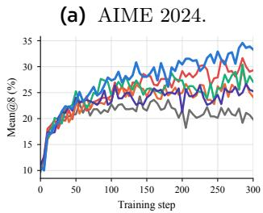

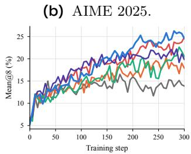

(c) AMC 2023.  
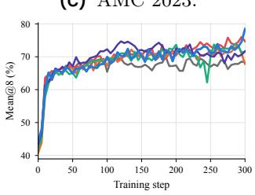

(d) HMMT 2025.  
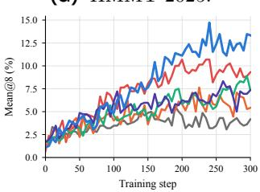  
Figure 5 Validation mean@8 on the four individual benchmarks throughout training.

## E.2 Analysis of Training Diagnostics

Figure 6 provides additional diagnostics for the optimization dynamics. The clip-fraction curves in Figure 6a show that EPIC maintains a persistently active clipping regime throughout the later stages of training, with a clip fraction on the same order as GSPO. In contrast, GRPO, DAPO, and RIPO operate with substantially smaller late-stage clip fractions. This indicates that the prefix-level trust region continues to influence the update rather than becoming efectively inactive.

The entropy trajectories in Figure 6b show diferent degrees of policy concentration across methods. GRPO and RIPO gradually reach entropy values on the order of $1 0 ^ { - 2 }$ , indicating a strong reduction in output diversity. DAPO instead enters a higher and more variable entropy regime during the later stages of training. EPIC remains in an intermediate entropy regime, suggesting that its improved performance is not obtained by either excessive entropy collapse or uncontrolled entropy growth.

The gradient-norm curves in Figure 6c indicate that all methods experience a rapid reduction in update magnitude during the initial stage. After this transient, EPIC maintains a comparatively controlled gradient scale and does not exhibit the sustained late-stage growth observed for some baselines. Thus, its active clipping regime is not accompanied by excessively large parameter updates.

(d) Train–rollout gap.

$$
\overline { { \overline { { \mathbf { \Lambda } } } } } \overline { { \mathbf { \Lambda } } } \overline { { \mathrm { G R P O } } } \mathbf { \Lambda } \overline { { \mathbf { \Lambda } } } \overline { { \mathbf { \Lambda } } } \overline { { \mathbf { \Lambda } } } \overline { { \mathbf { \Lambda } } } \overline { { \mathbf { \Lambda } } } \overline { { \mathbf { \Lambda } } } \overline { { \mathbf { \Lambda } } } \overline { { \mathbf { \Lambda } } } \overline { { \mathbf { \Lambda } } } \overline { { \mathbf { \Lambda } } } \overline { { \mathbf { \Lambda } } } \overline { { \mathbf { \Lambda } } } \overline { { \mathbf { \Lambda } } } \overline { { \mathbf { \Lambda } } } \overline { { \mathbf { \Lambda } } } \overline { { \mathbf { \Lambda } } } \overline { { \mathbf { \Lambda } } } \overline { { \mathbf { \Lambda } } } \overline { { \mathbf { \Lambda } } } \overline { { \mathbf { \Lambda } } } \overline { { \mathbf { \Lambda } } } \overline { { \mathbf { \Lambda } } } \overline { { \mathbf { \Lambda } } } \overline { { \mathbf { \Lambda } } } \overline { { \mathbf { \Lambda } } } \overline { { \mathbf { \Lambda } } } \overline { { \mathbf { \Lambda } } } \overline { { \mathbf { \Lambda } } } \overline { { \mathbf { \Lambda } } } \overline { { \mathbf { \Lambda } } } \overline { { \mathbf { \Lambda } } } \overline { { \mathbf { \Lambda } } } \overline { { \mathbf { \Lambda } } } \overline { { \mathbf { \Lambda } } } \overline { { \mathbf { \Lambda } } } \overline { { \mathbf { \Lambda } } } \overline { { \mathbf { \Lambda } } } \overline { { \mathbf { \Lambda } } } \overline { { \mathbf { \Lambda } } } \overline { { \mathbf { \Lambda } } } \overline { { \mathbf { \Lambda } } } \overline { { \mathbf { \Lambda } } } \overline { { \mathbf { \Lambda } } \mathbf { \Lambda } } \overline { { \Lambda } \mathbf { \Lambda } } \overline { \mathbf { \Lambda } } \overline { \Lambda } \overline { \Lambda } \overline { \mathbf { \Lambda } \Lambda } \overline { \Lambda } \overline { \Lambda } \mathbf { \Lambda } \mathbf { \Lambda } \mathbf { \Lambda \Lambda } \mathbf { \Lambda } \Lambda \Lambda \Lambda 
$$

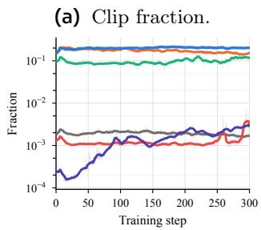

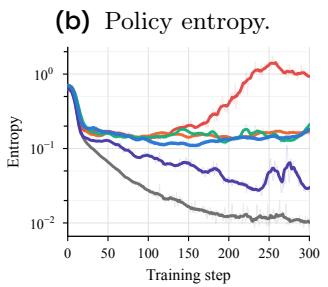

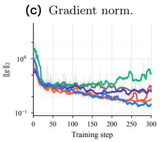

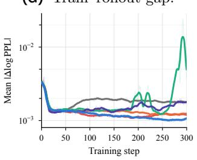  
Figure 6 Additional training dynamics under the aligned of-policy MoE setting. Curves average three seeds at matching training steps. Clip fraction, policy entropy, gradient norm, and train–rollout gap are shown on logarithmic vertical scales.

Finally, Figure 6d shows the mean absolute train–rollout log-probability gap. After the initial transient, the gap remains at a small numerical scale for most methods, while EPIC maintains one of the lowest and most stable late-stage values. This behavior is consistent with the intended role of the prefix-aware objective: it regulates policy changes under rollout reuse without requiring the additional routing-alignment mechanisms used by replay-based approaches. Taken together, the four diagnostics show that EPIC combines persistent trust-region activity, controlled update magnitudes, non-collapsed entropy, and close train–rollout consistency.

## E.3 Behavior Outside the Local-Approximation Regime

We examine whether the cumulative prefix ratios observed in our main EPIC experiment remain close enough to one to justify a local quadratic approximation. Let $s = \log r _ { i , t } ^ { \mathrm { p r e } }$ , and let $m _ { j }$ denote the mean of |s| over valid response tokens at training step j. The distribution of these step-level aggregates must be distinguished from the distribution of individual token-level log-ratios.

Observed cumulative deviations. Figure 7a shows that the logged magnitude does not remain near zero. Across training steps, its median is 0.697, its 90th percentile is 0.926, and its maximum is 1.255, reached at step 245. The mean over steps 201–300 is 0.873, and 298 of the 300 recorded step-level aggregates exceed 0.5. These observations indicate that cumulative prefix deviations are not uniformly confined to an infinitesimal neighborhood of $s = 0 .$ , motivating a trust-region coordinate that does not require this local assumption.

Implications for the divergence coordinate. Figure 7b evaluates the discrepancy between $\exp ( s ) - 1 - s$ and $s ^ { 2 } / 2$ at $s = \pm m$ , using the median, 90th-percentile, and maximum logged magnitudes as reference points. At the median magnitude, the quadratic approximation underestimates the positive-side coordinate by 21.8% and overestimates the negative-side coordinate by 24.5%. These discrepancies increase to 28.3% and 33.1% at the 90th-percentile magnitude, and to 37.1% and 45.8% at the maximum magnitude. For a fixed coordinate budget, the quadratic approximation therefore permits a looser upper ratio bound and imposes a tighter lower ratio bound than the unapproximated coordinate. Retaining the full coordinate avoids this approximation-induced distortion of the two sides of the trust region. The observed magnitudes and the associated analytical discrepancies support this design motivation, but do not by themselves isolate its contribution to benchmark performance. In particular, evaluating a nonlinear coordinate at a logged aggregate does not recover the average coordinate or approximation error over individual tokens.

(a) Observed prefix log-ratio magnitude.  
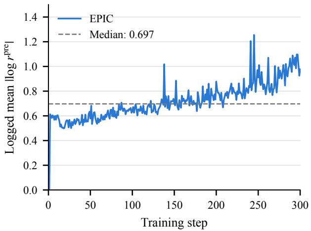

(b) Error at representative magnitudes.  
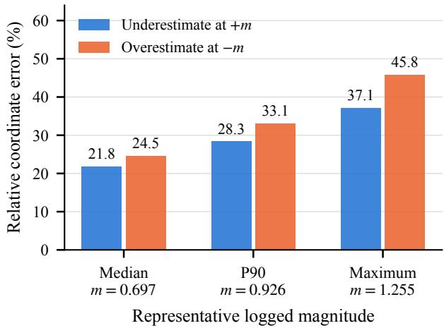  
Figure 7 Local-approximation diagnostics for the main EPIC run. (a) Logged mean absolute cumulative prefix log-ratio at each training step; the dashed line marks its median across steps. (b) Relative error of the quadratic coordinate $s ^ { 2 } / 2$ , evaluated at positive and negative representative magnitudes from panel (a), with $\exp ( s ) - 1 - s$ as the reference denominator. These are analytical evaluations at representative magnitudes, not measured averages of token-level approximation errors.

## E.4 Ablation of Prefix-Probability Calibration

We disentangle two design choices in EPIC: the behavior-policy probability used to calibrate the trust-region budget and the scale used to represent the prefix ratio in the optimization objective. The three configurations are summarized in Table 3.

The Raw-prob ablation replaces the geometric-mean behavior probability in the budget calibration with the unnormalized cumulative probability $\mu ( o _ { i , 1 : t } \mid x )$ . The Cumulative-ratio ablation keeps the geometric-mean probability calibration but uses the cumulative prefix ratio directly in the optimization objective. The final row is the default EPIC configuration, which applies geometric averaging to both the behavior-policy probability and the prefix optimization ratio.

The validation trajectories in Figure 8 show a clear diference between raw and geometric probability calibration. Raw-prob reaches approximately 27.1% on the final AIME24 evaluation, compared with approximately 31.3% for Cumulative-ratio and 33.3% for EPIC.

The gradient trajectories provide evidence that raw prefix probabilities can induce less stable optimization. In particular, Raw-prob exhibits a larger early gradient spike, reaching a maximum gradient norm of approximately 3.98, compared with approximately 2.00 for Cumulative-ratio and approximately 1.73 for EPIC. This behavior is consistent with the strong length dependence of the unnormalized cumulative prefix probability.

The position-wise profiles show the mechanism behind this diference. With Raw-prob, clipping is concentrated almost entirely in the first relative-position bin and becomes negligible afterward. In contrast, Cumulative-ratio and EPIC remain close to their position-wise mean across the response. Thus, replacing the raw cumulative probability with a geometric average removes the severe position imbalance induced by the exponential length dependence of the prefix probability.

Table 3 Configurations used in the prefix-probability ablation.
<table><tr><td>Configuration</td><td></td><td>Budget calibration Optimization ratio</td></tr><tr><td rowspan="2">Raw-prob</td><td> $t \delta ^ { \pm }$ </td><td> $\left[ r _ { i , t } ^ { \mathrm { p r e } } ( \theta ) \right] ^ { 1 / t }$ </td></tr><tr><td> $\mu ( o _ { i , 1 : t } \mid x )$  tδ±</td><td></td></tr><tr><td rowspan="2">Cumulative-ratio</td><td></td><td> $r _ { i , t } ^ { \mathrm { p r e } } ( \theta )$ </td></tr><tr><td> $\overline { { [ \mu ( o _ { i , 1 : t } \mid x ) ] } } ^ { 1 / t }$ </td><td></td></tr><tr><td rowspan="2">EPIC (default)</td><td></td><td> $\left[ r _ { i , t } ^ { \mathrm { p r e } } ( \theta ) \right] ^ { 1 / t }$ </td></tr><tr><td> $\overline { { [ \mu ( o _ { i , 1 : t } \mid x ) ] ^ { 1 / t } } }$ </td><td></td></tr></table>

(a) AIME24 validation.

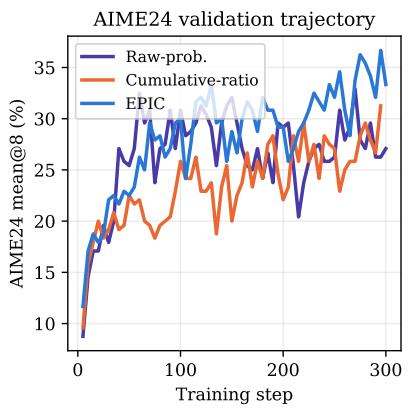  
(b) Gradient norm.

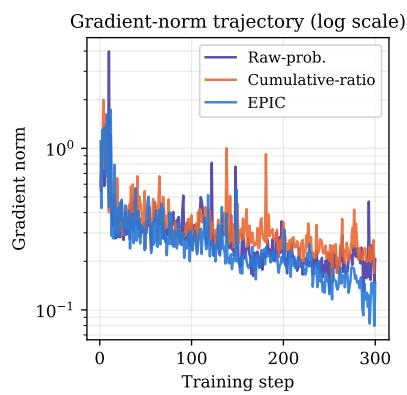  
(c) Position-wise clipping.

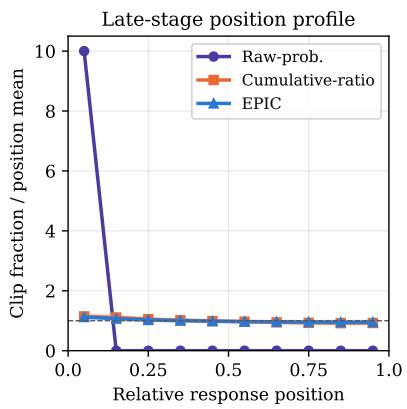  
Figure 8 Ablation of prefix-probability calibration. The three panels show AIME24 validation performance, gradientnorm trajectories on a logarithmic scale, and late-stage position-wise clipping profiles. In the right panel, clipping fractions are normalized by the mean across position bins at each training step; shaded regions indicate the standard deviation over steps 201–300.

## E.5 Memory Cost of Routing-Replay State

Routing replay introduces additional state beyond the token IDs, log-probabilities, and rewards required by the policy objective. For each retained token, it records the selected experts at every MoE layer so that the routing decisions can be reused during subsequent policy evaluations. In the historical implementation associated with our experiments, R2 converts the recorded expert indices to uint8 before transferring them to CPU memory. The vLLM backport used for R3 instead stores the rollout routing indices as int32, including its host shared-memory bufer. The subsequent agent-loop processing preserves this dtype when constructing padded routing tensors.

Storage estimate. For a batch containing N responses, each stored at length T, the memory required by one dense tensor of routing indices is

$$
M _ { \mathrm { i n d i c e s } } = N T L _ { \mathrm { M o E } } K b ,\tag{40}
$$

where $L _ { \mathrm { M o E } }$ is the number of MoE layers, K is the number of selected experts per token, and b is the number of bytes per index. Qwen3-30B-A3B has 48 MoE layers and selects eight experts per token. Our rollout batch contains 64 $\times 8 = 5 1 2$ responses, and the configured maximum prompt-plus-response length is $2 , 0 4 8 + 1 6 , 3 8 4 = 1 8 , 4 3 2$ tokens. Table 4 reports the corresponding single-copy storage estimates. For the same tensor shape, the R3 rollout representation requires four times as much storage as the compressed R2 representation.

Relation to observed process memory. Beyond the single-tensor storage estimated in Table 4, the processmemory diferences in the main-text figure also reflect shared-memory mappings, temporary storage during routing-index collection and concatenation, and larger routing tensors produced during validation. The R3 rollout backend copies routing indices out of shared memory; the agent loop then constructs padded tensors and concatenates them within workers, followed by batch aggregation in the training coordinator. R2 likewise performs gathering, CPU transfer, and concatenation of recorded indices. Inputs and newly allocated outputs may coexist during these operations, increasing transient memory usage. R3 also allocates a host shared-memory bufer according to the configured KV-token capacity, whose size need not equal that of the current response batch. These storage and data-movement mechanisms provide a concrete explanation for why routing replay can incur substantial CPU-memory overhead, consistent with the process-memory diferences in Figure 4b.

Table 4 Estimated storage for one dense routing-index tensor.
<table><tr><td></td><td></td><td></td><td colspan="2">Single-copy storage (GiB)</td></tr><tr><td>Routing state</td><td></td><td>Index dtype Bytes/index</td><td>T = 9,000</td><td>T = 18,432</td></tr><tr><td>R2 CPU indices</td><td>uint8</td><td>1</td><td>1.65</td><td>3.375</td></tr><tr><td>R3 rollout indices</td><td>int32</td><td>4</td><td>6.59</td><td>13.50</td></tr></table>