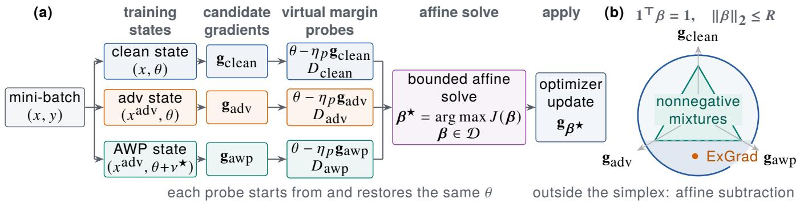
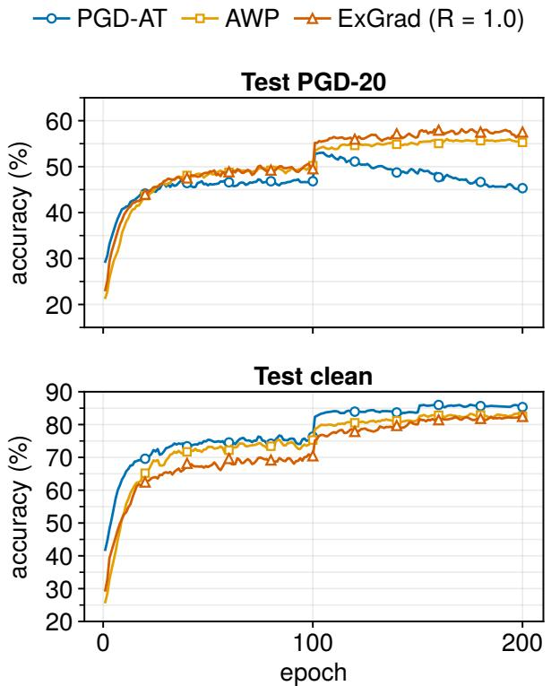
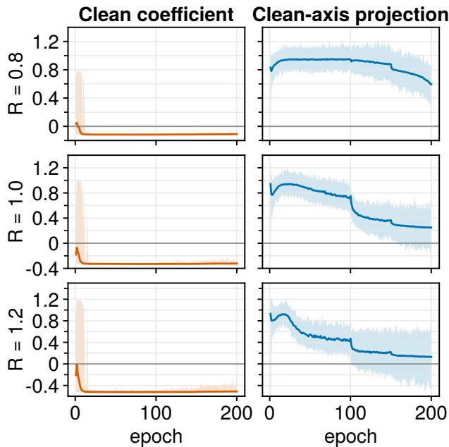

# ExGrad: Beyond Suppression—Explicit Clean-Gradient Subtraction in Adversarial Training

Zhiyuan Ye1, Xiangyu Zhou2, Ji Qi2,\*, Hao Zhang1,\*, and Yi Zhou1,

1University of Science and Technology of China

2China Mobile (Suzhou) Software Technology Co., Ltd.

zhiyuan.ye@mail.ustc.edu.cn, {zhouxiangyu,qiji}@cms.chinamobile.com,

{hzhangzy,yi\_zhou}@ustc.edu.cn

\*Corresponding authors

## Abstract

Adversarial training usually derives updates from predefined surrogate losses, but source-loss descent does not directly characterize an update’s finite-step efect on current adversarial margins. We introduce ExGrad (extrapolative gradient recomposition), which constructs gradients at clean-input, adversarial-input, and adversarial-weight-perturbed (AWP) states for each mini-batch. Lightweight virtual steps measure their local margin responses, after which a globally solvable three-variable problem selects their coeficients over a bounded afine domain without nonnegativity constraints. Across diferent afine radii R on CIFAR-10, negative clean coeficients rapidly become predominant, and their magnitude increases with R. Cross-zero interventions show that setting this coeficient to zero is insuficient: mild subtraction further improves PGD-20, while stronger subtraction trades clean accuracy for additional PGD-20. In CIFAR-10 WRN-28-4 controls, none of the three tested candidate-removal variants matches full ExGrad, showing that subtraction requires both adversarial directions in this setting. Projection diagnostics show that a negative clean coordinate usually coexists with a positive net clean-axis projection, although both decrease as the radius grows. Norm-matched controls further indicate that update magnitude alone does not explain the moderate-radius gains. Experiments on CIFAR-10, CIFAR-100, and ImageNet-100 show radius-dependent improvements over AWP. On CIFAR-100, ExGrad with R = 0.8 improves all five reported metrics, including clean and AutoAttack accuracy by 3.84 and 1.75 percentage points, respectively. On ImageNet-100, the same radius improves all four robust metrics over both AWP and PGD-AT. These results identify explicit clean-gradient subtraction as a response-revealed update preference whose strength and clean–robust operating point are controlled by the afine radius.

## Introduction

Adversarial robustness depends on the stability of a classifier’s local decision geometry. For an input x with label y, define the signed classification margin

$$
m _ { \theta } ( x , y ) = f _ { y } ( x ; \theta ) - \operatorname* { m a x } _ { k \neq y } f _ { k } ( x ; \theta ) ,
$$

where $f _ { k } ( x ; \theta )$ is the logit of class k. A robust model must preserve a suficient margin not only at the clean input but throughout the allowed input neighborhood (Szegedy et al. 2014; Goodfellow, Shlens, and Szegedy 2015; Madry et al.

2018). Decision-boundary distance and local loss linearity provide complementary geometric views of this neighborhood (Moosavi-Dezfooli, Fawzi, and Frossard 2016; Qin et al. 2019). Adversarial training can therefore be viewed as repeatedly reshaping this local geometry through parameter updates.

Most robust-training procedures obtain an update directly from a predefined surrogate loss. A gradient $\mathbf { g } = \nabla _ { \boldsymbol { \theta } } L ( \boldsymbol { \theta } )$ is the first-order sensitivity of its source loss: moving along −g locally reduces L. This source-loss descent sensitivity, however, is not the same quantity as the response of a target adversarial margin. For a small step,

$$
\begin{array} { c } { { m _ { \theta ^ { \prime } } ( x , y ) - m _ { \theta } ( x , y ) \approx - \eta \langle \nabla _ { \theta } m _ { \theta } ( x , y ) , { \bf g } \rangle , } } \\ { { \theta ^ { \prime } = \theta - \eta { \bf g } . } } \end{array}
$$

A direction may reduce the loss from which it was derived yet provide limited margin improvement, or even compress the margin of some adversarial examples. The locally preferred update is consequently determined by its efect on the target geometry, not by its source label alone.

This mismatch is not resolved by tuning a surrogate-loss coeficient. Such a coeficient controls how source objectives generate an update, but it does not report how that update changes the adversarial margin of the current mini-batch. Gradient norms and pairwise angles are also insuficient for this purpose: they describe the candidate directions relative to one another, rather than their efects on the target geometry. This motivates treating a gradient as a candidate parameter intervention whose consequence should be measured before it is selected.

This distinction becomes actionable when several training states already provide plausible directions. We consider gradients evaluated on clean inputs, adversarial inputs, and adversarial inputs under adversarial weight perturbation (AWP), denoted by gclean, gadv, and $\mathbf { g } _ { \mathrm { a w p } } .$ The first captures nominal fitting, the second input-neighborhood robust fitting, and the third the correction induced by a perturbed parameter neighborhood (Wu, Xia, and Wang 2020). Their efects can complement or cancel one another and can change with the mini-batch and training stage. Fixed loss weights, gradient norms, or pairwise angles do not directly measure these efects on the adversarial margin.

These candidates are not three unrelated tasks. They form a nested sequence of training states: clean input at nominal weights, adversarial input at nominal weights, and adversarial input at perturbed weights. Each transition adds a robustness-relevant state change, while the adversarial margin supplies a common criterion for comparing all three candidate updates.

We introduce ExGrad, short for extrapolative gradient recomposition. For every mini-batch, ExGrad applies a lightweight virtual update along each candidate gradient from the same nominal parameters, measures the resulting finite-step adversarial-margin response, restores the parameters, and solves for a single recomposed update. The coeficients satisfy

$$
\left\{ \begin{array} { l l } { \displaystyle \mathbf { g } _ { \boldsymbol { \beta } } = \beta _ { \mathrm { c l e a n } } \mathbf { g } _ { \mathrm { c l e a n } } + \beta _ { \mathrm { a d v } } \mathbf { g } _ { \mathrm { a d v } } + \beta _ { \mathrm { a w p } } \mathbf { g } _ { \mathrm { a w p } } , } \\ { \displaystyle \mathbf { 1 } ^ { \top } { \boldsymbol { \beta } } = 1 , \qquad \| { \boldsymbol { \beta } } \| _ { 2 } \leq R . } \end{array} \right.
$$

The unit-sum constraint defines an afine combination, while the radius R bounds its departure from balanced recomposition. Unlike a nonnegative loss mixture, this domain lets the measured response suppress, remove, or subtract a candidate direction. The coeficients are therefore determined from the measured responses rather than prescribed in advance.

Probing every candidate from the same nominal parameters makes the measured responses directly comparable. The virtual parameters are discarded after measurement, so only the recomposed direction is committed to the optimizer. This finite-step construction evaluates the consequence of an update in the units used by training, without requiring an analytic derivative through the adversarial-example or weight-perturbation construction.

The measured dynamics reveal a persistent negative clean coeficient. A majority of mini-batches already select $\beta _ { \mathrm { c l e a n } } < 0$ 0 at the beginning of training, the proportion rapidly approaches one, and some early mini-batches remain positive. This behavior is stronger than simply assigning the clean direction a small weight: it crosses the zero-clean boundary into explicit subtraction within the selected afine representation. A controlled intervention confirms that setting $\beta _ { \mathrm { c l e a n } } = 0$ does not reproduce the same robustness profile as a mild negative value.

The zero point therefore marks the boundary between clean-gradient removal and explicit afine subtraction. A positive coeficient retains clean descent, zero removes it from the afine representation, and a negative coeficient explicitly subtracts it. In the intervention, the adversarial and AWP coeficients remain response-adaptive, isolating whether suppression is suficient or crossing into subtraction helps.

The afine coordinate must nevertheless be distinguished from the complete update geometry. Because $\mathbf { g } _ { \mathrm { a d v } }$ and gawp can also project onto $\mathbf { g } _ { \mathrm { c l e a n } } $ , a negative $\beta _ { \mathrm { c l e a n } }$ does not imply that $\mathbf { g } _ { \beta }$ has a negative net component along the clean axis. We therefore analyze

$$
p _ { \mathrm { c l e a n } } = \frac { \langle \mathbf { g } _ { \beta } , \mathbf { g } _ { \mathrm { c l e a n } } \rangle } { \| \mathbf { g } _ { \mathrm { c l e a n } } \| _ { 2 } ^ { 2 } } .
$$

Both $\beta _ { \mathrm { c l e a n } }$ and $p _ { \mathrm { c l e a n } }$ decrease as R grows, indicating that stronger negative clean coeficients progressively suppress the realized clean-axis component. Complete reversal is rarer and appears mainly at the largest radius late in training.

Norm-matched controls further show that the directional effect survives after matching the recomposed update to the AWP gradient norm, although update magnitude contributes to part of the gain at larger R.

We evaluate ExGrad on CIFAR-10, CIFAR-100, and ImageNet-100 with two Wide ResNet capacities. At suitable radii, ExGrad improves the principal robustness metrics over AWP across all three datasets. The improvements include all four robustness metrics on CIFAR-10 with WRN-34-10, all five reported clean and robust metrics on CIFAR-100, and all four robustness metrics on ImageNet-100. Our contributions are:

• We separate source-loss descent sensitivity from finitestep adversarial-margin response and use the latter to select robust-training updates.

• We propose a lightweight, convex, batch-wise coeficient solver over the bounded afine span of clean, adversarialinput, and AWP gradients.

• We identify explicit clean-gradient subtraction, intervene across its zero boundary, and distinguish its afine coordinate from the net clean-axis projection.

• We use multi-seed cross-dataset evaluation and normmatched controls to establish the performance efect and delimit scale-based explanations.

## Related Work

Robust objectives and instance regulation. PGD-AT approximates input-space robust optimization (Madry et al. 2018), while TRADES regulates natural and boundary errors through an objective-level coeficient (Zhang et al. 2019). Robust generalization can require additional data (Schmidt et al. 2018; Carmon et al. 2019), while standard learning may exploit predictive but non-robust features (Ilyas et al. 2019). MART, fast training, consistency regularization, and robustoverfitting studies modify the objective, attack construction, regularization, or schedule (Wang et al. 2020; Wong, Rice, and Kolter 2020; Rice, Wong, and Kolter 2020; Tack et al. 2022); geometry-aware, margin-aware, and hard-class-aware methods reweight examples (Zhang et al. 2021; Wang et al. 2021; Hou, Han, and Li 2023). Together, these works expose the clean–robust trade-of (Tsipras et al. 2019), but regulate how source losses generate an update. ExGrad instead measures how already-constructed candidate updates change the current adversarial margin.

Parameter-neighborhood robustness. AWP constructs a worst-case perturbation in a constrained weight neighborhood and updates the nominal model using the perturbedweight adversarial gradient (Wu, Xia, and Wang 2020). This complements the input neighborhood of PGD-AT with parameter-neighborhood information. Sharpness-aware minimization provides a broader parameter-neighborhood perspective (Foret et al. 2021), and robust-loss flatness has been linked to robust generalization (Stutz, Hein, and Schiele 2021). Analyses of SAM further emphasize optimizationinduced implicit bias (Andriushchenko and Flammarion 2022). ExGrad retains the standard AWP state as a candidate rather than redefining its objective or prescribing its weight.

  
Figure 1: Overview of ExGrad. (a) A mini-batch update in which three state-dependent gradients are probed from the same nominal parameters; their margin responses determine one afine recomposition, and only the recomposed gradient advance the optimizer. (b) The bounded unit-sum domain intersects the nonnegative simplex and extends beyond it to permit responsesupported subtraction.

Gradient recomposition and conflict. Multi-objective optimization and multi-task learning have developed controls based on Pareto stationarity, rate balancing, conflict projection, and worst-task improvement (Sener and Koltun 2018; Chen et al. 2018; Yu et al. 2020; Liu et al. 2021). Conflict-aware adversarial training similarly studies interference between clean and adversarial gradients (Xue et al. 2024). These methods use source-gradient geometry or joint descent conditions. ExGrad instead evaluates diferent input– parameter states against one margin target, permits negative coeficients, and does not require every source loss to descend.

Virtual updates and margin signals. Virtual optimization steps have been used to learn example weights from a validation objective (Ren et al. 2018; Shu et al. 2019). Task-afinity methods similarly measure how one task’s step changes another task’s loss (Fifty et al. 2021). Marginbased attacks and training objectives characterize robustness through shortest input-space distances to a decision boundary (Moosavi-Dezfooli, Fawzi, and Frossard 2016; Ding et al. 2020) or class-logit margins within a perturbation set (Gao et al. 2022). Without a validation set, ExGrad applies this response logic to restored probes of the same mini-batch margin, then solves a low-dimensional afine problem. Evaluation with PGD, APGD-CE, APGD-T, and AutoAttack guards against conclusions tied to a weak or single attack (Athalye, Carlini, and Wagner 2018; Croce and Hein 2020).

## Method

## Candidate Gradients from Nested Training States

Let $f _ { \theta }$ be a classifier and ℓ cross-entropy. For each mini-batch, we first generate detached adversarial examples $x _ { i } ^ { \mathrm { a d v } } = x _ { j } +$ $\delta _ { j } ^ { \star }$ using PGD at the nominal parameters θ. Holding these inputs fixed, AWP computes a detached perturbation $\nu ^ { \star }$ with the standard layer-wise relative bound $\| \dot { \nu } _ { \ell } ^ { \star } \| _ { 2 } \leq \gamma \| \theta _ { \ell } \| _ { 2 } ( \mathbf { W u }$

Xia, and Wang 2020). We define three source losses:

$$
\left\{ \begin{array} { l l } { \displaystyle { L _ { \mathrm { c l e a n } } = \frac { 1 } { B } \sum _ { j = 1 } ^ { B } \ell ( f _ { \theta } ( x _ { j } ) , y _ { j } ) , } } \\ { \displaystyle { L _ { \mathrm { a d v } } = \frac { 1 } { B } \sum _ { j = 1 } ^ { B } \ell ( f _ { \theta } ( x _ { j } ^ { \mathrm { a d v } } ) , y _ { j } ) , } } \\ { \displaystyle { L _ { \mathrm { a w p } } = \frac { 1 } { B } \sum _ { j = 1 } ^ { B } \ell ( f _ { \theta + \nu ^ { * } } ( x _ { j } ^ { \mathrm { a d v } } ) , y _ { j } ) . } } \end{array} \right.\tag{1}
$$

Their candidate gradients are $\mathbf { g } _ { \mathrm { c l e a n } } = \nabla _ { \boldsymbol { \theta } } L _ { \mathrm { c l e a n } } , \mathbf { g } _ { \mathrm { a d v } } =$ $\nabla _ { \boldsymbol { \theta } } L _ { \mathrm { a d v } } ,$ , and $\mathbf { g } _ { \mathrm { a w p } } ~ = ~ \nabla _ { \theta } L _ { \mathrm { a w p } }$ . Both perturbations are treated as constants during these gradient computations. After $\mathbf { g } _ { \mathrm { a w p } }$ is obtained, $\nu ^ { \star }$ is removed, so all probes and the eventual optimizer update act on the same nominal parameters.

The candidates correspond to the nested state path

$$
( \theta , x )  ( \theta , x + \delta ^ { \star } )  ( \theta + \nu ^ { \star } , x + \delta ^ { \star } ) .
$$

## Finite-Step Adversarial-Margin Response

For the fixed adversarial input $x _ { j } ^ { \mathrm { a d v } }$ , let $z _ { j } ( \theta )$ be its logits. We use the signed top-1 margin and a detached sample-wise logit scale:

$$
\left\{ \begin{array} { l l } { m _ { j } ( \theta ) = z _ { j , y _ { j } } ( \theta ) - \displaystyle \operatorname* { m a x } _ { k \neq y _ { j } } z _ { j , k } ( \theta ) , } \\ { \quad s _ { j } = \mathrm { S t d } _ { k } ( z _ { j , k } ( \theta ) ) + \varepsilon _ { s } . } \end{array} \right.\tag{2}
$$

For each $i \in \{ \mathrm { c l e a n } , \mathrm { a d v } , \mathrm { a w p } \}$ , ExGrad starts from the same $\theta ,$ performs a virtual move $\widetilde { \theta } _ { i } = \theta - \eta _ { p } \mathbf { g } _ { i }$ , measures the margin, and restores θ. The sample-wise response rate is

$$
\left\{ { { D } _ { j , i } } = \frac { { { m } _ { j } } \left( \theta - { { \eta } _ { p } } { \bf { g } } _ { i } \right) - { { m } _ { j } } \left( \theta \right) } { { { \eta } _ { p } } } , \right.\tag{3}
$$

Here, η is the optimizer learning rate and κ is the probe factor. Stacking the responses gives $\mathbf { \bar { D } } \in \mathbb { R } ^ { B \times 3 }$ . For suficiently small $\eta _ { p } .$

$$
D _ { j , i } \approx - \langle \nabla _ { \boldsymbol { \theta } } m _ { j } ( \boldsymbol { \theta } ) , \mathbf { g } _ { i } \rangle .
$$

The probe therefore estimates the response of the target margin to the candidate parameter move rather than comparing source losses or candidate angles. Parameter restoration also avoids diferentiating through PGD, AWP, or the candidate gradient fields.

The local afine prediction under $\beta$ is

$$
\widehat { m } _ { j } ( \beta ) = m _ { j } ( \theta ) + \eta _ { p } \mathbf { D } _ { j , : } \beta .\tag{4}
$$

Let

$$
b _ { j } = \frac { m _ { j } ( \theta ) } { s _ { j } } , \qquad \mathbf { a } _ { j } = \frac { \eta _ { p } \mathbf { D } _ { j , : } ^ { \top } } { s _ { j } } .
$$

The normalized predicted margin is then $r _ { j } ( \beta ) = b _ { j } + \mathbf { a } _ { j } ^ { \top } \beta .$ The scale $s _ { j }$ prevents examples with large logit magnitudes from dominating the coeficient problem and remains fixed throughout the local solve.

## Bounded Afine Coeficient Solver

Let $\sigma ( r ) = ( 1 + e ^ { - r } ) ^ { - 1 }$ denote the logistic sigmoid. We use the log-sigmoid utility $u ( r ) = \log \bar { \sigma } ( r )$ . Its derivative $u ^ { \prime } ( r ) = \bar { \sigma ( - r ) }$ gives larger weight to adversarial examples with small or negative predicted margins while saturating on already safe examples. ExGrad solves

$$
\{ \begin{array} { l l } { \displaystyle { \boldsymbol { \beta } } ^ { \star } = \arg \operatorname* { m a x } _ { { \boldsymbol { \beta } } \in { \mathcal { D } } } J ( { \boldsymbol { \beta } } ) , } \\ { \displaystyle J ( { \boldsymbol { \beta } } ) = \frac { 1 } { B } \sum _ { j = 1 } ^ { B } \log \sigma ( b _ { j } + \mathbf { a } _ { j } ^ { \top } { \boldsymbol { \beta } } ) , } \\ { \displaystyle { \mathcal { D } } = \{ { \boldsymbol { \beta } } \in \mathbb { R } ^ { 3 } | ~ \mathbf { 1 } ^ { \top } { \boldsymbol { \beta } } = 1 , ~ \| { \boldsymbol { \beta } } \| _ { 2 } \leq R \} . } \end{array}\tag{5}
$$

The feasible set intersects the nonnegative simplex but does not impose $\beta _ { i } \geq 0$ . Writing $\bar { \boldsymbol { \beta } } = \mathbf { 1 } / 3$ , the unit-sum condition yields

$$
\| \beta \| _ { 2 } ^ { 2 } = \frac { 1 } { 3 } + \| \beta - { \bar { \beta } } \| _ { 2 } ^ { 2 } .
$$

Hence D is a disk of radius $\rho _ { R } = \sqrt { R ^ { 2 } - 1 / 3 }$ within the unit-sum plane and is nonempty exactly when $R \geq 1 / { \sqrt { 3 } } .$ The radius controls how far the solver may move from the uniform afine combination.

For fixed probe responses,

$$
\nabla _ { \beta } ^ { 2 } J ( \beta ) = - \frac { 1 } { B } \sum _ { j = 1 } ^ { B } \sigma ( r _ { j } ) \sigma ( - r _ { j } ) \mathbf { a } _ { j } \mathbf { a } _ { j } ^ { \top } \preceq 0 .\tag{6}
$$

The objective is therefore concave, while D is convex and compact. The three-variable subproblem has a global optimum, and every KKT point is globally optimal. This statement concerns only the local coeficient problem, not neuralnetwork training as a whole. In particular, the guarantee applies to the finite-step afine response predictor in Eq. (4), rather than the exact margin after the recomposed update. We solve it by deterministic projected gradient ascent with monotonic backtracking.

## Training Procedure and Geometric Diagnostics

Each iteration performs five operations: generate $x ^ { \mathrm { a d v } }$ and $\nu ^ { \star } \mathrm { i }$ ; compute the three detached candidate gradients; remove $\nu ^ { \star }$ and probe each direction from the same nominal parameters; solve Eq. (5); and pass g ⋆ to the optimizer for one real update. Batch-normalization statistics and optimizer momentum are not advanced during probes.

The coeficient $\beta _ { \mathrm { c l e a n } }$ is the explicit clean coordinate in the selected afine frame. To account for correlations among candidates, we also measure the clean-axis projection

$$
p _ { \mathrm { c l e a n } } = \frac { \langle \mathbf { g } _ { \beta } , \mathbf { g } _ { \mathrm { c l e a n } } \rangle } { \| \mathbf { g } _ { \mathrm { c l e a n } } \| _ { 2 } ^ { 2 } } .\tag{7}
$$

Expanding $\mathbf { g } _ { \beta }$ gives

$$
\begin{array} { r l } & { p _ { \mathrm { c l e a n } } = \beta _ { \mathrm { c l e a n } } + \beta _ { \mathrm { a d v } } \frac { \langle \mathbf { g } _ { \mathrm { a d v } } , \mathbf { g } _ { \mathrm { c l e a n } } \rangle } { \| \mathbf { g } _ { \mathrm { c l e a n } } \| _ { 2 } ^ { 2 } } } \\ & { ~ + \beta _ { \mathrm { a w p } } \frac { \langle \mathbf { g } _ { \mathrm { a w p } } , \mathbf { g } _ { \mathrm { c l e a n } } \rangle } { \| \mathbf { g } _ { \mathrm { c l e a n } } \| _ { 2 } ^ { 2 } } . } \end{array}
$$

A negative coeficient records explicit subtraction in the afine representation, whereas $p _ { \mathrm { c l e a n } } < 0$ records a negative net component of the full update along the clean axis.

Relative to AWP, ExGrad reuses the PGD examples, weight-perturbation construction, and the perturbed-weight adversarial backward pass. It additionally computes clean and nominal-adversarial backward passes; the remaining overhead consists of three margin-forward probes and a negligible three-variable solve. ExGrad does not change model size or inference cost.

## Experiments

## Experimental Setup

Datasets and architectures. To test transfer across dataset scale and class diversity, we evaluate the standard CIFAR-10 and CIFAR-100 adversarial-training benchmarks (Krizhevsky and Hinton 2009) and ImageNet-100, a higherresolution subset constructed by randomly sampling 100 ImageNet classes (Deng et al. 2009). The sampled class list and further implementation details are included in the supplementary code. WRN-28-4 is the principal architecture, and CIFAR-10 additionally uses WRN-34-10 (Zagoruyko and Komodakis 2016) to test transfer across capacity. All models are trained for 200 epochs. CIFAR augmentation uses random cropping with four-pixel padding and random horizontal flipping. ImageNet-100 uses random resized crops and horizontal flips for training and center crops for evaluation.

Optimization and attacks. All methods use SGD with learning rate 0.1, momentum 0.9, and weight decay $5 \times 1 0 ^ { - 4 } .$ reducing the learning rate tenfold at epochs 100 and 150. CIFAR uses PGD-10 training and PGD-20 evaluation with $\epsilon = 8 / 2 5 5$ and step size $2 / 2 { \bar { 5 } } 5 ;$ ; ImageNet-100 uses PGD-2 training and PGD-10 evaluation with $\epsilon = 4 / 2 5 5$ . TRADES reports $\beta \in \{ 3 , 6 , 9 \}$ under the same training schedule and checkpoint protocol. AWP sets $\gamma ~ = ~ 0 . 0 1$ . ExGrad uses $\kappa = 0 . 1 ;$ its projected solver is initialized at the uniform vector $( 1 / 3 , \bar { 1 / 3 } , \bar { 1 / 3 } )$ , runs for at most 50 iterations, and uses tolerance $1 0 ^ { - 6 }$

<table><tr><td>Dataset</td><td>Model</td><td>Method</td><td>Clean</td><td>PGD</td><td>APGD-CE</td><td>APGD-T</td><td>AA</td></tr><tr><td rowspan="8">CIFAR-10</td><td rowspan="8">WRN-28-4</td><td>PGD-AT</td><td> $8 3 . 0 0 { \scriptstyle \pm 0 . 4 7 }$ </td><td> $5 3 . 4 1 { \pm } 0 . 2 8 $ </td><td> $5 2 . 6 9 { \pm } 0 . 2 7 $ </td><td>49.15±0.21</td><td> $4 9 . 1 2 { \pm } 0 . 2 1 $ </td></tr><tr><td>TRADES (β = 3)</td><td> $\mathbf { 8 4 . 9 4 \pm 1 . 8 4 }$ </td><td> $5 0 . 2 3 { \pm } 0 . 3 9$ </td><td> $4 9 . 4 0 { \pm } 0 . 4 1$ </td><td> $4 7 . 5 0 { \pm } 0 . 3 3 $ </td><td> $4 7 . 5 1 { \pm } 0 . 3 3 $ </td></tr><tr><td>TRADES (β = 6)</td><td> $8 4 . 2 1 { \pm } 0 . 6 7 $ </td><td> $5 2 . 3 3 { \pm } 0 . 3 8 $ </td><td> $5 1 . 6 5 { \pm } 0 . 3 9$ </td><td> $4 9 . 5 4 { \pm } 0 . 0 8$ </td><td> $4 9 . 5 3 { \pm } 0 . 0 5$ </td></tr><tr><td>TRADES (β = 9)</td><td> $8 2 . 4 0 { \pm } 0 . 3 0 $ </td><td> $5 3 . 1 2 { \pm } 0 . 2 3 $ </td><td> $5 2 . 3 8 { \pm } 0 . 1 9$ </td><td> $4 9 . 8 9 { \pm } 0 . 1 5 $ </td><td> $4 9 . 8 8 { \pm } 0 . 1 6 $ </td></tr><tr><td>AWP</td><td> $8 2 . 6 2 { \pm } 0 . 3 4$ </td><td> $5 6 . 4 8 { \scriptstyle \pm 0 . 2 2 }$ </td><td> $5 5 . 8 0 { \scriptstyle \pm 0 . 2 7 }$ </td><td> $5 1 . 0 9 { \pm } 0 . 0 9 $ </td><td> $5 1 . 0 7 { \pm } 0 . 1 1 $ </td></tr><tr><td> ${ \mathrm { E x G r a d } } ( R = 0 . 8 )$ </td><td> $8 3 . 7 5 { \scriptstyle \pm 0 . 2 1 }$ </td><td> $5 6 . 5 1 { \pm } 0 . 1 7 $ </td><td> $5 5 . 5 7 { \pm } 0 . 1 9$ </td><td> ${ \bf 5 1 . 2 5 { \pm } 0 . 3 1 }$ </td><td> $\overline { { 5 1 . 2 5 { \pm } { \bf 0 . } 3 0 } }$ </td></tr><tr><td> $\mathrm { E x G r a d } \left( R = 1 . 0 \right)$ </td><td> $8 1 . 1 9 { \pm } 0 . 2 3 $ </td><td> ${ \underline { { 5 8 . 9 5 { \pm } 0 . 0 9 } } }$ </td><td> ${ \pm } 7 . 6 4 { \pm } { \bf 0 . 1 } 2$ </td><td> $5 0 . 7 2 { \scriptstyle \pm 0 . 0 4 }$ </td><td> $5 0 . 7 1 { \scriptstyle \pm 0 . 0 3 }$ </td></tr><tr><td> $\mathrm { E x G r a d } \left( R = 1 . 2 \right)$ </td><td> $7 9 . 7 7 { \scriptstyle \pm 0 . 0 8 }$ </td><td> $\mathbf { 5 9 . 2 3 } \pm \mathbf { 0 . 2 7 }$ </td><td> ${ \underline { { 5 7 . 4 8 \pm 0 . 1 7 } } }$ </td><td> $4 9 . 9 8 { \pm } 0 . 5 1 $ </td><td> $4 9 . 9 6 { \pm } 0 . 4 8$ </td></tr><tr><td rowspan="5">CIFAR-10</td><td rowspan="5">WRN-34-10</td><td>PGD-AT</td><td> $\underline { { 8 5 . 7 4 2 0 . 7 1 } }$ </td><td> $5 5 . 2 1 { \pm } 0 . 3 8 $ </td><td> $5 4 . 4 9 { \pm } 0 . 4 9$ </td><td> $5 1 . 8 6 { \pm } 0 . 3 1 $ </td><td> $5 1 . 8 4 { \pm } 0 . 3 3 $ </td></tr><tr><td>AWP</td><td> $\mathbf { 8 6 . 1 3 } \pm \mathbf { 0 . 2 2 }$ </td><td> $5 8 . 5 2 { \pm } 0 . 1 8 $ </td><td> $5 7 . 6 3 { \pm } 0 . 2 1 $ </td><td> $5 3 . 4 9 { \pm } 0 . 3 8 $ </td><td> $5 3 . 5 1 { \pm } 0 . 3 9 $ </td></tr><tr><td>ExGrad (R = 0.8)</td><td> $8 5 . 3 0 { \pm } 0 . 1 2 $ </td><td> $5 8 . 9 7 { \scriptstyle \pm 0 . 2 2 }$ </td><td> $5 8 . 2 2 { \scriptstyle \pm 0 . 2 6 }$ </td><td> ${ \pm } 3 . 9 7 { \pm } 0 . 2 3 $ </td><td> ${ \pm } 3 . 9 8 { \pm } 0 . 2 3 $ </td></tr><tr><td>ExGrad (R = 1.0)</td><td> $8 4 . 5 8 { \pm } 0 . 8 7$ </td><td> ${ \bf 6 1 . 7 7 } { \scriptstyle \pm 0 . 3 7 }$ </td><td> $\mathbf { 6 0 . 2 8 { \scriptstyle \pm 0 . 3 0 } }$ </td><td> $5 2 . 6 2 { \pm } 0 . 1 9$ </td><td> $5 2 . 6 5 { \pm } 0 . 1 9$ </td></tr><tr><td>ExGrad (R = 1.2)</td><td> $8 3 . 2 7 { \pm } 0 . 5 0 $ </td><td> $6 1 . 2 1 { \pm } 0 . 1 1 $ </td><td> $5 9 . 1 2 { \pm } 0 . 2 9 $ </td><td> $5 1 . 0 2 { \pm } 0 . 4 5$ </td><td> $5 1 . 0 0 { \scriptstyle \pm 0 . 4 7 }$ </td></tr><tr><td rowspan="5">CIFAR-100</td><td rowspan="5">WRN-28-4</td><td>PGD-AT</td><td> $5 3 . 6 9 { \pm } 1 . 3 7$ </td><td> $2 8 . 8 2 { \pm } 0 . 2 6 $ </td><td> $2 8 . 2 3 { \pm } 0 . 3 2$ </td><td> $2 4 . 4 3 { \pm } 0 . 2 8 $ </td><td> $2 4 . 4 2 { \pm } 0 . 2 9$ </td></tr><tr><td>AWP</td><td> $5 3 . 9 6 { \pm } 0 . 2 1 $ </td><td> $3 1 . 2 8 { \pm } 0 . 1 1 $ </td><td> $3 0 . 8 3 { \pm } 0 . 0 2$ </td><td> $2 5 . 8 2 { \pm } 0 . 2 4$ </td><td> $2 5 . 7 8 { \pm } 0 . 2 3 $ </td></tr><tr><td>ExGrad (R = 0.8)</td><td> $\mathbf { 5 7 . 8 0 } \pm \mathbf { 0 . 6 3 }$ </td><td> $\underline { { 3 2 . 7 1 \pm 0 . 1 6 } }$ </td><td> $3 1 . 9 5 { \pm } 0 . 0 6 $ </td><td> $2 7 . 5 4 { \pm } 0 . 2 0 $ </td><td> $2 7 . 5 3 { \pm } 0 . 1 9$ </td></tr><tr><td> $\mathrm { E x G r a d } \left( R = 1 . 0 \right)$ </td><td> $5 4 . 3 2 { \pm } 0 . 2 4 $ </td><td> $\mathbf { 3 2 . 9 9 } \pm \mathbf { 0 . 2 5 }$ </td><td> $\mathbf { 3 2 . 3 4 } \pm \mathbf { 0 . 2 8 }$ </td><td> $\overline { { 2 7 . 6 4 \pm 0 . 2 7 } }$ </td><td> $\overline { { 2 7 . 6 3 \pm { \bf 0 . 2 7 } } }$ </td></tr><tr><td>ExGrad (R = 1.2)</td><td> $5 0 . 7 0 { \scriptstyle \pm 0 . 5 4 }$ </td><td> $3 2 . 4 9 { \pm } 0 . 1 4$ </td><td> $3 1 . 7 9 2 0 . 0 5$ </td><td> $2 6 . 7 9 { \scriptstyle \pm 0 . 1 7 }$ </td><td> $2 6 . 7 7 { \scriptstyle \pm 0 . 1 9 }$ </td></tr><tr><td rowspan="5">ImageNet-100</td><td rowspan="5">WRN-28-4</td><td>PGD-AT</td><td> $\mathbf { 7 5 . 8 6 \pm 0 . 3 1 }$ </td><td> $4 9 . 3 1 { \pm } 0 . 3 4$ </td><td> $4 8 . 3 1 { \pm } 0 . 2 9$ </td><td> $4 4 . 8 2 { \pm } 0 . 2 6 $ </td><td> $4 4 . 8 1 { \pm } 0 . 2 5 $ </td></tr><tr><td>AWP ExGrad  $( R = 0 . 8 )$ </td><td> $7 3 . 0 2 { \pm } 1 . 9 0 $   $\underline { { 7 3 . 5 3 \pm 0 . 4 2 } }$ </td><td> $4 9 . 0 9 { \pm } 0 . 7 9 $   $\mathbf { 5 0 . 8 1 } { \pm } \mathbf { 0 . 3 0 }$ </td><td> $4 8 . 1 4 { \pm } 0 . 8 2 $   $\pm \mathbf { 9 . 9 3 } { \pm } \mathbf { 0 . 3 6 }$ </td><td> $4 3 . 2 4 { \pm } 1 . 1 8$   $4 5 . 3 8 { \pm } 0 . 5 5 $ </td><td> $4 3 . 2 1 { \pm } 1 . 2 1 $ </td></tr><tr><td>ExGrad  $( R = 1 . 0 )$ </td><td> $7 1 . 2 4 { \pm } 0 . 1 2$ </td><td> $\underline { { 5 0 . 6 1 \pm 0 . 5 7 } }$ </td><td> $\underline { { 4 9 . 8 9 \pm 0 . 5 7 } }$ </td><td> $\overline { { 4 5 . 5 8 \pm 0 . 6 9 } }$ </td><td> $4 5 . 3 6 { \pm } 0 . 5 7 $   $\overline { { 4 5 . 5 7 \pm 0 . 6 9 } }$ </td></tr><tr><td>ExGrad</td><td></td><td> $5 0 . 0 4 { \pm } 0 . 4 3 $ </td><td> $4 9 . 3 9 { \pm } 0 . 3 0 $ </td><td></td><td></td></tr><tr><td> $( R = 1 . 2 )$ </td><td> $6 9 . 0 7 { \scriptstyle \pm 0 . 3 2 }$ </td><td></td><td></td><td> $4 4 . 5 7 { \pm } 0 . 2 5 $ </td><td> $4 4 . 5 7 { \pm } 0 . 2 3 $ </td></tr></table>

Table 1: Clean and robust test accuracy (%). Best and second-best results within each dataset–model block are boldfaced and underlined, respectively.

Evaluation protocol. We report clean accuracy, PGD accuracy, APGD-CE, APGD-T, and standard AutoAttack accuracy (Croce and Hein 2020). “PGD” in Table 1 denotes PGD-20 on CIFAR and PGD-10 on ImageNet-100. For each run, we select the checkpoint with the highest PGD accuracy on the test set and evaluate every reported metric at that checkpoint. This best-PGD rule is applied identically to all methods. Unless stated otherwise, all tabulated accuracy results use matched seeds 0–2 and are reported as mean ± sample standard deviation. Training dynamics and projection diagnostics use seed 0.

## Main Robustness Results

dependent pattern. At $R = 0 . 8 ,$ ExGrad improves all four robustness metrics over AWP by 0.45, 0.59, 0.48, and 0.47 points for PGD-20, APGD-CE, APGD-T, and AutoAttack. At $R = 1 . 0 ,$ , the PGD-20 and APGD-CE gains increase to 3.25 and 2.65 points, whereas APGD-T and AutoAttack favor the smaller radius.

Table 1 separates the role of the afine radius from method comparisons. TRADES traces a clean–robust shift as β increases from 3 to 9: clean accuracy decreases from 84.94% to 82.40%, while PGD-20 increases from 50.23% to 53.12%. On CIFAR-10 with WRN-28-4, ExGrad at R = 0.8 gives the most balanced point relative to AWP: it improves clean, PGD-20, APGD-T, and AutoAttack accuracy, while APGD-CE is 0.23 points lower. Increasing R to 1.0 raises PGD-20 and APGD-CE by 2.47 and 1.84 points over AWP, respectively, but reduces clean and targeted robustness. At $R = 1 . 2 ,$ PGD-20 reaches 59.23%, while clean and AutoAttack accuracy decline further.

The larger WRN-34-10 model reproduces this radius-

CIFAR-100 provides the most uniform improvement. At R = 0.8, ExGrad exceeds AWP on all five metrics, with gains of 3.84, 1.43, 1.12, 1.72, and 1.75 points in clean, PGD-20, APGD-CE, APGD-T, and AutoAttack accuracy. At R = 1.0, all four robustness metrics rise further and clean accuracy remains 0.36 points above AWP. Even R = 1.2 retains gains on every robustness metric, although clean accuracy falls below AWP.

On ImageNet-100, R = 0.8 outperforms both PGD-AT and AWP on all four robust metrics. Relative to AWP, the gains are 1.72, 1.79, 2.14, and 2.15 points for PGD-10, APGD-CE, APGD-T, and AutoAttack. Relative to PGD-AT, the corresponding gains are 1.50, 1.62, 0.56, and 0.55 points. The R = 1.0 setting also exceeds both baselines on all four robust metrics, while $R = 1 . 2$ remains above AWP but not PGD-AT on APGD-T and AutoAttack. The radius is therefore a bound on recomposition, not a universally monotonic robustness control.

  
Figure 2: Test-accuracy trajectories on CIFAR-10 with WRN-28-4. The upper and lower panels report PGD-20 and clean accuracy, respectively; ExGrad uses $R = 1 . 0$ . All trajectories use a three-epoch moving average.

## Training Dynamics Against Baselines

Figure 2 provides training-process context for the main comparison. PGD-AT undergoes a pronounced PGD-20 decline after epoch 100, whereas AWP substantially reduces this robust overfitting. ExGrad follows the same stabilized regime but maintains higher PGD-20 accuracy through most of the second half of training. Its clean trajectory remains below AWP, consistent with the radius-dependent operating point in Table 1. Overall, ExGrad provides sustained robustness gains and stable training after the learning-rate decay.

## Explicit and Efective Clean-Gradient Subtraction

Figure 3 contrasts the explicit clean coordinate with the realized clean-axis projection at $R \ : = \ : 0 . 8 , \ : 1 . 0 .$ and 1.2. At every radius, the mean clean coeficient becomes negative early and its magnitude increases with R. The coeficient dynamics therefore reveal increasingly strong coordinate-level clean-gradient subtraction as the afine radius expands.

The sign event is also consistent across three seeds. Averaged over the three seeds, 58.4% of mini-batches already satisfy $\beta _ { \mathrm { c l e a n } } < 0$ at epoch 1 for $R = 0 . 8$ , and the fraction rapidly approaches 100%. The same broad pattern holds for $R = 1 . 0$ and 1.2. Explicit coordinate-level subtraction is therefore not restricted to a late or isolated optimization phase.

  
Figure 3: Clean-coordinate and clean-axis projection dynamics on CIFAR-10 with WRN-28-4. Rows correspond to $R = 0 . 8 , 1 . 0$ , and 1.2; the left and right columns show $\beta _ { \mathrm { c l e a n } }$ and $p _ { \mathrm { c l e a n } } ,$ respectively. Solid curves are within-epoch minibatch means; shaded regions span the mini-batch minima and maxima.

The projection columns tell a diferent story. The realized $p _ { \mathrm { c l e a n } }$ remains strongly positive at $R = 0 . 8 ,$ , decreases substantially at $R = 1 . 0 ,$ , and approaches the zero boundary late in the $R = 1 . 2 \mathrm { r u n }$ . Over epochs 151–200, the mean $p _ { \mathrm { c l e a n } }$ is 0.732, 0.270, and 0.145 for $R = 0 . 8 , 1 . 0$ , and 1.2, while the proportions of negative projections are 0.00%, 0.92%, and 22.28%. Thus a negative afine coordinate can coexist with a positive net clean-axis component; efective clean-axis reversal emerges mainly when the larger radius permits stronger recomposition late in training.

## Candidate Complementarity and the Zero-Clean Boundary

Observing a negative coeficient does not by itself show that its sign matters for performance. Table 2 first removes each candidate in turn while solving dynamically over the remaining pair. AT + AWP and Clean + AWP reach similar mean PGD-20 accuracy, 56.44% and 56.39%, respectively. Removing AWP is substantially more damaging: Clean + AT reaches only 53.37%, roughly three points below the other pairs. None of the three response-adaptive candidate-removal variants approaches full ExGrad at 58.95%.

The AT + AWP row also defines the zero-clean boundary. With the other two coeficients response-adaptive, moving from $\beta _ { \mathrm { c l e a n } } = 0 . 1$ to 0, −0.1, and −0.2 monotonically raises mean PGD-20 from 55.53% to 56.44%, 57.12%, and 57.40%, respectively, while clean accuracy decreases. Removing the clean gradient is therefore not equivalent to subtracting it, and no tested pair reproduces the full update.

<table><tr><td> $\beta _ { \mathrm { c l e a n } }$ </td><td> $\beta _ { \mathrm { a d v } }$ </td><td> $\beta _ { \mathrm { a w p } }$ </td><td>Clean</td><td>PGD</td></tr><tr><td rowspan="5">Adap. Adap. 0.1 0 -0.1</td><td>Adap.</td><td>0</td><td> $8 3 . 3 8 { \pm } 0 . 3 9$ </td><td> $5 3 . 3 7 { \pm } 0 . 3 8 $ </td></tr><tr><td>0</td><td>Adap.</td><td> $8 2 . 7 5 { \scriptstyle \pm 0 . 3 7 }$ </td><td> $5 6 . 3 9 { \pm } 0 . 1 6$ </td></tr><tr><td>Adap.</td><td>Adap.</td><td> $\mathbf { 8 4 . 9 1 } { \pm } \mathbf { 0 . 4 9 }$ </td><td> $5 5 . 5 3 { \pm } 0 . 2 3 $ </td></tr><tr><td>Adap.</td><td>Adap.</td><td> $8 3 . 2 7 { \pm } 0 . 3 3 $ </td><td> $5 6 . 4 4 { \pm } 0 . 1 0 $ </td></tr><tr><td>Adap.</td><td>Adap.</td><td> $8 1 . 8 1 { \pm } 0 . 1 4$ </td><td> $5 7 . 1 2 { \pm } 0 . 1 4$ </td></tr><tr><td>-0.2</td><td>Adap.</td><td>Adap.</td><td> $8 1 . 1 7 { \pm } 0 . 1 5$ </td><td> $5 7 . 4 0 { \scriptstyle \pm 0 . 0 4 }$ </td></tr><tr><td>-0.326</td><td>0.601</td><td>0.725</td><td> $8 0 . 8 5 { \scriptstyle \pm 0 . 2 0 }$ </td><td> $5 8 . 3 5 { \pm } 0 . 0 3 $ </td></tr><tr><td>Adap.</td><td>Adap.</td><td>Adap.</td><td> $8 1 . 1 9 { \pm } 0 . 2 3 $ </td><td> $\mathbf { 5 8 . 9 5 { \scriptstyle \pm 0 . 0 9 } }$ </td></tr></table>

Table 2: Ablations on CIFAR-10 with WRN-28-4. All settings use R = 1. “Adap.” denotes an adaptive coeficient. The fixed triplet averages the coeficients at the best-PGD checkpoint of each seed and is rounded to three decimals.
<table><tr><td>R</td><td>Match</td><td>Clean</td><td>PGD</td><td>Norm</td></tr><tr><td>0.8</td><td>No</td><td> $8 3 . 7 5 { \pm } 0 . 2 1 $ </td><td> $5 6 . 5 1 { \pm } 0 . 1 7 $ </td><td>0.943</td></tr><tr><td>0.8</td><td>Yes</td><td>83.81±0.29</td><td>56.58±0.26</td><td>1.000</td></tr><tr><td>1.0</td><td>No</td><td>81.19±0.23</td><td>58.95±0.09</td><td>1.083</td></tr><tr><td>1.0</td><td>Yes</td><td>81.13±0.26</td><td>58.65±0.27</td><td>1.000</td></tr><tr><td>1.2</td><td>No</td><td> $7 9 . 7 7 { \scriptstyle \pm 0 . 0 8 }$ </td><td>59.23±0.27</td><td>1.217</td></tr><tr><td>1.2</td><td>Yes</td><td> $7 9 . 9 2 { \pm } 0 . 4 6 $ </td><td>58.86±0.12</td><td>1.000</td></tr></table>

Table 3: AWP-norm-matched control on CIFAR-10 with WRN-28-4. Norm is the applied update-to-AWP norm ratio and is unity by construction after matching.

Fixing the coeficients to their mean at the three seeds’ best-PGD checkpoints reaches 58.35% PGD-20, 0.60 points below response-adaptive ExGrad. Thus the negative-clean afine region remains useful, but one global composition does not fully replace batch-wise response measurement.

## Direction Versus Update Magnitude

Changing R can alter both the direction and norm of gβ. We construct a mini-batch-wise control

$$
\widetilde { \mathbf { g } } _ { \beta } = \frac { \| \mathbf { g } _ { \mathrm { a w p } } \| _ { 2 } } { \| \mathbf { g } _ { \beta } \| _ { 2 } + \varepsilon } \mathbf { g } _ { \beta } ,
$$

which preserves direction while matching the AWP gradient norm. Matching changes mean PGD-20 by +0.07, −0.30, and −0.37 points at $R = 0 . 8 , 1 . 0$ , and 1.2. From $R = 0 . 8$ to 1.2, matched PGD-20 still rises from 56.58% to 58.86%, while clean accuracy falls from 83.81% to 79.92%. Update magnitude therefore does not explain the moderate-radius gain or the clean–PGD operating-point shift.

## Training Cost

In the single-H100 diagnostic-free benchmark of Table 4, timing includes data transfer, PGD-10, and all required updates but excludes evaluation and I/O. ExGrad reuses AWP’s adversarial examples and weight-perturbation computation; it requires 1.45× AWP’s epoch time and 24.24 MiB more peak allocated memory, with no inference overhead. These measurements characterize controlled per-epoch cost.

<table><tr><td>Method</td><td>Time/epoch (s)</td><td>Rel. time</td><td>Alloc. (MiB)</td><td>Reserv. (MiB)</td></tr><tr><td>PGD-AT</td><td>44.20</td><td>0.84×</td><td>1096.90</td><td>1248</td></tr><tr><td>AWP</td><td>52.45</td><td>1.00×</td><td>1149.26</td><td>1258</td></tr><tr><td>ExGrad</td><td>76.09</td><td>1.45×</td><td>1173.50</td><td>1302</td></tr></table>

Table 4: Diagnostic-free training cost measured in separate processes on one H100 80GB (CIFAR-10/WRN-28-4, batch 128, FP32). Time averages synchronized epochs 2–5 after warm-up; memory reports PyTorch peaks.

## Discussion

Cross-zero and fixed-composition controls separate cleangradient suppression, explicit subtraction, and response adaptation. PGD-20 rises as $\beta _ { \mathrm { c l e a n } }$ moves from 0.1 through zero to −0.2, while the fixed mean triplet recovers much, but not all, of the adaptive gain. This reflects a response-preferred joint composition and a clean–robust operating-point shift, not evidence that clean fitting is globally harmful; nonnegative weighting cannot express this cross-zero regime.

Coeficient and projection signs describe diferent geometries: candidate correlation means that $\beta _ { \mathrm { c l e a n } } < 0$ need not imply $p _ { \mathrm { c l e a n } } < 0 .$ Updates at $R = 0 . 8$ and 1.0 usually retain a positive clean-axis projection; only some late $R = 1 . 2$ mini-batches reverse it. ExGrad therefore establishes coordinate subtraction broadly and complete clean-axis reversal more selectively.

The response objective is attack dependent: larger R favors PGD and APGD-CE, while moderate radii transfer better to APGD-T and AutoAttack. The local oracle also omits momentum trajectories, targeted-attack candidates, and alternative parameter-neighborhood directions. Multi-attack probes, cheaper response estimators, and broader candidate states are natural extensions.

## Conclusion

ExGrad selects a bounded afine gradient recomposition from finite-step adversarial-margin responses. The solver repeatedly selects a negative clean coeficient; cross-zero controls show that removal is insuficient and mild subtraction helps when the adversarial-input and AWP directions remain. Suitable radii improve robustness over AWP on CIFAR-10, CIFAR-100, and ImageNet-100. Increasing R lowers both $\beta _ { \mathrm { c l e a n } }$ and $p _ { \mathrm { c l e a n } } ,$ suppressing the realized clean-axis component and shifting the clean–PGD operating point. Together, these results establish clean-gradient subtraction as a measured, not prescribed, update preference. They expose an update-level geometry that invites broader searches over robust training states.

Acknowledgments. This work was supported by the National Natural Science Foundation of China (U22B2063) and the National Science and Technology Innovation 2030 Project of China (2021ZD0202600). The model training was performed on the robotic AI-Scientist platform of the Chinese Academy of Sciences.

Use of Generative AI. Generative AI tools were used for language editing and code assistance. All technical content and experimental results were independently verified by the authors.

## References

Andriushchenko, M.; and Flammarion, N. 2022. Towards Understanding Sharpness-Aware Minimization. In International Conference on Machine Learning, volume 162, 639– 668.

Athalye, A.; Carlini, N.; and Wagner, D. 2018. Obfuscated Gradients Give a False Sense of Security: Circumventing Defenses to Adversarial Examples. In International Conference on Machine Learning, 274–283.

Carmon, Y.; Raghunathan, A.; Schmidt, L.; Duchi, J. C.; and Liang, P. 2019. Unlabeled Data Improves Adversarial Robustness. In Advances in Neural Information Processing Systems, volume 32, 11190–11201.

Chen, Z.; Badrinarayanan, V.; Lee, C.-Y.; and Rabinovich, A. 2018. GradNorm: Gradient Normalization for Adaptive Loss Balancing in Deep Multitask Networks. In International Conference on Machine Learning, 794–803.

Croce, F.; and Hein, M. 2020. Reliable Evaluation of Adversarial Robustness with an Ensemble of Diverse Parameter-Free Attacks. In International Conference on Machine Learning, 2206–2216.

Deng, J.; Dong, W.; Socher, R.; Li, L.-J.; Li, K.; and Li, F.-F. 2009. ImageNet: A Large-Scale Hierarchical Image Database. In IEEE Conference on Computer Vision and Pattern Recognition, 248–255.

Ding, G. W.; Sharma, Y.; Lui, K. Y. C.; and Huang, R. 2020. MMA Training: Direct Input Space Margin Maximization through Adversarial Training. In International Conference on Learning Representations.

Fifty, C.; Amid, E.; Zhao, Z.; Yu, T.; Anil, R.; and Finn, C. 2021. Eficiently Identifying Task Groupings for Multi-Task Learning. In Advances in Neural Information Processing Systems, volume 34, 27503–27516.

Foret, P.; Kleiner, A.; Mobahi, H.; and Neyshabur, B. 2021. Sharpness-Aware Minimization for Eficiently Improving Generalization. In International Conference on Learning Representations.

Gao, R.; Wang, J.; Zhou, K.; Liu, F.; Xie, B.; Niu, G.; Han, B.; and Cheng, J. 2022. Fast and Reliable Evaluation of Adversarial Robustness with Minimum-Margin Attack. In International Conference on Machine Learning, 7144–7163.

Goodfellow, I. J.; Shlens, J.; and Szegedy, C. 2015. Explaining and Harnessing Adversarial Examples. In International Conference on Learning Representations.

Hou, P.; Han, J.; and Li, X. 2023. Improving Adversarial Robustness with Self-Paced Hard-Class Pair Reweighting. In Proceedings of the AAAI Conference on Artificial Intelligence, volume 37, 14883–14891.

Ilyas, A.; Santurkar, S.; Tsipras, D.; Engstrom, L.; Tran, B.; and Madry, A. 2019. Adversarial Examples Are Not Bugs, They Are Features. In Advances in Neural Information Processing Systems, volume 32, 125–136.

Krizhevsky, A.; and Hinton, G. 2009. Learning Multiple Layers of Features from Tiny Images. Technical report, University of Toronto.

Liu, B.; Liu, X.; Jin, X.; Stone, P.; and Liu, Q. 2021. Conflict-Averse Gradient Descent for Multi-Task Learning. In Advances in Neural Information Processing Systems, volume 34, 18878–18890.

Madry, A.; Makelov, A.; Schmidt, L.; Tsipras, D.; and Vladu, A. 2018. Towards Deep Learning Models Resistant to Adversarial Attacks. In International Conference on Learning Representations.

Moosavi-Dezfooli, S.-M.; Fawzi, A.; and Frossard, P. 2016. DeepFool: A Simple and Accurate Method to Fool Deep Neural Networks. In IEEE Conference on Computer Vision and Pattern Recognition, 2574–2582.

Qin, C.; Martens, J.; Gowal, S.; Krishnan, D.; Dvijotham, K.; Fawzi, A.; De, S.; Stanforth, R.; and Kohli, P. 2019. Adversarial Robustness through Local Linearization. In Advances in Neural Information Processing Systems, volume 32, 13824– 13833.

Ren, M.; Zeng, W.; Yang, B.; and Urtasun, R. 2018. Learning to Reweight Examples for Robust Deep Learning. In International Conference on Machine Learning, 4334–4343.

Rice, L.; Wong, E.; and Kolter, J. Z. 2020. Overfitting in Adversarially Robust Deep Learning. In International Conference on Machine Learning, 8093–8104.

Schmidt, L.; Santurkar, S.; Tsipras, D.; Talwar, K.; and Madry, A. 2018. Adversarially Robust Generalization Requires More Data. In Advances in Neural Information Processing Systems, volume 31, 5019–5031.

Sener, O.; and Koltun, V. 2018. Multi-Task Learning as Multi-Objective Optimization. In Advances in Neural Information Processing Systems, volume 31, 525–536.

Shu, J.; Xie, Q.; Yi, L.; Zhao, Q.; Zhou, S.; Xu, Z.; and Meng, D. 2019. Meta-Weight-Net: Learning an Explicit Mapping for Sample Weighting. In Advances in Neural Information Processing Systems, volume 32, 1917–1928.

Stutz, D.; Hein, M.; and Schiele, B. 2021. Relating Adversarially Robust Generalization to Flat Minima. In IEEE/CVF International Conference on Computer Vision, 7807–7817.

Szegedy, C.; Zaremba, W.; Sutskever, I.; Bruna, J.; Erhan, D.; Goodfellow, I.; and Fergus, R. 2014. Intriguing Properties of Neural Networks. In International Conference on Learning Representations.

Tack, J.; Yu, S.; Jeong, J.; Kim, M.; Hwang, S. J.; and Shin, J. 2022. Consistency Regularization for Adversarial Robustness. In Proceedings of the AAAI Conference on Artificial Intelligence, volume 36, 8414–8422.

Tsipras, D.; Santurkar, S.; Engstrom, L.; Turner, A.; and Madry, A. 2019. Robustness May Be at Odds with Accuracy. In International Conference on Learning Representations.

Wang, Q.; Liu, F.; Han, B.; Liu, T.; Gong, C.; Niu, G.; Zhou, M.; and Sugiyama, M. 2021. Probabilistic Margins for Instance Reweighting in Adversarial Training. In Advances in Neural Information Processing Systems, volume 34, 23258– 23269.

Wang, Y.; Zou, D.; Yi, J.; Bailey, J.; Ma, X.; and Gu, Q. 2020. Improving Adversarial Robustness Requires Revisiting Misclassified Examples. In International Conference on Learning Representations.

Wong, E.; Rice, L.; and Kolter, J. Z. 2020. Fast Is Better Than Free: Revisiting Adversarial Training. In International Conference on Learning Representations.

Wu, D.; Xia, S.-T.; and Wang, Y. 2020. Adversarial Weight Perturbation Helps Robust Generalization. In Advances in Neural Information Processing Systems, volume 33, 2958– 2969.

Xue, Z.; Wang, H.; Qin, Y.; and Pedarsani, R. 2024. Conflict-Aware Adversarial Training. arXiv preprint arXiv:2410.16579.

Yu, T.; Kumar, S.; Gupta, A.; Levine, S.; Hausman, K.; and Finn, C. 2020. Gradient Surgery for Multi-Task Learning. In Advances in Neural Information Processing Systems, volume 33, 7164–7175.

Zagoruyko, S.; and Komodakis, N. 2016. Wide Residual Networks. In British Machine Vision Conference, 87.1–87.12.

Zhang, H.; Yu, Y.; Jiao, J.; Xing, E. P.; El Ghaoui, L.; and Jordan, M. I. 2019. Theoretically Principled Trade-of between Robustness and Accuracy. In International Conference on Machine Learning, 7472–7482.

Zhang, J.; Zhu, J.; Niu, G.; Han, B.; Sugiyama, M.; and Kankanhalli, M. 2021. Geometry-Aware Instance-Reweighted Adversarial Training. In International Conference on Learning Representations.