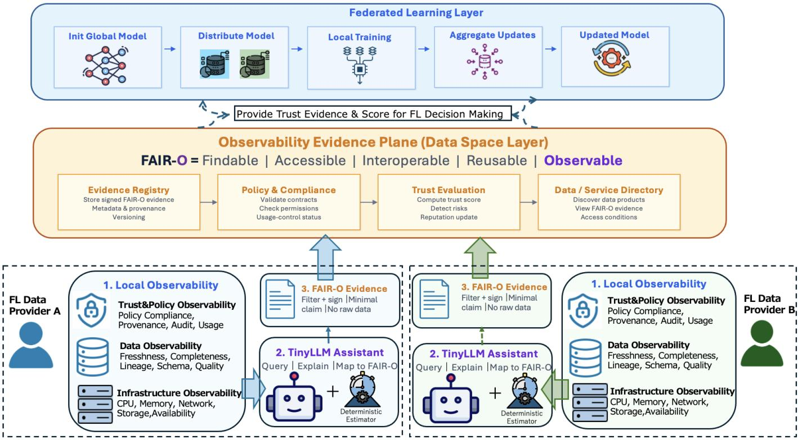
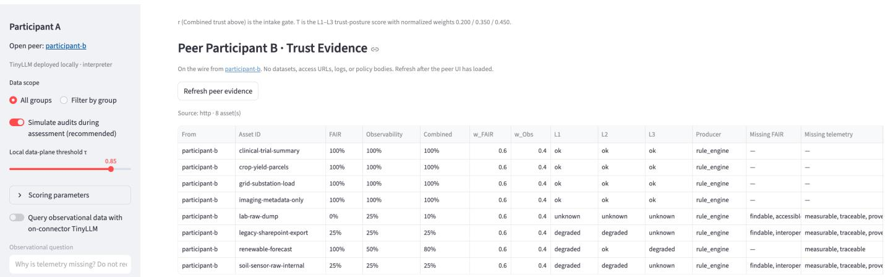
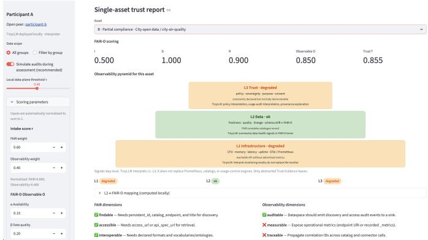
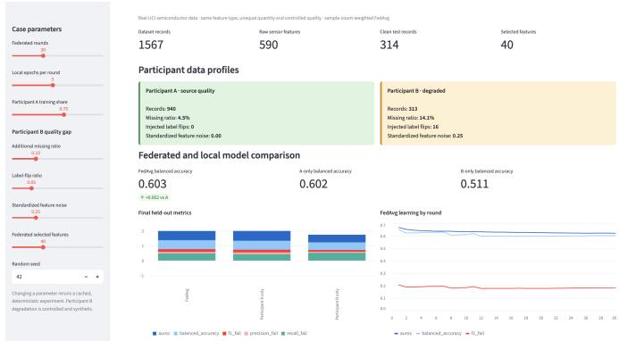

# Extending FAIR Principles with Observability for Trustworthy Federated Learning

Hangli Ge∗, Noboru Koshizuka∗

∗Interfaculty Initiative in Information Studies; The University of Tokyo

∗{hangli.ge, noboru}@koshizuka-lab.org;

Abstract—Federated learning (FL) keeps data at its source, but locality alone does not make a federation trustworthy. Without sufficient observability, an aggregator cannot determine whether the client service was healthy, the local data pipeline was trustworthy, or contractual constraints were properly monitored during training. We take the position that trustworthy FL needs an evidence plane in addition to its model-update process. Each participant continuously summarizes local infrastructure, data into minimal, signed trust evidence associated with each FL round, while raw data, logs remain local. A local TinyLLM may assist in interpreting observability signals, deriving contextual evidence, and providing natural-language explanations to operators. We instantiate this vision through FAIR-O, an observability extension of FAIR principle. Rather than benchmarking FL accuracy, a three-level trust model has been proposed and a twoparticipant Python prototype demonstrates evidence generation and trust assessment. We further discuss future integration of FAIR-O Trust Evidence into participant selection, evidence weighting, and federated aggregation.

Index Terms—Federated Learning, FAIR Principle, Observability, Trust Evidence, TinyLLM

## I. THE POSITION

Federated learning (FL) enables multiple clients to train a shared model without centralizing their raw data [1], [2]. This separation is especially attractive in industrial systems, where sensor traces, maintenance records, production parameters, and other operational data are distributed across organizations and subject to confidentiality and sovereignty constraints [3]. However, secure aggregation can hide individual updates [4], and robust aggregation can tolerate classes of malicious behavior [5], yet neither tells an operator whether a particular local training pipeline was observable and trustworthy when its update was produced.

Protecting raw training data alone is therefore insufficient to establish trust in real-world industrial FL. Participants operate over heterogeneous and continuously changing infrastructures, data pipelines, software environments, and governance regimes. A participant may remain technically connected to an FL federation while experiencing degraded computational or network resources, stale or incomplete data, schema changes, provenance gaps, or violations of agreed data-use policies. These conditions may directly affect the reliability and interpretation of a local model update without necessarily appearing as an explicit attack. Consequently, trustworthiness in FL should not be treated as a static property established at enrollment or training time, but as a continuously observable and verifiable state throughout the federation lifecycle.

The FAIR principles evaluate whether data are Findable, Accessible, Interoperable, and Reusable [6]. However, these dimensions are often considered separately in practice. A client may remain available while training on stale or poorly traced data; a FAIR-compliant dataset may be consumed without an auditable policy decision; and non-IID (non-independent and identically distributed) behavior may be mistaken for malicious behavior when the federation lacks contextual evidence about how an update was produced. Similarly, a data product may be discoverable and accessible while providing insufficient runtime evidence about its quality, completeness, or operational condition. Such evidence does not solve these problems by itself, but makes their context inspectable and trust claims verifiable.

This challenge becomes more significant when industrial FL operates across dataspaces, which support sovereign and governed data sharing across organizations [7], [8], [9]. Data may be exchanged as governed products under access, usage, and even pricing conditions [10], requiring assessment of data quality, interoperability, provenance, and compliance before access or federated training. However, the corresponding observability signals are heterogeneous and may themselves be sensitive. We therefore introduce an optional participant-side TinyLLM for local signal interpretation, contextual evidence derivation, and natural-language explanation. Raw data and telemetry remain local, while evidence verification and federation operation remain independent of TinyLLM availability.

We propose the FAIR principles with an explicit Observability dimension, which we term FAIR-O for Trustworthy Federated Learning. FAIR-O considers not only whether a data asset satisfies the conditions for discovery, access, integration, and reuse, but also whether these conditions can be continuously assessed through verifiable operational evidence. We structure this observability into three levels: infrastructure observability, covering computational resources, network conditions, availability, storage, and service health; data observability, covering freshness, completeness, accuracy, lineage, and schema drift; and trust observability, covering policy compliance, sovereignty monitoring, usage auditing, provenance verification, and derived trust indicators.

## A. FAIR-O Observability Architecture

Figure 1 presents the proposed architecture. The design separates local observability and evidence generation from the federated-learning workflow through an FAIR-O Evidence Plane. The main principle is that raw industrial data and operational telemetry remain within each participant boundary, while only minimal and signed FAIR-O evidence is exposed to the federation.

  
Fig. 1. Overview of the FAIR-O observability architecture for trustworthy federated learning. Each FL data provider locally observes infrastructure, data, and trust-policy conditions. An optional participant-side TinyLLM supports local querying and explanation, while deterministic mechanisms generate minimal and signed FAIR-O evidence. The FAIR-O Evidence Plane manages this evidence at the Data Space layer and provides trust information to support federatedlearning decisions without exposing raw data or operational telemetry.

1) Three Local Observability Levels: Each FL data provider continuously observes its local operational environment along three complementary dimensions.

L1: Infrastructure observability captures the operational condition of the participant, including CPU and memory utilization, network status, storage availability, service availability, and related infrastructure metrics.

L2: Data observability characterizes the current state and quality of the local training data, including freshness, completeness, lineage, schema consistency, and other dataquality indicators. These signals are particularly important in industrial FL because a participant may remain technically available while training on stale, incomplete, or structurally changed data.

L3: Trust and policy observability captures evidence related to policy compliance, provenance, usage control, and audit events. This dimension extends conventional infrastructure and data monitoring toward continuous assessment of whether a participant operates under the conditions expected by the federation or by an associated Data Space contract.

2) Participant-Side TinyLLM Assistant: A TinyLLM assistant can be deployed locally at individual participants. This participant-side deployment is motivated by the privacy and data-sovereignty requirements of industrial FL. The goal is not to send private observability data to an LLM, but to bring a lightweight LLM to where the private observability data reside. The small computational footprint of TinyLLMs makes local deployment feasible, allowing observability signals to be processed within the participant’s trusted environment without exposing raw data or telemetry to an external LLM service.

The locally deployed TinyLLM therefore provides a naturallanguage intelligence interface over otherwise heterogeneous observability signals. Operators can query system and data conditions, interpret anomalies, explain policy-related events, and map observations to FAIR-O dimensions, while the underlying data remain locally controlled. In this way, TinyLLM enables participants to derive human-readable conclusions from private observability information without requiring that information to be externally accessed or centralized.

Deterministic local components remain responsible for rule evaluation, measurement, filtering. Optionally, TinyLLM serves as a local reasoning and explanation layer over these mechanisms. This separation ensures that FAIR-O evidence remains independently verifiable and available even when the TinyLLM component is unavailable or produces an unreliable explanation.

  
Fig. 2. Participant A’s view of Participant B’s signed Trust Evidence

3) Evidence Generation: Local observability signals are transformed into FAIR-O evidence before leaving the participant environment. The transformation follows the principle of data minimization: raw logs, traces, industrial data, and detailed telemetry are not exported.

4) Evidence Plane: The FAIR-O Evidence Plane operates at the Data Space layer to manage and evaluate observability evidence across FL participants. The Evidence Registry stores signed FAIR-O evidence with its metadata and provenance. Policy & Compliance validates evidence against contracts, permissions, and usage-control requirements. Trust Evaluation derives trust indicators and identifies potential risks or anomalies. Finally, the Data/Service Directory links data products and services with their access conditions and FAIR-O evidence. Together, these components provide evidencebased trust information for data access and FL decision making without exposing raw data or operational telemetry.

5) Integration with Federated Learning: The federatedlearning layer operates above the evidence plane using the standard workflow of global-model initialization, model distribution, local training, update aggregation, and global-model update. FAIR-O evidence provides additional context for FL decision making. For example, the federation may use evidence to support participant selection, round admission, update weighting, anomaly handling, or exclusion of a participant whose data or operational conditions no longer satisfy predefined requirements. Conceptually, the resulting design follows a simple principle:

FAIR-O architecture enables observability of the training process and provide trust to support decisions

## II. PROTOTYPE GROUNDING

We conduct two complementary experiments based on Python. The first evaluates whether FAIR-O Trust Evidence can be generated, visualized, and exchanged without exposing local data. The second evaluates executable federated learning when participants have the same feature schema but different data quantity and quality.

  
Fig. 3. Participant-A dashboard case, showing the federation overview and the FAIR-O scores of data assets owned by Participant B. Participant A can inspect participant-level trust evidence and asset-level observability scores without revealing raw data.

## A. Experiment 1: FAIR-O Evidence and Visualization

Two logical participants : A and B can be launched as separate dashboard and evidence-API processes, with distinct signing secrets and disjoint catalogues (six and eight synthetic assets, respectively). Each dashboard constructs its own localhost TinyLLM client. In the evaluated single-host configuration, both clients address the same Ollama 0.11.2 service running the exact model tag qwen2.5:1.5b [11]: a 1.5-billion-parameter Qwen2 model with a 32,768-token context window and GGUF Q4\_K\_M quantization. Thus, the prototype demonstrates two logically separate clients, not two independently hosted model servers. If Ollama is unavailable, deterministic summaries remain available.

Figure 2 shows the participant A’s dashboard rendering the Trust Evidence pulled from participant B’s /trust-evidence endpoint. Each row of the overview table corresponds to one asset that B publishes and carries only abstracted indicators: the FAIR ratio, the observability ratio, and the combined trust score under the declared weights (wFAIR, wObs), the three pyramid-level labels (L1 infrastructure, L2 data, L3 trust), the enumerated missing FAIR fields and missing telemetry signals, a timestamp, and the HMAC signature. Selecting an asset expands the full exchanged payload; this is the entirety of what A can learn about B’s data before requesting access. The view therefore operationalises the sovereignty constraint of the two-plane architecture: A obtains enough signed, per-asset evidence to drive a local intake decision, while B’s raw records, access URLs, telemetry logs, and policy bodies never leave B’s premises.

  
Fig. 4. Dashboard output for the two-participant UCI SECOM experiment. Participant A contains 940 records with a 4.5% source missing ratio. Participant B contains 313 records; controlled degradation increases its missing ratio to 14.1%, flips 16 labels, and adds feature noise with standard deviation 0.25. The dashboard compares sample-count-weighted FedAvg with models trained only by A or B and shows the FedAvg learning trajectory over 30 rounds.

Figure 3 shows an FAIR-O assessment example of Participant A. The city-air-quality data asset of Participant B is FAIR-complete but lacks an operational metrics endpoint and correlation identifier. Its infrastructure and trust levels are therefore degraded. The dashboard further allows operators to interactively adjust the weights of infrastructure, data, and trust observability evidence and immediately inspect their impact on participant trust scores and FL decisions. This enables application-specific and human-in-the-loop exploration of FAIR-O weighting strategies.

## B. Experiment 2: Federated Learning Monitoring

The second experiment uses the UCI SECOM semiconductor manufacturing dataset [12]. Figure 4 illustrates the user interface to the FAIR-O Evidence Plane for output of a two-participant FL experiment. It jointly visualizes FL training progress, participant observability conditions, signed evidence, policy-compliance status, trust indicators, risks, and available data products. Operators can compare participants, inspect anomalous conditions and their supporting evidence, trace policy and evidence events, and understand the trust information used for FL participation or aggregation decisions. Importantly, the dashboard exposes derived FAIR-O evidence rather than raw participant data or telemetry, making the distributed trust state of the federation observable, interpretable, and auditable.

The experiments validate different parts of the proposed architecture. Experiment 1 demonstrates local FAIR-O assessment, explainable visualization, evidence minimization, and peer verification. Experiment 2 demonstrates actual FedAvg training over data with unequal participant quality. The two paths are currently implemented separately: FAIR-O scores do not yet alter FL participant automatic selection or aggregation weights. The next step is to bind signed FAIR-O evidence to each FL round and compare ordinary FedAvg with evidenceaware admission and weighting.

## III. CONCLUSION

We introduced FAIR-O as an observability extension of FAIR principle for trustworthy federated learning. Participants retain raw data, logs, and policies locally while sharing only minimized, signed Trust Evidence. Evidence can be generated through deterministic rules, assisted by a local TinyLLM for signal interpretation, contextual evidence derivation, and natural-language explanation. We further implemented two experimental dashboards to demonstrate FAIR-O observability and interactive trust assessment. Future work will incorporate Trust Evidence into participant selection and aggregation, explore adaptive weighting strategies, and evaluate their impact on accuracy, robustness, fairness, privacy, and overhead. Ultimately, FAIR-O shifts FL trust from a static property toward a continuously observable and verifiable state.

## REFERENCES

[1] H. B. McMahan, E. Moore, D. Ramage, S. Hampson, and B. Aguera y¨ Arcas, “Communication-efficient learning of deep networks from decentralized data,” in Proc. 20th Int. Conf. Artificial Intelligence and Statistics, ser. Proceedings of Machine Learning Research, vol. 54, 2017, pp. 1273–1282.

[2] P. Kairouz and H. B. McMahan, “Advances and open problems in federated learning,” Foundations and trends in machine learning, vol. 14, no. 1-2, pp. 1–210, 2021.

[3] D. C. Nguyen, M. Ding, P. N. Pathirana, A. Seneviratne, J. Li, D. Niyato, and H. V. Poor, “Federated learning for industrial internet of things in future industries,” IEEE Wireless Communications, vol. 28, no. 6, pp. 192–199, 2021.

[4] K. Bonawitz, V. Ivanov, B. Kreuter, A. Marcedone, H. B. McMahan, S. Patel, D. Ramage, A. Segal, and K. Seth, “Practical secure aggregation for privacy-preserving machine learning,” in Proc. ACM SIGSAC Conf. Computer and Communications Security, 2017, pp. 1175–1191.

[5] P. Blanchard, E. M. El Mhamdi, R. Guerraoui, and J. Stainer, “Machine learning with adversaries: Byzantine tolerant gradient descent,” in Advances in Neural Information Processing Systems, vol. 30, 2017.

[6] M. D. Wilkinson, M. Dumontier, I. J. Aalbersberg, G. Appleton, M. Axton, A. Baak, N. Blomberg, J.-W. Boiten, L. B. da Silva Santos, P. E. Bourne et al., “The fair guiding principles for scientific data management and stewardship,” Scientific data, vol. 3, no. 1, p. 160018, 2016.

[7] L. Nagel and D. Lycklama, “Design principles for data spaces,” International Data Spaces Association, Tech. Rep., 2021. [Online]. Available: https://doi.org/10.5281/zenodo.5244997

[8] B. Otto, M. ten Hompel, and S. Wrobel, Eds., Designing Data Spaces: The Ecosystem Approach to Competitive Advantage. Cham: Springer, 2022.

[9] H. Ge, H. Takeda, T. Sagara, N. Kitano, and N. Koshizuka, “Xckan: Federated catalog for data discovery in dataspaces,” in 2025 IEEE International Conference on Big Data (BigData). IEEE, 2025, pp. 3818–3824.

[10] International Data Spaces Association, “Reference architecture model,” International Data Spaces Association, Tech. Rep. Version 3.0, 2019.

[11] Qwen Team, “Qwen2.5 technical report,” arXiv preprint arXiv:2412.15115, 2024.

[12] M. McCann and A. Johnston, “SECOM,” 2008. [Online]. Available: https://doi.org/10.24432/C54305