# Fast Bayesian Optimization Through Linear Models

Colin Doumont University of T¨ubingen T¨ubingen AI Center

Henry Moss Lancaster University

Philipp Hennig University of T¨ubingen T¨ubingen AI Center

<sup>§</sup> https://github.com/colmont/fast-bo

## Abstract

Bayesian optimization (BO) is typically used only for problems where the underlying function is deemed “expensive” (e.g. in time or money), with the speed of the BO algorithm being of little importance. In the real world, however, problems span a continuous range of values, going from cheap to expensive. In this paper, we present BO algorithms through the lens of a speed-performance Pareto frontier: we compare BO against faster algorithms like CMA-ES, and highlight how certain regions of the Pareto frontier are currently empty. As a solution, we propose a new set of fast BO methods that exploit the linear structure in existing BO algorithms, for both continuous and combinatorial inputs (from ∼10 to 6000+ dimensions). Our methods achieve performance similar to state-of-the-art BO, while being more than $1 0 ^ { 2 } \times$ to $1 0 ^ { 3 } \times$ faster, opening the field of BO to an entirely new class of problems.

## 1 INTRODUCTION

Black-box optimization, i.e. optimization of a function that is only observable through evaluations (e.g. a simulator or physical experiment), has been studied since Box and Wilson (1951). Over the past 75 years, different techniques and approaches have been proposed, ranging from direct search (Nelder and Mead, 1965) and local surrogates (Powell, 2009) to evolutionary algorithms (Holland, 1975; Hansen and Ostermeier, 2001). Among these, Bayesian optimization (Mockus, 1975; Jones et al., 1998) became known for its sample eficiency, and is now often the default black-box optimizer for certain applications (e.g. hyperparameter optimization in machine learning; Snoek et al., 2012). Nevertheless, until recently, BO was still mostly constrained to low-dimensional continuous spaces (i.e. below 20 dimensions), with a fairly limited number of observations (Frazier, 2018).

In the last decade, a growing body of literature has focused on extending the method to a larger set of prob lems — such as combinatorial spaces (Doumont et al., 2025) or higher dimensions (Hvarfner et al., 2024) — enabling BO to spread to new application areas (Moss et al., 2025; Fan et al., 2026). However, one major limiting factor is still largely unaddressed: BO methods are typically much slower than other black-box optimizers (see Figure 1). For example, current stateof-the-art BO methods can take multiple minutes to choose the next acquisition. If evaluating the blackbox function is cheaper than this overhead, then the BO algorithm itself becomes the main cost (Shahriari et al., 2016), leading practitioners to instead turn to faster but less sample-eficient black-box optimizers, such as CMA-ES (Hansen and Ostermeier, 2001; Raponi et al., 2025).

Recently, Doumont et al. (2026) replaced the Gaussian-process surrogate by a (spherically projected) Bayesian linear model, enabling exact BO to scale to over 20,000 observations, while achieving state-of-the-art performance (on high-dimensional continuous problems). However, as demonstrated in Figure 1, their method is still as slow as standard BO methods, primarily due to gradient-based techniques used for (i) fitting hyperparameters, and (ii) optimizing acquisition functions. Instead, in this paper, we show how the structure of this spherical-linear model can be exploited for both tasks, leading to speedups of several orders of magnitude with little to no loss in performance.

Specifically, for hyperparameter optimization, we replace the per-dimension lengthscales with a single shared lengthscale. This allows us to fit the resulting model eficiently through a combination of (batched) grid search and direct search (Nelder and Mead, 1965), where we reuse a single eigendecomposition across marginal-likelihood evaluations. For acquisition optimization, we reformulate Thompson sampling (Thompson, 1933) over the input box as a quadratic fractional program, which can then be solved using Dinkelbach’s algorithm (Dinkelbach, 1967) with exact $O ( D )$ subproblems. This algorithm guarantees superlinear convergence to a global optimum. For UCB (Srinivas et al., 2010) and EI (Mockus, 1975), we derive linear minorizers optimized by the same exact solver, yielding minorize–maximize algorithms with guarantees of monotonic improvement and stationarity. Interestingly, the algorithms for UCB and EI difer only in their exploration weight, which lets us view EI as a version of UCB with self-tuning exploration.

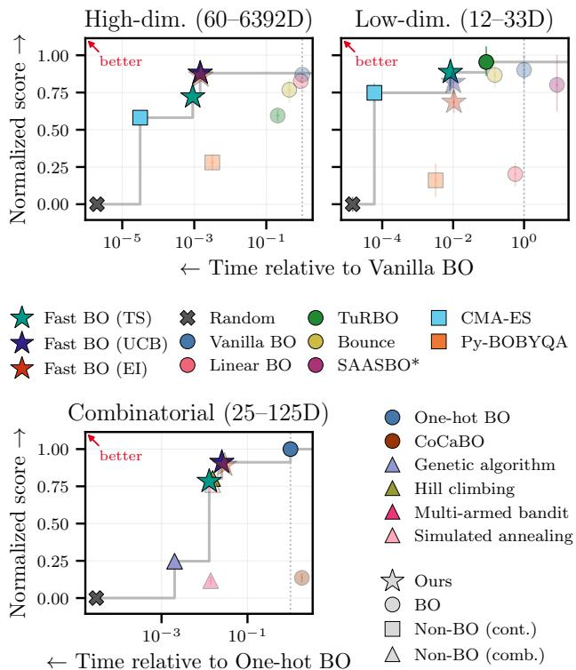  
Figure 1: Summary plot of the speed-performance Pareto frontiers in Figures 3 to 5. Speed is measured relative to state-of-the-art BO (averaged using a geometric mean). For performance, we rescale the final best values of each benchmark such that random search scores 0 and the best method scores 1 (and then average these scores over all benchmarks). In all three settings, our fast BO methods cover new areas of the Pareto frontier, matching many well-known BO methods at a fraction of the cost. Moreover, CMA-ES performs surprisingly well — matching TuRBO on highdimensional problems — highlighting the relevance of fast black-box optimizers.

Lastly, through a standardized framework, we show how these gradient-free ideas naturally extend to combinatorial and low-dimensional spaces, achieving strong performance at a fraction of the cost. By making fast BO available across a range of input spaces, we hope practitioners can choose BO over faster methods (e.g. CMA-ES) for a much wider class of problems, even when a single evaluation takes only a second. Historically, such gains in eficiency have repeatedly broadened what BO can do: max-value entropy search (Wang and Jegelka, 2017) made informationtheoretic acquisition cheap enough for routine use, GPU-based GP inference (Gardner et al., 2018) made GPs practical at much larger scales, and diferentiable Monte Carlo acquisition functions (Balandat et al., 2020) made batch, multi-objective, and constrained BO tractable. We hope our fast BO can play a similar role for black-box optimization.

## 2 BACKGROUND

## 2.1 Bayesian Optimization

Bayesian optimization (Garnett, 2023) is concerned with finding the global optimum $\mathbf { x } ^ { \star } \in \mathcal { X }$ of a function $f : \mathcal { X }  \mathbb { R }$ , where f is assumed to be unknown and can only be evaluated pointwise. Standard BO literature also defines f as being “expensive” (e.g. in time or money), though there is no clear cutof between “inexpensive” and “expensive”. Moreover, X can refer to both continuous and combinatorial input spaces; we specify which one is meant in each section.

To try to find the global optimum $\mathbf { x } ^ { \star }$ , BO typically proceeds as follows: (i) approximate f by fitting a (probabilistic) surrogate model on the observed data points $\mathcal { D } _ { t } .$ , and (ii) acquire the next point by solving for $\mathbf { x } _ { t + 1 } = \arg \operatorname* { m a x } _ { \mathbf { x } \in \mathcal { X } } \alpha _ { t } ( \mathbf { x } )$ . Here, $\alpha _ { t } ( \cdot )$ is called an acquisition function and relies on the surrogate model to trade of exploration and exploitation.

Surrogate Models. Although a wide range of surrogate models have been used in BO (Hutter et al., 2011; Bergstra et al., 2011), by far the most common are still Gaussian processes (GPs; Rasmussen and Williams, 2006). GPs are specified only by a mean function $\mu ( \mathbf { x } )$ and a covariance function or kernel $k ( \mathbf { x } , \mathbf { x } ^ { \prime } ) : \mathcal { X } \times \mathcal { X }  \mathbb { R }$ . For certain kernels, GPs can also be expressed as Bayesian linear regression. The simplest example is the linear kernel, i.e.

$$
k _ { \mathrm { l i n e a r } } ( \mathbf { x } , \mathbf { x } ^ { \prime } ) : = b _ { 0 } + b _ { 1 } \mathbf { x } ^ { \top } \mathbf { x } ^ { \prime } ,\tag{1}
$$

where $b _ { 0 } , b _ { 1 } > 0$ are hyperparameters.

For this kernel, the GP or equivalent Bayesian linear model has a posterior mean and variance (defined at a test feature u) given by

$$
\begin{array} { r } { m ( \mathbf { u } ) = c + \bar { \mathbf { w } } ^ { \top } \mathbf { u } , \bar { \mathbf { w } } = \mathbf { Z } ^ { \top } \widetilde { \mathbf { K } } ^ { - 1 } ( \mathbf { y } - c \mathbf { 1 } ) , } \end{array}\tag{2}
$$

$$
\begin{array} { r } { s ^ { 2 } ( \mathbf { u } ) = \mathbf { u } ^ { \top } \boldsymbol { \Sigma } \mathbf { u } , \qquad \quad \boldsymbol { \Sigma } = \mathbf { I } _ { M } - \mathbf { Z } ^ { \top } \widetilde { \mathbf { K } } ^ { - 1 } \mathbf { Z } . } \end{array}\tag{3}
$$

Here, u denotes the features $\mathbf { u } ( \mathbf { x } )$ of size M, $\mathbf { w } \sim$ $\mathcal { N } ( \mathbf { 0 } , \mathbf { I } _ { M } )$ is a weight prior, c is the constant mean, and $\sigma ^ { 2 }$ is the homoscedastic noise variance. Moreover, $\mathbf { Z } \in \mathbb { R } ^ { N \times M }$ represents the stacked training features and $\widetilde { \mathbf { K } } : = \mathbf { Z } \mathbf { Z } ^ { \top } + \sigma ^ { 2 } \mathbf { I } _ { N }$

As can be seen from Equations (2) and (3), the linear kernel has a posterior mean that is linear in u and a posterior variance that is a convex quadratic $\left( \mathrm { i } . \mathrm { e } . \Sigma \succeq \right)$ 0). These facts are exploited in Sections 3.2 and 4.2.

Acquisition Functions. Similar to surrogate models, many acquisition functions (AFs) have been used in BO over the years, with TS, UCB, and EI (defined below) arguably being the three most commonly used.

Thompson Sampling (TS; Thompson, 1933) consists of a randomized acquisition

$$
\begin{array} { r } { \alpha _ { \mathrm { T S } } ( \mathbf { x } ) ~ = ~ \tilde { f } _ { t } ( \mathbf { x } ) , \qquad \tilde { f } _ { t } ( \cdot ) \sim p ( f \mid \mathcal { D } _ { t } ) . } \end{array}\tag{4}
$$

At each BO iteration, the goal is to optimize a draw $\tilde { f } _ { t }$ from the model’s posterior $p ( f \mid \mathcal { D } _ { t } )$ at round t (i.e. a sample path for a GP).

Upper Confidence Bound (UCB; Srinivas et al., 2010) maximizes an explicit trade-of between posterior mean and posterior standard deviation, namely

$$
\alpha _ { \mathrm { U C B } } ( { \bf x } ) = m ( { \bf x } ) + \beta s ( { \bf x } ) ,\tag{5}
$$

where $\beta > 0$ is an exploration hyperparameter.

Expected Improvement (EI; Mockus, 1975; Jones et al., 1998) measures the expected gain over the incumbent y<sub>max</sub> (the best value observed)

$$
\alpha _ { \mathrm { E I } } ( \mathbf { x } ) ~ = ~ \mathbb { E } \left[ \left( f ( \mathbf { x } ) - y _ { \mathrm { m a x } } \right) ^ { + } \right] ,\tag{6}
$$

using the model’s predictive distribution $f ( \mathbf { x } )$

## 2.2 Linear Structure in BO Algorithms

Our fast BO methods are inspired by two existing BO algorithms: Linear BO from Doumont et al. (2026) for continuous variables, and CoCaBO from Ru et al. (2020) for combinatorial variables.

Linear BO. Doumont et al. (2026) show that, for high-dimensional problems, a (spherically projected) linear surrogate can achieve state-of-the-art performance, thereby questioning the need for more complicated models (e.g. non-linear GPs). Their surrogate is a GP with a spherical-linear (SL) kernel (equivalent to Bayesian linear regression, see previous section):

$$
k _ { \mathrm { S L } } \left( \mathbf { x } , \mathbf { x } ^ { \prime } \right) : = b _ { 0 } + b _ { 1 } \ : P \left( \mathbf { z } \right) ^ { \top } P \left( \mathbf { z } ^ { \prime } \right) ,\tag{7}
$$

where $b _ { i } > 0$ are hyperparameters with $b _ { 0 } + b _ { 1 } = 1 _ { \colon }$ and $P : \mathbb { R } ^ { D }  \mathbb { S } ^ { \bar { D } }$ is a bijective mapping onto the

unit sphere (minus its north pole). Here, z is a scaled version of x (and $\mathbf { z } ^ { \prime }$ of $\mathbf { x } ^ { \prime } )$ , i.e.

$$
\begin{array} { r } { \mathbf { z } : = \frac { 1 } { a } \left[ \frac { x _ { 1 } } { \ell _ { 1 } } \quad \cdot \cdot \cdot \quad \frac { x _ { D } } { \ell _ { D } } \right] ^ { \top } } \end{array}\tag{8}
$$

for hyperparameters $a , \ell _ { 1 } , \dots , \ell _ { D } > 0$ . The authors choose $P$ to be the inverse stereographic projection:

$$
\begin{array} { r } { P ( \mathbf { z } ) : = \frac { 1 } { \| \mathbf { z } \| ^ { 2 } + 1 } \left[ 2 z _ { 1 } \quad \cdots \quad 2 z _ { D } \quad \| \mathbf { z } \| ^ { 2 } - 1 \right] ^ { \top } . } \end{array}\tag{9}
$$

CoCaBO. Ru et al. (2020) present a new BO approach, called CoCaBO, to select values for both categorical and continuous inputs. For categorical inputs, the method relies on a categorical kernel equivalent to the overlap kernel (Dreczkowski et al., 2023) or Hamming kernel (Kondor and Laferty, 2002), namely

$$
k _ { \mathrm { C o C a B O } } ( \mathbf { x } , \mathbf { x } ^ { \prime } ) : = \frac { b } { D } \sum _ { i = 1 } ^ { D } \mathbb { 1 } [ x _ { i } = x _ { i } ^ { \prime } ] ,\tag{10}
$$

with $b > 0$ being a hyperparameter (the kernel variance). In Section 4.1, we show how this kernel can be seen as the combinatorial counterpart to the linear kernel in Equation (1).

## 2.3 Related Work

Our method is related to two other works, both relying on Linear BO (Doumont et al., 2026) for faster acquisitions. The main diference between these works and ours is the search space considered: for continuous inputs, ours considers the hypercube $\mathcal { X } : = [ - 1 , 1 ] ^ { D }$ while theirs focuses on either the sphere $\boldsymbol { \mathcal { X } } : = \mathbb { S } ^ { D }$ or the unbounded $\mathcal { X } : = \mathbb { R } ^ { D }$ . Both works explicitly mention our setting, but leave it for future work. Lastly, we also provide an extension of our method to combinatorial spaces $\textstyle { \mathcal { X } } : = \prod _ { i = 1 } ^ { D } { \mathcal { X } } _ { i }$ (with $\mathcal { X } _ { i }$ being discrete sets).

Fast Latent-Space BO. Fan et al. (2026) explore BO for optimization of latent spaces in generative models: they focus on $\boldsymbol { \mathcal { X } } : = \mathbb { S } ^ { \tilde { D } }$ , where highdimensional latents concentrate. Their fitting procedure is similar to ours (though not fully, e.g. their lengthscale only rescales the features, and thus never requires a new eigendecomposition), but their AF optimization is fundamentally diferent, due to the difference in search space.

Acquisition Geometry of Spherical Linear BO. Whitehead (2026) analyzes the AF optimization of Linear BO on $\boldsymbol { \mathcal { X } } : = \mathbb { R } ^ { D }$ , where acquisitions can take place on the entire sphere (minus its north pole). While black-box problems are rarely unbounded, this result is a first step in an interesting direction: in this setting, maximizing EI reduces exactly to a onedimensional search. This idea is similar in spirit to our MM algorithm for EI (Section 3.2), where each step solves a UCB-type problem for some weight $\beta .$

## 3 METHOD (CONTINUOUS)

In this section, we assume $\mathcal { X } : = [ - 1 , 1 ] ^ { D }$ , which is simply a centered version of the standard $[ 0 , 1 ] ^ { D }$

## 3.1 Surrogate Model

Since a GP with a linear kernel is equivalent to Bayesian linear regression, its posterior can be computed either in $O ( \bar { D } N ^ { 2 } + N ^ { 3 } )$ time through a functionspace view, or in $O ( N D ^ { 2 } + D ^ { 3 } )$ time through a weightspace view (Rasmussen and Williams, 2006). This property is already exploited in Doumont et al. (2026) and is not a new contribution of our fast BO method.

However, the main speed bottleneck of Linear BO is not its computation of the posterior, but rather the fitting of its hyperparameters. Because of its ARD lengthscales, Linear BO needs to fit $D + 4$ hyperparameters: D lengthscales $\ell _ { i } ,$ one global lengthscale $^ { a , }$ one mixture weight $b _ { 1 }$ , one noise variance $\sigma ^ { 2 }$ , and one constant mean c. To fit all these hyperparameters, the method relies on gradient-based marginal-likelihood maximization, which can be very slow.

Faster Fit. Instead, our fast BO methods aim to reduce the number of hyperparameters, after which fitting can be performed quickly with gradient-free methods. Specifically, we slightly alter the surrogate model from Linear BO by dropping ARD (and its hyperprior), leaving efectively only one lengthscale: the global lengthscale. Although this change drastically reduces the number of hyperparameters (from hundreds or thousands to only four), it has little efect on performance (see Figure 8 in Doumont et al., 2026).

To reduce fitting overhead, we want to avoid repeated eigendecompositions during marginal-likelihood optimization. Similar to Fan et al. (2026), a single eigendecomposition can be reused when fitting hyperparameters that leave the features unchanged $( \mathrm { e . g . ~ } b _ { 1 } \ \mathrm { o r } \ \sigma ^ { 2 } )$ In our setting, however, the global lengthscale a is placed inside the spherical projection $P ,$ which means new values of a require new eigendecompositions. As a solution, we propose a mixed approach: perform a grid search over a (parallelizing the eigendecompositions), and solve the inner optimization of the remaining three hyperparameters. The latter can be done analytically for $^ { c , }$ and using Nelder–Mead (1965) for $b _ { 1 }$ and $\sigma ^ { 2 }$ (while reusing existing eigendecompositions). Lastly, to further reduce the number of eigendecompositions, we run the full grid search every 10 BO iterations; in between, we hold a fixed and repeat only the inner fit. Further details are given in Appendices A.1 and B.3.

Standardized Notation. Finally, to simplify the task of AF optimization in the next section, we rewrite Linear BO (with or without ARD) as

$$
k _ { \mathrm { S L } } ( \mathbf { x } , \mathbf { x } ^ { \prime } ) = \mathbf { u } ( \mathbf { x } ) ^ { \top } \mathbf { u } ( \mathbf { x } ^ { \prime } ) ,\tag{11}
$$

where $b _ { 0 } , b _ { 1 }$ , and $P ( \mathbf { z } )$ have been combined into a sin-$\mathrm { g l e }$ vector $\mathbf { u } ,$ namely

$$
\mathbf { u } ( \mathbf { x } ) : = \left[ \sqrt { b _ { 1 } } P ( \mathbf { z } ) ; \sqrt { b _ { 0 } } \right] \in \mathbb { S } ^ { D + 1 } .\tag{12}
$$

As a result, Linear BO can now more easily be understood in terms of the properties of Equations (2) and (3): its mean and variance are linear and convex quadratic in $\mathbf { u } ( \mathbf { x } )$ , respectively. However, note that $\mathbf { u } ( \mathbf { x } )$ is not linear in x, due to $P ( \cdot )$

## 3.2 Acquisition Functions

Using this standardized notation for our sphericallinear surrogate, the three AFs from Section 2.1 simplify substantially. In fact, as will be shown below, the three diferent optimization problems are intertwined: UCB and EI only difer by one parameter, and require repeatedly solving TS-based subproblems. For simplicity of notation, we will often consider maximizing directly for $\mathbf { z } \in [ - 1 / a , 1 / a ] ^ { D }$ , since ${ \mathbf z } = { \mathbf x } / a$

(a) Thompson Sampling (TS). Under our linear surrogate from Equation (11), the TS acquisition function in Equation (4) becomes simply

$$
\alpha _ { \mathrm { T S } } ( \mathbf { z } ) = c + \mathbf { w } ^ { \top } \mathbf { u } ( \mathbf { z } ) , \quad \mathrm { w i t h ~ } \mathbf { w } \sim { \mathcal { N } } ( \bar { \mathbf { w } } , { \boldsymbol { \Sigma } } ) .\tag{13}
$$

This acquisition $\alpha _ { \mathrm { T S } } ( \mathbf { x } )$ is linear in the features $\mathbf { u } ( \mathbf { x } )$ Through Equations (9) and (12), we have

$$
\alpha _ { \mathrm { T S } } ( \mathbf { z } ) = \mathrm { c o n s t } + \frac { 2 \mathbf { g } ^ { \top } \mathbf { z } + \kappa ( \| \mathbf { z } \| ^ { 2 } - 1 ) } { \| \mathbf { z } \| ^ { 2 } + 1 } ,\tag{14}
$$

where $\mathbf { g } : = \sqrt { b _ { 1 } } \mathbf { w } _ { 1 : D }$ and $\kappa : = \sqrt { b _ { 1 } } w _ { D + 1 }$ . Here, const denotes a term independent of z. Equation (14) corresponds to a single-ratio quadratic fractional program in $\mathbf { z } ,$ and can therefore be solved with Dinkelbach’s algorithm (Dinkelbach, 1967). We refer the reader to Appendix A.2 for an introduction to this algorithm and the derivation of Equation (14), and to Schaible (1976) or Stancu-Minasian (1997) for details.

Dinkelbach’s algorithm is guaranteed to converge to the global optimum, without requiring gradients, line searches or restarts. As a result, TS is maximized exactly over the hypercube X (up to numerical tolerance), whereas TS in high dimensions typically relies on approximate optimizers (Rashidi et al., 2024;

```latex
Algorithm 1 Acquisition optimization (continuous).
For our experiments: $K = \bar { T } = 1 0$
(a) TS
1: $\mathbf { w } \sim \mathcal { N } ( \bar { \mathbf { w } } , \pmb { \Sigma } )$
2: return Dinkelbach(w)
(b) UCB: $\lambda ( \mathbf { u } ) = \beta$
(c) EI: $\begin{array} { r } { \lambda ( \mathbf { u } ) = \varphi ( \gamma ) / \Phi ( \gamma ) , \ \gamma = \frac { m ( \mathbf { u } ) - y _ { \operatorname* { m a x } } } { s ( \mathbf { u } ) } } \end{array}$
3: draw $\mathbf { x } _ { 1 } , . . . , \mathbf { x } _ { K } \sim \mathcal { U } ( \mathcal { X } )$
4: for $j = 1 , \dots , T$ do ▷ MM iterations
5: for $k = 1 , \ldots , K$ in parallel do ▷ restarts
6: $\mathbf { u } _ { k } \gets \mathbf { u } ( \mathbf { x } _ { k } )$
7: $\begin{array} { r } { \mathbf { w } _ { k }  \bar { \mathbf { w } } + \frac { \lambda ( \mathbf { u } _ { k } ) } { s ( \mathbf { u } _ { k } ) } \Sigma \mathbf { u } _ { k } } \end{array}$
8: $\mathbf { x } _ { k } \gets$ Dinkelbach(w<sub>k</sub>)
9: end for
10: end for
11: return arg max $\alpha ( { \bf x } _ { k } )$
```

Fan and Pleiss, 2026). The algorithm converges superlinearly (often within a few iterations), with each iteration costing O(D).

(b) Upper Confidence Bound (UCB). For our linear surrogate, UCB can be written as

$$
\begin{array} { r } { \alpha _ { \mathrm { U C B } } ( \mathbf { z } ) = m ( \mathbf { u } ) \ + \ \beta s ( \mathbf { u } ) , \quad \quad \quad } \\ { \mathbf { \sigma } = c + \bar { \mathbf { w } } ^ { \top } \mathbf { u } \ + \ \beta \| \pmb { \Sigma } ^ { 1 / 2 } \mathbf { u } \| , } \end{array}\tag{15}
$$

using Equations (2) and (3). This objective consists of two parts: $\bar { \bf w } ^ { \top } { \bf u }$ is linear in u (and can thus be solved with Dinkelbach’s algorithm), while $\| \pmb { \Sigma } ^ { 1 / 2 } \mathbf { u } \|$ is convex in u. Since UCB needs to be maximized and contains a convex component, we can use the classic Minorize–Maximize (MM) approach (Hunter and Lange, 2004) to solve this optimization problem.

To find a solution $\mathbf { z } ^ { \star }$ , the MM procedure iteratively updates z as follows:

$$
\mathbf { z } _ { j + 1 } \in \operatorname * { a r g m a x } _ { \mathbf { z } \in [ - 1 / a , 1 / a ] ^ { D } } h ( \mathbf { z } \mid \mathbf { z } _ { j } ) ,\tag{16}
$$

where $h ( \mathbf { z } \mid \mathbf { z } _ { j } )$ is called the minorizer (or majorizer for minimization problems). This minorizer has to satisfy two conditions:

$$
\begin{array} { r } { \begin{array} { c c } { h ( \mathbf { z } \mid \mathbf { z } _ { 0 } ) \leq \alpha _ { \mathrm { U C B } } ( \mathbf { z } ) \ \mathrm { f o r ~ a l l ~ \mathbf { z } , } } & { \ ( \mathrm { g l o b a l ~ m i n o r a n t } ) } \\ { h ( \mathbf { z } _ { 0 } \mid \mathbf { z } _ { 0 } ) = \alpha _ { \mathrm { U C B } } ( \mathbf { z } _ { 0 } ) . } & { \ ( \mathrm { t i g h t n e s s } ) } \end{array} } \end{array}
$$

Moreover, in the MM algorithm, the minorizer has to be solved repeatedly. For a fast algorithm, $h ( \textbf { z } | \textbf { z } _ { j } )$ should therefore be cheap to maximize. We refer the reader to Lange (2016) for a more in-depth treatment of MM methods.

To construct a function $h ( \mathbf { z } \mid \mathbf { z } _ { j } )$ that meets these criteria, we transform $\alpha _ { \mathrm { U C B } } ( \mathbf { z } )$ into a linear function of $\mathbf { u } ( \mathbf { z } )$ . This linear function can then quickly be solved for z using Dinkelbach’s algorithm (as done for TS), allowing us to eficiently compute $\mathbf { z } _ { j + 1 }$ in Equation (16).

To begin, we look at the first-order tangent of the seminorm $s ( \mathbf { u } ) = \| \pmb { \Sigma } ^ { 1 / 2 } \mathbf { u } \|$ . For $s ( { \bf u } _ { 0 } ) > 0$ , convexity gives

$$
\begin{array} { r } { s ( \mathbf { u } ) \geq s ( \mathbf { u } _ { 0 } ) + \nabla s ( \mathbf { u } _ { 0 } ) ^ { \top } ( \mathbf { u } - \mathbf { u } _ { 0 } ) } \\ { = s ( \mathbf { u } _ { 0 } ) + \frac { ( \Sigma \mathbf { u } _ { 0 } ) ^ { \top } } { s ( \mathbf { u } _ { 0 } ) } ( \mathbf { u } - \mathbf { u } _ { 0 } ) . } \end{array}
$$

We then define our minorizer $h ( \textbf { z } \mid \textbf { z } _ { 0 } )$ as Equation (15), except we replace s(u) by its tangent, i.e.

$$
\begin{array} { r } { h ( \mathbf { z } \mid \mathbf { z } _ { 0 } ) : = c + \bar { \mathbf { w } } ^ { \top } \mathbf { u } ( \mathbf { z } ) + \beta \Big [ s ( \mathbf { u } _ { 0 } ) + \frac { ( \boldsymbol { \Sigma } \mathbf { u } _ { 0 } ) ^ { \top } ( \mathbf { u } ( \mathbf { z } ) - \mathbf { u } _ { 0 } ) } { s ( \mathbf { u } _ { 0 } ) } \Big ] . } \end{array}
$$

After simplification (see Appendix A.3), we can rewrite this equation as

$$
h ( \mathbf { z } \mid \mathbf { z } _ { 0 } ) = c + \mathbf { w } _ { \mathrm { e f f } } ( \mathbf { u } _ { 0 } ) ^ { \top } \mathbf { u } ( \mathbf { z } ) ,\tag{17}
$$

with

$$
\mathbf { w } _ { \mathrm { e f f } } ( \mathbf { u } _ { 0 } ) : = \bar { \mathbf { w } } + \frac { \lambda } { s ( \mathbf { u } _ { 0 } ) } \pmb { \Sigma } \mathbf { u } _ { 0 } .\tag{18}
$$

Equation (17) has exactly the same structure as Equation (13), and can thus be solved eficiently using Dinkelbach’s algorithm. For UCB, $\lambda = \beta$

A further rearrangement (see Appendix A.3) gives

$$
h ( \mathbf { z } \mid \mathbf { z } _ { 0 } ) = \alpha _ { \mathrm { U C B } } ( \mathbf { z } _ { 0 } ) + \mathbf { w } _ { \mathrm { e f f } } ( \mathbf { u } _ { 0 } ) ^ { \top } \big ( \mathbf { u } ( \mathbf { z } ) - \mathbf { u } _ { 0 } \big ) ,\tag{19}
$$

which makes the tightness condition explicit, while the global minorant condition follows from the convexity of s. The resulting MM algorithm guarantees nondecreasing acquisition values and stationary limit points (see Appendix A.3). In practice, we use multiple random starts to seek better solutions, since the procedure does not guarantee a global maximum. See Appendix B.3 for implementation details.

(c) Expected Improvement (EI). Since our linear surrogate has a Gaussian posterior, EI can be written in closed form (Jones et al., 1998):

$$
\alpha _ { \mathrm { E I } } ( \mathbf { z } ) = \left[ m ( \mathbf { u } ) - y _ { \mathrm { m a x } } \right] \Phi ( \boldsymbol { \gamma } ) + s ( \mathbf { u } ) \varphi ( \boldsymbol { \gamma } ) ,\tag{20}
$$

with $\gamma : = [ m ( \mathbf { u } ) - y _ { \operatorname* { m a x } } ] / s ( \mathbf { u } )$ . As is common, Φ and $\varphi$ represent the standard normal cumulative distribution function (CDF) and density.

Using Equation (20), it can be shown (Appendix A.4) that EI is convex and increasing in $m ( \mathbf { u } )$ and $s ( \mathbf u )$ Therefore, the MM procedure can once again be used to solve this optimization problem. As for UCB, we use first-order tangents to construct a minorizer $h ( \mathbf { z } \mid \mathbf { z } _ { 0 } )$ that satisfies both criteria.

Again, we can write $h ( \mathbf { z } \mid \mathbf { z } _ { 0 } )$ as a linear function of u (see Appendix $\mathrm { A . 4 } )$ :

$$
h ( \mathbf { z } \mid \mathbf { z } _ { 0 } ) = \Phi ( \gamma _ { 0 } ) \left[ c - y _ { \operatorname* { m a x } } + \mathbf { w } _ { \mathrm { e f f } } ( \mathbf { u } _ { 0 } ) ^ { \top } \mathbf { u } ( \mathbf { z } ) \right] .\tag{21}
$$

Here, $\mathbf { w } _ { \mathrm { e f f } }$ is defined as in Equation (18), except we now have $\lambda = \varphi ( \gamma _ { 0 } ) / \Phi ( \gamma _ { 0 } )$ . Since $\Phi ( \gamma _ { 0 } ) > 0 .$ , maximizing Equation (21) is equivalent to solving Equation (13), and can thus be solved eficiently using Dinkelbach’s algorithm.

In fact, EI and UCB can be solved using the same algorithm (and implementation), with only one line changed: instead of keeping the standard UCB exploration hyperparameter $\beta \ ( \mathrm { e . g . } \ \beta = \ 2 )$ in our experiments), λ needs to be recomputed at every iteration in terms of $\gamma _ { 0 } .$ . This also shows how EI acts as UCB with a self-tuning exploration weight (λ changes over time instead of being fixed at the beginning). Our three AFs are summarized in Algorithm 1.

## 4 METHOD (COMBINATORIAL)

For this section, similar to Doumont et al. (2025), we define the search space $\mathcal { X }$ as a product $\textstyle { \mathcal { X } } : = \prod _ { i = 1 } ^ { D } { \mathcal { X } } _ { i }$ of finite sets $\mathcal { X } _ { i }$ . Here, each set $\mathcal { X } _ { i }$ denotes a categorical variable with $| { \mathcal { X } } _ { i } |$ categories.

## 4.1 Surrogate Model

As noted in Section 2.2, the CoCaBO kernel in Equation (10) can be seen as the combinatorial counterpart to our linear kernel from Section 3.1 (but without the spherical projection). In fact, as we show below, it can also be written as an inner product.

Standardized Notation. First, we define $\phi ( x _ { i } ) \in$ $\{ 0 , 1 \} ^ { | \mathcal { X } _ { i } | }$ as the one-hot encoding of categorical variable $x _ { i }$ over its category set $\mathcal { X } _ { i }$ . Then, we concatenate the diferent $\phi ( x _ { i } )$ into ${ \cal \phi } ( { \bf x } ) \in \{ 0 , 1 \} ^ { M }$ , with $\begin{array} { r } { M = \sum _ { i = 1 } ^ { D } | \mathcal { X } _ { i } | } \end{array}$ . Using $\phi ( \mathbf { x } )$ , we obtain

$$
k _ { \mathrm { C o C a B O } } ( \mathbf { x } , \mathbf { x } ^ { \prime } ) = \mathbf { u ( x ) } ^ { \top } \mathbf { u ( x ) } ,\tag{22}
$$

where

$$
\mathbf { u } ( \mathbf { x } ) : = \sqrt { b / D } \phi ( \mathbf { x } ) .\tag{23}
$$

As a result, Equation (10) can be written in a similar way to Equation (11), allowing us to reuse the results from Equations (2) and (3): the posterior mean and variance are again linear and convex quadratic in u, respectively. As before, we will use these facts for fast AF optimization in Section 4.2.

Nevertheless, we highlight one major diference between $k _ { \mathrm { C o C a B O } }$ (combinatorial inputs) and $k _ { \mathrm { S L } }$ (continuous inputs): $k _ { \mathrm { C o C a B O } }$ does not need to map the inputs x to the unit sphere $\mathbb { S } ^ { D + 1 }$ . For combinatorial inputs, acquisition optimization only takes place over a discrete set ${ \mathcal { X } } ,$ meaning the boundary-seeking behavior from Doumont et al. (2026) no longer applies (see Appendix A.1). Lastly, there is no constant mean c and no rescaled variable z here, since x is discrete.

Faster Fit. By rewriting $k _ { \mathrm { C o C a B O } }$ as an inner product, it follows that the resulting GP is actually a (Bayesian) linear regression. Therefore, the posterior can also be computed in $O ( N M ^ { 2 } + M ^ { 3 } )$ time through a weight-space view, which is useful when $N > M$ . To the best of our knowledge, we are the first to make this connection evident for $k _ { \mathrm { C o C a B O } }$

Since $k _ { \mathrm { C o C a B O } }$ has no lengthscale inside $\mathbf { u } ( \mathbf { x } )$ , fitting its hyperparameters is faster and simpler than for $k _ { \mathrm { S L } }$ Its two hyperparameters, the kernel variance b and the noise variance $\sigma ^ { 2 }$ , can be fitted with MacKay’s fixedpoint updates (MacKay, 1992), reusing a single eigendecomposition of H<sup>⊤</sup>H, where H stacks the one-hot encodings of the training inputs (see Appendix A.1).

## 4.2 Acquisition Functions

Using our standardized notation, we can solve the three AFs in almost the same way as for continuous inputs: UCB and EI can be solved using the MM approach, relying on repeated solves of TS-based subproblems. Again, both AFs only difer in λ. The main diference with the continuous setting is that TS and related subproblems do not require Dinkelbach’s algorithm (there is no spherical projection), and can instead be solved through a simple per-variable argmax.

(a) Thompson Sampling (TS). For the CoCaBO kernel, the TS acquisition function from Equation (4) becomes simply

$$
\alpha _ { \mathrm { T S } } ( \mathbf { x } ) = \mathbf { w } ^ { \top } \mathbf { u } ( \mathbf { x } ) , \quad \mathrm { w i t h ~ } \mathbf { w } \sim { \mathcal { N } } ( \bar { \mathbf { w } } , { \boldsymbol { \Sigma } } ) .\tag{24}
$$

Since each $\phi ( x _ { i } )$ is a one-hot encoding, the acquisition simplifies to an additive function:

$$
\alpha _ { \mathrm { T S } } ( \mathbf { x } ) = \sqrt { b / D } \sum _ { i = 1 } ^ { D } \mathbf { w } _ { i } ^ { \top } \phi ( x _ { i } ) .\tag{25}
$$

Here, $\alpha _ { \mathrm { T S } } ( \mathbf { x } )$ is separable, so its global maximizer is simply the per-variable (discrete) argmax, which can be found in $O ( M )$ time. In our experiments, all three AFs are optimized within the Hamming trust region of MCBO (Dreczkowski et al., 2023), where each subproblem is solved exactly (see Appendices A.2 and B.3).

(b) UCB and (c) EI. As for continuous inputs, UCB and EI are both convex and increasing in m(u)

and $s ( \mathbf { u } )$ , so we can again rely on the MM algorithm. For UCB $( \lambda = \beta )$ , this gives the minorizer

$$
h ( \mathbf { x } \mid \mathbf { x } _ { 0 } ) = \mathbf { w } _ { \mathrm { e f f } } ( \mathbf { u } _ { 0 } ) ^ { \top } \mathbf { u } ( \mathbf { x } ) + \mathrm { c o n s t } ,\tag{26}
$$

$$
\mathrm { w i t h ~ } \mathbf { w } _ { \mathrm { e f f } } ( \mathbf { u } _ { 0 } ) = \bar { \mathbf { w } } + \frac { \lambda } { s ( \mathbf { u } _ { 0 } ) } \Sigma \mathbf { u } _ { 0 } ,
$$

which is identical to Equations (17) and (18), except that x replaces z and the constant term is diferent (see Appendix A.3). For EI, the minorizer is the same up to a positive factor $\Phi ( \gamma _ { 0 } )$ , with $\lambda = \varphi ( \gamma _ { 0 } ) / \Phi ( \gamma _ { 0 } )$ recomputed at every MM iteration, as in the continuous case (see Appendix A.4). For both AFs, maximizing $h ( \mathbf { x } \mid \mathbf { x } _ { 0 } )$ is again equivalent to TS in Equation (24), so its global maximum can be found through a pervariable argmax (i.e. without Dinkelbach’s algorithm).

## 5 EXPERIMENTS

Setup. For high-dimensional continuous inputs, we follow the setup of Doumont et al. (2026): six benchmarks from 60D to 6392D, 30 initial Sobol points, and a budget of 1000 evaluations (with batch size $q \ = \ 1 )$ To highlight the breadth of our proposed algorithms, we add four low-dimensional benchmarks (12D to 33D, 500 evaluations) and five combinatorial benchmarks (25 to 125 variables, 200 evaluations). All continuous benchmarks are served through Bencher (Papenmeier and Nardi, 2025), whereas the combinatorial ones are taken from MCBO (Dreczkowski et al., 2023). For both continuous and combinatorial inputs, we compare against state-of-the-art BO methods — including Linear BO and CoCaBO themselves — as well as other well-known black-box optimizers (e.g. evolutionary and genetic algorithms). Random search is included throughout. Further details on the benchmarks and baselines are given in Appendices B.1 and B.2.

For all these problems, evaluating a single point typically takes less than a second. While some problems are simple proxies for slower real-world processes (e.g. the MuJoCo and Robot Pushing simulators), this is not true for all of them. For example, hyperparameter tuning on Lasso-DNA and SVM, or the combinatorial LABS and MaxSAT problems, all describe actual tasks of interest, highlighting the need for black-box optimizers covering all areas of the Pareto frontier.

Metrics. On Pareto plots, we report the final best value against the total algorithm time, i.e. the total wall-clock time of the algorithm, excluding blackbox evaluations. All methods run on CPU, except SAASBO<sup>∗</sup>, which always runs on GPU, and some baselines on Humanoid (see Appendix B.4). Both the final best value and the algorithm time are averaged over 10 seeds for high-dimensional inputs, 40 seeds for low-dimensional inputs, and 20 seeds for combinatorial inputs. Figure 1 summarizes each setting in a single panel, with per-benchmark results in Figures 3 to 5. Besides Pareto plots, we also provide plots of the best value per iteration in Appendix C.2, and total wall-clock time (including evaluations of 0.1 seconds) in Figure 2.

## 5.1 Continuous Problems

High Dimensions (D > 50). On the summary plot in Figure 1, our fast UCB and EI methods achieve performance similar to the strongest method, Vanilla BO, while being about 700× faster (on average). We ablate the components behind this speedup in Appendix C.4. For EI, this strong performance is not surprising: our surrogate and AF from Section 3 are very close to those of Linear BO, which Doumont et al. (2026) have already reported to match Vanilla BO. Moreover, as concluded by the authors in their Figure 9: “replacing EI with UCB does not significantly afect performance”, which matches our findings for Fast BO. Their Figure 10 also shows TS trailing EI, as it does for our methods. Furthermore, our results extend the conclusion made by Doumont et al. (2026): high-dimensional BO methods are matched or outperformed by a linear model with only four hyperparameters (instead of hundreds or thousands).

Viewing BO through the lens of a speed-performance frontier reveals another interesting result for these high-dimensional problems: CMA-ES achieves a similar sample eficiency (on average) to TuRBO, in contrast to its poor performance reported by Hvarfner et al. (2024). However, its speed advantage only matters for evaluations in the milliseconds: already at 0.1 seconds per evaluation, its total wall-clock time is similar to ours, while its final values are worse (see Figure 2).

Low/Mid Dimensions $( D ~ < ~ 5 0 )$ . To adapt our methods to lower-dimensional spaces, we make two key modifications: (i) we only fit our model on the last D observations (to prevent saturation of our linear model), and (ii) we adopt the trust region from TuRBO (Eriksson et al., 2019). Since the latter requires ARD lengthscales to set the side lengths of the trust region, we fit Linear BO (Doumont et al., 2026) every 50 itera tions, and use its lengthscales for the trust region (and for nothing else). By doing so, we achieve competitive performance while being about 10× faster than TuRBO and about 100× faster than Vanilla BO (see Figure 1): our TS method performs on par with Vanilla BO and Bounce, and only TuRBO performs slightly better. We provide an ablation of these two added components in Appendix C.4. Interestingly, for these low-dimensional problems, TS is now better than EI and UCB, instead of worse. We hypothesize that this is due to TuRBO’s trust region, which might favor more explorative behavior (TuRBO itself relies on TS). Lastly, inside a small trust region, our linear model acts as a local-linear approximation, hinting at a connection with local BO (M¨uller et al., 2021; Nguyen et al., 2022) and modelbased trust-region methods such as BOBYQA (Powell, 2009).

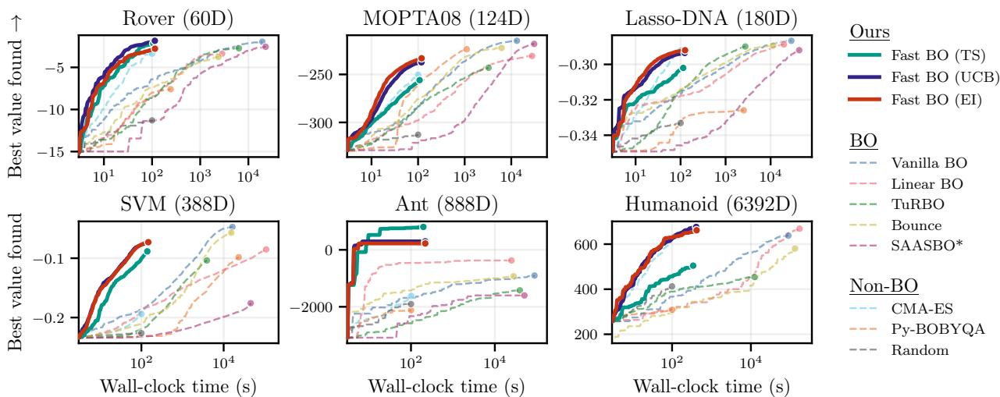  
Figure 2: Best value found against wall-clock time on the high-dimensional benchmarks, with each method run for 1000 evaluations (except SAASBO<sup>∗</sup> for 500). For this figure, evaluations are assumed to take only 0.1 seconds. Even in this fast regime, the speed advantage of CMA-ES does not lead to better results compared to our fast BO methods: its overall wall-clock time is similar to ours, while performing worse (on average).

## 5.2 Combinatorial Problems

For a fair speed comparison, we run all MCBO (Dreczkowski et al., 2023) methods through a faster, batched PyTorch (Paszke et al., 2019) implementation instead of the original pandas (McKinney, 2010) one, which gives the exact same results (see Appendix B.2). Our UCB and EI methods reach performance close to the state-of-the-art One-hot BO (Doumont et al., 2025), i.e. a GP with an RBF kernel on one-hot inputs, combined with the genetic algorithm of MCBO, while being one to two orders of magnitude faster. Although our fast methods rely on the CoCaBO kernel, they perform significantly better than the original method. This diference comes from AF optimization, which Dreczkowski et al. (2023) showed to be a key driver of performance: when we optimize our AF with CoCaBO’s bandit instead, our performance drops to that of CoCaBO (see Appendix C.4).

## 6 CONCLUSION

By recognizing and subsequently exploiting linear structures in well-known BO methods, we address one of the main remaining challenges of BO: its computational overhead. Through novel applications of classic linear algebra and optimization techniques, we develop a standardized framework that speeds up both model fitting and AF optimization. On high- and lowdimensional problems across continuous and combinatorial inputs, our fast BO methods consistently cover new areas of the Pareto frontier, achieving strong performance while being faster by several orders of magnitude. As a result, BO can now be applied to evaluations as cheap as 0.1 seconds, while still outperforming faster black-box optimizers such as CMA-ES. More broadly, we hope our fast methods will make BO the default choice for a much wider range of black-box problems.

Moreover, besides these practical gains, our methods also open up new avenues for theoretical analysis. For example, TS is now maximized exactly (as assumed by its regret bounds; Russo and Van Roy, 2014), and EI can be studied as UCB with a self-tuning exploration weight. Our trust-region variant also suggests links to local BO and model-based trust-region methods, and our exact solvers serve as a reference for studying inexact AF optimization in gradient-based BO.

Limitations. Our experiments do not cover very low-dimensional spaces (D < 10), mixed spaces, or batch acquisitions, and extending our methods to these settings, as well as to other AFs, is left for future work. Lastly, for expensive evaluations, our speed advantage no longer matters, and practitioners may prefer the slightly more consistent performance of slower, state-of-the-art BO methods (e.g. Vanilla BO on highdimensional problems; see Figure 3).

## References

Ament, S., Daulton, S., Eriksson, D., Balandat, M., and Bakshy, E. (2023). Unexpected improvements to expected improvement for Bayesian optimization. In Advances in Neural Information Processing Systems (NeurIPS).

Balandat, M., Karrer, B., Jiang, D., Daulton, S., Letham, B., Wilson, A. G., and Bakshy, E. (2020). BoTorch: A framework for eficient Monte-Carlo Bayesian optimization. In Advances in Neural Information Processing Systems (NeurIPS).

Baptista, R. and Poloczek, M. (2018). Bayesian optimization of combinatorial structures. In International Conference on Machine Learning (ICML).

Bergstra, J., Bardenet, R., Bengio, Y., and K´egl, B. (2011). Algorithms for hyper-parameter optimization. In Advances in Neural Information Processing Systems (NeurIPS).

Bishop, C. M. (2006). Pattern Recognition and Machine Learning. Springer.

Box, G. E. P. and Wilson, K. B. (1951). On the experimental attainment of optimum conditions. Journal of the Royal Statistical Society. Series B (Methodological).

Brockman, G., Cheung, V., Pettersson, L., Schneider, J., Schulman, J., Tang, J., and Zaremba, W. (2016). OpenAI Gym. arXiv preprint arXiv:1606.01540.

Cartis, C., Fiala, J., Marteau, B., and Roberts, L. (2019). Improving the flexibility and robustness of model-based derivative-free optimization solvers. ACM Transactions on Mathematical Software.

Dinkelbach, W. (1967). On nonlinear fractional programming. Management Science.

Doumont, C., Fan, D., Maus, N., Gardner, J. R., Moss, H., and Pleiss, G. (2026). We still don’t understand high-dimensional Bayesian optimization. In International Conference on Artificial Intelligence and Statistics (AISTATS).

Doumont, C., Picheny, V., Borovitskiy, V., and Moss, H. (2025). Omnipresent yet overlooked: Heat kernels in combinatorial Bayesian optimization. In Advances in Neural Information Processing Systems (NeurIPS).

Dreczkowski, K., Grosnit, A., and Bou Ammar, H. (2023). Framework and benchmarks for combinatorial and mixed-variable Bayesian optimization. In Advances in Neural Information Processing Systems (NeurIPS).

Eriksson, D. and Jankowiak, M. (2021). Highdimensional Bayesian optimization with sparse axisaligned subspaces. In Conference on Uncertainty in Artificial Intelligence (UAI).

Eriksson, D., Pearce, M., Gardner, J., Turner, R. D., and Poloczek, M. (2019). Scalable global optimization via local Bayesian optimization. In Advances in Neural Information Processing Systems (NeurIPS).

Fan, D., Doumont, C., Kalisz, A., Duckworth, P., Gardner, J. R., Moss, H., and Pleiss, G. (2026). Search at the cost of sampling: Nearly-instant latent space Bayesian optimization. In Advances in Neural Information Processing Systems (NeurIPS).

Fan, D. and Pleiss, G. (2026). Adaptive candidate point Thompson sampling for high-dimensional Bayesian optimization. In International Conference on Artificial Intelligence and Statistics (AISTATS).

Frazier, P. I. (2018). Bayesian optimization. In Recent Advances in Optimization and Modeling of Contemporary Problems. INFORMS.

Gardner, J., Pleiss, G., Weinberger, K. Q., Bindel, D., and Wilson, A. G. (2018). GPyTorch: Blackbox matrix-matrix Gaussian process inference with GPU acceleration. In Advances in Neural Information Processing Systems (NeurIPS).

Garnett, R. (2023). Bayesian Optimization. Cambridge University Press.

Hansen, N., Akimoto, Y., and Baudis, P. (2019). CMA-ES/pycma on Github. Zenodo 10.5281/zenodo.2559634.

Hansen, N. and Ostermeier, A. (2001). Completely derandomized self-adaptation in evolution strategies. Evolutionary Computation.

Holland, J. H. (1975). Adaptation in Natural and Artificial Systems. University of Michigan Press.

Hunter, D. R. and Lange, K. (2004). A tutorial on MM algorithms. The American Statistician.

Hutter, F., Hoos, H. H., and Leyton-Brown, K. (2011). Sequential model-based optimization for general algorithm configuration. In International Conference on Learning and Intelligent Optimization (LION).

Hvarfner, C., Hellsten, E. O., and Nardi, L. (2024). Vanilla Bayesian optimization performs great in high dimensions. In International Conference on Machine Learning (ICML).

Jones, D. R., Schonlau, M., and Welch, W. J. (1998). Eficient global optimization of expensive black-box functions. Journal of Global Optimization.

Kondor, R. I. and Laferty, J. (2002). Difusion kernels on graphs and other discrete input spaces. In International Conference on Machine Learning (ICML).

Lange, K. (2016). MM Optimization Algorithms. SIAM.

MacKay, D. J. C. (1992). Bayesian interpolation. Neural Computation.

McKinney, W. (2010). Data structures for statistical computing in Python. In Python in Science Conference (SciPy).

Mockus, J. (1975). On Bayesian methods for seeking the extremum. In IFIP Technical Conference on Optimization Techniques.

Moss, H., Ober, S. W., and Diethe, T. (2025). Return of the latent space COWBOYS: Re-thinking the use of VAEs for Bayesian optimisation of structured spaces. In International Conference on Machine Learning (ICML).

M¨uller, S., von Rohr, A., and Trimpe, S. (2021). Local policy search with Bayesian optimization. In Advances in Neural Information Processing Systems (NeurIPS).

Nelder, J. A. and Mead, R. (1965). A simplex method for function minimization. The Computer Journal.

Nguyen, Q., Wu, K., Gardner, J., and Garnett, R. (2022). Local Bayesian optimization via maximizing probability of descent. In Advances in Neural Information Processing Systems (NeurIPS).

Oh, C., Tomczak, J. M., Gavves, E., and Welling, M. (2019). Combinatorial Bayesian optimization using the graph Cartesian product. In Advances in Neural Information Processing Systems (NeurIPS).

Packebusch, T. and Mertens, S. (2016). Low autocorrelation binary sequences. Journal of Physics A: Mathematical and Theoretical.

Papenmeier, L. and Nardi, L. (2025). Bencher: Simple and reproducible benchmarking for black-box optimization. In Championing Open-source DEvelopment in ML Workshop (CODEML) @ ICML.

Papenmeier, L., Nardi, L., and Poloczek, M. (2023). Bounce: Reliable high-dimensional Bayesian optimization for combinatorial and mixed spaces. In Advances in Neural Information Processing Systems (NeurIPS).

Paszke, A., Gross, S., Massa, F., Lerer, A., Bradbury, J., Chanan, G., Killeen, T., Lin, Z., Gimelshein, N., Antiga, L., Desmaison, A., Kopf, A., Yang, E., DeVito, Z., Raison, M., Tejani, A., Chilamkurthy, S., Steiner, B., Fang, L., Bai, J., and Chintala, S. (2019). PyTorch: An imperative style, highperformance deep learning library. In Advances in Neural Information Processing Systems (NeurIPS).

Powell, M. J. D. (2009). The BOBYQA algorithm for bound constrained optimization without derivatives. Technical report, University of Cambridge.

Raponi, E., Rakotonirina, N. C., Rapin, J., Doerr, C., and Teytaud, O. (2025). Optimizing with low budgets: A comparison on the black-box optimization

benchmarking suite and OpenAI Gym. IEEE Transactions on Evolutionary Computation.

Rashidi, B., Johnstonbaugh, K., and Gao, C. (2024). Cylindrical Thompson sampling for highdimensional Bayesian optimization. In International Conference on Artificial Intelligence and Statistics (AISTATS).

Rasmussen, C. E. and Williams, C. K. I. (2006). Gaussian Processes for Machine Learning. MIT Press.

Razaviyayn, M., Hong, M., and Luo, Z.-Q. (2013). A unified convergence analysis of block successive minimization methods for nonsmooth optimization. SIAM Journal on Optimization.

Ru, B., Alvi, A., Nguyen, V., Osborne, M. A., and Roberts, S. (2020). Bayesian optimisation over multiple continuous and categorical inputs. In International Conference on Machine Learning (ICML).

Russo, D. and Van Roy, B. (2014). Learning to optimize via posterior sampling. Mathematics of Operations Research.

Schaible, S. (1976). Fractional programming. II, on Dinkelbach’s algorithm. Management Science.

Sehi´c, K., Gramfort, A., Salmon, J., and Nardi, L.<sup>ˇ</sup> (2022). LassoBench: A high-dimensional hyperparameter optimization benchmark suite for lasso. In International Conference on Automated Machine Learning (AutoML).

Shahriari, B., Swersky, K., Wang, Z., Adams, R. P., and de Freitas, N. (2016). Taking the human out of the loop: A review of Bayesian optimization. Proceedings of the IEEE.

Snoek, J., Larochelle, H., and Adams, R. P. (2012). Practical Bayesian optimization of machine learning algorithms. In Advances in Neural Information Processing Systems (NeurIPS).

Sobol, I. M. (1967). On the distribution of points in a cube and the approximate evaluation of integrals. USSR Computational Mathematics and Mathematical Physics.

Srinivas, N., Krause, A., Kakade, S. M., and Seeger, M. (2010). Gaussian process optimization in the bandit setting: No regret and experimental design. In International Conference on Machine Learning (ICML).

Stancu-Minasian, I. M. (1997). Fractional Programming: Theory, Methods and Applications. Kluwer Academic Publishers.

Thompson, W. R. (1933). On the likelihood that one unknown probability exceeds another in view of the evidence of two samples. Biometrika.

Todorov, E., Erez, T., and Tassa, Y. (2012). Mu-JoCo: A physics engine for model-based control. In IEEE/RSJ International Conference on Intelligent Robots and Systems (IROS).

Wang, L., Fonseca, R., and Tian, Y. (2020). Learning search space partition for black-box optimization using Monte Carlo tree search. In Advances in Neural Information Processing Systems (NeurIPS).

Wang, Z., Gehring, C., Kohli, P., and Jegelka, S. (2018). Batched large-scale Bayesian optimization in high-dimensional spaces. In International Conference on Artificial Intelligence and Statistics (AIS-TATS).

Wang, Z. and Jegelka, S. (2017). Max-value entropy search for eficient Bayesian optimization. In International Conference on Machine Learning (ICML).

Whitehead, T. M. (2026). From high dimensions to one: The exact acquisition frontier for spherical linear Bayesian optimization. Zenodo preprint 10.5281/zenodo.21721503.

Wilson, J., Borovitskiy, V., Terenin, A., Mostowsky, P., and Deisenroth, M. (2020). Eficiently sampling functions from Gaussian process posteriors. In International Conference on Machine Learning (ICML).

# Appendix

## A DERIVATIONS

## A.1 Surrogate Fits

Continuous Inputs. We standardize the targets and set $b _ { 0 } = 1 - b _ { 1 }$ , as in Equation (7). This leaves four hyperparameters: the global lengthscale a, the mixture weight $b _ { 1 } .$ , the noise variance $\sigma ^ { 2 }$ , and the constant mean c. We fit these hyperparameters by minimizing the classic negative log marginal likelihood (NLL)

$$
\mathrm { N L L } ( a , b _ { 1 } , \sigma ^ { 2 } , c ) = \frac { 1 } { 2 } ( { \bf y } - c { \bf 1 } ) ^ { \top } \widetilde { \bf K } ^ { - 1 } ( { \bf y } - c { \bf 1 } ) + \frac { 1 } { 2 } \log \operatorname* { d e t } \widetilde { \bf K } + \frac { N } { 2 } \log 2 \pi .
$$

Using Equation (12), the Gram matrix $\widetilde { \bf K }$ from Equations (2) and (3) can be written as

$$
\widetilde { \mathbf { K } } = b _ { 1 } \mathbf { P } \mathbf { P } ^ { \top } + b _ { 0 } \mathbf { 1 } \mathbf { 1 } ^ { \top } + \sigma ^ { 2 } \mathbf { I } _ { N } ,
$$

where $\mathbf { P } \in \mathbb { R } ^ { N \times ( D + 1 ) }$ stacks the projected training inputs $P ( \mathbf { z } _ { 1 } ) , \ldots , P ( \mathbf { z } _ { N } )$ . Computed naively, every evaluation of the NLL costs $O ( N ^ { 3 } )$ , due to the inverse and the determinant of Ke . Since an optimizer evaluates the NLL many times, we rewrite it below such that each evaluation only costs $O ( \operatorname* { m i n } ( N , D ) )$ ). Note that a is the only hyperparameter inside P. Therefore, for a fixed value of $^ { a , }$ we only require a single eigendecomposition. This is similar to Fan et al. (2026), who fit a linear model on the sphere with a single eigendecomposition. Unlike their model, however, ours has a lengthscale inside the projection and a constant feature $b _ { 0 }$ , which is why we need the grid search over a and the rank-one correction below.

To begin, we split $\widetilde { \bf K }$ into two parts, i.e.

$$
\widetilde { \bf K } = { \bf A } + b _ { 0 } { \bf 1 1 } ^ { \top } , \qquad \mathrm { w i t h } \quad { \bf A } : = b _ { 1 } { \bf P } { \bf P } ^ { \top } + \sigma ^ { 2 } { \bf I } _ { N } .
$$

For a fixed $^ { a , }$ we compute the eigendecomposition $\mathbf { P } \mathbf { P } ^ { \intercal } = Q \mathrm { d i a g } ( \nu _ { 1 } , \dots , \nu _ { N } ) Q ^ { \intercal }$ once. In this eigenbasis, A becomes diagonal for any $b _ { 1 }$ and $\bar { \sigma } ^ { 2 }$ :

$$
\mathbf { A } ^ { - 1 } = Q \mathbf { \Delta } Q ^ { \top } , \quad \mathrm { w i t h } \quad \mathbf { \Delta } \Delta : = \mathrm { d i a g } \big ( ( b _ { 1 } \nu _ { i } + \sigma ^ { 2 } ) ^ { - 1 } \big ) _ { i = 1 } ^ { N } , \qquad \mathrm { a n d } \qquad \log \mathrm { d e t } \mathbf { A } = \sum _ { i = 1 } ^ { N } \log ( b _ { 1 } \nu _ { i } + \sigma ^ { 2 } ) .
$$

Next, the remaining part $b _ { 0 } \mathbf { 1 1 } ^ { \top }$ only has rank one. Using the Sherman–Morrison formula and the matrix determinant lemma, we get

$$
\widetilde { \mathbf { K } } ^ { - 1 } = \mathbf { A } ^ { - 1 } - \frac { b _ { 0 } } { 1 + b _ { 0 } \eta _ { 1 1 } } \mathbf { A } ^ { - 1 } \mathbf { 1 1 } ^ { \top } \mathbf { A } ^ { - 1 } , \qquad \log \operatorname* { d e t } \widetilde { \mathbf { K } } = \log \operatorname* { d e t } \mathbf { A } + \log ( 1 + b _ { 0 } \eta _ { 1 1 } ) ,
$$

with the scalar $\eta _ { 1 1 } : = \mathbf { 1 } ^ { \top } \mathbf { A } ^ { - 1 } \mathbf { 1 }$ . Similarly, we define the two scalars $\eta _ { 1 y } : = \mathbf { 1 } ^ { \top } \mathbf { A } ^ { - 1 } \mathbf { y }$ and $\eta _ { y y } : = \mathbf { y } ^ { \top } \mathbf { A } ^ { - 1 } \mathbf { y }$

Lastly, the NLL can be minimized analytically for the constant mean c. Setting its derivative with respect to c to zero gives the generalized least-squares estimate

$$
c = \frac { \mathbf { 1 } ^ { \top } \widetilde { \mathbf { K } } ^ { - 1 } \mathbf { y } } { \mathbf { 1 } ^ { \top } \widetilde { \mathbf { K } } ^ { - 1 } \mathbf { 1 } } = \frac { \eta _ { 1 y } } { \eta _ { 1 1 } } .
$$

For this value of $c ,$ we have $\mathbf { 1 } ^ { \top } \mathbf { A } ^ { - 1 } ( \mathbf { y } - c \mathbf { 1 } ) = \eta _ { 1 y } - c \eta _ { 1 1 } = 0 .$ . The rank-one term therefore drops out of the quadratic form, which simplifies to $\eta _ { y y } - \eta _ { 1 y } ^ { 2 } / \eta _ { 1 1 }$ . Putting everything together, the NLL becomes (up to a constant)

$$
\mathrm { N L L } ( b _ { 1 } , \sigma ^ { 2 } ) = \frac { 1 } { 2 } \Bigl ( \eta _ { y y } - \frac { \eta _ { 1 y } ^ { 2 } } { \eta _ { 1 1 } } \Bigr ) + \frac { 1 } { 2 } \sum _ { i = 1 } ^ { N } \log ( b _ { 1 } \nu _ { i } + \sigma ^ { 2 } ) + \frac { 1 } { 2 } \log ( 1 + b _ { 0 } \eta _ { 1 1 } ) .\tag{27}
$$

Here, the three scalars $\eta _ { 1 1 } , \eta _ { 1 y }$ and $\eta _ { y y }$ only require the cached vectors $\hat { \mathbf { 1 } } : = Q ^ { \top } \mathbf { 1 }$ and $\hat { \mathbf { y } } : = Q ^ { \top } \mathbf { y }$ , since

$$
\eta _ { 1 1 } = \hat { \mathbf { 1 } } ^ { \top } \Delta \hat { \mathbf { 1 } } , \qquad \eta _ { 1 y } = \hat { \mathbf { 1 } } ^ { \top } \Delta \hat { \mathbf { y } } , \qquad \eta _ { y y } = \hat { \mathbf { y } } ^ { \top } \Delta \hat { \mathbf { y } } .
$$

As $\pmb { \Delta }$ is diagonal, each evaluation of Equation (27) thus costs only $O ( N )$ , without any matrix operations. We minimize it over $( b _ { 1 } , \sigma ^ { 2 } )$ with Nelder–Mead, and choose a with a grid search around this inner fit (see Algorithm 2, and Appendix B.3 for the settings).

So far, we have used the eigendecomposition of the $N \times N$ matrix $\mathbf { P P } ^ { \top }$ , whose cost grows cubically with the number of observations. When $N > D + 1$ , we can instead work with the smaller $\left( D + 1 \right) \times \left( D + 1 \right)$ matrix $\mathbf { P } ^ { \top } \mathbf { P }$ which has the same nonzero eigenvalues (with eigenvectors $\mathbf { P v } _ { i } / { \sqrt { \nu _ { i } } } .$ where $\mathbf { v } _ { i }$ are the eigenvectors of $\mathbf { P } ^ { \top } \mathbf { P } )$ The remaining $N - D - 1$ eigenvalues of $\mathrm { \bf \dot { P } P ^ { \top } }$ are all zero. Ordering the eigenvalues such that the first $D + 1$ are nonzero, η can then be split as

$$
\eta _ { 1 1 } = \sum _ { i = 1 } ^ { N } { \frac { \hat { 1 } _ { i } ^ { 2 } } { b _ { 1 } \nu _ { i } + \sigma ^ { 2 } } } = \sum _ { i = 1 } ^ { D + 1 } { \frac { \hat { 1 } _ { i } ^ { 2 } } { b _ { 1 } \nu _ { i } + \sigma ^ { 2 } } } + { \frac { 1 } { \sigma ^ { 2 } } } \sum _ { i = D + 2 } ^ { N } \hat { 1 } _ { i } ^ { 2 } .
$$

Since $Q$ is orthogonal, we have $\lVert \hat { \mathbf { 1 } } \rVert ^ { 2 } = \lVert \mathbf { 1 } \rVert ^ { 2 } = N .$ , such that the last sum equals $\begin{array} { r } { N - \sum _ { i = 1 } ^ { D + 1 } \hat { 1 } _ { i } ^ { 2 } } \end{array}$ . As a result, $\eta _ { 1 1 }$ only requires the $D + 1$ nonzero eigenvectors, and the same holds for $\eta _ { 1 y }$ and $\eta _ { y y } \ ( \mathrm { u s i n g \ } \mathbf { 1 } ^ { \top } \mathbf { y }$ and $\mathbf { y } ^ { \top } \mathbf { y } )$ Overall, the eigendecomposition costs $O ( N D \operatorname* { m i n } ( N , D ) + \operatorname* { m i n } ( N , D ) ^ { 3 } )$ for each value of $^ { a , }$ after which each NLL evaluation costs only $O ( \operatorname* { m i n } ( N , D ) )$ .

Combinatorial Inputs. With the features from Equation (23), the model is a Bayesian linear regression

$$
\begin{array} { r } { y = \phi ( \mathbf { x } ) ^ { \top } \mathbf { w } + \epsilon , \qquad \mathbf { w } \sim \mathcal { N } ( \mathbf { 0 } , \tau ^ { - 1 } \mathbf { I } _ { M } ) , \qquad \epsilon \sim \mathcal { N } ( 0 , \sigma ^ { 2 } ) , } \end{array}
$$

with prior precision $\tau : = D / b$ (i.e. we absorb the scale $\sqrt { b / D }$ of Equation (23) into the weights, which is the usual form of MacKay’s updates). As before, the targets are standardized, but the model has no constant mean. This leaves two hyperparameters: τ and $\sigma ^ { 2 }$ . Let $\breve { \mathbf { H } } \in \{ 0 , 1 \} ^ { N \times M }$ stack the one-hot encodings of the training inputs. In weight space, the NLL can then be written as (Bishop, 2006)

$$
\mathrm { N L L } ( \tau , \sigma ^ { 2 } ) = \frac { 1 } { 2 \sigma ^ { 2 } } \| \mathbf { y } - \mathbf { H } \bar { \mathbf { w } } \| ^ { 2 } + \frac { \tau } { 2 } \| \bar { \mathbf { w } } \| ^ { 2 } + \frac { 1 } { 2 } \log \operatorname* { d e t } \left( \tau \mathbf { I } _ { M } + \sigma ^ { - 2 } \mathbf { H } ^ { \top } \mathbf { H } \right) - \frac { M } { 2 } \log \tau + \frac { N } { 2 } \log \sigma ^ { 2 } + \frac { N } { 2 } \log 2 \pi ,
$$

where $\bar { \mathbf { w } } = \sigma ^ { - 2 } ( \tau \mathbf { I } _ { M } + \sigma ^ { - 2 } \mathbf { H } ^ { \top } \mathbf { H } ) ^ { - 1 } \mathbf { H } ^ { \top } \mathbf { y }$ is the posterior mean of $\mathbf { w } .$ . This is the same NLL as for continuous inputs (with $c = 0 )$ , except written in weight space, where MacKay’s updates are easiest to derive (see below).

Unlike for continuous inputs, the features $\phi ( \mathbf { x } )$ do not depend on any hyperparameter. Therefore, similar to Fan et al. (2026), both hyperparameters can be fitted using a single eigendecomposition ${ \bf H } ^ { \top } { \bf H } =$ $V \mathrm { d i a g } ( \omega _ { 1 } , \ldots , \omega _ { M } ) \stackrel { \textstyle \cdot } { V ^ { \top } }$ . In this eigenbasis, the matrix τI ${ \bf \Gamma } _ { M } + \sigma ^ { - 2 } { \bf H } ^ { \bar { \top } }$ H is diagonal for any τ and $\sigma ^ { 2 }$ , with entries $\tau + \omega _ { i } / \sigma ^ { 2 }$ . As a result, its log determinant, w¯ and the residual $\| \mathbf { y } - \mathbf { H } \bar { \mathbf { w } } \| ^ { 2 }$ all cost only $O ( M )$ , using the cached vector $V ^ { \top } \mathbf { H } ^ { \top } \mathbf { y }$ and the scalar $\mathbf { y } ^ { \top } \mathbf { y }$

Lastly, instead of a generic optimizer, we minimize the NLL with MacKay’s fixed-point updates (MacKay, 1992; Bishop, 2006). Setting the derivatives of the NLL with respect to τ and $\sigma ^ { 2 }$ to zero, and rearranging, gives

$$
\tau = \frac { N _ { \mathrm { e f f } } } { \| \bar { \mathbf { w } } \| ^ { 2 } } , \qquad \sigma ^ { 2 } = \frac { \| \mathbf { y } - \mathbf { H } \bar { \mathbf { w } } \| ^ { 2 } } { N - N _ { \mathrm { e f f } } } , \qquad \mathrm { w i t h } \quad N _ { \mathrm { e f f } } : = \sum _ { i = 1 } ^ { M } \frac { \omega _ { i } } { \sigma ^ { 2 } \tau + \omega _ { i } } .
$$

Here, $N _ { \mathrm { e f f } }$ can be seen as the efective number of parameters. Since w¯ and $N _ { \mathrm { e f f } }$ depend on τ and $\sigma ^ { 2 }$ themselves, we iterate these two equations as updates until they converge. Each update reuses the same eigendecomposition, and costs only $O ( M )$

No Projection for Combinatorial Inputs. For continuous inputs, the spherical projection gives every input the same prior variance. Since $\| P ( \mathbf { z } ) \| = 1$ , we have

$$
k _ { \mathrm { S L } } ( \mathbf { x } , \mathbf { x } ) = \| \mathbf { u } ( \mathbf { x } ) \| ^ { 2 } = b _ { 0 } + b _ { 1 } = 1 \quad \mathrm { f o r ~ a l l ~ } \mathbf { x } .
$$

Without the projection, the prior variance of a linear kernel grows with $\| \mathbf { x } \|$ , which pushes the acquisitions towards the boundary of the search space (Doumont et al., 2026). For combinatorial inputs, however, the onehot features already have a constant norm. Each $\phi ( x _ { i } )$ has exactly one nonzero entry, so $\| \phi ( \mathbf { x } ) \| ^ { 2 } = D$ , and therefore

$$
k _ { \mathrm { C o C a B O } } ( \mathbf { x } , \mathbf { x } ) = \| \mathbf { u } ( \mathbf { x } ) \| ^ { 2 } = b \quad \mathrm { f o r ~ a l l ~ } \mathbf { x } \in \mathcal { X } .
$$

As a result, no projection is needed.

## A.2 Thompson Sampling

TS consists of two steps: (i) drawing a posterior sample $\mathbf { w } \sim \mathcal { N } ( \bar { \mathbf { w } } , \pmb { \Sigma } )$ , and (ii) maximizing the resulting sample path $\mathbf { w } ^ { \top } \mathbf { u } ( \mathbf { z } )$ over the search box. As we show below, both steps reuse the fit from Appendix A.1, and the second step can be solved exactly.

Posterior Samples. To draw w, we use Matheron’s rule (Wilson et al., 2020), i.e.

$$
\begin{array} { r } { \mathbf { w } = \mathbf { w } _ { 0 } + \mathbf { Z } ^ { \top } \widetilde { \mathbf { K } } ^ { - 1 } \big ( \mathbf { y } - c \mathbf { 1 } - \mathbf { Z w } _ { 0 } - \epsilon \big ) , \qquad \mathrm { w i t h } \quad \mathbf { w } _ { 0 } \sim \mathcal { N } ( \mathbf { 0 } , \mathbf { I } _ { M } ) \quad \mathrm { a n d } \quad \epsilon \sim \mathcal { N } ( \mathbf { 0 } , \sigma ^ { 2 } \mathbf { I } _ { N } ) , } \end{array}
$$

where $M = D + 2$ (see Equation (12)). This gives an exact posterior sample, by correcting the prior sample $\mathbf { w } _ { 0 }$ with the posterior update. Moreover, $\widetilde { \mathbf { K } } ^ { - 1 }$ can be applied using the eigendecomposition and the rank-one correction from Appendix A.1, such that Σ never has to be formed.

Fractional Program. Using Equations (9) and (12), the sample path can be written out as

$$
\mathbf { w } ^ { \top } \mathbf { u } ( \mathbf { z } ) = \sqrt { b _ { 1 } } \mathbf { w } _ { 1 : D } ^ { \top } \frac { 2 \mathbf { z } } { \| \mathbf { z } \| ^ { 2 } + 1 } + \sqrt { b _ { 1 } } w _ { D + 1 } \frac { \| \mathbf { z } \| ^ { 2 } - 1 } { \| \mathbf { z } \| ^ { 2 } + 1 } + \sqrt { b _ { 0 } } w _ { D + 2 } .
$$

Here, the last term does not depend on z. With $\mathbf { g } = \sqrt { b _ { 1 } } \mathbf { w } _ { 1 : D }$ and $\kappa = \sqrt { b _ { 1 } } w _ { D + 1 }$ , the first two terms can be combined into the single ratio

$$
R ( \mathbf { z } ) : = \frac { A ( \mathbf { z } ) } { B ( \mathbf { z } ) } , \qquad \mathrm { w i t h } \quad A ( \mathbf { z } ) : = 2 \mathbf { g } ^ { \top } \mathbf { z } + \kappa \big ( \| \mathbf { z } \| ^ { 2 } - 1 \big ) \quad \mathrm { a n d } \quad B ( \mathbf { z } ) : = \| \mathbf { z } \| ^ { 2 } + 1 ,\tag{28}
$$

which gives Equation (14). As a result, maximizing TS is equivalent to maximizing $R ( \mathbf { z } )$ over the search box $\mathcal { Z } : = [ \mathbf { z } _ { \mathrm { l o } } , \mathbf { z } _ { \mathrm { h i } } ]$ in scaled coordinates $( \mathrm { i . e . } [ - 1 / a , 1 / a ] ^ { D }$ in Section 3.2). This corresponds to a single-ratio fractional program, which can be solved with Dinkelbach’s algorithm (see below).

Dinkelbach’s Algorithm. Consider a general problem of the form $\scriptstyle \operatorname* { m a x } _ { \mathbf { z } \in { \mathcal { Z } } } A ( \mathbf { z } ) / B ( \mathbf { z } )$ , where A and B are continuous, Z is compact, and $B > 0$ on Z. Instead of maximizing this ratio directly, Dinkelbach’s algorithm relies on the parametric function

$$
F ( \rho ) : = \operatorname* { m a x } _ { \mathbf { z } \in \mathcal { Z } } A ( \mathbf { z } ) - \rho B ( \mathbf { z } ) ,
$$

which is continuous and strictly decreasing in $\rho .$ If $\rho ^ { \star }$ denotes the optimal ratio, we have $A ( \mathbf { z } ) - \rho ^ { \star } B ( \mathbf { z } ) \leq 0$ for all $\mathbf { z } \in { \mathcal { Z } }$ (since $B > 0 )$ , with equality at the maximizers of the ratio. As a result, $\rho ^ { \star }$ is the unique root of $F .$ and both problems have the same maximizers at $\rho = \rho ^ { \star }$

To find this root, Dinkelbach’s algorithm starts from a feasible point $\mathbf { z } _ { 0 }$ , with $\rho _ { 0 } = A ( \mathbf { z } _ { 0 } ) / B ( \mathbf { z } _ { 0 } )$ , and then alternates between the two steps

$$
\mathbf { z } _ { n } \in \arg \operatorname* { m a x } _ { \mathbf { z } \in \mathcal { Z } } A ( \mathbf { z } ) - \rho _ { n } B ( \mathbf { z } ) , \qquad \rho _ { n + 1 } = \frac { A ( \mathbf { z } _ { n } ) } { B ( \mathbf { z } _ { n } ) } .
$$

Here, the ratios $\rho _ { n }$ are nondecreasing: since $\rho _ { n }$ is the ratio of a feasible point, we have $F ( \rho _ { n } ) \geq 0$ , and thus $A ( \mathbf { z } _ { n } ) - \rho _ { n } B ( \mathbf { z } _ { n } ) \geq 0$ , i.e. $\rho _ { n + 1 } ~ \ge ~ \rho _ { n }$ . Moreover, the ratios converge superlinearly to $\rho ^ { \star }$ , as long as each subproblem in the first step is solved globally (Dinkelbach, 1967; Schaible, 1976). In our case, we start from ${ \bf z } _ { 0 } = { \bf 0 }$ , i.e. the center of the box (or of the trust region).

Exact Subproblems. For $R ( \mathbf { z } )$ , we can group the terms in $\| \mathbf { z } \| ^ { 2 }$ as

$$
\kappa ( \| \mathbf { z } \| ^ { 2 } - 1 ) - \rho \big ( \| \mathbf { z } \| ^ { 2 } + 1 \big ) = ( \kappa - \rho ) \| \mathbf { z } \| ^ { 2 } - ( \kappa + \rho ) ,
$$

which gives the subproblem

$$
A ( { \bf z } ) - \rho B ( { \bf z } ) = \sum _ { i = 1 } ^ { D } \left[ 2 g _ { i } z _ { i } - ( \rho - \kappa ) z _ { i } ^ { 2 } \right] - ( \kappa + \rho ) .
$$

As can be seen, this subproblem is separable over the coordinates. If $\rho > \kappa ,$ , each term is a concave quadratic in $z _ { i } ,$ with maximizer

$$
z _ { i } = \mathrm { c l i p } \Big ( { \frac { g _ { i } } { \rho - \kappa } } , ~ z _ { \mathrm { l o } , i } , ~ z _ { \mathrm { h i } , i } \Big ) .
$$

Otherwise, each term is convex (or linear), and its maximum lies at one of the two endpoints $z _ { \mathrm { l o } , i }$ and $z _ { \mathrm { h i } , i } .$ . As a result, each subproblem can be solved exactly in $O ( D )$ time, and Dinkelbach’s algorithm returns the globa maximizer of TS over the box.

Combinatorial Inputs. For combinatorial inputs, the posterior covariance of w is diagonal in the eigenbasis of the fit (see Appendix A.1). A posterior sample can thus be drawn as

$$
\mathbf { w } = \bar { \mathbf { w } } + V \mathrm { d i a g } \Big ( \frac { 1 } { \sqrt { \tau + \omega _ { 1 } / \sigma ^ { 2 } } } , \dots , \frac { 1 } { \sqrt { \tau + \omega _ { M } / \sigma ^ { 2 } } } \Big ) \xi , \qquad \mathrm { w i t h } \quad \xi \sim \mathcal { N } ( \mathbf { 0 } , \mathbf { I } _ { M } ) .
$$

Since Equation (25) is a sum of per-variable terms, its global maximizer sets each $x _ { i }$ to the category with the largest entry in $\mathbf { w } _ { i } .$ , which takes $O ( M )$ time. Within a Hamming trust region of radius r around a center x¯ (see Appendix B.3), let $\delta _ { i } \geq 0$ be the gain of this best category over ${ \bar { x } } _ { i } .$ . Since the objective is separable and the constraint only counts the number of changed variables, the constrained maximizer changes the (up to) r variables with the largest positive gains (i.e. replacing a chosen variable by one with a larger gain can only improve the objective). These variables can be found by sorting, in $O ( M + D \log D )$ time.

## A.3 Upper Confidence Bound

In this section, we derive the minorizer of UCB from Section 3.2, show that it satisfies both MM conditions, and discuss the convergence of the resulting MM algorithm.

Minorizer. Since $\sigma ^ { 2 } > 0$ , the posterior variance is strictly positive, i.e. $s ( { \bf u } _ { 0 } ) > 0$ , and the tangent of s at $\mathbf { u } _ { 0 }$ is always defined:

$$
s ( \mathbf { u } ) \geq s ( \mathbf { u } _ { 0 } ) + \frac { ( \pmb { \Sigma } \mathbf { u } _ { 0 } ) ^ { \top } ( \mathbf { u } - \mathbf { u } _ { 0 } ) } { s ( \mathbf { u } _ { 0 } ) } .
$$

Replacing $s ( \mathbf { u } )$ in Equation (15) by this tangent, and collecting the terms in $\mathbf { u } ( \mathbf { z } )$ , we get

$$
h ( \mathbf { z } \mid \mathbf { z } _ { 0 } ) = c + \mathbf { w } _ { \mathrm { e f f } } ( \mathbf { u } _ { 0 } ) ^ { \top } \mathbf { u } ( \mathbf { z } ) + \beta \Big [ s ( \mathbf { u } _ { 0 } ) - \frac { \mathbf { u } _ { 0 } ^ { \top } \Sigma \mathbf { u } _ { 0 } } { s ( \mathbf { u } _ { 0 } ) } \Big ] .
$$

Here, the term in brackets vanishes, since $\mathbf { u } _ { 0 } ^ { \top } \pmb { \Sigma } \mathbf { u } _ { 0 } = s ( \mathbf { u } _ { 0 } ) ^ { 2 }$ , which gives Equations (17) and (18). Using the same identity, we also have

$$
c + \mathbf { w } _ { \mathrm { e f f } } ( \mathbf { u } _ { 0 } ) ^ { \top } \mathbf { u } _ { 0 } = c + \bar { \mathbf { w } } ^ { \top } \mathbf { u } _ { 0 } + \beta s ( \mathbf { u } _ { 0 } ) = \alpha _ { \mathrm { U C B } } ( \mathbf { z } _ { 0 } ) ,
$$

such that adding and subtracting $\mathbf { w } _ { \mathrm { e f f } } ( \mathbf { u } _ { 0 } ) ^ { \top } \mathbf { u } _ { 0 }$ in Equation (17) gives Equation (19).

MM Conditions. The minorizer $h ( \textbf { z } | \textbf { z } _ { 0 } )$ satisfies both MM conditions from Section 3.2. First, since s is convex in u, its tangent lies below s everywhere in feature space, such that $h ( \mathbf { z } \mid \mathbf { z } _ { 0 } ) \leq \alpha _ { \mathrm { U C B } } ( \mathbf { z } )$ for all z (global minorant). Second, Equation (19) gives $h ( \mathbf { z } _ { 0 } \mid \mathbf { z } _ { 0 } ) = \alpha _ { \mathrm { U C B } } ( \mathbf { z } _ { 0 } )$ (tightness). Here, convexity is only required in u, and not in z.

Convergence. Combining both MM conditions gives

$$
\begin{array} { r } { \alpha _ { \mathrm { U C B } } ( \mathbf { z } _ { j + 1 } ) \ \geq \ h ( \mathbf { z } _ { j + 1 } \mid \mathbf { z } _ { j } ) \ \geq \ h ( \mathbf { z } _ { j } \mid \mathbf { z } _ { j } ) \ = \ \alpha _ { \mathrm { U C B } } ( \mathbf { z } _ { j } ) , } \end{array}
$$

where the second inequality holds because $\mathbf { z } _ { j + 1 }$ maximizes $h ( \cdot \mid \mathbf { z } _ { j } )$ . As a result, the acquisition values are nondecreasing, and converge since they are bounded on the compact box. Moreover, since $s > 0$ on the box, h is continuous and matches the gradient of $\alpha _ { \mathrm { U C B } }$ at $\mathbf { z } _ { 0 }$ . These are the conditions of Razaviyayn et al. (2013, Theorem 1), which guarantee that every accumulation point of the iterates is a stationary point of UCB over the box. Since this is only a local guarantee, we run MM from multiple random starts (see Appendix B.3). Each MM step costs one Dinkelbach solve, as for TS (see Appendix A.2), plu $O ( N D )$ to compute Σu<sub>0</sub>.

Combinatorial Inputs. For combinatorial inputs, we follow the same practice as MCBO (Dreczkowski et al., 2023), and define s as the predictive standard deviation

$$
\begin{array} { r } { s ( \mathbf { u } ) = \sqrt { \mathbf { u } ^ { \top } \Sigma \mathbf { u } + \sigma ^ { 2 } } , } \end{array}
$$

i.e. the norm of $[ \pmb { \Sigma } ^ { 1 / 2 } \mathbf { u } ; \sigma ]$ , which is still convex in u and has the same gradient $\pmb { \Sigma } \mathbf { u } / s ( \mathbf { u } )$ . Repeating the steps above without the constant mean $^ { c , }$ the term in brackets no longer vanishes, since $\mathbf { u } _ { 0 } ^ { \top } \dot { \mathbf { \Sigma } } \mathbf { u } _ { 0 } = s ( \mathbf { u } _ { 0 } ) ^ { 2 } - \sigma ^ { 2 }$ . Instead, we obtain Equation (26) with

$$
\mathrm { c o n s t } = \beta \frac { \sigma ^ { 2 } } { s ( \mathbf { u } _ { 0 } ) } .
$$

Since this constant does not change the maximizer, each MM step is again equivalent to TS (see Appendix A.2), also within the Hamming trust region. Lastly, since $\pmb { \Sigma } \succ 0$ and $\sigma ^ { 2 } > 0$ , s is strictly convex, such that every MM step that changes the configuration strictly increases the acquisition. Since X is finite, MM therefore stops at a fixed point after a finite number of steps. Here, computing $\pmb { \Sigma } \mathbf { u } _ { 0 }$ costs $O ( M ^ { 2 } )$ per step.

## A.4 Expected Improvement

Similar to UCB, we first show that EI is convex and increasing in m and $s ,$ which then allows us to derive a minorizer that is linear in u.

Convexity and Monotonicity. For $\xi \sim \mathcal { N } ( 0 , 1 )$ , EI can be written as

$$
\operatorname { E I } ( m , s ) = \mathbb { E } \big [ ( m - y _ { \operatorname* { m a x } } + s \xi ) ^ { + } \big ] .
$$

Since the function inside the expectation is convex in $( m , s )$ for each fixed ξ, EI is also convex in $( m , s )$ . Moreover, for $s > 0 ,$ , its partial derivatives are

$$
\frac { \partial \mathrm { E I } } { \partial m } = \Phi ( \gamma ) > 0 , \qquad \frac { \partial \mathrm { E I } } { \partial s } = \varphi ( \gamma ) > 0 ,
$$

such that EI is increasing in both m and s.

Minorizer. Since EI is convex in $( m , s )$ , its tangent plane at $( m _ { 0 } , s _ { 0 } )$ lies below it, i.e.

$$
\operatorname { E I } ( m , s ) \geq \operatorname { E I } ( m _ { 0 } , s _ { 0 } ) + \Phi ( \gamma _ { 0 } ) ( m - m _ { 0 } ) + \varphi ( \gamma _ { 0 } ) ( s - s _ { 0 } ) .
$$

Moreover, since $\varphi ( \gamma _ { 0 } ) > 0$ , we can further replace $s - s _ { 0 }$ by its tangent lower bound from Appendix A.3, i.e.

$$
s - s _ { 0 } \geq \frac { ( \Sigma \mathbf { u } _ { 0 } ) ^ { \top } ( \mathbf { u } - \mathbf { u } _ { 0 } ) } { s _ { 0 } } .
$$

After substituting $m ( \mathbf { u } ) = c + \bar { \mathbf { w } } ^ { \top }$ u and defining $\lambda _ { 0 } : = \varphi ( \gamma _ { 0 } ) / \Phi ( \gamma _ { 0 } )$ , collecting the terms gives the minorizer

$$
h ( \mathbf { z } \mid \mathbf { z } _ { 0 } ) = \mathrm { E I } ( m _ { 0 } , s _ { 0 } ) + \Phi ( \gamma _ { 0 } ) \mathbf { w } _ { \mathrm { e f f } } ( \mathbf { u } _ { 0 } ) ^ { \top } \big ( \mathbf { u } ( \mathbf { z } ) - \mathbf { u } _ { 0 } \big ) ,
$$

with $\mathbf { w } _ { \mathrm { e f f } }$ as in Equation (18), except with $\lambda = \lambda _ { 0 }$ . As for UCB, this minorizer is a global minorant, and is tight at $\mathbf { z } _ { 0 }$

Lastly, to obtain Equation (21), we use the two identities

$$
\begin{array} { r } { \mathrm { E I } ( m _ { 0 } , s _ { 0 } ) = \Phi ( \gamma _ { 0 } ) \big [ m _ { 0 } - y _ { \mathrm { m a x } } + \lambda _ { 0 } s _ { 0 } \big ] , \qquad \mathbf { w } _ { \mathrm { e f f } } ( \mathbf { u } _ { 0 } ) ^ { \top } \mathbf { u } _ { 0 } = \bar { \mathbf { w } } ^ { \top } \mathbf { u } _ { 0 } + \lambda _ { 0 } s _ { 0 } . } \end{array}
$$

After substituting both into $h ( \textbf { z } | \textbf { z } _ { 0 } )$ , all terms in $\mathbf { u } _ { 0 }$ cancel except $c - y _ { \mathrm { m a x } } ,$ which gives Equation (21). The convergence argument from Appendix A.3 then applies unchanged, with $\lambda = \lambda _ { 0 }$ at every step.

Table 1: Benchmarks, with their dimension D, their number of evaluations (including the initial design), and the number of rollouts averaged per evaluation (– for deterministic benchmarks).
<table><tr><td></td><td>Benchmark</td><td>D</td><td>Evaluations</td><td>Rollouts</td><td>Reference</td></tr><tr><td rowspan="6">High-dimensional</td><td>Rover</td><td>60</td><td>1000</td><td>1</td><td>Wang et al. (2018); Eriksson et al. (2019)</td></tr><tr><td>MOPTA08</td><td>124</td><td>1000</td><td></td><td>Eriksson and Jankowiak (2021)</td></tr><tr><td>Lasso-DNA</td><td>180</td><td>1000</td><td></td><td>Šehić et al. (2022)</td></tr><tr><td>SVM</td><td>388</td><td>1000</td><td></td><td>Eriksson and Jankowiak (2021)</td></tr><tr><td>Ant</td><td>888</td><td>1000</td><td>10</td><td>Wang et al. (2020)</td></tr><tr><td>Humanoid</td><td>6392</td><td>1000</td><td>10</td><td>Wang et al. (2020)</td></tr><tr><td rowspan="4">Low-dimensional continuous</td><td>Lunar Lander</td><td>12</td><td>500</td><td>50</td><td>Brockman et al. (2016); Eriksson et al. (2019)</td></tr><tr><td>Robot Pushing</td><td>14</td><td>500</td><td>1</td><td>Wang et al. (2018); Eriksson et al. (2019)</td></tr><tr><td>Swimmer</td><td>16</td><td>500</td><td>10</td><td>Wang et al. (2020)</td></tr><tr><td>Hopper</td><td>33</td><td>500</td><td>10</td><td>Wang et al. (2020)</td></tr><tr><td rowspan="5">Combinatorial</td><td>Contamination</td><td>25</td><td>200</td><td></td><td>Baptista and Poloczek (2018)</td></tr><tr><td>Pest</td><td>25</td><td>200</td><td></td><td>Oh et al. (2019)</td></tr><tr><td>LABS</td><td>50</td><td>200</td><td></td><td>Packebusch and Mertens (2016)</td></tr><tr><td>MaxSAT60</td><td>60</td><td>200</td><td></td><td>Oh et al. (2019)</td></tr><tr><td>MaxSAT125</td><td>125</td><td>200</td><td></td><td>Oh et al. (2019)</td></tr></table>

Combinatorial Inputs. Since the posterior of $k _ { \mathrm { C o C a B O } }$ is again Gaussian, EI has the same closed form, and the derivation above applies with x instead of z. With the predictive s and no constant mean, the same cancellation now leaves

$$
\mathbf { w } _ { \mathrm { e f f } } ( \mathbf { u } _ { 0 } ) ^ { \top } \mathbf { u } _ { 0 } = \bar { \mathbf { w } } ^ { \top } \mathbf { u } _ { 0 } + \lambda _ { 0 } \frac { s _ { 0 } ^ { 2 } - \sigma ^ { 2 } } { s _ { 0 } } ,
$$

which gives the minorizer

$$
h ( \mathbf { x } \mid \mathbf { x } _ { 0 } ) = \Phi ( \gamma _ { 0 } ) \big [ \mathbf { w } _ { \mathrm { e f f } } ( \mathbf { u } _ { 0 } ) ^ { \top } \mathbf { u } ( \mathbf { x } ) + \mathrm { c o n s t } \big ] , \qquad \mathrm { w i t h ~ c o n s t } = \lambda _ { 0 } \frac { \sigma ^ { 2 } } { s ( \mathbf { u } _ { 0 } ) } - y _ { \mathrm { m a x } } .
$$

Here, $\mathbf { w } _ { \mathrm { e f f } }$ is defined as in Equation (26), with $\lambda = \lambda _ { 0 }$ . Since $\Phi ( \gamma _ { 0 } ) > 0$ , maximizing $h ( \mathbf { x } \mid \mathbf { x } _ { 0 } )$ is again equivalent to TS, and is solved by a per-variable argmax (see Appendix A.2).

## B EXPERIMENTAL DETAILS

## B.1 Benchmarks

Table 1 lists all benchmarks. All continuous benchmarks are served by Bencher (Papenmeier and Nardi, 2025). The six high-dimensional benchmarks are those of Doumont et al. (2026), and the five combinatorial tasks come from MCBO (Dreczkowski et al., 2023). The implementations of LABS, MaxSAT and Contamination follow Bounce (Papenmeier et al., 2023). Bencher, MCBO, Bounce and BoTorch are all released under the MIT License, as is Gym (Brockman et al., 2016). MuJoCo is released under the Apache License 2.0, pycma under the BSD 3-Clause License, and Py-BOBYQA under the GNU GPL v3. Continuous runs start from a 30-point scrambled Sobol design (Sobol, 1967), and combinatorial runs from 20 random points. The combinatorial tasks are minimized, and al their variables are binary, except for Pest, whose 25 variables have 5 categories each.

Every evaluation is seeded from the seed of the run, so all runs are reproducible. Rover, Robot Pushing and the MuJoCo (Todorov et al., 2012) tasks are stochastic, i.e. repeated evaluations of the same point give diferent values. For the MuJoCo tasks, each evaluation averages 10 rollouts, as in Wang et al. (2020). For Lunar Lander, each evaluation averages 50 rollouts with fixed seeds, shared by all points, as in Eriksson et al. (2019). Repeated evaluations of the same point therefore give the same value. These rollout counts difer from the defaults of Bencher (one episode for Lunar Lander, one rollout for Ant, and five for the other MuJoCo tasks). We instead follow the settings described in the original papers (Wang et al., 2020; Eriksson et al., 2019).

## B.2 Baselines

Continuous. We compare against random search, Vanilla BO (Hvarfner et al., 2024), TuRBO (Eriksson et al., 2019), SAASBO (Eriksson and Jankowiak, 2021), Bounce (Papenmeier et al., 2023) and Linear BO (Doumont et al., 2026), which are all implemented with BoTorch (Balandat et al., 2020). We also compare against two derivative-free methods, CMA-ES (Hansen and Ostermeier, 2001), using the pycma implementation (Hansen et al., 2019), and Py-BOBYQA (Cartis et al., 2019), an implementation of BOBYQA (Powell, 2009).

Here, SAASBO<sup>∗</sup> denotes the BoTorch 0.18 implementation of SAASBO, which uses a new and faster JAX-based sampler for its fully Bayesian inference. Since this inference remains very expensive, SAASBO<sup>∗</sup> always runs on a GPU, with a budget of only 500 evaluations. For the high-dimensional benchmarks (budget 1000), its final value and total algorithm time are therefore not comparable to those of the other methods. As a result, we omit SAASBO<sup>∗</sup> from the high-dimensional Pareto plots (Figures 1 and 3) and the time breakdown (Figure 9), and only show it in the figures that compare methods along the run (Figures 2, 6 and 10). In these figures, it has no runs on Humanoid, since its memory requirements exceed our 40 GB GPUs. On the low-dimensional benchmarks (budget 500), SAASBO runs as many iterations as the other baselines, and is therefore included in both the Pareto and per-iteration figures (Figures 1, 4 and 7).

Similarly, TuRBO, Bounce and Linear BO run on a GPU for the Humanoid problem. Moreover, Bounce starts from its own 5-point design, as in its original paper (Papenmeier et al., 2023). Lastly, Py-BOBYQA interpolates a quadratic through 2D+1 points, which exceeds the evaluation budget on Ant and Humanoid. On these two benchmarks, the entire run thus consists of its initial design, and its low algorithm time only reflects that it never starts optimizing.

Combinatorial. Our main BO baseline is One-hot BO (Doumont et al., 2025), i.e. a GP with an RBF kernel on one-hot inputs, for which we use its implementation on top of MCBO (with EI and the genetic algorithm o MCBO as AF optimizer). Moreover, we compare against CoCaBO (Ru et al., 2020) with the default settings of MCBO, i.e. a GP with the overlap kernel and EI, where the categories are chosen by a multi-armed bandit. Lastly, the model-free baselines consist of random search and the four optimizers of MCBO (hill climbing, simulated annealing, a genetic algorithm, and a multi-armed bandit), all with their default settings.

For a fair speed comparison, we run all MCBO methods through a faster, batched PyTorch implementation of the framework code, instead of the original pandas one. This implementation gives exactly the same results. For One-hot BO, we also report the timings obtained with the original framework code (i.e. pandas instead of PyTorch).

## B.3 Implementation

All three AFs share the same fit, and the model and AF computations run in double precision. Below, we list the settings that afect our results, and refer to our code for further numerical details. We chose these settings in preliminary runs on our benchmarks, and use them unchanged on all benchmarks of a suite.

Fit. As in Section 3, inputs are rescaled to $\mathcal { X } = [ - 1 , 1 ] ^ { D }$ , such that ${ \mathbf z } = { \mathbf x } / a$ . The global lengthscale a is chosen from a grid of 10 values

$$
a _ { j } = \sqrt { f _ { j } D } , \qquad j = 1 , \dotsc , 1 0 ,
$$

where the fractions $f _ { j }$ are spaced geometrically between $1 0 ^ { - 3 }$ and 1. For $f _ { j } = 1 , a _ { j }$ is the half-diagonal of X. For each value $a _ { j }$ , the inner fit from Appendix A.1 runs Nelder–Mead on $( b _ { 1 } , \sigma ^ { 2 } )$ , starting at $\begin{array} { r } { b _ { 1 } = \frac { 1 } { 2 } } \end{array}$ and $\sigma ^ { 2 } = 0 . 1$ with at most 80 evaluations and $\sigma ^ { 2 } \geq 1 0 ^ { - 8 }$ . The full grid search runs every 10 fits. In between, a is held fixed, and only the inner fit is redone (see Algorithm 2).

For combinatorial inputs, the fixed-point updates from Appendix A.1 run for at most 100 iterations, also with $\sigma ^ { 2 } \ge 1 0 ^ { - 8 }$

Acquisition (Continuous). Dinkelbach’s algorithm starts at $\mathbf { z } = \mathbf { 0 } .$ , and stops once the ratio changes by less than $1 0 ^ { - 6 }$ , or after 100 iterations (whichever is satisfied first). For TS, we return the result of one exact solve per sample, without restarts. UCB $( \beta = 2 )$ and EI share the same procedure. We start from $K = 1 0$ points drawn uniformly in the search box, and update them together for at most T = 10 MM iterations. The MM iterations stop once every step is shorter than $1 0 ^ { - 6 }$

Algorithm 2 Fit for continuous inputs. The grid search runs every tenth fit. The fits in between keep $a ^ { \star }$ fixed,   
and only redo the inner fit.   
Require: data $\{ ( \mathbf { x } _ { i } , y _ { i } ) \} _ { i = 1 } ^ { N } ;$ grid $\{ a _ { j } \} _ { j = 1 } ^ { 1 0 }$   
1: for each $a _ { j }$ in parallel do ▷ independent eigendecompositions   
2: form $\mathbf { P } ( a _ { j } ) ;$ eigendecompose the smaller of $\mathbf { P P } ^ { \top }$ and $\mathbf { P } ^ { \top } \mathbf { P }$ (Appendix A.1)   
3: fit $( b _ { 1 } , \sigma ^ { 2 } )$ by Nelder–Mead on Equation (27); $c  \eta _ { 1 y } / \eta _ { 1 1 }$   
4: end for   
5: $a ^ { \star }  \arg$ min<sub>j</sub> $\operatorname { N L L } ( a _ { j } )$   
6: return posterior $( \bar { \bf w } , { \pmb \Sigma } , c )$ at $a ^ { \star }$ via Equations (2) and (3), in the same eigenbasis

For EI, we use the best standardized observation as $y _ { \mathrm { m a x } }$ . Lastly, UCB and EI return the highest-scoring final point that has not been observed yet, or the highest-scoring one if all of them have been observed.

Acquisition (Combinatorial). All three AFs are optimized within the Hamming trust region of MCBO (Dreczkowski et al., 2023). This trust region is a ball of radius r around the incumbent, whose radius is adapted during the run by the trust-region manager of MCBO. TS returns one exact solve (see Appendix A.2). UCB (β = 2) and EI follow the continuous procedure with $K = 1 0$ starts, where each start sets r randomly chosen variables of the incumbent to random categories. These starts are then updated together for at most 10 MM iterations, and stop once no start changes. Both AFs use the predictive standard deviation. As in the continuous case, UCB and EI return the highest-scoring final point that has not been observed yet.

Since combinatorial spaces are finite, the selected point (i.e. the maximizer for TS, or the best final point for UCB and EI) may already have been observed. For UCB and EI, this only happens if the final points of all K = 10 starts have been observed. Since our objectives are deterministic, evaluating the same point again would waste an evaluation. In that case, we instead select a nearby unobserved point, in three stages. First, we consider all unobserved points that difer from the selected point in a single variable, and choose the one with the highest acquisition value (or sampled value for TS). If all of these have been observed too, we draw up to 64 unobserved random points that difer from the selected point in 2 to r variables, and choose the best one in the same way. Lastly, if no such point is found either, we draw random points around the center of the trust region instead. In all three stages, we only consider points inside the trust region.

Low-Dimensional Variant. On the low-dimensional benchmarks, we use the trust region of TuRBO (Eriksson et al., 2019) with its default settings, and restart from a new 30-point Sobol design when it collapses. As in TuRBO, its side lengths are scaled by the ARD lengthscales, normalized to a geometric mean of one. We refit these lengthscales every 50 fits and after each restart. Moreover, as described in Section 5.1, our model is only fitted on the last D observations (the window). Lastly, the spherical projection is centered at the midpoint of the trust region (i.e. the center of the search space considered by TuRBO), instead of the center of X.

## B.4 Hardware, Timing, and Seeds

Hardware and Timing. We define the algorithm time as the wall-clock time a method spends fitting its model and optimizing its AF, summed over a run. It excludes the objective evaluations and, on the continuous benchmarks, the initial fit. We use it for the x axis of the Pareto figures and for Table 2.

All CPU runs of the continuous methods used AMD EPYC 7513 CPUs with four threads, pinned to their own four cores. The combinatorial methods ran on one core of the same CPU type. For each figure, our three AFs were run with the same code and protocol, such that their timings can be compared directly. As mentioned in Appendix B.2, the GPU runs used NVIDIA A100 PCIe GPUs with 40 GB of memory.

Seeds and Statistics. We use 10 seeds for the high-dimensional benchmarks, 40 for the low-dimensional ones, and 20 for the combinatorial ones, so as to obtain reliable means for each setting. Due to its high cost, SAASBO<sup>∗</sup> only has 10 seeds on the low-dimensional benchmarks. For a given seed, all continuous methods except Bounce start from the same initial design (see Appendix B.2).

In the Pareto figures, each point shows the mean final best value and the mean algorithm time over all seeds. The Pareto frontier (in gray) indicates the best mean value that can be reached within each time budget. In

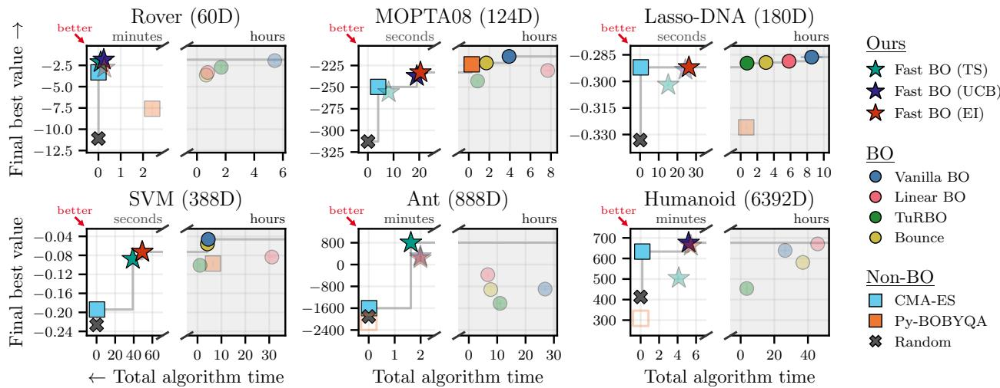  
Figure 3: Extension of Figure 1 for each high-dimensional benchmark. Our AFs are one to nearly four orders of magnitude faster than every model-based baseline, and always lie on the Pareto frontier. (The slow part of the time axis is shaded and uses a diferent scale.)

Figure 1, the error bars show 95% intervals from a bootstrap over the seeds of each benchmark (2000 resamples). Unless stated otherwise, the other figures show the mean, with error bars of ±1 standard error over seeds (on both axes in the per-benchmark Pareto figures). Note that many error bars are smaller than their markers, and are therefore not visible.

## C ADDITIONAL RESULTS

## C.1 Per-Benchmark Pareto Plots

Figures 3 to 5 show the Pareto plot of each benchmark, for the high-dimensional, combinatorial and lowdimensional problems, respectively. These three plots are summarized in Figure 1.

High-Dimensional Problems. In Figure 3, our EI and UCB methods consistently lie on the Pareto frontier, which only holds for one other method, CMA-ES (besides random search). TS is faster, but usually worse than EI and UCB, as also reported by Doumont et al. (2026). For $N > D$ , EI and UCB match or trail the state of the art, whereas for $N \approx D$ and $N < D$ , they outperform all other methods (especially on Ant). We hypothesize that this is because, at $N < D$ , the data cannot even determine a linear model, such that the extra flexibility of a GP brings little benefit.

Low-Dimensional Problems. In Figure 4, our TS method lies on the Pareto frontier for three of the four problems, and is outperformed by CMA-ES on Lunar Lander. On Robot Pushing, Swimmer and Hopper, TS matches or outperforms Vanilla BO at more than 100× less algorithm time. On average, UCB and EI perform slightly worse than TS (e.g. on Robot Pushing and Hopper), likely because the trust region favors more explorative AFs (see Section 5.1).

Combinatorial Problems. In Figure 5, our three AFs lie on the Pareto frontier on four of the five problems. On LABS, EI and UCB perform slightly worse than hill climbing (which lies on the Pareto frontier), and TS performs surprisingly poorly (similar to random search). We hypothesize that this is because the LABS objective is invariant to flipping all variables, which leaves our additive model with little signal, such that each TS sample is mostly noise. Lastly, our methods are about 20–100× faster than One-hot BO when both use our PyTorch implementation of the framework code, and 100–500× faster than One-hot BO with the original MCBO code (hollow circles in Figure 5).

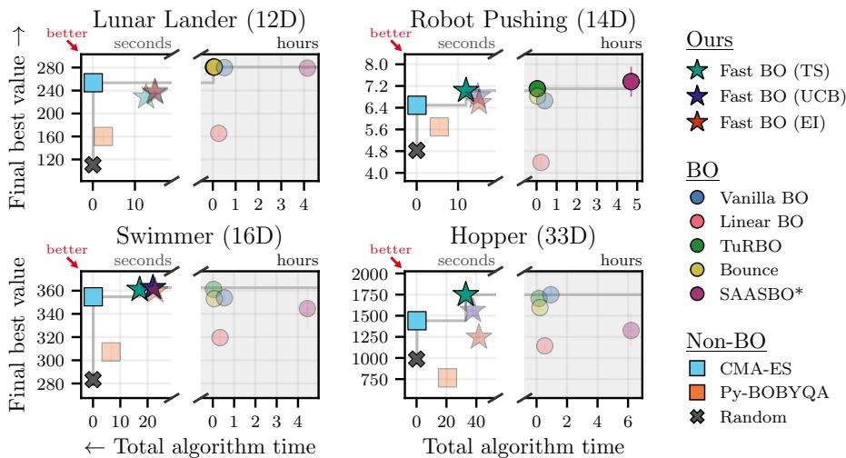  
Figure 4: Extension of Figure 1 for each low-dimensional benchmark. Our TS method matches or outperforms Vanilla BO on three of the four problems, at more than 100× less algorithm time. (The slow part of the time axis is shaded and uses a diferent scale.)

Table 2: Algorithm time per run on the high-dimensional benchmarks (model fitting and AF optimization, mean over 10 seeds, excluding black-box evaluations). Each entry is the speedup over Vanilla BO (the dash), with the wall-clock time in gray parentheses. Benchmarks are sorted by dimension (60 to 6392). Fast BO runs on CPU throughout, whereas TuRBO and Linear BO use a GPU on Humanoid (<sup>†</sup>). These are the times plotted in Figure 3.
<table><tr><td></td><td colspan="6">Fast BO</td><td colspan="5">Baselines</td></tr><tr><td>Benchmark</td><td>TS</td><td></td><td>UCB</td><td></td><td>EI</td><td></td><td>TuRBO</td><td></td><td>Vanilla BO</td><td></td><td>Linear BO</td></tr><tr><td>Rover</td><td>3254×</td><td>(6.0s)</td><td>1366× (14s)</td><td></td><td>1251× (16s)</td><td></td><td>3.2×</td><td>(1.7h)</td><td>− (5.4h)</td><td></td><td>7.3× (45m)</td></tr><tr><td>MOPTA08</td><td>1747×</td><td>(8.1s)</td><td>740× (19s)</td><td></td><td>690× (20s)</td><td></td><td>4.6×</td><td>(51m)</td><td>一 (3.9h)</td><td></td><td>0.51× (7.7h)</td></tr><tr><td>Lasso-DNA</td><td>2036×</td><td>(15s)</td><td>1266× (24s)</td><td></td><td>1175× (26s)</td><td></td><td></td><td>11× (46m)</td><td>一 (8.5h)</td><td></td><td>1.5× (5.8h)</td></tr><tr><td>SVM</td><td>415×</td><td>(39s)</td><td>330× (49s)</td><td></td><td>329× (49s)</td><td></td><td>4.3×</td><td>(1.1h)</td><td>一 (4.5h)</td><td></td><td>0.14× (31h)</td></tr><tr><td>Ant</td><td>994×</td><td>(1.6m)</td><td>812×</td><td>(2.0m)</td><td>810×</td><td>(2.0m)</td><td>2.4×</td><td>(11h)</td><td>一 (27h)</td><td></td><td>4.0× (6.7h)</td></tr><tr><td>Humanoid</td><td>384×</td><td>(4.1m)</td><td>306×</td><td>(5.2m)</td><td>292×</td><td>(5.4m)</td><td>7.3×</td><td>(3.6h†)</td><td>一 (26h)</td><td></td><td>0.58× (46h†)</td></tr></table>

## C.2 Best Value Found per Iteration

Figures 6 to 8 show the best value found against the number of evaluations on the high-dimensional, lowdimensional, and combinatorial benchmarks, respectively. Each figure includes the methods from the corre sponding Pareto figure, with our methods as solid lines and the baselines as dashed lines.

## C.3 Algorithm Time

Table 2 gives the algorithm time per run on the high-dimensional benchmarks, displaying the speedup over Vanilla BO (with the wall-clock time in parentheses). We use Vanilla BO as the reference, given that it is currently the state of the art, as well as the only model-based baseline that runs on all six tasks on CPU. The speedup of our three AFs is largest on Rover and Lasso-DNA (over 10<sup>3</sup>), and smallest on SVM and Humanoid (a few hundred). Overall, our methods run in seconds to minutes, while Vanilla BO needs hours or even more than a day. Note that the spherical-linear model of Doumont et al. (2026) does not by itself make Linear BO fast: Linear BO is significantly slower than Vanilla BO on MOPTA08, SVM and Humanoid (0.51×, 0.14× and 0.58×).

Figure 9 splits the algorithm time of each run into fitting the model and optimizing the AF. For the baselines, this split depends on the problem. With a budget of N = 1000, fitting dominates when N > D (Rover to SVM), both steps take a similar share when N ≈ D (Ant), and when N < D (Humanoid), Vanilla BO, Linear BO and Bounce spend over 90% of their time optimizing the AF. Both steps can thus be the bottleneck. For our methods, TS spends about 90–99% of its time in the fit, since a single Dinkelbach solve is cheap, while UCB and EI spend roughly 20–65% of their time in the AF. Figure 10 shows the time per step as the number of observations grows.

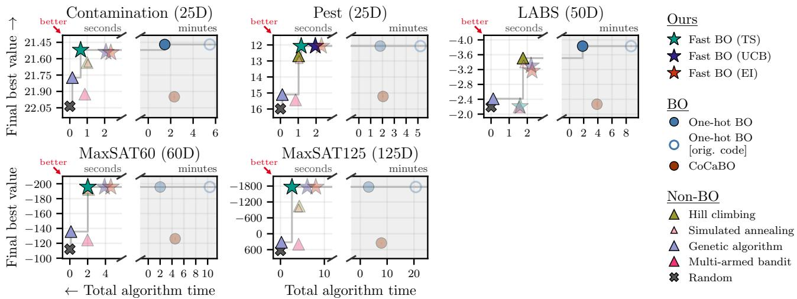  
Figure 5: Extension of Figure 1 for each combinatorial benchmark. Our AFs lie on the Pareto frontier on all problems except LABS, and are 100–500× faster than One-hot BO with the original MCBO code (hollow circles). (The slow part of the time axis is shaded and uses a diferent scale, and the y axis is inverted since the tasks are minimized.)

The BO baselines take seconds to minutes per step, and slow down as N grows. At these budgets, their cost per step grows roughly linearly to quadratically in N, as computing the kernel and its gradients $( O ( N ^ { 2 } D ) )$ ) dominates the $O ( N ^ { 3 } )$ Cholesky decomposition. Our methods take from tens of milliseconds (Rover) to a few seconds (Humanoid) per step.

## C.4 Ablations

High-Dimensional. Figure 11 removes one ingredient of Fast BO (EI) at a time, on all high-dimensional benchmarks except Humanoid. First, replacing our MM optimizer by the LogEI (Ament et al., 2023) of BoTorch, maximized with the optimize acqf settings of Linear BO, makes a run approximately 20–40× slower. Second, running the full lengthscale grid at every fit, instead of every tenth fit, makes it roughly 2–6× slower. Third, fitting the same shared-lengthscale model by gradient-based MAP, instead of our grid search and Nelder–Mead, makes it about 10–20× slower. The first two changes leave the final value mostly within noise, while the gradientbased fit is worse on MOPTA08, Lasso-DNA and Ant, and better on Rover. We do not ablate the shared lengthscale, since our grid search is only possible with a single lengthscale. For reference, we also show Linear BO, which has none of the three ingredients.

Combinatorial. Figure 12 keeps our combinatorial model and EI, but maximizes EI with the genetic algorithm or the multi-armed bandit of MCBO, instead of our MM optimizer. The genetic algorithm reaches the same final values, but is approximately 10–20× slower. With the multi-armed bandit, performance drops to the level of CoCaBO, which combines the same optimizer with a GP. This suggests that the weaker results of CoCaBO are due to its AF optimizer rather than its kernel.

Low-Dimensional. Figure 13 isolates the efects of the trust region and the window fit from Appendix B.3 on the four low-dimensional benchmarks, for each of our AFs. Most of the improvement is due to the trust region, which improves upon plain Fast BO in nearly all cases. In contrast, the window alone does not help, and often degrades performance. When combined with the trust region, however, it improves the results in most cases. Lastly, an isotropic trust region combined with the window is faster than our method, but performs slightly worse. Due to its cost, this ablation only uses the first 10 of the 40 seeds (for all variants and reference lines). Its values therefore difer from Figure 4, most visibly on Hopper, where the variance across seeds is high.

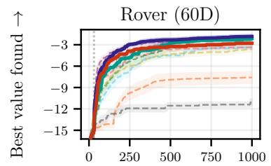

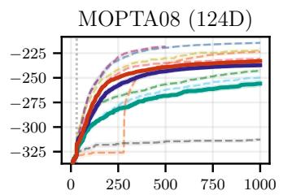

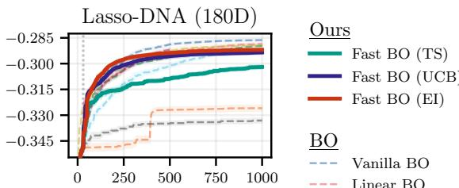

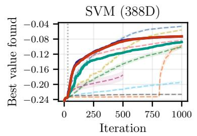

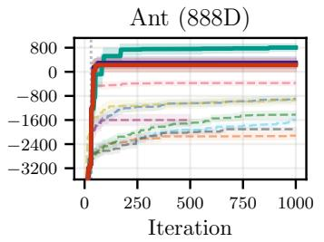

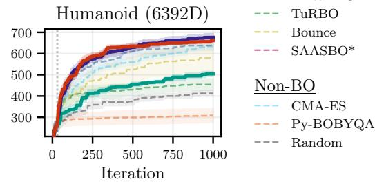  
Figure 6: Extension of Figure 3 over the course of the optimization.

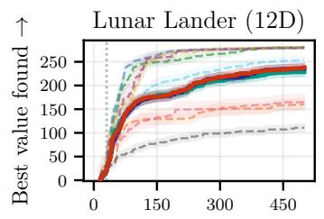

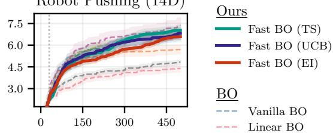

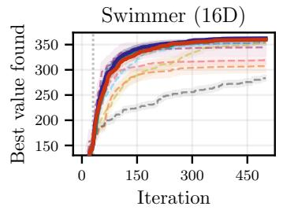

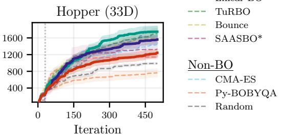  
Figure 7: Extension of Figure 4 over the course of the optimization.

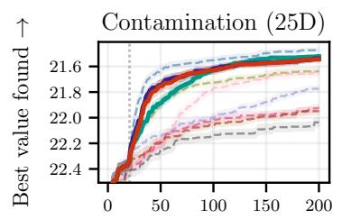

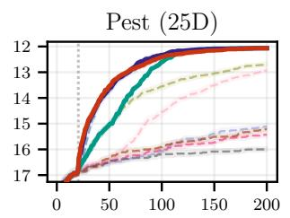

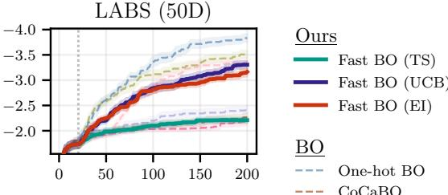

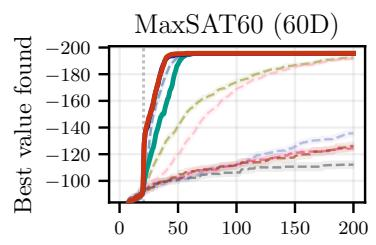

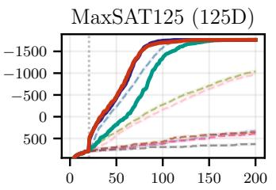  
Figure 8: Extension of Figure 5 over the course of the optimization.

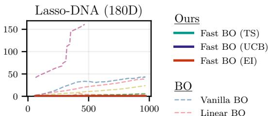

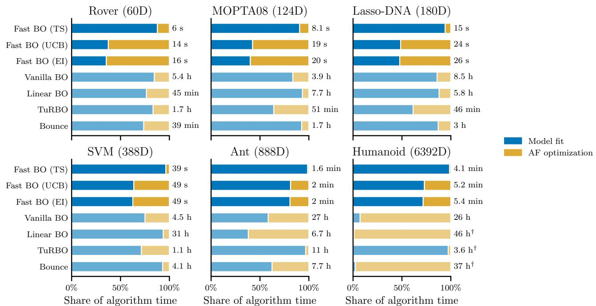  
Figure 9: Depending on the problem, either the fit or the AF optimization can dominate the algorithm time of most BO baselines. In contrast, our TS method spends almost all of its time in the fit (<sup>†</sup>GPU).

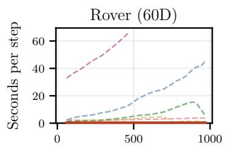

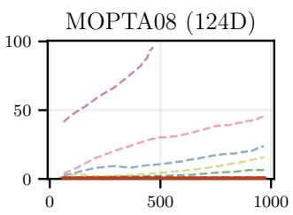

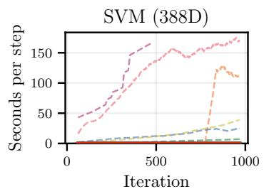

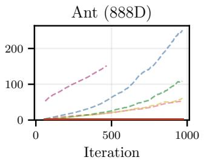  
Figure 10: Our AFs take at most 5 seconds per step, which is negligible compared to the BO baselines (median over seeds, smoothed with a 64-step rolling mean).

Ant (888D)

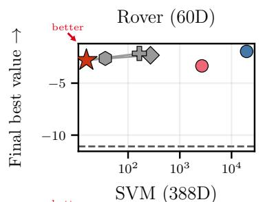

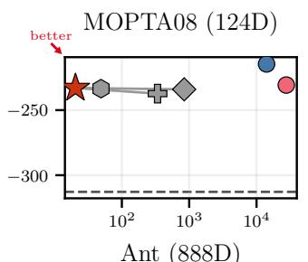

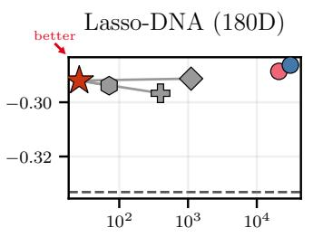  
Ours Fast BO (EI) w/o MM optimizer w/o amortized grid w/o our fit

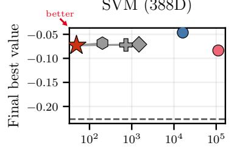  
← <sup>Total</sup> <sup>algorithm</sup> <sup>time</sup> <sup>(s)</sup>

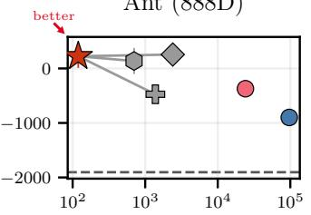  
Baselines Linear BO Vanilla BO Random

Total algorithm time (s)  
Figure 11: Each ingredient of Fast BO (EI) contributes to its speed, with our MM optimizer contributing most (about 20–40×). Only the gradient-based fit lowers the final value on some benchmarks.  
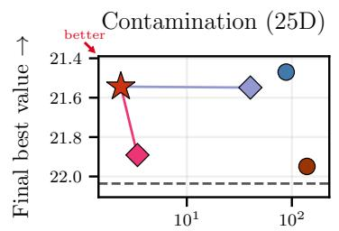

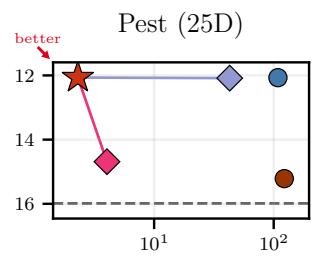

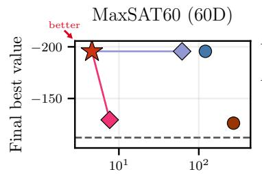

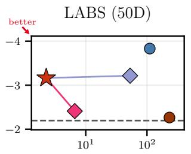  
Ours Fast BO (EI) w/ genetic algorithm w/ multi-armed bandit

Total algorithm time (s)  
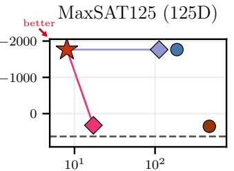  
Baselines One-hot BO CoCaBO Random  
Total algorithm time (s)  
Figure 12: The genetic algorithm reaches the same values as our MM optimizer, but is about 10–20× slower. The multi-armed bandit drops to the level of CoCaBO. (The y axis is inverted since the tasks are minimized.)

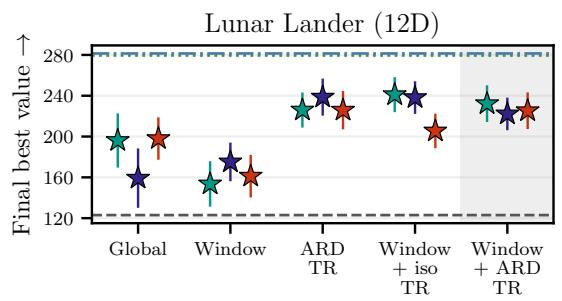

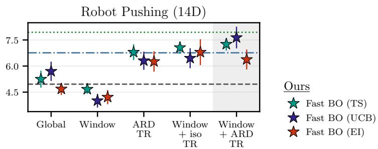

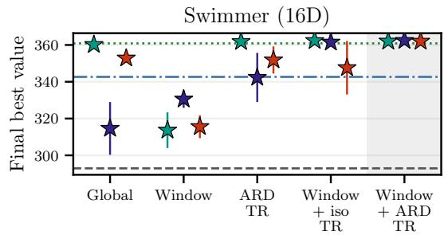

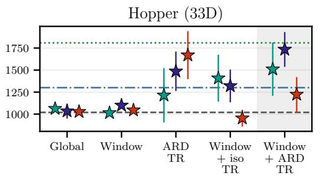  
Figure 13: Most of the improvement of our low-dimensional variant is due to the ARD trust region, whereas the window mainly helps once combined with this trust region (mean over the first 10 of the 40 seeds).