# Flat-RLVR: Sharpness-Aware Reinforcement Learning with Verifiable Rewards for Reasoning Capacity in LLMs

Yeonbum Kim 1 Hyun Kyu Lee 1 Sung Whan Yoon 1 2

## Abstract

Reinforcement learning with verifiable rewards (RLVR), particularly through group-relative policy optimization (GRPO), has emerged as a central paradigm for the post-training of large language models (LLMs). While RLVR is highly effective at enhancing the reasoning capabilities of LLMs, it commonly induces distribution sharpening, whereby the policy distribution becomes excessively peaked and rare-yet-correct trajectories are progressively suppressed, thus diminishing sample diversity. To this end, we promote flat-reward optima in RLVR to smooth the policy distribution. We theoretically link flat reward RLVR to reduced distribution sharpening, and empirically show improved sample diversity while maintaining single-attempt accuracy. Our method, called Flat-RLVR, searches for flat reward regions via sharpness-aware minimization during LLM post-training, combining this with GRPO variants to achieve better trade-offs between sampling efficiency and reasoning capacity.

## 1. Introduction

Reinforcement learning with verifiable rewards (RLVR), especially through group-relative methods, has emerged as a predominant methodology for large language model (LLM) post-training (Shao et al., 2024; Lambert et al., 2025; Guo et al., 2025). Its prominence stems from two complementary strengths: first, rewarding only the correctness of the final answer is sufficient to elicit valid reasoning behaviors (Guo et al., 2025; Shao et al., 2026); and second, the group-relative method eliminates the value network required by proximal policy optimization (PPO) (Schulman et al., 2017), substantially reducing the memory burden of maintaining a critic of comparable size to the policy (Shao et al., 2024). This critic-free design—first realized as grouprelative policy optimization (GRPO) (Shao et al., 2024) and subsequently extended in its variants—has rapidly become the defacto standard for RLVR.

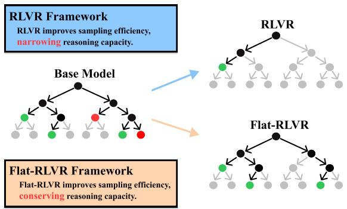  
Figure 1. RLVR and Flat-RLVR on LLM reasoning capacity. Gray nodes indicate paths that are unlikely to be sampled by the model, black nodes indicate paths that are likely to be sampled, i.e., each path consists of a sequence of outputs, later formulated by oj, where j is the path index. Green nodes indicate correct solutions, and red nodes indicate incorrect.

However, a critical doubt has been raised, stemming from empirical observations that GRPO impairs its efficacy when evaluated across multiple samples by checking whether any one succeeds; so-called Pass@K performance metric (Shao et al., 2024). Specifically, base LLM models without posttraining even surpass their RLVR-tuned counterparts under Pass@K with sufficiently large K (Yue et al., 2025). This misgiving has recently raised a hypothesis that RLVR merely improves sampling efficiency at the expense of the model’s underlying reasoning capacity driven by LLM’s sample diversity (Nguyen et al., 2025; Zhao et al., 2025; Zhu et al., 2025). Further evidence reinforces this view: RLVR has been shown to amplify only responses that already carry high probability mass while neglecting the long tail of rare-yet-correct samples, thereby reducing sample diversity (He et al., 2025); and to concentrate exclusively on regions already solvable by the base model, failing to acquire novel capabilities (Yue et al., 2025). Taken together, these findings further support the interpretation that the current RLVR mechanism induces distribution sharpening—a phenomenon in which the model reinforces only the easier, already-solved instances and loses its exploratory capacity.

This is particularly problematic in light of the emerging paradigm of inference-time compute scaling, which leverages sample diversity for effective LLM deployment (Wang et al., 2023; Brown et al., 2024; Chow et al., 2025; Handa et al., 2026; Wang et al., 2026b). These strategies operate on a simple principle—generate many candidate solutions and rely on a verifier to identify the correct ones—and are particularly well aligned with RLVR’s domains of mathematics and code, where deterministic verifiers naturally enable reliable selection (Cobbe et al., 2021; Chen et al., 2021; Brown et al., 2024). In this regard, distribution sharpening from RLVR, which is observed to trade output diversity for efficiency, directly undermines LLM’s benefits of inferencetime computation. Figure 1 presents LLM-generated output trajectories (i.e., reasoning paths), the base model covers sometimes-incorrect but wide variety of answers, but RLVR narrows the path to a few answers discarding diversity.

In response to this growing need for sample diversity, we apply reinforcement learning (RL) to flatten the reward surface of the RLVR framework, thereby smoothing policy distributions and diversifying the generated candidate samples. Recently, it has been shown that a flatter maximum on the reward surface implies a robust policy against uncertain perturbations on actions, states, and rewards (Lee & Yoon, 2025). Motivated by the flat RL concept, our key insight is that, rather than updating the LLM toward steepest loss descent, steering it to flatten the surface may smooth the distribution sharpening.

In this paper, we find that sharpness-aware minimization (SAM) variants (Foret et al., 2021; Liu et al., 2022; Hassan et al., 2025) applied to RL optimization within the RLVR paradigm indeed mitigate distribution sharpening by yielding a flatter reward (as illustrated in Figure 1). In addition, we formalize how the flat-search optimization mathematically lifts suboptimal candidates by smoothing the reward surface. Our contributions are highlighted as follows: i) We propose a novel strategy to alleviate the distribution sharpening of GRPO by borrowing the concept of flat-minima search. ii) We provide a theoretical analysis of how a flatinspired GRPO elevates suboptimal candidates, leading to the smoothed output distribution. iii) We suggest a Flat-RLVR framework by integrating SAM into GRPO methods. Flat-RLVR, instantiated by combining with GRPO (Shao et al., 2024), DAPO (Yu et al., 2025), and CISPO (Chen et al., 2025), consistently improves Pass@256 mathematical reasoning capacity while preserving accuracy with our LLM post-training adaptations.

## 2. Related Work

## 2.1. Group-Relative RLVR

Reinforcement learning with verifiable rewards (RLVR) trains a large language model on binary rewards provided by deterministic verifiers, eliciting strong reasoning behavior without human-preference data (Guo et al., 2025; Lambert et al., 2025; Shao et al., 2026). Within this paradigm, group-relative methods have become dominant, yielding computation benefits by normalizing rewards across a group of rollouts sampled from the same prompt and thereby removing the need for a separate value network (Shao et al., 2024). The original instance, GRPO (Shao et al., 2024), has since been extended in several directions. DAPO (Yu et al., 2025) introduces asymmetric clipping bounds that allow low-probability tokens to bring larger upward updates, together with dynamic sampling that discards groups whose advantages collapse to zero. CISPO (Chen et al., 2025) clips the importance-sampling weight to prevent dropping tokens that carry essential information.

Our work integrates a sharpness-aware optimization perspective into the reinforcement learning loop, showing a general applicability across the group-relative RLVR family.

## 2.2. Distribution Sharpening in RLVR

While the distribution sharpening phenomenon of RLVR is now well documented (Yue et al., 2025; Nguyen et al., 2025; Zhao et al., 2025), existing mitigation strategies all intervene at the level of the reward or token distribution. F-GRPO (Plyusov et al., 2026) applies a Focal Weight to down-weight easy prompts, the unlikeliness reward (He et al., 2025) amplifies signals from rare correct trajectories, and clipping-based variants such as DAPO (Yu et al., 2025) relax token-level updates to preserve low-probability tokens.

We address distribution sharpening via optimization geometry itself, biasing updates toward flat regions of the loss landscape via SAM—a direction is novel and orthogonal to the above approaches.

## 2.3. Advances in SAM

Sharpness-aware minimization (SAM) has been improved as a primary driver of flat-minima search by addressing its drawbacks. The first concern is its sensitivity to parameter re-scaling: ASAM (Kwon et al., 2021) addresses this by introducing a scaling operator that adaptively adjusts the perturbation radius according to parameter magnitudes. The second issue is SAM’s vulnerability to noisy gradients, particularly during the early stages of training; GCSAM (Hassan et al., 2025) mitigates this through Gradient Centralization, which removes the mean of the gradient to yield a more reliable perturbation direction. The third concern is the computational overhead of SAM; LookSAM (Liu et al., 2022) amortizes this cost by computing the SAM update only periodically, while Momentum-SAM (Becker et al., 2025) integrates Nesterov Accelerated Gradient (NAG) into SAM to directly improve computational efficiency. Lastly, the observation that SAM does not invariably converge to flat minima leads to GSAM (Zhuang et al., 2022) adopting a surrogate gap formulation for the sharpness metric.

Our work adopts the idea of several SAM-based variants to build the $\mathrm { E 1 a t - R L V R }$ framework; applying the SAM update periodically, inspired by LookSAM (Liu et al., 2022) and Gradient Centralization, inspired by GCSAM (Hassan et al., 2025). Notably, $\mathrm { E 1 a t - R L V R }$ is not limited to a certain type of SAM approaches.

## 2.4. Flat-Minima and Generalization

Flat minima have been studied as being linked to improved generalization (Hochreiter & Schmidhuber, 1997; Keskar et al., 2017) emphasized in domain generalization (Cha et al., 2021) and adversarial robustness (Wei et al., 2023) with underlying principles (Zhang et al., 2024; Yoo & Yoon, 2026). Researchers have extended flat-minima toward various learning frameworks, including generative modeling (Lee et al., 2025), federated learning (Qu et al., 2022; Lee & Yoon, 2024), and reinforcement learning (RL) (Lee & Yoon, 2025). Notably, RL with flatter reward yields more robust policies to action, state, and reward uncertainties (Lee & Yoon, 2025). Such flat reward insight makes us anticipate potential benefits in RLVR, but it is nontrivial to identify how flatness-aware RL steers LLM behavior.

Our work is thefirst attempt to employ SAM in LLM posttraining, revealing its benefits in relieving distribution sharpening in RLVR.

## 3. Preliminaries

## 3.1. Group Relative Policy Optimization

GRPO (Shao et al., 2024) removes the value function, then instead calculates advantages relative to a group of sampled rollouts. For a prompt $q \sim Q$ with G rollouts $\{ o _ { i } \} _ { i = 1 } ^ { G } ,$ and rewards $\{ R _ { i } \} _ { i = 1 } ^ { G }$ , the group-relative advantage for i-th rollout is

$$
\hat { \mathcal { A } } _ { i } = \frac { R _ { i } - \bar { R } } { \sigma _ { R } + \varepsilon } ,\tag{1}
$$

where $\begin{array} { r } { \bar { R } : = \frac { 1 } { G } \sum _ { i } R _ { i } , \sigma _ { R } = \mathrm { s t d } ( \{ R _ { j } \} ) } \end{array}$ and $\varepsilon > 0 .$

Let $o _ { i } = ( y _ { i , 1 } , . . . , y _ { i , | o _ { i } | } ) \in O$ denote the token sequence for rollout i computed by the old policy $\pi _ { \theta _ { \mathrm { o l d } } } ( O | q )$ from a prompt q. GRPO optimizes policy $\pi _ { \theta }$ to maximize the following clipped surrogate objective based on group-relative

advantage $\hat { \mathcal { A } } _ { i , \tau }$

$$
\begin{array} { l } { { \displaystyle { \cal J } _ { \mathrm { G R P O } } ( \theta ) = { \mathbb E } _ { q \sim P ( Q ) , \{ o _ { i } \} _ { i = 1 } ^ { G } \sim \pi _ { \theta _ { \mathrm { o h d } } } ( O | q ) } \Bigg [ } } \\ { { \displaystyle ~ \frac { 1 } { G } \sum _ { i = 1 } ^ { G } \frac { 1 } { | o _ { i } | } \sum _ { \tau = 1 } ^ { | o _ { i } | } \mathrm { m i n } \left\{ \frac { \pi _ { \theta } \big ( o _ { i , \tau } \mid q , o _ { i , < \tau } \big ) } { \pi _ { \theta _ { \mathrm { o h d } } } \big ( o _ { i , \tau } \mid q , o _ { i , < \tau } \big ) } \hat { A } _ { i , \tau } , \right. } } \\ { { \displaystyle ~ \left. \mathrm { c l i p } \big ( \frac { \pi _ { \theta } \big ( o _ { i , \tau } \mid q , o _ { i , < \tau } \big ) } { \pi _ { \theta _ { \mathrm { o h d } } } \big ( o _ { i , \tau } \mid q , o _ { i , < \tau } \big ) } , 1 - \epsilon , 1 + \epsilon \big ) \hat { A } _ { i , \tau } \right\} \Bigg ] , } } \end{array}\tag{2}
$$

where $o _ { i , \tau } = y _ { i , \tau } , o _ { i , < \tau } = \{ y _ { i , 1 } , \cdot \cdot \cdot , y _ { i , \tau - 1 } \}$ , and $\hat { \mathcal { A } } _ { i , \tau }$ is the i-th rollout advantage given with a set of partial sequences $\{ o _ { i , \le \tau } \} _ { i = 1 } ^ { G }$ . In RLVR, all tokens within the same rollout share an identical advantage value; $\hat { \mathcal { A } } _ { i , \tau } = \hat { \mathcal { A } } _ { i }$ for all $\tau . \mathrm { c l i p } ( \cdot , a , b )$ clips input to be in interval $( a , b )$ , where $a < b \in \mathbb { R }$

We drop the Kullback-Leibler regularization term adopted by GRPO by following recent findings that the regularization hinders explorations in reasoning (Zhou et al., 2026).

## 3.2. Sharpness-Aware Minimization

SAM (Foret et al., 2021) seeks a minimum with both small loss and curvature, biasing optimization toward flat regions of the loss landscape. Formally, SAM solves the following min-max objective:

$$
\operatorname* { m i n } _ { \theta } \operatorname* { m a x } _ { \| \epsilon \| _ { 2 } \leq \rho } \mathcal { L } ( \theta + \epsilon ) ,\tag{3}
$$

where $\mathcal { L } ( \boldsymbol { \theta } )$ is the loss function parametrized by θ, and ϵ is a parameter perturbation constrained to lie within an $\ell _ { 2 }$ ball of radius $\rho > 0$ . The inner maximization admits a first-order approximation so that the worst-case perturbation becomes

$$
\epsilon ^ { * } = \rho \nabla _ { \theta } \mathcal { L } ( \theta ) / \| \nabla _ { \theta } \mathcal { L } ( \theta ) \| .\tag{4}
$$

By minimizing the worst-case loss within this perturbation neighborhood, SAM penalizes sharp minima and encourages convergence to flat ones.

## 4. Analysis on Flatness in RLVR

Based on the GRPO and SAM objectives, we analyze how a sharpness-aware RLVR, so-called Flat-RLVR, affects distribution sharpening over LLM outputs. Without loss of generality, we use a local sequence-level unclipped surrogate induced by a fixed rollout group (Ge et al., 2026). For a prompt $q ,$ , let $J _ { q } ( \theta )$ denote the local RLVR objective, which drops the expectation and clipping in Eq. (2). Set $\mathcal { L } _ { q } ( \theta ) = - J _ { q } ( \theta )$ ; maximizing RLVR objective is equivalent to minimizing $\mathcal { L } _ { q }$ . Figure 2 previews the key components of our analysis that follows.

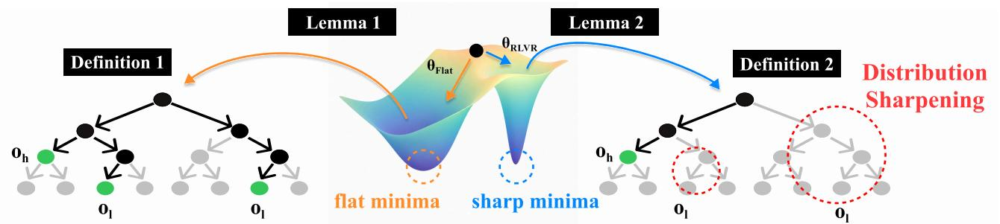  
Figure 2. Illustration of the loss landscape and reasoning capacity of RLVR and Flat-RLVR. Flat-RLVR converges to a flatter minimum in the loss landscape by jointly optimizing for loss reduction and sharpness minimization, whereas RLVR is drawn to a sharper minimum driven solely by reward maximization. As shown in the trees (see Figure 1), Flat-RLVR explores a broader reasoning tree, while RLVR collapses to a narrow set of paths.

Definition 4.1 (ρ-Flat-RLVR). Given prompt q and the computed local sequence-level RLVR loss $\mathcal { L } _ { q } ( \theta )$ , let $\rho \mathrm { - }$ sharpness of $\mathcal { L } _ { q }$ at parameter θ be

$$
\mathrm { S h a r p } _ { \rho } ( \theta ; q ) = \operatorname* { m a x } _ { \| \epsilon \| _ { 2 } \leq \rho } \left[ \mathcal { L } _ { q } ( \theta + \epsilon ) - \mathcal { L } _ { q } ( \theta ) \right] ,\tag{5}
$$

where ϵ is a parameter perturbation and $\| \cdot \| _ { 2 }$ is Euclidean norm. Then, the $\rho \mathrm { - } \mathrm { \boldsymbol { F } } \mathrm { \boldsymbol { 1 } } \mathrm { a t } \ \mathrm { R } \mathrm { \mathbf { L V R } }$ objective is defined as the expected sharpness-aware loss:

$$
\begin{array} { r l } & { \underset { \theta } { \operatorname* { m i n } } \mathbb { E } _ { q \sim Q } \left[ \mathcal { L } _ { q } ( \theta ) + \mathrm { S h a r p } _ { \rho } ( \theta ; q ) \right] } \\ & { \quad \quad \quad = \underset { \theta } { \operatorname* { m i n } } \mathbb { E } _ { q \sim Q } \left[ \underset { \| \epsilon \| _ { 2 } \leq \rho } { \operatorname* { m a x } } \mathcal { L } _ { q } ( \theta + \epsilon ) \right] . } \end{array}\tag{6}
$$

Following SAM, Flat-RLVR optimizes Eq. (6) by a twostep update at parameters $\theta _ { t }$ , where t is an update index: it first ascends to the worst-case perturbation $\epsilon _ { t } ^ { * } =$ $\rho \nabla _ { \theta } \mathcal { L } _ { q } ( \theta _ { t } ) / \| \nabla _ { \theta } \mathcal { L } _ { q } ( \theta _ { t } ) \| _ { 2 }$ , then descends using the gradient at the perturbed point,

$$
\theta _ { t + 1 } = \theta _ { t } - \alpha \nabla _ { \theta } \mathcal { L } _ { q } ( \theta _ { t } + \epsilon _ { t } ^ { * } ) .\tag{7}
$$

The perturbation $\boldsymbol { \epsilon } _ { t } ^ { * }$ is what distinguishes Flat-RLVR from the standard update, which cannot account for loss sensitivity to perturbations.

Definition 4.2 (Correct-set Distribution Sharpening). Given prompt q and policy distribution $\pi _ { \theta } ( \cdot | q )$ over outputs $o \in O$ let $\mathcal { C } _ { q } = \{ o : R ( o ) = 1 \}$ be a verifier-correct set, whose elements show 1-reward. For two correct outputs $o _ { h } , o _ { l } \in$ $\mathcal { C } _ { q }$ satisfying

$$
\pi _ { \theta _ { \mathrm { o l d } } } ( o _ { h } | q ) > \pi _ { \theta _ { \mathrm { o l d } } } ( o _ { l } | q ) ,\tag{8}
$$

let us formulate their correct-set log-probability gap at parameter θ as

$$
D _ { h , l } ( \theta ; q ) = \log \frac { \pi _ { \theta } { \left( { o _ { h } } | q \right) } } { \pi _ { \theta } { \left( { o _ { l } } | q \right) } } .\tag{9}
$$

An update from $\theta _ { \mathrm { o l d } }$ to $\theta _ { \mathrm { n e w } }$ is defined to sharpen the correctset distribution on $\left( o _ { h } , o _ { l } \right)$ if

$$
D _ { h , l } ( \theta _ { \mathrm { n e w } } ; q ) - D _ { h , l } ( \theta _ { \mathrm { o l d } } ; q ) > 0 .\tag{10}
$$

Here, $O _ { h }$ denotes a correct reasoning path with higher probability under the old policy, while $o _ { l }$ denotes a lowerprobability but still correct reasoning path. We now analyze how the policy update via ρ-Flat-RLVR affects the confidence gap $D _ { h , l }$

Lemma 4.3 (ρ-Flat-RLVR One-Step Decomposition). The one-step update of Flat-RLVR from Definition 4.1 admits the following local expansion:

$$
\theta _ { t + 1 } ^ { F \bar { l } a t } = \theta _ { t } + \alpha \Big ( \underbrace { g _ { t } } _ { \mathrm { S c o r e ~ P a r t } } \underbrace { - \rho \frac { M _ { t } g _ { t } } { \| g _ { t } \| _ { 2 } } } _ { \mathrm { F l a t n e s s ~ P a r t } } \Big ) + R _ { t } .\tag{11}
$$

Here, for the sequence-level score is $\begin{array} { r l } { s _ { i , t } } & { { } = } \end{array}$ $\nabla _ { \theta }$ log $\pi _ { \boldsymbol { \theta } } ( o _ { i } | \boldsymbol { q } ) | _ { \theta _ { t } }$ over rollouts $\begin{array} { r l } { \{ o _ { i } \} _ { i = 1 } ^ { G } , \ } & { { } g _ { t } \ } \end{array} =$ $\begin{array} { r } { \frac { 1 } { G } \sum _ { i = 1 } ^ { G } \hat { \mathcal { A } } _ { i } s _ { i , t } , M _ { t } = \frac { 1 } { G } \sum _ { i = 1 } ^ { G } \hat { \mathcal { A } } _ { i } s _ { i , t } s _ { i , t } ^ { \top } } \end{array}$

The residual $R _ { t } = - \alpha \rho B _ { t } g _ { t } / \| g _ { t } \| _ { 2 } - \alpha R _ { T }$ collects the logpolicy Hessian term $\begin{array} { r } { B _ { t } = \frac { 1 } { G } \sum _ { i } \hat { \mathcal { A } } _ { i } \nabla _ { \theta } ^ { 2 } } \end{array}$ log $\pi _ { \boldsymbol { \theta } } ( o _ { i } | q )$ and the higher-order Taylor residual $R _ { T }$

The ‘Score Part’ is the standard RLVR update, which increases the likelihood of positively advantaged rollouts along the reward-improving direction $g _ { t }$ . The ‘Flatness Part’, scaled by $\rho ,$ opposes that direction through the curvature operator $M _ { t }$ , dampening over-amplification along $g _ { t } .$ . Under a sequence-level neural tangent kernel (NTK) approximation (Liu et al., 2020), $B _ { t }$ cancels by the zero-mean property of group-relative advantages, so the residual is negligible at leading order. The detailed derivation is provided in Appendix A.1.

Lemma 4.4 (Distribution Sharpening One-step Decomposition). For a correct pair $\left( o _ { h } , o _ { l } \right)$ in Definition 4.2, let $\Delta s _ { t } : = s _ { h , t } - s _ { l , i }$ t with $s _ { h , t } ~ = ~ \nabla _ { \theta }$ log $\pi _ { \boldsymbol { \theta } } \big ( o _ { h } | \boldsymbol { q } \big ) | _ { \boldsymbol { \theta } _ { t } }$ and $s _ { l , t } ~ = ~ \nabla _ { \theta }$ log π ${ \mathrm { } } _ { 9 } ( o _ { l } | q ) | _ { \theta _ { t } }$ . For a one-step parameter update $\Delta \theta _ { t } = \theta _ { t + 1 } - \theta _ { t }$ , define the first-order correct-set gap change as

$$
\begin{array} { r l } & { \mathfrak { D } _ { t } ( \Delta \theta _ { t } ) : = D _ { h , l } ( \theta _ { t } + \Delta \theta _ { t } ; q ) - D _ { h , l } ( \theta _ { t } ; q ) } \\ & { \qquad \approx \Delta s _ { t } ^ { \top } \Delta \theta _ { t } . } \end{array}\tag{12}
$$

Then the ρ-Flat-RLVR update satisfies

$$
\mathfrak { D } _ { t } \big ( \Delta \theta _ { t } ^ { F \bar { \imath } a t } \big ) = \mathfrak { D } _ { t } \big ( \Delta \theta _ { t } ^ { \mathrm { G R P O } } \big ) - \alpha \rho C _ { t } + r _ { t } ,\tag{13}
$$

where $\Delta \theta _ { t } ^ { \mathrm { G R P O } } \ = \ \alpha g _ { t } , \ C _ { t } \ = \ ( \Delta s _ { t } ^ { \top } M _ { t } g _ { t } ) / \| g _ { t } \| _ { 2 } ,$ a $r _ { t } = \Delta s _ { t } ^ { \top } R _ { t } .$

Here, $C _ { t } > 0$ indicates that the flatness correction reduces the GRPO-induced growth of the correct-set log-probability gap between $o _ { h }$ and $o _ { l }$ . The proof is provided in $\mathsf { A p - }$ pendix A.2.

Proposition 4.5 (Flat-RLVR Mitigates Correct-set Distribution Sharpening). Along a training trajectory, suppose that the cumulativeflatness correction dominates the residual:

$$
\sum _ { t = 0 } ^ { T - 1 } \alpha \rho C _ { t } \geq \sum _ { t = 0 } ^ { T - 1 } r _ { t } .\tag{14}
$$

Then the cumulative correct-set gap growth induced by $\rho \mathrm { - }$ Flat-RLVR is no larger than that induced by the corresponding GRPO score updates:

$$
\sum _ { t = 0 } ^ { T - 1 } \mathfrak { D } _ { t } \big ( \Delta \theta _ { t } ^ { F \bar { \imath } a t } \big ) \leq \sum _ { t = 0 } ^ { T - 1 } \mathfrak { D } _ { t } \big ( \Delta \theta _ { t } ^ { \mathrm { G R P O } } \big ) .\tag{15}
$$

Proposition 4.5 implies that $\rho { \mathrm { - } } \mathtt { F } \mathtt { l a t }$ RLVR mitigates correct-set distribution sharpening relative to standard RLVR under the assumptions of our analysis. Proof is in Appendix A.3.

Remark 4.6 (Incorrect-output penalization). Proposition 4.5 does not imply that Flat-RLVR raises the probability of incorrect outputs. For an incorrect output with a negative advantage, the same flatness correction term in Lemma 4.3 remains aligned with probability suppression. Thus, Flat-RLVR can reduce over-concentration among correct reasoning paths while still preserving reward separation between correct and incorrect outputs.

## 5. Proposed Method: Flat-RLVR

## 5.1. Flat-RLVR

Grounded in our theoretical findings that flatness-seeking optimization alleviates the distribution sharpening in RLVR, we construct the Flat-RLVR framework, which integrates SAM into group-relative RLVR. The Flat-RLVR objective is:

$$
\operatorname* { m i n } _ { \theta } \mathbb { E } _ { q \sim Q } \left[ \operatorname* { m a x } _ { \| \epsilon \| _ { 2 } \leq \rho } \mathcal { L } _ { q } ( \theta + \epsilon ) \right] .\tag{16}
$$

Specifically, for each prompt q, the current policy $\pi _ { \theta _ { \mathrm { o l d } } }$ generates G completions, and the corresponding rewards are normalized within the group to yield the advantage estimator $\hat { A } _ { i }$ . This is the standard GRPO procedure and serves as the baseline for our SAM-based modifications.

Algorithm 1 Flat-RLVR   
Require: Initial parameters $\theta _ { 0 } ;$ perturbation radius $\rho ;$ learn  
ing rate $\alpha { ; } \mathbf { S } \mathbf { A } \mathbf { M }$ period n; group size $G ;$ total steps T   
1: for $t = 1 , \dots , T$ do   
2: // Rollout and advantage estimation   
3: Sample G completions $\{ a _ { 1 } , \dots , a _ { G } \} \sim \pi _ { \theta _ { \mathrm { o l d } } } ( \cdot \mid q )$   
4: Compute group-relative advantages   
$\hat { A } _ { i } = \frac { r _ { i } - \mathrm { m e a n } ( \{ r _ { j } \} ) } { \mathrm { s t d } ( \{ r _ { j } \} ) }$   
5: Compute GRPO loss $\mathcal { L } ( \boldsymbol { \theta } )$   
6: $g _ { \theta } \gets \nabla _ { \theta } \mathcal { L } ( \theta )$   
7: if t mod $n = 0$ then ▷ SAM step   
8: $g _ { \theta }  g _ { \theta } - \mu ( g _ { \theta } )$ ▷ GC (ascent)   
9: $\rho _ { t } \gets$ anneal $\left( \rho , t \right) \cdot \left( \hat { p } _ { \mathrm { m e a n } } \right) ^ { \gamma }$ ▷ Cosine + Focal   
10: $\epsilon ^ { * } \gets \rho _ { t } g _ { \theta } / \| g _ { \theta } \| _ { 2 }$   
11: $\theta  \theta + \epsilon ^ { * }$ ▷ ascend   
12: $g _ { \theta + \epsilon ^ { * } } \gets \nabla _ { \theta } \mathcal { L } ( \theta + \epsilon ^ { * } )$   
13: $g _ { \theta + \epsilon ^ { * } }  g _ { \theta + \epsilon ^ { * } } - \mu ( g _ { \theta + \epsilon ^ { * } } )$ ▷ GC (descent)   
14: $\theta  \theta - \epsilon ^ { * }$ ▷ restore   
15: $\theta  \theta - \alpha g _ { \theta + \epsilon ^ { * } }$   
16: else ▷ Standard GRPO step   
17: $\theta  \theta - \alpha g _ { \theta }$   
18: end if   
19: end for   
▷ Line 9: Annealing is used with Focal Weightfor ρ scheduling.   
$\hat { p } _ { m e a n }$ is an inverse prompt-difficultyfactor (Appendix B.1).

First, we calculate the objective function $\mathcal { L } _ { q } ( \boldsymbol { \theta } _ { t } )$ and gradient $\nabla _ { \boldsymbol { \theta } } \mathcal { L } _ { q } ( \boldsymbol { \theta } _ { t } )$ . Then, the ascent step for finding the worst perturbation is calculated by

$$
\epsilon _ { t } ^ { * } = \rho \nabla _ { \theta } \mathcal { L } _ { q } ( \theta _ { t } ) / \| \nabla _ { \theta } \mathcal { L } _ { q } ( \theta _ { t } ) \| _ { 2 } ,\tag{17}
$$

The parameters are perturbed toward $\boldsymbol { \theta } + \boldsymbol { \epsilon } _ { t } ^ { * }$ , and the descent step for flat-minima is computed by

$$
\theta _ { t + 1 } = \theta _ { t } - \alpha \nabla _ { \theta } \mathcal { L } _ { q } ( \theta _ { t } + \epsilon _ { t } ^ { * } )\tag{18}
$$

for updating policy, which corresponds to Eq (7).

## 5.2. Adaptations for LLM post-training

Flat-RLVR operates under the SAM paradigm, and incorporates the following adaptations and advances tailored for LLM post-training.

Scalability. SAM induces one more gradient computation to obtain the perturbation. We adopt SAM not for all steps, but for every n steps by borrowing the existing technique (Liu et al., 2022). While this prior work only treats n as a scalability knob, our adoption in LLM post-training introduces a new dimension: the period n governs the effective degree of SAM regularization, and consequently impacts the Pass@K trade-off. We provide further analysis of scalability on Flat-RLVR in Section 6.5.

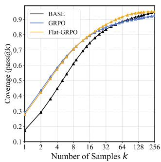  
(a) AMC23

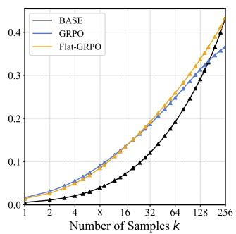  
(b) AIME24

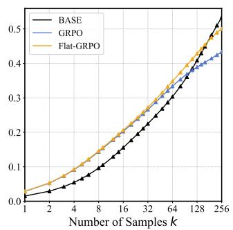  
(c) AIME25

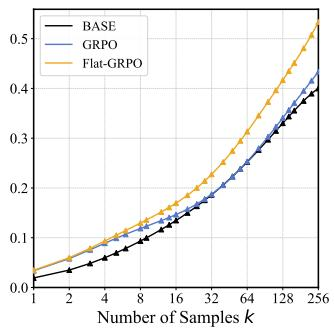  
(d) AIME26  
Figure 3. Pass@K curves of BASE model ((a), (c), and (d) Qwen2.5-Math-1.5B and (b) Llama-3.2-1B-Instruct), GRPO, and Flat-GRPO (ours) on in-domain mathematical reasoning benchmarks, traced from K = 1 to K = 256. All Pass@K curves per-BASE/benchmark are provided in Figure 8.

Perturbation radius. We adopt the prompt-difficultyaware strategy of F-GRPO with Focal Weight (Plyusov et al., 2026), which decays the advantage with difficulty. Similarly, we adjust the perturbation radius ρ based on prompt difficulty, thereby improving convergence stability. We provide details in Appendix B.1.

Gradient. We apply gradient centralization (GC) (Hassan et al., 2025) to both the ascent and descent steps of SAM, reducing gradient norm throughout optimization. Empirically, this improves the model’s exploration capability during posttraining. We provide details in Appendix B.2.

Algorithm 1 integrates these adaptations into Flat-RLVR built upon a GRPO baseline.

## 6. Experiments

## 6.1. Experimental Setup

Training Setup. In our experiments, we adopt Qwen2.5- Math-1.5B (Yang et al., 2024b) and Llama-3.2-1B-Instruct (Grattafiori et al., 2024) backbones and train them on the MATH dataset (Hendrycks et al., 2021), comprising 7.5K problems. Full training details are in Appendix F.

Evaluation Setup. We evaluate on five in-domain mathematical reasoning benchmarks—MATH500 (Lightman et al., 2024), AMC23, AIME24 (Zhang & Math-AI, 2024), AIME25 (Zhang & Math-AI, 2025), and AIME26 (Zhang & Math-AI, 2026)—and report Pass@K curves traced from K = 1 to K = 256, where Pass@1 measures single-attempt accuracy and Pass@256 captures diversity-driven coverage of the solution space. Detailed evaluation protocols are provided in Appendix F.

Table 1. Solvable-problem coverage (%) averaged over all indomain benchmarks on Qwen2.5-Math-1.5B. Each row is a category defined by whether the base and the RL-tuned model solve a problem (✓) or not (×).
<table><tr><td>Base</td><td>RL-Tuned</td><td>GRPO</td><td>Flat-GRPO</td></tr><tr><td>√</td><td>√</td><td>57.7</td><td>61.2</td></tr><tr><td>√</td><td>X</td><td>6.3</td><td>2.8</td></tr><tr><td>×</td><td>√</td><td>5.4</td><td>6.3</td></tr><tr><td>×</td><td>×</td><td>30.6</td><td>29.7</td></tr><tr><td colspan="2">Total</td><td>100.0</td><td>100.0</td></tr></table>

## 6.2. Reasoning Capacity Evaluation

Motivated by Yue et al. (2025), we adopt two analysis methods for evaluating Reasoning Capacity: Pass@K metrics and Solvable-Problem Coverage Analysis. Concretely, Pass@K metrics measure the boundaries of reasoning ability by sampling k outputs from the model. Solvable-Problem Coverage Analysis measures the fraction of problems solvable by the base model or the RL-tuned model, indicating whether Flat-RLVR truly mitigates the narrowing of reasoning capacity boundaries stemming from the naive RLVR framework.

Pass@K. We evaluate the effect of applying SAM to GRPO, namely Flat-GRPO, with group size G = 6. Figure 3 shows Pass@K curves on in-domain benchmarks, comparing the base model, GRPO, and Flat-GRPO from K = 1 to K = 256. At small K, both GRPO and Flat-GRPO outperform the base model across benchmarks, reflecting the well-known single-attempt gains of RLVR. As K grows, however, GRPO’s advantage erodes, and the base model eventually matches or even surpasses it—indicating that despite its higher Pass@1, GRPO yields a narrower reasoning coverage than the base model, a signature of distribution sharpening. In contrast, Flat-GRPO maintains a consistent advantage over both GRPO and the base model across all values of K, indicating that SAM preserves the model’s exploratory capacity while retaining the singleattempt gains of RLVR.

Table 2. Pass@1/Pass@256 (%) values across two base models with varying RLVR methods at $G = 6$ group size, reported as mean ±95% CI over 3 seeds.Avg.: average Pass@1/Pass@256. Bold: better within baseline/Flat pair.
<table><tr><td>Model</td><td>Method</td><td>Avg.</td><td>MATH500</td><td>AMC23</td><td>AIME24</td><td>AIME25</td><td>AIME26</td></tr><tr><td rowspan="3">Qwen2.5</td><td>GRPO Flat-GRPO</td><td> $\mathbf { 1 5 . 6 { \scriptstyle \pm 1 . 0 } } / 6 4 . 8 { \scriptstyle \pm 3 . 7 }$   $1 5 . 2 \mathrm { \ t 0 . 6 } / 6 7 . 3 \mathrm { \ t 3 . 0 }$ </td><td> $3 4 . 6 { \scriptstyle \pm 0 . 0 / 7 2 . 7 \scriptstyle \pm 0 . 7 }$   $3 4 . 0 { \scriptstyle \pm 0 . 0 / 7 2 . 5 - 0 . 5 }$ </td><td> $3 0 . 2 { \scriptstyle \pm 2 . 8 } / 9 5 . 8 { \scriptstyle \pm 7 . 1 }$   $2 8 . 9 { \scriptstyle \pm 2 . 4 } / 9 6 . 7 { \scriptstyle \pm 7 . } ]$ </td><td> $\mathbf { 7 . 0 } { \scriptstyle \pm 1 . 2 } / 6 2 . 2 { \scriptstyle \pm 4 . 7 }$   $6 . 5 { \scriptstyle \pm 1 . 5 } / { \bf 6 4 . 4 } \scriptscriptstyle \mathrm { ~ \ - ~ } 9 . 5$ </td><td> $2 . 9 { \scriptstyle \pm 0 . 1 } / 4 8 . 9 { \scriptstyle \pm 1 2 . 6 }$   $3 . 3  { \mathrm { ~ \textrm ~ { ~ ~ } ~ } } _ { 2 . 4 } / 5 1 . 1  { \mathrm { - } } _ { 4 . 7 }$ </td><td> $3 . 7 { \scriptstyle \pm 0 . 8 } / { 4 4 . 4 \pm 4 . 7 }$   $3 . 8 \substack { + 0 . 7 } / 5 2 . 2 \substack { + 4 . 7 }$ </td></tr><tr><td>DAPO Flat-DAPO</td><td> $1 6 . 3 { \scriptstyle \pm 0 . 2 } / 6 5 . 2 { \scriptstyle \pm 5 . 8 }$   $1 6 . 3 \pm \mathrm { { 0 . 1 } } / 6 8 . 6  { \mathrm { ~ \textrm ~ { ~ ~ } ~ } } \mathrm { { 0 . 5 } }$ </td><td> $3 5 . 7 { \scriptstyle \pm 0 . 1 / 7 2 . 1 \pm 2 . 0 }$   $3 5 . 7 { \scriptstyle \pm 0 . 2 / 7 2 . 4 } \ \scriptstyle \mathrm { \ - 0 . 4 }$ </td><td> $3 2 . 0 { \scriptstyle \pm 0 . 7 } / 9 8 . 3 { \scriptstyle \pm 3 . 5 }$   $3 2 . 1 { \scriptstyle \pm 0 . 2 } / 9 7 . 5 { \scriptstyle \pm 6 . 2 }$ </td><td> $6 . 9 { \scriptstyle \pm 1 . 0 / 6 3 . 3 \pm 8 . 2 }$   $6 . 9 \pm 0 . 6 6 . 7 \pm 1 4 . 3$ </td><td> $3 . 1 { \pm } 0 . 8 / 5 1 . 1 { \pm } 9 . 5$   $3 . 1 { \scriptstyle \pm 0 . 2 } / 5 7 . 8 \ \scriptstyle \mp 4 . 7$ </td><td> $3 . 9 { \scriptstyle \pm 0 . 2 } / 4 1 . 1 { \scriptstyle \pm 1 2 . 6 }$   $3 . 9 \substack { + 0 . 5 / 4 8 . 9 \substack { + 1 2 . 6 } }$ </td></tr><tr><td>CISPO Flat-CISPO</td><td> ${ \bf 1 5 . 7 \pm 0 . 3 / 6 5 . 5 \pm 2 . 6 }$   $1 5 . 6 { \scriptstyle \pm 0 . 1 } / 6 8 . 5 { \scriptstyle \mp 3 . 0 }$ </td><td> $3 4 . 7 { \scriptstyle \pm 0 . 1 / 7 2 . 8 \scriptstyle \pm 1 . 4 }$   $3 3 . 8 \mathrm { \ : - } 0 . 2 / 7 2 . 6 \mathrm { \ : - } 0 . 4$ </td><td> $3 0 . 6 { \scriptstyle \pm 0 . 9 } / 9 8 . 3 { \scriptstyle \pm 7 . 1 }$   $\mathbf { 3 0 . 7 \bot 0 . 8 } / \mathbf { 9 9 . 2 \bot } \mathrm { ~ 3 . 5 ~ }$ </td><td> ${ \bf 6 . 9 } \mathrm { \pm 0 . 8 } / 6 3 . 3 \mathrm { \pm 8 . 2 }$   $6 . 5 \pm \mathrm { { 0 . 8 } } / 6 7 . 8 \mp 4 . 7$ </td><td> $2 . 9 { \scriptstyle \pm 0 . 4 / 5 0 . 0 \pm 1 4 . 3 }$   $\mathbf { 3 . 1 } _ { \perp , 1 } / \mathbf { 5 . 5 . 6 } _ { \perp , 1 7 . 2 }$ </td><td> $3 . 9 { \scriptstyle \pm 0 . 4 / 4 3 . 3 \scriptstyle \pm 0 . 0 }$   $4 . 2 \substack { + 0 . 2 / 4 7 . 8 } \mod 4 . 7$ </td></tr><tr><td rowspan="3">Llama3.2</td><td>GRPO Flat-GRPO</td><td> $6 . 5 { \scriptstyle \pm 0 . 2 } / 4 8 . 4 { \scriptstyle \pm 0 . 4 }$   $6 . 5 \pm \mathrm { { 0 . 1 } } / 5 \mathbf { 0 . 4 } \mathrm { { \ : 2 . 9 } }$ </td><td> ${ \bf 1 8 . 8 \mathrm { \ : - } } 0 . 6 / 6 6 . 1 \mathrm { \ : - } 2 . 0$   $1 8 . 4 { \scriptstyle \pm 0 . 3 } / 6 4 . 6 { \scriptstyle \pm 1 . 7 }$ </td><td> $1 1 . 8 { \scriptstyle \pm 0 . 5 } / { \bf 9 0 . 8 } { \scriptstyle \pm 7 . 1 }$   $1 2 . 3 \_ 1 / 8 7 . 5 \_ 6 . 2$ </td><td> $1 . 5 \pm { _ { 0 . 3 } } / 3 5 . 6 \pm { _ { 1 2 . 6 } }$   $1 . 5 \pm \mathrm { { 0 . 2 } } / 4 1 . 1 \pm \mathrm { { 9 . 5 } }$ </td><td> $0 . 2 { \scriptstyle \pm 0 . 1 / 2 6 . 7 { \scriptstyle \pm 8 . 2 } }$   $0 . 2 \pm \mathrm { { 0 . 0 } } / 3 3 . 3 \pm \mathrm { { 1 4 . 3 } }$ </td><td> $0 . 3 { \scriptstyle \pm 0 . 1 } / { 2 3 . 3 \scriptstyle \pm 0 . 0 }$   $0 . 3 \pm \mathrm { { 0 . 1 } } / 2 5 . 6 \mp 4 . 7$ </td></tr><tr><td>DAPO Flat-DAPO</td><td> ${ \bf 6 . 7 \pm 0 . 1 / 4 7 . 9 \pm } 4 . 6$   $6 . 4 \pm 0 . 2 / 4 9 . 1 \pm 7 . 9$ </td><td> $\mathbf { 1 9 . 4 \mathrm { \ : 0 . 2 } / 6 4 . 6 \mathrm { \ : \ : 0 . 0 } }$   $1 8 . 5 { \scriptstyle \pm 0 . 3 } / 6 4 . 5 { \scriptstyle \pm 1 . 7 }$ </td><td> $\mathbf { 1 2 . 0 { \scriptstyle \pm } 0 . 5 } / 8 8 . 3 { \scriptstyle \pm } 7 . 1$   $1 1 . 8 \pm 1 . 1 / 9 0 . 0 \pm _ { 6 . 2 }$ </td><td> $1 . 9 { \scriptstyle \pm 0 . 2 / 3 8 . 9 \pm _ { 4 . 7 } }$   $1 . 3 \pm \mathrm { { 0 . 4 } } 4 3 . 3 \ \mathrm { ~ \ - } 8 . 2$ </td><td> $0 . 1 { \scriptstyle \pm 0 . 1 / 2 3 . 3 \pm 8 . 2 }$   $\mathbf { 0 . 2 \_ } \mathbf { / 2 6 . 7 } \scriptscriptstyle \pm 1 \scriptscriptstyle 4 . 3$ </td><td> $\mathbf { 0 . 5 \ X 0 . 2 } / 2 4 . 4 \ X $   $0 . 4 \substack { - 0 . 1 / 2 1 . 1 \pm 1 2 . 6 }$ </td></tr><tr><td>CISPO  $\mathrm { F 1 a t - C I S P O }$ </td><td> ${ \bf 6 . 7 \pm 0 . 5 / 4 7 . 4 \pm 3 . 4 }$   $6 . 6 \pm \mathrm { 0 . 2 } / 4 8 . 7 \pm \mathrm { 0 . 5 }$ </td><td> $2 0 . 8 { \scriptstyle \pm 0 . 0 / 6 5 . 2 \pm 1 . 4 }$   $1 9 . 5 \pm \mathrm { { 0 . 2 } } / 6 5 . 5 \mathrm { { \ : \tan } }$ </td><td> $1 1 . 3 { \scriptstyle \pm 2 . 8 } / 8 7 . 5 { \scriptstyle \pm 6 . 2 }$   $1 1 . 9 _ { \pm 1 . 0 } / 8 9 . 2 \textrm { -- }$ </td><td> $1 . 3 { \scriptstyle \pm 0 . 3 } / 4 0 . 0 { \scriptstyle \pm 1 4 . 3 }$   $1 . 5 \substack { - 0 . 3 / 3 8 . 9 - 4 . 7 }$ </td><td> $0 . 1 { \scriptstyle \pm 0 . 1 } / { 2 4 . 4 \pm 4 . 7 }$   ${ \bf 0 . 2 \mathrm { ~ \textmu ~ } } [ 2 { \bf 6 . 7 } \mathrm { ~ \textmu ~ } _ { 0 . 0 }$ </td><td> $0 . 2 { \scriptstyle \pm 0 . 1 / 2 0 . 0 \pm 8 . 2 }$   $\mathbf { 0 . 4 } _ { } \mathrm { ~ 0 . 4 } / 2 3 . 3 _ { } \mathrm { ~ 0 . 0 }$ </td></tr></table>

Table 3. Pass@1/Pass@256 (%) for GRPO, F-GRPO, and $\tt F l a t -$ GRPO (ours), with Qwen2.5-Math-1.5B (top) and Llama-3.2-1B-Instruct (bottom) as the backbone, reported as mean ±95% CI over 3 seeds.
<table><tr><td>Benchmarks</td><td>GRPO</td><td>F-GRPO</td><td>Flat-GRPO</td></tr><tr><td>MATH500</td><td> $3 4 . 6 { \scriptstyle \pm 0 . 0 } / 7 2 . 7 { \scriptstyle \pm 0 . 3 }$ </td><td> $3 3 . 2 { \scriptstyle \pm 0 . 0 } / 7 2 . 1 { \scriptstyle \pm 0 . 6 }$ </td><td> $3 4 . 0 { \scriptstyle \pm 0 . 0 } / 7 2 . 5 { \scriptstyle \pm 0 . 2 }$ </td></tr><tr><td>AMC23</td><td> $3 0 . 2 { \scriptstyle \pm 1 . 1 } / 9 5 . 8 { \scriptstyle \pm 2 . 9 }$ </td><td> $2 8 . 4 { \pm } 1 . 8 / 9 8 . 3 { \pm } 1 . 4$ </td><td> $2 8 . 9 \substack { \pm 1 . 0 } / 9 6 . 7 \substack { \pm 2 . 9 }$ </td></tr><tr><td>AIME24</td><td> $7 . 0 { \scriptstyle \pm 0 . 5 } / 6 2 . 2 { \scriptstyle \pm 1 . 9 }$ </td><td> $6 . 4 { \scriptstyle \pm 0 . 7 } / { \scriptstyle 6 6 . 7 } \scriptstyle \pm 6 . 7$ </td><td> $6 . 5 \mathrm { { - } 0 . 6 / 6 4 . 4 \mathrm { { - } 3 . 8 } }$ </td></tr><tr><td>AIME25</td><td> $2 . 9 { \pm } 0 . 1 / 4 8 . 9 { \pm } 5 . 1$ </td><td> $2 . 6 { \scriptstyle \pm 0 . 2 } / 4 7 . 8 { \scriptstyle \pm 1 . 9 }$ </td><td> $3 . 3 \mathrm { ~ - ~ } 1 . 0 / 5 1 . 1 \mathrm { - } 1 . 9$ </td></tr><tr><td>AIME26</td><td> $3 . 7 { \scriptstyle \pm 0 . 3 } / 4 4 . 4 { \scriptstyle \pm 1 . 9 }$ </td><td> $3 . 5 { \scriptstyle \pm 0 . 1 } / { 4 1 . 1 \pm 1 . 9 }$ </td><td> $3 . 8 \textrm { -- } 0 . 3 / 5 2 . 2 \textrm { -- } 1 . 9$ </td></tr><tr><td>Avg.</td><td> $\mathbf { 1 5 . 6 { \scriptstyle \pm 0 . 4 5 } } / 6 4 . 8 { \scriptstyle \pm 1 . 7 }$ </td><td> $1 4 . 8 { \scriptstyle \pm 0 . 7 } / 6 5 . 2 { \scriptstyle \pm 2 . 3 }$ </td><td> $1 5 . 2 \pm { 0 . 4 } / { 6 7 . 3 } \mp { 1 . 3 }$ </td></tr><tr><td>MATH500</td><td> $1 8 . 8 { \pm } 0 . 3 / 6 6 . 1 { \pm } 0 . 8$ </td><td> $2 0 . 7 { \scriptstyle \pm 0 . 1 / 6 6 . 4 - 0 . 2 }$ </td><td> $1 8 . 4 \pm 0 . 1 / 6 4 . 6 \pm 0 .$ </td></tr><tr><td>AMC23</td><td> $1 1 . 8 { \pm } 0 . 2 / 9 0 . 8 { \pm } 2 . 9$ </td><td> $1 1 . 2 { \scriptstyle \pm 0 . 2 } / 9 4 . 3 { \scriptstyle \pm 1 . 6 }$ </td><td> $1 2 . 3 \mathrm { \Omega } _ { + 0 . 0 } / 8 7 . 5 \mathrm { \Omega } _ { - 2 . 5 }$ </td></tr><tr><td>AIME24</td><td> $1 . 5 { \pm } 0 . 1 / 3 5 . 6 { \pm } 5 . 1$ </td><td> $2 . 4 _ { \ : \perp 0 . 1 } / 3 7 . 8 _ { \ : \perp 1 . 9 }$ </td><td> $1 . 5 \mathrm { { - } 0 . 1 / 4 1 . 1 \mathrm { { - } 3 . 9 } }$ </td></tr><tr><td>AIME25</td><td> $0 . 2 { \scriptstyle \pm 0 . 0 } / 2 6 . 7 { \scriptstyle \pm 3 . 3 }$ </td><td> $0 . 2 \pm 0 . 0 / 2 3 . 3 \pm 6 . 7$ </td><td> $0 . 2 \mathrm { ~  ~ { ~ 0 ~ . ~ 0 ~ } ~ } / 3 3 . 3 \mathrm { ~  ~ { ~ - ~ } ~ } 5 . 8$ </td></tr><tr><td>AIME26</td><td> $0 . 3 { \scriptstyle \pm 0 . 1 } / 2 3 . 3 { \scriptstyle \pm 0 . 0 }$ </td><td> $\mathbf { 0 . 5 } \mathrm { { \ : \left( 0 . 0 / 3 0 . 0 \mathrm { { \ : 5 . 8 } } \right. } }$ </td><td> $0 . 3 \mathrm { ~ + 0 . 0 } / 2 5 . 6 \mathrm { ~ - 1 . 9 }$ </td></tr><tr><td>Avg.</td><td> $6 . 5 { \scriptstyle \pm 0 . 1 } / 4 8 . 4 { \scriptstyle \pm 2 . 0 }$ </td><td> ${ \bf 6 . 9 } \mathrm { \pm 0 . 1 } / 5 0 . 3 \mathrm { \pm 2 . 8 }$ </td><td> $6 . 5 \mathrm { { - 0 . 1 } } / 5 0 . 4 \mathrm { { - 1 . 9 } }$ </td></tr></table>

Solvable-Problem Coverage Analysis. We analyze the set of solvable problems for the base model relative to GRPO and to $\mathrm { F 1 a t - G R P O }$ . For each pair, we measure i) the fraction of problems solvable by the base model (✓) but not by the RL-tuned model (×)—i.e., problems the RL stageforgets—and ii) the fraction newly solved by the RL-tuned model (✓) but not by the base model (×). This decomposition isolates how much reasoning coverage RLVR sacrifices in exchange for the new problems it acquires. Table 1 reports GRPO forgets 6.3% of the problems originally solvable by the base model while newly solving only 5.4%—a net erosion of base-model coverage that is symptomatic of distribution sharpening. Flat-GRPO, however, substantially improves both sides: it forgets far fewer problems (2.8%) while solving more new ones (6.3%). SAM mitigates GRPO’s tendency to collapse toward a narrow subset of the base model’s solvable problems, thereby alleviating distribution sharpening. Additional details are in Appendix E.2.

## 6.3. Extended Evaluations

We further evaluate Flat-RLVR from four perspectives: (1) Generality evaluation across various RLVR variants, including GRPO, DAPO, and CISPO. This evaluation examines whether flatness-seeking optimization transfers across distinct group-relative algorithms. We keep the group size G=6 and report Pass@1 / Pass@256; (2) Comparative evaluation against F-GRPO (Plyusov et al., 2026), which addresses the same goal via difficulty-aware advantage scaling; (3) Scalability Evaluation with Larger Backbone on Qwen2.5-3B-Instruct (Team, 2024; Yang et al., 2024a), which examines whether the benefits of Flat-RLVR persist at a larger model scale; and (4) Cross-Domain Evaluation with Code Generation Test on Qwen2.5-Coder-1.5B-Instruct (Hui et al., 2024), which examines whether the reasoning capacity benefit of $\mathrm { E 1 a t - R L V R }$ extends beyond the mathematical domain. All experiments follow the identical training and evaluation protocol described in Appendix F.

Generality Evaluation across GRPO variants. Table 2 reports the following results: On Qwen2.5-Math-1.5B, flatness-seeking optimization improves the average Pass@256 by +2.5 (GRPO → Flat-GRPO), +3.4 (DAPO → Flat-DAPO), and +3.0 (CISPO → Flat-CISPO), while Pass@1 remains stable across all three; on Llama-3.2-1B-Instruct, the same comparisons yield +2.0, +1.2, and +1.3 on Pass@256, with Pass@1 preserved. Taken together, these results indicate that the diversity benefit of Flat-RLVR broadly transfers across distinct group-relative algorithms and backbone families.

Comparative Evaluation with Baseline. Table 3 reports that Flat-GRPO surpasses F-GRPO in average Pass@256 on both backbones—by +2.1 on Qwen2.5-Math-1.5B and +0.1 on Llama-3.2-1B-Instruct—while remaining competitive on Pass@1. This suggests that mitigating sharpening at the optimization-geometry level is at least as effective as F-GRPO’s advantage-reweighting strategy, and complementary to it: these two methods operate on distinct levers, i.e., loss geometry by ours vs. advantage magnitude by F-GRPO, and our approach shows a competitive gain in the diversity-critical regime.

Table 4. Pass@1/Pass@256 (%) results on a larger model (3B) with mean ±95% CI over 3 seeds. Flat-RLVR consistently improves the average Pass@256 while preserving the average Pass@1 at this larger scale.
<table><tr><td>Method</td><td> $\mathbf { A v } \mathbf { g } .$ </td><td>MATH500</td><td>AMC23</td><td>AIME24</td><td>AIME25</td><td>AIME26</td></tr><tr><td>BASE 一</td><td> $1 6 . 7 { \scriptstyle \pm 0 . 2 / 6 0 . 8 \pm 1 . 3 }$  一</td><td> $4 4 . 5 { \scriptstyle \pm 0 . 1 / 7 0 . 5 \pm 0 . 3 }$ </td><td> $3 1 . 1 { \scriptstyle \pm 0 . 8 } / 9 8 . 3 { \scriptstyle \pm 7 . 2 }$ </td><td> $4 . 5 { \scriptstyle \pm 0 . 2 } / 4 7 . 8 { \scriptstyle \pm 9 . 6 }$ </td><td> $1 . 6 { \pm } 0 . 1 / 5 0 . 0 { \pm } 8 . 3$ </td><td> $2 . 0 { \pm } 0 . 3 / 3 7 . 8 { \pm } 9 . 6$ </td></tr><tr><td>GRPO</td><td> $1 8 . 5 { \scriptstyle \pm 0 . 2 } / { 5 9 . 4 \scriptstyle \pm 0 . 7 }$ </td><td> ${ \bf 4 6 . 9 { \scriptstyle \pm } 0 . 1 / 7 0 . 3 { \scriptstyle \pm } 0 . 6 }$ </td><td> ${ \bf 3 6 . 9 2 0 . 9 / 9 5 . 8 \mathrm { \pm 3 . 6 } }$ </td><td> ${ \bar { 5 } } . 2 { \scriptstyle \pm 0 . 1 / 4 2 . 2 \pm 1 2 . 6 }$ </td><td> $1 . 6 { \scriptstyle \pm 0 . 5 } / 4 6 . 7 { \scriptstyle \pm 8 . 3 }$ </td><td> $2 . 3 \pm { _ { 0 . 3 } } / { 4 2 . 2 \pm _ { 4 . 8 } }$ </td></tr><tr><td> $\mathrm { F 1 a t - G R P O }$ </td><td> $1 8 . 2 \pm \mathrm { { 0 . 2 } } / 6 1 . 4 \pm \mathrm { { 1 . 6 } }$ </td><td> $4 6 . 7 { \scriptstyle \pm 0 . 1 / 6 9 . 5 \scriptstyle \pm 0 . 3 }$ </td><td> $3 5 . 9 { \scriptstyle \pm 0 . 7 } / 9 7 . 5 { \scriptstyle \pm 0 . 0 }$ </td><td> $4 . 7 { \scriptstyle \pm 0 . 5 } / 4 8 . 9 \ { \scriptstyle \pm 0 . 6 }$ </td><td> $1 . 6 { \scriptstyle \pm 0 . 2 / 4 7 . 8 - 4 . 8 }$ </td><td> $2 . 2 \pm \mathrm { { 0 . 3 } } / 4 3 . 3 \pm \mathrm { { 0 . 0 } }$ </td></tr></table>

Table 5. Pass@1/Pass@256 (%) with Qwen2.5-Coder-1.5B-Instruct on code generation test (MBPP), reported as mean ±95% CI over 3 seeds. $\mathrm { F 1 a t - G R P O }$ achieves higher Pass@256 than GRPO at comparable Pass@1.
<table><tr><td rowspan=1 colspan=1>Method     一</td><td rowspan=1 colspan=1>MBPP</td></tr><tr><td rowspan=1 colspan=1>BASE       1</td><td rowspan=1 colspan=1> $4 2 . 3 { \pm } 0 . 1 / 9 1 . 5 { \pm } 1 . 1$ </td></tr><tr><td rowspan=1 colspan=1>GRPO $\mathrm { E 1 a t - G R P O }$ </td><td rowspan=1 colspan=1> $5 6 . 7 { \pm } 0 . 0 \mathrm { ~ / ~ } 8 5 . 6 { \pm } 0 . 9$  $5 4 . 5 { \pm } 0 . 1 / 8 9 . 6 { \pm } 1 . 6$ </td></tr></table>

Scalability Evaluation with Larger Backbone. To test whether the benefit of Flat-RLVR persists at a larger backbone scale, we train Qwen2.5-3B-Instruct with the same hyperparameters as in our main experiments. Table 4 shows that Flat-GRPO improves Pass@256 by +2.0 over GRPO at a negligible Pass@1 cost (-0.3), suggesting that its benefits are not limited to small-scale models.

Cross-Domain Evaluation with Code Generation Test. We evaluate the model’s sampling efficiency and reasoning capacity on Mostly Basic Programming Problems (MBPP) train/test split (Austin et al., 2021) via Pass@K metric. Table 5 shows that Flat-GRPO achieves a comparable sampling efficiency gain to GRPO (-2.2) while substantially better preserving reasoning capacity (+4.0). This indicates that the benefit of Flat-RVLR extends beyond mathematical reasoning to code generation, suggesting that flatness-aware optimization is broadly applicable across diverse domains.

## 6.4. Empirical Validation of Theoretical Analysis

To validate the theoretical analysis of Flat-RLVR’s benefits, we further evaluate Flat-RLVR from three perspectives: (1) Correct-set log probability gap, which is a key theoretical quantity in Definition 4.2; (2) Rare-correct logprobability, which demonstrates that Flat-RLVR mitigates distribution sharpening by preserving rare-correct trajectories; and iii) Low-pass filter (LPF) (Bisla et al., 2022) of Qwen2.5-Math-1.5B, where lower values indicate a flatter minimum. Full training details are in Appendix F.

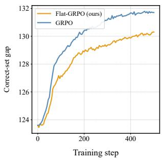

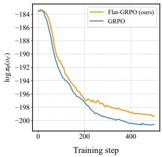  
(a) Correct-set gap $D _ { h , l }$  
(b) Trajectory of log πθ(oℓ)  
Figure 4. Correct-set log-probability gap $D _ { h , }$ l on a fixed probe set (a) and trajectory of log πθ(oℓ), the log-probability of the lowest-probability correct response (b) during training.

Correct-set log probability gap. We trace the correctset log probability gap D training Qwen2.5-Math-1.5B on MATH dataset. The correct-set log probability gap $D = \log \pi _ { \boldsymbol { \theta } } ( o _ { h } | \boldsymbol { q } ) - \log \pi _ { \boldsymbol { \theta } } ( o _ { l } | \boldsymbol { q } )$ (referred to Definition 4.2) indicates the difference between a high-probability correctoutput $O _ { h }$ and low-probability correct-output $o _ { l } .$ . Reducing this gap growth is the core mechanism by which $\ E \bot a t -$ RLVR mitigates distribution sharpening.

Specifically, i) for a given prompt, we measure $O _ { h }$ (highprobability correct output) and $o _ { l }$ (low-probability correct output) before training. ii) After one-step training, we measure them to compute the changes of the gap D and keep track of it during training. Figure 4a shows that Flat-GRPO reduces the gap of correct-set log probability compared with GRPO during training, indicating Flat-RLVR mitigates the correct-set distribution sharpening.

Rare-correct log-probability. We simultaneously trace the mean probability mass assigned to the fixed rare-correct trajectories $o _ { l }$ throughout the same training process. Figure 4b shows that Flat-GRPO retains more probability mass on rare correct trajectories (o ) than GRPO, which suggests that it helps preserve the model’s reasoning capacity by keeping rare correct solution alive.

Low-pass filter (LPF). In addition, to verify that Flat-GRPO really find the flatter region than GRPO, we measure the Low-Pass Filter (LPF) flatness defined as the expected increase in loss under Gaussian parameter perburbaions:

Table 6. Low-Pass Filter (LPF) of the model fine-tunded by GRPO and Flat-GRPO algorithms at perturbation scale $\sigma = 0 . 0 0 1$
<table><tr><td>Method</td><td>LPF↓</td></tr><tr><td>GRPO</td><td>0.4434</td></tr><tr><td>Flat-GRPO</td><td>0.0598</td></tr></table>

$$
\operatorname { L P F } ( \theta ) = \mathbb { E } _ { \delta \sim \mathcal { N } ( 0 , \sigma ^ { 2 } ) } [ \mathcal { L } ( \theta + \delta ) ] - \mathcal { L } ( \theta ) .\tag{19}
$$

We construct a fixed evaluation batch of 32 prompts from the model’s training dataset (MATH dataset). For each prompt, we sample $G = 6$ rollouts from the model and compute advantages $\hat { A } _ { i } = ( r _ { i } - \bar { r } ) / \sigma _ { r }$ , defining L as the GRPO loss on this fixed batch. The identical batch and perturbation seeds are used for both models to controlled comparison. Perturbation are filter-normalized scaling the noise on each parameter by its norm.

Table 6 shows the model trained with Flat-GRPO converges to a flatter region than GRPO. This is consistent with our theoretical claim that flatness-aware optimization mitigates distribution sharpening.

## 6.5. Analysis of Cost-Benefit Trade-off

We further investigate how applying SAM to the GRPO baseline affects performance and incurs additional time and memory overhead, as a function of the SAM period n, which controls how often the SAM ascent-descent step is invoked. We treat the period n as the key factor that governs the practical value of Flat-RLVR. All experiments use Qwen2.5-Math-1.5B as the backbone and follow the configuration. We measure all cost values with the same computing resource for a fair comparison.

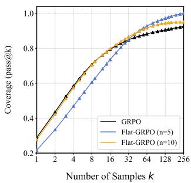  
(a) AMC23

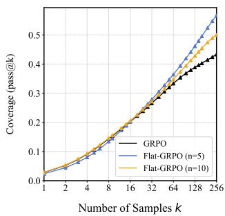  
(b) AIME25  
Figure 5. Pass@K curves on (a) AMC23 and (b) AIME25 test datasets (from $K = 1$ to $K = 2 5 6 )$ comparing GRPO with Flat-GRPO under two SAM periods, $n = 5$ and n = 10.

Performance. Figure 5 compares GRPO against periodic SAM with $n \in \{ 5 , 1 0 \}$ on AMC23 and AIME25 test datasets, plotting Pass@K from K = 1 to $K = 2 5 6$ . The figure reveals a clear tradeoff: shortening the SAM application interval (from $n = 1 0 \mathrm { t o } n = 5 )$ substantially boosts Pass@K as K grows, but at the cost of a non-trivial drop in single-attempt accuracy (Pass@1).

Table 7. Wall-clock training time and averaged per-GPU memory allocation for Flat-GRPO with n-step
<table><tr><td>Method</td><td>Total (h)</td><td>allocated(%)</td></tr><tr><td> $\mathrm { F } \mathrm { 1 } \mathsf { a t . } \mathbf { G } \mathbf { R } \mathbf { P } \mathbf { O } \left( n = 5 \right)$ </td><td>17.00</td><td>90.82</td></tr><tr><td> $\mathrm { F 1 a t - G R P O } \left( n = 1 0 \right)$ </td><td>16.87</td><td>88.42</td></tr><tr><td>GRPO</td><td>16.91</td><td>90.96</td></tr></table>

Table 8. Average time for each step in Flat-GRPO. We compare SAM steps with ordinary steps to estimate the computational overhead stemming from the additional gradient of SAM.
<table><tr><td></td><td>per-step wall clock time (s)</td></tr><tr><td>ordinary step</td><td>90.17</td></tr><tr><td>SAM step</td><td>90.56 (+0.43%)</td></tr></table>

Computational Overhead. Table 7 reports the total wallclock time and the average per-GPU memory allocation in the training process. Across both periods, the total training time stays within 0.1 hours of the GRPO baseline and the per-GPU memory remains comparable or lower. The results indicate that periodic application of SAM incurs negligible additional training time and memory usage relative to the baseline, guaranteeing the scalability of the Flat-RLVR.

Furthermore, to quantify the cost of additional gradient computation from SAM, we examine the per-step wall-clock time of Flat-GRPO on Qwen2.5-3B-Instruct. Table 8 shows that a SAM step takes only 0.39s (+0.43%) more than an ordinary step, confirming that the additional gradient computation remains negligible at scale.

## 7. Conclusion

In this work, we present a way to mitigate the distribution sharpening in group-relative RLVR, by utilizing flatnessseeking optimization. Concretely, we provide a mathematical analysis of the one-step parameter update in RLVR, showing that flat-minima search dampens the abrupt increase in probability, thereby mitigating distribution sharpness of LLM post-training. We propose the Flat-RLVR framework by integrating sharpness-aware minimization into RLVR. Throughout experiments, Flat-RLVR implemented as Flat-GRPO/DAPO/CISPO mitigates the distribution sharpening induced by RLVR, consistently improving the diversity of the output distribution while preserving accuracy with our LLM post-training adaptations. These imply flatness serves as the central catalyst to mitigate the distribution sharpening.

## Acknowledgments

This work was supported by the National Research Foundation of Korea (NRF) grant funded by the Korea government (MSIT) (No. RS-2024-00459023), (No. RS-2026- 25541562, AI-Based Dynamic Risk Assessment Platform for Accelerating SMR and Advanced Reactor Design), and the Institute of Information & Communications Technology Planning & Evaluation (IITP) grant funded by the Korean Government (MSIT) (No. RS-2020-II201336, Artificial Intelligence Graduate School Program at UNIST), (No. RS2025-25442824, AI Star Fellowship Program (UNIST)), (No. RS-2026-25528781, Hyper-scale Industrial AI Research Support (R&D) Program, Development of an industry-specified intelligent data processing and federated learning platform), (No. IITP-2026-RS-2022-00156361, Innovative Human Resource Development for Local Intellectualization program). This work was also supported by the grant of the Korea Health Technology R&D Project through the Korea Health Industry Development Institute (KHIDI), funded by the Ministry of Health & Welfare, Republic of Korea (No. RS-2025-02223382).

## References

Austin, J., Odena, A., Nye, M., Bosma, M., Michalewski, H., Dohan, D., Jiang, E., Cai, C., Terry, M., Le, Q., and Sutton, C. Program synthesis with large language models, 2021. URL https://arxiv.org/abs/2108.0 7732.

Becker, M., Altrock, F., and Risse, B. Momentum-sam: Sharpness aware minimization without computational overhead. In Belgrave, D., Zhang, C., Lin, H., Pascanu, R., Koniusz, P., Ghassemi, M., and Chen, N. (eds.), Advances in Neural Information Processing Systems, volume 38, Main Conference, pp. 55336–55366. Curran Associates, Inc., 2025. doi: 10.52202/085713-1850. URL https://proceedings.neurips.cc/p aper\_files/paper/2025/file/4fb596fd0 4a0eaa7bdd78aae24943a8e-Paper-Confere nce.pdf.

Bisla, D., Wang, J., and Choromanska, A. Low-pass filtering sgd for recovering flat optima in the deep learning optimization landscape. In Camps-Valls, G., Ruiz, F. J. R., and Valera, I. (eds.), Proceedings of The 25th International Conference on Artificial Intelligence and Statistics, volume 151 of Proceedings of Machine Learning Research, pp. 8299–8339. PMLR, 28–30 Mar 2022. URL https://proceedings.mlr.press/v151/b isla22a.html.

Brown, B., Juravsky, J., Ehrlich, R., Clark, R., Le, Q. V., Re,´ C., and Mirhoseini, A. Large language monkeys: Scaling

inference compute with repeated sampling, 2024. URL https://arxiv.org/abs/2407.21787.

Cha, J., Chun, S., Lee, K., Cho, H.-C., Park, S., Lee, Y., and Park, S. Swad: Domain generalization by seeking flat minima. In Ranzato, M., Beygelzimer, A., Dauphin, Y., Liang, P., and Vaughan, J. W. (eds.), Advances in Neural Information Processing Systems, volume 34, pp. 22405– 22418. Curran Associates, Inc., 2021. URL https: //proceedings.neurips.cc/paper\_files /paper/2021/file/bcb41ccdc4363c6848a 1d760f26c28a0-Paper.pdf.

Chen, A., Li, A., Gong, B., Jiang, B., Fei, B., Yang, B., Shan, B., Yu, C., Wang, C., Zhu, C., Xiao, C., Du, C., Zhang, C., Qiao, C., Zhang, C., Du, C., Guo, C., Chen, D., Ding, D., Sun, D., Li, D., Jiao, E., Zhou, H., Zhang, H., Ding, H., Sun, H., Feng, H., Cai, H., Zhu, H., Sun, J., Zhuang, J., Cai, J., Song, J., Zhu, J., Li, J., Tian, J., Liu, J., Xu, J., Yan, J., Liu, J., He, J., Feng, K., Yang, K., Xiao, K., Han, L., Wang, L., Yu, L., Feng, L., Li, L., Zheng, L., Du, L., Yang, L., Zeng, L., Yu, M., Tao, M., Chi, M., Zhang, M., Lin, M., Hu, N., Di, N., Gao, P., Li, P., Zhao, P., Ren, Q., Xu, Q., Li, Q., Wang, Q., Tian, R., Leng, R., Chen, S., Chen, S., Shi, S., Weng, S., Guan, S., Yu, S., Li, S., Zhu, S., Li, T., Cai, T., Liang, T., Cheng, W., Kong, W., Li, W., Chen, X., Song, X., Luo, X., Su, X., Li, X., Han, X., Hou, X., Lu, X., Zou, X., Shen, X., Gong, Y., Ma, Y., Wang, Y., Shi, Y., Zhong, Y., Duan, Y., Fu, Y., Hu, Y., Gao, Y., Fan, Y., Yang, Y., Li, Y., Hu, Y., Huang, Y., Li, Y., Xu, Y., Mao, Y., Shi, Y., Wenren, Y., Li, Z., Li, Z., Tian, Z., Zhu, Z., Fan, Z., Wu, Z., Xu, Z., Yu, Z., Lyu, Z., Jiang, Z., Gao, Z., Wu, Z., Song, Z., and Sun, Z. Minimax-m1: Scaling test-time compute efficiently with lightning attention, 2025. URL https://arxiv.org/abs/2506.13585.

Chen, M., Tworek, J., Jun, H., Yuan, Q., de Oliveira Pinto, H. P., Kaplan, J., Edwards, H., Burda, Y., Joseph, N., Brockman, G., Ray, A., Puri, R., Krueger, G., Petrov, M., Khlaaf, H., Sastry, G., Mishkin, P., Chan, B., Gray, S., Ryder, N., Pavlov, M., Power, A., Kaiser, L., Bavarian, M., Winter, C., Tillet, P., Such, F. P., Cummings, D., Plappert, M., Chantzis, F., Barnes, E., Herbert-Voss, A., Guss, W. H., Nichol, A., Paino, A., Tezak, N., Tang, J., Babuschkin, I., Balaji, S., Jain, S., Saunders, W., Hesse, C., Carr, A. N., Leike, J., Achiam, J., Misra, V., Morikawa, E., Radford, A., Knight, M., Brundage, M., Murati, M., Mayer, K., Welinder, P., McGrew, B., Amodei, D., McCandlish, S., Sutskever, I., and Zaremba, W. Evaluating large language models trained on code, 2021. URL https://arxiv.org/abs/2107.0 3374.

Chow, Y., Tennenholtz, G., Gur, I., Zhuang, V., Dai, B., Kumar, A., Agarwal, R., Thiagarajan, S., Boutilier, C.,

and Faust, A. Inference-aware fine-tuning for best-of-n sampling in large language models. In Yue, Y., Garg, A., Peng, N., Sha, F., and Yu, R. (eds.), International Conference on Learning Representations, volume 2025, pp. 78936–78959, 2025. URL https://proceedi ngs.iclr.cc/paper\_files/paper/2025/f ile/c40bed606c51c8e827c1ba75aa2da054 -Paper-Conference.pdf.

Cobbe, K., Kosaraju, V., Bavarian, M., Chen, M., Jun, H., Kaiser, L., Plappert, M., Tworek, J., Hilton, J., Nakano, R., Hesse, C., and Schulman, J. Training verifiers to solve math word problems, 2021. URL https://arxiv. org/abs/2110.14168.

Foret, P., Kleiner, A., Mobahi, H., and Neyshabur, B. Sharpness-aware minimization for efficiently improving generalization. In International Conference on Learning Representations, 2021. URL https://openreview .net/forum?id=6Tm1mposlrM.

Ge, C., Yin, C. H., Liang, H., and Zhang, J. Why grpo needs normalization: A local-curvature perspective on adaptive gradients, 2026. URL https://arxiv.org/abs/ 2601.23135.

Grattafiori, A., Dubey, A., Jauhri, A., Pandey, A., Kadian, A., Al-Dahle, A., Letman, A., Mathur, A., Schelten, A., Vaughan, A., Yang, A., Fan, A., Goyal, A., Hartshorn, A., Yang, A., Mitra, A., Sravankumar, A., Korenev, A., Hinsvark, A., Rao, A., Zhang, A., Rodriguez, A., Gregerson, A., Spataru, A., Roziere, B., Biron, B., Tang, B., Chern, B., Caucheteux, C., Nayak, C., Bi, C., Marra, C., McConnell, C., Keller, C., Touret, C., Wu, C., Wong, C., Ferrer, C. C., Nikolaidis, C., Allonsius, D., Song, D., Pintz, D., Livshits, D., Wyatt, D., Esiobu, D., Choudhary, D., Mahajan, D., Garcia-Olano, D., Perino, D., Hupkes, D., Lakomkin, E., AlBadawy, E., Lobanova, E., Dinan, E., Smith, E. M., Radenovic, F., Guzman, F., Zhang, F.,´ Synnaeve, G., Lee, G., Anderson, G. L., Thattai, G., Nail, G., Mialon, G., Pang, G., Cucurell, G., Nguyen, H., Korevaar, H., Xu, H., Touvron, H., Zarov, I., Ibarra, I. A., Kloumann, I., Misra, I., Evtimov, I., Zhang, J., Copet, J., Lee, J., Geffert, J., Vranes, J., Park, J., Mahadeokar, J., Shah, J., van der Linde, J., Billock, J., Hong, J., Lee, J., Fu, J., Chi, J., Huang, J., Liu, J., Wang, J., Yu, J., Bitton, J., Spisak, J., Park, J., Rocca, J., Johnstun, J., Saxe, J., Jia, J., Alwala, K. V., Prasad, K., Upasani, K., Plawiak, K., Li, K., Heafield, K., Stone, K., El-Arini, K., Iyer, K., Malik, K., Chiu, K., Bhalla, K., Lakhotia, K., Rantala-Yeary, L., van der Maaten, L., Chen, L., Tan, L., Jenkins, L., Martin, L., Madaan, L., Malo, L., Blecher, L., Landzaat, L., de Oliveira, L., Muzzi, M., Pasupuleti, M., Singh, M., Paluri, M., Kardas, M., Tsimpoukelli, M., Oldham, M., Rita, M., Pavlova, M., Kambadur, M., Lewis, M., Si, M., Singh, M. K., Hassan, M., Goyal, N., Torabi, N.,

Bashlykov, N., Bogoychev, N., Chatterji, N., Zhang, N., Duchenne, O., C¸ elebi, O., Alrassy, P., Zhang, P., Li, P., Vasic, P., Weng, P., Bhargava, P., Dubal, P., Krishnan, P., Koura, P. S., Xu, P., He, Q., Dong, Q., Srinivasan, R., Ganapathy, R., Calderer, R., Cabral, R. S., Stojnic, R., Raileanu, R., Maheswari, R., Girdhar, R., Patel, R., Sauvestre, R., Polidoro, R., Sumbaly, R., Taylor, R., Silva, R., Hou, R., Wang, R., Hosseini, S., Chennabasappa, S., Singh, S., Bell, S., Kim, S. S., Edunov, S., Nie, S., Narang, S., Raparthy, S., Shen, S., Wan, S., Bhosale, S., Zhang, S., Vandenhende, S., Batra, S., Whitman, S., Sootla, S., Collot, S., Gururangan, S., Borodinsky, S., Herman, T., Fowler, T., Sheasha, T., Georgiou, T., Scialom, T., Speckbacher, T., Mihaylov, T., Xiao, T., Karn, U., Goswami, V., Gupta, V., Ramanathan, V., Kerkez, V., Gonguet, V., Do, V., Vogeti, V., Albiero, V., Petrovic, V., Chu, W., Xiong, W., Fu, W., Meers, W., Martinet, X., Wang, X., Wang, X., Tan, X. E., Xia, X., Xie, X., Jia, X., Wang, X., Gold schlag, Y., Gaur, Y., Babaei, Y., Wen, Y., Song, Y., Zhang, Y., Li, Y., Mao, Y., Coudert, Z. D., Yan, Z., Chen, Z., Papakipos, Z., Singh, A., Srivastava, A., Jain, A., Kelsey, A., Shajnfeld, A., Gangidi, A., Victoria, A., Goldstand, A., Menon, A., Sharma, A., Boesenberg, A., Baevski, A., Feinstein, A., Kallet, A., Sangani, A., Teo, A., Yunus, A., Lupu, A., Alvarado, A., Caples, A., Gu, A., Ho, A., Poulton, A., Ryan, A., Ramchandani, A., Dong, A., Franco, A., Goyal, A., Saraf, A., Chowdhury, A., Gabriel, A., Bharambe, A., Eisenman, A., Yazdan, A., James, B., Maurer, B., Leonhardi, B., Huang, B., Loyd, B., Paola, B. D., Paranjape, B., Liu, B., Wu, B., Ni, B., Hancock, B., Wasti, B., Spence, B., Stojkovic, B., Gamido, B., Montalvo, B., Parker, C., Burton, C., Mejia, C., Liu, C., Wang, C., Kim, C., Zhou, C., Hu, C., Chu, C.-H., Cai, C., Tindal, C., Feichtenhofer, C., Gao, C., Civin, D., Beaty, D., Kreymer, D., Li, D., Adkins, D., Xu, D., Testuggine, D., David, D., Parikh, D., Liskovich, D., Foss, D., Wang, D., Le, D., Holland, D., Dowling, E., Jamil, E., Montgomery, E., Presani, E., Hahn, E., Wood, E., Le, E.-T., Brinkman, E., Arcaute, E., Dunbar, E., Smothers, E., Sun, F., Kreuk, F., Tian, F., Kokkinos, F., Ozgenel, F., Caggioni, F., Kanayet, F., Seide, F., Florez, G. M., Schwarz, G., Badeer, G., Swee, G., Halpern, G., Herman, G., Sizov, G., Guangyi, Zhang, Lakshminarayanan, G., Inan, H., Shojanazeri, H., Zou, H., Wang, H., Zha, H., Habeeb, H., Rudolph, H., Suk, H., Aspegren, H., Goldman, H., Zhan, H., Damlaj, I., Molybog, I., Tufanov, I., Leontiadis, I., Veliche, I.-E., Gat, I., Weissman, J., Geboski, J., Kohli, J., Lam, J., Asher, J., Gaya, J.-B., Marcus, J., Tang, J., Chan, J., Zhen, J., Reizenstein, J., Teboul, J., Zhong, J., Jin, J., Yang, J., Cummings, J., Carvill, J., Shepard, J., McPhie, J., Torres, J., Ginsburg, J., Wang, J., Wu, K., U, K. H., Saxena, K., Khandelwal, K., Zand, K., Matosich, K., Veeraraghavan, K., Michelena, K., Li, K., Jagadeesh, K., Huang, K., Chawla, K., Huang, K., Chen, L., Garg,

L., A, L., Silva, L., Bell, L., Zhang, L., Guo, L., Yu, L., Moshkovich, L., Wehrstedt, L., Khabsa, M., Avalani, M., Bhatt, M., Mankus, M., Hasson, M., Lennie, M., Reso, M., Groshev, M., Naumov, M., Lathi, M., Keneally, M., Liu, M., Seltzer, M. L., Valko, M., Restrepo, M., Patel, M., Vyatskov, M., Samvelyan, M., Clark, M., Macey, M., Wang, M., Hermoso, M. J., Metanat, M., Rastegari, M., Bansal, M., Santhanam, N., Parks, N., White, N., Bawa, N., Singhal, N., Egebo, N., Usunier, N., Mehta, N., Laptev, N. P., Dong, N., Cheng, N., Chernoguz, O., Hart, O., Salpekar, O., Kalinli, O., Kent, P., Parekh, P., Saab, P., Balaji, P., Rittner, P., Bontrager, P., Roux, P., Dollar, P., Zvyagina, P., Ratanchandani, P., Yuvraj, P., Liang, Q., Alao, R., Rodriguez, R., Ayub, R., Murthy, R., Nayani, R., Mitra, R., Parthasarathy, R., Li, R., Hogan, R., Battey, R., Wang, R., Howes, R., Rinott, R., Mehta, S., Siby, S., Bondu, S. J., Datta, S., Chugh, S., Hunt, S., Dhillon, S., Sidorov, S., Pan, S., Mahajan, S., Verma, S., Yamamoto, S., Ramaswamy, S., Lindsay, S., Feng, S., Lin, S., Zha, S. C., Patil, S., Shankar, S., Zhang, S., Wang, S., Agarwal, S., Sajuyigbe, S., Chintala, S., Max, S., Chen, S., Kehoe, S., Satterfield, S., Govindaprasad, S., Gupta, S., Deng, S., Cho, S., Virk, S., Subramanian, S., Choudhury, S., Goldman, S., Remez, T., Glaser, T., Best, T., Koehler, T., Robinson, T., Li, T., Zhang, T., Matthews, T., Chou, T., Shaked, T., Vontimitta, V., Ajayi, V., Montanez, V., Mohan, V., Kumar, V. S., Mangla, V., Ionescu, V., Poenaru, V., Mihailescu, V. T., Ivanov, V., Li, W., Wang, W., Jiang, W., Bouaziz, W., Constable, W., Tang, X., Wu, X., Wang, X., Wu, X., Gao, X., Kleinman, Y., Chen, Y., Hu, Y., Jia, Y., Qi, Y., Li, Y., Zhang, Y., Zhang, Y., Adi, Y., Nam, Y., Yu, Wang, Zhao, Y., Hao, Y., Qian, Y., Li, Y., He, Y., Rait, Z., DeVito, Z., Rosnbrick, Z., Wen, Z., Yang, Z., Zhao, Z., and Ma, Z. The llama 3 herd of models, 2024. URL https://arxiv.org/abs/2407.21783.

Guo, D., Yang, D., Zhang, H., Song, J., Wang, P., Zhu, Q., Xu, R., Zhang, R., Ma, S., Bi, X., Zhang, X., Yu, X., Wu, Y., Wu, Z. F., Gou, Z., Shao, Z., Li, Z., Gao, Z., Liu, A., Xue, B., Wang, B., Wu, B., Feng, B., Lu, C., Zhao, C., Deng, C., Ruan, C., Dai, D., Chen, D., Ji, D., Li, E., Lin, F., Dai, F., Luo, F., Hao, G., Chen, G., Li, G., Zhang, H., Xu, H., Ding, H., Gao, H., Qu, H., Li, H., Guo, J., Li, J., Chen, J., Yuan, J., Tu, J., Qiu, J., Li, J., Cai, J. L., Ni, J., Liang, J., Chen, J., Dong, K., Hu, K., You, K., Gao, K., Guan, K., Huang, K., Yu, K., Wang, L., Zhang, L., Zhao, L., Wang, L., Zhang, L., Xu, L., Xia, L., Zhang, M., Zhang, M., Tang, M., Zhou, M., Li, M., Wang, M., Li, M., Tian, N., Huang, P., Zhang, P., Wang, Q., Chen, Q., Du, Q., Ge, R., Zhang, R., Pan, R., Wang, R., Chen, R. J., Jin, R. L., Chen, R., Lu, S., Zhou, S., Chen, S., Ye, S., Wang, S., Yu, S., Zhou, S., Pan, S., Li, S. S., Zhou, S., Wu, S., Yun, T., Pei, T., Sun, T., Wang, T., Zeng, W., Liu, W., Liang, W., Gao, W., Yu, W., Zhang, W., Xiao, W. L.,

An, W., Liu, X., Wang, X., Chen, X., Nie, X., Cheng, X., Liu, X., Xie, X., Liu, X., Yang, X., Li, X., Su, X., Lin, X., Li, X. Q., Jin, X., Shen, X., Chen, X., Sun, X., Wang, X., Song, X., Zhou, X., Wang, X., Shan, X., Li, Y. K., Wang, Y. Q., Wei, Y. X., Zhang, Y., Xu, Y., Li, Y., Zhao, Y., Sun, Y., Wang, Y., Yu, Y., Zhang, Y., Shi, Y., Xiong, Y., He, Y., Piao, Y., Wang, Y., Tan, Y., Ma, Y., Liu, Y., Guo, Y., Ou, Y., Wang, Y., Gong, Y., Zou, Y., He, Y., Xiong, Y., Luo, Y., You, Y., Liu, Y., Zhou, Y., Zhu, Y. X., Huang, Y., Li, Y., Zheng, Y., Zhu, Y., Ma, Y., Tang, Y., Zha, Y., Yan, Y., Ren, Z. Z., Ren, Z., Sha, Z., Fu, Z., Xu, Z., Xie, Z., Zhang, Z., Hao, Z., Ma, Z., Yan, Z., Wu, Z., Gu, Z., Zhu, Z., Liu, Z., Li, Z., Xie, Z., Song, Z., Pan, Z., Huang, Z., Xu, Z., Zhang, Z., and Zhang, Z. Deepseekr1 incentivizes reasoning in llms through reinforcement learning. Nature, 645(8081):633–638, 2025. ISSN 1476- 4687. doi: 10.1038/s41586-025-09422-z. URL http: //dx.doi.org/10.1038/s41586-025-09422 -z.

Handa, D., Parmar, M., RRV, A., Uddin, M. N., Palangi, H., and Baral, C. Guidedsampling: Steering llms towards diverse candidate solutions at inference-time. In Vondrick, C., Hariharan, B., Raffel, C., Pinto, L., Yang, D., and Faust, A. (eds.), International Conference on Learning Representations, volume 2026, pp. 145052–145077, 2026. URL https://proceedings.iclr.cc/pape r\_files/paper/2026/file/ea9cfce070ce bac95fec35f35b298e30-Paper-Conference. pdf.

Hassan, M., Vakanski, A., Zhang, B., and Xian, M. Gcsam: Gradient centralized sharpness aware minimization. IEEE Access, 13:182661–182674, 2025. doi: 10.1109/ACCE SS.2025.3624332.

He, A. W., Fried, D., and Welleck, S. Rewarding the unlikely: Lifting GRPO beyond distribution sharpening. In Christodoulopoulos, C., Chakraborty, T., Rose, C., and Peng, V. (eds.), Proceedings ofthe 2025 Conference on Empirical Methods in Natural Language Processing, pp. 25548–25560, Suzhou, China, November 2025. Association for Computational Linguistics. ISBN 979-8-89176- 332-6. doi: 10.18653/v1/2025.emnlp-main.1298. URL https://aclanthology.org/2025.emnlp-m ain.1298/.

Hendrycks, D., Burns, C., Kadavath, S., Arora, A., Basart, S., Tang, E., Song, D., and Steinhardt, J. Measuring mathematical problem solving with the MATH dataset. In Thirty-fifth Conference on Neural Information Processing Systems Datasets and Benchmarks Track (Round 2), 2021. URL https://openreview.net/forum?id= 7Bywt2mQsCe.

Hochreiter, S. and Schmidhuber, J. Flat minima. Neural

Computation, 9(1):1–42, 01 1997. ISSN 0899-7667. doi: 10.1162/neco.1997.9.1.1. URL https://doi.org/ 10.1162/neco.1997.9.1.1.

Hui, B., Yang, J., Cui, Z., Yang, J., Liu, D., Zhang, L., Liu, T., Zhang, J., Yu, B., Lu, K., Dang, K., Fan, Y., Zhang, Y., Yang, A., Men, R., Huang, F., Zheng, B., Miao, Y., Quan, S., Feng, Y., Ren, X., Ren, X., Zhou, J., and Lin, J. Qwen2.5-coder technical report, 2024. URL https://arxiv.org/abs/2409.12186.

Keskar, N. S., Mudigere, D., Nocedal, J., Smelyanskiy, M., and Tang, P. T. P. On large-batch training for deep learning: Generalization gap and sharp minima. In International Conference on Learning Representations, 2017. URL https://openreview.net/forum?id= H1oyRlYgg.

Kwon, J., Kim, J., Park, H., and Choi, I. K. Asam: Adaptive sharpness-aware minimization for scale-invariant learning of deep neural networks. In Meila, M. and Zhang, T. (eds.), Proceedings ofthe 38th International Conference on Machine Learning, volume 139 of Proceedings ofMachine Learning Research, pp. 5905–5914. PMLR, 18–24 Jul 2021. URL https://proceedings.mlr.pr ess/v139/kwon21b.html.

Lambert, N., Morrison, J., Pyatkin, V., Huang, S., Ivison, H., Brahman, F., Miranda, L. J. V., Liu, A., Dziri, N., Lyu, X., Gu, Y., Malik, S., Graf, V., Hwang, J. D., Yang, J., Bras, R. L., Tafjord, O., Wilhelm, C., Soldaini, L., Smith, N. A., Wang, Y., Dasigi, P., and Hajishirzi, H. Tulu 3: Pushing frontiers in open language model post-training. In Second Conference on Language Modeling, 2025. URL https: //openreview.net/forum?id=i1uGbfHHpH.

Lee, H. and Yoon, S. W. Flat reward in policy parameter space implies robust reinforcement learning. In Yue, Y., Garg, A., Peng, N., Sha, F., and Yu, R. (eds.), International Conference on Learning Representations, volume 2025, pp. 20408–20430, 2025. URL https: //proceedings.iclr.cc/paper\_files/pa per/2025/file/3448058d44f13383904229 5f79a9a958-Paper-Conference.pdf.

Lee, T. and Yoon, S. W. Rethinking the flat minima searching in federated learning. In Salakhutdinov, R., Kolter, Z., Heller, K., Weller, A., Oliver, N., Scarlett, J., and Berkenkamp, F. (eds.), Proceedings ofthe 41st International Conference on Machine Learning, volume 235 of Proceedings of Machine Learning Research, pp. 27037– 27071. PMLR, 21–27 Jul 2024. URL https://proc eedings.mlr.press/v235/lee24aa.html.

Lee, T., Seo, K., Yoo, J., and Yoon, S. W. Understanding flatness in generative models: Its role and benefits. In 2025 IEEE/CVF International Conference on Computer

Vision (ICCV), pp. 4908–4917, 2025. doi: 10.1109/ICCV 51701.2025.00467.

Lightman, H., Kosaraju, V., Burda, Y., Edwards, H., Baker, B., Lee, T., Leike, J., Schulman, J., Sutskever, I., and Cobbe, K. Let's verify step by step. In Kim, B., Yue, Y., Chaudhuri, S., Fragkiadaki, K., Khan, M., and Sun, Y. (eds.), International Conference on Learning Representations, volume 2024, pp. 39578–39601, 2024. URL ht tps://proceedings.iclr.cc/paper\_file s/paper/2024/file/aca97732e30bcf1303 bc22ac3924fd16-Paper-Conference.pdf.

Liu, C., Zhu, L., and Belkin, M. On the linearity of large non-linear models: when and why the tangent kernel is constant. In Larochelle, H., Ranzato, M., Hadsell, R., Balcan, M., and Lin, H. (eds.), Advances in Neural Information Processing Systems, volume 33, pp. 15954– 15964. Curran Associates, Inc., 2020. URL https: //proceedings.neurips.cc/paper\_files /paper/2020/file/b7ae8fecf15b8b6c3c6 9eceae636d203-Paper.pdf.

Liu, Y., Mai, S., Chen, X., Hsieh, C.-J., and You, Y. Towards efficient and scalable sharpness-aware minimization. In Proceedings of the IEEE/CVF Conference on Computer Vision and Pattern Recognition (CVPR), pp. 12360–12370, June 2022. URL https://openacce ss.thecvf.com/content/CVPR2022/html/ Liu\_Towards\_Efficient\_and\_Scalable\_S harpness-Aware\_Minimization\_CVPR\_202 2\_paper.html.

Loshchilov, I. and Hutter, F. SGDR: Stochastic gradient descent with warm restarts. In International Conference on Learning Representations, 2017. URL https://op enreview.net/forum?id=Skq89Scxx.

Nguyen, P. M., La, C. D., Nguyen, D. M. H., Chawla, N. V., Nguyen, B. T., and Doan, K. D. The reasoning boundary paradox: How reinforcement learning constrains language models, 2025. URL https://arxiv.org/ abs/2510.02230.

Plyusov, D., Gorbatovski, A., Shaposhnikov, B., Sinii, V., Malakhov, A., and Gavrilov, D. F-GRPO: Don’t let your policy learn the obvious and forget the rare. In The 1st Workshop on Scaling Post-trainingfor LLMs, 2026. URL https://openreview.net/forum?id=DWS8 VtJt6a.

Qu, Z., Li, X., Duan, R., Liu, Y., Tang, B., and Lu, Z. Generalized federated learning via sharpness aware minimization. In Chaudhuri, K., Jegelka, S., Song, L., Szepesvari, C., Niu, G., and Sabato, S. (eds.), Proceedings ofthe 39th International Conference on Machine Learning, volume 162 of Proceedings of Machine Learning Research, pp.

18250–18280. PMLR, 17–23 Jul 2022. URL https:// proceedings.mlr.press/v162/qu22a.html.

Schulman, J., Wolski, F., Dhariwal, P., Radford, A., and Klimov, O. Proximal policy optimization algorithms, 2017. URL https://arxiv.org/abs/1707.0 6347.

Shao, R., Li, S. S., Xin, R., Geng, S., Wang, Y., Oh, S., Du, S. S., Lambert, N., Min, S., Krishna, R., Tsvetkov, Y., Hajishirzi, H., Koh, P. W., and Zettlemoyer, L. Spurious rewards: Rethinking training signals in RLVR. In Forty-third International Conference on Machine Learning, 2026. URL https://openreview.net/for um?id=tqTNOpkP5j.

Shao, Z., Wang, P., Zhu, Q., Xu, R., Song, J., Bi, X., Zhang, H., Zhang, M., Li, Y. K., Wu, Y., and Guo, D. Deepseekmath: Pushing the limits of mathematical reasoning in open language models, 2024. URL https://arxiv.org/abs/2402.03300.

Team, Q. Qwen2.5: A party of foundation models, September 2024. URL https://qwenlm.github.io/b log/qwen2.5/.

Teng, F., Bai, J., Yao, X., Wang, D. R., Zhao, J., and Guo, Z. Skip-connected policy optimization for implicit advantage, 2026. URL https://arxiv.org/abs/2604 .08690.

von Werra, L., Belkada, Y., Tunstall, L., Beeching, E., Thrush, T., Lambert, N., Huang, S., Rasul, K., and Gallouedec, Q. TRL: Transformers Reinforcement Learning,´ 2020. URL https://github.com/huggingfa ce/trl.

Wang, H., Huang, Y., Wang, S., Ren, G., and Dong, H. Why tree-style branching matters for thought advantage estimation in GRPO. In Forty-third International Conference on Machine Learning, 2026a. URL https: //openreview.net/forum?id=KwO83Ao6BW.

Wang, T., Chen, Y., Liu, Z., Light, J., Liu, W., Chen, H., Zhang, X., and Cheng, W. On the effect of sampling diversity in scaling LLM inference. In Perkovic, E. and´ Malinsky, D. (eds.), Proceedings of the 42nd Conference on Uncertainty in Artificial Intelligence, volume 337 of Proceedings of Machine Learning Research, pp. 7137– 7167. PMLR, 17–21 Aug 2026b. URL https://pr oceedings.mlr.press/v337/wang26f.html.

Wang, X., Wei, J., Schuurmans, D., Le, Q. V., Chi, E. H., Narang, S., Chowdhery, A., and Zhou, D. Selfconsistency improves chain of thought reasoning in language models. In The Eleventh International Conference on Learning Representations, 2023. URL https: //openreview.net/forum?id=1PL1NIMMrw.

Wei, Z., Zhu, J., and Zhang, Y. Sharpness-aware minimization alone can improve adversarial robustness. In The Second Workshop on New Frontiers in Adversarial Machine Learning, 2023. URL https://openreview .net/forum?id=bxsqPkm2m9.

Yang, A., Yang, B., Hui, B., Zheng, B., Yu, B., Zhou, C., Li, C., Li, C., Liu, D., Huang, F., Dong, G., Wei, H., Lin, H., Tang, J., Wang, J., Yang, J., Tu, J., Zhang, J., Ma, J., Yang, J., Xu, J., Zhou, J., Bai, J., He, J., Lin, J., Dang, K., Lu, K., Chen, K., Yang, K., Li, M., Xue, M., Ni, N., Zhang, P., Wang, P., Peng, R., Men, R., Gao, R., Lin, R., Wang, S., Bai, S., Tan, S., Zhu, T., Li, T., Liu, T., Ge, W., Deng, X., Zhou, X., Ren, X., Zhang, X., Wei, X., Ren, X., Liu, X., Fan, Y., Yao, Y., Zhang, Y., Wan, Y., Chu, Y., Liu, Y., Cui, Z., Zhang, Z., Guo, Z., and Fan, Z. Qwen2 technical report, 2024a. URL https://arxiv.org/abs/2407.10671.

Yang, A., Zhang, B., Hui, B., Gao, B., Yu, B., Li, C., Liu, D., Tu, J., Zhou, J., Lin, J., Lu, K., Xue, M., Lin, R., Liu, T., Ren, X., and Zhang, Z. Qwen2.5-math technical report: Toward mathematical expert model via self-improvement, 2024b. URL https://arxiv.org/abs/2409.1 2122.

Yong, H., Huang, J., Hua, X., and Zhang, L. Gradient centralization: A new optimization technique for deep neural networks. In Vedaldi, A., Bischof, H., Brox, T., and Frahm, J.-M. (eds.), Computer Vision – ECCV 2020, pp. 635–652, Cham, 2020. Springer International Publishing. ISBN 978-3-030-58452-8. URL https://doi.org/ 10.1007/978-3-030-58452-8\_37.

Yoo, W. and Yoon, S. W. A flat minima perspective on understanding augmentations and model robustness. In Proceedings of the AAAI Conference on Artificial Intelligence, volume 40, pp. 27879–27889, 2026. doi: 10.1609/aaai.v40i33.40011.

Yu, Q., Zhang, Z., Zhu, R., Yuan, Y., Zuo, X., Yue, Y., Dai, W., Fan, T., Liu, G., liu, j., Liu, L., Liu, X., Lin, H., Lin, Z., Ma, B., Sheng, G., Tong, Y., Zhang, C., Zhang, M., Zhang, R., Zhang, W., Zhu, H., Zhu, J., Chen, J., Chen, J., Wang, C., Yu, H., Song, Y., Wei, X., Zhou, H., Liu, J., Ma, W.-Y., Zhang, Y.-Q., Yan, L., Wu, Y., and Wang, M. Dapo: An open-source llm reinforcement learning system at scale. In Belgrave, D., Zhang, C., Lin, H., Pascanu, R., Koniusz, P., Ghassemi, M., and Chen, N. (eds.), Advances in Neural Information Processing Systems, volume 38, Main Conference, pp. 113222–113244. Curran Associates, Inc., 2025. doi: 10.52202/085713-3775. URL https: //proceedings.neurips.cc/paper\_files /paper/2025/file/a4277440d50f1f15d2c b4c14f7e0c0d2-Paper-Conference.pdf.

Yue, Y., Chen, Z., Lu, R., Zhao, A., Wang, Z., Yue, Y., Song, S., and Huang, G. Does reinforcement learning really incentivize reasoning capacity in llms beyond the base model? In Belgrave, D., Zhang, C., Lin, H., Pascanu, R., Koniusz, P., Ghassemi, M., and Chen, N. (eds.), Advances in Neural Information Processing Systems, volume 38, Main Conference, pp. 57654–57689. Curran Associates, Inc., 2025. doi: 10.52202/085713-1933. URL https: //proceedings.neurips.cc/paper\_files /paper/2025/file/537d5aa768c2d534016 a4d06f87bc8fb-Paper-Conference.pdf.

Zhang, Y. and Math-AI, T. American invitational mathematics examination (aime) 2024, 2024.

Zhang, Y. and Math-AI, T. American invitational mathematics examination (aime) 2025, 2025.

Zhang, Y. and Math-AI, T. American invitational mathematics examination (aime) 2026, 2026.

Zhang, Y., He, H., Zhu, J., Chen, H., Wang, Y., and Wei, Z. On the duality between sharpness-aware minimization and adversarial training. In Salakhutdinov, R., Kolter, Z., Heller, K., Weller, A., Oliver, N., Scarlett, J., and Berkenkamp, F. (eds.), Proceedings ofthe 41st International Conference on Machine Learning, volume 235 of Proceedings of Machine Learning Research, pp. 59024– 59041. PMLR, 21–27 Jul 2024. URL https://proc eedings.mlr.press/v235/zhang24w.html.

Zhao, R., Meterez, A., Kakade, S. M., Pehlevan, C., Jelassi, S., and Malach, E. Echo chamber: RL post-training amplifies behaviors learned in pretraining. In Second Conference on Language Modeling, 2025. URL https: //openreview.net/forum?id=dp4KWuSDzj.

Zhao, Y., Zhang, H., and Hu, X. Penalizing gradient norm for efficiently improving generalization in deep learning. In Chaudhuri, K., Jegelka, S., Song, L., Szepesvari, C., Niu, G., and Sabato, S. (eds.), Proceedings of the 39th International Conference on Machine Learning, volume 162 of Proceedings of Machine Learning Research, pp. 26982–26992. PMLR, 17–23 Jul 2022. URL https: //proceedings.mlr.press/v162/zhao22i .html.

Zhou, Z., Lu, X., Cao, C., Miranda, B., Liu, T., Han, B., and Koyejo, S. The easy, the hard, and the learnable: Confidence and difficulty-adaptive policy optimization for LLM reasoning. In Forty-third International Conference on Machine Learning, 2026. URL https: //openreview.net/forum?id=dnpLavxTXv.

Zhu, X., Xia, M., Wei, Z., Chen, W.-L., Chen, D., and Meng, Y. The surprising effectiveness of negative reinforcement

in llm reasoning. In Belgrave, D., Zhang, C., Lin, H., Pascanu, R., Koniusz, P., Ghassemi, M., and Chen, N. (eds.), Advances in Neural Information Processing Systems, volume 38, Main Conference, pp. 126546–126573. Curran Associates, Inc., 2025. doi: 10.52202/085713-4220. URL https://proceedings.neurips.cc/p aper\_files/paper/2025/file/b8026fe01 f5f8f7a80a1a9bf01d08cad-Paper-Confere nce.pdf.

Zhuang, J., Gong, B., Yuan, L., Cui, Y., Adam, H., Dvornek, N. C., sekhar tatikonda, s Duncan, J., and Liu, T. Surrogate gap minimization improves sharpness-aware training. In International Conference on Learning Representations, 2022. URL https://openreview.net/forum ?id=edONMAnhLu-.

## A. Analysis on Flatness

## A.1. Proof of Lemma 4.3

For ease of derivation, we begin with a simplified, sequencelevel form of the GRPO objective per query in Eq (2):

$$
\mathcal { L } ( \theta ) = - \frac { 1 } { G } \sum _ { i = 1 } ^ { G } \gamma _ { i } ( \theta ) \hat { \mathcal { A } } _ { i } , \gamma _ { i } ( \theta ) = \frac { \pi _ { \theta } ( o _ { i } \mid q ) } { \pi _ { \theta _ { \mathrm { o l d } } } ( o _ { i } \mid q ) } .\tag{20}
$$

Since $\nabla _ { \theta } \gamma _ { i } ( \theta ) = \gamma _ { i } ( \theta ) s _ { i , t }$ where $s _ { i , t } = \nabla _ { \theta }$ log $\pi _ { \boldsymbol { \theta } } ( o _ { i } \mid q )$ the gradient of $\mathcal { L }$ with respect to θ is

$$
\nabla _ { \boldsymbol { \theta } } \mathcal { L } ( \boldsymbol { \theta } ) = - \frac { 1 } { G } \sum _ { i = 1 } ^ { G } \hat { \mathcal { A } } _ { i } \gamma _ { i } ( \boldsymbol { \theta } ) s _ { i , t } .\tag{21}
$$

Applying the product rule, the Hessian of $\gamma _ { i }$ is

$$
\nabla _ { { \boldsymbol { \theta } } } ^ { 2 } \gamma _ { i } ( { \boldsymbol { \theta } } ) = \gamma _ { i } ( { \boldsymbol { \theta } } ) ( s _ { i , t } s _ { i , t } ^ { \top } + \nabla _ { { \boldsymbol { \theta } } } ^ { 2 } \log \pi _ { { \boldsymbol { \theta } } } ( o _ { i } | { \boldsymbol { q } } ) ) .\tag{22}
$$

The gradient and Hessian at $\theta _ { t } .$ . Under the one-step update assumption $\pi _ { \boldsymbol { \theta } } \approx \pi _ { \boldsymbol { \theta } _ { \mathrm { o l d } } }$ (equivalently, $\gamma _ { i } ( \theta ) \approx 1 )$ ), the gradient and Hessian at $\theta _ { t }$ simplify to

$$
\nabla _ { \theta } \mathcal { L } ( \theta _ { t } ) \approx - \frac { 1 } { G } \sum _ { i = 1 } ^ { G } \hat { \mathcal { A } } _ { i } s _ { i , t } = - g _ { t } ,\tag{23}
$$

$$
\nabla _ { \theta } ^ { 2 } \mathcal { L } ( \theta _ { t } ) \approx - \frac { 1 } { G } \sum _ { i = 1 } ^ { G } \hat { \mathcal { A } } _ { i } ( s _ { i , t } s _ { i , t } ^ { \top } + \nabla _ { \theta } ^ { 2 } \log \pi _ { \theta } ( o _ { i } | q ) )\tag{24}
$$

where we identify $g _ { t } , M _ { t }$ , and $B _ { t }$ as defined in Lemma 4.3.

The worst-case perturbation. Following Eq. (4), the worst-case perturbation is

$$
\epsilon ^ { * } = \rho \cdot \frac { \nabla _ { \theta } \mathcal { L } ( \theta _ { t } ) } { \| \nabla _ { \theta } \mathcal { L } ( \theta _ { t } ) \| _ { 2 } } = - \rho \cdot \frac { g _ { t } } { \| g _ { t } \| _ { 2 } } .\tag{25}
$$

The first-order Taylor expansion. The gradient of the perturbed loss is approximated by a first-order Taylor expansion (Foret et al., 2021):

$$
\nabla _ { \boldsymbol { \theta } } \mathcal { L } ( \boldsymbol { \theta } _ { t } + \boldsymbol { \epsilon } ^ { * } ) \approx \nabla _ { \boldsymbol { \theta } } \mathcal { L } ( \boldsymbol { \theta } _ { t } ) + \nabla _ { \boldsymbol { \theta } } ^ { 2 } \mathcal { L } ( \boldsymbol { \theta } _ { t } ) \boldsymbol { \epsilon } ^ { * } + \boldsymbol { R } _ { T } .\tag{26}
$$

where $R _ { T }$ collects higher-order Taylor residuals.

The one-step update for Flat-RLVR. The Flat-RLVR update minimizes $- \mathcal { L } ( \theta _ { t } + \epsilon ^ { * } )$ , giving

$$
\begin{array} { r l } & { \theta _ { t + 1 } ^ { \mathrm { F l a t } } } \\ & { = \theta _ { t } - \alpha \Big [ ( - g _ { t } ) + ( - ( M _ { t } + B _ { t } ) ) \Big ( - \rho \frac { g _ { t } } { \| g _ { t } \| _ { 2 } } \Big ) \Big ] - \alpha R _ { T } } \\ & { \qquad = \theta _ { t } + \alpha \Big [ g _ { t } - ( M _ { t } + B _ { t } ) \rho \frac { g _ { t } } { \| g _ { t } \| _ { 2 } } \Big ] - \alpha R _ { T } } \\ & { \qquad = \theta _ { t } + \alpha \Big ( g _ { t } - \rho \frac { M _ { t } g _ { t } } { \| g _ { t } \| _ { 2 } } \Big ) - \alpha \rho \frac { B _ { t } g _ { t } } { \| g _ { t } \| _ { 2 } } - \alpha R _ { T } , ( 2 7 ) } \end{array}
$$

which recovers Eq (11).

## A.2. Proof of Lemma 4.4

By definition, the correct-support log-probability gap is

$$
D _ { h , l } ( \theta ; q ) = \log \pi _ { \theta } ( o _ { h } \mid q ) - \log \pi _ { \theta } ( o _ { l } \mid q ) .\tag{28}
$$

First-order approximation of the gap change. For a one-step parameter update $\Delta \theta _ { t } = \theta _ { t + 1 } - \theta _ { t }$ , a first-order Taylor expansion around $\theta _ { t }$ gives

$$
\begin{array} { r l r } {  { D _ { h , l } ( \theta _ { t } + \Delta \theta _ { t } ; q ) } } \\ & { } & { \approx D _ { h , l } ( \theta _ { t } ; q ) + \nabla _ { \theta } D _ { h , l } ( \theta _ { t } ; q ) ^ { \top } \Delta \theta _ { t } . } \end{array}\tag{29}
$$

Since $\nabla _ { \theta }$ log $\pi _ { \boldsymbol { \theta } } ( o _ { i } \mid q ) | _ { \theta _ { t } } = s _ { i , t }$ , we have

$$
\begin{array} { r } { \nabla _ { \theta } D _ { h , l } ( \theta _ { t } ; q ) = s _ { h , t } - s _ { l , t } = : \Delta s _ { t } , } \end{array}\tag{30}
$$

and therefore

$$
\begin{array} { r l } & { \mathfrak { D } _ { t } ( \Delta \theta _ { t } ) } \\ & { \quad : = D _ { h , l } ( \theta _ { t } + \Delta \theta _ { t } ; q ) - D _ { h , l } ( \theta _ { t } ; q ) \approx \Delta s _ { t } ^ { \top } \Delta \theta _ { t } , } \end{array}\tag{31}
$$

with recovers Eq (12).

Gap change under the GRPO update. The standard GRPO update is $\Delta \theta _ { t } ^ { \mathrm { G R P O } } = \alpha g _ { t }$ , so

$$
\mathfrak { D } _ { t } ( \Delta \theta _ { t } ^ { \mathrm { G R P O } } ) \approx \Delta s _ { t } ^ { \top } ( \alpha g _ { t } ) = \alpha \Delta s _ { t } ^ { \top } g _ { t } .\tag{32}
$$

Gap change under the Flat-RLVR update. For Lemma 4.3, the Flat-RLVR update is

$$
\Delta \theta _ { t } ^ { \mathrm { F l a t } } = \alpha { \left( g _ { t } - \rho \frac { M _ { t } g _ { t } } { \| g _ { t } \| _ { 2 } } \right) } + R _ { t } ,\tag{33}
$$

where $R _ { t } = - \alpha \rho B _ { t } g _ { t } / \| g _ { t } \| _ { 2 } - \alpha R _ { T }$ is the residual. Substituting into the first-order gap approximation:

$$
\begin{array} { r l } & { \mathfrak { D } _ { t } \big ( \Delta \theta _ { t } ^ { \mathrm { F l a t } } \big ) \approx \Delta s _ { t } ^ { \top } \Delta \theta _ { t } ^ { \mathrm { F l a t } } } \\ & { \quad \quad \quad = \Delta s _ { t } ^ { \top } \bigg [ \alpha g _ { t } - \alpha \rho \frac { M _ { t } g _ { t } } { \left. g _ { t } \right. _ { 2 } } + R _ { t } \bigg ] } \\ & { \quad \quad \quad = \alpha \Delta s _ { t } ^ { \top } g _ { t } - \alpha \rho \frac { \Delta s _ { t } ^ { \top } M _ { t } g _ { t } } { \left. g _ { t } \right. _ { 2 } } + \Delta s _ { t } ^ { \top } R _ { t } . } \end{array}\tag{34}
$$

Identifying the decomposition. Recognizing the GRPO term from Eq (32), and defining

$$
C _ { t } : = \frac { \Delta s _ { t } ^ { \top } M _ { t } g _ { t } } { \Vert g _ { t } \Vert _ { 2 } } , r _ { t } : = \Delta s _ { t } ^ { \top } R _ { t } ,\tag{35}
$$

we obtain

$$
\mathfrak { D } _ { t } \big ( \Delta \theta _ { t } ^ { \mathrm { F 1 a t } } \big ) = \mathfrak { D } _ { t } \big ( \Delta \theta _ { t } ^ { \mathrm { G R P O } } \big ) - \alpha \rho C _ { t } + r _ { t } ,\tag{36}
$$

which recovers Eq (13).

## A.3. Proof of Proposition 4.5

Pointwise gap difference. By the correct-set Gap Decomposition Lemma 4.4, for each step t the difference between the Flat-RLVR-induced and GRPO-induced correct-set gap changes satisfies

$$
\begin{array} { r } { \mathfrak { D } _ { t } \big ( \Delta \theta _ { t } ^ { \mathrm { F l a t } } \big ) - \mathfrak { D } _ { t } \big ( \Delta \theta _ { t } ^ { \mathrm { G R P O } } \big ) = - \alpha \rho C _ { t } + r _ { t } , } \end{array}\tag{37}
$$

where

$$
C _ { t } = \frac { \Delta s _ { t } ^ { \top } M _ { t } g _ { t } } { \| g _ { t } \| _ { 2 } } , \qquad r _ { t } = \Delta s _ { t } ^ { \top } R _ { t } .\tag{38}
$$

Summation over the trajectory. Summing the pointwise relation over $t = 0 , 1 , \ldots , T - 1$ yields

$$
\begin{array} { r l r } {  { \sum _ { t = 0 } ^ { T - 1 } \mathfrak { D } _ { t } ( \Delta \theta _ { t } ^ { \mathrm { { F l a t } } } ) } } \\ & { } & { = \displaystyle \sum _ { t = 0 } ^ { T - 1 } \mathfrak { D } _ { t } ( \Delta \theta _ { t } ^ { \mathrm { G R P O } } ) - \sum _ { t = 0 } ^ { T - 1 } \alpha \rho C _ { t } + \sum _ { t = 0 } ^ { T - 1 } r _ { t } . } \end{array}\tag{39}
$$

Applying the dominance condition. By the assumption of the proposition,

$$
\sum _ { t = 0 } ^ { T - 1 } \alpha \rho C _ { t } \ \geq \ \sum _ { t = 0 } ^ { T - 1 } r _ { t } ,\tag{40}
$$

so the net correction $\begin{array} { r } { - \sum _ { t } \alpha \rho C _ { t } + \sum _ { t } r _ { t } \le 0 } \end{array}$ . Substituting back gives

$$
\sum _ { t = 0 } ^ { T - 1 } \mathfrak { D } _ { t } \mathopen { } \mathclose \bgroup \left( \Delta \theta _ { t } ^ { \mathrm { F l a t } } \aftergroup \egroup \right) ~ \leq ~ \sum _ { t = 0 } ^ { T - 1 } \mathfrak { D } _ { t } \mathopen { } \mathclose \bgroup \left( \Delta \theta _ { t } ^ { \mathrm { G R P O } } \aftergroup \egroup \right) ,\tag{41}
$$

which is the claimed inequality.

## B. Adaptations for LLM post-training

## B.1. Focal Weight

Inspired by F-GRPO (Plyusov et al., 2026), which decays the advantage via a focal weight conditioned on prompt difficulty, we adapt this idea to SAM’s hyperparameter $\rho$ to promote stable training. Specifically, given X correct rollouts out of a total of N, we define the focal weight as

$$
p _ { \mathrm { m e a n } } = { \frac { X } { N } } .\tag{42}
$$

We then modulate SAM’s perturbation radius $\rho$ accordingly:

$$
\rho = \rho \cdot ( p _ { \mathrm { m e a n } } ) ^ { \gamma } .\tag{43}
$$

This formulation suppresses the influence of perturbations when the success rate is low (high difficulty)—thereby preventing unstable updates—while preserving the perturbation

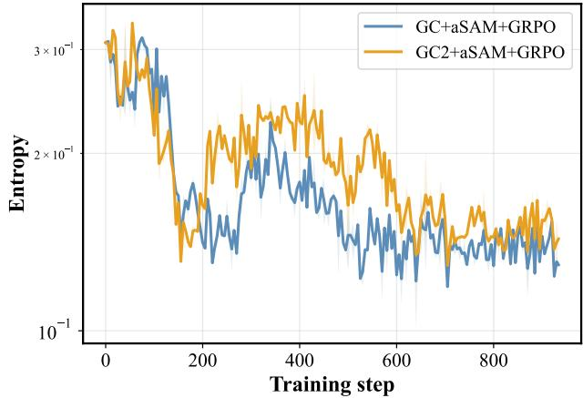  
Figure 6. Training entropy curves on GSM8K with Qwen2.5-0.5B-Instruct: SAM with Gradient Centralization (GC) applied at both the ascent and descent steps (GC2+aSAM+GRPO) versus only at the ascent step (GC+aSAM+GRPO). Applying GC before the descent step substantially mitigates entropy collapse compared to the ascent-only variant.

signal needed to discover rare correct trajectories when the success rate is high.

In practice, the focal weight itself is computed from the per-batch success rate,

$$
\hat { p } _ { \mathrm { m e a n } } = \frac { \hat { X } } { \hat { N } } ,\tag{44}
$$

where $\hat { N }$ is the training batch size and $\hat { X }$ is the number of correct samples within the batch.

## B.2. Gradient Centralization

Applying Gradient Centralization before SAM’s ascent step is known to reduce gradient variance, thereby suppressing noise and improving the quality of sharpness estimation (Hassan et al., 2025). This property is particularly well suited to the group-relative RLVR setting, where sparse rewards and high-variance advantage estimates are inherent (Teng et al., 2026; Wang et al., 2026a). We therefore apply Gradient Centralization before the ascent step, providing a more reliable perturbation direction for SAM in the RLVR setting.

Specifically, let the weight matrix of a particular layer be $\dot { W } \in \mathbb { R } ^ { M \times N }$ , and let $w _ { i }$ denote the i-th row vector of W. Then we can define the following:

$$
\nabla _ { G C } J ( w _ { i } ) = \nabla J ( w _ { i } ) - \mu ,\tag{45}
$$

where $\begin{array} { r } { \mu = { \frac { 1 } { n } } \sum _ { j = 0 } ^ { n - 1 } \nabla J ( w _ { i j } ) } \end{array}$ and J is the objective function.

In addition, we further apply Gradient Centralization before SAM’s descent step to reduce the gradient norm. Yong et al.

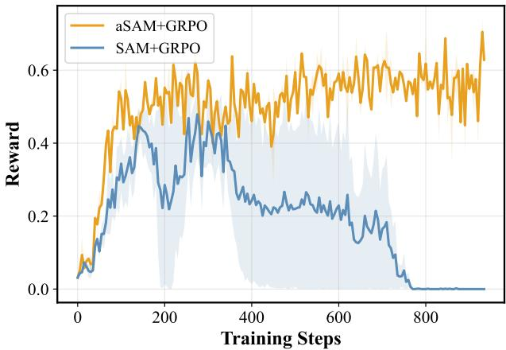  
Figure 7. Training reward curves on GSM8K with Qwen2.5-0.5B-Instruct: SAM with cosine annealing (aSAM + GRPO) versus without (SAM + GRPO) (i.e., periodic-SAM without cosine annealing). Without annealing, the training reward collapses to zero, halting effective learning.

(2020) shows that the norm of the projected gradient $\nabla _ { \mathrm { G C } }$ admits the following bound:

$$
\begin{array} { r l } & { \| \nabla _ { \mathrm { G C } } J ( W ) \| _ { 2 } ^ { 2 } = \big ( P \nabla J ( W ) \big ) ^ { \top } P \nabla J ( W ) } \\ & { \qquad = \nabla J ( W ) ^ { \top } \big ( I - e e ^ { \top } \big ) \nabla J ( W ) } \\ & { = \| \nabla J ( W ) \| _ { 2 } ^ { 2 } - \| e ^ { \top } \nabla J ( W ) \| _ { 2 } ^ { 2 } \leq \| \nabla J ( W ) \| _ { 2 } ^ { 2 } . } \end{array}\tag{46}
$$

where $P = I - e e ^ { \top }$ is the projection matrix and $\textstyle e = { \frac { 1 } { \sqrt { n } } } \mathbf { 1 } \in$ $\mathbb { R } ^ { n }$ is the unit vector with all components equal.

Reducing the gradient norm is known to bias the optimizer toward flat minima, thereby improving model generalization (Zhao et al., 2022). When combined with SAM, this property further enhances the model’s exploration ability: as shown in Figure 6, applying GC before the descent step yields substantially less entropy collapse than the variant without it. Note that both variants already applied SAM-n and Cosine Annealing. Full training details are deferred to Appendix F.

## B.3. Annealing SAM ρ

For training stability, we adopt a cosine annealing schedule (Loshchilov & Hutter, 2017) that gradually decays SAM’s hyperparameter ${ \bf \rho } _ { \rho }$ over the course of training. Concretely, ρ at step t follows

$$
\rho _ { t } = \rho _ { \mathrm { m i n } } + { \textstyle { \frac { 1 } { 2 } } } \left( \rho _ { \mathrm { i n i t } } - \rho _ { \mathrm { m i n } } \right) \left( 1 + \cos \left( { \frac { T _ { \mathrm { c u r } } } { T } } \pi \right) \right)\tag{47}
$$

where $\rho _ { \mathrm { i n i t } }$ and $\rho _ { \mathrm { m i n } }$ denote the initial and minimum values of $\rho ,$ respectively, and $T _ { \mathrm { c u r } }$ and $T$ denote the current and total numbers of training steps. By smoothly decaying $\rho$ as training progresses, cosine annealing gradually attenuates the influence of the perturbation. In the early phase of training, this prevents entropy collapse driven by overfitting to the training data, while in the later phase it promotes stable convergence.

Figure 7 illustrates why this annealing is essential: without it, the training reward collapses to zero midway through training, halting effective learning. Gradually decaying ρ is thus necessary for stable convergence in the later training phase. Full training details are deferred to Appendix F.

## C. Ablation Study

This appendix quantifies the individual contribution of each strategy introduced in Section 5. We conduct a systematic ablation on Qwen2.5-Math-1.5B with same environments of main results. Only difference stems from the application of each strategy. Full training details are in Appendix F.

Table 9 reveals a clear gain per each strategy:

• Just naively applicating SAM in RLVR can improve reasoning capacity (+1.5), but sacrificing much of accuracy (-5.4) compared with GRPO.

• Cosine Annealing strategy gradually decays the SAM’s perturbation radius, which make training process more stable in terms of accuracy (+4.0) compared with GRPO+SAM.

• Gradient Centralization strategy subtracts the gradient norm before ascent/descent step, thereby promoting stable (+1.8) and diversity (+0.1) compared with GRPO+SAM.

• Focal Weight strategy decays the radius of perturbation according to the success rate in group. It promotes stable training process (+5.7) reducing the amount of radius if success rate is low and diversity (+1.2) almost not decaying if success rate is high compared with GRPO+SAM.

In short, flatness-aware optimization can work itself for improving pass@k reasoning coverage, requiring some strategies for stablizing training process and amplifying its effect to some extent.

## D. The lightweight approximation for Memory Efficiency.

We adopt a lightweight approximation for applying SAM in RLVR; cache only the scalar norm of the original gradient, recompute a second perturbation $\epsilon ^ { * }$ at the perturbed parameters $\theta + \epsilon$ . Concretely, by the definition of SAM, the two perturbations computed during this procedure are

Table 9. Additive Ablation Study on mathemathic benchmarks. We fix periodic calculation (SAM) and add each strategy separately; Cosine Annealing (Anne.), Gradient Centralization (GC), and Focal Weight (F), reporting Pass@1/Pass@256 at each stage. Avg.: average Pass@1/Pass@256. ↑ & ↓: the change Pass@1/Pass@256 relative to the naive GRPO.
<table><tr><td>Method |</td><td>Avg.</td><td>MATH500</td><td>AMC23</td><td>AIME24</td><td>AIME25</td><td>AIME26</td></tr><tr><td>GRPO</td><td>| 15.2/63.1</td><td>34.6/73.0</td><td>28.8/92.5</td><td>6.4/63.3</td><td>2.8/43.3</td><td>3.3/43.3</td></tr><tr><td> $\mathrm { G R P O } + \mathrm { S A M }$ </td><td> $9 . 8 \downarrow 5 . 4 / 6 4 . 6 \uparrow 1 . 5$ </td><td>22.5/73.0</td><td>18.8/100</td><td>4.2/63.3</td><td>1.6/46.7</td><td>2.1/40.0</td></tr><tr><td> $\mathrm { G R P O } + \mathrm { S A M } + \mathrm { A n n e } .$ </td><td> $1 3 . 8 \downarrow 1 . 4 / 6 5 . 5 \uparrow 2 . 4$ </td><td>30.7/72.4</td><td>26.7/95.0</td><td>5.8/60.0</td><td>2.4/53.3</td><td>3.3/46.7</td></tr><tr><td> $\mathrm { G R P O } + \mathrm { S A M } + \mathrm { G C }$ </td><td> $1 1 . 6 \downarrow 3 . 6 / 6 4 . 7 \uparrow 1 . 6$ </td><td>25.8/72.8</td><td>22.5/97.5</td><td>4.4/56.7</td><td>2.3/50.0</td><td>3.1/46.7</td></tr><tr><td> $\mathrm { G R P O } + \mathrm { S A M } + \mathrm { F }$ </td><td> $1 5 . 5 \uparrow 0 . 3 / 6 5 . 8 \uparrow 2 . 7$ </td><td>35.1/71.6</td><td>28.8/97.5</td><td>7.2/66.7</td><td>2.6/46.7</td><td>3.9/46.7</td></tr><tr><td>Flat-GRPO 一</td><td> $1 5 . 0 \downarrow 0 . 2 / 6 7 . 5 \uparrow 4 . 4$ </td><td>33.9/72.4</td><td>27.7/95.0</td><td>7.1/66.7</td><td>2.8/50.0</td><td>3.4/53.3</td></tr></table>

$$
\epsilon = \rho { \frac { \nabla J ( \theta ) } { \| \nabla J ( \theta ) \| } } , \qquad \epsilon ^ { * } = \rho { \frac { \nabla J ( \theta + \epsilon ) } { \| \nabla J ( \theta ) \| } } .\tag{48}
$$

A first-order Taylor expansion of the gradient at the perturbed point yields

$$
\nabla J ( \theta + \epsilon ) = \nabla J ( \theta ) + H \epsilon + \mathcal { O } ( \rho ^ { 2 } ) \approx \nabla J ( \theta ) + \mathcal { O } ( \rho ) ,\tag{49}
$$

where $H : = \nabla ^ { 2 } J ( \theta )$ is the Hessian. Substituting this expansion into the expression for $\epsilon ^ { * }$ gives

$$
\epsilon ^ { * } \approx \epsilon + \mathcal { O } ( \rho ^ { 2 } ) \approx \epsilon .\tag{50}
$$

Hence, for sufficiently small $\rho \left( \mathbf { e . g . } , \rho \leq 0 . 0 1 \right)$ , this approximation is tight, and SAM can be applied by caching only a single scalar—virtually no additional spatial cost.

## E. Further Results

## E.1. All Pass@K curves

Figure 8 reports the per-benchmark Pass@K curves for all five benchmarks (MATH500, AMC23, AIME24, AIME25, AIME26) on both backbones, from $K = 1$ to $K = 2 5 6$ complementing the aggregated results in Section 6.2.

## E.2. Solvable-problem coverage

For each problem, we utilize the per-problem correctness rate computed during the Pass@K evaluation in Section 6.2, where each problem is sampled $n = 2 5 6$ times. We define a problem as solvable by a given model if at least one of its n sampled completions is correct. For each base–RL pair, every problem is then assigned to one of four categories according to whether it is solvable by the base model and by the RL-tuned model: solvable by both, by the base model only (forgotten), by the RL-tuned model only (newly solved), or by neither. The reported percentages are the fraction of problems in each category, averaged across all benchmarks.

## F. Experimental details

## F.1. Full Training Details

All methods are trained with a token-level loss function, and the GRPO variants are implemented following the official guidelines of the TRL framework (von Werra et al., 2020). Qwen2.5-Math-1.5B is trained on 5× NVIDIA Quadro RTX 8000 GPUs; Llama-3.2-1B-Instruct on a single Quadro RTX 8000; Qwen2.5-0.5B-Instruct on a single NVIDIA GeForce RTX 5070 Ti; Qwen2.5-3B-Instruct and Qwen2.5-Coder-1.5B-Instruct on a single NVIDIA A100. The full set of hyperparameters is summarized in Table 12.

## F.2. Full Training Details: Flat-RLVR

For training the models in Flat-RLVR Framework, we decay the SAM hyperparameter ρ and use the lightweight approximation for memory efficiency. Additional details are in Appendix D and Appendix B.3. The full set of hyperparameters for $\mathrm { E 1 a t - R L V R }$ is summarized in Table 11.

Note that $\rho _ { \mathrm { m i n } } ^ { \mathrm { f o c a l } }$ acts as a lower bound on the perturbation radius after focal-weight modulation, ensuring that the perturbation retains a non-trivial effect even when the focal weight becomes small.

## F.3. Full Training Details: F-GRPO

We implement F-GRPO following the official formulation of Plyusov et al. (2026). For each prompt x, we compute the empirical success rate ${ \hat { \mu } } _ { \mathrm { p o s } } ( x )$ over its group of rollouts and scale the group-relative advantage by the Focal weight $g ( x ) = ( 1 - \hat { \mu } _ { \mathrm { p o s } } ( x ) ) ^ { \gamma }$ , which down-weights updates on high-success prompts to preserve solution diversity. Following the original work, we set $\gamma = 1$ and keep all other hyperparameters identical to the GRPO baseline.

## F.4. Evaluation Protocol

We compute the Pass@K metric following Chen et al. (2021):

$$
{ \mathrm { P a s s @ } } k : = \mathbb { E } { \mathrm { P r o b l e m s } } \left[ 1 - { \frac { { \binom { n - c } { k } } } { { \binom { n } { k } } } } \right] ,\tag{51}
$$

Table 10. Full per-benchmark solvable-problem coverage (%) for the base–RL pairs on both backbones. Each row is a category defined by whether the base model and the RL-tuned model solve a problem (✓) or not (×): (✓/×) counts problems the RL stageforgets, and (×/✓) counts problems it newly solves. Averages correspond to Table 1 in the main text.
<table><tr><td>Backbone</td><td>Base</td><td>RL</td><td>MATH500</td><td>AMC23</td><td>AIME24</td><td>AIME25</td><td>AIME26</td><td>Avg.</td></tr><tr><td colspan="2">Qwen2.5-Math-1.5B</td><td colspan="8">(Base vs. GRPO)</td></tr><tr><td>Qwen2.5</td><td>√</td><td>V</td><td>71.2</td><td>87.5</td><td>53.3</td><td>43.3</td><td>33.3</td><td>57.7</td></tr><tr><td></td><td>√</td><td>X</td><td>0.6</td><td>7.5</td><td>6.7</td><td>10.0</td><td>6.7</td><td>6.3</td></tr><tr><td></td><td>X</td><td>√</td><td>1.8</td><td>5.0</td><td>10.0</td><td>0.0</td><td>10.0</td><td>5.4</td></tr><tr><td></td><td>X</td><td>X</td><td>26.4</td><td>0.0</td><td>30.0</td><td>46.7</td><td>50.0</td><td>30.6</td></tr><tr><td colspan="2">Qwen2.5-Math-1.5B</td><td colspan="8">(Base vs. Flat-GRPO)</td></tr><tr><td>Qwen2.5</td><td>√</td><td>√</td><td>70.8</td><td>95.0</td><td>56.7</td><td>43.3</td><td>40.0</td><td>61.2</td></tr><tr><td></td><td>√</td><td>X</td><td>1.0</td><td>0.0</td><td>3.3</td><td>10.0</td><td>0.0</td><td>2.8</td></tr><tr><td></td><td>X</td><td>√</td><td>1.6</td><td>0.0</td><td>10.0</td><td>6.7</td><td>13.3</td><td>6.3</td></tr><tr><td></td><td>X</td><td>X</td><td>26.6</td><td>5.0</td><td>30.0</td><td>40.0</td><td>46.7</td><td>29.7</td></tr><tr><td colspan="9">LLaMA-3.2-1B-Instruct (Base vs. GRPO)</td></tr><tr><td>LLaMA3.2</td><td>√</td><td>V</td><td>58.4</td><td>87.5</td><td>26.7</td><td>3.3</td><td>13.3</td><td>37.8</td></tr><tr><td></td><td>√</td><td>X</td><td>2.0</td><td>2.5</td><td>16.7</td><td>10.0</td><td>3.3</td><td>6.9</td></tr><tr><td></td><td>X</td><td>√</td><td>7.2</td><td>5.0</td><td>10.0</td><td>20.0</td><td>10.0</td><td>10.4</td></tr><tr><td></td><td>X</td><td>X</td><td>32.4</td><td>5.0</td><td>46.7</td><td>66.7</td><td>73.3</td><td>44.8</td></tr><tr><td colspan="9">LLaMA-3.2-1B-Instruct (Base vs. Flat-GRPO)</td></tr><tr><td>LLaMA3.2</td><td>√</td><td>√</td><td>56.4</td><td>87.5</td><td>30.0</td><td>6.7</td><td>13.3</td><td>38.8</td></tr><tr><td></td><td>√</td><td>X</td><td>4.0</td><td>2.5</td><td>13.3</td><td>6.7</td><td>3.3</td><td>6.0</td></tr><tr><td></td><td>X</td><td>√</td><td>8.0</td><td>5.0</td><td>13.3</td><td>20.0</td><td>10.0</td><td>11.3</td></tr><tr><td></td><td>X</td><td>X</td><td>31.6</td><td>5.0</td><td>43.3</td><td>66.7</td><td>73.3</td><td>44.0</td></tr></table>

Table 11. Training hyperparameters for Flat-RLVR.
<table><tr><td>Method</td><td>Parameter</td><td>Value</td></tr><tr><td>SAM-n</td><td>|period n</td><td>10</td></tr><tr><td>Cosine Annealing</td><td>ρinit ρmin</td><td>0.01 0.002</td></tr><tr><td>Focal Weight</td><td>γ  $\rho _ { \mathrm { m i n } } ^ { \mathrm { f o c a l } }$ </td><td>1.0 0.001</td></tr></table>

where n is the total number of generated samples per problem and c is the number of correct samples among them. We set $n = 2 5 6$ for all benchmarks and report from Pass@1 to Pass@256. For MATH500 and AMC23, we set the completion length to 1024 tokens, matching the training-time setting; for the AIME family of benchmarks, we extend it to 2048 tokens to accommodate the longer reasoning chains required by these problems. For GSM8K, we use a completion length of 192 tokens, again matching training.

Across all benchmarks, we use a single, uniform system prompt: “Please reason step by step, and put your final answer within \boxed{}.”

## F.5. Licenses

Datasets. GSM8k (Cobbe et al., 2021) is released under the MIT License. MATH (Hendrycks et al., 2021) and its 500-problem subset MATH500 (Lightman et al., 2024) are released under the MIT License. AIME24, AIME25, and

AIME26 are sourced from math-ai $/ \mathsf { a i m e } 2 4 ^ { 1 }$ (Zhang & Math-AI, 2024), math-ai/aime252 (Zhang & Math-AI, 2025), and math-ai/aime $2 6 ^ { 3 }$ (Zhang & Math-AI, 2026), released under the Apache License 2.0. AMC23 is sourced from math-ai/amc234; no explicit license is specified for these datasets. MBPP is sourced from google-research/mbpp5 (Austin et al., 2021); no explicit license is specified for these datasets.

Models. Qwen2.5-Math-1.5B, Qwen2.5-0.5B-Instruct, and Qwen2.5-Coder-1.5B-Instruct (Hui et al., 2024; Yang et al., 2024a) are released under the Apache License 2.0. Qwen2.5-3B-Instruct (Team, 2024; Yang et al., 2024a) is released under the Qwen Research License6. Llama-3.2- 1B-Instruct (Grattafiori et al., 2024) is released under the Llama 3.2 Community License7.

Table 12. Full training hyperparameters for all models and methods.
<table><tr><td>Parameter</td><td>Qwen2.5-Math-1.5B</td><td>Llama-3.2-1B-Instruct</td><td>Qwen2.5-0.5B-Instruct</td><td>Qwen2.5-3B-Instruct</td><td>Qwen2.5-Coder-1.5B-Instruct</td></tr><tr><td>Optimizer</td><td></td><td></td><td>AdamW</td><td></td><td></td></tr><tr><td>(β1, β2)</td><td></td><td></td><td>(0.9,0.999)</td><td></td><td></td></tr><tr><td>Weight decay</td><td></td><td></td><td>0.01</td><td></td><td></td></tr><tr><td>Learning rate</td><td></td><td></td><td>1 × 10−6</td><td></td><td></td></tr><tr><td>LR scheduler</td><td></td><td></td><td>Linear</td><td></td><td></td></tr><tr><td>Num. generations (G)</td><td></td><td></td><td>6</td><td></td><td></td></tr><tr><td>PPO epochs</td><td></td><td></td><td>1</td><td></td><td></td></tr><tr><td>KL coefficient</td><td></td><td></td><td>0</td><td></td><td></td></tr><tr><td>Sampling temperature</td><td></td><td></td><td>1.0</td><td></td><td></td></tr><tr><td>(top-p, top-k)</td><td></td><td></td><td>(1.0,0)</td><td></td><td></td></tr><tr><td>Global batch size</td><td>180</td><td>72</td><td>96</td><td>180</td><td>18</td></tr><tr><td>Grad. accum. steps</td><td>9</td><td>18</td><td>6</td><td>9</td><td>18</td></tr><tr><td>Per-device batch size</td><td>4</td><td>4</td><td>16</td><td>4</td><td>1</td></tr><tr><td>Training epochs</td><td>2</td><td>3</td><td>2</td><td>2</td><td>5</td></tr><tr><td>Max length</td><td>1024</td><td>1024</td><td>192</td><td>1024</td><td>512</td></tr></table>

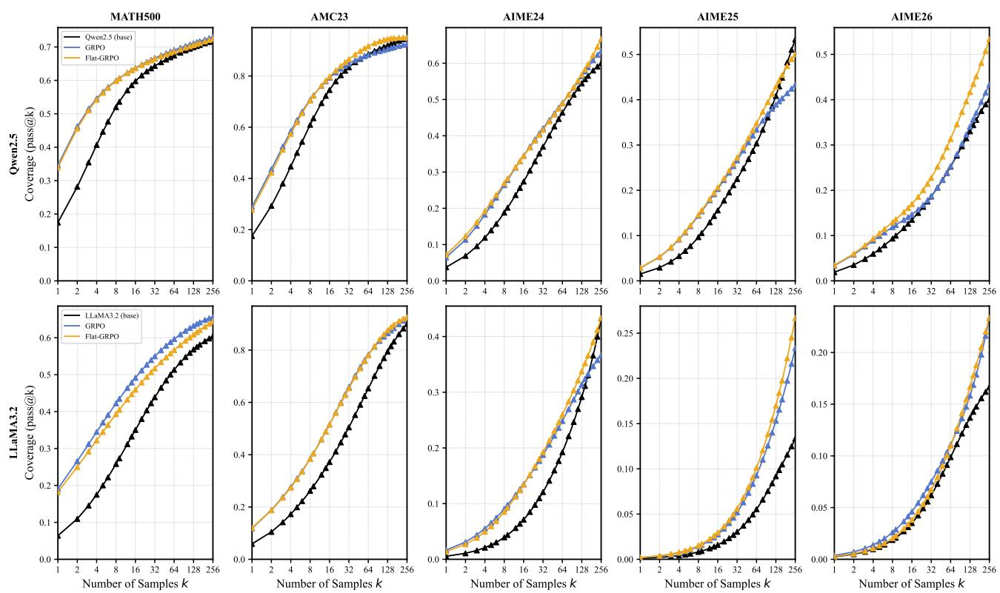  
Figure 8. Pass@K curves on all in-domain benchmarks (MATH500, AMC23, AIME24, AIME25, AIME26), comparing the base model, GRPO, and Flat-GRPO (ours) from K = 1 to K = 256. Top row: Qwen2.5-Math-1.5B; bottom row: Llama-3.2-1B-Instruct.