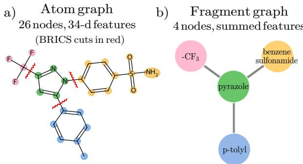
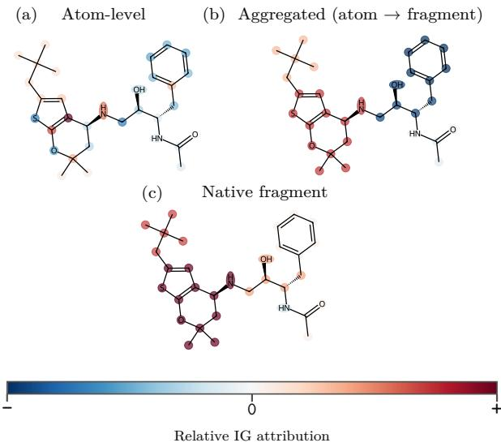
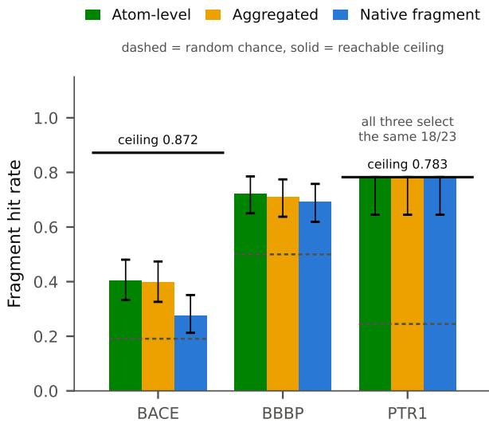
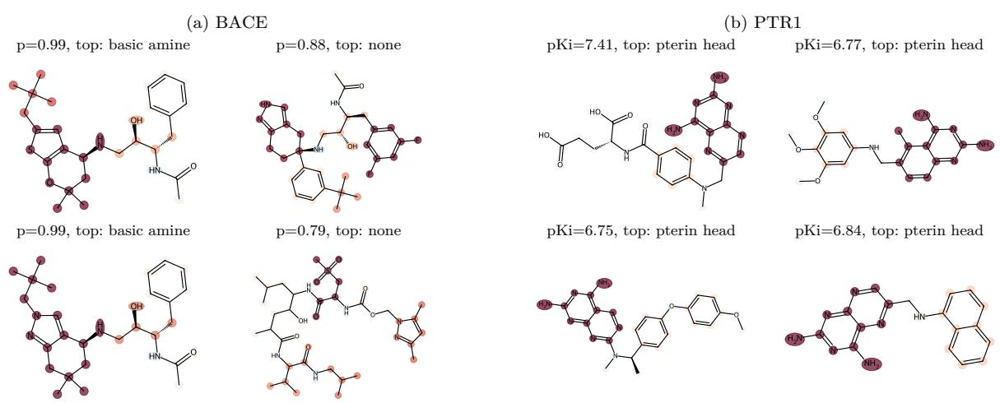

# Fragment-Level Graph Encoding for Interpretable Molecular Property Prediction

Rafael Lopes Almeida1 and Ina P¨ohner∗1

1School of Pharmacy, University of Eastern Finland, 70211 Kuopio, Finland {rafael.lopes, ina.pohner}@uef.fi

## Abstract

Graph neural networks (GNNs) are among the standard tools for molecular property prediction, but the atom-level explanations of their predictions are hard for medicinal chemists to act on. We propose a change of input representation rather than a new model: molecules are encoded as fragmentlevel graphs from BRICS decomposition, where each node is a synthetically meaningful fragment whose features are the element-wise sum of its atoms’ features. Because only the representation changes, any message-passing GNN and any post-hoc attribution method produces explanations at the resolution of functional groups instead of single atoms. Across four architectures, four prediction tasks, and two explainers under scafold splits, fragment-level encoding matches atom-level test accuracy on roughly fivefold smaller graphs. Integrated-Gradients attributions recover known pharmacophores above chance on two enzyme targets, namely BACE at 1.5 times the chance rate, and PTR1 at 3.2 times. A like-forlike comparison against an aggregated atom-level baseline shows that post-hoc aggregation is not a stable substitute: its BACE hit rate range both exceeds and falls below the fragment model’s hit rate depending on two arbitrary aggregation choices, whereas fragment-level training yields a single conventionfree attribution at no predictive cost. The code is available at: https://github.com/4D-Lab/frame

## 1 Introduction

Molecular property prediction in drug discovery supports computational prioritization of compounds before committing costly synthesis and assay resources. Graph neural networks (GNNs) have become a popular choice because they operate directly on the molecular graph and learn structural features tied to biological activity [1, 2], reaching state-of-the-art performance on MoleculeNet benchmarks [3].

However, these models are still largely uninterpretable. When a model flags a molecule as active, a medicinal chemist wants to understand why, and which parts of the molecule drive it, not only whether the prediction is right. Post-hoc methods such as Integrated Gradients (IG) [4], GNNExplainer [5], and attention-based attribution [6] assign importance to individual atoms and bonds. The dificulty is one of resolution: chemists reason in functional groups, pharmacophores, and ring systems [7], so an atom heatmap that ranks carbon 14 above carbon 12 gives little to act on during lead optimization. Fragmentbased drug design already assembles and optimizes molecules at the fragment/building block level [7, 8]. Explanations at that same resolution would thus speak the language chemists already use.

We close this gap with a molecular graph encoding built from BRICS decomposition [9]. BRICS (Breaking of Retrosynthetically Interesting Chemical Substructures) applies sixteen retrosynthetically motivated rules that cleave bonds at known synthetic disconnections, so the resulting fragments are both chemically meaningful and synthetically accessible. In our encoding, each BRICS fragment is a single node whose feature vector is the element-wise sum of its atoms’ features, and inter-fragment edges mark the cleavage sites. The graph shrinks from dozens of atom nodes to a handful of fragment nodes while keeping the original feature information, and the granularity of any attribution method rises from atoms to interpretable substructures.

The contribution is a change in data representation, not a new architecture or a new explainer. Swapping atom-level graphs for fragmentlevel graphs coarsens the graph and re-expresses GNN explanations over chemically meaningful units, with no architectural modifications, custom explainers, or extra training objectives, and it drops into an existing pipeline as a preprocessing step. We evaluate four architectures to demonstrate that the behavior holds across diferent message-passing strategies, and two mechanistically diferent explainers to probe whether it is an artifact of one attribution method. Our contributions are:

1. A BRICS fragment-level graph encoding that lifts GNN explanation resolution from atoms to synthesizable substructures, with no change to the model or the explainer, usable as a drop-in preprocessing step.

2. A quantitative evaluation protocol that pairs predictive metrics with three explanation metrics (fragment hit rate against known pharmacophores, attribution concentration, and crossexplainer agreement), all under scafold splits, including an aggregated atom-level control that isolates the representation change from post-hoc aggregation.

3. Evidence across four prediction tasks, four architectures, and two explainers that fragment encoding preserves predictive accuracy on far smaller graphs and recovers known pharmacophores above chance, while delineating where it helps (localized drug target interactions) and where it does not (a globally driven property).

## 2 Background & Related Work

GNNs for molecular property prediction. GNN-based prediction methods have grown quickly since message passing was introduced for quantum chemistry [1]. The main families difer in how they aggregate neighbor information: Graph attention (GAT) learns attention over neighbors [6], with GATv2 removing a static-attention limitation [10]. Graph isomorphism networks (GINs) maximize discriminative power in the Weisfeiler–Leman hierarchy through sum aggregation [11]. Principal Neighborhood Aggregation (PNA) combines several aggregators with degree-based scalers to overcome the limits of any single aggregator [12], and AttentiveFP adds graph-level attention pooling tailored to molecules [13]. All assume atoms are nodes and bonds are edges.

Molecular representations and fragmentlevel methods. The standard molecular graph places each atom as a node and each bond as an edge [2, 3]. Alternatives include fingerprints [14], SMILES-based models [15], and 3-D encodings [16]. Fragment-level representations have drawn interest for both prediction and generation: FragNet uses separate message-passing channels for atoms, bonds, fragments, and inter-fragment links [17]. Fragment biases improve expressivity and generalization [18], and subgraph-conditioned information-bottleneck pretraining learns fragment-aware representations [19]. These share the intuition that fragments carry useful signal but also share a requirement for custom architecture or modified message passing. Our approach stays at the representation level and feeds unmodified architectures, so it requires no change to an existing training pipeline.

Interpretability: the two closest works. Substructure mask explanation (SME) segments molecules with BRICS, Murcko, and functionalgroup rules, then explains an atom-level GNN by masking each substructure and measuring the change in prediction [20]. It is a post-hoc technique on a model trained with standard atom-level graphs.

SEAL instead modifies the GNN to reduce interfragment message passing, yielding more causally faithful fragment attributions [21].

Our method difers from both in where it intervenes: we change the input representation rather than applying post-hoc masking (unlike SME) or altering the architecture (unlike SEAL), so it works with any architectures and any attribution method. The aggregated atom-level baseline in Section 3.4 is an SME-style control that tests whether the representation change adds anything compared to post-hoc aggregation.

Explainability methods and evaluation. Post-hoc GNN explainers fall into gradient-, perturbation-, and decomposition-based families [4, 5, 22–24]. Applied to molecular GNNs, IG can highlight features consistent with known pharmacophores [25], and quantitative studies find that gradient methods tend to give the most reliable atomlevel attributions [26, 27]. Because our contribution is orthogonal to the choice of explainer, we run two mechanistically diferent methods: Integrated Gradients (IG, gradient-based) and GNNExplainer (perturbation-based).

Scafold splits. Random splits let structurally similar molecules land on both sides of the train/test boundary and inflate generalization estimates [2, 28]. Murcko scafold splits [29] keep molecules sharing a core ring system together, forcing generalization across scafold boundaries. They remain generous relative to truly dissimilar test sets [30] but are the standard proxy for novelty-based evaluation, and all experiments herein use them.

## 3 Method

## 3.1 Fragment-level graph construction

Atom-level baseline. Each molecule is a graph with atoms as nodes and bonds as edges. Node features are a 34-dimensional vector: element one-hot (10), degree (6), formal charge (1), radical electrons (1), hybridization (7), aromaticity (1), total hydrogen count (5), chirality flag (1), and CIP stereochemistry (2). Edge features are 10-dimensional: bond type (4), conjugation (1), ring membership (1), and stereochemistry (4). Graphs are built from SMILES with RDKit [31].

Fragment-level graph. Each molecule is decomposed with BRICS as implemented in RDKit, which makes the decomposition deterministic. Given atom feature vectors $x _ { i } \in \mathbb { R } ^ { 3 4 }$ , the fragment node feature is the element-wise sum over the atoms assigned to fragment f:

$$
h _ { f } = \sum _ { i \in f } x _ { i } ,\tag{1}
$$

The procedure is: (1) find BRICS-cleavable bonds, (2) break them without adding dummy atoms, (3) map each atom to its resulting fragment, (4) sum atom features per fragment as in Eq. (1), (5) add an undirected edge between two fragments for each cleaved bond, and (6) give every fragment–fragment edge the same constant scalar attribute, so that no bond-type information enters the fragment graph.

Sum aggregation, rather than mean or max, keeps sensitivity to fragment size, a real chemical distinction. Inter-fragment edges are uniform because the chemistry of the connection is already captured by the BRICS rules. Molecules with no BRICScleavable bonds cannot be decomposed and are excluded, and the exclusion rate is reported per dataset (Section 4.1). Figure 1 illustrates the construction: a drug-like molecule with 20–40 heavy atoms becomes a graph of roughly 4–8 nodes, so there are fewer message-passing operations and fewer attribution targets, each a recognizable substructure.

  
Figure 1. Atom-level versus BRICS fragment-level graph construction for celecoxib. (a) The atom graph: every atom is a node (26 nodes, 34-dimensional features) and every bond an edge, with nodes ringed and coloured by BRICS fragment and cut bonds in red. (b) The fragment-level graph (4 fragment nodes with elementwise summed features), each node a recognizable substructure.

## 3.2 Data splitting

All datasets use a Murcko scafold split at 80/10/10. Molecules sharing a Bemis–Murcko scafold [29] were always assigned to the same split. Scafold groups are sorted largest-first and assigned in turn. The procedure is deterministic and prevents scafold leakage. Random splits were avoided because they inflate generalization by placing similar molecules on both sides of the boundary [2].

## 3.3 Architectures and training

Four architectures were tested to evaluate whether the encoding works regardless of the message passing approach, not to find a ’winner’: AttentiveFP with graph-level attention pooling [13], GAT/GATv2 with attention and edge features [6, 10], PNA combining multiple aggregators with degree scalers [12], and GIN with learnable epsilon, sum aggregation, and batch normalization in each multilayer perceptron [11]. Graph-level predictions come from global pooling of the final node embeddings followed by a single output unit. The training pipeline is identical for both encodings, so any diference is attributable to the representation alone: Lookahead [32] over Adam [33] with a cosine schedule and warmup [34], class-weighted loss for classification and mean squared error (MSE)/Huber for regression, edge-dropout and feature-masking augmentation, and early stopping on the validation metric. Reported test metrics are the mean ± standard deviation of the winning configuration retrained across five seeds. Hyperparameters are tuned with Optuna’s TPE sampler [35] (150 trials per experiment). Search spaces and best configurations are in Appendices A–B.

## 3.4 Explainability and its evaluation

Attribution methods. We use two mechanistically diferent methods so findings do not hinge on one technique. IG [4], via Captum [36], integrates the output gradient along a straight-line path from a zero baseline to the input. GNNExplainer [5], via Py-Torch Geometric, learns a soft node/edge mask that maximizes mutual information with the prediction. For both methods and encodings, per-node attribution vectors are reduced to scalar scores by summing over feature dimensions. In the fragment-level case each score maps to a recognizable substructure.

Aggregated atom-level baseline. An obvious question is whether fragment-level graphs are needed at all: one could train an atom-level GNN, compute atom attributions, and sum them per fragment. This baseline is implemented directly with the same architecture and training, so comparing it against the native fragment-level model isolates whether the representation change, rather than the aggregation step, drives any improvement. This is the SME-style control of Section 2. Aggregation is not uniquely defined, so we report all four combinations of two choices: summing signed attributions (the default, under which opposing atom contributions cancel each other) or their magnitudes, each either unnormalized (rewarding large fragments) or divided by the fragment’s atom count. The native fragment model needs no such choice.

Quantitative metrics. Beyond qualitative maps we compute three metrics over the test set. The fragment hit rate (plausibility) is the fraction of molecules whose top-attributed fragment belongs to a pharmacophorically relevant class defined per target from published structure–activity relationships (SAR). Class membership is decided on the intact molecule: each SMARTS pattern is matched against the parent structure, and a fragment is credited with a class when all atoms of a match fall inside it. Matching the fragment in isolation would give a wrong answer, because breaking a bond frees a valence that RDKit refills with hydrogen, causing hydrogen-count-sensitive patterns to match an artificial atom environment. Appendix E quantifies the efect. A class label therefore attests that a fragment carries a recognition element drawn from published SAR, not that the fragment is itself a published pharmacophore around which a chemical series was designed. For BBBP (blood brain barrier penetration), which has no localized pharmacophore, we use a directional criterion based on topological polar surface area (TPSA; a BBB+ prediction should attribute to a low-TPSA fragment, BBB- to a high-TPSA one), with the fragment’s TPSA summed from the parent molecule’s per-atom contributions for the same reason.

Attribution concentration (compactness) asks whether an explanation points at anything in particular. Every attribution method returns one number per unit, and those numbers can be sharp or flat. When all of a molecule’s fragments receive similar scores, the map says only that everything matters a little, which gives a chemist nothing to act on even if each score is individually correct. When one fragment holds more of the attribution mass than the rest combined, the map names a substructure to keep or to replace. We summarize this with the Gini coeficient of the per-molecule importance vector, computed on absolute values so that a strongly negative contribution counts as informative rather than canceling a positive one. It is 0 when every unit receives an equal share and 1 when one unit holds everything. The hit rate asks whether the top-ranked fragment is chemically sensible while concentration asks whether there is a dominant fragment that drives the prediction.

Cross-explainer agreement is the per-molecule Spearman correlation between IG and GNNExplainer fragment rankings. Fragment importance is visualized as a color-coded heatmap on the 2-D structure, with every atom taking the importance of its parent fragment (Figure 2).

## 4 Experiments & Results

## 4.1 Setup

Our three prediction targets cover two distinct scenarios at once: they range from localized to globally distributed SAR, and from public benchmarks of a few thousand molecules to a few hundred data points manually compiled from the literature. One target, BACE, is used in both classification and regression settings, resulting in four prediction tasks.

  
Figure 2. Integrated Gradients (IG) attribution at three resolutions for a correctly-predicted BACE inhibitor. (a) Raw atom-level attribution is fine-grained but noisy. (b) Atom attributions aggregated into fragments (SME-style control). (c) Native fragment-level attribution concentrates on the aminothienopyran recognition element. Each panel is scaled to its own maximum.

BACE (MoleculeNet, β-secretase 1) has extensive published SAR (hydroxyethylamine transition-state mimics engaging catalytic Asp32/Asp228, hydrophobic S1/S2 groups, basic S3 amines [37, 38]), making it the sharpest test of pharmacophore recovery.

BBBP [3] labels blood–brain-barrier permeability, a property governed by global physicochemistry (lipophilicity, polar surface area) rather than a binding site [39], so it is the limiting case.

PTR1 (pteridine reductase 1 from Trypanosoma brucei, regression) is an NADPH-dependent reductase responsible for the resistance to inhibitors of the established anti-infective target dihydrofolate reductase, which makes it a co-target in human African trypanosomiasis [40, 41]. Its active site sandwiches an inhibitor ring between the nicotinamide of the cofactor and a phenylalanine of the protein [42]. The recognition elements are a 2,4-diaminopteridine, - quinazoline or -pyrimidine head hydrogen-bonding to the catalytic serine and tyrosine, the stacked aromatic ring itself, and a peripheral acidic or hydrophobic tail.

Unlike BACE and BBBP, PTR1 has no curated public benchmark. 250 compounds were manually compiled from sixteen primary medicinal-chemistry resources published between 2009 and 2022 [43–48]. Appendix G lists all 16 sources with their per-paper compound counts. We include PTR1 as a representative of the data situation in an early-stage program against a neglected-disease target: a few hundred literature measurements rather than a benchmark with little prospect of obtaining more. The evaluation is correspondingly small. Scafold splitting over

119 Bemis–Murcko scafolds, 82 of them singletons, sends every multi-member scafold group to training and leaves 25 molecules each for validation and test. Because of this, model selection is unreliable, as can be expected in a data-sparse early-stage program. Further details are provided in Appendix H.

BACE classification is roughly balanced (46% active), BBBP is skewed toward permeable compounds (76%), and the regression targets span a $\mathrm { p I C } _ { 5 0 }$ range of 2.5–10.5 (BACE) and a pKi range of $3 . 2 \mathrm { - } 1 0 . 0$ (PTR1). Table 1 summarizes the datasets. Primary metrics are the Matthews correlation coefficient (MCC) for classification and the concordance correlation coeficient (CCC) for regression [49, 50], and the full metric set is in Appendix C. Results are the best validation checkpoint evaluated on the held-out scafold test set.

Table 1. Datasets used. N is the molecule count and Scaf. the number of unique Bemis–Murcko scafolds. The two regression targets carry diferent constants: BACE is $\mathrm { p I C } _ { 5 0 }$ and PTR1 is $\mathrm { p K } _ { \mathrm { i } }$ . Graph sizes are in Table F.1.
<table><tr><td>Dataset</td><td>Task</td><td>N</td><td>Scaf.</td><td>Label</td></tr><tr><td>BACE (cls)</td><td>cls</td><td>1512</td><td>649</td><td>690/1512 pos (46%)</td></tr><tr><td>BACE (reg)</td><td>reg</td><td>1512</td><td>649</td><td> $2 . 5 4 - 1 0 . 5 2 \ ( \mu { = } 6 . 5 2 )$ </td></tr><tr><td>BBBP</td><td>cls</td><td>1965</td><td>1020</td><td>1495/1965 pos (76%)</td></tr><tr><td>PTR1</td><td>reg</td><td>250</td><td>119</td><td>3.19-10.00  $\scriptstyle \left( \mu = 5 . 6 1 \right)$ </td></tr></table>

## 4.2 Predictive performance

Tables 2 and 3 report the primary test metric (mean ± std over five training seeds) for all four architectures under both encodings, for the classification and regression targets, respectively. Fragment-level encoding is competitive with atom-level encoding throughout. On the two BACE datasets the best fragment model matches or exceeds the best atom model (0.587 vs. 0.530 MCC on classification; on regression the two are level, 0.861 vs. 0.858 CCC, a gap far inside the seed-to-seed spread that we do not read as a diference), and it leads on PTR1 (0.439 vs. 0.300 CCC), whereas the best atom model leads on BBBP (0.291 vs. 0.186 MCC).

One note is that every PTR1 configuration has a negative test $R ^ { 2 } ~ ( - 0 . 0 9 ~ \mathrm { t o } ~ - 1 . 9 1 $ ; Appendix C), so no model beats a constant predictor in squared error on 25 held-out molecules. CCC stays positive because it rewards rank-and-scale agreement rather than calibration. We therefore read the PTR1 column as a comparison between the two encodings on a common split, not as evidence that either predicts potency, and we return to the reason in Appendix H.

Aggregating over the sixteen dataset–architecture pairs, the fragment encoding wins eleven and loses five, with a mean primary-metric change of +0.037 and comparable seed-to-seed variance (mean test standard deviation 0.040 for atom and 0.045 for fragment encodings). No architecture dominates, and the atom/fragment ranking is inconsistent across architectures: GIN improves under the fragment encoding on all four datasets, while AttentiveFP is strongest at the atom level on BBBP but, on PTR1, the weakest atom-level architecture (0.267, against 0.300 for PNA) and the strongest fragment-level one (0.439). This is expected when the representation, not the architecture, is the variable of interest.

These accuracies are obtained on graphs with roughly five times fewer nodes $( 3 4 . 1  7 . 2 $ for BACE, Table F.1) at comparable training cost, cutting the number of attribution targets per explanation from dozens of atoms to a handful of substructures. BBBP is hard for every model $( \mathrm { M C C } \leq 0 . 3 0 )$ , consistent with a globally driven property.

Table 2. Classification: primary test metric (MCC) per architecture and encoding, atom (a) vs. fragment (f). Values are mean ± std over five training seeds, with the best mean per block in bold. Full metrics in Appendix C.
<table><tr><td></td><td colspan="2">BACE (cls)</td><td colspan="2">BBBP</td></tr><tr><td>Backbone</td><td>MCCa</td><td>MCCf</td><td>MCCa</td><td>MCCf</td></tr><tr><td>AttentiveFP</td><td> $0 . 5 3 0 { \scriptstyle \pm 0 . 0 7 3 }$ </td><td> $\mathbf { 0 . 5 6 5 \pm 0 . 0 5 0 }$ </td><td> $\mathbf { 0 . 2 9 1 } \pm \mathbf { 0 . 0 4 0 }$ </td><td> $0 . 1 8 6 \pm 0 . 0 4 2$ </td></tr><tr><td>GATv2</td><td> $0 . 4 3 9 \pm 0 . 0 5 7$ </td><td> $\mathbf { 0 . 5 5 2 \pm 0 . 0 5 8 }$ </td><td> $0 . 1 4 0 \pm 0 . 0 2 0$ </td><td> $\mathbf { 0 . 1 7 6 \pm 0 . 0 6 5 }$ </td></tr><tr><td>GIN</td><td> $0 . 3 8 5 \pm 0 . 0 8 7$ </td><td> $\mathbf { 0 . 4 7 6 \pm 0 . 1 0 4 }$ </td><td> $0 . 1 6 3 \pm 0 . 0 5 0$ </td><td> $\mathbf { 0 . 1 8 3 \pm 0 . 0 5 1 }$ </td></tr><tr><td>PNA</td><td> $0 . 4 5 3 \pm 0 . 0 8 5$ </td><td> $\mathbf { 0 . 5 8 7 \pm 0 . 0 3 0 }$ </td><td> $\mathbf { 0 . 1 7 5 \pm 0 . 0 2 7 }$ </td><td> $0 . 1 5 1 \pm 0 . 0 5 7$ </td></tr></table>

Table 3. Regression: primary test metric (CCC) per architecture and encoding, atom (a) vs. fragment (f). Values are mean ± std over five training seeds, with the best mean per block in bold. Full metrics in Appendix C.
<table><tr><td rowspan="2"></td><td colspan="2">BACE (reg)</td><td colspan="2">PTR1</td></tr><tr><td>CCCa</td><td>CCCf</td><td>CCCa</td><td>CCCf</td></tr><tr><td>AttentiveFP</td><td> $0 . 8 4 6 \pm 0 . 0 1 3$ </td><td> $\mathbf { 0 . 8 6 1 \pm 0 . 0 0 7 }$ </td><td> $0 . 2 6 7 \pm 0 . 0 2 7$ </td><td> $\mathbf { 0 . 4 3 9 \pm 0 . 0 3 3 }$ </td></tr><tr><td>GATv2</td><td> $\mathbf { 0 . 8 1 8 \pm 0 . 0 0 9 }$ </td><td> $0 . 8 1 4 \pm 0 . 0 3 1$ </td><td> $\mathbf { 0 . 2 6 1 \pm 0 . 0 6 1 }$ </td><td> $0 . 2 2 9 \pm 0 . 0 3 4$ </td></tr><tr><td>GIN</td><td> $0 . 7 9 7 \pm 0 . 0 0 9$ </td><td> $\mathbf { 0 . 8 0 0 \pm 0 . 0 5 6 }$ </td><td> $0 . 2 9 8 \pm 0 . 0 3 5$ </td><td> $\mathbf { 0 . 3 7 9 \pm 0 . 0 5 3 }$ </td></tr><tr><td>PNA</td><td> $\mathbf { 0 . 8 5 8 \pm 0 . 0 0 7 }$ </td><td> $0 . 8 4 5 \pm 0 . 0 1 0$ </td><td> $0 . 3 0 0 \pm 0 . 0 4 4$ </td><td> $\mathbf { 0 . 3 7 7 \pm 0 . 0 4 0 }$ </td></tr></table>

## 4.3 Explanation quality

Table 4 reports explanation quality for the three approaches on a representative architecture per target, chosen as the architecture with the highest mean primary metric across the two encodings: AttentiveFP for BACE and PTR1, GIN for BBBP.

Attributions recover pharmacophores above chance. On BACE, 19.1% of fragments belong to a pharmacophoric class, and the topattributed fragment is pharmacophoric for 28–41% of the test molecules depending on the approach (Figure 3): an enrichment of 1.5-fold for the native fragment model and 2.1-fold for atom-level attribution. The native model reaches 0.277 and, with atom attributions aggregated per fragment under the default convention, 0.399. Fragment-level attributions therefore surface medicinally meaningful substructures at dataset scale rather than only on curated examples, though the margin over chance is narrower than the raw rates suggest.

Table 4. Explanation quality by approach. Hit: fragment hit rate against known pharmacophores (BBBP: directional TPSA), with the reachable ceiling imposed by BRICS given below the BACE and PTR1 blocks. BBBP has no discrete pharmacophore and thus no ceiling. Hit∗ : the same IG hit rate normalized by that ceiling, i.e. the rate among molecules that can register a hit at all, which makes targets with diferent ceilings comparable; interval estimates for it are given in Section 3.4. The best value per dataset block is set in bold, and exact ties are left unbolded. Gini: attribution concentration, corrected by the maximum attainable at each vector length, so atom- and fragment-level values are comparable. ρIG,GX: per-molecule IG vs. GNNExplainer Spearman agreement. The aggregated row uses the default signed-sum convention, and Appendix D gives its full range.
<table><tr><td>Data</td><td>Approach</td><td>n</td><td>HitIG ↑</td><td> $\overline { { \mathrm { H i t } _ { \mathrm { I G } } ^ { * } \uparrow } }$ </td><td> $\overline { { \mathrm { { H i t } } _ { \mathrm { { G X } } } \uparrow } }$ </td><td>GiniIG ↑</td><td>GiniGx ↑</td><td> $\underline { { \rho \mathbf { I G } , \mathbf { G X } } } \uparrow$ </td></tr><tr><td>BACE</td><td>Atom-level</td><td>148</td><td>0.405</td><td>0.465</td><td>0.345</td><td>0.478</td><td>0.122</td><td>-0.029</td></tr><tr><td></td><td>Aggregated</td><td>148</td><td>0.399</td><td>0.457</td><td>0.514</td><td>0.532</td><td>0.403</td><td>0.053</td></tr><tr><td></td><td>Native frag.</td><td>148</td><td>0.277</td><td>0.318</td><td>0.480</td><td>0.518</td><td>0.282</td><td>0.330</td></tr><tr><td></td><td>reachable ceiling</td><td></td><td>0.872</td><td></td><td></td><td></td><td></td><td></td></tr><tr><td>BBBP</td><td>Atom-level</td><td>166</td><td>0.723</td><td></td><td>0.741</td><td>0.258</td><td>0.075</td><td>0.155</td></tr><tr><td></td><td>Aggregated</td><td>166</td><td>0.711</td><td></td><td>0.723</td><td>0.455</td><td>0.434</td><td>0.812</td></tr><tr><td></td><td>Native frag.</td><td>166</td><td>0.693</td><td></td><td>0.711</td><td>0.484</td><td>0.249</td><td>0.270</td></tr><tr><td>PTR1</td><td>Atom-level</td><td>23</td><td>0.783</td><td>1.000</td><td>0.739</td><td>0.751</td><td>0.157</td><td>0.486</td></tr><tr><td></td><td>Aggregated</td><td>23</td><td>0.783</td><td>1.000</td><td>0.783</td><td>0.848</td><td>0.564</td><td>0.688</td></tr><tr><td></td><td>Native frag.</td><td>23</td><td>0.783</td><td>1.000</td><td>0.783</td><td>0.732</td><td>0.324</td><td>0.837</td></tr><tr><td></td><td>reachable ceiling</td><td></td><td>0.783</td><td></td><td></td><td></td><td></td><td></td></tr></table>

A per-class breakdown shows what limits these numbers. A fragment can only be credited with a motif that fits inside it, so the metric is bounded by what the decomposition leaves whole. On the BACE test split, the hydroxyethylamine transitionstate mimic, the pharmacophore a chemist would name first, is present in 52% of the molecules and lands inside a single fragment in none of the 148, because it spans a bond BRICS breaks during construction. The benzylic S2 class survives in 21% of the cases, whereas the basic amine and the S1 alkyl class survive intact whenever they occur.

PTR1 is the counter-example, and it isolates the decomposition as the cause. Across all 239 decomposable PTR1 molecules, the pterin head is present in 34.7% and survives BRICS intact in 88.0% of those, the stacked aromatic in 18.8% and 68.9%, and both tail classes in 4.2% and 100%. On the 23-molecule test split every class that occurs survives. BRICS cleaves BACE’s defining motif by construction and leaves PTR1’s untouched, so the gap between the two targets is a property of the decomposition approach rather than of the models.

The ceilings follow: at most 0.872 of BACE and 0.783 of PTR1 test molecules can register a hit under any method. On PTR1, all three approaches reach 0.783, which matches the ceiling exactly, i.e. a ceiling-normalized rate of 1.000, against a chance rate of 0.245. Because the hit rate cannot exceed the ceiling, a Wald interval on the raw proportion is misspecified here: it is symmetric and unbounded above, and at $n = 2 3$ with the estimate on the boundary it returns [0.614, 0.951], whose upper limit lies above the 0.783 ceiling. We therefore estimate the hit rate conditional on reachability. Of the 23 test molecules 18 are reachable and all 18 are hit, so the conditional rate is 1.000 with a Wilson 95% interval of [0.824, 1.000], equivalently [0.645, 0.783] after rescaling by the ceiling. Both exclude the 0.245 chance rate, resulting in a 3.2-fold enrichment. Above-chance recovery therefore holds on both enzyme targets. However, all three approaches select the same 18 of 23 molecules, so the metric saturates rather than separating them. Appendix H gives the details and shows that the claim is robust to how the pharmacophore classes are drawn.

The encoding is agnostic to the decomposition, so the plausibility metric inherits whatever boundaries the chosen scheme imposes.

  
Figure 3. Fragment hit rate using IG by target and approach, with 95% intervals conditional on reachability: for BACE and PTR1 the interval is estimated over the molecules that can register a hit and rescaled by the ceiling, so it cannot exceed $\mathrm { i t } ;$ BBBP has no ceiling and uses a Wilson interval on the raw proportion. Dashed lines mark the random-chance rate per target, solid rules the reachable ceiling. BACE and PTR1 attributions exceed chance for all approaches. The three PTR1 bars coincide at the ceiling, where all three approaches select the same 18 of 23 molecules (Appendix H). BBBP uses the directional TPSA criterion.

Post-hoc aggregation is not a stable substitute for fragment-level training. Summing atom attributions into fragments is under-specified: it requires two choices that no theory fixes, whether to sum signed attributions or their magnitudes, and whether to normalize by fragment size. Both choices move the result. IG attributions change sign within a fragment, so a signed sum lets positive and negative atoms cancel before the fragment score is formed. We measure how much survives that cancellation as the ratio between a fragment’s signed sum and the total attribution its atoms carry, ignoring sign.

A fragment whose atoms all point the same way scores 1, one whose atoms cancel scores near 0. The average is 0.73 on BACE and drops to 0.43 for six-atom BACE fragments, so on the larger fragments the signed convention discards most of the atom-level signal. Mixed-sign fragments are common rather than exceptional at 52% of 956 fragments. On PTR1 the efect is far weaker, at 0.90 and 47% of 102 fragments: its molecules carry 4.4 fragments against BACE’s 7.2, and smaller fragments hold fewer atoms to cancel each other out. The instability therefore scales with fragment size, and BACE exposes this, whereas PTR1 does not. Summing magnitudes avoids the cancellation and raises the baseline (0.399 to 0.426 on BACE), while normalizing by size removes the reward for large fragments and cuts it to 0.223. Across the four combinations the baseline covers 0.223–0.426 on BACE and 0.696– 0.783 on PTR1 (Table D.1). The native fragment model scores 0.277 on BACE, inside that range, and 0.783 on PTR1, where it ties the top of the range because three of the five values coincide exactly.

The fragment-level model requires none of these choices: because it predicts at fragment resolution, its attribution is the fragment score, and it reports a single convention-free number. That is the advantage of moving the representation rather than post-processing an atom model, since the explanation then does not depend on a free parameter the reader cannot audit. On BACE, aggregation exceeds native attribution under two of the four conventions and falls below it under the other two, but on PTR1 it never exceeds it and two conventions coincide with it exactly. We draw no directional conclusion from this comparison.

Correcting for granularity changes the concentration ordering, but not uniformly. The raw Gini coeficient favors whichever representation has more units, since it cannot exceed (n−1)/n. Correcting for that bound (Section 3.4) changes the ordering, though the direction is target-dependent. Native attribution is the most concentrated on BBBP (0.484 against 0.455 for aggregated and 0.258 for atom-level), and on BACE it exceeds the atom-level baseline (0.518 vs. 0.478) while sitting just below aggregation. On PTR1 it trails both (0.732 against 0.848 and 0.751). Uncorrected, the same comparison ranks native last on BACE purely because its vectors are five times shorter, so the correction is necessary even where it does not favor the fragment model. Concentration is what makes a map readable: placing attribution mass on a handful of substructures rather than spreading it over dozens of atoms is the point of the encoding. PTR1 reverses the ordering, which is consistent with its granularity: 4.4 fragments leave a corrected Gini little room to separate the three approaches.

Explainer agreement is strongly targetdependent. GNNExplainer matches or exceeds IG on hit rate in all six fragment-level cells (0.480 vs. 0.277 for native attribution on BACE, and an exact tie at 0.783 on PTR1). How closely their rankings agree, however, varies more than any other quantity we measure. Per-molecule Spearman agreement for the native model is 0.33 on BACE, 0.27 on BBBP and 0.84 on PTR1, and across the nine dataset-approach cells it spans −0.03 to 0.84 with a median of 0.33. Agreement rises as the fragment count falls: with 4.4 units per molecule there is little room for two rankings to diverge, whereas BACE’s 7.2 and BBBP’s 4.5 units allow genuine disagreement. On the benchmark-scale targets, the two methods locate overlapping but distinct fragments, which is the reason to report both rather than treat either as ground truth. Where they part company most is concentration: GNNExplainer’s corrected Gini falls below IG’s in every cell (0.282 vs. 0.518 for native attribution on BACE), because its masks are shaped by a size-and-entropy penalty rather than by the model’s gradient alone.

We report IG in the main comparisons: it is deterministic and carries no optimization hyperparameters of its own, and prior work finds gradient-based attribution the more reliable family for molecular GNNs [26, 27]. One ordering does invert under GN-NExplainer, where both fragment-level approaches outrank atom-level attribution on BACE (0.514 and 0.480 against 0.345) rather than trailing it. We do not lean on that reversal, since the difuse masks behind it are the same ones the Gini comparison penalizes, but it does mean that the atom-level baseline’s advantage on hit rate is specific to IG.

## 4.4 Where it does not help: BBBP

BBBP tests whether fragment attributions can decompose a global property into local contributions. The directional TPSA hit rate is modestly above chance (0.69 vs. 0.50), so the models do attribute to physicochemically consistent fragments, but attribution is markedly less concentrated than for the enzyme targets (corrected native Gini 0.48, against 0.52 on BACE and 0.73 on PTR1): no small set of fragments dominates the explanation, as is expected for a whole-molecule property. BBBP also has the highest BRICS exclusion rate (12.9% of molecules have no cleavable bond, versus 0.3% for BACE and 4.4% for PTR1, Appendix F), because permeant molecules are often small and rigid, a coverage gap that compounds the limitation. Fragment-level explanations are thus most useful for targets with localized SAR.

## 5 Discussion

When fragment-level encoding works best. The encoding is most useful when activity is driven by localized pharmacophoric interactions that map onto BRICS fragments. BACE and PTR1 fit this pattern: both are enzymes with their binding sites made up of distinct subpockets, and BRICS tends to cleave at the boundaries between the recognition elements. Only BACE bears this out quantitatively at 1.5-fold enrichment over 148 molecules, while PTR1 reaches 3.2-fold over 23, but the latter estimate rests on a small test set and cannot separate the three approaches from one another. The two targets bracket the behavior: BRICS destroys BACE’s defining motif in every test molecule and preserves PTR1’s in 88%. How high the plausibility metric can reach is therefore set by how much of the pharmacophore survives fragmentation, not by the model. Attribution on the resulting fragment graph then highlights which substructures matter, in units a chemist can act on. Because BRICS fragments are retrosynthetically valid, a high-importance fragment is a real building block that can be looked up or set as a synthesis target, unlike arbitrary graph-coarsening pieces. Appendix I shows further attribution maps for BACE and PTR1.

What data scarcity does to the evaluation. Scarcity degrades the evaluation itself, separately from the representation question, and Appendix H separates the two: PTR1 model selection and calibration both fail at this sample size, while the attributions stay pharmacophorically sensible. Fragment encoding is therefore defensible where data are scarce, but fragment-level explanation comparisons at that scale are not.

Limitations. The comparison against the aggregated baseline is convention-dependent in both directions: we show the baseline is unstable, but we do not claim a pharmacophore-recovery advantage for native attribution either, and establishing a fidelity advantage would require a causal faithfulness study similar to the SEAL targets [21].

A stronger limitation comes from re-scoring attributions at atom resolution against pharmacophore matches taken on the intact molecule, which drops the fragment boundaries from the evaluation entirely. On BACE, no approach separates pharmacophore atoms reliably: across the twelve class–approach cells the AUC spans 0.26–0.61 with a median of 0.47, and 67% of values lie within 0.1 of chance, for native and aggregated attribution alike. PTR1 gives a mixed picture. Its two well-populated classes do separate, the pterin head at 0.88–0.94 and the stacked aromatic at 0.38–0.65, but its two tail classes occur in a single test molecule each, so their AUCs are meaningless. Across both targets, atom-resolution separation tracks how much of the test set a class covers, which means the plausibility metric itself, and not only the representation, bounds what these experiments can settle.

Three further limits hold generally. Molecules with no BRICS-cleavable bonds are excluded, a coverage gap for small or rigid structures. The choice of BRICS is a modeling decision, and our survival measurements show that it splits the defining BACE motif in every test molecule, so a coarser decomposition, such as RECAP [51], or a scheme that protects matched groups from cleavage, is the natural next step and would raise the measurable ceiling for every method. Summing atom features within a fragment discards intra-fragment detail, so two fragments with the same composition but diferent connectivity collapse to the same vector. Finally, how closely the two explainers agree on which fragments matters and varies by target rather than holding at one level (median $\rho = 0 . 3 3$ , spanning −0.03 to 0.84), so “any explainer” holds for the aggregate metrics but not for the fragment ranking of an individual molecule, which should be read as explainer-dependent.

Practical implications. The fragment map reads directly as a lead-optimization worklist. For the inhibitor in Figure 2, native attribution ranks the aminothienopyran recognition element highest and the acetamido- and benzyl-periphery lowest, so a chemist would preserve the top fragment and treat the low-attribution caps as replacement candidates. Because each cap is a BRICS building block, the replacement is a real, synthetically accessible move rather than an abstract atom-level cue. Beyond single molecules, fragment attributions can be averaged across a compound series to build fragmentlevel SAR tables, which adds a quantitative signal to traditional SAR and connects prediction and explanation to synthesis planning. We omit graph transformers by design. The benefit is expected to extend to them, since they consume the same node-level inputs, but we leave that to future work.

## 6 Conclusion

We described a fragment-level molecular graph encoding based on BRICS decomposition. Making each retrosynthetically valid fragment a single node lets any attribution method produce explanations at the resolution of synthesis building blocks rather than atoms, with no change to the architecture or the explainer. Across four prediction tasks, four architectures, and two explainers under scafold splits, fragment encoding matches atom-level test accuracy on roughly five-fold smaller graphs, and IG attributions recover known pharmacophores above chance on both enzyme targets, at 1.5 times the chance rate on BACE and 3.2 times on PTR1. A like-for-like comparison with an aggregated atom-level baseline shows that post-hoc aggregation is not a stable substitute, since its hit rate on BACE moves from below to above the fragment model’s under two arbitrary aggregation choices, so the benefit of moving the representation is a convention-free explanation at competitive accuracy. We do not claim dominance: across the four targets fragment encoding trades wins with atom-level encoding on prediction, and on plausibility the three approaches behave alike once the reachable ceiling is accounted for. The contribution is an additional, convention-free representation strategy for explainable molecular GNNs, not a uniformly superior one. Future work includes alternative fragmentation schemes that preserve functional groups, learned fragment aggregation via subgraph GNNs, extension to graph transformers, and a causal faithfulness evaluation.

## Acknowledgments

The authors wish to acknowledge CSC – IT Center for Science, Finland, for computational resources.

## LLM Disclosure

In this work, we used Claude Opus 4.7 through the UEF AI Assistant to check spelling and grammar and to rephrase or rewrite sentences so they read more clearly. We did not use LLMs for generating research ideas, analyzing data, or producing results, and other disclosure categories are not applicable to this work. We reviewed all AI-assisted edits, compared each suggested change against our original draft, and only accepted changes that preserved our intended meaning. We take full responsibility for the final content of this work, including any text produced or edited with the help of LLMs.

## References

[1] J. Gilmer, S. S. Schoenholz, P. F. Riley, O. Vinyals, and G. E. Dahl. “Neural Message Passing for Quantum Chemistry”. In: Proceedings of the 34th International Conference on Machine Learning (ICML). Vol. 70. 2017, pp. 1263–1272.

[2] K. Yang, K. Swanson, W. Jin, C. Coley, P. Eiden, H. Gao, A. Guzman-Perez, T. Hopper, B. Kelley, M. Mathea, et al. “Analyzing Learned Molecular Representations for Property Prediction”. In: Journal of Chemical Information and Modeling 59.8 (2019), pp. 3370–3388. doi: 10.1021/acs.jcim.9b00237.

[3] Z. Wu, B. Ramsundar, E. N. Feinberg, J. Gomes, C. Geniesse, A. S. Pappu, K. Leswing, and V. Pande. “MoleculeNet: a benchmark for molecular machine learning”. In: Chemical Science 9.2 (2018), pp. 513–530. doi: 10. 1039/C7SC02664A.

[4] M. Sundararajan, A. Taly, and Q. Yan. “Axiomatic Attribution for Deep Networks”. In: Proceedings of the 34th International Conference on Machine Learning (ICML). Vol. 70. 2017, pp. 3319–3328.

[5] Z. Ying, D. Bourgeois, J. You, M. Zitnik, and J. Leskovec. “GNNExplainer: Generating Explanations for Graph Neural Networks”. In: Advances in Neural Information Processing Systems (NeurIPS). Vol. 32. 2019, pp. 9240– 9251.

[6] P. Veliˇckovi´c, G. Cucurull, A. Casanova, A. Romero, P. Li\`o, and Y. Bengio. “Graph Atten tion Networks”. In: International Conference on Learning Representations (ICLR). 2018.

[7] D. A. Erlanson, S. W. Fesik, R. E. Hubbard, W. Jahnke, and H. Jhoti. “Twenty years on: the impact of fragments on drug discovery”. In: Nature Reviews Drug Discovery 15.9 (2016), pp. 605–619. doi: 10.1038/nrd.2016.109.

[8] C. W. Murray and D. C. Rees. “The rise of fragment-based drug discovery”. In: Nature Chemistry 1.3 (2009), pp. 187–192. doi: 10. 1038/nchem.217.

[9] J. Degen, C. Wegscheid-Gerlach, A. Zaliani, and M. Rarey. “On the Art of Compiling and Using “Drug-Like” Chemical Fragment Spaces”. In: ChemMedChem 3.10 (2008), pp. 1503–1507. doi: 10 . 1002 / cmdc . 200800178.

[10] S. Brody, U. Alon, and E. Yahav. “How Attentive are Graph Attention Networks?” In: International Conference on Learning Representations (ICLR). 2022.

[11] K. Xu, W. Hu, J. Leskovec, and S. Jegelka. “How Powerful are Graph Neural Networks?” In: International Conference on Learning Representations (ICLR). 2019.

[12] G. Corso, L. Cavalleri, D. Beaini, P. Li\`o, and P. Veliˇckovi´c. “Principal Neighbourhood Aggregation for Graph Nets”. In: Advances in Neural Information Processing Systems (NeurIPS). Vol. 33. 2020, pp. 13260–13271.

[13] Z. Xiong, D. Wang, X. Liu, F. Zhong, X. Wan, X. Li, Z. Li, X. Luo, K. Chen, H. Jiang, and M. Zheng. “Pushing the Boundaries of Molecular Representation for Drug Discovery with the Graph Attention Mechanism”. In: Journal of Medicinal Chemistry 63.16 (2020), pp. 8749– 8760. doi: 10.1021/acs.jmedchem.9b00959.

[14] D. Rogers and M. Hahn. “Extended-Connectivity Fingerprints”. In: Journal of Chemical Information and Modeling 50.5 (2010), pp. 742–754. doi: 10 . 1021 / ci100050t.

[15] D. Weininger. “SMILES, a chemical language and information system. 1. Introduction to methodology and encoding rules”. In: Journal of Chemical Information and Computer Sciences 28.1 (1988), pp. 31–36. doi: 10.1021/ ci00057a005.

[16] K. T. Sch¨utt, H. E. Sauceda, P.-J. Kindermans, A. Tkatchenko, and K.-R. M¨uller. “SchNet — A deep learning architecture for molecules and materials”. In: The Journal of Chemical Physics 148.24 (2018), p. 241722. doi: 10 . 1063/1.5019779.

[17] G. Panapitiya, P. Gao, C. M. Maupin, and E. G. Saldanha. “FragNet: A Graph Neural Network for Molecular Property Prediction with Four Levels of Interpretability”. In: Journal of the American Chemical Society 148.9 (2026), pp. 9930–9950. doi: 10.1021/jacs. 5c22620.

[18] T. Wollschl¨ager, N. Kemper, L. Hetzel, J. Sommer, and S. G¨unnemann. “Expressivity and Generalization: Fragment-Biases for Molecular GNNs”. In: Proceedings of the 41st International Conference on Machine Learning (ICML). Vol. 235. 2024, pp. 53113–53139.

[19] V. T. Hoang and O.-J. Lee. “Pre-training Graph Neural Networks on Molecules by Using Subgraph-Conditioned Graph Information Bottleneck”. In: Proceedings of the AAAI Conference on Artificial Intelligence. Vol. 39. 16. 2025, pp. 17204–17213. doi: 10.1609/aaai. v39i16.33891.

[20] Z. Wu, J. Wang, H. Du, D. Jiang, Y. Kang, D. Li, P. Pan, Y. Deng, D. Cao, C.-Y. Hsieh, and T. Hou. “Chemistry-intuitive explanation of graph neural networks for molecular property prediction with substructure masking”. In: Nature Communications 14.1 (2023), p. 2585. doi: 10.1038/s41467-023-38192-3.

[21] S. Musia l, B. Zieli´nski, and T. Danel. “Fragment-Wise Interpretability in Graph Neural Networks via Molecule Decomposition and Contribution Analysis”. In: arXiv preprint arXiv:2508.15015 (2025).

[22] R. R. Selvaraju, M. Cogswell, A. Das, R. Vedantam, D. Parikh, and D. Batra. “Grad-CAM: Visual Explanations from Deep Networks via Gradient-based Localization”. In: Proceedings of the IEEE International Conference on Computer Vision (ICCV). 2017, pp. 618–626. doi: 10.1109/ICCV.2017.74.

[23] D. Smilkov, N. Thorat, B. Kim, F. Vi´egas, and M. Wattenberg. “SmoothGrad: removing noise by adding noise”. In: arXiv preprint arXiv:1706.03825 (2017).

[24] H. Yuan, H. Yu, S. Gui, and S. Ji. “Explainability in Graph Neural Networks: A Taxonomic Survey”. In: IEEE Transactions on Pattern Analysis and Machine Intelligence 45.5 (2023), pp. 5782–5799. doi: 10.1109/TPAMI.2022. 3204236.

[25] J. Jim´enez-Luna, M. Skalic, N. Weskamp, and G. Schneider. “Coloring Molecules with Explainable Artificial Intelligence for Preclinical Relevance Assessment”. In: Journal of Chemical Information and Modeling 61.3 (2021), pp. 1083–1094. doi: 10 . 1021 / acs . jcim . 0c01344.

[26] J. Rao, S. Zheng, Y. Lu, and Y. Yang. “Quantitative Evaluation of Explainable Graph Neural Networks for Molecular Property Prediction”. In: Patterns 3.12 (2022), p. 100628. doi: 10.1016/j.patter.2022.100628.

[27] G. P. Wellawatte, A. Seshadri, and A. D. White. “Model agnostic generation of counterfactual explanations for molecules”. In: Chemical Science 13.13 (2022), pp. 3697–3705. doi: 10.1039/D1SC05259D.

[28] S. Chithrananda, G. Grand, and B. Ramsundar. “ChemBERTa: Large-Scale Self-Supervised Pretraining for Molecular Property Prediction”. In: arXiv preprint arXiv:2010.09885 (2020).

[29] G. W. Bemis and M. A. Murcko. “The Properties of Known Drugs. 1. Molecular Frameworks”. In: Journal of Medicinal Chemistry 39.15 (1996), pp. 2887–2893. doi: 10.1021/ jm9602928.

[30] P. Tossou, C. Wognum, M. Craig, H. Mary, and E. Noutahi. “Real-World Molecular Out-Of-Distribution: Specification and Investigation”. In: Journal of Chemical Information and Modeling 64.3 (2024), pp. 697–711. doi: 10.1021/acs.jcim.3c01774.

[31] G. Landrum et al. RDKit: Open-source cheminformatics. https://www.rdkit.org. 2016.

[32] M. R. Zhang, J. Lucas, G. Hinton, and J. Ba. “Lookahead Optimizer: k steps forward, 1 step back”. In: Advances in Neural Information Processing Systems (NeurIPS). Vol. 32. 2019.

[33] D. P. Kingma and J. Ba. “Adam: A Method for Stochastic Optimization”. In: International Conference on Learning Representations (ICLR). 2015.

[34] I. Loshchilov and F. Hutter. “SGDR: Stochastic Gradient Descent with Warm Restarts”. In: International Conference on Learning Representations (ICLR). 2017.

[35] T. Akiba, S. Sano, T. Yanase, T. Ohta, and M. Koyama. “Optuna: A Next-generation Hyperparameter Optimization Framework”. In: Proceedings of the 25th ACM SIGKDD International Conference on Knowledge Discovery & Data Mining. 2019, pp. 2623–2631. doi: 10.1145/3292500.3330701.

[36] N. Kokhlikyan, V. Miglani, M. Martin, E. Wang, B. Alsallakh, J. Reynolds, A. Melnikov, N. Kliushkina, C. Araya, S. Yan, and O. Reblitz-Richardson. “Captum: A unified and generic model interpretability library for Py-Torch”. In: arXiv preprint arXiv:2009.07896 (2020).

[37] A. K. Ghosh, M. Brindisi, and J. Tang. “Developing β-secretase inhibitors for treatment of Alzheimer’s disease”. In: Journal of Neurochemistry 120.Suppl. 1 (2012), pp. 71–83. doi: 10.1111/j.1471-4159.2011.07476.x.

[38] A. Stamford and C. Strickland. “Inhibitors of BACE for treating Alzheimer’s disease: a fragment-based drug discovery story”. In: Current Opinion in Chemical Biology 17.3 (2013), pp. 320–328. doi: 10.1016/j.cbpa.2013.04. 016.

[39] W. M. Pardridge. “Drug transport across the blood–brain barrier”. In: Journal of Cerebral Blood Flow & Metabolism 32.11 (2012), pp. 1959–1972. doi: 10.1038/jcbfm.2012. 126.

[40] N. Sienkiewicz, H. B. Ong, and A. H. Fairlamb. “Trypanosoma brucei pteridine reductase 1 is essential for survival in vitro and for virulence in mice”. In: Molecular Microbiology 77.3 (2010), pp. 658–671. doi: 10.1111/j.1365- 2958.2010.07236.x.

[41] H. B. Ong, N. Sienkiewicz, S. Wyllie, and A. H. Fairlamb. “Dissecting the metabolic roles of pteridine reductase 1 in Trypanosoma brucei and Leishmania major”. In: Journal of Biological Chemistry 286.12 (2011), pp. 10429–10438. doi: 10.1074/jbc.M110.209593.

[42] A. Dawson, F. Gibellini, N. Sienkiewicz, L. B. Tulloch, P. K. Fyfe, K. McLuskey, A. H. Fairlamb, and W. N. Hunter. “Structure and reactivity of Trypanosoma brucei pteridine reductase: inhibition by the archetypal antifolate methotrexate”. In: Molecular Microbiology 61.6 (2006), pp. 1457–1468. doi: 10.1111/j. 1365-2958.2006.05332.x.

[43] D. Spinks, H. B. Ong, C. P. Mpamhanga, E. J. Shanks, D. A. Robinson, I. T. Collie, K. D. Read, J. A. Frearson, P. G. Wyatt, R. Brenk, A. H. Fairlamb, and I. H. Gilbert. “Design, synthesis and biological evaluation of novel inhibitors of Trypanosoma brucei pteridine reductase 1”. In: ChemMedChem 6.2 (2011), pp. 302–308. doi: 10.1002/cmdc.201000450.

[44] A. I. Khalaf, J. K. Huggan, C. J. Suckling, C. L. Gibson, K. Stewart, F. Giordani, M. P. Barrett, P. E. Wong, K. L. Barrack, and W. N. Hunter. “Structure-based design and synthesis of antiparasitic pyrrolopyrimidines targeting pteridine reductase 1”. In: Journal of Medicinal Chemistry 57.15 (2014), pp. 6479–6494. doi: 10.1021/jm500483b.

[45] C. Borsari, R. Luciani, C. Pozzi, I. P¨ohner, S. Henrich, M. Trande, et al. “Profiling of flavonol derivatives for the development of antitrypanosomatidic drugs”. In: Journal of Medicinal Chemistry 59.16 (2016), pp. 7598– 7616. doi: 10.1021/acs.jmedchem.6b00698.

[46] P. Linciano, C. Pozzi, L. Dello Iacono, F. di Pisa, G. Landi, A. Bonucci, et al. “Enhancement of benzothiazoles as pteridine reductase-1 inhibitors for the treatment of trypanosomatidic infections”. In: Journal of Medicinal Chemistry 62.8 (2019), pp. 3989–4012. doi: 10.1021/acs.jmedchem.8b02021.

[47] M. Santucci, R. Luciani, E. Gianquinto, C. Pozzi, F. Di Pisa, et al. “Repurposing the trypanosomatidic GSK kinetobox for the inhibition of parasitic pteridine and dihydrofolate reductases”. In: Pharmaceuticals 14.12 (2021), p. 1246. doi: 10.3390/ph14121246.

[48] I. P¨ohner, A. Quotadamo, J. Panecka-Hofman, R. Luciani, M. Santucci, et al. “Multitarget, selective compound design yields potent inhibitors of a kinetoplastid pteridine reductase 1”. In: Journal of Medicinal Chemistry 65.13 (2022), pp. 9011–9033. doi: 10 . 1021 / acs . jmedchem.2c00232.

[49] L. I.-K. Lin. “A Concordance Correlation Coeficient to Evaluate Reproducibility”. In: Biometrics 45.1 (1989), pp. 255–268. doi: 10 . 2307/2532051.

[50] D. Chicco and G. Jurman. “The advantages of the Matthews correlation coeficient (MCC) over F1 score and accuracy in binary classification evaluation”. In: BMC Genomics 21.1 (2020), p. 6. doi: 10.1186/s12864-019-6413- 7.

[51] X. Q. Lewell, D. B. Judd, S. P. Watson, and M. M. Hann. “RECAP — Retrosynthetic Combinatorial Analysis Procedure: A Powerful New Technique for Identifying Privi-

leged Molecular Fragments with Useful Applications in Combinatorial Chemistry”. In: Journal of Chemical Information and Computer Sciences 38.3 (1998), pp. 511–522. doi: 10.1021/ci970429i.

[52] K. Roy, P. Chakraborty, I. Mitra, P. K. Ojha, S. Kar, and R. N. Das. “Some case studies on application of “r2m” metrics for judging quality of quantitative structure–activity relationship predictions: Emphasis on scaling of response data”. In: Journal of Computational Chemistry 34.12 (2013), pp. 1071–1082. doi: 10.1002/jcc.23231.

[53] A. Golbraikh and A. Tropsha. “Beware of q2!” In: Journal of Molecular Graphics and Modelling 20.4 (2002), pp. 269–276. doi: 10.1016/ S1093-3263(01)00123-1.

[54] L. B. Tulloch, V. P. Martini, J. Iulek, J. K. Huggan, J. H. Lee, C. L. Gibson, T. K. Smith, C. J. Suckling, and W. N. Hunter. “Structure-based design of pteridine reductase inhibitors targeting African sleeping sickness and the leishmaniases”. In: Journal of Medicinal Chemistry 53.1 (2010), pp. 221–229. doi: 10.1021/jm901059x.

[55] P. Linciano, G. Cullia, C. Borsari, M. Santucci, S. Ferrari, et al. “Identification of a 2,4-diaminopyrimidine scafold targeting Trypanosoma brucei pteridine reductase 1 from the LIBRA compound library screening campaign”. In: European Journal of Medicinal Chemistry 189 (2020), p. 112047. doi: 10 . 1016/j.ejmech.2020.112047.

[56] P. Linciano, A. Dawson, I. P¨ohner, D. M. Costa, M. S. S´a, A. Cordeiro-da-Silva, et al. “Exploiting the 2-amino-1,3,4-thiadiazole scaffold to inhibit Trypanosoma brucei pteridine reductase in support of early-stage drug discovery”. In: ACS Omega 2.9 (2017), pp. 5666– 5683. doi: 10.1021/acsomega.7b00473.

[57] C. P. Mpamhanga, D. Spinks, L. B. Tulloch, E. J. Shanks, D. A. Robinson, I. T. Collie, A. H. Fairlamb, P. G. Wyatt, J. A. Frearson, W. N. Hunter, I. H. Gilbert, and R. Brenk. “One scafold, three binding modes: novel and selective pteridine reductase 1 inhibitors derived from fragment hits discovered by virtual screening”. In: Journal of Medicinal Chemistry 52.14 (2009), pp. 4454–4465. doi: 10.1021/ jm900414x.

[58] G. Tassone, G. Landi, P. Linciano, V. Francesconi, M. Tonelli, et al. “Evidence of pyrimethamine and cycloguanil analogues as dual inhibitors of Trypanosoma brucei pteridine reductase and dihydrofolate reductase”.

In: Pharmaceuticals 14.7 (2021), p. 636. doi: 10.3390/ph14070636.

[59] K. Possart, F. C. Herrmann, J. Jose, M. P. Costi, and T. J. Schmidt. “Sesquiterpene lactones with dual inhibitory activity against the Trypanosoma brucei pteridine reductase 1 and dihydrofolate reductase”. In: Molecules 27.1 (2022), p. 149. doi: 10.3390/ molecules27010149.

[60] G. Landi, P. Linciano, C. Borsari, C. P. Bertolacini, C. B. Moraes, A. Cordeiro-da-Silva, et al. “Structural insights into the development of cycloguanil derivatives as Trypanosoma brucei pteridine-reductase-1 inhibitors”. In: ACS Infectious Diseases 5.7 (2019), pp. 1105–1114. doi: 10.1021/acsinfecdis.8b00358.

[61] F. Di Pisa, G. Landi, L. Dello Iacono, C. Pozzi, C. Borsari, S. Ferrari, M. Santucci, et al. “Chroman-4-one derivatives targeting pteridine reductase 1 and showing anti-parasitic activity”. In: Molecules 22.3 (2017), p. 426. doi: 10.3390/molecules22030426.

[62] A. Dawson, L. B. Tulloch, K. L. Barrack, and W. N. Hunter. “High-resolution structures of Trypanosoma brucei pteridine reductase ligand complexes inform on the placement of new molecular entities in the active site of a potential drug target”. In: Acta Crystallographica Section D 66.12 (2010), pp. 1334–1340. doi: 10.1107/S0907444910040886.

[63] G. Landi, P. Linciano, G. Tassone, M. P. Costi, S. Mangani, and C. Pozzi. “High-resolution crystal structure of Trypanosoma brucei pteridine reductase 1 in complex with an innovative tricyclic-based inhibitor”. In: Acta Crystallographica Section D 76.6 (2020), pp. 558–564. doi: 10.1107/S2059798320004891.

[64] H. Altae-Tran, B. Ramsundar, A. S. Pappu, and V. Pande. “Low data drug discovery with one-shot learning”. In: ACS Central Science 3.4 (2017), pp. 283–293. doi: 10.1021/ acscentsci.6b00367.

## A Hyperparameter search spaces

All experiments share the Optuna/TPE search space in Table A.1 (150 trials each, batch size 32, three tuning seeds), with one exception: PTR1 uses batch size 16 and five tuning seeds, because 200 training molecules give only thirteen optimizer steps per epoch and its validation split is so small that a single seed is unreliable. Every winning PTR1 configuration falls inside the ranges tabulated here. The GAT variant (static/dynamic attention) is itself a tuned choice, so some winning GAT configurations use GATv1.

Table A.1. Hyperparameter search space.
<table><tr><td>Hyperparameter</td><td>Range / choices</td></tr><tr><td>hidden channels</td><td>[32, 256]</td></tr><tr><td>layers dropout</td><td>[2, 4]</td></tr><tr><td>pooling</td><td>[0.2, 0.6]</td></tr><tr><td>learning rate</td><td>{mean, add, max}</td></tr><tr><td>weight decay</td><td>[0.0001, 0.005] (log)</td></tr><tr><td></td><td>[1e-06, 0.001] (1og)</td></tr><tr><td>timesteps (AttentiveFP)</td><td>[1, 3]</td></tr><tr><td>heads (GAT)</td><td>[1, 4]</td></tr><tr><td>GATv2 (GAT)</td><td>{True, False}</td></tr><tr><td>towers (PNA)</td><td>{1, 2, 4, 6, 8}</td></tr></table>

## B Best hyperparameter configurations

Table B.1 lists the winning configuration per experiment (h: hidden channels, L: layers, d: dropout, lr: learning rate, pooling, plus architecture-specific settings).

Table B.1. Best configurations (atom / fragment).
<table><tr><td>Experiment</td><td>Enc.</td><td>Best configuration</td></tr><tr><td>BACE (cls)/AttentiveFP</td><td>A</td><td>h234, L4, d0.23, lr2.8e-03, timesteps2</td></tr><tr><td>BACE (cls)/AttentiveFP</td><td>F</td><td>h95, L3, d0.26, lr3.1e-03, timesteps3</td></tr><tr><td>BACE (cls)/GAT</td><td>A</td><td>h213, L3, d0.24, lr3.7e-03, add, heads2, v1</td></tr><tr><td>BACE (cls)/GAT</td><td>F</td><td>h149, L4, d0.28, lr4.9e-03, mean, heads4, v1</td></tr><tr><td>BACE (cls)/GIN</td><td>A</td><td>h126, L2, d0.55, lr2.3e-03, mean</td></tr><tr><td>BACE (cls)/GIN</td><td>F</td><td>h170, L3, d0.48, lr2.7e-03, max</td></tr><tr><td>BACE (cls)/PNA</td><td>A</td><td>h156, L3, d0.22, lr6.8e-04, add, towers4</td></tr><tr><td>BACE (cls)/PNA</td><td>F</td><td>h219, L4, d0.35, lr1.6e-04, max, towers4</td></tr><tr><td>BACE (reg)/AttentiveFP</td><td>A</td><td>h198, L4, d0.23, lr2.3e-03, timesteps3</td></tr><tr><td>BACE (reg)/AttentiveFP</td><td>F</td><td>h143, L3, d0.21, lr1.7e-03, timesteps3</td></tr><tr><td>BACE (reg)/GAT</td><td>A</td><td>h206, L3, d0.23, lr2.6e-03, add, heads4, v2</td></tr><tr><td>BACE (reg)/GAT</td><td>F</td><td>h256, L2, d0.20, lr2.7e-03, add, heads4, v2</td></tr><tr><td>BACE (reg) /GIN</td><td>A</td><td>h112, L3, d0.60, lr3.5e-03, add</td></tr><tr><td>BACE (reg)/GIN</td><td>F</td><td>h201, L3, d0.24, lr2.1e-03, add</td></tr><tr><td>BACE (reg)/PNA</td><td>A</td><td>h208, L3, d0.23, lr8.6e-04, max, towers4</td></tr><tr><td>BACE (reg)/PNA</td><td>F</td><td>h232, L2, d0.23, lr7.0e-04, add, towers6</td></tr><tr><td>BBBP/AttentiveFP</td><td>A</td><td>h136, L3, d0.30, lr1.9e-03, timesteps3</td></tr><tr><td>BBBP/AttentiveFP</td><td>F</td><td>h176, L4, d0.21, lr2.7e-03, timesteps1</td></tr><tr><td>BBBP/GAT</td><td>A</td><td>h166, L2, d0.22, lr3.9e-03, add, heads3, v1</td></tr><tr><td>BBBP/GAT</td><td>F</td><td>h198, L3, d0.22, lr4.2e-03, add, heads2, v2</td></tr><tr><td>BBBP/GIN</td><td>A</td><td>h90, L2, d0.59, lr1.1e-03, add</td></tr><tr><td>BBBP/GIN</td><td>F</td><td>h80, L4, d0.47, lr4.8e-03, mean</td></tr><tr><td>BBBP/PNA</td><td>A</td><td>h37, L3, d0.30, lr3.6e-03, add, towers8</td></tr><tr><td>BBBP/PNA</td><td>F</td><td>h228, L3, d0.35, lr1.6e-03, mean, towers8</td></tr><tr><td>PTR1/AttentiveFP</td><td>A</td><td>h214, L4, d0.53, lr4.7e-03, timesteps1</td></tr><tr><td>PTR1/AttentiveFP</td><td>F</td><td>h221, L4, d0.48, lr4.3e-03, timesteps1</td></tr><tr><td>PTR1/GAT</td><td>A</td><td>h172, L3, d0.20, lr3.3e-03, mean, heads2, v1</td></tr><tr><td>PTR1/GAT</td><td>F</td><td>h224, L4, d0.23, lr4.6e-03, add, heads1, v1</td></tr><tr><td>PTR1/GIN</td><td>A</td><td>h186, L4, d0.40, lr8.6e-04, add</td></tr><tr><td>PTR1/GIN</td><td>F</td><td>h206, L3, d0.23, lr1.9e-03, mean</td></tr><tr><td>PTR1/PNA</td><td>A</td><td>h244, L3, d0.49, lr7.1e-04, max, towers1</td></tr><tr><td>PTR1/PNA</td><td>F</td><td>h182, L4, d0.54, lr5.5e-04, max, towers1</td></tr></table>

## C Complete metric tables

Tables C.1 and C.2 give all test metrics for every architecture/encoding cell.

Table C.1. Classification test metrics (A: atom, F: fragment). Abbreviations: acc: accuracy; acc bal: balanced accuracy (the mean per-class recall); f1: F1 score; prec: precision; rec: recall (f1, prec and recall for the positive class); mcc: Matthews correlation coeficient [50]; avg prec: average precision (area under the precision–recall curve); roc auc: area under the ROC curve. All except avg prec and roc auc are computed at a fixed 0.5 probability threshold, while avg prec and roc auc use continuous scores and are threshold-free.
<table><tr><td>Dataset</td><td>Model / Enc.</td><td>acc</td><td>acc_bal</td><td>f1</td><td>prec</td><td>rec</td><td>mcc</td><td>avg-prec</td><td>roc_auc</td></tr><tr><td>BACE (cls)</td><td>AttentiveFP/A</td><td> $0 . 7 7 7 \pm 0 . 0 7 4$ </td><td> $0 . 7 8 1 \pm 0 . 0 3 3$ </td><td> $0 . 6 6 6 \pm 0 . 0 5 0$ </td><td> $0 . 5 9 0 \pm 0 . 0 9 2$ </td><td> $0 . 7 9 0 \pm 0 . 0 5 9$ </td><td> $0 . 5 3 0 { \scriptstyle \pm 0 . 0 7 3 }$ </td><td> $0 . 7 4 7 \pm 0 . 0 2 5$ </td><td> $0 . 8 6 7 \pm 0 . 0 1 5$ </td></tr><tr><td></td><td>AttentiveFP/F</td><td> $0 . 8 1 5 \pm 0 . 0 3 2$ </td><td> $0 . 7 9 4 \pm 0 . 0 1 9$ </td><td> $0 . 6 8 8 \pm 0 . 0 3 2$ </td><td> $0 . 6 4 2 \pm 0 . 0 6 6$ </td><td> $0 . 7 5 0 \pm 0 . 0 3 9$ </td><td> $0 . 5 6 5 \pm 0 . 0 5 0$ </td><td> $0 . 7 6 0 \pm 0 . 0 2 7$ </td><td> $0 . 8 6 4 \pm 0 . 0 2 9$ </td></tr><tr><td></td><td>GAT/A</td><td> $0 . 7 2 6 \pm 0 . 0 6 7$ </td><td> $0 . 7 3 7 \pm 0 . 0 2 9$ </td><td> $0 . 6 0 5 \pm 0 . 0 3 7$ </td><td> $0 . 5 1 5 { \scriptstyle \pm 0 . 0 7 1 }$ </td><td> $0 . 7 6 1 \pm 0 . 0 9 0$ </td><td> $0 . 4 3 9 \pm 0 . 0 5 7$ </td><td> $0 . 6 5 1 \pm 0 . 0 5 5$ </td><td> $0 . 8 1 7 \pm 0 . 0 1 7$ </td></tr><tr><td></td><td>GAT/F</td><td> $0 . 8 1 6 \pm \mathbf { 0 . 0 2 5 }$ </td><td> $0 . 7 8 4 \pm 0 . 0 3 0$ </td><td> $0 . 6 7 8 \pm 0 . 0 4 1$ </td><td> $0 . 6 4 7 \pm 0 . 0 5 0$ </td><td> $0 . 7 1 5 \pm 0 . 0 5 6$ </td><td> $0 . 5 5 2 \pm 0 . 0 5 8$ </td><td> $0 . 7 4 5 \pm 0 . 0 1 4$ </td><td> $0 . 8 5 4 \pm 0 . 0 1 3$ </td></tr><tr><td></td><td>GIN/A</td><td> $0 . 6 6 2 \pm 0 . 0 8 6$ </td><td> $0 . 7 1 2 \pm 0 . 0 4 9$ </td><td> $0 . 5 7 5 \pm 0 . 0 5 4$ </td><td> $0 . 4 5 0 \pm 0 . 0 7 3$ </td><td> $0 . 8 2 0 \pm 0 . 0 6 3$ </td><td> $0 . 3 8 5 \pm 0 . 0 8 7$ </td><td> $0 . 6 1 5 \pm 0 . 0 6 4$ </td><td> $0 . 8 1 6 \pm 0 . 0 2 5$ </td></tr><tr><td></td><td>GIN/F</td><td> $0 . 7 3 7 \pm 0 . 0 9 7$ </td><td> $0 . 7 5 6 \pm 0 . 0 5 3$ </td><td> $0 . 6 3 3 { \scriptstyle \pm 0 . 0 6 8 }$ </td><td> $0 . 5 3 6 \pm 0 . 1 0 2$ </td><td> $0 . 8 0 0 \pm 0 . 0 5 0$ </td><td> $0 . 4 7 6 \pm 0 . 1 0 4$ </td><td> $0 . 6 3 2 \pm 0 . 1 4 5$ </td><td> $0 . 8 0 5 \pm 0 . 0 5 7$ </td></tr><tr><td></td><td>PNA/A</td><td> $0 . 7 1 7 \pm 0 . 0 9 0$ </td><td> $0 . 7 4 6 \pm 0 . 0 4 6$ </td><td> $0 . 6 1 7 \pm 0 . 0 5 6$ </td><td> $0 . 5 0 8 \pm 0 . 0 8 6$ </td><td> $0 . 8 1 0 \pm 0 . 0 6 0$ </td><td> $0 . 4 5 3 \pm 0 . 0 8 5$ </td><td> $0 . 7 2 0 \pm 0 . 0 0 5$ </td><td> $0 . 8 5 3 { \scriptstyle \pm 0 . 0 1 1 }$ </td></tr><tr><td></td><td>PNA/F</td><td> $0 . 8 3 0 \pm \mathbf { 0 . 0 1 3 }$ </td><td>0.803 ± 0.017</td><td>0.703 ± 0.022</td><td> $0 . 6 6 6 \pm 0 . 0 2 5$ </td><td> $0 . 7 4 5 \pm 0 . 0 3 7$ </td><td> $0 . 5 8 7 \pm 0 . 0 3 0$ </td><td> $0 . 7 7 7 \pm 0 . 0 1 3$ </td><td> $0 . 8 8 0 \pm 0 . 0 1 1$ </td></tr><tr><td>BBBP</td><td>AttentiveFP/A</td><td> $0 . 8 3 4 \pm 0 . 0 1 3$ </td><td>0.658 ± 0.020</td><td> $0 . 9 0 4 \pm 0 . 0 0 8$ </td><td> $0 . 9 1 8 \pm 0 . 0 0 5$ </td><td> $0 . 8 9 0 \pm 0 . 0 1 1$ </td><td> $0 . 2 9 1 \pm 0 . 0 4 0$ </td><td> $0 . 9 3 7 \pm 0 . 0 0 2$ </td><td> $0 . 7 1 1 \pm 0 . 0 1 3$ </td></tr><tr><td></td><td>AttentiveFP/F</td><td> $0 . 8 1 9 \pm 0 . 0 2 8$ </td><td> $0 . 5 9 1 \pm 0 . 0 1 9$ </td><td> $0 . 8 9 6 \pm 0 . 0 1 8$ </td><td> $0 . 8 9 7 \pm 0 . 0 0 5$ </td><td> $0 . 8 9 7 \pm 0 . 0 3 8$ </td><td> $0 . 1 8 6 \pm 0 . 0 4 2$ </td><td> $0 . 9 1 5 \pm 0 . 0 1 4$ </td><td> $0 . 6 7 6 \pm 0 . 0 3 6$ </td></tr><tr><td></td><td>GAT/A</td><td> $0 . 8 4 0 \pm \mathbf { 0 . 0 2 4 }$ </td><td> $0 . 5 5 7 \pm 0 . 0 0 3$ </td><td> $0 . 9 1 0 { \scriptstyle \pm 0 . 0 1 6 }$ </td><td> $0 . 8 9 1 \pm 0 . 0 0 1$ </td><td> $0 . 9 3 1 \pm 0 . 0 3 2$ </td><td> $0 . 1 4 0 \pm 0 . 0 2 0$ </td><td> $0 . 8 8 3 \pm 0 . 0 0 9$ </td><td> $0 . 5 1 0 \pm 0 . 0 2 9$ </td></tr><tr><td></td><td>GAT/F</td><td> $0 . 8 0 5 \pm \mathbf { 0 . 0 1 8 }$ </td><td> $0 . 5 9 5 \pm 0 . 0 4 1$ </td><td> $0 . 8 8 7 \pm 0 . 0 1 2$ </td><td> $0 . 8 9 8 \pm 0 . 0 1 2$ </td><td> $0 . 8 7 6 \pm 0 . 0 2 7$ </td><td> $0 . 1 7 6 \pm 0 . 0 6 5$ </td><td> $0 . 9 0 2 \pm 0 . 0 0 8$ </td><td> $0 . 6 2 5 \pm 0 . 0 3 2$ </td></tr><tr><td></td><td>GIN/A</td><td> $0 . 8 3 6 \pm 0 . 0 3 5$ </td><td> $0 . 5 6 9 \pm 0 . 0 3 4$ </td><td> $0 . 9 0 7 \pm 0 . 0 2 3$ </td><td> $0 . 8 9 5 \pm 0 . 0 0 9$ </td><td> $0 . 9 2 1 \pm 0 . 0 5 3$ </td><td> $0 . 1 6 3 \pm 0 . 0 5 0$ </td><td> $0 . 8 5 9 \pm 0 . 0 3 5$ </td><td> $0 . 5 0 4 \pm 0 . 0 8 6$ </td></tr><tr><td></td><td>GIN/F</td><td> $0 . 8 1 2 \pm 0 . 0 2 4$ </td><td> $0 . 5 9 5 \pm 0 . 0 3 2$ </td><td> $0 . 8 9 1 \pm 0 . 0 1 7$ </td><td> $0 . 8 9 8 \pm 0 . 0 0 9$ </td><td> $0 . 8 8 5 \pm 0 . 0 3 6$ </td><td> $0 . 1 8 3 \pm 0 . 0 5 1$ </td><td> $0 . 9 2 4 \pm 0 . 0 0 6$ </td><td> $0 . 6 7 6 \pm 0 . 0 1 7$ </td></tr><tr><td></td><td>PNA/A</td><td> $0 . 8 4 9 \pm \mathbf { 0 . 0 2 2 }$ </td><td> $0 . 5 6 9 \pm 0 . 0 1 2$ </td><td> $0 . 9 1 6 \pm 0 . 0 1 4$ </td><td> $0 . 8 9 4 \pm 0 . 0 0 3$ </td><td> $0 . 9 3 9 \pm 0 . 0 3 1$ </td><td> $0 . 1 7 5 \pm 0 . 0 2 7$ </td><td> $0 . 9 0 6 \pm 0 . 0 2 4$ </td><td> $0 . 6 2 1 \pm 0 . 0 6 3$ </td></tr><tr><td></td><td>PNA/F</td><td> $0 . 8 5 7 \pm 0 . 0 1 2$ </td><td> $0 . 5 4 7 \pm 0 . 0 1 9$ </td><td> $0 . 9 2 1 \pm 0 . 0 0 7$ </td><td> $0 . 8 8 5 \pm 0 . 0 0 5$ </td><td> $0 . 9 6 1 \pm 0 . 0 1 7$ </td><td> $0 . 1 5 1 \pm 0 . 0 5 7$ </td><td> $0 . 9 3 5 \pm 0 . 0 0 5$ </td><td> $0 . 7 1 5 \pm 0 . 0 3 1$ </td></tr></table>

Table C.2. Regression test metrics (A: atom, F: fragment). Abbreviations: r2: coeficient of determination; rmse: root-mean-square error and mae: mean absolute error, both in target units; rto r2 $( r _ { 0 } ^ { 2 } )$ : $R ^ { 2 }$ of a zero-intercept fit of observed on predicted values; ccc the concordance correlation coeficient [49]; roy c and roy c inv: Roy’s $r _ { m } ^ { 2 } = r ^ { 2 } ( 1 - \sqrt { | r ^ { 2 } - r _ { 0 } ^ { 2 } | } )$ and its inverse $r _ { m } ^ { \prime 2 }$ computed with observed and predicted values swapped [52]; delta $( \Delta r _ { 0 } ^ { 2 } )$ : the Golbraikh–Tropsha statistic $\left| { r _ { 0 } ^ { 2 } - r _ { 0 } ^ { \prime 2 } } \right| \ \left[ { 5 3 } \right]$ . Higher is better except for rmse, mae and delta, with conventional acceptance thresholds $r _ { m } ^ { 2 } > 0 . 5$ and $\Delta r _ { 0 } ^ { 2 } < 0 . 3$
<table><tr><td>Dataset</td><td>Model / Enc.</td><td>r2</td><td>rmse</td><td>mae</td><td> $\mathrm { r t o } \_ \mathrm { r 2 }$ </td><td>ccc</td><td> $\mathrm { r o y . c }$ </td><td>roy-c_inv</td><td>delta</td></tr><tr><td>BACE (reg)</td><td>AttentiveFP/A</td><td>0.686 ± 0.039</td><td> $0 . 7 5 0 \pm \mathbf { 0 . 0 4 7 }$ </td><td> $0 . 5 7 9 \pm \mathbf { 0 . 0 3 4 }$ </td><td> $0 . 7 2 0 \pm 0 . 0 2 8$ </td><td> $0 . 8 4 6 \pm 0 . 0 1 3$ </td><td> $\mathbf { 0 . 5 7 9 \pm 0 . 0 8 5 }$ </td><td> $0 . 6 0 1 \pm 0 . 0 6 2$ </td><td> $0 . 0 3 2 \pm 0 . 0 1 3$ </td></tr><tr><td></td><td>AttentiveFP/F</td><td> $0 . 7 3 0 { \scriptstyle \pm 0 . 0 1 6 }$ </td><td> $0 . 6 7 3 { \scriptstyle \pm 0 . 0 2 0 }$ </td><td> $0 . 4 9 9 \pm \mathbf { 0 . 0 1 7 }$ </td><td> $0 . 7 4 3 \pm 0 . 0 1 1$ </td><td> $0 . 8 6 1 \pm 0 . 0 0 7$ </td><td> $0 . 6 5 5 \pm \mathbf { 0 . 0 5 1 }$ </td><td> $0 . 6 5 9 \pm 0 . 0 4 0$ </td><td> $0 . 0 2 6 \pm 0 . 0 1 7$ </td></tr><tr><td></td><td>GAT/A</td><td> $0 . 6 2 0 \pm \mathbf { 0 . 0 2 6 }$ </td><td> $0 . 8 2 7 \pm 0 . 0 2 8$ </td><td> $0 . 6 1 1 \pm 0 . 0 2 8$ </td><td> $0 . 6 7 1 \pm 0 . 0 1 0$ </td><td> $0 . 8 1 8 \pm 0 . 0 0 9$ </td><td> $0 . 4 8 3 \pm \mathbf { 0 . 0 4 7 }$ </td><td> $0 . 5 4 7 \pm 0 . 0 4 1$ </td><td> $0 . 0 1 0 \pm 0 . 0 0 7$ </td></tr><tr><td></td><td>GAT/F</td><td> $0 . 6 0 6 \pm \mathbf { 0 . 0 7 4 }$ </td><td> $0 . 8 1 0 \pm 0 . 0 7 4$ </td><td> $0 . 6 1 9 \pm 0 . 0 5 2$ </td><td> $0 . 6 4 6 \pm 0 . 0 5 4$ </td><td> $0 . 8 1 4 \pm 0 . 0 3 1$ </td><td> $0 . 4 9 6 \pm 0 . 0 9 3$ </td><td> $0 . 5 7 1 \pm 0 . 0 7 7$ </td><td> $0 . 0 1 0 \pm 0 . 0 0 6$ </td></tr><tr><td></td><td>GIN/A</td><td> $\mathbf { 0 . 5 5 1 \pm 0 . 0 2 9 }$ </td><td> $0 . 8 9 8 \pm 0 . 0 2 9$ </td><td> $0 . 6 8 7 \pm 0 . 0 2 4$ </td><td> $0 . 6 2 1 \pm 0 . 0 1 8$ </td><td> $0 . 7 9 7 \pm 0 . 0 0 9$ </td><td> $0 . 4 1 0 \pm \mathbf { 0 . 0 4 7 }$ </td><td> $0 . 5 1 5 \pm 0 . 0 3 3$ </td><td> $0 . 0 2 1 \pm 0 . 0 1 4$ </td></tr><tr><td></td><td>GIN/F</td><td> $0 . 5 5 8 \pm \mathbf { 0 } . 1 6 9$ </td><td> $0 . 8 4 8 \pm 0 . 1 5 0$ </td><td> $0 . 6 4 0 \pm 0 . 0 9 5$ </td><td> $0 . 6 0 3 \pm 0 . 1 7 1$ </td><td> $0 . 8 0 0 \pm 0 . 0 5 6$ </td><td> $0 . 4 5 1 \pm 0 . 1 5 4$ </td><td> $0 . 5 5 2 \pm 0 . 0 7 6$ </td><td> $0 . 0 5 8 \pm 0 . 0 7 8$ </td></tr><tr><td></td><td>PNA/A</td><td> $0 . 7 1 5 { \pm } 0 . 0 1 3$ </td><td> $0 . 7 1 6 \pm 0 . 0 1 7$ </td><td> $0 . 5 5 1 \pm 0 . 0 1 7$ </td><td> $0 . 7 4 3 \pm 0 . 0 1 8$ </td><td> $0 . 8 5 8 \pm 0 . 0 0 7$ </td><td> $0 . 5 9 6 \pm \mathbf { 0 . 0 1 5 }$ </td><td> $0 . 6 3 1 \pm 0 . 0 2 4$ </td><td> $0 . 0 2 1 \pm 0 . 0 1 5$ </td></tr><tr><td></td><td>PNA/F</td><td> $\mathbf { 0 . 6 8 0 \pm 0 . 0 2 6 }$ </td><td> $0 . 7 3 2 \pm 0 . 0 3 0$ </td><td> $0 . 5 6 0 \pm 0 . 0 2 8$ </td><td> $0 . 7 2 2 \pm 0 . 0 1 1$ </td><td> $0 . 8 4 5 \pm 0 . 0 1 0$ </td><td> $0 . 5 4 5 \pm 0 . 0 5 0$ </td><td> $0 . 5 9 7 \pm 0 . 0 4 3$ </td><td> $0 . 0 1 3 { \scriptstyle \pm 0 . 0 0 6 }$ </td></tr><tr><td>PTR1</td><td>AttentiveFP/A</td><td> $- 0 . 2 1 6 \pm 0 . 0 7 7$ </td><td> $1 . 1 7 9 \pm 0 . 0 3 8$ </td><td> $1 . 0 2 5 \pm 0 . 0 3 6$ </td><td> $- 0 . 0 7 2 \pm 0 . 0 5 7$ </td><td>0.267 ± 0.027</td><td> $- 0 . 1 3 2 \pm 0 . 0 4 4$ </td><td>-0.937 ± 0.080</td><td> $1 . 0 7 7 \pm 0 . 1 2 5$ </td></tr><tr><td></td><td>AttentiveFP/F</td><td> $- 0 . 1 1 5 \pm 0 . 0 9 1$ </td><td> $1 . 1 1 2 \pm 0 . 0 4 6$ </td><td> $0 . 9 5 0 \pm \mathbf { 0 . 0 4 2 }$ </td><td> $0 . 1 2 8 \pm 0 . 0 5 3$ </td><td> $0 . 4 3 9 \pm 0 . 0 3 3$ </td><td> $- 0 . 0 5 4 \pm 0 . 0 4 6$ </td><td>-0.254 ± 0.049</td><td>0.398 ± 0.039</td></tr><tr><td></td><td>GAT/A</td><td> $- 0 . 0 9 2 \pm 0 . 1 1 0$ </td><td> $1 . 1 1 7 \pm 0 . 0 5 7$ </td><td> $0 . 9 3 7 \pm 0 . 0 5 7$ </td><td> $- 0 . 0 6 5 \pm 0 . 0 9 4$ </td><td> $0 . 2 6 1 \pm 0 . 0 6 1$ </td><td> $- 0 . 0 7 2 \pm 0 . 0 9 0$ </td><td> $- 1 . 1 9 9 \pm 0 . 2 1 2$ </td><td> $1 . 2 8 2 \pm 0 . 1 4 5$ </td></tr><tr><td></td><td>GAT/F</td><td> $- 1 . 9 1 2 \pm 0 . 5 2 2$ </td><td> $1 . 7 9 2 \pm 0 . 1 5 9$ </td><td> $1 . 2 2 1 \pm 0 . 1 1 0$ </td><td> $- 1 . 8 2 6 \pm 0 . 5 3 5$ </td><td>0.229 ± 0.034</td><td> $- 1 . 4 1 4 \pm 0 . 4 9 8$ </td><td>-0.075 ± 0.063</td><td>1.788 ± 0.561</td></tr><tr><td></td><td>GIN/A</td><td> $- 0 . 9 8 6 \pm 0 . 1 5 5$ </td><td> $1 . 5 0 7 \pm 0 . 0 5 8$ </td><td> $1 . 1 4 8 \pm 0 . 0 3 6$ </td><td> $- 0 . 7 4 6 \pm 0 . 1 8 9$ </td><td> $0 . 2 9 8 \pm 0 . 0 3 5$ </td><td> $- 0 . 5 1 3 \pm 0 . 1 2 9$ </td><td>-0.119 ± 0.036</td><td> $0 . 6 3 1 \pm 0 . 1 6 9$ </td></tr><tr><td></td><td>GIN/F</td><td> $- 0 . 3 8 9 \pm 0 . 2 7 3$ </td><td> $1 . 2 3 6 \pm 0 . 1 2 4$ </td><td> $0 . 9 9 9 \pm 0 . 0 8 2$ </td><td> $- 0 . 2 8 2 \pm 0 . 2 9 9$ </td><td> $0 . 3 7 9 \pm 0 . 0 5 3$ </td><td> $- 0 . 2 9 4 \pm 0 . 2 2 9$ </td><td> $- 0 . 1 7 4 \pm 0 . 0 5 9$ </td><td> $0 . 2 7 3 \pm 0 . 2 5 4$ </td></tr><tr><td></td><td>PNA/A</td><td> $- 0 . 2 9 2 \pm 0 . 0 5 9$ </td><td> $1 . 2 1 6 \pm 0 . 0 2 8$ </td><td> $1 . 0 2 3 \pm 0 . 0 4 1$ </td><td> $- 0 . 1 5 0 \pm 0 . 0 4 3$ </td><td> $0 . 3 0 0 \pm 0 . 0 4 4$ </td><td> $- 0 . 1 8 1 \pm 0 . 0 2 6$ </td><td>-0.603 ± 0.219</td><td> $0 . 5 6 5 \pm 0 . 3 3 8$ </td></tr><tr><td></td><td>PNA/F</td><td> $- 0 . 1 0 5 \pm 0 . 1 1 7$ </td><td>1.107 ± 0.059</td><td>0.942 ± 0.063</td><td> $0 . 1 3 3 \pm 0 . 0 3 1$ </td><td>0.377 ± 0.040</td><td>-0.041 ± 0.058</td><td>-0.533 ± 0.046</td><td> $0 . 9 1 6 \pm 0 . 1 8 0$ </td></tr></table>

## D Sensitivity of the aggregated baseline

As mentioned in the main text, summing atom attributions into fragments requires two choices that no theory fixes: whether to aggregate signed attributions or their magnitudes, and whether to divide by the fragment’s atom count. Table D.1 gives the top-1 pharmacophore hit rate under all four combinations, with Integrated Gradients on the representative architecture per case study. The baseline spans 0.223–0.426 on BACE, bracketing the native fragment model, and 0.696–0.783 on PTR1, where the native model ties the upper end because three of the five values coincide. The native model admits no such choice and reports one value.

Table D.1. Fragment hit rate of the aggregated atom-level baseline under each aggregation convention, against the convention-free native fragment model.
<table><tr><td>Aggregation</td><td>BACE (cls)</td><td>PTR1</td></tr><tr><td>Signed, sum (SME default)</td><td>0.399</td><td>0.783</td></tr><tr><td>Signed, size-normalised</td><td>0.223</td><td>0.696</td></tr><tr><td>Absolute, sum</td><td>0.426</td><td>0.783</td></tr><tr><td>Absolute, size-normalised</td><td>0.257</td><td>0.739</td></tr><tr><td>Native fragment model</td><td>0.277</td><td>0.783</td></tr></table>

## E Matching pharmacophores to fragments

Reference labels are assigned by matching each SMARTS pattern on the intact molecule and crediting a fragment with a class when every atom of a match lies inside it (Section 3.4). The obvious alternative, matching the pattern against the fragment’s own SMILES, is not equivalent. Breaking a bond leaves an open valence that RDKit fills with hydrogen, so patterns constrained on hydrogen count, such as [NX3;H2,H1], [OX2H] and [CX4;H2,H3], are evaluated against an environment the atom does not have in the parent molecule.

The two protocols disagree on 18.5% of the labels the isolated version assigns on the BACE test split: a substituted amine cut from its molecule reads as a primary amine and matches basic amine (19 of 74 such labels), and cleaved carbons read as terminal methyl groups and match the S1 alkyl class (6 of 35). The error runs the other way too: A lone nitrogen fragment reads as ammonia and fails [NX3;H2,H1] even where the parent molecule carries a genuine basic amine at that atom, which accounts for most of the 73 labels the isolated protocol misses. PTR1 is unafected: the isolated protocol assigns 23 labels on its test split, the parent-molecule protocol agrees with all of them, and it adds only two labels that the isolated version misses. Its classes are ring systems, which a BRICS decomposition typically leaves intact, so the hydrogen-count sensitivity that drives the BACE disagreement does not afect the results. We report the parent-molecule protocol throughout.

## F Scafold-split and graph statistics

Table F.1 reports split sizes, scafold counts, BRICS exclusion, and graph sizes.

Table F.1. Scafold, BRICS-exclusion, and graph-size statistics.
<table><tr><td>Dataset</td><td>Train</td><td>Val</td><td>Test</td><td>Scaf.</td><td>Singl.</td><td>BRICS excl.</td><td>Avg. atom/frag. nodes</td></tr><tr><td>BACE (cls)</td><td>1210</td><td>151</td><td>151</td><td>649</td><td>452</td><td>5 (0.3%)</td><td>34.1/7.2</td></tr><tr><td>BACE (reg)</td><td>1210</td><td>151</td><td>151</td><td>649</td><td>452</td><td>5 (0.3%)</td><td>34.1/7.2</td></tr><tr><td>BBBP</td><td>1572</td><td>196</td><td>197</td><td>1020</td><td>776</td><td>254 (12.9%)</td><td>24.0/4.5</td></tr><tr><td>PTR1</td><td>200</td><td>25</td><td>25</td><td>119</td><td>82</td><td>11 (4.4%)</td><td>23.3/4.4</td></tr></table>

## G Sources of the PTR1 dataset

The 250 PTR1 compounds were curated by the authors from 16 primary medicinal-chemistry publications listed in Table G.1. The manuscripts report 303 measurements between them, of which 53 are dropped during curation because the activity is qualitative due to assay detection limits rather than representing a fully qualified numeric $K _ { \mathrm { i } } \colon \mathrm { a \ } ^ { \ast } > ^ { \mathfrak { N } }$ bound only constrains the true Ki from below, and readings marked inactive, insoluble or contaminated carry no usable value. Those 53 include the 16 entries that report no numeric $K _ { \mathrm { i } }$ at all. No compound is removed as a duplicate, and every source survives curation. Potencies are taken as $K _ { \mathrm { i } }$ rather than $\mathrm { I C _ { 5 0 } }$ because several compounds were published directly reporting only $K _ { \mathrm { i } }$ values. For 155 compound activities reported originally as $\mathrm { I C } _ { 5 0 }$ values, the assay conditions (enzyme concentration, substrate concentration, and enzyme $\mathrm { K } _ { \mathrm { m } } )$ were largely known and $\mathrm { I C } _ { 5 0 }$ values could thus be converted into $K _ { \mathrm { i } }$ values according to the Cheng-Prussof equation (eq. 2), assuming competitive inhibition.

$$
K _ { i } = \frac { I C _ { 5 0 } } { ( 1 + \frac { [ S ] } { K _ { m } } ) }\tag{2}
$$

[S] corresponds to the substrate concentration during the $\mathrm { I C } _ { 5 0 }$ determination and $\mathrm { K } _ { \mathrm { m } }$ to the Michaelis-Menten constant of the PTR1 enzyme in the absence of an inhibitor. As a result, the inhibition constant $K _ { \mathrm { i } }$ can be reported for 287 of the 303 entries.

Table G.1. Primary sources of the PTR1 dataset, ordered by the number of compounds each contributes after curation. “Reported” is the number of measurements in the source table and “Curated” the number surviving the removal of qualitative or unavailable readings.
<table><tr><td>Source</td><td>Year</td><td>Reported</td><td>Curated</td></tr><tr><td>Khalaf et al. [44]</td><td>2014</td><td>71</td><td>46</td></tr><tr><td>Linciano et al. [46]</td><td>2019</td><td>35</td><td>35</td></tr><tr><td>Pöhner et al. [48]</td><td>2022</td><td>34</td><td>34</td></tr><tr><td>Borsari et al. [45]</td><td>2016</td><td>42</td><td>29</td></tr><tr><td>Spinks et al. [43]</td><td>2011</td><td>26</td><td>22</td></tr><tr><td>Santucci et al. [47]</td><td>2021</td><td>14</td><td>14</td></tr><tr><td>Tulloch et al. [54]</td><td>2010</td><td>18</td><td>13</td></tr><tr><td>Linciano et al. [55]</td><td>2020</td><td>15</td><td>13</td></tr><tr><td>Linciano et al. [56]</td><td>2017</td><td>11</td><td>10</td></tr><tr><td>Mpamhanga et al. [57]</td><td>2009</td><td>11</td><td>10</td></tr><tr><td>Tassone et al. [58]</td><td>2021</td><td>7</td><td>7</td></tr><tr><td>Possart et al. [59]</td><td>2022</td><td>5</td><td>5</td></tr><tr><td>Landi et al. [60]</td><td>2019</td><td>5</td><td>5</td></tr><tr><td>Di Pisa et al. [61]</td><td>2017</td><td>4</td><td>3</td></tr><tr><td>Dawson et al. [62]</td><td>2010</td><td>4</td><td>3</td></tr><tr><td>Landi et al. [63]</td><td>2020</td><td>1</td><td>1</td></tr><tr><td>Total</td><td></td><td>303</td><td>250</td></tr></table>

## H PTR1 under data scarcity

PTR1 is the only included target with the data profile of an early-stage program, the regime that motivates low-data and few-shot approaches to molecular property prediction [64], and it degrades the evaluation in ways worth separating from the representation question. Model selection is the first major limitation: validation-to-test CCC gaps run from 0.24 to 0.60, the largest of the four tasks, because 150 search trials scored on 25 validation molecules select on noise as much as on signal. Calibration fails too. Every PTR1 test $R ^ { 2 }$ is negative, so no configuration beats a constant predictor in squared error, while CCC stays positive by rewarding rank-and-scale agreement. Absolute potency prediction is not available at this sample size, and we do not claim it.

The explanations hold up better than the predictions. The attributions remain pharmacophorically sensible even where the models are not predictive, and they recover the pterin head at 3.2 times chance. A model can therefore attribute to correct chemical substructures while generalizing poorly, which is a caution about plausibility metrics in general: they measure agreement with prior chemistry, not fidelity to the model, and the two come apart where data are thin. The explanation metrics also lose the resolution to compare approaches, since all three select the same molecules, so plausibility evaluation needs a larger test set than accuracy evaluation does. The representation change itself costs nothing at this scale: the five-fold node reduction holds (23.3 to 4.4), and the fragment encoding wins on three of four architectures.

The PTR1 agreement reported in Section 4.3 should be interpreted with caution. The three approaches do not merely score alike, they select the same 18 of 23 molecules. With 4.4 fragments per molecule and roughly a quarter of them pharmacophoric, the substrate-mimicking pterin head is likely to emerge as the top-ranked fragment under any of the rankings, so the metric may saturate and ofer limited resolution at this scale. The agreement is therefore consistent with equivalence among the approaches, but a larger or more diverse test set would be needed to establish it.

The 0.783 ceiling is itself split-dependent: over all 239 decomposable molecules it falls to 0.481, because scafold splitting sends every multi-member scafold group to training and leaves a test set of singletons. The above-chance recovery is nonetheless robust to how the pharmacophore classes are drawn. Under a deliberately permissive registry that counts any aromatic ring as a stacking element, chance rises to 0.490 and the hit rate to 0.957, which still separates at 95% confidence.

## I Additional attribution maps

Figure I.1 shows native fragment-level IG attributions for additional correctly-predicted BACE inhibitors in panel (a), and the same for PTR1 test molecules in panel (b). The PTR1 maps make the decomposition argument behind Figure 3 visible: the pterin head survives BRICS as a single fragment and is the top-attributed one in all four molecules. This is the behavior BACE cannot exhibit, because its hydroxyethylamine motif spans a BRICS cut.

  
Figure I.1. Native fragment-level IG attributions, each map scaled to its own maximum. (a) BACE actives; titles give the predicted probability and the top fragment’s pharmacophore class. (b) PTR1 test molecules whose top-ranked fragment is pharmacophoric; titles give the predicted pKi and the top fragment’s pharmacophore class. Class labels mark fragments carrying a SAR-defined recognition element (Section 3.4); for BACE, the hydroxyethylamine motif spans a BRICS cut, so no single fragment can carry it whole.