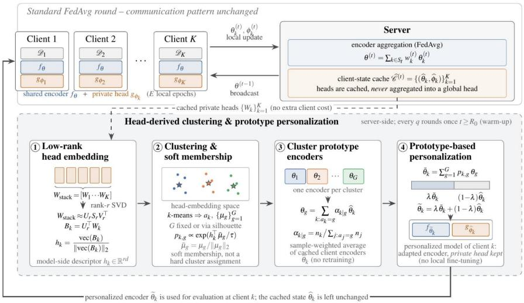
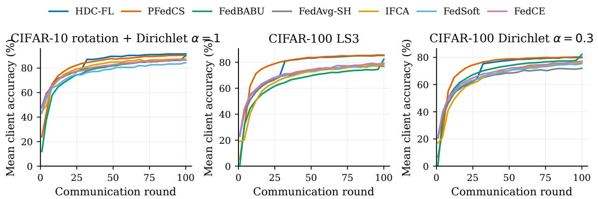
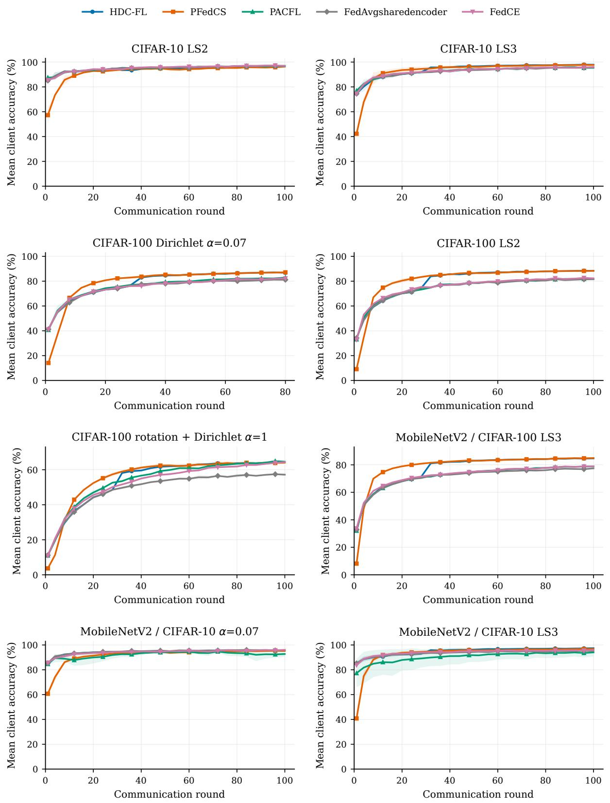
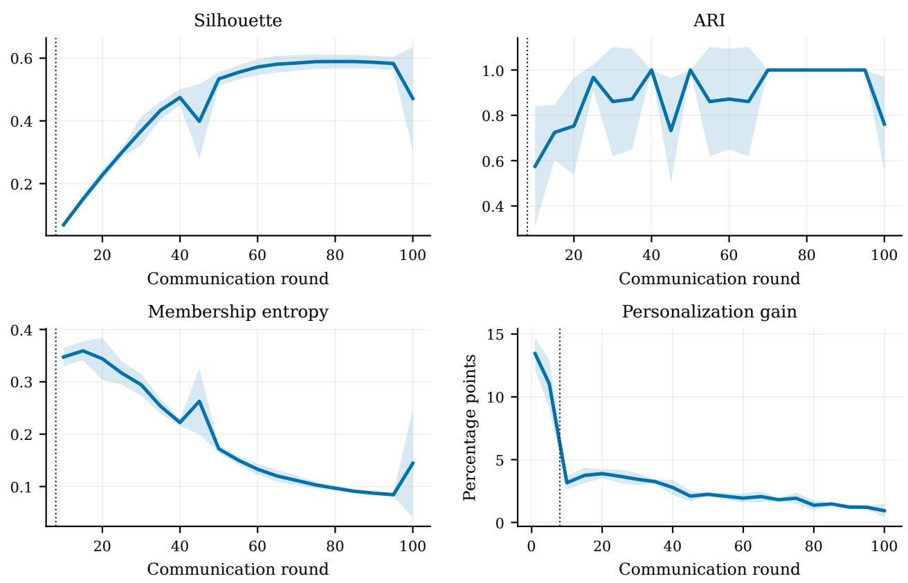

# From Classifier Heads to Encoder Prototypes: Personalized Federated Learning with Head-Derived Clustering

Amirardalan Dehghanpour1∗ Arian Noori1∗

Ehsan Tanghatari1 Naimeh Omidvar2 Hamid R. Rabiee1

1Sharif University of Technology 2Tehran Institute for Advanced Studies (TeIAS)

ardalandehghan0@gmail.com aryan1nori@gmail.com tanghatari.e@ipm.ir omidvar@teias.institute rabiee@sharif.edu

## Abstract

Personalized federated learning must decide which clients should share representations. We introduce HDC-FL (Head-Derived Clustering for Personalized Federated Learning), which reads that decision of a signal shared-encoder training already produces: the client-specific classifier heads. At periodic refresh rounds the server projects the cached heads into a normalized lowrank descriptor space, groups the descriptors, builds one encoder prototype per group from the cached client encoders, and returns to each client a soft mixture of those prototypes paired with its own unchanged head. Client-specific heads are never averaged or distributed to other clients; the shared-encoder trajectory is left intact; and no second optimization trajectory, additional local objective, or post-training fine-tuning stage is required. Across 11 CIFAR-10 and CIFAR-100 configurations covering label-subset, Dirichlet and rotation heterogeneity with ResNet-18 and MobileNetV2 encoders, HDC-FL is competitive with the strongest personalized and clustered baselines in macro-averaged mean accuracy and attains the numerically highest macro-averaged worst-client and bottom-20% accuracy among the evaluated methods. The tail results distin guish methods that look similar when only their means are compared. A controlled donor-swap diagnostic further finds positive donor-ranking associations between head similarity and encoder compatibility in all three settings tested, most clearly under covariate shift.

## 1 Introduction

Federated learning (FL) trains a model from decentralized data without transferring clients’ raw examples to a central server (McMahan et al., 2017; Konečný et al., 2016). In practice, however, client data are rarely independent and identically distributed. Clients may observe diferent label frequencies, subsets of classes, acquisition devices, or environmental conditions (Kairouz et al., 2021; Zhao et al., 2018; Hsu et al., 2019; Li et al., 2020). A model that performs well for the population average can therefore serve some clients poorly. This failure is easily obscured when models are evaluated solely by mean accuracy, which can mask severe degradation for the worst-performing clients. Personalization has also been studied as a route to more uniform performance across clients (Li et al., 2021a). Personalized FL must consequently be judged not only by average performance, but also by how well it serves the clients that benefit least from uniform collaboration.

Personalized FL addresses this problem by allowing selected model components to vary across clients. A common decomposition shares an encoder while retaining a private classifier head for each client (Arivazhagan et al., 2019; Collins et al., 2021; Oh et al., 2022). Although the private head adapts the decision boundary to local data, every client still relies on the same representation. This can be limiting under non-IID data: clients with diferent label support or acquisition conditions may require diferent features even when their classifiers are trained independently. Personalizing the encoder can reduce this form of negative transfer, but only if the server can determine which clients should share representation information.

Existing clustered and similarity-based methods attempt to infer such relationships, but their afinity signals may vary with individual local updates, require additional client computation or communication, or impose a hard assignment to one group. The central challenge is to obtain a stable client-relatedness signal from information already produced during training and to use it for graded representation sharing without maintaining separate optimization trajectories for diferent groups.

We use the geometry of client-specific classifier heads for this purpose. All client-specific heads operate on features produced along the same shared-encoder trajectory and use the same class ordering. The rows of a linear head can therefore be interpreted as client-specific class directions in a common feature space. Under label-subset skew, their arrangement reflects which class distinctions are supported by a client’s data. Under covariate shift, such as image rotation, the label frequencies may remain similar while the class directions move because clients use the shared features diferently. Head geometry thus provides a model-side description of the local prediction problem without requiring an additional data summary or local objective.

We introduce Head-Derived Clustering for Personalized Federated Learning (HDC-FL). At periodic refresh rounds, the server projects cached classifier heads into a normalized low-rank space and groups clients using the resulting descriptors. It then constructs prototype encoders from cached client encoders and gives each client a soft mixture of those prototypes. The personalized encoder is paired with the client’s unchanged private head and is used for evaluation or deployment; it is not fed back into later federated updates. HDC-FL therefore personalizes representations while retaining one shared-encoder training trajectory. It neither averages client-specific heads nor requires a second local training stage or independently optimized cluster models.

We evaluate HDC-FL on CIFAR-10 and CIFAR-100 across 11 configurations covering labelsubset, Dirichlet, and rotation heterogeneity with ResNet-18 and MobileNetV2 encoders. HDC-FL remains competitive with the strongest evaluated personalized and clustered baselines in macroaveraged mean accuracy, while providing consistently strong worst-client and bottom-20% accuracy. The tail results distinguish methods that appear similar when only their means are compared.

Our contributions are threefold:

• We identify classifier-head geometry as a client-relatedness signal for representation personalization and explain how it can reflect both label and covariate heterogeneity.

• We develop HDC-FL, which converts low-rank head descriptors into soft mixtures of encoder prototypes without averaging client-specific heads, changing the local objective, or maintaining multiple training trajectories.

• We evaluate average and poorly served clients separately using mean, worst-client, and bottom-20% accuracy across 11 settings. This evaluation reveals failures hidden by mean accuracy and shows that HDC-FL combines competitive average performance with consistently strong client-level tails.

## 2 Related Work

Personalized federated learning relaxes the requirement that every client use the same global model. HDC-FL connects two branches of this literature: model decomposition and similarity-based collaboration.

Shared representations and client-specific components. FedPer, FedRep, and FedBABU decompose the model into a shared feature extractor and client-specific prediction layers (Arivazhagan et al., 2019; Collins et al., 2021; Oh et al., 2022). FedBN instead keeps batch normalization local to address feature shift (Li et al., 2021b), a complementary way to handle covariate heterogeneity. Private predictors adapt decision boundaries to local data, but all clients still use one shared representation. HDC-FL retains this decomposition and uses private-head geometry to determine which clients should share encoder information.

From hard clustering to soft association. Clustered FL constructs specialized models for groups of related clients (Sattler et al., 2021). IFCA, PACFL, and EMD-CFL infer groups from candidate-model fit, local-data subspaces, and embedding distributions, respectively (Ghosh et al., 2020; Vahidian et al., 2023; Zhang et al., 2025). A hard assignment is restrictive when a client can benefit from more than one group. FedSoft, FedCE, and FedAMP instead allow graded or multi-source collaboration (Ruan and Joe-Wong, 2022; Cai et al., 2023; Huang et al., 2021), and pFedGraph infers graded pairwise collaboration strengths from model similarity and client data size (Ye et al., 2023). Some such methods maintain multiple cluster models or use time-varying model evidence. HDC-FL instead mixes encoder prototypes drawn from one shared optimization trajectory.

Classifier-geometry-based collaboration. PFedCS is the closest evaluated method because it also uses classifier-parameter geometry to identify related clients (Wu et al., 2025). The methods difer in what they personalize. PFedCS combines classifier parameters from similar clients, and FedPAC combines feature alignment with classifier collaboration (Xu et al., 2023); both personalize the decision layer. HDC-FL instead keeps heads private, never aggregating or distributing them across clients, and uses their geometry only to mix encoder prototypes, so it personalizes the representation. In HDC-FL an encoder prototype is an averaged vector of encoder parameters; FedProto instead communicates class-level feature prototypes (Tan et al., 2022).

## 3 HDC-FL

HDC-FL adds a server-side personalization step to federated training in which the encoder is aggregated across clients while each client retains a client-specific classifier head. Participating clients return their locally updated encoder and head, and the server stores the most recent encoder–head pair available for each client. At a refresh round, the server converts the cached heads into client descriptors, groups the descriptors, constructs one encoder prototype per group from the corresponding cached encoders, and returns to each client a soft mixture of those prototypes to be used with its own head (Figure 1). The personalization step does not modify the local objective or introduce a separate optimization trajectory.

  
Figure 1: HDC-FL overview. At each refresh the server converts cached client-specific heads into low-rank client descriptors, groups them, constructs group-level encoder prototypes from cached client encoders, and returns a soft prototype mixture to each client. The mixture is paired with the client’s unchanged private head, and the shared training trajectory continues unmodified.

## 3.1 Setting and Cached States

Client $k \in \{ 1 , \ldots , K \}$ holds $D _ { k } = \{ ( x _ { k , i } , y _ { k , i } ) \} _ { i = 1 } ^ { n _ { k } }$ with $\begin{array} { r } { N = \sum _ { k } n _ { k } } \end{array}$ . The model pairs an encoder $f _ { \theta } : \mathcal { X }  \mathbb { R } ^ { d }$ , shared through aggregation, with a client-specific classifier $g _ { \phi _ { k } } : \mathbb { R } ^ { d }  \mathbb { R } ^ { C }$ . Training minimizes

$$
\operatorname* { m i n } _ { \theta , \{ \phi _ { k } \} } \ \sum _ { k = 1 } ^ { K } \frac { n _ { k } } { N } \mathbb { E } _ { ( x , y ) \sim D _ { k } } \bigl [ \ell ( g _ { \phi _ { k } } ( f _ { \theta } ( x ) ) , y ) \bigr ] .\tag{1}
$$

At round t the server selects a subset $S _ { t } ,$ broadcasts $\theta ^ { ( t - 1 ) }$ , and the selected clients train locally for E epochs. Only the encoders are aggregated:

$$
\theta ^ { ( t ) } = \sum _ { k \in S _ { t } } w _ { k } ^ { ( t ) } \theta _ { k } ^ { ( t ) } , \qquad w _ { k } ^ { ( t ) } = \frac { n _ { k } } { \sum _ { j \in S _ { t } } n _ { j } } .\tag{2}
$$

In addition, the server keeps for every observed client the encoder and the head returned by its most recent local update,

$$
( \hat { \theta } _ { k } ^ { ( t ) } , \hat { \phi } _ { k } ^ { ( t ) } ) ,\tag{3}
$$

where we drop the round index when it is not needed. Both entries are always refreshed together, so a cached head is the decision rule that was trained on top of the cached encoder next to it. These pairs are the only input to the personalization step. Under partial participation they also keep clients that were not selected in the current round represented, since their last available state remains in the cache.

## 3.2 Head-Derived Descriptors

What head geometry encodes. Within a communication round, participating clients start from the same broadcast encoder and use the same class ordering. Because local updates in our setting are short, the resulting client encoders remain close to the shared parameter trajectory. The coordinates of their associated linear heads are therefore approximately aligned, allowing the rows of $W _ { k } \in \mathbb { R } ^ { C \times d }$ to be compared as client-specific class directions in approximately common feature coordinates.

Under label-subset skew, the learned head geometry can reflect which class distinctions are supported by a client’s data; Appendix F shows that head similarity is strongly associated with label-support overlap in the label-skew settings. Under covariate shift, label frequencies can remain similar across clients while the class directions change because clients adapt the shared representation diferently. We therefore use head geometry as a model-side description of the local prediction problem without introducing an additional data summary or local objective.

Low-rank descriptor. Rather than comparing the full $C \times d$ heads directly, HDC-FL constructs a lower-dimensional representation in a common class-space basis. Specifically, the server identifies the leading class-space directions across the cached heads and expresses each head in that shared basis:

$$
\begin{array} { r l r } { \boldsymbol { W } _ { \mathrm { s t a c k } } = [ \boldsymbol { W } _ { 1 } \boldsymbol { W } _ { 2 } \boldsymbol { \cdot } \boldsymbol { \cdot } \boldsymbol { \cdot } \boldsymbol { W } _ { K } ] \approx \boldsymbol { U } _ { r } \boldsymbol { \Sigma } _ { r } \boldsymbol { V } _ { r } ^ { \top } , } & \\ { \boldsymbol { B } _ { k } = \boldsymbol { U } _ { r } ^ { \top } \boldsymbol { W } _ { k } , \qquad \boldsymbol { h } _ { k } = \frac { \mathrm { v e c } ( \boldsymbol { B } _ { k } ) } { \| \mathrm { v e c } ( \boldsymbol { B } _ { k } ) \| _ { 2 } + \epsilon } , } & \end{array}\tag{4}
$$

where $U _ { r } \in \mathbb { R } ^ { C \times r }$ holds the leading left singular vectors of the stacked head matrix $W _ { \mathrm { s t a c k } } \in \mathbb { R } ^ { C \times K d }$ and $\epsilon > 0$ prevents division by zero.

Descriptor compression. Because the heads are stacked along the feature dimension, multiplication by $U _ { r } ^ { \top }$ projects the class dimension of every client’s head into the same rank-r basis, reducing the descriptor from Cd to rd values. Appendix E compares this representation with the raw heads: the projected descriptors yield higher silhouette scores and greater agreement between consecutive cluster assignments, while mean predictive accuracy changes little. We therefore use the projection primarily to obtain a compact and empirically more stable grouping space.

## 3.3 Clustering and Soft Membership

The server clusters the descriptors $\{ h _ { k } \} _ { k = 1 } ^ { K }$ with k-means, obtaining hard assignments $a _ { k } \in$ $\{ 1 , \ldots , G \}$ and centroids $\{ \mu _ { g } \} _ { g = 1 } ^ { G }$ . The number of groups is not fixed in advance: at every refresh G is selected from the descriptor geometry itself, so the grouping can follow the client structure as it emerges during training instead of encoding a prior guess about how many groups exist (Appendix A). Writing $\tilde { \mu } _ { g } = \mu _ { g } / ( \lVert \boldsymbol { \mu } _ { g } \rVert _ { 2 } + \epsilon )$ , each client is then given a graded membership in the groups,

$$
p _ { k , g } = \frac { \exp ( h _ { k } ^ { \top } \tilde { \mu } _ { g } / \tau ) } { \sum _ { j = 1 } ^ { G } \exp ( h _ { k } ^ { \top } \tilde { \mu } _ { j } / \tau ) } .\tag{5}
$$

The hard assignments are used only to define distinct prototypes; personalization itself stays soft, so a client whose descriptor lies between two groups can draw on both. The temperature $\tau > 0$ sets how selectively a client uses the prototypes: small τ approaches the most similar prototype, larger τ spreads weight across groups.

## 3.4 Encoder Prototypes and Personalization

The grouping obtained in head space is now applied in encoder-parameter space. Group g consists of the clients assigned to it, that is all k with $a _ { k } = g$ . Its prototype $\theta _ { g }$ is the average of the cached

encoders of exactly those clients, weighted by local dataset size so that clients holding more data contribute more:

$$
\theta _ { g } = \sum _ { k : a _ { k } = g } \alpha _ { k | g } \hat { \theta } _ { k } , \qquad \alpha _ { k | g } = \frac { n _ { k } } { \sum _ { j : a _ { j } = g } n _ { j } } .\tag{6}
$$

A prototype is therefore a single encoder that summarizes how one group of clients has adapted the shared representation to its own data. Client k then combines the prototypes with its membership weights and may interpolate the result with its own cached encoder:

$$
\bar { \theta } _ { k } = \sum _ { g = 1 } ^ { G } p _ { k , g } \theta _ { g } , \qquad \tilde { \theta } _ { k } = \lambda \bar { \theta } _ { k } + ( 1 - \lambda ) \hat { \theta } _ { k } ,\tag{7}
$$

with $\lambda \in [ 0 , 1 ]$ . We use $\lambda = 1$ in all main experiments, so clients receive the full soft prototype mixture; a sensitivity diagnostic is reported in Appendix E.

The personalized model $( f _ { \widetilde { \theta } _ { k } } , g _ { \hat { \phi } _ { k } } )$ is what client k evaluates and deploys. It is constructed from the cached states and is not written back into them: the encoders aggregated in Eq. (2) and the cached pairs used at the next refresh are unchanged, so all clients continue to contribute to one shared trajectory even though their deployed representations difer.

Why cached encoders can be averaged. The encoders in Eq. (6) are not independently trained networks: each local update starts from the same broadcast encoder $\theta ^ { ( t - 1 ) }$ and uses only one local epoch. Cached encoders therefore remain near a common parameter-space trajectory, which makes weighted averaging empirically efective in the regime we study. This argument is specific to short local updates and frequent aggregation; longer local training or heterogeneous architectures may weaken it, as discussed in Section 5.1.

## 3.5 Refresh Schedule and Algorithm

Early in training the descriptors still change quickly, so HDC-FL does not personalize from the first round. The server repeats the refresh every q rounds and enables personalization only once the grouping has become stable, which it measures with the silhouette score of the current clustering together with the agreement between the assignments of consecutive refreshes (adjusted Rand index) and the average change of the descriptors themselves. Once this criterion has held for m consecutive refreshes, prototypes are constructed and delivered; a maximum activation round guarantees that personalization is eventually enabled. The exact criterion and its parameter values are given in Appendix A, and Algorithm 1 states the complete procedure.

Cost. HDC-FL does not change the client-side objective, optimizer, or local epoch budget and requires no additional local optimization stage. Relative to shared-encoder training without headbased personalization, participating clients additionally make their client-specific heads available to the server, which stores the most recent encoder–head states required for personalization. At a refresh, the server computes a truncated SVD of the stacked heads, clusters the resulting K descriptors, constructs G weighted encoder prototypes, and computes the client-specific prototype mixtures. Personalized encoders must additionally be delivered to clients for evaluation or deployment. Thus, HDC-FL adds server-side computation, storage, and communication, but does not require independently optimized group models or additional client-side training.

Algorithm 1 HDC-FL   
Require: clients $\{ D _ { k } \} _ { k = 1 } ^ { K } ,$ , rounds $T ,$ local epochs $E ,$ refresh interval $q ,$ rank $r ,$ temperature $\tau ,$ mixing   
coeficient $\lambda ,$ activation parameters   
1: initialize $\theta ^ { ( 0 ) }$ , heads $\{ \phi _ { k } ^ { ( 0 ) } \}$ , cache   
2: for $t = 1 , \dots , T$ do   
3: select $S _ { t }$ and broadcast $\theta ^ { ( t - 1 ) }$   
4: each $k \in S _ { t }$ trains locally and returns $( \theta _ { k } ^ { ( t ) } , \phi _ { k } ^ { ( t ) } )$   
$5 { : }$ store $( \hat { \theta } _ { k } ^ { ( t ) } , \hat { \phi } _ { k } ^ { ( t ) } )$ for $k \in S _ { t } ;$ aggregate by Eq. (2)   
$6 { : }$ if t is a refresh round then   
7: build descriptors $h _ { k }$ from cached heads, Eq. (4)   
8: select G and cluster $\{ h _ { k } \}$ ; update the stability statistics   
9: if the activation criterion is met then   
10: form prototypes $\theta _ { g }$ by Eq. (6)   
11: compute memberships $p _ { k , g }$ by Eq. (5)   
12: send each client its personalized encoder $\tilde { \theta } _ { k } , \mathrm { E q . ~ } ( 7 )$   
13: end if   
14: end if   
15: end for   
16: return shared encoder $\theta ^ { ( T ) }$ and personalized models $\{ ( f _ { \tilde { \theta } _ { k } } , g _ { \hat { \phi } _ { k } } ) \} _ { k = 1 } ^ { K }$

## 4 Experiments

## 4.1 Setup

Data and heterogeneity. We evaluate on CIFAR-10 and CIFAR-100 (Krizhevsky and Hinton, 2009) with K = 20 clients and private client-level train and test distributions. We consider three forms of heterogeneity: label-subset skew (LS2/LS3), where clients observe only 20% or 30% of the label space; Dirichlet label skew with $\alpha \in \{ 0 . 0 7 , 0 . 3 \}$ , which produces continuously varying label proportions (Hsu et al., 2019); and rotation shift, where clients receive one of four fixed image rotations while label proportions follow Dir(1). These settings respectively test discrete labelsupport diferences, continuous label skew, and client-level feature shift. Full partition construction is given in Appendix A.

Models and baselines. We evaluate ResNet-18 and MobileNetV2 encoders (He et al., 2016; Sandler et al., 2018) with linear client-specific heads, initialized from the same pretrained encoder weights within each setting. We compare against FedAvgSharedEncoder (FedAvg-SE), which uses the same shared-encoder/private-head training protocol without personalization; the personalized methods FedBABU (Oh et al., 2022) and FedALA (Zhang et al., 2023); the clustered methods IFCA (Ghosh et al., 2020), PACFL (Vahidian et al., 2023) and EMD-CFL (Zhang et al., 2025); the soft or multi-cluster methods FedSoft (Ruan and Joe-Wong, 2022) and FedCE (Cai et al., 2023); and PFedCS (Wu et al., 2025), the closest baseline because it also derives client relationships from classifier geometry. Baseline implementation and hyperparameter details are provided in Appendix A.

Protocol and metrics. Methods are trained for 100 communication rounds, except CIFAR-100 with $\alpha = 0 . 0 7$ , which uses 80. Within each setting and seed, methods share the data partition, initialization, participation schedule and local-epoch budget. The same HDC-FL configuration is used across all main benchmark configurations; full optimization, clustering, and activation parameters are given in Appendix A. Ablations and sensitivity diagnostics vary the indicated components explicitly. Results are averaged over seeds 42, 123 and 2026 and reported as mean ± sample standard deviation. We report mean client accuracy, worst-client accuracy, bottom-20% accuracy (the mean of the four lowest clients) and the best-to-worst fairness gap; aggregate values macro-average setting-level results, and ranks are computed within a setting and then averaged. Main experiments use full participation.

Table 1: Mean client test accuracy (%) on ResNet-18, mean ± sample standard deviation over three seeds. Average rank is computed within each setting and then averaged over the eight settings. Bold and underline mark the best and second-best entry per setting.
<table><tr><td>Method</td><td>C10 LS2</td><td>C10 LS3</td><td>C10 Rot</td><td> $\mathrm { C 1 0 0 ~ } \alpha { = } 0 . 0 7$ </td><td> $\mathrm { C 1 0 0 ~ } \alpha { = } 0 . 3$ </td><td>C100 LS2</td><td>C100 LS3</td><td>C100 Rot</td><td> $\operatorname { A v g } .$  Rank ↓</td></tr><tr><td>FedAvg-SE</td><td> ${ \bf 9 7 . 1 7 \pm 0 . 6 2 }$ </td><td> $9 5 . 5 1 \pm 0 . 7 1$ </td><td> $8 6 . 4 2 \pm 0 . 8 0$ </td><td> $8 1 . 1 5 \pm 1 . 0 6$ </td><td> $7 2 . 0 9 \pm 0 . 3 4$ </td><td> $8 1 . 2 3 \pm 0 . 6 3$ </td><td> $7 6 . 8 8 \pm 0 . 1 7$ </td><td> $5 7 . 4 2 \pm 0 . 6 8$ </td><td>7.25</td></tr><tr><td>FedBABU</td><td> $9 6 . 9 9 \pm 0 . 6 3$ </td><td> $9 7 . 1 8 \pm 1 . 3 5$ </td><td> $9 0 . 0 5 \pm 0 . 4 3$ </td><td> ${ \bf 8 7 . 7 3 \pm 1 . 5 1 }$ </td><td> ${ \bf 8 2 . 1 9 \pm 0 . 1 6 }$ </td><td> $8 4 . 8 1 \pm 4 . 0 2$ </td><td> $8 2 . 3 3 \pm 3 . 9 2$ </td><td> $6 8 . 5 4 \pm 1 . 9 1$ </td><td>2.12</td></tr><tr><td>FedALA</td><td> $9 6 . 5 1 \pm 0 . 6 5$ </td><td> $9 5 . 5 0 \pm 0 . 8 5$ </td><td> $8 6 . 7 3 \pm 0 . 0 3$ </td><td> $8 1 . 4 5 \pm 1 . 3 9$ </td><td> $7 4 . 6 7 \pm 0 . 0 3$ </td><td> $8 0 . 9 6 \pm 0 . 1 4$ </td><td> $7 7 . 7 5 \pm 0 . 4 0$ </td><td> $6 3 . 8 6 \pm 0 . 2 1$ </td><td>6.88</td></tr><tr><td>FedCE</td><td> $9 6 . 8 9 \pm 0 . 0 2$ </td><td> $9 5 . 9 2 \pm 0 . 1 2$ </td><td> $8 6 . 5 2 \pm 0 . 2 8$ </td><td> $8 2 . 2 2 \pm 0 . 4 1$ </td><td> $7 7 . 1 9 \pm 0 . 0 6$ </td><td> $8 2 . 2 9 \pm 0 . 7 6$ </td><td> $7 8 . 9 8 \pm 0 . 4 5$ </td><td> $6 4 . 3 7 \pm 0 . 2 6$ </td><td>4.50</td></tr><tr><td>FedSoft</td><td> $9 6 . 4 0 \pm 0 . 0 9$ </td><td> $9 5 . 4 4 \pm 1 . 3 9$ </td><td> $8 4 . 4 1 \pm 0 . 4 8$ </td><td> $8 1 . 9 0 \pm 0 . 9 4$ </td><td> $7 5 . 4 1 \pm 0 . 2 2$ </td><td> $8 1 . 6 3 \pm 0 . 2 5$ </td><td> $7 9 . 2 3 \pm 0 . 0 4$ </td><td> $6 1 . 0 6 \pm 0 . 5 9$ </td><td>6.88</td></tr><tr><td>IFCA</td><td> $9 6 . 3 6 \pm 1 . 0 5$ </td><td> $9 4 . 3 8 \pm 0 . 4 2$ </td><td> $8 7 . 1 8 \pm 0 . 1 3$ </td><td> $8 0 . 1 2 \pm 0 . 2 8$ </td><td> $7 5 . 9 3 \pm 0 . 5 5$ </td><td> $8 0 . 6 1 \pm 1 . 0 0$ </td><td> $7 8 . 4 0 \pm 0 . 2 3$ </td><td> $6 3 . 6 9 \pm 0 . 4 6$ </td><td>7.62</td></tr><tr><td>PACFL</td><td> $9 6 . 6 9 \pm 0 . 3 5$ </td><td> $9 5 . 3 5 \pm 0 . 1 3$ </td><td> $8 6 . 4 3 \pm 0 . 2 9$ </td><td> $8 2 . 8 7 \pm 0 . 6 2$ </td><td> $7 6 . 3 5 \pm 0 . 2 7$ </td><td> $8 1 . 7 7 \pm 0 . 1 1$ </td><td> $7 8 . 1 8 \pm 0 . 4 3$ </td><td> $6 4 . 5 7 \pm 0 . 6 5$ </td><td>5.50</td></tr><tr><td>EMD-CFL</td><td> $9 6 . 7 0 \pm 0 . 1 4$ </td><td> $9 4 . 8 8 \pm 0 . 3 0 $ </td><td> $8 2 . 1 6 \pm 1 . 8 6$ </td><td> $8 0 . 2 3 \pm 0 . 2 8$ </td><td> $7 0 . 8 4 \pm 1 . 7 0$ </td><td> $7 9 . 8 5 \pm 1 . 3 7$ </td><td> $7 7 . 0 4 \pm 0 . 7 4$ </td><td> $6 0 . 7 6 \pm 4 . 7 4$ </td><td>8.88</td></tr><tr><td>PFedCS</td><td> $9 6 . 3 4 \pm 0 . 5 1$ </td><td> $9 7 . 6 2 \pm 0 . 6 4$ </td><td> $9 0 . 4 3 \pm 0 . 1 5$ </td><td> $\underline { { 8 7 . 1 2 } } \pm 1 . 0 9$ </td><td> $8 0 . 1 9 \pm 0 . 0 5$ </td><td> $\underline { { 8 8 . 3 2 } } \pm 0 . 2 7$ </td><td> ${ \bf 8 5 . 4 5 \pm 0 . 1 5 }$ </td><td> $6 4 . 0 5 \pm 0 . 8 2$ </td><td>3.25</td></tr><tr><td>HDC-FL</td><td> $9 6 . 9 4 \pm 0 . 0 4$ </td><td> $9 7 . 8 8 \pm 0 . 6 0$ </td><td> ${ \bf 9 1 . 5 5 \pm 0 . 0 4 }$ </td><td> $8 6 . 7 7 \pm 0 . 5 4$ </td><td> $7 9 . 8 4 \pm 0 . 1 8$ </td><td> $\mathbf { 8 8 . 4 3 \ : \pm { \ : 0 . 2 9 } }$ </td><td> $8 5 . 2 6 \pm 0 . 1 4$ </td><td> $6 4 . 3 8 \pm 0 . 1 4$ </td><td>2.12</td></tr></table>

## 4.2 Mean Client Accuracy

Table 1 reports mean client accuracy for the eight ResNet-18 configurations; MobileNetV2 results are provided in Appendix B. HDC-FL and FedBABU obtain the best average rank on ResNet-18 (2.12). Across all 11 configurations, HDC-FL, PFedCS and FedBABU achieve macro-averaged mean accuracies of 88.08%, 87.86% and 87.58% respectively. Because these diferences are small relative to the per-setting seed variation, we regard the three methods as comparable in mean accuracy rather than interpreting the aggregate values as a clear ordering.

The most informative diferences occur within individual heterogeneity families. On CIFAR-100 label-subset skew, HDC-FL and PFedCS obtain numerically higher mean accuracies than the remaining evaluated baselines, reaching 88.43% and 88.32% on LS2 and 85.26% and 85.45% on LS3, respectively. HDC-FL also reaches 91.55% under CIFAR-10 rotation, while FedBABU has higher observed mean accuracy in the more dificult CIFAR-100 Dirichlet and rotation settings.

## 4.3 Client-Level Tail Performance

Mean accuracy can conceal clients that are served poorly by a personalized method. Table 2 therefore macro-averages worst-client accuracy, bottom-20% accuracy, fairness gap and bottom-20% rank across all 11 configurations; setting-level results are reported in Appendix C.

HDC-FL attains the highest aggregate worst-client accuracy (82.05%) and bottom-20% accuracy (84.44%), with the best tail rank (2.09). However, its margins over PFedCS are small—0.36 and 0.24 percentage points on the two tail metrics—and their fairness gaps are nearly identical (9.72 versus 9.74). We therefore view the two classifier-geometry methods as similarly strong on clientlevel tails; both remain clearly separated from the remaining baselines in aggregate tail rank and worst-client accuracy.

FedBABU illustrates why the tail metrics add information beyond the mean: despite a competitive aggregate mean of 87.58%, its worst-client accuracy falls to 55.32% and its fairness gap rises to 38.37 points. Hard-clustering methods also show weaker tails than their means alone suggest: IFCA and EMD-CFL both fall below the non-personalized FedAvg-SE baseline in aggregate worst-client accuracy. These results suggest that personalization mechanisms can perform well for the average client while harming a subset of clients.

Table 2: Client-level results macro-averaged over all 11 configurations.
<table><tr><td>Method</td><td>Mean</td><td>Worst</td><td>Bot.20%</td><td>Gap</td><td>Tail rank</td></tr><tr><td>FedAvg-SE</td><td>83.35</td><td>76.95</td><td>78.95</td><td>11.15</td><td>6.00</td></tr><tr><td>FedBABU</td><td>87.58</td><td>55.32</td><td>73.78</td><td>38.37</td><td>8.18</td></tr><tr><td>FedALA</td><td>84.19</td><td>77.68</td><td>79.75</td><td>11.07</td><td>5.73</td></tr><tr><td>FedCE</td><td>85.03</td><td>78.73</td><td>80.69</td><td>10.94</td><td>3.73</td></tr><tr><td>FedSoft</td><td>84.15</td><td>76.52</td><td>79.31</td><td>12.38</td><td>6.00</td></tr><tr><td>IFCA</td><td>83.64</td><td>71.25</td><td>77.58</td><td>17.90</td><td>7.27</td></tr><tr><td>PACFL</td><td>84.35</td><td>75.38</td><td>79.39</td><td>14.26</td><td>5.00</td></tr><tr><td>EMD-CFL</td><td>82.43</td><td>71.72</td><td>75.45</td><td>16.65</td><td>8.36</td></tr><tr><td>PFedCS</td><td>87.86</td><td>81.69</td><td>84.20</td><td>9.74</td><td>2.64</td></tr><tr><td>HDC-FL</td><td>88.08</td><td>82.05</td><td>84.44</td><td>9.72</td><td>2.09</td></tr></table>

Table 3: Controlled grouping ablation on CIFAR-10 rotation without pretrained initialization. Here $G = 4$ is fixed to match the four known rotation conditions and isolate the efect of head-derived grouping. Values are mean ± sample standard deviation over three seeds.
<table><tr><td>Variant</td><td>Mean</td><td>Worst</td><td>Bot.20%</td></tr><tr><td>No prototype</td><td> $7 7 . 5 7 \pm 0 . 4 0$ </td><td> $6 9 . 8 5 \pm 3 . 9 7$ </td><td> $7 2 . 2 0 \pm 1 . 4 6$ </td></tr><tr><td>One prototype</td><td> $8 0 . 3 0 \pm 0 . 3 4$ </td><td> $7 2 . 0 5 \pm 2 . 9 0$ </td><td> $7 4 . 9 3 \pm 1 . 1 6$ </td></tr><tr><td>Head-derived,  $G { = } 4$ </td><td> ${ \bf 8 1 . 0 4 } \pm 0 . 7 3$ </td><td> ${ \bf 7 2 . 5 7 \pm 1 . 6 7 }$ </td><td> ${ \bf 7 5 . 4 7 \pm 1 . 1 0 }$ </td></tr></table>

## 4.4 Ablations

We isolate two central design choices: whether head-derived grouping improves over populationlevel prototype averaging, and whether soft prototype membership improves over hard assignment. Additional descriptor and hyperparameter diagnostics are reported in Appendix E.

Grouping signal. Table 3 isolates the two steps that build the personalized encoder, on CIFAR-10 rotation without pretrained initialization. Replacing the client’s own cached encoder by a single population-level prototype already raises mean accuracy from 77.57% to 80.30%, so part of the benefit is simply that a prototype averages several cached encoders. Splitting that prototype into four head-derived groups adds a further 0.74 points in mean accuracy and also improves both tail metrics. Thus, after accounting for the benefit of prototype averaging itself, introducing multiple head-derived prototypes provides an additional improvement on all three metrics. Additional diagnostics in Appendix E show that the low-rank projection substantially improves cluster separation and temporal stability relative to raw heads without materially changing predictive accuracy.

Membership. Replacing the soft mixture by a hard assignment to the most similar prototype costs 0.85 points of mean accuracy and 1.08 and 0.95 points on the two tail metrics on CIFAR-100 with $\alpha = 0 . 3$ , the setting in which client distributions form a continuum rather than discrete groups

(Appendix E).

## 4.5 Does Head Similarity Predict Encoder Compatibility?

We also test the central assumption of the method directly: that clients with similar classifier heads can use related encoders. At the final round of the MobileNetV2 runs we take every ordered pair of clients $( t , d )$ , keep target t’s own classifier head and test data fixed, replace only its encoder with donor d’s cached encoder, and re-evaluate. The swap is zero-shot, with no retraining or fine-tuning. Each pair yields a loss benefit and an accuracy gain relative to the target’s own encoder, and we ask how well head similarity ranks the 19 available donors by these quantities. Three settings and three seeds give 3,420 directed pairs; metrics are computed per target and then averaged (full protocol in Appendix F).

Table 4 reports the outcome. Head similarity has positive mean Spearman correlation with loss benefit and AUROC above 0.5 in all three settings, with the largest observed association under rotation shift (ρ = 0.243, AUROC = 0.783) and the smallest under CIFAR-100 LS3 $( \rho = 0 . 1 1 7 ,$ AUROC = 0.565). The practical efect is measured by donor selection: choosing the nearest-head donor rather than a random one is worth 2.50 accuracy points under rotation, 1.57 points on CIFAR-10 label skew and 0.41 points on CIFAR-100 label skew, and the closest distance quintile outperforms the farthest in every setting. Average precision must be read against prevalence: on CIFAR-100 label skew 71.1% of donors already help, so an AP of 0.782 is a lift of only 0.071.

The rotation setting provides the cleanest check, because the client groups are known independently of the learned heads. The nearest-head donor shares the target’s rotation in 75.0% of cases against a 21.1% base rate, head similarity separates same-rotation from diferent-rotation pairs with AUROC 0.887, and same-rotation swaps average +0.83 accuracy points against −3.46 points for diferent-rotation swaps. Two qualifications follow from the same experiment. First, a useful ranking is not a guarantee of useful transfer: on CIFAR-10 label skew only 15.6% of individual swaps reduce the target’s loss, so most single-donor replacements are harmful even where the ranking is informative. This is consistent with HDC-FL combining several cached encoders by sample-weighted averaging and soft mixing rather than adopting one donor’s encoder. Second, in the label-skew settings head similarity is closely associated with the overlap of client label supports (Spearman 0.89 and 0.78), and the partial correlation with transfer benefit after controlling for that overlap is near zero (Appendix F). In these settings the signal is therefore better described as an operational proxy for shared label support than as an independent measure of encoder compatibility.

## 5 Discussion

HDC-FL is not uniformly more accurate than the strongest evaluated baselines. The results instead support a narrower claim: classifier-head geometry is a useful model-side signal for deciding how to share representations. Cross-method comparisons cannot isolate this signal from other algorithmic diferences, so the donor-swap diagnostic in Section 4.5 tests the underlying association directly. Head similarity positively ranks encoder-transfer benefit in all three tested settings and recovers the known rotation structure under covariate shift. Under label skew, Appendix F shows that much of this association is explained by shared label support.

## 5.1 Limitations

Two assumptions bound the setting. The first is architectural: all clients train the same encoder over a common label space, since descriptors compare heads coordinate by coordinate and prototypes average encoders parameter by parameter. The argument that those averages are meaningful further assumes short local updates and frequent aggregation, and longer local training or heterogeneous client models would weaken it; relaxing both is left to future work. The second assumption is informational: in the current implementation, the server receives the client-specific classifier heads, which can encode information about client-specific prediction behavior. HDC-FL as evaluated here is therefore not suited to settings in which model parameters themselves must remain hidden from the server. After the descriptor construction step, clustering and soft-membership computation operate on the descriptors rather than directly on the raw heads, suggesting privacy-preserving computation or transmission of descriptor statistics as possible extensions. We do not evaluate such mechanisms here. The donor diagnostic of Section 4.5 is correlational, uses one backbone, and shows head similarity partly acting as a proxy for label-support overlap. A third direction is scale: our federations have 20 clients, and testing substantially larger and naturally partitioned populations, where the server cache grows and each client is refreshed less often, is the natural next step.

Table 4: Donor-compatibility diagnostic on MobileNetV2, averaged over targets and seeds. Spearman ρ measures rank association between head similarity and loss benefit, while AUROC and average precision (AP) measure discrimination between beneficial and non-beneficial donors. The beneficial-donor rate gives the positive-class prevalence against which AP should be interpreted. The final two rows report the accuracy gain from selecting the nearest-head donor rather than a random donor, and from the closest head-distance quintile relative to the farthest.
<table><tr><td></td><td>C10 LS3 C100 LS3</td><td>C100 Rot</td></tr><tr><td>Spearman ρ (loss)</td><td>0.193 0.117</td><td>0.243</td></tr><tr><td>AUROC (loss)</td><td>0.665 0.565</td><td>0.783</td></tr><tr><td>Beneficial-donor rate</td><td>0.156 0.711</td><td>0.245</td></tr><tr><td>AP</td><td>0.513 0.782</td><td>0.642</td></tr><tr><td>AP lift over prevalence</td><td>0.357 0.071</td><td>0.397</td></tr><tr><td> $\mathrm { T o p - 1 - r a n d o m \ ( p p ) }$ </td><td>1.57 0.41</td><td>2.50</td></tr><tr><td>Closest — farthest (pp)</td><td>1.68 0.51</td><td>1.97</td></tr></table>

## 6 Conclusion

We introduced HDC-FL, which uses the geometry of the private classifier heads that shared-encoder training already produces to decide how representations are shared, returning to each client a soft mixture of head-derived encoder prototypes paired with its own unchanged head. Across 11 configurations and two backbones, HDC-FL is competitive with the strongest baselines in mean accuracy and attains the highest macro-averaged worst-client and bottom-20% accuracy, with small margins over PFedCS and no additional client-side optimization. The contrast with FedBABU— a comparable mean but a 38-point fairness gap—illustrates why personalized federated learning should also be evaluated by client-level tails.

## References

M. Arivazhagan, V. Aggarwal, A. K. Singh, and S. Choudhary. Federated learning with personalization layers. arXiv preprint arXiv:1912.00818, 2019.

L. Cai, N. Chen, Y. Cao, J. He, and Y. Li. FedCE: Personalized federated learning method based

on clustering ensembles. In ACM International Conference on Multimedia, pages 1625–1633, 2023.

L. Collins, H. Hassani, A. Mokhtari, and S. Shakkottai. Exploiting shared representations for personalized federated learning. In International Conference on Machine Learning, volume 139, pages 2089–2099, 2021.

A. Ghosh, J. Chung, D. Yin, and K. Ramchandran. An eficient framework for clustered federated learning. In Advances in Neural Information Processing Systems, volume 33, pages 19586–19597, 2020.

K. He, X. Zhang, S. Ren, and J. Sun. Deep residual learning for image recognition. In IEEE Conference on Computer Vision and Pattern Recognition, pages 770–778, 2016.

T.-M. H. Hsu, H. Qi, and M. Brown. Measuring the efects of non-identical data distribution for federated visual classification. arXiv preprint arXiv:1909.06335, 2019.

Y. Huang, L. Chu, Z. Zhou, L. Wang, J. Liu, J. Pei, and Y. Zhang. Personalized cross-silo federated learning on non-IID data. In AAAI Conference on Artificial Intelligence, volume 35, pages 7865– 7873, 2021.

P. Kairouz, H. B. McMahan, B. Avent, et al. Advances and open problems in federated learning. Foundations and Trends in Machine Learning, 14(1–2):1–210, 2021.

J. Konečný, H. B. McMahan, D. Ramage, and P. Richtárik. Federated learning: Strategies for improving communication eficiency. arXiv preprint arXiv:1610.05492, 2016.

A. Krizhevsky and G. Hinton. Learning multiple layers of features from tiny images. Technical report, University of Toronto, 2009.

T. Li, A. K. Sahu, A. Talwalkar, and V. Smith. Federated optimization in heterogeneous networks. In Proceedings of Machine Learning and Systems, volume 2, pages 429–450, 2020.

T. Li, S. Hu, A. Beirami, and V. Smith. Ditto: Fair and robust federated learning through personalization. In International Conference on Machine Learning, volume 139, pages 6357– 6368, 2021.

X. Li, M. Jiang, X. Zhang, M. Kamp, and Q. Dou. FedBN: Federated learning on non-IID features via local batch normalization. In International Conference on Learning Representations, 2021.

H. B. McMahan, E. Moore, D. Ramage, S. Hampson, and B. Agüera y Arcas. Communicationeficient learning of deep networks from decentralized data. In International Conference on Artificial Intelligence and Statistics, volume 54, pages 1273–1282, 2017.

J. Oh, S. Kim, and S.-Y. Yun. FedBABU: Toward enhanced representation for federated image classification. In International Conference on Learning Representations, 2022.

P. J. Rousseeuw. Silhouettes: A graphical aid to the interpretation and validation of cluster analysis. Journal of Computational and Applied Mathematics, 20:53–65, 1987.

Y. Ruan and C. Joe-Wong. FedSoft: Soft clustered federated learning with proximal local updating. In AAAI Conference on Artificial Intelligence, volume 36, pages 8124–8131, 2022.

O. Russakovsky, J. Deng, H. Su, J. Krause, S. Satheesh, S. Ma, Z. Huang, A. Karpathy, A. Khosla, M. Bernstein, A. C. Berg, and L. Fei-Fei. ImageNet large scale visual recognition challenge. International Journal of Computer Vision, 115(3):211–252, 2015.

M. Sandler, A. Howard, M. Zhu, A. Zhmoginov, and L.-C. Chen. MobileNetV2: Inverted residuals and linear bottlenecks. In IEEE Conference on Computer Vision and Pattern Recognition, pages 4510–4520, 2018.

F. Sattler, K.-R. Müller, and W. Samek. Clustered federated learning: Model-agnostic distributed multitask optimization under privacy constraints. IEEE Transactions on Neural Networks and Learning Systems, 32(8):3710–3722, 2021.

Y. Tan, G. Long, L. Liu, T. Zhou, Q. Lu, J. Jiang, and C. Zhang. FedProto: Federated prototype learning across heterogeneous clients. In AAAI Conference on Artificial Intelligence, volume 36, pages 8432–8440, 2022.

S. Vahidian, M. Morafah, W. Wang, V. Kungurtsev, C. Chen, M. Shah, and B. Lin. Eficient distribution similarity identification in clustered federated learning via principal angles between client data subspaces. In AAAI Conference on Artificial Intelligence, volume 37, pages 10043– 10052, 2023.

S. Wu, Y. Jia, B. Liu, H. Xiang, X. Xu, and W. Dou. PFedCS: A personalized federated learning method for enhancing collaboration among similar classifiers. In AAAI Conference on Artificial Intelligence, volume 39, pages 21572–21580, 2025.

J. Xu, X. Tong, and S.-L. Huang. Personalized federated learning with feature alignment and classifier collaboration. In International Conference on Learning Representations, 2023.

R. Ye, Z. Ni, F. Wu, S. Chen, and Y. Wang. Personalized federated learning with inferred collaboration graphs. In International Conference on Machine Learning, volume 202, pages 39801–39817, 2023.

J. Zhang, Y. Hua, H. Wang, T. Song, Z. Xue, R. Ma, and H. Guan. FedALA: Adaptive local aggregation for personalized federated learning. In AAAI Conference on Artificial Intelligence, volume 37, pages 11237–11244, 2023.

D. Zhang, M. Williams, and F. Toni. Clustered federated learning via embedding distributions. arXiv preprint arXiv:2506.07769, 2025.

Y. Zhao, M. Li, L. Lai, N. Suda, D. Civin, and V. Chandra. Federated learning with non-IID data. arXiv preprint arXiv:1806.00582, 2018.

## Supplementary Materials

## A EXPERIMENTAL DETAILS

Partitions. Every configuration uses K = 20 clients. Under label-subset skew each client draws a random subset of the classes containing 20% of them (LS2) or 30% of them (LS3)—two or three classes on CIFAR-10 and twenty or thirty on CIFAR-100—and the examples of each class are divided only among the clients that own that class. Under Dirichlet skew the class proportions of each client are drawn from Dir(α) with $\alpha \in \{ 0 . 0 7 , 0 . 3 \}$ . Under rotation shift each client is assigned one of 0◦, 90◦, 180◦, 270◦, giving five clients per rotation, and its label proportions are drawn from Dir(1).

Train and test splits. We use the oficial CIFAR splits and do not resample them. The 50,000 training images are partitioned across the 20 clients by the procedure above, and the 10,000 test images are then allocated class by class in proportion to the clients’ training counts for that class: a client holding a given fraction of the training examples of class c receives the same fraction of the test examples of class c, and a class no client trains on is given to no client. Each client therefore has a private test split that follows its own training distribution, and every reported accuracy is computed on that split.

Training and preprocessing. All methods run for 100 communication rounds, except CIFAR-100 with α = 0.07, which runs for 80. Unless otherwise required by a method-specific optimization stage, client updates use AdamW with one local epoch per communication round, batch size 20, encoder and head learning rates of 10−3, weight decay 10−4, and no learning-rate scheduler.

Training images are processed using ImageNet-style augmentation: a 224 × 224 random resized crop with scale [0.2, 1.0], random horizontal flipping, and ImageNet normalization. Test images are resized and center-cropped to 224 × 224 and use the same normalization. The same preprocessing is used across methods. Method-specific optimization stages, including FedBABU personalization and PFedCS classifier fine-tuning, are specified below.

Initialization. Encoders start from the torchvision ImageNet-1k checkpoints (Russakovsky et al., 2015): ResNet18\_Weights.DEFAULT for ResNet-18 and MobileNet\_V2\_Weights.IMAGENET1K\_V1 for MobileNetV2. The classifier heads are single linear layers and are always randomly initialized. Within each setting and seed, all methods use the same pretrained encoder initialization and the same randomly initialized client heads. The diagnostics in Table 3 and Appendix E instead start from randomly initialized encoders and are labeled as such.

Asset provenance and terms. CIFAR-10 and CIFAR-100 were obtained from their oficial public distribution page, which requests citation of the accompanying technical report but does not state a separate dataset license (https://www.cs.toronto.edu/\~kriz/cifar.html). Model definitions and the ImageNet-1k checkpoints named above were obtained through torchvision. The torchvision source code is distributed under the BSD 3-Clause license; its documentation notes that pretrained weights may also be subject to terms inherited from their training data. We use the ImageNet-pretrained weights only for non-commercial research, consistent with the ImageNet terms of access (https://www.image-net.org/accessagreement). All baseline algorithms were independently reimplemented in our common experimental framework from their published descriptions; no third-party baseline repository code was incorporated.

Hardware. Runs were executed on a single NVIDIA Quadro RTX 6000 GPU, with one run scheduled at a time.

HDC-FL configuration. Descriptor rank $r = 8$ , temperature $\tau = 0 . 1$ , mixing coeficient $\lambda = 1$ refresh interval $q = 1$ , so that descriptors, groups and prototypes are rebuilt at every round once personalization is active, candidate cluster range $G \in \{ 2 , \ldots , 8 \}$ , and activation parameters $R _ { \mathrm { m i n } } =$ 8, $R _ { \mathrm { m a x } } = 3 0 , m = 6 , \rho _ { \mathrm { m i n } } = 0 . 8 0 , \delta _ { \mathrm { m a x } } = 0 . 0 2 , s _ { \mathrm { m i n } } = 0 . 2 4$ . The same configuration is used across all main benchmark settings, without per-setting retuning. Appendix E reports sensitivity and diagnostic analyses around this fixed configuration.

## A.1 Dynamic Cluster Selection

HDC-FL does not fix the number of prototype groups in advance. At each refresh round, the server selects the number of groups directly from the current geometry of the normalized head-derived descriptors $\{ h _ { k } \} _ { k = 1 } ^ { K }$ . Let

$$
\mathcal { G } = \{ G _ { \operatorname* { m i n } } , G _ { \operatorname* { m i n } } + 1 , . . . , G _ { \operatorname* { m a x } } \}\tag{8}
$$

denote the candidate set of cluster counts. For every $G \in { \mathcal { G } }$ , the server applies k-means to the descriptors and obtains assignments $a _ { k } ^ { ( G ) } \in \{ 1 , \dots , G \}$ and centroids $\{ \mu _ { g } ^ { ( G ) } \} _ { g = 1 } ^ { G }$

Because the descriptors are ℓ2-normalized, cluster quality is measured using cosine distance,

$$
d ( h _ { i } , h _ { j } ) = 1 - h _ { i } ^ { \top } h _ { j } .\tag{9}
$$

For a client k under a candidate clustering with G groups, let $d _ { k , G } ^ { \mathrm { i n } }$ denote its average distance to the other descriptors in the same cluster, and let $d _ { k , G } ^ { \mathrm { o u t } }$ denote the minimum, over all other clusters, of its average distance to the descriptors in that cluster. The silhouette score (Rousseeuw, 1987) of the candidate clustering is

$$
\mathrm { S i l } ( G ) = \frac { 1 } { K } \sum _ { k = 1 } ^ { K } \frac { d _ { k , G } ^ { \mathrm { o u t } } - d _ { k , G } ^ { \mathrm { i n } } } { \operatorname* { m a x } \{ d _ { k , G } ^ { \mathrm { i n } } , d _ { k , G } ^ { \mathrm { o u t } } \} } .\tag{10}
$$

The number of prototype groups used at that refresh is then

$$
{ \widehat { G } } = \arg \operatorname* { m a x } _ { G \in { \mathcal { G } } } { \mathrm { S i l } } ( G ) .\tag{11}
$$

In all experiments we use $G _ { \mathrm { m i n } } = 2$ and $G _ { \mathrm { m a x } } = 8$ . For every candidate value, k-means is run with multiple random initializations, and the candidate attaining the largest silhouette score is selected. Thus, the number of prototypes can change across refresh rounds as the client-descriptor geometry evolves. The resulting hard assignments are used only to construct distinct encoder prototypes; client personalization remains soft through the prototype-membership weights defined in the main text.

## A.2 Stability-Based Warmup and Activation

Head-derived descriptors can be unstable early in training because both the shared encoder and the client-specific classifier heads are still adapting. Constructing personalized encoder prototypes from this transient geometry may therefore produce unstable client groups. HDC-FL consequently begins with a warmup phase during which the descriptor geometry is monitored but prototypebased personalization is not yet activated. During this phase, training follows the shared encoder trajectory described in the main text.

Let $a ^ { ( t ) } = ( a _ { 1 } ^ { ( t ) } , \dots , a _ { K } ^ { ( t ) } )$ denote the client assignments obtained at refresh round t after dynamically selecting $\widehat { G } ^ { \left( t \right) }$ . We measure assignment consistency between consecutive refreshes using the adjusted Rand index (ARI),

$$
\rho ^ { ( t ) } = \mathrm { A R I } \left( a ^ { ( t - 1 ) } , a ^ { ( t ) } \right) .\tag{12}
$$

Larger values indicate greater agreement between consecutive clusterings.

We additionally measure the movement of the descriptor space itself. Because each descriptor is $\ell _ { 2 } \cdot$ -normalized, the average cosine drift between consecutive refreshes is

$$
\Delta ^ { ( t ) } = \frac { 1 } { K } \sum _ { k = 1 } ^ { K } \left[ 1 - \left( h _ { k } ^ { ( t - 1 ) } \right) ^ { \top } h _ { k } ^ { ( t ) } \right] .\tag{13}
$$

Smaller $\Delta ^ { ( t ) }$ indicates that the descriptor geometry is changing little, even when individual assignments lie near cluster boundaries.

Let

$$
s ^ { ( t ) } = \mathrm { S i l } ^ { ( t ) } \left( \widehat { G } ^ { ( t ) } \right)\tag{14}
$$

denote the silhouette score of the dynamically selected clustering at refresh round t. Following the implementation, a refresh is declared stable when the selected clustering has suficient separation and either its assignments are temporally consistent or the descriptor geometry has changed only slightly:

$$
\begin{array} { r } { \mathcal { S } ^ { ( t ) } = \left[ s ^ { ( t ) } \ge s _ { \operatorname* { m i n } } \right] \wedge \left( \left[ \rho ^ { ( t ) } \ge \rho _ { \operatorname* { m i n } } \right] \vee \left[ \Delta ^ { ( t ) } \le \delta _ { \operatorname* { m a x } } \right] \right) . } \end{array}\tag{15}
$$

Thus, suficient cluster separation is always required. The second condition permits stability to be established either through persistent cluster assignments or through small descriptor drift. In particular, small descriptor drift alone does not trigger personalization when the current clustering is poorly separated.

To avoid activation because of a single favorable refresh, ${ \mathcal { S } } ^ { ( t ) } = 1$ must hold for m consecutive refresh checks after a minimum warmup round $R _ { \mathrm { m i n } }$ . Let $t _ { \mathrm { a c t } }$ denote the round at which prototype personalization becomes active. In the main experiments, where descriptors are refreshed every round $( q = 1 )$ , this is

$$
t _ { \mathrm { a c t } } = \operatorname* { m i n } \left\{ R _ { \mathrm { m a x } } , \ : \operatorname* { m i n } \left\{ t \geq R _ { \mathrm { m i n } } : \mathcal { S } ^ { ( t - m + 1 ) } = \cdots = \mathcal { S } ^ { ( t ) } = 1 \right\} \right\} .\tag{16}
$$

The maximum activation round $R _ { \mathrm { m a x } }$ is a fallback that activates personalization if the stability criterion has not held for m consecutive refreshes by that point.

Before $t _ { \mathrm { a c t } } ,$ , clients are evaluated using the shared encoder trajectory together with their clientspecific heads, and no prototype-based personalized encoder is deployed. At and after $t _ { \mathrm { a c t } }$ , the server constructs encoder prototypes and client-specific soft mixtures as described in Section 3.4. The descriptors, dynamically selected group count, assignments, memberships, and prototypes are subsequently recomputed every q refresh rounds.

For all main experiments we use

$$
R _ { \operatorname* { m i n } } = 8 , \qquad R _ { \operatorname* { m a x } } = 3 0 , \qquad m = 6 , \qquad \rho _ { \operatorname* { m i n } } = 0 . 8 0 , \qquad \delta _ { \operatorname* { m a x } } = 0 . 0 2 , \qquad s _ { \operatorname* { m i n } } = 0 . 2 4 .\tag{17}
$$

The same activation configuration is used across all main benchmark settings.

Table 5: Method-specific baseline configurations used in our experiments. FedAvg-SE denotes FedAvgSharedEncoder.
<table><tr><td>Method</td><td>Method-specific configuration</td></tr><tr><td>FedAvg-SE</td><td>The encoder is aggregated across participating clients using sample-count weighting, while each client retains its own classifier head. No additional personalization stage is applied.</td></tr><tr><td>FedBABU</td><td>The classifier is kept fixed during federated training and only the encoder/body is locally optimized and aggregated. Final personalization uses 5 epochs of full-model fine-tuning with SGD, learning rate  $1 0 ^ { - 2 }$  , momentum 0, and weight decay 0.</td></tr><tr><td>FedALA</td><td>ALA depth  $p = 2 .$  local-data fraction  $s = 8 0 \%$  and weight-learning rate  $\eta = 1$  . Initial ALA weight optimization is capped at 50 epochs with patience 3 and tolerance  $1 0 ^ { - 4 }$  subsequent rounds use one ALA weight-update epoch.</td></tr><tr><td>IFCA</td><td>Uses  $S = 4$  cluster models. Client-to-cluster assignment is based on model loss eval- uated on at most 512 local samples.</td></tr><tr><td>PACFL</td><td>Client subspace dimension  $p = 3 .$  hierarchical-clustering threshold 1.5 radians, average linkage, and one-shot client clustering.</td></tr><tr><td>FedSoft</td><td>Uses  $S = 3$  cluster centers, proximal coefficient  $\lambda = 0 . 1$  , importance-estimation inter- val  $\tau = 2 .$  smoothing constant  $\sigma = 1 0 ^ { - 4 }$  , and client-selection size  $K _ { \mathrm { s e l } } = 2 0$ </td></tr><tr><td>FedCE</td><td>Uses M = 4 cluster models, initial coefficient  $\delta _ { 0 } = 0 . 5$  with  $\delta ( t ) = \delta _ { 0 } / ( 1 + t )$  , identity- set size 2, softmax scale 1, and proximal coefficient 0.01.</td></tr><tr><td>EMD-CFL PFedCS</td><td>Uses EMD tolerance 0.025, projection ratio 0.1, and one-shot clustering at round 0. Uses stage boundary  $\beta = T / 2 .$  classifier fine-tuning for  $\rho = 1$  local epoch, collaboration</td></tr></table>

Baseline implementation. We implement all baselines within the same experimental framework so that methods share the client partitions, backbone initialization, participation schedule, communication-round budget, and local training budget within each setting and seed. Unless a method requires an additional method-specific optimization stage, client updates follow the common optimization protocol described above. Method-specific mechanisms and hyperparameters are based on the corresponding papers or public implementations where applicable, but are adapted to this common training protocol rather than reproducing each method’s original experimental budget. Table 5 lists the exact method-specific settings used in our experiments. The same method-specific configuration is used across benchmark settings unless stated otherwise.

Metrics. For final client accuracies $a _ { 1 } , \dots , a _ { K }$ , the mean client accuracy is $\textstyle { \frac { 1 } { K } } \sum _ { k } a _ { k }$ , the worstclient accuracy is mink $a _ { k }$ , the bottom-20% accuracy is the mean of the max $( 1 , \lceil 0 . 2 K \rceil )$ lowest values, and the fairness gap is max $\mathrm { ~ \textmu ~ } _ { \mathrm { ~ t ~ } } a _ { k } - \operatorname* { m i n } _ { k } a _ { k }$ . Within a setting, methods are ranked by the metric of interest with average ranks for ties; aggregate ranks macro-average the setting-level ranks, giving every configuration equal weight.

## B MOBILENETV2 MEAN ACCURACY

Table 6 completes the 11-configuration mean-accuracy evaluation with the three MobileNetV2 settings omitted from Table 1.

Table 6: MobileNetV2 mean client test accuracy (%), mean ± sample standard deviation over seeds 42, 123 and 2026. Bold and underline mark the best and second-best entry per setting.
<table><tr><td>Method</td><td>CIFAR-100 LS3 CIFAR-10 α=0.07 CIFAR-10 LS3 Avg. Rank ↓</td><td></td><td></td></tr><tr><td>FedAvg-SE</td><td> $7 7 . 4 3 \pm 0 . 3 7$ </td><td> $9 5 . 8 5 \pm 0 . 2 8$ </td><td> $9 5 . 2 5 \pm 0 . 7 4$  6.67</td></tr><tr><td>FedBABU</td><td> $8 1 . 2 7 \pm 1 . 8 9$ </td><td> ${ \bf 9 6 . 2 6 \pm 1 . 1 9 }$ </td><td> $9 6 . 0 5 \pm 1 . 4 2$  2.33</td></tr><tr><td>FedALA</td><td> $7 7 . 7 7 \pm 0 . 2 7$ </td><td> $9 5 . 9 9 \pm 0 . 1 0$ </td><td> $9 4 . 8 7 \pm 1 . 1 7$  5.67</td></tr><tr><td>FedCE</td><td> $7 8 . 8 7 \pm 0 . 4 3$ </td><td> $9 6 . 1 2 \pm 0 . 3 8$ </td><td> $9 5 . 9 6 \pm 0 . 5 1$  4.00</td></tr><tr><td>FedSoft</td><td> $7 9 . 5 7 \pm 0 . 4 8$ </td><td> $9 5 . 0 7 \pm 1 . 1 3$ </td><td> $9 5 . 5 2 \pm 0 . 3 9$  5.33</td></tr><tr><td>IFCA</td><td> $7 7 . 6 9 \pm 0 . 4 9$ </td><td> $9 0 . 9 0 \pm 1 . 5 4$ </td><td> $9 4 . 8 3 \pm 0 . 6 5$  8.67</td></tr><tr><td>PACFL</td><td> $7 8 . 8 7 \pm 0 . 4 8$ </td><td> $9 2 . 7 4 \pm 2 . 2 4$ </td><td> $9 4 . 0 5 \pm 3 . 3 2$  7.67</td></tr><tr><td>EMD-CFL</td><td> $7 7 . 5 0 \pm 1 . 9 4$ </td><td> $9 2 . 4 4 \pm 0 . 5 5$ </td><td> $9 4 . 3 6 \pm 0 . 8 0$  9.00</td></tr><tr><td>PFedCS</td><td> ${ \bf 8 4 . 9 3 \pm 0 . 0 6 }$ </td><td> $9 5 . 2 0 \pm 0 . 8 7$ </td><td> $9 6 . 8 1 \pm 0 . 7 8$  3.00</td></tr><tr><td>HDC-FL</td><td> $\underline { { 8 4 . 6 6 } } \pm 0 . 4 2$ </td><td> $9 5 . 7 0 \pm 0 . 7 2$ </td><td> ${ \bf 9 7 . 4 3 \pm 0 . 5 8 }$  2.67</td></tr></table>

## C SETTING-LEVEL TAIL RESULTS

Tables 7, 8 and 9 give the per-configuration values behind the macro-averages of Table 2: worstclient accuracy, bottom-20% accuracy and fairness gap. Columns prefixed with $^ { 6 6 } \mathrm { M } - ^ { 5 }$ are MobileNetV2 configurations; all others use ResNet-18. “Rot” denotes rotation shift with Dir(1) label proportions.

Two patterns are easier to see here than in the aggregate. First, the seed-to-seed variability of the tail difers enormously between methods: FedBABU’s worst-client accuracy has standard deviations above 20 points in four configurations, while the two classifier-geometry methods stay below 4 points in all but one. Second, the fairness gaps of HDC-FL and PFedCS are close in every configuration, not only on average, which is why we treat their aggregate diference of 0.02 points as a tie rather than as an ordering.

Table 7: Final worst-client test accuracy (%), mean ± sample standard deviation over three seeds.
<table><tr><td>Method</td><td>C10 LS2</td><td>C10 LS3</td><td>C10 Rot</td><td> $\mathrm { C 1 0 0 ~ } \alpha { = } . 0 7$ </td><td> $\mathrm { C 1 0 0 ~ } \alpha { = } . 3$ </td><td>C100 LS2</td><td> $\mathrm { C 1 0 0 \ L S 3 }$ </td><td> $\mathrm { C 1 0 0 ~ R o t }$ </td><td>M-C100 LS3</td><td> $\mathrm { M } { \mathrm { - C 1 0 ~ } } \alpha { = } . 0 7$ </td><td> $\mathrm { M } \mathrm { - C 1 0 ~ L S 3 }$ </td></tr><tr><td>FedAvg-SE</td><td>88.73 ± 5.75</td><td>90.23 ± 1.03</td><td>79.53 ± 4.86</td><td>74.29 ± 0.82</td><td> $6 7 . 1 0 \pm 0 . 6 9$ </td><td> $7 5 . 7 0 \pm 0 . 6 9$ </td><td> $6 8 . 0 6 \pm 1 . 5 0$ </td><td> $5 2 . 2 9 \pm 1 . 2 8$ </td><td> $7 2 . 4 5 \pm 0 . 6 0$ </td><td> $8 7 . 9 2 \pm 2 . 6 7$ </td><td> $9 0 . 1 7 \pm 0 . 1 8$ </td></tr><tr><td>FedBABU</td><td>77.64 ± 10.88</td><td>82.66 ± 13.87</td><td>75.68 ± 3.07</td><td>55.35 ± 26.75 34.07 ± 6.89 51.94 ± 31.17</td><td></td><td></td><td> $3 5 . 6 7 \pm 5 . 2 9$ </td><td> $2 0 . 0 4 \pm 2 . 6 8$ </td><td> $2 7 . 4 0 \pm 6 . 7 9$ </td><td>76.28 ± 24.78</td><td> $7 1 . 8 4 \pm 1 8 . 5 2$ </td></tr><tr><td>FedALA</td><td> $8 6 . 8 9 \pm 7 . 2 3$ </td><td>90.20 ± 2.12</td><td> $8 0 . 4 1 \pm 4 . 7 4$ </td><td>72.97 ± 1.82</td><td> $6 8 . 5 1 \pm 1 . 1 7$ </td><td> $7 4 . 2 1 \pm 2 . 5 9$ </td><td> $7 2 . 8 2 \pm 0 . 8 4$ </td><td> $5 7 . 5 0 \pm 0 . 2 6$ </td><td> $7 2 . 5 7 \pm 0 . 7 9$ </td><td> ${ \bf 8 8 . 8 7 \pm 0 . 4 8 }$ </td><td> $8 9 . 5 3 \pm 2 . 3 3 $ </td></tr><tr><td>FedCE</td><td>88.33 ± 5.50</td><td>91.50 ± 0.28</td><td>79.46 ± 4.10</td><td>75.33 ± 1.96</td><td> $7 2 . 3 0 \pm 1 . 1 9$ </td><td> $7 5 . 9 2 \pm 0 . 0 7$ </td><td> $7 2 . 2 9 \pm 2 . 2 5$ </td><td> $5 7 . 7 6 \pm 0 . 7 6$ </td><td> $7 3 . 5 3 \pm 1 . 1 9$ </td><td>88.28 ± 2.07</td><td> $9 1 . 3 6 \pm 0 . 7 9$ </td></tr><tr><td>FedSoft</td><td>87.55 ± 4.39</td><td>87.73 ± 3.01</td><td> $7 5 . 7 6 \pm 4 . 8 7$ </td><td>76.05 ± 0.55</td><td> $6 6 . 9 2 \pm 0 . 5 8$ </td><td> $7 5 . 6 4 \pm 0 . 1 4$ </td><td> $7 2 . 1 4 \pm 0 . 6 9$ </td><td> $5 4 . 9 8 \pm 1 . 3 6$ </td><td> $7 3 . 9 0 \pm 1 . 9 7$ </td><td>82.63 ± 6.61</td><td> $8 8 . 4 0 \pm 2 . 8 0$ </td></tr><tr><td>IFCA</td><td>86.15 ± 8.06</td><td>69.67 ± 26.74</td><td>81.83 ± 2.86</td><td>73.27 ± 0.01</td><td>69.68 ± 0.27</td><td>73.11 ± 0.49</td><td>68.78 ± 8.28</td><td>56.89 ± 3.31</td><td></td><td>70.65 ± 2.51 47.28 ± 13.44</td><td> $8 6 . 4 1 \pm 4 . 1 2$ </td></tr><tr><td>PACFL</td><td>88.11 ± 3.30</td><td>88.56 ± 0.38</td><td>78.58 ± 0.39</td><td>76.60 ± 0.91</td><td> $7 0 . 3 2 \pm 1 . 0 5$ </td><td> $7 5 . 9 4 \pm 0 . 6 6$ </td><td> $7 2 . 7 2 \pm 0 . 8 0$ </td><td>59.16 ± 0.74</td><td></td><td>72.70 ± 1.93 55.03 ± 27.38</td><td> $9 1 . 4 9 \pm 2 . 6 4$ </td></tr><tr><td>EMD-CFL</td><td>90.67 ± 0.63</td><td>88.90 ± 1.81</td><td>73.43 ± 3.05</td><td>69.82 ± 4.29</td><td> $5 5 . 2 2 \pm 1 . 0 5$ </td><td>70.19 ± 0.19</td><td></td><td>66.27 ± 4.08 49.18 ± 14.96 66.48 ± 9.86</td><td></td><td></td><td>76.54 ± 2.11 82.26 ± 12.33</td></tr><tr><td>PFedCS</td><td>78.10 ± 3.63</td><td>92.93 ± 0.43</td><td>87.64 ± 0.51</td><td></td><td>82.38 ± 1.14 75.00 ± 2.00</td><td></td><td></td><td>82.66 ± 0.89 82.00 ± 0.86 59.68 ± 1.11 81.43 ± 0.29</td><td></td><td>84.62 ± 5.80</td><td> $9 2 . 1 8 \pm 0 . 9 3$ </td></tr><tr><td>HDC-FL</td><td> $8 3 . 4 5 \pm 2 . 0 3$ </td><td>95.05 ± 1.00</td><td>86.24 ± 3.82</td><td>81.82 ± 0.99</td><td> $7 4 . 5 2 \pm 2 . 6 6$ </td><td>83.00 ± 0.51</td><td> $8 1 . 2 8 \pm 1 . 0 5$ </td><td>59.20 ± 0.71</td><td>81.02 ± 0.25</td><td>83.75 ± 9.55</td><td> ${ \bf 9 3 . 1 7 \pm 1 . 6 1 }$ </td></tr></table>

Table 8: Final bottom-20% client test accuracy (%), mean ± sample standard deviation over three seeds.
<table><tr><td>Method</td><td>C10 LS2</td><td>C10 LS3</td><td>C10 Rot</td><td> $\mathrm { C 1 0 0 ~ } \alpha { = } . 0 7$ </td><td> $\mathrm { C 1 0 0 ~ } \alpha { = } . 3$ </td><td>C100 LS2</td><td>C100 LS3</td><td></td><td>C100 Rot</td><td>M-C100 LS3 M-C10 α=.07 M-C10 LS3</td><td></td><td></td></tr><tr><td>FedAvg-SE</td><td> $9 2 . 0 5 \pm 1 . 3 6$ </td><td> $9 1 . 8 4 \pm 0 . 7 1$ </td><td> $8 2 . 4 5 \pm 2 . 1 9$ </td><td> $7 5 . 9 6 \pm 1 . 2 4$ </td><td> $6 8 . 1 0 \pm 0 . 1 6$ </td><td>77.20 ± 0.39</td><td> $7 1 . 2 9 \pm 0 . 2 9$ </td><td> $5 3 . 6 8 \pm 1 . 7 7$ </td><td> $7 3 . 7 4 \pm 0 . 2 0$ </td><td></td><td> $9 0 . 2 6 \pm 1 . 2 3$ </td><td> $9 1 . 9 1 \pm 0 . 5 4$ </td></tr><tr><td>FedBABU</td><td> $8 9 . 4 5 \pm 4 . 2 6$ </td><td> $9 1 . 5 9 \pm 5 . 4 9$ </td><td> $8 2 . 7 8 \pm 1 . 3 0$ </td><td> $7 5 . 7 1 \pm 1 0 . 7 5$ </td><td> $6 8 . 8 9 \pm 0 . 8 2$ </td><td> $6 4 . 7 1 \pm 2 0 . 6 5$ </td><td> $5 9 . 1 8 \pm 1 8 . 7 7$ </td><td> $4 7 . 0 8 \pm 1 0 . 8 5$ </td><td> $5 6 . 4 6 \pm 9 . 3 4$ </td><td></td><td> $8 8 . 7 3 \pm 5 . 4 6$ </td><td> $8 7 . 0 3 \pm 7 . 7 6$ </td></tr><tr><td>FedALA</td><td> $9 1 . 6 4 \pm 2 . 1 9$ </td><td> $9 1 . 5 8 \pm 2 . 7 5$ </td><td> $8 2 . 7 8 \pm 1 . 9 7$ </td><td> $7 4 . 9 2 \pm 1 . 3 8$ </td><td> $6 9 . 9 0 \pm 1 . 2 0 $ </td><td> $7 6 . 9 2 \pm 1 . 3 0$ </td><td> $7 3 . 8 5 \pm 0 . 0 1$ </td><td> $5 9 . 8 9 \pm 0 . 1 0$ </td><td> $7 4 . 2 7 \pm 1 . 0 4$ </td><td></td><td> $9 0 . 8 6 \pm 0 . 9 9$ </td><td> $9 0 . 6 7 \pm 1 . 9 5$ </td></tr><tr><td>FedCE</td><td> $9 2 . 1 1 \pm 1 . 9 8$ </td><td> $9 2 . 5 5 \pm 0 . 3 7$ </td><td> $8 1 . 6 1 \pm 3 . 0 1$ </td><td> $7 7 . 1 7 \pm 0 . 7 9$ </td><td> $7 3 . 3 9 \pm 1 . 5 2$ </td><td> $7 7 . 7 4 \pm 0 . 6 2$ </td><td> $7 4 . 1 5 \pm 1 . 0 2$ </td><td> $5 9 . 8 8 \pm 0 . 1 8$ </td><td> $7 4 . 9 9 \pm 1 . 1 2$ </td><td></td><td> ${ \bf 9 1 . 0 0 \pm 1 . 4 5 }$ </td><td> $9 2 . 9 4 \pm 0 . 5 7$ </td></tr><tr><td>FedSoft</td><td> $9 0 . 4 8 \pm 1 . 6 7$ </td><td> $9 1 . 2 0 \pm 2 . 2 6$ </td><td> $7 8 . 4 1 \pm 2 . 8 7$ </td><td> $7 7 . 0 1 \pm 0 . 8 4$ </td><td> $7 0 . 8 2 \pm 1 . 1 0$ </td><td> $7 7 . 3 6 \pm 0 . 1 8$ </td><td> $7 4 . 4 1 \pm 0 . 3 6$ </td><td> $5 6 . 7 3 \pm 1 . 2 2$ </td><td> $7 5 . 7 3 \pm 0 . 9 2$ </td><td></td><td> $8 8 . 3 2 \pm 3 . 3 7$ </td><td> $9 1 . 9 1 \pm 1 . 0 9$ </td></tr><tr><td>IFCA</td><td> $9 0 . 3 5 \pm 4 . 3 1$ </td><td> $8 6 . 7 4 \pm 5 . 4 4$ </td><td> $8 4 . 1 2 \pm 1 . 7 8$ </td><td> $7 5 . 8 4 \pm 0 . 0 4$ </td><td> $7 1 . 6 3 \pm 0 . 0 9$ </td><td> $7 4 . 5 8 \pm 1 . 3 1$ </td><td> $7 3 . 8 4 \pm 2 . 2 7$ </td><td> $5 9 . 7 8 \pm 0 . 7 3$ </td><td> $7 2 . 8 0 \pm 0 . 6 3$ </td><td></td><td> $7 3 . 4 5 \pm 1 . 8 5$ </td><td> $9 0 . 3 1 \pm 0 . 4 3$ </td></tr><tr><td>PACFL</td><td> $9 1 . 1 5 \pm 1 . 7 3$ </td><td> $9 1 . 3 9 \pm 0 . 5 8$ </td><td> $8 1 . 1 5 \pm 1 . 0 0$ </td><td> $7 7 . 8 7 \pm 0 . 3 6$ </td><td> $7 2 . 6 8 \pm 0 . 1 8$ </td><td> $7 7 . 5 2 \pm 0 . 2 7$ </td><td> $7 4 . 2 6 \pm 1 . 1 6$ </td><td> $6 0 . 4 3 \pm 0 . 9 3$ </td><td> $7 5 . 3 6 \pm 0 . 8 6$ </td><td></td><td> $7 8 . 6 6 \pm 9 . 6 1$ </td><td> $9 2 . 7 5 \pm 1 . 8 1$ </td></tr><tr><td>EMD-CFL</td><td> ${ \bf 9 2 . 9 9 \pm 0 . 9 2 }$ </td><td> $9 1 . 2 6 \pm 1 . 0 4$ </td><td> $7 5 . 6 9 \pm 2 . 8 2$ </td><td> $7 3 . 3 7 \pm 2 . 2 1$ </td><td> $5 6 . 7 3 \pm 1 . 3 2$ </td><td> $7 4 . 5 5 \pm 0 . 3 8$ </td><td> $7 0 . 3 9 \pm 2 . 4 1$ </td><td> $5 1 . 4 3 \pm 1 2 . 8 4$ </td><td> $7 1 . 1 2 \pm 5 . 2 3$ </td><td></td><td> $8 3 . 0 7 \pm 1 . 4 4$ </td><td> $8 9 . 3 0 \pm 3 . 6 5$ </td></tr><tr><td>PFedCS</td><td> $8 8 . 5 7 \pm 1 . 4 8 $ </td><td> $9 5 . 2 6 \pm 1 . 1 3$ </td><td> $\underline { { 8 8 . 3 2 } } \pm 0 . 1 9$ </td><td> $\mathbf { 8 3 . 4 3 \pm 0 . 8 1 }$ </td><td> ${ \bf 7 6 . 7 8 \pm 1 . 7 7 }$ </td><td> $\underline { { 8 4 . 8 7 } } \pm 0 . 5 9$ </td><td> ${ \bf 8 2 . 8 6 \pm 0 . 1 8 }$ </td><td> $6 0 . 7 6 \pm 1 . 4 5$ </td><td> ${ \mathbf { 8 2 . 0 2 \pm 0 . 5 3 } }$ </td><td></td><td> $8 9 . 5 4 \pm 2 . 6 2$ </td><td> $9 3 . 8 3 \pm 1 . 1 6$ </td></tr><tr><td>HDC-FL</td><td> $9 0 . 5 1 \pm 0 . 4 6$ </td><td>95.96 ± 1.09</td><td> $\mathbf { 8 8 . 4 5 \pm 1 . 2 1 }$ </td><td> $8 3 . 0 5 \pm 0 . 6 5$ </td><td> $7 6 . 5 9 \pm 1 . 0 1$ </td><td> ${ \bf 8 5 . 1 3 \pm 0 . 5 3 }$ </td><td> $\underline { { 8 1 . 9 9 } } \pm 0 . 4 4$ </td><td> ${ \bf 6 0 . 9 9 \pm 0 . 2 7 }$ </td><td> $8 1 . 6 9 \pm 0 . 5 6$ </td><td></td><td> $8 9 . 7 2 \pm 2 . 4 0$ </td><td> $\mathbf { 9 4 . 8 1 \pm 0 . 9 2 }$ </td></tr></table>

Table 9: Final fairness gap (best minus worst client accuracy, percentage points; lower is better). Each setting is first averaged over its seeds; the last column macro-averages the 11 setting-level means.
<table><tr><td>Method</td><td>C10 LS2 C10 LS3 C10 Rot C100 α=.07 C100 α=.3</td><td></td><td></td><td></td><td></td><td>C100 LS2</td><td>C100 LS3 C100 Rot M-C100 LS3</td><td></td><td></td><td> $\mathrm { M } { \mathrm { - C 1 0 ~ } } \alpha { = } . 0 7$ </td><td>M-C10 LS3 Macro</td><td></td></tr><tr><td>FedAvg-SE</td><td>11.17</td><td>8.70</td><td>11.45</td><td>13.79</td><td>10.06</td><td>11.90</td><td>15.26</td><td>9.89</td><td>9.62</td><td>12.08</td><td>8.69</td><td>11.15</td></tr><tr><td>FedBABU</td><td>22.36</td><td>17.24</td><td>18.70</td><td>38.38</td><td>54.44</td><td>42.58</td><td>55.82</td><td>58.12</td><td>62.91</td><td>23.72</td><td>27.78</td><td>38.37</td></tr><tr><td>FedALA</td><td>12.84</td><td>8.05</td><td>11.55</td><td>16.47</td><td>11.59</td><td>12.13</td><td>9.16</td><td>10.51</td><td>9.35</td><td>11.13</td><td>8.95</td><td>11.07</td></tr><tr><td>FedCE</td><td>11.67</td><td>7.87</td><td>13.39</td><td>13.81</td><td>8.57</td><td>12.67</td><td>11.21</td><td>11.86</td><td>10.05</td><td>11.72</td><td>7.48</td><td>10.94</td></tr><tr><td>FedSoft</td><td>12.34</td><td>11.29</td><td>14.03</td><td>12.94</td><td>12.23</td><td>12.23</td><td>12.06</td><td>10.65</td><td>10.72</td><td>17.37</td><td>10.31</td><td>12.38</td></tr><tr><td>IFCA</td><td>13.54</td><td>28.94</td><td>10.52</td><td>13.26</td><td>10.80</td><td>14.32</td><td>14.13</td><td>12.46</td><td>14.31</td><td>52.72</td><td>11.91</td><td>17.90</td></tr><tr><td>PACFL</td><td>11.39</td><td>10.58</td><td>13.29</td><td>12.15</td><td>11.10</td><td>12.55</td><td>10.48</td><td>10.96</td><td>11.66</td><td>44.97</td><td>7.72</td><td>14.26</td></tr><tr><td>EMD-CFL</td><td>9.19</td><td>9.77</td><td>14.87</td><td>19.65</td><td>24.12</td><td>15.19</td><td>16.35</td><td>17.85</td><td>17.55</td><td>22.96</td><td>15.60</td><td>16.65</td></tr><tr><td>PFedCS</td><td>21.71</td><td>6.63</td><td>6.46</td><td>9.17</td><td>8.55</td><td>9.64</td><td>7.33</td><td>8.33</td><td>6.98</td><td>15.38</td><td>6.98</td><td>9.74</td></tr><tr><td>HDC-FL</td><td>16.55</td><td>4.47</td><td>9.14</td><td>10.09</td><td>8.80</td><td>9.97</td><td>7.80</td><td>10.66</td><td>7.16</td><td>16.25</td><td>6.08</td><td>9.72</td></tr></table>

## D ADDITIONAL TRAINING DYNAMICS AND DIAGNOS-TICS

Training dynamics. Figure 2 shows mean client accuracy over communication rounds for three representative settings. Before activation, HDC-FL follows the shared trajectory; afterwards, the curve reports the personalized prototype mixture. The activation step is most visible on CIFAR-10 rotation and CIFAR-100 LS3 and smaller on CIFAR-100 $\alpha = 0 . 3$ . After activation, performance remains stable because prototypes are rebuilt from the current cache at each refresh. These curves describe round-wise predictive accuracy rather than optimization speed, since activation changes the evaluated model but not the underlying training procedure.

Figure 3 extends Figure 2 to the remaining configurations. In every case HDC-FL follows the shared trajectory until activation and then improves or remains level, and the size of the step at activation is larger in the label-subset and rotation settings than in the Dirichlet ones.

Figure 4 reports the internal diagnostics of the grouping over training on CIFAR-10 rotation without pretrained initialization. The silhouette score increases as the descriptor space becomes more structured, the adjusted Rand index between consecutive refreshes stays high once the grouping has settled, and the membership entropy falls, indicating that clients become more confidently associated with one prototype. The personalization gain is largest immediately after activation and decreases as the shared encoder catches up, which is consistent with the flattening of the curves in Figure 2.

  
Figure 2: Mean client test accuracy over communication rounds for CIFAR-10 rotation, CIFAR-100 LS3 and CIFAR-100 α = 0.3, averaged over three seeds. Before activation the HDC-FL curve reports the shared trajectory; afterwards it reports the personalized prototype mixtures constructed from it.

  
Figure 3: Learning curves for the configurations not shown in Figure 2, averaged over three seeds. Shaded regions are one sample standard deviation.

  
Figure 4: Grouping diagnostics over communication rounds on CIFAR-10 rotation without pretrained initialization with four groups: cluster separation (silhouette), agreement between consecutive assignments (ARI), membership confidence (entropy), and personalization gain. Lines and shaded regions are the mean and one standard deviation over three seeds.

## E ADDITIONAL ABLATIONS AND DESCRIPTOR DIAG-NOSTICS

## E.1 Low-Rank Descriptor

Table 10 compares the rank-8 descriptor with the raw classifier head on CIFAR-100 LS3, where the class dimension is large enough for the projection to act. Accuracy is unchanged (85.24% against 85.27%), so the projection is not what produces the predictive performance. What it changes is the geometry of the descriptor space: the silhouette score rises from 0.027 to 0.108 and the agreement between the assignments of consecutive refreshes, measured by the adjusted Rand index, rises from 0.152 to 0.401. Groups found on raw heads are therefore poorly separated and unstable over time, while the projected descriptors give a grouping that persists between refreshes; this is an argument for stability, not for accuracy.

Table 10: Descriptor. Sil. is the silhouette score of the resulting clustering and ARI the agreement between the assignments of consecutive refreshes; both are higher-is-better. Means ± sample standard deviations over three seeds.
<table><tr><td>Descriptor</td><td>Mean</td><td>Sil.</td><td>ARI</td></tr><tr><td>Raw head Low rank  $( r { = } 8 )$ </td><td> ${ \bf 8 5 . 2 7 \pm 0 . 0 9 }$   $8 5 . 2 4 \pm 0 . 3 1$ </td><td> $0 . 0 2 7 \pm 0 . 0 0 2$   $\mathbf { 0 . 1 0 8 \ : \pm { \ : 0 . 0 1 2 } }$ </td><td> $0 . 1 5 2 \pm 0 . 0 6 5$   $\mathbf { 0 . 4 0 1 } \pm 0 . 0 8 0$ </td></tr></table>

## E.2 Descriptor Rank

Table 11 varies the descriptor rank on CIFAR-100 rotation without pretrained initialization, using a single seed. Predictive performance is essentially flat over $r \in \{ 8 , 2 0 , 4 0 , 6 0 , 8 0 \}$ , varying by less than one point, so the rank is not an accuracy-critical hyperparameter. The silhouette score, however, decreases monotonically with r: retaining more class-space directions produces a descriptor space whose clusters are less separated. Predictive performance changes by less than one percentage point across the ranks examined, whereas the silhouette score decreases as the retained rank increases. Among the values evaluated in this diagnostic, the fixed $r = 8$ configuration used in the main experiments yields the highest silhouette score.

Table 11: Descriptor-rank sensitivity, single seed.
<table><tr><td>Rank r</td><td>Mean</td><td>Worst</td><td>Bot.20%</td><td>Silhouette ↑</td></tr><tr><td>8</td><td>40.85</td><td>35.57</td><td>36.71</td><td>0.195</td></tr><tr><td>20</td><td>40.96</td><td>35.38</td><td>36.36</td><td>0.126</td></tr><tr><td>40</td><td>40.24</td><td>34.02</td><td>35.91</td><td>0.090</td></tr><tr><td>60</td><td>40.50</td><td>34.05</td><td>35.71</td><td>0.068</td></tr><tr><td>80</td><td>40.23</td><td>34.39</td><td>35.84</td><td>0.059</td></tr></table>

## E.3 Prototype Membership

Table 12 replaces the soft mixture by a hard assignment to the most similar prototype, on CIFAR-100 with $\alpha = 0 . 3$ . Soft mixing is better on all three metrics, by 0.85 points on the mean and 1.08 and 0.95 points on the two tail metrics. This is the setting in which client distributions form a continuum rather than discrete groups, and the tail improves more than the mean—what one expects if the clients that benefit are those whose descriptors lie between groups and are served badly by any single one.

Table 12: Prototype membership. Means ± sample standard deviations over three seeds.
<table><tr><td>Membership</td><td>Mean</td><td>Worst</td><td>Bot.20%</td></tr><tr><td>Hard assignment</td><td> $7 8 . 8 9 \pm 0 . 4 6$ </td><td> $7 3 . 5 5 \pm 1 . 1 8$ </td><td> $7 5 . 3 9 \pm 0 . 5 2$ </td></tr><tr><td>Soft mixture</td><td> ${ \bf 7 9 . 7 4 \pm 0 . 4 0 }$ </td><td> $\mathbf { 7 4 . 6 3 \ : \pm { \ : 0 . 2 6 } }$ </td><td> $\mathbf { 7 6 . 3 4 \ : \pm { \ : 0 . 4 6 } }$ </td></tr></table>

## E.4 Mixing Coeficient

We vary λ on CIFAR-100 LS3 as a single-seed diagnostic. At $\lambda = 0$ the client retains its cached encoder and obtains 76.95% mean accuracy, consistent with FedAvg-SE in the same setting. Performance increases to 83.72% at $\lambda = 0 . 5$ and 85.22% at λ = 1, with worst-client and bottom-20% accuracy following the same ordering. Within this diagnostic, λ = 1 gives the highest observed mean, worst-client, and bottom-20% accuracy among the three values examined; the main experiments use the same fixed λ = 1 configuration throughout.

Table 13: Mixing coeficient λ. Single-seed diagnostic.
<table><tr><td>λ Mean</td><td>Worst</td><td>Bot.20%</td></tr><tr><td>0.0 76.95</td><td>71.93</td><td>72.58</td></tr><tr><td>0.5 83.72</td><td>79.92</td><td>80.34</td></tr><tr><td>1.0 85.22</td><td>80.12</td><td>81.77</td></tr></table>

## F DONOR-COMPATIBILITY DIAGNOSTIC

This appendix gives the full protocol and the additional measurements behind Section 4.5.

Protocol. The diagnostic is run at the final round (t = 100) of MobileNetV2 training with 20 clients, full participation and seeds 42, 123 and 2026, under three settings: CIFAR-10 label-subset skew, CIFAR-100 label-subset skew (both with 30% label support per client) and CIFAR-100 rotation with $\operatorname { D i r } ( 1 )$ label proportions, where clients 0–4, 5–9, 10–14 and 15–19 receive 0◦, 90◦, $1 8 0 ^ { \circ }$ and $2 7 0 ^ { \circ }$ respectively. For each ordered pair $( t , d )$ with d $\neq t ,$ the target is first evaluated with its own encoder and head to obtain self\_loss(t) and self\_ $\operatorname { a c c } ( t ) ;$ ; the target encoder is then replaced by donor d’s cached encoder, the target head is left unchanged, and the hybrid model is evaluated on the same target test split to obtain donor\_loss $( t , d )$ and donor\_acc $( t , d )$ . The loss benefit is self\_loss − donor\_loss and the accuracy gain is donor\_acc − self\_acc, both positive when the transfer helps. Nothing is retrained or fine-tuned after the swap. Pairs are directed, since target data and target head difer between the two orderings, giving $2 0 \times 1 9 = 3 8 0$ pairs per run and 3,420 in total. All correlation and selection metrics are computed per target over its 19 candidate donors, averaged over the 20 targets within a seed, and then averaged over seeds; sample standard deviations are taken across the three seeds. Distance-quintile summaries instead treat the 60 target×seed units of a setting as the analysis units and report standard errors. The final mean client accuracies of these runs (97.45%, 84.67% and 61.55%) match the corresponding MobileNetV2 entries of Table 6 for the two settings that also appear there.

Table 14: Accuracy gain (percentage points) of a single donor-encoder swap, by low-rank headdistance quintile; Q1 is the closest fifth of donors. Values are means over the 60 target×seed units of a setting, with standard errors.
<table><tr><td>Setting</td><td>Q1</td><td>Q2</td><td>Q3</td><td>Q4</td><td>Q5</td></tr><tr><td>C10 LS3</td><td>-2.96</td><td>-3.65</td><td>-4.11</td><td>-4.51</td><td>-4.63</td></tr><tr><td rowspan="3">C100 LS3</td><td>(0.35)</td><td>(0.41)</td><td>(0.42)</td><td>(0.42)</td><td>(0.55)</td></tr><tr><td>+0.99</td><td>+0.97</td><td>+0.86</td><td>+0.55</td><td>+0.47</td></tr><tr><td>(0.27)</td><td>(0.26)</td><td>(0.25)</td><td>(0.24)</td><td>(0.26)</td></tr><tr><td rowspan="2">C100 Rot</td><td>-1.16</td><td>-2.69</td><td>-2.99</td><td>-2.95</td><td>-3.13</td></tr><tr><td>(0.32)</td><td>(0.29)</td><td>(0.23)</td><td>(0.26)</td><td>(0.26)</td></tr></table>

Distance quintiles. For each target, donors are ordered by low-rank head distance and split into five groups, Q1 being the closest. Table 14 reports the accuracy gain per quintile. The ordering is monotone or nearly monotone in all three settings, which supports the ranking interpretation without assuming a linear relationship. The absolute values also make the scale of the intervention clear: on CIFAR-10 label skew and CIFAR-100 rotation a single encoder swap costs accuracy on average in every quintile, and head proximity reduces that cost rather than turning it into a gain.

Rotation structure. In the rotation setting the true client groups are known, so head similarity can be evaluated directly as a group detector. The nearest-head donor shares the target’s rotation in 75.0% of cases against a base rate of 21.1%; head similarity detects same-rotation pairs with AUROC 0.887 and average precision 0.606; and mean head similarity is 0.789 within a rotation group against 0.752 across groups. Transfer follows the same split: same-rotation swaps give a mean loss benefit of +0.072 and +0.83 accuracy points, diferent-rotation swaps −0.162 and −3.46 points.

Label-support overlap. In the two label-skew settings we compare head similarity with the Jaccard overlap of the clients’ observed label supports. The two are strongly associated (Spearman $0 . 8 8 8 \pm 0 . 0 5 8$ on CIFAR-10 and $0 . 7 7 9 \pm 0 . 0 9 7$ on CIFAR-100). After residualizing the overlap ranks, the partial Spearman correlation between head similarity and loss benefit is $- 0 . 0 9 2 \pm 0 . 2 6 5$ on CIFAR-10 and $0 . 0 9 0 \pm 0 . 2 7 0$ on CIFAR-100, i.e. indistinguishable from zero at this sample size. We therefore read head similarity in the label-skew regime as largely reflecting shared label support. This partial correlation is exploratory and is not a causal estimate.

Low-rank descriptor versus raw head. All target-wise metrics were recomputed with raw head similarity in place of the rank-8 descriptor (Table 15). The low-rank descriptor is clearly better only on CIFAR-100 label skew, and is marginally worse in the other two settings, so these results do not support a claim that the low-rank projection is universally more predictive of transfer.

Table 15: Low-rank versus raw head similarity as a donor-ranking signal. Positive diferences favour the low-rank descriptor.
<table><tr><td></td><td>C10 LS3</td><td>C100 LS3</td><td>C100 Rot</td></tr><tr><td>Spearman  $\rho ,$  low rank</td><td>0.193</td><td>0.117</td><td>0.243</td></tr><tr><td>Spearman  $\rho ,$  raw</td><td>0.199</td><td>0.050</td><td>0.288</td></tr><tr><td>Difference</td><td>-0.006</td><td>+0.067</td><td>-0.045</td></tr><tr><td>AUROC, low rank</td><td>0.665</td><td>0.565</td><td>0.783</td></tr><tr><td>AUROC, raw</td><td>0.677</td><td>0.502</td><td>0.793</td></tr><tr><td>Difference</td><td>-0.012</td><td>+0.064</td><td>-0.010</td></tr></table>

This is consistent with Section 4.4 and Appendix E, where the projection improves the separation and temporal stability of the grouping rather than predictive accuracy.

Scope. The diagnostic measures zero-shot encoder interchangeability conditional on a fixed target head at one point in training, on one backbone. It establishes an association and a donor-ranking result, not a causal or general claim about encoder equivalence, and it does not evaluate HDC-FL’s prototypes themselves, which average several cached encoders rather than substituting one.