# FrontierCS 2: A Benchmark for Computer Science R&D

FrontierCS Team

€ Website

§ Code

frontier-cs.org

github.com/FrontierCS/FrontierCS-2

## Abstract

Can LLM agents make contributions to frontier computer science R&D? We introduce FrontierCS 2, a benchmark of 48 open-ended tasks. We take a paper and the code its authors released and delete the paper’s contribution. The deleted code becomes the human reference that sets the bar. Earlier open-ended benchmarks give each agent a problem statement and grade one program after the run. FrontierCS 2 places the agent inside a research environment. The agent inherits a working repository and may submit a patch at any point. For each patch, a judge returns a development-suite score but keeps the evaluator, the held-out final suite and the reference private, and grades the final submission on that suite against the reference. The tasks span 13 domains, from machine-learning systems and high-performance computing to databases, security and robotics. Beyond these 48 tasks, FrontierCS 2 keeps a private set of more than 100 tasks, to be announced in the future. We evaluate 12 agents. The best one is Claude Opus 5.5, passing 58% of its runs. No run passes on 16 tasks. A higher score is not the same as a pass: most runs that beat the reference on the combined final score still fall short on some metric or workload. On a shared capability scale for agents and tasks, the median task is roughly as difficult as what the strongest agent can handle.

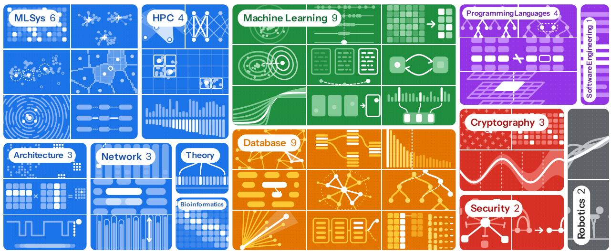  
Figure 1: FrontierCS 2. Each task removes a paper’s key contribution; agents must beat the original code.

## Author list

Qiuyang Mang\*,† UC Berkeley

Wenhao Chai\*,† Princeton University

Runyuan He UC Berkeley

Dongruixuan Li University of Waterloo

Zihan Zheng\* New York University

Yujun He Georgia Institute of Technology

Xuanyi Zhou UC Berkeley

Hao Wang UC Berkeley

Siddhant Ray University of Chicago

Bo Peng Princeton University

Ruyi Ji University of Michigan

Shuo Yang UC Berkeley

Haocheng Xi UC Berkeley

Boru Chen UC Berkeley

Xinyang David Han UC Berkeley

Melissa Pan UC Berkeley

Mayank Mishra UC Berkeley

Boxi Yu University of Limerick

Sijia Liu Princeton University

Kerem Akillioglu UC Berkeley

Yi Pan UC Berkeley

Zirui Wang UC Berkeley

Mert Cemri UC Berkeley

Diogo Antunes UC Berkeley

Yichuan Wang UC Berkeley

Aiwei Ivy Zhang Georgia Institute of Technology

Zhenyang Chen Georgia Institute of Technology

Qizheng Zhang Stanford University

Kaiyuan Liu University of Washington

Wenyuan Huang University of Wisconsin-Madison

Sherry Ruan Stanford University

Shu Liu UC Berkeley

Dacheng Li UC Berkeley

Zerui Cheng Princeton University

Zeyu Shen Princeton University

Shang Zhou UCSD

Hanfei Chen Georgia Institute of Technology

Yuzhong Zhang UNSW

Bohan Lyu UC Berkeley

Qu Ao MIT

Han Zheng MIT

Chonghe Jiang MIT

Jingzhuo Hu University of Pennsylvania

Xiaokun Chen Harbor Framework

Kunjun Li UC Berkeley

Zhiqing Zhong Aalto University

Haoye Tian Aalto University

Tong Zhao Scale AI

Yunzhong He Scale AI

Hanchen Li† UC Berkeley

ADVISORS

Ofir Press

Jiantao Jiao NVIDIA

Kunle Olukotun Stanford University

Karthik R. Narasimhan Princeton University

Jingbo Shang UCSD

Koushik Sen UC Berkeley

Matei Zaharia UC Berkeley

Alex Dimakis UC Berkeley

Ion Stoica UC Berkeley

Joseph E. Gonzalez UC Berkeley

Alvin Cheung UC Berkeley

CORRESPONDENCE

† qmang@berkeley.edu wenhao.chai@princeton.edu lihanc@berkeley.edu

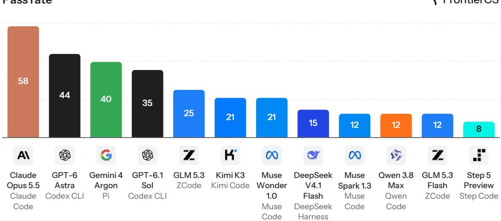  
Figure 2: Pass rate. Share of each agent’s runs whose final submission beats the human reference on every metric and held-out workload; the harness is in gray.

## 1 Introduction

Consider a researcher who picks up a published system to make it better. They inherit a working codebase, change one component, test the change on the workloads the paper reported, and are judged against the paper’s own implementation. Much of research and development in computer science looks like this. We ask whether an LLM agent can do the same.

Existing open-ended benchmarks answer a narrower question. On FrontierCS [1], ALE-Bench [2] and AtCoder heuristic contests [3], agents stay below the top human experts. These benchmarks share one design: the agent receives a problem statement and writes one program, and an evaluator scores it once, after the run ends.

Benchmarks that do place the agent in a real environment are narrow in another way. SWEbench [4] and MLE-bench [5] grade against tests or a leaderboard. ResearchGym [6], MLS-Bench [7] and PaperBench [8] stay within machine learning, and those that span other fields grade against a rubric or a reimplementation rather than the authors’ own code.

In this paper, we evaluate agents against the published code itself, inside the repository it came from, across computer science. FrontierCS 2 is the second version of FrontierCS (Table 1). We take the code a paper’s authors released, delete the paper’s contribution, and ask the agent to rebuild it so that it beats the original (Figure 1). We call the deleted code the human reference and measure it on the paper’s own workloads (Section 3). The agent works as a researcher would. It edits the code, submits a patch whenever it likes, and gets back a score on a development suite from a judge. The evaluator, the held-out final suite and the human reference stay with the judge (Section 4). At the end, the agent names one patch as final, and the judge grades that patch on the held-out suite. A run passes only when the patch beats the human reference on every metric

Table 1: FrontierCS and FrontierCS 2. Each task moves into a paper’s own repository, with the authors code as the bar.
<table><tr><td></td><td>FrontierCS</td><td>FrontierCS 2</td></tr><tr><td>Task</td><td>A problem statement</td><td>A repository with a paper&#x27;s contribution deleted</td></tr><tr><td>Output</td><td>One program</td><td>A patch</td></tr><tr><td>Bar</td><td>No known optimum</td><td>The authors&#x27; code, on held-out workloads</td></tr><tr><td>Feedback</td><td>None</td><td>A development score for every patch</td></tr><tr><td>Domains</td><td>Algorithms and six research areas</td><td>13 computer-science domains</td></tr><tr><td>Metric</td><td>Mean score</td><td>Pass rate, Mean score, and FCI</td></tr></table>

## and every held-out workload.

We evaluate 12 models, each paired with one agent harness, with one run per task. The best agent, Claude Opus 5.5 in Claude Code, passes 58% of its runs, and every other agent passes fewer than half of its runs (Figure 2). No agent passes any of 16 tasks. To compare agents and tasks on one scale, we fit the FrontierCS Capabilities Index (FCI) together with a matching difficulty index. The median task sits at about the strongest agent’s FCI (Section 5.2). The leading agent also changes with the cost budget per run (Section 5.3).

## In summary, our contributions are:

• Tasks built by subtraction: we delete a paper’s contribution from its repository and keep the deleted code as the bar (Section 3).

• A judge that scores patches during a run and keeps the evaluator, the held-out suite and the reference private (Section 4).

• 48 tasks in 13 domains, with 12 agents evaluated (Section 5) and three case studies (Section 6), and a private set of more than 100 tasks, to be announced in the future.

## Contents

1 Introduction 3   
2 Related work 6   
3 Task building 7   
4 Judge 8   
5 Evaluation results 9   
5.1 Experimental setup . . 9   
5.2 FrontierCS Capabilities Index (FCI) 10   
5.3 Test-time scaling . 11   
6 Case studies 11   
6.1 Two checksums shrink private lookups 11   
6.2 Two faster clocks for a packet scheduler 12   
6.3 A measured budget for sparse video attention 14   
7 Conclusion 15   
A Task sources 24   
B Task resources 26   
C Agent settings 27   
D Computing FCI and FDI 27

## 2 Related work

Open-ended coding benchmarks. Unlike competition benchmarks with known solutions, such as LiveCodeBench Pro [9], benchmarks that score a program on an objective with no known optimum now span heuristic contests [2], combinatorial optimization [10, 11], GPU kernels [12], and algorithmic and research problems [1]. Speed-up benchmarks start from a codebase and measure against a fixed baseline: the human nanoGPT speedrun record [13, 14] or a naive PyTorch inference server [15]. FrontierCS 2 instead grades most of its tasks against the human reference, code the paper’s authors released, and scores each patch during the run.

Agent benchmarks for research and engineering. A second family scores what an agent produces inside an environment. SWE-bench [4] and Terminal-Bench [16] grade with held-out tests, MLE-bench [5] with Kaggle leaderboards, and RE-Bench [17] against human experts given the same time budget. PostTrainBench [18] measures the downstream score of a post-trained model, and DeployBench [19] checks whether a research artifact runs its designated experiment. EdgeBench [20] also gives the agent feedback during a run. PaperBench [8] grades replication from scratch with a rubric, while AIRS-Bench [21] and ResearchGym [6] compare against published machine-learning results. RSI-Forge [22] turns papers from many fields into tasks whose baseline is an agent’s reimplementation of each paper’s method. Into the Unknown [23] grades follow-up papers on unpublished directions against expert criteria, and ReuF2F [24] poses formalized undergraduate research problems. None of these benchmarks sets its bar by measuring the original authors’ code. MLS-Bench [7] is the closest in design: each of its 140 machine-learning tasks across 12 areas asks the agent to improve one named component. We extend that design beyond machine learning to 13 computer-science domains, from databases to cryptography.

Building tasks from existing artifacts. Methods that build tasks at scale start from an artifact that already works and break it in a controlled way. SWE-bench pairs a pull request with the tests it fixed, and SWE-smith [25] injects bugs into a repository so that existing tests fail. FrontierSmith [26] mutates closed competitive-programming problems into open-ended ones, and BenchEvolver [27] evolves solved problems into harder variants. DiscoGen [28] instead generates algorithm-discovery tasks procedurally. Like ResearchGym, we remove a paper’s method from its repository. Unlike it, our oracle is the removed code itself, and our tasks span 13 domains.

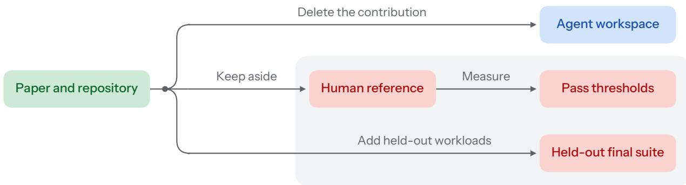  
Figure 3: FrontierCS 2 task building. We delete the paper’s contribution from its own repository and give the agent what remains. The judge keeps the deleted code as the human reference, the pass thresholds measured from it on the paper’s workloads, and a final suite with held-out workloads.

## 3 Task building

We build the tasks by subtraction from the code the paper’s authors released (Figure 3 and Table 2).\* We locate the code that implements the paper’s contribution, delete it, and leave everything it depends on unchanged. Take SVG-EAR [29], which we build from the Sparse VideoGen repository†. We delete the error-aware attention class and three of its routines. These routines average each cluster, choose the cluster pairs to compute, and compute those pairs while estimating the rest. The agent receives this repository with the deleted functions still declared and called, and it must write them. It may edit only the files that held the contribution. The human reference is a private patch that restores the deleted code. Subtraction gives each task built this way an oracle that already runs in its repository on the paper’s own workloads.

We set each metric’s pass threshold from the reference’s own measurements on the workloads the paper reported. For SVG-EAR, latency must be at most 0.96 times the reference’s latency, PSNR must stay within 0.25 dB of the reference value, SSIM within 0.01 and LPIPS within 0.005. The judge scores every submission on a development suite of these workloads. Only the final submission is scored on a final suite, which adds held-out instances the agent never sees (different seeds, queries or input graphs).

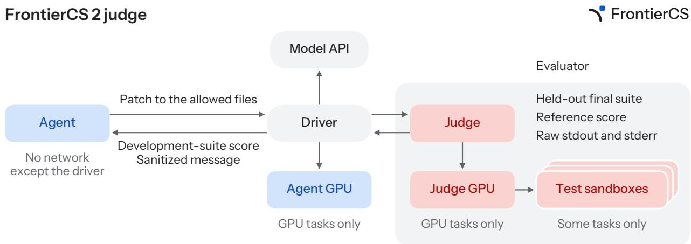  
Figure 4: FrontierCS 2 judge. Each colored box is a sandbox. The agent’s sandbox reaches only the driver. The agent sees only a development-suite score and a sanitized message per patch; all that decides its result stays with the judge.

## 4 Judge

The agent and the judge hold separate information (Figure 4). The agent holds the repository; the judge holds the evaluator, the held-out final suite and the human reference. The agent has five hours and may submit a patch to the allowed files at any time. The judge returns the patch’s score on the development suite and a message that counts the development workloads meeting each metric’s threshold, without the reference score or the evaluator’s raw output.

They also run apart, each in its own sandbox, linked only by a driver started for the run. The agent’s sandbox reaches no network but the driver, which forwards its model calls and patches, so it cannot download the authors’ code. On GPU tasks, the agent may start a development GPU through the driver, while only the judge uses the GPU that measures the patch against the human reference. Some tasks also give the judge test sandboxes: on Continuum [30], a vLLM serving task, they run SWE-bench episodes against the patched vLLM.

Development-suite scores guide the agent and do not count toward its result. At the end of the run, the agent names one submission as final, and the judge evaluates that patch alone on the held-out suite. We do not pick its best development-suite submission for it, since choosing the patch is part of a researcher’s work. We say a submission beats the reference on a metric when it meets that metric’s threshold. A run passes when its final submission beats the reference on every metric across every held-out workload. The judge also assigns a final score from 0 to 100 on a scale each task defines.‡ A run without a saved final submission scores 0.

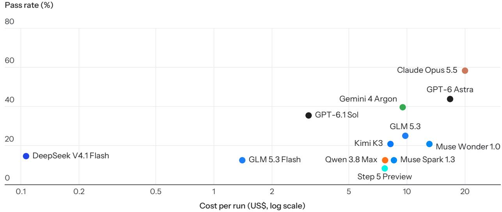  
Figure 5: Pass rate and cost. Each point is one agent: pass rate on the y-axis against mean cost per run in US\$ on a log-scale x-axis. GPT-6.1 Sol passes less often than GPT-6 Astra and sits far to its left on the cost axis.

## 5 Evaluation results

## 5.1 Experimental setup

Agents. An agent pairs a model with a harness, the program that runs the model’s tool calls and submits its patches to the judge. We evaluate 12 models, each in one harness. We name each agent by its model, but the harness is part of what we measure. Table 4 lists each agent’s harness, version, reasoning effort and output limit.

Tasks and runs. A run is one agent on one task, from the starting repository to its final submission. Each of the 12 reported agents runs each task once. The provider refused two Gemini 4 Argon runs before a final submission. Like every run without a passing final submission, they count as failures, in the pass rate and in FCI alike.

Metrics. Our main metric is the pass rate, the share of an agent’s runs that pass. We also report an agent’s mean score, its mean margin over the human reference. This is the average over its runs of the final score minus the reference’s score on the same task (0 is a tie). Figure 5 sets each agent’s pass rate against its mean cost per run. A higher final score does not mean a pass, and a pass does not need a higher score (Figure 6). Most runs whose final score exceeds the human reference’s miss a threshold on at least one metric or workload. Conversely, some passing runs score at or below the reference’s final score, since the final score is one number on each task’s own scale, while a pass needs every metric to hold at once.

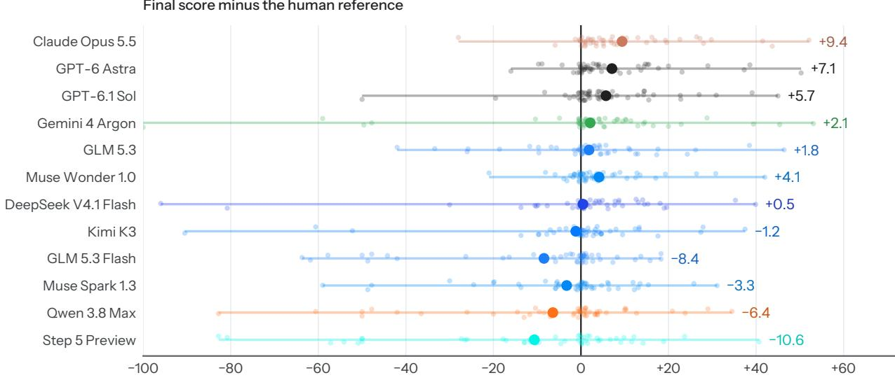  
Figure 6: Final score against the human reference. Each faint point is one run’s final score minus the human reference’s on the same task, one row per agent; the line spans each agent’s range and the dot marks its mean. The vertical line at 0 marks a tie.

## 5.2 FrontierCS Capabilities Index (FCI)

The FrontierCS Capabilities Index (FCI) puts the agents on one capability scale, and the FrontierCS Difficulty Index (FDI) puts the tasks on the same scale. FCI adapts Epoch AI’s Epoch Capabilities Index [31], an item response model. We fit it to per-metric outcomes and to score margins over the human reference, rather than to raw scores.

One joint fit takes two observations from every run: which of the task’s metrics the run beats the human reference on, and the margin of its final score over the reference’s. The metric outcomes tell the fit how hard each part of a task is, and the margin tells it how close a failed run came. Both share one fitted run effect, which says how far that run lands above or below its agent’s strength.

Each agent has one strength, which we report as its FCI: ten points per logit, with Kimi K2.7 at 0. Kimi K2.7, run in Kimi Code, is a thirteenth agent that serves only as this 0 point: its runs enter the fit, but we do not report it. A task’s FDI is the FCI at which an agent passes it half the time. The human reference has no FCI, since its code cannot beat itself. Intervals are 90% bootstrap intervals over the tasks, and Appendix D gives each step of the fit.

Claude Opus 5.5 leads FCI, followed by GPT-6 Astra and GPT-6.1 Sol, and Step 5 Preview is last (Figure 7); FCI and the pass rate order the agents almost alike. The tasks span a wider range of difficulty than the agents do: the median task sits at about the strongest agent’s FCI. Each task’s FDI is uncertain, however, so we do not order individual tasks by it. FDI measures how hard a task is to pass, and across tasks it follows the pass rate closely.

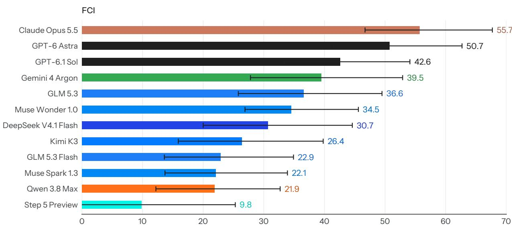  
Figure 7: FrontierCS Capabilities Index. Each bar shows an agent’s FCI from 0 with its 90% bootstrap interval as a whisker. The intervals separate only agents that sit far apart on the capability scale.

## 5.3 Test-time scaling

Test-time scaling asks what FCI an agent would reach under a cost cap per run. At budget B, a run that finished within B keeps its held-out result, and a run still going at B counts as one without a final submission, which scores 0. With the task parameters fixed at their FCI fit (Section 5.2), the FCI at B is the strength that best fits these outcomes (Appendix D). A run’s outcome can only improve as B grows, so no curve falls, and each ends at the agent’s FCI.

Which agent leads depends on the budget (Figure 8). At the smallest budgets, DeepSeek V4.1 Flash leads. Its costs are lower bounds, so this lead depends on how we price its tokens. Claude Opus 5.5 leads at the largest budgets.

## 6 Case studies

## 6.1 Two checksums shrink private lookups

Private information retrieval lets a client read one entry of a database held by a server, without the server learning which entry it read. QuarterPIR [32] makes this cheap. The client first builds a compact summary of the database; afterwards, each lookup costs one short request and one short reply. In our task the agent rewrites how the server answers requests, and it may also change the messages and the client. A run passes if every lookup returns the right entry and the run beats the human reference on the bytes each lookup sends, on every timing, and on the memory the client keeps.

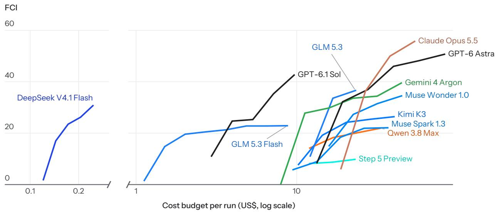  
Figure 8: Test-time scaling. FCI of each agent against the cost budget per run, in US\$ on a log scale; a run still going at a budget counts as one without a final submission. Each curve starts at the first budget at which its FCI is at least 0 and ends at the agent’s FCI. Two slanted strokes mark an empty budget range skipped on the axis. The leader changes with the budget.

In the human reference, every reply carries values the client rarely needs. Along with the answer, the server returns one parity value for each group of the database. The client needs only one of them, to correct the hint it refreshed after its previous lookup. Asking for that one alone, however, would tell the server where its previous lookup went. Muse Wonder 1.0 replaces these values with two checksums, the construction that lets a RAID-6 disk array rebuild two failed disks. Since the client already knows the only two groups in which its own values can differ from the server’s, two checksums are enough to recover the one it needs. This shrinks every reply, and therefore every lookup. Privacy is unchanged, because the task lets the server see only a public function of the request the authors’ client would send.

Muse Wonder 1.0’s run passes with a final score above the human reference’s. Most agents pass this task, but no other passing run shrinks the lookup by nearly as much (Figure 9). We found this idea only by reading the patches, since neither of our measures picks it out. A pass counts the same whether a run saves a few bytes or the most. GPT-6.1 Sol even scores slightly higher than Muse Wonder 1.0 with a far smaller saving.

## 6.2 Two faster clocks for a packet scheduler

A network switch or network card has to decide, for every packet it sends, which waiting packet goes next. Programmable schedulers express this decision as a priority queue: each packet carries a priority, and the queue must hand out the most urgent one millions of times per second. BBQ [33] builds such a queue as an FPGA circuit. It marks the occupied priorities in a tree of

QuarterPIR bytes per lookup

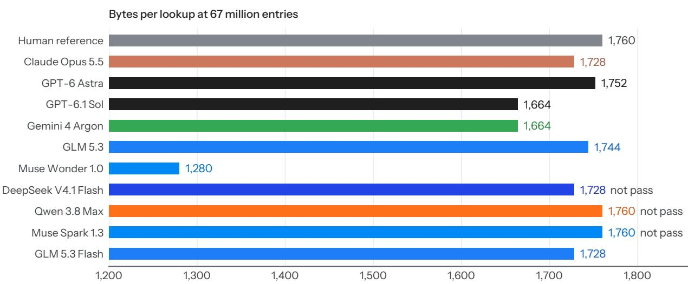  
Figure 9: QuarterPIR bytes per lookup. Bytes per private lookup on the 67-million-entry database; the x-axis starts at 1,200. Muse Wonder 1.0’s checksums remove far more of the reference’s bytes than any other passing run does. Kimi K3, far below the rest and not passing, is left out. Step 5 Preview’s run timed out.

bitmaps. Each bit keeps a count of the packets below it, so that the bit can be cleared when its last packet leaves. In our task the agent rewrites the logic of the tree’s levels. A run passes if the circuit is correct and beats the human reference on throughput and on worst-case latency at every tree size, including a larger one that the agent never sees during development.

On the smaller trees, the slowest step of each clock cycle in the human reference begins with a counter read from on-chip memory. The operation just ahead may have changed the same counter a moment earlier. The circuit therefore has to check the value it read against recent updates before it can use it. Gemini 4 Argon keeps the memories but settles that check while the read is still in flight, leaving little work for when the value arrives. Claude Opus 5.5 takes the other route. It moves every counter from memory into registers and updates a whole level of the tree in a single cycle, so that on the development trees no operation waits for a read.

Only these two and GPT-6.1 Sol pass, and the two designs trade speed for size (Figure 10). Both handle more operations per second than the human reference on every tree. On the largest tree, however, the circuit of Claude Opus 5.5 uses the most lookup tables of the passing circuits. Its design also does not serve trees as large as those BBQ was designed for. Gemini 4 Argon keeps roughly the human reference’s circuit size and memory layout. Registers alone do not explain Claude Opus 5.5’s clock. Other agents also move the counters into registers, and on the largest tree they end up slower than the human reference. The final score ranks Claude Opus 5.5 first, because it rewards speed and ignores circuit size.

Clock period at width 16 (ps)  
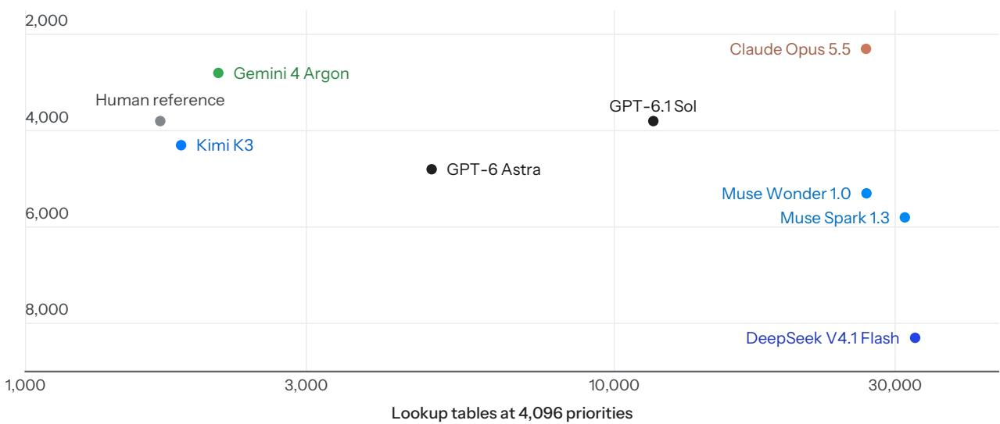  
Figure 10: BBQ clock period and circuit size. Each point is one agent’s circuit on the largest tree, 4,096 priorities. The x-axis gives its size in lookup tables and the y-axis its clock period, with shorter, faster clocks at the top; the grey dot marks the human reference. Claude Opus 5.5’s circuit has the shortest clock period and is among the largest. Agents without a correct circuit at this size are left out.

## 6.3 A measured budget for sparse video attention

Video diffusion models spend most of their time in attention. SVG-EAR [29], our running example in Section 3, computes some blocks of attention exactly and estimates the rest from cluster centroids. Within a fixed budget, it computes the blocks whose estimates would err the most. A run passes only if every held-out clip is faster than with the human reference and stays within narrow bands of its PSNR, SSIM and LPIPS.

No run passes, and GPT-6 Astra comes closest. It keeps the authors’ design but measures the error instead of predicting it. Every few denoising steps, it computes the exact attention of a few real queries and rebuilds their output under several budgets. Each attention head then runs with the smallest budget whose error stays under a bound. Astra also corrects a bias of the centroid estimate that the paper leaves in. Its videos come out faster than the human reference’s on every clip and, on average, closer to full attention (Figure 11). It still fails on image quality in two clips. Speed was not the obstacle on this task. Most runs beat the reference’s time on every clip, and no run stays within every image band.

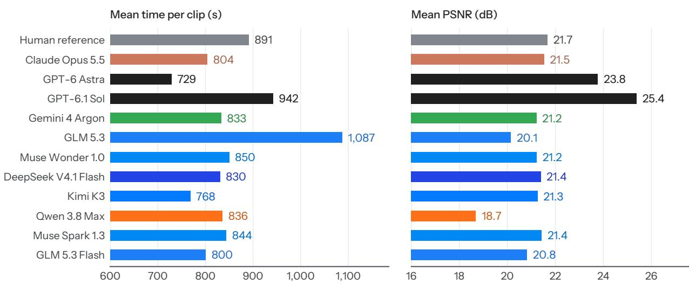  
Figure 11: SVG-EAR time and PSNR. Each run’s mean time per clip and mean PSNR against full attention on the held-out clips, with the human reference’s in grey; the x-axes start at 600 s and 16 dB. Only GPT-6 Astra is both faster and closer to full attention than the human reference on average, and it still fails. Step 5 Preview, far slower, is off the chart.

## 7 Conclusion

We built FrontierCS 2 to ask whether LLM agents can make contributions to frontier computer science R&D. Each task measures an agent against the code that researchers released with their paper, in that code’s own repository. Beyond these 48 tasks, FrontierCS 2 keeps a private set of more than 100 tasks, to be announced in the future.

The case studies show what the pass and the final score capture and what they miss. On SVG-EAR, a run faster than the human reference on every clip and closer to full attention on average still fails on image quality in two clips (Section 6.3). On QuarterPIR, neither measure separates the run that removes far more bytes per lookup from the other passing runs (Section 6.1). On BBQ, the final score ranks the largest passing circuit first, because it ignores circuit size (Section 6.2). We think benchmarks like this one will need to report such side costs next to the pass.

FCI and FDI are the measures we recommend for benchmarks like this one. They place agents and tasks on one scale, use every metric outcome and score margin of a run rather than one number, and come with intervals that show which differences the data support (Section 5.2).

## Acknowledgments

We give special thanks to Modal for its strong support of this work, including the compute resources it sponsored.

## Modal

We also thank the Laude Institute’s Slingshot program and Scale AI for compute credits and community support. We thank Kaggle for sponsoring FrontierCS.

## References

[1] Qiuyang Mang, Wenhao Chai, Zhifei Li, Huanzhi Mao, Shang Zhou, Alexander Du, Hanchen Li, Shu Liu, Edwin Chen, Yichuan Wang, et al. Frontiercs: Evolving challenges for evolving intelligence. arXiv preprint arXiv:2512.15699, 2025.

[2] Yuki Imajuku, Kohki Horie, Yoichi Iwata, Kensho Aoki, Naohiro Takahashi, and Takuya Akiba. Ale-bench: A benchmark for long-horizon objective-driven algorithm engineering. Advances in Neural Information Processing Systems, 38, 2026.

[3] Kaiyuan Liu, Qiuyang Mang, Bo Peng, Wenhao Chai, Hanchen Li, Shreyas Pimpalgaonkar, Luke Zettlemoyer, Alex Dimakis, and Alvin Cheung. When agents slow down: Understanding llm agents’ test-time strategies via elo-per-token analysis. arXiv preprint arXiv:2609.15309, 2026.

[4] Carlos E Jimenez, John Yang, Alexander Wettig, Shunyu Yao, Kexin Pei, Ofir Press, and Karthik Narasimhan. Swe-bench: Can language models resolve real-world github issues? In International Conference on Learning Representations, volume 2024, pages 54107–54157, 2024.

[5] Jun Shern Chan, Neil Chowdhury, Oliver Jaffe, James Aung, Dane Sherburn, Evan Mays, Giulio Starace, Kevin Liu, Leon Maksin, Tejal Patwardhan, et al. Mle-bench: Evaluating machine learning agents on machine learning engineering. In International Conference on Learning Representations, volume 2025, pages 50466–50494, 2025.

[6] Aniketh Garikaparthi, Manasi Patwardhan, and Arman Cohan. Researchgym: Evaluating language model agents on real-world ai research. arXiv preprint arXiv:2602.15112, 2026.

[7] Bohan Lyu, Yucheng Yang, Siqiao Huang, Jiaru Zhang, Qixin Xu, Xinghan Li, Xinyang Han, Yicheng Zhang, Huaqing Zhang, Runhan Huang, et al. Mls-bench: A holistic and rigorous assessment of ai systems on building better ai. arXiv preprint arXiv:2605.08678, 2026.

[8] Giulio Starace, Oliver Jaffe, Dane Sherburn, James Aung, Jun Shern Chan, Leon Maksin, Rachel Dias, Evan Mays, Benjamin Kinsella, Wyatt Thompson, et al. Paperbench: evaluating ai’s ability to replicate ai research. arXiv preprint arXiv:2504.01848, 2025.

[9] Zihan Zheng, Zerui Cheng, Zeyu Shen, Shang Zhou, Kaiyuan Liu, Hansen He, Dongruixuan Li, Stanley Wei, Hangyi Hao, Jianzhu Yao, et al. Livecodebench pro: How do olympiad medalists judge llms in competitive programming? Advances in Neural Information Processing Systems, 38, 2026.

[10] Hongzheng Chen, Yingheng Wang, Yaohui Cai, Hins Hu, Jiajie Li, Shirley Huang, Chenhui Deng, Rongjian Liang, Shufeng Kong, Haoxing Ren, Samitha Samaranayake, Carla P. Gomes, and Zhiru Zhang. HeuriGym: An agentic benchmark for LLM-crafted heuristics in combinatorial optimization. In ICLR, 2026.

[11] Xiaozhe Li, Xinyu Fang, Shengyuan Ding, Linyang Li, Haodong Duan, Qingwen Liu, and Kai Chen. Np-engine: Empowering optimization reasoning in large language models with verifiable synthetic np problems. arXiv preprint arXiv:2510.16476, 2025.

[12] Anne Ouyang, Simon Guo, Simran Arora, Alex L Zhang, William Hu, Christopher Re,´ and Azalia Mirhoseini. Kernelbench: Can llms write efficient gpu kernels? arXiv preprint arXiv:2502.10517, 2025.

[13] Bingchen Zhao, Despoina Magka, Minqi Jiang, Xian Li, Roberta Raileanu, Tatiana Shavrina, Jean-Christophe Gagnon-Audet, Kelvin Niu, Shagun Sodhani, Michael Shvartsman, et al. The automated llm speedrunning benchmark: Reproducing nanogpt improvements. Advances in Neural Information Processing Systems, 38, 2026.

[14] Elie Bakouch and Prime Intellect. Measuring autonomous ai research. Prime Intellect Blog, August 2026. https://www.primeintellect.ai/blog/measuring-autonomous-research.

[15] Jehyeok Yeon, Ben Rank, and Maksym Andriushchenko. Inferencebench: A benchmark for open-ended llm inference optimization by ai agents. arXiv preprint arXiv:2607.20468, 2026.

[16] Mike Merrill, Alexander Shaw, Nicholas Carlini, Boxuan Li, Harsh Raj, Ivan Bercovich, Lin Shi, Jeong Shin, Thomas Walshe, E Kelly Buchanan, et al. Terminal-bench: Benchmarking agents on hard, realistic tasks in command line interfaces. In International Conference on Learning Representations, volume 2026, pages 40903–40986, 2026.

[17] Hjalmar Wijk, Tao Lin, Joel Becker, Sami Jawhar, Neev Parikh, Thomas Broadley, Lawrence Chan, Michael Chen, Josh Clymer, Jai Dhyani, et al. Re-bench: Evaluating frontier ai r&d capabilities of language model agents against human experts. arXiv preprint arXiv:2411.15114, 2024.

[18] Ben Rank, Hardik Bhatnagar, Ameya Prabhu, Shira Eisenberg, Karina Nguyen, Matthias Bethge, and Maksym Andriushchenko. Posttrainbench: Can llm agents automate llm post-training? arXiv preprint arXiv:2603.08640, 2026.

[19] Yuanli Wang, Yaoyao Qian, Yue Zhang, Hanhan Zhou, Jindan Huang, Tianfu Fu, Qiuyang Mang, Huanzhi Mao, Wenhao Chai, Wendong Fan, et al. Deploybench: Benchmarking llm agents for research artifact deployment. arXiv preprint arXiv:2606.05238, 2026.

[20] Deyao Zhu, Xin Zhou, Shengling Qin, Xuekai Zhu, Hangliang Ding, Shu Zhong, Zixin Wen, Zhonglin Xie, Chenhui Gou, Linxuan Ren, et al. Edgebench: Unveiling scaling laws of learning from real-world environments. arXiv preprint arXiv:2607.05155, 2026.

[21] Alisia Lupidi, Bhavul Gauri, Thomas Simon Foster, Bassel Al Omari, Despoina Magka, Alberto Pepe, Alexis Audran-Reiss, Muna Aghamelu, Nicolas Baldwin, Lucia Cipolina-Kun, et al. Airs-bench: a suite of tasks for frontier ai research science agents. arXiv preprint arXiv:2602.06855, 2026.

[22] Renxiong Wang, Darvin Yi, Abril Herrlein, Anas Mahmoud, Advait Gosai, Lisiman Hua, MohammadHossein Rezaei, Xingang Guo, Anisha Gunjal, Utkarsh Tyagi, et al. Rsi-forge: From research papers to environments for recursive self-improvement. arXiv preprint arXiv:2610.09426, 2026.

[23] Seungone Kim, Jiayi Geng, Young-Jun Lee, Bo Liu, Juyoung Suk, Nicholas Lubbers, Mitchell Wood, Marcus Noack, Yong-Xin Yao, Yuan Shi, et al. Into the unknown: Benchmarking ai agents on open scientific research problems. arXiv preprint arXiv:2610.19159, 2026.

[24] Zeyu Zheng, Yiyang Liu, Yuyang Zhao, Congmin Zheng, Jiachen Zhu, Jianian Chen, Kangning Zhang, Kayue Daniel Wong, Lingyu Yang, Rong Shan, Shihao Chen, Thomas Zhu, Wentao Zhang, Xiaopeng Li, Yan Hu, Yongxi Lin, Yuxiang Chen, Zhuoying Ou, Jianghao Lin, Jeremy Avigad, Prasad Tetali, Jingbang Chen, and Sean Welleck. ReuF2F: Benchmarking coding agents on formalized undergraduate research problems. Preprint, 2026.

[25] John Yang, Kilian Lieret, Carlos Jimenez, Alexander Wettig, Kabir Khandpur, Yanzhe Zhang, Binyuan Hui, Ofir Press, Ludwig Schmidt, and Diyi Yang. Swe-smith: Scaling data for software engineering agents. Advances in Neural Information Processing Systems, 38, 2026.

[26] Runyuan He, Qiuyang Mang, Shang Zhou, Kaiyuan Liu, Hanchen Li, Huanzhi Mao, Qizheng Zhang, Zerui Li, Bo Peng, Lufeng Cheng, et al. Frontiersmith: Synthesizing open-ended coding problems at scale. arXiv preprint arXiv:2605.14445, 2026.

[27] Yangzhen Wu, Aaron J Li, Wenjie Ma, Li Cao, Ziheng Zhou, Mert Cemri, Shu Liu, Yuran Xiu, Chenxiao Yan, Haikun Zhao, et al. Benchevolver: Frontier task synthesis via solution-centric evolution. arXiv preprint arXiv:2606.01286, 2026.

[28] Alexander D Goldie, Zilin Wang, Adrian Hayler, Deepak Nathani, Edan Toledo, Ken Thampiratwong, Aleksandra Kalisz, Michael Beukman, Alistair Letcher, Shashank Reddy, et al. Procedural generation of algorithm discovery tasks in machine learning. arXiv preprint arXiv:2603.17863, 2026.

[29] Xuanyi Zhou, Qiuyang Mang, Shuo Yang, Haocheng Xi, Jintao Zhang, Huanzhi Mao, Joseph E. Gonzalez, Kurt Keutzer, Ion Stoica, and Alvin Cheung. SVG-EAR: Parameter-free linear compensation for sparse video generation via error-aware routing. In ECCV, pages 167–185, 2026.

[30] Hanchen Li, Runyuan He, Qiuyang Mang, Qizheng Zhang, Huanzhi Mao, Xiaokun Chen, Hangrui Zhou, Huanchen Zhang, Alvin Cheung, Joseph Gonzalez, et al. Continuum: Efficient and robust multi-turn llm agent scheduling with kv cache time-to-live. arXiv preprint arXiv:2511.02230, 2025.

[31] Anson Ho, Jean-Stanislas Denain, David Atanasov, Samuel Albanie, and Rohin Shah. A rosetta stone for ai benchmarks. arXiv preprint arXiv:2512.00193, 2025.

[32] Ashrujit Ghoshal, Mingxun Zhou, and Elaine Shi. Efficient pre-processing pir without public-key cryptography. In Annual International Conference on the Theory and Applications of Cryptographic Techniques, pages 210–240. Springer, 2024.

[33] Nirav Atre, Hugo Sadok, and Justine Sherry. {BBQ}: A fast and scalable integer priority queue for hardware packet scheduling. In 21st USENIX Symposium on Networked Systems Design and Implementation (NSDI 24), pages 455–475, 2024.

[34] Anna Arpaci-Dusseau, Zixiang Zhou, and Xuhao Chen. Accurate and fast approximate graph pattern mining at scale. arXiv preprint arXiv:2405.03488, 2024.

[35] Liese Bekkers, Frank Neven, Stijn Vansummeren, and Yisu Remy Wang. Instance-optimal acyclic join processing without regret: Engineering the yannakakis algorithm in column stores. arXiv preprint arXiv:2411.04042, 2024.

[36] Xi Zhao, Bolong Zheng, Xiaomeng Yi, Xiaofan Luan, Charles Xie, Xiaofang Zhou, and Christian S Jensen. Fargo: Fast maximum inner product search via global multi-probing. Proceedings of the VLDB Endowment, 16(5):1100–1112, 2023.

[37] Zhihao Chen, Tianji Yang, Yixiao Zheng, Zhao Zhang, Cheqing Jin, and Aoying Zhou. Spectrum: Speedy and strictly-deterministic smart contract transactions for blockchain ledgers. Proc. VLDB Endow., 17(10):2541–2554, June 2024.

[38] Qiyan Li and Jeffrey Xu Yu. Fast local subgraph counting. Proc. VLDB Endow., 17(8):1967–1980, April 2024.

[39] Guanhao Hou, Jinchao Huang, Fangyuan Zhang, and Sibo Wang. Efficient concurrent updates to persistent randomized binary search trees. Proc. VLDB Endow., 18(5):1481–1494, January 2025.

[40] Shijie Zhang, Ru Cheng, Xinpeng Liu, Jiang Xiao, Hai Jin, and Bo Li. Seer: Accelerating blockchain transaction execution by fine-grained branch prediction. Proc. VLDB Endow., 18(3):822–835, November 2024.

[41] Zezhou Huang, Rathijit Sen, Jiaxiang Liu, and Eugene Wu. Joinboost: Grow trees over normalized data using only sql. Proc. VLDB Endow., 16(11):3071–3084, July 2023.

[42] David Klindt, Yann LeCun, and Randall Balestriero. When does lejepa learn a world model? arXiv preprint arXiv:2605.26379, 2026.

[43] Noah Amsel, David Persson, Christopher Musco, and Robert M Gower. The polar express: Optimal matrix sign methods and their application to the muon algorithm. In International Conference on Learning Representations, volume 2026, pages 138323–138360, 2026.

[44] Jiawei Yang, Tianhong Li, Lijie Fan, Yonglong Tian, and Yue Wang. Latent denoising makes good tokenizers. In International Conference on Learning Representations, volume 2026, pages 61642–61668, 2026.

[45] Jiawei Yang, Zhengyang Geng, Xuan Ju, Yonglong Tian, and Yue Wang. Representation fr\’echet loss for visual generation. arXiv preprint arXiv:2604.28190, 2026.

[46] Zhen Fang, Wenxuan Huang, Yu Zeng, Yiming Zhao, Shuang Chen, Kaituo Feng, Yunlong Lin, Lin Chen, Zehui Chen, Shaosheng Cao, et al. Flow-opd: On-policy distillation for flow matching models. arXiv preprint arXiv:2605.08063, 2026.

[47] Zihan Wang, Kangrui Wang, Qineng Wang, Pingyue Zhang, Linjie Li, Zhengyuan Yang, Xing Jin, Kefan Yu, Minh Nhat Nguyen, Licheng Liu, et al. Ragen: Understanding self-evolution in llm agents via multi-turn reinforcement learning. arXiv preprint arXiv:2504.20073, 2025.

[48] Jiachen Zhu, Xinlei Chen, Kaiming He, Yann LeCun, and Zhuang Liu. Transformers without normalization. In 2025 IEEE/CVF Conference on Computer Vision and Pattern Recognition (CVPR), pages 14901–14911. IEEE, 2025.

[49] Siqiao Huang, Partha Kaushik, Michael Chen, Hengkai Pan, Kaiwen Geng, Omar Chehab, Fernando Moreno-Pino, and Max Simchowitz. Nano world models: A minimalist implementation of future video prediction. arXiv preprint arXiv:2605.23993, 2026.

[50] Adam Zweiger, Xinghong Fu, Han Guo, and Yoon Kim. Fast kv compaction via attention matching. arXiv preprint arXiv:2602.16284, 2026.

[51] Shuo Yang, Haocheng Xi, Yilong Zhao, Muyang Li, Xiaoze Fan, Jintao Zhang, Han Cai, Yujun Lin, Xiuyu Li, Kurt Keutzer, et al. Flash-kmeans: Fast and memory-efficient exact k-means. arXiv preprint arXiv:2603.09229, 2026.

[52] Shuo Yang, Haocheng Xi, Yilong Zhao, Qiuyang Mang, Zhe Wang, Shanlin Sun, Kurt Keutzer, Joseph E. Gonzalez, Song Han, Chenfeng Xu, and Ion Stoica. Flashlib: Bringing flash magic to classical machine learning operators, 2026.

[53] Julian Shun. Practical parallel hypergraph algorithms. In Proceedings of the 25th ACM SIGPLAN Symposium on Principles and Practice of Parallel Programming, pages 232–249, 2020.

[54] Jessica Shi and Julian Shun. Parallel algorithms for butterfly computations. In Massive Graph Analytics, pages 287–330. Chapman and Hall/CRC, 2022.

[55] Yiqiu Wang, Yan Gu, and Julian Shun. Theoretically-efficient and practical parallel dbscan. In Proceedings of the 2020 ACM SIGMOD International Conference on Management of Data, pages 2555–2571, 2020.

[56] Omar Obeya, Endrias Kahssay, Edward Fan, and Julian Shun. Theoretically-efficient and practical parallel in-place radix sorting. In The 31st ACM symposium on parallelism in algorithms and architectures, pages 213–224, 2019.

[57] David Cao, Rose Kunkel, Chandrakana Nandi, Max Willsey, Zachary Tatlock, and Nadia Polikarpova. babble: Learning better abstractions with e-graphs and anti-unification. Proceedings of the ACM on Programming Languages, 7(POPL):396–424, 2023.

[58] Max Willsey, Chandrakana Nandi, Yisu Remy Wang, Oliver Flatt, Zachary Tatlock, and Pavel Panchekha. Egg: Fast and extensible equality saturation. Proceedings of the ACM on Programming Languages, 5(POPL):1–29, 2021.

[59] Pinhan Zhao, Yuepeng Wang, and Xinyu Wang. Polygon: Symbolic reasoning for sql using conflict-driven under-approximation search. Proceedings of the ACM on Programming Languages, 9(PLDI):1315–1340, 2025.

[60] Gus Henry Smith, Andrew Liu, Steven Lyubomirsky, Scott Davidson, Joseph McMahan, Michael Taylor, Luis Ceze, and Zachary Tatlock. Pure tensor program rewriting via access patterns (representation pearl). In Proceedings of the 5th ACM SIGPLAN International Symposium on Machine Programming, pages 21–31, 2021.

[61] Abdullah Al Raqibul Islam, Helen Xu, Dong Dai, and Aydin Buluc¸. Improving spgemm performance through matrix-reordering and cluster-wise computation. In Proceedings of the International Conference for High Performance Computing, Networking, Storage and Analysis, pages 1446–1463, 2025.

[62] Hemeng Wang, Yang Du, Sidu Li, Xiaowen Tian, Qingxiao Sun, and Weifeng Liu. Kami: Communication-avoiding general matrix multiplication within a single gpu. In Proceedings of the International Conference for High Performance Computing, Networking, Storage and Analysis, pages 1572–1589, 2025.

[63] Toru Koizumi, Toshiki Maekawa, Masanari Mizuno, Maru Kuroki, Tomoaki Tsumura, and Ryota Shioya. Runlts: Register-value-aware predictor utilizing nested large tables. 6th Championship Branch Prediction (CBP), 2025.

[64] Aayush Jain, Huijia Lin, and Sagnik Saha. A systematic study of sparse lwe. In Annual International Cryptology Conference, pages 210–245. Springer, 2024.

[65] Jean-Philippe Bossuat, Anamaria Costache, Christian Mouchet, Lea Nurnberger, and¨ Juan Ramon Troncoso-Pastoriza. Accurate and composable noise estimates for ckks with´ application to exact he computation. Cryptology ePrint Archive, 2024.

[66] Pengfei Zheng, Rui Pan, Tarannum Khan, Shivaram Venkataraman, and Aditya Akella. Shockwave: Fair and efficient cluster scheduling for dynamic adaptation in machine learning. In 20th USENIX Symposium on Networked Systems Design and Implementation (NSDI 23), pages 703–723, 2023.

[67] Pooria Namyar, Behnaz Arzani, Ryan Beckett, Santiago Segarra, Himanshu Raj, Umesh Krishnaswamy, Ramesh Govindan, and Srikanth Kandula. Finding adversarial inputs for heuristics using multi-level optimization. In 21st USENIX Symposium on Networked Systems Design and Implementation (NSDI 24), pages 927–949, 2024.

[68] Tianneng Shi, Jingxuan He, Zhun Wang, Hongwei Li, Linyu Wu, Wenbo Guo, and Dawn Song. Progent: Securing ai agents with privilege control. arXiv preprint arXiv:2504.11703, 2025.

[69] Sicheol Sung, Joonghyuk Hahn, and Yo-Sub Han. Repairing regex vulnerabilities via localization-guided instructions. In Proceedings of the 19th Conference of the European Chapter of the Association for Computational Linguistics (Volume 1: Long Papers), pages 8128–8142, 2026.

[70] Cheng Chi, Zhenjia Xu, Siyuan Feng, Eric Cousineau, Yilun Du, Benjamin Burchfiel, Russ Tedrake, and Shuran Song. Diffusion policy: Visuomotor policy learning via action diffusion, 2024.

[71] Kevin Zakka, Baruch Tabanpour, Qiayuan Liao, Mustafa Haiderbhai, Samuel Holt, Jing Yuan Luo, Arthur Allshire, Erik Frey, Koushil Sreenath, Lueder A. Kahrs, Carmelo Sferrazza, Yuval Tassa, and Pieter Abbeel. Mujoco playground, 2025.

[72] Martin Soˇ siˇ c and Mile ´ Siki ˇ c. Edlib: a c/c++ library for fast, exact sequence alignment using ´ edit distance. Bioinformatics, 33(9):1394–1395, 2017.

[73] Jacob Burnim and Koushik Sen. Heuristics for scalable dynamic test generation. In 2008 23rd IEEE/ACM International Conference on Automated Software Engineering, pages 443–446. IEEE, 2008.

[74] Thomas Mueller Graf and Daniel Lemire. Binary fuse filters: Fast and smaller than xor filters. ACM J. Exp. Algorithmics, 27, March 2022.

## Appendix

## A Task sources

Table 2 lists the paper behind each of the 48 tasks. The three FlashLib tasks share one source, and so do the two FARGO tasks. Structured LWE is the one task not built from a paper’s code: it is an original cryptanalysis challenge in which the agent attacks 200 published instances, and any secret that meets the published conditions counts. Since these instances are public, its final suite has no held-out part.

Table 2: Task sources. The paper each task is built from.
<table><tr><td>Domain</td><td>Task</td><td>Paper</td></tr><tr><td>Database</td><td>ScaleGPM</td><td>Accurate and Fast Approximate Graph Pattern Mining at Scale [34]</td></tr><tr><td></td><td>Yannakakis</td><td>Instance-Optimal Acyclic Join Processing Without Regret: Engineering the Yannakakis Algorithm in Column</td></tr><tr><td></td><td>FARGO Query Stopping</td><td>Stores [35] FARGO: Fast Maximum Inner Product Search via Global Multi-Probing [36]</td></tr><tr><td></td><td>Spectrum</td><td>Spectrum: Speedy and Strictly-Deterministic Smart Contract Transactions for Blockchain Ledgers [37]</td></tr><tr><td></td><td>SCOPE</td><td>Fast Local Subgraph Counting [38]</td></tr><tr><td></td><td>Persistent Treap</td><td>Efficient Concurrent Updates to Persistent Randomized</td></tr><tr><td></td><td>FARGO Query Core</td><td>Binary Search Trees [39] FARGO: Fast Maximum Inner Product Search via Global</td></tr><tr><td></td><td>Seer</td><td>Multi-Probing [36] Seer: Accelerating Blockchain Transaction Execution by</td></tr><tr><td></td><td>JoinBoost</td><td>Fine-Grained Branch Prediction [40] JoinBoost: Grow Trees over Normalized Data Using Only</td></tr><tr><td>Machine Learning</td><td>LeJEPA</td><td>SQL [41] When Does LeJEPA Learn a World Model? [42]</td></tr><tr><td></td><td>Polar Express</td><td>The Polar Express: Optimal Matrix Sign Methods and</td></tr><tr><td></td><td>DeTok</td><td>Their Application to the Muon Algorithm [43]</td></tr><tr><td></td><td>Representation Fréchet Loss</td><td>Latent Denoising Makes Good Tokenizers [44] Representation Fréchet Loss for Visual Generation [45]</td></tr><tr><td></td><td>Flow-OPD</td><td>Flow-OPD: On-Policy Distillation for Flow Matching Models [46]</td></tr><tr><td></td><td>RAGEN</td><td>RAGEN: Understanding Self-Evolution in LLM Agents via Multi-Turn Reinforcement Learning [47]</td></tr><tr><td></td><td>DyT</td><td>Transformers without Normalization [48]</td></tr><tr><td></td><td>Nano World Model</td><td>Nano World Models: A Minimalist Implementation of Future Video Prediction [49]</td></tr><tr><td>MLSys</td><td>KV Compaction</td><td>Fast KV Compaction via Attention Matching [50]</td></tr><tr><td></td><td>SVG-EAR</td><td>SVG-EAR: Parameter-Free Linear Compensation for Sparse Video Generation via Error-aware Routing [29]</td></tr><tr><td></td><td>FlashLib K-Means</td><td>Flash-KMeans: Fast and Memory-Efficient Exact K-Means [51]</td></tr><tr><td></td><td>FlashLib DBSCAN</td><td>FlashLib: Bringing Flash Magic to Classical Machine Learning Operators [52]</td></tr><tr><td rowspan="6"></td><td>FlashLib IVF-PQ</td><td>FlashLib: Bringing Flash Magic to Classical Machine Learning Operators [52]</td></tr><tr><td>FlashLib KNN</td><td>FlashLib: Bringing Flash Magic to Classical Machine</td></tr><tr><td>Continuum</td><td>Learning Operators [52] Continuum: Efficient and Robust Multi-Turn LLM Agent</td></tr><tr><td>Hygra</td><td>Scheduling with KV Cache Time-to-Live [30] Practical Parallel Hypergraph Algorithms [53]</td></tr><tr><td>ParButterfly</td><td>Parallel Algorithms for Butterfly Computations [54]</td></tr><tr><td>Parallel DBSCAN</td><td>Theoretically-Efficient and Practical Parallel DBSCAN [55]</td></tr><tr><td rowspan="5">Programming Languages BABBLE</td><td>RegionsSort</td><td>Theoretically-Efficient and Practical Parallel In-Place Radix Sorting [56]</td></tr><tr><td></td><td>babble: Learning Better Abstractions with E-Graphs and</td></tr><tr><td>egg</td><td>Anti-unification [57] egg: Fast and Extensible Equality Saturation [58]</td></tr><tr><td>Polygon</td><td>Polygon: Symbolic Reasoning for SQL using Conflict-Driven Under-Approximation Search [59]</td></tr><tr><td>Glenside</td><td>Pure Tensor Program Rewriting via Access Patterns</td></tr><tr><td rowspan="3">Architecture</td><td>Clusterwise SpGEMM</td><td>(Representation Pearl) [60] Improving SpGEMM Performance Through</td></tr><tr><td>KAMI</td><td>Matrix-Reordering and Cluster-wise Computation [61] KAMI: Communication-Avoiding General Matrix</td></tr><tr><td>RUNLTS</td><td>Multiplication within a Single GPU [62] RUNLTS: Register-value-aware Predictor Utilizing</td></tr><tr><td rowspan="2">Cryptography</td><td>Structured LWE</td><td>Nested Large Tables [63] A Systematic Study of Sparse LWE [64]</td></tr><tr><td>QuarterPIR</td><td>Efficient Pre-processing PIR Without Public-Key</td></tr><tr><td rowspan="3">Network</td><td>CKKS Noise</td><td>Cryptography [32] Accurate and Composable Noise Estimates for CKKS</td></tr><tr><td>BBQ</td><td>with Application to Exact HE Computation [65] BBQ: A Fast and Scalable Integer Priority Queue for</td></tr><tr><td>Shockwave</td><td>Hardware Packet Scheduling [33] Shockwave: Fair and Efficient Cluster Scheduling for Dynamic Adaptation in Machine Learning [66]</td></tr><tr><td rowspan="2">Security</td><td>MetaOpt</td><td>Finding Adversarial Inputs for Heuristics using Multi-level Optimization [67]</td></tr><tr><td>Progent LRR</td><td>Progent: Securing AI Agents with Privilege Control [68] Repairing Regex Vulnerabilities via Localization-Guided</td></tr><tr><td>Robotics</td><td>Diffusion Policy</td><td>Instructions [69] Diffusion Policy: Visuomotor Policy Learning via Action</td></tr><tr><td>Bioinformatics</td><td>MuJoCo Playground</td><td>Diffusion [70] Demonstrating MuJoCo Playground [71]</td></tr><tr><td></td><td>Edlib</td><td>Edlib: a C/C++ library for fast, exact sequence alignment using edit distance [72]</td></tr><tr><td>Software Engineering</td><td>CREST</td><td>Heuristics for Scalable Dynamic Test Generation [73]</td></tr><tr><td>Theory</td><td>Binary Fuse Filter</td><td>Binary Fuse Filters: Fast and Smaller Than Xor Filters [74]</td></tr></table>

## B Task resources

Table 3 lists what each task gives the agent and the verifier. The agent has five hours on every task. GPU tasks give the agent short-lived GPU runners for its own experiments and score submissions on separate verifier GPUs (every A100 is the 80 GB part); the listed GPU time is a budget for the whole run, not a measured cost. Progent is the only task that also calls a model from inside the task: the agents it secures run on a task model with their own per-run spending limit.

Table 3: Task resources. What each task gives the agent and the verifier. Agent cores and memory: the container the agent works in, memory in GiB. GPU: the GPU type of the task; a dash means the task uses no GPU. GPU-hours: the total the agent may use for its own experiments, and the total for scoring its submissions; n × h means n GPUs at a time for h hours each. Train evals: the most submissions the agent may score on the development workloads. Final eval time limit: how long the hidden final evaluation may run, in minutes.
<table><tr><td rowspan="2">Domain</td><td rowspan="2">Task</td><td colspan="2">Agent</td><td rowspan="2"></td><td colspan="2">GPU-hours</td><td rowspan="2">Train</td><td rowspan="2">Final eval time limit</td></tr><tr><td>Cores</td><td>Memory</td><td>Agent</td><td>Verifier</td></tr><tr><td>Database</td><td>ScaleGPM</td><td>8</td><td>16</td><td></td><td></td><td></td><td>100</td><td>15</td></tr><tr><td></td><td>Yannakakis</td><td>2</td><td>8</td><td></td><td></td><td></td><td>100</td><td>15</td></tr><tr><td></td><td>FARGO Query Stopping</td><td>4</td><td>4</td><td></td><td></td><td></td><td>100</td><td>15</td></tr><tr><td></td><td>Spectrum</td><td>4</td><td>8</td><td></td><td></td><td></td><td>100</td><td>60</td></tr><tr><td></td><td>SCOPE</td><td>1</td><td>4</td><td></td><td></td><td></td><td>100</td><td>30</td></tr><tr><td></td><td>Persistent Treap</td><td>8</td><td>16</td><td></td><td></td><td></td><td>100</td><td>30</td></tr><tr><td></td><td>FARGO Query Core</td><td>4</td><td>4</td><td></td><td></td><td></td><td>50</td><td>15</td></tr><tr><td></td><td>Seer</td><td>8</td><td>4</td><td></td><td></td><td></td><td>50</td><td>30</td></tr><tr><td>Machine Learning</td><td>JoinBoost</td><td>2</td><td>16</td><td></td><td></td><td></td><td>100</td><td>120</td></tr><tr><td></td><td>LeJEPA</td><td>2</td><td>12</td><td></td><td></td><td></td><td>8</td><td>6.7</td></tr><tr><td></td><td>Polar Express</td><td>2</td><td>4</td><td></td><td></td><td></td><td>100</td><td>30</td></tr><tr><td></td><td>DeTok</td><td>3</td><td>12</td><td>L4</td><td>1.5</td><td>1.5</td><td>6</td><td>90</td></tr><tr><td></td><td>Representation Fréchet Loss</td><td>3</td><td>12</td><td>A100</td><td>2</td><td>9</td><td>3</td><td>180</td></tr><tr><td></td><td>Flow-OPD</td><td>3</td><td>12</td><td>H100</td><td>0.83</td><td>4.17</td><td>4</td><td>50</td></tr><tr><td></td><td>RAGEN</td><td>3</td><td>12</td><td>A100</td><td>0.5</td><td>2</td><td>3</td><td>30</td></tr><tr><td></td><td>DyT</td><td>3</td><td>12</td><td>L4</td><td>0.5</td><td>1</td><td>3</td><td>15</td></tr><tr><td></td><td>Nano World Model</td><td>3</td><td>12</td><td>A10G</td><td>0.5</td><td>5.67</td><td>3</td><td>170</td></tr><tr><td>MLSys</td><td>KV Compaction</td><td>4</td><td>16</td><td>H100</td><td>5</td><td>8×3</td><td>8</td><td>90</td></tr><tr><td></td><td>SVG-EAR</td><td>3</td><td>12</td><td>H100</td><td>15</td><td>4×91</td><td>25</td><td>210</td></tr><tr><td></td><td>FlashLib K-Means</td><td>4</td><td>8</td><td>H100</td><td>3</td><td>5</td><td>25</td><td>30</td></tr><tr><td></td><td>FlashLib DBSCAN</td><td>4</td><td>8</td><td>H100</td><td>3</td><td>3.67</td><td>25</td><td>40</td></tr><tr><td></td><td>FlashLib IVF-PQ</td><td>4</td><td>8</td><td>H100</td><td>3</td><td>7</td><td>25</td><td>240</td></tr><tr><td></td><td>FlashLib KNN</td><td>4</td><td>8</td><td>H100</td><td>3</td><td>4.5</td><td>25</td><td>90</td></tr><tr><td>HPC</td><td>Continuum</td><td>8</td><td>32</td><td>H100</td><td>5</td><td>4×48</td><td>25</td><td>1800</td></tr><tr><td></td><td>Hygra</td><td>8</td><td>4</td><td>一</td><td></td><td></td><td>100</td><td>30</td></tr><tr><td></td><td>ParButterfly</td><td>4</td><td>8</td><td></td><td></td><td></td><td>100</td><td>30</td></tr><tr><td></td><td>Parallel DBSCAN</td><td>8</td><td>4</td><td></td><td></td><td></td><td>100</td><td>10</td></tr><tr><td>Programming Languages</td><td>RegionsSort</td><td>4</td><td>2</td><td></td><td></td><td></td><td>100</td><td>15</td></tr><tr><td></td><td>BABBLE</td><td>2</td><td>8</td><td></td><td></td><td></td><td>100</td><td>10</td></tr><tr><td></td><td>egg</td><td>8</td><td>4</td><td></td><td></td><td></td><td>100</td><td>30</td></tr><tr><td></td><td>Polygon</td><td>2</td><td>8</td><td></td><td></td><td></td><td>100</td><td>5.5</td></tr><tr><td></td><td>Glenside</td><td>2</td><td>4</td><td>一</td><td></td><td></td><td>100</td><td>5</td></tr><tr><td rowspan="2">Domain</td><td rowspan="2">Task</td><td colspan="2">Agent</td><td rowspan="2"></td><td colspan="2">GPU-hours</td><td rowspan="2"></td><td rowspan="2">Train Final eval time limit</td></tr><tr><td>Cores</td><td>Memory</td><td>Agent</td><td>Verifier</td></tr><tr><td>Architecture</td><td>Clusterwise SpGEMM</td><td>2</td><td>16</td><td>一</td><td></td><td></td><td>3</td><td>120</td></tr><tr><td></td><td>KAMI</td><td>3</td><td>4</td><td>H100</td><td>0.25</td><td>0.5</td><td>12</td><td>30</td></tr><tr><td></td><td>RUNLTS</td><td>1</td><td>4</td><td></td><td></td><td>一</td><td>100</td><td>120</td></tr><tr><td>Cryptography</td><td>Structured LWE</td><td>8</td><td>32</td><td>一</td><td></td><td></td><td>100</td><td>2</td></tr><tr><td></td><td>QuarterPIR</td><td>4</td><td>8</td><td></td><td></td><td></td><td>8</td><td>30</td></tr><tr><td></td><td>CKKS Noise</td><td>2</td><td>2</td><td></td><td></td><td></td><td>100</td><td>10</td></tr><tr><td>Network</td><td>BBQ</td><td>2</td><td>4</td><td></td><td></td><td></td><td>100</td><td>30</td></tr><tr><td></td><td>Shockwave</td><td>4</td><td>4</td><td></td><td></td><td></td><td>3</td><td>30</td></tr><tr><td></td><td>MetaOpt</td><td>4</td><td>8</td><td>V</td><td></td><td></td><td>100</td><td>60</td></tr><tr><td>Security</td><td>Progent</td><td>4</td><td>8</td><td>一</td><td></td><td></td><td>5</td><td>180</td></tr><tr><td></td><td>LRR</td><td>4</td><td>12</td><td>L4</td><td></td><td>2</td><td>100</td><td>60</td></tr><tr><td>Robotics</td><td>Diffusion Policy</td><td>2</td><td>4</td><td></td><td></td><td>1</td><td>100</td><td>62</td></tr><tr><td></td><td>MuJoCo Playground</td><td>3</td><td>12</td><td>H100</td><td>4</td><td>8.5</td><td>3</td><td>240</td></tr><tr><td>Bioinformatics</td><td>Edlib</td><td>2</td><td>4</td><td>一</td><td></td><td></td><td>20</td><td>10</td></tr><tr><td>Software Engineering</td><td>CREST</td><td>8</td><td>16</td><td>一</td><td></td><td></td><td>100</td><td>180</td></tr><tr><td>Theory</td><td>Binary Fuse Filter</td><td>2</td><td>4</td><td>一</td><td></td><td></td><td>100</td><td>3</td></tr></table>

## C Agent settings

Table 4 lists each agent’s harness version, reasoning effort and output token limit in the evaluation. The effort and the limit are the values the harness sent with its model requests; for Claude Code, the effort is the one we set when launching it. An empty cell marks a value we could not confirm.

Some harnesses change a setting from call to call. Muse Code adds short side calls that watch the main agent and decide whether to remind it of something; these run at low or medium effort, and the table gives the effort of the main agent’s calls. Pi sets Gemini 4 Argon’s output limit to the room left in the context window. Kimi Code gives Kimi K2.7 the smaller of the listed limit and the room left. ZCode and Step Code also shrink their limit to the room left, which happens only when the context window is nearly full.

## D Computing FCI and FDI

FCI and FDI come from one statistical model, fitted to all runs at once. Our fitting code carries out the twelve steps below, and every value in this appendix comes from the fit behind Section 5.2. Table 5 lists the constants and fitted values.

Step 1: collect the runs. The fit uses every run with a final score on the evaluated tasks. Besides the 12 reported agents, it includes Kimi K2.7, which anchors the zero of the scale but is not reported. A run that ends without a saved final submission scores 0, and so do the two runs that Gemini 4 Argon’s provider refused (Section 5.1). This gives 624 runs.

Table 4: Agent settings. Harness and version of each agent, with the reasoning effort and output token limit the harness requested. “Not set” leaves the default to the provider. Rows follow FCI order (Section 5.2); Kimi K2.7 serves only as the 0 point of FCI.
<table><tr><td>Model</td><td>Harness</td><td>Version</td><td>Reasoning effort</td><td>Output limit</td></tr><tr><td>Claude Opus 5.5</td><td>Claude Code</td><td>2.1.296</td><td>max</td><td></td></tr><tr><td>GPT-6 Astra</td><td>Codex CLI</td><td>0.162.1</td><td>xhigh</td><td>not set</td></tr><tr><td>GPT-6.1 Sol</td><td>Codex CLI</td><td>0.162.1</td><td>xhigh</td><td>not set</td></tr><tr><td>Gemini 4 Argon</td><td>Pi</td><td>1.2.0</td><td>high</td><td>rest of context</td></tr><tr><td>GLM 5.3</td><td>ZCode</td><td>0.16.9</td><td>max</td><td>262,144</td></tr><tr><td>Muse Wonder 1.0</td><td>Muse Code</td><td>1.4.2</td><td>max</td><td>128,000</td></tr><tr><td>DeepSeek V4.1 Flash</td><td>DeepSeek Harness</td><td>0.2.0-rc.2</td><td>max</td><td>262,144</td></tr><tr><td>Kimi K3</td><td>Kimi Code</td><td>0.31.0</td><td>high</td><td>131,072</td></tr><tr><td>Qwen 3.8 Max</td><td>Qwen Code</td><td>0.25.0</td><td>high</td><td>not set</td></tr><tr><td>Muse Spark 1.3</td><td>Muse Code</td><td>1.4.2</td><td>high</td><td>128,000</td></tr><tr><td>GLM 5.3 Flash</td><td>ZCode</td><td>0.16.9</td><td>max</td><td>262,144</td></tr><tr><td>Step 5 Preview</td><td>Step Code</td><td>0.1.0</td><td>high</td><td>64,000</td></tr><tr><td>Kimi K2.7</td><td>Kimi Code</td><td>0.31.0</td><td>medium</td><td>up to 131,072</td></tr></table>

Step 2: score each metric. Each task’s judge measures a fixed set of metrics, such as latency, throughput or accuracy, on every held-out workload. A run beats a metric when its final submission beats the human reference on that metric in every held-out workload. A run that fails before the held-out evaluation beats no metric. A run therefore passes exactly when it beats every metric of its task.

Step 3: merge metrics into groups. Two metrics that every run of a task beats or misses together cannot be told apart by the data, and fitting each with its own difficulty would make the task look harder than it is. Such metrics form one group. A run beats a group when it beats every member. Let $K _ { t }$ be the number of groups of task $t ,$ and let $x _ { a t g } \in \{ 0 , 1 \}$ record whether agent a beats group g of task t. The tasks yield 115 groups.

Step 4: measure the score margin. Final scores use each task’s own scale, so the fit converts a run’s distance from the human reference into a common unit. The reference score $s _ { t } ^ { \mathrm { r e f } }$ is the median, over the task’s runs, of the human reference’s final score measured within each run. If the runs of a task record no positive reference score, a value set in advance takes its place. The spread $d _ { t }$ is the standard deviation of the task’s final scores that lie strictly between 0 and 100, or of all its final scores when fewer than three do. The unit is $c _ { t } = \operatorname* { m a x } ( d _ { t } , c )$ , whose floor c is the median of $d _ { t }$ over the tasks. The margin of agent a on task t is

$$
y _ { a t } = { \frac { s _ { a t } - s _ { t } ^ { \mathrm { r e f } } } { c _ { t } } } ,\tag{1}
$$

where $s _ { a t }$ is the run’s final score. A run enters the fit with its margin in one of three ways. A run that passes, or fails and scores below the reference, contributes $y _ { a t }$ as measured. A run that fails but scores above the reference contributes only $y _ { a t } \geq 0 ;$ it is at least level with the reference, since at least one of its metric groups misses. A run that ties the reference exactly contributes no margin.

Step 5: write the likelihood of one run. Each agent has a strength $\theta _ { a } ,$ each metric group a difficulty $\beta _ { t g , \mathbf { \xi } }$ , and each task a tie level $h _ { t } ,$ , all in logits. The tie level is the strength at which a run’s expected margin is zero. A run also has a run effect $u _ { a t } \sim \mathcal { N } ( 0 , \sigma _ { u } ^ { 2 } )$ , which says how far this run lands above or below its agent’s strength. The groups and the margin come from the same measurements, so both share the run effect. Given $u _ { a t } = u ,$ the run beats group g with probability

$$
P ( x _ { a t g } = 1 \mid u ) = \sigma ( \theta _ { a } + u - \beta _ { t g } ) , \qquad \sigma ( z ) = \frac { 1 } { 1 + e ^ { - z } } ,\tag{2}
$$

and its margin is normal with slope α and noise $\sigma _ { e } ,$

$$
y _ { a t } \mid u \sim \mathcal { N } \big ( \alpha ( \theta _ { a } + u - h _ { t } ) , \sigma _ { e } ^ { 2 } \big ) .\tag{3}
$$

A measured margin enters through this density, and a margin known only to be at least 0 through the probability $\dot { \Phi } \big ( \alpha \left( \theta _ { a } + u - h _ { t } \right) / \sigma _ { e } \big )$ , where Φ is the standard normal distribution function. Write $f _ { a t } ( u )$ for this density, this probability, or 1 for a run that ties. The likelihood of the run integrates the run effect out,

$$
L _ { a t } = \int \prod _ { g = 1 } ^ { K _ { t } } \sigma ( \theta _ { a } + u - \beta _ { t g } ) ^ { x _ { a l g } } \big ( 1 - \sigma ( \theta _ { a } + u - \beta _ { t g } ) \big ) ^ { 1 - x _ { a t g } } f _ { a t } ( u ) \phi _ { \sigma _ { u } } ( u ) d u ,\tag{4}
$$

where $\phi _ { \sigma _ { u } }$ is the density of $\mathcal N ( 0 , \sigma _ { u } ^ { 2 } )$ . Gauss–Hermite quadrature with 64 nodes evaluates the integral.

Step 6: set the priors. Each strength has the prior $\theta _ { a } \sim \mathcal { N } ( 0 , 1 / \lambda )$ with $\lambda = 0 . 3 5$ . Each task’s tie level has $h _ { t } \sim \mathcal { N } ( 0 , 6 ^ { 2 } )$ , and its group difficulties have $\beta _ { t g } \sim \mathcal { N } ( h _ { t } + \delta , \tau ^ { 2 } )$ . The offset δ is how far a typical group sits above the tie level, and τ is how widely the groups scatter around that point. This prior keeps a group that no run beats at a finite difficulty, pulled toward the task’s other evidence.

Step 7: find the joint mode. For fixed hyperparameters $\left( \sigma _ { u } , \alpha , \delta , \tau , \sigma _ { e } \right)$ , the fit maximizes the log posterior

$$
\sum _ { a , t } \log L _ { a t } + \sum _ { a } \log p ( \theta _ { a } ) + \sum _ { t } \log p ( h _ { t } , \beta _ { t 1 } , \dots , \beta _ { t K _ { t } } )\tag{5}
$$

jointly over the 13 strengths and the 163 task parameters, namely 115 group difficulties and 48 tie levels. It uses Newton’s method. Each run touches one strength and one task, so the Hessian is sparse: the step for the strengths is solved through their Schur complement, and a step that lowers the objective is halved until it does not.

Step 8: fit the hyperparameters. The five hyperparameters maximize an approximate marginal likelihood. At the joint mode of Step $^ { 7 , }$ a Laplace approximation integrates each task’s parameters out; the sum of these terms over tasks, plus the strengths’ log prior at the mode, is the objective. Nelder–Mead searches it from two starting points, with $\sigma _ { u }$ capped at 7 logits. Table 5 lists the values at its maximum, and Step 7 is then repeated at these values.

Step 9: place the agents on the FCI scale. An agent’s FCI is its strength relative to Kimi ${ \mathrm { K } } 2 . 7 ^ { \prime } { \mathrm { s } } ,$

$$
\mathrm { F C I } _ { a } = 1 0 \left( \theta _ { a } - \theta _ { \mathrm { K } 2 . 7 } \right) ,\tag{6}
$$

where $\theta _ { \mathrm { K } 2 . 7 }$ is the strength of Kimi K2.7. Kimi K2.7 thus sits at $0 ,$ and ten points equal one logit: an agent ten points higher has $e \approx 2 . 7 2$ times the odds of beating any metric group, for the same run effect.

Step 10: bootstrap the FCI intervals. Each of 500 bootstrap draws resamples the tasks with replacement, so a task may appear several times or not at all. The draw refits the strengths and task parameters from the full fit’s mode, with the hyperparameters held at their Step 8 values, and maps its strengths to FCI through its own $\theta _ { \mathrm { K } 2 . 7 }$ . An agent’s 90% interval spans the 5th to 95th percentile of its FCI across the draws. All 500 draws converge.

Step 11: compute each task’s FDI. With the group difficulties at the mode, an agent of strength θ passes task t with probability

$$
P _ { t } ( \theta ) = \int \prod _ { g = 1 } ^ { K _ { t } } \sigma ( \theta + u - \beta _ { t g } ) \phi _ { \sigma _ { u } } ( u ) d u ,\tag{7}
$$

since a pass needs every group beaten in the same run. $P _ { t }$ rises with $\theta ,$ and the task’s difficulty $D _ { t }$ solves $P _ { t } \big ( D _ { t } \big ) = 1 / 2$ , found by bisection. Its FDI is 10 $\left( D _ { t } - \theta _ { \mathrm { K } 2 . 7 } \right)$ , on the scale of Equation (6). For the 90% interval of the FDI, 2,000 draws of the task’s parameters come from the Laplace Gaussian at the mode, with the strengths held. Each draw is weighted by the ratio of the exact posterior to the Gaussian density, which corrects the one-sided posterior of a group that no run beats. The interval spans the weighted 5th to 95th percentiles of $D _ { t }$ across the draws.

Step 12: refit FCI under a cost budget. Test-time scaling, defined in Section 5.3, holds every task’s parameters and the hyperparameters at the full fit. At a budget of B US\$ per run, a run that finished within B contributes its outcomes from Steps 2 to 4. A run still going at B counts as a run with no final submission: it beats no group, and its margin is that of a final score of 0. The agent’s FCI at B is the strength that maximizes its runs’ log likelihood plus its log prior, found by Newton’s method and mapped by Equation (6). Its 90% interval comes from 100 bootstrap draws over the agent’s tasks. The rule uses no development score, because development scores swing: the judge assigns 0 whenever a submission fails a correctness or quality check, yet most runs that drop to 0 after a positive score recover above 0 later. A rule based on development scores would also have to pick a patch at each budget (the newest, the best so far or the last valid one) without held-out verification.

Table 5: Constants and fitted values of the FCI model. Fixed constants are set before the fit; fitted values come from Step 8 or, for the unit floor $c ,$ from the data in Step 4. Values in logits are also given in FCI points, at ten points per logit.
<table><tr><td>Symbol</td><td>Meaning</td><td>Logits</td><td>FCI points</td></tr><tr><td>Fixed</td><td></td><td></td><td></td></tr><tr><td> $\lambda$ </td><td>Precision of the strengths&#x27; prior</td><td>0.35</td><td></td></tr><tr><td></td><td>Prior standard deviation of a tie level  $h _ { t }$ </td><td>6</td><td>60</td></tr><tr><td></td><td>Gauss-Hermite nodes</td><td>64</td><td></td></tr><tr><td></td><td>Bootstrap draws for FCI, and for FCI under a budget 500, 100</td><td></td><td></td></tr><tr><td></td><td>Weighted draws for an FDI interval</td><td>2,000</td><td></td></tr><tr><td>Fitted</td><td></td><td></td><td></td></tr><tr><td> $\sigma _ { u }$ </td><td>Standard deviation of the run effect</td><td>2.041</td><td>20.41</td></tr><tr><td> $\alpha$ </td><td>Slope of the margin per logit</td><td>0.597</td><td></td></tr><tr><td> $\delta$ </td><td>Offset of a typical group above the tie level</td><td>1.276</td><td>12.76</td></tr><tr><td> $\tau$ </td><td>Spread of group difficulties</td><td>3.954</td><td>39.54</td></tr><tr><td> $\sigma _ { e }$ </td><td>Noise of the margin, in margin units</td><td>2.323</td><td></td></tr><tr><td> $c$ </td><td>Floor of the margin unit, in score points</td><td>5.78</td><td></td></tr></table>