# GAP-MOE : EXPLICIT EXPERT SPECIALIZATION INMIXTURE-OF-EXPERTS VIA ORTHOGONAL GRADIENTACCUMULATION AND PROJECTION

A PREPRINT

Donghyun Jeong Department of Statistics and Data Science University of Seoul Republic of Korea dandong00@uos.ac.kr

Yoon-Yeong Kim∗   
Department of Statistics   
University of Seoul   
Republic of Korea   
yykim@uos.ac.kr

October 22, 2026

## ABSTRACT

Sparse Mixture-of-Experts (SMoE) models improve scalability by routing input tokens to only a subset of expert networks, but they often suffer from representation collapse, in which multiple experts converge toward similar functions and lose their intended diversity. Prior work has addressed this limitation either by improving router architectures or by introducing auxiliary loss terms that implicitly penalize similarity among experts. However, router-based approaches remain vulnerable to routing collapses, and loss-based approaches can conflict with the task’s original objective during optimization. In this work, we propose GaP-MoE (Gradient Accumulation and Projection in MoE), which induces expert specialization by directly manipulating expert output gradients rather than modifying the loss function. At each training step, GaP-MoE stochastically selects one of the TopK routed experts as a leader based on normalized routing scores, and projects the gradients of the remaining follower experts onto the orthogonal complement of the subspace spanned by the leader’s recent gradients. This removes directional overlap between expert gradients without altering the task loss, allowing specialization to emerge as a direct consequence of the optimization dynamics rather than an externally imposed constraint. We evaluate GaP-MoE in both fine-tuning settings (BERT-based, on GLUE) and from-scratch pretraining settings (GPT-2-based, on WikiText-103, enwik8, and text8), and further confirm its compatibility as a drop-in module for existing SMoE architectures. Experimental results show that GaP-MoE achieves performance comparable to or better than standard SMoE.

Keywords Mixture-of-Experts · Expert Specialization · Representation Collapse

## 1 Introduction

With the development of Transformer-based models [Vaswani et al., 2017], numerous deep learning models have made remarkable progress across various tasks in recent years. The simplest way to improve the performance of deep learning models for each task is to follow the so-called “scaling law,” which involves increasing both the model size and the dataset size [Kaplan et al., 2020, Brown et al., 2020]. However, this also implies an increase in computational cost.

A commonly used approach to address this issue is the Sparse Mixture-of-Experts (SMoE) [Shazeer et al., 2017]. Instead of a single neural network, SMoE uses multiple independent networks called experts to increase the overall model capacity [Jacobs et al., 1991], and applies TopK routing, which selects the K experts best suited to process each input token. Each selected expert processes the token using its own parameters, and the router combines their outputs as a weighted sum using the corresponding routing scores, which were originally used for TopK routing.

However, SMoE does not inherently guarantee that different experts learn distinct functions. For example, if the router collapses, tokens may be assigned disproportionately to only a small subset of experts or distributed without meaningful expert preference, preventing the experts from receiving sufficiently differentiated training signals [Krishnamurthy et al., 2023]. Even when the router does not collapse, experts may remain insufficiently specialized if they observe similar inputs or evolve from similar initialization conditions [Dai et al., 2024]. Therefore, regardless of whether insufficient specialization originates from the routing process or the optimization dynamics of the experts, encouraging expert specialization remains important for fully utilizing the capacity of SMoE.

Consequently, various studies have been conducted to promote expert specialization. Some approaches identify low-dimensional degeneration of expert representations as a cause of insufficient specialization and encourage lowdimensional operations at the router level [Chi et al., 2022]. Other approaches dynamically adjust the number of experts used for routing [Pham et al., 2024], efficiently measure and regulate parameter similarity [Do et al., 2025], or directly orthogonalize token output representations [Liu et al., 2024]. More recently, this line of research has extended to gradient regulation, where auxiliary loss functions are introduced to prevent gradient conflicts among tokens within the same expert [Yang et al., 2025, Guo et al., 2026].

However, existing specialization methods have potential drawbacks. Router-based methods primarily improve routing decisions and encourage specialization indirectly by modifying the geometry or distribution of token assignments, rather than directly constraining how the selected experts learn their representations [Wang et al., 2026]. Methods that regulate expert parameters or representations through auxiliary loss functions can more directly induce specialization. However, such auxiliary objectives may conflict with the original task loss used to train the model parameters, potentially hindering both learning processes [Wang et al., 2024, Guo et al., 2026].

Accordingly, we propose Gradient Accumulation and Projection in Mixture-of-Experts, or GaP-MoE, a learning algorithm that retains the standard training procedure of SMoE while explicitly applying orthogonality constraints to already-computed expert output gradients. Rather than introducing an additional loss term, GaP-MoE directly modifies redundant gradient directions after the task gradients have been generated, thereby preserving the original task objective while promoting expert specialization.

Specifically, we store the recent output gradients received by each expert as an orthonormal basis using the Gram–Schmidt process. Among the $\dot { T } o p \check { K }$ selected experts, one expert is probabilistically designated as a leader according to the normalized routing scores, while the remaining experts are treated as followers. The leader retains its original task gradient, whereas each follower removes the component of its output gradient that overlaps with the subspace spanned by the leader’s accumulated gradients. In this way, GaP-MoE encourages co-routed experts to follow differentiated update directions without requiring additional forward or backward passes. The key benefits of GaP-MoE are as follows.

• Explicitly induces expert specialization through gradient orthogonalization.

• Reuses already computed expert output gradients, avoiding additional forward/backward passes and gradient recomputation.

• Its simple structure ensures compatibility with various existing router architectures and auxiliary loss functions.

## 2 Related Works

## 2.1 Sparse Mixture-of-Experts

Following the conventional SMoE formulation [Shazeer et al., 2017], a Mixture-of-Experts module consists of a set of N neural networks, denoted as $\boldsymbol { E } _ { 1 } , \dots , \boldsymbol { E } _ { N }$ , each with independent parameters. It is generally used to replace the FFN layer in Transformer models, in which each expert is typically implemented as a two-layer MLP [Lepikhin et al., 2020, Fedus et al., 2022]

$$
y _ { i } ( x ) = W _ { i } ^ { 2 } ( \sigma ( W _ { i } ^ { 1 } x + b _ { i } ^ { 1 } ) ) + b _ { i } ^ { 2 } , i \in 1 , \dots , N
$$

where x is the input token, and $( W _ { i } ^ { 1 } , W _ { i } ^ { 2 } )$ and $( b _ { i } ^ { 1 } , b _ { i } ^ { 2 } )$ denote the weights and biases of the i-th expert. However, this form is not fixed, and various types of experts and corresponding architectures are being studied [Zhang et al., 2023, 2022]. SMoE additionally employs a gating network, or router, $G ( x )$ that computes a routing score for each expert w.r.t. token x. Based on these scores, the router selects the K highest-scoring experts and retains their scores, while suppressing the scores of all unselected experts to zero. The token is then passed to the selected expert, and their outputs are combined using the corresponding routing scores as

$$
S M o E ( x ) = \sum _ { i = 1 } ^ { N } { G _ { i } ( x ) y _ { i } ( x ) }\tag{1}
$$

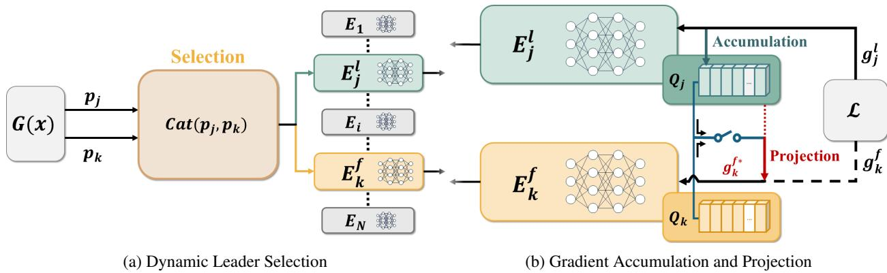  
Figure 1: (a) GaP-MoE selects a leader expert from the $T o p K$ set using normalized routing probabilities $p _ { i }$ . (b) The aggregated output gradients of the leader $E _ { i } ^ { l }$ are stored in $Q _ { j }$ as orthonormal basis vectors. When the similarity between their most recent basis vectors exceeds the threshold $\gamma ,$ the follower gradient is projected onto the orthogonal complement of the leader subspace and used to update $E _ { k } ^ { f }$

Since $G _ { i } ( x ) = 0$ for experts not included in the T opK, only a subset of experts is activated for each token, thereby achieving sparse computation.

## 2.2 Expert Specialization and Representation Collapse

Chi et al. [2022] describe representation collapse as the degeneration of representations during neural network training and investigate this phenomenon in sparse Mixture-of-Experts (SMoE) models. Their analysis suggests that routinginduced updates can constrain token hidden representations toward a low-dimensional subspace spanned by expert embeddings and draw representations of tokens routed to the same expert closer together, potentially limiting their expressive capacity.

Subsequent studies have used the term representation collapse more broadly to describe several forms of insufficient differentiation among experts. These include cases in which multiple experts learn similar representations, thereby limiting specialization, and cases in which the router assigns most tokens to only a small subset of experts [Pham et al., 2024, Do et al., 2025, 2023]. Research that aims to make individual experts learn distinct representations or functions is generally studied under the notion of expert specialization [Krishnamurthy et al., 2023, Dai et al., 2024].

Recent studies have employed various approaches to promote expert specialization and alleviate representation collapse. A prominent example is router-based methods, which prevent tokens from being concentrated on specific experts and encourage more differentiated routing decisions. XMoE [Chi et al., 2022] maps routing representations to a low-dimensional space to mitigate representational degeneration. [Nguyen et al., 2025] further analyzed how perturbing a cosine router, which has recently emerged as an alternative to the conventional linear router, can help prevent representation collapse.

Other studies address representation collapse by directly regulating expert weights, outputs, or gradients. Guo et al. [2026] promote expert specialization using a loss that orthogonalizes expert parameters, alongside a loss that promotes more diverse routing. SimSMoE [Do et al., 2025] induces differentiation by reducing the similarity between the output representations produced by different experts. SD-MoE [Huang et al., 2026] decomposes expert and gradient matrice via SVD into dominant and expert-specific components, facilitating the learning of an expert-specific subspace.

However, existing methods encourage expert outputs to explore diverse subspaces either implicitly through routing mechanisms or explicitly through additional loss functions. In contrast, our method, GaP-MoE, directly differentiates the update directions of expert outputs by projecting follower gradients away from the recent gradient subspace of a dynamically selected leader. This promotes expert specialization without introducing an additional optimization objective, while preserving the original task gradient of the selected leader.

## 3 Proposal of GaP-MoE

For simplicity, this section describes the method based on Top2 routing. GaP-MoE consists of three main components: Dynamic Leader Selection, Gradient Accumulation, and Gradient Projection. The overall process is illustrated in Figure 1, with the training procedure summarized in Algorithm 1. The full algorithm is provided in Appendix A.

Algorithm 1 GaP-MoE (short version)   
Input: mini-batch tokens $\{ x _ { n } \} ;$ ; router $G ( \cdot )$   
Parameter: experts $\{ \theta _ { i } \}$ ; buffers $\{ Q _ { i } \}$   
1: for each token $x _ { n }$ do   
2: Route $x _ { n }$ to top-2 experts; sample leader l   
3: Compute expert outputs and weighted MoE output   
4: end for   
5: Backpropagate to obtain gradients $g _ { n }$ for all tokens   
6: Projection: for each follower $E _ { k } ^ { f } .$ , project $g _ { k } ^ { f }$ using leader buffer $Q _ { j }$ if cossim $( b _ { j } ^ { ( r ) } , b _ { k } ^ { ( r ) } ) > \gamma$   
7: Accumulation: for each expert i, average its leader gradients and update $Q _ { i }$ via Gram–Schmidt   
8: Update $\{ \theta _ { i } \}$ with (projected) gradients

## 3.1 Dynamic Leader Selection

For each $d _ { i n }$ -dimensional input token $x \in \mathbb { R } ^ { d _ { i n } }$ , the router computes sparse routing scores $G _ { i } ( x )$ over $N$ experts, where $G _ { i } ( x ) > 0$ only for the TopK selected experts. GaP-MoE normalizes these nonzero routing scores and uses them as the probabilities for selecting one leader expert as

$$
p _ { i } = \frac { G _ { i } ( x ) } { \sum _ { i = 1 } ^ { N } G _ { i } ( x ) } , \quad l \sim \mathrm { C a t e g o r i c a l } ( p _ { 1 } , \dots , p _ { N } ) .\tag{2}
$$

If expert $E _ { j }$ is sampled as the leader, denoted by $E _ { j } ^ { l }$ , its original task gradient is preserved without projection. Each remaining selected expert $E _ { k }$ , denoted by $E _ { k } ^ { f }$ , becomes a follower whose output gradient is subsequently differentiated from the leader’s gradient subspace through the projection described in Section 3.2.

## 3.2 Gradient Projection

Gradient projection modifies a gradient direction by removing its component along a specified subspace. It has been widely used to mitigate gradient interference in continual and multi-task learning [Yu et al., 2020, Lopez-Paz and Ranzato, 2017]. GaP-MoE adopts this principle to reduce overlapping update directions between co-routed experts, rather than between different tasks [Farajtabar et al., 2020].

For clarity, let the output of the i-th expert be $y _ { i } = \theta _ { i } x$ , where $\theta _ { i } \in \mathbb { R } ^ { H \times d _ { i n } }$ denotes the weight matrix of the i-th expert with H denoting the output dimension. The gradient with respect to the expert output is

$$
g _ { i } = { \frac { \partial { \mathcal { L } } } { \partial y _ { i } } } ,\tag{3}
$$

where L denotes the task loss for the current token1.

For a leader-follower pair $( E _ { j } ^ { l } , E _ { k } ^ { f } )$ , GaP-MoE determines whether projection is required by comparing their most recently stored gradient basis, $( b _ { j } ^ { ( r ) } , b _ { k } ^ { ( r ) } )$ ), from the gradient buffers $Q _ { j }$ and $Q _ { k }$ described in Section 3.3. Specifically, projection is activated when

$$
\mathrm { c o s s i m } ( b _ { j } ^ { ( r ) } , b _ { k } ^ { ( r ) } ) = \frac { b _ { j } ^ { ( r ) } \cdot b _ { k } ^ { ( r ) } } { \left\| b _ { j } ^ { ( r ) } \right\| \cdot \left\| b _ { k } ^ { ( r ) } \right\| } > \gamma ,
$$

where $\gamma \in [ - 1 , 1 ]$ is a similarity threshold. Setting $\gamma = - 1$ activates projection for every leader-follower pair. When projection is activated, the follower output gradient is modified as

$$
g _ { k } ^ { f * } = ( I - \alpha Q _ { j } ^ { \top } Q _ { j } ) g _ { k } ^ { f } ,\tag{4}
$$

where $Q _ { j } ^ { \top } Q _ { j }$ projects onto the subspace spanned by the leader’s buffered gradients, and $\alpha \in [ 0 , 1 ]$ controls the projection intensity. The projected gradient $g _ { k } ^ { f * }$ is then used to update the follower $E _ { k } ^ { f }$ , while the leader $E _ { j } ^ { l }$ retains its original task gradient $g _ { j } ^ { l }$ . This reduces redundant update directions and encourages the two experts to evolve toward differentiated output representations.

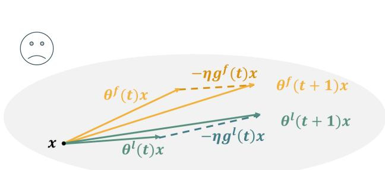

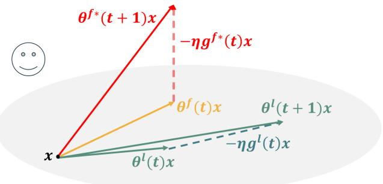  
(a) Insufficient Expert Specialization Without GaP-MoE  
(b) Explicit Specialization With GaP-MoE  
Figure 2: Effect of gradient projection in the output representation space. The gray oval represents the past output gradient subspace of the leader expert $( g ^ { l } ( \cdot ) x )$ . The yellow and green lines represent the output vectors of the follower and leader experts, respectively, for the input token x, while the dotted lines represent their corresponding gradient update terms $( - \eta g ( t ) x )$ . If these output vectors are aligned with the same subspace, the output gradient term $- \eta g ( t ) x$ is also aligned with that subspace. However, by projecting the follower’s gradient term, its output can escape from the existing subspace and encode different information, as illustrated by the red line.

## 3.3 Gradient Accumulation

GaP-MoE maintains a gradient buffer $Q _ { i } \in \mathbb { R } ^ { h \times H }$ for each expert i, where h is the buffer size.

Because multiple tokens in a mini-batch may select the same expert as their leader, their output gradients are aggregated before being stored. Define

$$
\mathcal { T } _ { i } ^ { l } = \{ x : \mathrm { E x p e r t } E _ { i } \mathrm { ~ i s ~ s e l e c t e d ~ a s ~ t h e ~ l e a d e r ~ f o r ~ t o k e n ~ } x \} .\tag{5}
$$

The corresponding mean gradient is then given by

$$
\bar { g } _ { i } ^ { l } = \frac { 1 } { | T _ { i } ^ { l } | } \sum _ { \tau \in T _ { i } ^ { l } } g _ { i , \tau } ^ { l } .\tag{6}
$$

Here, we write $g _ { i , \cdot } ^ { l }$ to denote the leader output gradient of expert $E _ { i }$ for the τ -th token in the current mini-batch. To retain only a new gradient direction, $\bar { g } _ { i }$ is orthogonalized against the current orthonormal basis vectors $b _ { i } ^ { ( 1 ) } , . . . , b _ { i } ^ { ( r ) }$ in $Q _ { i }$ as

$$
\hat { g } _ { i } = \frac { \bar { g } _ { i } } { \left\| \bar { g } _ { i } \right\| _ { 2 } } , \quad v _ { i } = \hat { g } _ { i } - \sum _ { m = 1 } ^ { r } \left( b _ { i } ^ { ( m ) \top } \hat { g } _ { i } \right) b _ { i } ^ { ( m ) } .\tag{7}
$$

$v _ { i }$ is normalized to obtain a new basis vector

$$
b _ { i } ^ { \mathrm { n e w } } = \frac { v _ { i } } { \| v _ { i } \| _ { 2 } } ,\tag{8}
$$

which is appended to $Q _ { i }$ . When the buffer reaches its maximum size h, the oldest vector is removed following a First-In-First-Out policy as

$$
Q _ { i }  \{ \begin{array} { l l } { Q _ { i } \cup \{ b _ { i } ^ { \mathrm { n e w } } \} , } & { r < h } \\ { ( Q _ { i } \setminus \{ b _ { i } ^ { ( 1 ) } \} ) \cup \{ b _ { i } ^ { \mathrm { n e w } } \} , } & { r = h } \end{array}\tag{9}
$$

Consequently, $Q _ { i }$ represents the recent unprojected update subspace of expert $E _ { i }$ and is used for the projection in Section 3.2.

Role-dependent Buffer Update Within a mini-batch, the same expert pair $( E _ { j } , E _ { k } )$ may take opposite roles for different tokens, appearing as $( E _ { j } ^ { l } , E _ { k } ^ { f } )$ for one token and $( E _ { j } ^ { f } , E _ { k } ^ { l } )$ for another token. In this case, only the gradient received as the leader $g _ { j } ^ { l }$ is used to update $Q _ { j } ,$ , while the projected gradient $g _ { i } ^ { f * }$ is not used. This is to prevent the direction altered by the projection from being immediately reflected in the buffer, which would make the training process noisy.

Extension to $K > 2$ For $K > 2 ,$ GaP-MoE selects one leader from the T opK experts and treats the remaining $K - 1$ experts as followers. The leader buffer is then used to project each follower gradient independently.

## 3.4 Theoretical Justification of GaP-MoE

GaP-MoE aims to prevent co-routed experts from being repeatedly updated in similar directions. As illustrated in Figure 2a, when two experts receive highly aligned gradients for the same token, their output representations may continue to evolve toward similar functions. In contrast, Figure 2b shows how GaP-MoE projects the follower gradient away from the leader’s recent gradient subspace, thereby directing the follower toward a different update direction. GaP-MoE therefore reduces the gradient components shared by co-routed experts rather than directly constraining their output representations.

For analysis, let the outputs of the leader and follower experts for an input token x be $y ^ { l } = \theta ^ { l } x$ and $y ^ { f } = \theta ^ { f } x .$ respectively. We measure their output difference as follows.

Definition 1 (Expert Output Difference).

For an input token x, the expert output difference between the leader and follower experts is

$$
S ( \theta ^ { l } , \theta ^ { f } ; x ) = \left\| y ^ { l } - y ^ { f } \right\| = \left\| ( \theta ^ { l } - \theta ^ { f } ) x \right\| .
$$

A larger S indicates that the two experts produce more differentiated representations for the same input.

To describe how gradient projection affects the outputs, consider the standard SGD update

$$
\theta ( t + 1 ) = \theta ( t ) - \eta g _ { \theta } ( t ) ,\tag{10}
$$

where $\eta$ is the learning rate and t denotes the optimization step. Since $\begin{array} { r } { g _ { \theta } ( t ) = \frac { \partial \mathcal { L } } { \partial \theta } = \frac { \partial \mathcal { L } } { \partial y } \frac { \partial y } { \partial \theta } = g ( t ) x ^ { \top } } \end{array}$ , multiplying Eq. (10) by x gives the corresponding update in the expert-output space:

$$
\theta ( t + 1 ) x = \theta ( t ) x - \eta g ( t ) | | x | | _ { 2 } ^ { 2 } .\tag{11}
$$

The output difference can be related to the angle between the expert outputs through the law of cosines:

$$
S ^ { 2 } ( \theta ^ { l } , \theta ^ { f } ; x ) = | | \theta ^ { l } x | | _ { 2 } ^ { 2 } + | | \theta ^ { f } x | | _ { 2 } ^ { 2 } - 2 | | \theta ^ { l } x | | _ { 2 } | | \theta ^ { f } x | | _ { 2 } \cos \psi _ { x } ,\tag{12}
$$

where cos $\begin{array} { r } { \psi _ { x } = \frac { ( \theta ^ { l } x ) ^ { \top } ( \theta ^ { f } x ) } { | | \theta ^ { l } x | | _ { 2 } | | \theta ^ { f } x | | _ { 2 } } } \end{array}$ . Thus, when $\left\| \theta ^ { l } x \right\| \approx \left\| \theta ^ { f } x \right\| \approx c ,$ a larger angle $\psi _ { x }$ corresponds to a larger output difference, motivating GaP-MoE to suppress aligned expert-update directions.

However, directly controlling $\psi _ { x }$ during optimization would require an explicit output-level constraint. GaP-MoE instead promotes output differentiation by modifying the follower update direction. To characterize this mechanism, let $Q _ { j }$ contain the orthonormal basis vectors accumulated from the recent leader gradients, and define $P _ { j } = Q _ { i } ^ { \top } Q _ { j }$ as the orthogonal projector onto the corresponding gradient subspace. Under full projection, $\mathrm { i } . \mathrm { e } . , \alpha = 1$ , the follower output gradient becomes $g _ { k } ^ { f * } = ( I - P _ { j } ) g _ { k } ^ { f }$ . Using Eq. (11), the resulting follower output after one update becomes

$$
\theta _ { k } ^ { f * } ( t + 1 ) x = \theta _ { k } ^ { f } ( t ) x - \eta ( I - P _ { j } ) g _ { k } ^ { f } \left\| x \right\| _ { 2 } ^ { 2 } .\tag{13}
$$

Substituting Eq. (13) into the inner product with the leader, which is our target to reduce, yields

$$
\begin{array} { c } { { \langle \theta _ { j } ^ { l } ( t ) x - \eta g _ { j } ^ { l } ( t ) x , \theta _ { k } ^ { f } ( t ) x - \eta g _ { k } ^ { f * } ( t ) x \rangle } } \\ { { { } } } \\ { { = \langle \theta _ { j } ^ { l } ( t ) x , \theta _ { k } ^ { f } ( t ) x \rangle + \langle - \eta g _ { j } ^ { l } ( t ) x , \theta _ { k } ^ { f } ( t ) x \rangle + \langle - \eta g _ { k } ^ { f * } ( t ) x , \theta _ { j } ^ { l } ( t ) x \rangle + \eta ^ { 2 } \langle g _ { j } ^ { l } ( t ) x , g _ { k } ^ { f * } ( t ) x \rangle . } } \end{array}\tag{14}
$$

This equation builds the theoretical advantages of GaP-MoE in the following proposition.

Proposition 1 (Gradient Projection for Expert Separation). The projection to follower output gradients can reduce $< \theta _ { j } ^ { l } ( t + 1 ) x , \theta _ { k } ^ { f } ( t + 1 ) x >$ subject to the efficiency of MoE training.

Proof. See Appendix B.

Orthogonalizing the output gradients serves to reduce the alignment between the two different expert output vectors through which a single token passes.

It should be noted that we do not perform direct optimization for our reduction goal. Aggressively minimizing this similarity could drive the two representations toward opposite directions, i.e., $\psi = \pi$ . In such a case, their contributions may cancel each other in the weighted sum of Eq. (1), potentially hindering MoE optimization. Instead, GaP-MoE orthogonalizes the follower update with respect to the leader gradient subspace, thereby alleviating excessive output alignment without explicitly forcing the expert outputs apart. Proposition 1 characterizes this mechanism by showing that the projection removes the follower-gradient component shared with the leader subspace, while minimally altering the original task gradient.

<table><tr><td>Models</td><td>CoLA</td><td>SST-2</td><td>MRPC</td><td>STS-B</td><td>QQP</td><td>MNLI</td><td>QNLI</td><td>RTE</td><td>Avg.</td></tr><tr><td>SMoE</td><td>56.00</td><td>93.16</td><td>85.21</td><td>89.28</td><td>91.20</td><td>84.54</td><td>91.45</td><td>64.86</td><td>81.96</td></tr><tr><td> ${ \mathrm { G a P - M o E } } ( \gamma = - 1 )$ </td><td>56.37</td><td>93.20</td><td>84.64</td><td>89.22</td><td>91.28</td><td>84.75</td><td>91.58</td><td>65.46</td><td>82.06</td></tr><tr><td> ${ \mathrm { G a P - M o E } } ( \gamma = 0 . 7 )$ </td><td>56.44</td><td>93.00</td><td>85.29</td><td>89.27</td><td>91.28</td><td>84.52</td><td>91.45</td><td>64.62</td><td>81.98</td></tr></table>

Table 1: Evaluation results on the GLUE benchmark. For evaluation metrics, CoLA uses the Matthews correlation coefficient, STS-B uses Pearson’s correlation coefficient, and all others use accuracy. For all of them, the higher the score, the better. Results are averaged over three seeds.

<table><tr><td>Models</td><td>WikiText-103</td><td>enwik8</td><td>text8</td></tr><tr><td>SMoE</td><td>78.80</td><td>2.005</td><td>1.962</td></tr><tr><td> ${ \mathrm { G a P - M o E } } ( \gamma = 0 . 7 )$ </td><td>76.50</td><td>1.953</td><td>1.945</td></tr></table>

Table 2: Evaluation results of from-scratch environments. For evaluation metrics, WikiText-103 uses perplexity, while enwik8 and text8 use BPC. For all of them, the lower the score, the better. Results are averaged over three seeds.

## 4 Experiments

Although MoE is being applied in various fields thanks to its scalability [Riquelme et al., 2021, You et al., 2021, Lin et al., 2026], this paper focuses on natural language tasks.

Since GaP-MoE is designed to deliver relative performance improvements when combined with other models, we compare it to the baseline SMoE [Shazeer et al., 2017] across various tasks and subsequently compare the performance changes when combined with various models already published for specific tasks. For all tasks, each feed-forward sub-layer of the baseline models is replaced with a MoE layer consisting of four experts—composed of two linear layers and a GELU—and the Top2 routing method is employed. For more detailed experimental setup, see Appendix C.

The hyperparameter controlling the projection intensity is set to its maximum value of 1 for all tasks; however, during the first epoch, it is set to increase linearly from 0.1 to 1.0 in steps to mitigate the impact of noisy gradient changes. Additionally, the projection threshold γ for GaP-MoE is set to -1 and 0.7, respectively, to represent both full projection and minimal projection scenarios.

We evaluate GaP-MoE in both fine-tuning and from-scratch scenarios.

## 4.1 Fine-tuning

Based on BERT [Devlin et al., 2019], we use the publicly available pretrained version, bert-base-uncased, obtained via the HuggingFace Transformers library [Wolf et al., 2020].

We replace the 12 feed-forward layers with MoE layers consisting of four experts of the same parameter size, and initialize the experts identically based on the pretrained parameters. For the tasks, we use the GLUE benchmark [Wang et al., 2018], which includes a total of eight NLP tasks such as sentence reasoning and sentiment classification, and evaluate the model using task-specific metrics such as accuracy and F1 score. After training for five epochs, we summarize the final results based on the best performance.

Table 1 shows the fine-tuning evaluation results. In the fine-tuning experiments reported here, GaP-MoE is applied to all 12 MoE layers. While this configuration yields consistent but modest improvements in average performance over the SMoE baseline, we are investigating whether selectively applying GaP-MoE to a subset of layers can provide further benefits.

It is worth noting that performing projection at all times yielded higher results on average than projecting only when the last basis similarity was high. This suggests that, in MoE architectures, gradient projection more often aids expert specialization than hinders learning.

<table><tr><td>Models</td><td>WikiText-103</td></tr><tr><td>SMoE</td><td>83.63</td></tr><tr><td> ${ \mathrm { G a P } } { \cdot } { \mathrm { M o E } } ( \gamma = - 1 )$ </td><td>81.35</td></tr><tr><td> ${ \mathrm { G a P - M o E } } ( \dot { \gamma } = 0 . 7 )$ </td><td>82.44</td></tr></table>

<table><tr><td>Models</td><td>CoLA STS-B</td><td>RTE</td><td></td></tr><tr><td>XMoE</td><td>58.65</td><td>86.65</td><td>64.86</td></tr><tr><td> $\mathrm { X M o E + G a P - M o E } ( \gamma = - 1 )$ </td><td>57.80</td><td>86.67</td><td>65.10</td></tr><tr><td> $\mathrm { X M o E + G a P - M o E } ( \gamma = 0 . 7 )$ </td><td>58.76</td><td>86.36</td><td>65.82</td></tr><tr><td>SimSMoE</td><td>57.89</td><td>88.90</td><td>65.22</td></tr><tr><td> $\mathrm { S i m S M o E + G a P \mathrm { - } M o E ( \gamma = - 1 ) }$ </td><td>58.01</td><td>88.97</td><td>65.46</td></tr><tr><td> $\mathrm { S i m S M o E + G a P \mathrm { - } M o E } ( \gamma = 0 . 7 )$ </td><td>58.09</td><td>88.95</td><td>65.58</td></tr></table>

Table 4: Evaluation results of generalizability experiments. For evaluation metrics, CoLA uses the Matthews correlation coefficient, STS-B uses Pearson’s correlation coefficient, and RTE uses accuracy. For all of them, the higher the score, the better. Results are averaged over three seeds.

Table 3: Performance on the WikiText-103 dataset without router training. Instead of using a trained router, two experts were randomly selected for each token. The lower the score, the better. Results are averaged over three seeds.  
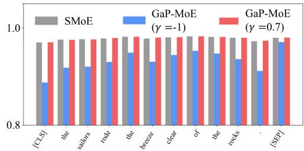  
Figure 3: Each bar represents, in order, the expert output similarity of SMoE and GaP-MoE with $\gamma = - 1$ and $\gamma = 0 . 7 ,$ respectively, trained using a single seed on COLA. The x-axis shows each token passed through the layers in the first sequence of COLA’s evaluation set.

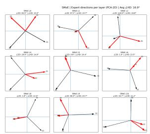  
(a) SMoE

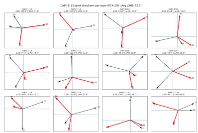  
(b) GaP-MoE(γ=-1)

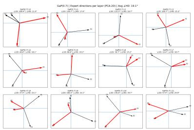  
(c) GaP-MoE(γ=0.7)  
Figure 4: The angle between expert output vectors in the sixth layer when a single token is input into the three models that have been trained on the QNLI dataset. ∠HD is the angle of the output vectors calculated in the original 768-dimensional output space. PCA was applied to each vector to visualize them in two dimensions, and the angle in this two-dimensional space is denoted as ∠2D. The red lines represent the outputs of the experts selected as Top2, while the black dashed lines show the results of passing the token through experts not selected as Top2. Results for all layers of the token are provided in Appendix D. The number in parentheses refers to the projection threshold $\gamma .$

## 4.2 From-scratch

We use GPT-2 [Radford et al., 2019] as the backbone model. To fit our computational budget, we adopt a reduced GPT-2 Small configuration with 6 transformer layers, 8 attention heads, and an intermediate dimension of 2048. The original GPT-2 Small consists of 12 layers, 12 attention heads, and an intermediate dimension of 3072. Additionally, for the from-scratch task, we replaced only the last two layers with GaP-MoE—which exhibit relatively stronger gradient consistency, as will be discussed in 4.6—while retaining the standard SMoE layers for the rest of the network.

The expert parameters are randomly initialized. We conduct experiments on WikiText-103 [Merity et al., 2016], enwik8, and text8 [Mahoney, 2011], all of which are evaluated on the next-token prediction task. WikiText-103 is evaluated using perplexity (PPL), whereas enwik8 and text8 are evaluated using bits per character (BPC). The validation loss is evaluated every 1,000 training steps, and training is terminated if the validation loss does not improve for three consecutive evaluations.

Table 2 presents the from-scratch evaluation results. Compared to the baseline SMoE, from-scratch experiments also showed that GaP-MoE generally performed better. However, on text8—a relatively easy dataset created by retaining only alphabetic characters and spaces from enwik8—the performance improvement wasn’t as significant as it was for the other two tasks.

## 4.3 Expert Specialization Without Router Training

GaP-MoE is particularly robust to router failure because it induces expert specialization directly through the gradients generated during training. Table 3 shows the difference in model performance on the WikiText-103 dataset when the router was not trained at all, and instead two experts were randomly selected and trained. Although performance decreased significantly overall compared to Table 2, the performance drop is considerably smaller for GaP-MoE. In other words, this suggests that GaP-MoE explicitly guides the process to prevent expert specialization from failing.

## 4.4 Generalizability with Different MoE

One of the novelties of GaP-MoE is that it can be easily applied to various MoE architectures. We conducted additional experiments by applying two models—XMoE [Chi et al., 2022] and SimSMoE [Do et al., 2025], which address the same problem to our GaP-MoE experimental framework.

Since no official implementation of XMoE is publicly available, and the official SimSMoE implementation is designed for pre-training rather than our fine-tuning setting, we implemented the core mechanisms of both methods within our unified experimental framework.

To efficiently evaluate the various experimental results, we categorized the tasks in the GLUE benchmark into three groups and conducted one experiment for each task. These are CoLA for the single-sentence classification task, STS-B for the sentence pair similarity task, and RTE for the natural language inference task.

Table 4 shows the results of evaluating each model by applying the GaP-MoE architecture to three fine-tuning tasks. Interestingly, while applying GaP-MoE resulted in improved performance on most tasks, it was found to be more significantly affected by γ than the GaP-MoE-only model. Identifying the appropriate γ value for each task and model should be addressed in future research.

## 4.5 Expert Output Differentiation

Figure 3 shows the cosine similarity between expert outputs in the final layer for all tokens in an input sequence, whereas Figure 4 visualizes the angles between expert outputs in the sixth layer using a single input token.

When the projection threshold γ was set to −1, the similarity decreased substantially. In contrast, setting γ to 0.7 resulted in only a marginal reduction in similarity, as projection was applied only when the similarity exceeded the threshold. This suggests that gradient projection can be used to differentiate expert outputs.

## 4.6 Short-term Gradient Consistency

To empirically examine whether expert gradients exhibit the short-term gradient consistency assumed in the theoretical justification, we track for each expert of the first and the last layer, the cosine similarity between its current output gradient and the orthonormal basis accumulated t steps earlier $( \dot { t } \in \{ 1 , 3 , 5 , 1 0 \} )$ ) whenever that expert is selected as leader.

Figure 5 visualizes these trajectories across layers and gap sizes. In the first step, the cosine similarity values are generally greater than 0, but they fluctuate significantly. In contrast, when the model reaches the intermediate step, the cosine similarity stabilizes. To avoid noisy updates, it is recommended to gradually increase the projection intensity α from a low level to a high level during the initial training phase. Once the updates have stabilized to some extent, the variance in similarity decreases. At this point, the early layers maintain a similarity level above 0 but converge toward 0 as the gap widens. Conversely, the later layers consistently maintain a high level of similarity. In other words, since there are some differences in short-term consistency across layers, theoretical performance differences may exist

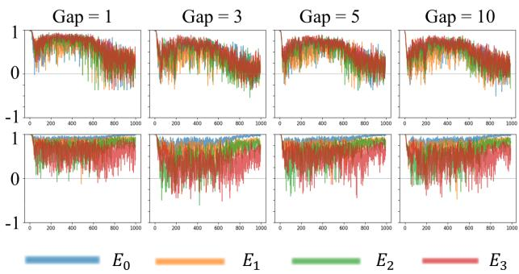  
(a) Similarity for each expert at the first step

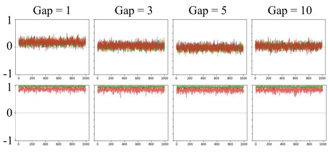  
(b) Similarity for each expert at the intermediate step  
Figure 5: In both cases, the top figure shows the first MoE layer, and the bottom figure shows the last MoE layer; the t ∈ [1, 3, 5, 10] used to set the Gap indicates how many time steps back the expert was compared to.

between layers; therefore, we expect that performance will be enhanced by not unnecessarily increasing the buffer size.   
In our experiments, we used buffer sizes of 8 and 16 (for training from scratch and fine-tuning, respectively).

## 5 Conclusion and Future Work

This study proposed GaP-MoE, which retains the standard training procedure of sparse MoE with TopK routing while imposing explicit orthogonalization constraints only on pre-computed expert output gradients. Through dynamic leader selection and gradient projection, GaP-MoE encourages experts to learn more diverse output representations without introducing additional parameter constraints or requiring gradient recomputation. Experimental results demonstrated that GaP-MoE achieves competitive or improved performance over the baseline SMoE and can be effectively combined with existing specialization methods, demonstrating its compatibility with different MoE architectures.

One limitation of this work is that the hyperparameters introduced by GaP-MoE, including the buffer size h, the choice of layers to which GaP-MoE is applied during fine-tuning, projection threshold γ, and projection intensity α, were not systematically explored. Consequently, the reported settings may not be optimal, and the relationship between these hyperparameters and model performance remains insufficiently understood. In addition, our evaluation was limited to relatively small-scale models. Future work will therefore focus on systematic hyperparameter optimization and validating GaP-MoE on larger-scale language models.

## References

Ashish Vaswani, Noam Shazeer, Niki Parmar, Jakob Uszkoreit, Llion Jones, Aidan N Gomez, Łukasz Kaiser, and Illia Polosukhin. Attention is all you need. Advances in neural information processing systems, 30, 2017.

Jared Kaplan et al. Scaling laws for neural language models. arXiv preprint arXiv:2001.08361, 2020.

Tom B. Brown et al. Language models are few-shot learners. Advances in Neural Information Processing Systems, 2020.

Noam Shazeer, Azalia Mirhoseini, Krzysztof Maziarz, Andy Davis, Quoc Le, Geoffrey Hinton, and Jeff Dean. Outrageously large neural networks: The sparsely-gated mixture-of-experts layer. arXiv preprint arXiv:1701.06538, 2017.

Robert A Jacobs, Michael I Jordan, Steven J Nowlan, and Geoffrey E Hinton. Adaptive mixtures of local experts. Neural computation, 3(1):79–87, 1991.

Yamuna Krishnamurthy, Chris Watkins, and Thomas Gaertner. Improving expert specialization in mixture of experts. arXiv preprint arXiv:2302.14703, 2023.

Damai Dai, Chengqi Deng, Chenggang Zhao, RX Xu, Huazuo Gao, Deli Chen, Jiashi Li, Wangding Zeng, Xingkai Yu, Yu Wu, et al. Deepseekmoe: Towards ultimate expert specialization in mixture-of-experts language models. In Proceedings of the 62nd Annual Meeting of the Association for Computational Linguistics (Volume 1: Long Papers), pages 1280–1297, 2024.

Zewen Chi, Li Dong, Shaohan Huang, Damai Dai, Shuming Ma, Barun Patra, Saksham Singhal, Payal Bajaj, Xia Song, Xian-Ling Mao, et al. On the representation collapse of sparse mixture of experts. Advances in Neural Information Processing Systems, 35:34600–34613, 2022.

Quang Pham, Giang Do, Huy Nguyen, TrungTin Nguyen, Chenghao Liu, Mina Sartipi, Binh T Nguyen, Savitha Ramasamy, Xiaoli Li, Steven Hoi, et al. Competesmoe–effective training of sparse mixture of experts via competition. arXiv preprint arXiv:2402.02526, 2024.

Giang Do, Hung Le, and Truyen Tran. Simsmoe: Toward efficient training mixture of experts via solving representational collapse. In Findings ofthe Associationfor Computational Linguistics: NAACL 2025, pages 2012–2025, 2025.

Boan Liu, Liang Ding, Li Shen, Keqin Peng, Yu Cao, Dazhao Cheng, and Dacheng Tao. Diversifying the mixture-ofexperts representation for language models with orthogonal optimizer. In ECAI 2024: 27th European Conference on Artificial Intelligence, 19–24 October 2024, Santiago de Compostela, Spain–Including 13th Conference on Prestigious Applications ofIntelligent Systems (PAIS 2024), pages 2966–2973. SAGE Publications Pvt. Ltd 1 Oliver’s Yard, 55 City Road, London, EC1Y 1SP, 2024.

Longrong Yang, Dong Shen, Chaoxiang Cai, Fan Yang, Tingting Gao, Di Zhang, and Xi Li. Solving token gradient conflict in mixture-of-experts for large vision-language model. In International Conference on Learning Representations, volume 2025, pages 33561–33587, 2025.

Hongcan Guo, Haolang Lu, Guoshun Nan, Bolun Chu, Jialin Zhuang, Yuan Yang, Wenhao Che, Xinye Cao, Sicong Leng, Qimei Cui, et al. Advancing expert specialization for better moe. Advances in Neural Information Processing Systems, 38:48767–48809, 2026.

Xi Wang, Soufiane Hayou, and Eric Nalisnick. The myth of expert specialization in moes: Why routing reflects geometry, not necessarily domain expertise. arXiv preprint arXiv:2604.09780, 2026.

Lean Wang, Huazuo Gao, Chenggang Zhao, Xu Sun, and Damai Dai. Auxiliary-loss-free load balancing strategy for mixture-of-experts. arXiv preprint arXiv:2408.15664, 2024.

Dmitry Lepikhin, HyoukJoong Lee, Yuanzhong Xu, Dehao Chen, Orhan Firat, Yanping Huang, Maxim Krikun, Noam Shazeer, and Zhifeng Chen. Gshard: Scaling giant models with conditional computation and automatic sharding. arXiv preprint arXiv:2006.16668, 2020.

William Fedus, Barret Zoph, and Noam Shazeer. Switch transformers: Scaling to trillion parameter models with simple and efficient sparsity. Journal ofMachine Learning Research, 23(120):1–39, 2022.

Yihua Zhang, Ruisi Cai, Tianlong Chen, Guanhua Zhang, Huan Zhang, Pin-Yu Chen, Shiyu Chang, Zhangyang Wang, and Sijia Liu. Robust mixture-of-expert training for convolutional neural networks. In Proceedings ofthe IEEE/CVF International Conference on Computer Vision, pages 90–101, 2023.

Xiaofeng Zhang, Yikang Shen, Zeyu Huang, Jie Zhou, Wenge Rong, and Zhang Xiong. Mixture of attention heads: Selecting attention heads per token. In Proceedings of the 2022 Conference on Empirical Methods in Natural Language Processing, pages 4150–4162, 2022.

Truong Giang Do, Le Khiem, Quang Pham, Trungtin Nguyen, Thanh-Nam Doan, Binh Nguyen, Chenghao Liu, Savitha Ramasamy, Xiaoli Li, and Steven Hoi. Hyperrouter: Towards efficient training and inference of sparse mixture of experts. In Proceedings of the 2023 conference on empirical methods in natural language processing, pages 5754–5765, 2023.

Huy Nguyen, Pedram Akbarian Saravi, Trang Pham, Thien Trang Nguyen Vu, Shujian Zhang, and Nhat Ho. Statistical advantages of perturbing cosine router in mixture of experts. In International Conference on Learning Representations, volume 2025, pages 95812–95844, 2025.

Ruijun Huang, Fang Dong, Xin Zhang, Hengjie Cao, Zhendong Huang, Anrui Chen, Jixian Zhou, Mengyi Chen, Yifeng Yang, Mingzhi Dong, et al. Sd-moe: Spectral decomposition for effective expert specialization. arXiv preprint arXiv:2602.12556, 2026.

Tianhe Yu, Saurabh Kumar, Abhishek Gupta, Sergey Levine, Karol Hausman, and Chelsea Finn. Gradient surgery for multi-task learning. Advances in neural information processing systems, 33:5824–5836, 2020.

David Lopez-Paz and Marc’Aurelio Ranzato. Gradient episodic memory for continual learning. Advances in neural information processing systems, 30, 2017.

Mehrdad Farajtabar, Navid Azizan, Alex Mott, and Ang Li. Orthogonal gradient descent for continual learning. In International conference on artificial intelligence and statistics, pages 3762–3773. PMLR, 2020.

Carlos Riquelme, Joan Puigcerver, Basil Mustafa, Maxim Neumann, Rodolphe Jenatton, André Susano Pinto, Daniel Keysers, and Neil Houlsby. Scaling vision with sparse mixture of experts. In M. Ranzato, A. Beygelzimer, Y. Dauphin, P.S. Liang, and J. Wortman Vaughan, editors, Advances in Neural Information Processing Systems, volume 34, pages

8583–8595. Curran Associates, Inc., 2021. URL https://proceedings.neurips.cc/paper\_files/paper/ 2021/file/48237d9f2dea8c74c2a72126cf63d933-Paper.pdf.

Zhao You, Shulin Feng, Dan Su, and Dong Yu. Speechmoe: Scaling to large acoustic models with dynamic routing mixture of experts. arXiv preprint arXiv:2105.03036, 2021.

Bin Lin, Zhenyu Tang, Yang Ye, Jinfa Huang, Junwu Zhang, Yatian Pang, Peng Jin, Munan Ning, Jiebo Luo, and Li Yuan. Moe-llava: Mixture of experts for large vision-language models. IEEE Transactions on Multimedia, 2026.

Jacob Devlin, Ming-Wei Chang, Kenton Lee, and Kristina Toutanova. Bert: Pre-training of deep bidirectional transformers for language understanding. In Proceedings of the 2019 conference of the North American chapter of the association for computational linguistics: human language technologies, volume 1 (long and short papers), pages 4171–4186, 2019.

Thomas Wolf, Lysandre Debut, Victor Sanh, Julien Chaumond, Clement Delangue, Anthony Moi, Pierric Cistac, Tim Rault, Rémi Louf, Morgan Funtowicz, et al. Transformers: State-of-the-art natural language processing. In Proceedings of the 2020 conference on empirical methods in natural language processing: system demonstrations, pages 38–45, 2020.

Alex Wang, Amanpreet Singh, Julian Michael, Felix Hill, Omer Levy, and Samuel R Bowman. Glue: A multi-task benchmark and analysis platform for natural language understanding. In Proceedings ofthe 2018 EMNLP workshop BlackboxNLP: Analyzing and interpreting neural networksfor NLP, pages 353–355, 2018.

Alec Radford, Jeffrey Wu, Rewon Child, David Luan, Dario Amodei, Ilya Sutskever, et al. Language models are unsupervised multitask learners. OpenAI blog, 1(8):9, 2019.

Stephen Merity, Caiming Xiong, James Bradbury, and Richard Socher. Pointer sentinel mixture models. arXiv preprint arXiv:1609.07843, 2016.

Matt Mahoney. Large text compression benchmark. http://mattmahoney.net/dc/text.html, 2011.

## Appendix

## A Algorithm of GaP-MoE

Algorithm 2 GaP-MoE Update (Top-2 Routing)   
Input: mini-batch of tokens $\{ x _ { n } \} _ { n = 1 } ^ { B } ;$ routing scores $G ( x _ { n } )$ from router   
Parameter: expert weights $\{ \theta _ { i } \} _ { i = 1 } ^ { N } ;$ gradient buffers $\{ Q _ { i } \} _ { i = 1 } ^ { N }$ ; buffer size $h ;$ projection threshold $\gamma ;$ projection intensity   
α   
Output: updated expert weights $\{ \theta _ { i } ( t + 1 ) \} _ { i = 1 } ^ { N }$ , updated buffers $\{ Q _ { i } \}$   
1: Initialize $\mathcal { T } _ { i } ^ { l } \gets \emptyset , \forall i \in [ 1 , N ]$   
2: for each token $x _ { n }$ in the mini-batch do   
3: Select top-2 experts $E _ { j } , E _ { k }$ via routing scores $G ( x _ { n } )$   
4: Normalize scores over the selected pair to obtain $p _ { j } , p _ { k }$   
5: Sample leader $l \sim$ Categorica $\left( p _ { j } , p _ { k } \right)$   
6: if $l \stackrel { \cdot } { = } j$ then   
7: Assign $E _ { j }  E _ { j } ^ { l }$ (leader), $E _ { k }  E _ { k } ^ { f }$ (follower)   
8: ${ \mathcal { T } } _ { j } ^ { l } \gets { \mathcal { T } } _ { j } ^ { l } \cup \{ x _ { n } \}$   
9: else   
10: Assign $E _ { k }  E _ { k } ^ { l }$ (leader), $E _ { j }  E _ { j } ^ { f }$ (follower)   
11: ${ \mathcal { T } } _ { k } ^ { l } \gets { \mathcal { T } } _ { k } ^ { l } \cup \{ x _ { n } \}$   
12: end if   
13: Compute expert outputs $y _ { j } = \theta _ { j } x _ { n } , y _ { k } = \theta _ { k } x _ { n }$   
14: Compute weighted MoE output for $x _ { n }$ using $y _ { j } , y _ { k }$   
15: end for   
16: Compute loss $L$ and backpropagate to obtain output gradients $g _ { n } = \partial L / \partial y _ { n }$ for all tokens   
17: for each follower expert $E _ { k } ^ { f }$ paired with leader $E _ { j } ^ { l }$ do   
18: // Projection, using buffers prior to this step’s update   
19: if cossim $( b _ { j } ^ { ( r ) } , b _ { k } ^ { ( r ) } ) > \gamma$ then   
20: $g _ { k } ^ { f * }  ( \bar { I } - \alpha Q _ { j } ^ { \top } Q _ { j } ) g _ { k } ^ { f }$   
21: else   
22: ${ \mathfrak { g } } _ { k _ { \pm \infty } } ^ { f * }  { \mathfrak { g } } _ { k } ^ { f }$   
23: end if   
24: end for   
25: for each expert i do   
26: {Accumulation, updates buffer for next step}   
27: if $\mathcal { T } _ { i } ^ { l } \neq \emptyset$ then   
28: $\begin{array} { r } { \bar { g } _ { i } ^ { l }  \frac { 1 } { | T _ { i } ^ { l } | } \sum _ { t \in \mathcal { T } _ { i } ^ { l } } } \end{array}$ gt   
29: bnew ← GramSchmidt $( \bar { g } _ { i } ^ { l } , Q _ { i } )$   
30: Update $Q _ { i }$ with $b _ { i } ^ { \mathrm { n e w } }$ (FIFO, evict oldest if $| Q _ { i } | = h )$   
31: end if   
32: end for   
33: Update all expert weights using $g _ { i } ^ { l }$ (leaders) and $g _ { i } ^ { f * }$ (followers) via the optimizer   
34: return $\{ \theta _ { i } ( t + 1 ) \}$ , {Qi}

## B Proof of Proposition 1

Proof. Recall the inner product of output space between leader and follower after SGD update:

$$
\begin{array} { c } { { \langle \theta _ { j } ^ { l } ( t ) x - \eta g _ { j } ^ { l } ( t ) x , \theta _ { k } ^ { f } ( t ) x - \eta g _ { k } ^ { f * } ( t ) x \rangle } } \\ { { { } } } \\ { { = \langle \theta _ { j } ^ { l } ( t ) x , \theta _ { k } ^ { f } ( t ) x \rangle + \langle - \eta g _ { j } ^ { l } ( t ) x , \theta _ { k } ^ { f } ( t ) x \rangle + \langle - \eta g _ { k } ^ { f * } ( t ) x , \theta _ { j } ^ { l } ( t ) x \rangle + \eta ^ { 2 } \langle g _ { j } ^ { l } ( t ) x , g _ { k } ^ { f * } ( t ) x \rangle . } } \end{array}\tag{15}
$$

For $\eta ^ { 2 } \langle g _ { j } ^ { l } ( t ) x , g _ { k } ^ { f * } ( t ) x \rangle$ in (15),

$$
{ \begin{array} { r } { < { \frac { \partial L } { \partial y _ { j } ^ { l } } } \left\| x \right\| ^ { 2 } , ( I - P _ { j } ) { \frac { \partial L } { \partial y _ { k } ^ { f } } } \left\| x \right\| ^ { 2 } > } \\ { = < { \frac { \partial L } { \partial y _ { j } ^ { l } } } x , ( I - P _ { j } ) { \frac { \partial L } { \partial y _ { k } ^ { f } } } x > \left\| x \right\| ^ { 2 } \approx 0 } \end{array} }
$$

This is because the projection $I - P _ { j }$ made the vector $\frac { \partial L } { \partial y _ { k } ^ { f } }$ x orthogonal to $\frac { \partial L } { \partial y _ { j } ^ { l } } x$ by eliminating the overlapping direction of it.

The parameters at time t can be expressed by accumulating updates from an initial time $t _ { 0 } .$ , where $t _ { 0 }$ denotes the earliest time at which the short-term gradient consistency assumption holds:

$$
\theta _ { i } ( t ) = \theta _ { i } ( t _ { 0 } ) - \eta \sum _ { s = t _ { 0 } } ^ { t - 1 } g _ { i } ( s )\tag{16}
$$

$$
\mathrm { w h e r e } ~ \frac { \langle g _ { i } ( s - 1 ) , g _ { i } ( s ) \rangle } { \| g _ { i } ( s - 1 ) \| _ { 2 } \| g _ { i } ( s ) \| _ { 2 } } \approx 1 , \quad \forall t _ { 0 } < s \leq t - 1 .
$$

Under this assumption, the accumulated gradients satisfy

$$
\eta \sum _ { s = t _ { 0 } } ^ { t - 1 } g _ { i } ( s ) \approx \alpha _ { i } ( t ) g _ { i } ( t ) ,\tag{17}
$$

where $\alpha _ { i } ( t )$ is a scalar representing the accumulated update magnitude. Therefore, the parameter at time t can be expressed as

$$
\theta _ { i } ( t ) = \theta ( t _ { 0 } ) _ { i } - \alpha _ { i } ( t ) g _ { i } ( t ) ,\tag{18}
$$

where $g _ { i } ( t )$ denotes the current unit gradient of expert i.

Then, for $\langle - \eta g _ { k } ^ { f * } ( t ) x , \theta _ { j } ^ { l } ( t ) x \rangle$ in (15)

$$
\begin{array} { c } { { \langle - \eta g _ { k } ^ { f * } ( t ) x , \theta _ { j } ^ { l } ( t ) x \rangle } } \\ { { { } } } \\ { { = \langle - \eta g _ { k } ^ { f * } ( t ) x , \theta _ { j } ^ { l } ( t _ { 0 } ) x \rangle + \eta \alpha _ { j } ( t ) \langle g _ { k } ^ { f * } ( t ) x , \theta _ { j } ^ { l } ( t ) x \rangle } } \\ { { { } } } \\ { { { } \approx \langle - \eta g _ { k } ^ { f * } ( t ) x , \theta _ { j } ^ { l } ( t _ { 0 } ) x \rangle + 0 . } } \end{array}\tag{19}
$$

where the last approximation follows from the same argument as above.

Therefore, orthogonalizing the output gradients serves to reduce the alignment between the two different expert output vectors through which a single token passes. However, when the two vectors point in completely opposite directions, this becomes a major obstacle to the training of MoE, which uses a linear combination of outputs from multiple experts as its final output.

## C Detailed hyperparameter settings

## C.1 Common Experimental Setting

<table><tr><td>Settings</td><td>Value</td></tr><tr><td>Hidden size Number of Experts</td><td>768 4</td></tr><tr><td>Top-k routing Weight decay</td><td>2</td></tr><tr><td>Auxiliary loss weight</td><td>0.01 0.01</td></tr><tr><td>Optimizer</td><td></td></tr><tr><td>Train batch size</td><td>AdamW(0.9, 0.999)</td></tr><tr><td></td><td>32</td></tr><tr><td>Initial α</td><td>0.1</td></tr><tr><td>Warmup</td><td>0.1 → 1.0 for 1 epoch</td></tr><tr><td>Load best model at end</td><td></td></tr><tr><td>Max sequence length</td><td>True 128</td></tr></table>

## C.2 Experimental Settings

Fine-tuning  
NVIDIA RTX A6000 D6 (48GB)
<table><tr><td>Settings</td><td>Value</td></tr><tr><td>Learning rate</td><td>2e-5</td></tr><tr><td>Epochs</td><td>5</td></tr><tr><td>Basis rank FFN intermediate</td><td>16 3072</td></tr><tr><td>Eval batch size</td><td>64</td></tr></table>

Training from Scratch  
NVIDIA RTX A6000 Ada generation (48GB)
<table><tr><td>Settings</td><td>Value</td></tr><tr><td>Learning rate</td><td>3e-4</td></tr><tr><td>Epochs</td><td>50</td></tr><tr><td>Early stopping patience</td><td>3</td></tr><tr><td>Basis rank FFN intermediate</td><td>8</td></tr><tr><td>Eval batch size</td><td>2048 32</td></tr></table>

## D Expert Output Angles Across All Layers

Fine-tuned models with QNLI, the angle of expert outputs of each layer. The input token is organization of the input sequence What organization is devoted to Jihad against Israel?, from QNLI test set. Output after 3 epochs, which was the best model for all.

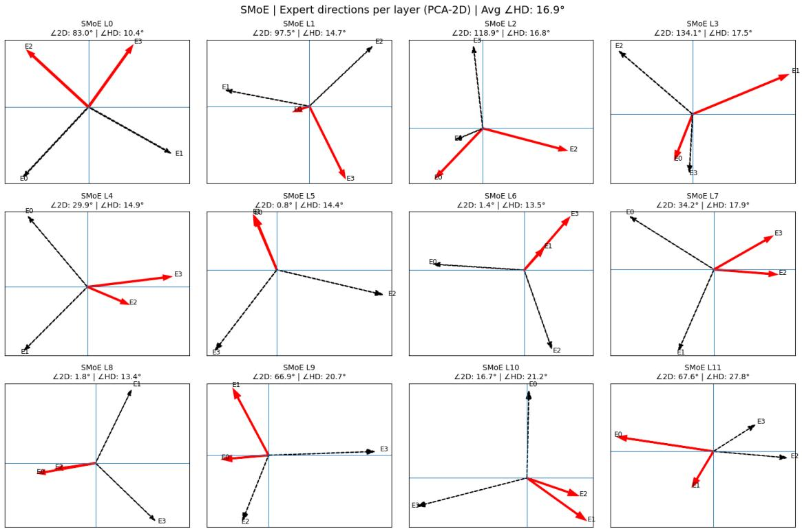  
Angle visualization of SMoE

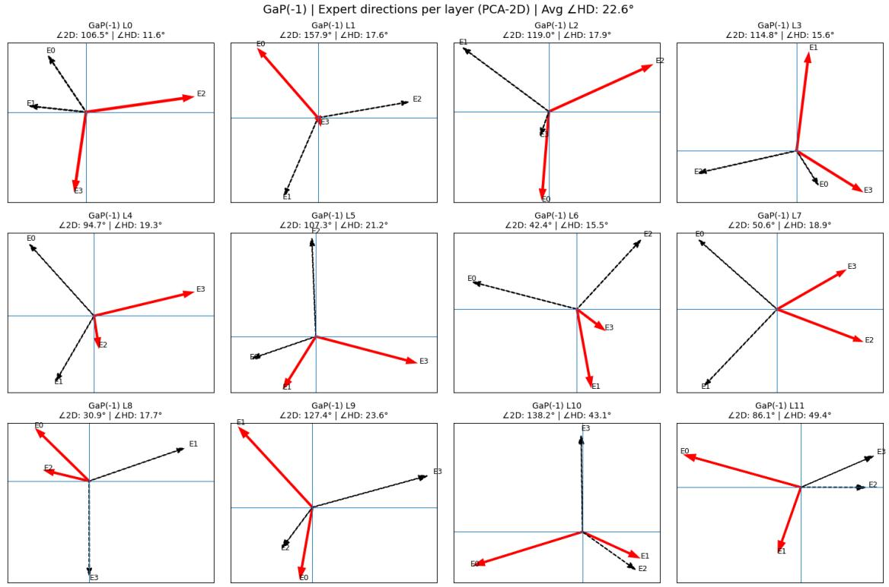  
Angle visualization of GaP-MoE(-1)

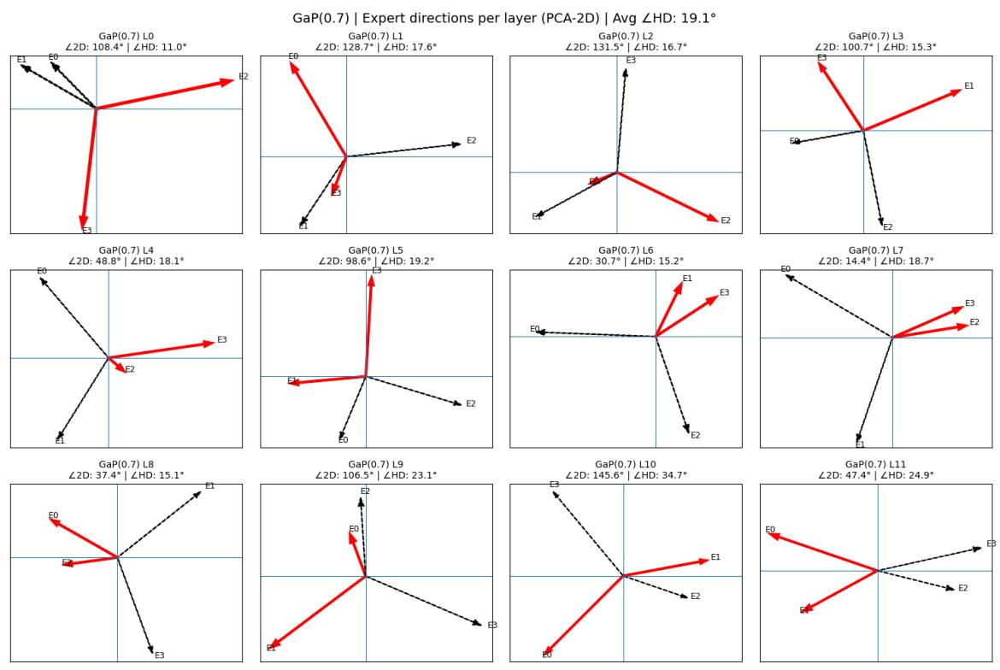  
Angle visualization of GaP-MoE(0.7)