# GENERATIVE MODELING VIA NONLINEAR SCHRÖDINGER BRIDGES AND BRANCHING DIFFUSIONS

MATHIAS GRAU AND PIERRE HENRY-LABORDÈRE†

Abstract. We propose a new generative modeling framework grounded in forward-backward partial diferential equations (PDEs). These equations arise naturally in mean-field game (MFG) theory, and are closely related to nonlinear Schrödinger systems. Our main contribution is to reinterpret this connection within the setting of generative modeling and to develop an eficient numerical methodology for its practical implementation. Specifically, we derive and characterize a nonlinear extension of the classical Schrödinger bridge problem through a coupled system of PDEs, yielding a model we call SBNL (Schrödinger Bridge NonLinear). To compute its solution, we design a simulation algorithm based on branching difusions and the probabilistic representation of semilinear PDEs. The resulting method is embarrassingly parallel, scalable to high dimensions, and applicable to a broad class of nonlinear interaction functionals. We validate the approach through numerical experiments, including recovery of the classical Schrödinger bridge, nonlinear extensions with convex penalties (Gross-Pitaevskii) as well as potential interaction terms, and high-dimensional generative tasks such as image synthesis on the MNIST and FFHQ human face dataset. Furthermore, the same framework embeds score-based generative modeling, difusion models, and tractable gaussian Schrödinger bridges.

## 1. Introduction

The Schrödinger bridge (SB) problem [1–3] has recently attracted significant attention in generative modeling due to its ability to learn an optimally controlled stochastic dynamics that transports between two arbitrary endpoint distributions. By minimizing relative entropy with respect to a reference difusion (typically Brownian motion), the SB framework reveals deep connections between optimal transport, stochastic control, and score-based generative modeling [4–7].

When both terminal costs and the evolving marginal law are controlled, the problem extends beyond classical (linear) Schrödinger bridges to mean-field control and mean-field games (MFG) [8–11]. In this regime, interactions through the marginal distribution induce a semilinear forward–backward structure.

Existing iterative schemes for SB, such as iterative proportional fitting (IPF) / iterative Markovian fitting (IMF) and related difusion-based approaches [6, 7, 12], are primarily designed for linear entropic transport. These methods rely on alternating optimization procedures, which can be computationally expensive and may sufer from error accumulation. More recent approaches based on Gaussian mixture energy models [13, 14] improve scalability in some settings but remain limited in expressivity in high dimensions. Even recent extensions based on controlled stochastic dynamics [15] are not well suited to law-dependent running costs, which induce intrinsically coupled semilinear dynamics.

Although recent works in MFG and generalized Schrödinger bridge formulations clarify the structure of the coupling in terms of forward–backward potentials [16, 17], they often do not yield objectives that are both theoretically grounded and directly amenable to unbiased stochastic optimization in high dimensions.

Our contributions are as follows:

(1) We introduce a variational objective for semilinear mean-field Schrödinger bridges with law-dependent running and terminal costs, and characterize optimality through coupled $( \varphi , \bar { \varphi } )$ PDEs (equivalently, a Lasry - Lions $( m , v )$ system). We refer to the resulting model as SBNL (Schrödinger Bridge NonLinear).

(2) We develop a marked-branching stochastic algorithm for the two-type $( \varphi , \bar { \varphi } )$ coupling, prove unbiasedness and $L ^ { 2 } .$ -integrability of the estimator under explicit conditions, and train the potentials jointly (rather than via alternating refitting), with branching used both during training and sampling.

(3) We report experiments ranging from bridge recovery and soft terminal penalties to Gross-Pitaevskii-type couplings and high-dimensional latent image transport.

## 1.1. Related work.

Linear Schrödinger bridges. The Schrödinger bridge problem is classically linked to entropic optimal transport [3, 4, 18], with eficient Sinkhorn-type and iterative fitting procedures in the linear setting. These methods scale well when dynamics are fixed between prescribed marginals. Recent neural approaches approximate bridges through forward-backward SDEs [6] or difusion-style training [7, 12]; they mainly target linear bridges and often rely on expensive alternating refits (IPF/IMF). A complementary, simulation-free line parameterizes the Schrödinger potentials with Gaussian mixture forms, yielding lightweight solvers [13, 14] at the cost of limited expressivity. Even recent drift-and-volatility extensions (Schrödinger-Bass bridges) [15] still assume (approximately) linear entropic transport and are not tailored to running costs that depend on the evolving marginal law.

Control formulations and mean-field games (MFG).. Once running or terminal terms depend on the marginal law, the problem leaves the linear SB regime and sits in mean-field control / MFG [8, 9], with forward-backward PDE couplings studied in [4, 10, 19, 20]. Extending Sinkhorntype or alternating schemes to such coupled HJB-Fokker-Planck systems is challenging in high dimension. Recent interaction/unbalanced frameworks [17, 21, 22] encode growth, interaction, or state costs through composite weighted losses and staged training. Trajectory-level optimalcontrol views, e.g. adjoint matching [23], couple learning to long-horizon simulation and can be costly. We retain entropic regularization while centering law-dependent running costs, starting from the non linear Sinkhorn system with jointly learned coupled Schrödinger potentials, using branching Monte Carlo.

Branching representations for semilinear PDEs. Branching difusion methods provide probabilistic representations of semilinear PDEs via weighted particle systems [24–26]. We extend these ideas to the coupled forward-backward system arising in mean-field Schrödinger bridges, where the interaction between the two potentials introduces a time-reflected dependency. This enables a scalable estimator for both the potentials and their gradients, which we integrate into a neural generative framework.

## 2. Semilinear Schrödinger bridges

We denote by $\mu _ { 0 }$ and $\mu _ { T }$ laws on $\mathbb { R } ^ { d }$ . Let $( X _ { t } ) _ { t \in [ 0 , T ] }$ be controlled by a drift $\alpha .$ under $\mathbb { P } ,$ with $X _ { 0 } \sim \mu _ { 0 }$ and d $\begin{array} { r } { \begin{array} { r } { \mathrm { ~ \small ~ \mathscr { X } ~ } _ { t } = \alpha _ { t } \mathrm { d } t + \mathrm { d } W _ { t } } \end{array} } \end{array}$

2.1. Formulation. As a generalization of the classical Schrödinger bridge formulation, we consider the following variational problem:

$$
P : = \operatorname* { i n f } _ { \alpha . } \ \mathbb { E } _ { X _ { 0 } \sim \mu _ { 0 } } \left[ \int _ { 0 } ^ { T } \left( { \frac { 1 } { 2 c } } | \alpha _ { t } | ^ { 2 } + f ( m ( t , \cdot ) ) \right) \mathrm { d } t \ + \ g ( m ( T , \cdot ) ) \right] ,\tag{1}
$$

where $c > 0$ $m ( t )$ denotes the law of $X _ { t } ,$ and f and g are functionals. The infimum is taken over the control α, where m is constrained to satisfy the Fokker-Planck PDE.

The three terms appearing in $P$ play diferent roles:

• The quadratic control cost $\scriptstyle { \frac { 1 } { 2 c } } | \alpha _ { t } | ^ { 2 }$ penalizes deviations of the dynamics from the reference Brownian motion. By Girsanov’s theorem, for feedback controls its expectation equals $^ { \underline { { 1 } } } H ( \mathbb { P } \mid \mathbb { P } ^ { 0 } )$ , the relative entropy between the controlled law $\mathbb { P }$ of the difusion and the law $\mathbb { P } ^ { 0 }$ of the Brownian motion started from $\mu _ { 0 }$ [2]. This quadratic structure is also crucial analytically: it is the only choice of control penalty for which the associated

Hamilton-Jacobi-Bellman (HJB) equation admits a tractable solution through a Cole-Hopf transformation. For this reason, essentially all generative modeling frameworks based on stochastic control can be viewed as particular cases of the Schrödinger bridge.

• The functional $f ( m ( t , \cdot ) )$ introduces a running cost depending directly on the marginal law of the process at each time t. Such terms allow for mean-field type interactions, density regularization, or penalization of undesirable behaviors (e.g. concentration, mass spread) during the evolution. Classical examples include (see the review [9]):

– Quadratic interaction: $\begin{array} { r } { f ( m ) = \frac { \kappa } { 2 } \int _ { \mathbb { R } ^ { d } } m ( x ) ^ { 2 } } \end{array}$ dx, which penalizes high concentrations and favors dispersion.

– Entropy-type term: $\begin{array} { r } { f ( m ) = \int _ { \mathbb { R } ^ { d } } m ( x ) } \end{array}$ log m(x) dx, encouraging spreading of the distribution.

– Potential interaction: $\begin{array} { r } { f ( m ) = \int _ { \mathbb { R } ^ { d } } V ( x ) m ( x ) } \end{array}$ dx, where V is an external field acting on the density (as in [21]).

– Pairwise interaction kernel: $\begin{array} { r } { f ( m ) = \frac { 1 } { 2 } \int \int _ { \mathbb { R } ^ { d } \times \mathbb { R } ^ { d } } K ( x - y ) m ( x ) m ( y ) } \end{array}$ dxdy, modeling attractive or repulsive mean-field efects.

• The terminal cost $g ( m ( T , \cdot ) )$ enforces constraints or preferences on the final law. In the hard-constraint setting of the classical Schrödinger bridge, g is chosen so that $m ( T , \cdot ) = \mu _ { T }$ , i.e. the terminal distribution matches the prescribed target. In the relaxed setting, g can encode convex penalties measuring the discrepancy between the final distribution and the target. For use below, we denote by $g ^ { * }$ the Legendre transform (convex conjugate) of g:

$$
g ^ { * } \bigl ( v ( T , \cdot ) \bigr ) : = \operatorname* { s u p } _ { m ( T , \cdot ) } \Bigl \{ \mathbb { E } _ { X \sim m ( T , \cdot ) } [ v ( T , X ) ] - g ( m ( T , \cdot ) ) \Bigr \} .
$$

Note that in practice it does not make sense to perfectly calibrate to the empirical measure, which is only a finite sample approximation of the true law. Instead, one seeks both proximity to the empirical distribution and suficient regularity of the solution, precisely what the soft constraint achieves.

Remark 2.1 (State dependence and MFG link). Running and terminal costs that depend explicitly on the state x can be rewritten in the law-only form (1) by integrating against m; the resulting forward-backward MFG optimality system and its relation to Theorem 2.1 are recorded in Appendix E.

## 2.2. Main result.

Theorem 2.1 (Semilinear Schrödinger bridge). We assume $( \mathrm { A } 1 ) – ( \mathrm { A } 4 )$ from Appendix D. The optimal controlled process of (1) is given under a measure P by

$$
\mathrm { d } X _ { t } = \nabla \log \varphi ( t , X _ { t } ) \mathrm { d } t + \mathrm { d } W _ { t } ,\tag{2}
$$

with Law $( X _ { t } ) = \varphi ( t , \cdot ) \bar { \varphi } ( T - t , \cdot )$ and $\begin{array} { r } { F : = \frac { \delta f } { \delta m ( t , x ) } } \end{array}$ where the pair $( \varphi , \bar { \varphi } )$ satisfies the PDE system

(3)

$$
\begin{array} { r } { \partial _ { t } \varphi _ { t } + \frac { 1 } { 2 } \Delta \varphi _ { t } = c \varphi _ { t } F ( t , x , \varphi _ { t } \bar { \varphi } _ { T - t } ) , } \end{array}\tag{4}
$$

$$
\begin{array} { r } { \partial _ { t } \bar { \varphi } _ { t } + \frac { 1 } { 2 } \Delta \bar { \varphi } _ { t } = c \bar { \varphi } _ { t } F ( T - t , x , \bar { \varphi } _ { t } \varphi _ { T - t } ) , } \end{array}
$$

The terminal conditions $( \varphi ( T , \cdot ) , \bar { \varphi } ( T , \cdot ) )$ are characterized by the coupled nonlinear Sinkhorn system

$$
\left\{ \begin{array} { l } { \varphi ( 0 , x ) \bar { \varphi } ( T , x ) = \mu _ { 0 } ( x ) , } \\ { \bar { \varphi } ( 0 , x ) \varphi ( T , x ) = G ^ { - 1 } \big ( - \frac { 1 } { c } \log \varphi ( T , \cdot ) , x \big ) , } \end{array} \right.\tag{5}
$$

where $\begin{array} { r } { G : = \frac { \delta g } { \delta m ( T , x ) } , G ^ { - 1 } ( w , \cdot ) } \end{array}$ is the density m solving $G ( \cdot , m ) = w _ { . }$ , and $\varphi ( 0 , \cdot ) , \bar { \varphi } ( 0 , \cdot )$ are obtained by propagating the terminal potentials backward through (3)-(4).

Appendix A proves Theorem 2.1 by a verification argument; see [8] for the well-posedness of the forward-backward system.

Remark 2.2 (Nonlinear Sinkhorn interpretation). When $f \equiv 0$ with a hard terminal constraint, (5) reduces to the usual Sinkhorn system, with $( \varphi , \bar { \varphi } )$ propagated by linear heat kernels and matched to $\mu _ { 0 } , \mu _ { T }$ . Our formulation adds two nonlinear ingredients: the semilinear propagation (3)-(4) through the running cost $F ,$ and the terminal coupling $\begin{array} { r } { \varphi ( T , \cdot ) \mapsto G ^ { - 1 } ( - \frac { 1 } { c } \log \varphi ( T , \cdot ) , \cdot ) } \end{array}$ induced by $g .$ The values $\varphi ( 0 , x ) , \bar { \varphi } ( 0 , x )$ are obtained from the PDE system via the branching representation of Section 3.

Remark 2.3 (Forward-backward system). Although Theorem 2.1 is stated in terms of the system $( 3 ) – ( 4 )$ with terminal conditions, it can equivalently be expressed in the usual forward-backward form familiar from mean field games. Indeed, defining the density $m ( t , x ) : = \varphi ( t , x ) \bar { \varphi } ( T - t , x )$ one checks that $m$ satisfies the forward Fokker-Planck equation (see proof for details)

$$
\begin{array} { r } { \partial _ { t } m + \nabla \cdot \left( m \nabla \log \varphi \right) - \frac { 1 } { 2 } \Delta m = 0 , } \end{array}
$$

while $\begin{array} { r } { v : = - \frac { 1 } { c } \log \varphi } \end{array}$ satisfies the backward Hamilton-Jacobi equation

$$
\begin{array} { r } { \partial _ { t } v + \frac { 1 } { 2 } \Delta v - \frac { c } { 2 } | \nabla v | ^ { 2 } + F ( t , x , m ) = 0 } \end{array}
$$

Thus the pair $( m , v )$ solves the standard forward-backward MFG system of Lasry - Lions type. Our formulation in terms of $( \varphi , \bar { \varphi } )$ is algebraically equivalent but particularly well-suited for the branching Monte-Carlo representation introduced below.

Remark 2.4 (Soft constraint and matching marginal $\mu _ { T } )$ . Consider the terminal cost

$$
g ( m ( T , \cdot ) ) = \lambda D _ { f } ( \mu _ { T } , m ( T , \cdot ) ) , \qquad \lambda > 0 ,
$$

with $f ( u ) : = - \log u - 1$ , i.e. $\begin{array} { r } { D _ { f } ( \mu _ { T } , m ) = \int } \end{array}$ m log $\begin{array} { r } { \frac { m } { \mu _ { T } } - \int m } \end{array}$ , which is $\mathrm { K L } ( m ( T , \cdot ) \| \mu _ { T } ) - 1$ on probability measures. Over nonnegative measures, the convex conjugate $g ^ { * }$ is

$$
\begin{array} { r } { g ^ { * } ( v ( T , \cdot ) ) = \lambda \operatorname { \mathbb { E } } _ { X _ { T } \sim \mu _ { T } } \Bigl [ e ^ { v ( T , X _ { T } ) / \lambda } \Bigr ] , } \end{array}\tag{6}
$$

so that the terminal coupling in the nonlinear Sinkhorn system (5) becomes explicit:

$$
G ^ { - 1 } { \Bigl ( } - { \textstyle { \frac { 1 } { c } } } \log \varphi ( T , \cdot ) , x { \Bigr ) } = \mu _ { T } ( x ) \varphi ( T , x ) ^ { - a } , \qquad a : = { \frac { 1 } { \lambda c } } .\tag{7}
$$

The system (5) then reads

$$
\left\{ \begin{array} { l l } { \varphi ( 0 , x ) \bar { \varphi } ( T , x ) = \mu _ { 0 } ( x ) , } \\ { \bar { \varphi } ( 0 , x ) \varphi ( T , x ) = \mu _ { T } ( x ) \varphi ( T , x ) ^ { - a } . } \end{array} \right.\tag{8}
$$

In our numerical experiments, we consider this formulation for various values of λ. In the limit $\lambda \to \infty { \mathrm { ~ ( i . e . ~ } } a \to 0 { \mathrm { ) } }$ , the terminal penalty enforces the hard constraint $m ( T , \cdot ) = \mu _ { T }$ , and the terminal coupling in (8) reduces to the standard marginal constraint

$$
\bar { \varphi } ( 0 , x ) \varphi ( T , x ) = \mu _ { T } ( x ) ,\tag{9}
$$

so that the nonlinear Sinkhorn system recovers the classical Schrödinger bridge.

Appendix F records an analogous soft terminal condition based on a p-Wasserstein discrepancy.

Remark 2.5 (Special cases of semilinear Schrödinger bridges). Appendix H records several tractable specializations: linear bridges with confining potentials and explicit heat kernels on Coxeter chambers (including Dyson and type-C limits), the Gaussian semilinear bridge for log-linear F [27] and a relative-entropy terminal cost (Proposition H.1), lifted bridges with Gyöngy’s Markov projection (Proposition H.2), and score-based / DDPM models as the exact $F \equiv 0$ solution with $\bar { \varphi } \equiv 1$ and noised-data prior (Appendix H.2), with proofs in Appendices I and J.

## 3. Branching diffusions

The semilinear PDE system $( 3 ) \AA - \thinspace ( 4 )$ is generally analytically intractable, and thus requires numerical approximation. A deterministic Sinkhorn-type iterative method based on PDE techniques was introduced by Guéant [11]; however, this approach sufers from the curse of dimensionality and is therefore not suitable in the context of generative modeling.

An alternative and more powerful approach is provided by marked branching difusion representations, originating in McKean’s probabilistic solution of the KPP equation [24] and subsequently extended to broad classes of semilinear and nonlinear PDEs [25, 26, 28]. These representations have been successfully applied to parabolic, elliptic, and even hyperbolic PDEs, including, notably, the complex Gross-Pitaevskii equation developed in Appendix G.

The key idea is to encode the nonlinear terms of the PDE into a branching mechanism: particles follow Brownian dynamics until a random exponential branching time, at which point they reproduce according to rules determined by the nonlinearity $F .$ . The resulting branching trees provide unbiased MC estimators of the PDE solution. This stochastic representation is embarrassingly parallelizable, which makes it particularly efective for large-scale simulations and high-dimensional problems.

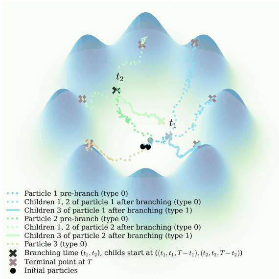  
Figure 1. Branching paths on an 8-Gaussian terminal potential, illustrating Gross-Pitaevskiitype branching (Appendix M).

More generally, when F is local and analytic in $m ( t , x )$ , we truncate its power series at order K, yielding a polynomial nonlinearity amenable to branching. Without loss of generality, we write it in the canonical form

$$
F ( t , x , m ) = 1 - \sum _ { k = 0 } ^ { K } a _ { k } ( t , x ) m ^ { k } : = 1 - F _ { p } ( t , x , m ) ,\tag{10}
$$

where the coeficients $( a _ { k } ) _ { k = 0 , \cdots , K }$ are functions of t and $\boldsymbol { x } \in \mathbb { R } ^ { d }$ . Thus the system (3)-(4) becomes

$$
\left\{ \begin{array} { l } { \partial _ { t } \varphi _ { t } + \frac { 1 } { 2 } \Delta \varphi _ { t } = c \varphi _ { t } \Big ( 1 - F _ { p } \big ( t , x , \varphi _ { t } \bar { \varphi } _ { T - t } \big ) \Big ) , } \\ { \partial _ { t } \bar { \varphi } _ { t } + \frac { 1 } { 2 } \Delta \bar { \varphi } _ { t } = c \bar { \varphi } _ { t } \Big ( 1 - F _ { p } \big ( T - t , x , \bar { \varphi } _ { t } \varphi _ { T - t } \big ) \Big ) . } \end{array} \right.\tag{11}
$$

3.1. Branching representation. We use a marked branching Brownian motion with two types of particles: white vertex ◦ represents $\varphi ,$ , black vertex • represents ${ \bar { \varphi } } .$ The branching rate is fixed to be $\beta = c ,$ and we choose arbitrarily probabilities $p _ { k } > 0$ for $k = 0 , 1 , \ldots , K$ with $\textstyle \sum _ { k = 0 } ^ { K } p _ { k } = 1$ Each particle moves as a Brownian motion and lives an exponential time $\tau \sim \mathrm { E x p } ( c )$ . At a branching/death time $s ,$ draw $K ^ { \star }$ with probability $p _ { K } .$ ⋆ and apply

$$
\begin{array} { r } { \left\{ \begin{array} { l l l } { \mathrm { W h i t e ~ p a r e n t ~ ( \circ ) : } } & { \quad \circ _ { s } \longrightarrow ( k + 1 ) \circ _ { s } + k \bullet _ { T - s } , k = 0 , 1 , \ldots , K , } \\ { \mathrm { B l a c k ~ p a r e n t ~ ( \bullet ) : } } & { \quad \bullet _ { s } \longrightarrow k \circ _ { T - s } + ( k + 1 ) \bullet _ { s } , k = 0 , 1 , \ldots , K . } \end{array} \right. } \end{array}
$$

Here, the subscript denotes the (re-)starting time of each particle: ofspring with the same type as the parent start at time $s ,$ and ofspring with the opposite type start at time $T - s$

Each simulation carries a multiplicative weight W, initialized to 1 at the root $( t , x )$ . At every branching event occurring at time s with outcome $K ^ { \star }$ , it is updated as

$$
\begin{array} { r l r l r } & { \mathcal { W } \longrightarrow \mathcal { W } \times \frac { a _ { K ^ { \star } } \left( s ^ { \circ } , X _ { s } \right) } { p _ { K ^ { \star } } } , } & & { s ^ { \circ } : = s \mathrm { ~ ( w h i t e ~ p a r e n t ) } , } & { s ^ { \circ } : = T - s \mathrm { ~ ( b l a c k ~ p a r e n t ) } , } \end{array}\tag{12}
$$

where $X _ { s }$ is the position of the particle at time $s .$ Thus the global weight of a branching tree is the product of the factors associated with all branchings. At time $T .$ , each surviving white (resp. black) particle at position $X _ { T } ^ { i } ~ ( \mathrm { r e s p . } ~ \bar { X } _ { T } ^ { j } )$ contributes the factor $\varphi ( T , X _ { T } ^ { i } ) \ ( \mathrm { r e s p . } \ \bar { \varphi } ( T , \bar { X } _ { T } ^ { j } ) )$ . We

denote by

$\left\{ \begin{array} { l l } { N _ { T } ^ { \mathrm { w h i t e } } } \\ { \bar { N } _ { T } ^ { \mathrm { b l a c k } } } \end{array} \right.$ the number of white particles at time $T ,$ with positions $X _ { T } ^ { 1 } , \dots , X _ { T } ^ { N _ { T } ^ { \mathrm { w h i t e } } }$ the number of black particles at time $T ,$ with positions $\bar { X } _ { T } ^ { 1 } , \ldots , \bar { X } _ { T } ^ { \bar { N } _ { T } ^ { \mathrm { b l a c k } } }$

Proposition 3.1 (Unbiased stochastic representation for $\varphi )$ . Let $A : = \| \varphi ( T , \cdot ) \| _ { \infty } , B : =$ $\| \bar { \varphi } ( T , \cdot ) \| _ { \infty }$ and $b _ { k } \ : = \ \| a _ { k } \| _ { L ^ { \infty } ( [ 0 , T ] \times \mathbb { R } ^ { d } ) }$ be finite, and assume $( i ) \ c T \sum _ { k } k p _ { k } \ < \ 1$ and $( i i )$ $\begin{array} { r } { A ^ { 2 } B ^ { 2 } \exp \left( c T ( \sum _ { k } b _ { k } ^ { 2 } r ^ { k } / p _ { k } - 1 ) \right) \leq r \ f o r } \end{array}$ some $r > 0$ . Set

$$
\Phi : = { \mathcal W } \prod _ { i = 1 } ^ { N _ { T } ^ { \mathrm { w h i t e } } } \varphi ( T , X _ { T } ^ { i } ) \prod _ { j = 1 } ^ { \bar { N } _ { T } ^ { \mathrm { b l a c k } } } \bar { \varphi } ( T , \bar { X } _ { T } ^ { j } ) .
$$

Then the tree is a.s. finite, $\Phi \in L ^ { 2 }$ , and $\varphi ( t , x ) = \mathbb { E } _ { t , x } [ \Phi ]$ (and its black-rooted analogue $\bar { \varphi } )$ is the mild solution of (3)-(4) dominated by (38).

The proof is deferred to Appendix L; illustrative Feynman-Galton-Watson diagrams in $\mathrm { A p \mathrm { - } }$ pendix M, and a numerical sanity check of the time-reflected coupling $u ( t , \cdot ) u ( T - t , \cdot )$ in Appendix K.

## 4. Stochastic-optimization form of the nonlinear Sinkhorn system

To enforce the two nonlinear Sinkhorn conditions (5), we match the associated measures using the Maximum Mean Discrepancy (MMD) [29], which we now recall.

Definition 4.1 (Maximum Mean Discrepancy). Let k be a positive definite kernel. For two probability laws $P , Q$ on $\mathbb { R } ^ { d }$ , the MMD admits the closed form

$$
\mathrm { M M D } _ { k } ^ { 2 } ( P , Q ) = \mathbb { E } _ { X , X ^ { \prime } \sim P } [ k ( X , X ^ { \prime } ) ] + \mathbb { E } _ { Y , Y ^ { \prime } \sim Q } [ k ( Y , Y ^ { \prime } ) ] - 2 \mathbb { E } _ { X \sim P ; Y \sim Q } [ k ( X , Y ) ] ,
$$

where $X , X ^ { \prime } \ ( \mathrm { r e s p . } \ Y , Y ^ { \prime } )$ are independent copies from $P \ ( { \mathrm { r e s p . } } \ Q )$

Remark 4.1 (Characteristic kernel). If k is characteristic, then $\mathrm { M M D } _ { k } ( P , Q ) = 0 \Longleftrightarrow P = Q$ Background on MMD and RKHS, and the proof of Proposition 4.1, are given in Appendix C.

Proposition 4.1 (MMD objective). Let k be as in Lemma C.1 (e.g. Gaussian), assume the four densities below are integrable, and define

$$
\begin{array} { r } { \mathcal { L } _ { \mathrm { M M D } } : = \mathrm { M M D } _ { k } ^ { 2 } \Big ( \varphi ( 0 , \cdot ) \bar { \varphi } ( T , \cdot ) , \mu _ { 0 } \Big ) + \mathrm { M M D } _ { k } ^ { 2 } \Big ( \bar { \varphi } ( 0 , \cdot ) \varphi ( T , \cdot ) , G ^ { - 1 } \big ( - \frac { 1 } { c } \log \varphi ( T , \cdot ) , \cdot \big ) \Big ) . } \end{array}\tag{13}
$$

Then $\mathcal { L } _ { \mathrm { M M D } } \ge 0$ , and ${ \mathcal { L } } _ { \mathrm { M M D } } = 0 \Longleftrightarrow ( \varphi ( T , \cdot ) , { \bar { \varphi } } ( T , \cdot ) )$ satisfy (5) a.e.

## 4.1. Meta-algorithm for training semilinear Schrödinger bridges.

$$
\varphi _ { \theta } ( x ) : = \varphi _ { \theta } ( T , x )
$$

$$
\bar { \varphi } _ { \eta } ( x ) : =
$$

$$
\bar { \varphi } _ { \eta } ( T , x )
$$

$$
\mu ^ { * }
$$

For $Z \sim \mu ^ { * }$ , we define $\widehat { A } _ { \theta , \eta } ( Z , \circ \ ( \mathrm { r e s p . \ } \bullet ) )$ using a white (resp. black) rooted branching tree starting from $( 0 , Z )$

$$
\widehat { A } _ { \theta , \eta } ( Z , \circ ) : = \mathcal { W } \prod _ { i = 1 } ^ { N _ { T } ^ { \mathrm { w h i t e } } } \varphi _ { \theta } ( Z _ { T } ^ { i } ) \prod _ { j = 1 } ^ { \bar { N } _ { T } ^ { \mathrm { b l a c k } } } \bar { \varphi } _ { \eta } ( \bar { Z } _ { T } ^ { j } ) ,
$$

with analogous definition for a black-rooted tree.

Algorithm 1: Training semilinear   
SB   
Input: Laws $\mu _ { 0 } , \mu _ { T } , \mu ^ { * }$ , rate $c ,$ rule $F ,$   
penalty $\lambda > 0 ,$ kernel $k ,$ step $\gamma ,$   
batch size $B .$   
Output: Trained potentials $( \varphi _ { \theta } , \bar { \varphi } _ { \eta } )$   
1 Initialize $\theta , \eta ;$   
2 while not converged do   
3 Draw $\{ X _ { 0 } ^ { ( b ) } \} _ { b = 1 } ^ { B } \sim \mu _ { 0 } , \{ X _ { T } ^ { ( b ) } \} _ { b = 1 } ^ { B } \sim \mu _ { T }$   
and $\{ Z ^ { ( b ) } \} _ { b = 1 } ^ { B } \sim \mu ^ { * } ;$   
4 Simulate white and black trees from   
each $Z ^ { ( b ) }$ and form $\widehat { A } _ { \theta , \eta } ( Z ^ { ( b ) } , \circ )$ and   
$\widehat { A } _ { \theta , \eta } ( Z ^ { ( b ) } , \bullet ) ;$   
5 $\begin{array} { r } { \widehat { \mathcal { L } } _ { \mathrm { M M D } } \gets \frac { 1 } { B ( B - 1 ) } \sum _ { b \neq b ^ { \prime } } J ( b , b ^ { \prime } ) ; } \end{array}$   
$\diagup U { - } s t a t i s t i c$   
6 $( \theta , \eta ) \gets ( \theta , \eta ) - \gamma \nabla _ { ( \theta , \eta ) } \widehat { \mathcal { L } } _ { \mathrm { M M D } } ;$

In the KL terminal case of Remark 2.4, using the reweighted kernel $\tilde { k } ( x , y ) : = \mu ^ { * } ( x ) k ( x , y ) \mu ^ { * } ( y )$ which remains characteristic provided $\mu ^ { * } > 0$ almost everywhere, the MMD objective computed with ˜k reads

$$
\operatorname* { m i n } _ { \theta , \eta } \mathcal { L } _ { \mathrm { M M D } } ( \theta , \eta ) : = \operatorname* { m i n } _ { \theta , \eta } \mathbb { E } [ J ] .\tag{14}
$$

where

$$
\begin{array} { r l } & { J = \widehat { A } _ { \theta , \eta } ( Z , \circ ) \bar { \varphi } _ { \eta } ( Z ) \widehat { A } _ { \theta , \eta } ( Z ^ { \prime } , \circ ) \bar { \varphi } _ { \eta } ( Z ^ { \prime } ) k ( Z , Z ^ { \prime } ) - 2 \widehat { A } _ { \theta , \eta } ( Z , \circ ) \bar { \varphi } _ { \eta } ( Z ) k ( Z , X _ { 0 } ^ { \prime } ) \mu ^ { \ast } ( X _ { 0 } ^ { \prime } ) } \\ & { \quad + \mu ^ { \ast } ( X _ { 0 } ) k ( X _ { 0 } , X _ { 0 } ^ { \prime } ) \mu ^ { \ast } ( X _ { 0 } ^ { \prime } ) + \widehat { A } _ { \theta , \eta } ( Z , \bullet ) \varphi _ { \theta } ( Z ) \widehat { A } _ { \theta , \eta } ( Z ^ { \prime } , \bullet ) \varphi _ { \theta } ( Z ^ { \prime } ) k ( Z , Z ^ { \prime } ) } \\ & { \quad - 2 \widehat { A } _ { \theta , \eta } ( Z , \bullet ) \varphi _ { \theta } ( Z ) \varphi _ { \theta } ( X _ { T } ^ { \prime } ) ^ { \frac { - 1 } { \alpha } } k ( Z , X _ { T } ^ { \prime } ) \mu ^ { \ast } ( X _ { T } ^ { \prime } ) + \big ( \varphi _ { \theta } ( X _ { T } ) \varphi _ { \theta } ( X _ { T } ^ { \prime } ) \big ) ^ { \frac { - 1 } { \alpha } } \mu ^ { \ast } ( X _ { T } ) k ( X _ { T } , X _ { T } ^ { \prime } ) \mu ^ { \ast } ( X _ { T } ^ { \prime } ) . } \end{array}\tag{15}
$$

Here, $( Z , Z ^ { \prime } ) \sim \mu ^ { * } \otimes \mu ^ { * } , ( X _ { 0 } , X _ { 0 } ^ { \prime } ) \sim \mu _ { 0 } \otimes \mu _ { 0 }$ , and $( X _ { T } , X _ { T } ^ { \prime } ) \sim \mu _ { T } \otimes \mu _ { T }$ are drawn independently. As the trees attached to Z and $Z ^ { \prime }$ are independent, $\mathbb { E } [ J ] = \mathcal { L } _ { \mathrm { M M D } }$ (with kernel $\tilde { k } )$ ; Algorithm 1 averages ${ \cal J } ( b , b ^ { \prime } )$ , i.e. J at the b-th and b′-th samples, over $b \ne b ^ { \prime } .$ , which keeps the estimate unbiased. Each term is estimated on mini-batches and minimized by stochastic gradient descent, with a Gaussian kernel and a suitable $\mu ^ { * }$ as stable defaults (Appendix B).

## 4.2. Meta-algorithm for sampling with semilinear Schrödinger bridges.

Once the potentials $( \varphi _ { \boldsymbol { \theta } } , \bar { \varphi } _ { \eta } )$ have been learned, we can generate new samples by simulating the optimal controlled process (Algorithm 2): under $\mathbb { P } _ { \mathrm { : } }$ , dXt = ∇ log $\varphi _ { \theta } ( t , X _ { t } ) \mathrm { d } t + \mathrm { d } W _ { t }$ . The branching representation of Proposition 3.1 gives unbiased Monte-Carlo estimates $\widehat { \varphi }$ of $\varphi _ { \boldsymbol { \theta } } ( t , \boldsymbol { x } )$ around $x = X _ { t }$ , diferentiated in x with autograd; the ratio $\nabla \widehat { \varphi } / \widehat { \varphi }$ is a consistent $( M \to \infty )$ estimator of the score field. We then discretize the dynamics by Euler-Maruyama (or a higher-order scheme).

Algorithm 2: Sampling from semilinear   
SB   
Input: Trained $( \varphi _ { \boldsymbol { \theta } } , \bar { \varphi } _ { \eta } ) .$ , rate $^ { c , }$ rule $F ,$ Euler steps   
N, horizon $T _ { i }$ , samples M.   
Output: Approximate bridge path $( X _ { t _ { k } } ) _ { k = 0 } ^ { N } .$   
1 Initial $X _ { 0 } \sim \mu _ { 0 } , \Delta t \gets T / N ;$   
2 for $k = 0$ to $N - 1$ do   
3 Simulate M white-rooted trees from $( t _ { k } , X _ { t _ { k } } ) ;$   
4 Form $\widehat { \varphi } _ { k } ( x )$ of $\varphi ( t _ { k } , x )$   
M N¯m,b T   
${ \widehat { \varphi } } _ { k } ( x ) \gets \frac { 1 } { M } \sum { \mathcal { W } ^ { m } } \prod ^ { m } \varphi _ { \theta } ( X _ { T , x } ^ { m , i } ) \prod \bar { \varphi } _ { \eta } ( \bar { X } _ { T , x } ^ { m , j } )$   
m=1 i=1 j=1   
vk $ \nabla _ { x } \log \widehat { \varphi } _ { k } ( x ) | _ { x = X _ { t _ { k } } } ;$ $/ /$ autograd   
5 Draw $\xi _ { k } \sim \mathcal { N } ( 0 , I _ { d } ) ;$   
6 $X _ { t _ { k + 1 } } \gets X _ { t _ { k } } + \Delta t v _ { k } + \sqrt { \Delta t } \xi _ { k } ;$

## 5. Numerical experiments

5.1. Implementation details. Each of $\varphi _ { \theta } , \bar { \varphi } _ { \eta } : \mathbb { R } ^ { d } \to ( 0 , \infty )$ is a positive-scalar feedforward network. Unless stated otherwise, all use 3 to 8 fully connected layers with nonlinear activations. Widths are 16 for $d = 2 ,$ 32 for $d = 5 0$ , and 64 for $d = 5 1 2$ for latent FFHQ experiments. Potentials are trained jointly by stochastic gradient descent on the MMD objective 14 (Adam, $\gamma = 1 0 ^ { - 4 } , B = 6 4 )$ . We use automatic diferentiation of log φ for sampling (Section 4.2); see Appendix N. We train on $1 0 ^ { 4 }$ samples in 2D and $1 0 ^ { 5 }$ samples in 50D, for 300 epochs in both cases. Sampling uses between $N = 5 0$ and $N = 2 0 0$ Euler steps and $M \in \{ 1 0 ^ { 3 } , 1 0 ^ { 4 } \}$ branching trees per score evaluation (higher M in higher dimension). All runs use NVIDIA Tesla T4 GPUs; bridge training takes ∼ 30 s for 300 epochs on $1 0 ^ { 4 }$ points in 2D, and generation ${ \sim } 3 \mathrm { s }$ for 50 steps.

## 5.2. Results.

Classical Schrödinger bridges $( F = 0 , \lambda = \infty , d = 2 )$ . We begin with controlled experiments in low dimensions to validate that our algorithm recovers the classical Schrödinger bridge. Specifically, we set $F \equiv 0$ and enforce a hard terminal constraint (see Remark 2.4 with $\lambda = \infty )$ , so that the problem reduces to entropic optimal transport.

  
Figure 2. Temporal evolution of Law $( X _ { t } )$ from Moons → Swiss (source $\mu _ { 0 }$ on the left, target µT on the right).

We compare SBNL against DeepGSB [16], LightSB [13], LightSBB-M [15], DSBM [12], and BranchSBM [17] on a Gaussian → mixture of 8 Gaussians benchmark, selecting methods that are closest to our setting in terms of modeling assumptions and problem formulation. Figure 3a displays terminal samples, while Table 3b reports quantitative distances to $\mu _ { T }$ . SBNL captures all modes and achieves the best mixture $W _ { 2 }$ , whereas BranchSBM attains the lowest empirical $W _ { 2 }$ . Overall, SBNL remains competitive across evaluation metrics. Additional per-mode coverage results and full comparisons are provided in Appendix O.2.

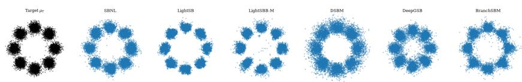  
(3a) Terminal samples on the 8-Gaussians benchmark.

<table><tr><td>Method</td><td> $M W _ { 2 }$ </td><td> $W _ { 2 } ^ { \mathrm { e m p } }$ </td><td>E</td><td>∥|∆x||</td><td> $\| \Delta \Sigma \| _ { F }$ </td></tr><tr><td>SBNL</td><td> ${ \bf 1 . 5 2 _ { \pm 0 . 0 7 } }$ </td><td> $1 . 1 4 { \scriptstyle \pm 0 . 2 3 }$ </td><td> $0 . 0 2 3 _ { \pm 0 . 0 1 2 }$ </td><td> $0 . 2 9 _ { \pm 0 . 0 4 }$ </td><td> $2 . 9 7 _ { \pm 0 . 2 2 }$ </td></tr><tr><td>BranchSBM</td><td> $1 . 5 7 { \scriptstyle \pm 0 . 1 4 }$ </td><td> $\mathbf { 1 . 0 5 _ { \pm 0 . 1 2 } }$ </td><td> $\mathbf { 0 . 0 1 8 _ { \pm 0 . 0 0 9 } }$ </td><td> $\mathbf { 0 . 0 8 _ { \pm 0 . 0 5 } }$ </td><td> $\mathbf { 1 . 7 4 _ { \pm 0 . 1 9 } }$ </td></tr><tr><td>LightSBB-M</td><td> $1 . 5 5 { \scriptstyle \pm 0 . 2 7 }$ </td><td> $1 . 2 6 { \scriptstyle \pm 0 . 1 5 }$ </td><td> $0 . 0 1 8 { \scriptstyle \pm 0 . 0 0 9 }$ </td><td> $0 . 1 6 { \scriptstyle \pm 0 . 0 7 }$ </td><td> $1 . 7 9 { \scriptstyle \pm 0 . 3 9 }$ </td></tr><tr><td>LightSB</td><td> $1 . 5 4 { \scriptstyle \pm 0 . 2 4 }$ </td><td> $1 . 2 2 _ { \pm 0 . 1 2 }$ </td><td> $0 . 0 2 4 { \scriptstyle \pm 0 . 0 0 9 }$ </td><td>0.11±0.06</td><td> $4 . 6 9 _ { \pm 0 . 4 9 }$ </td></tr><tr><td>DSBM</td><td> $2 . 5 4 _ { \pm 0 . 1 5 }$ </td><td> $\phantom { + } 1 . 6 1 _ { + 0 . 1 2 } ^ { - \phantom { + } \sim \cdots }$ </td><td> $0 . 0 4 4 { \scriptstyle \pm 0 . 0 1 7 }$ </td><td> $0 . 2 3 _ { + 0 . 0 9 } ^ { - }$ </td><td> $1 2 . 0 5 _ { \pm 0 . 8 4 }$ </td></tr><tr><td>DeepGSB</td><td> $2 . 4 8 _ { \pm 0 . 1 9 }$ </td><td> $2 . 0 2 _ { \pm 0 . 1 1 }$ </td><td> $0 . 1 9 9 _ { \pm 0 . 0 2 0 }$ </td><td> $0 . 2 4 { \scriptstyle \pm 0 . 0 8 }$ </td><td> $2 5 . 9 3 _ { \pm 0 . 2 4 }$ </td></tr></table>

(3b) Comparison $( M W _ { 2 }$ : closed-form Wasserstein, $W _ { 2 } ^ { \mathrm { e m p } }$ empirical $W _ { 2 }$ on $1 0 ^ { 4 }$ samples, E : energy distance, and $\| \Delta \bar { x } \|$ (resp. $\| \Delta \Sigma \| _ { F } )$ : Euclidean (resp. Frobenius) error on the sample mean (resp. covariance)).

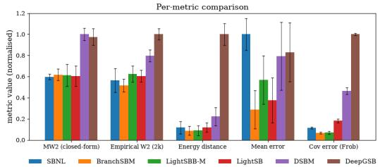  
(3c) Visual comparison across all metrics, each column-wise max-normalized to 1 (lower is better).

High-dimensional mixtures $( F ( m ) = 0 , \lambda = \infty , d = 5 0 )$ . We use the same d=50 Gaussian-mixture benchmark as in [12] (Figures 21-22). The empirical mean, standard deviation, and skewness of $\mathrm { L a w } ( X _ { T } )$ converge to those of $\mu _ { T }$ within 50 training epochs (Figure 23). We observe no variance collapse, attributable to the consistent branching estimator of ∇ log $\varphi _ { \theta }$ avoiding the bias that score-matching pipelines accumulate at high d [7].

Soft terminal conditions $( F = 0 , \ \lambda < \infty , \ d = \ 2 )$ . We next relax the hard constraint by introducing a finite penalty parameter λ. Figure 4a shows Law $( X _ { t } )$ for decreasing values of $\lambda ,$ and Figure 4b reports the induced Kullback-Leibler divergence at the terminal time. As expected, $D _ { \mathrm { K L } } ( \mu _ { T } , \mathrm { L a w } ( X _ { T } ) )$ decreases monotonically with λ, confirming that stronger penalties enforce closer alignment with the target law.

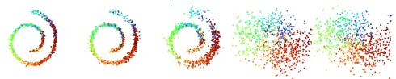  
(4a) Generation for $\lambda \in \{ 1 0 ^ { 5 } , 1 0 ^ { 4 } , 5 \times 1 0 ^ { 3 } , 1 0 ^ { 3 } , 1 0 ^ { 2 } \}$

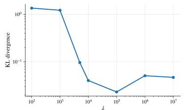  
(4b) Terminal $D _ { \mathrm { K L } } ( \mu _ { T } , \mathrm { L a w } ( X _ { T } ) )$ versus λ.

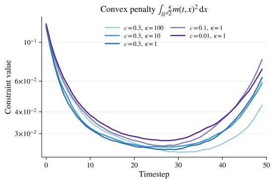  
(4c) Evolution of the convex penalty during generation for $c \in \{ 0 . 0 1 , 0 . 1 , 0 . 3 \}$ and $\kappa \in \{ 1 , 1 0 , 1 0 0 \}$ .

Gross-Pitaevskii penalty $( F ( m ) = \kappa m , \lambda = \infty , d = 2 )$ . We also investigate the convex penalty functional $\begin{array} { r } { f ( m ( t , \cdot ) ) : = \frac { \kappa } { 2 } \int _ { \mathbb { R } ^ { d } } m ( t , x ) ^ { 2 } } \end{array}$ dx, so that $F ( m ) = \kappa m$ . Larger κ and c increase branching, making the dynamics more sensitive to the nonlinearity (Figure 4c). Potential running cost $( F ( t , x , m ) = V ( x ) , \lambda = \infty , d = 2 )$ . We finally illustrate a state-dependent running cost of potential type, $\begin{array} { r } { f ( m ( t , \cdot ) ) : = \int _ { \mathbb { R } ^ { d } } V ( x ) m ( t , x ) } \end{array}$ dx, so that $F ( t , x , m ) = V ( x )$ . This lets the environment shape the transport path: the optimal bridge routes mass around the obstacle while still matching both marginals. Figure 5a (resp. Figure 5b) shows the evolving samples (resp. density estimation) of $\operatorname { L a w } ( X _ { t } )$ deflecting around the high-potential region, and Figure 5c display a 3D evolution. Further potential landscapes are reported in Appendix O.3.

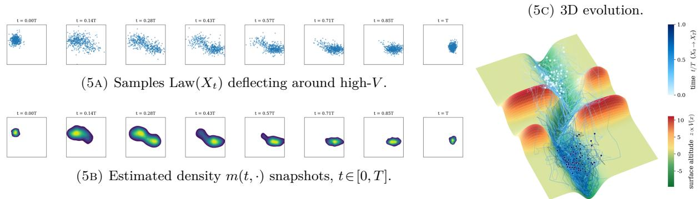

MNIST in latent space $( F ( m ) = 0 , \lambda = \infty , d = 3 2 )$ . On MNIST we run the bridge in the d=32 latent space of a pretrained VAE on (1, 24, 24) grayscale images, with $\mu _ { 0 } , \mu _ { T }$ the codes of digits 1 and 3 and $6 \times 1 0 ^ { 3 }$ samples per class for training. Figure 6 shows $\operatorname { L a w } ( X _ { t } )$ and decoded trajectories; intermediate reconstructions stay visually smooth and digit-like.

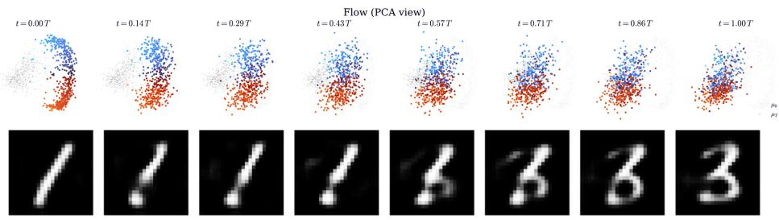  
Figure 6. Temporal evolution of the latent variables and their corresponding decoded representations.

FFHQ young-to-old $( F ( m ) = 0 , \lambda = \infty , d = 5 1 2 )$ . We evaluate FFHQ young-to-old transfer in the $d { = } 5 1 2 \ \mathrm { A L A E }$ latent space [30, 31], using $\mathrm { 3 \times 1 0 ^ { 4 } }$ samples per age group. Figure 7 shows decoded trajectories and, for each baseline, the source child and its decoded terminal sample. SBNL preserves identity and attributes, while several baselines collapse to a near-canonical face; the extended panel is in Appendix O.7.

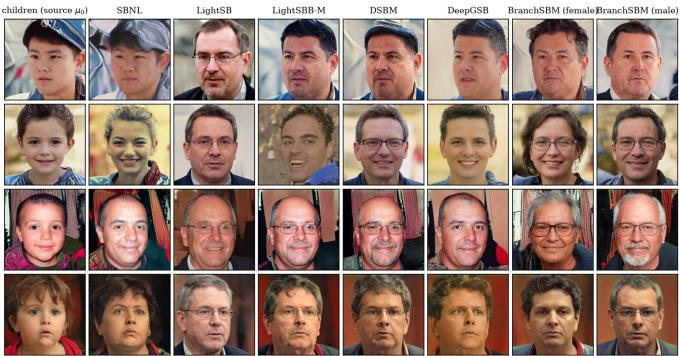  
(7a) Comparison of source (left) and terminal samples.

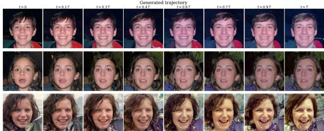  
(7b) Decoded trajectories during sampling.

FID of the diferent methods
<table><tr><td>SBNL</td><td>LightSB</td><td>LightSBB-M</td><td>DSBM</td><td>DeepGSB</td><td>BranchSBM-F</td><td>BranchSBM-M</td></tr><tr><td>36.03</td><td>59.90</td><td>40.76</td><td>38.92</td><td>66.39</td><td>61.96</td><td>39.54</td></tr></table>

Figure 7. FFHQ young-to-old in ALAE latent space. Lower FID is better.

## 6. Discussion

We formulate semilinear mean-field Schrödinger bridges with law-dependent $f ( m ( t , \cdot ) ) , g ( m ( T , \cdot ) )$ and characterize optimality through coupled (φ, φ¯) PDEs, equivalently a Lasry - Lions (m, v) system – beyond the linear entropic setting of Sinkhorn and iterative Markovian fitting. We recast the terminal conditions as a nonlinear Sinkhorn system, which we solve by Maximum Mean Discrepancy, using branching difusions to obtain unbiased stochastic representations of φ. Our experiments cover bridge recovery, Gross-Pitaevskii-type couplings, potential interactions, and latent transport.

The numerics are encouraging, but we do not claim systematic superiority over mature difusion Schrödinger-bridge pipelines in the linear setting. Training in the nonlinear regime still requires careful tuning of the hyperparameters (branching rate c, kernel bandwidths, penalty λ) to remain stable, and both the parallelization of the branching simulation and the variance of the underlying Monte Carlo estimators leave room for improvement. We see this work as a new variational and optimality system whose first mesh-free realization invites variance reduction and hybridization with standard training pipelines.

## References

[1] Erwin Schrödinger. Über die umkehrung der naturgesetze. Sitzungsberichte der Preussischen Akademie der Wissenschaften. Physikalisch-mathematische Klasse, pages 144–153, 1931.

[2] Hans Föllmer. Random fields and difusion processes. In P.-L. Hennequin, editor, École d’Été de Probabilités de Saint-Flour XV–XVII, 1985–87, volume 1362 of Lecture Notes in Mathematics, pages 101–203. Springer, 1988. doi: 10.1007/BFb0086180.

[3] Christian Léonard. A survey of the schrödinger problem and some of its connections with optimal transport. Discrete & Continuous Dynamical Systems - A, 34(4):1533–1574, 2014.

[4] Jean-David Benamou, Guillaume Carlier, Simone Di Marino, and Luca Nenna. An entropy minimization approach to second-order variational mean-field games. Mathematical Models and Methods in Applied Sciences, 29(8):1553–1583, 2019. doi: 10.1142/S0218202519500283.

[5] Yang Song, Jascha Sohl-Dickstein, Diederik P. Kingma, Abhishek Kumar, Stefano Ermon, and Ben Poole. Score-based generative modeling through stochastic diferential equations. In International Conference on Learning Representations (ICLR), 2021. URL https: //openreview.net/forum?id=PxTIG12RRHS.

[6] Tianrong Chen, Guan-Horng Liu, and Evangelos A. Theodorou. Likelihood training of schrödinger bridge using forward-backward sdes theory, 2023. URL https://arxiv.org/ abs/2110.11291.

[7] Valentin De Bortoli, James Thornton, Jeremy Heng, and Arnaud Doucet. Difusion schrödinger bridge with applications to score-based generative modeling. In Advances in Neural Information Processing Systems (NeurIPS), volume 34, pages 17695–17709, 2021.

[8] Jean-Michel Lasry and Pierre-Louis Lions. Mean field games. Japanese Journal of Mathematics, 2(1):229–260, 2007.

[9] Pierre Cardaliaguet. Notes on mean field games (from p.-l. lions’ lectures at collège de france), 2013. URL https://www.ceremade.dauphine.fr/\~cardaliaguet/MFG20130420.pdf.

[10] Olivier Guéant, Jean-Michel Lasry, and Pierre-Louis Lions. Mean field games and applications. In Paris-Princeton Lectures on Mathematical Finance 2010, volume 2003 of Lecture Notes in Mathematics, pages 205–266. Springer, 2011. doi: 10.1007/978-3-642-14660-2\_3.

[11] Olivier Guéant. Mean field games equations with quadratic hamiltonian: A specific approach. Mathematical Models and Methods in Applied Sciences, 22(9):1250022, 2012. doi: 10.1142/S0218202512500222.

[12] Yuyang Shi, Valentin De Bortoli, Andrew Campbell, and Arnaud Doucet. Difusion Schrödinger bridge matching. In Advances in Neural Information Processing Systems, volume 36, pages 77995–78009, 2023.

[13] Alexander Korotin, Nikita Gushchin, and Evgeny Burnaev. Light schrödinger bridge, 2023. URL https://arxiv.org/abs/2310.01174.

[14] Nikita Gushchin, Sergei Kholkin, Evgeny Burnaev, and Alexander Korotin. Light and optimal schrödinger bridge matching, 2024. URL https://arxiv.org/abs/2402.03207.

[15] Alexandre Alouadi, Pierre Henry-Labordère, Grégoire Loeper, Othmane Mazhar, Huyên Pham, and Nizar Touzi. Lightsbb-m: Bridging schrödinger and bass for generative difusion modeling, 2026. URL https://arxiv.org/abs/2601.19312.

[16] Guan-Horng Liu, Tianrong Chen, Oswin So, and Evangelos A. Theodorou. Deep generalized schrödinger bridge, 2022. URL https://arxiv.org/abs/2209.09893.

[17] Sophia Tang, Yinuo Zhang, Alexander Tong, and Pranam Chatterjee. Branched schrödinger bridge matching, 2026. URL https://arxiv.org/abs/2506.09007.

[18] Cédric Villani. Topics in optimal transportation, volume 58 of Graduate Studies in Mathematics. American Mathematical Society, 2003.

[19] Igor Swiecicki, Thierry Gobron, and Denis Ullmo. Schrödinger approach to mean field games. Physical Review Letters, 116(12):128701, 2016. doi: 10.1103/PhysRevLett.116.128701.

[20] Thomas Bonnemain, Thierry Gobron, and Denis Ullmo. Schrödinger approach to mean field games with negative coordination. SciPost Physics, 9(4):059, 2020. doi: 10.21468/ SciPostPhys.9.4.059.

[21] Guan-Horng Liu, Yaron Lipman, Maximilian Nickel, Brian Karrer, Evangelos A. Theodorou, and Ricky T. Q. Chen. Generalized schrödinger bridge matching, 2024. URL https: //arxiv.org/abs/2310.02233.

[22] Zhenyi Zhang, Zihan Wang, Yuhao Sun, Tiejun Li, and Peijie Zhou. Modeling cell dynamics and interactions with unbalanced mean field schrödinger bridge, 2025. URL https://arxiv. org/abs/2505.11197.

[23] Carles Domingo-Enrich, Michal Drozdzal, Brian Karrer, and Ricky T. Q. Chen. Adjoint matching: Fine-tuning flow and difusion generative models with memoryless stochastic optimal control, 2025. URL https://arxiv.org/abs/2409.08861.

[24] Henry P. McKean. Application of brownian motion to the equation of kpp. Communications on Pure and Applied Mathematics, 28(3):323–331, 1975.

[25] Pierre Henry-Labordère, Nadia Oudjane, Xiaolu Tan, Nizar Touzi, and Xavier Warin. Branching difusion representation of semilinear pdes and monte carlo approximation. Annales de l’Institut Henri Poincaré, Probabilités et Statistiques, 55(1):184–210, 2019. doi: 10.1214/17-AIHP880.

[26] Pierre Henry-Labordère and Nizar Touzi. Branching difusion representation for nonlinear cauchy problems and monte carlo approximation. The Annals of Applied Probability, 31(5): 2350–2375, October 2021. doi: 10.1214/20-AAP1649.

[27] Charlotte Bunne, Ya-Ping Hsieh, Marco Cuturi, and Andreas Krause. The schrödinger bridge between gaussian measures has a closed form. In Proceedings of the 26th International Conference on Artificial Intelligence and Statistics, volume 206 of Proceedings of Machine Learning Research, pages 5802–5833. PMLR, 2023. URL https://proceedings. mlr.press/v206/bunne23a.html.

[28] Pierre Henry-Labordère. Cutting cva’s complexity, 2012. URL https://ssrn.com/ abstract=1995502. Risk magazine.

[29] Arthur Gretton, Karsten M. Borgwardt, Malte J. Rasch, Bernhard Schölkopf, and Alexander Smola. A kernel two-sample test. Journal of Machine Learning Research, 13(25):723–773, 2012. URL http://jmlr.org/papers/v13/gretton12a.html.

[30] Stanislav Pidhorskyi, Donald Adjeroh, and Gianfranco Doretto. Adversarial latent autoencoders, 2020. URL https://arxiv.org/abs/2004.04467.

[31] A. Alouadi, P. Henry-Labordère, G. Loeper, H. Pham, and N. Touzi. Bridging Schrödinger and Bass for generative modelling. Preprint, 2025.

[32] Claude Cohen-Tannoudji, Bernard Diu, and Franck Laloë. Mécanique quantique, Tome 3. CNRS Editions, Paris, 2017. ISBN 9782705652404.

[33] Thierry Cazenave. Semilinear Schrödinger equations, volume 10 of Courant Lecture Notes in Mathematics. American Mathematical Society, 2003.

[34] Catherine Sulem and Pierre-Louis Sulem. The nonlinear Schrödinger equation: self-focusing and wave collapse, volume 139 of Applied Mathematical Sciences. Springer, 1999.

[35] David J. Grabiner. Brownian motion in a weyl chamber, non-colliding particles, and random matrices. Annales de l’Institut Henri Poincaré, Probabilités et Statistiques, 35(2):177–204, 1999. doi: 10.1016/S0246-0203(99)80003-0.

[36] Jonathan Ho, Ajay Jain, and Pieter Abbeel. Denoising difusion probabilistic models. In Advances in Neural Information Processing Systems, pages 6840–6851, 2020.

[37] István Gyöngy. Mimicking the one-dimensional marginal distributions of processes having an itô diferential. Probability Theory and Related Fields, 71(4):501–516, 1986.

[38] Bruno Dupire. Pricing with a smile. Risk, 7(1):18–20, 1994.

[39] Julien Guyon and Pierre Henry-Labordère. Nonlinear Option Pricing. Chapman & Hall/CRC, 2011.

[40] Gerard Brunick and Steven Shreve. Mimicking an itô process by a solution of a stochastic diferential equation. The Annals of Applied Probability, 23(4):1584–1628, 2013. doi: 10.1214/12-AAP881.

[41] Julie Delon and Agnès Desolneux. A wasserstein-type distance in the space of gaussian mixture models. SIAM Journal on Imaging Sciences, 13(2):936–970, 2020.

[42] Gábor J. Székely and Maria L. Rizzo. Testing for equal distributions in high dimension. InterStat, 5(16.10):1249–1272, 2004.

## Appendix A. Proof of Theorem 2.1

Setting. Let A be the set of progressively measurable processes α with E $\begin{array} { r } { \int _ { 0 } ^ { T } | \alpha _ { t } | ^ { 2 } \ d t } \end{array}$ dt $< \infty$ . For $\alpha \in { \mathcal { A } }$ , let $\begin{array} { r } { X _ { t } ^ { \alpha } : = X _ { 0 } + \int _ { 0 } ^ { t } \alpha _ { s } \mathrm { d } s + W _ { t } } \end{array}$ , where $X _ { 0 } \sim \mu _ { 0 }$ is independent of $W$ , let $m _ { t } ^ { \alpha } : = \operatorname { L a w } ( X _ { t } ^ { \alpha } )$ (it has a density, since the relative entropy of $\operatorname { L a w } ( X ^ { \alpha } )$ with respect to the law of $X _ { 0 } + W$ is at most $\begin{array} { r } { \frac { 1 } { 2 } \mathbb { E } \int _ { 0 } ^ { T } | \alpha _ { t } | ^ { 2 } \mathrm { d } t ) } \end{array}$ , and

$$
J ( \alpha ) : = \mathbb { E } \Big [ \int _ { 0 } ^ { T } \frac { 1 } { 2 c } | \alpha _ { t } | ^ { 2 } \mathrm { d } t \Big ] + \int _ { 0 } ^ { T } f ( m _ { t } ^ { \alpha } ) \mathrm { d } t + g ( m _ { T } ^ { \alpha } ) , \qquad P = \operatorname* { i n f } _ { \alpha \in A } J ( \alpha ) .
$$

The functionals $f , g$ may take the value +∞ $\begin{array} { r } { ( \mathrm { e . g . ~ } f ( m ) = \frac { \kappa } { 2 } \int m ^ { 2 } } \end{array}$ when m has no density in $L ^ { 2 } )$ $f$ may also depend on $t ,$ in which case $F ( t , \cdot , m )$ is the derivative of $f ( t , \cdot )$ . Throughout, $( v ^ { * } , m ^ { * } )$ denotes the solution of the forward-backward system given by $( \mathrm { A 4 } )$

(16)

$$
\begin{array} { r l r l } & { \partial _ { t } v ^ { * } + \frac { 1 } { 2 } \Delta v ^ { * } - \frac { c } { 2 } | \nabla _ { x } v ^ { * } | ^ { 2 } + F ( t , x , m _ { t } ^ { * } ) = 0 , \qquad } & & { v ^ { * } ( T , x ) = G ( x , m _ { T } ^ { * } ) , } \\ & { \partial _ { t } m ^ { * } = c \nabla _ { x } \cdot ( m ^ { * } \nabla _ { x } v ^ { * } ) + \frac { 1 } { 2 } \Delta m ^ { * } , \qquad } & & { m _ { 0 } ^ { * } = \mu _ { 0 } , } \end{array}\tag{17}
$$

where $m _ { t } ^ { * } : = m ^ { * } ( t , \cdot ) , F ( t , x , m _ { t } ^ { * } )$ depends on the whole density $m _ { t } ^ { * }$ , and (17) is the Fokker-Planck equation of the feedback drift $- c \nabla _ { x } v ^ { * }$

Step 1: convexity.

Lemma A.1. Assume $( A \mathcal { Q } )$ . Let $m , m ^ { \prime }$ be probability densities with $f ( m ^ { \prime } ) < \infty$ and $F ( t , \cdot , m ^ { \prime } ) \in$ $L ^ { 1 } ( m ) \cap L ^ { 1 } ( m ^ { \prime } )$ . Then

$$
f ( m ) \geq f ( m ^ { \prime } ) + \int _ { \mathbb { R } ^ { d } } F ( t , x , m ^ { \prime } ) \left( m ( x ) - m ^ { \prime } ( x ) \right) \mathrm { d } x ,
$$

and the same inequality holds for g and $G .$

Proof. If $f ( m ) = + \infty$ there is nothing to prove. Otherwise set $m _ { \varepsilon } : = m ^ { \prime } + \varepsilon ( m - m ^ { \prime } ) , \varepsilon \in [ 0 , 1 ]$ By definition of the linear functional derivative, $\begin{array} { r } { f ( m ) - f ( m ^ { \prime } ) = \int _ { 0 } ^ { 1 } \int F ( t , x , m _ { \varepsilon } ) ( m - m ^ { \prime } ) ( x ) } \end{array}$ dx dε, hence

$$
\begin{array} { l } { { f ( m ) - f ( m ^ { \prime } ) - \displaystyle \int F ( t , x , m ^ { \prime } ) ( m - m ^ { \prime } ) \mathrm { d } x } } \\ { { \displaystyle \qquad = \int _ { 0 } ^ { 1 } \int \big ( F ( t , x , m _ { \varepsilon } ) - F ( t , x , m ^ { \prime } ) \big ) ( m - m ^ { \prime } ) ( x ) \mathrm { d } x \mathrm { d } \varepsilon } } \\ { { \displaystyle \qquad = \int _ { 0 } ^ { 1 } \frac { 1 } { \varepsilon } \int \big ( F ( t , x , m _ { \varepsilon } ) - F ( t , x , m ^ { \prime } ) \big ) \big ( m _ { \varepsilon } - m ^ { \prime } \big ) ( x ) \mathrm { d } x \mathrm { d } \varepsilon \ \geq \ 0 , } } \end{array}
$$

because $m _ { \varepsilon } - m ^ { \prime } = \varepsilon ( m - m ^ { \prime } )$ and each inner integral is nonnegative by (A2). The proof for $g$ is identical. □

Step 2: verification. Let $X ^ { * }$ be the solution of d $\begin{array} { r } { \vert X _ { t } ^ { * } = - c \nabla _ { x } v ^ { * } ( t , X _ { t } ^ { * } ) \mathrm { d } t + \mathrm { d } W _ { t } , X _ { 0 } ^ { * } = X _ { 0 } } \end{array}$ , which exists and is pathwise unique because $\nabla _ { x } { v ^ { * } }$ is Lipschitz, and set $\alpha _ { t } ^ { * } : = - c \nabla _ { x } v ^ { * } ( t , X _ { t } ^ { * } )$ . By $( \mathrm { A 3 } ) - ( \mathrm { A 4 } ) , \alpha ^ { * } \in { \mathcal { A } }$ and $m _ { t } ^ { \alpha ^ { * } } = m _ { t } ^ { * }$

Fix $\alpha \in { \mathcal { A } }$ with $J ( \alpha ) < \infty$ . Itô’s formula applied to $v ^ { * } ( t , X _ { t } ^ { \alpha } )$ , combined with (16), gives

$$
\begin{array} { c } { v ^ { * } ( T , X _ { T } ^ { \alpha } ) = v ^ { * } ( 0 , X _ { 0 } ) + \displaystyle \int _ { 0 } ^ { T } \Big [ \frac { c } { 2 } | \nabla _ { x } v ^ { * } | ^ { 2 } + \alpha _ { t } \cdot \nabla _ { x } v ^ { * } - F ( t , \cdot , m _ { t } ^ { * } ) \Big ] ( t , X _ { t } ^ { \alpha } ) \mathrm { d } t } \\ { + \displaystyle \int _ { 0 } ^ { T } \nabla _ { x } v ^ { * } ( t , X _ { t } ^ { \alpha } ) \cdot \mathrm { d } W _ { t } . } \end{array}
$$

Since $\begin{array} { r } { \mathbb { E } \operatorname* { s u p } _ { t \leq T } | X _ { t } ^ { \alpha } | ^ { 2 } < \infty } \end{array}$ (by (A3) and $\alpha \in { \mathcal { A } } )$ , the growth conditions of (A4) make every term integrable and the stochastic integral a martingale, so that

$$
\begin{array} { l } { \displaystyle \mathbb { E } \big [ { \boldsymbol \upsilon } ^ { * } ( { \boldsymbol T } , { \boldsymbol X } _ { T } ^ { \alpha } ) \big ] = \mathbb { E } \big [ { \boldsymbol \upsilon } ^ { * } ( 0 , { \boldsymbol X } _ { 0 } ) \big ] + \mathbb { E } \int _ { 0 } ^ { T } \Big [ \frac { c } { 2 } | \nabla _ { { \boldsymbol x } } { \boldsymbol v } ^ { * } | ^ { 2 } + \alpha _ { t } \cdot \nabla _ { { \boldsymbol x } } { \boldsymbol v } ^ { * } \Big ] ( t , { \boldsymbol X } _ { t } ^ { \alpha } ) \mathrm { d } t } \\ { \displaystyle - \mathbb { E } \int _ { 0 } ^ { T } F ( t , { \boldsymbol X } _ { t } ^ { \alpha } , { \boldsymbol m } _ { t } ^ { * } ) \mathrm { d } t . } \end{array}\tag{18}
$$

Lemma A.1 with $m = m _ { t } ^ { \alpha } , m ^ { \prime } = m _ { t } ^ { * }$ (for f) and $m = m _ { T } ^ { \alpha } , m ^ { \prime } = m _ { T } ^ { * } \ ( \mathrm { f o r } \ g )$ , together with the terminal condition $G ( \cdot , m _ { T } ^ { * } ) = v ^ { * } ( T , \cdot )$ , yields

$$
\begin{array} { r l } { \displaystyle \int _ { 0 } ^ { T } f ( m _ { t } ^ { \alpha } ) \mathrm { d } t + g ( m _ { T } ^ { \alpha } ) \geq \int _ { 0 } ^ { T } f ( m _ { t } ^ { * } ) \mathrm { d } t + g ( m _ { T } ^ { * } ) + {  { \mathbb E } } \int _ { 0 } ^ { T } \Bigl [ F ( t , X _ { t } ^ { \alpha } , m _ { t } ^ { * } ) - F ( t , X _ { t } ^ { * } , m _ { t } ^ { * } ) \Bigr ] \mathrm { d } t } & { } \\ { + {  { \mathbb E } } \bigl [ v ^ { * } ( T , X _ { T } ^ { \alpha } ) - v ^ { * } ( T , X _ { T } ^ { * } ) \bigr ] . } \end{array}
$$

We insert (18) for α and for $\alpha ^ { * }$ (both processes start from $X _ { 0 } )$ : the terms in $F$ cancel, and we obtain

$$
\begin{array} { r l } & { J ( \alpha ) - J ( \alpha ^ { * } ) \geq \mathbb { E } \int _ { 0 } ^ { T } \Big [ \frac { 1 } { 2 c } | \alpha _ { t } | ^ { 2 } + \alpha _ { t } \cdot \nabla _ { x } v ^ { * } + \frac { c } { 2 } | \nabla _ { x } v ^ { * } | ^ { 2 } \Big ] ( t , X _ { t } ^ { \alpha } ) \mathrm { d } t } \\ & { \qquad - \mathbb { E } \int _ { 0 } ^ { T } \Big [ \frac { 1 } { 2 c } | \alpha _ { t } ^ { * } | ^ { 2 } + \alpha _ { t } ^ { * } \cdot \nabla _ { x } v ^ { * } + \frac { c } { 2 } | \nabla _ { x } v ^ { * } | ^ { 2 } \Big ] ( t , X _ { t } ^ { * } ) \mathrm { d } t } \\ & { \qquad = \displaystyle \frac { 1 } { 2 c } \mathbb { E } \int _ { 0 } ^ { T } \left| \alpha _ { t } + c \nabla _ { x } v ^ { * } ( t , X _ { t } ^ { \alpha } ) \right| ^ { 2 } \mathrm { d } t \geq 0 , } \end{array}\tag{19}
$$

where we used $\begin{array} { r } { \frac { 1 } { 2 c } | a | ^ { 2 } + a \cdot p + \frac { c } { 2 } | p | ^ { 2 } = \frac { 1 } { 2 c } | a + c p | ^ { 2 } } \end{array}$ and $\alpha _ { t } ^ { * } + c \nabla _ { x } v ^ { * } ( t , X _ { t } ^ { * } ) = 0$ . Hence $J ( \alpha ^ { * } ) \leq J ( \alpha )$ for every $\alpha \in { \bar { A } } { : }$ the control $\alpha ^ { * }$ is optimal and $P = J ( \alpha ^ { * } )$   
Step 3: uniqueness of the optimal control. If $J ( \alpha ) = J ( \alpha ^ { * } )$ , then (19) forces $\alpha _ { t } = - c \nabla _ { x } v ^ { * } ( t , X _ { t } ^ { \alpha } )$ $\mathrm { d } t \otimes \mathrm { d } \mathbb { P } \mathrm { - a . e }$ . Thus $X ^ { \alpha }$ solves the equation of $X ^ { * }$ with the same initial condition and the same Brownian motion, and pathwise uniqueness gives $X ^ { \alpha } = X ^ { * }$ , hence $\alpha = \alpha ^ { * }$   
Step 4: Cole-Hopf transform. Set $\varphi : = e ^ { - c v ^ { * } } > 0$ . Then $\begin{array} { r } { \partial _ { t } v ^ { * } = - \frac { \partial _ { t } \varphi } { c \varphi } , \nabla _ { x } v ^ { * } = - \frac { \nabla _ { x } \varphi } { c \varphi } } \end{array}$ and $\begin{array} { r } { \Delta v ^ { * } = - \frac { \Delta \varphi } { c \varphi } + \frac { | \nabla _ { x } \varphi | ^ { 2 } } { c \varphi ^ { 2 } } } \end{array}$ , so that the terms in $| \nabla _ { x } \varphi | ^ { 2 }$ cancel:

$$
\begin{array} { r } { \partial _ { t } v ^ { * } + \frac { 1 } { 2 } \Delta v ^ { * } - \frac { c } { 2 } | \nabla _ { x } v ^ { * } | ^ { 2 } = - \frac { 1 } { c \varphi } \Big ( \partial _ { t } \varphi + \frac { 1 } { 2 } \Delta \varphi \Big ) . } \end{array}
$$

Hence (16) is equivalent to $\begin{array} { r } { \partial _ { t } \varphi + \frac { 1 } { 2 } \Delta \varphi = c \varphi F ( t , x , m _ { t } ^ { * } ) } \end{array}$ , and the optimal feedback is $- c \nabla _ { x } { v ^ { * } } =$ $\nabla _ { x }$ log φ, which is (2).   
Step 5: factorization of the optimal law. Set $\psi : = m ^ { * } / \varphi$ . Expanding $m ^ { * } = \varphi \psi$ and using the equation of Step 4,

$$
\begin{array} { r } { \partial _ { t } m ^ { * } + \nabla _ { x } \cdot \big ( m ^ { * } \nabla _ { x } \log \varphi \big ) - \frac { 1 } { 2 } \Delta m ^ { * } = \psi \Big ( \partial _ { t } \varphi + \frac { 1 } { 2 } \Delta \varphi \Big ) + \varphi \Big ( \partial _ { t } \psi - \frac { 1 } { 2 } \Delta \psi \Big ) } \\ { = \varphi \Big ( \partial _ { t } \psi - \frac { 1 } { 2 } \Delta \psi + c \psi F ( t , x , m _ { t } ^ { * } ) \Big ) , } \end{array}
$$

where the cross terms $\pm \nabla _ { x } \varphi \cdot \nabla _ { x } \psi$ cancel. As $c \nabla _ { x } \cdot \left( m ^ { * } \nabla _ { x } v ^ { * } \right) = - \nabla _ { x } \cdot \left( m ^ { * } \nabla _ { x } \log \varphi \right)$ and $\varphi > 0$ (17) is equivalent to

$$
\partial _ { t } \psi - { \textstyle \frac { 1 } { 2 } } \Delta \psi = - c \psi F ( t , x , m _ { t } ^ { * } ) , \qquad m _ { t } ^ { * } = \varphi ( t , \cdot ) \psi ( t , \cdot ) .
$$

The time reversal $\bar { \varphi } ( t , x ) : = \psi ( T - t , x )$ turns this forward equation into the backward equation $\partial _ { t } \bar { \varphi } + { \textstyle \frac 1 2 } \Delta \bar { \varphi } = c \bar { \varphi } F ( T - t , x , m _ { T - t } ^ { * } )$ . Since $m _ { t } ^ { * } = \varphi ( t , \cdot ) \bar { \varphi } ( T - t , \cdot )$ and $m _ { T - t } ^ { * } = \bar { \varphi } ( t , \cdot ) \varphi ( T - t , \cdot )$ the pair $( \varphi , \bar { \varphi } )$ solves $( 3 ) – ( 4 )$ , and $\operatorname { L a w } ( X _ { t } ^ { * } ) = m _ { t } ^ { * } = \varphi ( t , \cdot ) \bar { \varphi } ( T - t , \cdot )$   
Step 6: boundary conditions. The initial condition $m _ { 0 } ^ { * } = \mu _ { 0 }$ reads $\varphi ( 0 , \cdot ) \bar { \varphi } ( T , \cdot ) = \mu _ { 0 }$ . The terminal condition $v ^ { * } ( T , \cdot ) = G ( \cdot , m _ { T } ^ { * } )$ , with $\begin{array} { r } { v ^ { * } ( T , \cdot ) = - \frac { 1 } { c } \log \varphi ( T , \cdot ) } \end{array}$ and $m _ { T } ^ { * } = \bar { \varphi } ( 0 , \cdot ) \varphi ( T , \cdot )$ reads $\begin{array} { r } { G ( \cdot , \bar { \varphi } ( 0 , \cdot ) \varphi ( T , \cdot ) ) = - \frac { 1 } { c } \log \varphi ( T , \cdot ) } \end{array}$ , i.e.

$$
\begin{array} { r } { \bar { \varphi } ( 0 , x ) \varphi ( T , x ) = G ^ { - 1 } \big ( - \frac { 1 } { c } \log \varphi ( T , \cdot ) , x \big ) , } \end{array}
$$

where $G ^ { - 1 } ( w , \cdot )$ is the density m such that $G ( \cdot , m ) = w$ . It is unique when the second inequality of $\left( { \mathrm { A 2 } } \right)$ is strict for $m _ { 1 } \neq m _ { 2 } \colon G ( \cdot , m _ { 1 } ) = G ( \cdot , m _ { 2 } )$ forces $\begin{array} { r } { \int ( G ( x , m _ { 1 } ) - G ( x , m _ { 2 } ) ) ( m _ { 1 } - m _ { 2 } ) ( x ) \mathrm { d } x = 0 } \end{array}$ This is the nonlinear Sinkhorn system (5), which completes the proof. □ Hard terminal constraint. For the classical constraint $m _ { T } = \mu _ { T } \ ( g = 0$ at $\mu _ { T }$ and $+ \infty$ elsewhere), $\mathcal { A }$ is restricted to the controls with $m _ { T } ^ { \alpha } = \mu _ { T }$ , and the terminal condition of (16) is replaced by $m _ { T } ^ { * } = \mu _ { T } , v ^ { * } ( T , \cdot )$ becoming an unknown. The proof is unchanged, except that in Step 2 the terminal terms vanish: $g ( m _ { T } ^ { \alpha } ) = g ( m _ { T } ^ { * } ) = 0$ and $\mathbb { E } [ v ^ { * } ( T , X _ { T } ^ { \alpha } ) ] = \mathbb { E } [ v ^ { * } ( T , X _ { T } ^ { * } ) ]$ because $X _ { T } ^ { \alpha }$ and $X _ { T } ^ { * }$ both have law $\mu _ { T }$ . Step 6 then gives $\bar { \varphi } ( 0 , \cdot ) \varphi ( T , \cdot ) = \mu _ { T } , \mathrm { i . e . ~ } ( 9 )$

Origin of the system: Lagrangian duality. The system (16)-(17) is the optimality system of the following dual problem. For $\bar { v } \in C ^ { 1 , 2 }$ with the growth of (A4), let

$$
\begin{array} { c } { \displaystyle \mathcal { L } \displaystyle v : = \partial _ { t } v - \frac { c } { 2 } | \nabla _ { x } v | ^ { 2 } + \frac { 1 } { 2 } \Delta v , } \\ { \displaystyle f ^ { * } ( \psi ) : = \operatorname* { i n f } _ { m } \Big \{ f ( m ) + \int \psi m \Big \} , \qquad g ^ { * } ( \phi ) : = \operatorname* { s u p } _ { m } \Big \{ \int \phi m - g ( m ) \Big \} . } \end{array}
$$

For $\alpha \in { \mathcal { A } }$ , Itô’s formula gives $\begin{array} { r } { \mathbb { E } [ v ( T , X _ { T } ^ { \alpha } ) ] - \mathbb { E } [ v ( 0 , X _ { 0 } ) ] = \mathbb { E } \int _ { 0 } ^ { T } ( \partial _ { t } v + \alpha _ { t } \cdot \nabla _ { x } v + \frac { 1 } { 2 } \Delta v ) ( t , X _ { t } ^ { \alpha } ) \mathrm { d } t . } \end{array}$ Adding this zero quantity to $J ( \alpha )$ and minimizing pointwise in $\alpha _ { t }$ , which gives $\alpha _ { t } = - c \nabla _ { x } v$ and $\begin{array} { r } { \operatorname* { i n f } _ { a } \{ \frac { \bar { 1 } } { 2 c } | a | ^ { 2 } + a \cdot \bar { \nabla _ { x } } v \} = - \frac { c } { 2 } | \nabla _ { x } \bar { v | } ^ { 2 } } \end{array}$ , we get the weak duality

$$
P \ge \int _ { 0 } ^ { T } f ^ { * } \big ( \mathcal { L } v ( t , \cdot ) \big ) \mathrm { d } t - g ^ { * } \big ( v ( T , \cdot ) \big ) + \mathbb { E } _ { X _ { 0 } \sim \mu _ { 0 } } \big [ v ( 0 , X _ { 0 } ) \big ] .\tag{20}
$$

The first-order conditions of the infimum defining $f ^ { * } ( \mathcal { L } v )$ and of the supremum defining $g ^ { * } ( v ( T , \cdot ) )$ are $F ( t , \cdot , m _ { t } ) = - { \mathcal { L } } v$ , which is the HJB equation (16), and $v ( T , \cdot ) = G ( \cdot , m _ { T } )$ , which is its terminal condition. Conversely, for $\boldsymbol { v } \ = \ \boldsymbol { v } ^ { * }$ , Lemma A.1 shows that the infimum and the supremum are attained at $m _ { t } ^ { * }$ and $m _ { T } ^ { * } ,$ and Itô’s formula for $\alpha ^ { * }$ shows that the right-hand side of (20) equals $J ( \alpha ^ { * } ) = P \colon$ there is no duality gap.

## Appendix B. Stochastic-optimization forms of the nonlinear Sinkhorn system

Using the branching representation of Proposition 3.1, the nonlinear Sinkhorn conditions read

$$
\begin{array} { r } { \left\{ \begin{array} { l l } { \mathbb { E } _ { x , \mathrm { w h i t e } } \left[ { \mathcal { W } } \displaystyle \prod _ { i = 1 } ^ { N _ { T } ^ { \mathrm { w h i t e } } } { \varphi ( T , X _ { T } ^ { i } ) } \displaystyle \prod _ { j = 1 } ^ { \bar { N } _ { T } ^ { \mathrm { b l a c k } } } { \bar { \varphi } ( T , \bar { X } _ { T } ^ { j } ) } \right] \bar { \varphi } ( T , x ) = \mu _ { 0 } ( x ) , } \\ { \mathbb { E } _ { x , \mathrm { b l a c k } } \left[ { \mathcal { W } } \displaystyle \prod _ { i = 1 } ^ { N _ { T } ^ { \mathrm { w h i t e } } } { \varphi ( T , X _ { T } ^ { i } ) } \displaystyle \prod _ { j = 1 } ^ { \bar { N } _ { T } ^ { \mathrm { b l a c k } } } { \bar { \varphi } ( T , \bar { X } _ { T } ^ { j } ) } \right] \varphi ( T , x ) = G ^ { - 1 } ( - \frac { 1 } { c } \log { \varphi ( T , \cdot ) } , x ) . } \end{array} \right. } \end{array}\tag{21}
$$

We now recast the two nonlinear Sinkhorn conditions in sample-based forms that can be used to train neural terminal potentials. We parametrize the terminal potentials $\varphi ( T , \cdot ) , \bar { \varphi } ( T , \cdot )$ by neural networks and, with a slight abuse of notation, write

$$
\varphi _ { \boldsymbol { \theta } } ( x ) : = \varphi ( T , x ) , \qquad \bar { \varphi } _ { \boldsymbol { \eta } } ( x ) : = \bar { \varphi } ( T , x ) ,
$$

and let $\mu ^ { * }$ be a reference probability density on Rd that is easy to sample and evaluate.

Following the notation of Section 4.1, for $Z \sim \mu ^ { * }$ a white- (resp. black-) rooted branching tree started at $( 0 , Z )$ yields the unbiased one-tree estimators $\widehat { A } _ { \theta , \eta } ( Z , \circ )$ (resp. $\hat { A } _ { \theta , \eta } ( Z , \bullet ) )$ , with

$$
\begin{array} { r } { \left\{ \begin{array} { l l } { \mathbb { E } \big [ \widehat { A } _ { \theta , \eta } ( Z , \circ ) \big ] = A _ { \theta , \eta } ( Z , \circ ) \approx \varphi ( 0 , Z ) , } \\ { \mathbb { E } \big [ \widehat { A } _ { \theta , \eta } ( Z , \bullet ) \big ] = A _ { \theta , \eta } ( Z , \bullet ) \approx \bar { \varphi } ( 0 , Z ) , } \end{array} \right. } \end{array}\tag{22}
$$

where the approximation replaces the true terminal potentials by their neural-network parametrization $( \varphi _ { \boldsymbol { \theta } } , \bar { \varphi } _ { \eta } )$ . The two boundary equations (5) thus read

$$
\left\{ \begin{array} { l l } { { A _ { \theta , \eta } ( x , \circ ) \bar { \varphi } _ { \eta } ( x ) = \mu _ { 0 } ( x ) , } } \\ { { A _ { \theta , \eta } ( x , \bullet ) \varphi _ { \theta } ( x ) = G ^ { - 1 } \big ( - \frac { 1 } { c } \log \varphi _ { \theta } , x \big ) . } } \end{array} \right.\tag{23}
$$

In the KL terminal case of (6), the second condition becomes $A _ { \theta , \eta } ( x , \bullet ) \varphi _ { \theta } ( x ) = \mu _ { T } ( x ) \varphi _ { \theta } ( x )$ −a with $a : = 1 / ( \lambda c )$

Possibility 1: RKHS/MMD matching. Each boundary equation matches a (reweighted) measure to a marginal, so we enforce them by minimizing the MMD between the two sides. Using a characteristic kernel k with RKHS H (Appendix C), we set

$$
\begin{array} { r } { \mathcal { L } _ { \mathrm { M M D } } ( \boldsymbol { \theta } , \boldsymbol { \eta } ) : = \mathrm { M M D } _ { k } ^ { 2 } ( A _ { \boldsymbol { \theta } , \boldsymbol { \eta } } ( \cdot , \circ ) \bar { \varphi } _ { \boldsymbol { \eta } } , \mu _ { 0 } ) + \mathrm { M M D } _ { k } ^ { 2 } ( A _ { \boldsymbol { \theta } , \boldsymbol { \eta } } ( \cdot , \bullet ) \varphi _ { \boldsymbol { \theta } } , \varphi _ { \boldsymbol { \theta } } ^ { - a } \mu _ { T } ) . } \end{array}
$$

Estimating $A _ { \theta , \eta } ( \cdot , \circ ) , A _ { \theta , \eta } ( \cdot , \bullet )$ by the branching trees and importance-sampling against $\mu ^ { * }$ , the closed form of Definition 4.1 gives the sample-based objective (14)-(15), minimized directly by stochastic gradient descent (Algorithm 1); a mixture of Gaussian kernels is a stable default.

## Appendix C. RKHS and MMD

For completeness, we recall the definitions and elementary properties of reproducing kernel Hilbert spaces (RKHS) and the maximum mean discrepancy (MMD) used in Section 4.1 and in the proof of Theorem 2.1. We refer to [29] for a detailed treatment.

Reproducing kernel Hilbert space. Let $\bar { k } : \bar { \mathbb { R } } ^ { d } \times \mathbb { R } ^ { d }  \mathbb { R }$ be a symmetric positive definite kernel, i.e. for any $n \in \mathbb { N }$ , points $x _ { 1 } , \ldots , x _ { n } \in \mathbb { R } ^ { d }$ and scalars $c _ { 1 } , \ldots , c _ { n } \in \mathbb { R }$ 2

$$
\sum _ { i , j = 1 } ^ { n } c _ { i } c _ { j } k ( x _ { i } , x _ { j } ) \geq 0 .
$$

By the Moore-Aronszajn theorem, there exists a unique Hilbert space $\mathcal { H } _ { k }$ of functions $f : \mathbb { R } ^ { d }  \mathbb { R }$ called the reproducing kernel Hilbert space of k, such that:

• for every $x \in \mathbb { R } ^ { d } .$ , the function $\boldsymbol { k } ( \boldsymbol { x } , \cdot ) \in \mathcal { H } _ { k }$

• (reproducing property) for every $f \in \mathcal { H } _ { k }$ and every $\boldsymbol { x } \in \mathbb { R } ^ { d }$

$$
f ( x ) \ = \ \langle f , k ( x , \cdot ) \rangle _ { \mathscr { H } _ { k } } .
$$

In particular, taking $f = k ( y , \cdot )$ gives $\langle k ( x , \cdot ) , k ( y , \cdot ) \rangle _ { \mathcal { H } _ { k } } = k ( x , y )$ , so that k acts as an inner product between feature maps $x \mapsto k ( x , \cdot )$

Maximum mean discrepancy. Given two probability measures $P , Q \ \mathrm { o n } \ \mathbb { R } ^ { d }$ , the maximum mean discrepancy associated with k is defined as the largest diference in expectations over the unit ball of $\mathcal { H } _ { k }$ :

$$
\mathrm { M M D } _ { k } ( P , Q ) : = \operatorname* { s u p } _ { \| f \| _ { \mathcal H _ { k } } \leq 1 } \Big \{ \mathbb E _ { X \sim P } [ f ( X ) ] - \mathbb E _ { Y \sim Q } [ f ( Y ) ] \Big \} .\tag{24}
$$

Intuitively, MMD searches for a witness function $f$ in the RKHS unit ball that best distinguishes samples from $P$ and $Q .$

Kernel mean embedding. Assume the integrability condition $\mathbb { E } _ { X \sim P } [ \sqrt { k ( X , X ) } ] < \infty$ . The kernel mean embedding of $P$ is the element of $\mathcal { H } _ { k }$ defined by

$$
\mu _ { P } ( \cdot ) \ : = \ \mathbb { E } _ { X \sim P } [ k ( X , \cdot ) ] \ \in \ { \mathcal H } _ { k } .\tag{25}
$$

$\mathrm { B y }$ the reproducing property, it satisfies $\mathbb { E } _ { X \sim P } [ f ( X ) ] = \langle f , \mu _ { P } \rangle _ { \mathcal { H } _ { k } }$ for all $f \in \mathcal { H } _ { k }$ , i.e. integration against $P$ is represented by an inner product with $\mu _ { P }$

MMD as a distance between embeddings. Substituting $\mathbb { E } _ { P } [ f ] = \langle f , \mu _ { P } \rangle _ { \mathcal { H } _ { k } }$ and $\mathbb { E } _ { Q } [ f ] = \langle f , \mu _ { Q } \rangle _ { \mathcal { H } _ { k } }$ into (24), the supremum over the unit ball is attained at $f = ( \mu _ { P } - \mu _ { Q } ) / \| \mu _ { P } - \mu _ { Q } \| \mathcal { H } _ { k }$ , and the MMD reduces to the RKHS distance between the mean embeddings:

$$
\mathrm { M M D } _ { k } ( P , Q ) = \| \mu _ { P } - \mu _ { Q } \| _ { \mathcal { H } _ { k } } .\tag{26}
$$

Expansion via the reproducing property. Expanding the squared norm in (26) and using $\langle k ( x , \cdot ) , k ( y , \cdot ) \rangle _ { \mathcal { H } _ { k } } = k ( x , y )$ gives the closed-form expression

$$
\mathrm { M M D } _ { k } ^ { 2 } ( P , Q ) = \mathbb { E } _ { X , X ^ { \prime } \sim P } [ k ( X , X ^ { \prime } ) ] + \mathbb { E } _ { Y , Y ^ { \prime } \sim Q } [ k ( Y , Y ^ { \prime } ) ] - 2 \underbrace { \mathbb { E } _ { X \sim P } [ k ( X , Y ) ] } _ { Y \sim Q } ,\tag{27}
$$

where $X , X ^ { \prime } \ ( \mathrm { r e s p . } \ Y , Y ^ { \prime } )$ are independent copies drawn from P (resp. Q). This form only involves expectations of kernel evaluations and is therefore directly estimable from samples, which is what makes the objective (14) tractable.

Characteristic kernels. The kernel k is said to be characteristic if the embedding map $P \mapsto \mu _ { P }$ is injective on the space of probability measures. Equivalently,

$$
\mathrm { M M D } _ { k } ( P , Q ) = 0 \quad \Longleftrightarrow \quad P = Q .
$$

Classical examples of characteristic kernels on $\mathbb { R } ^ { d }$ include the Gaussian kernel $k ( x , y ) = \exp ( - \| x -$ $y \| ^ { 2 } / 2 \sigma ^ { 2 } )$ and, more generally, mixtures of Gaussian kernels across several bandwidths, which we use as a stable default in our experiments.

MMD between finite measures. The objective of Proposition 4.1 compares unnormalized measures, for which we need the following version of the characteristic property.

Lemma C.1. Let $k ( x , y ) = k _ { 0 } ( x - y )$ with $\begin{array} { r } { k _ { 0 } ( z ) = \int _ { \mathbb { R } ^ { d } } e ^ { \mathrm { i } \omega \cdot z } \psi ( \omega ) } \end{array}$ dω for an integrable function $\psi > 0 ;$ for instance the Gaussian kernel $k _ { 0 } ( z ) = e ^ { - | z | ^ { 2 } / 2 \sigma ^ { 2 } } , f o r$ which $\psi ( \omega ) = ( \sigma ^ { 2 } / 2 \pi ) ^ { d / 2 } e ^ { - \sigma ^ { 2 } | \omega | ^ { 2 } / 2 }$ or any finite positive mixture of Gaussian kernels. For finite nonnegative measures $P , Q$ on $\mathbb { R } ^ { d }$ let $\begin{array} { r } { \mathrm { M M D } _ { k } ^ { 2 } ( P , Q ) : = \iint k ( x , y ) \left( P - Q \right) ( \mathrm { d } x ) \left( P - Q \right) ( \mathrm { d } y ) } \end{array}$ , which is (27) with expectations replaced by integrals. Then

$$
\mathrm { M M D } _ { k } ^ { 2 } ( P , Q ) = \int _ { \mathbb { R } ^ { d } } \left| \widehat { P } ( \omega ) - \widehat { Q } ( \omega ) \right| ^ { 2 } \psi ( \omega ) \mathrm { d } \omega , \qquad \widehat { P } ( \omega ) : = \int _ { \mathbb { R } ^ { d } } e ^ { \mathrm { i } \omega \cdot x } P ( \mathrm { d } x ) ,
$$

so that $\mathrm { M M D } _ { k } ( P , Q ) \ge 0$ , with equality if and only if $P = Q$

Proof. Let $\nu : = P - Q$ , a finite signed measure. Since $| e ^ { \mathrm { i } \omega \cdot ( x - y ) } \psi ( \omega ) | \leq \psi ( \omega )$ is integrable with respect to $\mathrm { d } \omega \otimes | \nu | ( \mathrm { d } x ) \otimes | \nu | ( \mathrm { d } y )$ , Fubini’s theorem gives

$$
\begin{array} { r l } & { \displaystyle \iint { k ( x , y ) \nu ( \mathrm { d } x ) \nu ( \mathrm { d } y ) } = \int { \psi ( \omega ) \Big ( \int e ^ { \mathrm { i } \omega \cdot x } \nu ( \mathrm { d } x ) \Big ) \Big ( \int e ^ { - \mathrm { i } \omega \cdot y } \nu ( \mathrm { d } y ) \Big ) \mathrm { d } \omega } } \\ & { \quad \quad \quad \quad = \int { | \widehat { \nu } ( \omega ) | ^ { 2 } \psi ( \omega ) \mathrm { d } \omega } . } \end{array}
$$

If this vanishes, then $\widehat \nu = 0$ almost everywhere because $\psi > 0$ , hence everywhere because $\widehat { \nu }$ is continuous, and $\nu = 0$ because the Fourier transform is injective on finite signed measures. □

Reweighted kernel. Let $\mu ^ { * }$ be a bounded density with $\mu ^ { * } > 0$ almost everywhere and $\tilde { k } ( x , y ) : =$   
$\mu ^ { * } ( x ) k ( x , y ) \mu ^ { * } ( y )$ . For integrable densities $p , q ,$ $\mathrm { M M D } _ { \tilde { k } } ^ { 2 } ( p , q ) = \mathrm { M M D } _ { k } ^ { 2 } ( \mu ^ { * } p , \mu ^ { * } q )$ , which by k   
Lemma C.1 vanishes if and only if $\mu ^ { * } p = \mu ^ { * } q { \mathrm { ~ a . e . } }$ , i.e. $p = q { \mathrm { ~ a . e ~ } }$ . This is the property used for   
the objective (14).

Proof of Proposition $4 . 1 . \mathcal { L } _ { \mathrm { M M D } }$ is the sum of two terms that are nonnegative by Lemma C.1; hence $\mathcal { L } _ { \mathrm { M M D } } \geq 0$ , with equality if and only if both terms vanish. $\mathrm { B y }$ Lemma C.1, applied to the finite measures with densities $\varphi ( 0 , \cdot ) \bar { \varphi } ( T , \cdot )$ and $\mu _ { 0 }$ for the first term, and $\bar { \varphi } ( 0 , \cdot ) \varphi ( T , \cdot )$ and $G ^ { - 1 } \big ( - \textstyle { \frac { 1 } { c } } \log \varphi ( T , \cdot ) , \cdot \big )$ for the second, this holds if and only if both equations of (5) hold almost everywhere. □

## Appendix D. Standing assumptions for well-posedness

$( \mathrm { A 1 } ) – ( \mathrm { A 3 } )$ are structural conditions on the data; (A4) collects the properties of the solution of the forward-backward system (16)-(17) that are used in the proof of Theorem 2.1 (Appendix A). That proof is a verification argument: it uses $( \mathrm { A } 1 ) \ – ( \mathrm { A } 2 )$ , through the convexity of $f$ and g (Lemma A.1), together with $( \mathrm { A 3 } ) – ( \mathrm { A 4 } )$ . The existence of a solution with the properties of $( \mathrm { A 4 } )$ is not part of the argument. For regularizing nonlocal couplings it is established in [8, 9] under regularity and growth conditions on F and G, to which we refer for precise statements. Local couplings such as $F ( m ) = \kappa m$ or $F ( m ) = \kappa$ log m satisfy (A1)-(A2) but not those conditions and require separate arguments, which we do not reproduce; in the Gaussian case of Proposition H.1 the solution is explicit.

(A1) Diferentiability. The functionals f (possibly depending on t) and g admit linear functional derivatives

$$
F ( t , x , m ) : = \frac { \delta f } { \delta m ( t , x ) } , \qquad G ( x , m ) : = \frac { \delta g } { \delta m ( T , x ) } ,
$$

measurable in $( t , x )$ , in the sense that $\begin{array} { r } { f ( m ) - f ( m ^ { \prime } ) = \int _ { 0 } ^ { 1 } \int F \big ( t , x , m ^ { \prime } + \varepsilon ( m - m ^ { \prime } ) \big ) \big ( m - m ^ { \prime } \big ) } \end{array}$ $m ^ { \prime } ) ( x )$ dx dε for all probability densities $m , m ^ { \prime }$ at which $f$ is finite, and similarly for $g$ and G.

(A2) Lasry - Lions monotonicity. For any probability densities $m _ { 1 } , m _ { 2 }$

$$
\int _ { \mathbb { R } ^ { d } } \Bigl ( F ( t , x , m _ { 1 } ) - F ( t , x , m _ { 2 } ) \Bigr ) \bigl ( m _ { 1 } ( x ) - m _ { 2 } ( x ) \bigr ) \mathrm { d } x \geq 0 , \quad \forall t \in [ 0 , T ] ,
$$

and

$$
\int _ { \mathbb { R } ^ { d } } \Bigl ( G ( x , m _ { 1 } ) - G ( x , m _ { 2 } ) \Bigr ) \bigl ( m _ { 1 } ( x ) - m _ { 2 } ( x ) \bigr ) \mathrm { d } x \geq 0 .
$$

These monotonicity conditions ensure uniqueness of the mean-field equilibrium [8]. (A3) Initial data. The initial law $m ( 0 , \cdot ) = \mu _ { 0 }$ has suficient regularity $( \mathrm { e . g . , ~ } \mu _ { 0 } \in L ^ { 1 } \cap L ^ { \infty }$ with finite second moment).

(A4) Regularity of the forward-backward solution. The system $( 1 6 ) – ( 1 7 )$ has a solution $( v ^ { * } , m ^ { * } )$ such that $v ^ { * } \in C ^ { 1 , 2 } ( [ 0 , T ] \times \mathbb { R } ^ { d } ) , \nabla _ { x } v ^ { * }$ is Lipschitz in x uniformly in $t , | v ^ { * } | + | \partial _ { t } v ^ { * } | + | \Delta v ^ { * } | \le$ $C ( 1 + | x | ^ { 2 } )$ , and $m _ { t } ^ { * } = \operatorname { L a w } ( X _ { t } ^ { * } )$ , where d $X _ { t } ^ { * } = - c \nabla _ { x } v ^ { * } ( t , X _ { t } ^ { * } ) \mathrm { d } t + \mathrm { d } W _ { t } , \ X _ { 0 } ^ { * } \sim \mu _ { 0 }$ Moreover $x \mapsto F ( t , x , m _ { t } ^ { * } )$ and $x \mapsto G ( x , m _ { T } ^ { * } )$ grow at most quadratically, uniformly in $t ,$ and $\begin{array} { r } { \int _ { 0 } ^ { T } f ( m _ { t } ^ { * } ) \mathrm { d } t + g ( m _ { T } ^ { * } ) < \infty } \end{array}$

In (A2), the condition on $G$ is called strict if equality implies $m _ { 1 } = m _ { 2 } ;$ it makes $G ^ { - 1 }$ in (5) well defined.

## Appendix E. State dependence and relation to mean-field games

One could allow the running and terminal costs to depend explicitly on the state variable $x ,$ e.g.

$$
\int _ { 0 } ^ { T } \int _ { \mathbb { R } ^ { d } } \ell ( t , x , m ( t , \cdot ) ) m ( t , \mathrm { d } x ) \mathrm { d } t \quad \mathrm { a n d } \quad \int _ { \mathbb { R } ^ { d } } h ( x , m ( T , \cdot ) ) m ( T , \mathrm { d } x ) .
$$

This causes no loss of generality: by setting

$$
f ( m ( t , \cdot ) ) : = \int _ { \mathbb { R } ^ { d } } \ell ( t , x , m ( t , \cdot ) ) m ( t , \mathrm { d } x ) , \qquad g ( m ( T , \cdot ) ) : = \int _ { \mathbb { R } ^ { d } } h ( x , m ( T , \cdot ) ) m ( T , \mathrm { d } x ) ,
$$

we recover exactly the functional form (1), so that any explicit x-dependence can be “integrated $\mathrm { o u t } ^ { \dag }$ into a dependence on $m ( t , \cdot )$ and $m ( T , \cdot )$ . The resulting stochastic optimal control with mean-field (law) costs is standard in the mean-field game (MFG) literature; the corresponding optimality system is a forward-backward pair of PDEs (Fokker-Planck for m and HJB for the value), coupled through the functional derivatives $F = \delta f / \delta m$ and $G = \delta g / \delta m ~ ( \mathrm { s e e , e . g . , ~ } [ 8 ] )$ as made explicit in Theorem 2.1.

Altogether, the functional (1) extends the original entropic optimal transport problem of Schrödinger to a rich class of mean-field type control problems. It preserves the central feature that the quadratic control cost corresponds to entropy minimization, thereby maintaining analytic tractability.

## Appendix F. Soft terminal constraint via Wasserstein cost

Remark F.1 (Soft constraint via Wasserstein cost). In analogy with the f-divergence penalization of Remark 2.4, one may also impose a soft terminal condition through an optimal transport discrepancy. Specifically, taking

$$
g ( m ) = \lambda W _ { p } ^ { p } ( \mu _ { T } , m ) , \qquad \lambda > 0 ,
$$

the convex conjugate $g ^ { * }$ can be expressed in terms of the c-transform associated with the cost $| x - y | ^ { p } ;$

$$
\begin{array} { r } { g ^ { * } ( v ) = \mathbb { E } _ { X _ { T } \sim \mu _ { T } } \Big [ \operatorname* { s u p } _ { y \in \mathbb { R } ^ { d } } \big \lbrace v ( y ) - \lambda | X _ { T } - y | ^ { p } \big \rbrace \Big ] = - \lambda \mathbb { E } _ { X _ { T } \sim \mu _ { T } } \big [ ( v / \lambda ) ^ { c } ( X _ { T } ) \big ] , } \end{array}
$$

with the c-transform $\begin{array} { r } { w ^ { c } ( x ) \ : = \ \operatorname* { i n f } _ { y \in \mathbb { R } ^ { d } } \big \{ | x - y | ^ { p } - w ( y ) \big \} } \end{array}$ . Indeed, writing $W _ { p } ^ { p } ( \mu _ { T } , m ) \ =$ $\begin{array} { r } { \operatorname* { i n f } _ { \pi \in \Pi ( \mu _ { T } , m ) } \int | x - y | ^ { p } \pi ( \mathrm { d } x , \mathrm { d } y ) } \end{array}$ , the supremum over m in $\begin{array} { r } { g ^ { * } ( v ) = \operatorname* { s u p } _ { m } \operatorname* { s u p } _ { \pi \in \Pi ( \mu _ { T } , m ) } \int \ d v ( y ) - } \end{array}$ $\lambda | x - y | ^ { p } ) \pi ( \mathrm { d } x , \mathrm { d } y )$ frees the second marginal of $\pi$ , and the remaining supremum over couplings with first marginal $\mu _ { T }$ equals $\begin{array} { r } { \int \operatorname* { s u p } _ { y } \{ v ( y ) - \lambda | x - y | ^ { p } \} \mu _ { T } ( \mathrm { d } x ) } \end{array}$ (transport each x to a measurable ε-maximizer of $y \mapsto v ( y ) - \lambda | x - y | ^ { p } )$ . In practice, directly computing $v ^ { c }$ in $\mathbb { R } ^ { d }$ may be challenging; a common approach is to consider an entropic relaxation of the transport cost, which yields a simpler expression more amenable to computation while retaining the same geometric intuition.

## Appendix G. Link to the (complex) semilinear Schrödinger equation and Gross-Pitaevskii

Consider the classical semilinear Schrödinger equation (NLS) on physical time $\tau \in \mathbb { R }$ (and its complex conjugate):

(28)

$$
\begin{array} { r l } { i \partial _ { \tau } \psi } & { = - \frac 1 2 \Delta \psi + c \psi F ( | \psi | ^ { 2 } ) , } \\ { - i \partial _ { \tau } \bar { \psi } } & { = - \frac 1 2 \Delta \bar { \psi } + c \bar { \psi } F ( | \psi | ^ { 2 } ) , } \end{array}\tag{29}
$$

where $| \psi | ^ { 2 } = { \bar { \psi } } \psi$ and F is a (real-valued) nonlinearity acting on the density. The Gross-Pitaevskii (cubic NLS) corresponds to the choice $F ( u ) = u$ (see e.g. [32]):

$$
\begin{array} { r } { i \partial _ { \tau } \psi = - \frac { 1 } { 2 } \Delta \psi + c \psi | \psi | ^ { 2 } . } \end{array}
$$

Perform a Wick rotation to imaginary time by setting $\tau = i t$ (so that $\partial _ { \tau } = - i \partial _ { t } )$ . Substituting into (28)-(29) yields

(30)

$$
\begin{array} { r } { \partial _ { t } \psi + \frac 1 2 \Delta \psi = c \psi F ( \bar { \psi } \psi ) , } \\ { - \partial _ { t } \bar { \psi } + \frac 1 2 \Delta \bar { \psi } = c \bar { \psi } F ( \bar { \psi } \psi ) . } \end{array}\tag{31}
$$

Identifying $( \psi , \bar { \psi } )$ with $( \varphi , \bar { \varphi } )$ , we recover exactly our system (3)-(4) written in forward-backward form (see Remark 2.3). In the cubic case (Gross-Pitaevskii), the sign of c distinguishes two qualitatively diferent regimes:

• Defocusing / repulsive $( c > 0 )$ . The nonlinearity disperses mass, counteracting concentration. Classically, this regime admits global-in-time solutions for broad classes of initial data (e.g., in $H ^ { 1 } )$ , scattering in low dimensions, and exhibits no finite-time blow-up [33]. After Wick rotation (imaginary time), the system becomes a well-behaved gradient(-like) flow for the energy; in our forward-backward formulation (3)-(4) this corresponds to a monotone mean-field interaction.

• Focusing / attractive $( c < 0 )$ . The nonlinearity promotes concentration and can balance dispersion to form bright solitons; it may also produce finite-time blow-up (collapse) for suficiently concentrated initial data (depending on the spatial dimension and mass) [34]. Under Wick rotation, the flow may descend a nonconvex energy landscape; in (3)-(4) this yields a mean-field term with negative monotonicity.

## Appendix H. Special cases of semilinear Schrödinger bridges

H.1. Confining potentials. When the interaction term reduces to a potential $F ( t , x , m ) \equiv$ $V ( t , x )$ , the Schrödinger system (3)-(4) becomes linear. In this case, the optimal drift admits a Feynman-Kac representation:

$$
\mathrm { d } X _ { t } = \nabla { \log \mathbb { E } } \Bigg [ \varphi ( T , B _ { T } ^ { t , X _ { t } } ) \exp \Big ( - c \int _ { t } ^ { T } V ( s , B _ { s } ^ { t , X _ { t } } ) \mathrm { d } s \Big ) \Bigg ] \mathrm { d } t + \mathrm { d } W _ { t } ,\tag{32}
$$

where $( B _ { s } ^ { t , x } ) _ { s \geq t }$ is a Brownian motion starting from $x$ at time $t .$

A natural choice in generative modeling is a confining potential

$$
V ( x ) = \Lambda \mathbf { 1 } _ { x \notin \mathcal { D } } ,
$$

which restricts the difusion to a prescribed open domain D as $\Lambda  \infty$ . In this limit, the optimal difusion (32) takes the form

$$
\begin{array} { r l } & { \mathrm { d } X _ { t } = \nabla \log \mathbb { E } \Big [ \varphi ( T , B _ { T } ^ { t , X _ { t } } ) \mathbf { 1 } _ { \{ B _ { \cdot } ^ { t , X _ { t } } \in \mathcal { D } \} } \Big ] \mathrm { d } t + \mathrm { d } W _ { t } } \\ & { \qquad = \nabla \log \left( \int _ { \mathcal { D } } \varphi ( T , y ) p _ { T - t } ^ { \mathcal { D } } ( X _ { t } , y ) \mathrm { d } y \right) \mathrm { d } t + \mathrm { d } W _ { t } , } \end{array}
$$

where $p _ { \tau } ^ { \mathcal { D } } ( x , y )$ denotes the heat kernel on D with absorbing (Dirichlet) boundary conditions.

H.1.1. Coxeter domains and Dyson-type difusions. When $\mathcal { D }$ is a Coxeter chamber associated with a finite reflection group [35], the heat kernel $p _ { \tau } ^ { \mathcal { D } } ( x , y )$ can be computed explicitly from the Coxeter reflection principle, which generalizes the Karlin-McGregor determinant formula and expresses it as a signed sum of free Gaussian kernels

$$
p _ { \tau } ( x , y ) = ( 2 \pi \tau ) ^ { - d / 2 } \exp \Big ( - { \frac { | x - y | ^ { 2 } } { 2 \tau } } \Big ) .
$$

Let $R \subset \mathbb { R } ^ { d }$ be a root system with positive roots $R _ { + }$ , and $W$ the corresponding finite Coxeter group∗ generated by reflections $\begin{array} { r } { \omega _ { \alpha } ( x ) = x - \frac { 2 \langle \alpha , x \rangle } { \langle \alpha , \alpha \rangle } \alpha } \end{array}$ . The corresponding Coxeter chamber is

$$
\mathcal D = \{ x \in \mathbb R ^ { d } : \ \langle \alpha , x \rangle > 0 \mathrm { ~ f o r ~ a l l ~ } \alpha \in R _ { + } \} .
$$

For the classical Coxeter types $A$ and $C ,$ the corresponding chambers are

$$
\mathcal { D } ^ { A } : = \{ x \in \mathbb { R } ^ { d } : x _ { 1 } < x _ { 2 } < \cdot \cdot \cdot < x _ { d } \} ,
$$

$$
\mathcal { D } ^ { C } : = \{ x \in \mathbb { R } ^ { d } : 0 < x _ { 1 } < x _ { 2 } < \cdot \cdot \cdot < x _ { d } \} .
$$

These domains impose symmetry-breaking constraints relevant to generative modeling. For type A, the chamber $\mathcal { D } ^ { A }$ enforces a strict coordinate ordering, providing a ranked representation that removes permutation ambiguity in exchangeable systems (e.g., sorted eigenvalues or ordered latent features). For type $C ,$ the positivity constraint $( x _ { i } > 0 )$ confines the process to the positive orthant, suitable for modeling nonnegative and ordered latent variables such as intensities or squared singular values. Thus, Coxeter chambers like $\mathcal { D } ^ { A }$ and $\mathcal { D } ^ { C }$ serve as geometric priors for generative difusions on manifolds with permutation or reflection symmetries.

From the Coxeter reflection principle,† we obtain the general Coxeter–reflection formula

$$
p _ { \tau } ^ { \mathcal { D } } ( x , y ) = \sum _ { w \in W } \operatorname* { d e t } ( w ) p _ { \tau } ( x , w y ) , \qquad x , y \in \mathcal { D } ,
$$

where det $( w ) \in \{ \pm 1 \}$ is the sign of the orthogonal transformation w. For $\mu _ { 0 } ~ = ~ \delta _ { X _ { 0 } }$ , the potentials of the (linear, $F \equiv 0$ inside D) bridge are $\varphi ( T , y ) \propto \mu _ { T } ( y ) / p _ { T } ^ { D } ( X _ { 0 } , y )$ and $\varphi ( t , x ) =$ $\begin{array} { r } { \int _ { \cal D } p _ { T - t } ^ { \cal D } ( x , y ) \varphi ( T , y ) \mathrm { d } \underline { { \imath } } } \end{array}$ y, so that

$$
\mathrm { d } X _ { t } = \nabla \log \int _ { \mathcal { D } } \mu _ { T } ( d y ) \frac { p _ { T - t } ^ { \mathcal { D } } ( X _ { t } , y ) } { p _ { T } ^ { \mathcal { D } } ( X _ { 0 } , y ) } \mathrm { d } t + \mathrm { d } W _ { t } .
$$

Remark H.1 (Dyson Brownian motion $( \mathrm { T y p e ~ A } ) , \lambda = \infty )$ . For type A and the hard constraint $\lambda = \infty ,$ , let $\mu _ { 0 } = \mu _ { T } = \delta _ { X _ { 0 } }$ with $X _ { 0 } \in \mathcal { D } ^ { A }$ . Then $\varphi ( t , x ) \propto p _ { T - t } ^ { \ : D ^ { A } } ( x , X _ { 0 } ) = \operatorname * { d e t } \left[ p _ { T - t } ^ { ( 1 ) } ( x _ { k } , X _ { 0 } ^ { l } ) \right] _ { k , l = 1 } ^ { d } ;$ where $p ^ { ( 1 ) }$ is the one-dimensional Gaussian kernel (the Coxeter formula for $W = S _ { d }$ is the Karlin-McGregor determinant). The optimal process supported on $\mathcal { D } ^ { A }$ is the non-colliding Brownian bridge

$$
\mathrm { d } X _ { t } ^ { i } = \Bigg ( \frac { X _ { 0 } ^ { i } - X _ { t } ^ { i } } { T - t } + \partial _ { x _ { i } } \log \operatorname* { d e t } \Big [ e ^ { x _ { k } ( X _ { 0 } ^ { l } - X _ { 0 } ^ { k } ) / ( T - t ) } \Big ] _ { k , l = 1 } ^ { d } \Big | _ { x = X _ { t } } \Big ) \mathrm { d } t + \mathrm { d } W _ { t } ^ { i } , \qquad i = 1 , \dots , d .
$$

For $d = 2$ the interaction term equals $- { \frac { X _ { 0 } ^ { 2 } - X _ { 0 } ^ { 1 } } { T - t } } \left( e ^ { ( X _ { t } ^ { 2 } - X _ { t } ^ { 1 } ) ( X _ { 0 } ^ { 2 } - X _ { 0 } ^ { 1 } ) / ( T - t ) } - 1 \right) ^ { - 1 }$ . By the Cauchy-Binet formula, de $\begin{array} { r } { \mathsf { \Pi } _ { \mathsf { L } } ^ { \mathsf { \Pi } } [ e ^ { x _ { k } y _ { l } / \tau } ] _ { k , l } = \tau ^ { - d ( d - 1 ) / 2 } \Delta ( x ) \Delta ( y ) \big ( \prod _ { j = 1 } ^ { d - 1 } j ! \big ) ^ { - 1 } \big ( 1 + O ( \tau ^ { - 1 } ) \big ) } \end{array}$ as $\tau  \infty$ , with $\Delta ( x ) : = \prod _ { k < l } ( x _ { l } - x _ { k } )$ ; the determinant in the drift equals $e ^ { - \sum _ { k } x _ { k } y _ { k } / \tau } \operatorname* { d e t } [ e ^ { x _ { k } y _ { l } / \tau } ] _ { k , l }$ with $y = X _ { 0 } , \tau = T - t ,$ so its logarithmic derivative has the same limit. Hence, in the long-time limit $T \to \infty \ ( t \ \mathrm { f i x e d } )$ , the bridge term vanishes, the interaction term tends to $\partial _ { x _ { i } }$ log $\Delta ( X _ { t } )$ , and we recover the celebrated Dyson Brownian motion

$$
\mathrm { d } X _ { t } ^ { i } = \sum _ { j \neq i } \frac { 1 } { X _ { t } ^ { i } - X _ { t } ^ { j } } \mathrm { d } t + \mathrm { d } W _ { t } ^ { i } , \qquad i = 1 , \dots , d ,
$$

which describes the eigenvalue dynamics of Hermitian Brownian ensembles (GUE). Thus, the linear Schrödinger bridge framework naturally connects to classical random-matrix difusions.

Remark H.2 $( \mathrm { T y p e ~ C } , \lambda = \infty )$ . Analogously, for type C with $\mu _ { 0 } = \mu _ { T } = \delta _ { X _ { 0 } } , X _ { 0 } \in \mathcal { D } ^ { C }$ , the group W is the group of signed permutations, $p _ { \tau } ^ { \mathcal { D } ^ { C } } ( x , y ) = \operatorname* { d e t } \left[ p _ { \tau } ^ { ( 1 ) } ( x _ { k } , y _ { l } ) - p _ { \tau } ^ { ( 1 ) } ( x _ { k } , - y _ { l } ) \right] _ { k , l = 1 } ^ { d } ,$ and the optimal difusion confined to $\mathcal { D } ^ { C }$ reads

$$
\mathrm { d } X _ { t } ^ { i } = \partial _ { x _ { i } } \log \operatorname* { d e t } \left[ p _ { T - t } ^ { ( 1 ) } ( x _ { k } , X _ { 0 } ^ { l } ) - p _ { T - t } ^ { ( 1 ) } ( x _ { k } , - X _ { 0 } ^ { l } ) \right] _ { k , l = 1 } ^ { d } \Big | _ { x = X _ { t } } \mathrm { d } t + \mathrm { d } W _ { t } ^ { i } , \qquad i = 1 , \dots , d .
$$

Since $p _ { \tau } ^ { ( 1 ) } ( x , y ) - p _ { \tau } ^ { ( 1 ) } ( x , - y ) = 2 ( 2 \pi \tau ) ^ { - 1 / 2 } e ^ { - ( x ^ { 2 } + y ^ { 2 } ) / 2 \tau } \sinh ( x y / \tau )$ , the same expansion (with odd powers $1 , 3 , \dotsc , 2 d - 1 )$ shows that, as $T \to \infty$ , the drift tends to $\partial _ { x _ { i } }$ log $h ( X _ { t } )$ with $\begin{array} { r } { h ( x ) : = \prod _ { k } x _ { k } \prod _ { k < l } ( x _ { l } ^ { 2 } - x _ { k } ^ { 2 } ) } \end{array}$ , a harmonic function vanishing on $\partial \mathcal { D } ^ { C }$

$$
\mathrm { d } X _ { t } ^ { i } = \left( \frac { 1 } { X _ { t } ^ { i } } + \sum _ { j \neq i } \frac { 2 X _ { t } ^ { i } } { ( X _ { t } ^ { i } ) ^ { 2 } - ( X _ { t } ^ { j } ) ^ { 2 } } \right) \mathrm { d } t + \mathrm { d } W _ { t } ^ { i } , \qquad i = 1 , \dots , d .
$$

This is the type-C analogue of Dyson Brownian motion [35]: three-dimensional Bessel processes (drift $1 / x )$ conditioned never to collide.

H.2. Score-based generative modeling as an exact linear-SB solution $( F \equiv 0 ,$ , noiseddata prior). Take $F \equiv 0$ (classical Schrödinger bridge), set $\mu _ { T } = p _ { \mathrm { d a t a } }$ , and choose the reference marginal as a noisy version of $\mu _ { T } \colon \mu _ { 0 } : = \mu _ { T } \ast { \mathcal { N } } ( 0 , T I _ { d } )$ . The $( \varphi , \bar { \varphi } )$ system of Theorem 2.1 collapses to two linear (backward) heat equations:

$$
\begin{array} { r } { \partial _ { t } \varphi + \frac 1 2 \Delta \varphi = 0 , \qquad \partial _ { t } \bar { \varphi } + \frac 1 2 \Delta \bar { \varphi } = 0 . } \end{array}
$$

We claim the exact solution is $\bar { \varphi } \equiv 1$ and

$$
\varphi ( t , x ) = \big ( p _ { \mathrm { d a t a } } * \mathcal { N } ( 0 , ( T - t ) I _ { d } ) \big ) ( x ) = : p _ { T - t } ( x ) .
$$

Indeed: (i) both solve the heat equations trivially; (ii) the coupling $\varphi ( 0 , x ) \bar { \varphi } ( T , x ) = \mu _ { 0 } ( x )$ holds since $\varphi ( 0 , \cdot ) = p _ { T } = \mu _ { T } * { \mathcal { N } } ( 0 , T I _ { d } ) = \mu _ { 0 } ; { \mathrm { ~ ( i i i ) ~ } } m ( T , x ) = { \bar { \varphi } } ( 0 , x ) \varphi ( T , x ) = p _ { \mathrm { d a t a } } ( x )$ , so the hard terminal constraint $m ( T , \cdot ) = \mu _ { T }$ holds. Consequently the optimal drift of Theorem 2.1 reduces to

$$
\nabla \log \varphi ( t , X _ { t } ) \ = \ \nabla \log p _ { T - t } ( X _ { t } ) ,
$$

the score function of the Gaussian-smoothed data at noise level $T - t$ . Simulating d $\begin{array} { r } { \operatorname { l } X _ { t } ~ = } \end{array}$ ∇ log $\varphi ( t , X _ { t } ) \mathrm { d } t + \mathrm { d } W _ { t } , X _ { 0 } \sim \mu _ { 0 }$ , coincides with the reverse-time score-based sampler of Song et al. [5], Ho et al. [36]: DDPM / score-based difusion is the classical-SB solution with noised-data prior and $\bar { \varphi } \equiv 1$

H.3. Analytical semilinear bridge between Gaussians for $F ( m ) = \kappa \log m$ and $G ( x , m ( T , \cdot ) ) =$ λ log $\frac { m ( T , x ) } { \mu _ { T } ( x ) }$

Proposition H.1 (Optimal difusion between Gaussians). Let the initial and terminal laws be Gaussian,

$$
\mu _ { 0 } = { \mathcal { N } } ( m _ { 0 } , \Sigma _ { 0 } ) , \qquad \mu _ { T } = { \mathcal { N } } ( m _ { T } , \Sigma _ { T } ) ,
$$

with $\Sigma _ { 0 } , \Sigma _ { T } \in \mathbb { S } _ { + + } ^ { d }$ and m0, m $\mathbf { \mu } \in \mathbb { R } ^ { d }$ . We take $F ( m ) = \kappa$ log m and $\begin{array} { r } { G ( x , m ( T , \cdot ) ) = \lambda \log \frac { m ( T , x ) } { \mu _ { T } ( x ) } } \end{array}$ with $\kappa , \lambda > 0$ , and assume that the forward-backward system of ODEs

$$
\begin{array} { r l } & { \dot { A } _ { t } = c A _ { t } ^ { 2 } + \kappa \hat { \Sigma } _ { t } ^ { - 1 } , \quad A _ { T } = \lambda \big ( \Sigma _ { T } ^ { - 1 } - \hat { \Sigma } _ { T } ^ { - 1 } \big ) } \\ & { \dot { b } _ { t } = c A _ { t } b _ { t } - \kappa \hat { \Sigma } _ { t } ^ { - 1 } \hat { \mu } _ { t } , \quad b _ { T } = \lambda \big ( \hat { \Sigma } _ { T } ^ { - 1 } \hat { \mu } _ { T } - \Sigma _ { T } ^ { - 1 } m _ { T } \big ) } \\ & { \dot { \hat { \mu } } _ { t } = - c \left( A _ { t } \hat { \mu } _ { t } + b _ { t } \right) , \quad \hat { \mu } _ { 0 } = m _ { 0 } } \\ & { \dot { \hat { \Sigma } } _ { t } = - c \left( A _ { t } \hat { \Sigma } _ { t } + \hat { \Sigma } _ { t } A _ { t } \right) + I _ { d } , \quad \hat { \Sigma } _ { 0 } = \Sigma _ { 0 } } \end{array}
$$

has a solution on [0, T] with $A _ { t } \in \mathbb { S } ^ { d }$ symmetric, $b _ { t } , \hat { \mu } _ { t } \in \mathbb { R } ^ { d }$ and $\hat { \Sigma } _ { t } \in \mathbb S _ { + + } ^ { d }$ . Then the optimal difusion process is

$$
\mathrm { d } X _ { t } ~ = ~ - c \left( A _ { t } X _ { t } + b _ { t } \right) \mathrm { d } t ~ + ~ \mathrm { d } W _ { t } , \qquad X _ { 0 } \sim \mu _ { 0 } ,
$$

with $\operatorname { L a w } ( X _ { t } ) = \mathcal { N } ( \hat { \mu } _ { t } , \hat { \Sigma } _ { t } )$ , and it is the unique optimal control.

The proof is provided below in Appendix I. It proceeds by inserting a Gaussian ansatz for $m ( t , \cdot )$ and a quadratic ansatz for $\boldsymbol { v } ( t , \cdot )$ into the forward Fokker-Planck and backward HJB equations, matching the coeficients in x, and concluding with the verification argument of Appendix $\mathrm { A } .$

Remark. When $\kappa = 0$ and $\lambda \to \infty$ , this system reduces to the classical Schrödinger bridge between Gaussian marginals, yielding the well-known result that the bridge is a linear Gaussian difusion with quadratic potentials governed by coupled Riccati-type ODEs [27].

H.4. Lifted (semilinear) Schrödinger bridge and Gyöngy’s Markov projection. $\mathrm { G y \ " o n g y \mathrm { ` s } }$ Markov projection theorem [37] has played a central role in mathematical finance. It provides a way to construct a Markov difusion in $\mathbb { R } ^ { d }$ with prescribed marginal distributions at each time. This idea underlies the calibration of local volatility and local stochastic volatility models, as pioneered by Dupire’s formula [38] and systematically developed in the monograph [39].

In this subsection, we apply Gyöngy’s projection to the setting of Schrödinger bridges. The key observation is that one may lift the marginals $\mu _ { 0 } , \mu _ { T }$ to an augmented space $\mathbb { R } ^ { d + \breve { 1 } }$ (eventually higher), solve the Schrödinger bridge there, and then project back onto $\mathbb { R } ^ { \bar { d } }$ . Gyöngy’s mimicking theorem, in the form of Brunick and Shreve [40], then provides a solution of a Markovian SDE in $\mathbb { R } ^ { d }$ with the correct marginals $\mu _ { 0 } , \mu _ { T }$ . Although this projected difusion has the right one-time marginals, it is in general not itself a Schrödinger bridge. It therefore defines a new class of generative models, obtained by combining lifted SB with Markov projection.

$$
\begin{array} { r l r } & { } & { \tilde { \mu } _ { 0 } \xrightarrow { \mathrm { S B ~ i n ~ } \mathbb { R } ^ { d + 1 } } \tilde { \mu } _ { T } } \\ & { } & { \quad \quad \quad \quad \quad \quad \quad \quad \quad \quad \quad \quad \quad \quad \quad \quad \quad \quad \quad \quad \quad \quad \quad \quad \quad \quad \quad \quad \quad } \\ & { } & { \quad \quad \quad \quad \quad \quad \quad \quad \quad \quad \quad \quad \quad \quad \quad \quad \quad \quad \quad \quad \quad \quad \quad \quad \quad \quad \quad \quad \quad \quad \quad \quad \quad \quad \quad \quad \quad \quad \quad \quad \quad \quad } \\ & { } & { \quad \quad \quad \quad \quad \quad \quad \quad \mu _ { 0 } \xrightarrow { \mathrm { S B ~ i n ~ } \mathbb { R } ^ { d + 1 } } \mathrm { ~ a n ~ } \quad \quad \quad \quad \quad \quad \quad \quad \quad \quad \quad \quad \quad \quad \quad \quad \quad \quad \quad \quad \quad \quad \quad \quad \quad \quad } \\ & { } & { \quad \quad \quad \quad \quad \quad \quad \quad \quad \mu _ { 0 } \xrightarrow [ \mathrm { M a r k o v ~ p r o j . ~ } ] { } \mu _ { T } } \end{array}
$$

Proposition H.2 (Lifted Schrödinger bridge and Gyöngy projection). Let $\mu _ { 0 } , \mu _ { T } \in \mathcal { P } ( \mathbb { R } ^ { d } )$ be given marginals, and let $\tilde { \mu } _ { 0 } , \tilde { \mu } _ { T } \in \mathcal { P } ( \mathbb { R } ^ { d + 1 } )$ be their lifted versions via conditional distributions $\nu _ { 0 } , \nu _ { T } .$

$$
\tilde { \mu } _ { 0 } ( d x , d y ) = \mu _ { 0 } ( d x ) \nu _ { 0 } ( d y | x ) , \qquad \tilde { \mu } _ { T } ( d x , d y ) = \mu _ { T } ( d x ) \nu _ { T } ( d y | x ) .
$$

Consider the Schrödinger bridge in $\mathbb { R } ^ { d + 1 }$ between $\tilde { \mu } _ { 0 }$ and $\tilde { \mu } _ { T }$ under the Wiener reference $\mathbb { P } ^ { 0 }$ , with dynamics

$$
\begin{array} { r } { d \tilde { X } _ { t } = \nabla _ { ( x , y ) } \log \varphi ( t , \tilde { X } _ { t } ) d t + d \tilde { W } _ { t } , \qquad \tilde { X } _ { t } = ( X _ { t } , Y _ { t } ) , } \end{array}
$$

where $( \varphi , \bar { \varphi } )$ are the Schrödinger potentials in $\mathbb { R } ^ { d + 1 }$ , and assume that the bridge has finite energy, E $\begin{array} { r } { \int _ { 0 } ^ { T } | \nabla _ { ( x , y ) } \log \varphi ( t , \tilde { X } _ { t } ) | ^ { 2 } \mathrm { d } t < \infty } \end{array}$ . Consider

$$
d X _ { t } = b ( t , X _ { t } ) \mathrm { d } t + \mathrm { d } W _ { t } , \quad X _ { 0 } \sim \mu _ { 0 } , \qquad b ( t , x ) : = \frac { \displaystyle \int \nabla _ { x } \varphi ( t , x , y ) \bar { \varphi } ( T - t , x , y ) \mathrm { d } y } { \displaystyle \int \varphi ( t , x , y ) \bar { \varphi } ( T - t , x , y ) \mathrm { d } y } ,\tag{33}
$$

with $b ( t , x ) : = 0$ where the denominator vanishes. Then (33) has a weak solution X such that Law(Xt) is the x-marginal of $\operatorname { L a w } ( \tilde { X } _ { t } )$ for every $t \in [ 0 , T ] ,$ in particular $\operatorname { L a w } ( X _ { 0 } ) = \mu _ { 0 }$ and $\mathrm { L a w } ( X _ { T } ) = \mu _ { T }$ . If moreover $\nabla _ { x }$ log φ is bounded, every solution of (33) has these marginals.

The proof is deferred to Appendix J.

## Appendix I. Proof of Proposition H.1

Proof. We look for a solution of (16)-(17) of the form

$$
\begin{array} { r } { m ( t , \cdot ) = \mathcal { N } \big ( \hat { \mu } _ { t } , \hat { \Sigma } _ { t } \big ) , \qquad v ( t , x ) = \frac 1 2 x ^ { \top } A _ { t } x + b _ { t } ^ { \top } x + a _ { t } , \qquad A _ { t } \in \mathbb { S } ^ { d } , } \end{array}
$$

where $( A _ { t } , b _ { t } , \hat { \mu } _ { t } , \hat { \Sigma } _ { t } )$ solves the system of the proposition and $a _ { t }$ is determined below.

Fokker-Planck equation. The feedback drift − $\cdot c \nabla _ { x } v ( t , x ) = - c ( A _ { t } x + b _ { t } )$ is afine. Hence the solution of d $X _ { t } = - c ( A _ { t } X _ { t } + b _ { t } ) \mathrm { d } t + \mathrm { d } W _ { t } , X _ { 0 } \sim \mathcal { N } ( m _ { 0 } , \Sigma _ { 0 } )$ , is Gaussian, and Itô’s formula gives for its mean and covariance $\dot { \hat { \mu } } _ { t } = - c ( A _ { t } \hat { \mu } _ { t } + b _ { t } )$ and $\hat { \Sigma } _ { t } = - c ( A _ { t } \hat { \Sigma } _ { t } + \hat { \Sigma } _ { t } A _ { t } ) + I _ { d }$ , with $\hat { \mu } _ { 0 } = m _ { 0 }$ $\hat { \Sigma } _ { 0 } = \Sigma _ { 0 }$ . Therefore $m ( t , \cdot ) = \mathcal { N } ( \hat { \mu } _ { t } , \hat { \Sigma } _ { t } )$ is the law of $X _ { t }$ and solves (17).

HJB equation. We have κ log m $\begin{array} { r } { \mathbf { \rho } . ( t , x ) = - \frac { \kappa } { 2 } ( x - \hat { \mu } _ { t } ) ^ { \top } \hat { \Sigma } _ { t } ^ { - 1 } ( x - \hat { \mu } _ { t } ) + \gamma _ { t } } \end{array}$ , with $\gamma _ { t } : = - \frac { \kappa } { 2 }$ log det $( 2 \pi \hat { \Sigma } _ { t } )$ and $| \nabla _ { x } v | ^ { 2 } = x ^ { \top } A _ { t } ^ { 2 } x + 2 b _ { t } ^ { \top } A _ { t } x + | b _ { t } | ^ { 2 }$ since $A _ { t }$ is symmetric. The left-hand side of (16) is therefore

$$
\begin{array} { r } { \frac { 1 } { 2 } x ^ { \top } \big ( \dot { A } _ { t } - c A _ { t } ^ { 2 } - \kappa \hat { \Sigma } _ { t } ^ { - 1 } \big ) x + \big ( \dot { b } _ { t } - c A _ { t } b _ { t } + \kappa \hat { \Sigma } _ { t } ^ { - 1 } \hat { \mu } _ { t } \big ) ^ { \top } x + \Big ( \dot { a } _ { t } + \frac { 1 } { 2 } \operatorname { t r } A _ { t } - \frac { c } { 2 } \big | b _ { t } \big | ^ { 2 } - \frac { \kappa } { 2 } \hat { \mu } _ { t } ^ { \top } \hat { \Sigma } _ { t } ^ { - 1 } \hat { \mu } _ { t } + \gamma _ { t } \Big ) . } \end{array}
$$

The first two terms vanish by the equations for $A _ { t }$ and $b _ { t } ,$ and the third one vanishes when $a _ { t }$ solves the corresponding linear $\mathrm { O D E } ; a _ { t }$ does not enter the drift.

Terminal condition. $G ( x , m ( T , \cdot ) ) = \lambda$ log $\begin{array} { r } { \frac { m ( T , x ) } { \mu _ { T } ( x ) } = \frac { \lambda } { 2 } x ^ { \top } \big ( \Sigma _ { T } ^ { - 1 } - \hat { \Sigma } _ { T } ^ { - 1 } \big ) x + \lambda \big ( \hat { \Sigma } _ { T } ^ { - 1 } \hat { \mu } _ { T } - \Sigma _ { T } ^ { - 1 } m _ { T } \big ) ^ { \top } x + } \end{array}$ const, so that $v ( T , \cdot ) = G ( \cdot , m ( T , \cdot ) )$ is equivalent to the stated values of $A _ { T }$ and $b _ { T }$ , together with $a _ { T } = \mathrm { c o n s t }$

Optimality. The functionals $f ( m ) = \kappa \int ( m \log m - m )$ and $\begin{array} { r } { g ( m ) = \lambda \int \left( m \log { \frac { m } { \mu _ { T } } } - m \right) } \end{array}$ have derivatives F = κ log m and $\begin{array} { r } { G = \lambda \log { \frac { m } { \mu _ { T } } } } \end{array}$ , which satisfy (A2), strictly, for $\kappa , \lambda \stackrel { \cdot } { > } 0$ . The pair $( v , m )$ satisfies $( \mathrm { A } 4 ) \colon \nabla _ { x } v$ is afine with bounded coeficients on $[ 0 , T ]$ , and $v , F ( t , \cdot , m ( t , \cdot ) )$ and $G ( \cdot , m ( T , \cdot ) )$ are quadratic in x. Steps 2 and 3 of Appendix A then show that the afine feedback $- c ( A _ { t } x + b _ { t } )$ is the unique optimal control. □

## Appendix J. Proof of Proposition H.2

Proof. Write $\tilde { X } _ { t } = ( X _ { t } ^ { ( x ) } , Y _ { t } ) \in \mathbb { R } ^ { d } \times \mathbb { I }$ R for the lifted bridge. By Theorem 2.1 applied in $\mathbb { R } ^ { d + 1 }$ with $f \equiv 0 , \tilde { X } _ { t }$ has density $\tilde { m } ( t , x , y ) = \varphi ( t , x , y ) \bar { \varphi } ( T - t , x , y )$ . Since $\varphi \nabla _ { x } \log \varphi = \nabla _ { x } \varphi$ , the drift b of (33) is the conditional expectation

$$
b ( t , x ) = \frac { \int \nabla _ { x } \log \varphi ( t , x , y ) \tilde { m } ( t , x , y ) \mathrm { d } y } { \int \tilde { m } ( t , x , y ) \mathrm { d } y } = \mathbb { E } \big [ \nabla _ { x } \log \varphi ( t , \tilde { X } _ { t } ) \big | X _ { t } ^ { ( x ) } = x \big ] .
$$

The x-component is the Itô process d $X _ { t } ^ { ( x ) } = \delta _ { t } \mathrm { d } t + \mathrm { d } W _ { t }$ , with $\delta _ { t } : = \nabla _ { x } \log \varphi ( t , { \tilde { X } } _ { t } )$ and identity difusion matrix, and $\begin{array} { r } { \mathbb { E } \int _ { 0 } ^ { T } \left| \delta _ { t } \right| \mathrm { d } t \leq \left( T \mathbb { E } \int _ { 0 } ^ { T } | \delta _ { t } | ^ { 2 } \mathrm { d } t \right) ^ { 1 / 2 } < \infty } \end{array}$ by the finite-energy assumption. Corollary 3.7 of Brunick and Shreve [40], which extends Gyöngy [37] to random initial conditions and removes its boundedness and nondegeneracy assumptions, provides a weak solution $\hat { X }$ of $\mathrm { d } \hat { X } _ { t } = \hat { b } ( t , \hat { X } _ { t } ) \mathrm { d } t + \mathrm { d } \hat { W } _ { t } , \hat { X } _ { 0 } \sim \mu _ { 0 }$ , with Law $\cdot ( \hat { X } _ { t } ) = \operatorname { L a w } ( X _ { t } ^ { ( x ) } )$ for all $t ,$ where $\hat { b } ( t , X _ { t } ^ { ( x ) } )$ is a version of $\mathbb { E } [ \delta _ { t } | X _ { t } ^ { ( x ) } ]$ for almost every t. By the display above, $b ( t , \cdot ) = \hat { b } ( t , \cdot ) \operatorname { L a w } ( X _ { t } ^ { ( x ) } ) { \mathrm { - a . e } }$ . for almost every $t ;$ since $\hat { X } _ { s }$ has the law of $X _ { s } ^ { ( x ) }$ , Fubini’s theorem gives E $\begin{array} { r } { \int _ { 0 } ^ { T } | b - \hat { b } | ( s , \hat { X } _ { s } ) \mathrm { d } s = 0 } \end{array}$ so $\hat { X }$ also solves (33). If $\nabla _ { x } \log \varphi$ is bounded, so is $b ,$ and (33) is unique in law by Girsanov’s theorem, so every solution has these marginals. Consistently, integrating in y the Fokker-Planck equation of $\tilde { X }$ , whose $\partial _ { y } .$ -divergence term integrates to zero, shows that $\begin{array} { r } { \rho _ { t } : = \int \tilde { m } ( t , \cdot , y ) } \end{array}$ dy solves $\begin{array} { r } { \partial _ { t } \rho = - \nabla _ { x } \cdot ( b \rho ) + \frac { 1 } { 2 } \Delta _ { x } \rho , } \end{array}$ the Fokker-Planck equation of (33). Finally, $\rho _ { 0 }$ and $\rho _ { T }$ are the x-marginals of $\tilde { \mu } _ { 0 }$ and $\tilde { \mu } _ { T }$ , that is $\mu _ { 0 }$ and $\mu _ { T }$ □

## Appendix K. Numerical sanity check: branching with time-reflected coupling

Marked branching for systems of coupled semilinear equations is established [25, 26, 28]; the bridge system (3)-(4) is special in that the nonlinearity pairs $\varphi ( t , \cdot )$ with $\bar { \varphi } ( T - t , \cdot )$ (see the main text diagram). The scalar model below isolates $u ( t , x ) u ( T - t , x )$ as an analytic benchmark for that $T - t$ product.

K.1. Sanity check. We illustrate the branching difusion method on a simple one-dimensional semilinear PDE for a single potential u:

$$
\left\{ \begin{array} { l l } { \partial _ { t } u ( t , x ) + \frac { 1 } { 2 } \partial _ { x x } u ( t , x ) + u ( t , x ) u ( T - t , x ) = 0 , \qquad ( t , x ) \in { \mathbb R } \times { \mathbb R } , } \\ { u ( T , x ) = 3 \mathrm { ~ s e c h } ^ { 2 } ( x ) - 1 - \operatorname { t a n h } \Bigl ( \frac { T } { 2 } \Bigr ) . } \end{array} \right.\tag{34}
$$

The explicit solution is given by

$$
u ( t , x ) = 3 \mathrm { s e c h } ^ { 2 } ( x ) - 1 - \operatorname { t a n h } \Bigl ( t - \frac { T } { 2 } \Bigr ) ,
$$

so that $u ( 0 , \cdot )$ is known in closed form. This example is used only as a numerical sanity check of the branching implementation. In this toy case, we work with a single family of particles (say “black” particles, representing u). We rewrite the nonlinearity $u ( t , x ) u ( T - t , x )$ in (34) using the canonical form introduced in (10):

$$
\partial _ { t } u ( t , x ) + \frac { 1 } { 2 } \partial _ { x x } u ( t , x ) + 1 \times \left( \frac { 1 } { 2 } \times 2 u ( t , x ) u ( T - t , x ) + \frac { 1 } { 2 } \times 2 u ( t , x ) - u ( t , x ) \right) \ = \ 0 ,
$$

i.e. branching rate 1, probabilities $\begin{array} { r } { p _ { 0 } = p _ { 1 } = \frac { 1 } { 2 } } \end{array}$ and weights $a _ { k } / p _ { k } = 2 \colon$ at a branching time $s ,$ the particle either restarts alone at $( s , X _ { s } )$ , or is replaced by two particles started at $( s , X _ { s } )$ and $\left( { \cal T } - s , X _ { s } \right)$

Figure 8 compares the analytical solution $u ( 0 , x )$ as a function of $x$ with the Monte Carlo branching algorithm for $T = 1$ . The branching estimator closely matches the analytical curve, confirming the correctness of the branching scheme. To assess the impact of the nonlinear term, we also include the solution of the heat kernel with terminal condition $u ( T , x )$

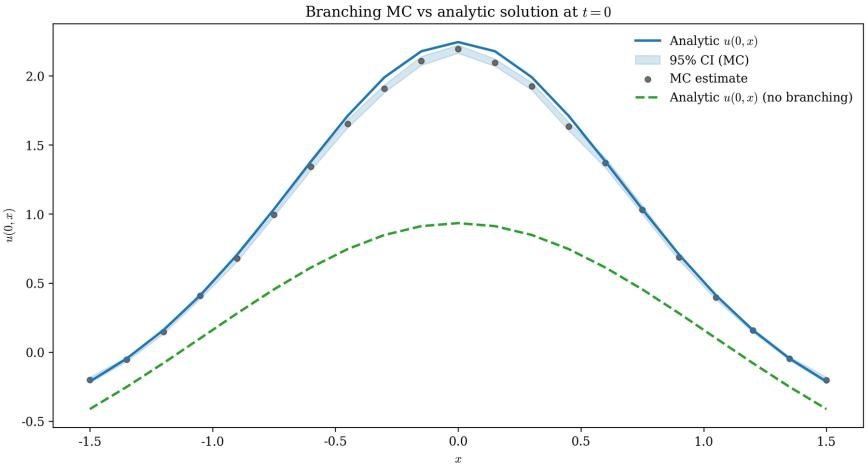  
Figure 8. Comparison of the analytic solution $u ( 0 , x )$ with the Monte Carlo estimate ${ \hat { u } } _ { M } ( 0 , x )$ , in the branching case and the heat kernel, highlighting the impact of the nonlinearity.

## Appendix L. Proof of Proposition 3.1

Notation and mild solutions. We write $\varphi _ { T } : = \varphi ( T , \cdot ) , \bar { \varphi } _ { T } : = \bar { \varphi } ( T , \cdot ) , A : = \| \varphi _ { T } \| _ { \infty } , B : = \| \bar { \varphi } _ { T } \| _ { \infty }$ $b _ { k } : = \| a _ { k } \| _ { L ^ { \infty } ( [ 0 , T ] \times \mathbb { R } ^ { d } ) }$ and $\begin{array} { r } { \bar { K } : = \sum _ { k } k p _ { k } } \end{array}$ (the mean mark). Only $p _ { k } > 0$ for $a _ { k } \not \equiv 0$ is needed, with the convention $0 / 0 = 0$ in the ratios $a _ { k } / p _ { k }$ and $b _ { k } ^ { 2 } / p _ { k }$ . Let $P _ { s } h ( x ) : = \mathbb { E } [ h ( x + W _ { s } ) ]$ be the heat semigroup. In the canonical form (10), (3) reads $\begin{array} { r } { \partial _ { t } \varphi + \frac { 1 } { 2 } \Delta \varphi - c \varphi = - c \sum _ { k } a _ { k } ( t , \cdot ) \varphi ( t , \cdot ) ^ { k + 1 } \bar { \varphi } ( T - \cdot } \end{array}$ $t , \cdot ) ^ { k }$ , and symmetrically for (4). A mild solution is a pair $( \varphi , \bar { \varphi } )$ of measurable functions on $[ 0 , \overset { \cdot } { T } ] \times \mathbb { R } ^ { d }$ such that, for all $( t , x )$ , with absolutely convergent integrals,

$$
\begin{array} { r l } & { \varphi ( t , x ) = e ^ { - c ( T - t ) } P _ { T - t } \varphi _ { T } ( x ) } \\ & { \qquad + \displaystyle \int _ { t } ^ { T } c e ^ { - c ( s - t ) } P _ { s - t } \Big [ \sum _ { k } a _ { k } ( s , \cdot ) \varphi ( s , \cdot ) ^ { k + 1 } \bar { \varphi } ( T - s , \cdot ) ^ { k } \Big ] ( x ) \mathrm { d } s , } \\ & { \bar { \varphi } ( t , x ) = e ^ { - c ( T - t ) } P _ { T - t } \bar { \varphi } _ { T } ( x ) } \\ & { \qquad + \displaystyle \int _ { t } ^ { T } c e ^ { - c ( s - t ) } P _ { s - t } \Big [ \sum _ { k } a _ { k } ( T - s , \cdot ) \varphi ( T - s , \cdot ) ^ { k } \bar { \varphi } ( s , \cdot ) ^ { k + 1 } \Big ] ( x ) \mathrm { d } s . } \end{array}\tag{35}
$$

These are the Duhamel formulas of (3)-(4) for the operator $\begin{array} { r } { \partial _ { t } + \frac { 1 } { 2 } \Delta - c . } \end{array}$

The tree. Particles are labelled by finite words (Ulam-Harris labelling), and each label carries an independent Brownian motion, an independent $\exp ( c )$ lifetime τ and an independent mark $K$ with law $\left( { p _ { k } } \right)$ . A particle born at time b (on its own clock) at the point y moves as $y + W _ { \cdot - b }$ . If $b + \tau \geq T$ , it is a leaf and contributes $\varphi _ { T } ( y + W _ { T - b } )$ if it is white, $\bar { \varphi } _ { T } ( y + W _ { T - b } )$ if it is black. Otherwise, with $s : = b + \tau$ and $z : = y + W _ { \tau }$ , it contributes the factor $a _ { K } ( s ^ { \circ } , z ) / p _ { K }$ of (12), and it is replaced by $K + 1$ particles of its own type born at $( s , z )$ and K particles of the other type born at $\left( T - s , z \right)$ . The root has generation 0, the children of a particle of generation j have generation $j + 1$ , and $D \in \mathbb { N } \cup \{ \infty \}$ denotes the largest generation. On $\{ D < \infty \}$ , Φ is the product of all factors and of all leaf contributions; $\Phi _ { t , x } ^ { \circ } ~ ( \mathrm { r e s p . } ~ \Phi _ { t , x } ^ { \bullet } )$ is Φ for a white (resp. black) root born at $( t , x )$ . We use the branching property: conditionally on the lifetime, the mark and the path of the root, the subtrees rooted at its children are independent, and each is distributed as a tree rooted at the type and birth point of that child.

Because of the time reflection, a black child born at $T - s$ may live longer than its white parent, so the finiteness of the tree is not automatic: it is the object of Lemma L.1.

Lemma L.1 (Size of the tree). Let $n ( t ) \in [ 1 , \infty ]$ be the expected number of particles of a tree whose root is born at time $t ;$ it depends neither on the type nor on the position of the root. If $c T \bar { K } < 1$ , then

$$
n ( t ) \ \le \ 1 + \frac { c \left( T - t \right) \left( 1 + 2 \bar { K } \right) } { 1 - c T \bar { K } } \ < \ \infty
$$

and, in particular, $D < \infty$ almost surely. $I f c T \bar { K } \ge 1$ , n is unbounded on $[ 0 , T ]$

Proof. Let $n _ { j } ( t )$ be the expected number of particles of generation at most j. The root branches at $s \in [ t , T )$ with density $c e ^ { - c ( s - t ) }$ , and then has on average $1 + \bar { K }$ children born at s and $\bar { K }$ children born at $T - s$ . By the branching property, $n _ { 0 } = 1$ and

$$
n _ { j + 1 } ( t ) = 1 + \int _ { t } ^ { T } c e ^ { - c ( s - t ) } \bigl [ ( 1 + \bar { K } ) n _ { j } ( s ) + \bar { K } n _ { j } ( T - s ) \bigr ] \mathrm { d } s .
$$

A direct computation shows that $N ( t ) : = 1 + c ( T - t ) ( 1 + 2 \bar { K } ) / ( 1 - c T \bar { K } )$ satisfies the same equation with n and $n _ { j }$ $n _ { j + 1 }$ both replaced by N. As $N \geq 1 = n _ { 0 }$ and the right-hand side is nondecreasing in $n _ { j }$ , induction gives $n _ { j } \leq N$ for all $j ,$ , and $n = \operatorname* { l i m } _ { j } n _ { j } \leq N$ by monotone convergence.

Conversely, if n is bounded, it solves the equation above (monotone convergence), hence is continuously diferentiable, with $n ^ { \prime } ( t ) = c \left( n ( t ) - 1 \right) - c \bigl [ ( 1 + \bar { K } ) \bar { n } ( t ) + \bar { K } n ( T - t ) \bigr ] = - c \bigl ( 1 + \bar { K } S ( t ) \bigr )$ where $S ( t ) : = n ( t ) + n ( T - t )$ . Then $S ^ { \prime } ( t ) = n ^ { \prime } ( t ) - n ^ { \bar { \prime } } ( T - t ) = 0$ because $S ( T - t ) = S ( t )$ , so S is a constant, $n ( t ) = 1 + c ( 1 + \bar { K } S ) ( T - t )$ since $n ( T ) = 1$ , and evaluating $S = n ( t ) + n ( T - t )$ gives $S \left( 1 - c T \bar { K } \right) = 2 + c T > 0$ . This is impossible when $c T \bar { K } \ge 1$ □

Lemma L.2 (Time-reflected majorant system). Let $\alpha _ { 0 } , \beta _ { 0 } > 0 , q _ { k } \ge 0 ~ f o r ~ k = 0 , \ldots , K .$ , and $\begin{array} { r } { Q ( r ) : = \sum _ { k } q _ { k } r ^ { k } } \end{array}$ . Consider, for bounded nonnegative functions U, U¯ on [0, T], the system

$$
\begin{array} { r l } & { U ( t ) = \alpha _ { 0 } e ^ { - c ( T - t ) } + \displaystyle \int _ { t } ^ { T } c e ^ { - c ( s - t ) } \sum _ { k } q _ { k } U ( s ) ^ { k + 1 } \bar { U } ( T - s ) ^ { k } \mathrm { d } s , } \\ & { \bar { U } ( t ) = \beta _ { 0 } e ^ { - c ( T - t ) } + \displaystyle \int _ { t } ^ { T } c e ^ { - c ( s - t ) } \sum _ { k } q _ { k } U ( T - s ) ^ { k } \bar { U } ( s ) ^ { k + 1 } \mathrm { d } s . } \end{array}\tag{36}
$$

(a) $( U , { \bar { U } } )$ solves (36) if and only if $U ( t ) = \alpha _ { 0 } e ^ { c ( T - t ) ( Q ( r ) - 1 ) }$ and $\bar { U } ( t ) = \beta _ { 0 } e ^ { c ( T - t ) ( Q ( r ) - 1 ) }$ for some $r > 0$ such that

$$
r = \Psi ( r ) : = \alpha _ { 0 } \beta _ { 0 } \exp { \big ( } c T ( Q ( r ) - 1 ) { \big ) } ;\tag{37}
$$

then $U ( t ) \bar { U } ( T - t ) = r$ for all $t \in [ 0 , T ]$

(b) (37) has a root if and only $i f \Psi ( \bar { r } ) \leq \bar { r } f o r$ some $\bar { r } > 0$ . The smallest root $r _ { * }$ is then the limit of the nondecreasing sequence $r _ { 0 } = 0 , r _ { j + 1 } = \Psi ( r _ { j } )$

(c) Let M be the functional of the tree obtained by replacing every branching factor by qK/pK and every white (resp. black) leaf contribution by α0 (resp. β0), and let $u ( t ) : =$ $\mathbb { E } [ M \mathbf { 1 } _ { \{ D < \infty \} } ]$ and $\bar { u } ( t )$ be its expectations for a white and a black root born at t. If (37) has a root, $( u , \bar { u } )$ is the solution of (a) with $r = r _ { * }$ . Otherwise, u or u¯ is unbounded.

Proof. (a) Let $( U , { \bar { U } } )$ be a bounded nonnegative solution. The right-hand sides are continuous in t, hence so are $U , \bar { U }$ , and then they are $C ^ { 1 }$ . Since $\textstyle \sum _ { k } q _ { k } U ^ { k + 1 } { \bar { U } } _ { T - t } ^ { k } = U Q ( U { \bar { U } } _ { T - t } )$ , diferentiation gives

$$
U ^ { \prime } ( t ) = c U ( t ) \big [ 1 - Q \big ( U ( t ) \bar { U } ( T - t ) \big ) \big ] , \qquad \bar { U } ^ { \prime } ( t ) = c \bar { U } ( t ) \big [ 1 - Q \big ( U ( T - t ) \bar { U } ( t ) \big ) \big ] .
$$

For $R ( t ) : = U ( t ) \bar { U } ( T - t )$ , this yields $R ^ { \prime } ( t ) = U ^ { \prime } ( t ) \bar { U } ( T - t ) - U ( t ) \bar { U } ^ { \prime } ( T - t ) = c R \left[ 1 - Q ( R ) \right] -$ $c R \left[ 1 - Q ( R ) \right] = 0$ . Hence $R \equiv r , U ^ { \prime } = c ( 1 { - } Q ( r ) ) U$ with $U ( T ) = \alpha _ { 0 }$ , so U(t) = α0ec(T −t)(Q(r)−1); similarly for ${ \bar { U } } ;$ ; and $r = U ( 0 ) { \bar { U } } ( T ) = \alpha _ { 0 } \beta _ { 0 } e ^ { c T ( Q ( r ) - 1 ) }$ Conversely, $\mathrm { ~ i f ~ } r > 0$ solves (37), the functions above satisfy $U ( t ) { \bar { U } } ( T - t ) = \alpha _ { 0 } \beta _ { 0 } e ^ { c T ( Q ( r ) - 1 ) } = r ,$ , hence the linear equation $\begin{array} { r } { U ^ { \prime } - c U = - c \sum _ { k } q _ { k } U ^ { k + 1 } \bar { U } _ { T - t } ^ { k } } \end{array}$ with $U ( T ) = \alpha _ { 0 }$ , whose variation-of-constants formula is the first line of (36); the second line is obtained in the same way.

(b) Ψ is continuous and nondecreasing, with $\Psi ( 0 ) > 0 . \mathrm { ~ I f ~ } \Psi ( \bar { r } ) \leq \bar { r }$ , induction gives $r _ { j } \leq$ $r _ { j + 1 } \leq \bar { r } _ { \mathrm { { \scriptsize ~ ; } } }$ , so rj converges to a root $r _ { * } \le r ;$ any root r satisfies $r _ { j } \leq r$ for all $j ,$ , hence $r _ { * } \leq r$ . The converse is obvious.

(c) Let $u _ { j } ( t ) : = \mathbb { E } [ M \mathbf { 1 } _ { \{ D \leq j \} } ]$ and $\bar { u } _ { j } ( t )$ be the analogous quantities. The root is a leaf with probability $e ^ { - c ( T - t ) }$ , and $\{ D \leq j + 1 \}$ means that all the subtrees of its children have depth at most $j$ . Hence, by the branching property, $u _ { 0 } ( t ) = \alpha _ { 0 } e ^ { - c ( T - t ) } , \bar { u } _ { 0 } ( t ) = \beta _ { 0 } e ^ { - c ( T - t ) }$ , and $( u _ { j + 1 } , \bar { u } _ { j + 1 } )$ is the right-hand side of (36) evaluated at $( u _ { j } , \bar { u } _ { j } ) ;$ ; note that $p _ { k } \cdot q _ { k } / p _ { k } = q _ { k }$ . If a root exists, let $( U _ { * } , \bar { U } _ { * } )$ be the solution of (a) with $r = r _ { * }$ . Since $U _ { * } \geq u _ { 0 } , \bar { U } _ { * } \geq \bar { u } _ { 0 }$ and the right-hand side is nondecreasing, $u _ { j } \leq U _ { * }$ and $\bar { u } _ { j } \le \bar { U } _ { * }$ for all j. By monotone convergence, $( u , \bar { u } ) \ : = \ : \operatorname* { l i m } _ { j } ( u _ { j } , \bar { u } _ { j } )$ is a bounded solution of (36), so by (a) it is associated with a root $r = u ( 0 ) \beta _ { 0 } \leq U _ { * } ( 0 ) \beta _ { 0 } = r _ { * } ;$ hence $r = r _ { * }$ and $( u , \bar { u } ) = ( U _ { * } , \bar { U } _ { * } )$ . If no root exists, $( u , \bar { u } )$ cannot be bounded, since it would then solve (36). □

Proof of Proposition 3.1. Step 1: finiteness. By (i) and Lemma L.1, $D < \infty { \mathrm { a . s . } }$ , so that $\Phi _ { t , x } ^ { \circ }$ and $\Phi _ { t , x } ^ { \bullet }$ are well defined.

Step 2: square integrability. Let $M _ { 1 }$ be the functional of Lemma L.2(c) with $q _ { k } = b _ { k } , \alpha _ { 0 } = A$ and $\beta _ { 0 } = B$ , and $M _ { 1 } ^ { \circ } , M _ { 1 } ^ { \bullet }$ its values for a white, resp. black, root born at t. Since $| a _ { k } ( s ^ { \circ } , z ) | \le b _ { k }$ $| \varphi _ { T } | \le A$ and $| \bar { \varphi } _ { T } | \leq B$ , we have $| \Phi | \le M _ { 1 }$ pathwise. Moreover, $M _ { 1 } ^ { 2 }$ is the functional of Lemma $\mathrm { L . 2 ( c ) }$ with $q _ { k } = b _ { k } ^ { 2 } / p _ { k } , \alpha _ { 0 } = A ^ { 2 }$ and $\beta _ { 0 } = B ^ { 2 }$ , because $( b _ { K } / p _ { K } ) ^ { 2 } = ( b _ { K } ^ { 2 } / p _ { K } ) / p _ { K }$ Condition (ii) is $\Psi ( r ) \leq r$ for this choice, so Lemma ${ \mathrm { L . 2 } } ( \mathrm { b } ) { \mathrm { - } } ( \mathrm { c } )$ gives $\mathbb { E } [ \Phi ^ { 2 } ] \leq \mathbb { E } [ M _ { 1 } ^ { 2 } ] = { \bar { U } } _ { 2 } ( t ) < \infty$ where $U _ { 2 }$ is the corresponding bounded solution: $\Phi \in L ^ { 2 }$ . By Cauchy-Schwarz, $\mathbb { E } [ M _ { 1 } ] \leq \sqrt { U _ { 2 } ( t ) }$ is bounded on [0, T], so by Lemma $\mathrm { L . 2 ( c ) }$ the equation $r = A B \exp \left( c T ( \sum _ { k } b _ { k } r ^ { k } - 1 ) \right)$ has a

smallest root $r _ { 1 }$ , and

$$
\begin{array} { r } { \mathbb { E } \big [ | \Phi _ { t , x } ^ { \circ } | \big ] \leq \mathbb { E } [ M _ { 1 } ^ { \circ } ] = U _ { 1 } ( t ) : = A e ^ { c ( T - t ) ( \sum _ { k } b _ { k } r _ { 1 } ^ { k } - 1 ) } , } \end{array}\tag{38}
$$

$$
\begin{array} { r } { \mathbb { E } \big [ | \Phi _ { t , x } ^ { \bullet } | \big ] \leq \mathbb { E } [ M _ { 1 } ^ { \bullet } ] = \bar { U } _ { 1 } ( t ) : = B e ^ { c ( T - t ) ( \sum _ { k } b _ { k } r _ { 1 } ^ { k } - 1 ) } . } \end{array}
$$

Step 3: mild solution. Let $u ( t , x ) : = \mathbb { E } [ \Phi _ { t , x } ^ { \circ } ]$ and $\bar { u } ( t , x ) : = \mathbb { E } [ \Phi _ { t , x } ^ { \bullet } ]$ . Consider a white root born at $( t , x )$ , with lifetime $\tau _ { : }$ , mark K and path $x + W$ . On $\{ \tau \geq T - t \}$ , which has probability $e ^ { - c ( T - t ) } , \Phi = \varphi _ { T } ( x + W _ { T - t } )$ . On $\{ \tau < T - t \}$ , with $s : = t + \tau$ and $z : = x + W _ { \tau }$ , the branching property gives

$$
\mathbb { E } \big [ \Phi \big | \tau , K , W \big ] = \frac { a _ { K } ( s , z ) } { p _ { K } } u ( s , z ) ^ { K + 1 } \bar { u } ( T - s , z ) ^ { K } .
$$

The bound $| \Phi | \le M _ { 1 }$ justifies Fubini’s theorem. Averaging over $K \sim ( p _ { k } )$ , over W, and over $\tau$ with density $c e ^ { - c r }$ on $[ 0 , T - t )$ yields the first line of (35). The second line follows in the same way, the factor of a black root branching at s being $a _ { K } ( T - s , z ) / p _ { K }$ . Hence $( u , \bar { u } )$ is a mild solution, and $\left| u \right| \leq U _ { 1 } , \left| \bar { u } \right| \leq \bar { U } _ { 1 }$ by (38).

Step 4: uniqueness in the dominated class. Let $( \varphi , \bar { \varphi } )$ be a mild solution with $| \varphi ( t , x ) | \leq U _ { 1 } ( t )$ and $| \bar { \varphi } ( t , x ) | \leq \bar { U } _ { 1 } ( t )$ . For $j \geq 0$ , let $\Phi _ { j }$ be the functional of the tree stopped at generation $j \colon$ particles of generation $j$ are not evolved and contribute $\varphi$ (white) or $\bar { \varphi } \ ( \mathrm { b l a c k } )$ , evaluated at their birth time and position. Iterating (35) j times, with the branching property as in Step 3, gives $\varphi ( t , x ) = \mathbb { E } [ \Phi _ { j } ]$ for a white root born at $( t , x )$ . On $\{ D < j \}$ no particle of generation j exists, so that $\Phi _ { j } = \Phi$ . Let $M _ { 1 , j }$ be $M _ { 1 }$ stopped at generation $j$ in the same way, with contributions $U _ { 1 } .$ $\bar { U } _ { 1 }$ for the particles of generation $j ;$ then $| \Phi _ { j } | \le M _ { 1 , j }$ , and $\mathbb { E } [ M _ { 1 , j } ] = U _ { 1 } ( t )$ because $( U _ { 1 } , \bar { U } _ { 1 } )$ is a fixed point of (36) with $q _ { k } = b _ { k }$ . Therefore

$$
\begin{array} { r } { \left| \varphi ( t , x ) - \mathbb { E } \big [ \Phi \mathbf { 1 } _ { \{ D < j \} } \big ] \right| \le \mathbb { E } \big [ M _ { 1 , j } \mathbf { 1 } _ { \{ D \ge j \} } \big ] = U _ { 1 } ( t ) - \mathbb { E } \big [ M _ { 1 } \mathbf { 1 } _ { \{ D < j \} } \big ] \underset { i \to \infty } { \longrightarrow } U _ { 1 } ( t ) - \mathbb { E } [ M _ { 1 } ] = 0 , } \end{array}
$$

by monotone convergence, Step 1 and (38). Since $\mathbb { E } [ \Phi \mathbf { 1 } _ { \{ D < j \} } ]  \mathbb { E } [ \Phi ] = u ( t , x )$ by dominated convergence, $\varphi = u ;$ similarly $\bar { \varphi } = \bar { u }$ □

Remark L.1 (Checking (i)-(ii) in practice). (a) Linear cases $( F \equiv 0$ , or $F = V$ as in Appendix O.3): $K = 0$ , so (i) holds trivially, and Q is constant, so (ii) holds with $r = A ^ { 2 } B ^ { 2 } e ^ { c T ( { b _ { 0 } ^ { 2 } } / { p _ { 0 } } - 1 ) }$ , for every horizon $T .$ . This covers all the experiments of Section 5 except the Gross-Pitaevskii ones, as soon as the trained potentials are bounded.

(b) Gross-Pitaevskii coupling $F ( m ) = \kappa m$ , i.e. $a _ { 0 } = 1$ and $a _ { 1 } = - \kappa$ in (10): (i) reads $c T p _ { 1 } < 1$ Since $r = \alpha e ^ { \beta r }$ has a positive root if and only if $e \alpha \beta \leq 1$ , (ii) reads

$$
e c T { \frac { \kappa ^ { 2 } } { p _ { 1 } } } A ^ { 2 } B ^ { 2 } e ^ { c T ( 1 / p _ { 0 } - 1 ) } \leq 1 .
$$

In the Gross-Pitaevskii experiments of Section $5 \ : ( c \le 0 . 3$ , with the horizon $T = 2$ of Appendix N), (i) holds whatever $p _ { 1 }$ , since $c T p _ { 1 } \leq 0 . 6$ . Condition (ii) involves the sup norms $A , B$ of the trained potentials and has to be checked a posteriori; when it fails, the trees remain finite by (i), but the estimator may have infinite variance.

(c) The conditions cannot be dropped. If $a _ { k } \geq 0$ and $\varphi _ { T } \equiv A , \bar { \varphi } _ { T } \equiv B$ are constants, then $\Phi = M _ { 1 }$ , and by Lemma $\mathrm { L . 2 ( c ) } \ t \ \mapsto \ \mathbb { E } [ \Phi _ { t , x } ^ { \circ } ]$ or $t \mapsto \mathbb { E } [ \Phi _ { t , x } ^ { \bullet } ]$ is unbounded as soon as $r = A B$ exp $\begin{array} { r } { ( c T ( \sum _ { k } a _ { k } r ^ { k } - 1 ) ) } \end{array}$ has no root, although all the data are bounded. For instance, for $\begin{array} { r } { a = ( 0 , 1 ) , p = ( \frac { 1 } { 2 } , \frac { 1 } { 2 } ) } \end{array}$ and $c = T = 1$ , a root exists if and only if $A B \le 1$

## Appendix M. Feynman-Galton-Watson diagrams

Each realization of the branching system is a Galton-Watson tree: lines correspond to Brownian trajectories between branching events, and vertices represent branchings. This is directly analogous to tree Feynman diagrams: dashed lines depict white particles $\left( \varphi \right)$ , solid lines depict black particles $\left( \hat \varphi \right)$ , and trivalent vertices encode the cubic nonlinearity. For the cubic nonlinearity $F _ { p } ( m ) = m$ in $( 1 0 ) \ ( \mathrm { i . e . } \ a _ { 0 } = 0 , a _ { 1 } = 1$ , and we take $p _ { 1 } = 1 )$ , the only branching is $k = 1$

$$
\circ ~ \to ~ 2 ~ \circ + 1 \bullet , ~ \bullet ~ \to ~ 1 ~ \circ + 2 \bullet ,
$$

so each vertex corresponds to one incoming line splitting into three outgoing lines. Iterating these vertices yields a perturbative expansion in the coupling constant c: a diagram with n branchings contributes a weight of order $c ^ { n }$

Importantly, if we truncate the Galton-Watson expansion to order 0 (no branching), the dynamics are given only by free Brownian propagation. In this case, the system reduces to the classical Schrödinger bridge, and the PDEs collapse to the linear forward-backward heat equations. Higher-order branchings then represent nonlinear corrections beyond this baseline. Appendix K gives a scalar toy sanity check of the branching scheme for the T−t coupling in (3)-(4).

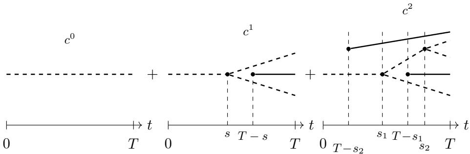  
Figure 9. First three contributions in the perturbative expansion (Gross-Pitaevskii cubic branching). Dashed lines represent white particles $\left( \varphi \right)$ , solid lines represent black particles $\left( \hat { \varphi } \right)$ . Weights with $a _ { 1 } = p _ { 1 } = 1 \colon$ : order $c ^ { 0 }$ , no branching, i.e. classical Schrödinger bridge $/$ linear heat kernel; order $c ^ { 1 }$ with one branching at $s$ (white ofspring starting at $s ,$ black ofspring at $T - s )$ ; order $c ^ { 2 }$ with two branchings at $s _ { 1 } , s _ { 2 } :$ ofspring of the same type as the parent start at $s _ { i } ,$ while ofspring of the other type start at $T - s _ { i }$ . The horizontal time axes (all at the same vertical level) show time from 0 to $T$ , with dashed vertical lines indicating the splitting times.

## Appendix N. Implementation details

Training and sampling both rely on stochastic quantities built from branching trees and on diferentiating log $\widehat \varphi ( t , x )$ with respect to $x$ (Algorithm 2). When coordinates have very diferent scales or heavy tails, (i) products of terminal factors in the branching estimator can span many orders of magnitude, inflating Monte Carlo variance, and (ii) autograd through log $\varphi _ { \theta }$ and the reweighted score becomes ill-conditioned relative to the isotropic unit-variance reference noise in the SDE. We therefore normalize inputs before bridge estimation, using one of the two mechanisms below depending on dimensionality and data modality.

N.1. Covariance whitening in data space. Let $X _ { 0 } \sim \mu _ { 0 }$ and $X _ { T } \sim \mu _ { T }$ . We define

$$
\hat { X } _ { 0 } : = C _ { 0 } ^ { - \frac 1 2 } \big ( X _ { 0 } - \mathbb { E } ^ { \mu _ { 0 } } [ X _ { 0 } ] \big ) , \quad C _ { 0 } : = \mathrm { C o v } ( \mu _ { 0 } ) ,
$$

$$
\hat { X } _ { T } : = \sigma { C _ { T } ^ { - \frac { 1 } { 2 } } } \big ( { X } _ { T } - \mathbb { E } ^ { \mu _ { T } } [ X _ { T } ] \big ) , \quad { C _ { T } : = \mathrm { C o v } ( \mu _ { T } ) } , \quad \sigma ^ { 2 } = 2 ,
$$

train the bridge on $\hat { \mu } _ { 0 } : = \operatorname { L a w } ( \hat { X } _ { 0 } )$ and $\hat { \mu } _ { T } : = \mathrm { L a w } ( \hat { X } _ { T } )$ , and map generated samples back to the original coordinates by the inverse afine map. If $\mu _ { 0 }$ and $\mu _ { T }$ are Gaussian, then $\hat { \mu } _ { 0 } \sim \mathcal { N } ( 0 , I )$ , $\hat { \mu } _ { T } \sim \mathcal { N } ( 0 , \sigma ^ { 2 } I )$ and $\hat { \mu } _ { T } = \hat { \mu } _ { 0 } \star { \mathcal N } ( 0 , I )$ , which matches the classical Schrödinger bridge with $( \varphi _ { \mathrm { N N } } , \bar { \varphi } _ { \mathrm { N N } } ) = ( 0 , 0 )$ at horizon $T = 1$ . In practice we set $T = 2$ to retain nontrivial interpolation; when $\mu _ { T }$ is close to Gaussian, initializing $\left( \varphi _ { \mathrm { N N } } , \bar { \varphi } _ { \mathrm { N N } } \right) = \left( 0 , 0 \right)$ is already near optimal with little additional training.

N.2. Latent representations for imaging. For high-dimensional images, empirical covariances are singular or badly conditioned (e.g. near-constant background pixels), so $\hat { C } _ { T } ^ { - 1 / 2 }$ is unstable and pixel-space whitening is inappropriate. We instead encode images with a pretrained VAE (MNIST) or ALAE (FFHQ), yielding low-dimensional codes that are approximately standardized and better aligned with the isotropic difusion reference; the bridge is trained in that latent space and decoded for visualization.

## Appendix O. Results details

O.1. 2D synthetic experiments. We adopt synthetic two-dimensional distributions commonly used in the literature [7]:

• µ0 := Gaussian → µT := Mixture of Gaussians. The source $\mu _ { 0 }$ is a centered Gaussian with variance $\sigma ^ { 2 } I \ ( \sigma = 5 )$ , and the target $\mu _ { T }$ is a mixture of 8 Gaussians.

• µ0 := Moon curves ${ \bf \Psi } \to \mu _ { T } : = { \bf S }$ wiss curves. The source $\mu _ { 0 }$ is a composition of two Moon-shaped distributions, and the target $\mu _ { T }$ is a Swiss curve.

The recovered Schrödinger bridges for these two cases are shown in Figure 10. The temporal evolution of the interpolating flow illustrates how the source progressively deforms into the target (Figures 2).

Training dynamics are summarized in Figure 27, see Appendix P.1. As the number of epochs increases, the generated terminal distribution Law $( X _ { T } )$ gradually converges toward the target law $\mu _ { T }$ (Figure 27). At the same time, the potentials $( \varphi _ { \boldsymbol { \theta } } , \bar { \varphi } _ { \eta } )$ sharpen as training progresses, reflecting improved discrimination between source and target (Figures 28 and 29, see Appendix P.1).

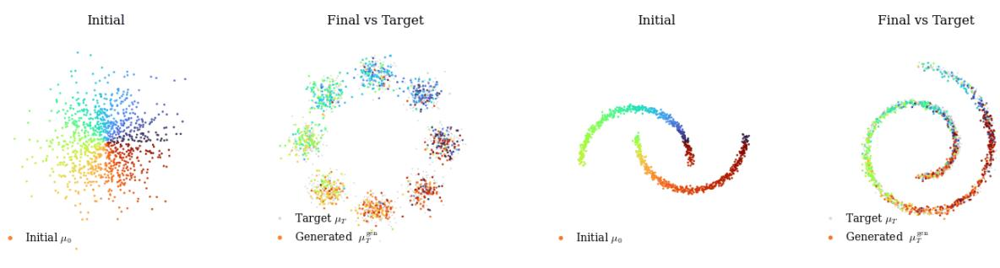  
(10a) Gaussian → mixture of Gaussians.  
(10b) Moon curves → Swiss curve.  
Figure 10. Classical Schrödinger bridges in $\mathbb { R } ^ { 2 } .$

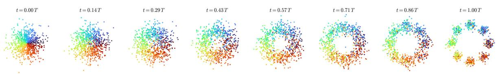  
Figure 11. Extended view of the temporal evolution of Law(Xt) (Moons → Swiss).

O.2. Comparison on the 2D benchmark. We compare SBNL with LightSB [13], LightSBB M [15], DSBM [12] and BranchSBM [17] on the Gaussian → mixture of 8 Gaussians benchmark from Appendix O. We report (i) terminal samples for each method (Figure 12), (ii) the closedform mixture $W _ { 2 }$ distance between the generated terminal law and $\mu _ { T }$ (Figure 14a), and (iii) the per-mode coverage of the 8 components (Figure 15).

O.2.1. Computation of the comparison metrics. Let $\hat { \mu } _ { T }$ denote the empirical distribution of $N = 1 0 ^ { 4 }$ generated terminal samples and $\mu _ { T }$ the target mixture of 8 isotropic Gaussians in $\mathbb { R } ^ { 2 }$

Mixture Wasserstein $M W _ { 2 }$ . We first fit a Gaussian mixture with $K = 8$ components to the generated samples by expectation–maximization (sklearn’s GaussianMixture, full covariances, restarted 5 times, best log-likelihood kept), obtaining $\begin{array} { r } { \hat { p } = \sum _ { k = 1 } ^ { K } \hat { w } _ { k } \mathcal { N } ( \hat { m } _ { k } , \hat { \Sigma } _ { k } ) } \end{array}$ . We compare it to the known target mixture $\begin{array} { r } { p ^ { \star } = \sum _ { k = 1 } ^ { K } w _ { k } ^ { \star } \mathcal { N } ( m _ { k } ^ { \star } , \Sigma _ { k } ^ { \star } ) } \end{array}$ using the mixture Wasserstein distance [41]

$$
{ \cal M } W _ { 2 } ^ { 2 } ( \hat { p } , p ^ { \star } ) = \operatorname* { m i n } _ { \pi \in \Pi ( \hat { w } , w ^ { \star } ) } \sum _ { k , \ell } \pi _ { k \ell } W _ { 2 } ^ { 2 } ( { \mathcal N } ( \hat { m } _ { k } , \hat { \Sigma } _ { k } ) , { \mathcal N } ( m _ { \ell } ^ { \star } , \Sigma _ { \ell } ^ { \star } ) ) ,
$$

where the $W _ { 2 }$ distance between Gaussians has the closed form $W _ { 2 } ^ { 2 } ( N ( m _ { 1 } , \Sigma _ { 1 } ) , N ( m _ { 2 } , \Sigma _ { 2 } ) ) =$ $\| m _ { 1 } - m _ { 2 } \| ^ { 2 } + \mathrm { T r } \big ( \Sigma _ { 1 } + \Sigma _ { 2 } - 2 \big ( \Sigma _ { 1 } ^ { 1 / 2 } \Sigma _ { 2 } \Sigma _ { 1 } ^ { 1 / 2 } \big ) ^ { 1 / 2 } \big )$ , so $M W _ { 2 }$ reduces to a small linear program on the $K \times K$ cost matrix and is computed in closed form.

Sliced Wasserstein $S W _ { 2 }$ . We use the standard Monte Carlo estimator of the sliced 2-Wasserstein distance,

$$
S W _ { 2 } ^ { 2 } ( \hat { \mu } _ { T } , \mu _ { T } ) \ = \ \frac { 1 } { L } \sum _ { \ell = 1 } ^ { L } W _ { 2 } ^ { 2 } ( P _ { \theta _ { \ell } \sharp } \hat { \mu } _ { T } , \ : P _ { \theta _ { \ell } \sharp } \mu _ { T } ) ,
$$

where $\theta _ { \ell }$ are $L = 2 0 0$ directions drawn uniformly on $\mathbb { S } ^ { 1 }$ and $P _ { \theta } x = \theta ^ { \top }$ x; each 1D $W _ { 2 } ^ { 2 }$ is evaluated exactly on the sorted projected samples (with $1 0 ^ { 4 }$ samples for both $\hat { \mu } _ { T }$ and $\mu _ { T } )$

Empirical $W _ { 2 } ^ { \mathrm { e m p } }$ . We solve the discrete optimal transport between $\hat { \mu } _ { T }$ and an i.i.d. sample of size $1 0 ^ { 4 }$ from $\mu _ { T }$ using the POT library (exact LP solver on the squared Euclidean cost), reporting $\begin{array} { r } { W _ { 2 } ^ { \mathrm { e m p } } = ( \sum _ { i j } \pi _ { i j } ^ { \star } \| x _ { i } - y _ { j } \| ^ { 2 } ) ^ { 1 / 2 } } \end{array}$

Energy distance $E$ . We use the kernel-based energy distance [42], estimated by U-statistics on the same $1 0 ^ { 4 }$ samples from $\hat { \mu } _ { T }$ and $\mu _ { T } \mathbf { : }$

$$
E ^ { 2 } ( \hat { \mu } _ { T } , \mu _ { T } ) \ = \ 2 \mathbb { E } \Vert X - Y \Vert - \mathbb { E } \Vert X - X ^ { \prime } \Vert - \mathbb { E } \Vert Y - Y ^ { \prime } \Vert , \quad X , X ^ { \prime } \sim \hat { \mu } _ { T } , \ Y , Y ^ { \prime } \sim \mu _ { T } .
$$

$E \geq 0 .$ , with $E = 0$ if the two distributions coincide.

Moment and coverage diagnostics. The mean error $| \Delta \mu | = \| \mathbb { E } _ { \hat { \mu } _ { T } } [ X ] - \mathbb { E } _ { \mu _ { T } } [ X ] \|$ and the covariance error $\| \Delta \Sigma \| _ { F } = \| \mathrm { C o v } ( \hat { \mu } _ { T } ) - \mathrm { C o v } ( \mu _ { T } ) \| _ { F }$ are computed from empirical moments. The per-mode coverage assigns each generated sample to its nearest component center in $\mu _ { T }$ and reports the resulting empirical frequencies (Figure 15); the uniform reference is $1 / K = 1 / 8$

Confidence intervals. Each metric is a random variable of the generated sample, so every value reported in Table 3b and Figures 14a-14b is accompanied by a bootstrap confidence interval. For every method and every metric we draw $B = 5$ resamples with replacement of both the prediction tensor (size $N = 1 0 ^ { 4 } )$ and a freshly drawn reference sample from $\mu _ { T }$ , then recompute the entire metric pipeline on each replica-including refitting the 8-component GMM with a fresh seed for $M W _ { 2 }$ , so that variability from the GMM fit is also captured. The reported point estimate is the mean across replicas and the ± value is the sample standard deviation (with Bessel correction). For the empirical Wasserstein distance, the $\bar { 1 } 0 ^ { 4 } \times 1 0 ^ { 4 }$ EMD is too heavy inside the bootstrap loop, so we down-sample to 2000 points per side in each replica (hence the $W _ { 2 } ^ { \mathrm { e m p } }$ label in Figure 14b). Per-mode coverage error bars in Figure 15 are obtained the same way. Each method is evaluated from a single trained checkpoint, so the reported intervals reflect sample/estimator uncertainty rather than training-seed variability.

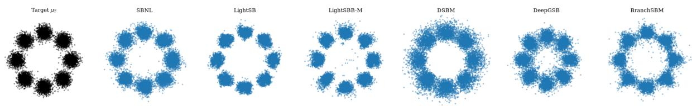  
Figure 12. Terminal samples on Gaussian → mixture of 8 Gaussians for each method.

Closed-form MW2 per method (mean ± std, 5 bootstraps; lower is better)

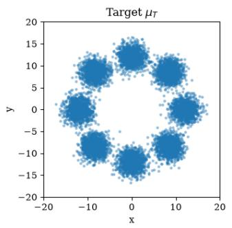  
(13a) Target µT

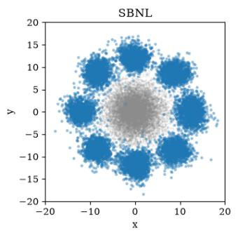  
(13b) SBNL

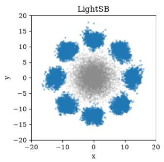  
(13c) LightSB

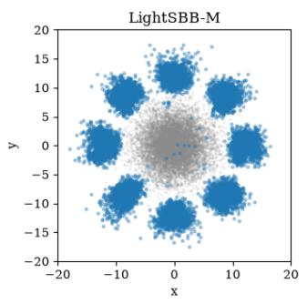  
(13d) LightSBB-M

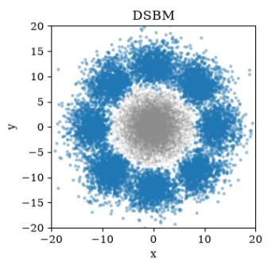  
(13e) DSBM

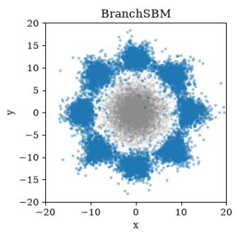  
(13f) BranchSBM

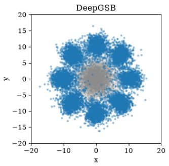  
(13g) DeepGSB  
Figure 13. Terminal samples per method on the Gaussian → mixture of 8 Gaussians benchmark.

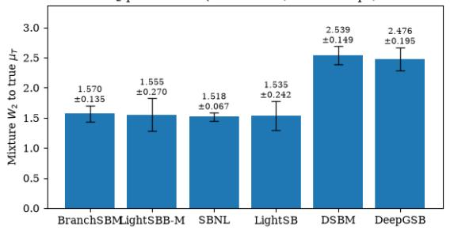  
(14a) Closed-form mixture $W _ { 2 }$ between generated terminal law and $\mu _ { T }$

Empirical W2 (2k) per method (mean ± std, 5 bootstraps; lower is better)  
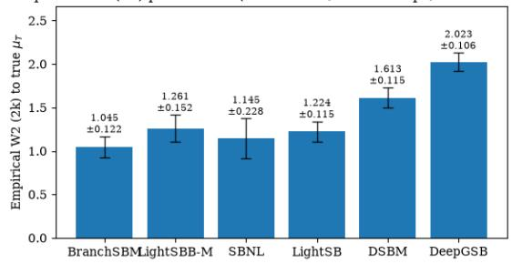  
(14b) Empirical $W _ { 2 }$ between generated terminal law and $\mu _ { T }$  
Figure 14. Per-method comparison on the Gaussian → mixture of 8 Gaussians benchmark (lower is better; mean ± std over 5 bootstraps).

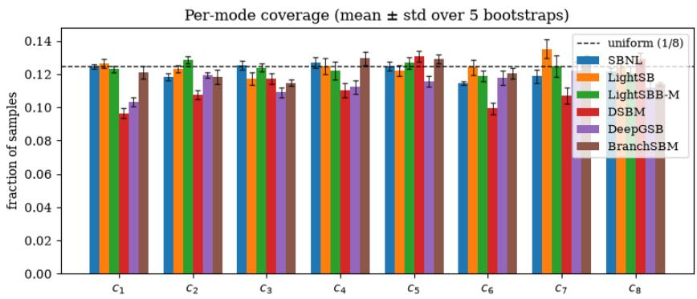  
Figure 15. Per-mode coverage of the 8 target components. The dashed line marks the uniform reference $1 / 8$

O.3. Potential running cost. We now consider a state-dependent running cost of potential type,

$$
f ( m ( t , \cdot ) ) = \int _ { \mathbb { R } ^ { d } } V ( x ) m ( t , x ) \mathrm { d } x \qquad \Longrightarrow \qquad F ( t , x , \varphi , \bar { \varphi } ) = V ( x ) ,
$$

so that the canonical PDE (3) reads $\begin{array} { r } { \partial _ { t } \varphi + \frac { 1 } { 2 } \Delta \varphi = c \varphi \left( 1 - ( 1 - V ( x ) ) \right) } \end{array}$ . The interaction is thus fully specified by a single callable $V : \mathbb { R } ^ { d }  \mathbb { R }$ , passed to the model and evaluated on the fly during both training and sampling to encode the environment.

Branching mechanism. Matching the canonical form $F = 1 - F _ { p }$ with $F _ { p } ( t , x , m ) = 1 - V ( x )$ gives a single degree-zero coeficient $a _ { 0 } ( x ) = 1 - V ( x )$ (and $a _ { k } = 0$ for $k \geq 1 )$ . With $p _ { 0 } = 1$ , the only branching outcome is that a particle continues as a single copy of the same type, and each branching event reweights the tree by

$$
\begin{array} { r } { \mathcal { W } \longrightarrow \mathcal { W } \cdot \frac { a _ { 0 } ( X _ { s } ) } { p _ { 0 } } = \mathcal { W } \cdot ( 1 - V ( X _ { s } ) ) . } \end{array}
$$

There are no ofspring and no type flips: the branching estimator of Proposition 3.1 reduces to a pure Feynman-Kac weighting of Brownian paths (Appendix H, confining potentials), with V bounded so that $1 - V > 0$ keeps the weights positive.

Training and sampling. Because F is state- but not density-dependent, the system $( 3 ) \AA - \thinspace ( 4 )$ is linear and $\varphi ( 0 , x )$ is estimated by the reweighted trees above; the potentials are trained with the MMD objective (14). Two practical ingredients make the importance-sampled estimator stable. First, the interior weights $W = \widehat { A } \bar { \varphi } _ { \eta } / \mu ^ { * }$ (resp. $\boldsymbol { \widehat { B } } \varphi \boldsymbol { \theta } / \mu ^ { * } )$ are heavy-tailed when $\mu ^ { * }$ is too narrow, so we take a wide Gaussian reference $\mu ^ { * }$ covering the region actually explored by the branching difusion. Second, we use self-normalized importance sampling (dividing each weight vector by its own sum, gradient preserved), which turns the interior expectations into low-variance ratio estimators comparing the normalized residual measures. At sampling time, the drift ∇ log φ is estimated by the same weighted trees (Algorithm 2), so V deflects trajectories away from high-V regions.

Endpoint ofset trick. When V has an asymmetric geometry (e.g. gates at diferent heights, a curved valley), we place $\mu _ { 0 }$ and $\mu _ { T }$ at diferent anchor points aligned with the entrance/exit of the low-energy corridor, rather than symmetrically. This gives the score a clear valley to follow through the obstacle. Transporting mass over a distance $\sim \ell$ requires the drift to integrate to $\sim \ell ,$ so we also use a longer horizon $T$ (with a small rate c): too small a T leaves the drift no time to route the mass around the barrier.

SBNL Transport through a Gated Maze  
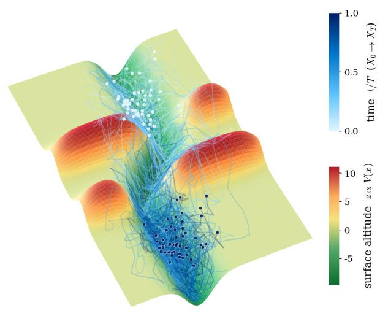

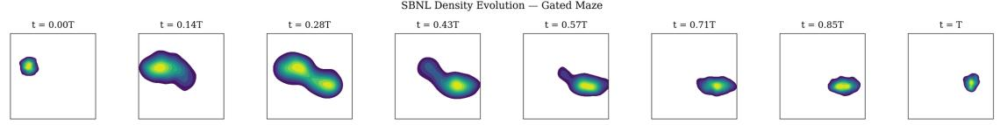  
Figure 16. Gated maze: SBNL transport and estimated density evolution m(t, ·) = φ(t, ·)φ¯(T − t, ·).

SBNL Transport on a Reversed S-Curve Channel  
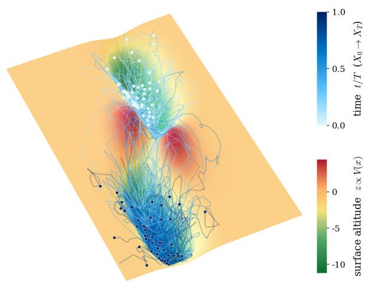

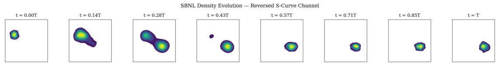  
Figure 17. S-curve: SBNL transport and estimated density evolution m(t, ·) = φ(t, ·)φ¯(T −t, ·).

SBNL Transport on a Cosine-Valley Potential  
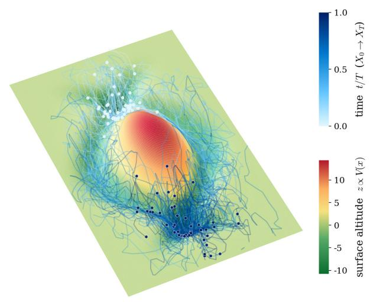

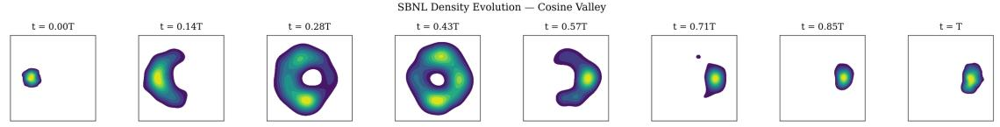  
Figure 18. Valley: SBNL transport and estimated density evolution m(t, ·) = φ(t, ·)φ¯(T − t, ·).

SBNL Transport on a Spiral Vortex Potential  
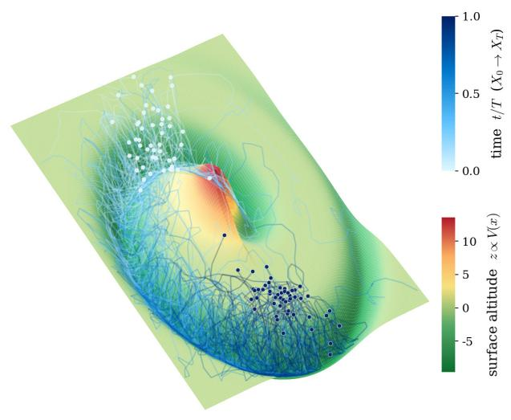

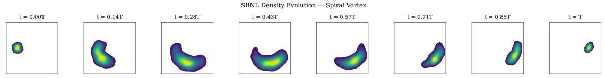  
Figure 19. Spiral: SBNL transport and estimated density evolution m(t, ·) = φ(t, ·)φ¯(T − t, ·).

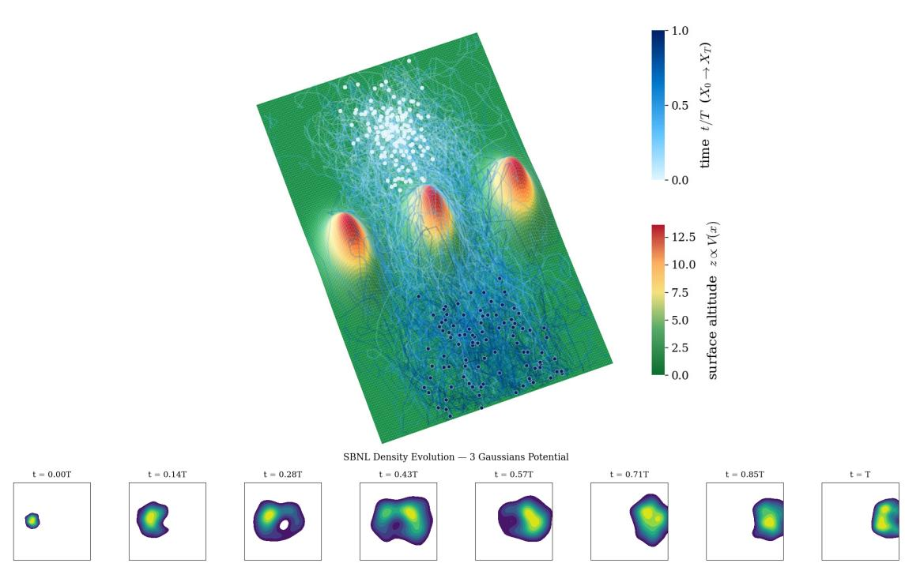  
Figure 20. Three Gaussians: SBNL transport and estimated density evolution $m ( t , \cdot ) =$ $\varphi ( t , \cdot ) \bar { \varphi } ( T - t , \cdot )$

O.4. 50D synthetic experiments. We consider a nonlinear bridge between Gaussian mixtures in R50 with $c = 0 . 1$ . Samples and trajectories are visualized by projection onto the first two PCA directions, with the PCA basis fit on pooled validation draws from $\mu _ { 0 }$ and $\mu _ { T }$ . Figure 21 compares generated and target marginals after training; Figure 22 shows the evolution of projected trajectories.

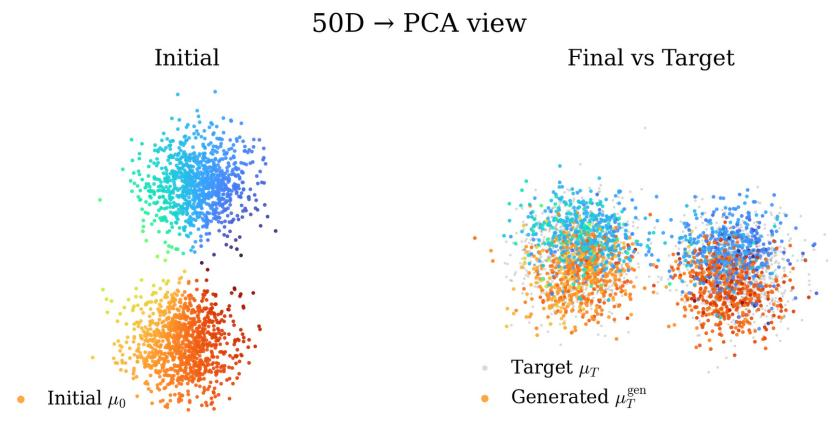  
Figure 21. Generated vs. true samples in $\mathbb { R } ^ { 5 0 }$ (PCA projection).

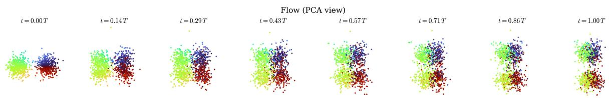  
Figure 22. Temporal evolution in $\mathbb { R } ^ { 5 0 }$ (PCA projection).

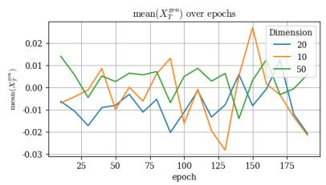  
(23a) Mean of the generated samples across diferent dimensions (target mean: 0).

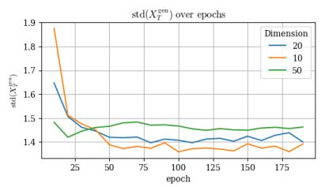  
(23b) Std of the generated samples across diferent dimensions (target std: 2).

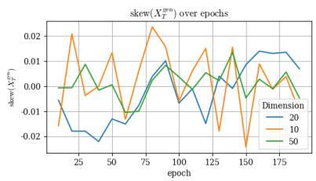  
(23c) Skewness of the generated samples across diferent dimensions (target skewness: 0).  
Figure 23. Evolution of the first three moments (mean, standard deviation, skewness) of the generated samples over training epochs, for diferent latent dimensions.

O.5. MNIST in latent space. We consider a nonlinear bridge between MNIST digits in latent space with $c = 0 . 1$ . Samples and trajectories are visualized by projection onto the first two PCA directions, with the PCA basis fit on pooled validation draws from $\mu _ { 0 }$ and $\mu _ { T }$ (Figure 6). Figure 24a projects the d=32 latent codes onto the first two PCA directions (basis fit on pooled validation samples from $\mu _ { 0 }$ and $\mu _ { T } )$ : the left panel shows the initial law $\mu _ { 0 } ,$ and the right panel overlays generated terminal latents on the target $\mu _ { T }$ , illustrating that the bridge maps the source geometry into the target bulk while preserving local structure visible in the point colors. Figure 24b compares generated and target digits after training.

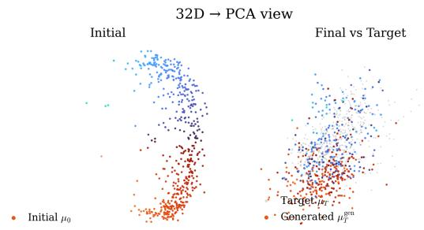  
(24a) PCA view of $\mu _ { 0 }$ (left) and of generated terminal samples vs. target $\mu _ { T }$ (right; target in gray, generated colored).

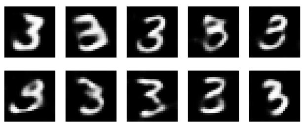  
(24b) Generated MNIST digits obtained by decoding latent interpolations.  
Figure 24. MNIST latent bridge (d=32): latent PCA visualization and decoded samples.

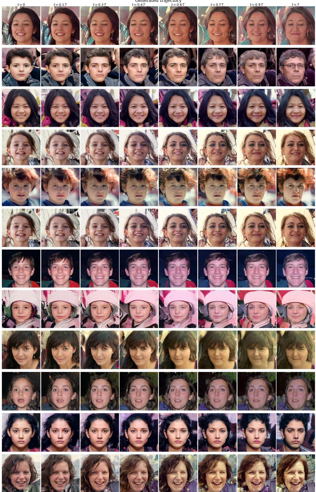  
Figure 25. FFHQ young-to-old: decoded trajectories during sampling.

## O.6. FFHQ in latent space.

O.7. Comparison on FFHQ. We extend the FFHQ young-to-old comparison from Figure 7a to a larger panel of source children and all baselines, in ALAE latent space. Figure 26 shows, for each row, the source child $\left( \mu _ { 0 } \right)$ on the left, the terminal samples produced by SBNL, LightSB, LightSBB-M, DSBM and BranchSBM (with separate female and male conditioning for BranchSBM), and a reference adult image drawn at random from µT on the right.

children (source μ0)  
SBNL  
LightSB  
LightSBB-M  
DSBM  
DeepGSB  
BranchSBM (female)BranchSBM (male)adults (random ref.)  
  
Figure 26. FFHQ young-to-old comparison in ALAE latent space, extended panel.

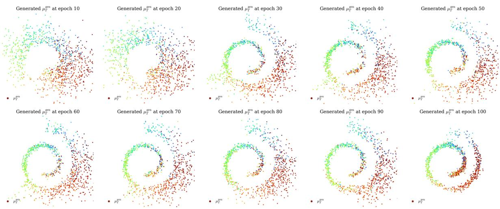  
Figure 27. Convergence of Law(XT) with training (Moon curves → Swiss).

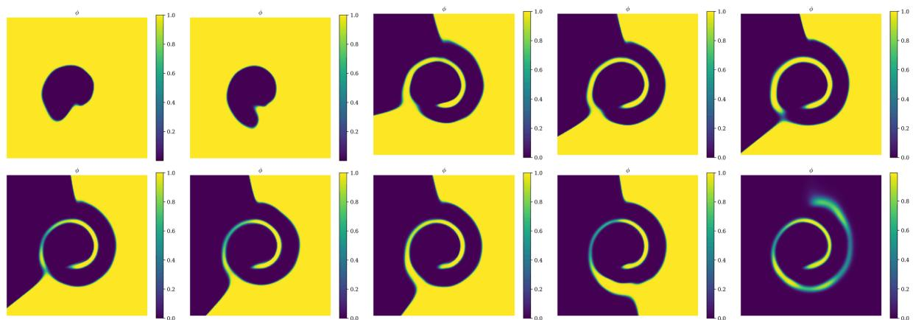  
Figure 28. Evolution of potential φ (Moon curves → Swiss).

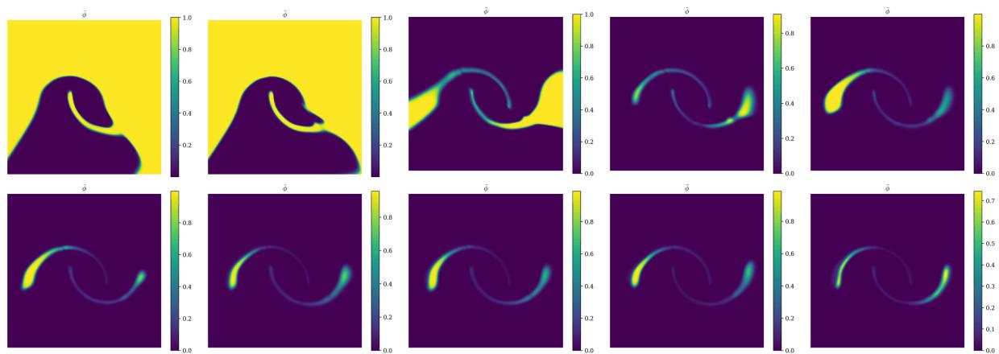  
Figure 29. Evolution of potential φ¯ (Moon curves → Swiss).

P.1. Evolution of the potentials during training.

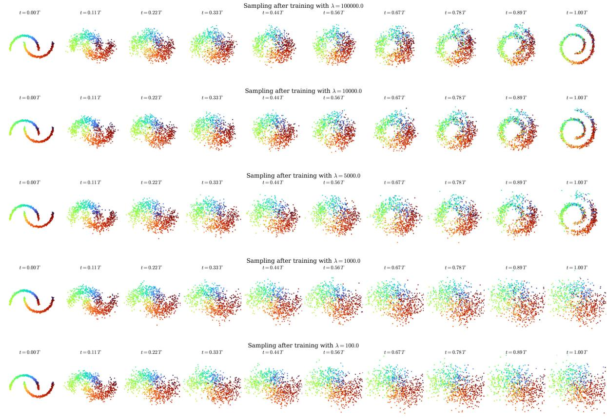  
Figure 30. Flow evolution for $\lambda \in \{ 1 0 ^ { 5 } , 1 0 ^ { 4 } , 5 \times 1 0 ^ { 3 } , 1 0 ^ { 3 } , 1 0 ^ { 2 } \}$  
P.2. Relaxation of the hard constraint and finite penalty λ.