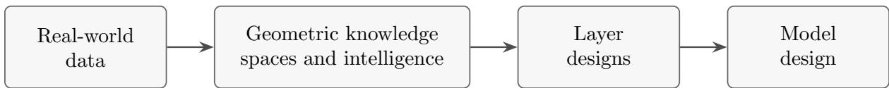

# GEOMETRIC KNOWLEDGE SPACES, ATTENTION PAIRING AND ARCHITECTURES

## SHANG XU

Abstract. In this paper, we propose a geometric approach to deriving attention mechanisms and exploring potential new transformer architectures. We begin by formalizing the notions of knowledge worlds and attention pairings, then demonstrate how this framework naturally leads to the architectures of standard attention, causal attention, linear attention, tensor attention, and recurrent neural networks. Finally, we introduce several new geometric spaces that may inspire novel neural network architectures.

## Contents

1. Introduction 1   
2. Formalization of Characters, Knowledge and Intelligence and Attention 2   
2.1. An intuitive abstraction of the axioms 3   
2.2. A categorical formalization 4   
2.3. Examples 5   
3. From the formalization to architectures 5   
3.1. Bilinear pairing and attention 5   
3.2. Matrix trace pairing and linear attention 7   
3.3. Tensor-valued knowledge and natural attention pairings 8   
3.4. Fixed-dimensional knowledge worlds and recurrent neural networks 9   
4. Geometric spaces that lead to new designs 12   
4.1. Further geometric knowledge worlds 12   
References 14

## 1. Introduction

Neural network architectures embody choices about how information is represented, accumulated, and evaluated. Recurrent neural networks process sequential inputs by repeatedly updating a hidden state, allowing information from earlier inputs to influence later computations [SMH11]. Attention mechanisms instead provide a way to retrieve and combine information according to its relevance to a query [BCB15, VSP+17]. These mechanisms are usually presented through explicit computational formulas, involving matrix multiplication, nonlinear activation, normalization, and aggregation. Such formulas specify how a model operates, but they also invite a structural question: what mathematical objects and operations underlie these computations, and how might alternative choices lead to diferent architectures?

The use of geometry to understand and design neural networks has an established foundation. Geometric deep learning emphasizes how the structure and symmetries of a learning problem can guide the construction of architectures, bringing together methods for grids, groups, graphs, and manifolds within a common perspective [BBCV21]. The study of permutation-invariant learning provides a particularly concrete example: the requirement that a function be insensitive to input order leads to structured architectures for processing sets [ZKR+17]. These developments illustrate the value of treating mathematical structure as a source of architectural constraints and design principles. Complementing this perspective, we focus on the relationship between the space in which information is stored, the operations by which it is accumulated, and the pairings through which it is evaluated.

In this paper, we introduce a geometric framework organized around the notions of a knowledge world and an intelligence. A character space A represents elementary units of encoded information, while a sequence of spaces $( A _ { n } ) _ { n \geq 0 }$ describes the possible knowledge states after successive inputs. Update maps specify how a new character is incorporated into an existing state. An intelligence assigns to each state a function that evaluates characters in a stage-dependent evaluation space $V _ { n }$ . In a concrete setting, these

structures are expressed by maps

$$
\mu _ { n } : A \times A _ { n } \to A _ { n + 1 } , \qquad B _ { n } : A _ { n } \times A \to V _ { n } ,
$$

The spaces $V _ { n }$ may have several coordinates, corresponding to diferent evaluation criteria, and their dimensions may vary with the stage. We call $B _ { n }$ an attention pairing, using the term “pairing” for a structured two-input evaluation map without requiring it to be bilinear.

An important feature of the framework is the distinction between evaluating information and using that evaluation in a computation. A pairing may produce compatibility scores, a proposed memory increment, or a candidate hidden representation. Additional operations determine how these evaluations afect the model: they may be normalized, used to rescale and aggregate stored information, or incorporated into a subsequent knowledge state. For example, scaled dot-product attention combines a query–key pairing with softmax normalization and weighted aggregation of values $[ \mathrm { V S P ^ { + } 1 7 } ]$ . In our formulation, these are separate choices rather than inseparable parts of the definition of intelligence. Likewise, learned encoders may determine how input data enter the character space, while the pairing on that space can be fixed by its geometric structure. This separation makes it possible to vary the representation, evaluation, and update mechanisms independently, subject to their compatibility.

We illustrate the framework by realizing the central computations of several established architectures. Sequence-valued knowledge states equipped with inner-product pairings recover dot-product attention. Restricting evaluation and normalization to prefix states gives causal attention without changing the underlying pairing. Additive accumulation of rank-one contributions yields a knowledge world whose normalized readout recovers positive-feature linear attention, consistent with its recurrent formulation [KVPF20]. Low-rank tensor-valued characters, together with contractions that retain the separate attention heads, provide a geometric realization of Tensor Product Attention $[ \mathrm { Z L Y ^ { + } 2 5 } ]$ . Finally, state spaces that stabilize in dimension support recurrent architectures: bilinear evaluations can generate accumulated interaction memories, while nonlinear evaluations can recover the afine-plus-activation recurrence of a vanilla RNN [SMH11]. These examples concern the core computational mechanisms; their incorporation into complete models requires further choices of parametrization, layer composition, and output maps.

The framework also makes several structural distinctions explicit. We call a knowledge world abelian when incorporating two characters in either order gives the same state. Starting from a fixed initial state, this condition makes the final accumulated knowledge insensitive to permutations of the input characters. We separately consider a placeholder-free condition, which requires insertion of a distinguished null character to commute with other updates. This condition does not, by itself, require null insertion to act as the identity. Causality is diferent from both properties: it concerns which information is available when an output is computed. An abelian accumulation rule can therefore support causal computations when each output is evaluated on the corresponding prefix. Distinguishing properties of storage, evaluation, and information availability helps clarify which architectural choices are responsible for particular computational behaviors. More generally, topology, diferential geometry, and algebraic geometry ofer spaces and operations that can be investigated within this framework. The aim is not merely to translate existing architectures into geometric terminology, but to make geometric constructions available as inputs to the design process.

This perspective separates mathematical specification from computational and empirical validation. A geometric system satisfying the proposed axioms does not automatically determine a unique architecture, nor does it guarantee eficient implementation or efective learning. Parametrization, numerical stability, computational cost, and the interaction between layers remain essential design questions. Nevertheless, making the underlying structures explicit provides a way to formulate these questions and to compare candidate designs. We begin with an accessible description of the framework and its categorical formalization, then examine attention and recurrent architectures as examples, and finally explore geometric constructions that may lead to new computational attention layers.

Acknowledgments. Thanks Ziang Li and Pengcheng Wang for very useful discussions.

AI disclosures. In this first version of paper, ChatGPT is used for literature searches, computation check and language polishing. The ideas and mathematical interference are original and the author takes full responsibility for its correctness.

## 2. Formalization of Characters, Knowledge and Intelligence and Attention

In this section we explain our abstraction of learning theory to both computer scientists and mathematicians. Subsection 2.1 is for computer scientists to quickly understand our setting, and 2.2 is a categorical formalism for mathematicians.

2.1. An intuitive abstraction of the axioms. We begin by introducing a mathematical framework for describing how information is accumulated, processed, and evaluated. The basic objects are characters, knowledge states, processes, and intelligence. We first explain these notions in the language of Euclidean spaces, so that the framework can be understood without any background in abstract mathematics.

Let $A \subseteq \mathbb { R } ^ { d }$ be a space of characters, together with a distinguished element $0 \in A$ , called the null character. A character represents an elementary piece of information. For example, in a language model, a character may represent a token embedding; in computer vision, it may represent a feature vector extracted from an image patch. Thus, the word “character” should be understood as a general unit of information, rather than necessarily a letter or symbol.

For each nonnegative integer n, let $A _ { n } \subseteq \mathbb { R } ^ { d _ { n } }$ be a space of knowledge states. Intuitively, $A _ { n }$ represents all possible internal states of a system after receiving n characters. These spaces need not be Euclidean spaces themselves: they may be submanifolds or other geometric subsets of $\mathbb { R } ^ { d _ { n } }$ . Moreover, the dimensions $d _ { n }$ are allowed to vary with n. Of course, we would like to let $A _ { 1 } = A$ so that the first stage of knowledge is just our character space. Now, to connect those stages, there should be a family of maps

$$
\mu _ { n } : A \times A _ { n } \to A _ { n + 1 } ,
$$

which describe how knowledge is updated upon receiving a new character. More precisely, given a current knowledge state $x \in A _ { n }$ and a character $t \in A$ , the new state is

$$
x ^ { \prime } = \mu _ { n } ( t , x ) \in A _ { n + 1 } .
$$

Starting from an initial state $x _ { 0 } \in A _ { 0 }$ , a sequence of characters $t _ { 1 } , \ldots , t _ { N }$ therefore generates a sequence of knowledge states recursively:

$$
x _ { n + 1 } = \mu _ { n } ( t _ { n + 1 } , x _ { n } ) .
$$

This is a formalization of how information unit establish the knowledge.

We are particularly interested in two properties of these updates. First, we call the system placeholderfree if

$$
\mu _ { n + 1 } ( 0 , \mu _ { n } ( t , x ) ) = \mu _ { n + 1 } ( t , \mu _ { n } ( 0 , x ) )
$$

for every $x \in A _ { n }$ and $t \in A$ . In other words, inserting a null character before or after another character leads to the same knowledge state. Notice that this condition does not require the null character to have no efect; it only requires its update to commute with other character updates.

Second, we call the system abelian if

$$
\mu _ { n + 1 } ( s , \mu _ { n } ( t , x ) ) = \mu _ { n + 1 } ( t , \mu _ { n } ( s , x ) )
$$

for every $x \in A _ { n }$ and $s , t \in A$ . This means that the order in which two characters are incorporated does not afect the resulting knowledge state. Consequently, the final state obtained from a fixed initial state depends only on the multiset of input characters, rather than their order. A simple example is obtained by taking $A = A _ { n } = \mathbb { R } ^ { d \times d }$ for all $n ,$ with

$$
\mu _ { n } ( t , x ) = x + t .
$$

Since matrix addition is commutative, this system is abelian. More generally, the maps $\mu _ { n }$ may involve nonlinear transformations or geometric constraints, and need not satisfy the abelian property. Abelian systems are natural candidates for tasks involving unordered information, such as learning from sets of feature vectors.

Having established the knowledge space, we now introduce two additional structures.

(1) A process is a sequence of maps

$$
p _ { n } : A _ { n } \to A .
$$

This can be understood as given a sentence with n characters, we can determine the next in a machinery manner. Composing with the updating map, we get the generating map $P _ { n }$ :

$$
P _ { n } : A _ { n } \xrightarrow { p _ { n } \times i d } A \times A _ { n } \xrightarrow { \mu _ { n } } A _ { n + 1 }
$$

One may think of this as intelligence because it automatically feedback once you have some input. However, an intelligence should be able to $\mathrm { \Delta } \overrightarrow { \mathrm { s e e } } ^ { \mathrm { \Delta } }$ all possible results and ’determine’ which to choose. This is formalized as following.

(2) For each $n ,$ we obtain an evaluation space $V _ { n }$ , which one can consider as a multi-dimensional evaluation criteria at the stage $n ,$ and we may initially take to be $\mathbb { R } ^ { k _ { n } }$ , where $k _ { n }$ is the number of factors we want to consider. Let Fun ${ } _ { n } ( A )$ denote the space of functions from A to V. An intelligence is a sequence of maps

$$
w _ { n } : A _ { n } \to \operatorname { F u n } _ { n } ( A ) .
$$

Thus, each knowledge state $x \in A _ { n }$ determines an evaluation function

$$
w _ { n } ( x ) : A \to V _ { n } .
$$

Mathematically, one usually has an adjunction to the functor $[ A , - ]$ , namely $A \otimes -$ , where ⊗ could be another operation between spaces that behaves like the tensor product of vector spaces. The key is we want

$$
\operatorname { M a p } ( A _ { n } , \operatorname { F u n } _ { n } ( A ) ) = \operatorname { M a p } ( A _ { n } , \operatorname { M a p } ( A , V _ { n } ) ) = \operatorname { M a p } ( A _ { n } \otimes A , V _ { n } )
$$

To understand this intuitively, if we denote $B _ { n } ( x , t ) = w _ { n } ( x ) ( t )$ for $x \in A _ { n }$ and $t \in A ,$ we see that a map from $A _ { n }$ to $\operatorname { F u n } _ { n } ( A )$ gives a function (a map to $V _ { n } )$ on $A _ { n } \times A .$ If spaces and maps are linear, this reduces to a map from $A _ { n } \otimes A$ to $V _ { n }$ . Diferent choices of structured maps (such as continuous, diferentiable, or polynomial) could lead to diferent constructions of the Map space/tensor constructions, so we need to formalize this here. mathematically, we call a function on $A _ { n } \times A$ a pairing on $A _ { n }$ and A. For this specific structure, we call $w _ { n }$ the attention pairing at the stage $n ,$ due to its close relationship with the attention mechanism which we will explain in the following sections.

2.2. A categorical formalization. This subsection is for mathematics For mathematicians, the following categorical formulation may be preferable, as it allows the spaces above to be replaced by more general geometric or algebraic objects.

Fix a locally small category of spaces C with a terminal object T, and suppose that binary products exist in C. A space of characters is a pointed object $( A , 0 )$ , where $A \in { \mathcal { C } }$ and $0 : T  A$ is a distinguished morphism called the null character. A knowledge world with respect to A is an N-indexed sequence of objects $( A _ { n } ) _ { n \in \mathbb { N } }$ with $A _ { 1 } = A$ equipped with morphisms

$$
\mu _ { n } : A \times A _ { n } \to A _ { n + 1 } .
$$

For any character $t : T  A$ , we denote by $\mu _ { n } ^ { t } : A _ { n } \to A _ { n + 1 }$ the morphism induced by t, defined as the composition

$$
\mu _ { n } ^ { t } : A _ { n } \cong T \times A _ { n } { \xrightarrow { t \times { \mathrm { i d } } _ { A _ { n } } } } A \times A _ { n } { \xrightarrow { \mu _ { n } } } A _ { n + 1 } .
$$

A knowledge world is said to be placeholder-free if

$$
\mu _ { n + 1 } ^ { 0 } \circ \mu _ { n } ^ { t } = \mu _ { n + 1 } ^ { t } \circ \mu _ { n } ^ { 0 }
$$

for every character $t : T  A$ and every $n \in \mathbb { N } .$ Similarly, it is called abelian if

$$
\mu _ { n + 1 } ^ { s } \circ \mu _ { n } ^ { t } = \mu _ { n + 1 } ^ { t } \circ \mu _ { n } ^ { s }
$$

for all characters $s , t : T \to A$ and every $n \in \mathbb { N } .$ . In particular, every abelian knowledge world is placeholder-free.

Having established the notion of a knowledge world, we now define processes and intelligence on this structure. A process is an N-indexed sequence of morphisms $( p _ { n } ) _ { n \in \mathbb { N } }$ , where

$$
p _ { n } : A _ { n } \to A _ { n + 1 } .
$$

Next, fix an evaluation object $V \in { \mathcal { C } }$ . We wish to define the object of functions on A, denoted by $\operatorname { F u n } _ { n } ( A )$ , such that the the morphism from objects in C to $\operatorname { F u n } _ { n } ( A )$ makes sense. If objects in C are sets, we may simply take $\operatorname { F u n } _ { n } ( A ) = \operatorname { H o m } _ { \mathit { c } } ( A , V )$ . More generally, we suppose that C admits an internal mapping object $[ A , V ]$ , characterized by natural bijections

$$
\mathrm { H o m } _ { \mathcal { C } } ( X , [ A , V ] ) \cong \mathrm { H o m } _ { \mathcal { C } } ( X \times A , V )
$$

for every $X \in { \mathcal { C } }$ . In this case, we define

$$
\operatorname { F u n } _ { n } ( A ) : = [ A , V ] .
$$

Under either assumption, an intelligence on the knowledge world is an N-indexed sequence of morphisms

$$
w _ { n } : A _ { n } \to \operatorname { F u n } _ { n } ( A ) .
$$

Equivalently, by the defining property of the internal mapping object, each $w _ { n }$ corresponds to an evaluation morphism

$$
{ \widetilde { w } } _ { n } : A _ { n } \times A \to V .
$$

This latter formulation remains meaningful even when the internal mapping object does not exist, and may therefore be used as a more general definition of intelligence.

Thus, a knowledge world, together with a process and an intelligence, provides a categorical description of information accumulation, state evolution, and evaluation, without imposing any particular geometric structure on the underlying objects.

2.3. Examples. In this section, we provide some examples of filtered geometric spaces satisfying our axioms, and we will talk about the concrete industry design derived by these structures in the next section.

Example 2.1. vector space and bilinear form Let $A = \mathbb { R } ^ { d }$ be the character space, and take

$$
A _ { n } = A ^ { \oplus n } = \mathbb { R } ^ { d \times n } .
$$

A knowledge state $X = ( v _ { 1 } , \ldots , v _ { n } ) \in A _ { n }$ records a sequence of n characters, each already encoded as a vector in $\mathbb { R } ^ { \bar { d } }$ . We regard these vectors as the columns of X. The knowledge-update map appends a new character:

$$
\mu _ { n } : A \times A _ { n } \to A _ { n + 1 } , \qquad \mu _ { n } ( v _ { 1 } , \dots , v _ { n } ) ) = ( v _ { 1 } , \dots , v _ { n } , v ) .
$$

Take $V _ { n } = \mathbb { R } ^ { n }$ . The inner product defines a linear intelligence

$$
w _ { n } : A _ { n } \to \operatorname { H o m } _ { \mathbb { R } } ( A , V _ { n } ) , \qquad w _ { n } ( v _ { 1 } , \dots , v _ { n } ) = \bigl ( \langle v _ { 1 } , - \rangle , \dots , \langle v _ { n } , - \rangle \bigr ) .
$$

This leads to the usual attention and casual attention, we will explain in 3.1 and 3.1.1.

Example 2.2. Let $A = A _ { 1 } = V$ and $A _ { n } = V \oplus U$ for some real vector space $V , U$ . Choose an initial state $h _ { 0 }$ , the update is

$$
\mu _ { 0 } ( a , \ast ) = a , \quad \mu _ { 1 } ( a , s ) = \big ( a , F _ { \theta } ( F _ { \theta } ( h _ { 0 } , s ) , a ) \big ) , \quad \mu _ { n } ( a , ( s , h ) ) = \big ( a , F _ { \theta } ( h , a ) \big ) , \ n \geq 2
$$

Take $V _ { n } = U$ , an intelligence is defined by

$$
w _ { 0 } ( \ast ) ( a ) = F _ { \theta } ( h _ { 0 } , a ) , \quad w _ { 1 } ( s ) ( a ) = F _ { \theta } ( F _ { \theta } ( h _ { 0 } , s ) , a ) , \quad w _ { n } ( s , h ) ( a ) = F _ { \theta } ( h , a ) , \ n \geq 2
$$

This would lead to RNN as we will explain in 3.4.

Example 2.3. Fix an ambient matrix space ${ \mathfrak { g l } } ( N , \mathbb { R } ) = \mathbb { R } ^ { N \times N }$ , let

$$
A _ { n } = \left\{ M \in \mathfrak { g l } ( N , \mathbb { R } ) | \mathrm { r a n k } M \leq n \right\}
$$

We have an update

$$
\mu : A _ { n } \times A _ { 1 } \to A _ { n + 1 } , \quad \mu ( M , N ) = M + N
$$

An intelligence is induced by the attention pairing

$$
\langle M , N \rangle = \mathrm { T r } ( M N ^ { T } )
$$

This leads to linear attention as explained in 3.2

There are also other interesting examples, for example, the tensor space in 3.3 that leads to tensor attention, the projective spaces, Grassmannians, Lie algebra orbits.

## 3. From the formalization to architectures

In this section, we specify how the geometric constructions of the knowledge world and intelligence in last section’s examples lead to the actual architectures in industry. Our examples cover attention, casual attention, linear attention, tensor attention and vanilla/multiplicative RNN, showing the strong potential ability of our formalization in architectural designs.

3.1. Bilinear pairing and attention. Let $A = \mathbb { R } ^ { d }$ be the character space, and take

$$
A _ { n } = A ^ { \oplus n } = \mathbb { R } ^ { d \times n } .
$$

A knowledge state $X = ( v _ { 1 } , \ldots , v _ { n } ) \in A _ { n }$ records a sequence of n characters, each already encoded as a vector in $\mathbb { R } ^ { \bar { d } }$ . We regard these vectors as the columns of X. The knowledge-update map appends a new character:

$$
\mu _ { n } : A \times A _ { n } \to A _ { n + 1 } , \qquad \mu _ { n } ( v _ { 1 } , \dots , v _ { n } ) ) = ( v _ { 1 } , \dots , v _ { n } , v ) .
$$

3.1.1. Bilinear intelligence and attention. Take the evaluation space to be $V _ { n } = \mathbb { R } ^ { n }$ . The Euclidean inner product defines a linear intelligence

$$
w _ { n } : A _ { n } \to \operatorname { H o m } _ { \mathbb { R } } ( A , V _ { n } ) , \qquad w _ { n } ( v _ { 1 } , \dots , v _ { n } ) = \bigl ( \langle v _ { 1 } , - \rangle , \dots , \langle v _ { n } , - \rangle \bigr ) .
$$

Each coordinate evaluates the compatibility of a character with one of the stored tokens. Thus, the number of evaluation criteria grows with the amount of stored information.

The corresponding attention pairing is

$$
B _ { n } ( X , v ) = w _ { n } ( X ) ( v ) = \left( \langle v _ { 1 } , v \rangle , \ldots , \langle v _ { n } , v \rangle \right) = X ^ { \mathsf { T } } v .
$$

This map is linear in X and linear in $v ,$ and therefore corresponds to a linear map $A _ { n } \otimes _ { \mathbb { R } } A \to V _ { n }$ . The central evaluation structure is precisely this bilinear pairing: a knowledge state evaluates a character by comparing it with each character already stored.

We may now introduce a normalization on the evaluation space. For $n \geq 1$ , define

$$
{ \mathrm { S o f t M a x } } _ { n } : \mathbb { R } ^ { n } \to \mathbb { R } ^ { n } , \qquad ( z _ { 1 } , \dots , z _ { n } ) \longmapsto \left( { \frac { e ^ { z _ { 1 } } } { \sum _ { i = 1 } ^ { n } e ^ { z _ { i } } } } , \dots , { \frac { e ^ { z _ { n } } } { \sum _ { i = 1 } ^ { n } e ^ { z _ { i } } } } \right) .
$$

Its output has positive coordinates summing to one, so the normalized evaluations can be interpreted as weights assigned to the stored tokens.

Because softmax is nonlinear, postcomposition with it does not preserve the space of linear maps. We therefore regard Hom ${ \mathfrak { g } } \left( A , V _ { n } \right)$ as a subspace of the larger function space $\operatorname { F u n } _ { n } ( A ) : = C ( A , V _ { n } )$ . Softmax then induces a map

$$
S _ { n } : \operatorname { F u n } _ { n } ( A ) \to \operatorname { F u n } _ { n } ( A ) , \qquad \phi \longmapsto \operatorname { S o f t M a x } _ { n } \circ \phi .
$$

Applying this operation to the intelligence, together with a scaling factor $1 / { \sqrt { d } } ,$ gives

$$
{ \widehat { w } } _ { n } ( X ) ( v ) = { \mathrm { S o f t M a x } } _ { n } \left( { \frac { w _ { n } ( X ) ( v ) } { \sqrt d } } \right) = { \mathrm { S o f t M a x } } _ { n } \left( { \frac { X ^ { \mathsf { T } } v } { \sqrt d } } \right) .
$$

This normalization is an additional architectural choice, rather than a requirement of our framework. Exponentiation makes the weights positive, while division by their sum normalizes them. These operations introduce a nonlinear transformation of the evaluation scores. The underlying intelligence $w _ { n }$ is linear and its pairing $B _ { n }$ is bilinear, whereas the normalized evaluation $\widehat { w } _ { n }$ is no longer bilinear.

The coordinates of ${ \widehat { w } } _ { n } ( X ) ( v )$ are exactly the attention weights in the scaled dot-product attention mechanism described in $\mathrm { \lceil V S P ^ { + } 1 7 }$ , Section 3.2.1]: the character v is the query, and the stored vectors $v _ { 1 } , \ldots , v _ { n }$ are the keys. To obtain the full attention output, associate a value vector $u _ { j } \in \mathbb { R } ^ { r }$ with each key and form

$$
\mathrm { A t t n } ( v ; X , U ) = \sum _ { j = 1 } ^ { n } \bigl [ \widehat { w } _ { n } ( X ) ( v ) \bigr ] _ { j } u _ { j } = U \mathrm { S o f t M a x } _ { n } \left( \frac { X ^ { \mathsf { T } } v } { \sqrt { d } } \right) ,
$$

where $U = ( u _ { 1 } , \ldots , u _ { n } ) \in \mathbb { R } ^ { r \times n }$ . In the simplest case, the stored vectors also serve as values, so $U = X$

3.1.2. Alternative choice: Causal Attention. Let’s continue working on the knowledge world above and introduce causality, we require the output at position i to use only the prefix state $X _ { i } = ( v _ { 1 } , \ldots , v _ { i } )$ rather than the entire sequence $X _ { N }$ . The input vectors themselves are assumed not to contain information from future tokens. Evaluating the current character $v _ { i }$ and normalizing on $V _ { i }$ gives

$$
{ \widehat { w } } _ { i } ( X _ { i } ) ( v _ { i } ) = { \mathrm { S o f t M a x } } _ { i } \left( { \frac { B _ { i } ( X _ { i } , v _ { i } ) } { \sqrt d } } \right) .
$$

Explicitly, the weight assigned to position $j \le i$ is

$$
\alpha _ { i j } = \frac { \exp ( \langle v _ { j } , v _ { i } \rangle / \sqrt { d } ) } { \sum _ { \ell = 1 } ^ { i } \exp ( \langle v _ { \ell } , v _ { i } \rangle / \sqrt { d } ) } .
$$

The crucial point is that both the available scores and the normalizing denominator involve only the prefix. Softmax remains an additional nonlinear normalization of the bilinear evaluations; causality determines which evaluations may participate.

Associate a value vector $u _ { j } = W _ { V } v _ { j } \in \mathbb { R } ^ { m }$ with each stored token. The retrieved output is

$$
y _ { i } = \sum _ { j = 1 } ^ { i } \alpha _ { i j } u _ { j } .
$$

This is causal scaled dot-product self-attention, as used in the Transformer decoder of $[ \mathrm { V S P ^ { + } 1 7 } ,$ Sections 3.2.1 and 3.2.3], in the special case where the token vectors themselves serve as queries and keys.

The usual trainable version replaces $\langle v _ { j } , v _ { i } \rangle$ by $\langle W _ { K } v _ { j } , W _ { Q } v _ { i } \rangle$ and scales by the square root of the query–key dimension.

Causality is distinct from our commutativity axioms. The append-based world is neither abelian nor placeholder-free, since changing the order of appended characters changes the stored sequence. Nevertheless, its attention outputs are causal: appending future characters does not change the outputs already determined by a prefix.

Thus, causal attention retains the same bilinear intelligence as ordinary attention, but restricts each evaluation and its normalization to the knowledge available at that position.

Remark 3.1 (A query–key–value knowledge world). A more explicit formulation takes

$$
A = \mathbb { R } ^ { q } \oplus \mathbb { R } ^ { k } \oplus \mathbb { R } ^ { v } \cong \mathbb { R } ^ { q + k + v } , \qquad A _ { n } = A ^ { \oplus n } .
$$

Each character $a = ( Q , K , U )$ already consists of its query, key, and value components; these are coordinates of the character itself, not additional representations introduced by the intelligence. The knowledge-update maps remain concatenation.

For the Euclidean pairing, assume $q = k .$ . Given a state $X = ( a _ { 1 } , \ldots , a _ { n } ) $ , where $a _ { j } = ( Q _ { j } , K _ { j } , U _ { j } )$ define

$$
B _ { n } ( X , a ) = { \big ( } \langle K _ { 1 } , Q \rangle , \dots , \langle K _ { n } , Q \rangle { \big ) } .
$$

Applying softmax after scaling by $1 / \sqrt { k }$ gives weights for aggregating the stored value components $U _ { j }$

The single-vector presentation above is an intuitive specialization in which the query and key components coincide; the value component may also be identified with them. Keeping these components separate gives the query–key–value formulation used in the tensor-valued construction. Causal attention uses the same pairing, restricted to prefix states.

3.2. Matrix trace pairing and linear attention. We now consider a knowledge world in which information is accumulated by adding rank-one matrices, rather than by storing an entire sequence.

Fix positive integers r, m, and define the character space

$$
A = \{ 0 \} \cup \{ a ( u , v ) : = [ u \mid u v ^ { \mathsf { T } } ] : u \in \mathbb { R } _ { > 0 } ^ { r } , \ v \in \mathbb { R } ^ { m } \} \subseteq \mathbb { R } ^ { r \times ( m + 1 ) } .
$$

Here $\mathbb { R } _ { > 0 } ^ { r }$ denotes the vectors with strictly positive coordinates. A nonzero character encodes a positive feature vector u together with an information vector $v ,$ while the zero matrix is the null character. Each nonzero character has rank one.

For each $n \geq 0$ , define

$$
A _ { n } = \{ 0 \} \cup \left\{ H = \left[ z \mid M \right] \in \mathbb { R } ^ { r \times ( m + 1 ) } : z \in \mathbb { R } _ { > 0 } ^ { r } , { \mathrm { ~ r a n k } } H \leq n \right\} .
$$

Then

$$
A _ { 0 } = \{ 0 \} , \qquad A _ { 1 } = A , \qquad A _ { n } \subseteq A _ { n + 1 } .
$$

The rank bound expresses the fact that a state obtained from n characters is a sum of at most n rank-one contributions; its rank need not increase at every update.

Define the knowledge-update maps by addition:

$$
\mu _ { n } : A \times A _ { n } \to A _ { n + 1 } , \qquad \mu _ { n } ( a , H ) = H + a .
$$

These maps are well-defined because

$$
\operatorname { r a n k } ( H + a ) \leq \operatorname { r a n k } H + \operatorname { r a n k } a \leq n + 1 .
$$

More generally, $A _ { i } + A _ { j } \subseteq A _ { i + j }$ . Writing $H _ { n } = [ z _ { n } \mid M _ { n } ]$ , the update associated with $a ( u , v )$ is explicitly

$$
z _ { n + 1 } = z _ { n } + u , \qquad M _ { n + 1 } = M _ { n } + u v ^ { \mathsf { T } } .
$$

Starting from $H _ { 0 } = 0$ , the characters $a ( u _ { 1 } , v _ { 1 } ) , \dots , a ( u _ { n } , v _ { n } )$ therefore produce

$$
H _ { n } = [ z _ { n } \mid M _ { n } ] , \qquad z _ { n } = \sum _ { j = 1 } ^ { n } u _ { j } , \qquad M _ { n } = \sum _ { j = 1 } ^ { n } u _ { j } v _ { j } ^ { \top } .
$$

Thus, the history is compressed into a matrix of fixed size.

This knowledge world is abelian, since

$$
\mu _ { n + 1 } ^ { b } \big ( \mu _ { n } ^ { a } ( H ) \big ) = H + a + b = H + b + a = \mu _ { n + 1 } ^ { a } \big ( \mu _ { n } ^ { b } ( H ) \big ) .
$$

It is also placeholder-free. Indeed, $\mu _ { n } ^ { 0 }$ is precisely the inclusion $A _ { n } \hookrightarrow A _ { n + 1 } \colon { \mathrm { a } }$ null character leaves the stored matrix unchanged. Consequently, the final memory depends only on the collection of encoded characters, not on their order. This does not imply that the intermediate prefix states are independent of order.

To define intelligence, take $V _ { n } = \mathbb { R } ^ { 2 }$ . For a state $H = [ z \mid M ] \in A _ { n }$ and a character $b = [ q \vert N ] \in A$ we set the following pairing

$$
\begin{array} { r } { w _ { n } ( H ) ( b ) = B _ { n } ( H , b ) = \big ( \langle M , N \rangle _ { \mathrm { F } } , z ^ { \mathsf { T } } q \big ) , } \end{array}
$$

where

$$
\langle M , N \rangle _ { \mathrm { F } } = \mathrm { t r } ( M ^ { \mathsf { T } } N )
$$

is the Frobenius inner product. This defines an intelligence

$$
w _ { n } : A _ { n } \to \operatorname { F u n } _ { n } ( A ) , \qquad \operatorname { F u n } _ { n } ( A ) = C ( A , \mathbb { R } ^ { 2 } ) .
$$

The attention pairing $B _ { n }$ is the restriction of a bilinear map on the ambient matrix spaces. Its first coordinate evaluates compatibility, while its second records the quantity used for normalization.

As in the previous example, normalization is an additional operation on the evaluation space. Since $z ^ { \mathsf { T } } q \geq 0 .$ , we may fix $\varepsilon > 0$ and apply

$$
\nu _ { \varepsilon } : \mathbb { R } \times \mathbb { R } _ { \geq 0 } \to \mathbb { R } , \qquad ( s , c ) \longmapsto { \frac { s } { \varepsilon + c } } .
$$

This gives a scalar-valued normalized intelligence

$$
\widehat { w } _ { n } ( H ) ( b ) = \frac { \langle M , N \rangle _ { \mathrm { F } } } { \varepsilon + z ^ { \mathsf { T } } q } .
$$

The positive constant ε keeps this expression defined at the null state and null character. Since the formula is independent of the stage, inserting a null character also leaves all evaluations unchanged.

To interpret this intelligence, write a nonzero character as

$$
b = a ( q , v ) = [ q \mid q v ^ { \mathsf { T } } ] .
$$

Then

$$
\widehat { w } _ { n } ( H ) ( b ) = \frac { v ^ { \mathsf { T } } M ^ { \mathsf { T } } q } { \varepsilon + z ^ { \mathsf { T } } q } = \left. \frac { M ^ { \mathsf { T } } q } { \varepsilon + z ^ { \mathsf { T } } q } , v \right. .
$$

Thus, for each positive query vector $q ,$ the normalized intelligence is represented by the retrieved vector

$$
y _ { n } ( q ) = \frac { M _ { n } ^ { \mathsf { T } } q } { \varepsilon + z _ { n } ^ { \mathsf { T } } q } = \frac { \sum _ { j = 1 } ^ { n } ( q ^ { \mathsf { T } } u _ { j } ) v _ { j } } { \varepsilon + \sum _ { j = 1 } ^ { n } q ^ { \mathsf { T } } u _ { j } } .
$$

Its evaluation on $a ( q , v )$ is simply $\langle y _ { n } ( q ) , v \rangle$

This is the positive-feature linear attention construction of [KVPF20, Sections 3.2–3.4], with an added regularization constant ε. Here $q$ and $u _ { j }$ are the query and key features, and $v _ { j }$ are the values. For a nonzero memory and a positive query, setting $\varepsilon = 0$ in the readout gives positive attention weights summing to one. Unlike softmax attention, the similarities are $q ^ { \mathsf { T } } u _ { j }$ , rather than exponentials of dot products; the two mechanisms are not generally identical.

The computational advantage is that the sums $z _ { n }$ and $M _ { n }$ can be maintained incrementally and reused for every query. Each update and readout requires $O ( r m )$ operations, so N updates and N readouts require $O ( N r m )$ operations, with $O ( r m )$ storage for the running state. Thus, “linear” refers to the dependence on sequence length, not to linearity of the normalized output.

In our framework, this construction combines a rank-filtered knowledge world, abelian and placeholderfree updates, an ambient bilinear attention pairing, and a nonlinear normalization of its evaluations.

3.3. Tensor-valued knowledge and natural attention pairings. Fix a number of heads h and a feature dimension r, and consider the tensor space

$$
E = \mathbb { R } ^ { h } \otimes \mathbb { R } ^ { r } \cong \mathbb { R } ^ { h \times r } .
$$

For a positive integer $R ,$ let

$$
{ \mathcal { D } } _ { R } = \{ Z \in E : \operatorname { r a n k } Z \leq R \} .
$$

Thus, $\mathcal { D } _ { R }$ consists of tensors expressible as sums of at most R rank-one tensors.

Choose rank bounds $R _ { Q } , R _ { K } , R _ { U }$ , and define the character space by

$$
A = { \mathcal { D } } _ { R _ { Q } } \times { \mathcal { D } } _ { R _ { K } } \times { \mathcal { D } } _ { R _ { U } } .
$$

A character $a = ( Q , K , U )$ already contains its query, key, and value tensors. These tensors are part of the encoded character itself, rather than representations constructed by the intelligence. The null character is $( 0 , 0 , 0 )$

Take $A _ { n } = A ^ { n }$ , with $A _ { 0 }$ consisting of the empty sequence, and define the knowledge-update maps by appending:

$$
\mu _ { n } ( a , ( a _ { 1 } , \ldots , a _ { n } ) ) = ( a _ { 1 } , \ldots , a _ { n } , a ) .
$$

Since the rank-constrained character space need not be a vector space, $A ^ { n }$ here denotes a Cartesian product.

The tensor space carries a natural headwise pairing by

$$
\kappa ( \alpha \otimes \beta , \gamma \otimes \delta ) = ( \alpha \odot \gamma ) \langle \beta , \delta \rangle ,
$$

where ⊙ denotes coordinatewise multiplication. Bilinearity then determines the pairing on arbitrary tensors. In coordinates, this map is:

$$
\kappa : E \times E \to \mathbb { R } ^ { h } , \qquad [ \kappa ( Q , K ) ] _ { \ell } = \sum _ { b = 1 } ^ { r } Q _ { \ell b } K _ { \ell b } .
$$

Now, take the evaluation space to be

$$
V _ { n } = ( \mathbb { R } ^ { h } ) ^ { n } \cong \mathbb { R } ^ { h \times n } .
$$

For a knowledge state $X = ( a _ { 1 } , \ldots , a _ { n } ) $ , with $a _ { j } = ( Q _ { j } , K _ { j } )$ , and a character $a = ( Q , K , U )$ , define

$$
w _ { n } ( X ) ( a ) = B _ { n } ( X , a ) = { \bigl ( } \kappa ( Q , K _ { 1 } ) , \ldots , \kappa ( Q , K _ { n } ) { \bigr ) } .
$$

This gives an intelligence

$$
w _ { n } : A _ { n } \to \operatorname { F u n } _ { n } ( A ) , \qquad \operatorname { F u n } _ { n } ( A ) = C ( A , V _ { n } ) .
$$

Each evaluation coordinate records the compatibility between the query of a and the key of a stored character, within a particular head.

The pairing is the restriction of a bilinear map on the ambient tensor spaces. No additional trainable feature maps are required to define it: the tensor structure is already present in the character space.

As before, introduce a nonlinear normalization on the evaluation space:

$$
{ \widehat w } _ { n } ( X ) ( a ) = \operatorname { S o f t M a x } _ { \mathrm { r o w } } \left( { \frac { B _ { n } ( X , a ) } { \sqrt { r } } } \right) .
$$

Softmax acts separately on the n evaluation coordinates of each head. Writing $P = { \widehat { w } } _ { n } ( X ) ( a )$ , the retrieved tensor $Y ( X , a ) \in E$ is defined by

$$
Y ( X , a ) _ { \ell b } = \sum _ { j = 1 } ^ { n } P _ { \ell j } ( U _ { j } ) _ { \ell b } .
$$

Thus, each head combines the corresponding rows of the stored value tensors according to its normalized evaluations.

This realizes the attention computation of Tensor Product Attention $[ \mathrm { Z L Y ^ { + } 2 5 }$ , Section 3.1] directly on tensor-valued characters, before the final output projection. The low-rank constraints describe the geometry of the character space, while κ provides the evaluation pairing.

In the usual parametrized implementation, learned factor maps construct the tensors from input hidden vectors. In our formulation, these maps instead specify an encoder

$$
e _ { \theta } : \mathbb { R } ^ { d }  A .
$$

The resulting scores are obtained by evaluating

$$
B _ { n } \big ( ( e _ { \theta } ( x _ { 1 } ) , \dots , e _ { \theta } ( x _ { n } ) ) , e _ { \theta } ( x ) \big ) .
$$

Choosing the encoder to be the usual tensor-factor construction recovers the corresponding scores and head outputs. The factors may also be retained as a compact representation for computing the contraction, without materializing the full tensors.

Consequently, the learned encoding and the intelligence are conceptually separate: learning determines how information is represented in the tensor-valued character space, while intelligence evaluates those representations through a fixed pairing. Normalization and value aggregation then turn these evaluations into an attention readout.

3.4. Fixed-dimensional knowledge worlds and recurrent neural networks. Let $V = \mathbb { R } ^ { d }$ and $U = \mathbb { R } ^ { m }$ . Take the character space to be $A = V$ , with null character 0, and consider the state spaces

$$
A _ { 0 } = \{ * \} , \qquad A _ { 1 } = V , \qquad A _ { n } = V \oplus U \quad ( n \geq 2 ) .
$$

Unlike the sequence spaces $V ^ { \oplus n }$ , these spaces have a fixed dimension after the second stage. New information must therefore be incorporated into an existing representation, rather than stored by introducing new coordinates.

The state spaces alone do not determine a recurrent architecture. Diferent choices of intelligence and knowledge-update maps lead to diferent ways of processing information. We illustrate this with two constructions: a bilinear accumulation model and a vanilla recurrent neural network.

In both constructions, take the evaluation spaces to be $V _ { n } = U$ and write

$$
w _ { n } : A _ { n } \to \operatorname { F u n } _ { n } ( A ) , \qquad \operatorname { F u n } _ { n } ( A ) = C ( A , U ) .
$$

Thus, an intelligence evaluates a candidate character by producing a vector in the memory space $U .$ The knowledge updates below are explicitly constructed using these evaluations. This is a choice of architecture, rather than an additional requirement in the definition of intelligence.

3.4.1. A bilinear recurrent architecture. Choose a trainable bilinear map

$$
\Gamma _ { \theta } : V \times V \to U .
$$

For $n \geq 2$ , interpret a state $( s , c ) \in V \oplus U$ as consisting of accumulated character information s and an interaction memory c. Define the intelligence by

$$
\begin{array} { r l } & { w _ { 0 } ( \ast ) ( a ) = 0 , } \\ & { w _ { 1 } ( s ) ( a ) = \Gamma _ { \theta } ( s , a ) , } \\ & { w _ { n } ( s , c ) ( a ) = \Gamma _ { \theta } ( s , a ) , \qquad n \geq 2 . } \end{array}
$$

The corresponding attention pairing, for $n \geq 2 ,$ is

$$
B _ { n } ( ( s , c ) , a ) = \Gamma _ { \theta } ( s , a ) .
$$

It is bilinear in the knowledge state and the character. Its value represents the interaction between the accumulated character information and the new input, rather than the complete next memory state.

Define the knowledge-update maps by

$$
\mu _ { 0 } ( a , \ast ) = a , \qquad \mu _ { 1 } ( a , s ) = ( s + a , \Gamma _ { \theta } ( s , a ) ) ,
$$

and, for $n \geq 2 ,$ by

$$
\begin{array} { r } { \mu _ { n } ( a , ( s , c ) ) = ( s + a , c + \Gamma _ { \theta } ( s , a ) ) . } \end{array}
$$

Equivalently, the intelligence determines the increment to the interaction memory:

$$
\mu _ { n } ( a , ( s , c ) ) = { \big ( } s + a , c + w _ { n } ( s , c ) ( a ) { \big ) } .
$$

After identifying $A _ { 1 }$ with $V \oplus \{ 0 \} \subseteq H$ , the evolution is described by the recurrence

$$
s _ { n + 1 } = s _ { n } + a _ { n + 1 } , \qquad e _ { n + 1 } = c _ { n } + \Gamma _ { \theta } \bigl ( s _ { n } , a _ { n + 1 } \bigr ) ,
$$

with $s _ { 0 } = 0$ and $c _ { 0 } = 0$ . Bilinearity gives the explicit formulas

$$
s _ { n } = \sum _ { j = 1 } ^ { n } a _ { j } , \qquad c _ { n } = \sum _ { 1 \leq j < k \leq n } \Gamma _ { \theta } { \left( a _ { j } , a _ { k } \right) } .
$$

Thus, the first component stores a first-order summary of the inputs, while the second stores a summary of ordered pairwise interactions. The earlier character appears in the first argument of $\Gamma _ { \theta ; \mathbf { \lambda } }$ , and the later character in the second.

A concrete parametrization is

$$
\Gamma _ { \theta } ( s , a ) = ( L _ { \theta } s ) \odot ( R _ { \theta } a ) ,
$$

where $L _ { \theta } , R _ { \theta } \in \mathbb { R } ^ { m \times d }$ are trainable matrices and ⊙ denotes coordinatewise multiplication. The recurrence becomes

$$
s _ { n + 1 } = s _ { n } + a _ { n + 1 } , \qquad c _ { n + 1 } = c _ { n } + ( L _ { \theta } s _ { n } ) \odot ( R _ { \theta } a _ { n + 1 } ) .
$$

This is a recurrent architecture with multiplicative interactions and parameters shared across stages. It is related in this respect to multiplicative recurrent networks [SMH11, Section 3], although the particular accumulation rule above is not the architecture defined in that paper. We refer to it here as a bilinear accumulation RNN. One can also add nonlinearity and normalization here so that the structure is potential more generalizable in practice, but here we emphasize on the structure correspondence with our formalization.

The axioms of the knowledge world can be checked directly. Since $\Gamma _ { \theta } ( s , 0 ) = 0$ , the null-character updates satisfy

$$
\mu _ { 1 } ^ { 0 } ( s ) = ( s , 0 ) , \qquad \mu _ { n } ^ { 0 } ( s , c ) = ( s , c ) \quad ( n \geq 2 ) .
$$

Together with $\mu _ { 0 } ^ { 0 } ( * ) = 0 \qquad $ , these are the natural inclusions between successive state spaces. Consequently, inserting a null character leaves the encoded information unchanged, and the world is placeholder-free.

To examine the abelian condition, let

$$
\Phi _ { a } ( s , c ) = { \bigl ( } s + a , c + \Gamma _ { \theta } ( s , a ) { \bigr ) }
$$

denote the update on H. Then

$$
\Phi _ { b } ( \Phi _ { a } ( s , c ) ) - \Phi _ { a } ( \Phi _ { b } ( s , c ) ) = \bigl ( 0 , \Gamma _ { \theta } ( a , b ) - \Gamma _ { \theta } ( b , a ) \bigr ) .
$$

The same calculation applies at the initial stages under the inclusions above. Hence this knowledge world is abelian if and only ${ \mathrm { i f ~ } } \Gamma _ { \theta }$ is symmetric. A nonsymmetric pairing can therefore preserve information about input order, while still satisfying the placeholder-free condition. It does not, however, retain the entire sequence: the state records only the displayed first-order and second-order summaries.

3.4.2. A nonlinear architecture: the vanilla RNN. We now use the same state spaces with a diferent interpretation and update rule. For $n \geq 2 .$ , a state $( s , h ) \in V \oplus U$ stores the most recent character s and a hidden representation h of the preceding computation.

Fix an initial hidden state $h _ { 0 } \in U$ , trainable matrices

$$
W _ { \mathrm { i n } } \in \mathbb { R } ^ { m \times d } , \qquad W _ { \mathrm { r e c } } \in \mathbb { R } ^ { m \times m } ,
$$

and a bias $b \in U$ . Choose a continuous activation $\sigma ,$ such as tanh, applied coordinatewise. Define

$$
F _ { \theta } : U \times V  U , \qquad F _ { \theta } ( h , a ) = \sigma ( W _ { \mathrm { r e c } } h + W _ { \mathrm { i n } } a + b ) .
$$

In this construction, intelligence evaluates the complete next hidden representation, rather than an increment to the existing memory. Set

$$
\begin{array} { r l r } & { } & { w _ { 0 } ( \ast ) ( a ) = F _ { \theta } ( h _ { 0 } , a ) , ~ } \\ & { } & { w _ { 1 } ( s ) ( a ) = F _ { \theta } ( F _ { \theta } ( h _ { 0 } , s ) , a ) , ~ } \\ & { } & { w _ { n } ( s , h ) ( a ) = F _ { \theta } ( h , a ) , ~ n \geq 2 . ~ } \end{array}
$$

The formula for $w _ { 1 }$ accounts for the special state space $A _ { 1 } = V \colon$ after the first character s, the hidden representation is determined by s as $F _ { \theta } ( h _ { 0 } , s )$ and need not be independently stored.

For $n \geq 2$ , the associated attention pairing is

$$
B _ { n } ( ( s , h ) , a ) = \sigma ( W _ { \mathrm { r e c } } h + W _ { \mathrm { i n } } a + b ) .
$$

This pairing is generally nonlinear. Here, as in our general definition, “pairing” means a structured two-input evaluation map and does not imply bilinearity.

Define the knowledge updates by

$$
\mu _ { 0 } ( a , \ast ) = a , \qquad \mu _ { n } ( a , x ) = \bigl ( a , w _ { n } ( x ) ( a ) \bigr ) \quad ( n \geq 1 ) .
$$

In particular, for $n \geq 2$

$$
\mu _ { n } ( a , ( s , h ) ) = \bigl ( a , \sigma ( W _ { \mathrm { r e c } } h + W _ { \mathrm { i n } } a + b ) \bigr ) .
$$

The first component is replaced by the new character, and the second is replaced by the hidden representation evaluated by the intelligence.

Given characters $a _ { 1 } , \dots , a _ { N }$ , define

$$
h _ { n } = F _ { \theta } ( h _ { n - 1 } , a _ { n } ) = \sigma ( W _ { \mathrm { r e c } } h _ { n - 1 } + W _ { \mathrm { i n } } a _ { n } + b ) .
$$

The corresponding knowledge states are

$$
x _ { 1 } = a _ { 1 } , \qquad x _ { n } = ( a _ { n } , h _ { n } ) \quad ( n \geq 2 ) .
$$

This is precisely the hidden-state recurrence of a vanilla recurrent neural network; see [SMH11, Section 2]. The parameters are shared across all stages. The additional $V$ component retains the most recent character, while the usual recurrent memory is carried by U.

Unlike the bilinear accumulation model, this knowledge world is not placeholder-free when $V \neq \{ 0 \}$ Indeed, for $n \geq 2$

$$
\begin{array} { r } { \mu _ { n + 1 } ^ { 0 } \big ( \mu _ { n } ^ { a } ( s , h ) \big ) = \big ( 0 , F _ { \theta } \big ( F _ { \theta } ( h , a ) , 0 \big ) \big ) , } \\ { \mu _ { n + 1 } ^ { a } \big ( \mu _ { n } ^ { 0 } ( s , h ) \big ) = \big ( a , F _ { \theta } \big ( F _ { \theta } ( h , 0 ) , a \big ) \big ) . } \end{array}
$$

For $a \neq 0$ , these states already difer in their first components. Hence this realization is also nonabelian. Moreover, even when considering only the hidden component, a zero input is not generally an inactive step, since

$$
F _ { \theta } ( h , 0 ) = \sigma ( W _ { \mathrm { r e c } } h + b )
$$

need not equal h. Ignoring padding would therefore require an additional masking rule, rather than merely encoding padding by the zero vector.

## 4. Geometric spaces that lead to new designs

As we discussed above, the knowledge world and intelligence could leads to the design of architecture, as showed in table 1.
<table><tr><td></td><td>Architecture knowledge worlds</td><td>Intelligence</td><td>Update and readout</td></tr><tr><td>Attention (ordinary or causal)</td><td> $A = E \oplus E \oplus F ,$   $a = ( q , k , u ) ,$   $A _ { n } = A ^ { n } ,$   $X = ( a _ { 1 } , \ldots , a _ { n } ) .$ </td><td> $V _ { n } = \mathbb { R } ^ { n } ,$   $B _ { n } ( X , a ) = ( s _ { j } ) _ { j = 1 } ^ { n } ,$   $s _ { j } = \langle k _ { j } , q \rangle .$ </td><td> $\mu _ { n } ( a , X ) = ( X , a ) .$   $\alpha = \operatorname { s m } ( s _ { J } / { \sqrt { r } } ) ,$   $y = \sum _ { j \in J } \alpha _ { j } u _ { j } .$ </td></tr><tr><td>Linear attention</td><td> $A = S _ { 1 } ,$   $A _ { n } = S _ { n } ,$   $H = [ z \mid M ] ,$   $a = [ q \mid q u ^ { \mathsf { T } } ] .$ </td><td> $V _ { n } = \mathbb { R } ^ { 2 } ,$   $B _ { n } ( H , a ) = ( s , c ) ,$   $s = u ^ { \mathsf { T } } M ^ { \mathsf { T } } q ,$   $c = z ^ { \mathsf { T } } q .$ </td><td> $\mu _ { n } ( a , H ) = H + a .$   $y = \frac { M ^ { \mathsf { T } } q } { \varepsilon + z ^ { \mathsf { T } } q } .$  Normalized evaluation:  $\frac { s } { \varepsilon + c } = \langle y , u \rangle .$ </td></tr><tr><td>Tensor attention</td><td> $A = \tau ,$   $a = ( Q , K , U ) ,$   $A _ { n } = A ^ { n } ,$   $X = ( a _ { 1 } , \ldots , a _ { n } ) .$ </td><td> $V _ { n } = \mathbb { R } ^ { h \times n } ,$   $[ B _ { n } ( X , a ) ] _ { \ell j }$   $\mathbf { \Psi } = \langle Q _ { \ell } , K _ { j , \ell } \rangle .$ </td><td> $\mu _ { n } ( a , X ) = ( X , a ) .$   $P = \operatorname { s m } _ { \operatorname { r o w } } ( B _ { n } / { \sqrt { r } } ) ,$   $y _ { \ell } = \sum _ { j = 1 } ^ { n } P _ { \ell j } U _ { j , \ell } .$  Concatenate heads and apply  $W _ { O } .$ </td></tr><tr><td>Bilinear RNN</td><td> $A = \mathbb { R } ^ { d } ,$   $A _ { 1 } = A ,$   $A _ { n } = A \oplus F ,$   $x = ( s , c ) .$ </td><td> $V _ { n } = F ,$   $B _ { n } ( x , a ) = \Gamma _ { \theta } ( s , a ) .$  The evaluation is an increment to memory.</td><td> $s ^ { \prime } = s + a ,$   $c ^ { \prime } = c + \Gamma _ { \theta } ( s , a ) ,$   $\mu _ { n } ( a , x ) = ( s ^ { \prime } , c ^ { \prime } ) .$ </td></tr><tr><td>Vanilla RNN</td><td> $A = \mathbb { R } ^ { d } ,$   $A _ { 1 } = A ,$   $A _ { n } = A \oplus F ,$   $x = ( s , h ) .$ </td><td> $V _ { n } = F ,$   $B _ { n } ( x , a ) = f _ { \theta } ( h , a ) .$  state.</td><td> $h ^ { \prime } = f _ { \theta } ( h , a ) ,$   $\mu _ { n } ( a , x ) = ( a , h ^ { \prime } ) .$  The evaluation is the next hidden The hidden state is replaced by its evaluation.</td></tr></table>

Table 1. knowledge worlds, intelligence pairings, and the resulting neural architectures. The RNN formulas describe the stabilized stages $n \geq 2 ,$ with initial stages as defined in the preceding constructions.

An inspiring aspect of this correspondence is the possibility of designing new neural network architectures by constructing suitable geometric spaces. Topology, diferential geometry, and algebraic geometry ofer a wealth of structures to explore. This framework therefore provides a potential route for applying the objects and tools of modern mathematics to neural network design.

A possible design strategy within this framework proceeds as follows. Given a learning task involving data such as text, music, images, or motion, we first identify the relevant structural features of the data and choose geometric models that reflect them. For example, when the task does not depend on input order, abelian knowledge worlds provide a natural starting point. We then equip the chosen knowledge worlds with suitable update maps and intelligence, expressed through attention pairings, and use these structures to construct and test individual layers. Finally, we assemble promising layers into a model, specifying how information is passed between them.

The process can thus be summarized as

For mathematicians, a natural problem is to construct geometric systems $( A _ { n } , \mu _ { n } , w _ { n } )$ satisfying the relevant axioms. Each such system may suggest a candidate for a new attention-based architecture, whose computational feasibility and efectiveness can then be investigated.

We now present several geometric constructions satisfying our axioms. The design of attention layers based on these constructions is left for future work.

4.1. Further geometric knowledge worlds. We begin with rank filtrations in real matrix spaces.

Example 4.1. The knowledge world underlying linear attention is an augmented version of the geometric knowledge world in Example 2.3, in which nonzero words are represented by rank-one matrices in ${ \mathfrak { g l } } ( N , \mathbb { R } )$ . This suggests analogous constructions using other real Lie algebras.

For instance, define

$$
A = \{ u v ^ { \top } - v u ^ { \top } : u , v \in \mathbb { R } ^ { d } \} ,
$$

and

$$
A _ { s } = \{ K \in \mathfrak { s o } ( d , \mathbb { R } ) : \operatorname { r a n k } K \leq 2 s \} , \qquad s \geq 0 .
$$

Then $A _ { 0 } = \{ 0 \}$ and $A _ { 1 } = A$ . The knowledge updates are given by addition:

$$
\mu _ { s } : A \times A _ { s } \longrightarrow A _ { s + 1 } , ~ ( a , K ) \longmapsto K + a .
$$

In particular, the action of the empty word is the inclusion $A _ { s } \hookrightarrow A _ { s + 1 }$

Fix a map

$$
F : { \mathfrak { s o } } ( d , \mathbb { R } ) \longrightarrow { \mathfrak { s o } } ( d , \mathbb { R } )
$$

of the regularity required by the chosen category. The simplest choice is $F = \mathrm { i d }$ . We then define the attention pairing by

$$
w _ { n } : A _ { n } \times A \longrightarrow \mathbb { R } , \qquad w _ { n } ( K , b ) = - \frac 1 2 \operatorname { t r } ( F ( K ) b ) .
$$

Analogous constructions arise from rank filtrations on symmetric matrices, the symplectic Lie algebra, and the special linear Lie algebra.

Example 4.2 (Symmetric matrices). Let $\mathrm { S y m } _ { d } ( \mathbb { R } )$ denote the space of real symmetric d × d matrices. Define

$$
A = \{ c u u ^ { \top } : c \in \mathbb { R } , \ u \in \mathbb { R } ^ { d } \} ,
$$

and

$$
A _ { s } = \{ S \in \operatorname { S y m } _ { d } ( \mathbb { R } ) : \operatorname { r a n k } S \leq s \} , \qquad s \geq 0 .
$$

Then $A _ { 0 } = \{ 0 \}$ and $A _ { 1 } = A$ . The knowledge updates are

$$
\mu _ { s } : A \times A _ { s } \longrightarrow A _ { s + 1 } , \qquad ( a , S ) \longmapsto S + a .
$$

Fix a map

$$
F : \mathrm { S y m } _ { d } ( \mathbb { R } ) \longrightarrow \mathrm { S y m } _ { d } ( \mathbb { R } )
$$

of the regularity required by the chosen category, for example $F = \mathrm { i d }$ . Define the attention pairing by

$$
w _ { n } : A _ { n } \times A \longrightarrow \mathbb { R } , \qquad w _ { n } ( S , b ) = \operatorname { t r } ( F ( S ) b ) .
$$

Example 4.3 (The special linear Lie algebra). Define

$$
\begin{array} { r } { A = \{ u v ^ { \top } : u , v \in \mathbb { R } ^ { d } , \ v ^ { \top } u = 0 \} , } \end{array}
$$

and

$$
A _ { s } = \{ H \in \mathfrak { s l } ( d , \mathbb { R } ) : \operatorname { r a n k } H \leq s \} , \qquad s \geq 0 .
$$

Then $A _ { 0 } = \{ 0 \}$ and $A _ { 1 } = A$ . Every word $a \in A$ satisfies $a ^ { 2 } = 0 ,$ . The knowledge updates are

$$
\mu _ { s } : A \times A _ { s } \longrightarrow A _ { s + 1 } , \qquad ( a , H ) \longmapsto H + a .
$$

Fix a map

$$
F : \mathfrak { s l } ( d , \mathbb { R } ) \longrightarrow \mathfrak { s l } ( d , \mathbb { R } )
$$

of the regularity required by the chosen category, for example $F = \mathrm { i d }$ . Define the attention pairing by

$$
w _ { n } : A _ { n } \times A \longrightarrow \mathbb { R } , \qquad w _ { n } ( H , b ) = \operatorname { t r } ( F ( H ) b ) .
$$

Example 4.4 (The symplectic Lie algebra). Let

$$
J = \left( { \begin{array} { l l } { 0 } & { I _ { d } } \\ { - I _ { d } } & { 0 } \end{array} } \right) , \qquad { \mathfrak { s p } } ( 2 d , \mathbb { R } ) = \{ H \in M _ { 2 d } ( \mathbb { R } ) : H ^ { \top } J + J H = 0 \} .
$$

Define

$$
\begin{array} { r } { A = \{ c u u ^ { \top } J : c \in \mathbb { R } , \ u \in \mathbb { R } ^ { 2 d } \} , } \end{array}
$$

and

$$
A _ { s } = \{ H \in \mathfrak { s p } ( 2 d , \mathbb { R } ) : \operatorname { r a n k } H \leq s \} , \qquad s \geq 0 .
$$

Then $A _ { 0 } = \{ 0 \}$ and $A _ { 1 } = A$ . Every word $a \in A$ satisfies a2 = 0. The knowledge updates are

$$
\mu _ { s } : A \times A _ { s } \longrightarrow A _ { s + 1 } , \qquad ( a , H ) \longmapsto H + a .
$$

Fix a map

$$
F : { \mathfrak { s p } } ( 2 d , \mathbb { R } ) \longrightarrow { \mathfrak { s p } } ( 2 d , \mathbb { R } )
$$

of the regularity required by the chosen category, for example $F = \mathrm { i d }$ . Define the attention pairing by

$$
w _ { n } : A _ { n } \times A \longrightarrow \mathbb { R } , \qquad w _ { n } ( H , b ) = - \operatorname { t r } ( F ( H ) b ) .
$$

Example 4.5 (Symmetric products). Let $A = \mathbb { R } ^ { d }$ , pointed at the origin, and define

$$
A _ { s } = \mathrm { S y m } ^ { s } ( A ) : = A ^ { \times s } / \mathfrak { S } _ { s } , \qquad s \geq 0 ,
$$

with the quotient topology. Here $A _ { 0 }$ is a point and $A _ { 1 } = A$ . The inclusions append the empty word:

$$
[ a _ { 1 } , \dots , a _ { s } ] \longmapsto [ a _ { 1 } , \dots , a _ { s } , 0 ] .
$$

The knowledge updates are

$$
\mu _ { s } : A \times A _ { s } \longrightarrow A _ { s + 1 } , \qquad \left( a , [ a _ { 1 } , \dotsc , a _ { s } ] \right) \longmapsto [ a _ { 1 } , \dotsc , a _ { s } , a ] .
$$

Define the attention pairing by

$$
w _ { n } : A _ { n } \times A \longrightarrow \mathbb { R } , \qquad w _ { n } ( [ a _ { 1 } , \dots , a _ { n } ] , q ) = \prod _ { j = 1 } ^ { n } ( 1 + a _ { j } ^ { \top } q ) - 1 .
$$

This expression is invariant under permutations of the $a _ { j }$ and hence defines a continuous pairing on $A _ { n } \times A$

Example 4.6 (Projective polynomial spaces). We work in the smooth category. Let

$$
A = \mathbb { C P } ^ { 1 } = \mathbb { P } ( \mathbb { C } ^ { 2 } ) , \qquad 0 _ { A } = [ e _ { 0 } ] ,
$$

where $e _ { 0 } \in \mathbb { C } ^ { 2 }$ is a fixed nonzero vector, and define

$$
A _ { s } = \mathbb { P } ( \operatorname { S y m } ^ { s } \mathbb { C } ^ { 2 } ) , \qquad s \geq 0 .
$$

Then $A _ { 0 }$ is a point and $A _ { 1 } = A$ . The knowledge updates are given by symmetric multiplication:

$$
\mu _ { s } : A \times A _ { s } \longrightarrow A _ { s + 1 } , \qquad ( [ u ] , [ P ] ) \longmapsto [ P \odot u ] .
$$

The inclusion $A _ { s } \hookrightarrow A _ { s + 1 }$ is

$$
[ P ] \longmapsto [ P \odot e _ { 0 } ] .
$$

Equip $\mathbb { C } ^ { 2 }$ with a Hermitian inner product and its symmetric powers with the induced inner products. Define the attention pairing by

$$
w _ { n } : A _ { n } \times A \longrightarrow \mathbb { R } , \qquad w _ { n } ( [ P ] , [ q ] ) = \frac { | \langle P , q ^ { \otimes n } \rangle | ^ { 2 } } { \| P \| ^ { 2 } \| q \| ^ { 2 n } } .
$$

This expression is independent of the choices of homogeneous representatives and defines a smooth real-valued pairing.

## References

[BBCV21] Michael M. Bronstein, Joan Bruna, Taco Cohen, and Petar Veliˇckovi´c, Geometric deep learning: Grids, groups, graphs, geodesics, and gauges, arXiv preprint arXiv:2104.13478 (2021).

[BCB15] Dzmitry Bahdanau, Kyunghyun Cho, and Yoshua Bengio, Neural machine translation by jointly learning to align and translate, International Conference on Learning Representations, 2015.

[KVPF20] Angelos Katharopoulos, Apoorv Vyas, Nikolaos Pappas, and Fran¸cois Fleuret, Transformers are RNNs: Fast autoregressive transformers with linear attention, Proceedings of the 37th International Conference on Machine Learning, Proceedings of Machine Learning Research, vol. 119, PMLR, 2020, pp. 5156–5165.

[SMH11] Ilya Sutskever, James Martens, and Geofrey Hinton, Generating text with recurrent neural networks, Proceedings of the 28th International Conference on Machine Learning, 2011, pp. 1017–1024.

[VSP+17] Ashish Vaswani, Noam Shazeer, Niki Parmar, Jakob Uszkoreit, Llion Jones, Aidan N. Gomez, Lukasz Kaiser, and Illia Polosukhin, Attention is all you need, Advances in Neural Information Processing Systems, vol. 30, 2017.

[ZKR+17] Manzil Zaheer, Satwik Kottur, Siamak Ravanbakhsh, Barnab´as P´oczos, Ruslan Salakhutdinov, and Alexander J. Smola, Deep sets, Advances in Neural Information Processing Systems, vol. 30, 2017.

[ZLY+25] Yifan Zhang, Yifeng Liu, Huizhuo Yuan, Zhen Qin, Yang Yuan, Quanquan Gu, and Andrew Chi-Chih Yao, Tensor product attention is all you need, arXiv preprint arXiv:2501.06425 (2025).