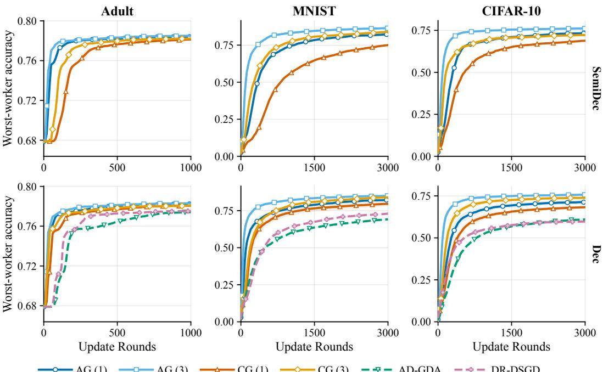
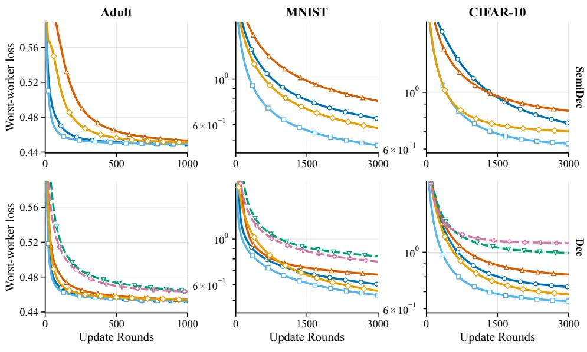

# GROUP DISTRIBUTIONALLY ROBUST OPTIMIZATION OVER DECENTRALIZED NETWORKS

Haomin Bai<sup>1,2</sup> Junyan Sun<sup>1,2</sup> Quan Cheng<sup>1,2</sup> Yuanyu Wan<sup>3</sup> Lijun Zhang<sup>1,2∗</sup>

<sup>1</sup>State Key Laboratory of Novel Software Technology, Nanjing University

<sup>2</sup>School of Artificial Intelligence, Nanjing University

<sup>3</sup>School of Software Technology, Zhejiang University

{baihm,sunjy,chengq,zhanglj}@lamda.nju.edu.cn, wanyy@zju.edu.cn

## ABSTRACT

We study group distributionally robust optimization (GDRO) over decentralized networks, where workers collaborate to learn robust models by minimizing the maximum local risk. Existing methods optimize only dual-regularized surrogates and establish guarantees for a globally averaged model that is not available to workers. In this paper, we directly optimize the original GDRO objective and establish guarantees for local models in semi-decentralized (SemiDec) and fully decentralized (Dec) settings. A key difficulty is that applying the primal-dual decomposition from centralized GDRO yields worker-dependent losses whose evaluation requires unavailable cross-worker information. To address this challenge, we develop a novel error decomposition that recasts decentralized GDRO as (i) a decentralized online convex optimization (D-OCO) problem and a predictionwith-expert-advice problem in SemiDec, and as (ii) two coupled D-OCO problems in Dec, with discrepancy terms capturing inconsistencies among local decisions. By isolating consensus errors in analysis, we develop modular frameworks that support different consensus routines. We then establish the first per-worker convergence guarantees for optimizing the original GDRO objective over decentralized networks. Instantiations with accelerated gossip and Choco-gossip achieve an $O ( \sqrt { ( \log m ) / T } )$ convergence rate over T update rounds, while experiments demonstrate improved worst-worker performance over baselines.

## 1 INTRODUCTION

Decentralized optimization is a powerful framework for large-scale model training and has attracted considerable attention due to its network robustness, communication efficiency, and scalability (He et al., 2018; Mart´ınez Beltran et al., 2023). Within this framework,´ m workers exchange information over a communication network to collaboratively optimize a shared learning objective. Classical methods train models by minimizing the average risk (Wei & Ozdaglar, 2012; Duchi et al., 2012; Yuan et al., 2016). However, in practical deployments, workers’ local data distributions are often highly heterogeneous (Ye et al., 2023b), which can lead to performance degradation across workers (Hsieh et al., 2020). As a result, minimizing only the average risk may be unfair to certain workers and lacks robustness under distribution shift (Mohri et al., 2019).

A promising solution is group distributionally robust optimization (GDRO) (Sagawa et al., 2020), which minimizes the maximum risk across workers. For each worker $i \in [ m ]$ , let $\mathcal { P } _ { i }$ denote its local data distribution and define the local risk function as $R _ { i } ( { \bf w } ) = \mathbb { E } _ { { \bf z } \sim \mathcal { P } _ { i } } [ \ell ( \mathbf { \bar { w } } ; { \bf \bar { z } } ) ]$ ], where z denotes a random sample and $\ell ( \cdot ; \cdot )$ is the loss function. GDRO solves the stochastic minimax problem

$$
\operatorname* { m i n } _ { \mathbf { w } \in \mathcal { W } } \operatorname* { m a x } _ { \mathbf { q } \in \Delta _ { m } } \left\{ \phi ( \mathbf { w } , \mathbf { q } ) = \sum _ { i = 1 } ^ { m } q _ { i } R _ { i } ( \mathbf { w } ) \right\} ,\tag{1}
$$

where $\Delta _ { m } = \{ \mathbf { q } \in \mathbb { R } _ { + } ^ { m } \mid \mathbf { 1 } ^ { \top } \mathbf { q } = 1 \}$ denotes the simplex. We focus on the convex setting and refer to w as the primal model and q as the dual vector. Although GDRO has been extensively studied in centralized optimization (Haghtalab et al., 2022; Zhang et al., 2023) and in server-based federated learning (Mohri et al., 2019; Deng et al., 2020), optimizing (1) over decentralized networks remains challenging. Existing decentralized GDRO methods only optimize a dual-regularized variant of (1) with strongly concave regularization for the dual vector (Issaid et al., 2022; Zecchin et al., 2023). Consequently, their guarantees do not imply optimality for the worst-worker objective. Moreover, these methods provide guarantees only for a globally averaged model, which requires additional communication to approximate. Since deployment relies on locally maintained models, per-worker guarantees with respect to the global objective are more practically relevant (Duchi et al., 2012).

In this paper, we directly optimize problem (1) over two representative decentralized architectures: (i) a semi-decentralized (SemiDec) setting with a lightweight server and worker-to-worker commu nication, and (ii) a fully decentralized (Dec) setting with only worker-to-worker communication. Unlike decentralized optimization with a single variable (Nedic & Ozdaglar, 2009), GDRO couples the primal model and the dual vector, making its decentralized dynamics difficult to analyze. A natural attempt is to adapt the centralized GDRO decomposition (Zhang et al., 2023; Soma et al., 2025), which bounds the optimization error by the sum of primal and dual regret terms. However, applying this decomposition to each worker’s local model yields worker-dependent losses whose evaluation requires cross-worker information that is not locally accessible. To overcome this challenge, we develop a novel error decomposition that rewrites each worker’s local objectives as shared global objectives plus discrepancy terms arising from inconsistent local decisions. This reformulation turns decentralized GDRO into tractable online learning subproblems. In SemiDec, where a lightweight server maintains a shared dual vector, it yields a decentralized online convex opti mization (D-OCO) (Yan et al., 2013) problem for the primal updates and a prediction with expert advice (PEA) (Freund & Schapire, 1997) problem for the dual updates, with model-discrepancy terms among workers. In Dec, where each worker maintains both a local model and a local dual vector, it yields two coupled D-OCO problems together with primal and dual discrepancy terms.

Building on this decomposition, we further isolate communication effects through consensus-error terms in the regret and discrepancy bounds. This separation decouples the optimization analysis from the specific consensus mechanism, yielding two modular frameworks that support different consensus routines. Algorithmically, both employ follow-the-regularized-leader (FTRL) (Orabona, 2019) for the primal and dual updates, while workers track the cumulative global gradient of each decentralized variable via the selected consensus routine. We then establish convergence guarantees for each worker’s time-averaged local model under the original GDRO objective. By instantiating the frameworks with accelerated gossip (AG) (Liu & Morse, 2011) and Choco-gossip (CG) (Koloskova et al., 2019), we obtain concrete algorithms with an $O ( \sqrt { ( \log m ) / T } )$ convergence rate over T update rounds. Our main contributions are summarized as follows:

• We propose a novel error decomposition that reduces decentralized GDRO to a D-OCO problem and a PEA problem in SemiDec, and to two coupled D-OCO problems in Dec, with discrepancy terms capturing inconsistencies among local decisions.

• Building on the decomposition, we develop modular frameworks for GDRO in the SemiDec and Dec settings that accommodate different consensus routines, and establish per-worker convergence guarantees in terms of the resulting consensus errors.

• By instantiating the consensus routine with AG and CG, we obtain concrete algorithms with a per-worker convergence rate of $O ( \sqrt { ( \log m ) / T } )$ , and empirically show improved worst-worker performance over prior methods.

## 2 RELATED WORK

Decentralized minimax optimization. Decentralized learning has been studied in SemiDec (Guo et al., 2022; Wang & Chi, 2025) and Dec architectures (Olfati-Saber et al., 2007; Chen & Sayed, 2012), with applications to energy systems (Kekatos & Giannakis, 2013; Navidi et al., 2021), wireless sensor networks (Avci et al., 2018), and autonomous vehicles (Clancy et al., 2024). Meanwhile, many machine learning problems can be formulated as minimax optimization (Pinto et al., 2017; Goodfellow et al., 2020), motivating its study over decentralized networks. Most existing methods focus on regimes different from the convex-concave setting, including nonconvex-nonconcave (Liu et al., 2020), nonconvex-strongly-concave (Tsaknakis et al., 2020; Xian et al., 2021; You et al., 2025), and strongly-convex-strongly-concave objectives (Metelev et al., 2023). Although Koppel et al. (2015) study convex–concave problems, their dual variables are Lagrange multipliers for consensus constraints rather than distributional weights.

Group distributionally robust optimization. GDRO (Sagawa et al., 2020) minimizes the worstgroup risk to learn models that perform uniformly well across multiple data distributions. It has been studied in centralized settings (Sagawa et al., 2020; Haghtalab et al., 2022; Zhang et al., 2023; Bai et al., 2025; Zhang et al., 2026), server-based federated settings (Mohri et al., 2019; Deng et al., 2020; Guo & Yang, 2024; Bai et al., 2026), and decentralized settings (Issaid et al., 2022; Zecchin et al., 2023) with a strongly concave regularizer. Specifically, DR-DSGD (Issaid et al., 2022) adds Kullback–Leibler regularization to the dual vector, which transforms the regularized minimax problem into a single-level minimization problem, thus simplifying the algorithm design and analysis. AD-GDA (Zecchin et al., 2023) further considers general strongly concave regularizers for the dual vector and solves the resulting problem using decentralized gradient descent-ascent with compressed consensus. Despite these advances, the original GDRO objective remains unexplored in decentralized settings.

Decentralized online convex optimization. D-OCO (Yan et al., 2013) considers multiple workers that collaboratively optimize a global objective in an online manner over a decentralized network, and algorithms typically include two key steps: decision updates and consensus. Existing update methods include decentralized online gradient descent (Yan et al., 2013), decentralized follow-theregularized-leader (FTRL) (Hosseini et al., 2013), and their variants (Zhang et al., 2017; Wan et al., 2022; Wang et al., 2023). For information aggregation, most approaches adopt gossip for neighborhood averaging (Xiao & Boyd, 2004). Wan et al. (2025) introduce online accelerated gossip by combining AG (Liu & Morse, 2011) with a blocking update mechanism, achieving nearly optimal regret bounds. To improve communication efficiency, Tu et al. (2022) combine D-OGD with the difference-compressed consensus mechanism (Koloskova et al., 2019) and Yang et al. (2026) improve the results via a two-level blocking update framework. Subsequently, Zhou et al. (2026) develop FTRL-type algorithms with compressed communication, matching the best known fullinformation regret bounds and improving both regret and communication costs in the bandit setting.

## 3 PRELIMINARIES

We equip W with a closed, 1-strongly convex function $\nu _ { w } : \mathcal { W } \to \mathbb { R }$ with respect to $\| \cdot \| _ { 2 }$ , and $\Delta _ { m }$ with negative entropy $\textstyle \nu _ { q } ( \mathbf { q } ) = \sum _ { i = 1 } ^ { m } q _ { i }$ ln q . For any approximate solution $\mathbf { w } \in \mathcal { W }$ of problem (1), its optimization error is defined as $\begin{array} { r } { \bar { \varepsilon } _ { \phi } ( \mathbf { w } ) = \operatorname* { m a x } _ { i \in [ m ] } R _ { i } ( \mathbf { w } ) - \operatorname* { m i n } _ { \mathbf { w } \in \mathcal { W } } } \end{array}$ max<sub>i∈[m]</sub> R<sub>i</sub>(w). We adopt standard assumptions as follows (Mohri et al., 2019; Zhang et al., 2023; Zecchin et al., 2023).

Assumption 1. W is nonempty, compact, convex with $\begin{array} { r } { \operatorname* { m a x } _ { \mathbf { w } \in \mathcal { W } } \nu _ { w } ( \mathbf { w } ) - \operatorname* { m i n } _ { \mathbf { w } \in \mathcal { W } } \nu _ { w } ( \mathbf { w } ) \leq D ^ { 2 } } \end{array}$ Assumption 2. For each $i \in [ m ]$ , the risk $R _ { i } ( \cdot )$ is convex on $\mathcal { W } .$ , and for all $\mathbf { w } \in \mathcal { W }$ , the stochastic gradient is unbiased, i.e., $\begin{array} { r } { \mathbb { E } _ { \mathbf { z } \sim \mathcal { P } _ { i } } [ \nabla \ell ( \mathbf { w } ; \mathbf { z } ) ] = \nabla R _ { i } ( \mathbf { w } ) } \end{array}$ . In addition, for all $\mathbf { w } \in \mathcal { W }$ and all $\mathbf { z } ,$

$$
0 \leq \ell ( \mathbf { w } ; \mathbf { z } ) \leq 1 , \qquad \| \nabla \ell ( \mathbf { w } ; \mathbf { z } ) \| _ { 2 } \leq G .\tag{2}
$$

Communication network. The worker-to-worker communication network is represented by an undirected graph $\mathcal { G } = ( \nu , \mathcal { E } )$ , where $\nu = \left\lceil m \right\rceil$ is the set of workers and $\mathcal { E } \subseteq \mathcal { V } \times \mathcal { V }$ denotes the set of communication links. An edge $( i , j ) \in \mathcal { E }$ indicates that workers i and j can exchange information, and we assume $( i , i ) \in \mathcal { E }$ for all $i \in \mathcal { V } .$ . Let $\mathcal { N } _ { i } = \{ j \in \mathcal { V } : ( i , j ) \in \mathcal { E } \}$ denote the set of neighbors of worker $i .$ To model information mixing over ${ \mathcal { G } } ,$ we associate it with a matrix $P \in \mathbb { R } ^ { m \times m }$ , where $P _ { i , j } > 0 \mathrm { i f } ( i , j ) \in \mathcal { E }$ and $P _ { i , j } = 0$ otherwise. Following standard decentralized optimization (Nedic & Ozdaglar, 2009; Duchi et al., 2012), we impose the following assumption on $\bar { P }$

Assumption 3. The communication matrix $P$ satisfies $P \cdot \mathbf { 1 } _ { m } = \mathbf { 1 } _ { m } , P = P ^ { \top }$ . Moreover, the graph $\bar { \mathcal { G } }$ is connected, i.e., there exists a path between any two workers.

Under Assumption 3, the largest eigenvalue of P is $\lambda _ { 1 } ( P ) = 1$ , while the remaining eigenvalues satisfy $\begin{array} { r } { \lambda _ { \star } ( P ) { \bar { \mathbf { \phi } } } : = \operatorname* { m a x } _ { i \geq 2 } | \bar { \lambda _ { i } } ( P ) | { \bar { \mathbf { \phi } } } < 1 } \end{array}$ (Horn & Johnson, 2012). We define the spectral gap as $\rho : = 1 - \lambda _ { \star } ( P ) \in ( 0 , 1 ]$ and let $\displaystyle { \boldsymbol { \beta } } : = \| \boldsymbol { I _ { m } } - \boldsymbol { P } \| _ { 2 } \in [ 0 , 2 ]$

Consensus routine. We model the information-exchange mechanism as a black-box consensus routine $A _ { c } .$ It returns updated states $\{ \mathbf { x } _ { L + 1 } ^ { ( i ) } , \hat { \mathbf { x } } _ { L + 1 } ^ { ( i ) } \} _ { i \in [ m ] } = \mathcal { A } _ { c } ( \{ \mathbf { x } _ { 1 } ^ { ( i ) } , \hat { \mathbf { x } } _ { 1 } ^ { ( i ) } \} _ { i \in [ m ] } )$ after L communication rounds, where $\mathbf { x } _ { 1 } ^ { ( i ) }$ is the initial state of worker $i ,$ and $\hat { \mathbf { x } } _ { t } ^ { ( i ) }$ denotes auxiliary states. We later instantiate $\boldsymbol { A } _ { c }$ with two representative procedures, AG (Liu & Morse, 2011) and CG (Koloskova et al., 2019), which respectively provide fast mixing and compressed communication. The full procedures and corresponding consensus-error bounds are provided in Appendix A.

## 4 SEMI-DECENTRALIZED GDRO

We first consider SemiDec with a high-bandwidth worker-to-worker network and a low-bandwidth server–worker network. Such architectures arise naturally in wireless systems, where nearby devices can exchange high-dimensional information through fast D2D links, while a base station provides global coordination over bandwidth-limited device-to-server links (Lin et al., 2021; Guo et al., 2022). In SemiDec, we let the server only maintain the shared m-dimensional dual vector, while high-dimensional model update information is communicated over the worker-to-worker network.

## 4.1 ERROR DECOMPOSITION

Unlike prior work that provides guarantees only for a globally averaged model (Issaid et al., 2022; Zecchin et al., 2023), we establish guarantees for each worker’s local model. This is more relevant in decentralized settings, since obtaining the global average requires additional communication and is generally only approximate under finite communication. Let $\mathbf { w } _ { t } ^ { ( i ) }$ denote worker i’s model at round $t ,$ and define its output after $T$ iterations as $\begin{array} { r } { \bar { \mathbf { w } } _ { T } ^ { ( i ) } = \frac { 1 } { T } \sum _ { t = 1 } ^ { T } \mathbf { w } _ { t } ^ { ( i ) } } \end{array}$ . To decouple the effects of primal and dual updates, our starting point is the error decomposition used in centralized GDRO (Zhang et al., 2023; Soma et al., 2025). In particular, the optimization error of each $\bar { \bf w } _ { T } ^ { ( i ) }$ can be bounded as

$$
\begin{array} { r l } & { \quad \varepsilon _ { \phi } \big ( \bar { \mathbf { w } } _ { T } ^ { ( i ) } \big ) } \\ & { \leq \frac { 1 } { T } \underbrace { \left( \operatorname* { m a x } _ { \mathbf { a } \in \Delta _ { m } } \displaystyle \sum _ { t = 1 } ^ { T } \phi ( { \mathbf { w } } _ { t } ^ { ( i ) } , \mathbf { q } ) - \displaystyle \sum _ { t = 1 } ^ { T } \phi ( { \mathbf { w } } _ { t } ^ { ( i ) } , \mathbf { q } _ { t } ) \right) } _ { \mathcal { R } _ { q } ^ { ( i ) } } + \frac { 1 } { T } \underbrace { \left( \displaystyle \sum _ { t = 1 } ^ { T } \phi ( { \mathbf { w } } _ { t } ^ { ( i ) } , \mathbf { q } _ { t } ) - \displaystyle \sum _ { t = 1 } ^ { T } \phi ( { \mathbf { w } } ^ { * } , \mathbf { q } _ { t } ) \right) } _ { \mathcal { R } _ { w } ^ { ( i ) } } , } \end{array}\tag{3}
$$

where $\begin{array} { r } { \mathbf { w } ^ { * } \in \mathop { \mathrm { a r g } } \operatorname* { m i n } _ { \mathbf { w } \in \mathcal { W } } \operatorname* { m a x } _ { i \in [ m ] } R _ { i } ( \mathbf { w } ) } \end{array}$ is a global solution. The term $\mathcal { R } _ { q } ^ { ( i ) }$ is the regret of $\{ \mathbf { q } _ { t } \} _ { t = 1 } ^ { T }$ against the loss sequence $\{ \phi ( \mathbf { w } _ { t } ^ { ( i ) } , \cdot ) \} _ { t = 1 } ^ { T }$ induced by worker i. Similarly, $\mathcal { R } _ { w } ^ { ( i ) }$ is the regret of $\{ \mathbf { w } _ { t } ^ { ( i ) } \} _ { t = 1 } ^ { T }$ measured on a shared objective sequence $\{ \phi ( \cdot , \mathbf { q } _ { t } ) \} _ { t = 1 } ^ { T }$ , with comparator $\mathbf { w } ^ { * }$

Analysis of $\mathcal { R } _ { q } ^ { ( i ) }$ . Since each worker $i \in [ m ]$ induces its own regret term $\mathcal { R } _ { q } ^ { ( i ) }$ , the server needs to select a single dual sequence $\{ \mathbf { q } _ { t } \} _ { t = 1 } ^ { T }$ that controls $\mathcal { R } _ { q } ^ { ( i ) }$ uniformly for all $i \in [ m ]$ . Constructing such a sequence directly, however, would require access to $R _ { j } ( \mathbf { w } _ { t } ^ { ( i ) } )$ for every $i , j \in [ m ]$ . For $j \neq i ,$ this risk can only be evaluated at worker $j ,$ who does not have access to worker $i \ ' s$ model $\mathbf { w } _ { t } ^ { ( i ) }$ . To overcome this information barrier, we decompose each worker-dependent objective into a shared global term and a discrepancy term. Specifically, we rewrite

$$
\phi ( \mathbf { w } _ { t } ^ { ( i ) } , \mathbf { q } ) = \sum _ { j = 1 } ^ { m } q _ { j } R _ { j } ( \mathbf { w } _ { t } ^ { ( j ) } ) + \sum _ { j = 1 } ^ { m } q _ { j } \big ( R _ { j } ( \mathbf { w } _ { t } ^ { ( i ) } ) - R _ { j } ( \mathbf { w } _ { t } ^ { ( j ) } ) \big ) .\tag{4}
$$

The first term is independent of i and therefore can serve as the global objective for updating the shared dual vector. Under Assumption 2, the second term can be bounded by $G \operatorname* { m a x } _ { j \in [ m ] } \| \mathbf { w } _ { t } ^ { ( i ) } -$ $\mathbf { w } _ { t } ^ { ( j ) } \| _ { 2 }$ , which quantifies the maximum model disagreement between worker i and the rest of the network at round t. Consequently, each $\mathcal { R } _ { q } ^ { ( i ) }$ can be bounded by the shared dual regret

$$
\operatorname* { m a x } _ { \mathbf { q } \in \Delta _ { m } } \sum _ { t = 1 } ^ { T } \sum _ { j = 1 } ^ { m } q _ { j } R _ { j } ( \mathbf { w } _ { t } ^ { ( j ) } ) - \sum _ { t = 1 } ^ { T } \sum _ { j = 1 } ^ { m } q _ { t , j } R _ { j } ( \mathbf { w } _ { t } ^ { ( j ) } ) ,\tag{5}
$$

plus a model-discrepancy term. The shared regret in (5) leads to a PEA formulation at the server, where workers act as experts and the server updates $\mathbf { q } _ { t }$ using stochastic estimates of their local risks.

```latex
Algorithm 1 GDRO-SEMIDEC
1: Initialize $\begin{array} { r } { \mathbf { \ d u } _ { \mathrm { \pm 1 } } ^ { ( i ) } = \mathrm { a r g } \operatorname* { m i n } _ { \mathbf { w } \in \mathcal { W } } \nu _ { w } ( \mathbf { w } ) , \mathbf { L } _ { 0 } = \mathbf { 0 } _ { m } , \mathbf { q } _ { \mathrm { 1 } } = \frac { 1 } { m } \mathbf { 1 } _ { m } , \mathbf { F } _ { 0 } ^ { ( i ) } = \mathbf { 0 } _ { d } , \hat { \mathbf { F } } _ { 0 } ^ { ( i ) } = \emptyset \mathrm { \Gamma } ( \mathbf { A } \mathbf { G } ) \mathrm { \bf { o r } } } \end{array}$
$\mathbf { 0 } _ { d } \left( \mathbf { C G } \right) \forall i \mathbf { \bar { \Sigma } } \in [ m ] .$
2: for $t = 1 , 2 , \dots , { \bar { T } }$ do
3: In parallel for all workers $i \in [ m ] \colon$
4: Draw a sample $\mathbf { z } _ { t } ^ { ( i ) }$ and send $\dot { \ell } ( \mathbf { w } _ { t } ^ { ( i ) } ; \mathbf { z } _ { t } ^ { ( i ) } )$ to the server
5: Compute $\mathbf { g } _ { w , t } ^ { ( i ) } = \boldsymbol { q } _ { t , i } \cdot \nabla \ell ( \mathbf { w } _ { t } ^ { ( i ) } ; \mathbf { z } _ { t } ^ { ( i ) } )$
6: $\{ \mathbf { F } _ { t } ^ { ( i ) } , \hat { \mathbf { F } } _ { t } ^ { ( i ) } \} _ { i \in [ m ] } = \mathcal { A } _ { c } ( \{ \mathbf { F } _ { t - 1 } ^ { ( i ) } + \mathbf { g } _ { w , t } ^ { ( i ) } , \hat { \mathbf { F } } _ { t - 1 } ^ { ( i ) } \} _ { i \in [ m ] } )$ // communication among workers
7: Compute $\mathbf { w } _ { t + 1 } ^ { ( i ) }$ via (9)
8: On server:
9: Construct ${ \bf g } _ { \boldsymbol { q } , t }$ in (7) and update $\mathbf { L } _ { t } = \mathbf { L } _ { t - 1 } + \mathbf { g } _ { q , t }$
10: Compute $\mathbf { q } _ { t + 1 }$ via (8) and send $q _ { t + 1 , i }$ to worker i for all $i \in [ m ]$
11: end for
12: Return $\begin{array} { r } { \bar { \mathbf { w } } _ { T } ^ { ( i ) } = { T } ^ { - 1 } \sum _ { t = 1 } ^ { T } \mathbf { w } _ { t } ^ { ( i ) } } \end{array}$ at each worker $i \in [ m ]$
Analysis of $\mathcal { R } _ { w } ^ { ( i ) }$ . In contrast to $\mathcal { R } _ { q } ^ { ( i ) }$ , which requires further decomposition, each primal regret term
$\mathcal { R } _ { w } ^ { ( i ) }$ in (3) is already evaluated on the same objective sequence $\{ \phi ( \cdot , \mathbf { q } _ { t } ) \} _ { t = 1 } ^ { T } , \mathrm { i . e . }$
$\mathcal { R } _ { w } ^ { ( i ) } = \sum _ { t = 1 } ^ { T } \left( \sum _ { j = 1 } ^ { m } q _ { t , j } R _ { j } ( \mathbf { w } _ { t } ^ { ( i ) } ) - \sum _ { j = 1 } ^ { m } q _ { t , j } R _ { j } ( \mathbf { w } ^ { * } ) \right)$ (6)
To obtain uniform guarantees for all $\{ \mathcal { R } _ { w } ^ { ( i ) } \} _ { i = 1 } ^ { m }$ , we let workers jointly solve a D-OCO problem (Yan
et al., 2013), with each worker computing its local gradient and using consensus to aggregate infor
mation across the network.
In summary, the above decomposition reduces the optimization error of each worker in SemiDec to
a shared dual regret handled by PEA, a primal regret handled by D-OCO, and a model-discrepancy
term. We next develop the corresponding algorithmic framework.
Remark. Different from standard uniform-weight D-OCO (Yan et al., 2013), our formulation in
volves time-varying dual weights. A direct reduction would require rescaling and leads to loose
bounds. Instead, we exploit $\mathbf { q } \in \Delta _ { m }$ to avoid the extra dependence on m; see Appendix D.2.1.
```

## 4.2 FRAMEWORK DESIGN AND INSTANTIATION

We first introduce the server-side update of the dual vector $\mathbf { q } _ { t }$ . To control the shared dual regret (5), the server updates $\mathbf { q } _ { t }$ to maximize the shared term $\textstyle \sum _ { j = 1 } ^ { m } q _ { j } R _ { j } ( \mathbf { w } _ { t } ^ { ( j ) } )$ , equivalently minimizing $\begin{array} { r } { \sum _ { j = 1 } ^ { m } q _ { j } \big ( 1 - R _ { j } ( \mathbf { w } _ { t } ^ { ( j ) } ) \big ) } \end{array}$ under Assumption 2. Accordingly, in each round t, each worker i uploads only the scalar stochastic loss $\ell ( \mathbf { w } _ { t } ^ { ( i ) } ; \mathbf { z } _ { t } ^ { ( i ) } )$ to the server. The server then forms gradient estimator

$$
\mathbf { g } _ { q , t } = [ \mathbf { g } _ { q , t } ^ { ( 1 ) } , \ldots , \mathbf { g } _ { q , t } ^ { ( m ) } ] ^ { \top } , \quad \mathrm { w i t h } \quad \mathbf { g } _ { q , t } ^ { ( i ) } = 1 - \ell ( \mathbf { w } _ { t } ^ { ( i ) } ; \mathbf { z } _ { t } ^ { ( i ) } )\tag{7}
$$

$$
\mathbf { q } _ { t + 1 }
$$

$$
\mathbf { q } _ { t + 1 } = \underset { \mathbf { q } \in \Delta _ { m } } { \arg \operatorname* { m i n } } \left\{ \langle \eta _ { q } \mathbf { L } _ { t } , \mathbf { q } \rangle + \nu _ { q } ( \mathbf { q } ) \right\} , \quad \mathrm { w i t h } \quad \mathbf { L } _ { t } = \sum _ { s = 1 } ^ { t } \mathbf { g } _ { q , s }\tag{8}
$$

The server then broadcasts $q _ { t + 1 , i }$ to worker $i ,$ who uses it to scale the local stochastic gradient.

To update the local models, each worker performs FTRL using an estimate of the global cumulative gradient. Concretely, at round t, worker i maintains $\mathbf { F } _ { t - 1 } ^ { ( i ) } \in \mathbb { R } ^ { d }$ and auxiliary state variables $\hat { \mathbf { F } } _ { t - 1 } ^ { ( j ) }$ for $j \in \mathcal N _ { i }$ when required by the consensus routine $A _ { c } .$ . Each worker i first computes the weighted stochastic gradient $\mathbf { g } _ { w , t } ^ { ( i ) } = q _ { t , i } \nabla \ell ( \mathbf { w } _ { t } ^ { ( i ) } ; \mathbf { z } _ { t } ^ { ( i ) } )$ , and then applies $\boldsymbol { A } _ { c }$ to the message $\mathbf { F } _ { t - 1 } ^ { ( i ) } + \mathbf { g } _ { w , t } ^ { ( i ) }$ yielding an updated estimate $\mathbf { F } _ { t } ^ { ( i ) }$ . Finally, worker i computes its local model via

$$
\mathbf { w } _ { t + 1 } ^ { ( i ) } = \underset { \mathbf { w } \in \ b { W } } { \arg \operatorname* { m i n } } \left\{ \left. \eta _ { w } \mathbf { F } _ { t } ^ { ( i ) } , \mathbf { w } \right. + \nu _ { w } ( \mathbf { w } ) \right\} .\tag{9}
$$

Since consensus errors affect both the primal regret $\mathcal { R } _ { w } ^ { ( i ) }$ and the model-discrepancy term arising from $\mathcal { R } _ { q } ^ { ( i ) }$ , we isolate its contribution in the corresponding bounds and treat the consensus routine $\mathcal { A } _ { c }$ as a black box. We present the resulting framework termed GDRO-SEMIDEC in Algorithm 1, and establish its theoretical guarantees as follows.

Theorem 1. Under Assumptions 1–3, set the step sizes as $\eta _ { w } ~ = ~ { \sqrt { 2 } m D } / ( { \sqrt { T } G } )$ and $\eta _ { q } =$ $\scriptstyle { \sqrt { 2 ( \ln m ) / T } }$ . Suppose the consensus routine $\mathcal { A } _ { c }$ ensures that $\begin{array} { r } { \sum _ { i = 1 } ^ { m } \mathbf { F } _ { t } ^ { ( i ) } = \sum _ { i = 1 } ^ { m } \sum _ { \tau = 1 } ^ { t } \mathbf { g } _ { w , \tau } ^ { ( i ) } } \end{array}$ and $\begin{array} { r } { \mathbb { E } [ \operatorname* { m a x } _ { i \in [ m ] } \| \mathbf { F } _ { t } ^ { ( i ) } - \frac { 1 } { m } \sum _ { r = 1 } ^ { m } \mathbf { F } _ { t } ^ { ( r ) } \| _ { 2 } ] \leq \varepsilon _ { c } f o r } \end{array}$ all $t \in [ T ]$ . Then, Algorithm 1 guarantees

$$
\mathbb { E } \left[ \varepsilon _ { \phi } ( \hat { \mathbf { w } } _ { T } ^ { ( i ) } ) \right] \leq 4 \sqrt { \frac { \ln m } { T } } + \sqrt { \frac { 2 } { T } } D G + \frac { 7 \sqrt { 2 } m D } { \sqrt { T } } \varepsilon _ { c } , \qquad \forall i \in [ m ] .
$$

Remark. Theorem 1 establishes a convergence guarantee for each worker’s time-averaged local model that only depends on the consensus error $\varepsilon _ { c } .$ This modularity allows $A _ { c }$ to be instantiated by different consensus routines, with different update rules or communication rounds per iteration.

We next instantiate $\boldsymbol { \mathcal { A } } _ { c }$ with $\mathbf { A G }$ and $\mathrm { C G } ,$ and present the corresponding convergence guarantees. While the analysis is formulated through an online learning framework, the optimization problem itself is offline, and thus we allow multiple communication steps per iteration.

Corollary 1. Under the conditions ofTheorem 1, let $\mathcal { A } _ { c }$ be AG in Algorithm 3, with $P \succeq 0$ . With the communication-round choice $L = { \dot { O } } ( ( \log m ) / { \sqrt { \rho } } )$ specified in Appendix D.3, Algorithm 1 guarantees, for all $i \in [ m ] , \mathbb { E } [ \varepsilon _ { \phi } ( \bar { \mathbf { w } } _ { T } ^ { ( i ) } ) ] \leq ( 8 \sqrt { 2 } D G + 4 ) \sqrt { ( \ln m ) / T }$

Corollary 2. Under the conditions of Theorem 1, let $A _ { c }$ be CG in Algorithm 4. With the communication-round choice $L = O ( ( \log m ) / ( \delta \rho ^ { 2 } ) )$ specified in Appendix D.4, Algorithm 1 guarantees,for all $i \in [ m ] , \mathbb { E } [ \varepsilon _ { \phi } ( \bar { \mathbf { w } } _ { T } ^ { ( i ) } ) ] \leq ( 1 5 \sqrt { 2 } D G + 4 ) \sqrt { ( \ln m ) / T }$

## 5 DECENTRALIZED GDRO

We now consider the Dec setting, where the lightweight server in SemiDec is removed and each worker i maintains both a local dual vector $\mathbf { q } _ { t } ^ { ( i ) }$ and local model $\mathbf { w } _ { t } ^ { ( i ) }$ . This introduces dual inconsistency in addition to the model inconsistency already present in SemiDec.

## 5.1 ERROR DECOMPOSITION

Using again the centralized error decomposition, we bound the optimization error of $\bar { \bf w } _ { T } ^ { ( i ) }$ as

$$
\begin{array} { r l } & { \quad \varepsilon _ { \phi } ( \overline { { \mathbf { w } } } _ { T } ^ { ( i ) } ) } \\ & { \leq \frac { 1 } { T } \underbrace { \left( \operatorname* { m a x } _ { \mathbf { u } \in \Delta _ { m } } \displaystyle \sum _ { t = 1 } ^ { T } \phi ( \mathbf { w } _ { t } ^ { ( i ) } , \mathbf { q } ) - \sum _ { t = 1 } ^ { T } \phi ( \mathbf { w } _ { t } ^ { ( i ) } , \mathbf { q } _ { t } ^ { ( i ) } ) \right) } _ { \mathcal { R } _ { q } ^ { ( i ) } } + \frac { 1 } { T } \underbrace { \left( \sum _ { t = 1 } ^ { T } \phi ( \mathbf { w } _ { t } ^ { ( i ) } , \mathbf { q } _ { t } ^ { ( i ) } ) - \sum _ { t = 1 } ^ { T } \phi ( \mathbf { w } ^ { * } , \mathbf { q } _ { t } ^ { ( i ) } ) \right) } _ { \mathcal { R } _ { w } ^ { ( i ) } } . } \end{array}
$$

The key difference to (3) is that the dual sequence is no longer shared across workers. In SemiDec, the shared dual sequence $\{ \mathbf { q } _ { t } \} _ { t = 1 } ^ { T }$ makes $\mathcal { R } _ { w } ^ { ( i ) }$ a regret on a shared objective sequence, so only $\mathcal { R } _ { q } ^ { ( i ) }$ requires reformulation. In Dec, however, the local dual sequence $\{ \mathbf { q } _ { t } ^ { ( i ) } \} _ { t = 1 } ^ { T }$ also makes $\mathcal { R } _ { w } ^ { \left( i \right) }$ workerdependent. Meanwhile, $\mathcal { R } _ { q } ^ { ( i ) }$ faces the same cross-worker information barrier as in SemiDec, but must now be controlled for worker-specific dual sequences. Accordingly, we reuse the SemiDec reformulation for $\mathcal { R } _ { q } ^ { ( i ) }$ and derive an additional reformulation for $\mathcal { R } _ { w } ^ { ( i ) }$

Analysis of $\mathcal { R } _ { q } ^ { ( i ) }$ . As in the SemiDec setting, we apply the decomposition in (4) to $\phi ( \mathbf { w } _ { t } ^ { ( i ) } , \mathbf { q } )$ . This decomposes $\mathcal { R } _ { q } ^ { ( i ) }$ into two parts. The first is a local dual regret term:

$$
\operatorname* { m a x } _ { \mathbf { q } \in \Delta _ { m } } \sum _ { t = 1 } ^ { T } \sum _ { j = 1 } ^ { m } q _ { j } R _ { j } ( \mathbf { w } _ { t } ^ { ( j ) } ) - \sum _ { t = 1 } ^ { T } \sum _ { j = 1 } ^ { m } q _ { t , j } ^ { ( i ) } R _ { j } ( \mathbf { w } _ { t } ^ { ( j ) } ) ,\tag{10}
$$

which evaluates the local dual sequence $\{ \mathbf { q } _ { t } ^ { ( i ) } \} _ { t = 1 } ^ { T }$ on the shared global objective $\textstyle \sum _ { j = 1 } ^ { m } q _ { j } R _ { j } ( \mathbf { w } _ { t } ^ { ( j ) } )$ leading to a D-OCO formulation. The second is a discrepancy term bounded by $2 G \textstyle \sum _ { t = 1 } ^ { \bar { T } } \operatorname* { m a x } _ { j \in [ m ] } \| \mathbf { w } _ { t } ^ { ( i ) } - \mathbf { w } _ { t } ^ { ( j ) } \| _ { 2 }$ , which measures cumulative disagreement among local models. Analysis of $\mathcal { R } _ { w } ^ { ( i ) }$ . This term introduces an additional difficulty specific to Dec. Since $\mathbf { q } _ { t } ^ { ( i ) }$ varies across workers, the objective $\phi ( \mathbf { w } , \mathbf { q } _ { t } ^ { ( i ) } )$ is no longer shared across workers. To remove this worker dependence, we introduce the proxy vector $\hat { \mathbf { q } } _ { t } = ( q _ { t , 1 } ^ { ( 1 ) } , \ldots , q _ { t , m } ^ { ( m ) } )$ and rewrite

$$
\phi ( \mathbf { w } , \mathbf { q } _ { t } ^ { ( i ) } ) = \sum _ { j = 1 } ^ { m } q _ { t , j } ^ { ( j ) } R _ { j } ( \mathbf { w } ) + \sum _ { j = 1 } ^ { m } \bigl ( q _ { t , j } ^ { ( i ) } - q _ { t , j } ^ { ( j ) } \bigr ) R _ { j } ( \mathbf { w } ) .\tag{11}
$$

The first term on the right-hand side of (11) is shared across workers and induces the primal regret

$$
\sum _ { t = 1 } ^ { T } \sum _ { j = 1 } ^ { m } q _ { t , j } ^ { ( j ) } R _ { j } ( \mathbf { w } _ { t } ^ { ( i ) } ) - \sum _ { t = 1 } ^ { T } \sum _ { j = 1 } ^ { m } q _ { t , j } ^ { ( j ) } R _ { j } ( \mathbf { w } ^ { * } ) .\tag{12}
$$

We control this regret uniformly across workers by letting them jointly solve a D-OCO problem.

A key challenge is controlling the second term in (11), which measures inconsistency among local dual vectors and can be bounded by $\| \mathbf { q } _ { t } ^ { ( i ) } - \hat { \mathbf { q } } _ { t } \| _ { 1 }$ under Assumption 2. Unlike the shared dual vector in SemiDec, the proxy $\hat { \mathbf { q } } _ { t }$ need not lie in $\Delta _ { m } .$ , because its coordinates come from different workers’ local dual vectors. Consequently, the simplex-based argument used in SemiDec no longer applies, while the direct bound $\| \mathbf { q } _ { t } ^ { ( i ) } - \hat { \mathbf { q } } _ { t } \| _ { 1 } \leq$ m incurs an undesirable factor of $m$ . To overcome this difficulty, we introduce a virtual simplex reference sequence $\{ \tilde { \mathbf { q } } _ { t } \} _ { t \geq 1 }$ driven by the averaged dual gradient and bound $\lVert \mathbf { q } _ { t } ^ { ( i ) } - \hat { \mathbf { { q } } } _ { t } \rVert _ { 1 } \leq \lVert \mathbf { q } _ { t } ^ { ( i ) } - \tilde { \mathbf { { q } } } _ { t } \rVert _ { 1 } + \lVert \hat { \mathbf { { q } } } _ { t } - \tilde { \mathbf { { q } } } _ { t } \rVert _ { 1 }$ . This construction allows both deviations to be controlled through the dual consensus error, avoiding the additional factor of $m$

In summary, the optimization error of each worker’s output is bounded by two D-OCO regret terms over shared global objectives, together with two discrepancy terms.

## 5.2 FRAMEWORK DESIGN AND INSTANTIATION

To control the two coupled D-OCO regrets, we design a consensus-based FTRL scheme in which each worker uses $\mathcal { A } _ { c , w }$ and $\mathcal { A } _ { c , q }$ to maintain and update local estimates $\mathbf { F } _ { t } ^ { ( i ) }$ and $\mathbf { L } _ { t } ^ { \left( i \right) }$ of the cumulative global gradients for the primal and dual updates, respectively.

We first introduce the update of the local dual vectors. To optimize the shared dual objective in (10), we equivalently minimize $\begin{array} { r } { \sum _ { j = 1 } ^ { m } q _ { j } ( 1 - R _ { j } ( \mathbf { w } _ { t } ^ { ( j ) } ) ) } \end{array}$ ) under Assumption 2. At round $t ,$ each worker i forms a sparse stochastic contribution to the global dual gradient $\mathbf { g } _ { q , t } ^ { ( i ) } = \mathbf { e } _ { i } \big ( 1 - \ell ( \mathbf { w } _ { t } ^ { ( i ) } ; \mathbf { z } _ { t } ^ { ( i ) } ) \big )$ , where $\mathbf { e } _ { i } \in \mathbb { R } ^ { m }$ denotes the i-th standard basis vector. The cumulative messages $\mathbf { L } _ { t - 1 } ^ { ( i ) } + \mathbf { g } _ { q , t } ^ { ( i ) }$ are then aggregated through $\mathcal { A } _ { c , q }$ to update $\mathbf { L } _ { t } ^ { \left( i \right) }$ . Finally, each worker i performs the FTRL update

$$
\mathbf { q } _ { t + 1 } ^ { ( i ) } = \underset { \mathbf { q } \in \Delta _ { m } } { \arg \operatorname* { m i n } } \Bigl \{ \langle \eta _ { q } \mathbf { L } _ { t } ^ { ( i ) } , \mathbf { q } \rangle + \nu _ { q } ( \mathbf { q } ) \Bigr \} .\tag{13}
$$

The model update follows the same consensus-based FTRL scheme as in SemiDec, but now uses locally maintained dual weights. To optimize the shared primal objective $\begin{array} { r } { \sum _ { j = 1 } ^ { m } q _ { t , j } ^ { ( j ) } R _ { j } ( \mathbf { w } ) } \end{array}$ in (12), each worker i forms the weighted stochastic gradient $\mathbf { g } _ { w , t } ^ { ( i ) } = \ v q _ { t , i } ^ { ( i ) } \nabla \ell ( \mathbf { w } _ { t } ^ { ( i ) } ; \mathbf { \bar { z } } _ { t } ^ { ( i ) } )$ . The workers then aggregate the cumulative messages $\mathbf { F } _ { t - 1 } ^ { ( i ) } + \mathbf { g } _ { w , i } ^ { ( i ) }$ through $\mathcal { A } _ { c , w } :$ , yielding updated estimates $\mathbf { F } _ { t } ^ { ( i ) }$ Finally, each worker i updates its local model via the FTRL step in (9).

We summarize the resulting framework, termed GDRO-DEC, in Algorithm 2 and establish its convergence guarantee in the following theorem.

Theorem 2. Under Assumptions 1–3, set $\eta _ { w } = \sqrt { 2 } m D / ( G \sqrt { T } )$ and $\eta _ { q } = m \sqrt { 2 ( \ln m ) / T } .$ . Suppose the consensus routines satisfy $\begin{array} { r } { \sum _ { i } \mathbf { F } _ { t } ^ { ( i ) } = \sum _ { i } \sum _ { \tau = 1 } ^ { t } \mathbf { g } _ { w , \tau } ^ { ( i ) } } \end{array}$ and $\begin{array} { r } { \sum _ { i } \mathbf { L } _ { t } ^ { \left( i \right) } \ = \ \sum _ { i } \sum _ { \tau = 1 } ^ { t } \mathbf { g } _ { q , \tau } ^ { \left( i \right) } } \end{array}$

Algorithm 2 GDRO-DEC   
1: Initialize $\begin{array} { r } { { \bf w } _ { 1 } ^ { ( i ) } = \arg \operatorname* { m i n } _ { { \bf w } \in \mathcal { W } } \nu _ { w } ( { \bf w } ) , { \bf F } _ { 0 } ^ { ( i ) } = { \bf 0 } _ { d } , { \bf L } _ { 0 } ^ { ( i ) } = { \bf 0 } _ { m } , { \bf q } _ { 1 } ^ { ( i ) } = \frac { 1 } { m } { \bf 1 } _ { m } , \hat { \bf F } _ { 0 } ^ { ( i ) } = \hat { \bf L } _ { 0 } ^ { ( i ) } = \varnothing \left( \begin{array} { l l } { 0 } & { 0 \leqslant \operatorname* { m a x } } \\ { \operatorname* { m a x } } & { \operatorname* { m i n } } \end{array} \right) . } \end{array}$   
(AG) or $\hat { \mathbf { F } } _ { 0 } ^ { ( i ) } = \mathbf { 0 } _ { d } , \hat { \mathbf { L } } _ { 0 } ^ { ( i ) } = \mathbf { 0 } _ { m } ( \mathbf { C G } ) , \forall i \in [ m ] .$   
2: for $t = 1 , \tilde { 2 } , \dots , T$ do   
3: In parallel for all workers $i \in [ m ] \colon$   
4: Draw a sample $\mathbf { z } _ { t } ^ { ( i ) }$ and compute $\mathbf { g } _ { w , t } ^ { ( i ) } = q _ { t , i } ^ { ( i ) } \nabla \ell ( \mathbf { w } _ { t } ^ { ( i ) } ; \mathbf { z } _ { t } ^ { ( i ) } ) , \mathbf { g } _ { q , t } ^ { ( i ) } = \mathbf { e } _ { i } ( 1 - \ell ( \mathbf { w } _ { t } ^ { ( i ) } ; \mathbf { z } _ { t } ^ { ( i ) } ) )$   
5: $\{ \mathbf { F } _ { t } ^ { ( i ) } , \hat { \mathbf { F } } _ { t } ^ { ( i ) } \} _ { i \in [ m ] } = \mathcal { A } _ { c , w } \big ( \{ \mathbf { F } _ { t - 1 } ^ { ( i ) } + \mathbf { g } _ { w , t } ^ { ( i ) } , \hat { \mathbf { F } } _ { t - 1 } ^ { ( i ) } \} _ { i \in [ m ] } \big )$ // primal consensus   
6: $\{ \mathbf { L } _ { t } ^ { ( i ) } , \hat { \mathbf { L } } _ { t } ^ { ( i ) } \} _ { i \in [ m ] } = \mathcal { A } _ { c , q } ( \{ \mathbf { L } _ { t - 1 } ^ { ( i ) } + \mathbf { g } _ { q , t } ^ { ( i ) } , \hat { \mathbf { L } } _ { t - 1 } ^ { ( i ) } \} _ { i \in [ m ] } )$ // dual consensus   
7: Update $\mathbf { q } _ { t + 1 } ^ { ( i ) }$ in (13) and $\mathbf { w } _ { t + 1 } ^ { ( i ) }$ in (9)   
8: end for   
9: Return $\begin{array} { r } { \bar { \mathbf { w } } _ { T } ^ { ( i ) } = { T } ^ { - 1 } \sum _ { t = 1 } ^ { T } \mathbf { w } _ { t } ^ { ( i ) } } \end{array}$ at each worker $i \in [ m ]$

Writing $\begin{array} { r } { \bar { \mathbf { F } } _ { t } = m ^ { - 1 } \sum _ { i } \mathbf { F } _ { t } ^ { ( i ) } } \end{array}$ and $\begin{array} { r } { \bar { \mathbf { L } } _ { t } = m ^ { - 1 } \sum _ { i } \mathbf { L } _ { t } ^ { ( i ) } } \end{array}$ , assume $\begin{array} { r } { \left( \mathbb { E } [ \operatorname* { m a x } _ { i } \| \mathbf { F } _ { t } ^ { ( i ) } - \bar { \mathbf { F } } _ { t } \| _ { 2 } ^ { 2 } ] \right) ^ { 1 / 2 } \leq \varepsilon _ { c , w } } \end{array}$ and E[max $\| \mathbf { L } _ { t } ^ { ( i ) } - \bar { \mathbf { L } } _ { t } \| _ { 2 } ^ { 2 } ] ) ^ { 1 / 2 } \leq \varepsilon _ { c , q } f o r$ all $t \in [ T ]$ . Then, Algorithm 2 guarantees

$$
\mathbb { E } \left[ \varepsilon _ { \phi } \big ( \bar { \mathbf { w } } _ { T } ^ { ( i ) } \big ) \right] \leq O \left( \frac { C _ { 1 } + C _ { 2 } + C _ { 3 } + \sqrt { \log m } } { \sqrt { T } } \right) , \qquad \forall i \in [ m ] ,\tag{14}
$$

where $C _ { 1 } , C _ { 2 } ,$ and $C _ { 3 }$ are consensus-dependent terms defined in Appendix D.5. Under exact consensus, $C _ { 1 } = 1$ and $C _ { 2 } = C _ { 3 } = 0$

Similar to Theorem 1, Theorem 2 isolates the effect of communication through the consensus errors $\varepsilon _ { c , w }$ and $\varepsilon _ { c , q }$ , allowing $\mathcal { A } _ { c , w }$ and $\mathcal { A } _ { c , q }$ to be instantiated independently. For example, one may use AG for the low-dimensional dual updates and CG for the high-dimensional model updates. For simplicity, we next present results for setting both $\mathcal { A } _ { c , w }$ and $\mathcal { A } _ { c , q }$ to either AG or CG.

Corollary 3. Under the conditions ofTheorem 2, let $\mathcal { A } _ { c , w } a n d \mathcal { A } _ { c , q }$ be AG in Algorithm 3, with $P \succeq$ 0. With the communication-round choices $L _ { w } , L _ { q } = O \left( ( \log m ) \bar { / } \sqrt { \rho } \right)$ specified in Appendix $D . 6 ,$ Algorithm 2 guarantees,for all $i \in [ m ] , \mathbb { E } [ \varepsilon _ { \phi } ( \bar { \mathbf { w } } _ { T } ^ { ( i ) } ) ] \leq ( 3 2 D G + 9 \sqrt { 2 } ) \sqrt { ( \ln m ) / T }$

Corollary 4. Under the conditions ofTheorem 2, let $\mathcal { A } _ { c , w }$ and $\mathcal { A } _ { c , q }$ be CG in Algorithm 4. With the communication-round choices $L _ { w } , L _ { q } = O ( ( \log m ) / ( \delta \rho ^ { 2 } ) )$ specified in Appendix D.7, Algorithm 2 guarantees,for all $i \in [ m ] , \mathbb { E } [ \varepsilon _ { \phi } ( \bar { \mathbf { w } } _ { T } ^ { ( i ) } ) ] \leq ( 6 1 D G + 9 \sqrt { 2 } ) \sqrt { ( \ln m ) / T }$

## 6 DISCUSSION OF THEORETICAL GUARANTEES

To the best of our knowledge, Theorems 1 and 2 provide the first per-worker convergence guarantees for the original GDRO objective over decentralized networks. In both settings, the per-worker optimization error bound consists of an intrinsic optimization term and communication-induced consensus errors, which we discuss below.

First, the optimization term is tight in sample complexity up to a logarithmic factor in $m$ . Under exact consensus, i.e., $\varepsilon _ { c } ~ = ~ 0$ in SemiDec and $\varepsilon _ { c , w } = \varepsilon _ { c , q } = 0$ in Dec, the error reduces to $O ( \sqrt { ( \log m ) / T } )$ . Thus, finding an ε-optimal solution requires $O ( ( \log m ) / \varepsilon ^ { 2 } )$ updates and $O ( ( m \log m ) / \varepsilon ^ { 2 } )$ samples, matching the best-known centralized GDRO results (Zhang et al., 2023) and the information-theoretic lower bound $\Omega ( m / \varepsilon ^ { 2 } )$ up to a factor of O(log m) (Soma et al., 2022).

Second, to preserve the $O ( \sqrt { ( \log m ) / T } )$ rate, we choose the number of communication rounds in Corollaries 1–4 according to the best-known scaling of the D-OCO subproblems. Specifically, the AG instantiations match the communication-round scaling of the near-optimal D-OCO method in Wan et al. (2025), while the CG instantiations inherit the state-of-the-art dependence on network connectivity and compression (Yang et al., 2026). Importantly, these choices are sufficient rather than necessary, and the main theorems remain valid for different numbers of consensus rounds.

AG (1) AG (3) CG (1) CG (3) AD-GDA DR-DSGD

  
Figure 1: Worst-worker accuracy over update rounds on Adult, MNIST, and CIFAR-10. The top and bottom rows correspond to SemiDec and Dec, respectively. Curves report the mean over five random seeds, with shaded regions showing one standard deviation.

## 7 EXPERIMENTS

We evaluate our SemiDec and Dec methods on three datasets. Additional experimental details and worst-worker loss results are provided in Appendix B.

Experimental setup. We consider Adult (Becker & Kohavi, 1996), MNIST (Lecun et al., 1998), and CIFAR-10 (Krizhevsky, 2009). We instantiate GDRO-SEMIDEC and GDRO-DEC with AG and CG, denoting the resulting variants by AG(L) and CG(L) within each setting, where L is the number of consensus rounds per update. For Dec, we set $L _ { w } = \dot { L _ { q } } = L$ and compare with DR-DSGD (Issaid et al., 2022) and AD-GDA (Zecchin et al., 2023). AD-GDA and the CG-based variants use Topk compression (Stich et al., 2018) with a 50% compression ratio. Let $\operatorname { A c c } _ { j } ( \bar { \mathbf { w } } _ { t } ^ { ( i ) } )$ and $R _ { j } ( \bar { \mathbf { w } } _ { t } ^ { ( i ) } )$ denote the test accuracy and loss of worker i’s local model on worker $j ^ { \circ } \mathrm { s }$ test data, respectively. We report worst-worker accuracy min $\mathbf { \widetilde { \mathbf { \Gamma } } } _ { i , j \in [ m ] } \operatorname { A c c } _ { j } ( \bar { \mathbf { w } } _ { t } ^ { ( i ) } )$ in the main text and worst-worker loss $\mathrm { m a x } _ { i , j \in [ m ] } R _ { j } ( \bar { \mathbf { w } } _ { t } ^ { ( i ) } )$ in Appendix B.2. Workers communicate over an undirected ring graph. We train linear classifiers on Adult and MNIST. On CIFAR-10, all methods use the same pretrained ResNet-20 (Polivin, 2025) with a frozen backbone and a randomly initialized linear head.

Results. Figure 1 reports the worst-worker accuracy over update rounds in both settings. First, in Dec, our variants generally converge faster and attain higher accuracy than the baselines. These results support the practical advantage of directly optimizing the unregularized GDRO objective, whereas the baselines optimize dual-regularized surrogates. Second, across both settings, the $L = 3$ variants generally improve faster than their L = 1 counterparts. This behavior is consistent with the consensus-error dependence in Theorems 1 and 2, as additional consensus rounds reduce the consensus errors. Finally, both AG and CG exhibit stable convergence across the datasets, demonstrating the flexibility of our framework in accommodating different consensus routines.

## 8 CONCLUSION

In this paper, we study GDRO over decentralized networks in both SemiDec and Dec settings. Our key technical contribution is an error decomposition that bounds each worker’s local optimization error by global regret terms plus disagreement-induced discrepancies, leading to a D-OCO problem and a PEA problem in SemiDec, and two coupled D-OCO problems in Dec. Based on this decomposition, we develop modular frameworks supporting different consensus routines and bound the expected optimization error of each worker’s time-averaged local model for the original GDRO objective. We then instantiate the frameworks with AG and CG, yielding an $O ( \sqrt { ( \log m ) / T } )$ convergence rate. Experiments demonstrate improved worst-worker performance over baselines.

## REFERENCES

Onur Avci, Osama Abdeljaber, Serkan Kiranyaz, Mohammed Hussein, and Daniel J. Inman. Wireless and real-time structural damage detection: A novel decentralized method for wireless sensor networks. Journal ofSound and Vibration, 424:158–172, 2018.

Haomin Bai, Dingzhi Yu, Shuai Li, Haipeng Luo, and Lijun Zhang. Group distributionally robust optimization with flexible sample queries. ArXiv e-prints, arXiv:2505.15212, 2025.

Haomin Bai, Junyan Sun, Sifan Yang, Bo Xue, and Lijun Zhang. Communication-efficient agnostic federated learning via faster convergence and compression. ArXiv e-prints, 2609.36610, 2026.

Barry Becker and Ronny Kohavi. Adult. UCI Machine Learning Repository, 1996.

Sebastien Bubeck and Nicol´ o Cesa-Bianchi. Regret analysis of stochastic and nonstochastic multi-\` armed bandit problems. Foundations and Trends in Machine Learning, 5(1):1–122, 2012.

N. Cesa-Bianchi and G. Lugosi. Prediction, Learning, and Games. Cambridge University Press, 2006.

Jianshu Chen and Ali H. Sayed. Diffusion adaptation strategies for distributed optimization and learning over networks. IEEE Transactions on Signal Processing, 60(8):4289–4305, 2012.

Joseph Clancy, Darragh Mullins, Brian Deegan, Jonathan Horgan, Enda Ward, Ciaran Eising, Patrick´ Denny, Edward Jones, and Martin Glavin. Wireless access for v2x communications: Research, challenges and opportunities. IEEE Communications Surveys & Tutorials, 26(3):2082–2119, 2024.

Yuyang Deng, Mohammad Mahdi Kamani, and Mehrdad Mahdavi. Distributionally robust federated averaging. In Advances in Neural Information Processing Systems 33, pp. 15111–15122, 2020.

John C. Duchi, Alekh Agarwal, and Martin J. Wainwright. Dual averaging for distributed optimization: Convergence analysis and network scaling. IEEE Transactions on Automatic Control, 57 (3):592–606, 2012.

Yoav Freund and Robert E Schapire. A decision-theoretic generalization of on-line learning and an application to boosting. Journal ofComputer and System Sciences, 55(1):119–139, 1997.

Ian Goodfellow, Jean Pouget-Abadie, Mehdi Mirza, Bing Xu, David Warde-Farley, Sherjil Ozair, Aaron Courville, and Yoshua Bengio. Generative adversarial networks. Commun. ACM, 63(11): 139–144, 2020.

Yuanxiong Guo, Ying Sun, Rui Hu, and Yanmin Gong. Hybrid local SGD for federated learning with heterogeneous communications. In International Conference on Learning Representations, 2022.

Zhishuai Guo and Tianbao Yang. Communication-efficient federated group distributionally robust optimization. In Advances in Neural Information Processing Systems 37, pp. 23040–23077, 2024.

Nika Haghtalab, Michael I. Jordan, and Eric Zhao. On-demand sampling: Learning optimally from multiple distributions. In Advances in Neural Information Processing Systems 35, pp. 406–419, 2022.

Lie He, An Bian, and Martin Jaggi. Cola: Decentralized linear learning. In Advances in Neural Information Processing Systems 31, pp. 4541–4551, 2018.

Roger A Horn and Charles R Johnson. Matrix analysis. Cambridge university press, 2012.

Saghar Hosseini, Airlie Chapman, and Mehran Mesbahi. Online distributed optimization via dual averaging. In 52nd IEEE Conference on Decision and Control, pp. 1484–1489, 2013.

Kevin Hsieh, Amar Phanishayee, Onur Mutlu, and Phillip Gibbons. The non-IID data quagmire of decentralized machine learning. In Proceedings ofthe 37th International Conference on Machine Learning, volume 119, pp. 4387–4398, 2020.

Chaouki Ben Issaid, Anis Elgabli, and Mehdi Bennis. DR-DSGD: A distributionally robust decentralized learning algorithm over graphs. Transactions on Machine Learning Research, 2022

Vassilis Kekatos and Georgios B. Giannakis. Distributed robust power system state estimation. IEEE Transactions on Power Systems, 28(2):1617–1626, 2013.

Anastasia Koloskova, Sebastian Stich, and Martin Jaggi. Decentralized stochastic optimization and gossip algorithms with compressed communication. In Proceedings of the 36th International Conference on Machine Learning, pp. 3478–3487, 2019.

Alec Koppel, Felicia Y. Jakubiec, and Alejandro Ribeiro. A saddle point algorithm for networked online convex optimization. IEEE Transactions on Signal Processing, 63(19):5149–5164, 2015.

Alex Krizhevsky. Learning multiple layers of features from tiny images. Technical report, University of Toronto, 2009.

Y. Lecun, L. Bottou, Y. Bengio, and P. Haffner. Gradient-based learning applied to document recognition. Proceedings ofthe IEEE, 86(11), 1998.

Frank Po-Chen Lin, Seyyedali Hosseinalipour, Sheikh Shams Azam, Christopher G. Brinton, and Nicolo Michelusi. Semi-decentralized federated learning with cooperative d2d local model ag-\` gregations. IEEE Journal on Selected Areas in Communications, 39(12):3851–3869, 2021.

Ji Liu and A. Stephen Morse. Accelerated linear iterations for distributed averaging. Annual Reviews in Control, 35(2):160–165, 2011.

Mingrui Liu, Wei Zhang, Youssef Mroueh, Xiaodong Cui, Jarret Ross, Tianbao Yang, and Payel Das. A decentralized parallel algorithm for training generative adversarial nets. In Advances in Neural Information Processing Systems 33, pp. 11056–11070, 2020.

Enrique Tomas Mart´ ´ınez Beltran, Mario Quiles P´ erez, Pedro Miguel S´ anchez S´ anchez, Sergio L´ opez´ Bernal, Ger´ ome Bovet, Manuel Gil Pˆ erez, Gregorio Mart´ ´ınez Perez, and Alberto Huertas Celdr´ an.´ Decentralized federated learning: Fundamentals, state of the art, frameworks, trends, and challenges. IEEE Communications Surveys & Tutorials, 25(4):2983–3013, 2023.

Dmitry Metelev, Alexander Rogozin, Alexander Gasnikov, and Dmitry Kovalev. Decentralized saddle-point problems with different constants of strong convexity and strong concavity. Computational Management Science, 21(1), 2023.

Mehryar Mohri, Gary Sivek, and Ananda Theertha Suresh. Agnostic federated learning. In Proceedings of the 36th International Conference on Machine Learning, pp. 4615–4625, 2019.

Mohammad Navidi, Seyed Masoud Moghaddas-Tafreshi, and Amir Mohammad Alishvandi. A semi-decentralized framework for simultaneous expansion planning of privately owned multi regional energy systems and sub-transmission grid. International Journal of Electrical Power & Energy Systems, 128:106795, 2021.

Angelia Nedic and Asuman Ozdaglar. Distributed subgradient methods for multi-agent optimization. IEEE Transactions on Automatic Control, 54(1):48–61, 2009.

Reza Olfati-Saber, J. Alex Fax, and Richard M. Murray. Consensus and cooperation in networked multi-agent systems. Proceedings ofthe IEEE, 95(1):215–233, 2007.

Francesco Orabona. A modern introduction to online learning. ArXiv e-prints, arXiv:1912.13213, 2019.

Lerrel Pinto, James Davidson, Rahul Sukthankar, and Abhinav Gupta. Robust adversarial reinforcement learning. In Proceedings of the 34th International Conference on Machine Learning, volume 70, pp. 2817–2826, 2017.

Sergey Polivin. Resnet-20 model for cifar-10. Hugging Face, 2025. URL https:// huggingface.co/spolivin/cnn-cifar10.

Shiori Sagawa, Pang Wei Koh, Tatsunori B. Hashimoto, and Percy Liang. Distributionally robust neural networks for group shifts: On the importance of regularization for worst-case generalization. In International Conference on Learning Representations, 2020.

Tasuku Soma, Khashayar Gatmiry, and Stefanie Jegelka. Optimal algorithms for group distributionally robust optimization and beyond. ArXiv e-prints, arXiv:2212.13669, 2022.

Tasuku Soma, Khashayar Gatmiry, and Stefanie Jegelka. Optimal algorithms for group distributionally robust optimization and beyond. ArXiv e-prints, arXiv:2212.13669, 2025.

Sebastian U. Stich, Jean-Baptiste Cordonnier, and Martin Jaggi. Sparsified sgd with memory. In Advances in Neural Information Processing Systems 31, pp. 4452–4463, 2018.

Ioannis Tsaknakis, Mingyi Hong, and Sijia Liu. Decentralized min-max optimization: Formulations, algorithms and applications in network poisoning attack. In IEEE International Conference on Acoustics, Speech and Signal Processing, pp. 5755–5759, 2020.

Zhipeng Tu, Xi Wang, Yiguang Hong, Lei Wang, Deming Yuan, and Guodong Shi. Distributed online convex optimization with compressed communication. In Advances in Neural Information Processing Systems 35, pp. 34492–34504, 2022.

Yuanyu Wan, Guanghui Wang, Wei-Wei Tu, and Lijun Zhang. Projection-free distributed online learning with sublinear communication complexity. Journal of Machine Learning Research, 23 (172):1–53, 2022.

Yuanyu Wan, Tong Wei, Bo Xue, Mingli Song, and Lijun Zhang. Optimal and efficient algorithms for decentralized online convex optimization. Journal of Machine Learning Research, 26(135): 1–43, 2025.

He Wang and Yuejie Chi. Communication-efficient federated optimization over semi-decentralized networks. IEEE Transactions on Signal and Information Processing over Networks, 11:147–160, 2025.

Yibo Wang, Yuanyu Wan, Shimao Zhang, and Lijun Zhang. Distributed projection-free online learning for smooth and convex losses. Proceedings ofthe AAAI Conference on Artificial Intelligence, 37:10226–10234, 2023.

Ermin Wei and Asuman Ozdaglar. Distributed alternating direction method of multipliers. In 2012 IEEE 51st IEEE Conference on Decision and Control, pp. 5445–5450, 2012.

Wenhan Xian, Feihu Huang, Yanfu Zhang, and Heng Huang. A faster decentralized algorithm for nonconvex minimax problems. In Advances in Neural Information Processing Systems 34, pp. 25865–25877, 2021.

Lin Xiao and Stephen Boyd. Fast linear iterations for distributed averaging. Systems & Control Letters, 53(1):65–78, 2004.

Feng Yan, Shreyas Sundaram, S. V. N. Vishwanathan, and Yuan Qi. Distributed autonomous online learning: Regrets and intrinsic privacy-preserving properties. IEEE Transactions on Knowledge and Data Engineering, 25(11):2483–2493, 2013.

Sifan Yang, Wenhao Yang, Wei Jiang, and Lijun Zhang. Distributed online convex optimization with efficient communication: Improved algorithm and lower bounds. ArXiv e-prints, 2601.04907, 2026.

Haishan Ye, Luo Luo, Ziang Zhou, and Tong Zhang. Multi-consensus decentralized accelerated gradient descent. Journal ofMachine Learning Research, 24(306):1–50, 2023a.

Mang Ye, Xiuwen Fang, Bo Du, Pong C. Yuen, and Dacheng Tao. Heterogeneous federated learning: State-of-the-art and research challenges. ACM Comput. Surv., 56(3), 2023b.

Runze You, Kun Huang, and Shi Pu. Decentralized min-max optimization with gradient tracking. ArXiv e-prints, 2505.10631, 2025.

Kun Yuan, Qing Ling, and Wotao Yin. On the convergence of decentralized gradient descent. SIAM Journal on Optimization, 26(3):1835–1854, 2016.

Matteo Zecchin, Marios Kountouris, and David Gesbert. Communication-efficient distributionally robust decentralized learning. Transactions on Machine Learning Research, 2023.

Lijun Zhang, Peng Zhao, Zhenhua Zhuang, Tianbao Yang, and Zhi-Hua Zhou. Stochastic approximation approaches to group distributionally robust optimization. In Advances in Neural Information Processing Systems 36, 2023.

Lijun Zhang, Haomin Bai, Peng Zhao, and Zhi-Hua Zhou. Stochastic approximation approaches to group distributionally robust optimization and beyond. IEEE Transactions on Pattern Analysis and Machine Intelligence, pp. 1–12, 2026.

Wenpeng Zhang, Peilin Zhao, Wenwu Zhu, Steven C. H. Hoi, and Tong Zhang. Projection-free distributed online learning in networks. In Proceedings of the 34th International Conference on Machine Learning, volume 70, pp. 4054–4062, 2017.

Hao Zhou, Xiaoyu Wang, Chang Yao, Mingli Song, and Yuanyu Wan. Revisiting decentralized online convex optimization with compressed communication. ArXiv e-prints, 2607.01665, 2026.

## A CONSENSUS ROUTINE INSTANTIATIONS

In this appendix, we present two representative instantiations of the black-box consensus routine $\textstyle A _ { c } \colon$ accelerated gossip (AG) and Choco-gossip (CG). We provide their procedures and the standard contraction guarantees used in our analysis.

## A.1 ACCELERATED GOSSIP

AG (Liu & Morse, 2011) is an accelerated linear consensus scheme. Starting from $\mathbf { x } _ { 0 } ^ { ( i ) } = \mathbf { x } _ { 1 } ^ { ( i ) }$ for all $i \in [ m ] ,$ , it performs L communication rounds. At each round $k \in [ L ]$ , worker i exchanges $\mathbf { x } _ { k } ^ { ( i ) }$ with its neighbors and updates

$$
\mathbf { x } _ { k + 1 } ^ { ( i ) } = ( 1 + \theta ) \sum _ { j \in \mathcal { N } _ { i } } P _ { i , j } \mathbf { x } _ { k } ^ { ( j ) } - \theta \mathbf { x } _ { k - 1 } ^ { ( i ) } .
$$

where $\theta > 0$ is the stepsize. For the AG instantiation, we additionally assume that $P \succeq 0$ . The AG procedure is summarized in Algorithm 3 and enjoys the following guarantee.

Lemma 1. (Ye et al., 2023a) Let the step size $\begin{array} { r } { \theta = \frac { 1 } { 1 + \sqrt { 1 - \lambda _ { \star } ^ { 2 } ( P ) } } } \end{array}$ . Define $X _ { k } = \left[ \mathbf { x } _ { k } ^ { ( 1 ) } , \ldots , \mathbf { x } _ { k } ^ { ( m ) } \right] \in$ $\mathbb { R } ^ { d \times m }$ and the average $\bar { \mathbf { x } } = \frac { 1 } { m } X _ { 0 } \mathbf { 1 } \in \mathbb { R } ^ { d }$ . Then $\begin{array} { r } { \bar { \bf x } = \frac { 1 } { m } X _ { L + 1 } \mathbf { 1 } } \end{array}$ and

$$
\left\| { X _ { L + 1 } - \bar { \mathbf { x } } \mathbf { 1 } ^ { \top } } \right\| _ { F } \leq \sqrt { 1 4 } c ^ { L } \left\| { X _ { 0 } - \bar { \mathbf { x } } \mathbf { 1 } ^ { \top } } \right\| _ { F } ,
$$

where $c = 1 - ( 1 - 1 / \sqrt { 2 } ) \sqrt { 1 - \lambda _ { \star } ( P ) }$ and $\lambda _ { \star } ( P )$ denotes the second largest eigenvalue ofP.

## A.2 CHOCO-GOSSIP

CG is a communication-efficient consensus procedure that reduces bandwidth by exchanging compressed messages. It relies on a compressor C defined as follows.

Definition 1. Let $\mathcal { Q } \subseteq \mathbb { R } ^ { d }$ and $\delta \in ( 0 , 1 ]$ . An operator $\mathcal { C } : \mathbb { R } ^ { d }  \mathbb { R } ^ { d }$ is a δ-approximate compressor over Q if

$$
\begin{array} { r } { \mathbb { E } \left[ \left\| \mathcal { C } ( \mathbf { x } ) - \mathbf { x } \right\| _ { 2 } ^ { 2 } \right] \leq ( 1 - \delta ) \| \mathbf { x } \| _ { 2 } ^ { 2 } , \qquad \forall \mathbf { x } \in \mathcal { Q } . } \end{array}\tag{15}
$$

where the expectation is taken with respect to the internal randomness of C.

```latex
Algorithm $\begin{array} { r } { \{ \mathsf { A G } ( \{ \mathbf { x } _ { 1 } ^ { ( i ) } \} _ { i \in [ m ] } ) \colon } \end{array}$ Accelerated Gossip
Input: Initial states $\{ \mathbf { x } _ { 1 } ^ { ( i ) } \} _ { i \in [ m ] }$ , rounds $L ,$ communication matrix $P \in \mathbb { R } ^ { m \times m }$ , mixing coefficient
$\theta \bar { > } 0 .$
1: Initialize $\mathbf { x } _ { 0 } ^ { ( i ) } = \mathbf { x } _ { 1 } ^ { ( i ) }$ for all $i \in [ m ]$
2: for $k = 1 , \dotsc , L$ do
3: In parallel for all workers $i \in [ m ] \colon$
4: Send $\mathbf { x } _ { k } ^ { ( i ) }$ to all neighbors $j \in \mathcal N _ { i }$ and receive $\{ \mathbf { x } _ { k } ^ { ( j ) } \} _ { j \in \mathcal { N } _ { i } }$
5: Update $\begin{array} { r } { \mathbf { x } _ { k + 1 } ^ { ( i ) } = ( 1 + \theta ) \sum _ { j \in \mathcal { N } _ { i } } P _ { i , j } \mathbf { x } _ { k } ^ { ( j ) } - \theta \mathbf { x } _ { k - 1 } ^ { ( i ) } } \end{array}$
6: end for
7: Return $\{ \mathbf { x } _ { L + 1 } ^ { ( i ) } \}$ }<sub>i∈[m]</sub>
Algorithm 4 $\mathbf { C G } ( \{ \mathbf { x } _ { 1 } ^ { ( i ) } , \hat { \mathbf { x } } _ { 1 } ^ { ( i ) } \} _ { i \in [ m ] } ) \colon$ Choco-gossip
Input: States $\mathbf { x } _ { 1 } ^ { ( i ) } , \hat { \mathbf { x } } _ { 1 } ^ { ( i ) }$ for all $i \in [ m ]$ , step size $\gamma ,$ rounds $L ,$ compressor ${ \mathcal { C } } ,$ communication matrix
$P$
1: for $k = 1 , 2 , \ldots , L$ do
2: In parallel for all workers $i \in [ m ] \colon$
3: Send $\Delta _ { k } ^ { ( i ) } = \mathcal { C } ( \mathbf { x } _ { k } ^ { ( i ) } - \hat { \mathbf { x } } _ { k } ^ { ( i ) } )$ to all neighbors $j \in \mathcal N _ { i }$
4: Update $\hat { \mathbf { x } } _ { k + 1 } ^ { ( j ) } = \hat { \mathbf { x } } _ { k } ^ { ( j ) } + \Delta _ { k } ^ { ( j ) }$ for $j \in \mathcal N _ { i }$
5: Update $\begin{array} { r } { \mathbf { x } _ { k + 1 } ^ { ( i ) } = \mathbf { x } _ { k } ^ { ( i ) } + \gamma \sum _ { j \in \mathcal { N } _ { i } } P _ { i , j } \big ( \hat { \mathbf { x } } _ { k + 1 } ^ { ( j ) } - \hat { \mathbf { x } } _ { k + 1 } ^ { ( i ) } \big ) } \end{array}$
6: end for
7: Return $\{ \mathbf { x } _ { L + 1 } ^ { ( i ) } , \hat { \mathbf { x } } _ { L + 1 } ^ { ( i ) } \} _ { i \in [ m ] }$
```

At each communication round $k \in [ L ] ,$ , CG maintains both the current states $\{ \mathbf { x } _ { k } ^ { ( i ) } \} _ { i \in [ m ] }$ and the transmitted/received information $\{ \hat { \mathbf { x } } _ { k } ^ { ( i ) } \} _ { i \in [ m ] } ( \mathrm { i . e . }$ , worker i stores $\{ \hat { \mathbf { x } } _ { k } ^ { ( j ) } \} _ { j \in \mathcal { N } _ { i } } )$ . Each worker i sends the compressed difference $\Delta _ { k } ^ { ( i ) } = \mathcal { C } ( \mathbf { x } _ { k } ^ { ( i ) } - \hat { \mathbf { x } } _ { k } ^ { ( i ) } )$ to its neighbors. Upon receiving $\{ \Delta _ { k } ^ { ( j ) } \} _ { j \in \mathcal { N } _ { i } }$ worker i updates $\{ \hat { \mathbf { x } } _ { k + 1 } ^ { ( j ) } \} _ { j \in \mathcal { N } _ { i } }$ and $\mathbf { x } _ { k + 1 } ^ { ( i ) }$ . CG is summarized in Algorithm 4 and satisfies the following guarantee.

Lemma 2. (Koloskova et al., 2019) Let P satisfy Assumption 3, and assume C satisfies (15) on $\mathbb { R } ^ { d }$ with fresh internal randomness at each call. Define $X _ { t } = [ \mathbf { x } _ { t } ^ { ( 1 ) } , \ldots , \mathbf { x } _ { t } ^ { ( m ) } ] , \hat { X } _ { t } = [ \hat { \mathbf { x } } _ { t } ^ { ( 1 ) } , \ldots , \hat { \mathbf { x } } _ { t } ^ { ( m ) } ]$ and $\begin{array} { r } { \bar { \mathbf { x } } _ { t } \ = \ \frac { 1 } { m } \sum _ { i = 1 } ^ { m } \mathbf { x } _ { t } ^ { ( i ) } } \end{array}$ . Algorithm 4 ensures $\bar { \mathbf { x } } _ { t } = \bar { \mathbf { x } } f o r$ all $t \in [ L ] .$ . Define $\bar { X } = \bar { \bf { x } } { \bf { 1 } } ^ { \top }$ , and $e _ { t + 1 } = \mathbb { E } [ \| X _ { t + 1 } - \hat { X } _ { t + 1 } \| _ { F } ^ { 2 } + \| X _ { t + 1 } - \bar { X } \| _ { F } ^ { 2 } ]$ . With step size $\begin{array} { r } { \gamma = \frac { \rho \delta } { 1 6 \rho + \rho ^ { 2 } + 4 \beta ^ { 2 } + 2 \rho \beta ^ { 2 } - 8 \rho \delta } , } \end{array}$ , it holds that

$$
{ { e } _ { L + 1 } } \le \left( 1 - \frac { \gamma \rho } { 2 } \right) { { e } _ { L } } \le \left( 1 - \frac { \gamma \rho } { 2 } \right) ^ { L } { { e } _ { 1 } } .\tag{16}
$$

## B MORE EXPERIMENT RESULTS

## B.1 EXPERIMENTAL DETAILS

We run all experiments in Python on an Ubuntu 20.04.4 LTS server with two Intel(R) Xeon(R) Platinum 8358P processors at 2.60 GHz.

For Adult, we use the official training and test files and form $m = 6$ workers using the Cartesian product of race $\in \{ \mathrm { W h i t e } $ , Black, Other} and sex ∈ {Male, Female}. For MNIST and CIFAR-10, we use the official training and test sets with $m = 1 0$ workers. Each split is partitioned independently: 80% of samples from class i are assigned to worker i, and the remaining 20% are distributed approximately uniformly among the other workers.

Workers communicate over an undirected ring with mixing matrix $\begin{array} { r } { P = I - \frac { L _ { G } } { 2 d _ { \operatorname* { m a x } } } } \end{array}$ . For the degreetwo ring used in our experiments, $P _ { i i } = 1 / 2$ and $P _ { i , i \pm 1 } = 1 / 4$ , with indices taken modulo $m .$

AG (1) AG (3) CG (1) CG (3) AD-GDA DR-DSGD  
  
Figure 2: Worst-worker loss over update rounds on Adult, MNIST, and CIFAR-10. The top and bottom rows correspond to SemiDec and Dec, respectively. Parenthesized numbers denote the consensus rounds per update.

The resulting matrix is symmetric, doubly stochastic, and positive semidefinite for both $m = 6$ and $m = 1 0$ , and therefore satisfies the matrix condition in our AG corollaries.

We use a linear logistic classifier on Adult and a linear 784-to-10 classifier on MNIST. On Adult, the trainable parameter vector is projected onto the Euclidean ball of radius 3 after each update. For CIFAR-10, we use a pretrained ResNet-20 as a fixed feature extractor. All backbone parameters and BatchNorm statistics are frozen, and only a randomly initialized 64-to-10 linear head is trained.

For the proposed methods, the primal update uses the original batch loss, while the dual feedback is clipped and normalized. Let $\ell _ { \mathrm { c e } } ( { \mathbf { w } } ; z )$ denote the cross-entropy loss and define

$$
\ell _ { C } ( { \bf w } ; z ) = \frac { \operatorname* { m i n } \{ \ell _ { \mathrm { c e } } ( { \bf w } ; z ) , C \} } { C } , \qquad C = 5 .
$$

The dual update uses

$$
\hat { s } _ { t , i } = 1 - \ell _ { C } ( \mathbf { w } _ { t } ^ { ( i ) } ; z _ { t } ^ { ( i ) } ) ,
$$

so that $\hat { s } _ { t , i } \in [ 0 , 1 ]$ . The primal update and evaluation use the original unclipped loss.

Top-k compression retains the ⌈0.5d⌉ coordinates with largest absolute magnitude in each parameter tensor. We use a mini-batch size of 128 for Adult and MNIST and 32 for CIFAR-10. For AD-GDA, we use its chi-square dual regularization with $\alpha = 0 . 1 , 0 . 1$ , and 0.05 on Adult, MNIST, and CIFAR-10, respectively; for DR-DSGD, we set $\mu = 3 ,$ 3, and 1, respectively.

## B.2 WORST-WORKER LOSS

Figure 2 reports the loss curves corresponding to the accuracy results in Section 7. In SemiDec, worst-worker loss decreases for all variants. AG decreases more rapidly than CG on MNIST, while the $L = 3$ variants generally improve earlier, particularly on CIFAR-10. In Dec, our variants generally finish below AD-GDA and DR-DSGD, with the clearest separation on CIFAR-10 and smaller differences on Adult and MNIST.

## C FURTHER DISCUSSION OF THEORETICAL GUARANTEES

Let $| { \mathcal { E } } _ { \mathrm { n s } } |$ denote the number of non-self undirected edges and let N count bidirectional neighbor exchanges. Over T updates, SemiDec uses $N _ { \mathrm { S e m i D e c } } ~ = ~ | { \mathcal E } _ { \mathrm { n s } } | T L$ exchanges, whereas Dec uses $\begin{array} { r } { N _ { \mathrm { D e c } } ~ = ~ \left| \mathcal { E } _ { \mathrm { n s } } | T ( L _ { w } + L _ { q } ) \right. } \end{array}$ . For AG, L, ${ L _ { w } , L _ { q } } ~ = ~ { \cal O } ( ( \log m ) / \sqrt { \rho } )$ , giving $\begin{array} { r l } { N _ { \mathrm { A G } } } & { { } = } \end{array}$ $O ( | \mathcal { E } _ { \mathrm { n s } } | ( \log m ) ^ { 2 } / ( \varepsilon ^ { 2 } \sqrt { \rho } ) )$ to reach expected error ε, up to a constant factor between SemiDec and Dec. For CG, $L , L _ { w } , \dot { L } _ { q } = O ( ( \log m ) / ( \delta \rho ^ { 2 } ) )$ ), yielding $N _ { \mathrm { C G } } = O ( | \mathcal { E } _ { \mathrm { n s } } | ( \log m ) ^ { 2 } / ( \varepsilon ^ { 2 } \delta \rho ^ { 2 } ) )$ .

Theoretically, the need for multiple consensus rounds is inherited from the underlying D-OCO subproblems. In particular, Wan et al. (2025) show that using a single AG step per round leads to a worse regret bound, whereas their blocking-based method uses $O ( ( \log m ) / \sqrt { \rho } )$ communication rounds between consecutive decision updates and achieves a near-optimal regret bound, matching the corresponding lower bound up to a logarithmic factor. Under the correspondence between one online block and one update in our offline framework, this gives exactly the same $O ( ( \log m ) / \sqrt { \rho } )$ communication-round order as our AG instantiations. The CG instantiations similarly inherit the state-of-the-art network and compression dependence of the corresponding compressed D-OCO method (Yang et al., 2026).

From a communication perspective, SemiDec and Dec require the same order of peer-to-peer consensus rounds for the d-dimensional primal information. Dec additionally communicates mdimensional dual information through worker-to-worker consensus, whereas SemiDec maintains the shared dual vector through scalar server–worker communication.

## D ANALYSIS

## D.1 USEFUL LEMMAS

We first state two lemmas for FTRL that will be used in our analysis. The first lemma controls the regret in terms of the norm of the gradients.

Lemma 3. (Orabona, 2019, Corollary 7.9.) Let V be convex and let $\psi : V \to \quad$ R be a closed and µ-strongly convex function w. r. $t . \parallel \cdot \parallel$ . Set the sequence of regularizers as $\begin{array} { r } { \psi _ { t } ( { \pmb x } ) = \frac { 1 } { \eta _ { t - 1 } } ( { \psi } ( { \pmb x } ) - } \end{array}$ $\begin{array} { r } { \operatorname* { m i n } _ { z \in V } \psi ( z ) ) } \end{array}$ , where $\eta _ { 0 } \ge \eta _ { 1 } \ge \cdots \ge \eta _ { T } > 0$ and $\mathbf { \pmb { x } } _ { t } ~ \in$ argmin $\begin{array} { r } { \mathsf { \Pi } _ { \pmb { x } \in V } \psi _ { t } ( \pmb { x } ) + \sum _ { i = 1 } ^ { t - 1 } \ell _ { i } ( \pmb { x } ) } \end{array}$ Assume $\ell _ { t }$ is convex and closed, and let ${ \mathbf { } } g _ { t } \in \partial \ell _ { t } ( { \mathbf { } } x _ { t } )$ ). Then, for every $\pmb { u } \in V , F T R L$ guarantees

$$
\sum _ { t = 1 } ^ { T } \ell _ { t } ( x _ { t } ) - \sum _ { t = 1 } ^ { T } \ell _ { t } ( u ) \leq { \frac { \psi ( u ) - \operatorname* { m i n } _ { { \pmb x } \in V } \psi ( { \pmb x } ) } { \eta _ { T - 1 } } } + { \frac { 1 } { 2 \mu } } \sum _ { t = 1 } ^ { T } \eta _ { t - 1 } \| { \pmb g } _ { t } \| _ { * } ^ { 2 } .
$$

The second lemma is a local-norm instantiation of Lemma 7.14 by Orabona (2019), specialized to the simplex and the negative-entropy regularizer (see § 7.5 in Orabona (2019) for further details).

Lemma 4. (Orabona, 2019, Lemma 7.14) Denote by $F _ { t } ( \pmb { x } ) \ = \ \psi _ { t } ( \pmb { x } ) + \sum _ { i = 1 } ^ { t - 1 } \langle \pmb { g } _ { i } , \pmb { x } \rangle$ with $\begin{array} { r } { \psi _ { t } ( { \pmb x } ) = \frac { 1 } { \eta _ { t } } ( \sum _ { i = 1 } ^ { m } x _ { i } \ln x _ { i } - \operatorname* { m i n } _ { { \pmb x } \in \Delta _ { m } } \sum _ { i = 1 } ^ { m } x _ { i } \ln x _ { i } ) } \end{array}$ , where $\eta _ { t + 1 } \leq \eta _ { t } , \forall t = 1 , \ldots , T .$ . Set $\mathbf {  { x } } \gets$ argmin $\boldsymbol { \mathbf { \rho } } _ { \mathbf { x } \in \Delta _ { m } } F _ { t } ( \pmb { x } )$ . Assume $\pmb { g } _ { t } \in \mathbb { R } _ { + } ^ { m }$ and $\eta _ { t } > 0$ for all t. The following inequality holds for any $\pmb { u } \in \Delta _ { m }$

$$
\sum _ { t = 1 } ^ { T } \left. g _ { t } , x _ { t } - u \right. \leq \psi _ { T } ( u ) - \operatorname* { m i n } _ { \mathbf { \Phi } _ { x \in \Delta _ { m } } } \psi _ { 1 } ( \mathbf { x } ) + \frac { 1 } { 2 } \sum _ { t = 1 } ^ { T } \eta _ { t } \sum _ { i = 1 } ^ { m } g _ { t , i } ^ { 2 } x _ { t , i } .
$$

Lemma 5. (Duchi et al., 2012, Lemma 5) Let X be nonempty, closed, and convex, let ψ be   
closed and 1-strongly convex with respect to $\| \cdot \| ,$ , and let $\alpha \ > \ 0$ . Define $\Pi _ { \chi } ^ { \psi } ( z , \alpha ) = $   
argmin $\textstyle { \left\{ \langle z , x \rangle + { \frac { 1 } { \alpha } } \psi ( x ) \right\} }$ . For arbitrary u, v $\mathbf { \tau } ) \in \mathbb { R } ^ { d }$ , we have x∈X

$$
\left\| \Pi _ { \mathcal { X } } ^ { \psi } ( u , \alpha ) - \Pi _ { \mathcal { X } } ^ { \psi } ( v , \alpha ) \right\| \leq \alpha \| u - v \| _ { * } .\tag{17}
$$

Lemma 6. (Cesa-Bianchi & Lugosi, 2006, Lemma A.7) Let $V _ { 1 } , V _ { 2 } , \dots$ . be a martingale difference sequence with respect to some sequence $X _ { 1 } , X _ { 2 } , . . .$ . such that $V _ { i } \in [ A _ { i } , A _ { i } + c _ { i } ]$ for some random variable $A _ { i }$ , measurable with respect to $X _ { 1 } , \dots , X _ { i - 1 }$ and a positive constant $\begin{array} { r } { c _ { i } . \stackrel { \triangledown } { I f } S _ { n } = \sum _ { i = 1 } ^ { n } V _ { i } , } \end{array}$ then for any $t > 0$

$$
\mathrm { P r } [ S _ { n } > t ] \leq \exp \left( - \frac { 2 t ^ { 2 } } { \sum _ { i = 1 } ^ { n } c _ { i } ^ { 2 } } \right) .
$$

Lemma 7. (Bubeck & Cesa-Bianchi, 2012, § 3.2) For any real-valued random variable X, $\mathbb { E } [ X ] \leq$ $\begin{array} { r } { \int _ { 0 } ^ { 1 } \frac { 1 } { \delta } \operatorname* { P r } \left[ X > \ln \frac { 1 } { \delta } \right] } \end{array}$ dδ.

Based on Lemmas 1 and 2, we obtain the following bound on the communication error.

Lemma 8 (Accelerated Gossip Error Bound). Let $P \succeq 0$ satisfy Assumption 3, let $\rho = 1 - \lambda _ { \star } ( P )$ and initialize $\mathbf { X } _ { 0 } ^ { ( i ) } = \mathbf { 0 }$ for all $i \in [ m ]$ . Consider the Accelerated Gossip operator

$$
\{ \mathbf { X } _ { t } ^ { ( i ) } \} _ { i \in [ m ] } = \mathbf { A } \mathbf { G } \big ( \{ \mathbf { X } _ { t - 1 } ^ { ( i ) } + \mathbf { g } _ { t } ^ { ( i ) } \} _ { i \in [ m ] } , L , P \big ) ,\tag{18}
$$

i.e., run Algorithm 3 for L communication rounds with $\begin{array} { r l r } { \theta } & { = } & { \frac { 1 } { 1 + \sqrt { 1 - \lambda _ { \star } ^ { 2 } ( P ) } } . } \end{array}$ Let $\begin{array} { r l } { \mathbf { X } _ { t } } & { { } = } \end{array}$ $[ \mathbf { X } _ { t } ^ { ( 1 ) } , \ldots , \mathbf { X } _ { t } ^ { ( m ) } ]$ and $\begin{array} { r } { \bar { \mathbf X } _ { t } = \frac { 1 } { m } \mathbf X _ { t } \mathbf 1 } \end{array}$ be the column-wise average and denote $\begin{array} { r } { c = 1 - \Big ( 1 - \frac { 1 } { \sqrt { 2 } } \Big ) \sqrt { \rho } . } \end{array}$ Fix a constant $k > 2$ and choose the number of gossip rounds as

$$
L = \left\lceil { \frac { \ln ( 1 4 k ) } { 2 \left( 1 - { \frac { 1 } { \sqrt { 2 } } } \right) { \sqrt { \rho } } } } \right\rceil ,
$$

so that $1 4 c ^ { 2 L } \leq \frac { 1 } { k }$ . Assume additionally that $\begin{array} { r } { \sum _ { i = 1 } ^ { m } \| \mathbf { g } _ { t } ^ { ( i ) } \| _ { 2 } ^ { 2 } \leq Q f o r a l l t \in [ T ] } \end{array}$ . Then the per-round communication error satisfies

$$
\| { \mathbf { X } } _ { t } - \bar { { \mathbf { X } } } _ { t } { \mathbf { 1 } } ^ { \top } \| _ { F } \leq \frac { \sqrt { Q } } { \sqrt { k } - 1 } , \qquad \forall t \in [ T ] .\tag{19}
$$

Moreover, the average is preserved in the sense that $\bar { \mathbf X } _ { t } = \bar { \mathbf X } _ { t - 1 } + \bar { \mathbf g } _ { t }$ , where $\mathbf { g } _ { t } = [ \mathbf { g } _ { t } ^ { ( 1 ) } , \ldots , \mathbf { g } _ { t } ^ { ( m ) } ]$ and $\begin{array} { r } { \bar { \bf g } _ { t } = \frac { 1 } { m } { \bf g } _ { t } { \bf 1 } } \end{array}$

Lemma 9 (Choco-gossip Error Bound). Let C satisfy (15) on $\mathbb { R } ^ { d }$ withfresh internal randomness at each call, and let P satisfy Assumption 3. Initialize $\mathbf { X } _ { 0 } ^ { ( i ) } = \hat { \mathbf { X } } _ { 0 } ^ { ( i ) } = \mathbf { 0 }$ for all $i \in [ m ]$ . Consider the Choco-gossip operator

$$
\{ \mathbf { X } _ { t } ^ { ( i ) } , \hat { \mathbf { X } } _ { t } ^ { ( i ) } \} _ { i \in [ m ] } = \mathbf { C G } ( \{ \mathbf { X } _ { t - 1 } ^ { ( i ) } + \mathbf { g } _ { t } ^ { ( i ) } , \hat { \mathbf { X } } _ { t - 1 } ^ { ( i ) } \} _ { i \in [ m ] } , \gamma , L , \mathcal { C } , P )\tag{20}
$$

and let the gossip stepsize $\begin{array} { r } { \gamma = \frac { \delta \rho } { 1 6 \rho + \rho ^ { 2 } + 4 \beta ^ { 2 } + 2 \rho \beta ^ { 2 } - 8 \rho \delta } } \end{array}$ and the number of gossip iterations $L =$ $\left\lceil \frac { 2 \ln k } { \gamma \rho } \right\rceil$ for a constant $k > 2 .$ . Denote by $\mathbf { X } _ { t } ~ = ~ [ \mathbf { X } _ { t } ^ { ( 1 ) } , \ldots , \mathbf { X } _ { t } ^ { ( m ) } ]$ and let $\begin{array} { r } { \bar { \mathbf { X } } _ { t } ~ = ~ \frac { 1 } { m } \mathbf { X } _ { t } \mathbf { 1 } } \end{array}$ be the column-wise average. $I f \mathbb { E } [ \sum _ { i = 1 } ^ { m } \| \mathbf { g } _ { t } ^ { ( i ) } \| _ { 2 } ^ { 2 } ] \leq Q$ for all $t \in [ T ] ,$ , with the inputs formed before the current consensus call, then the per-round communication error satisfies

$$
\mathbb { E } \left[ \Vert \mathbf { X } _ { t } - \bar { \mathbf { X } } _ { t } \mathbf { 1 } ^ { \top } \Vert _ { F } ^ { 2 } + \Vert \mathbf { X } _ { t } - \hat { \mathbf { X } } _ { t } \Vert _ { F } ^ { 2 } \right] \leq \frac { 4 Q } { k - 2 } , \qquad \forall t \in [ T ] .\tag{21}
$$

## D.2 THE PROOF OF THEOREM 1

Recall the time-averaged local output $\begin{array} { r } { \bar { \mathbf { w } } _ { T } ^ { ( i ) } = \frac { 1 } { T } \sum _ { t = 1 } ^ { T } \mathbf { w } _ { t } ^ { ( i ) } } \end{array}$ , and define the time-averaged shared dual vector $\begin{array} { r } { \bar { \mathbf q } _ { T } = \frac { 1 } { T } \sum _ { t = 1 } ^ { T } \mathbf q _ { t } } \end{array}$ . For any worker $i \in [ m ]$ , we decompose the optimization error at $\bar { \bf w } _ { T } ^ { ( i ) }$ as

$$
\begin{array} { l } { \displaystyle \varepsilon _ { \phi } ( \overline { { \mathbf { w } } } _ { T } ^ { ( i ) } ) = \operatorname* { m a x } _ { j \in [ m ] } R _ { j } ( \overline { { \mathbf { w } } } _ { T } ^ { ( i ) } ) - \operatorname* { m i n } _ { \mathbf { w } \in \mathcal { W } } \operatorname* { m a x } _ { h _ { j } ( \mathbf { w } ) } = \operatorname* { m a x } _ { j \in [ m ] } R _ { j } ( \overline { { \mathbf { w } } } _ { T } ^ { ( i ) } ) - \operatorname* { m a x } _ { j \in [ m ] } R _ { j } ( \mathbf { w } ^ { * } ) } \\ { \displaystyle = \operatorname* { m a x } _ { \mathbf { q } \in \Delta _ { m } } \phi ( \overline { { \mathbf { w } } } _ { T } ^ { ( i ) } , \mathbf { q } ) - \operatorname* { m a x } _ { \mathbf { q } \in \Delta _ { m } } \phi ( \mathbf { w } ^ { * } , \mathbf { q } ) \leq \operatorname* { m a x } _ { \mathbf { q } \in \Delta _ { m } } \phi ( \overline { { \mathbf { w } } } _ { T } ^ { ( i ) } , \mathbf { q } ) - \phi ( \mathbf { w } ^ { * } , \overline { { \mathbf { q } } } _ { T } ) } \\ { \displaystyle \leq \frac { 1 } { T } \operatorname* { m a x } _ { \mathbf { q } \in \Delta _ { m } } \displaystyle \sum _ { t = 1 } ^ { T } \phi ( \mathbf { w } _ { t } ^ { ( i ) } , \mathbf { q } ) - \frac { 1 } { T } \displaystyle \sum _ { t = 1 } ^ { T } \phi ( \mathbf { w } ^ { * } , \mathbf { q } _ { t } ) } \\  \displaystyle \leq \frac { 1 } { T } ( \operatorname* { m a x } _ { \mathbf { q } \in \Delta _ { m } } \displaystyle \sum _ { t = 1 } ^ { T } \phi ( \mathbf { w } _ { t } ^ { ( i ) } , \mathbf { q } ) - \displaystyle \sum _ { t = 1 } ^ { T } \phi ( \mathbf { w } _ { t } ^ { ( i ) } , \mathbf { q } _ { t } ) ) + \frac { 1 } { T } ( \displaystyle \sum _ { t = 1 } ^ { T } \end{array}\tag{22}
$$

As introduced in Section 4, we rewrite

$$
\phi ( \mathbf { w } _ { t } ^ { ( i ) } , \mathbf { q } ) = \sum _ { j = 1 } ^ { m } q _ { j } R _ { j } ( \mathbf { w } _ { t } ^ { ( i ) } ) = \sum _ { j = 1 } ^ { m } q _ { j } R _ { j } ( \mathbf { w } _ { t } ^ { ( j ) } ) + \sum _ { j = 1 } ^ { m } q _ { j } ( R _ { j } ( \mathbf { w } _ { t } ^ { ( i ) } ) - R _ { j } ( \mathbf { w } _ { t } ^ { ( j ) } ) ) .
$$

We denote $\begin{array} { r } { j ( i ) = \arg \operatorname* { m a x } _ { j \in [ m ] } \sum _ { t = 1 } ^ { T } R _ { j } ( \mathbf { w } _ { t } ^ { ( i ) } ) } \end{array}$ and obtain

$$
\begin{array} { r l } & { \frac { 1 } { \mathrm { R e } ^ { \lambda } } \frac { \lambda } { \mu _ { 0 } } \langle \Phi _ { 1 } ^ { ( 1 ) } , \Phi _ { 1 } ^ { ( 1 ) } , \Phi _ { 2 } ^ { ( 1 ) } \rangle } \\ & { = \frac { 1 } { \mathrm { R e } ^ { \lambda } } \frac { \lambda } { \mu _ { 0 } } \langle \Phi _ { 1 } ^ { ( 1 ) } , \Phi _ { 2 } ^ { ( 1 ) } \rangle - \frac { 1 } { \mathrm { R e } ^ { \lambda } } \frac { \lambda } { \mu _ { 0 } } \langle \Phi _ { 1 } ^ { ( 1 ) } , \Phi _ { 2 } ^ { ( 1 ) } \rangle } \\ & { - \frac { 1 } { \mathrm { R e } ^ { \lambda } } \frac { \lambda } { \mu _ { 0 } } \frac { \lambda } { \mu _ { 0 } } \langle \Phi _ { 1 } ^ { ( 1 ) } , \Phi _ { 2 } ^ { ( 1 ) } \rangle } \\ & { = \sum _ { k = 1 } ^ { \infty } \langle \Phi _ { 1 } ^ { ( 1 ) } , \Phi _ { 2 } ^ { ( 1 ) } \rangle \underbrace { \sum _ { i = 1 } ^ { n } \mu _ { k } \langle \Phi _ { i } ^ { ( 1 ) } , \Phi _ { 1 } ^ { ( 1 ) } \rangle } _ { = \mathrm { R e } ^ { \lambda } \left( k \right) \left( k \right) \left( k \right) } } \\ & { - \frac { 1 } { \mathrm { R e } ^ { \lambda } } \left( k \right) \langle \Phi _ { 1 } ^ { ( 1 ) } , \Phi _ { 2 } ^ { ( 1 ) } \rangle - \frac { 1 } { \mathrm { R e } ^ { \lambda } } \frac { \lambda } { \mu _ { 0 } } \langle \Phi _ { 1 } ^ { ( 1 ) } , \Phi _ { 2 } ^ { ( 1 ) } \rangle } \\ &  - \frac { 1 } { \mathrm { R e } ^ { \lambda } } \left( k \right) \langle \Phi _ { 1 } ^ { ( 1 ) } , \Phi _ { 2 } ^ { ( 1 ) } \rangle - \frac { 1 } { \mathrm { R e } ^ { \lambda } } \frac { \lambda } { \mu _ { 0 } } \langle \Phi _ { 1 }  \end{array}\tag{23}
$$

where $s _ { t , j } ^ { ( i ) } = 1 - R _ { j } ( \mathbf { w } _ { t } ^ { ( i ) } ) = 1 - \mathbb { E } _ { \mathbf { z } \sim \mathcal { P } _ { j } } \left[ \ell ( \mathbf { w } _ { t } ^ { ( i ) } ; \mathbf { z } ) \right] \stackrel { ( 2 ) } { \in } \left[ 0 , 1 \right]$ . Substituting (23) into (22), we obtain

$$
\begin{array} { c } { \displaystyle \varepsilon _ { \phi } ( \bar { \mathbf { w } } _ { T } ^ { ( i ) } ) \leq \frac { 1 } { T } \underbrace { \displaystyle \operatorname* { m a x } _ { t \in [ m ] } \sum _ { t = 1 } ^ { T } \left( \sum _ { j = 1 } ^ { m } q _ { t , j } s _ { t , j } ^ { ( j ) } - s _ { t , k } ^ { ( k ) } \right) } _ { \mathrm { R e g } _ { q , T } } + \frac { 1 } { T } \underbrace { \sum _ { t = 1 } ^ { T } \sum _ { j = 1 } ^ { m } \left( q _ { t , j } R _ { j } ( \mathbf { w } _ { t } ^ { ( i ) } ) - q _ { t , j } R _ { j } ( \mathbf { w } ^ { * } ) \right) } _ { \mathrm { R e g } _ { w , T } ^ { ( i ) } ( \mathbf { w } ^ { * } ) } } \\ { \displaystyle + \frac { 1 } { T } \underbrace { G \sum _ { t = 1 } ^ { T } \left( \| \mathbf { w } _ { t } ^ { ( i ) } - \mathbf { w } _ { t } ^ { ( j ( i ) ) } \| _ { 2 } + \sum _ { j = 1 } ^ { m } q _ { t , j } \| \mathbf { w } _ { t } ^ { ( i ) } - \mathbf { w } _ { t } ^ { ( j ) } \| _ { 2 } \right) } _ { \mathrm { t e r a l } ( \mathrm { d i s } - s \mathrm { e n i } ) } } \end{array}\tag{24}
$$

## D.2.1 REGRET $\mathrm { R e g } _ { w , T } ^ { ( i ) }$

For later reuse of the analysis, in SemiDec we write $q _ { t , i } ^ { ( i ) } = q _ { t , i }$ , the weight sent by the server to worker i, for all $i \in [ m ]$ and $t \in [ T ]$

Let $\begin{array} { r } { \bar { \mathbf { g } } _ { w , t } = \frac { 1 } { m } \sum _ { i = 1 } ^ { m } \mathbf { g } _ { w , t } ^ { ( i ) } } \end{array}$ . We introduce a virtual decision sequence $\{ \tilde { \mathbf { w } } _ { t } \} _ { t \geq 1 }$ initialized by $\tilde { \bf w } _ { 1 } =$ arg $\mathrm { m i n } _ { \mathbf { w } \in \mathcal { W } } \nu _ { w } ( \mathbf { w } )$ and updated by

$$
\tilde { \mathbf { w } } _ { t + 1 } = \underset { \mathbf { w } \in \mathcal { W } } { \arg \operatorname* { m i n } } \left\{ \left. \eta _ { w } \sum _ { \tau = 1 } ^ { t } \bar { \mathbf { g } } _ { w , \tau } , \mathbf { w } \right. + \nu _ { w } ( \mathbf { w } ) \right\} \quad \forall t \in [ T ] .\tag{25}
$$

We characterize the deviation between each worker’s local decision and the virtual decision as $\begin{array} { r } { \varepsilon _ { w , t } = \operatorname* { m a x } _ { i \in [ m ] } \left\| \mathbf { w } _ { t } ^ { ( i ) } - \tilde { \mathbf { w } } _ { t } \right\| _ { 2 } . } \end{array}$

For a fixed worker $i \in [ m ]$ , any distribution index $j \in [ m ]$ and any fixed point $\mathbf { u } \in \mathcal { W }$ , we have

$$
\begin{array} { r l } & { \quad R _ { j } ( \mathbf { w } _ { t } ^ { ( i ) } ) - R _ { j } ( \mathbf { u } ) = R _ { j } ( \mathbf { w } _ { t } ^ { ( j ) } ) - R _ { j } ( \mathbf { u } ) + R _ { j } ( \mathbf { w } _ { t } ^ { ( i ) } ) - R _ { j } ( \mathbf { w } _ { t } ^ { ( j ) } ) } \\ & { = R _ { j } ( \mathbf { w } _ { t } ^ { ( j ) } ) - R _ { j } ( \mathbf { u } ) + \mathbb { E } _ { \mathbf { w } \sim \mathcal { P } _ { t } } [ \langle \mathbf { w } _ { t } ^ { ( i ) } ; \mathbf { z } \mathbf { z } \rangle ] - \mathbb { E } _ { \mathbf { w } \sim \mathcal { P } _ { t } } [ \langle \mathbf { w } _ { t } ^ { ( j ) } ; \mathbf { z } \rangle ] } \\ & { \overset { ( 2 ) } { \le } R _ { j } ( \mathbf { w } _ { t } ^ { ( j ) } ) - R _ { j } ( \mathbf { u } ) + G \| \mathbf { w } _ { t } ^ { ( i ) } - \mathbf { w } _ { t } ^ { ( j ) } \| \le \langle \nabla R _ { j } ( \mathbf { w } _ { t } ^ { ( j ) } ) , \mathbf { w } _ { t } ^ { ( j ) } - \mathbf { u } \rangle + G \| \mathbf { w } _ { t } ^ { ( i ) } - \mathbf { w } _ { t } ^ { ( j ) } \| } \\ & { \le \langle \nabla \ell ( \mathbf { w } _ { t } ^ { ( j ) } ; \mathbf { z } _ { t } ^ { ( j ) } ) , \tilde { \mathbf { w } } _ { t } - \mathbf { u } \rangle + \langle \nabla \ell ( \mathbf { w } _ { t } ^ { ( j ) } ; \mathbf { z } _ { t } ^ { ( j ) } ) , \mathbf { w } _ { t } ^ { ( j ) } - \tilde { \mathbf { w } } _ { t } \rangle } \\ &  \quad \quad + \langle \nabla R _ { j } ( \mathbf { w } _ { t } ^ { ( j ) } ) - \nabla \ell ( \mathbf { w } _ { t } ^ { ( j ) } ; \mathbf { z } _ { t } ^ { ( j ) } ) , \mathbf { w } \end{array}\tag{26}
$$

Multiplying both sides of (26) by $q _ { t , j } ^ { ( j ) }$ , using $q _ { t , j } ^ { ( j ) } \nabla \ell ( \mathbf { w } _ { t } ^ { ( j ) } ; \mathbf { z } _ { t } ^ { ( j ) } ) = \mathbf { g } _ { w , t } ^ { ( j ) }$ , summing over $j \in [ m ]$ and $t \in [ T ]$ , and taking expectations, we obtain

$$
\begin{array} { r l } { \displaystyle \mathbb { E } \left[ \mathrm { R e g } _ { w , T } ^ { ( i ) } ( \mathbf { u } ) \right] } & { = \mathbb { E } \left[ \sum _ { t = 1 } ^ { T } \sum _ { j = 1 } ^ { m } q _ { t , j } ^ { ( j ) } R _ { j } ( \mathbf { w } _ { t } ^ { ( i ) } ) - \sum _ { t = 1 } ^ { T } \sum _ { j = 1 } ^ { m } q _ { t , j } ^ { ( j ) } R _ { j } ( \mathbf { u } ) \right] } \\ & { \leq \displaystyle m \sum _ { t = 1 } ^ { T } \mathbb { E } \left[ \langle \bar { \mathbf { g } } _ { w , t } , \tilde { \mathbf { w } } _ { t } - \mathbf { u } \rangle \right] + 3 G \sum _ { t = 1 } ^ { T } \mathbb { E } [ \varepsilon _ { w , t } ] . } \end{array}\tag{27}
$$

For the first term on the right-hand side of (27), using Lemma 3 with the update rule of $\tilde { \mathbf { w } } _ { t + 1 }$ in (25), we have

$$
\begin{array} { r l r } {  { \sum _ { t = 1 } ^ { T } \langle \bar { \bf g } _ { w , t } , \tilde { \bf w } _ { t } - { \bf u } \rangle \le \frac { \nu _ { w } ( { \bf u } ) - \operatorname* { m i n } _ { { \bf w } \in \mathcal { W } } \nu _ { w } ( { \bf w } ) } { \eta _ { w } } + \frac { \eta _ { w } } { 2 } \sum _ { t = 1 } ^ { T } \| \bar { \bf g } _ { w , t } \| _ { 2 } ^ { 2 } } } \\ & { } & { \qquad \le \frac { D ^ { 2 } } { \eta _ { w } } + \frac { \eta _ { w } } { 2 } \sum _ { t = 1 } ^ { T } \| \frac { 1 } { m } \sum _ { i = 1 } ^ { m } q _ { t , i } ^ { ( i ) } \cdot \nabla \ell ( { \bf w } _ { t } ^ { ( i ) } ; { \bf z } _ { t } ^ { ( i ) } ) \| _ { 2 } ^ { 2 } } \\ & { } & { \quad \stackrel { ( 2 ) } { \le } \frac { D ^ { 2 } } { \eta _ { w } } + \frac { \eta _ { w } T G ^ { 2 } } { 2 m ^ { 2 } } , } \end{array}\tag{28}
$$

where the second inequality follows from Assumption 1, and the last inequality uses the fact that, in SemiDec, the centralized update of $\mathbf { q } _ { t }$ guarantees that $\begin{array} { r } { \sum _ { i = 1 } ^ { m } q _ { t , i } ^ { ( i ) } = \sum _ { i = 1 } ^ { m } q _ { t , i } = 1 } \end{array}$

Combining (27) and (28) and setting $\begin{array} { r } { \eta _ { w } = \frac { \sqrt { 2 } m D } { \sqrt { T } G } } \end{array}$ , we obtain

$$
\begin{array} { r l } & { \mathbb { E } \left[ \mathrm { R e g } _ { w , T } ^ { ( i ) } ( \mathbf { u } ) \right] = \mathbb { E } \left[ \displaystyle \sum _ { t = 1 } ^ { T } \sum _ { j = 1 } ^ { m } q _ { t , j } ^ { ( j ) } R _ { j } ( { \mathbf w } _ { t } ^ { ( i ) } ) - \displaystyle \sum _ { t = 1 } ^ { T } \sum _ { j = 1 } ^ { m } q _ { t , j } ^ { ( j ) } R _ { j } ( \mathbf { u } ) \right] } \\ & { \qquad \le \displaystyle \frac { m D ^ { 2 } } { \eta _ { w } } + \displaystyle \frac { \eta _ { w } T G ^ { 2 } } { 2 m } + 3 G \displaystyle \sum _ { t = 1 } ^ { T } \mathbb { E } [ \varepsilon _ { w , t } ] = \sqrt { 2 T } D G + 3 G \displaystyle \sum _ { t = 1 } ^ { T } \mathbb { E } [ \varepsilon _ { w , t } ] , } \end{array}\tag{29}
$$

## D.2.2 REGRET $\mathrm { R e g } _ { q , T }$

In this part, we derive a bound on the regret $\mathrm { R e g } _ { q , T }$ in the semi-decentralized setting. Recall that the server solves a prediction with expert advice (PEA) problem and adopts the Hedge algorithm (Freund & Schapire, 1997). Following Bai et al. (2025, Lemma 1), let $\bar { \hat { s } _ { t , j } ^ { ( i ) } } = 1 - \ell ( \mathbf { w } _ { t } ^ { ( i ) } ; \mathbf { z } _ { t } ^ { ( i ) } )$ , $\begin{array} { r l } { \tilde { \bf s } _ { t } } & { { } = } \end{array}$ $[ \hat { s } _ { t , 1 } ^ { ( 1 ) } ; \dots ; \hat { s } _ { t , m } ^ { ( m ) } ]$ ], and $\mathbf { s } _ { t } = ( s _ { t , 1 } ^ { ( 1 ) } , \ldots , s _ { t , m } ^ { ( m ) } ) ^ { \top }$ . We decompose $\mathrm { R e g } _ { q , T }$ as

$$
\mathrm { R e g } _ { q , T } \leq \underbrace { \sum _ { t = 1 } ^ { T } \langle \mathbf { q } _ { t } , \mathbf { s } _ { t } - \tilde { \mathbf { s } } _ { t } \rangle } _ { \mathrm { t e r m } ( \mathbf { q } _ { 1 } ) } + \underbrace { \sum _ { t = 1 } ^ { T } \langle \mathbf { q } _ { t } , \tilde { \mathbf { s } } _ { t } \rangle - \operatorname* { m i n } _ { i \in [ m ] } \sum _ { t = 1 } ^ { T } \hat { s } _ { t , i } ^ { ( i ) } } _ { \mathrm { t e r m } ( \mathbf { q } _ { 2 } ) } + \underbrace { \sum _ { t = 1 } ^ { T } \hat { s } _ { t , k ^ { * } } ^ { ( k ^ { * } ) } - \sum _ { t = 1 } ^ { T } s _ { t , k ^ { * } } ^ { ( k ^ { * } ) } } _ { \mathrm { t e r m } ( \mathbf { q } _ { 3 } ) } .\tag{30}
$$

where $\begin{array} { r } { k ^ { * } \in \arg \operatorname* { m i n } _ { k \in [ m ] } \sum _ { t = 1 } ^ { T } s _ { t , k } ^ { ( k ) } , } \end{array}$

Let $\mathcal { F } _ { t - 1 }$ denote the history before round t. For $\mathtt { t e r m } ( \mathtt { q } _ { 1 } )$ , since $\mathbf { q } _ { t }$ is $\mathcal { F } _ { t - 1 }$ -measurable and $\mathbb { E } [ \tilde { \mathbf { s } } _ { t } \ ]$ $\mathcal { F } _ { t - 1 } ] = \mathbf { s } _ { t }$ , we have $\mathbb { E } [ \mathsf { t e r m } ( \mathsf { q } _ { 1 } ) ] = 0$

For $\mathtt { t e r m } ( \mathtt { q } _ { 2 } )$ , by Lemma 4 and setting $\begin{array} { r } { \eta _ { q } = \sqrt { \frac { 2 \ln m } { T } } } \end{array}$ , we can derive for each $k \in [ m ]$

$$
\begin{array} { r } { \displaystyle \sum _ { t = 1 } ^ { T } \Big ( \langle \mathbf { q } _ { t } , \tilde { \mathbf { s } } _ { t } \rangle - \hat { s } _ { t , k } ^ { ( k ) } \Big ) \leq \frac { \ln m } { \eta _ { q } } + \frac { \eta _ { q } } { 2 } \displaystyle \sum _ { t = 1 } ^ { T } \sum _ { k = 1 } ^ { m } q _ { t , k } ( \hat { s } _ { t , k } ^ { ( k ) } ) ^ { 2 } } \\ { \leq \frac { \ln m } { \eta _ { q } } + \frac { T \eta _ { q } } { 2 } = \sqrt { 2 T \ln m } . } \end{array}\tag{31}
$$

Thus, we obtain term $( \mathsf { q } _ { 2 } ) \leq \sqrt { 2 T \ln m }$

For term(q ), define $X _ { t , k } = \hat { s } _ { t , k } ^ { ( k ) } - s _ { t , k } ^ { ( k ) }$ . Then $\mathbb { E } [ X _ { t , k } \ | \ { \mathcal { F } } _ { t - 1 } ] = 0$ . Moreover, by Assumption 2, $\hat { s } _ { t , k } ^ { ( k ) } \in [ 0 , 1 ]$ , we obtain $| X _ { t , k } | \le 1$ . By Lemma 6 and a union bound over $i \in [ m ]$ , with probability at least $1 - \delta$

$$
\mathbf { t e r m } ( \mathbf { q } _ { 3 } ) \leq \operatorname* { m a x } _ { k \in [ m ] } \sum _ { t = 1 } ^ { T } X _ { t , k } \leq { \sqrt { 2 T \ln { \frac { m } { \delta } } } } .
$$

We now convert this high-probability bound into an expectation bound. Let $\begin{array} { r } { Z = \frac { ( { \tt t e r m } ( { \tt q } _ { 3 } ) ) _ { + } ^ { 2 } } { 2 T } - \ln m } \end{array}$ The above inequality implies that, for any $\delta \in ( 0 , 1 )$ ,

$$
\operatorname* { P r } \left[ Z > \ln { \frac { 1 } { \delta } } \right] = \operatorname* { P r } \left[ \mathbf { t e r m } ( \mathbf { q } _ { 3 } ) > { \sqrt { 2 T \ln { \frac { m } { \delta } } } } \right] \leq \delta .
$$

Applying Lemma 7 to $Z ,$ we get

$$
\mathbb { E } [ Z ] \le \int _ { 0 } ^ { 1 } \frac { 1 } { \delta } \operatorname* { P r } \left[ Z > \ln \frac { 1 } { \delta } \right] \mathrm { d } \delta \le 1 .
$$

Therefore,

$$
\begin{array} { r } { \mathbb { E } [ \mathbf { t e r m ( \mathbf { q } _ { 3 } ) } ] \leq \mathbb { E } [ ( \mathbf { t e r m ( \mathbf { q } _ { 3 } ) } ) _ { + } ] \leq \sqrt { \mathbb { E } [ ( \mathbf { t e r m ( \mathbf { q } _ { 3 } ) } ) _ { + } ^ { 2 } ] } \leq \sqrt { 2 T ( \ln ( m ) + 1 ) } . } \end{array}\tag{32}
$$

Taking expectations on $( 3 0 )$ , combining it with the three bounds and using ln $m \geq \ln 2 > 1 / 2$ and ${ \sqrt { 2 } } + { \sqrt { 6 } } < 4$ , we obtain

$$
\mathbb { E } \left[ \mathrm { R e g } _ { q , T } \right] \leq 4 \sqrt { T \ln m } .\tag{33}
$$

## D.2.3 DISCREPANCY ERROR TERM AND RESULTS

To control the discrepancy term, recalling that $\begin{array} { r } { \varepsilon _ { w , t } = \operatorname* { m a x } _ { i \in [ m ] } \| \mathbf { w } _ { t } ^ { ( i ) } - \tilde { \mathbf { w } } _ { t } \| _ { 2 } } \end{array}$ , we obtain

$$
\begin{array} { l } { \displaystyle \mathsf { t e r m } \big ( \mathrm { d i s - s e m i } \big ) = G \sum _ { t = 1 } ^ { T } \left( \| \mathbf { w } _ { t } ^ { ( i ) } - \mathbf { w } _ { t } ^ { ( j ( i ) ) } \| _ { 2 } + \sum _ { j = 1 } ^ { m } q _ { t , j } \| \mathbf { w } _ { t } ^ { ( i ) } - \mathbf { w } _ { t } ^ { ( j ) } \| _ { 2 } \right) } \\ { \displaystyle \le G \sum _ { t = 1 } ^ { T } \left( 2 \varepsilon _ { w , t } + \sum _ { j = 1 } ^ { m } q _ { t , j } \cdot 2 \varepsilon _ { w , t } \right) = 4 G \sum _ { t = 1 } ^ { T } \varepsilon _ { w , t } . } \end{array}\tag{34}
$$

Substituting (29), (33), (34) into (24), setting $\begin{array} { r } { \eta _ { w } = \frac { \sqrt { 2 } m D } { \sqrt { T } G } , \eta _ { q } = \sqrt { \frac { 2 \ln m } { T } } } \end{array}$ , and taking expectations yields

$$
\begin{array} { r l } & { \mathbb { E } \left[ \varepsilon _ { \phi } \big ( \bar { \mathbf { w } } _ { T } ^ { ( i ) } \big ) \right] \leq \displaystyle \frac { 1 } { T } \mathbb { E } \big [ \mathrm { R e g } _ { q , T } \big ] + \displaystyle \frac { 1 } { T } \mathbb { E } \left[ \mathrm { R e g } _ { w , T } ^ { ( i ) } \big ( \mathbf { w } ^ { * } \big ) \right] + \displaystyle \frac { 1 } { T } \mathbb { E } \left[ \mathrm { t e r m } \big ( \mathrm { d i s - s e m i } \big ) \right] } \\ & { \qquad \leq 4 \sqrt { \displaystyle \frac { \ln m } { T } } + \sqrt { \frac { 2 } { T } } D G + \displaystyle \frac { 3 G } { T } \sum _ { t = 1 } ^ { T } \mathbb { E } \big [ \varepsilon _ { w , t } \big ] + \displaystyle \frac { 4 G } { T } \sum _ { t = 1 } ^ { T } \mathbb { E } \big [ \varepsilon _ { w , t } \big ] } \\ & { \qquad = 4 \sqrt { \displaystyle \frac { \ln m } { T } } + \sqrt { \displaystyle \frac { 2 } { T } } D G + \displaystyle \frac { 7 G } { T } \sum _ { t = 1 } ^ { T } \mathbb { E } \big [ \varepsilon _ { w , t } \big ] . } \end{array}
$$

For any $i \in [ m ]$ and $t > 1$ , by Lemma 5 and the update rule (9) and (25), we have

$$
\| \mathbf { w } _ { t } ^ { ( i ) } - \tilde { \mathbf { w } } _ { t } \| _ { 2 } \overset { ( 1 7 ) } { \leq } \eta _ { w } \left\| \sum _ { \tau = 1 } ^ { t - 1 } \bar { \mathbf { g } } _ { w , \tau } - \mathbf { F } _ { t - 1 } ^ { ( i ) } \right\| _ { 2 } \leq \eta _ { w } \left( \left\| \mathbf { F } _ { t - 1 } ^ { ( i ) } - \bar { \mathbf { F } } _ { t - 1 } \right\| _ { 2 } + \left\| \bar { \mathbf { F } } _ { t - 1 } - \sum _ { \tau = 1 } ^ { t - 1 } \bar { \mathbf { g } } _ { w , \tau } \right\| _ { 2 } \right) ,\tag{35}
$$

If the consensus routine guarantees $\begin{array} { r } { \bar { \mathbf { F } } _ { t - 1 } = \sum _ { \tau = 1 } ^ { t - 1 } \bar { \mathbf { g } } _ { w , \tau } } \end{array}$ and $\begin{array} { r } { \mathbb { E } [ \operatorname* { m a x } _ { r \in [ m ] } \| \mathbf { F } _ { t - 1 } ^ { ( r ) } - \bar { \mathbf { F } } _ { t - 1 } \| _ { 2 } ] \leq \varepsilon _ { c } } \end{array}$ for all $t \in [ T ]$ , then for any worker $i \in [ m ]$ we obtain

$$
\begin{array} { r l } & { \mathbb { E } \left[ \varepsilon _ { \phi } \big ( \hat { \mathbf { w } } _ { T } ^ { ( i ) } \big ) \right] \leq 4 \sqrt { \displaystyle \frac { \ln m } { T } } + \sqrt { \frac { 2 } { T } } D G + \frac { 7 \sqrt { 2 } m D } { T \sqrt { T } } \displaystyle \sum _ { t = 1 } ^ { T } \mathbb { E } \left[ \operatorname* { m a x } _ { r \in [ m ] } \left\| \mathbf { F } _ { t - 1 } ^ { ( r ) } - \bar { \mathbf { F } } _ { t - 1 } \right\| _ { 2 } \right] } \\ & { \quad \quad \quad \leq 4 \sqrt { \displaystyle \frac { \ln m } { T } } + \sqrt { \frac { 2 } { T } } D G + \frac { 7 \sqrt { 2 } m D } { \sqrt { T } } \varepsilon _ { c } } \end{array}\tag{36}
$$

## D.3 THE PROOF OF COROLLARY 1

When adopting the accelerated gossip update (18), we set $\mathbf { F } _ { t } ^ { ( i ) } = \mathbf { X } _ { t } ^ { ( i ) }$ and $\bar { \mathbf { F } } _ { t } = \bar { \mathbf { X } } _ { t } = \mathbf { \Xi } _ { m } ^ { 1 } \mathbf { X } _ { t } \mathbf { 1 }$ By Lemma 8, the average is preserved, $\mathrm { i . e . , } \ \bar { \mathbf { F } } _ { t } = \bar { \mathbf { F } } _ { t - 1 } + \bar { \mathbf { g } } _ { t }$ , where $\begin{array} { r } { \bar { \bf g } _ { t } = \frac { 1 } { m } \sum _ { i = 1 } ^ { m } { \bf g } _ { t } ^ { ( i ) } } \end{array}$ . Since $\bar { \mathbf { F } } _ { 0 } \mathbf { \Psi } = \mathbf { 0 } .$ we obtain by induction that $\begin{array} { r } { \bar { \bf F } _ { t - 1 } = \sum _ { \tau = 1 } ^ { t - 1 } \bar { \bf g } _ { w , \tau } , } \end{array}$ and hence the second term in (35) vanishes. Let $a _ { m } = \sqrt { ( m - 1 ) / m }$ . For centered columns $\textstyle \sum _ { i } v _ { i } = 0$ , Cauchy–Schwarz gives $\begin{array} { r } { \| v _ { i } \| _ { 2 } ^ { 2 } \leq ( m - 1 ) \sum _ { j \neq i } \| v _ { j } \| _ { 2 } ^ { 2 } } \end{array}$ , and thus ma $\begin{array} { r } { \mathrm { { x } } _ { i } \| v _ { i } \| _ { 2 } \leq a _ { m } ( \sum _ { i } \| v _ { i } \| _ { 2 } ^ { 2 } ) ^ { 1 / 2 } } \end{array}$ . Applying this inequality and the per-round communication error bound (19) in Lemma 8, we obtain

$$
\| \mathbf { F } _ { t - 1 } ^ { ( i ) } - \bar { \mathbf { F } } _ { t - 1 } \| _ { 2 } \leq \frac { a _ { m } G } { \sqrt { k } - 1 } , \qquad \forall t \in [ T ] ,\tag{37}
$$

since $\begin{array} { r } { \sum _ { i = 1 } ^ { m } \| \mathbf { g } _ { t } ^ { ( i ) } \| _ { 2 } ^ { 2 } = \sum _ { i = 1 } ^ { m } \| q _ { t , i } \cdot \nabla \ell ( \mathbf { w } _ { t } ^ { ( i ) } ; \mathbf { z } _ { t } ^ { ( i ) } ) \| _ { 2 } ^ { 2 } \leq G ^ { 2 } } \end{array}$ for all $t \in [ T ]$ . Combining (37) with (36), and setting $\begin{array} { r } { k = ( \frac { m ^ { - } } { \sqrt { \ln { m } } } + 1 ) ^ { 2 } } \end{array}$ , we obtain

$$
\begin{array} { r } { \displaystyle \mathbb { E } \left[ \varepsilon _ { \phi } \big ( \bar { \mathbf { w } } _ { T } ^ { ( i ) } \big ) \right] \leq 4 \sqrt { \frac { \ln m } { T } } + \sqrt { \frac { 2 } { T } } D G + 7 \sqrt { 2 } a _ { m } D G \sqrt { \frac { \ln m } { T } } } \\ { \leq \big ( 8 \sqrt { 2 } D G + 4 \big ) \sqrt { \frac { \ln m } { T } } = O \left( \sqrt { \frac { \log m } { T } } \right) . } \end{array}\tag{38}
$$

The last inequality uses $( \ln m ) ^ { - 1 / 2 } + 7 a _ { m } \leq 8 \colon$ for $m \geq 3$ , use ln $m > 1$ and $a _ { m } \leq 1$ ; for $m = 2 .$ use ln $2 > 1 / 2$ and $a _ { 2 } = 1 / \sqrt { 2 }$

## D.4 THE PROOF OF COROLLARY 2

We first show that the second term in (35) vanishes, i.e., $\begin{array} { r } { \bar { \mathbf { F } } _ { t } - \sum _ { \tau = 1 } ^ { t } \bar { \mathbf { g } } _ { w , \tau } = \frac { 1 } { m } \sum _ { i = 1 } ^ { m } \mathbf { F } _ { t } ^ { ( i ) } - } \end{array}$ $\begin{array} { r } { \frac { 1 } { m } \sum _ { \tau = 1 } ^ { t } \sum _ { i = 1 } ^ { m } \mathbf { g } _ { w , \tau } ^ { ( i ) } = \mathbf { 0 } _ { d } . } \end{array}$ . This follows from the average-preserving property of Algorithm 4. In particular, for the inner gossip iterates, we have

$$
\begin{array} { c } { \displaystyle \frac { 1 } { m } \sum _ { i = 1 } ^ { m } \mathbf { x } _ { L + 1 } ^ { ( i ) } = \displaystyle \frac { 1 } { m } \sum _ { i = 1 } ^ { m } \left( \mathbf { x } _ { L } ^ { ( i ) } + \gamma \sum _ { j \in \mathcal { N } _ { i } } P _ { i , j } \big ( \hat { \mathbf { x } } _ { L + 1 } ^ { ( j ) } - \hat { \mathbf { x } } _ { L + 1 } ^ { ( i ) } \big ) \right) } \\ { \displaystyle = \frac { 1 } { m } \sum _ { i = 1 } ^ { m } \mathbf { x } _ { L } ^ { ( i ) } = \cdots = \frac { 1 } { m } \sum _ { i = 1 } ^ { m } \mathbf { x } _ { 1 } ^ { ( i ) } , } \end{array}\tag{39}
$$

where the second equality uses Assumption 3. Applying this property to the outer update of $\mathbf { F } _ { t } ^ { ( i ) }$ yields

$$
\bar { \mathbf { F } } _ { t } = \frac { 1 } { m } \sum _ { i = 1 } ^ { m } \mathbf { F } _ { t } ^ { ( i ) } = \frac { 1 } { m } \sum _ { i = 1 } ^ { m } \left( \mathbf { F } _ { t - 1 } ^ { ( i ) } + \mathbf { g } _ { w , t } ^ { ( i ) } \right) = \bar { \mathbf { F } } _ { t - 1 } + \bar { \mathbf { g } } _ { w , t } = \sum _ { \tau = 1 } ^ { t } \bar { \mathbf { g } } _ { w , \tau } ,\tag{40}
$$

where the last equality uses $\bar { \mathbf { F } } _ { 0 } = \mathbf { 0 } _ { d }$ . Consequently, we obtain $\begin{array} { r } { \bar { \mathbf { F } } _ { t - 1 } = \sum _ { \tau = 1 } ^ { t - 1 } \bar { \mathbf { g } } _ { w , \tau } . } \end{array}$ . Applying the per-round communication error bound (21) in Lemma 9 and Jensen’s inequality yields for all $t \in [ T ]$

$$
\mathbb { E } \left[ \Vert \mathbf { F } _ { t - 1 } - \bar { \mathbf { F } } _ { t - 1 } \mathbf { 1 } ^ { \top } \Vert _ { F } \right] \leq \sqrt { \mathbb { E } \left[ \Vert \mathbf { F } _ { t - 1 } - \bar { \mathbf { F } } _ { t - 1 } \mathbf { 1 } ^ { \top } \Vert _ { F } ^ { 2 } \right] } \leq \sqrt { \frac { 4 Q } { k - 2 } } = 2 \frac { G } { \sqrt { k - 2 } } .\tag{41}
$$

since $\begin{array} { r } { \sum _ { i = 1 } ^ { m } \| \mathbf { g } _ { t } ^ { ( i ) } \| _ { 2 } ^ { 2 } = \sum _ { i = 1 } ^ { m } \| q _ { t , i } \nabla \ell ( \mathbf { w } _ { t } ^ { ( i ) } ; \mathbf { z } _ { t } ^ { ( i ) } ) \| _ { 2 } ^ { 2 } \leq G ^ { 2 } } \end{array}$ for all $t \in [ T ]$

Using the centered-column inequality from Appendix D.3, with $a _ { m } = \sqrt { ( m - 1 ) / m }$ , we may take $\varepsilon _ { c } = 2 a _ { m } G / \sqrt { k - 2 }$ . Combining (41) with (36) and setting $\begin{array} { r } { k = \frac { m ^ { 2 } } { \ln m } + 2 } \end{array}$ , we obtain

$$
\begin{array} { r l } & { \quad \mathbb { E } \left[ \varepsilon _ { \phi } ( \overline { { \mathbf { w } } } _ { T } ^ { ( i ) } ) \right] } \\ & { \leq 4 \sqrt { \frac { \ln m } { T } } + \sqrt { \frac { 2 } { T } } D G + 1 4 \sqrt { 2 } a _ { m } D G \sqrt { \frac { \ln m } { T } } \leq ( 1 5 \sqrt { 2 } D G + 4 ) \sqrt { \frac { \ln m } { T } } = O \left( \sqrt { \frac { \log m } { T } } \right) . } \end{array}\tag{42}
$$

The last inequality uses $( \ln m ) ^ { - 1 / 2 } + 1 4 a _ { m } \leq 1 5 \AA$ , which follows from ln $m > 1$ for $m \geq 3 .$ , and from ln $2 > 1 / 2$ and $a _ { 2 } = 1 / \sqrt { 2 }$ for $m = 2$

## D.5 THE PROOF OF THEOREM 2

Let $\begin{array} { r } { \bar { \mathbf q } _ { T } ^ { ( i ) } = T ^ { - 1 } \sum _ { t = 1 } ^ { T } \mathbf q _ { t } ^ { ( i ) } } \end{array}$ . We decompose the optimization error at $\bar { \bf w } _ { T } ^ { ( i ) }$ as

$$
\begin{array} { l } { \displaystyle \varepsilon _ { \phi } ( \overline { { \mathbf { w } } } _ { T } ^ { ( i ) } ) = \operatorname* { m a x } _ { j \in [ m ] } R _ { j } ( \overline { { \mathbf { w } } } _ { T } ^ { ( i ) } ) - \underset { \mathbf { w } \in \mathcal { W } } { \operatorname* { m i n } } \ \underset { j \in [ m ] } { \operatorname* { m a x } } R _ { j } ( \mathbf { w } ) = \underset { j \in [ m ] } { \operatorname* { m a x } } R _ { j } ( \overline { { \mathbf { w } } } _ { T } ^ { ( i ) } ) - \underset { j \in [ m ] } { \operatorname* { m a x } } R _ { j } ( \mathbf { w } ^ { \ast } ) } \\ { \displaystyle = \underset { \mathbf { q } \in \Delta _ { m } } { \operatorname* { m a x } } \ \phi ( \overline { { \mathbf { w } } } _ { T } ^ { ( i ) } , \mathbf { q } ) - \underset { \mathbf { q } \in \Delta _ { m } } { \operatorname* { m a x } } \ \phi ( \mathbf { w } ^ { \ast } , \mathbf { q } ) \leq \underset { \mathbf { q } \in \Delta _ { m } } { \operatorname* { m a x } } \ \phi ( \overline { { \mathbf { w } } } _ { T } ^ { ( i ) } , \mathbf { q } ) - \phi ( \mathbf { w } ^ { \ast } , \overline { { \mathbf { q } } } _ { T } ^ { ( i ) } ) } \\ { \displaystyle \leq \frac { 1 } { T } \underset { \mathbf { q } \in \Delta _ { m } } { \operatorname* { m a x } } \underset { t = 1 } { \overset { \underset { \mathrm { T } } { \operatorname* { m a x } } } \ \sum } \phi ( \mathbf { w } _ { t } ^ { ( i ) } , \mathbf { q } ) - \frac { 1 } { T } \underset { t = 1 } { \overset { \underset { \mathrm { T } } { \operatorname* { m a x } } } \ \sum } \phi ( \mathbf { w } ^ { \ast } , \mathbf { q } _ { t } ^ { ( i ) } ) } \\  \displaystyle \leq \frac { 1 } { T } ( \underset { \mathbf { q } \in \Delta _ { m } } { \operatorname* { m a x } } \underset { t = 1 }  \overset  \underset { \mathrm { T } }  \end{array}\tag{43}
$$

In the decentralized setting, there is no central server to compute a shared dual sequence $\left\{ \mathbf { q } _ { t } \right\}$ Consequently, the above decomposition is expressed in terms of regret defined with respect to each worker’s local dual iterates $\{ \mathbf { q } _ { t } ^ { ( i ) } \}$

Recall that $j ( i ) = \arg \operatorname* { m a x } _ { j \in [ m ] } \sum _ { t = 1 } ^ { T } R _ { j } ( \mathbf { w } _ { t } ^ { ( i ) } )$ and $s _ { t , j } ^ { ( i ) } = 1 - R _ { j } ( \mathbf { w } _ { t } ^ { ( i ) } )$ . For the first term, following (23), we have for all $\dot { i } \in [ m ]$

$$
\begin{array} { r l } & { \displaystyle \operatorname* { m a x } _ { \mathbf { q } \in \Delta _ { m } } \sum _ { t = 1 } ^ { T } \phi ( \mathbf { w } _ { t } ^ { ( i ) } , \mathbf { q } ) - \sum _ { t = 1 } ^ { T } \phi ( \mathbf { w } _ { t } ^ { ( i ) } , \mathbf { q } _ { t } ^ { ( i ) } ) } \\ & { \displaystyle \le G \sum _ { t = 1 } ^ { T } \left( \| \mathbf { w } _ { t } ^ { ( i ) } - \mathbf { w } _ { t } ^ { ( j ( i ) ) } \| _ { 2 } + \sum _ { j = 1 } ^ { m } q _ { t , j } ^ { ( i ) } \| \mathbf { w } _ { t } ^ { ( i ) } - \mathbf { w } _ { t } ^ { ( j ) } \| _ { 2 } \right) + \sum _ { t = 1 } ^ { T } \sum _ { j = 1 } ^ { m } q _ { t , j } ^ { ( i ) } s _ { t , j } ^ { ( j ) } - \sum _ { t = 1 } ^ { T } s _ { t , j ( i ) } ^ { ( j ( i ) ) } } \end{array}\tag{44}
$$

For the second term, we define $\hat { \mathbf { q } } _ { t } = [ q _ { t , 1 } ^ { ( 1 ) } , \ldots , q _ { t , m } ^ { ( m ) } ] ^ { \top }$ and have

$$
\begin{array} { r l } & { \displaystyle \sum _ { t = 1 } ^ { T } \phi ( { \mathbf w } _ { t } ^ { ( i ) } , { \mathbf q } _ { t } ^ { ( i ) } ) - \displaystyle \sum _ { t = 1 } ^ { T } \phi ( { \mathbf w } ^ { * } , { \mathbf q } _ { t } ^ { ( i ) } ) } \\ & { = \displaystyle \sum _ { t = 1 } ^ { T } \sum _ { j = 1 } ^ { m } \left( q _ { t , j } ^ { ( i ) } R _ { j } ( { \mathbf w } _ { t } ^ { ( i ) } ) - q _ { t , j } ^ { ( j ) } R _ { j } ( { \mathbf w } _ { t } ^ { ( i ) } ) \right) + \displaystyle \sum _ { t = 1 } ^ { T } \sum _ { j = 1 } ^ { m } \left( q _ { t , j } ^ { ( j ) } R _ { j } ( { \mathbf w } _ { t } ^ { ( i ) } ) - q _ { t , j } ^ { ( j ) } R _ { j } ( { \mathbf w } ^ { * } ) \right) } \\ & { \quad + \displaystyle \sum _ { t = 1 } ^ { T } \sum _ { j = 1 } ^ { m } \left( q _ { t , j } ^ { ( i ) } R _ { j } ( { \mathbf w } ^ { * } ) - q _ { t , j } ^ { ( i ) } R _ { j } ( { \mathbf w } ^ { * } ) \right) } \\ & { \stackrel { ( 2 ) } { \le } 2 \displaystyle \sum _ { t = 1 } ^ { T } \| \hat { \mathbf { q } } _ { t } - { \mathbf q } _ { t } ^ { ( i ) } \| _ { 1 } + \displaystyle \sum _ { t = 1 } ^ { T } \sum _ { j = 1 } ^ { m } \left( q _ { t , j } ^ { ( j ) } R _ { j } ( { \mathbf w } _ { t } ^ { ( i ) } ) - q _ { t , j } ^ { ( j ) } R _ { j } ( { \mathbf w } ^ { * } ) \right) } \end{array}\tag{45}
$$

Combining (44) and (45) with the decomposition in (43), we obtain the following bound:

$$
\begin{array} { c } { \displaystyle \varepsilon _ { \phi } \big ( \overline { { \mathbf { w } } } _ { T } ^ { ( i ) } \big ) \leq \frac { 1 } { T } \underbrace { \sum _ { t = 1 } ^ { T } \sum _ { j = 1 } ^ { m } \left( q _ { t , j } ^ { ( j ) } R _ { j } \big ( \mathbf { w } _ { t } ^ { ( i ) } \big ) - q _ { t , j } ^ { ( j ) } R _ { j } \big ( \mathbf { w } ^ { * } \big ) \right) } _ { \mathrm { R e g } _ { w , T } ^ { ( i ) } ( \mathbf { w } ^ { * } ) } + \frac { 1 } { T } \underbrace { \sum _ { t = 1 } ^ { T } \left( \sum _ { j = 1 } ^ { m } q _ { t , j } ^ { ( i ) } s _ { t , j } ^ { ( j ) } - s _ { t , j ( i ) } ^ { ( j ( i ) ) } \right) } _ { \mathrm { R e g } _ { q , T } ^ { ( i ) } } } \\ { \displaystyle + \frac { 1 } { T } \underbrace { \sum _ { t = 1 } ^ { T } \left( 2 \| \hat { \mathbf { q } } _ { t } - \mathbf { q } _ { t } ^ { ( i ) } \| _ { 1 } + G \| \mathbf { w } _ { t } ^ { ( i ) } - \mathbf { w } _ { t } ^ { ( j ( i ) ) } \| _ { 2 } + G \sum _ { j = 1 } ^ { m } q _ { t , j } ^ { ( i ) } \| \mathbf { w } _ { t } ^ { ( i ) } - \mathbf { w } _ { t } ^ { ( j ) } \| _ { 2 } \right) } _ { \mathrm { R e g } _ { w , T } ^ { ( i ) } } , } \end{array}\tag{46}
$$

Let $\begin{array} { r } { \bar { \bf g } _ { q , t } = m ^ { - 1 } \sum _ { i = 1 } ^ { m } \mathbf g _ { q , t } ^ { ( i ) } } \end{array}$ . We define the virtual iterate $\tilde { \mathbf { w } } _ { t + 1 }$ as in (25) and

$$
\tilde { \mathbf { q } } _ { t + 1 } = \underset { \mathbf { q } \in \Delta _ { m } } { \arg \operatorname* { m i n } } \left\{ \left. \eta _ { q } \sum _ { \tau = 1 } ^ { t } \bar { \mathbf { g } } _ { q , \tau } , \mathbf { q } \right. + \nu _ { q } \left( \mathbf { q } \right) \right\} ,\tag{47}
$$

with the initialization $\tilde { \mathbf { q } } _ { 1 } = \arg \operatorname* { m i n } _ { \mathbf { q } \in \Delta _ { m } } \nu _ { q } \left( \mathbf { q } \right)$ . To streamline the subsequent bounds, we introduce the following discrepancy measures

$$
\varepsilon _ { w , t } = \operatorname* { m a x } _ { i \in [ m ] } \mathopen { } \mathclose \bgroup \left\| \mathbf { w } _ { t } ^ { ( i ) } - \tilde { \mathbf { w } } _ { t } \aftergroup \egroup \right\| _ { 2 } , \qquad \varepsilon _ { q , t } = \operatorname* { m a x } _ { i \in [ m ] } \mathopen { } \mathclose \bgroup \left\| \mathbf { q } _ { t } ^ { ( i ) } - \tilde { \mathbf { q } } _ { t } \aftergroup \egroup \right\| _ { 2 } , \qquad t \in [ T ] .
$$

These quantities capture, respectively, the disagreement of the primal and dual iterates around the corresponding virtual sequences. In the following, we analyze each of these components in (46).

$$
\begin{array} { r l } { \mathrm { D } . 5 . 1 } & { { } \mathrm { R E G R E T } \mathrm { R e g } _ { w , T } ^ { ( i ) } } \end{array}
$$

The analysis of the local regret $\mathrm { R e g } _ { w , T } ^ { ( i ) }$ in the decentralized setting closely follows the SemiDec analysis in Section D.2.1. The main difference is that the regret uses the locally maintained dual weights $q _ { t , i } ^ { ( i ) }$ for all $i \in [ m ]$ , rather than the corresponding weights from the shared dual vector $\mathbf { q } _ { t }$

Note that, in the decentralized setting, the averaged gradient is written as $\begin{array} { r } { \bar { \bf g } _ { w , t } = \frac { 1 } { m } \sum _ { i = 1 } ^ { m } \bf g _ { { w } , t } ^ { ( i ) } = } \end{array}$ $\begin{array} { r } { \frac { 1 } { m } \sum _ { i = 1 } ^ { m } q _ { t , i } ^ { ( i ) } \cdot \nabla \ell ( \mathbf { w } _ { t } ^ { ( i ) } ; \mathbf { z } _ { t } ^ { ( i ) } ) } \end{array}$ . Following (27), we obtain

$$
\begin{array} { r l } & { \mathbb { E } [ \mathrm { R e } _ { w , T } ^ { ( i ) } ( \mathbf { u } ) ] \leq m \displaystyle \sum _ { t = 1 } ^ { T } \mathbb { E } [ \langle \bar { \bf g } _ { w , t } , \tilde { \bf w } _ { t } - \mathbf { u } \rangle ] } \\ & { \qquad + G \displaystyle \sum _ { t = 1 } ^ { T } \mathbb { E } \left[ \displaystyle \sum _ { j = 1 } ^ { m } q _ { t , j } ^ { ( j ) } \left( \lVert \tilde { \bf w } _ { t } - { \bf w } _ { t } ^ { ( j ) } \rVert _ { 2 } + \lVert { \bf w } _ { t } ^ { ( i ) } - { \bf w } _ { t } ^ { ( j ) } \rVert _ { 2 } \right) \right] . } \end{array}\tag{48}
$$

For the first term on the right-hand side of (48), we proceed as in the proof of (28). In the decentralized setting, the averaged gradient can be rewritten as

$$
\bar { \mathbf { g } } _ { w , t } = \frac { 1 } { m } \sum _ { i = 1 } ^ { m } q _ { t , i } ^ { ( i ) } \nabla \ell ( \mathbf { w } _ { t } ^ { ( i ) } ; \mathbf { z } _ { t } ^ { ( i ) } ) = \frac { 1 } { m } \sum _ { i = 1 } ^ { m } \bigl ( q _ { t , i } ^ { ( i ) } - \tilde { q } _ { t , i } \bigr ) \nabla \ell ( \mathbf { w } _ { t } ^ { ( i ) } ; \mathbf { z } _ { t } ^ { ( i ) } ) + \frac { 1 } { m } \sum _ { i = 1 } ^ { m } \tilde { q } _ { t , i } \nabla \ell ( \mathbf { w } _ { t } ^ { ( i ) } ; \mathbf { z } _ { t } ^ { ( i ) } ) .
$$

Under Assumption 2, we have

$$
\begin{array} { r l r } & { } & { \displaystyle \| \bar { \bf g } _ { w , t } \| _ { 2 } \leq \frac { 1 } { m } \sum _ { i = 1 } ^ { m } | q _ { t , i } ^ { ( i ) } - \widetilde { q } _ { t , i } | \cdot \| \nabla \ell ( { { \bf w } _ { t } ^ { ( i ) } } ; { { \bf z } _ { t } ^ { ( i ) } } ) \| _ { 2 } + \left\| \frac { 1 } { m } \sum _ { i = 1 } ^ { m } \widetilde { q } _ { t , i } \nabla \ell ( { { \bf w } _ { t } ^ { ( i ) } } ; { { \bf z } _ { t } ^ { ( i ) } } ) \right\| _ { 2 } } \\ & { } & { \displaystyle \leq \frac { G } { m } \| \widehat { \bf q } _ { t } - \widetilde { \bf q } _ { t } \| _ { 1 } + \frac { G } { m } \sum _ { i = 1 } ^ { m } \widetilde { q } _ { t , i } = ( 1 + \| \widehat { \bf q } _ { t } - \widetilde { \bf q } _ { t } \| _ { 1 } ) \frac { G } { m } \leq ( 1 + m \varepsilon _ { q , t } ) \frac { G } { m } , } \end{array}\tag{49}
$$

where the last inequality follows

$$
\| \hat { \mathbf { q } } _ { t } - \tilde { \mathbf { q } } _ { t } \| _ { 1 } = \sum _ { i = 1 } ^ { m } | q _ { t , i } ^ { ( i ) } - \tilde { q } _ { t , i } | \leq \sum _ { i = 1 } ^ { m } \| \mathbf { q } _ { t } ^ { ( i ) } - \tilde { \mathbf { q } } _ { t } \| _ { 2 } \leq m \varepsilon _ { q , t } .\tag{50}
$$

Consequently,

$$
\begin{array} { r l r } {  { m \sum _ { t = 1 } ^ { T } \mathbb { E } [  \bar { \bf g } _ { w , t } , \tilde { \bf w } _ { t } - { \bf u }  ] \leq m ( \frac { D ^ { 2 } } { \eta _ { w } } + \frac { \eta _ { w } } { 2 } \sum _ { t = 1 } ^ { T } \mathbb { E } [ \| \bar { \bf g } _ { w , t } \| _ { 2 } ^ { 2 } ] ) } } \\ & { } & { \leq \frac { m D ^ { 2 } } { \eta _ { w } } + \frac { \eta _ { w } G ^ { 2 } } { 2 m } \displaystyle \sum _ { t = 1 } ^ { T } \mathbb { E } [ ( 1 + m \varepsilon _ { q , t } ) ^ { 2 } ] . } \end{array}\tag{51}
$$

We now bound the last term on the right-hand side of (48). By the definition of $\varepsilon _ { w , t }$ , we have

$$
\begin{array} { r l } & { \displaystyle \sum _ { t = 1 } ^ { T } \sum _ { j = 1 } ^ { m } q _ { t , j } ^ { ( j ) } \left( \| \tilde { \mathbf { w } } _ { t } - \mathbf { w } _ { t } ^ { ( j ) } \| + \| \mathbf { w } _ { t } ^ { ( i ) } - \mathbf { w } _ { t } ^ { ( j ) } \| \right) \leq 3 \sum _ { t = 1 } ^ { T } \sum _ { j = 1 } ^ { m } q _ { t , j } ^ { ( j ) } \varepsilon _ { w , t } } \\ & { = 3 \displaystyle \sum _ { t = 1 } ^ { T } \sum _ { j = 1 } ^ { m } \tilde { q } _ { t , j } \varepsilon _ { w , t } + 3 \sum _ { t = 1 } ^ { T } \sum _ { j = 1 } ^ { m } \left( q _ { t , j } ^ { ( j ) } - \tilde { q } _ { t , j } \right) \varepsilon _ { w , t } } \\ & { \displaystyle \leq 3 \sum _ { t = 1 } ^ { T } ( 1 + \| \hat { \mathbf { q } } _ { t } - \tilde { \mathbf { q } } _ { t } \| _ { 1 } ) \varepsilon _ { w , t } \leq 3 \sum _ { t = 1 } ^ { T } ( 1 + m \varepsilon _ { q , t } ) \varepsilon _ { w , t } , } \end{array}\tag{52}
$$

where the last inequality follows (50). Substituting (51) and (52) into (48) and setting $\begin{array} { r } { \eta _ { w } = \frac { \sqrt { 2 } m D } { \sqrt { T } G } } \end{array}$ yields

$$
\mathbb { E } \left[ \mathrm { R e g } _ { w , T } ^ { ( i ) } ( \mathbf { u } ) \right] \leq \sqrt { \frac { T } { 2 } } D G + \frac { D G } { \sqrt { 2 T } } \sum _ { t = 1 } ^ { T } \mathbb { E } \left[ \left( 1 + m \varepsilon _ { q , t } \right) ^ { 2 } \right] + 3 G \sum _ { t = 1 } ^ { T } \mathbb { E } \left[ \left( 1 + m \varepsilon _ { q , t } \right) \varepsilon _ { w , t } \right] .\tag{53}
$$

## D.5.2 REGRET $\mathrm { R e g } _ { q , T } ^ { ( i ) }$

Recall $s _ { t , j } ^ { ( i ) } = 1 - R _ { j } ( \mathbf { w } _ { t } ^ { ( i ) } ) , \hat { s } _ { t , j } ^ { ( i ) } = 1 - \ell ( \mathbf { w } _ { t } ^ { ( i ) } ; \mathbf { z } _ { t } ^ { ( i ) } ) , \tilde { \mathbf { s } } _ { t } = [ \hat { s } _ { t , 1 } ^ { ( 1 ) } ; \ldots ; \hat { s } _ { t , m } ^ { ( m ) } ]$ . We then decompose the regret $\mathrm { R e g } _ { q , T } ^ { ( i ) }$ as

$$
\begin{array} { r l } & { \mathbb { E } \left[ \mathrm { R e g } _ { q , T } ^ { ( i ) } \right] = \mathbb { E } \left[ \displaystyle \sum _ { t = 1 } ^ { T } \left( \displaystyle \sum _ { j = 1 } ^ { m } q _ { t , j } ^ { ( i ) } s _ { t , j } ^ { ( j ) } - s _ { t , j ( i ) } ^ { ( j ( i ) ) } \right) \right] = \mathbb { E } \left[ \displaystyle \sum _ { t = 1 } ^ { T } \langle \mathbf { q } _ { t } ^ { ( i ) } , \bar { \mathbf { s } } _ { t } \rangle - \displaystyle \sum _ { t = 1 } ^ { T } s _ { t , j ( i ) } ^ { ( j ( i ) ) } \right] } \\ & { = \underbrace { \mathbb { E } \left[ \displaystyle \sum _ { t = 1 } ^ { T } \left( \langle \mathbf { q } _ { t } ^ { ( i ) } , \bar { \mathbf { s } } _ { t } \rangle - \langle \bar { \mathbf { q } } _ { t } , \bar { \mathbf { s } } _ { t } \rangle \right) \right] } _ { \mathrm { t e r m } ( \mathbf { q } _ { 1 } ) } + \underbrace { \mathbb { E } \left[ \displaystyle \sum _ { t = 1 } ^ { T } \left( \langle \bar { \mathbf { q } } _ { t } , \bar { \mathbf { s } } _ { t } \rangle - \widehat { s } _ { t , j ( i ) } ^ { ( j ( i ) ) } \right) \right] } _ { \mathrm { t e r m } ( \mathbf { q } _ { 2 } ) } } \\ & { \quad + \underbrace { \mathbb { E } \left[ \displaystyle \sum _ { t = 1 } ^ { T } \left( \delta _ { t , j ( i ) } ^ { ( j ( i ) ) } - s _ { t , j ( i ) } ^ { ( j ( i ) ) } \right) \right] } _ { \mathrm { t e r m } ( \mathbf { q } _ { 3 } ) } } \end{array}\tag{54}
$$

For term $\left( \mathsf { q } _ { 1 } \right)$ , we have

$$
\sum _ { t = 1 } ^ { T } \left( \langle \mathbf { q } _ { t } ^ { ( i ) } , \tilde { \mathbf { s } } _ { t } \rangle - \langle \tilde { \mathbf { q } } _ { t } , \tilde { \mathbf { s } } _ { t } \rangle \right) \leq \sum _ { t = 1 } ^ { T } \| \mathbf { q } _ { t } ^ { ( i ) } - \tilde { \mathbf { q } } _ { t } \| _ { 2 } \| \tilde { \mathbf { s } } _ { t } \| _ { 2 } \overset { ( 2 ) } { \leq } \sqrt { m } \sum _ { t = 1 } ^ { T } \| \mathbf { q } _ { t } ^ { ( i ) } - \tilde { \mathbf { q } } _ { t } \| _ { 2 } \leq \sqrt { m } \sum _ { t = 1 } ^ { T } \varepsilon _ { q , t } .\tag{55}
$$

Then, we analyze term(q ). By Lemma 4 and the update rule (47), we obtain for all $i \in [ m ]$

$$
\sum _ { t = 1 } ^ { T } \left( \langle \tilde { \mathbf { q } } _ { t } , \bar { \mathbf { g } } _ { q , t } \rangle - \frac { 1 } { m } \hat { s } _ { t , i } ^ { ( i ) } \right) \leq \frac { \ln m } { \eta _ { q } } + \frac { \eta _ { q } } { 2 } \sum _ { t = 1 } ^ { T } \sum _ { i = 1 } ^ { m } \tilde { q } _ { t , i } \left( \frac { 1 } { m } \hat { s } _ { t , i } ^ { ( i ) } \right) ^ { 2 } \overset { ( 2 ) } { \leq } \frac { \ln m } { \eta _ { q } } + \frac { \eta _ { q } T } { 2 m ^ { 2 } } ,\tag{56}
$$

Noting that $\tilde { \mathbf { s } } _ { t } = m \overline { { \mathbf { g } } } _ { \boldsymbol { q } , t }$ , we have

$$
\mathbb { E } \left[ \sum _ { t = 1 } ^ { T } \left( \left. \tilde { \mathbf { q } } _ { t } , \tilde { \mathbf { s } } _ { t } \right. - \hat { s } _ { t , j ( i ) } ^ { ( j ( i ) ) } \right) \right] \ \stackrel { ( 5 6 ) } { \leq } \ \frac { m \ln m } { \eta _ { q } } + \frac { \eta _ { q } T } { 2 m } .\tag{57}
$$

For $\mathtt { t e r m } ( \mathtt { q } _ { 3 } )$ , we apply the argument for (32) to the data-dependent index $j ( i )$ and obtain

$$
\begin{array} { r } { \mathtt { t e r m } ( q _ { 3 } ) \le \sqrt { 2 T ( \ln ( m ) + 1 ) } \le \sqrt { 6 } \sqrt { T \ln m } . } \end{array}\tag{58}
$$

Here we use ln $m \geq \ln 2 > 1 / 2$ . Combining (54), (55), (57)–(58), using ${ \sqrt { 2 } } + { \sqrt { 6 } } < 4$ , and setting $\begin{array} { r } { \eta _ { q } = m \sqrt { \frac { 2 \ln m } { T } } } \end{array}$ , we obtain

$$
\mathbb { E } \left[ \mathrm { R e g } _ { q , T } ^ { ( i ) } \right] \leq \sqrt { m } \sum _ { t = 1 } ^ { T } \mathbb { E } [ \varepsilon _ { q , t } ] + 4 \sqrt { T \ln m } .\tag{59}
$$

## D.5.3 DISCREPANCY ERROR TERM AND RESULTS

We now bound the error caused by the disagreement among local models and between each local dual vector and the proxy vector, captured by

$$
\begin{array} { r l } & { \mathbf { t e r m } ( \mathbf { d i s } - \mathbf { d e c } ) = \displaystyle \sum _ { t = 1 } ^ { T } \left( 2 | | \hat { \mathbf { q } } _ { t } - \mathbf { q } _ { t } ^ { ( i ) } | | _ { 1 } + G | | { \mathbf { w } } _ { t } ^ { ( i ) } - { \mathbf { w } } _ { t } ^ { ( j ( i ) ) } | | _ { 2 } + G \sum _ { j = 1 } ^ { m } q _ { t , j } ^ { ( i ) } | | { \mathbf { w } } _ { t } ^ { ( i ) } - { \mathbf { w } } _ { t } ^ { ( j ) } | | _ { 2 } \right) } \\ & { \quad \quad \quad \quad \quad \quad \quad \quad \quad \quad \quad \quad \quad \quad \quad \quad \quad \quad \quad \quad \quad \quad \quad \quad \quad \quad } \\ & { \quad \quad \quad \quad \quad \quad \quad \quad \quad \quad \quad \quad \quad \leq \displaystyle \sum _ { t = 1 } ^ { T } \left( 2 | | \hat { \mathbf { q } } _ { t } - \hat { \mathbf { q } } _ { t } | | _ { 1 } + 2 | | \hat { \mathbf { q } } _ { t } - \mathbf { q } _ { t } ^ { ( i ) } | | _ { 1 } + 4 G \varepsilon _ { w , t } \right) } \\ & { \quad \quad \quad \quad \quad \quad \quad \quad \quad \quad \quad \quad \quad \quad \quad \quad \quad \quad \leq \displaystyle \sum _ { t = 1 } ^ { T } \left( 2 | | \hat { \mathbf { q } } _ { t } - \hat { \mathbf { q } } _ { t } | | _ { 1 } + 2 \sqrt { m } | | \hat { \mathbf { q } } _ { t } - \mathbf { q } _ { t } ^ { ( i ) } | | _ { 2 } + 4 G \varepsilon _ { w , t } \right) } \\ & { \quad \quad \quad \quad \quad \quad \quad \quad \quad \quad \quad \quad \quad \quad \quad \quad \quad \quad \quad \quad \quad \quad \quad \quad \quad \quad \quad } \\ & { \quad \quad \quad \quad \quad \quad \stackrel { ( v ) } { \leq } \ : 4 \displaystyle \sum _ { t = 1 } ^ { T } ( m \varepsilon _ { q , t } + G \varepsilon _ { w , t } ) } \end{array}\tag{60}
$$

Substituting the regret bounds (53) and (59), together with the discrepancy estimate $\begin{array} { r } { \mathbb { E } [ { \sf t e r m } ( \mathrm { d i s - d e c } ) ] \leq 4 \sum _ { t = 1 } ^ { T } \mathbb { E } \left[ m \varepsilon _ { q , t } + G \varepsilon _ { w , t } \right] } \end{array}$ , into the decomposition (46) yields, for all $i \in [ m ]$

$$
\begin{array} { r l } & { \mathbb { E } \left[ \mathcal { \varepsilon } _ { \phi } ( \bar { \mathbf { w } } _ { T } ^ { ( i ) } ) \right] \leq \displaystyle \frac { 1 } { T } \left[ \sqrt { \frac { T } { 2 } } D G + \frac { D G } { \sqrt { 2 T } } \sum _ { t = 1 } ^ { T } \mathbb { E } \left[ \left( 1 + m \varepsilon _ { q , t } \right) ^ { 2 } \right] + 3 G \sum _ { t = 1 } ^ { T } \mathbb { E } \left[ \left( 1 + m \varepsilon _ { q , t } \right) \varepsilon _ { w , t } \right] \right. } \\ & { \qquad \left. + \sqrt { m } \sum _ { t = 1 } ^ { T } \mathbb { E } [ \varepsilon _ { q , t } ] + 4 \sqrt { T \ln m } + 4 \sum _ { t = 1 } ^ { T } \mathbb { E } \left[ m \varepsilon _ { q , t } + G \varepsilon _ { w , t } \right] \right] . } \end{array}\tag{61}
$$

For any $i \in [ m ]$ and $t > 1$ , Lemma $5$ and average preservation give $\| \mathbf { w } _ { t } ^ { ( i ) } - \tilde { \mathbf { w } } _ { t } \| _ { 2 } \leq \eta _ { w } \| \mathbf { F } _ { t - 1 } ^ { ( i ) } -$ $\bar { \mathbf { F } } _ { t - 1 } \| _ { 2 }$ . The same argument for the dual update yields $\| \mathbf { q } _ { t } ^ { ( i ) } - \tilde { \mathbf { q } } _ { t } \| _ { 2 } \leq \eta _ { q } \| \mathbf { L } _ { t - 1 } ^ { ( i ) } - \bar { \mathbf { L } } _ { t - 1 } \| _ { 2 }$ . Thus the second-moment assumptions imply $( \mathbb { E } [ \varepsilon _ { w , t } ^ { 2 } ] ) ^ { 1 / 2 } \leq \eta _ { w } \varepsilon _ { c , w } .$ , and $( \mathbb { E } [ \varepsilon _ { q , t } ^ { 2 } ] ) ^ { 1 / 2 } \leq \eta _ { q } \varepsilon _ { c , q } .$

Minkowski’s and Cauchy–Schwarz inequalities then give

$$
\begin{array} { r } { \mathbb { E } [ ( 1 + m \varepsilon _ { q , t } ) ^ { 2 } ] \leq ( 1 + m \eta _ { q } \varepsilon _ { c , q } ) ^ { 2 } , \quad \mathbb { E } [ ( 1 + m \varepsilon _ { q , t } ) \varepsilon _ { w , t } ] \leq ( 1 + m \eta _ { q } \varepsilon _ { c , q } ) \eta _ { w } \varepsilon _ { c , w } . } \end{array}
$$

Substituting these bounds into (61), together with $\mathbb { E } [ \varepsilon _ { w , t } ] \leq \eta _ { w } \varepsilon _ { c , w }$ and $\mathbb { E } [ \varepsilon _ { q , t } ] \leq \eta _ { q } \varepsilon _ { c , q } ,$ yields, for all $i \in [ m ]$

$$
\begin{array} { l } { \displaystyle \mathbb { E } \left[ \varepsilon _ { \phi } ( \bar { \mathbf { w } } _ { T } ^ { ( i ) } ) \right] \leq \frac { D G } { \sqrt { 2 T } } + \frac { D G } { \sqrt { 2 T } } \left( 1 + m ^ { 2 } \sqrt { \frac { 2 \ln m } { T } } \varepsilon _ { c , q } \right) ^ { 2 } + \frac { 3 \sqrt { 2 } m D } { \sqrt { T } } \left( 1 + m ^ { 2 } \sqrt { \frac { 2 \ln m } { T } } \varepsilon _ { c , q } \right) \varepsilon _ { c , w } } \\ { \displaystyle \qquad + m ^ { 3 / 2 } \sqrt { \frac { 2 \ln m } { T } } \varepsilon _ { c , q } + 4 \sqrt { \frac { \ln m } { T } } + 4 \left( m ^ { 2 } \sqrt { \frac { 2 \ln m } { T } } \varepsilon _ { c , q } + \frac { \sqrt { 2 } m D } { \sqrt { T } } \varepsilon _ { c , w } \right) } \end{array}\tag{62}
$$

For the compact notation used in Theorem 2, define

$$
C _ { 1 } = \left( 1 + m ^ { 2 } \sqrt { \frac { 2 \ln m } { T } } \varepsilon _ { c , q } \right) ^ { 2 } , \ C _ { 2 } = m \left( 1 + m ^ { 2 } \sqrt { \frac { 2 \ln m } { T } } \varepsilon _ { c , q } \right) \varepsilon _ { c , w } , \ C _ { 3 } = m ^ { 2 } \sqrt { 2 \ln m } \varepsilon _ { c , q } .
$$

Equation (62) then yields the bound in Theorem 2.

## D.6 THE PROOF OF COROLLARY 3

When adopting the accelerated gossip update (18), we set $\mathbf { F } _ { t } ^ { ( i ) } = \mathbf { X } _ { t } ^ { ( i ) }$ and $\begin{array} { r } { \bar { \bf F } _ { t } = \bar { \bf X } _ { t } = \frac { 1 } { m } { \bf X } _ { t } { \bf 1 } } \end{array}$ . By Lemma 8, the average is preserved, i.e., $\bar { \mathbf { F } } _ { t } = \bar { \mathbf { F } } _ { t - 1 } + \bar { \mathbf { g } } _ { w , t }$ , and hence the conservation condition in Theorem 2 is satisfied.

First consider $T \ \geq \ 2$ ln m. Set $k _ { q } ~ = ~ \lceil ( m ^ { 5 / 2 } + 1 ) ^ { 2 } \rceil$ and $k _ { w } ~ = ~ \lceil ( m / \sqrt { \ln { m } } + 1 ) ^ { 2 } \rceil$ . Since $\begin{array} { r } { \sum _ { i } \| \mathbf { g } _ { q , t } ^ { ( i ) } \| _ { 2 } ^ { 2 } \leq m } \end{array}$ , Lemma 8 gives the uniform pathwise bound

$$
\operatorname* { m a x } _ { t \in [ T ] } \Vert \mathbf { L } _ { t } - \bar { \mathbf { L } } _ { t } \mathbf { 1 } ^ { \top } \Vert _ { F } \leq \frac { \sqrt { m } } { \sqrt { k _ { q } } - 1 } \leq \frac { 1 } { m ^ { 2 } } .\tag{63}
$$

Consequently, $\varepsilon _ { q , t } \leq \eta _ { q } / m ^ { 2 }$ for all $t ,$ and

$$
\sum _ { i } \| \mathbf { g } _ { w , t } ^ { ( i ) } \| _ { 2 } ^ { 2 } \leq ( 2 + 2 m \varepsilon _ { q , t } ^ { 2 } ) G ^ { 2 } \leq \left( 2 + \frac { 4 \ln m } { m T } \right) G ^ { 2 } \leq 4 G ^ { 2 } .
$$

Applying Lemma 8 with the uniform input bound $Q = 4 G ^ { 2 }$ yields

$$
\operatorname* { m a x } _ { t \in [ T ] } \Vert \mathbf { F } _ { t } - \bar { \mathbf { F } } _ { t } \mathbf { 1 } ^ { \top } \Vert _ { F } \leq \frac { 2 G } { \sqrt { k _ { w } } - 1 } \leq \frac { 2 G \sqrt { \ln m } } { m } .\tag{64}
$$

Thus we may take $\varepsilon _ { c , q } = 1 / m ^ { 2 }$ and $\varepsilon _ { c , w } = 2 G \sqrt { \ln { m } } / m$ . Substituting these relations into the general optimization bound (62) yields, for all $i \in [ m ]$

$$
\begin{array} { c } { \displaystyle \mathbb { E } \left[ \varepsilon _ { \phi } ( \bar { \mathbf { w } } _ { T } ^ { ( i ) } ) \right] \leq \displaystyle \frac { D G } { \sqrt { 2 T } } + \displaystyle \frac { D G } { \sqrt { 2 T } } \left( 1 + \sqrt { \frac { 2 \ln m } { T } } \right) ^ { 2 } + \displaystyle \frac { 6 \sqrt { 2 \ln m } D G } { \sqrt { T } } \left( 1 + \sqrt { \frac { 2 \ln m } { T } } \right) } \\ { \displaystyle + \frac { 1 } { \sqrt { m } } \sqrt { \frac { 2 \ln m } { T } } + 4 \sqrt { \frac { \ln m } { T } } + 4 \sqrt { \frac { 2 \ln m } { T } } + \frac { 8 \sqrt { 2 \ln m } D G } { \sqrt { T } } } \\ { \displaystyle \leq ( 3 2 D G + 9 \sqrt { 2 } ) \sqrt { \frac { \ln m } { T } } , } \end{array}\tag{65}
$$

For the last inequality, set $a = \sqrt { 2 \ln m / T } \le 1$ . After factoring out $\sqrt { ( \ln m ) / T }$ , the coefficient of DG is

$$
A ( m , a ) = \frac { 1 + ( 1 + a ) ^ { 2 } } { \sqrt { 2 \ln m } } + \sqrt { 2 } ( 1 4 + 6 a ) .
$$

For $m \geq 3 , A ( m , a ) \leq 2 0 { \sqrt { 2 } } + 5 / { \sqrt { 2 \ln 3 } } < 3 2$ . For $m = 2$ , the integer horizon satisfies $T \geq 2 .$ , so $a \leq \sqrt { \ln { 2 } }$ and

$$
A ( 2 , a ) \leq \frac { 1 + ( 1 + \sqrt { \ln 2 } ) ^ { 2 } } { \sqrt { 2 \ln 2 } } + \sqrt { 2 } ( 1 4 + 6 \sqrt { \ln 2 } ) < 3 2 .
$$

The remaining coefficient is at most $9 { \sqrt { 2 } } ,$ , since $m ^ { - 1 / 2 } + 2 \sqrt { 2 } + 4 \le 9$ . For $T < 2$ ln m, the claimed bound follows from $\varepsilon _ { \phi } ( \bar { \bf w } _ { T } ^ { ( i ) } ) \leq 1$

## D.7 THE PROOF OF COROLLARY 4

We now analyze Algorithm 2 under Choco-gossip. By Lemma 2, the average-preservation conditions hold automatically, namely $\begin{array} { r l r } { \sum _ { i = 1 } ^ { m } { \bf F } _ { t } ^ { ( i ) } } & { = } & { \sum _ { i = 1 } ^ { m } \sum _ { \tau = 1 } ^ { t } { \bf g } _ { w , \tau } ^ { ( i ) } } \end{array}$ and $\begin{array} { r l } { \sum _ { i = 1 } ^ { m } \mathbf { L } _ { t } ^ { ( i ) } } & { { } = } \end{array}$ $\begin{array} { r } { \sum _ { i = 1 } ^ { m } \sum _ { \tau = 1 } ^ { t } \mathbf { g } _ { q , \tau } ^ { ( i ) } } \end{array}$

First consider $T \geq 2$ ln m, and set $k _ { q } = 4 m ^ { 5 } + 2$ and $k _ { w } = m ^ { 2 } / ( \ln m ) + 2$ . Lemma 9, with $\begin{array} { r } { \sum _ { i } \| \mathbf { g } _ { q , t } ^ { ( i ) } \| _ { 2 } ^ { 2 } \leq m } \end{array}$ , gives

$$
\big ( \mathbb { E } [ \| \mathbf { L } _ { t } - \bar { \mathbf { L } } _ { t } \mathbf { 1 } ^ { \top } \| _ { F } ^ { 2 } ] \big ) ^ { 1 / 2 } \leq 2 \sqrt { \frac { m } { k _ { q } - 2 } } = \frac { 1 } { m ^ { 2 } } .
$$

Hence $\mathbb { E } [ \varepsilon _ { q , t } ^ { 2 } ] \leq \eta _ { q } ^ { 2 } / m ^ { 4 }$ , and

$$
\mathbb { E } \left[ \sum _ { i } \| \mathbf { g } _ { w , t } ^ { ( i ) } \| _ { 2 } ^ { 2 } \right] \leq ( 2 + 2 m \mathbb { E } [ \varepsilon _ { q , t } ^ { 2 } ] ) G ^ { 2 } \leq \left( 2 + \frac { 4 \ln m } { m T } \right) G ^ { 2 } \leq 4 G ^ { 2 } .
$$

Applying Lemma 9 with $Q = 4 G ^ { 2 }$ therefore yields

$$
\left( \mathbb { E } [ \left. \mathbf { F } _ { t } - \bar { \mathbf { F } } _ { t } \mathbf { 1 } ^ { \top } \right. _ { F } ^ { 2 } ] \right) ^ { 1 / 2 } \leq \frac { 4 G } { \sqrt { k _ { w } - 2 } } = \frac { 4 G \sqrt { \ln m } } { m } .
$$

We may thus take $\varepsilon _ { c , q } = 1 / m ^ { 2 }$ and $\varepsilon _ { c , w } = 4 G \sqrt { \ln { m } } / m$ in (62), yielding

$$
\begin{array} { r l } & { \mathbb { E } \left[ \varepsilon _ { \phi } \big ( \overline { { \mathbf { w } } } _ { T } ^ { ( i ) } \big ) \right] \leq \frac { D G } { \sqrt { 2 T } } + \frac { D G } { \sqrt { 2 T } } \left( 1 + \sqrt { \frac { 2 \ln m } { T } } \right) ^ { 2 } + \frac { 1 2 \sqrt { 2 \ln m } D G } { \sqrt { T } } \left( 1 + \sqrt { \frac { 2 \ln m } { T } } \right) } \\ & { \qquad + \frac { 1 } { \sqrt { m } } \sqrt { \frac { 2 \ln m } { T } } + 4 \sqrt { \frac { \ln m } { T } } + 4 \sqrt { \frac { 2 \ln m } { T } } + \frac { 1 6 \sqrt { 2 \ln m } D G } { \sqrt { T } } } \\ & { \qquad \leq \frac { 5 D G } { \sqrt { 2 T } } + \frac { 4 0 \sqrt { 2 \ln m } D G } { \sqrt { T } } + 9 \sqrt { \frac { 2 \ln m } { T } } } \\ & { \qquad \leq ( 6 1 D G + 9 \sqrt { 2 } ) \sqrt { \frac { \ln m } { T } } . } \end{array}\tag{66}
$$

where we use $T \geq 2$ ln $m , m ^ { - 1 / 2 } + 2 \sqrt { 2 } + 4 \leq 9$ , and $4 0 \sqrt { 2 } + 5 / \sqrt { 2 \ln m } \leq 4 0 \sqrt { 2 } + 5 / \sqrt { 2 \ln 2 } < 6 1$ For $T < 2$ ln m, the claimed bound follows from $\varepsilon _ { \phi } ( \bar { \bf w } _ { T } ^ { ( i ) } ) \leq 1$

## D.8 THE PROOF OF LEMMA 8

Denote $\mathbf { g } _ { t } = [ \mathbf { g } _ { t } ^ { ( 1 ) } , \ldots , \mathbf { g } _ { t } ^ { ( m ) } ]$ and $\begin{array} { r } { \bar { \bf g } _ { t } = \frac { 1 } { m } { \bf g } _ { t } { \bf 1 } } \end{array}$ . By the choice of $L ,$ we have $1 4 c ^ { 2 L } \ \leq \ \frac { 1 } { k }$ . By Lemma 1 and (18), Algorithm 3 preserves the average, i.e.,

$$
\bar { \mathbf { X } } _ { t } = \frac { 1 } { m } \mathbf { X } _ { t } \mathbf { 1 } = \frac { 1 } { m } ( \mathbf { X } _ { t - 1 } + \mathbf { g } _ { t } ) \mathbf { 1 } = \bar { \mathbf { X } } _ { t - 1 } + \bar { \mathbf { g } } _ { t } .
$$

Therefore,

$$
\begin{array} { r l } {  { \| \mathbf { X } _ { t } - \bar { \mathbf { X } } _ { t } \mathbf { 1 } ^ { \top } \| _ { F } \leq \sqrt { 1 4 } c ^ { L } \| \mathbf { X } _ { t - 1 } + \mathbf { g } _ { t } - ( \bar { \mathbf { X } } _ { t - 1 } + \bar { \mathbf { g } } _ { t } ) \mathbf { 1 } ^ { \top } \| _ { F } } } \\ & { \leq \frac { 1 } { \sqrt { k } } \| ( \mathbf { X } _ { t - 1 } - \bar { \mathbf { X } } _ { t - 1 } \mathbf { 1 } ^ { \top } ) + ( \mathbf { g } _ { t } - \bar { \mathbf { g } } _ { t } \mathbf { 1 } ^ { \top } ) \| _ { F } } \\ & { \leq \frac { 1 } { \sqrt { k } } \| \mathbf { X } _ { t - 1 } - \bar { \mathbf { X } } _ { t - 1 } \mathbf { 1 } ^ { \top } \| _ { F } + \frac { 1 } { \sqrt { k } } \| \mathbf { g } _ { t } - \bar { \mathbf { g } } _ { t } \mathbf { 1 } ^ { \top } \| _ { F } , } \end{array}
$$

Since $\overline { { \bf g } } _ { t }$ is the minimizer of $\begin{array} { r } { \sum _ { i } \| \mathbf { g } _ { t } ^ { ( i ) } - \mathbf { u } \| _ { 2 } ^ { 2 } } \end{array}$ over u, we have the standard bound

$$
\| \mathbf { g } _ { t } - \bar { \mathbf { g } } _ { t } \mathbf { 1 } ^ { \top } \| _ { F } ^ { 2 } = \sum _ { i = 1 } ^ { m } \| \mathbf { g } _ { t } ^ { ( i ) } - \bar { \mathbf { g } } _ { t } \| _ { 2 } ^ { 2 } \leq \sum _ { i = 1 } ^ { m } \| \mathbf { g } _ { t } ^ { ( i ) } \| _ { 2 } ^ { 2 } \leq Q .
$$

Define $\mathbf { e } _ { t } = \| \mathbf { X } _ { t } - \bar { \mathbf { X } } _ { t } \mathbf { 1 } ^ { \top } \| _ { F }$ . Then we obtain $\begin{array} { r } { \mathbf { e } _ { t } \le \frac { 1 } { \sqrt { k } } \mathbf { e } _ { t - 1 } + \frac { \sqrt { Q } } { \sqrt { k } } } \end{array}$ . By recursion and ${ \bf e } _ { 0 } = 0$ , we have

$$
\mathbf { e } _ { t } \leq { \frac { \sqrt { Q } } { \sqrt { k } } } \sum _ { s = 0 } ^ { t - 1 } \left( { \frac { 1 } { \sqrt { k } } } \right) ^ { s } \leq { \frac { \sqrt { Q } } { \sqrt { k } - 1 } } ,
$$

which proves (19).

## D.9 THE PROOF OF LEMMA 9

Recall that the number of communication rounds is defined as $\begin{array} { r } { { \cal L } = \left\lceil \frac { 2 \ln k } { \gamma \rho } \right\rceil } \end{array}$ for a constant $k \mathrm { ~ > ~ }$ 2. Then denote $\mathbf { g } _ { t } ~ = ~ [ \mathbf { g } _ { t } ^ { ( 1 ) } , \ldots , \mathbf { g } _ { t } ^ { ( m ) } ]$ and $\begin{array} { r } { \bar { \bf g } _ { t } = \frac { 1 } { m } { \bf g } _ { t } { \bf 1 } } \end{array}$ we have $\begin{array} { r } { \left( 1 - \frac { \gamma \rho } { 2 } \right) ^ { L } \leq \frac { 1 } { k } } \end{array}$ . Let $\begin{array} { r l } { a _ { t } } & { { } = } \end{array}$ $\mathbb { E } [ \| \mathbf { X } _ { t } - \bar { \mathbf { X } } _ { t } \mathbf { 1 } ^ { \top } \| _ { F } ^ { 2 } + \| \mathbf { X } _ { t } - \hat { \mathbf { X } } _ { t } \| _ { F } ^ { 2 } ]$ . Conditioning on the inputs to the current consensus call, applying Lemma 2, and then taking total expectations gives

$$
\begin{array} { l } { \displaystyle a _ { t } \leq \frac { 1 } { k } \mathbb { E } \left[ \| \mathbf { X } _ { t - 1 } + \mathbf { g } _ { t } - ( \bar { \mathbf { X } } _ { t - 1 } + \bar { \mathbf { g } } _ { t } ) \mathbf { 1 } ^ { \top } \| _ { F } ^ { 2 } + \| \mathbf { X } _ { t - 1 } + \mathbf { g } _ { t } - \hat { \mathbf { X } } _ { t - 1 } \| _ { F } ^ { 2 } \right] } \\ { \displaystyle \quad \leq \frac { 2 } { k } a _ { t - 1 } + \frac { 2 } { k } \mathbb { E } \left[ \displaystyle \sum _ { i = 1 } ^ { m } \left( \| \mathbf { g } _ { t } ^ { ( i ) } - \bar { \mathbf { g } } _ { t } \| _ { 2 } ^ { 2 } + \| \mathbf { g } _ { t } ^ { ( i ) } \| _ { 2 } ^ { 2 } \right) \right] } \\ { \displaystyle \quad \leq \frac { 2 } { k } a _ { t - 1 } + \frac { 4 Q } { k } , } \end{array}
$$

where the last inequality uses $\begin{array} { r } { \sum _ { i } \| \mathbf { g } _ { t } ^ { ( i ) } - \bar { \mathbf { g } } _ { t } \| _ { 2 } ^ { 2 } \leq \sum _ { i } \| \mathbf { g } _ { t } ^ { ( i ) } \| _ { 2 } ^ { 2 } } \end{array}$ . Since $a _ { 0 } = 0$ , unrolling the recursion $\mathrm { g i v e s }$

$$
a _ { t } \leq \frac { 4 Q } { k } \sum _ { s = 0 } ^ { t - 1 } ( 2 / k ) ^ { s } \leq \frac { 4 Q } { k - 2 } ,
$$

which proves (21).