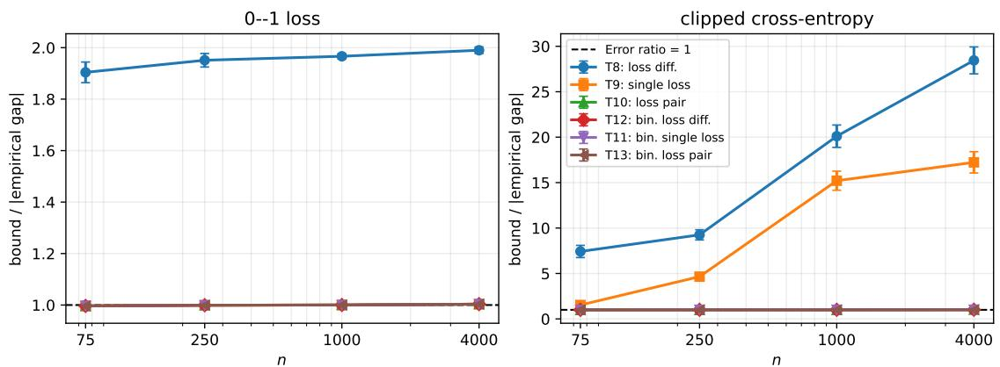
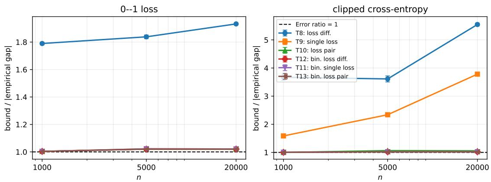
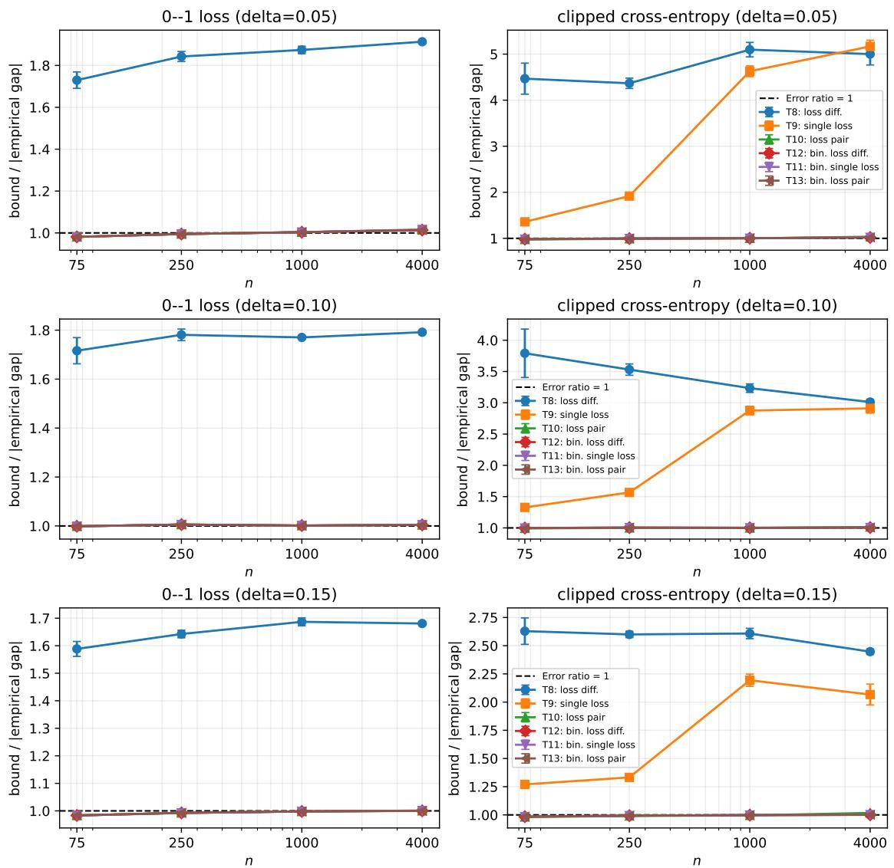
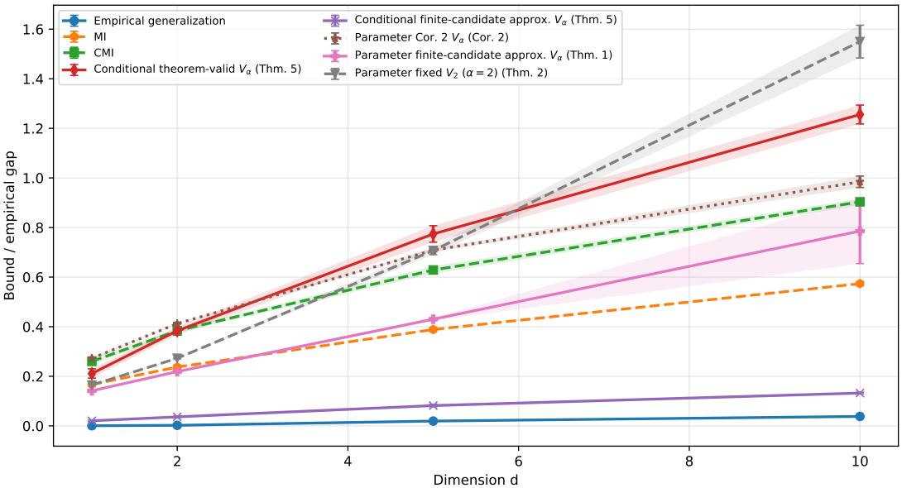
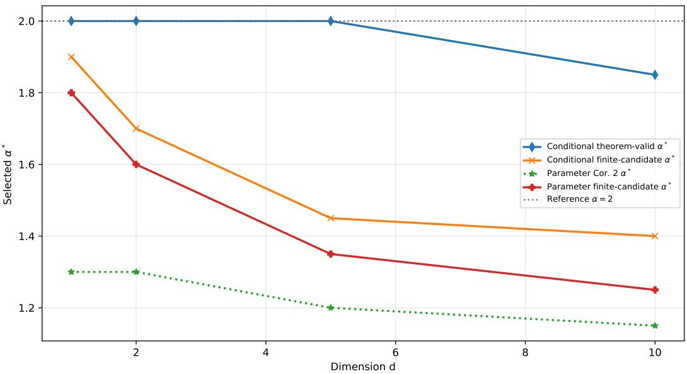
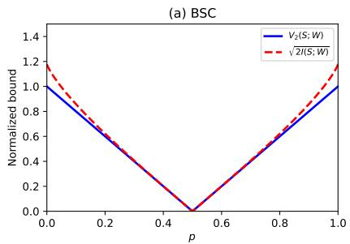
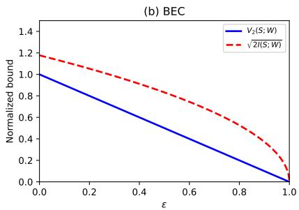
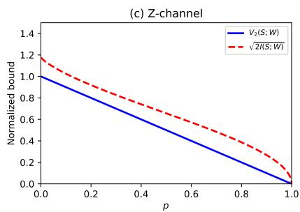
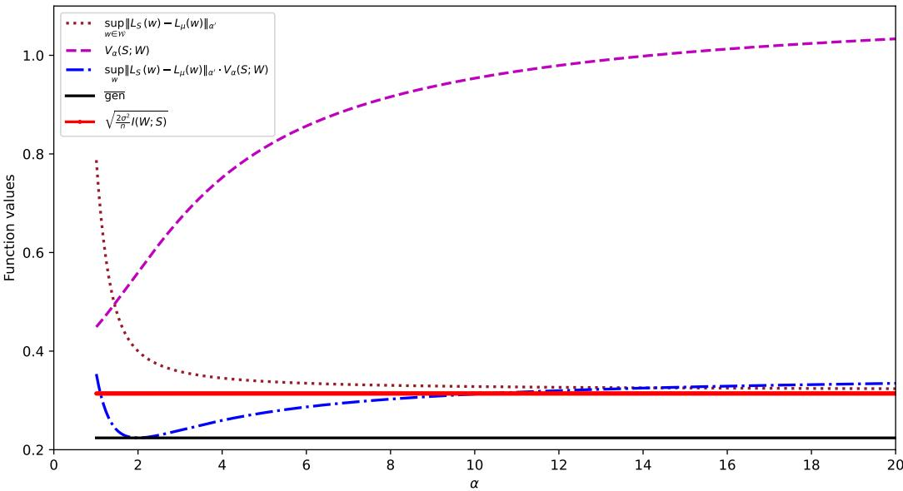

# Generalization Bounds via Vector-Valued $L _ { p }$ Correlation $V _ { \alpha }$

Mohammad Hossein Momeni Hamaneh

Mohammad Mahdi Mojahedian

Mohammad Hossein Yassaee

Information Systems and Security Laboratory (ISSL) Sharif University of Technology, Tehran, Iran

momenihamaneh1381@gmail.com, mojahedian@sharif.edu, yassaee@sharif.edu

## Abstract

Understanding generalization of randomized learning algorithms remains a central challenge. Mutual-information and total-variation bounds provide complementary ways to quantify data-hypothesis dependence, but they can behave quite differently in high-dimensional regimes. We study a one-parameter family of dependence measures, the vector-valued $L _ { p ^ { - } }$ norm correlation $V _ { \alpha } ,$ and derive generalization bounds whose dependence terms interpolate between total variation (TV) at α = 1 and variance and $\chi ^ { 2 }$ related behavior at $\alpha = 2$ . For $\alpha > 2 .$ , the Hölder-conjugate loss moment is below two, yielding heavy-tailed specializations that can remain finite even when the loss variance is infinite. A particularly interpretable specialization occurs at α = 2, where the bound can be expressed in terms of the variability of the algorithm's output density across datasets, $\textstyle \int { \sqrt { \operatorname { V a r } _ { S } [ p ( w \mid S ) ] } }$ dw. We show that the entire $V _ { \alpha }$ family is invariant under smooth bijective reparameterizations of the hypothesis space. We also introduce an adaptive density stability (ADS) condition that implies explicit control of $V _ { 2 }$ , and we verify it for Gibbs-type posteriors under bounded losses (yielding rates that depend on the inverse temperature and sample size). To address scaling, we extend the framework to a conditional formulation using supersamples, analogous in spirit to conditional mutual information (CMI), and discuss evaluations in the output space as a practical surrogate for estimating dependence. Simulations on Bayesian linear regression illustrate how tuning α can change the tightness of the resulting bounds across regimes. Additional supersample experiments on noisy MNIST and on a pretrained ResNet-50 for CIFAR-10 show similar behavior of the projected loss-space bounds beyond the original clean-MNIST setting.

## 1 Introduction

Understanding why large, over-parameterized models generalize despite their capacity to memorize training data remains a central challenge in modern machine learning (Shalev-Shwartz & Ben-David, 2014). Informationtheoretic approaches address this question by relating generalization to the dependence between the training sample S and the randomized output W of a learning algorithm. A representative result of Xu & Raginsky (2017) shows that, under a subgaussian loss assumption, the expected generalization gap is controlled by a mutual information (MI) term of the form $\sqrt { I ( S ; W ) / n }$

A large body of subsequent work has refined this basic principle. Conditional mutual information (CMI) bounds use a supersample construction to avoid measuring dependence directly between the full sample and the parameter vector (Steinke & Zakynthinou, 2020). Sample-wise and evaluated CMI variants further decompose the dependence into lower-dimensional quantities (Hellström & Durisi, 2022; Wang $\& \mathrm { ~ M a o ~ }$ , 2023), while more general divergence-based frameworks provide flexible decoupling inequalities (Wang & Mao, 2024). These developments show that the choice of dependence measure matters: different information quantities can lead to very different tightness, dimensional behavior, and estimability.

In this paper, we study a one-parameter family of dependence measures based on the vector-valued $L _ { p } { \mathrm { - n o r m } }$ correlation $V _ { \alpha }$ (Mojahedian et al., 2019). The parameter $\alpha \geq 1$ provides a tunable interpolation between the $L _ { 1 }$ endpoint at $\alpha = 1$ , corresponding to twice the total variation (TV) distance, and the variance and $\chi ^ { 2 }$ related behavior at $\alpha = 2$ , while larger values of α place greater emphasis on large likelihood-ratio deviations. This produces a family of generalization bounds in which the loss-sensitivity term and the dependence term move in opposite directions as α varies. For $\alpha > 2$ , the conjugate exponent $q = \alpha / ( \alpha - 1 )$ lies in $( 1 , 2 )$ , so the bound can be paired with lower-order loss moments even when the variance is infinite. Consequently, the best value of α is not universal, but can depend on the algorithm, loss, and data distribution.

The case $\alpha = 2$ has a particularly transparent interpretation. In this regime, the dependence term can be written in terms of the variability of the algorithm's output density across training samples, $\begin{array} { r } { \int \sqrt { \operatorname { V a r } _ { S } [ p ( w | S ) ] } } \end{array}$ dw. This connects generalization to a density-level notion of algorithmic stability. We also show that this V2-based quantity is invariant under smooth bijective reparameterizations of the hypothesis space, so the value of the bound is not an artifact of the coordinate system used to represent $W$

Directly estimating parameter-space quantities such as $V _ { \alpha } ( S ; W )$ or $V _ { \alpha } ( U ; W | \tilde { S } )$ can still be difficult in high-dimensional models. To address this, we develop a supersample conditional formulation and then derive projected and loss-space variants. These results do not imply that all dimension dependence disappears: the conditional dependence term can still be large if the learned object reveals substantial information about the selector. Rather, the conditional and projected bounds shift the analysis to quantities that can be lower-dimensional, more interpretable, and more amenable to empirical estimation.

Contributions. In summary, our primary contributions are:

1. A tunable $V _ { \alpha }$ -based generalization framework. We derive a family of information-theoretic generalization bounds based on $V _ { \alpha }$ . The bounds recover an $L _ { 1 } / \mathrm { T V - t y p e }$ endpoint at $\alpha = 1$ , a variance-based specialization at $\alpha = 2$ , and an $n ^ { - 1 / 2 }$ loss-sensitivity prefactor under subgaussian loss assumptions for $\alpha > 1$ . The full bound has $n ^ { - 1 / 2 }$ -type decay when the associated dependence term remains uniformly bounded in n. For $\alpha > 2$ , they also admit a heavy-tailed specialization requiring only a finite q-th centered loss moment, where $q = { \alpha } / { ( \alpha - 1 ) } \in ( 1 , 2 )$

2. A variance-based view of randomized algorithmic stability. We isolate the $\alpha = 2$ case and express the dependence term through the variability of the output density $p ( w | S )$ across datasets. More generally, we prove that $V _ { \alpha }$ is invariant under smooth bijective reparameterizations of the hypothesis space for every $\alpha \geq 1$

3. Adaptive Density Stability. We introduce Adaptive Density Stability (ADS), a strong pointwise distributional stability condition that gives explicit control of $V _ { 2 } ( S ; W )$ . For bounded losses, we verify ADS for fixed-temperature Gibbs posteriors of the form $p ( w | S )$ ∝ $\exp ( - \beta L _ { S } ( w ) ) \pi ( w )$ , obtaining $\gamma _ { n } = \mathcal { O } ( 1 / n )$ when $\beta$ and the loss bound are fixed.

4. Conditional, projected, and loss-space $V _ { \alpha }$ bounds. We extend the framework to a supersample formulation analogous in spirit to CMI. The resulting bounds measure dependence between the selector $U$ and the learned object conditional on the supersample S. We further derive projected output-space, loss-difference, loss-pair, and binarized variants that can reduce the effective dimension of the dependence term when the chosen statistic preserves the relevant selected-versus-ghost gap.

5. Empirical evaluation of the resulting estimators. We evaluate the proposed bounds and plug-in estimators on a supersample MNIST experiment, on a pretrained ResNet-50 for CIFAR-10, and on Bayesian linear regression simulations. The experiments illustrate how the choice of $\alpha ,$ the statistic used for projection, and binarization affect the empirical tightness and estimability of the resulting $V _ { \alpha } .$ -based quantities.

## 2 Preliminaries and Related Work

In this section, we establish the foundational concepts from statistical learning theory, contextualize our approach within the recent literature on information-theoretic bounds, and introduce the $V _ { \alpha }$ correlation measure.

## 2.1 Statistical Learning Setup

We follow the standard statistical learning framework. Let $\mathcal { Z } = \mathcal { X } \times \mathcal { Y }$ be the instance space and W be the hypothesis space. A learning algorithm maps a training sample $S = ( Z _ { 1 } , \ldots , Z _ { n } )$ , drawn i.i.d. from an unknown data-generating distribution $\mu ,$ to a hypothesis $W \in { \mathcal { W } }$ . This mapping is often randomized and is described by a conditional probability distribution $P _ { W | S }$ . The joint distribution over hypotheses and samples is $P _ { W , S } = \mu ^ { \otimes n } \otimes P _ { W | S }$

The performance of a hypothesis $w \in \mathcal { W }$ is measured by its population risk with respect to a loss function $\ell ( w , z )$ . $L _ { \mu } ( w ) : = \mathbb { E } _ { Z \sim \mu } [ \ell ( w , Z ) ]$ . Because $\mu$ is unknown, the algorithm minimizes the empirical risk $\begin{array} { r } { L _ { S } ( w ) : = \frac { 1 } { n } \sum _ { i = 1 } ^ { n } \ell ( w , Z _ { i } ) } \end{array}$ . The generalization gap is defined as $\operatorname { g e n } ( W , S ) : = L _ { \mu } ( W ) - L _ { S } ( W )$ . We consider the expected generalization error gen $( \mu , P _ { W | S } ) : = \mathbb { E } _ { P _ { W , S } } \left[ L _ { \mu } ( W ) - L _ { S } ( W ) \right]$ , and in this work we focus on bounding its absolute value, gen $\left( \mu , P _ { W | S } \right) \vert$ . Our analytical decoupling relies on the notion of subgaussianity, which bounds the tail probabilities of random variables.

Definition 1 (Vershynin (2018)). A zero-mean random variable X is $\sigma ^ { 2 }$ -subgaussian $i f$ its moment generating function satisfies E $[ \bar { e } ^ { \lambda X } ] \stackrel { \cdot } { \leq } e ^ { \lambda ^ { 2 } \stackrel { \cdot } { \sigma } ^ { 2 } / 2 }$ for all $\lambda \in \mathbb { R }$ . This implies a variance bound $\mathrm { { V a r } } [ X ] \leq \sigma ^ { 2 }$ . By Hoeffding's Lemma, any random variable bounded almost surely in [a, b] is $\frac { ( b - a ) ^ { 2 } } { 4 }$ -subgaussian.

Definition 2. The $L _ { \alpha }$ -norm of a random variable X is defined as $\| X \| _ { \alpha } = \left( \mathbb { E } \left[ | X | ^ { \alpha } \right] \right) ^ { 1 / \alpha }$ for $\alpha \geq 1$ . The $L _ { \alpha } { - } n o r m$ is an increasing function of α and is convex in X (and strictly convex $f o r \alpha > 1 )$

## 2.2 Information-Theoretic Bounds and Algorithmic Stability

The concept of algorithmic stability formalizes the intuition that algorithms insensitive to small changes in the training data generalize well (Bousquet & Elisseeff, 2002). Information-theoretic generalization bounds quantify this stability using dependence measures between the data $S$ and the weights W. A seminal result by Xu & Raginsky (2017) demonstrated that if $\ell ( w , Z )$ is $\sigma ^ { 2 }$ -subgaussian, then $\begin{array} { r } { \left| \overline { { \mathrm { g e n } } } ( \mu , P _ { W | S } ) \right| \le \sqrt { \frac { 2 \sigma ^ { 2 } } { n } I ( W ; S ) } } \end{array}$

Relation to PAC-Bayes. PAC-Bayes gives a complementary analysis of randomized predictors, including Gibbs posteriors, through a data-dependent posterior $Q _ { S }$ and a fixed prior π (McAllester, 1999; Seeger, 2002; Catoni, 2007; Germain et al., 2016). Its complexity term is typically $\operatorname { K L } ( Q _ { S } \| \pi )$ , whereas our unconditional dependence quantities compare $P _ { W | S }$ with the algorithm-induced marginal $P _ { W }$ . These reference choices satisfy

$$
\mathbb { E } _ { S } \big [ \mathrm { K L } ( P _ { W | S } | | \pi ) \big ] = I ( S ; W ) + \mathrm { K L } ( P _ { W } | | \pi ) .\tag{1}
$$

Thus the two frameworks are complementary rather than exact specializations of one another: PAC-Bayes typically provides prior-relative, high-probability risk bounds, while the present results target expected generalization gaps and also admit conditional and projected dependence measures. A numerical ordering for Gibbs posteriors cannot be determined from $\beta$ and the loss range alone, since the PAC-Bayes side additionally depends on the prior-relative KL term.

Scaling to High Dimensions. A known limitation of the classical MI bound is that $I ( S ; W )$ scales linearly with the number of parameters, making it vacuous for deep networks. To resolve this, Steinke & Zakynthinou (2020) introduced the CMI bound using a supersample framework, shifting the dependence to the sample size n. Recent advancements have further tightened these guarantees using sample-wise evaluations (Hellström & Durisi, 2022; Wang & Mao, 2023) and f-divergence frameworks (Wang & Mao, 2024). In Section 6, we adapt the supersample machinery to our $V _ { \alpha }$ measure, ensuring our framework is similarly equipped for high-dimensional regimes (see Appendix A for extended discussions).

Variance-Based Perspectives. Our work strongly intersects with recent research connecting generalization to variance. Gastpar et al. (2025) recently proved that an algorithm exhibits tight generalization if and only if the conditional variance of its population loss, $\mathrm { V a r } ( L _ { \mu } ( A ( S ) ) | S )$ , is small. While their work analyzes variance in the outcome (loss) space, our framework analyzes variance directly in the hypothesis space. As we will show in Section 4, our $\alpha = 2$ bound is controlled by $\operatorname { V a r } _ { S } [ p ( w | S ) ]$ . This offers a complementary, distribution-centric definition of stability that is invariant under reparameterization.

## 2.3 The $V _ { \alpha }$ Correlation Measure

To unify these perspectives, our framework is built upon the vector-valued $L _ { p } .$ -norm correlation measure $V _ { \alpha } ( A ; B )$ , introduced by Mojahedian et al. (2019). For a joint distribution $p _ { A B }$ and marginals $p _ { A } , p _ { B }$ , the measure is defined for any $\alpha \geq 1$ as:

$$
V _ { \alpha } ( A ; B ) : = \mathbb { E } _ { b \sim p _ { B } } \left[ \left( \mathbb { E } _ { a \sim p _ { A } } \left| \frac { p _ { B | A } ( b | a ) } { p _ { B } ( b ) } - 1 \right| ^ { \alpha } \right) ^ { 1 / \alpha } \right] .\tag{2}
$$

The measure is non-decreasing in α and provides a tunable bridge between well-known dependence measures. For $\alpha = 1$ , it equals the $L _ { 1 }$ distance, i.e., twice the total variation distance: $V _ { 1 } ( A ; B ) = \| p _ { A B } - p _ { A } p _ { B } \| _ { 1 } =$ $2 \mathrm { T V } ( P _ { A B } , P _ { A } P _ { B } )$ . For $\alpha > 1$ , it acts as an exponential divergence metric closely related to the Rényi mutual information of order α (Mojahedian et al., 2019).

A key property of $V _ { \alpha }$ , which is central to its analytical tractability, is its convexity. It can be expressed as a sum (or integral) of the $L _ { \alpha }$ -norms of the conditional density deviations:

$$
V _ { \alpha } ( A ; B ) = \int _ { B } \left\| p _ { B | A } ( b | \cdot ) - p _ { B } ( b ) \right\| _ { \alpha , p _ { A } } d b .\tag{3}
$$

Since the $L _ { \alpha } .$ -norm is convex for $\alpha \ge 1 , V _ { \alpha } ( A ; B )$ is convex with respect to the conditional distributions. This property enables optimization-based interpretations and facilitates the decoupling analysis required for generalization bounds.

## 3 The $V _ { \alpha }$ Information Framework

Having established the necessary preliminaries, we now present our main $V _ { \alpha }$ -based decoupling framework. We first bound the absolute expected generalization error by (i) a loss-sensitivity term and (ii) a dependence term measured by $V _ { \alpha }$ . We then discuss how, under standard subgaussian assumptions, the explicit loss-sensitivity prefactor scales as $\mathcal { O } ( n ^ { - 1 / 2 } )$ for any $\alpha > 1 ;$ the complete bound inherits this rate whenever the corresponding dependence term remains $\mathcal { O } ( 1 )$ in $n .$

A note on dimensionality. The bounds in this section evaluate stability directly in the hypothesis space W. This is conceptually useful, but in over-parameterized models parameter-space dependence measures can be very large and difficult to estimate. In Section 6 we introduce a scalable conditional supersample formulation that measures dependence in the selector space rather than directly in W.

## 3.1 A general bound on the generalization error

Our main theorem gives a one-parameter family of bounds on the absolute expected generalization error.   
The proof is a standard change-of-measure plus Hölder-decoupling argument and is given in Appendix B.1.

Theorem 1 (General $V _ { \alpha }$ bound). For any learning algorithm and any measurable loss for which the displayed quantities are well-defined, for every $\alpha \geq 1$

$$
\left| \overline { { \mathrm { g e n } } } ( \mu , P _ { W | S } ) \right| \le \operatorname * { s u p } _ { w \in { \mathcal W } } \left\| { \cal L } _ { S } ( w ) - { \cal L } _ { \mu } ( w ) \right\| _ { \alpha ^ { \prime } , S } V _ { \alpha } ( S ; W ) ,\tag{4}
$$

where $\alpha ^ { \prime }$ is the Hölder conjugate of α $( i . e . , 1 / \alpha + 1 / \alpha ^ { \prime } = 1$ , with $\alpha ^ { \prime } = \infty$ when $\alpha = 1 )$ . Here $\| \cdot \| _ { \alpha ^ { \prime } , S }$ is the $L _ { \alpha ^ { \prime } }$ norm with respect to the law of $S \sim \mu ^ { \otimes n }$

Theorem 1 should therefore be viewed as the master one-parameter decoupling bound: the cases $\alpha = 1$ and $\alpha = 2$ are particularly interpretable reference regimes within the same family, rather than separate analyses. while intermediate values trade off the loss-sensitivity and dependence terms.

Symmetric form. A symmetric variant obtained by swapping the roles of S and $W$ is stated and proved in Appendix B.2.

## 3.2 Subgaussian specialization (rate form)

Assume that for all $w \in \mathcal { W }$ , the single-sample loss $\ell ( w , Z )$ is $\sigma ^ { 2 }$ -subgaussian under $Z \sim \mu .$ Then for any $\alpha > 1$ , the empirical risk deviation $L _ { S } ( w ) - L _ { \mu } ( w )$ is $( \sigma ^ { 2 } / n )$ -subgaussian, and hence admits moment control of the form

$$
\operatorname* { s u p } _ { w \in \mathcal { W } } \left\| \boldsymbol { L } _ { S } ( w ) - \boldsymbol { L } _ { \mu } ( w ) \right\| _ { \alpha ^ { \prime } , S } \lesssim \sigma \sqrt { \frac { \alpha ^ { \prime } } { n } } .\tag{5}
$$

Substituting equation 5 into Theorem 1 yields the rate form

$$
\left| \overline { { \mathrm { g e n } } } ( \mu , P _ { W | S } ) \right| \lesssim \sigma \sqrt { \frac { \alpha ^ { \prime } } { n } } V _ { \alpha } ( S ; W ) , \qquad \alpha > 1 .\tag{6}
$$

An explicit constant (involving a Gamma-function expression) is stated and proved in Appendix B.3. As α varies, the two factors in equation 6 move in opposite directions: $V _ { \alpha }$ is non-decreasing in α (Mojahedian et al., 2019), whereas the loss-sensitivity factor depends on $\alpha ^ { \prime }$ and decreases as α increases.

The $n ^ { - 1 / 2 }$ factor here is the explicit loss-moment contribution. The complete right-hand side in equation 6 scales as $\mathcal { O } ( n ^ { - 1 / 2 } )$ only under corresponding control of $V _ { \alpha } ( S ; W )$ , for example when it is uniformly $\mathcal { O } ( 1 )$ in $n ;$ if the dependence term itself decreases with n, the resulting rate can be faster.

## 3.3 Recovering $n ^ { - 1 / 2 }$ rates and the $\alpha = 1$ regime

A critical requirement for any generalization bound is that it decays with sample size n, typically at $\mathcal { O } ( n ^ { - 1 / 2 } )$ A direct application of Theorem 1 at $\alpha = 1 \ ( \sec \alpha ^ { \prime } = \infty )$ yields a worst-case loss deviation:

$$
\Bigl | \overline { { \mathrm { g e n } } } ( \mu , P _ { W | S } ) \Bigr | \le \operatorname* { s u p } _ { w \in \mathcal { W } } \Bigl \{ \mathrm { e s s } \operatorname* { s u p } _ { S \sim \mu \otimes n } \bigl | L _ { S } ( w ) - L _ { \mu } ( w ) \bigr | \Bigr \} \cdot V _ { 1 } ( S ; W ) .\tag{7}
$$

Here $V _ { 1 } ( S ; W ) = \| P _ { W , S } - P _ { W } P _ { S } \| _ { 1 } = 2 \mathrm { T V } ( P _ { W , S } , P _ { W } P _ { S } )$ . By Pinsker's inequality, $\| P _ { W , S } - P _ { W } P _ { S } \| _ { 1 } \le$ $\sqrt { 2 I ( S ; W ) }$ , so one may further upper-bound the dependence term using mutual information. However, the $L _ { \infty }$ loss term in equation 7 is a worst-case deviation over datasets and is often $\mathcal { O } ( 1 )$ , rather than decaying with n.

This lack of an $\mathcal { O } ( n ^ { - 1 / 2 } )$ rate at $\alpha = 1$ is an artifact of the strict worst-case $L _ { \infty }$ limit. In contrast, for every $\alpha > 1$ , the conjugate $\alpha ^ { \prime } < \infty$ and subgaussianity yields moment control of $L _ { S } ( w ) - L _ { \mu } ( w )$ , producing the $\mathcal { O } ( n ^ { - 1 / 2 } )$ loss-sensitivity factor in equation $6 ;$ the rate of the complete bound also depends on how $V _ { \alpha } ( S ; W )$ varies with n. Thus, by moving away from the $L ^ { 1 } / L ^ { \infty }$ endpoint and choosing $\alpha > 1$ (including $\alpha = 2$ in Section 4), we retain probability-space dependence control while recovering fast statistical rates.

Relation to canonical mutual information. No value of α in Theorem 1 exactly reproduces the canonical MI bound. The $V _ { \alpha }$ family controls an $L _ { \alpha }$ norm of the centered likelihood ratio, whereas mutual information averages a logarithm of the likelihood ratio. $\mathrm { A t } \alpha = 1 , V _ { 1 }$ is the $L _ { 1 }$ distance (twice total variation), so Pinsker's inequality relates this endpoint to $I ( S ; W )$ , but the accompanying loss term remains the $L _ { \infty }$ deviation in equation 7. Thus the $V _ { \alpha }$ and canonical MI approaches are complementary rather than exact specializations of one another.

## 3.4 Heavy-tailed example: finite lower-order moments

The continuum beyond $\alpha = 2$ has a useful interpretation when the loss is heavy-tailed. Let $q : = \alpha ^ { \prime } = \alpha / ( \alpha - 1 )$ For $\alpha > 2$ , we have $q \in ( 1 , 2 )$ , so Theorem 1 can be controlled using a lower-order moment even when a second moment does not exist.

Corollary 1 (Heavy-tailed specialization). Fix $\alpha > 2$ and set $q = { \alpha } / { ( \alpha - 1 ) } \in ( 1 , 2 )$ . Suppose

$$
M _ { q } : = \operatorname* { s u p } _ { w \in \mathcal W } \left( \mathbb E _ { Z \sim \mu } \left| \ell ( w , Z ) - L _ { \mu } ( w ) \right| ^ { q } \right) ^ { 1 / q } < \infty .\tag{8}
$$

Then

$$
\left| \overline { { \mathrm { g e n } } } ( \mu , P _ { W | S } ) \right| \le 2 ^ { 1 / q } n ^ { - 1 / \alpha } M _ { q } V _ { \alpha } ( S ; W ) .\tag{9}
$$

The proof, given in Appendix B.4, follows from the von Bahr-Esseen moment inequality. Corollary 1 remains informative for losses with infinite variance provided the centered q-th moment in equation 8 is finite. The price for this weaker moment assumption is the slower generic rate $n ^ { - 1 / \alpha } = n ^ { - ( 1 - 1 / q ) }$ , instead of the $n ^ { - 1 / 2 }$ rate associated with finite-variance or subgaussian control. If either $M _ { q }$ or $V _ { \alpha } ( S ; W )$ is infinite, the specialization is valid but vacuous.

The endpoint $\alpha = \infty$ . As $\alpha  \infty$ , the conjugate exponent satisfies $q = \alpha ^ { \prime } \downarrow 1$ . The corresponding dependence endpoint is

$$
V _ { \infty } ( S ; W ) : = \mathbb { E } _ { W \sim P _ { W } } \left[ \mathrm { e s s } \operatorname* { s u p } _ { S \sim P _ { S } } \left| \frac { p ( W \mid S ) } { p ( W ) } - 1 \right| \right] .\tag{10}
$$

Applying the $L _ { 1 } { - } L _ { \infty }$ Hölder inequality directly to the same change-of-measure identity used in Theorem 1 gives

$$
\left| \overline { { \mathrm { g e n } } } ( \mu , P _ { W | S } ) \right| \le \operatorname * { s u p } _ { w \in \mathcal W } \mathbb { E } _ { S } \left| L _ { S } ( w ) - L _ { \mu } ( w ) \right| V _ { \infty } ( S ; W ) .\tag{11}
$$

For a discrete hypothesis space,

$$
V _ { \infty } ( S ; W ) = \sum _ { w \in \mathcal { W } } \exp s s \operatorname* { s u p } _ { s \sim P s } | p ( w \mid s ) - p ( w ) | .\tag{12}
$$

Thus the “worst-case" aspect of the $\alpha = \infty$ endpoint is the essential-supremum deviation of the algorithm's conditional output law over datasets. The loss factor itself is only a mean absolute deviation. With only a first-moment assumption, no universal polynomial decay rate in n follows without additional tail or regularity assumptions.

## 4 The Variance Perspective: $\alpha = 2$

An important feature of the $V _ { \alpha }$ framework is its ability to interpolate between different types of generalization guarantees.

For $\alpha = 2$ , the Hölder conjugate is $\alpha ^ { \prime } = 2$ . The $L _ { \mathrm { { 2 } } } \mathrm { { - n o r m } }$ of the zero-mean random variable $L _ { S } ( w ) - L _ { \mu } ( w )$ is, by definition, its standard deviation. This specialization yields a direct and intuitive connection between generalization and the variance of the learning algorithm's output distribution.

Theorem 2. Suppose the loss $\ell ( w , Z )$ is $\sigma ^ { 2 }$ -subgaussian under $Z \sim \mu$ for all $w \in \mathcal { W }$ . Then the expected generalization error is bounded as:

$$
\left| \overline { { \mathrm { g e n } \left( \mu , P _ { W | S } \right) } } \right| \leq \int _ { \mathcal { W } } \sqrt { \frac { \sigma ^ { 2 } } { n } } \mathrm { V a r } _ { S } \Big [ p ( w | S ) \Big ] \ : d w .\tag{13}
$$

Remark 1. For discrete hypothesis spaces, the integral is replaced by a sum.

Proof Sketch. For $\alpha = 2$ , Corollary 2 simplifies, giving $| \overline { { \mathrm { g e n } } } | \leq 2 \sqrt { \frac { \sigma ^ { 2 } } { n } } V _ { 2 } ( S ; W )$ . The theorem follows by applying an identity from Mojahedian et al. (2019, Sec. III), which demonstrates that $V _ { 2 } ( S ; W ) =$ $\begin{array} { r } { \int _ { \mathcal { W } } \sqrt { \operatorname { V a r } _ { S } [ p ( w | S ) ] } } \end{array}$ dw. In Appendix C.1, we refine this argument and show that the leading constant 2 can be removed, yielding the tighter bound stated in the theorem. □

The bound in Theorem 2 reveals a direct link between generalization and algorithmic stability. The term $\operatorname { V a r } _ { S } [ p ( w | S ) ]$ quantifies the variability of the algorithm's output probability density across different training samples. High variance implies that the algorithm's decision-making is highly sensitive to the specific realization of the training data—a hallmark of overfitting—which penalizes the bound. Conversely, low variance implies robustness, leading to a tighter generalization guarantee.

Relationship to Existing Stability Notions. We emphasize that this variance-based notion of stability is distinct from classical deterministic measures like uniform stability (Bousquet & Elisseeff, 2002). While uniform stability offers a worst-case guarantee on the change in the loss function from altering a single data point, our measure captures the average-case sensitivity of the entire output probability distribution.

Furthermore, our framework provides a timely complement to recent variance-based perspectives on learnability. For instance, Gastpar et al. (2025) recently established that algorithms exhibit tight generalization bounds when the conditional variance of their population loss given the sample, Var $\cdot ( L _ { \mu } ( A ( S ) ) | S )$ , is small. While their work focuses on variance in the outcome (loss) space, our $V _ { 2 }$ measure operates directly on the algorithm's output probability distribution, $\operatorname { V a r } _ { S } [ p ( w | S ) ]$ . Thus, our approach measures algorithmic stability intrinsically within the hypothesis space, offering a parallel, distribution-centric view of generalization.

## 4.1 A Geometric Advantage: Reparameterization Invariance

A common criticism of bounds evaluated directly in the hypothesis space W is that they can be arbitrarily manipulated by changing the parameterization of the model (e.g., scaling the weights of a neural network while adjusting the activations to leave the function unchanged).

The reparameterization property is not specific to the variance identity at $\alpha = 2 \colon$ the entire $V _ { \alpha }$ family is invariant under any smooth bijective coordinate change that is independent of the training sample. The $\alpha = 2$ case remains especially interpretable because it also admits the density-variance representation in Theorem 2.

Theorem 3 (Reparameterization Invariance of $V _ { \alpha } ) . ~ L e t \phi : \mathcal { W } \to \mathcal { V }$ be a bijective differentiable transformation with differentiable inverse, let $V = \phi ( W )$ , and assume the relevant densities exist. Then, for every $\alpha \geq 1$

$$
V _ { \alpha } ( S ; W ) = V _ { \alpha } ( S ; V ) .\tag{14}
$$

Proof Sketch. Let $v = \phi ( w )$ and write $J _ { \phi } ( w )$ for the Jacobian. The conditional and marginal densities transform with the same Jacobian factor:

$$
p _ { V | S } ( v \mid s ) = p _ { W | S } ( w \mid s ) | \operatorname* { d e t } J _ { \phi } ( w ) | ^ { - 1 } ,\tag{15}
$$

$$
p _ { V } ( v ) = p _ { W } ( w ) | \operatorname* { d e t } J _ { \phi } ( w ) | ^ { - 1 } .\tag{16}
$$

Hence the likelihood-ratio deviation is unchanged,

$$
\frac { p _ { V | S } ( v \mid s ) } { p _ { V } ( v ) } - 1 = \frac { p _ { W \mid S } ( w \mid s ) } { p _ { W } ( w ) } - 1 .\tag{17}
$$

Since $P _ { V }$ is the pushforward of $P _ { W }$ under $\phi ,$ substituting this identity into the definition of $V _ { \alpha }$ gives $V _ { \alpha } ( S ; V ) = V _ { \alpha } ( S ; W )$ . Equivalently, in the density-deviation form, the inverse Jacobian multiplying the density difference cancels the Jacobian in dv. The full proof is given in Appendix C.2. □

Thus the dependence term in every member of the $V _ { \alpha }$ family is coordinate-invariant under such reparameterizations. For $\alpha = 2$ , this general invariance agrees with the direct Jacobian cancellation visible in the density-variance formula

## 5 Adaptive Density Stability (ADS) & Practical Rates

The variance-based bound in Theorem 2 provides a powerful conceptual link between stability and generalization. However, a key theoretical question remains: under what formal conditions on a learning algorithm is the variance term $\operatorname { V a r } _ { S } [ p ( w | S ) ]$ guaranteed to be small enough to yield a non-vacuous, decaying generalization bound?

To address this, we introduce a novel, strong stability condition. We then show that algorithms satisfying this condition achieve standard $\mathcal { O } ( 1 / n )$ generalization rates within our $V _ { 2 }$ framework.

Definition 3 (Adaptive Density Stability). A learning algorithm is said to be $( \gamma _ { n } , n )$ -adaptively density stable if for all datasets $S , S ^ { \prime }$ of size n that differ in exactly one sample, and for all hypotheses w $\in \mathcal W$ , the following holds:

$$
| p ( w | S ) - p ( w | S ^ { \prime } ) | \leq \gamma _ { n } p ( w ) ,\tag{18}
$$

where $p ( w ) = \mathbb { E } _ { S } [ p ( w | S ) ]$ is the marginal distribution, and the stability parameter $\gamma _ { n }$ may depend on the sample size n.

This definition formalizes a notion of distributional stability where the allowed change in the output density at a point w is restricted relative to the marginal probability $p ( w )$ . This adaptively places a stronger stability constraint on the low-probability tails of the output distribution. As shown in Appendix D, this strong, pointwise condition implies classical TV stability and Expected Uniform Stability.

Our main result in this section shows that algorithms satisfying ADS have a strictly controlled $V _ { 2 }$ measure, yielding a generalization bound.

Theorem 4. If a learning algorithm is $( \gamma _ { n } , n )$ -adaptively density stable, then its $V _ { 2 }$ correlation measure is bounded by:

$$
V _ { 2 } ( S ; W ) \leq \gamma _ { n } \sqrt { \frac { n } { 2 } } .\tag{19}
$$

Consequently, for a $\sigma ^ { 2 }$ -subgaussian loss, the generalization error is bounded by:

$$
\left| { \overline { { \mathrm { g e n } } } } \left( \mu , P _ { W | S } \right) \right| \leq { \frac { \sigma \gamma _ { n } } { \sqrt { 2 } } } .\tag{20}
$$

Proof Sketch. The proof applies the Efron-Stein inequality to bound the variance of the density ratio, avoiding direct integration over high-probability volumes. The full proof is provided in Appendix E.1. □

On Non-Vacuousness and Practical Algorithms. At first glance, the bound $\frac { \sigma \gamma _ { n } } { \sqrt { 2 } }$ appears independent of n. The utility of this theorem hinges entirely on whether a learning algorithm possesses a stability parameter $\gamma _ { n }$ that decays with n. As a concrete sufficient example, we verify this property for fixed-temperature Gibbs posteriors under bounded losses.

Example 5.1 (Gibbs Posteriors satisfy ADS). Consider a learning algorithm that outputs a Gibbs posterior, $p ( w | S ) \propto \exp ( - \beta L _ { S } ( w ) ) \pi ( w )$ . This distribution is related to the invariant target of idealized Langevin dynamics under suitable regularity conditions; the ADS calculation below is a statement about the Gibbs posterior itself and does not establish ADS for finite-step or finite-time SGLD iterates. Suppose the loss function $\ell ( w , z )$ is bounded in [0, M]. If we change a single data point $z _ { i }$ to $z _ { i } ^ { \prime } ,$ the empirical risk changes by at most $\Delta L _ { S } = M / n$ . Consequently, the ratio of the unnormalized densities is bounded by $\exp ( \beta M / n )$ This implies the algorithm satisfies e-Differential Privacy (DP) with $\epsilon = 2 \beta M / n$ , yielding:

$$
e ^ { - \epsilon } \leq \frac { p ( w | S ) } { p ( w | S ^ { \prime } ) } \leq e ^ { \epsilon } .\tag{21}
$$

To relate this local guarantee to the marginal distribution $p ( w )$ , we invoke a standard group privacy argument: extending the above bound along a path of neighboring datasets yields a uniform bound $p ( w | S ) \leq e ^ { n \epsilon } p ( w )$

for all datasets $S .$ Using this together with the DP inequality, we convert the ratio bound into a difference bound:

$$
\begin{array} { r } { | p ( w | S ) - p ( w | S ^ { \prime } ) | \leq ( e ^ { \epsilon } - 1 ) \operatorname* { m a x } \{ p ( w | S ) , p ( w | S ^ { \prime } ) \} \leq ( e ^ { \epsilon } - 1 ) e ^ { 2 \beta M } p ( w ) . } \end{array}
$$

Thus, the Gibbs posterior is $( \gamma _ { n } , n )$ -adaptively density stable with $\gamma _ { n } = \left( e ^ { \frac { 2 \beta M } { n } } - 1 \right) e ^ { 2 \beta M }$ . For sufficiently large n, a first-order Taylor expansion yields $\begin{array} { r } { \gamma _ { n } \approx \frac { 2 \beta M } { n } e ^ { 2 \beta M } = \mathcal { O } ( 1 / n ) } \end{array}$

This $\mathcal { O } ( 1 / n )$ statement is a fixed-temperature statement. For $0 \leq \ell \leq M$ , Hoeffding's lemma gives $\sigma = M / 2$ and Theorem 4 yields

$$
B _ { \mathrm { A D S } } = { \frac { M } { 2 { \sqrt { 2 } } } } e ^ { 2 \beta M } \left( e ^ { 2 \beta M / n } - 1 \right) = { \frac { \beta M ^ { 2 } e ^ { 2 \beta M } } { \sqrt { 2 } n } } + { \mathcal { O } } ( n ^ { - 2 } )\tag{22}
$$

when $\beta M$ is fixed. Hence the constant grows rapidly with $\beta M ;$ in particular, if $\beta = \Theta ( n )$ with fixed $M ,$ this certificate becomes exponentially conservative. The fast rate should therefore not be interpreted as uniform non-vacuousness over inverse temperature.

At fixed $\beta M$ , substituting this decay into Theorem 4 gives the corresponding $\mathcal { O } ( 1 / n )$ generalization rate:

$$
\left| \overline { { \mathrm { g e n } } } \left( \mu , P _ { W | S } \right) \right| \leq \frac { \sigma } { \sqrt { 2 } } \cdot \mathcal { O } \left( \frac { 1 } { n } \right) = \mathcal { O } \left( \frac { 1 } { n } \right) .\tag{23}
$$

This establishes a concrete pathway from the abstract variance-based $V _ { 2 }$ bound to finite-sample guarantees for fixed-temperature Gibbs posteriors; extensions to other stochastic algorithms require algorithm-specific ADS arguments.

## 6 Scaling to High Dimensions via Conditional and Projected $V _ { \alpha }$ Bounds

The bounds in Sections 3 and 4 measure dependence directly between the training sample $S$ and the learned hypothesis W. This parameter-space dependence can be difficult to estimate and can grow quickly in over-parameterized models. To obtain bounds whose information term is sample-size limited (as in conditional mutual information arguments (Steinke $\&$ Zakynthinou, 2020)), we move to a supersample formulation and measure how much the algorithm reveals about the selector that chooses which examples are used for training

Let

$$
\tilde { S } = \{ ( \tilde { Z } _ { i , 0 } , \tilde { Z } _ { i , 1 } ) \} _ { i = 1 } ^ { n }
$$

be a supersample of 2n i.i.d. examples from $\mu .$ Let

$$
U = ( U _ { 1 } , \dots , U _ { n } ) \sim { \mathrm { U n i f } } ( \{ 0 , 1 \} ^ { n } )
$$

be independent of ${ \tilde { S } } .$ The selected training sample and ghost sample are

$$
S _ { i } = \tilde { Z } _ { i , U _ { i } } , \qquad \bar { S } _ { i } = \tilde { Z } _ { i , 1 - U _ { i } } .
$$

The learning algorithm is run on $S$ and outputs W. For fixed ${ \tilde { S } } ,$ define the selected-versus-ghost gap

$$
\hat { \Delta } _ { \tilde { S } } ( w , U ) : = \frac { 1 } { n } \sum _ { i = 1 } ^ { n } \left[ \ell ( w , \tilde { Z } _ { i , 1 - U _ { i } } ) - \ell ( w , \tilde { Z } _ { i , U _ { i } } ) \right] .\tag{24}
$$

The standard supersample identity gives

$$
\mathrm { g e n } ( \mu , P _ { W | S } ) = \mathbb { E } _ { \tilde { S } , U , W } \left[ \hat { \Delta } _ { \tilde { S } } ( W , U ) \right] .
$$

Measure-theoretic convention. All density ratios below are interpreted as Radon-Nikodym derivatives with respect to the relevant marginal law. If the corresponding derivative or integrability condition fails, the associated $V _ { \alpha }$ quantity is interpreted as +∞.

A single decoupling principle. All conditional, projected, sample-wise, and binarized bounds in this section follow from a centered change-of-measure/Hölder decoupling lemma together with a conditional data-processing inequality for $V _ { \alpha }$ ; both are stated and proved in Appendix F.

## 6.1 Conditional $V _ { \alpha }$ bound

For every fixed w and ${ \tilde { S } } _ { : }$ the map $U \mapsto \hat { \Delta } _ { \tilde { S } } ( w , U )$ is centered under the uniform selector:

$$
\mathbb { E } _ { U } \Big [ \hat { \Delta } _ { \tilde { S } } ( w , U ) \Big ] = 0 .
$$

Applying the master decoupling lemma from Appendix F with conditioning variable $C = \tilde { S }$ yields the following bound.

Theorem 5 (Conditional $V _ { \alpha }$ generalization bound). For any learning algorithm and any measurable loss for which the displayed quantities are well-defined, for every $\alpha \geq 1$ 2

$$
\begin{array} { r } { \left| \overline { { \mathrm { g e n } } } ( \mu , P _ { W | S } ) \right| \leq \mathbb { E } _ { \tilde { S } } \left[ \mathrm { e s s } \operatorname* { s u p } _ { w \in \mathcal { W } } \left\| \hat { \Delta } _ { \tilde { S } } ( w , U ) \right\| _ { \alpha ^ { \prime } , U } V _ { \alpha } ( U ; W | \tilde { S } ) \right] , } \end{array}\tag{25}
$$

where $\alpha ^ { \prime }$ is the Hölder conjugate of α and

$$
V _ { \alpha } ( U ; W | \tilde { S } ) : = \mathbb { E } _ { W \sim P _ { W | \tilde { S } } } \left[ \left( \mathbb { E } _ { U } \left| \frac { P _ { W | U , \tilde { S } } } { P _ { W | \tilde { S } } } ( W | U , \tilde { S } ) - 1 \right| ^ { \alpha } \right) ^ { 1 / \alpha } \right] .\tag{26}
$$

Theorem 5 replaces dependence on the full sample S by dependence on the discrete selector $U \in \{ 0 , 1 \} ^ { n }$ This can mitigate the dimension-scaling issues of parameter-space quantities, but the dependence term may still be large if the learned object nearly determines the selector.

## 6.2 Projected and estimable variants (overview)

Estimating $V _ { \alpha } ( U ; W | \tilde { S } )$ can still be difficult when W is high dimensional. A natural remedy is to replace W by a lower-dimensional statistic that determines the supersample gap $\hat { \Delta } _ { \tilde { S } } ( W , U )$ , e.g. supersample predictions, loss differences, or evaluated losses. A conditional data-processing inequality ensures that such post-processing cannot increase the $V _ { \alpha }$ term. We state and prove a hierarchy of theorem-valid projected, sample-wise, and binarized bounds in Appendix $\mathrm { G } ;$ Table 1 summarizes the resulting options and the statistic used in each case.

## 7 Experiments

We empirically evaluate the proposed sample-wise and binarized $V _ { \alpha }$ bounds using the BinaryJS experimental pipeline of Dong et al. (2025). Specifically, we retain its binary MNIST 4-vs.-9 CNN and pretrained ResNet-50 CIFAR-10 configurations, and augment the evaluation with the proposed $V _ { \alpha }$ -based quantities described below. For each $n \in \{ 7 5 , 2 5 0 , 1 0 0 0 , 4 0 0 0 \}$ , we draw a supersample $\tilde { S } = \{ ( \tilde { Z } _ { i , 0 } , \tilde { Z } _ { i , 1 } ) \} _ { i = 1 } ^ { n }$ and selector $U \in \{ 0 , 1 \} ^ { n }$ train a CNN on $\{ \tilde { Z } _ { i , U _ { i } } \} _ { i = 1 } ^ { n }$ , and use $\{ \tilde { Z } _ { i , 1 - U _ { i } } \} _ { i = 1 } ^ { n }$ as the ghost sample. We use 5 independent supersample seeds and 30 selector seeds per supersample, train for 200 epochs, and evaluate all quantities at the final checkpoint. Both 0-1 loss and clipped cross-entropy are evaluated on the full supersample.

We focus on conditional, coordinatewise loss-space bounds because the full-vector quantities are difficult to estimate from only 30 MNIST (or 40 CIFAR-10) selector runs at fixed ${ \tilde { S } } .$ For each coordinate $i ,$ we estimate the law of $( U _ { i } , T _ { i } ) \mid \tilde { S }$ separately, evaluate its bound contribution, and then average over coordinates and supersamples. We compare the loss-difference bound (Theorem 8), the side-averaged single-loss bound (Theorem 9), the loss-pair bound (Theorem 10), and their binarized counterparts (Theorems 11, 12, and 13), using the conditional forms in Appendix G.9. In the figures and discussion below, T8-T13 denote the corresponding conditional estimators described above.

  
Figure 1: Ratio between estimated bound increments and the empirical selected-versus-ghost gap on MNIST 4 vs. 9. Left: 0-1 loss. Right: clipped cross-entropy. The dashed line denotes ratio 1. Error bars show the standard error of the mean (SEM) over five supersample seeds.

For the fair binary selectors used here, the coordinatewise quantities are independent of α (Lemma 4). We plot the mean, over supersample seeds, of the estimated bound increment divided by the corresponding absolute empirical selected-versus-ghost gap. These are descriptive plug-in comparisons rather than finite-sample certificates. The Bayesian linear regression (BLR) experiments (Appendix I) separately examine α tuning using disjoint Monte Carlo pools for selection and evaluation

Figure 1 shows that for 0–1 loss, T9–T13 lie close to the empirical gap, whereas the bounded loss-difference curve (T8) has ratios of about 1.9–2.0. For clipped cross-entropy, the loss-pair and binarized estimates (T10–T13) remain close to ratio 1 across the displayed sample sizes. T8 and T9 are more conservative, with ratios increasing from about 7.4 to 28.4 and 1.5 to 17.2, respectively. T8 uses a worst-case range factor in place of the local loss-difference magnitude. Thus, these results favor the loss-pair and binarized statistics for empirical tightness in this setting.

For clipped cross-entropy, the same separation between T8/T9 and T10-T13 is observed under MNIST label-noise probabilities 0.05, 0.10, and 0.15 (Appendix H.1).

CIFAR-10. Using the pretrained ResNet-50 configuration from the BinaryJS pipeline (Dong et al., 2025), we evaluate the same conditional, coordinatewise quantities for $n \in \{ 1 0 0 0 , 5 0 0 0 , 2 0 0 0 0 \}$ . Figure 2 shows that T9–T13 remain close to ratio 1 for 0–1 loss, whereas T8 is about 1.8-1.9. For clipped cross-entropy, T10–T13 remain close to the empirical gap, while T8 and T9 are more conservative. This reproduces the main qualitative separation seen on MNIST in a larger model and a ten-class task.

Bayesian linear regression (BLR). To complement the supersample MNIST study (which focuses on estimability of the sample-wise loss-space bounds), we also evaluate the parameter-space and conditional $V _ { \alpha }$ bounds in a conjugate Bayesian linear regression model where $p ( w | S )$ is Gaussian and densities can be computed in closed form. The BLR experiments (Appendix I) illustrate the dimension scaling behavior highlighted in Sections 3- 6: fixed $\alpha = 2$ parameter-space bounds degrade with dimension, while tuning α can substantially improve tightness, and the conditional supersample formulation is dimension-free but can be numerically conservative in this regime. See Appendix I (Figures 4–5) for the full setup and results.

## 8 Conclusion and Limitations

We introduced a $V _ { \alpha }$ -based family of information-theoretic generalization bounds. The parameter α separates the loss-sensitivity term from the dependence term, yielding a tunable interpolation between TV-like and variance-like regimes. $\mathrm { A t } ~ \alpha = 2$ , the bound admits a variance-stability interpretation through $\operatorname { V a r } _ { S } [ p ( w | S ) ]$ and this quantity is invariant under smooth reparameterizations of the hypothesis space. We also introduced adaptive density stability as a sufficient condition for controlling $V _ { 2 } .$ and extended the framework to conditional projected, sample-wise, and binarized supersample bounds. Empirically, the finite-state loss-space versions provide plug-in estimates that lie close to the observed selected-versus-ghost gap in our MNIST runs. These empirical comparisons are descriptive rather than finite-sample certificates. This behavior is also observed under MNIST label noise and in the CIFAR-10/ResNet-50 experiment.

  
Figure 2: CIFAR-10 results with a pretrained ResNet-50. The panels show the ratio between the estimated bound increment and the empirical selected-versus-ghost gap for 0–1 loss (left) and clipped cross-entropy (right). The dashed line denotes ratio 1. Error bars show SEM over two supersample seeds.

Limitations. Several limitations remain. First, the base $V _ { \alpha } ( S ; W )$ bound is a parameter-space quantity and can still be large in high-dimensional models. The conditional and projected bounds avoid direct parameter-space dependence, but their full-vector versions can be statistically difficult to estimate from few selector draws. Second, adaptive density stability is a strong pointwise condition; it is useful for analyzing Gibbs-type randomized algorithms, but it should not be interpreted as a generic guarantee for deterministic deep networks without additional smoothing or randomization. Third, our deep-learning experiments remain limited to a small set of classification datasets and architectures. Developing sharper finite-sample estimators for $V _ { \alpha } ( U ; T _ { \tilde { S } } | \tilde { S } )$ and validating them across larger architectures and datasets are important directions for future work.

## References

Stéphane Boucheron, Gábor Lugosi, and Pascal Massart. Concentration Inequalities: A Nonasymptotic Theory of Independence. Oxford University Press, 2013. doi: 10.1093/acprof:oso/9780199535255.001.0001.

Olivier Bousquet and André Elisseeff. Stability and generalization. Journal of Machine Learning Research, 2: 499–526, 2002. URL https://www.jmlr.org/papers/v2/bousquet02a.html.

Olivier Catoni. PAC-Bayesian Supervised Classification: The Thermodynamics of Statistical Learning, volume 56 of Lecture Notes-Monograph Series. Institute of Mathematical Statistics, Beachwood, Ohio, 2007. ISBN 9780940600720.

Yifeng Chu and Maxim Raginsky. A unified framework for information-theoretic generalization bounds. In Advances in Neural Information Processing Systems, volume 36, pp. 79260–79278, 2023. doi: 10.52202/ 075280-3469.

Yuxin Dong, Tieliang Gong, Hong Chen, Zhongjiang He, Mengxiang Li, Shuangyong Song, and Chen Li. Towards generalization beyond pointwise learning: A unified information-theoretic perspective. In Proceedings of the 41st International Conference on Machine Learning, volume 235 of Proceedings of Machine Learning Research, pp. 11311–11345. PMLR, 2024. URL https://proceedings.mlr.press/ v235/dong24a.html.

Yuxin Dong, Haoran Guo, Tieliang Gong, Wen Wen, and Chen Li. Exactly tight information-theoretic generalization bounds via binary Jensen-Shannon divergence. In Proceedings of the 42nd International Conference on Machine Learning, volume 267 of Proceedings of Machine Learning Research, pp. 14040–14060. PMLR, 2025. URL https://proceedings.mlr.press/v267/dong25e.html.

Andre Elisseeff, Theodoros Evgeniou, and Massimiliano Pontil. Stability of randomized learning algorithms. Journal of Machine Learning Research, 6(3):55–79, 2005. URL https://www.jmlr.org/papers/v6/ elisseeff05a.html

Vitaly Feldman and Jan Vondrák. High probability generalization bounds for uniformly stable algorithms with nearly optimal rate. In Proceedings of the Thirty-Second Conference on Learning Theory, volume 99 of Proceedings of Machine Learning Research, pp. 1270–1279. PMLR, 2019. URL https://proceedings. mlr.press/v99/feldman19a.html.

Michael Gastpar, Ido Nachum, Jonathan Shafer, and Thomas Weinberger. Which algorithms have tight generalization bounds? In Advances in Neural Information Processing Systems, volume 38, pp. 41046–41081, 2025. doi: 10.52202/085713-1227.

Pascal Germain, Francis Bach, Alexandre Lacoste, and Simon Lacoste-Julien. PAC-Bayesian theory meets Bayesian inference. In Advances in Neural Information Processing Systems, volume 29, pp. 1884–1892 2016.

Moritz Hardt, Ben Recht, and Yoram Singer. Train faster, generalize better: Stability of stochastic gradient descent. In Proceedings of the 33rd International Conference on Machine Learning, volume 48 of Proceedings of Machine Learning Research, pp. 1225–1234. PMLR, 2016. URL https://proceedings.mlr.press/ v48/hardt16.html.

Hrayr Harutyunyan, Maxim Raginsky, Greg Ver Steeg, and Aram Galstyan. Information-theoretic generalization bounds for black-box learning algorithms. In Advances in Neural Information Processing Systems, volume 34, pp. 24670–24682, 2021.

Fredrik Hellström and Giuseppe Durisi. A new family of generalization bounds using samplewise evaluated CMI. In Advances in Neural Information Processing Systems, volume 35, pp. 10108–10121, 2022. doi: 10.52202/068431-0734.

Yann LeCun, Corinna Cortes, and Christopher J. C. Burges. MNIST handwritten digit database. Online database, 1998. URL https://yann.lecun.org/exdb/mnist/.

David A. McAllester. Some PAC-Bayesian theorems. Machine Learning, 37(3):355–363, 1999. doi: 10.1023/A: 1007618624809.

Mohammad Mahdi Mojahedian, Salman Beigi, Amin Gohari, Mohammad Hossein Yassaee, and Mohammad Reza Aref. A correlation measure based on vector-valued $L _ { p ^ { - } }$ norms. IEEE Transactions on Information Theory, 65(12):7985–8004, 2019. doi: 10.1109/TIT.2019.2937099.

Shay Moran, Hilla Schefler, and Jonathan Shafer. The Bayesian stability zoo. In Advances in Neural Information Processing Systems, volume 36, pp. 61725–61746, 2023. doi: 10.52202/075280-2697.

Omar Rivasplata. Subgaussian random variables: An expository note, 2012. Expository note.

Daniel Russo and James Zou. How much does your data exploration overfit? controlling bias via information usage. IEEE Transactions on Information Theory, 66(1):302–323, 2020. doi: 10.1109/TIT.2019.2945779.

Matthias Seeger. PAC-Bayesian generalisation error bounds for Gaussian process classification. Journal of Machine Learning Research, 3:233–269, 2002. URL https://www.jmlr.org/papers/v3/seeger02a.html.

Shai Shalev-Shwartz and Shai Ben-David. Understanding Machine Learning: From Theory to Algorithms. Cambridge University Press, 2014

Thomas Steinke and Lydia Zakynthinou. Reasoning about generalization via conditional mutual information. In Proceedings of the Thirty-Third Conference on Learning Theory, volume 125 of Proceedings of Machine Learning Research, pp. 3437–3452. PMLR, 2020. URL https://proceedings.mlr.press/v125/ steinke20a.html.

Roman Vershynin. High-Dimensional Probability: An Introduction with Applications in Data Science, volume 47 of Cambridge Series in Statistical and Probabilistic Mathematics. Cambridge University Press, 2018. doi: 10.1017/9781108231596.

Bengt von Bahr and Carl-Gustav Esseen. Inequalities for the rth absolute moment of a sum of random variables, $1 \leq r \leq 2$ The Annals of Mathematical Statistics, 36(1):299–303, 1965. doi: 10.1214/aoms/1177700291.

Ziqiao Wang and Yongyi Mao. Sample-conditioned hypothesis stability sharpens information-theoretic generalization bounds. In Advances in Neural Information Processing Systems, volume 36, pp. 49513–49541, 2023. doi: 10.52202/075280-2155.

Ziqiao Wang and Yongyi Mao. Generalization bounds via conditional f-information. In Advances in Neural Information Processing Systems, volume 37, pp. 52159–52188, 2024. doi: 10.52202/079017-1653.

Aolin Xu and Maxim Raginsky. Information-theoretic analysis of generalization capability of learning algorithms. In Advances in Neural Information Processing Systems, volume 30, pp. 2524–2533, 2017. URL https: //proceedings.neurips.cc/paper/2017/hash/ad71c82b22f4f65b9398f76d8be4c615-Abstract.html.

## A Extended Related Work and Modern Baselines

The literature on information-theoretic generalization bounds has expanded rapidly since the foundational results connecting MI to expected generalization (Russo & Zou, 2020; Xu & Raginsky, 2017). While our main text highlights the core narrative, this appendix provides a deeper contextualization of our $V _ { \alpha }$ framework within recent developments in the field.

## A.1 Advancements in Conditional and Sample-Wise Measures

A fundamental limitation of classical MI bounds is their tendency to become vacuous in high-dimensional or over-parameterized regimes. The introduction of CMI via a supersample framework by Steinke & Zakynthinou (2020) introduced an alternative approach, shifting the dependence from the dimension of the hypothesis space to the size of the training sample.

Building on this, subsequent works have further tightened these guarantees. Hellström & Durisi (2022) introduced a family of generalization bounds using sample-wise evaluated CMI, which disaggregates the information measure down to the level of individual data points. Similarly, Wang & Mao (2023) utilized sample-conditioned hypothesis stability, alongside individual mutual information metrics, to provide even sharper, data-dependent bounds. Furthermore, Dong et al. (2024) extended information-theoretic perspectives to unify generalization bounds beyond standard pointwise learning paradigms.

Connection to our work: The dimensionality challenges identified by these authors apply equally to our base $V _ { \alpha }$ framework (Sections 3 and 4). By adapting the supersample conditioning technique in Section 6, we extend the $V _ { \alpha }$ -based generalization framework to the conditional supersample setting. This conditional extension ensures that the variance-based intuition of $V _ { 2 }$ can be safely applied to high-capacity models without directly estimating dependence in the full parameter space.

without directly estimating dependence in the full parameter space

## A.2 Divergences, f-Information, and Binary Comparators

In parallel to conditional frameworks, the community has explored an array of alternative dependency measures to tighten the classical $\sqrt { I ( S ; W ) }$ rate. Harutyunyan et al. (2021) and subsequent works have derived bounds based on Binary KL and Binary Jensen-Shannon (JS) divergences, which often yield tighter empirical estimates for black-box algorithms compared to unbounded continuous measures.

More broadly, Wang & Mao (2024) recently proposed a highly generalized framework utilizing conditional f-information. Because our $V _ { \alpha }$ correlation measure can be viewed as a specific vector-valued $L _ { p } .$ -norm metric, it is conceptually related to dependence measures based on f-divergences.

Connection to our work: While highly abstract frameworks (like f-information or Orlicz space unifications (Chu & Raginsky, 2023)) are mathematically encompassing, their generality may make particular algorithmic interpretations less explicit. The distinct advantage of our $V _ { \alpha }$ framework is its tunable parameter $( \alpha )$ . The explicit Hölder decoupling in Theorem 1 allows us to smoothly transition to the $\alpha = 2$ regime, which uniquely collapses into the highly interpretable $\operatorname { V a r } _ { S } [ p ( w | S ) ]$ expression. Thus, our framework focuses on an explicit family of dependence measures in favor of a clear, actionable link between generalization and algorithmic variance.

## A.3 Variance, Learnability, and Bayesian Stability

The connection between algorithmic stability and generalization is foundational (Bousquet & Elisseeff, 2002; Feldman & Vondrák, 2019). Recently, the literature has shifted toward probabilistic and variance-based notions of stability. Moran et al. (2023) cataloged a “Bayesian stability zoo," classifying how different posterior divergences (e.g., KL-stability, TV-stability) govern generalization.

Most closely related to our $\alpha = 2$ result is the recent work by Gastpar et al. (2025), who demonstrated that an algorithm exhibits tight generalization bounds if and only if the conditional variance of its population loss given the sample is small (i.e., Var $( L _ { \mu } ( A ( S ) ) | S ) \leq \epsilon )$

Connection to our work: While both our work and Gastpar et al. (2025) isolate variance as a fundamental driver of learnability, we operate in complementary spaces. Gastpar et al. (2025) focus on the outcome-space variance—the fluctuation of the final loss metric. In contrast, our $V _ { 2 }$ bound measures the hypothesis-space variance—the fluctuation of the algorithm's output probability density $\operatorname { V a r } _ { S } [ p ( w | S ) ]$ over datasets.

Our approach is agnostic to the loss function during the computation of the stability term (the loss only scales the bound via the subgaussian constant). This makes $V _ { 2 }$ an intrinsic, geometric property of the learning algorithm itself (as proved by the reparameterization invariance in Theorem 3), offering a distinct, model-centric lens on stability.

## B Proofs for Section 3: The $V _ { \alpha }$ Information Framework

This section contains the detailed proofs for the general $V _ { \alpha }$ generalization bound, its symmetric property, and the concrete bounds derived under the subgaussian loss assumption.

## B.1 Proof of Theorem 1 (General Generalization Bound)

Proof. The expected generalization error is defined as the expected difference between the population risk and the empirical risk:

$$
\mathrm { \overline { { g e n } } } \left( \mu , P _ { W | S } \right) = \mathbb { E } _ { P _ { W , S } } \left[ L _ { \mu } ( W ) - L _ { S } ( W ) \right] .\tag{27}
$$

We can rewrite this joint expectation by first conditioning on the hypothesis $W { : }$

$$
\mathrm { { \overline { { g e n } } } } \left( \mu , P _ { W | S } \right) = \mathbb { E } _ { W \sim P _ { W } } \left[ \mathbb { E } _ { S \sim P _ { S | W } } \left[ L _ { \mu } ( W ) - L _ { S } ( W ) \right] \right] .\tag{28}
$$

The core of the proof relies on a change-of-measure identity, connecting the conditional expectation over $P _ { S | W }$ to an expectation over the marginal data distribution $P _ { S }$

$$
\mathbb { E } _ { S \sim P _ { S | W } } \left[ L _ { \mu } ( W ) - L _ { S } ( W ) \right] = \mathbb { E } _ { S \sim P _ { S } } \left[ ( L _ { \mu } ( W ) - L _ { S } ( W ) ) \left( \frac { p _ { S | W } ( S | W ) } { p _ { S } ( S ) } \right) \right] .\tag{29}
$$

This change of measure holds because for any measurable function $f ( S )$ , we have $\mathbb { E } _ { S \sim P _ { S \mid W } } [ f ( S ) ] ~ =$ $\begin{array} { r } { \int f ( s ) p _ { S | W } ( s | W ) d s = \int f ( s ) \frac { p _ { S | W } ( s | W ) } { p _ { S } ( s ) } p _ { S } ( s ) d s . } \end{array}$

Furthermore, observe that for any fixed hypothesis $W$ , the expected empirical risk over freshly drawn data $S \sim P _ { S }$ is simply the population risk:

$$
\mathbb { E } _ { S \sim \mu ^ { \otimes n } } \left[ L _ { S } ( W ) \right] = \mathbb { E } _ { S \sim \mu ^ { \otimes n } } \left[ { \frac { 1 } { n } } \sum _ { i = 1 } ^ { n } \ell ( W , Z _ { i } ) \right] = { \frac { 1 } { n } } \sum _ { i = 1 } ^ { n } \mathbb { E } _ { Z _ { i } \sim \mu } \left[ \ell ( W , Z _ { i } ) \right] = L _ { \mu } ( W ) .\tag{30}
$$

This implies that $\mathbb { E } _ { S \sim P _ { S } } [ L _ { \mu } ( W ) - L _ { S } ( W ) ] = 0$ . By subtracting this zero-valued term from equation 29, we can center the density ratio:

$$
\mathbb { E } _ { S \sim P _ { S | W } } \left[ L _ { \mu } ( W ) - L _ { S } ( W ) \right] = \mathbb { E } _ { S \sim P _ { S } } \left[ ( L _ { \mu } ( W ) - L _ { S } ( W ) ) \left( \frac { p _ { S | W } ( S | W ) } { p _ { S } ( S ) } - 1 \right) \right] .\tag{31}
$$

Substituting this back into the expression for the generalization error and applying the absolute value gives:

$$
\left| \overline { { \mathrm { g e n } } } \right| = \left| \mathbb { E } _ { W \sim P _ { W } } \left[ \mathbb { E } _ { S \sim P _ { S } } \left[ \left( L _ { \mu } ( W ) - L _ { S } ( W ) \right) \left( \frac { p _ { S | W } ( S | W ) } { p _ { S } ( S ) } - 1 \right) \right] \right] \right|\tag{32}
$$

$$
\leq \mathbb { E } _ { W \sim P _ { W } } \left[ \mathbb { E } _ { S \sim P _ { S } } \left[ | L _ { \mu } ( W ) - L _ { S } ( W ) | \cdot \left| \frac { p _ { S | W } ( S | W ) } { p _ { S } ( S ) } - 1 \right| \right] \right] .\tag{33}
$$

We now apply Hölder's inequality to the inner expectation over $S$ with conjugate exponents $\alpha ^ { \prime }$ and $\alpha$ (where $1 / \alpha + 1 / \alpha ^ { \prime } = 1 )$ •

$$
\left| \overline { { \mathrm { g e n } } } \right| \leq \mathbb { E } _ { W \sim P _ { W } } \left[ \left\| L _ { \mu } ( W ) - L _ { S } ( W ) \right\| _ { \alpha ^ { \prime } , P _ { S } } \cdot \left\| \frac { p _ { S | W } ( S | W ) } { p _ { S } ( S ) } - 1 \right\| _ { \alpha , P _ { S } } \right]\tag{34}
$$

$$
= \mathbb { E } _ { W \sim P _ { W } } \left[ \left. L _ { S } ( W ) - L _ { \mu } ( W ) \right. _ { \alpha ^ { \prime } } \cdot \left( \mathbb { E } _ { S \sim P _ { S } } \left| \frac { p _ { W | S } ( W | S ) p _ { S } ( S ) } { p _ { W } ( W ) p _ { S } ( S ) } - 1 \right| ^ { \alpha } \right) ^ { 1 / \alpha } \right] ,\tag{35}
$$

where in equation 35 we used Bayes' rule, $p _ { S | W } = p _ { W | S } p _ { S } / p _ { W }$ , in the density ratio.

To decouple the data-dependent loss sensitivity from the expectation over $W ,$ we upper-bound the loss term by taking its supremum over the entire hypothesis space W:

$$
| \overline { { \mathrm { g e n } } } | \leq \operatorname* { s u p } _ { w \in \mathcal { W } } \left\{ \| L _ { S } ( w ) - L _ { \mu } ( w ) \| _ { \alpha ^ { \prime } } \right\} \cdot \mathbb { E } _ { W \sim P _ { W } } \left[ \left( \mathbb { E } _ { S \sim P _ { S } } \left| \frac { p _ { W | S } ( W | S ) } { p _ { W } ( W ) } - 1 \right| ^ { \alpha } \right) ^ { 1 / \alpha } \right]\tag{36}
$$

$$
= \operatorname* { s u p } _ { w \in \mathcal { W } } \big \{ \| L _ { S } ( w ) - L _ { \mu } ( w ) \| _ { \alpha ^ { \prime } } \big \} \cdot V _ { \alpha } ( S ; W ) ,\tag{37}
$$

where the final step substitutes the formal definition of the correlation measure $V _ { \alpha } ( S ; W )$ . This completes the proof. □

## B.2 Symmetric form of Theorem 1

Remark 2 (Symmetry of the bound). The bound of Theorem 1 also admits a symmetric form in terms of $V _ { \alpha } ( W ; S )$

$$
\left| \overline { { \operatorname { g e n } \left( \mu , P _ { W | S } \right) } } \right| \leq \operatorname * { s u p } _ { s \in \mathcal { Z } ^ { n } } \left. L _ { s } ( W ) - L _ { \mu } ( W ) \right. _ { \alpha ^ { \prime } } \cdot V _ { \alpha } ( W ; S ) .\tag{38}
$$

Consequently one may take the minimum of the two forms.

Proof. The proof of the alternative, symmetric form of the bound begins from equation 33 in the proof of Theorem 1. Instead of resolving the joint expectation by conditioning on $W$ first, we condition on S first:

$$
\left| \operatorname { g e n } { \bigl ( } \mu , P _ { W | S } { \bigr ) } \right| \leq \mathbb { E } _ { P _ { W } \otimes P _ { S } } \left[ \left| L _ { S } ( W ) - L _ { \mu } ( W ) \right| \cdot \left| { \frac { p _ { S | W } ( S | W ) } { p _ { S } ( S ) } } - 1 \right| \right]\tag{39}
$$

$$
= \mathbb { E } _ { S \sim P _ { S } } \left[ \mathbb { E } _ { W \sim P _ { W } } \left[ | L _ { S } ( W ) - L _ { \mu } ( W ) | \cdot \left| \frac { p _ { S | W } ( S | W ) } { p _ { S } ( S ) } - 1 \right| \right] \right] .\tag{40}
$$

We then apply Hölder's inequality to the inner expectation over W with conjugate exponents $\alpha ^ { \prime }$ and α:

$$
| \overline { { \mathrm { g e n } } } | \leq \mathbb { E } _ { S \sim P _ { S } } \left[ \| L _ { S } ( W ) - L _ { \mu } ( W ) \| _ { \alpha ^ { \prime } , P _ { W } } \cdot \left\| \frac { p _ { S | W } ( S | W ) } { p _ { S } ( S ) } - 1 \right\| _ { \alpha , P _ { W } } \right]\tag{41}
$$

$$
= \mathbb { E } _ { S \sim P _ { S } } \left[ \left\| L _ { S } ( W ) - L _ { \mu } ( W ) \right\| _ { \alpha ^ { \prime } } \cdot \left( \mathbb { E } _ { W \sim P _ { W } } \left| \frac { p _ { S | W } ( S | W ) } { p _ { S } ( S ) } - 1 \right| ^ { \alpha } \right) ^ { 1 / \alpha } \right] .\tag{42}
$$

We pull the supremum of the loss sensitivity term out of the expectation over S (taking the worst-case dataset realization $s \in { \mathcal { Z } } ^ { n } )$

$$
\left| \overline { { \mathrm { g e n } } } \right| \leq \operatorname* { s u p } _ { s \in \mathcal { Z } ^ { n } } \left\{ \left. L _ { s } ( W ) - L _ { \mu } ( W ) \right. _ { \alpha ^ { \prime } } \right\} \cdot \mathbb { E } _ { S \sim P _ { S } } \left[ \left( \mathbb { E } _ { W \sim P _ { W } } \left. \frac { p _ { S | W } ( S | W ) } { p _ { S } ( S ) } - 1 \right. ^ { \alpha } \right) ^ { 1 / \alpha } \right]\tag{43}
$$

$$
= \operatorname* { s u p } _ { s \in \mathcal { Z } ^ { n } } \big \{ \| L _ { s } ( W ) - L _ { \mu } ( W ) \| _ { \alpha ^ { \prime } } \big \} \cdot V _ { \alpha } ( W ; S ) .\tag{44}
$$

Because both Theorem 1 and this derivation provide valid upper bounds, the generalization error is bounded by their minimum. □

## B.3 Explicit subgaussian constant

Corollary 2 (Subgaussian losses). Suppose that the loss $\ell ( w , Z )$ is $\sigma ^ { 2 }$ -subgaussian under $Z \sim \mu$ for all $w \in \mathcal { W }$ . Then for any $\alpha > 1$ ，

$$
\left| \overline { { \mathrm { g e n } } } \left( \mu , P _ { W | S } \right) \right| \leq \left( \sqrt { \frac { 2 \sigma ^ { 2 } } { n } } \left( \alpha ^ { \prime } \right) ^ { 1 / \alpha ^ { \prime } } \Gamma { \left( \frac { \alpha ^ { \prime } } { 2 } \right) } ^ { 1 / \alpha ^ { \prime } } \right) V _ { \alpha } ( S ; W ) .\tag{45}
$$

Remark 3 (Trade-off in $\alpha )$ • As α increases, $V _ { \alpha } ( S ; W )$ is non-decreasing (Mojahedian et al., 2019), while $\alpha ^ { \prime }$ decreases, shrinking the loss-sensitivity prefactor. The best α is problem-dependent.

Proof. The proof relies on combining the general bound from Theorem 1 with a standard concentration result that bounds the $L _ { p } .$ -norm of a subgaussian random variable. We begin by stating the necessary lemma.

Lemma 1 (Moments of a Subgaussian Random Variable (Rivasplata, 2012)). If a random variable X is zero-mean and $\sigma ^ { 2 }$ -subgaussian, then for any $p \geq 1$ , its $L _ { p }$ -norm is bounded as:

$$
\| X \| _ { p } = \left( \mathbb { E } | X | ^ { p } \right) ^ { 1 / p } \leq { \sqrt { 2 \sigma ^ { 2 } } } p ^ { 1 / p } \Gamma \left( { \frac { p } { 2 } } \right) ^ { 1 / p } ,\tag{46}
$$

where $\Gamma ( \cdot )$ is the Gamma function.

Consider the loss sensitivity term in Theorem 1: $\begin{array} { r } { \operatorname* { s u p } _ { w \in \mathcal { W } } \| L _ { S } ( w ) - L _ { \mu } ( w ) \| _ { \alpha ^ { \prime } } } \end{array}$ . The term inside the norm, $L _ { S } ( w ) - L _ { \mu } ( w )$ , is the difference between the empirical mean of n i.i.d. random variables and its true population expectation.

By the assumption of the Corollary, the loss evaluated on a single data point, $\ell ( w , Z )$ , is $\sigma ^ { 2 }$ -subgaussian for any fixed $w \in \mathcal { W }$ . A standard property of independent subgaussian random variables is that their sum is also subgaussian, and the variance parameter of the average scales inversely with n. Therefore, the empirical risk $\begin{array} { r } { L _ { S } ( w ) = \frac { 1 } { n } \sum _ { i = 1 } ^ { n } \ell ( w , Z _ { i } ) } \end{array}$ is a $\frac { \mathbf { \dot { \sigma } } _ { \sigma ^ { 2 } } } { n }$ -subgaussian random variable.

This implies that the zero-mean random variable $X _ { w } = L _ { S } ( w ) - L _ { \mu } ( w )$ is $\frac { \sigma ^ { 2 } } { n }$ -subgaussian. We can now apply Lemma 1 with $p = \alpha ^ { \prime }$ and the adjusted variance parameter $\frac { \sigma ^ { 2 } } { n }$ to bound its $L _ { \alpha }$ -norm:

$$
\Vert L _ { S } ( w ) - L _ { \mu } ( w ) \Vert _ { \alpha ^ { \prime } } \leq \sqrt { 2 \left( \frac { \sigma ^ { 2 } } { n } \right) } ( \alpha ^ { \prime } ) ^ { 1 / \alpha ^ { \prime } } \Gamma \left( \frac { \alpha ^ { \prime } } { 2 } \right) ^ { 1 / \alpha ^ { \prime } } .\tag{47}
$$

Crucially, because the $\sigma ^ { 2 }$ -subgaussian assumption on the loss holds uniformly for all $w \in \mathcal { W }$ , this bound also holds strictly for the supremum over W.

Finally, substituting this uniform inequality back into the main bound from Theorem 1 yields the desired result:

$$
\left| \overline { { \operatorname { g e n } \left( \mu , P _ { W | S } \right) } } \right| \leq \operatorname* { s u p } _ { w \in \mathcal { W } } \left\{ \| L _ { S } ( w ) - L _ { \mu } ( w ) \| _ { \alpha ^ { \prime } } \right\} \cdot V _ { \alpha } ( S ; W )\tag{48}
$$

$$
\leq \left( \sqrt { \frac { 2 \sigma ^ { 2 } } { n } } ( \alpha ^ { \prime } ) ^ { 1 / \alpha ^ { \prime } } \Gamma \left( \frac { \alpha ^ { \prime } } { 2 } \right) ^ { 1 / \alpha ^ { \prime } } \right) V _ { \alpha } ( S ; W ) .\tag{49}
$$

This completes the proof.

## B.4 Proof of Corollary 1

Proof. Fix $w \in \mathcal { W }$ and define

$$
X _ { i } ( w ) : = \ell ( w , Z _ { i } ) - L _ { \mu } ( w ) , \qquad i = 1 , \ldots , n .\tag{50}
$$

The variables $X _ { 1 } ( w ) , \ldots , X _ { n } ( w )$ are independent, have mean zero, and have finite q-th moments under equation 8. Moreover,

$$
L _ { S } ( w ) - L _ { \mu } ( w ) = \frac { 1 } { n } \sum _ { i = 1 } ^ { n } X _ { i } ( w ) .\tag{51}
$$

For independent mean-zero random variables and $1 \leq q \leq 2$ , the von Bahr-Esseen inequality (von Bahr & Esseen, 1965) gives the convenient bound

$$
\mathbb { E } \left| \sum _ { i = 1 } ^ { n } X _ { i } ( w ) \right| ^ { q } \leq 2 \sum _ { i = 1 } ^ { n } \mathbb { E } | X _ { i } ( w ) | ^ { q } .\tag{52}
$$

Therefore,

$$
\mathbb { E } _ { S } \left| L _ { S } ( w ) - L _ { \mu } ( w ) \right| ^ { q } = \frac { 1 } { n ^ { q } } \mathbb { E } \left| \sum _ { i = 1 } ^ { n } X _ { i } ( w ) \right| ^ { q }\tag{53}
$$

$$
\leq 2 n ^ { 1 - q } \mathbb { E } _ { Z } \left| \ell ( w , Z ) - L _ { \mu } ( w ) \right| ^ { q } .\tag{54}
$$

Taking the q-th root gives

$$
\begin{array} { r } { \left\| { L } _ { S } ( w ) - { L } _ { \mu } ( w ) \right\| _ { q } \leq 2 ^ { 1 / q } n ^ { 1 / q - 1 } \left\| \ell ( w , Z ) - { L } _ { \mu } ( w ) \right\| _ { q } . } \end{array}\tag{55}
$$

Since $q = \alpha / ( \alpha - 1 )$ , we have $1 / q - 1 = - 1 / \alpha$ . Taking the supremum over w, using the definition of $M _ { q }$ , and applying Theorem 1 yields

$$
\left| \overline { { { \mathrm { g e n } } } } ( \mu , P _ { W | S } ) \right| \le 2 ^ { 1 / q } n ^ { - 1 / \alpha } M _ { q } V _ { \alpha } ( S ; W ) ,\tag{56}
$$

which proves equation 9.

## C Proofs for Section 4: The Variance Perspective $( \alpha = 2 )$

This section details the proofs for the specific case of $\alpha = 2$ , which yields the variance-based generalization bound, and establishes the strict geometric invariance of this bound to reparameterizations of the hypothesis space.

## C.1 Proof of Theorem 2 (The Variance-Based Bound)

Proof. The variance-based bound is a direct and insightful specialization of our main result (Theorem 1) coupled with the subgaussian loss properties (Corollary 2). The proof proceeds in three distinct steps.

Step 1: Specialize the general bound to $\alpha = 2 .$ We begin with the general bound from Theorem 1:

$$
\left| \overline { { \mathrm { g e n } } } \left( \mu , P _ { W | S } \right) \right| \leq \operatorname* { s u p } _ { w \in \mathcal { W } } \left. L _ { S } ( w ) - L _ { \mu } ( w ) \right. _ { \alpha ^ { \prime } } \cdot V _ { \alpha } ( S ; W ) .\tag{57}
$$

For $\alpha = 2 .$ the Hölder conjugate is $\alpha ^ { \prime } = 2$ . The $L _ { \mathrm { { 2 } } } \mathrm { { - n o r m } }$ of the zero-mean random variable $L _ { S } ( w ) - L _ { \mu } ( w )$ over the dataset S is, by definition, its standard deviation:

$$
\begin{array} { r } { \| L _ { S } ( w ) - L _ { \mu } ( w ) \| _ { 2 } = \left( \mathbb { E } _ { S } \left[ ( L _ { S } ( w ) - L _ { \mu } ( w ) ) ^ { 2 } \right] \right) ^ { 1 / 2 } } \end{array}\tag{58}
$$

$$
= { \sqrt { \operatorname { V a r } _ { S } [ L _ { S } ( w ) ] } } .\tag{59}
$$

Substituting $\alpha = 2$ and this identity into the general bound gives an intermediate formulation:

$$
\left| \overline { { \mathrm { g e n } } } \left( \mu , P _ { W | S } \right) \right| \leq \operatorname* { s u p } _ { w \in \mathcal { W } } \left\{ \sqrt { \mathrm { V a r } _ { S } [ L _ { S } ( w ) ] } \right\} \cdot V _ { 2 } ( S ; W ) .\tag{60}
$$

Step 2: Apply the subgaussian assumption. The theorem assumes that the loss $\ell ( w , Z )$ evaluated on a single sample is $\sigma ^ { 2 }$ -subgaussian for all w. As detailed in the proof of Corollary 2 (Appendix B.3), the independence of the n samples means the empirical risk $L _ { S } ( w )$ is a $\frac { \sigma ^ { 2 } } { n }$ -subgaussian random variable. A defining property of subgaussian variables (see Definition 1) is that their variance is strictly bounded by their subgaussian parameter. Therefore, we have:

$$
\operatorname { V a r } _ { S } [ L _ { S } ( w ) ] \leq { \frac { \sigma ^ { 2 } } { n } } \quad { \mathrm { f o r ~ a l l ~ } } w \in { \mathcal { W } } .\tag{61}
$$

Because this bound holds uniformly across the hypothesis space, we can substitute it into the supremum in equation 60 to obtain:

$$
\left| \overline { { \mathrm { g e n } } } \left( \mu , P _ { W | S } \right) \right| \leq \sqrt { \frac { \sigma ^ { 2 } } { n } } \cdot V _ { 2 } ( S ; W ) .\tag{62}
$$

Step 3: Express $V _ { 2 } ( S ; W )$ in terms of variance. The final step translates the abstract correlation measure into a tangible probability-space variance. We utilize an analytical identity for the $V _ { 2 }$ measure derived by Mojahedian et al. (2019, Sec. III). For a continuous hypothesis space $\mathcal { W }$ with probability density $p ( w | S )$ , the $V _ { 2 }$ correlation measure can be rewritten as the integral of the standard deviation of the density:

$$
V _ { 2 } ( S ; W ) = \int _ { w } \sqrt { \operatorname { V a r } _ { S } \Big [ p ( w | S ) \Big ] } d w .\tag{63}
$$

Substituting this identity into equation 62 and bringing the constant $\sqrt { \sigma ^ { 2 } / n }$ inside the integral yields the final result:

$$
\left| \overline { { \mathrm { g e n } \left( \mu , P _ { W | S } \right) } } \right| \leq \int _ { \mathcal { W } } \sqrt { \frac { \sigma ^ { 2 } } { n } } \mathrm { V a r } _ { S } \Big [ p ( w | S ) \Big ] \ : d w .\tag{64}
$$

(Note: For a discrete hypothesis space, the integral naturally reverts to a sum over $w \in \mathcal { W } )$ . This completes the proof. □

## C.2 Proof of Theorem 3 (Reparameterization Invariance)

Proof. Let $\phi : \mathcal { W } \to \mathcal { V }$ be a bijective differentiable mapping with differentiable inverse, let $V = \phi ( W )$ , and let $J _ { \phi } ( w )$ denote its Jacobian. For $v = \phi ( w )$ , the change-of-variables formula gives

$$
p _ { V | S } ( v \mid s ) = p _ { W | S } ( w \mid s ) | \operatorname* { d e t } J _ { \phi } ( w ) | ^ { - 1 } ,\tag{65}
$$

$$
p _ { V } ( v ) = p _ { W } ( w ) | \operatorname* { d e t } J _ { \phi } ( w ) | ^ { - 1 } .\tag{66}
$$

The Jacobian depends on the coordinate map and $w ,$ but not on the random realization of S. Therefore

$$
\frac { p _ { V | S } ( v \mid s ) } { p _ { V } ( v ) } - 1 = \frac { p _ { W \mid S } ( w \mid s ) } { p _ { W } ( w ) } - 1 .\tag{67}
$$

For any $\alpha \geq 1$ , define

$$
g _ { W } ( w ) = \left( \mathbb { E } _ { S \sim P _ { S } } \left. \frac { p _ { W \vert S } ( w \mid S ) } { p _ { W } ( w ) } - 1 \right. ^ { \alpha } \right) ^ { 1 / \alpha } ,\tag{68}
$$

and define $g _ { V } ( v )$ analogously. Equation 67 implies $g _ { V } ( \phi ( w ) ) = g _ { W } ( w )$ . Since $P _ { V }$ is the pushforward of $P _ { W }$ under $\phi ,$

$$
V _ { \alpha } ( S ; V ) = \mathbb { E } _ { V \sim P _ { V } } [ g _ { V } ( V ) ]\tag{69}
$$

$$
= \operatorname { \mathbb { E } } _ { W \sim P _ { W } } [ g _ { V } ( \phi ( W ) ) ]\tag{70}
$$

$$
= \mathbb { E } _ { W \sim P _ { W } } [ g _ { W } ( W ) ]\tag{71}
$$

$$
= V _ { \alpha } ( S ; W ) .\tag{72}
$$

Thus the reparameterization invariance holds for the full $V _ { \alpha }$ family. At $\alpha = 2 .$ the same result can alternatively be read directly from the density-variance identity: the inverse-Jacobian factor in the standard deviation of the transformed density cancels the Jacobian in the volume element. □

## D Deeper Analysis of Adaptive Density Stability

In this section, we provide a more detailed analysis of the Adaptive Density Stability condition introduced in Definition 3. We demonstrate that despite its novelty, our definition is well-grounded within the broader literature on algorithmic stability by formally connecting it to several established concepts. These connections show that our condition is a strong and meaningful notion of distributional stability.

## D.1 Connection to Total Variation (TV) Stability

Our stability notion is a strong, pointwise condition that directly implies the standard integrated notion of TV stability. An algorithm is considered TV-stable if the TV distance between its output distributions on any two neighboring datasets S and $S ^ { \prime }$ is bounded. We show that our condition provides such a bound.

By integrating our stability condition from Definition 3 over the hypothesis space $w ,$ we can bound the TV distance:

$$
\| p ( w | S ) - p ( w | S ^ { \prime } ) \| _ { \mathrm { T V } } = \frac { 1 } { 2 } \int _ { \mathcal { W } } \left| p ( w | S ) - p ( w | S ^ { \prime } ) \right| d w\tag{73}
$$

$$
\leq { \frac { 1 } { 2 } } \int _ { \mathcal { W } } \gamma _ { n } p ( w ) d w \quad { \mathrm { ( b y ~ D e f i n i t i o n ~ 3 ) } }\tag{74}
$$

$$
= { \frac { \gamma _ { n } } { 2 } } \int _ { \mathcal { W } } p ( w ) d w = { \frac { \gamma _ { n } } { 2 } } ,\tag{75}
$$

since $p ( w )$ is a probability density. This proves that an algorithm that is $( \gamma _ { n } , n )$ -adaptively density stable is also $\textstyle { \frac { \gamma _ { n } } { 2 } } - \mathrm { T V }$ stable. Our pointwise criterion is therefore strictly stronger than the integrated TV stability condition.

## D.2 Connection to Expected Uniform Stability

Furthermore, our distributional stability implies the classical notion of stability for the expected loss. Expected Uniform Stability for randomized algorithms extends the classical notion of uniform stability introduced by Bousquet & Elisseeff (2002) to stochastic learners by taking expectation over the algorithm's randomness, as formalized in Elisseeff et al. (2005) and widely used in later works such as Hardt et al. (2016). Assuming a loss function $\ell ( w , z )$ is bounded by a constant $M .$ an algorithm is $\beta \mathrm { . }$ -stable if:

$$
\operatorname* { s u p } _ { z \in \mathcal { Z } } \left| \mathbb { E } _ { W \sim p _ { W | S } } [ \ell ( W , z ) ] - \mathbb { E } _ { W ^ { \prime } \sim p _ { W | S ^ { \prime } } } [ \ell ( W ^ { \prime } , z ) ] \right| \le \beta .\tag{76}
$$

For a loss satisfying $0 \leq \ell \leq M$ , the TV implication above gives the sharper quantitative relation

$$
\operatorname* { s u p } _ { z \in \mathcal { Z } } \left| \mathbb { E } _ { W \sim p _ { W | S } } [ \ell ( W , z ) ] - \mathbb { E } _ { W ^ { \prime } \sim p _ { W | S ^ { \prime } } } [ \ell ( W ^ { \prime } , z ) ] \right| \le M \left\| P _ { W | S } - P _ { W | S ^ { \prime } } \right\| _ { \mathrm { T V } }\tag{77}
$$

$$
\leq { \frac { M \gamma _ { n } } { 2 } } .\tag{78}
$$

Thus ADS implies Expected Uniform Stability with parameter ${ M \gamma _ { n } / 2 }$ for bounded nonnegative losses. The converse need not hold: Expected Uniform Stability only detects changes in the output distribution through the loss, whereas ADS controls the full output law pointwise.

## D.3 Comparison with Differential Privacy

It is also instructive to compare our stability notion to DP, another powerful framework for ensuring distributional stability. An algorithm satisfying pure €-DP adheres to:

$$
p ( w | S ) \leq e ^ { \epsilon } p ( w | S ^ { \prime } ) \quad \forall w , S , S ^ { \prime } .
$$

This multiplicative, worst-case guarantee is different from our additive, marginal-relative guarantee. However, both enforce strong constraints on the output distribution. A known property of DP (often called group privacy)

allows it to be extended to a bound relative to the marginal $p ( w )$ , yielding $\frac { p ( w | S ) } { p ( w ) } \leq e ^ { n \epsilon }$ . This has a direct consequence on the term inside our $V _ { 2 }$ measure, implying an upper bound on $V _ { 2 }$ itself: $V _ { 2 } ( S ; W ) \le e ^ { n \epsilon } - 1$ ≈ n€ for small €. This suggests a deep connection between the stability required for privacy and the stability required for generalization in our framework.

## D.4 Comparison with Bayesian Stability

The framework of Bayesian stability, as surveyed in Moran et al. (2023), typically analyzes stability by measuring the dissimilarity $d ( A ( S ) , { \mathcal { P } } )$ between the posterior $A ( S )$ and a reference distribution $\mathcal { P }$ (often a prior), for example using the KL divergence. Our approach offers a complementary perspective. It is a pairwise, leave-one-out style constraint, akin to Differential Privacy, rather than a direct comparison to a fixed reference distribution.

The primary distinction is that our notion is a pointwise constraint on the absolute difference of the densities, whereas a measure like KL-stability is an integrated constraint. This makes our condition formally stronger in certain respects; it guarantees that for every single hypothesis $w ,$ the change in its probability density is controlled, forbidding large local deviations that an integrated measure like KL divergence might permit. This pointwise structure is also tailored for direct use with the variance-based bounds in our paper, as the term $| p ( w | S ) - p ( w | S ^ { \prime } )$ appears naturally in the Efron-Stein inequality analysis. In essence, our work proposes a stability definition that is not strictly “Bayesian" in the sense of Moran et al. (2023) but is a strong, distributional, and well-suited tool for our specific analytical pathway.

## E Proofs for Section 5: Adaptive Density Stability & Practical Rates

This section contains the formal proofs demonstrating how ADS yields strictly bounded $V _ { 2 }$ measures, and provides the rigorous step-by-step derivation showing that Gibbs posteriors naturally satisfy this condition.

## E.1 Proof of Theorem 4 (Generalization via ADS)

Proof. We are tasked with bounding the $V _ { 2 } ( S ; W )$ correlation measure under the assumption that the learning algorithm satisfies $( \gamma _ { n } , n )$ -adaptive density stability. Recall from Definition 3 that for any two datasets $S , S ^ { \prime }$ differing in exactly one sample, we have:

$$
| p ( w | S ) - p ( w | S ^ { \prime } ) | \leq \gamma _ { n } p ( w ) ,\tag{79}
$$

where $p ( w ) = \mathbb { E } _ { S } [ p ( w | S ) ]$

To bound the variance of the output density over the randomness of the dataset $S ,$ we apply the Efron-Stein inequality (Boucheron et al., 2013). Let $S ^ { ( i ) }$ denote the dataset $S$ where the i-th observation $Z _ { i }$ is replaced by an independent copy $Z _ { i } ^ { \prime }$ drawn from $\mu .$ The Efron-Stein inequality bounds the variance of a function of independent random variables by the expected sum of squared differences upon resampling:

$$
\operatorname { V a r } _ { S } \Big [ p ( w | S ) \Big ] \leq \frac { 1 } { 2 } \sum _ { i = 1 } ^ { n } \mathbb { E } _ { S , Z _ { i } ^ { \prime } } \left[ \Big ( p ( w | S ) - p ( w | S ^ { ( i ) } ) \Big ) ^ { 2 } \right] .\tag{80}
$$

Because S and $S ^ { ( i ) }$ are neighboring datasets (differing only in the i-th index), our ADS condition guarantees that $| p ( w | S ) - p ( w | S ^ { ( i ) } ) | \leq \gamma _ { n } p ( w )$ . Substituting this pointwise bound into the inequality yields:

$$
\operatorname { V a r } _ { S } \Big [ p ( w | S ) \Big ] \leq \frac { 1 } { 2 } \sum _ { i = 1 } ^ { n } \mathbb { E } _ { S , Z _ { i } ^ { \prime } } \Big [ \big ( \gamma _ { n } p ( w ) \big ) ^ { 2 } \Big ]\tag{81}
$$

$$
= \frac { n } { 2 } \gamma _ { n } ^ { 2 } p ( w ) ^ { 2 } .\tag{82}
$$

Taking the square root of both sides, we isolate the standard deviation:

$$
\sqrt { \operatorname { V a r } _ { S } \left[ p ( w | S ) \right] } \leq \gamma _ { n } p ( w ) \sqrt { \frac { n } { 2 } } .\tag{83}
$$

We now substitute this bound into the continuous identity for $V _ { 2 } ( S ; W )$ (from Equation 63 in Appendix C.1):

$$
V _ { 2 } ( S ; W ) = \int _ { \mathcal { W } } \sqrt { \operatorname { V a r } _ { S } \Big [ p ( w | S ) \Big ] } d w\tag{84}
$$

$$
\leq \int _ { \mathcal { W } } \gamma _ { n } p ( w ) \sqrt { \frac { n } { 2 } } d w\tag{85}
$$

$$
= \gamma _ { n } { \sqrt { \frac { n } { 2 } } } \int _ { \mathcal { W } } p ( w ) d w\tag{86}
$$

$$
= \gamma _ { n } { \sqrt { \frac { n } { 2 } } } .\tag{87}
$$

Finally, applying the variance-based generalization bound from Theorem $2 \colon$

$$
\left| \overline { { \mathrm { g e n } } } \left( \mu , P _ { W | S } \right) \right| \leq \sqrt { \frac { \sigma ^ { 2 } } { n } } \cdot V _ { 2 } ( S ; W ) \leq \sqrt { \frac { \sigma ^ { 2 } } { n } } \left( \gamma _ { n } \sqrt { \frac { n } { 2 } } \right) = \frac { \sigma \gamma _ { n } } { \sqrt { 2 } } .\tag{88}
$$

This completes the proof.

Remark (Rate Implications). The derivation in equation 88 shows that the generalization error scales linearly with the stability parameter:

$$
\left| \overline { { { \mathrm { g e n } } } } \left( \mu , P _ { W | S } \right) \right| = \mathcal { O } ( \gamma _ { n } ) .\tag{89}
$$

Consequently, if an algorithm satisfies $\gamma _ { n } = \mathcal { O } ( 1 / n )$ , our framework yields a generalization bound of order $\mathcal { O } ( 1 / n )$ □

## E.2 Rigorous Proof of Example 5.1 (Gibbs Posteriors satisfy ADS)

Proof. We formally demonstrate that a Gibbs posterior algorithm satisfies the Adaptive Density Stability condition. Consider a learning algorithm that outputs a probability distribution over hypotheses proportional to the exponentiated negative empirical risk:

$$
p ( w | S ) = \frac { 1 } { Z ( S ) } \exp \left( - \beta L _ { S } ( w ) \right) \pi ( w ) ,\tag{90}
$$

where $\begin{array} { r } { L _ { S } ( w ) = \frac { 1 } { n } \sum _ { i = 1 } ^ { n } \ell ( w , Z _ { i } ) } \end{array}$ is the empirical risk, $\pi ( w )$ is a prior distribution, $\beta > 0$ is an inverse temperature parameter, and $\begin{array} { r } { Z ( S ) = \int \exp ( - \beta L _ { S } ( w ) ) \pi ( w ) d \mathbf { \tau } } \end{array}$ dw is the normalizing partition function.

Assume the loss function is strictly bounded such that $0 \leq \ell ( w , z ) \leq M$ for all $w \in \mathcal { W }$ and $z \in { \mathcal { Z } }$ . Let S and $S ^ { \prime }$ be any two neighboring datasets that differ in exactly one observation $( \mathrm { e . g . }$ , the k-th data point is $Z _ { k }$ in S and $Z _ { k } ^ { \prime }$ in $S ^ { \prime } )$

The maximum change in the empirical risk for any hypothesis w is bounded by:

$$
| L _ { S } ( w ) - L _ { S ^ { \prime } } ( w ) | = \frac { 1 } { n } | \ell ( w , Z _ { k } ) - \ell ( w , Z _ { k } ^ { \prime } ) | \leq \frac { M } { n } .\tag{91}
$$

We first bound the ratio of the unnormalized densities:

$$
\exp \left( - \beta \frac { M } { n } \right) \leq \frac { \exp ( - \beta L _ { S } ( w ) ) \pi ( w ) } { \exp ( - \beta L _ { S ^ { \prime } } ( w ) ) \pi ( w ) } \leq \exp \left( \beta \frac { M } { n } \right) .\tag{92}
$$

Because this inequality holds for all $w ,$ integrating over the hypothesis space W guarantees that the partition functions are similarly bounded:

$$
\exp \left( - \beta \frac { M } { n } \right) \leq \frac { Z ( S ) } { Z ( S ^ { \prime } ) } \leq \exp \left( \beta \frac { M } { n } \right) .\tag{93}
$$

Combining these bounds allows us to bound the ratio of the normalized posterior densities:

$$
\frac { p ( w | S ) } { p ( w | S ^ { \prime } ) } = \left( \frac { \exp ( - \beta L _ { S } ( w ) ) } { \exp ( - \beta L _ { S ^ { \prime } } ( w ) ) } \right) \left( \frac { Z ( S ^ { \prime } ) } { Z ( S ) } \right)\tag{94}
$$

$$
\leq \exp \left( \beta { \frac { M } { n } } \right) \exp \left( \beta { \frac { M } { n } } \right) = \exp \left( { \frac { 2 \beta M } { n } } \right) .\tag{95}
$$

By symmetry, the lower bound is $\exp ( - 2 \beta M / n )$ . Let $\begin{array} { r } { \epsilon = \frac { 2 \beta M } { n } } \end{array}$ . We have established that the algorithm satisfies pure €-Differential Privacy:

$$
e ^ { - \epsilon } \leq \frac { p ( w | S ) } { p ( w | S ^ { \prime } ) } \leq e ^ { \epsilon } ,\tag{96}
$$

for every pair of neighboring datasets $S , S ^ { \prime }$

Next, we extend this local bound to arbitrary pairs of datasets using the standard group privacy (composition) argument. Let $S _ { 1 } , S _ { 2 } \in \mathcal { Z } ^ { n }$ be arbitrary datasets. One can connect $S _ { 1 }$ to $S _ { 2 }$ by a sequence of at most n neighboring datasets, each differing in one coordinate. Applying equation 96 successively along this path gives:

$$
\frac { p ( w | S _ { 1 } ) } { p ( w | S _ { 2 } ) } \le e ^ { n \epsilon } = e ^ { 2 \beta M } ,\tag{97}
$$

and similarly,

$$
\frac { p ( w | S _ { 1 } ) } { p ( w | S _ { 2 } ) } \geq e ^ { - n \epsilon } = e ^ { - 2 \beta M } .\tag{98}
$$

Hence, for every fixed dataset S and every $w .$

$$
p ( w | S ) \leq e ^ { 2 \beta M } p ( w | S _ { 2 } )\tag{99}
$$

for all datasets $S _ { 2 }$ . Taking expectation over $S _ { 2 } \sim \mu ^ { \otimes n }$ yields:

$$
p ( w | S ) \leq e ^ { 2 \beta M } \mathbb { E } _ { S _ { 2 } } \big [ p ( w | S _ { 2 } ) \big ] = e ^ { 2 \beta M } p ( w ) .\tag{100}
$$

The same argument also implies:

$$
p ( w | S ^ { \prime } ) \leq e ^ { 2 \beta M } p ( w ) .\tag{101}
$$

Therefore,

$$
\operatorname* { m a x } \{ p ( w | S ) , p ( w | S ^ { \prime } ) \} \le e ^ { 2 \beta M } p ( w ) .\tag{102}
$$

Now return to the original neighboring pair $S , S ^ { \prime }$ From equation 96, if $p ( w | S ) \ge p ( w | S ^ { \prime } )$ , then:

$$
p ( w | S ) - p ( w | S ^ { \prime } ) \leq ( e ^ { \epsilon } - 1 ) p ( w | S ^ { \prime } ) .\tag{103}
$$

If instead $p ( w | S ^ { \prime } ) \geq p ( w | S )$ , then:

$$
p ( w | S ^ { \prime } ) - p ( w | S ) \leq ( e ^ { \epsilon } - 1 ) p ( w | S ) .\tag{104}
$$

In either case, we obtain:

$$
| p ( w | S ) - p ( w | S ^ { \prime } ) | \leq ( e ^ { \epsilon } - 1 ) \operatorname* { m a x } \{ p ( w | S ) , p ( w | S ^ { \prime } ) \} .\tag{105}
$$

Using the marginal bound above gives:

$$
| p ( w | S ) - p ( w | S ^ { \prime } ) | \leq ( e ^ { \epsilon } - 1 ) e ^ { 2 \beta M } p ( w ) .\tag{106}
$$

Recalling that $\epsilon = 2 \beta M / n$ , this becomes:

$$
| p ( w | S ) - p ( w | S ^ { \prime } ) | \leq \left( \exp \left( \frac { 2 \beta M } { n } \right) - 1 \right) e ^ { 2 \beta M } p ( w ) .\tag{107}
$$

Thus, the Gibbs posterior algorithm is $( \gamma _ { n } , n )$ -adaptively density stable with parameter:

$$
\gamma _ { n } = \left( \exp \left( \frac { 2 \beta M } { n } \right) - 1 \right) e ^ { 2 \beta M } .\tag{108}
$$

Finally, since the factor $e ^ { 2 \beta M }$ is a constant independent of $n ,$ a first-order Taylor expansion of the exponential function implies

$$
\gamma _ { n } = e ^ { 2 \beta M } \left( \exp \left( { \frac { 2 \beta M } { n } } \right) - 1 \right) \approx e ^ { 2 \beta M } { \frac { 2 \beta M } { n } } = { \mathcal { O } } \left( { \frac { 1 } { n } } \right) \qquad { \mathrm { a s ~ } } n \to \infty .\tag{109}
$$

This establishes that Gibbs posteriors satisfy Adaptive Density Stability with the desired $\mathcal { O } ( 1 / n )$ decay rate. □

## F Master decoupling lemmas for the scalable bounds

As in Section 6, all displayed density ratios are interpreted as Radon-Nikodym derivatives with respect to the relevant marginal law. If the corresponding absolute-continuity or integrability condition fails, the associated $V _ { \alpha }$ quantity is interpreted as $+ \infty$

## F.1 A master $V _ { \alpha }$ —Hölder decoupling lemma

The following lemma is the single analytic step behind all conditional, output-space, loss-space, sample-wise, and binarized bounds.

Lemma 2 (Centered Vα-Hölder decoupling). Let $( A , T , C )$ be random variables on standard Borel spaces. $F o r$ $P _ { C }$ -almost every $^ { c , }$ let $P _ { A | C = c }$ and $P _ { T | C = c }$ denote the conditional marginal laws. Let $\phi _ { c } ( t , a )$ be measurable and suppose that, for $P _ { C }$ -almost every $^ { c , }$

$$
\mathbb { E } _ { A \sim P _ { A | C = c } } \left[ \phi _ { c } ( t , A ) \right] = 0 \qquad f o r \ e v e r y \ t .\tag{110}
$$

For $\alpha \geq 1$ , let $\alpha ^ { \prime }$ be the Hölder conjugate, with $\alpha ^ { \prime } = \infty$ when $\alpha = 1$ . Then

$$
\left| \mathbb { E } [ \phi _ { C } ( T , A ) ] \right| \leq \mathbb { E } _ { C , T } \left[ \left\| \phi _ { C } ( T , \cdot ) \right\| _ { L _ { \alpha ^ { \prime } } ( P _ { A | C } ) } \left( \mathbb { E } _ { A \sim P _ { A | C } } \left. \frac { P _ { T | A , C } } { P _ { T | C } } ( T | A , C ) - 1 \right. ^ { \alpha } \right) ^ { 1 / \alpha } \right] .\tag{111}
$$

Consequently,

$$
| \mathbb { E } [ \phi _ { C } ( T , A ) ] | \le \mathbb { E } _ { C } \left[ \mathrm { e s s } \operatorname* { s u p } _ { t } \| \phi _ { C } ( t , \cdot ) \| _ { L _ { \alpha ^ { \prime } } ( P _ { A | C } ) } \ V _ { \alpha } ( A ; T | C ) \right] ,\tag{112}
$$

where

$$
V _ { \alpha } ( A ; T | C = c ) : = \mathbb { E } _ { T \sim P _ { T | C = c } } \left[ \left( \mathbb { E } _ { A \sim P _ { A | C = c } } \left| \frac { P _ { T | A , C } } { P _ { T | C } } ( T | A , C = c ) - 1 \right| ^ { \alpha } \right) ^ { 1 / \alpha } \right] .\tag{113}
$$

Proof. Fix $c$ for which the stated conditions hold, and write $\begin{array} { r } { r _ { c } ( t , a ) = \frac { d P _ { A , T | c } } { d ( P _ { A | c } \otimes P _ { T | c } ) } ( a , t ) } \end{array}$ . By centering and change of measure,

$$
\mathbb { E } [ \phi _ { c } ( T , A ) \mid C = c ] = \int P _ { T | c } ( d t ) \int P _ { A | c } ( d a ) \phi _ { c } ( t , a ) \big ( r _ { c } ( t , a ) - 1 \big ) .
$$

Taking absolute values and applying Hölder's inequality to the inner integral, then averaging over $C ,$ gives equation 111. Bounding the loss norm by its essential supremum in t gives equation 112. Cases with a divergent right-hand side follow the convention stated above. □

Lemma 3 (Conditional data processing for $V _ { \alpha } )$ $I f A \to T \to R$ is a Markov chain conditionally on $C ,$ then for every $\alpha \geq 1$ 2

$$
V _ { \alpha } ( A ; R | C ) \leq V _ { \alpha } ( A ; T | C ) \qquad ( P _ { C } - a . s . ) .\tag{114}
$$

Proof sketch. Fix c outside a $P _ { C } \mathrm { - n u l l }$ set. Under the conditional law $\boldsymbol { P } _ { \cdot \mid C = c } ,$ the Markov property implies that R is obtained from $T$ by a stochastic kernel acting only on the T-coordinate (keeping A unchanged). Therefore, by monotonicity of $V _ { \alpha }$ under local post-processing in the classical setting (Mojahedian et al., 2019, Theorem 8), we have $V _ { \alpha } ( A ; R | C = c ) \leq V _ { \alpha } ( A ; T | C = c )$ . This holds for $P _ { C } \mathrm { - a l m o s t }$ every $^ { c , }$ proving equation 114. □

## G Formal projected and sample-wise $V _ { \alpha }$ bounds

This appendix collects theorem-valid projected, sample-wise, and binarized consequences of the conditional supersample bound in Section 6. All density ratios are interpreted as Radon-Nikodym derivatives with respect to the relevant marginal law; if the corresponding absolute-continuity or integrability condition fails, the associated $V _ { \alpha }$ quantity is interpreted $\mathrm { a s } + \infty$

Local likelihood-ratio deviation. For random variables $A , R , C$ and $\alpha \geq 1$ , define the local $V _ { \alpha }$ likelihoodratio deviation

$$
\lambda _ { \alpha } ( r ; A \mid C = c ) : = \left( \mathbb { E } _ { A \sim P _ { A \mid C = c } } \left. { \frac { P _ { R \mid A , C } } { P _ { R \mid C } } } ( r \mid A , C = c ) - 1 \right. ^ { \alpha } \right) ^ { 1 / \alpha } .\tag{115}
$$

Then, by definition,

$$
V _ { \alpha } ( A ; R \mid C = c ) = \operatorname { \mathbb { E } } _ { R \sim P _ { R \mid C = c } } \left[ \lambda _ { \alpha } ( R ; A \mid C = c ) \right] .\tag{116}
$$

When there is no conditioning variable, we write $\lambda _ { \alpha } ( r ; A )$ and $V _ { \alpha } ( A ; R )$ . Throughout, $\alpha ^ { \prime }$ denotes the Hölder conjugate of $\alpha ,$ with $\alpha ^ { \prime } = \infty$ when $\alpha = 1$

Supersample notation. Recall the supersample construction from Section 6:

$$
\tilde { S } = \{ ( \tilde { Z } _ { i , 0 } , \tilde { Z } _ { i , 1 } ) \} _ { i = 1 } ^ { n } , \qquad U = ( U _ { 1 } , \ldots , U _ { n } ) \sim \mathrm { U n i f } ( \{ 0 , 1 \} ^ { n } ) ,
$$

with $U$ independent of ${ \tilde { S } } .$ and $S _ { i } = \tilde { Z } _ { i , U _ { i } } , \bar { S } _ { i } = \tilde { Z } _ { i , 1 - U _ { i } }$ . The selected-versus-ghost gap is

$$
\hat { \Delta } _ { \tilde { S } } ( w , U ) : = \frac { 1 } { n } \sum _ { i = 1 } ^ { n } \Bigl [ \ell ( w , \tilde { Z } _ { i , 1 - U _ { i } } ) - \ell ( w , \tilde { Z } _ { i , U _ { i } } ) \Bigr ] .\tag{117}
$$

Projected statistics. Write $\tilde { Z } _ { i , b } = ( \tilde { X } _ { i , b } , \tilde { Y } _ { i , b } )$ . When the loss factors through predictions, i.e., $\ell ( w , ( x , y ) ) =$ $\rho ( f ( w , x ) , y )$ , we use the supersample prediction vector

$$
T _ { \tilde { S } } : = \big ( f ( W , \tilde { X } _ { i , b } ) \big ) _ { i \in [ n ] , b \in \{ 0 , 1 \} } .\tag{118}
$$

For loss-space reductions, define evaluated losses and their derived statistics:

$$
L _ { i } ^ { b } : = \ell ( W , \tilde { Z } _ { i , b } ) , \qquad D _ { i } : = L _ { i } ^ { 1 } - L _ { i } ^ { 0 } , \qquad P _ { i } : = ( L _ { i } ^ { 0 } , L _ { i } ^ { 1 } ) .\tag{119}
$$

We also use the loss-difference vector $D _ { \tilde { S } } : = ( D _ { 1 } , \ldots , D _ { n } )$ . All conditional laws such as $P _ { D _ { i } | U _ { i } , \tilde { S } }$ are understood after marginalizing over $U _ { - i }$ and any algorithmic randomness

Binarized (finite-state) losses. Assume first that $0 \leq \ell ( w , z ) \leq 1$ . For each i and $b \in \{ 0 , 1 \}$ , draw $R _ { i } ^ { b } \sim \mathrm { U n i f } [ 0 , \dot { 1 } ]$ independently conditional on $( L _ { i } ^ { 0 } , L _ { i } ^ { 1 } )$ and independent of $( U , { \tilde { S } } )$ , and define

$$
\bar { L } _ { i } ^ { b } : = \mathbf { 1 } \{ R _ { i } ^ { b } \leq L _ { i } ^ { b } \} , \qquad \bar { D } _ { i } : = \bar { L } _ { i } ^ { 1 } - \bar { L } _ { i } ^ { 0 } \in \{ - 1 , 0 , 1 \} , \qquad \bar { P } _ { i } : = ( \bar { L } _ { i } ^ { 0 } , \bar { L } _ { i } ^ { 1 } ) \in \{ 0 , 1 \} ^ { 2 } .\tag{120}
$$

Then $\bar { L } _ { i } ^ { b } \mid L _ { i } ^ { b } \sim \mathrm { B e r n } ( L _ { i } ^ { b } )$ and $\mathbb { E } [ \bar { L } _ { i } ^ { b } \mid L _ { i } ^ { b } ] = L _ { i } ^ { b }$ . For losses bounded in $[ 0 , M ]$ , we apply the same construction to $\tilde { L } _ { i } ^ { b } : = \bar { L } _ { i } ^ { b } / \bar { M } \in [ 0 , 1 ]$ and multiply the final bounds by M.

<table><tr><td>Result Statistic</td><td>Certified bound on |gen|</td><td></td><td></td></tr><tr><td>Thm.6</td><td>Output vector  $T _ { \tilde { S } }$ </td><td> $\mathbb { E } _ { \tilde { S } } \left[ \mathrm { e s s } \operatorname* { s u p } _ { t } \| \hat { \Delta } _ { \tilde { S } } ( t , U ) \| _ { \alpha ^ { \prime } , U } V _ { \alpha } ( U ; T _ { \tilde { S } } \mid \tilde { S } ) \right]$ </td><td></td></tr><tr><td>Thm.7</td><td>Loss-difference vector  $D _ { \tilde { S } }$ </td><td> $\mathbb { E } _ { \tilde { S } }$ </td><td> $| \mathrm { e s s } \operatorname* { s u p } _ { d } \| { \frac { 1 } { n } } \sum _ { i } ( 1 - 2 U _ { i } ) d _ { i } \| _ { \alpha ^ { \prime } , U } V _ { \alpha } ( U ; D _ { \tilde { S } } \mid \tilde { S } )$ </td></tr></table>

Table 1: Full-vector conditional $V _ { \alpha }$ bounds. These are direct instantiations of the centered $V _ { \alpha } \mathrm { - H \ " o l d e r }$ decoupling principle.
<table><tr><td>Result</td><td>Statistic</td><td>Certified bound on |gen|</td></tr><tr><td>Thm.8</td><td> $D _ { i } = L _ { i } ^ { 1 } - L _ { i } ^ { 0 }$ </td><td> $\frac { 1 } { n } \sum _ { i } \mathbb { E } _ { { \tilde { S } } } \mathbb { E } _ { D _ { i } \mid { \tilde { S } } } [ | D _ { i } | \lambda _ { \alpha } ( D _ { i } ; U _ { i } \mid { \tilde { S } } ) ]$  ; if  $0 \leq \ell \leq M$  , at  $\frac { M } { n } \sum _ { i } \mathbb { E } _ { { \tilde { S } } } V _ { \alpha } ( U _ { i } ; D _ { i } \mid { \tilde { S } } )$  most</td></tr><tr><td>Thm. 9</td><td>Single loss  $L _ { i } ^ { 0 }$ </td><td> $\frac 2 n \sum _ { i } \mathbb { E } _ { L _ { i } ^ { 0 } } [ | L _ { i } ^ { 0 } - c _ { i } | \lambda _ { \alpha } ( L _ { i } ^ { 0 } ; U _ { i } ) ] ; \mathrm { i f ~ } 0 \le \ell \le M$  and  $c _ { i } =$   $M / 2 , \operatorname { a t } { \operatorname { m o s t } { \frac { M } { n } } \sum _ { i } V _ { \alpha } ( U _ { i } ; L _ { i } ^ { 0 } ) }$ </td></tr><tr><td>Thm. 10</td><td> $P _ { i } = ( L _ { i } ^ { 0 } , L _ { i } ^ { 1 } )$ </td><td> $\frac { 1 } { n } \sum _ { i } \mathbb { E } _ { { \tilde { S } } } \mathbb { E } _ { P _ { i } | { \tilde { S } } } [ | L _ { i } ^ { 1 } - L _ { i } ^ { 0 } | \lambda _ { \alpha } ( P _ { i } ; U _ { i } \mid { \tilde { S } } ) ] ; { \mathrm { ~ i f ~ } } 0 \leq \ell \leq M ,$   $\frac { M } { n } \sum _ { i } \mathbb { E } _ { { \tilde { S } } } V _ { \alpha } ( U _ { i } ; P _ { i } \mid { \tilde { S } } )$  at most</td></tr></table>

Table 2: Continuous sample-wise loss-space $V _ { \alpha }$ generalization bounds. For each result, the table gives the projected statistic and the corresponding certified bound on |gen|. The weighted expressions retain the local loss magnitude, while the simplified expressions apply when the loss is bounded as $0 \leq \ell \leq M$

Roadmap. We now state and prove Theorems 6–13 in the order summarized in Tables 1, 2, and 3.

These results are not separate bounding principles: they are instantiations of the same centered $V _ { \alpha } .$ -Hölder decoupling argument. They differ in the statistic to which the argument is applied and, where appropriate, in the use of projection/data processing, sample-wise decomposition, or binarization to obtain lower-dimensional dependence quantities.

Remark (data processing). If $R = g ( W , \tilde { S } )$ is any statistic computed from $( W , { \tilde { S } } )$ , then conditionally on $\tilde { S }$ we have $U  W  R ,$ and the conditional data-processing inequality implies $V _ { \alpha } ( U ; R \mid \tilde { S } ) \le V _ { \alpha } ( U ; W \mid \tilde { S } )$ (Appendix F).

## G.1 Conditional output-space bound

Write $\tilde { Z } _ { i , b } = ( \tilde { X } _ { i , b } , \tilde { Y } _ { i , b } )$ . Suppose the loss factors through predictions: there exist measurable maps $f :$ $\mathcal { W } \times \mathcal { X }  \mathcal { A }$ and $\rho : \mathcal { A } \times \mathcal { V }  \mathbb { R }$ such that

$$
\ell ( w , ( x , y ) ) = \rho ( f ( w , x ) , y ) .
$$

For fixed ${ \tilde { S } } ,$ define the supersample prediction vector

$$
T _ { \tilde { S } } : = \big ( f ( W , \tilde { X } _ { i , b } ) \big ) _ { i \in [ n ] , b \in \{ 0 , 1 \} } .\tag{121}
$$

For $t = ( t _ { i , b } ) _ { i , b } $ define

$$
\hat { \Delta } _ { \tilde { S } } ( t , U ) : = \frac { 1 } { n } \sum _ { i = 1 } ^ { n } \left[ \rho ( t _ { i , 1 - U _ { i } } , \tilde { Y } _ { i , 1 - U _ { i } } ) - \rho ( t _ { i , U _ { i } } , \tilde { Y } _ { i , U _ { i } } ) \right] .\tag{122}
$$

<table><tr><td>Result</td><td>Statistic</td><td>Certified bound on |gen| for  $0 \leq \ell \leq 1$ </td></tr><tr><td>Thm. 11</td><td> $\bar { L } _ { i } ^ { 0 } \in \{ 0 , 1 \}$ </td><td> ${ \frac { 1 } { n } } \sum _ { i } V _ { \alpha } ( U _ { i } ; \bar { L } _ { i } ^ { 0 } )$ </td></tr><tr><td>Thm. 12</td><td> $\bar { D } _ { i } \in \{ - 1 , 0 , 1 \}$ </td><td> $\frac { 1 } { n } \sum _ { i } ^ { \bullet } \mathbb { E } _ { \bar { D } _ { i } } [ | \bar { D } _ { i } | \lambda _ { \alpha } ( \bar { D } _ { i } ; U _ { i } ) ] \leq \frac { 1 } { n } \sum _ { i } V _ { \alpha } ( U _ { i } ; \bar { D } _ { i } )$ </td></tr><tr><td>Thm. 13</td><td> $\bar { P } _ { i } \in \{ 0 , 1 \} ^ { 2 }$ </td><td> $\frac { 1 } { n } \sum _ { i } \mathbb { E } _ { \bar { P } _ { i } } [ | \bar { L } _ { i } ^ { 1 } - \bar { L } _ { i } ^ { 0 } | \lambda _ { \alpha } ( \bar { P } _ { i } ; U _ { i } ) ] \leq \frac { 1 } { n } \sum _ { i } V _ { \alpha } ( U _ { i } ; \bar { P } _ { i } )$ </td></tr></table>

Table 3: Binarized sample-wise $V _ { \alpha }$ bounds. For losses in $[ 0 , M ]$ , multiply the displayed right-hand sides by M.

Then

$$
\hat { \Delta } _ { \tilde { S } } ( W , U ) = \hat { \Delta } _ { \tilde { S } } ( T _ { \tilde { S } } , U ) .
$$

Theorem 6 (Conditional output-space $V _ { \alpha }$ bound). Suppose the loss factors through predictions as above. For any learning algorithm and any measurable loss for which the displayed quantities are well-defined, for every $\alpha \geq 1$ 2

$$
\begin{array} { r } { \left| \overline { { \mathrm { g e n } } } ( \mu , P _ { W | S } ) \right| \leq \mathbb { E } _ { { \tilde { S } } } \left[ \mathrm { e s s } \operatorname* { s u p } _ { t \in { \mathcal { T } } _ { \tilde { S } } } \left\| \hat { \Delta } _ { \tilde { S } } ( t , U ) \right\| _ { \alpha ^ { \prime } , U } V _ { \alpha } ( U ; T _ { \tilde { S } } | \tilde { S } ) \right] , } \end{array}\tag{123}
$$

where $\tau _ { \tilde { S } }$ is the range of $w \mapsto ( f ( w , \tilde { X } _ { i , b } ) ) _ { i , b }$ , and

$$
V _ { \alpha } ( U ; T _ { \tilde { S } } | \tilde { S } ) = \mathbb { E } _ { T \sim P _ { T | \tilde { S } } } \left[ \left( \mathbb { E } _ { U } \left| \frac { P _ { T | U , \tilde { S } } } { P _ { T | \tilde { S } } } ( T | U , \tilde { S } ) - 1 \right| ^ { \alpha } \right) ^ { 1 / \alpha } \right] .\tag{124}
$$

Moreover, conditionally on ${ \tilde { S } } _ { z }$

$$
U  W  T _ { \tilde { S } }
$$

is a Markov chain, and therefore

$$
V _ { \alpha } ( U ; T _ { \tilde { S } } | \tilde { S } ) \le V _ { \alpha } ( U ; W | \tilde { S } ) .\tag{125}
$$

Proof. Apply Lemma 2 with

$$
C = \tilde { S } , \qquad A = U , \qquad T = T _ { \tilde { S } } , \qquad \phi _ { \tilde { S } } ( t , U ) = \hat { \Delta } _ { \tilde { S } } ( t , U ) .
$$

For every fixed t and ${ \tilde { S } } ,$ the map $U \mapsto \hat { \Delta } _ { \tilde { S } } ( t , U )$ is centered under the uniform selector: each pair $( \tilde { Z } _ { i , 0 } , \tilde { Z } _ { i , 1 } )$ contributes opposite signs under $U _ { i } = 0$ and $U _ { i } = 1$ . Hence

$$
\mathbb { E } _ { U } [ \hat { \Delta } _ { \tilde { S } } ( t , U ) ] = 0 .
$$

The supremum form of Lemma 2 gives equation 123. Finally, $T _ { \tilde { S } }$ is a measurable function of $( W , { \tilde { S } } )$ , so the conditional Markov chain $U  W  T _ { \tilde { S } }$ holds given Š. Lemma 3 gives equation 125. □

## G.2 Conditional loss-difference vector bound

For fixed ${ \tilde { S } } _ { : }$ define the loss-difference vector

$$
D _ { \tilde { S } } = ( D _ { 1 } , \ldots , D _ { n } ) , \qquad D _ { i } = \ell ( W , \tilde { Z } _ { i , 1 } ) - \ell ( W , \tilde { Z } _ { i , 0 } ) .\tag{126}
$$

For $d = ( d _ { 1 } , \ldots , d _ { n } ) \in \mathbb { R } ^ { n }$ , define

$$
\hat { \Delta } _ { \tilde { S } } ( d , U ) = \frac { 1 } { n } \sum _ { i = 1 } ^ { n } ( 1 - 2 U _ { i } ) d _ { i } .\tag{127}
$$

Then

$$
\hat { \Delta } _ { \tilde { S } } ( W , U ) = \hat { \Delta } _ { \tilde { S } } ( D _ { \tilde { S } } , U ) .
$$

Theorem 7 (Conditional loss-difference $V _ { \alpha }$ bound). For any learning algorithm and any measurable loss for which the displayed quantities are well-defned, for every $\alpha \geq 1$ 2

$$
\begin{array} { r } { \left| \overline { { \mathrm { g e n } } } ( \mu , P _ { W | S } ) \right| \leq \mathbb { E } _ { \tilde { S } } \left[ \mathrm { e s s } \operatorname* { s u p } _ { d \in \mathcal { D } _ { \tilde { S } } } \left\| \hat { \Delta } _ { \tilde { S } } ( d , U ) \right\| _ { \alpha ^ { \prime } , U } V _ { \alpha } ( U ; D _ { \tilde { S } } | \tilde { S } ) \right] , } \end{array}\tag{128}
$$

where $\mathcal { D } _ { \tilde { S } }$ is the range of

$$
w \mapsto \left( \ell ( w , \tilde { Z } _ { i , 1 } ) - \ell ( w , \tilde { Z } _ { i , 0 } ) \right) _ { i = 1 } ^ { n } ,
$$

and

$$
V _ { \alpha } ( U ; D _ { \tilde { S } } | \tilde { S } ) = \mathbb { E } _ { D \sim P _ { D | \tilde { S } } } \left[ \left( \mathbb { E } _ { U } \left| \frac { P _ { D | U , \tilde { S } } } { P _ { D | \tilde { S } } } ( D | U , \tilde { S } ) - 1 \right| ^ { \alpha } \right) ^ { 1 / \alpha } \right] .\tag{129}
$$

If the loss factors through predictions, then $D _ { \tilde { S } }$ is a measurable function of $( T _ { \tilde { S } } , \tilde { S } )$ , and consequently

$$
V _ { \alpha } ( U ; D _ { \tilde { S } } | \tilde { S } ) \leq V _ { \alpha } ( U ; T _ { \tilde { S } } | \tilde { S } ) .\tag{130}
$$

Proof. Apply Lemma 2 with

$$
C = \tilde { S } , \qquad A = U , \qquad T = D _ { \tilde { S } } , \qquad \phi _ { \tilde { S } } ( d , U ) = \frac { 1 } { n } \sum _ { i = 1 } ^ { n } ( 1 - 2 U _ { i } ) d _ { i } .
$$

For fixed d and ${ \tilde { S } } ,$

$$
\mathbb { E } _ { U } \left[ \frac { 1 } { n } \sum _ { i = 1 } ^ { n } ( 1 - 2 U _ { i } ) d _ { i } \right] = \frac { 1 } { n } \sum _ { i = 1 } ^ { n } d _ { i } \mathbb { E } [ 1 - 2 U _ { i } ] = 0 .
$$

Thus the centering condition of Lemma 2 holds, and its supremum form gives equation 128. If the loss factors through predictions, then $D _ { \tilde { S } }$ is a measurable post-processing of $T _ { \tilde { S } }$ given $\tilde { S }$ , so equation 130 follows from Lemma 3. □

## G.3 Sample-wise loss-difference bound

For each i, define

$$
D _ { i } = \ell ( W , \tilde { Z } _ { i , 1 } ) - \ell ( W , \tilde { Z } _ { i , 0 } ) .\tag{131}
$$

The conditional laws of $D _ { i }$ given $( U _ { i } , { \tilde { S } } )$ are understood after marginalizing over $U _ { - i }$ and any algorithmic randomness.

Theorem 8 (Sample-wise loss-difference $V _ { \alpha }$ bound). For any learning algorithm and any measurable loss for which the displayed quantities are well-defined, for every $\alpha \geq 1$ 2

$$
\left| \overline { { \mathrm { g e n } } } ( \mu , P _ { W | S } ) \right| \leq \frac { 1 } { n } \sum _ { i = 1 } ^ { n } \mathbb { E } _ { \tilde { S } } \mathbb { E } _ { D _ { i } | \tilde { S } } \left[ | D _ { i } | \lambda _ { \alpha } ( D _ { i } ; U _ { i } | \tilde { S } ) \right] .\tag{132}
$$

Equivalently,

$$
\lambda _ { \alpha } ( D _ { i } ; U _ { i } | \tilde { S } ) = \left( \mathbb { E } _ { U _ { i } } \left| \frac { P _ { D _ { i } | U _ { i } , \tilde { S } } } { P _ { D _ { i } | \tilde { S } } } ( D _ { i } | U _ { i } , \tilde { S } ) - 1 \right| ^ { \alpha } \right) ^ { 1 / \alpha } .\tag{133}
$$

In particular, $i f 0 \le \ell ( w , z ) \le M$ , then

$$
\left| \overline { { \mathrm { g e n } } } ( \mu , P _ { W | S } ) \right| \le \frac { M } { n } \sum _ { i = 1 } ^ { n } \mathbb { E } _ { \tilde { S } } \left[ V _ { \alpha } ( U _ { i } ; D _ { i } | \tilde { S } ) \right] .\tag{134}
$$

Proof. The supersample gap decomposes as

$$
\hat { \Delta } _ { \tilde { S } } ( W , U ) = \frac { 1 } { n } \sum _ { i = 1 } ^ { n } ( 1 - 2 U _ { i } ) D _ { i } .
$$

Therefore, by the triangle inequality,

$$
\left| \overline { { \mathrm { g e n } } } ( \mu , P _ { W | S } ) \right| \leq \frac { 1 } { n } \sum _ { i = 1 } ^ { n } \left| \mathbb { E } [ ( 1 - 2 U _ { i } ) D _ { i } ] \right| .
$$

For each $i ,$ apply Lemma 2 with

$$
C = \tilde { S } , \qquad A = U _ { i } , \qquad T = D _ { i } , \qquad \phi _ { \tilde { S } } ( d , U _ { i } ) = ( 1 - 2 U _ { i } ) d .
$$

For fixed $d ,$ the centering condition holds because

$$
\mathbb { E } _ { U _ { i } } [ ( 1 - 2 U _ { i } ) d ] = 0 .
$$

Moreover,

$$
\| ( 1 - 2 U _ { i } ) d \| _ { \alpha ^ { \prime } , U _ { i } } = | d | .
$$

The weighted form of Lemma 2 gives equation 132. If $0 \leq \ell \leq M$ , then $| D _ { i } | \leq M$ yielding equation 134. □

## G.4 Sample-wise single-loss bound

Define

$$
L _ { i } ^ { b } = \ell ( W , \tilde { Z } _ { i , b } ) , \qquad b \in \{ 0 , 1 \} .\tag{135}
$$

Theorem 9 (Sample-wise single-loss $V _ { \alpha }$ bound). For any learning algorithm and any measurable loss for which the displayed quantities are well-defined, for every $\alpha \geq 1$ and every choice of constants $c _ { 1 } , \ldots , c _ { n } \in \mathbb { R }$

$$
\left| \overline { { \mathrm { g e n } } } ( \mu , P _ { W | S } ) \right| \leq \frac { 2 } { n } \sum _ { i = 1 } ^ { n } \mathbb { E } _ { L _ { i } ^ { 0 } } \left[ | L _ { i } ^ { 0 } - c _ { i } | \lambda _ { \alpha } ( L _ { i } ^ { 0 } ; U _ { i } ) \right] ,\tag{136}
$$

where

$$
\lambda _ { \alpha } ( L _ { i } ^ { 0 } ; U _ { i } ) = \left( \mathbb { E } _ { U _ { i } } \left| \frac { P _ { L _ { i } ^ { 0 } | U _ { i } } } { P _ { L _ { i } ^ { 0 } } } ( L _ { i } ^ { 0 } | U _ { i } ) - 1 \right| ^ { \alpha } \right) ^ { 1 / \alpha } .\tag{137}
$$

In particular, $i f 0 \le \ell ( w , z ) \le M$ , then choosing $c _ { i } = M / 2$ gives

$$
\left| \overline { { \mathrm { g e n } } } ( \mu , P _ { W | S } ) \right| \leq \frac { M } { n } \sum _ { i = 1 } ^ { n } V _ { \alpha } ( U _ { i } ; L _ { i } ^ { 0 } ) .\tag{138}
$$

Proof. For each i, define the expected i-th supersample contribution

$$
G _ { i } = \mathbb { E } [ L _ { i } ^ { 1 - U _ { i } } - L _ { i } ^ { U _ { i } } ] .
$$

By the exchangeability of $( \tilde { Z } _ { i , 0 } , \tilde { Z } _ { i , 1 } )$ and the symmetry of $U _ { i }$

$$
G _ { i } = \mathbb { E } [ L _ { i } ^ { 0 } | U _ { i } = 1 ] - \mathbb { E } [ L _ { i } ^ { 0 } | U _ { i } = 0 ] .
$$

Since $U _ { i } \sim$ Bern $( 1 / 2 )$ , for any constant $c _ { i }$

$$
G _ { i } = 2 \mathbb { E } [ ( 2 U _ { i } - 1 ) ( L _ { i } ^ { 0 } - c _ { i } ) ] .\tag{139}
$$

Apply Lemma 2 without a conditioning variable, with

$$
A = U _ { i } , \qquad T = L _ { i } ^ { 0 } , \qquad \phi ( \ell _ { 0 } , U _ { i } ) = 2 ( 2 U _ { i } - 1 ) ( \ell _ { 0 } - c _ { i } ) .
$$

For fixed $\ell _ { 0 } ,$

$$
\mathbb { E } _ { U _ { i } } [ 2 ( 2 U _ { i } - 1 ) ( \ell _ { 0 } - c _ { i } ) ] = 0 ,
$$

and

$$
\| 2 ( 2 U _ { i } - 1 ) ( \ell _ { 0 } - c _ { i } ) \| _ { \alpha ^ { \prime } , U _ { i } } = 2 | \ell _ { 0 } - c _ { i } | .
$$

Summing over i proves equation 136. If $0 \leq L _ { i } ^ { 0 } \leq M$ and $c _ { i } = M / 2$ , then $2 | L _ { i } ^ { 0 } - M / 2 | \leq M$ , which proves equation 138. □

## G.5 Sample-wise loss-pair bound

Define the evaluated loss pair

$$
P _ { i } = ( L _ { i } ^ { 0 } , L _ { i } ^ { 1 } ) = \big ( \ell ( W , \tilde { Z } _ { i , 0 } ) , \ell ( W , \tilde { Z } _ { i , 1 } ) \big ) .\tag{140}
$$

For $\boldsymbol { p } = \left( a , b \right)$ , define the local selected-versus-ghost gap

$$
\delta _ { i } ( p , U _ { i } ) : = a \mathbf { 1 } \{ U _ { i } = 1 \} + b \mathbf { 1 } \{ U _ { i } = 0 \} - a \mathbf { 1 } \{ U _ { i } = 0 \} - b \mathbf { 1 } \{ U _ { i } = 1 \} .\tag{141}
$$

Equivalently,

$$
\delta _ { i } ( ( a , b ) , U _ { i } ) = ( 1 - 2 U _ { i } ) ( b - a ) .
$$

Theorem 10 (Sample-wise loss-pair $V _ { \alpha }$ bound). For any learning algorithm and any measurable loss for which the displayed quantities are well-defined, for every $\alpha \geq 1$ ，

$$
\left| \overline { { \mathrm { g e n } } } ( \mu , P _ { W | S } ) \right| \leq \frac { 1 } { n } \sum _ { i = 1 } ^ { n } \mathbb { E } _ { \tilde { S } } \mathbb { E } _ { P _ { i } | \tilde { S } } \left[ \| \delta _ { i } ( P _ { i } , U _ { i } ) \| _ { \alpha ^ { \prime } , U _ { i } } \lambda _ { \alpha } ( P _ { i } ; U _ { i } | \tilde { S } ) \right] .\tag{142}
$$

Since

$$
\| { \delta } _ { i } ( P _ { i } , U _ { i } ) \| _ { { \alpha } ^ { \prime } , U _ { i } } = | { \cal L } _ { i } ^ { 1 } - { \cal L } _ { i } ^ { 0 } | ,
$$

this is equivalently

$$
\left| \overline { { \mathrm { g e n } } } ( \mu , P _ { W | S } ) \right| \leq \frac { 1 } { n } \sum _ { i = 1 } ^ { n } \mathbb { E } _ { \tilde { S } } \mathbb { E } _ { P _ { i } | \tilde { S } } \left[ | L _ { i } ^ { 1 } - L _ { i } ^ { 0 } | \lambda _ { \alpha } ( P _ { i } ; U _ { i } | \tilde { S } ) \right] .\tag{143}
$$

In particular, $i f 0 \le \ell ( w , z ) \le M$ , then

$$
\left| \overline { { \mathrm { g e n } } } ( \mu , P _ { W | S } ) \right| \le \frac { M } { n } \sum _ { i = 1 } ^ { n } \mathbb { E } _ { \tilde { S } } \left[ V _ { \alpha } ( U _ { i } ; P _ { i } | \tilde { S } ) \right] .\tag{144}
$$

Proof. The i-th supersample contribution satisfies

$$
L _ { i } ^ { 1 - U _ { i } } - L _ { i } ^ { U _ { i } } = \delta _ { i } ( P _ { i } , U _ { i } ) .
$$

For fixed $\boldsymbol { p } = \left( a , b \right)$ 2

$$
\mathbb { E } _ { U _ { i } } [ \delta _ { i } ( p , U _ { i } ) ] = \frac { 1 } { 2 } ( b - a ) + \frac { 1 } { 2 } ( a - b ) = 0 .
$$

Apply Lemma 2 with

$$
C = \tilde { S } , \qquad A = U _ { i } , \qquad T = P _ { i } , \qquad \phi _ { \tilde { S } } ( p , U _ { i } ) = \delta _ { i } ( p , U _ { i } ) .
$$

This gives equation 142. Since

$$
| \delta _ { i } ( ( a , b ) , 0 ) | = | \delta _ { i } ( ( a , b ) , 1 ) | = | b - a | ,
$$

we have

$$
\| { \delta } _ { i } ( P _ { i } , U _ { i } ) \| _ { { \alpha } ^ { \prime } , U _ { i } } = | { \cal L } _ { i } ^ { 1 } - { \cal L } _ { i } ^ { 0 } | ,
$$

which gives equation 143. If $0 \leq \ell \leq M$ , then $| L _ { i } ^ { 1 } - L _ { i } ^ { 0 } | \leq M ,$ yielding equation 144.

## G.6 Binarized single-loss bound

Assume first that $0 \leq \ell ( w , z ) \leq 1$ . For each $i ,$ let

$$
\begin{array} { r } { L _ { i } ^ { 0 } = \ell ( W , \tilde { Z } _ { i , 0 } ) . } \end{array}
$$

Draw $R _ { i } ^ { 0 } \sim \mathrm { U n i f } [ 0 , 1 ]$ independently conditional on $L _ { i } ^ { 0 } .$ and define

$$
{ \bar { L } } _ { i } ^ { 0 } = \mathbf { 1 } \{ R _ { i } ^ { 0 } \leq L _ { i } ^ { 0 } \} .\tag{145}
$$

Then

$$
\bar { L } _ { i } ^ { 0 } | L _ { i } ^ { 0 } \sim \mathrm { B e r n } ( L _ { i } ^ { 0 } ) , \qquad \mathbb { E } [ \bar { L } _ { i } ^ { 0 } | L _ { i } ^ { 0 } ] = L _ { i } ^ { 0 } .
$$

Theorem 11 (Sample-wise binarized single-loss $V _ { \alpha }$ bound). Suppose $0 \leq \ell ( w , z ) \leq 1$ . For any learning algorithm and any $\alpha \geq 1$ ，

$$
\left| \overline { { \mathrm { g e n } } } ( \mu , P _ { W | S } ) \right| \leq \frac { 1 } { n } \sum _ { i = 1 } ^ { n } V _ { \alpha } ( U _ { i } ; \bar { L } _ { i } ^ { 0 } ) .\tag{146}
$$

More generally, $i f 0 \le \ell ( w , z ) \le M$ , then binarizing $L _ { i } ^ { 0 } / M$ gives

$$
\left| \overline { { \mathrm { g e n } } } ( \mu , P _ { W | S } ) \right| \leq \frac { M } { n } \sum _ { i = 1 } ^ { n } V _ { \alpha } ( U _ { i } ; \bar { L } _ { i } ^ { 0 } ) .\tag{147}
$$

Proof. $\mathrm { B y }$ the single-loss symmetry identity equation 139, with $c _ { i } = 1 / 2 \quad$

$$
\begin{array} { r } { \mathbb { E } [ L _ { i } ^ { 1 - U _ { i } } - L _ { i } ^ { U _ { i } } ] = 2 \mathbb { E } [ ( 2 U _ { i } - 1 ) ( L _ { i } ^ { 0 } - 1 / 2 ) ] . } \end{array}
$$

Because $\mathbb { E } [ \bar { L } _ { i } ^ { 0 } | L _ { i } ^ { 0 } ] = L _ { i } ^ { 0 }$ and the binarization noise is independent of $U _ { i }$ conditional on $L _ { i } ^ { 0 }$

$$
\begin{array} { r } { \mathbb { E } [ L _ { i } ^ { 1 - U _ { i } } - L _ { i } ^ { U _ { i } } ] = 2 \mathbb { E } [ ( 2 U _ { i } - 1 ) ( \bar { L } _ { i } ^ { 0 } - 1 / 2 ) ] . } \end{array}
$$

Apply Lemma 2 without conditioning, with

$$
A = U _ { i } , \qquad T = \bar { L } _ { i } ^ { 0 } , \qquad \phi ( \bar { \ell } , U _ { i } ) = 2 ( 2 U _ { i } - 1 ) ( \bar { \ell } - 1 / 2 ) .
$$

For fixed $ \bar { \ell } \in \{ 0 , 1 \}$

$$
\mathbb { E } _ { U _ { i } } [ \phi ( \bar { \ell } , U _ { i } ) ] = 0 , \qquad \| \phi ( \bar { \ell } , U _ { i } ) \| _ { \alpha ^ { \prime } , U _ { i } } = 1 .
$$

Thus the i-th contribution is bounded by $V _ { \alpha } ( U _ { i } ; \bar { L } _ { i } ^ { 0 } )$ . Summing over i gives equation 146. For losses in $[ 0 , M ]$ apply the same argument to $L _ { i } ^ { 0 } / M$ and multiply the final bound by M. □

Since $\bar { L } _ { i } ^ { 0 }$ is obtained from $L _ { i } ^ { 0 }$ by independent post-processing, the Markov chain

$$
U _ { i } \to L _ { i } ^ { 0 } \to \bar { L } _ { i } ^ { 0 }
$$

implies, by Lemma 3,

$$
V _ { \alpha } ( U _ { i } ; \bar { L } _ { i } ^ { 0 } ) \le V _ { \alpha } ( U _ { i } ; L _ { i } ^ { 0 } ) .\tag{148}
$$

## G.7 Binarized loss-difference bound

Assume first that $0 \leq \ell ( w , z ) \leq 1$ . For $b \in \{ 0 , 1 \}$ , define

$$
L _ { i } ^ { b } = \ell ( W , \tilde { Z } _ { i , b } ) .
$$

Draw $R _ { i } ^ { b } \sim \mathrm { U n i f } [ 0 , 1 ]$ independently conditional on $( L _ { i } ^ { 0 } , L _ { i } ^ { 1 } )$ , and define

$$
{ \bar { L } } _ { i } ^ { b } = { \bf 1 } \{ R _ { i } ^ { b } \leq L _ { i } ^ { b } \} , \quad \quad { \bar { D } } _ { i } = { \bar { L } } _ { i } ^ { 1 } - { \bar { L } } _ { i } ^ { 0 } .\tag{149}
$$

Then

$$
\mathbb { E } [ \bar { L } _ { i } ^ { b } | L _ { i } ^ { b } ] = L _ { i } ^ { b } , \qquad \bar { D } _ { i } \in \{ - 1 , 0 , 1 \} .
$$

Theorem 12 (Sample-wise binarized loss-difference $V _ { \alpha }$ bound). Suppose $0 \leq \ell ( w , z ) \leq 1$ . For any learning algorithm and any $\alpha \geq 1$ 2

$$
\bigl | \overline { { \mathrm { g e n } } } ( \mu , P _ { W | S } ) \bigr | \leq \frac { 1 } { n } \sum _ { i = 1 } ^ { n } \mathbb { E } _ { \bar { D } _ { i } } \left[ | \bar { D } _ { i } | \lambda _ { \alpha } ( \bar { D } _ { i } ; U _ { i } ) \right] .\tag{150}
$$

In particular, since $| \bar { D } _ { i } | \leq 1$ 2

$$
\left| \overline { { \mathrm { g e n } } } ( \mu , P _ { W | S } ) \right| \leq \frac { 1 } { n } \sum _ { i = 1 } ^ { n } V _ { \alpha } ( U _ { i } ; \bar { D } _ { i } ) .\tag{151}
$$

More generally, $i f 0 \le \ell ( w , z ) \le M$ , then binarizing $L _ { i } ^ { b } / M$ gives

$$
\left| \overline { { \mathrm { g e n } } } ( \mu , P _ { W | S } ) \right| \leq \frac { M } { n } \sum _ { i = 1 } ^ { n } V _ { \alpha } ( U _ { i } ; \bar { D } _ { i } ) .\tag{152}
$$

Proof. Let $D _ { i } = L _ { i } ^ { 1 } - L _ { i } ^ { 0 }$ . The i-th supersample contribution is

$$
L _ { i } ^ { 1 - U _ { i } } - L _ { i } ^ { U _ { i } } = ( 1 - 2 U _ { i } ) D _ { i } .
$$

By construction,

$$
\mathbb { E } [ \bar { D } _ { i } | L _ { i } ^ { 0 } , L _ { i } ^ { 1 } ] = \mathbb { E } [ \bar { L } _ { i } ^ { 1 } - \bar { L } _ { i } ^ { 0 } | L _ { i } ^ { 0 } , L _ { i } ^ { 1 } ] = L _ { i } ^ { 1 } - L _ { i } ^ { 0 } = D _ { i } .
$$

Since the binarization noise is independent of $U _ { i }$ conditional on $( L _ { i } ^ { 0 } , L _ { i } ^ { 1 } )$

$$
\mathbb { E } [ ( 1 - 2 U _ { i } ) D _ { i } ] = \mathbb { E } [ ( 1 - 2 U _ { i } ) { \bar { D } } _ { i } ] .
$$

Apply Lemma 2 without conditioning, with

$$
A = U _ { i } , \qquad T = \bar { D } _ { i } , \qquad \phi ( d , U _ { i } ) = ( 1 - 2 U _ { i } ) d .
$$

For fixed $d \in \{ - 1 , 0 , 1 \}$

$$
\mathbb { E } _ { U _ { i } } [ ( 1 - 2 U _ { i } ) d ] = 0 , \qquad \| ( 1 - 2 U _ { i } ) d \| _ { \alpha ^ { \prime } , U _ { i } } = | d | .
$$

This gives equation 150. The simplified bound equation 151 follows from $| \bar { D } _ { i } | \leq 1$ . The case $0 \leq \ell \leq M$ follows by applying the same argument to $L _ { i } ^ { b } / M$ and multiplying by $M .$ □

Let

$$
\bar { P } _ { i } = ( \bar { L } _ { i } ^ { 0 } , \bar { L } _ { i } ^ { 1 } ) , \qquad P _ { i } = ( L _ { i } ^ { 0 } , L _ { i } ^ { 1 } ) .
$$

Since $\bar { D } _ { i } = \bar { L } _ { i } ^ { 1 } - \bar { L } _ { i } ^ { 0 }$ is a deterministic function of $\bar { P } _ { i }$ , and ${ \bar { P } } _ { i }$ is an independent post-processing of $P _ { i }$ , Lemma 3 gives

$$
V _ { \alpha } ( U _ { i } ; \bar { D } _ { i } ) \leq V _ { \alpha } ( U _ { i } ; \bar { P } _ { i } ) \leq V _ { \alpha } ( U _ { i } ; P _ { i } ) .\tag{153}
$$

## G.8 Binarized loss-pair bound

Assume first that $0 \leq \ell ( w , z ) \leq 1$ . For $b \in \{ 0 , 1 \}$ , define

$$
L _ { i } ^ { b } = \ell ( W , \tilde { Z } _ { i , b } ) .
$$

Draw $R _ { i } ^ { b } \sim \mathrm { U n i f } [ 0 , 1 ]$ independently conditional on $( L _ { i } ^ { 0 } , L _ { i } ^ { 1 } )$ , and define

$$
{ \bar { L } } _ { i } ^ { b } = \mathbf { 1 } \{ R _ { i } ^ { b } \leq L _ { i } ^ { b } \} , \qquad { \bar { P } } _ { i } = ( { \bar { L } } _ { i } ^ { 0 } , { \bar { L } } _ { i } ^ { 1 } ) .\tag{154}
$$

Then $\bar { P } _ { i } \in \{ 0 , 1 \} ^ { 2 }$ . For $\bar { p } = ( a , b ) \in \{ 0 , 1 \} ^ { 2 }$ , define

$$
\bar { \delta } _ { i } ( \bar { p } , U _ { i } ) : = a \mathbf { 1 } \{ U _ { i } = 1 \} + b \mathbf { 1 } \{ U _ { i } = 0 \} - a \mathbf { 1 } \{ U _ { i } = 0 \} - b \mathbf { 1 } \{ U _ { i } = 1 \} .\tag{155}
$$

Equivalently,

$$
\begin{array} { r } { \bar { \delta } _ { i } ( ( a , b ) , U _ { i } ) = ( 1 - 2 U _ { i } ) ( b - a ) . } \end{array}
$$

Theorem 13 (Sample-wise binarized loss-pair $V _ { \alpha }$ bound). Suppose $0 \leq \ell ( w , z ) \leq 1$ . For any learning algorithm and any $\alpha \geq 1$

$$
\left| \overline { { \mathrm { g e n } } } ( \mu , P _ { W | S } ) \right| \leq \frac { 1 } { n } \sum _ { i = 1 } ^ { n } \mathbb { E } _ { \bar { P } _ { i } } \left[ \| \bar { \delta } _ { i } ( \bar { P } _ { i } , U _ { i } ) \| _ { \alpha ^ { \prime } , U _ { i } } \lambda _ { \alpha } ( \bar { P } _ { i } ; U _ { i } ) \right] .\tag{156}
$$

Since

$$
\| \bar { \delta } _ { i } ( \bar { P } _ { i } , U _ { i } ) \| _ { \alpha ^ { \prime } , U _ { i } } = | \bar { L } _ { i } ^ { 1 } - \bar { L } _ { i } ^ { 0 } | ,
$$

this is equivalently

$$
\left| \overline { { \mathrm { g e n } } } ( \mu , P _ { W | S } ) \right| \leq \frac { 1 } { n } \sum _ { i = 1 } ^ { n } \mathbb { E } _ { \hat { P } _ { i } } \left[ | \hat { L } _ { i } ^ { 1 } - \hat { L } _ { i } ^ { 0 } | \lambda _ { \alpha } ( \hat { P } _ { i } ; U _ { i } ) \right] .\tag{157}
$$

In particular, since $| \bar { L } _ { i } ^ { 1 } - \bar { L } _ { i } ^ { 0 } | \leq 1$

$$
\left| \overline { { \mathrm { g e n } } } ( \mu , P _ { W | S } ) \right| \leq \frac { 1 } { n } \sum _ { i = 1 } ^ { n } V _ { \alpha } ( U _ { i } ; \bar { P } _ { i } ) .\tag{158}
$$

More generally, $i f 0 \le \ell ( w , z ) \le M$ , then binarizing $L _ { i } ^ { b } / M$ gives

$$
\left| \overline { { \mathrm { g e n } } } ( \mu , P _ { W | S } ) \right| \leq \frac { M } { n } \sum _ { i = 1 } ^ { n } V _ { \alpha } ( U _ { i } ; \bar { P } _ { i } ) .\tag{159}
$$

Proof. By construction,

$$
\mathbb { E } [ \bar { L } _ { i } ^ { b } | L _ { i } ^ { b } ] = L _ { i } ^ { b } , \qquad b \in \{ 0 , 1 \} .
$$

Hence

$$
\mathbb { E } [ \bar { L } _ { i } ^ { 1 } - \bar { L } _ { i } ^ { 0 } | L _ { i } ^ { 0 } , L _ { i } ^ { 1 } ] = L _ { i } ^ { 1 } - L _ { i } ^ { 0 } .
$$

Since the binarization noise is independent of $U _ { i }$ conditional on $( L _ { i } ^ { 0 } , L _ { i } ^ { 1 } )$

$$
\mathbb { E } [ L _ { i } ^ { 1 - U _ { i } } - L _ { i } ^ { U _ { i } } ] = \mathbb { E } [ \bar { \delta } _ { i } ( \bar { P } _ { i } , U _ { i } ) ] .
$$

Apply Lemma 2 without conditioning, with

$$
A = U _ { i } , \qquad T = \bar { P } _ { i } , \qquad \phi ( \bar { p } , U _ { i } ) = \bar { \delta } _ { i } ( \bar { p } , U _ { i } ) .
$$

For fixed $\bar { p } = ( a , b )$ 2

$$
{ \mathbb E } _ { U _ { i } } [ \bar { \delta } _ { i } ( \bar { p } , U _ { i } ) ] = \frac { 1 } { 2 } ( b - a ) + \frac { 1 } { 2 } ( a - b ) = 0 .
$$

Therefore Lemma 2 gives equation 156. Since

$$
| \bar { \delta } _ { i } ( ( a , b ) , 0 ) | = | \bar { \delta } _ { i } ( ( a , b ) , 1 ) | = | b - a | ,
$$

we have

$$
\| \bar { \delta } _ { i } ( \bar { P } _ { i } , U _ { i } ) \| _ { \alpha ^ { \prime } , U _ { i } } = | \bar { L } _ { i } ^ { 1 } - \bar { L } _ { i } ^ { 0 } | ,
$$

which gives equation 157. The simplified finite-state bound equation 158 follows from $| \bar { L } _ { i } ^ { 1 } - \bar { L } _ { i } ^ { 0 } | \leq 1$ . For losses in [0, M], apply the same argument to $L _ { i } ^ { b } / M$ and multiply the resulting bound by M. □

Since $\bar { D } _ { i } = \bar { L } _ { i } ^ { 1 } - \bar { L } _ { i } ^ { 0 }$ is a deterministic function of $P _ { i } ,$ and $P _ { i }$ is an independent post-processing of $P _ { i } = ( L _ { i } ^ { 0 } , L _ { i } ^ { 1 } )$ Lemma 3 gives

$$
V _ { \alpha } ( U _ { i } ; \bar { D } _ { i } ) \leq V _ { \alpha } ( U _ { i } ; \bar { P } _ { i } ) \leq V _ { \alpha } ( U _ { i } ; P _ { i } ) .\tag{160}
$$

## G.9 Conditional coordinatewise versions used in the experiments

Lemma 4 (Fair-binary-selector $V _ { \alpha }$ invariance). Let $U _ { i } \sim$ Bern $( 1 / 2 )$ be independent of $C ,$ and let $p _ { u } ( t \mid c )$ be the conditional density or mass of T given $U _ { i } = u , C = c$ . For every $\alpha \geq 1$ 2

$$
\lambda _ { \alpha } ( t ; U _ { i } \mid C = c ) = \frac { | p _ { 0 } ( t \mid c ) - p _ { 1 } ( t \mid c ) | } { p _ { 0 } ( t \mid c ) + p _ { 1 } ( t \mid c ) } ,\tag{161}
$$

$$
V _ { \alpha } ( U _ { i } ; T \mid C = c ) = \frac { 1 } { 2 } \int \left| p _ { 0 } ( t \mid c ) - p _ { 1 } ( t \mid c ) \right| d t .\tag{162}
$$

The local factor is defined to be zero where both densities vanish: the integral is a sum for discrete T. Multiplying its integrand by any nonnegative statistic weight $w ( t )$ gives $\mathbb { E } _ { T | c } [ w ( T ) \lambda _ { \alpha } ( T ; U _ { i } \mid c ) ]$ , which is also independent of α.

Proof. The marginal is $p ( t \mid c ) = ( p _ { 0 } + p _ { 1 } ) / 2$ . The two centered density ratios are $( p _ { 0 } - p _ { 1 } ) / ( p _ { 0 } + p _ { 1 } )$ and its negative, so their $L _ { \alpha }$ norm under the fair selector is the absolute value of either one. Integrating against $p ( t \mid c )$ proves both identities and the weighted statement. □

Corollary 3 (Conditional variants of T9 and T11–T13). Under the supersample protocol, let $0 \leq \ell \leq M$ and let $c _ { i }$ be fxed constants. The conditional single-loss and binarized bounds used in the experiments are

$$
| \overline { { \mathrm { g e n } } } | \leq \frac { 1 } { n } \sum _ { i } \mathbb { E } _ { \tilde { S } } \sum _ { b = 0 } ^ { 1 } \mathbb { E } _ { L _ { i } ^ { b } | \tilde { S } } [ | L _ { i } ^ { b } - c _ { i } | \lambda _ { \alpha } ( L _ { i } ^ { b } ; U _ { i } \mid \tilde { S } ) ] ,\tag{T9}
$$

(163)

$$
\vert \overline { { \mathrm { g e n } } } \vert \leq \frac { M } { 2 n } \sum _ { i } \mathbb { E } _ { \tilde { S } } \sum _ { b = 0 } ^ { 1 } V _ { \alpha } ( U _ { i } ; \bar { L } _ { i } ^ { b } \mid \tilde { S } ) ,\tag{T11}
$$

(164)

$$
| \overline { { \mathrm { g e n } } } | \leq \frac { M } { n } \sum _ { i } \mathbb { E } _ { \tilde { S } } \mathbb { E } _ { \bar { D } _ { i } | \tilde { S } } [ | \bar { D } _ { i } | \lambda _ { \alpha } ( \bar { D } _ { i } ; U _ { i } \mid \tilde { S } ) ] ,\tag{T12}
$$

(165)

$$
| \overline { { \mathrm { g e n } } } | \leq \frac { M } { n } \sum _ { i } \mathbb { E } _ { { \tilde { S } } } \mathbb { E } _ { { \bar { P } } _ { i } | { \tilde { S } } } [ | { \bar { L } } _ { i } ^ { 1 } - { \bar { L } } _ { i } ^ { 0 } | \lambda _ { \alpha } ( { \bar { P } } _ { i } ; U _ { i } \mid { \tilde { S } } ) ] ,\tag{T13}
$$

(166)

Here ${ \bar { L } } _ { i } ^ { b } \mid L _ { i } ^ { b } \sim \mathrm { B e r n } ( L _ { i } ^ { b } / M )$ , with independent binarization noise, $\bar { D } _ { i } = \bar { L } _ { i } ^ { 1 } - \bar { L } _ { i } ^ { 0 }$ , and $\bar { P } _ { i } = ( \bar { L } _ { i } ^ { 0 } , \bar { L } _ { i } ^ { 1 } )$ . Taking $c _ { i } = M / 2$ and replacing $| L _ { i } ^ { b } - c _ { i } |$ by $M / 2$ yields the bounded T9 form. T8 and T10 already have conditional forms in Theorems 8 and 10.

Proof. At fixed ${ \tilde { S } } = s .$ decompose the expected coordinate gap as $\mathbb { E } [ ( 2 U _ { i } - 1 ) ( L _ { i } ^ { 0 } - c _ { i } ) \mid s ] + \mathbb { E } [ ( 1 - 2 U _ { i } ) ( L _ { i } ^ { 1 } - c _ { i } ) \mid$ s]. Apply Lemma 2 separately to each term with $A = U _ { i } , C = \tilde { S }$ , and $T = L _ { i } ^ { b } .$ The centered sign has absolute value one, so its loss-weighted $L _ { \alpha ^ { \prime } }$ norm is $| L _ { i } ^ { b } - c _ { i } |$ . The triangle inequality and averaging over s, i give T9. Independent binarization preserves the expected gap after scaling by $M$ . The same two-sided argument with center $1 / 2$ gives T11; applying the lemma to $M ( 1 - 2 U _ { i } ) \bar { D } _ { i }$ or $\bar { M } ( 1 - 2 U _ { i } ) ( \bar { L } _ { i } ^ { 1 } - \bar { L } _ { i } ^ { 0 } )$ gives T12 and T13. □

## H Experimental Details and Methodology

This appendix documents the conditional, coordinatewise plug-in estimators in Figures 1-3. We augment the BinaryJS pipeline of Dong et al. (2025) with the sample-wise and binarized $V _ { \alpha }$ quantities in Theorems 8–13 and the conditional variants in Corollary 3. All methods use the same supersamples, selector masks, trained models, and loss arrays.

Supersample protocol. For each sample size

$$
n \in \{ 7 5 , 2 5 0 , 1 0 0 0 , 4 0 0 0 \} ,
$$

we draw a supersample

$$
\tilde { S } = \{ ( \tilde { Z } _ { i , 0 } , \tilde { Z } _ { i , 1 } ) \} _ { i = 1 } ^ { n } .
$$

A selector vector

$$
U = ( U _ { 1 } , \ldots , U _ { n } ) \in \{ 0 , 1 \} ^ { n }
$$

selects the training sample

$$
S _ { U } = \{ \tilde { Z } _ { i , U _ { i } } \} _ { i = 1 } ^ { n } ,
$$

and the complementary examples

$$
S _ { \bar { U } } = \{ \tilde { Z } _ { i , 1 - U _ { i } } \} _ { i = 1 } ^ { n }
$$

form the ghost sample. For each $n ,$ we use 5 independent supersample seeds. For each fixed supersample seed, we use 30 independent selector seeds. Thus, each fixed supersample yields 30 independently trained models, one for each selector vector.

Dataset and preprocessing. The experiment uses the MNIST handwritten digit dataset (LeCun et al., 1998), restricted to the digits 4 and 9 for classification task with num\_classes = 2. After filtering MNIST to labels 4 and 9, the dataset wrapper maps the labels to the binary labels used by the experiment. Inputs are transformed using ToTensor() and normalized with mean 0.456 and standard deviation 0.224. No data augmentation, ImageNet resizing, or label noise is used.

Model architecture. The learning algorithm is a convolutional neural network trained on $S _ { U }$ . The CNN has four convolutional layers followed by two fully connected layers:

$$
\begin{array} { r l } & { \mathrm { C o n v } ( 1 , 3 2 , k = 4 , s = 2 , p = 1 ) + \mathrm { B a t c h N o r m } + \mathrm { R e L U } , } \\ & { \mathrm { C o n v } ( 3 2 , 3 2 , k = 4 , s = 2 , p = 1 ) + \mathrm { B a t c h N o r m } + \mathrm { R e L U } , } \\ & { \mathrm { C o n v } ( 3 2 , 6 4 , k = 3 , s = 2 , p = 0 ) + \mathrm { B a t c h N o r m } + \mathrm { R e L U } , } \\ & { \mathrm { C o n v } ( 6 4 , 2 5 6 , k = 3 , s = 1 , p = 0 ) + \mathrm { B a t c h N o r m } + \mathrm { R e L U } , } \\ & { \mathrm { F l a t t e n } , \quad \mathrm { F C } ( 2 5 6 , 1 2 8 ) + \mathrm { R e L U } , \quad \mathrm { F C } ( 1 2 8 , 2 ) . } \end{array}
$$

Here $\mathrm { C o n v } ( c _ { \mathrm { i n } } , c _ { \mathrm { o u t } } , k , s , p )$ denotes a convolutional layer with $c _ { \mathrm { i n } }$ input channels, $c _ { \mathrm { o u t } }$ output channels, kernel size $k ,$ stride $s ,$ and padding p.

Optimization and determinism. The optimizer is Adam with fixed learning rate $1 0 ^ { - 3 }$ , batch size 128, weight decay 0, and no learning-rate schedule. Models are trained for 200 epochs using standard, unclipped cross-entropy. We evaluate the final checkpoint, corresponding to epoch199.mdl. Deterministic mode is enabled, with zero data-loading workers and fixed training seed 42.

Losses and empirical generalization gap. For each trained model $W ,$ we evaluate predictions on the entire supersample of 2n points. From these predictions we compute both the 0-1 loss and the clipped cross-entropy loss, defined for evaluation as $\ell _ { \mathrm { { C E } } } ( w , z ) = \operatorname* { m i n } \{ - \log p _ { w } ( y \mid x ) , 1 \}$ , so that $M = 1$ for both losses. For each pair i, define

$$
L _ { i } ^ { b } = \ell ( W , \tilde { Z } _ { i , b } ) , \qquad b \in \{ 0 , 1 \} .
$$

The empirical training and ghost losses are

$$
L _ { \mathrm { t r a i n } } = \frac { 1 } { n } \sum _ { i = 1 } ^ { n } L _ { i } ^ { U _ { i } } , \qquad L _ { \mathrm { g h o s t } } = \frac { 1 } { n } \sum _ { i = 1 } ^ { n } L _ { i } ^ { 1 - U _ { i } } .
$$

The empirical selected-versus-ghost gap is

$$
\widehat { \mathrm { g a p } } = L _ { \mathrm { g h o s t } } - L _ { \mathrm { t r a i n } } = \frac { 1 } { n } \sum _ { i = 1 } ^ { n } \left( L _ { i } ^ { 1 - U _ { i } } - L _ { i } ^ { U _ { i } } \right) .
$$

For each fixed supersample seed $s ,$ we average the selected-versus-ghost gap over its selector runs to obtain ${ \widehat { \mathrm { g a p } } } _ { s } ,$ and denote the coordinatewise-averaged increment by $\widehat { B } _ { s }$ . The figures plot the mean of $\widehat { B } _ { s } / | \widehat { \mathrm { g a p } } _ { s } |$ over supersample seeds, with SEM across those seeds. Ratio 1 denotes agreement with the observed gap; ratios require a nonzero denominator

Bounds included in the main experiment. For each fixed supersample, we estimate a distinct conditional table at each coordinate from its 30 MNIST (or 40 CIFAR-10) selector runs. We evaluate each contribution before averaging across coordinates; pooling coordinates before evaluating $V _ { \alpha }$ would target a different quantity. The six plotted curves use the bounded form for T8, the weighted forms for T9, T10, T12, and T13, and the two-sided binarized form for T11.

• Theorem 8: the sample-wise loss-difference bound, based on

$$
D _ { i } = { \cal L } _ { i } ^ { 1 } - { \cal L } _ { i } ^ { 0 } .
$$

This is denoted as T8 in the figure.

• Theorem 9: the conditional two-sided single-loss bound in Corollary 3, using both $L _ { i } ^ { 0 }$ and $L _ { i } ^ { 1 }$ with center $c _ { i } = 1 / 2$ This is denoted T9.

• Theorem 10: the sample-wise loss-pair bound, based on

$$
P _ { i } = ( L _ { i } ^ { 0 } , L _ { i } ^ { 1 } ) .
$$

This is denoted as T10.

• Theorem 11: the sample-wise binarized single-loss bound. For losses in $[ 0 , 1 ]$ , we define

$$
{ \bar { L } } _ { i } ^ { b } \mid L _ { i } ^ { b } \sim \mathrm { B e r n } ( L _ { i } ^ { b } ) .
$$

The two-sided conditional form in Corollary 3 is denoted T11.

• Theorem 12: the sample-wise binarized loss-difference bound, based on

$$
\bar { D } _ { i } = \bar { L } _ { i } ^ { 1 } - \bar { L } _ { i } ^ { 0 } \in \{ - 1 , 0 , 1 \} .
$$

This is denoted as T12.

• Theorem 13: the sample-wise binarized loss-pair bound, based on

$$
\begin{array} { r } { \bar { P } _ { i } = ( \bar { L } _ { i } ^ { 0 } , \bar { L } _ { i } ^ { 1 } ) \in \{ 0 , 1 \} ^ { 2 } . } \end{array}
$$

This is denoted as T13.

Empirical $V _ { \alpha }$ estimation. For fixed supersample s and coordinate $i ,$ we estimate $\hat { p } _ { i } ( t \mid u , s )$ by relative frequencies among selector runs with $U _ { i } = u$ . Both selector values must be observed. We use the known prior $P ( U _ { i } = u \mid s ) = 1 / 2$ , rather than its empirical frequency, and set $\begin{array} { r } { \hat { p } _ { i } ( t \mid s ) = \frac { 1 } { 2 } [ \hat { p } _ { i } ( t \mid 0 , s ) + \hat { p } _ { i } ( t \mid 1 , s ) ] } \end{array}$ . By Lemma 4, the local factor and estimate are

$$
\hat { \lambda } _ { \alpha , i } ( t \mid s ) = \frac { \vert \hat { p } _ { i } ( t \mid 0 , s ) - \hat { p } _ { i } ( t \mid 1 , s ) \vert } { \hat { p } _ { i } ( t \mid 0 , s ) + \hat { p } _ { i } ( t \mid 1 , s ) } , \qquad \widehat { V } _ { \alpha , i } ( s ) = \sum _ { t } \hat { p } _ { i } ( t \mid s ) \hat { \lambda } _ { \alpha , i } ( t \mid s ) .
$$

The factor is set to zero on empty states. For a statistic weight $w _ { i }$ , the weighted contribution is $\sum _ { \mathbf { } t } \hat { p } _ { i } ( t )$ $s ) w _ { i } ( t ) \hat { \lambda } _ { \alpha , i } ( t \mid s )$ . For binned continuous losses, the code averages the original unbinned magnitude within each bin and selector group, with weight $1 / 2$ for each selector group. These are plug-in approximations to the unbinned weighted quantities; the finite-state binarized variants avoid this discretization.

Discretization. For 0-1 loss, the relevant variables are finite-valued and exact support coding is used. For continuous clipped cross-entropy quantities, we use histogram coding with 30 bins by default. For scalar quantities, we bin the scalar values directly. For loss pairs, we apply row coding after binning the two coordinates. If the empirical support is small, exact support coding is used automatically.

The binarized bounds do not require Monte Carlo binarization. Instead, we use the exact expected finite-state joint tables. For Theorem 11, we form the expected $2 \times 2$ table for $( U _ { i } , \bar { L } _ { i } ^ { b } )$ . For Theorem 12, we form the expected $2 \times 3$ table for $( U _ { i } , \bar { D } _ { i } )$ . For Theorem 13, we form the expected $2 \times 4$ table for $( U _ { i } , \bar { P } _ { i } )$ . This makes the binarized estimators deterministic given the loss arrays and selectors.

Symmetrization for single-loss bounds.The unconditional one-sided $\mathrm { T 9 / T 1 1 }$ theorems use exchangeability after averaging over the supersample. At a fixed supersample, we instead use the conditional two-sided formulas in Corollary 3. The implemented estimate is the half-sum of the two single-side estimates (each carrying the one-sided theorem's factor of two). This gives the sum of the two weighted conditional contributions for T9, and $M / 2$ times the sum of the two conditional $V _ { \alpha }$ terms for T11.

Choice of α. The implementation evaluates $\alpha \in \{ 1 . 0 0 5 , 1 . 1 , 1 . 2 5 , 1 . 5 , 2 . 0 , 3 . 0 , 5 . 0 \}$ . For the conditional coordinatewise estimators with the known fair selector prior, Lemma 4 implies that all entries give the same value, including for the magnitude-weighted expressions. We therefore report $\alpha = 1 . 0 0 5$ as a fixed representative. This invariance is specific to the fair binary-selector setting and does not imply α-invariance of the parameter-space or full-vector quantities studied in the BLR experiments.

Interpretation of the ratio figure. For 0-1 loss, T9–T13 remain close to ratio 1, whereas the bounded T8 curve is more conservative. For clipped cross-entropy, T8 and T9 yield larger ratios than T10-T13. T8 replaces the local loss-difference magnitude $| D _ { i } |$ by the worst-case bound $M = 1$ . T9 controls the two centered single-loss contributions separately, which can lose cancellation between the paired losses. In contrast, T10 retains the paired magnitude $\bar { | L _ { i } ^ { 1 } - \bar { L } _ { i } ^ { 0 } | }$ , and the binarized variants use their finite-state constructions. T10–T13 remain close to the observed gap across the displayed sample sizes and settings.

## H.1 Additional deep-learning experiments

MNIST with random label noise. We repeat the clean MNIST 4-vs.-9 protocol after independently flipping the binary labels of both the selected and ghost examples with probability $\delta \in \{ 0 . 0 5 , 0 . 1 0 , 0 . 1 5 \}$ following the noisy settings considered by Dong et al. (2025). Labels are fixed within each supersample across selector runs. Figure 3 shows T9–T13 near ratio 1 for 0–1 loss, while T8 has ratios of roughly 1.6–1.9. For clipped cross-entropy, T10–T13 remain close to the gap at all three noise levels, while T8 and T9 are more conservative; T9 is not uniformly tighter than T8, as seen at $\delta = 0 . 0 5$ and $n = 4 0 0 0$

CIFAR-10. For Figure 2, we use torchvision ResNet-50 with ImageNet-1K V1 pretrained weights, replace the final layer by a 10-class head, and fine-tune all parameters. For each $n \in \{ 1 0 0 0 , 5 0 0 0 , 2 0 0 0 0 \}$ we use supersample seeds 0, 1 and selector seeds $0 , \ldots , 3 9 .$ A seed-dependent $8 0 / 2 0$ split of the CIFAR-10 training set precedes sampling 2n points without replacement from the training partition. Training uses 40 epochs of SGD with constant learning rate 0.01, momentum 0.9, batch size 64, weight decay 0, and unclipped cross-entropy. We evaluate the final-epoch models. Training augmentation consists of random horizontal flips and random $3 2 \times 3 2$ crops with padding 4. Inputs are converted to tensors, normalized using the standard ImageNet channel statistics, and then bilinearly resized to $2 2 4 \times 2 2 4$ . All bound and gap evaluations use the same fixed supersample images and labels with deterministic preprocessing and no random augmentation. The six estimators, clipping rule, and representative α are as above.

## I Additional Results on Bayesian Linear Regression

This appendix documents the BLR experiment used to compare the unconditional parameter-space bounds and the supersample-based conditional bounds from Section 6. The discussion here is specific to the moderatedimensional run with $d \in \{ 1 , 2 , 5 , 1 0 \}$ and fixed sample size $n = 1 0 0$ , and Figures 4 and 5 report the resulting bounds and the selected $\alpha ^ { \star }$ values.

## I.1 Common BLR Setup

In this BLR experiment, the data are generated from

$$
y _ { i } = \mathbf { x } _ { i } ^ { \top } \mathbf { w } _ { \mathrm { t r u e } } + \epsilon _ { i } , \qquad \mathbf { x } _ { i } \sim \mathcal { N } ( 0 , I _ { d } ) , \qquad \epsilon _ { i } \sim \mathcal { N } ( 0 , \sigma _ { \mathrm { n o i s e } } ^ { 2 } ) ,
$$

  
Figure 3: Additional MNIST 4-vs.-9 results under random label noise. Each panel reports the bound-toempirical-gap ratio for 0–1 loss (left) and clipped cross-entropy (right). Rows correspond to $\delta = 0 . 0 5 , 0 . 1 0 , 0 . 1 5$ from top to bottom. Error bars show SEM over five supersample seeds.

with $\mathbf { w } _ { \mathrm { t r u e } } = 0 . 8 \mathbf { 1 } _ { d } , \sigma _ { \mathrm { n o i s e } } ^ { 2 } = 0 . 1 6$ , and Gaussian prior $p ( \mathbf { w } ) = \mathcal { N } ( 0 , \lambda ^ { - 1 } I _ { d } )$ with $\lambda = 2 . 0$ . Conjugacy gives the posterior $p ( \mathbf { w } \mid S ) = { \mathcal { N } } ( { \pmb { \mu } } _ { n } , { \pmb { \Sigma } } _ { n } )$ , where

$$
\begin{array} { r } { \Sigma _ { n } = \left( \lambda I _ { d } + \beta \mathbf { X } ^ { \top } \mathbf { X } \right) ^ { - 1 } , } \end{array}
$$

$$
\pmb { \mu } _ { n } = \beta \pmb { \Sigma } _ { n } \pmb { \mathrm { X } } ^ { \top } \mathbf { y } ,\tag{167}
$$

and $\beta = 1 / \sigma _ { \mathrm { n o i s e } } ^ { 2 }$

All bounds use the same clipped squared loss

$$
\ell ( { \mathbf w } , z ) = \operatorname* { m i n } \left( ( y - { \mathbf w } ^ { \top } { \mathbf x } ) ^ { 2 } , c \right) , \qquad c = 4 . 0 .
$$

Since $\ell \in [ 0 , c ]$ , Hoeffding's lemma gives the loss-scale

$$
\sigma _ { \mathrm { l o s s } } ^ { 2 } = \frac { c ^ { 2 } } { 4 } = 4 . 0 ,\tag{168}
$$

The same clipping level is used throughout, with each bound using its corresponding theoretical loss prefactor. The BLR implementation enforces the following fairness rules throughout:

• MI, CMI, and $V _ { \alpha }$ are evaluated on matched draws from the same data-generating process.

• The Bayesian prior is not reused as a surrogate for the marginal law $p _ { W } ;$ unconditional marginals are estimated by independent posterior mixtures.

• In the supersample experiments, the mixture used to estimate $p ( W \mid \tilde { S } )$ is built from selections of U that are independent of the selections used to evaluate the conditional expectations.

## 1.2 Monte Carlo Estimators

Empirical generalization. For each sampled dataset, we draw one posterior sample $\mathbf { W } \sim p ( \mathbf { w } \mid S )$ compute the empirical clipped loss on the training sample, and compare it against a fixed holdout estimate of the population loss based on 10,000 fresh examples. Reported empirical gaps are averages over independent datasets, with standard errors computed from the same replicates.

MI and CMI. The MI curve uses the classical bound of Xu & Raginsky (2017), $\sqrt { 2 \sigma _ { \mathrm { l o s s } } ^ { 2 } I ( W ; S ) / n }$ , where $I ( W ; S )$ is estimated by Monte Carlo from log $p ( W \mid S ) - \log p _ { W } ( W )$ and $p _ { W }$ is an independent posterior mixture. The CMI curve uses the supersample construction of Steinke & Zakynthinou (2020):

$$
c { \sqrt { \frac { 2 } { n } I ( W ; U \mid { \tilde { S } } ) } } .
$$

For each supersample ${ \tilde { S } } ,$ the conditional marginal $p ( W \mid { \tilde { S } } ) = \mathbb { E } _ { U } [ p ( W \mid S _ { U } ) ]$ is approximated by a Gaussian mixture over independent selector draws, and the nested expectations are evaluated with log-sum-exp stabilization.

Unconditional parameter-space $V _ { \alpha }$ . In the present experiment, all unconditional parameter-space curves are evaluated on the grid $d \in \{ 1 , 2 , 5 , 1 0 \}$ at fixed $n = 1 0 0$ . The parameter-space profile $V _ { \alpha } ( S ; W )$ is estimated by posterior-mixture Monte Carlo for every tested $\alpha ,$ and the $\alpha = 2$ slice is used for the fixed $V _ { 2 }$ comparison. The reported parameter-space curves are:

• Parameter fixed $V _ { 2 } \ ( \alpha = 2 )$ (Theorem 2),

• Parameter Cor. $2 \ V _ { \alpha }$ (Corollary 2), and

• Parameter finite-candidate approx. $V _ { \alpha }$ (Theorem 1), included only as a diagnostic.

Conditional $V _ { \alpha } ( U ; W \mid { \tilde { S } } )$ . The conditional experiment estimates $V _ { \alpha } ( U ; W \mid { \tilde { S } } )$ on the same supersamples used for CMI. For $\alpha > 1$ , with $q = \alpha ^ { \prime } = \alpha / ( \alpha - 1 )$ , the rigorous theorem-valid prefactor is the Khinchine prefactor for the supersample Rademacher average,

$$
\frac { K _ { q } c } { \sqrt { n } } , \qquad K _ { q } = \left\{ \begin{array} { l l } { 1 , } & { 1 \leq q \leq 2 , } \\ { \sqrt { q - 1 } , } & { q \geq 2 . } \end{array} \right.
$$

Hence $\alpha = 2$ gives the exact familiar prefactor $c / { \sqrt { n } } ,$ while the $\alpha = 1$ endpoint is treated separately with the bounded-loss norm $\| \widehat { \Delta } _ { \widetilde { S } } ( w , U ) \| _ { \infty , U } \leq c$

Finite-candidate approximations and split alpha-selection. The experiment also reports Conditional finite-candidate approx. $V _ { \alpha }$ (Theorem 5) and Parameter finite-candidate approx. $V _ { \alpha }$ (Theorem 1), in which the theorem-side supremum is replaced by a maximum over a finite candidate set built from posterior means, marginal-mixture samples, prior samples, and deterministic anchors. These finite-candidate approximation curves are used as diagnostics for the conservativeness of the analytic prefactor bounding: when they lie substantially below the corresponding theorem-valid curves, the gap indicates that much of the looseness comes from the bounded prefactor or supremum control rather than from the estimated dependence term itself. They are still not theorem-valid upper bounds unless the finite candidate maximum is externally certified to dominate the true supremum.

  
Figure 4: BLR bound comparison for the reported experiment. The figure includes Conditional theorem-valid $V _ { \alpha }$ (Theorem 5), Conditional finite-candidate approx. $V _ { \alpha }$ (Theorem 5), Parameter Cor. 2 $V _ { \alpha }$ (Corollary 2), Parameter finite-candidate approx. $V _ { \alpha }$ (Theorem 1), and Parameter fixed $V _ { 2 } \ ( \alpha = 2 )$ (Theorem 2), together with the MI and CMI baselines.

For every α-dependent curve in the extended comparison, $\alpha ^ { \star }$ is selected on an independent Monte Carlo pool and then evaluated on a disjoint pool. The plotted uncertainty bands are standard errors on that evaluation pool at the selected $\alpha ^ { \star }$ . This split-selection protocol is used for the Conditional theorem-valid $V _ { \alpha }$ (Theorem 5), Conditional finite-candidate approx. $V _ { \alpha }$ (Theorem 5), Parameter Cor. $2 \ V _ { \alpha }$ (Corollary 2), and Parameter finite-candidate approx. $V _ { \alpha }$ (Theorem 1).

## 1.3 Reported Figures and Interpretation

Figure 4 shows the resulting bounds at $n = 1 0 0$ over $d \in \{ 1 , 2 , 5 , 1 0 \}$ , while Figure 5 reports the selected $\alpha ^ { \star }$ values for the split-selected curves.

Several patterns are stable across dimensions. First, the estimated CMI is smaller than the estimated MI. but the standard bounded-loss CMI bound is numerically larger because its prefactor is twice that of the Hoeffding-based MI bound. Second, among the theorem-valid $V _ { \alpha }$ curves, the conditional formulation is dimension-free but numerically conservative in this regime. Third, the parameter-space side illustrates the main trade-off behind our framework. The fixed $V _ { 2 }$ curve is competitive in the lowest dimension, but it becomes loose as the parameter dimension grows. Optimizing the pure Corollary 2 bound over α reduces this high-dimensional growth.

The finite-candidate diagnostics give substantially smaller numerical values than the Monte Carlo estimates of the theorem-based $V _ { \alpha }$ expressions. In particular, the conditional finite-candidate approximation increases only from about 0.020 at $d = 1$ to about 0.132 at $d = 1 0$ , and the parameter finite-candidate approximation also improves considerably over the parameter-space theorem-valid curves in moderate and high dimension In our view, this gap is mainly evidence that the theorem-valid prefactor control is conservative in this BLR regime, rather than evidence that the underlying dependence term itself is poorly captured.

  
Figure 5: Selected $\alpha ^ { \star }$ values for the reported BLR experiment. Conditional theorem-valid $\alpha ^ { \star }$ stays at 2 for $d = 1 , 2 , 5$ and shifts slightly below 2 only at $d = 1 0$ , whereas Conditional finite-candidate $\alpha ^ { \star }$ , Parameter Cor. $2 ~ \alpha ^ { \star }$ , and Parameter finite-candidate $\alpha ^ { \star }$ move below 2 earlier.

The selected $\alpha ^ { \star }$ values are shown in Figure 5. This plot clarifies how the interpolation behaves across dimensions.

The $\alpha ^ { \star }$ trajectories support the central interpretation of the paper. The theorem-valid conditional curve remains close to the variance-like choice $\alpha = 2$ (it selects 2.0, 2.0, 2.0, 1.85 as d grows), whereas the conditional finite-candidate approximation shifts to 1.9, 1.7, 1.45, 1.4. On the parameter side, the pure Corollary 2 curve selects 1.3, 1.3, 1.2, 1.15, and the parameter finite-candidate approximation selects 1.8, 1.6, 1.35, 1.25. Thus, as the ambient dimension increases, the best-performing parameter-space formulations consistently move away from the rigid $\alpha = 2$ regime toward smaller α. This is exactly the flexibility that the $V _ { \alpha }$ family is meant to expose.

Table 4 summarizes the simulation budgets used for these final appendix figures.

## J Additional Results on Canonical Channel Models

To complement the continuous Bayesian linear regression experiments in the main text, we provide additional simulations on three classical, discrete channel models: the Binary Symmetric Channel (BSC), the Binary Erasure Channel (BEC), and the Z-Channel.

These settings are highly instructive because they allow for the exact analytical computation of both the true generalization error and the theoretical bounds, entirely eliminating any variance or approximation error from Monte Carlo estimation.

Setup. For these experiments, we consider a minimal learning setting where the dataset size is $n = 1$ . The instance space and the hypothesis space are binary: $\mathcal { Z } = \mathcal { W } = \{ 0 , 1 \}$ . In our setup, the learning kernel $P _ { W | S }$ is chosen to behave like the canonical channel under consideration (BSC, BEC, or Z-channel). Concretely, the channel takes the dataset S as input, assumed to be uniformly distributed over Z, and produces the algorithm's output $W$ according to the corresponding channel transition probabilities. For the BSC and Z-channel we use binary output support. For the BEC we enlarge the output support to {0, 1, e}, where e denotes the erasure symbol; in the squared-loss comparison we map e to the neutral prediction 0.5. We define the loss function as the squared error $\ell ( w , z ) = ( w - z ) ^ { 2 }$ . Because both w and z are restricted to {0, 0.5, 1}, the loss is strictly bounded in [0, 1]. By Hoeffding's Lemma, the loss is therefore ${ \frac { 1 } { 4 } } \cdot$ -subgaussian $( \mathrm { i . e . , } \sigma ^ { 2 } = 0 . 2 5 )$ . For visual clarity in the comparisons below, the constant leading term $\sqrt { \sigma ^ { 2 } / n }$ is factored out and omitted from the plotted curves.

Table 4: Configuration used to generate Figures 4 and 5.
<table><tr><td>Parameter</td><td>Description</td><td>Value</td></tr><tr><td> $\sigma _ { \mathrm { n o i s e } } ^ { 2 }$ </td><td>Observation noise variance</td><td>0.16</td></tr><tr><td> $\lambda$ </td><td>Gaussian prior precision</td><td>2.0</td></tr><tr><td> $c$ </td><td>Clipping level in the squared loss</td><td>4.0</td></tr><tr><td> $\sigma _ { \mathrm { l o s s } } ^ { 2 }$ </td><td>Subgaussian scaling constant</td><td>4.0</td></tr><tr><td> $\mathbf { w _ { \mathrm { t r u e } } }$ </td><td>Ground-truth coefficient in each coordinate</td><td>0.8</td></tr><tr><td> $d$ </td><td>Dimensions evaluated</td><td>[1, 2, 5, 10]</td></tr><tr><td>n</td><td>Training sample size</td><td>100</td></tr><tr><td> $M _ { \mathrm { d a t a } }$ </td><td>Independent datasets for empirical averages</td><td>256</td></tr><tr><td> $M _ { \mathrm { r e f } }$ </td><td>Reference datasets for mixture estimation</td><td>256</td></tr><tr><td> $N _ { \mathrm { h o l d o u t } }$ </td><td>Holdout size for population loss estimation</td><td>10,000</td></tr><tr><td> $N _ { W }$ </td><td>Weight samples for parameter-space  $V _ { \alpha }$  estimates</td><td>384</td></tr><tr><td> $M _ { \mathrm { s u p } }$ </td><td>Supersamples per conditional estimate</td><td>20</td></tr><tr><td> $M _ { \mathrm { s e l } } / M _ { \mathrm { e v a l } }$ </td><td>Split-selection supersamples</td><td>10/10</td></tr><tr><td> $K _ { \mathrm { m i x } }$ </td><td>Marginal mixture components</td><td>32</td></tr><tr><td> $J _ { U }$ </td><td>Selector draws per CMI estimate</td><td>24</td></tr><tr><td> $R _ { \mathrm { p a r a m } }$ </td><td>Parameter-profile repeats (selection/evaluation)</td><td>4/4</td></tr><tr><td> $R _ { \mathrm { p r o x y } }$ </td><td>Finite-candidate proxy repeats (selection/evaluation)</td><td> $4 / 4$ </td></tr><tr><td> $N _ { \mathrm { c a n d } }$ </td><td>Total parameter proxy candidates</td><td>226</td></tr><tr><td> $\alpha \ { \mathrm { g r i d } }$ </td><td>Optimization range</td><td>1.05 to 3.0 in steps of 0.05</td></tr></table>

All information quantities in these comparisons use natural logarithms (nats). The results, shown in Figure 6, plot the performance of the $V _ { 2 }$ bound against the classical MI bound across the full parameter range of each respective channel.

  
Figure 6: Normalized proposed (blue solid) and mutual-information (red dashed) generalization bounds at $\alpha = 2$ for (a) the BSC, (b) the BEC, and (c) the Z-channel. The common factor $\sqrt { \sigma ^ { 2 } / n } = 1 / 2$ is omitted.

For the three canonical channels shown here, the proposed $V _ { 2 }$ bound is no larger than the MI bound and is strictly smaller away from equality cases. These examples illustrate the possible gains in discrete settings.

## J.1 Illustration of the α Trade-off

We now provide an explicit illustration of the trade-off described in Remark 3. While the previous experiments fix $\alpha = 2$ , here we vary α to examine how the two competing terms in Theorem 1 interact.

Setup. We consider a simple Z-channel model. The dataset $S$ consists of a single sample drawn from a Bernoulli(q) distribution with parameter $q = 0 . 8$ , and the algorithm output W is generated via a Z-channel with transition probability $p = 0 . 3$ . As in the previous experiments, we use the squared loss $\ell ( w , z ) = ( w - z ) ^ { 2 }$

Trade-off behavior. Figure 7 plots the two components of our bound as functions of α: the information term $V _ { \alpha } ( S ; W )$ and the loss sensitivity term given by the $L _ { \alpha ^ { \prime } } { \mathrm { - n o r m } }$ . As predicted by Remark $^ { 3 , }$ these terms exhibit opposing monotonic behavior: $V _ { \alpha } ( S ; W )$ increases with α, while the loss sensitivity term decreases due to the conjugacy relation between α and $\alpha ^ { \prime }$

Their product, which constitutes our generalization bound, is also shown in the figure. Notably, the bound is minimized at an intermediate value of α (in this instance, $\alpha = 2 )$ , illustrating that the tightest guarantee is achieved by balancing these two effects rather than optimizing either term individually

The minimum plotted $V _ { \alpha }$ bound (approximately 0.224 at $\alpha \approx 2 )$ is below the MI bound (approximately 0.314). The two curves can cross away from the minimizing α.

  
Figure 7: Illustration of the trade-off in Remark 3. As α increases, the information term $V _ { \alpha } ( S ; W )$ grows while the loss sensitivity term $\| \cdot \| _ { \alpha ^ { \prime } }$ shrinks. Their product (our bound) is minimized at an intermediate value, providing a tighter guarantee than the classical mutual information bound.

This example illustrates the trade-off described in Remark 3: balancing the loss-sensitivity and dependence terms yields the smallest bound at an intermediate value of α in the considered channel setting.