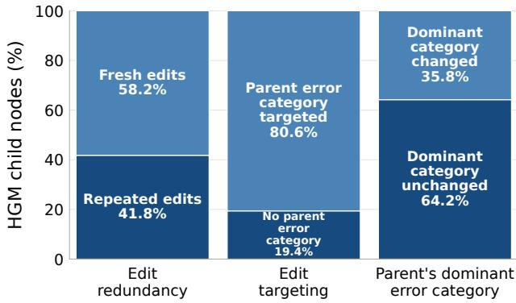
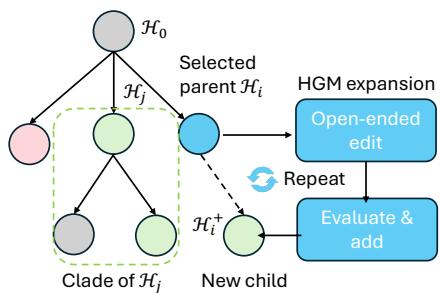
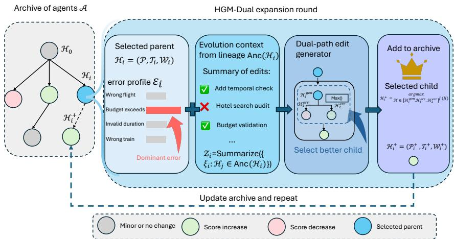
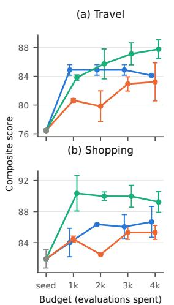
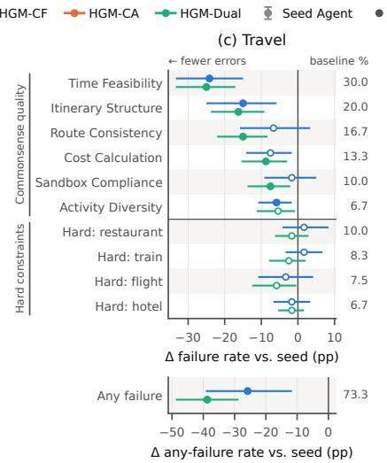
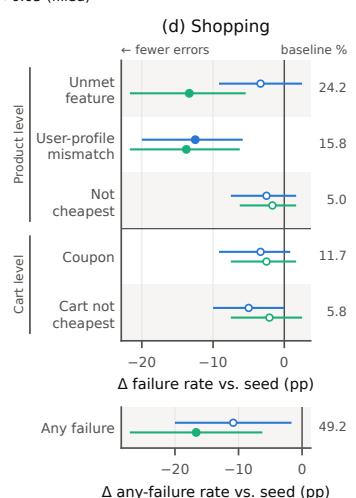

# HGM-DUAL: LINEAGE-AWARE GUIDED AGENT HAR-NESS OPTIMIZATION FOR LONG-HORIZON PLANNING

Sudipta Paul∗ Pengrui Quan∗ Aounon Kumar Nicholas Tzou Vivek Kulkarni

Srinivas Chappidi

Samsung Research America

{sudipta.paul, pengrui.quan, aounon.kumar, n.tzou,} {v.kulkarni1, vasu.c}@samsung.com

## ABSTRACT

Harness optimization, which improves an agent’s prompts, tools, and workflows, is an increasingly effective way to enhance agents built on frozen or closed-source LLMs. Leading approaches such as the Darwin–Gödel Machine and the Huxley– Gödel Machine (HGM) rely on recursive self-improvement and were developed mainly for coding, where the competence needed to improve the agent coincides with the competence being improved. Planning tasks, in which an agent must produce a sequence of tool calls that jointly satisfies interacting constraints, break this alignment. There, open-ended self-modification repeatedly explores ineffective changes and consumes substantial evaluation budgets. We introduce HGM-Dual, a diagnostic-guided framework for budget-efficient harness evolution for planning agents. First, HGM-Dual represents agent evolution as lineage-aware context. This context records what each ancestor changed, which behaviors improved or regressed, and which modifications were ineffective, giving the editor explicit edit–outcome attribution instead of an unstructured archive of past agents. Second, HGM-Dual introduces error-conditioned dual-path child generation. For each selected parent, it generates a general child that preserves open-ended exploration and specialized children that target the harness components most likely responsible for the parent’s highest-ranked constraint violations. HGM-Dual outperforms the strongest baseline by up to 14.45% relative improvement in case accuracy while matching HGM variants’ final performance with 2×–4× fewer evaluation budget.

## 1 INTRODUCTION

Agent harness optimization Khattab et al. (2024); Yuksekgonul et al. (2024) improves large language model (LLM) agents without updating model parameters by optimizing the prompts, tools, and workflows that govern agent behavior. Recent self-improving systems Novikov et al. (2025) automate this process through evolutionary search. The Darwin–Gödel Machine (DGM) Zhang et al. (2026b) maintains an archive of agents and generates new candidates by modifying selected parents, while the Huxley–Gödel Machine (HGM) Wang et al. (2026) selects candidates based on clade-metaproductivity, their potential to produce strong descendants.

This paradigm is well suited to coding agents because the ability being improved, understanding and modifying code, also enables self-modification. Planning tasks, however, require sequences of actions that satisfy interacting constraints Zhang et al. (2026d); Xie et al. (2024), creating a mismatch that poses two challenges for existing recursive self-improvement methods.

First, effective improvement requires a structured context of the search history. Planning benchmarks expose a relatively small and recurring set of constraint failures, so different agents in the search tree often encounter similar problems. If an editor observes only its current parent’s evaluation logs, it cannot determine whether a similar fix has already been attempted elsewhere, whether it improved or degraded performance, or which previous modifications led to the current behavior. As a result, different branches may repeatedly rediscover the same ineffective changes. In HGM’s shopping search, 41.8% of edits repeat an edit pattern already present in the tree (Figure 1, left), with each repeated attempt consuming another full planning evaluation. What is needed is not simply access to more previous agents, but explicit edit–outcome context: a concise record of what was changed, what behavior changed as a result, and which changes succeeded, regressed, or proved ineffective.

Second, improvement must be targeted at the specific constraints the agent violates. Planning success depends on the correctness of many interdependent decisions: a single infeasible transfer, invalid coupon, or unmet product requirement can invalidate an otherwise valid itinerary or cart. Consequently, a broad modification that improves behavior in general may still leave the failing case unresolved unless it corrects the particular constraint violation responsible for failure. Without explicit guidance, open-ended editing may instead modify an unrelated harness component or make a diffuse change that does not address the observed error. In HGM’s shopping search, 19.4% of edits target a constraint category that the parent never failed (Figure 1, middle), and in 64.2% of edits the child retains

  
Figure 1: Edit behavior in HGM. Among child nodes, 41.8% repeat previous edits, 19.4% target an error category absent from the parent’s observed failures, and 64.2% retain the parent’s dominant error category. See Appendix A.1 for details.

its parent’s dominant failure category (Figure 1, right). These results suggest that efficient selfimprovement for planning requires both learning from prior edit outcomes and directing new edits toward the specific constraint failures observed in the current agent.

We introduce the Huxley–Gödel Machine Dual (HGM-Dual), a diagnostic-guided framework for budget-efficient agent harness evolution. First, it represents agentic evolution as structured contextual information. This agent-evolution context records what was changed, which behaviors improved or regressed, and which attempted modifications were ineffective. The editor therefore receives explicit edit–outcome attribution instead of treating previous agent snapshots as an unstructured archive. This context discourages repeated failures and allows subsequent edits to build systematically on evidence collected throughout the search.

Second, HGM-Dual introduces error-conditioned dual-path child generation. For each selected parent, the framework generates complementary children: a general child, which preserves the broad and open-ended exploration of existing evolutionary methods, and specialized children, which tar get the harness component most likely responsible for the parent’s observed errors. The general path retains the ability to discover unexpected improvements, while the specialized path provides diagnostic-guided local refinement. Together, the dual paths balance exploration with targeted exploitation and direct the evaluation budget toward more informative regions of the harness search space.

Experiments on travel and shopping planning tasks show that HGM-Dual outperforms the strongest baseline by up to 14.45% relative improvement in case accuracy while matching HGM variants’ final performance with 2×–4× fewer evaluation budget. These results demonstrate that structured evolutionary context and diagnostic guidance can make harness self-improvement both more effective and substantially more resource-efficient.

## 2 RELATED WORKS

Harness Optimization through Self-Improvement. Recent methods improve frozen LLMs by automatically modifying their agentic harnesses, including prompts, tools, skills, and workflows

Khattab et al. (2024); Opsahl-Ong et al. (2024); Zhang et al. (2025); Wang et al. (2023); Chen et al. (2026); Karten et al. (2026); Lou et al. (2026); Zhang et al. (2026a). ADAS Hu et al. (2025), DGM Zhang et al. (2026b), HGM Wang et al. (2026), GEPA Agrawal et al. (2026), and HyperAgents Zhang et al. (2026c) search over agent implementations through iterative or evolutionary selfmodification. Meta-Harness Lee et al. (2026) gives an agentic proposer access to the code, scores, and execution traces of prior candidates, while SkillOpt Yang et al. (2026) optimizes a naturallanguage skill through bounded edits and validation. Collectively, these methods demonstrate that harness optimization can substantially improve agent performance without updating model parameters.

Nevertheless, two challenges remain. First, prior edit experience is either local or excessive: DGM Zhang et al. (2026b) and HGM Wang et al. (2026) primarily generate modifications from the selected parent’s code and evaluation logs, without providing enough context on the effectiveness of all edits attempted. On the other hand, archive-based methods Hu et al. (2025); Lee et al. (2026); Lin et al. (2026); Jiang et al. (2026) may flood the evolution context with numerous previous candidates and raw execution traces. This can obscure useful edit-outcome relationships and lead to repeated ineffective modifications across the search tree. Second, although prior methods guide candidate selection or validation Yang et al. (2026); Wang et al. (2026); Zhang et al. (2026b;c), edit generation itself remains largely open-ended and may not target the harness component responsible for observed failures. Such weakly targeted exploration can require substantial evaluation resources. HGM-Dual addresses these limitations by maintaining a concise, structured agent-evolution context and by generating both a general child for broad exploration and an error-conditioned specialized child for targeted refinement.

## 3 HGM-DUAL

## 3.1 PROBLEM SETUP

Agent Harness Optimization. We consider a frozen language model whose behavior is controlled by an agent harness

$$
{ \mathcal { H } } = ( { \mathcal { P } } , { \mathcal { T } } , { \mathcal { W } } ) ,\tag{1}
$$

where P specifies the prompt and instructions provided to the model, T denotes the set of available tools, and W defines the agentic workflow that governs how the model and tools interact to solve a task. The parameters of the underlying language model remain fixed throughout optimization; only the components of H are modified.

Given a task x sampled from a task distribution D, executing the frozen language model under harness H produces an output $\mathcal { H } ( x )$ . We evaluate this output using a task-specific scoring function $J ( x , { \bar { \varkappa } } ( x ) )$ , which measures the quality of the harness execution on task x. Agent harness optimization seeks a harness that maximizes expected performance over the task distribution:

$$
\mathcal { H } ^ { * } = \arg \operatorname* { m a x } _ { \mathcal { H } } \mathbb { E } _ { \boldsymbol { x } \sim \mathcal { D } } \left[ J ( \boldsymbol { x } , \mathcal { H } ( \boldsymbol { x } ) ) \right] .\tag{2}
$$

## 3.2 OVERVIEW

HGM. HGM optimizes an agent harness through evolutionary self-modification. Starting from an initial harness $\mathcal { H } _ { 0 }$ , HGM maintains an archive A of previously evaluated harnesses organized as an evolutionary tree (Figure 2). Each node corresponds to a harness, and each edge corresponds to a modification that produces a child from its parent. At each iteration, HGM selects a parent harness $\mathcal { H } _ { i } \in \mathcal { A }$ using its clade-metaproductivity criterion, which is designed to favor candidates with the potential to produce strong descendants. An editor then examines the selected harness and its evaluation feedback, proposes an open-ended modification, evaluates the resulting child, and adds it to the archive. The editor primarily conditions on the selected harness and its current evaluation context

  
Figure 2: HGM search: select a parent, generate an open-ended edit, evaluate the child, and add it to the archive.

  
Figure 3: Overview of HGM-Dual and one expansion round. Given a selected parent $\mathcal { H } _ { i } ,$ HGM-Dual constructs an evolution context $\mathcal { Z } _ { i }$ by summarizing edits and outcomes along its ancestral path $\operatorname { A n c } ( \mathscr { H } _ { i } )$ . The evolution context is provided to both editing paths: a general editor proposes an open-ended improvement, while specialized editors target the highest-ranked errors in the parent’s error profile $\varepsilon _ { i }$ . The resulting children are evaluated under the same protocol, and only the strongest child is added to the archive.

εi:

$$
\begin{array} { r } { \mathcal { H } ^ { \prime } = \operatorname { E d i t } \left( \mathcal { H } _ { i } , \varepsilon _ { i } \right) . } \end{array}\tag{3}
$$

Thus, the archive records an evolutionary history, but that history is not explicitly represented as structured edit-outcome evidence for the editor. Moreover, because the edit is open-ended, it is not explicitly constrained to address the failures observed in the selected parent.

HGM-Dual. HGM-Dual retains HGM’s evolutionary search procedure but changes how each selected parent is expanded (we refer readers to Section A.4 for full integration). As illustrated in Figure 3, it introduces two mechanisms. First, rather than conditioning an edit only on the selected harness $\mathcal { H } _ { i }$ and its evaluation context $\varepsilon _ { i } ,$ HGM-Dual additionally provides an evolution context $\mathcal { Z } _ { i }$ that summarizes the edits and outcomes along its ancestral lineage:

$$
\mathcal { H } ^ { \prime } = \mathrm { E d i t } \left( \mathcal { H } _ { i } , \varepsilon _ { i } , \mathcal { Z } _ { i } \right) .\tag{4}
$$

Second, HGM-Dual augments HGM’s open-ended child generation with error-conditioned editing. Each expansion generates both general and error-conditioned children. Thus, HGM-Dual retains HGM’s evolutionary backbone while making edit generation both history-aware and error-aware. We summarize the HGM-Dual expansion process in Algorithm 1 and describe them in Sections 3.3 and 3.4, respectively.

## 3.3 AGENT EVOLUTION AS INTERPRETABLE CONTEXT

An editor observing only the current harness and its evaluation feedback cannot reliably attribute performance changes to prior edits or identify previously failed modifications. Providing the full archive and raw traces would address this limitation but is costly and difficult to interpret. HGM-Dual therefore compresses the relevant evolutionary history into a structured context.

For each non-root harness $\mathcal { H } _ { i }$ with parent $\mathcal { H } _ { p _ { i } }$ , we define an evolution record

$$
\begin{array} { r } { \zeta _ { i } = \left( d _ { i } , u _ { i } , \Delta \widehat { J } _ { i } , \Delta \mathbf { f } _ { i } , b _ { i } \right) , } \end{array}\tag{5}
$$

where $d _ { i }$ summarizes the edit, $u _ { i }$ records functionality added, removed, or invoked,

$$
\Delta \widehat { J _ { i } } = \widehat { J } ( \mathcal { H } _ { i } ) - \widehat { J } ( \mathcal { H } _ { p _ { i } } ) ,\tag{6}
$$

measures its performance impact, and

$$
\Delta \mathbf { f } _ { i } = \mathbf { f } _ { i } - \mathbf { f } _ { p _ { i } }\tag{7}
$$

Algorithm 1 HGM-Dual Expansion   
Require: Archive A with evolution records $\zeta _ { j } = ( d _ { j } , u _ { j } , \Delta J _ { j } , \Delta \mathbf { e } _ { j } , b _ { j } )$ ; selected parent $\mathcal { H } _ { i }$ with evaluation   
context $\boldsymbol { \varepsilon } _ { i } = ( J _ { i } , \mathbf { f } _ { i } , \boldsymbol { S } _ { i } )$ ; error categories ${ \mathit { c } } ;$ fitness ${ \widehat { J } } ;$ pre-search stability statistics $\kappa , \rho _ { B }$ . Summarize   
compresses ancestral evolution records; Edit proposes a new harness with evolution context.   
Ensure: Updated archive ${ \mathcal { A } } .$   
1: function EXPAND $\left( \mathcal { H } _ { i } , \varepsilon _ { i } , A \right)$   
2: $\operatorname { A n c } ( \mathcal { H } _ { i } ) \gets ( \mathcal { \dot { H } } _ { 0 } , \dots , \mathcal { H } _ { p _ { i } } , \mathcal { H } _ { i } )$ Build evolution   
3: $\mathcal { Z } _ { i } \gets$ Summarize $( \{ \zeta _ { j } : \dot { \mathcal { H } } _ { j } \in \operatorname { A n c } ( \mathcal { H } _ { i } ) \} )$ context   
4: $\mathcal { H } _ { i } ^ { \mathrm { g e n } } \gets \mathrm { E d i t } _ { \mathrm { g e n } } ( \dot { \mathcal { H } _ { i } } ; \varepsilon _ { i } , \mathcal { Z } _ { i } )$   
5: if κ ≥ 0.4 ∧ ρB ≥ 0.7 then   
6: $\{ c _ { i , 1 } ^ { * } , c _ { i , 2 } ^ { * } \} \gets \mathrm { T o p 2 } _ { c \in \mathcal { C } } ( f _ { i , c } )$   
7: for $k \in \{ \bar { 1 } , 2 \}$ do   
8: $\mathcal { H } _ { i , k } ^ { \mathrm { e r r } }  \mathrm { E d i t } _ { \mathrm { e r r } } ( \mathcal { H } _ { i } ; c _ { i , k } ^ { * } , S _ { i } ^ { c _ { i , k } ^ { * } } , \mathcal { Z } _ { i } )$   
9: end for Dual-path generation   
10: $\mathcal { H } _ { i } ^ { + }  \arg \operatorname* { m a x } _ { \mathcal { H } \in \{ \mathcal { H } _ { i } ^ { \mathrm { g e n } } , \mathcal { H } _ { i , 1 } ^ { \mathrm { e r r } } , \mathcal { H } _ { i , 2 } ^ { \mathrm { e r r } } \} } \widehat { J } ( \mathcal { H } )$   
11: else   
12: $\mathcal { H } _ { i } ^ { + }  \mathcal { H } _ { i } ^ { \mathrm { g e n } }$ ▷ skip error-conditioned generation   
13: end if   
14: Construct $\varepsilon _ { i } ^ { + }$ and $\zeta _ { i } ^ { + } = ( d _ { i } ^ { + } , u _ { i } ^ { + } , \Delta J _ { i } ^ { + } , \Delta \mathbf { e } _ { i } ^ { + } , b _ { i } ^ { + } )$ relative to $\mathcal { H } _ { i }$   
15: $\mathcal { A }  \mathcal { A } \cup \{ \mathcal { H } _ { i } ^ { + } \}$ ▷ store with $\mathcal { H } _ { i } , \varepsilon _ { i } ^ { + } , \zeta _ { i } ^ { + }$   
16: return $\boldsymbol { A }$   
17: end function

captures changes in constraint-level errors. Finally, $b _ { i }$ summarizes the observed behavioral consequences. Thus, $\zeta _ { i }$ links each modification to its functional, performance, and behavioral effects.

Let $\operatorname { A n c } ( \mathcal { H } _ { i } ) = ( \mathcal { H } _ { 0 } , \dots , \mathcal { H } _ { p _ { i } } , \mathcal { H } _ { i } )$ denote the ordered ancestral path to $\mathcal { H } _ { i }$ . We define its lineage context as

$$
\mathcal { Z } _ { i } = \operatorname { S u m m a r i z e } \left( \{ \zeta _ { j } : \mathcal { H } _ { j } \in \operatorname { A n c } ( \mathcal { H } _ { i } ) \} \right) .\tag{8}
$$

This bounded summary preserves which functionality was introduced and used, which edits produced improvements or regressions, and how behavior evolved along the lineage, while consolidating redundant records.

When expanding $\mathcal { H } _ { i } ,$ , the editor receives its source, current evaluation context $\varepsilon _ { i } ,$ and lineage context $\mathcal { Z } _ { i }$ . This compact memory helps avoid repeating failed changes, retain complementary improvements, and identify interactions between edits that are not apparent from the current score alone.

## 3.4 ERROR-CONDITIONED DUAL-PATH CHILD GENERATION

The space of possible modifications to $\mathcal { P } , \mathcal { T } ,$ and $\mathcal { W }$ is large, and unrestricted generation frequently produces plausible but irrelevant edits. HGM-Dual therefore uses two complementary editing paths: a general path for broad exploration and an error-conditioned path for targeting verified weaknesses. To avoid specializing to noisy failure signals, the error-conditioned path is enabled only when a onetime pre-search test shows sufficient task-level agreement $( \kappa \geq 0 . 4 )$ and dominant-category stability $( \rho _ { B } \ge 0 . 7 ) ;$ ; otherwise, expansion uses only the general path.

For a selected harness $\mathcal { H } _ { i }$ , let

$$
{ \boldsymbol { \varepsilon } } _ { i } = \left( J ( { \mathcal { H } } _ { i } ) , \mathbf { f } _ { i } , S _ { i } \right) , \qquad \mathbf { f } _ { i } = \left( f _ { i , c } \right) _ { c \in { \mathcal { C } } } ,\tag{9}
$$

denote its evaluation context, where $J ( \mathscr { H } _ { i } )$ is its evaluation score, $\mathbf { f } _ { i }$ is the vector of evaluatorcategory error frequencies, $\mathcal { C }$ is the set of evaluator-defined error categories, and $S _ { i }$ contains representative execution traces and evaluator feedback. The general child is produced by

$$
\mathcal { H } _ { i } ^ { \mathrm { g e n } } = \mathrm { E d i t } _ { \mathrm { g e n } } \left( \mathcal { H } _ { i } ; \varepsilon _ { i } , \mathcal { Z } _ { i } \right) .\tag{10}
$$

This editor may modify any harness component and is instructed to identify a broadly useful improvement from the task specification, current behavior, and evolutionary history. It therefore preserves the open-ended character of evolutionary search and can discover changes that are not associated with a single evaluator-defined failure.

Table 1: Performance comparison of task agent optimization for Travel and Shopping at an evaluation budget of 4000. Best per column in bold, second best underlined.
<table><tr><td rowspan="2">Method</td><td rowspan="2">Evaluation Budget</td><td colspan="2">Travel</td><td colspan="2">Shopping</td></tr><tr><td>Composite Score</td><td>Case Acc. (%)</td><td>Composite Score Case Acc. (%)</td><td></td></tr><tr><td>Seed Agent</td><td>0</td><td> $7 6 . 4 6 \pm 0 . 2 2$ </td><td>25.00</td><td> $8 1 . 9 1 \pm 1 . 1 7$ </td><td>50.83</td></tr><tr><td>HGM</td><td>4000</td><td> $7 7 . 0 6 \pm 0 . 5 3$ </td><td>30.42</td><td> $8 3 . 1 2 \pm 0 . 2 7$ </td><td>50.83</td></tr><tr><td>HGM-CA</td><td>4000</td><td> $8 3 . 2 3 \pm 2 . 6 5$ </td><td>54.17</td><td> $8 5 . 3 2 \pm 0 . 9 0$ </td><td>58.33</td></tr><tr><td>HGM-CF</td><td>4000</td><td> $\underline { { 8 4 . 1 1 } } \pm 0 . 0 7$ </td><td>56.25</td><td> $\underline { { 8 6 . 6 7 } } \pm 1 . 9 9 $ </td><td>60.83</td></tr><tr><td>HGM-Dual</td><td>4000</td><td> $\overline { { 8 7 . 7 7 } } \pm 1 . 3 1$ </td><td>64.38</td><td> $\overline { { { \bf 8 9 . 2 3 } } } \pm 1 . 3 3$ </td><td>66.67</td></tr></table>

For the specialized path, HGM-Dual selects two target errors from the observed error profile of $\mathcal { H } _ { i }$ The two target error categories are selected as

$$
c _ { i , k } ^ { * } = \mathrm { T o p K } _ { c \in \mathcal { C } } \left( f _ { i , c } , k \right) , \qquad k \in \{ 1 , 2 \} ,\tag{11}
$$

where $f _ { i , c }$ denotes the measured frequency of error category c for $\mathcal { H } _ { i }$ . Here, $c _ { i , 1 } ^ { * }$ and $c _ { i , 2 } ^ { * }$ denote the first- and second-highest-ranked error categories, respectively.

For each selected target error, an error-conditioned child is generated as

$$
\mathcal { H } _ { i , k } ^ { \mathrm { e r r } } = \mathrm { E d i t } _ { \mathrm { e r r } } \left( \mathcal { H } _ { i } ; c _ { i , k } ^ { * } , \mathcal { S } _ { i } ^ { c _ { i , k } ^ { * } } , \mathcal { Z } _ { i } \right) , \qquad k \in \{ 1 , 2 \} ,\tag{12}
$$

where $\boldsymbol { \mathcal { S } } _ { i } ^ { c _ { i , k } ^ { * } }$ contains the traces and evaluator feedback associated with target error $c _ { i , k } ^ { * } .$ . For each target, the specialized editor is asked to diagnose the corresponding failure, identify the responsible prompt, tool, or workflow behavior, and propose a focused correction while preserving capabilities that are already successful.

All three children are executed on the same optimization set and evaluated with the same reward function ${ \widehat { J } } .$ HGM-Dual retains

$$
\mathcal { H } _ { i } ^ { + } = \arg \operatorname* { m a x } _ { \mathcal { H } \in \{ \mathcal { H } _ { i } ^ { \mathrm { g e n } } , \mathcal { H } _ { i , 1 } ^ { \mathrm { e r r } } , \mathcal { H } _ { i , 2 } ^ { \mathrm { e r r } } \} } \widehat { J } ( \mathcal { H } ) .\tag{13}
$$

The best child, its evaluation context, and edit attribution relative to $\mathcal { H } _ { i }$ are added to the archive; the others are discarded. This dual-path procedure balances exploration and exploitation: the general child enables broad improvements, while specialized children target prominent failures. Retaining only the best child limits archive growth and focuses the search budget on promising harnesses.

## 4 EXPERIMENTS

Benchmark. We evaluate HGM-Dual on the DeepPlanning benchmark Zhang et al. (2026d), which consists of two constrained long-horizon planning tasks: travel planning and shopping. Both require maintaining global consistency across many interdependent decisions while satisfying numerous explicit and implicit constraints. In travel planning, the agent uses nine APIs to construct minutelevel itineraries of up to seven days, evaluated by 21 feasibility checks across eight dimensions such as temporal, spatial, and budget consistency. In shopping, the agent searches an average of 171 records through 15 APIs over 45 product and user attributes, while jointly selecting products and coupons subject to product, eligibility, threshold, stacking, delivery, and budget constraints. These interacting constraints make locally valid decisions insufficient: the agent must ensure that the complete itinerary or cart remains globally feasible.

Evaluation Metrics. We assess each method along two dimensions. a) task performance: For travel, we report a composite score that measures overall constraint satisfaction and case accuracy that measures the proportion of fully correct cases. For shopping, we report a match score that measures how many ground-truth products are correctly selected and case accuracy that measures exact cart-level matches. b) Compute efficiency: Following HGM, we define the evaluation budget as the number of plans generated during optimization and apply this measure consistently to HGM, HGM variants, and HGM-Dual.

Experimental Setup. The optimization process starts from an initial harness of the task agent (seed agent) with a simple multi-turn loop, a minimal task prompt, and access to the task-specific tools of the benchmark. The agent editor is an LLM agent that updates the harness components (e.g., prompt, workflow, tool, verifier) of the task agent. The objective is to obtain the best-performing task agent by optimizing the harness alone; the underlying model weights are never updated. Information (e.g., code, logs, failing traces) supplied to the editor is gathered deterministically by a fixed procedure rather than through agentic exploration. For both travel planning and shopping tasks, we optimize on 60 samples and evaluate on 120 samples (60 unseen samples), so that generalization beyond the optimization set is measured explicitly. Unless otherwise specified, the agent editor uses GPT-5.4 (reasoning effort medium) and the task agent uses GPT-5.4-mini (reasoning effort high).

  
Figure 4: Budget efficiency and error breakdown. (a, b) Best agent performance on {1k, 2k, 3k, 4k} evaluation budgets for travel and shopping task. (c, d) Per-category change in failure rate of the best agent after optimization relative to the seed agent on the 60 held-out task instances. Right-hand column gives the seed agent’s failure rate, filled markers denote $q < 0 . 0 5$

Error Categorization. Error categories are produced by a deterministic, rule-based categorizer, one per domain. In travel, the categories follow the benchmark’s evaluator: each of its eight commonsense dimensions (e.g., time feasibility, business hours) is a category, and violated hard constraints from the query are grouped by the entity they concern (flight, train, hotel, restaurant, attraction, or budget). Shopping considers four product level error categories (missing product, unmet feature, user-profile mismatch, not cheapest) and three cart level error categories (budget, cart not cheapest, coupon).

Baselines. We compare HGM-Dual against ADAS Hu et al. (2025), GEPA Agrawal et al. (2026), HGM Wang et al. (2026), HGM-Customized (Agentic Editor) (HGM-CA) Zhang et al. (2026c), and HGM-Customized (Fixed Context Editor) (HGM-CF). ADAS and GEPA are two LLM driven optimization process to improve agentic system performance, while HGM is a self-referential improvement algorithm in which a task agent edits its own implementation. Since our setting requires non-coding, long-horizon planning, we also consider HGM-CA (HGM-Customized (Agentic Editor)), a domain-customized variant of HGM. HGM-CA augments the original framework with domain-specific editing mechanisms designed to adapt the agent’s prompts, tools, and workflow behavior to the planning setting. In this setting, the editor has agentic access with bash and file read/write tools to navigate task agents source code and logs. Similar to HGM-Dual’s agent editor setting, we also consider HGM-CF (HGM-Customized (Fixed Context Editor)). In this setting, task agents code and logs are gathered deterministically and provided in the context of the agent editor to generate edits. HGM-CF gives HGM the same interface used by HGM-Dual, isolating the effect of agent evolution context and error-conditioned child generation. We do not compare with DGM Zhang et al. (2026b) because HGM has previously been shown to outperform DGM in both task performance and improvement-budget efficiency.

Table 2: Performance comparison for Travel and Shopping at an evaluation budget of 1000.
<table><tr><td rowspan="2">Method</td><td rowspan="2">Evaluation Budget</td><td colspan="2">Travel</td><td colspan="2">Shopping</td></tr><tr><td>Composite Score</td><td>Case Acc.</td><td>Composite Score</td><td>Case Acc.</td></tr><tr><td>Seed Agent</td><td>0</td><td> $7 6 . 4 6 \pm 0 . 2 2$ </td><td>25.00</td><td> $8 1 . 9 1 \pm 1 . 1 7$ </td><td>50.83</td></tr><tr><td>ADAS</td><td>1000</td><td> $8 0 . 8 3 \pm 2 . 8 0$ </td><td>35.00</td><td> $8 1 . 9 8 \pm 2 . 1 5$ </td><td>51.25</td></tr><tr><td>GEPA</td><td>1000</td><td> $8 1 . 6 7 \pm 0 . 6 6$ </td><td>39.58</td><td> $8 1 . 1 8 \pm 0 . 9 6$ </td><td>42.92</td></tr><tr><td>HGM</td><td>1000</td><td> $7 7 . 0 6 \pm 0 . 5 3$ </td><td>30.42</td><td> $8 3 . 1 2 \pm 0 . 2 7$ </td><td>50.83</td></tr><tr><td>HGM-CA</td><td>1000</td><td> $8 0 . 6 5 \pm 0 . 2 6$ </td><td>41.67</td><td> $\underline { { 8 4 . 4 6 } } \pm 0 . 3 8$ </td><td>53.75</td></tr><tr><td>HGM-CF</td><td>1000</td><td> ${ \pm 0 . 9 0 \pm 0 . 7 4 }$ </td><td>47.50</td><td> $8 4 . 0 1 \pm 1 . 8 3$ </td><td>56.67</td></tr><tr><td>HGM-Dual</td><td>1000</td><td> $\underline { { 8 3 . 8 3 } } \pm 0 . 3 7$ </td><td>47.08</td><td> ${ \bf 9 0 . 3 5 \pm 2 . 2 7 }$ </td><td>70.83</td></tr></table>

## 4.1 EVALUATION

Performance Comparison to Baseline Approaches. Table 1 reports the performance comparison to baselines (HGM, HGM-CA, HGM-CF) at 4000 evaluation budget. Vanilla HGM barely moves beyond the seed harness on either domain, gaining only 0.60 composite points on travel and 1.21 on shopping, and leaving shopping case accuracy unchanged at 50.83. This confirms that an editor designed for coding benchmarks transfers poorly to long-horizon planning, and motivates the customized variants. HGM-CF the strongest baseline on all four metrics (84.11 and 86.67 composite, 56.25 and 60.83 case accuracy). HGM-Dual attains the best result on every metric in both domains, improving over HGM-CF by 3.66 and 2.56 composite points and by 8.13 and 5.84 case accuracy points on travel and shopping, respectively. Notably, the margin is consistently larger in case accuracy than in composite score, indicating that HGM-Dual does not merely accumulate partial credit across checkpoints but converts a larger fraction of plans into fully constraint-satisfying solutions

Budget Efficiency. We have analyzed the budget efficiency of HGM-Dual by evaluating the performance of selected best agents at different evaluation budget steps. We have considered selecting best agents at 1k, 2k, 3k and 4k evaluations and evaluate it on all 120 instances for both travel and shopping task (Fig. 4(a,b)). On travel (Fig. 4(a)), HGM-CF is slightly ahead at 1k (84.9 vs. 83.8) but then stalls. HGM-CF returns the same agent at 1k, 2k and 3k and ends at 84.1. HGM-Dual, in contrast, improves at every checkpoint, overtakes HGM-CF at 2k (85.7) and reaches 87.8 at 4k. On shopping (Fig. 4(b)), HGM-Dual makes most of its gain within the first 1k evaluations, rising from 81.9 to 90.4, and stays near that level through 4k (89.2), whereas HGM-CF improves gradually and ends at 86.7. The domain-customized variant HGM-CA remains below both methods across the budget range on travel and below HGM-Dual throughout on shopping. Overall, HGM-Dual converts the evaluation budget into performance far more efficiently than HGM-CF: it either keeps improving where HGM-CF plateaus (travel) or reaches HGM-CF’s final score using roughly a quarter of the budget (shopping). Note that HGM-Dual’s rejected child’s evaluation is also counted towards the total evaluation budget used.

Error Profile Analysis. To identify the source of these gains, we decompose the failures of HGM-Dual and HGM-CF’s final agent (4k budget) on the 60 held-out task instances (Fig. 4(c,d)). Each row is an evaluator-defined error category, and each marker gives a method’s change in the fraction of tasks failing that category relative to the seed agent; negative values indicate fewer errors. The right-hand column reports the seed agent’s own failure rate. Rows are grouped into commonsensequality and hard-constraint errors for travel and into product- and cart-level errors for shopping. Categories failed by the seed agent on fewer than 5% of tasks are omitted, filled markers denote statistically significant changes, and the bottom panels report the share of tasks with any error. On travel (Fig. 4(c)), both methods eliminate most time feasibility and itinerary structure errors, the two most frequent categories. However, HGM-Dual is the only method that also removes route consistency errors (from 16.7% of tasks to 1.7%, versus 10.0% for HGM-CF) and sandbox compliance errors (from 10.0% to 2.5%, versus 8.3%), and it reduces the share of tasks with any error from 73.3% to 34.6%, compared with 47.5% for HGM-CF. On shopping (Fig. 4(d)), the gap is concentrated in the most frequent category, unmet features: HGM-Dual more than halves it (from 24.2% to 10.8%) whereas HGM-CF leaves it essentially unchanged (20.8%). The advantage ofHGM-Dual therefore stems more from resolving frequently appearing failure modes that HGM-CF leaves untouched.

Performance Comparison at Low Budget Regime. Due to the high cost of long-horizon agent evaluation and performance plateau, we evaluate ADAS and GEPA only at 1000 evaluations. Ta ble 2 reports the low-budget regime performance for different baselines. The two non-evolutionary optimizers improve over the Seed Agent on travel (80.83 and 81.67 composite) but are essentially flat on shopping, where GEPA in fact falls below the seed harness in both metrics. Vanilla HGM is similarly ineffective at this budget. On Travel, the customized variant HGM-CF is the strongest method (84.90 composite, 47.50 case accuracy), with HGM-Dual being second highest. On shopping, HGM-Dual dominates every baseline by a wide margin, reaching 90.35 composite and 70.83 case accuracy and exceeding the strongest competing method by 5.89 and 14.16 points respectively.

Table 3: Impact of the Agent Evolution Context on the optimization process (travel).
<table><tr><td>Edit characteristic</td><td>HGM-CF</td><td>+ Agent Evolution Context</td></tr><tr><td>Improves on its parent (%) ↑</td><td>31.3</td><td>41.0</td></tr><tr><td>Common instances made worse (%) ↓</td><td>37.6</td><td>31.9</td></tr><tr><td>Goal repeats from its lineage ↓</td><td>0.22</td><td>0.17</td></tr></table>

Table 4: Impact of error conditioning.  
Table 5: Generalization to a different task-agent backbone (Mistral-Medium-3.5-128B).
<table><tr><td>Method</td><td>Score</td></tr><tr><td>HGM-CF</td><td> $8 4 . 0 1 \pm 1 . 8 3$ </td></tr><tr><td>w/ Evolution context</td><td> $8 8 . 2 1 \pm 0 . 8 4$ </td></tr><tr><td>HGM-Dual</td><td> $9 0 . 3 5 \pm 2 . 2 7$ </td></tr><tr><td>w/o error cond.</td><td> $8 7 . 6 8 \pm 0 . 2 9$ </td></tr></table>

<table><tr><td>Method</td><td>Composite score</td><td>Case accuracy (%)</td></tr><tr><td>Seed Agent</td><td>32</td><td>1.6</td></tr><tr><td>HGM-CF</td><td>34</td><td>0.8</td></tr><tr><td>HGM-Dual</td><td>42</td><td>1.6</td></tr></table>

Impact of Agent Evolution Context. We analyze and compare the edits made by two variants of HGM runs: HGM-CF and HGM-CF + Agent Evolution Context (no error-conditioned child generation). For each edit/expansion, we record its outcome against its parent on the cases both were evaluated on, its source diff, and the redundancy of its stated goal, measured as the maximum TF-IDF cosine against the goals of its ancestors. Table 3 shows that the Agent Evolution Context makes edits less redundant within a lineage (0.22 → 0.17). Edits are less destructive: they worsen fewer instances $( 3 7 . 6 \% \to 3 1 . 9 \% )$ . Most importantly, adding Agent Evolution Context in the editor improves child agent’s performance compared to their parent more often (31.3% → 41.0%). Therefore, the Agent Evolution Context alters the proposal distribution of the self-improvement steps positively rather than only improving the final score.

Impact of Error Conditioning. We ablate error conditioning from HGM-Dual. In the ablated setting, the error-conditioned child agent generation prompt omits the error category but everything else remain the same as HGM-Dual (number of total children agents generated per expand, sequence of generation, and best of the child agent selection). At an evaluation budget of 1000, the ablation scores 87.68 vs. 90.35 for HGM-Dual (Table 4) attributing 2% improvement on the error conditioning. Our error analysis also show that error-conditioning results in resolving frequently appearing failure modes. Table 4 also shows adding evolution context on top HGM-CF boosts performance. Adding error conditional generation on top of HGM-CF + evolution context further improves performance.

Generalization Across Task Models. To evaluate whether HGM-Dual generalizes across LLMs for task agent, we further conduct experiments with Mistral-Medium-3.5-128B Mistral AI (2026). In this setup, we still use GPT-5.4 (reasoning medium) for agent editor. As shown in Table 5, harness optimization improves the composite score for Mistral-Medium-3.5-128B, although its effect on case accuracy is limited. Standard HGM-CF provides only a modest increase in composite score, from 32 to 34, and reduces case accuracy from 1.6% to 0.8%. In contrast, HGM-Dual raises the composite score to 42, outperforming the seed agent and HGM-CF by 10 and 8 points, respectively, while retaining the seed agent’s case accuracy of 1.6%.

## 5 CONCLUSION

We introduced HGM-Dual, a diagnostic-guided framework for efficient agent harness optimization. By incorporating structured agent-evolution context, HGM-Dual enables the editor to learn from prior edit outcomes and avoid redundant or ineffective modifications. Its error-conditioned dual-path generation further combines open-ended exploration with targeted refinement of errorrelevant harness components. Experiments on travel and shopping planning tasks demonstrate that these complementary mechanisms outperform strong self-improving baselines while substantially reducing the required evaluation budget. Our ablations further show that evolution context provides consistent performance gains, whereas dual-path generation accelerates improvement under con strained budgets. Together, these results demonstrate that explicitly modeling evolutionary history and balancing general with error-targeted search can make agent harness evolution more effective and resource-efficient. Future work may extend the evolution context beyond individual lineages to share useful edit-outcome evidence across the entire search tree. Future work could jointly learn an evolving context and dual-path manager to adapt evidence selection, editing strategies, and resource allocation throughout the search. Finally, evaluating HGM-Dual across broader task domains and online environments would help characterize the transferability and long-term robustness of the evolved harnesses.

## AI USE STATEMENT

In this work, all research ideas, methods, experiments, and findings are the work of the authors. We used generative AI tools for two tasks with recommended disclosure: (1) drafting initial versions of text throughout all sections of the paper, based on detailed outlines, notes, written descriptions, and experimental results provided by the authors; and (2) editing the paper to improve grammar, clarity, and readability. The methodology itself was designed and implemented entirely by the authors; AI tools were used only to help turn the authors’ written descriptions of it into prose. We have reviewed all AI-assisted work: the authors revised all AI-drafted text, checked every technical statement, number, and citation against our own results and the original sources, and verified that the final tex accurately reflects our work. We take responsibility for the final content of this work, including text, claims, or artifacts produced with the aid of generative AI.

## REFERENCES

Lakshya A Agrawal, Shangyin Tan, Dilara Soylu, Noah Ziems, Rishi Khare, Krista Opsahl-Ong, Arnav Singhvi, Herumb Shandilya, Michael J Ryan, Meng Jiang, et al. Gepa: Reflective prompt evolution can outperform reinforcement learning. In International Conference on Learning Representations, volume 2026, pp. 8479–8565, 2026.

Terry Chen, Zhifan Ye, Bing Xu, Zihao Ye, Timmy Liu, Ali Hassani, Tianqi Chen, Andrew Kerr, Haicheng Wu, Yang Xu, et al. Avo: Agentic variation operators for autonomous evolutionary search. arXiv preprint arXiv:2603.24517, 2026.

Shengran Hu, Cong Lu, and Jeff Clune. Automated design of agentic systems. In International Conference on Learning Representations, volume 2025, pp. 21344–21377, 2025.

Jiachen Jiang, Tianyu Ding, and Zhihui Zhu. Deltaevolve: Accelerating scientific discovery through momentum-driven evolution. arXiv preprint arXiv:2602.02919, 2026.

Seth Karten, Joel Zhang, Tersoo Upaa Jr, Ruirong Feng, Wenzhe Li, Chengshuai Shi, Chi Jin, and Kiran Vodrahalli. Continual harness: Online adaptation for self-improving foundation agents. arXiv preprint arXiv:2605.09998, 2026.

Omar Khattab, Arnav Singhvi, Paridhi Maheshwari, Zhiyuan Zhang, Keshav Santhanam, Saiful Haq, Ashutosh Sharma, Thomas Joshi, Hanna Moazam, Heather Miller, et al. Dspy: Compiling declarative language model calls into state-of-the-art pipelines. In International Conference on Learning Representations, volume 2024, pp. 54928–54958, 2024.

Yoonho Lee, Roshen Nair, Qizheng Zhang, Kangwook Lee, Omar Khattab, and Chelsea Finn. Metaharness: End-to-end optimization of model harnesses. arXiv preprint arXiv:2603.28052, 2026.

Jiahang Lin, Shichun Liu, Chengjun Pan, Lizhi Lin, Shihan Dou, Zhiheng Xi, Xuanjing Huang, Hang Yan, Zhenhua Han, Tao Gui, et al. Agentic harness engineering: Observability-driven automatic evolution of coding-agent harnesses. arXiv preprint arXiv:2604.25850, 2026.

Xinghua Lou, Miguel Lázaro-Gredilla, Antoine Dedieu, Carter Wendelken, Wolfgang Lehrach, and Kevin P Murphy. Autoharness: improving llm agents by automatically synthesizing a code harness. arXiv preprint arXiv:2603.03329, 2026.

Mistral AI. Remote agents in vibe: Powered by mistral medium 3.5, May 2026. URL https: //mistral.ai/news/vibe-remote-agents-mistral-medium-3-5/. Mistral Medium 3.5, 128B model.

Alexander Novikov, Ngân Vu, Marvin Eisenberger, Emilien Dupont, Po-Sen Huang, Adam Zsolt˜ Wagner, Sergey Shirobokov, Borislav Kozlovskii, Francisco JR Ruiz, Abbas Mehrabian, et al. Alphaevolve: A coding agent for scientific and algorithmic discovery. arXiv preprint arXiv:2506.13131, 2025.

Krista Opsahl-Ong, Michael J Ryan, Josh Purtell, David Broman, Christopher Potts, Matei Zaharia, and Omar Khattab. Optimizing instructions and demonstrations for multi-stage language model programs. In Proceedings of the 2024 Conference on Empirical Methods in Natural Language Processing, pp. 9340–9366, 2024.

Guanzhi Wang, Yuqi Xie, Yunfan Jiang, Ajay Mandlekar, Chaowei Xiao, Yuke Zhu, Linxi Fan, and Anima Anandkumar. Voyager: An open-ended embodied agent with large language models. arXiv preprint arXiv:2305.16291, 2023.

Wenyi Wang, Piotr Pi˛ekos, Li Nanbo, Firas Laakom, Yimeng Chen, Mateusz Ostaszewski, Mingchen Zhuge, and Jürgen Schmidhuber. Huxley-g\" odel machine: Human-level coding agent development by an approximation of the optimal self-improving machine. In International Conference on Learning Representations, volume 2026, pp. 80356–80386, 2026.

Jian Xie, Kai Zhang, Jiangjie Chen, Tinghui Zhu, Renze Lou, Yuandong Tian, Yanghua Xiao, and Yu Su. Travelplanner: A benchmark for real-world planning with language agents. arXiv preprint arXiv:2402.01622, 2024.

Yifan Yang, Ziyang Gong, Weiquan Huang, Qihao Yang, Ziwei Zhou, Zisu Huang, Yan Li, Xuemei Gao, Qi Dai, Bei Liu, et al. Skillopt: Executive strategy for self-evolving agent skills. arXiv preprint arXiv:2605.23904, 2026.

Mert Yuksekgonul, Federico Bianchi, Joseph Boen, Sheng Liu, Zhi Huang, Carlos Guestrin, and James Zou. Textgrad: Automatic" differentiation" via text. arXiv preprint arXiv:2406.07496, 2024.

Hangfan Zhang, Shao Zhang, Kangcong Li, Chen Zhang, Yang Chen, Yiqun Zhang, Lei Bai, and Shuyue Hu. Self-harness: Harnesses that improve themselves. arXiv preprint arXiv:2606.09498, 2026a.

Jenny Zhang, Shengran Hu, Cong Lu, Robert Lange, and Jeff Clune. Darwin gödel machine: openended evolution of self-improving agents. In International Conference on Learning Representations, volume 2026, pp. 104223–104294, 2026b.

Jenny Zhang, Bingchen Zhao, Wannan Yang, Jakob Foerster, Jeff Clune, Minqi Jiang, Sam Devlin, and Tatiana Shavrina. Hyperagents. arXiv preprint arXiv:2603.19461, 2026c.

Jiayi Zhang, Jinyu Xiang, Zhaoyang Yu, Fengwei Teng, Xionghui Chen, Jiaqi Chen, Mingchen Zhuge, Xin Cheng, Sirui Hong, Jinlin Wang, et al. Aflow: Automating agentic workflow generation. In International Conference on Learning Representations, volume 2025, pp. 34040–34077, 2025.

Yinger Zhang, Shutong Jiang, Renhao Li, Jianhong Tu, Yang Su, Lianghao Deng, Xudong Guo, Chenxu Lv, and Junyang Lin. Deepplanning: Benchmarking long-horizon agentic planning with verifiable constraints. In Proceedings of the 64th Annual Meeting of the Association for Computational Linguistics (Volume 1: Long Papers), pp. 7377–7407, 2026d.

## A APPENDIX

## A.1 EDIT REDUNDANCY

Edit-redundancy calculation for the shopping task. We analyze every non-root edit proposal in the search-tree archives of the shopping task, yielding $N _ { \mathrm { H G M } } \mathrm { \dot { = } } 6 7$ proposals and $N _ { \mathrm { D u a l } } = 5 1$ proposals.

Each proposal is tagged using the following seven error categories:

1. Coupon correctness: selecting, validating, or applying coupons correctly;

2. Profile compliance: satisfying user-profile requirements such as gender or size;

3. Shipping constraints: satisfying destination and delivery-time requirements;

4. Budget compliance: respecting minimum or maximum spending constraints;

5. Cart completeness: including all requested items and excluding unwanted items;

6. Exact feature matching: satisfying explicit product attributes such as brand, color, season, rating, or review distribution; and

7. Price optimality: selecting the cheapest valid products.

The tags are determined from each proposal’s optimization goal and proposed changes using the same rules for both methods. Because an edit can address multiple errors, the categories are not mutually exclusive. We represent each proposal by the exact combination of its assigned categories, which we refer to as its edit pattern. For example,

(profile compliance, shipping constraints, exact feature matching, price optimality)

is one edit pattern, whereas

$$
( { \mathrm { s h i p p i n g ~ c o n s t r a i n t s } } , { \mathrm { e x a c t ~ f e a t u r e ~ m a t c h i n g } } )
$$

is another. Two proposals are considered to have the same edit pattern only when their complete sets of error categories are identical.

For method $m ,$ let $n _ { m } ( s )$ be the number of proposals assigned to edit pattern s. Its share of the tree archive is

$$
p _ { m } ( s ) = 1 0 0 \times \frac { n _ { m } ( s ) } { N _ { m } } .\tag{14}
$$

The edit patterns are ranked independently for HGM and HGM-Dual in descending order of $n _ { m } ( s )$ The figure reports the share of repeated edit pattern above.

## A.2 EDIT-TARGETING MISMATCH

We treat each non-initial candidate as an edit and compare it with the candidate from which it was derived. Each edit’s stated objective and proposed changes are mapped to functional error categories, using labels mentioned in Section A.1.

An edit is classified as having no corresponding parent error category when it targets at least one functional component for which no error was reported in its parent. The metric is the fraction of edits satisfying this condition. The dominant error category is the category associated with the largest number of failing evaluation cases.

## A.3 ESTIMATED COST

As shown in Table 6, evaluating long-horizon planning agents is computationally expensive, particularly after harness optimization, where 1k case evaluations can cost hundreds of dollars in task-agent API usage. Given this cost, we prioritize the available evaluation budget toward independent runs of the HGM variants, which are the primary focus of our study. We therefore evaluate ADAS and GEPA at the 1k budget as reference baselines, while reserving the more expensive 4k experiments for HGM, HGM variants, and HGM-Dual.

Table 6: Estimated task-agent API cost (USD) of 1000 samples evaluations on Travel and Shopping. The task agent is GPT-5.4-mini (high reasoning effort). Optimized averaged candidate agents evaluated by HGM and HGM-Dual. Lower bounds assume ∼80% of input tokens are served from the prompt cache; upper bounds assume no caching.
<table><tr><td></td><td>Unoptimized</td><td>Optimized</td></tr><tr><td>Travel</td><td>$400-800</td><td>$520-1,010</td></tr><tr><td>Shopping</td><td>$140-360</td><td>$300-910</td></tr></table>

## A.4 FULL HGM-DUAL

Algorithm 2 summarizes the complete procedure. HGM-Dual keeps the search loop of HGM (Wang et al., 2026): at each iteration, it either expands the archive by modifying a selected parent or evaluates an existing harness on one additional task. Both choices are made by Thompson sampling, and at the end of the search the harness with the highest posterior success rate is returned. The only change is in the expansion step. Instead of producing a single open-ended modification, HGM-Dual calls EXPAND (Algorithm 1), which builds the evolution context from the parent’s lineage (Section 3.3), generates one general and two error-conditioned children (Section 3.4), and adds only the strongest child to the archive.

The symbols in Algorithm 2 are as follows. For each harness $\smash { \mathcal { H } , n _ { \mathrm { s u c c e s s } } ( \mathcal { H } ) }$ and $n _ { \mathrm { f a i l u r e } } ( \mathcal { H } )$ count its passed and failed evaluation tasks, while $n _ { \mathrm { s u c c e s s } } ^ { C } ( \mathcal { H } )$ and $n _ { \mathrm { f a i l u r e } } ^ { C } ( \mathcal { H } )$ aggregate these counts over its clade, i.e., the subtree rooted at H. The clade counts measure how productive the descendants of H have been and guide parent selection. The individual counts measure the harness’s own performance and guide evaluation and final selection. $N _ { t }$ is the number of evaluations spent so far. The archive is expanded when $| \mathcal { A } | \leq N _ { t } ^ { \alpha }$ , where $\alpha \in [ 0 , 1 ]$ controls how quickly the tree widens relative to the evaluation budget. τ is a scheduler that increases over the search. It sharpens the sampled Beta distributions over time, shifting the search from exploration toward exploitation. $S ^ { C } ( \mathcal { H } )$ and S(H) are the Thompson samples drawn from the clade-level and individual Beta posteriors, used to select the parent to expand and the harness to evaluate, respectively. Finally, $I _ { \rho }$ is the ρ-percentile of a harness’s Beta posterior. Returning the harness that maximizes it favors candidates whose high success rate is supported by sufficient evaluations.

## A.5 AGENT EVOLUTION CONTEXT

Each non-root node of the search tree carries an evolution record $\zeta _ { i }$ that is summarized into the lineage context $Z _ { p _ { \tau } }$ supplied to the editor. We have provided one example from travel and shopping task each.

## Example Agent Evolution Context (Travel; one node of a lineage)

## What was added

• select\_intercity\_transport — parses train/flight tool results, filters/sorts options, and returns one recommended intercity leg.

• \_trace — logs platform\_core.trace events.

• \_pick — returns the first non-empty value among alternate dict keys.

• \_parse\_json\_list — safely converts a JSON string into a list of dicts.

• \_route\_segments — extracts/orders "Segment $\mathrm { N } ^ { \mathfrak { n } }$ route entries.

• workflow.py transfer-line rule — prompt now requires every transfer day to explicitly include the selected intercity transport line.

• tools\_schema.json — exposes select\_intercity\_transport as a callable tool.

## How it behaved (observed)

• mutable\_log was present. Cumulatively: decision\_branch/selector\_mode\_chosen fired 122 times; verifier\_fired fired 216 times (selector\_raw\_transport\_parsed 122, selector\_filters\_applied 47, selector\_recommended\_option 47).

• select\_intercity\_transport was used heavily: 122 calls, 0 errors observed. It co-occurred with all 26 passing and all 34 failing cases seen so far, so usage alone did not distinguish success from failure.

Algorithm 2 Huxley–Gödel Machine Dual (HGM-Dual)   
Require: Initial harness $\mathcal { H } _ { \mathrm { 0 } }$ , widening parameter α, scheduler τ, percentile $\rho$ for final selection,   
error categories C with weights $w _ { c } .$   
1: Initialize archive A as a tree with root $\mathcal { H } _ { 0 }$   
2: Evaluate $\mathcal { H } _ { \mathrm { 0 } }$ and construct its evaluation context $\varepsilon _ { \mathrm { 0 } }$   
3: Initialize counters ${ n _ { \mathrm { s u c c e s s } } ^ { C } ( \mathcal { H } ) , n _ { \mathrm { f a i l u r e } } ^ { C } ( \mathcal { H } ) , n _ { \mathrm { s u c c e s s } } ( \mathcal { H } ) , n _ { \mathrm { f a i l u r e } } ( \mathcal { H } ) }$ for all $\mathcal { H } \in \mathcal { A }$   
4: while evaluation budget is not exhausted do   
5: $\mathbf { i f } \left| \mathcal { A } \right| \leq N _ { t } ^ { \alpha }$ and expandable parents exist then   
6: Expand:   
7: for each $\mathcal { H } \in \mathcal { A }$ do   
8: Sample $S ^ { C } ( \mathcal { H } ) \sim \mathrm { B e t a } \big ( \tau ( 1 + n _ { \mathrm { s u c c e s s } } ^ { C } ( \mathcal { H } ) ) , \tau ( 1 + n _ { \mathrm { f a i l u r e } } ^ { C } ( \mathcal { H } ) ) \big )$   
9: end for   
10: Select parent $\mathcal { H } _ { i } =$ arg maxH $S ^ { C } ( \mathcal { H } )$   
11: $( \mathcal { A } , \mathcal { H } _ { i } ^ { + } ) \gets \mathrm { E x p a N D } ( \mathcal { H } _ { i } , \varepsilon _ { i } , \mathcal { A } )$ ▷ Algorithm 1   
12: Update nsuccess, nfailure for $\mathcal { H } _ { i } ^ { + }$ from its selection evaluations   
13: Update $n _ { \mathrm { s u c c e s s } } ^ { C } , n _ { \mathrm { f a i l u r e } } ^ { C }$ for $\mathcal { H } _ { i } ^ { + }$ and its ancestors   
14: else   
15: Evaluate:   
16: for each $\mathcal { H } \in \mathcal { A }$ with remaining tasks do   
17: Sample $S ( \mathcal { H } ) \sim \mathrm { B e t a } \big ( \tau ( 1 + n _ { \mathrm { s u c c e s s } } ( \mathcal { H } ) ) , \tau ( 1 + n _ { \mathrm { f a i l u r e } } ( \mathcal { H } ) ) \big )$   
18: end for   
19: Select harness $\mathcal { H ^ { \star } } = \arg \operatorname* { m a x } _ { \mathcal { H } } S ( \mathcal { H } )$   
20: Allocate a task to $\mathcal { H } ^ { \star }$ and update its evaluation context $\varepsilon ^ { \star }$   
21: Update nsuccess, $n _ { \mathrm { f a i l u r e } }$ for $\mathcal { H } ^ { \star }$   
22: Update $n _ { \mathrm { s u c c e s s } } ^ { C } , n _ { \mathrm { f a i l u r e } } ^ { C }$ for $\mathcal { H } ^ { \star }$ and its ancestors   
23: end if   
24: end while   
25: return arg max $\varkappa \in \mathcal { A } I _ { \rho } \big ( 1 + n _ { \mathrm { s u c c e s s } } ( \mathcal { H } ) , 1 + n _ { \mathrm { f a i l u r e } } ( \mathcal { H } ) \big )$

• Instrumentation verdicts still did not track case outcome reliably: this batch had failing case 110 with verifier\_fired/pass, while passing cases 100, 36, 44, 54, and 57 had verifier\_fired/fail.

• A concrete parse failure could coexist with success: case 54 had selector\_raw\_transport\_parsed fail (mode=train, route\_count=0), yet the case passed.

## What helped

• The selector remained compatible with successful runs; this batch passed on 36, 44, 54, 57, 100, and 107 with the tool active.

• Some transport-focused cases did succeed, so the new selector and prompt rule did not broadly break itinerary generation.

## What didn’t help (or hurt)

• Transfer/time issues persisted: 10 and 110 failed reasonable\_transfer\_time; 33 failed seamless\_intercity\_transfers.

• Transport-specific correctness still failed in some cases: 33 (train\_seat\_status) and 73 (train\_cheapest\_train\_type).

• Non-transport failures also remained: accommodation traceability (0, 15), restaurant/cuisine matching (10), and budget calculation (33).

## Example Agent Evolution Context (Shopping; one node of a lineage)

## What was added

• \_reset\_cart — clears the cart at run\_task start via public cart-mutation tools.

• \_build\_planning\_context — prefetches context and injects a level-specific planning checklist before phase 1.

• \_build\_verification\_message — builds a stronger phase-2 audit prompt from a cart snapshot plus a level-specific verification checklist.

• \_load\_cart\_json(wrapper) — returns the final cart state via get\_cart\_info.

• context\_prefetch/user\_info\_prefetch and context\_prefetch/ cart\_snapshot\_for\_verification — instrumentation for the two prefetch steps.

• decision\_branch/level\_{1,2,3}\_planning\_checklist and decision\_branch/ level\_{1,2,3}\_verification\_checklist — instrumentation that the level-specific checklists were added.

• verifier\_fired/tool\_reset\_cart\_already\_empty — instrumentation that reset found nothing to delete.

## How it behaved (observed)

• Cumulative observed performance is now 37/60 (prior record: 29/48; this batch: 8/12).

• In this batch, both context\_prefetch events and both decision\_branch checkpoints fired in all 12 cases (8 pass, 4 fail). Combined with prior evidence, these checklist and prefetch paths have appeared in all 60 observed cases.

• verifier\_fired/tool\_reset\_cart\_already\_empty logged skip in all 12 new cases; across observed batches, reset still has no logged deletion path.

• The changed read/prefetch flow was definitely exercised: get\_user\_info was called in 12 cases and get\_cart\_info heavily (70 calls), each spanning both passing and failing cases.

## What helped

• New passing cases: L1-43, L1-45, L1-47, L2-29, L2-49, L2-6, L3-3, L3-6.

• Core search and read tools remained error-free in this batch: search\_products, get\_product\_details, get\_cart\_info, get\_user\_info, and calculate\_transport\_time.

## What didn’t help (or hurt)

• The added checklist and prefetch instrumentation remains non-discriminative: it also fired in every failing case (L1-23, L1-7, L2-11, L3-10).

• This batch’s failures were mostly cart mismatch errors: product swaps and missing extras in L1-23, L1-7, L2-11, and coupon mismatch in L3-10.

• add\_coupon\_to\_cart remained unstable: 11 calls with 4 errors, and coupon handling was the failing area in L3-10.

## A.6 AGENT EDITOR INSTRUCTION

The box below gives the instruction issued to the agent editor at every expansion.

## Instruction Template for the Agent Editor

Role and objective. You are the self-improvement module of a self-evolving agent. Diagnose what to change from the feedback and the current code, then call submit\_self\_improvement. First understand the task: read the agent’s system prompt in workflow.py, and (when provided below) the tool implementations, database schema, and evaluation scoring code—together they show what each tool does, what the data looks like, and how output is graded. Target edits at the failures that most affect the score.

Editable files. You may only modify these files in the task\_agent workspace:

• tool\_wrapper.py, tools\_schema.json, workflow.py

• any \*.py file under mutable\_tools/

## Hard rules.

1. workflow.py MUST define def run\_task(task: Task) -> AgentOutput. The single argument must be named task (the validator enforces this).

2. workflow.py may import only: platform\_core.llm\_wrapper.call\_llm, platform\_core.runner (Task, AgentOutput), tool\_wrapper, plus stdlib.

3. tool\_wrapper.py may import only: platform\_core.tools, mutable\_tools.\*, plus stdlib.

4. Mutable tools (mutable\_tools/\*.py) may import only: platform\_core.tools, sibling mutable\_tools. , plus stdlib.

5. Reach capabilities only via platform\_core.tools: call\_tool(name, \*\*kwargs) for immutable tools, and call\_mutable\_tool(name, \*\*kwargs) for mutable\_tools/\*. Never invoke a mutable tool’s run() directly—routing through call\_mutable\_tool keeps its calls recorded in the trace.

6. tools\_schema.json: every entry’s name must be backed by either an immutable tool OR a mutable\_tools/<name>.py file. No collisions between immutable and mutable names.

7. Instrument your edits for the behavior summarizer. When you add a verifier, helper, or decision branch in workflow.py or a mutable\_tools/\*.py file, call platform\_core.trace.log( label=’your\_label’, verdict=’pass’|’fail’|’skip’, name=’specific\_check\_name’, context) at the decision point. Conventions: pick a stable label (e.g. ’verifier\_fired’, ’decision\_branch’); use name to disambiguate within a label; set verdict to pass, fail, or skip. The summarizer cross-tabulates these logs against case outcomes so that the next editor knows which of your additions helped, which did not, and why. Skip instrumentation only for trivial edits (renames, docstrings).

Required output. Call submit\_self\_improvement with a one-line optimization\_goal, a proposed\_changes summary, a rationale, and the files payload. Each file is the FULL replacement content—do not produce diffs. Omit files you do not change.