# LOOPHOLING ALL THE WAY: LANGUAGE MODELINGWITH PURE SELF-CONDITIONING

Adrien Deschenaux∗♠

Manuel Madeira♠

Nadezhda Ilieva∗♡

Dorina Thanou♠

Antonio Orvieto♣

Caglar Gulcehre♠,♢

Justin Deschenaux∗♠ Aurelien Lucchi♡ Pascal Frossard♠

♠EPFL, Lausanne, Switzerland ♡University of Basel, Switzerland ♢Microsoft AI ♣ELLIS Institute Tubingen, MPI for Intelligent Systems, T ¨ ubingen AI Center, Germany¨

## ABSTRACT

Recent Diffusion Language Models (DLMs) use Self-Conditioning (SC), or Loopholing, to improve their performance. While SC is traditionally seen as an auxiliary heuristic, its empirical success raises the question: can a continuous generative model be based purely on Self-Conditioning? We answer affirmatively with LAW (“Loopholing All the Way”), which propagates the Expected Embedding under the denoiser’s prediction across steps, decoding the tokens once, at the end. On Sudoku, LAW outperforms previous Discrete and Continuous Diffusion Models, including Loopholing Discrete Diffusion. On Maze, LAW is the most accurate from 2 to 64 NFE. After training on TinyGSM and sampling at temperature 1 with 1024 NFE, LAW solves 42.2% of GSM8K problems against 34.5% for uniform Loopholing Discrete Diffusion. Additionally, fine-tuning a pre-trained Uniform Diffusion Model (Duo) with LAW increases its accuracy from 17.2% to 48.1%. Finally, on OpenWebText, LAW pushes the Pareto frontier and approaches Autoregressive Models (ARMs) with 64 NFE. Find our code at https://github.com/ilievanadezhda/law.

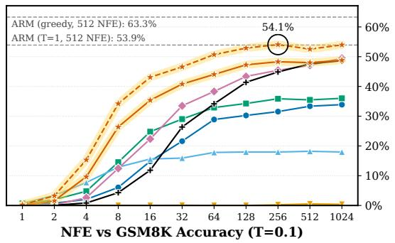

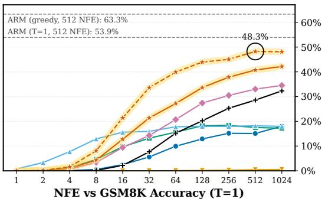  
Figure 1: GSM8K accuracy against the Number of Function Evaluations (NFE) at $T = 0 . 1$ (left) and T = 1 (right). LAW (Sec. 4.3) trained from scratch with the training FLOPs of the baselines (solid), and fine-tuned from the Duo baseline for 50k steps (dashed). The dashed gray lines are an Autoregressive Model (ARM), sampled at $T = 1$ and with greedy decoding. Trained from scratch, LAW is the most accurate model from 32 NFE at $T = 1$ , and from 4 to 512 NFE at $T = 0 . 1$ . Fine-tuned from Duo, it comes closer to the ARM.

## 1 INTRODUCTION

Although Autoregressive Models (ARMs) dominate language modeling (Vaswani et al., 2017; Kaplan et al., 2020; Gemini Team et al., 2023; Grattafiori et al., 2024), their generation process is sequential and their left-to-right factorization can be limiting for tasks that need bidirectional context (Kitouni et al., 2024; Papadopoulos et al., 2024; Nagarajan et al., 2025). Discrete Diffusion Models (DDMs) (Austin et al., 2021; Campbell et al., 2022; Lou et al., 2024; Sahoo et al., 2024; Shi et al., 2024; Ou et al., 2025; Sahoo et al., 2025; Schiff et al., 2025; von Rutte et al.¨ , 2025), the most common Diffusion Language Models (DLMs), instead use a bidirectional architecture and can refine tokens in parallel. For tractability, DDMs sample each position independently and discard the denoiser’s prediction after each step. This causes two problems. First, factorized, parallel sampling hurts the sample quality in few-step generation (Deschenaux & Gulcehre, 2024; Feng et al., 2025). Second, discarding previous predictions means that the associated uncertainty is lost (information collapse; Jo et al., 2026).

Continuous DLMs (Dieleman et al., 2022; Li et al., 2022; Gulrajani & Hashimoto, 2023; Jo & Hwang, 2025; Batzolis et al., 2026; Chemseddine et al., 2026; Chen et al., 2026; Deschenaux & Gulcehre, 2026; Hu et al., 2026; Lee et al., 2026a; Potaptchik et al., 2026; Roos et al., 2026; Shen et al., 2026; Yang et al., 2026; Yoo et al., 2026) instead avoid the factorized sampling by integrating an ODE or SDE from noise to data (Albergo & Vanden-Eijnden, 2023; Lipman et al., 2023; Liu et al., 2023b). However, on reasoning, they at most match DDMs. For example, FLM (Lee et al., 2026a) and S-FLM (Deschenaux & Gulcehre, 2026) remain close to MDLM and Duo on Sudoku and Maze, and S-FLM matches MDLM on GSM8K only with greedy generation.

In contrast, Self-Conditioning (SC; Strudel et al., 2022; Chen et al., 2023) feeds the previous predictions or hidden representations of the denoiser back as input, and improves both discrete and continuous DLMs. For example, Loopholing Discrete Diffusion Models (LDDMs; Jo et al., 2026) and DiffusionGemma (Google DeepMind, 2026) propagate such a state across denoising steps. On hard Sudoku puzzles, LDDM-U solves 91.0%, against 58.4% for Duo and at most 45.0% for FLMs (Sec. 4.1). So far, despite its empirical success, SC always plays an auxiliary role. We therefore ask:

“Can we find a generative model based purely on Self-Conditioning?”

We answer this question positively with “Loopholing All the Way” (LAW, Figure 2):

• We propose LAW, a continuous generative model based purely on Self-Conditioning. As in Uniform Diffusion Models (UDMs), sampling starts from a sequence of uniformly random tokens. Afterwards, LAW refines the Expected Embedding of the clean token, under the denoiser’s prediction. Thus, we decode back to tokens only once, at the last sampling step.

• We identify the two choices that make pure SC work: the Expected Embedding as SC state (35.8% on GSM8K, against below 1.5% with the final-layer hidden representation of Jo et al., 2026), and temperature regularization (12), which randomly scales the denoiser’s logits during training, doubles the GSM8K accuracy at T = 0.1 (24.8% to 48.8%).

• LAW surpasses LDDM-U on hard Sudoku (96.5% vs. 91.0%, Sec. 4.1) and is the most accurate model on Maze with up to 64 NFE (Sec. 4.2). On GSM8K, it outperforms the diffusion and flow baselines trained with the same FLOPs, and fine-tuning a pre-trained Duo checkpoint with LAW increases the accuracy from 17.2% to 48.1% (Sec. 4.3). On Open-WebText, at the same entropy, its Generative Perplexity (Gen. PPL) comes close to that of ARMs with 64 NFE. With 1024 NFE, LAW’s samples have lower Gen. PPL than those of the AR baseline, though the entropy reaches at most 5.1–5.2 over the swept temperatures (Sec. 4.4).

## 2 BACKGROUND

Notation. We denote by V a finite vocabulary of size |V| and associate each token with a one-hot vector in $\{ 0 , 1 \} ^ { | \nu | }$ . A sequence $\mathbf { x } \in \mathcal { V } ^ { L }$ consists of L tokens, with $\mathbf { x } ^ { \ell }$ as its ℓ-th element. We write $\Delta ^ { | \nu | }$ for the probability simplex, $\operatorname { C a t } ( \cdot ; \mathbf { p } )$ for the categorical distribution with parameter $\mathbf { p } \in \Delta ^ { \vert \nu \vert }$

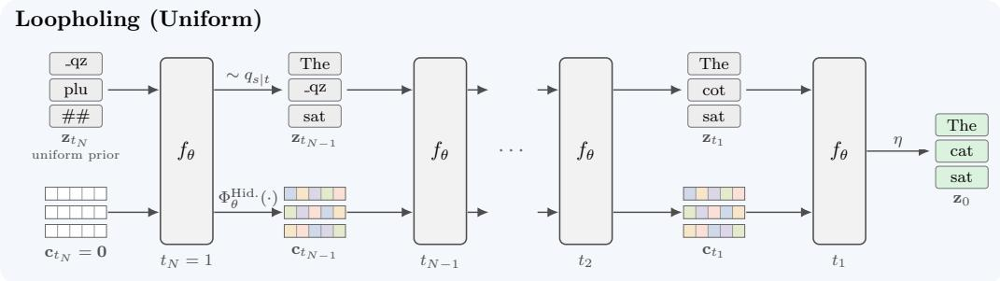

Loopholing All the Way (LAW; Ours)  
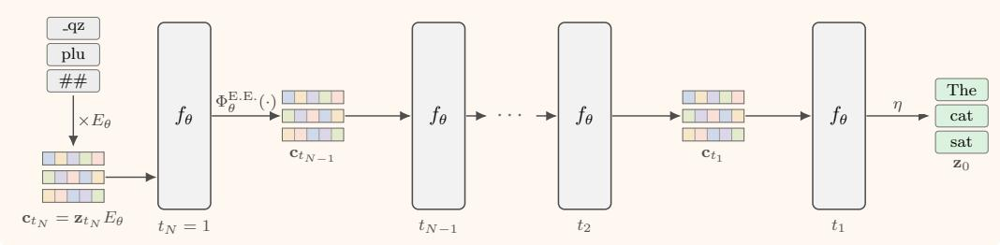  
Figure 2: Overview. Sampling goes from left to right, applying the backbone $f _ { \theta }$ repeatedly. Boxed words are discrete tokens, colored cells SC states and white cells zero-valued states. Top: Loopholing (LDDM; Jo et al., 2026). At each step, discrete tokens are updated and forwarded alongside the SC state (5). Bottom: LAW. At each step, we only propagate the SC state, computed by the state map $\Phi _ { \theta } ^ { \mathrm { E . E . } } ( 7 )$ . The initial tokens are drawn from the uniform prior, and we decode back to discrete tokens only at the end (9).

and 1 for the all-ones vector. We write $E _ { \theta } \in \mathbb { R } ^ { | \mathcal { V } | \times d }$ for the learned embedding matrix, where d is the embedding dimension. A sequence of tokens $\mathbf { z } \in \{ 0 , 1 \} ^ { L \times | \mathcal { V } | }$ is embedded as z $: E _ { \theta } \in \mathbb { R } ^ { L \times d }$ . We write sg[·] for the stop-gradient operator and $\mathrm { L N } ( \cdot )$ for LayerNorm (Ba et al., 2016).

## 2.1 UNIFORM DISCRETE DIFFUSION MODELS (UDMS)

DDMs map the data distribution to a simple prior with a fixed forward process that gradually corrupts clean tokens, and learn to reverse it (Austin et al., 2021; Campbell et al., 2022). The prior is either a mask token, as in Masked Diffusion (Sahoo et al., 2024; Shi et al., 2024; Ou et al., 2025), or the uniform distribution over the vocabulary, as in UDMs (Hoogeboom et al., 2021; Lou et al., 2024; Sahoo et al., 2025; Schiff et al., 2025). Masked Diffusion fixes each token once it is unmasked, whereas UDMs can revise tokens at every step. Given a monotonically decreasing noise schedule $\alpha _ { t }$ from $\alpha _ { 0 } = 1$ to $\alpha _ { 1 } = 0$ , each token is corrupted independently, $\begin{array} { r } { \mathbf { z } _ { t } \sim \prod _ { \ell = 1 } ^ { L } q _ { t } ( \cdot \vert \mathbf { x } ^ { \ell } ) } \end{array}$ , with

$$
\begin{array} { r } { q _ { t } ( \mathbf { z } _ { t } ^ { \ell } \mid \mathbf { x } ^ { \ell } ) = \mathrm { C a t } \Big ( \mathbf { z } _ { t } ^ { \ell } ; \alpha _ { t } \mathbf { x } ^ { \ell } + ( 1 - \alpha _ { t } ) \frac { 1 } { | \mathcal { V } | } \mathbf { 1 } \Big ) . } \end{array}\tag{1}
$$

Thus, $\mathbf { z } _ { t } ^ { \ell }$ remains clean with probability $\alpha _ { t }$ and is otherwise drawn uniformly from the vocabulary. To reverse the forward process, the denoiser $\mathbf { x } _ { \theta } ( \mathbf { z } _ { t } , t )$ learns to predict the clean tokens. It composes the embedding matrix $E _ { \theta }$ , a stack of Transformer blocks $f _ { \theta }$ , the Language Modeling (LM) head $g _ { \theta }$ (an affine projection), and a softmax:

$$
\underbrace { \mathbf { z } _ { t } } _ { \mathcal { V } ^ { L } } \mapsto \underbrace { \mathbf { \widetilde { E } } _ { t } \mathbf { \widetilde { E } } _ { \theta } } _ { \mathbb { R } ^ { L \times d } } \underbrace { f _ { \theta } ( \cdot , t ) } _ { \mathbb { R } ^ { L \times d } } \ \mapsto \ \underbrace { \mathbf { h } _ { t } } _ { \mathbb { R } ^ { L \times d } } \longmapsto \underbrace { g _ { \theta } ( \mathbf { h } _ { t } ) } _ { \mathbb { R } ^ { L \times | \mathcal { V } | } } \mapsto \underbrace { \mathrm { s o f t m a x } } _ { ( \Delta ^ { | \mathcal { V } | } ) ^ { L } } \underbrace { \mathbf { x } _ { \theta } ( \mathbf { z } _ { t } , t ) } _ { ( \Delta ^ { | \mathcal { V } | } ) ^ { L } } ,\tag{2}
$$

where $\mathbf { h } _ { t }$ is the final-layer hidden representation. Generation refines the noisy state $\mathbf { z } _ { t }$ from $t = 1$ to $t = 0 ,$ . From time t to $s < t .$ , the reverse step samples from the categorical denoising posterior $q _ { s | t } ( \mathbf { z } _ { s } ^ { \ell } \mid \mathbf { z } _ { t } ^ { \ell } , \mathbf { x } ^ { \ell } )$ , which depends on the unknown clean token $\mathbf { x } ^ { \ell }$ . Recent DDMs replace $\mathbf { \bar { x } } ^ { \ell }$ in $q _ { s \mid t }$ with the prediction ${ \bf x } _ { \theta } ^ { \ell } ( { \bf z } _ { t } , t )$ . The denoiser is trained to minimize the Negative Evidence Lower

Bound (NELBO), an upper bound on the negative log-likelihood that decomposes into per-token losses $\mathcal { L } _ { \mathrm { t o k } }$

$$
\mathbb { E } [ - \log p _ { \theta } ( \mathbf { x } ) ] \leq { \mathcal { L } } ( \theta ) = \mathbb { E } _ { \mathbf { x } \sim q _ { \mathrm { d a t a } } , t \sim { \mathcal { U } } [ 0 , 1 ] , \mathbf { z } _ { t } \sim q _ { t } ( \cdot | \mathbf { x } ) } \left[ \sum _ { \ell = 1 } ^ { L } { \mathcal { L } } _ { \mathrm { t o k } } \left( \mathbf { x } _ { \theta } ^ { \ell } ( \mathbf { z } _ { t } , t ) , \mathbf { x } ^ { \ell } , \mathbf { z } _ { t } ^ { \ell } , \alpha _ { t } \right) \right] .\tag{3}
$$

Suppl. A.1 gives the closed forms of $q _ { s \mid t }$ and $\mathcal { L } _ { \mathrm { t o k } }$ (Schiff et al., 2025; Sahoo et al., 2025). To sample, let $t _ { n } = n / N , n = 0 , \ldots , N$ , be a uniform time grid, where N is the NFE. The initial tokens $\mathbf { z } _ { 1 }$ are drawn from the uniform prior $\mathrm { C a t } ( \cdot ; \frac { 1 } { | \mathcal { V } | } \mathbf { 1 } )$ , and the backward transition is applied N times (ancestral sampling):

$$
\begin{array} { r } { \mathbf { z } _ { t _ { n - 1 } } ^ { \ell } \sim q _ { t _ { n - 1 } | t _ { n } } \left( \mathbf { z } _ { t _ { n - 1 } } ^ { \ell } \Big | \mathbf { z } _ { t _ { n } } ^ { \ell } , \mathbf { x } _ { \theta } ^ { \ell } ( \mathbf { z } _ { t _ { n } } , t _ { n } ) \right) , \qquad n = N , \ldots , 1 . } \end{array}\tag{4}
$$

## 2.2 LOOPHOLING DISCRETE DIFFUSION MODELS (LDDMS)

The sampling step (4) only propagates the discrete tokens $\mathbf { z } _ { s }$ to the next step. Thus, the predictions ${ \bf x } _ { \theta } ( { \bf z } _ { t } , t )$ and their uncertainty are discarded after sampling (information collapse). LDDMs (Jo et al., 2026) address this with SC (Chen et al., 2023), which feeds the previous predictions or hidden representations of the denoiser back as input. Alongside the sampled tokens, they propagate the SC state c, the layer-normalized final-layer hidden representation (2). At the next step, c is added to the token embeddings. Starting from $\mathbf { c } _ { 1 } = \mathbf { 0 }$ , one LDDM sampling step from time t to s maps $\left( \mathbf { z } _ { t } , \mathbf { c } _ { t } \right)$ to $\left( \mathbf { z } _ { s } , \mathbf { c } _ { s } \right)$

$$
\underbrace { \left( \mathbf { z } _ { t } , \mathbf { c } _ { t } \right) } _ { \gamma ^ { L } \times \mathbb { R } ^ { L \times d } } \underbrace { f _ { \theta } ( \mathbf { z } _ { t } E _ { \theta } + \mathbf { c } _ { t } , t ) } _ { \mathbb { R } ^ { L \times d } } \underbrace { { \mathbf { h } } _ { t } } _ { \mathbb { R } ^ { L \times d } } \underbrace { \left( q _ { s \mid t } \circ \mathrm { s o f t m a x } \circ g _ { \theta } , \ \Phi _ { \theta } ^ { \mathrm { H i d . } } \right) } _ { \mathbb { R } ^ { L \times d } } \ \underbrace { \left( \mathbf { z } _ { s } , \mathbf { c } _ { s } \right) } _ { \gamma ^ { L } \times \mathbb { R } ^ { L \times d } } ,\tag{5}
$$

where $\mathbf { z } _ { s }$ is sampled from the posterior $q _ { s \mid t } ( \cdot \mid \mathbf { z } _ { t }$ , softmax $\left( g _ { \boldsymbol { \theta } } ( \mathbf { h } _ { t } ) \right) )$ and the state map $\Phi _ { \theta } ^ { \mathrm { H i d . } } ( \mathbf { h } ) = \mathrm { L N } ( \mathbf { h } )$ computes $\mathbf { c } _ { s } ~ = ~ \Phi _ { \theta } ^ { \mathrm { H i d . } } ( \mathbf { h } _ { t } )$ The masked (LDDM-M) and uniform (LDDM-U) variants build on MDLM (Sahoo et al., 2024) and Duo (Sahoo et al., 2025), respectively. During training, with probability $p ,$ the multi-pass probability $( p = 0 . 9$ by default), a first forward pass on $\left( \mathbf { z } _ { t } , \mathbf { 0 } \right)$ computes $\mathbf { c } _ { t } \overset { \cdot } { = } \mathrm { s g } \bigl \lceil \boldsymbol { \Phi } _ { \theta } ^ { \mathrm { H i d . } } ( \dot { \mathbf { h } _ { t } } ) \bigr \rceil$ , and the NELBO (3) is computed after a second pass on $\left( \mathbf { z } _ { t } , \mathbf { c } _ { t } \right)$ only. Otherwise, LDDMs execute a standard UDM training step with $\mathbf { c } _ { t } = \mathbf { 0 }$ . Thus, $\mathbf { c } _ { t }$ is computed at the same time t during training, but comes from the previous, noisier step during sampling. Despite this train–test mismatch, LDDMs outperform the pure discrete baselines (Jo et al., 2026), e.g., on hard Sudoku, LDDM-U solves 91.0% of the puzzles, against 58.4% for Duo (Sec. 4.1).

## 3 LOOPHOLING ALL THE WAY (LAW)

Although LDDMs use SC, they operate on a sequence of discrete tokens, which the SC state only complements (Sec. 2.2). Since SC can preserve continuous information across steps, we propose LAW, a generative model based purely on SC. LAW propagates only the SC state and decodes discrete tokens at the end. As the SC state becomes the only input of the denoiser, it should resemble the token embeddings that the denoiser is trained on. We therefore use the Expected Embedding under the denoiser’s prediction, a convex combination of the token embeddings. We present the generative process first (Sec. 3.1), since it motivates the training procedure (Sec. 3.2).

## 3.1 GENERATIVE PROCESS

Initialization. As for a UDM at $t = 1$ , we obtain the initial state $\mathbf { c } _ { 1 }$ by embedding tokens drawn from the uniform prior:

$$
\mathbf { c } _ { 1 } = \mathbf { z } _ { 1 } E _ { \theta } , \qquad \mathbf { z } _ { 1 } ^ { \ell } \sim \mathrm { C a t } \biggl ( \mathbf { \cdot } ; \frac { 1 } { | \mathcal { V } | } \mathbf { 1 } \biggr ) .\tag{6}
$$

Continuous State Updates. For $n = N , \ldots , 2$ , we pass the SC state $\mathbf { c } _ { t _ { r } }$ through the denoising backbone and map the resulting hidden representation into the next state:

$$
\underbrace { \mathbf { c } _ { t _ { n } } } _ { \mathbb { R } ^ { L \times d } } \mapsto \underbrace { \mathbf { h } _ { t _ { n } } } _ { \mathbb { R } ^ { L \times d } } \mapsto \underbrace { \mathbf { h } _ { t _ { n } } } _ { \mathbb { R } ^ { L \times d } } \mapsto \overbrace { \frac { \Phi _ { \theta } ^ { \mathrm { E . E . } } ( \cdot ; T ) } { \mathbb { R } ^ { L \times d } } } ^ { \boldsymbol { \Phi } _ { \theta } ^ { \mathrm { E . E . } } ( \cdot ; T ) } .\tag{7}
$$

Thus, the backbone receives the SC state alone, and no tokens are sampled between steps. The state map computes the Expected Embedding (E.E.) under the denoiser’s prediction:

$$
\underbrace { \Phi _ { \theta } ^ { \mathrm { E . E . } } ( { \bf h } ; \tau ) } _ { \mathbb { R } ^ { L \times d } } = \underbrace { \mathrm { s o f t m a x } \bigg ( \frac { g _ { \theta } ( { \bf h } ) } { \tau } \bigg ) } _ { \mathbb { R } ^ { L \times | \mathcal { V } | } } \underbrace { E _ { \theta } } _ { \mathbb { R } ^ { | \mathcal { V } | \times d } } ,\tag{8}
$$

where the softmax is applied over the vocabulary dimension and $\tau >$ 0 is a temperature. For conciseness, we write $\mathbf { x } _ { \theta } ( \mathbf { c } , t )$ for $\tau = 1$ . LDDMs add their SC state $\Phi _ { \theta } ^ { \mathrm { H i d . } } ( \mathbf { h } )$ to the token embeddings (5), whereas the SC state of LAW replaces them. We compare both state maps in Sec. 4.3. At every sampling step, we set τ to the sampling temperature $\bar { T ( T = 1 }$ unless stated otherwise). Since τ is randomized during training (Sec. 3.2), the denoiser learns to process tempered SC states. For conditional generation, we always fix the prompt positions to the clean token embeddings.

Decoding. At the last step, a decoder η maps the denoiser prediction $\hat { \mathbf { x } } = \mathbf x _ { \theta } ( \mathbf c _ { t _ { 1 } } , t _ { 1 } ; T )$ to discrete tokens. We consider the raw and argmax decoders:

$$
\eta _ { \mathrm { r a w } } \bigl ( \hat { \mathbf { x } } \bigr ) ^ { \ell } \sim \mathrm { C a t } \bigl ( \cdot ; \hat { \mathbf { x } } ^ { \ell } \bigr ) , \qquad \eta _ { \mathrm { m a x } } \bigl ( \hat { \mathbf { x } } \bigr ) ^ { \ell } = \arg \operatorname* { m a x } _ { v \in \mathcal { V } } \hat { x } _ { v } ^ { \ell } .\tag{9}
$$

With the argmax decoder, all the randomness comes from the prior, so sampling is deterministic given $\mathbf { z } _ { 1 }$ . See Algo. 1 for the pseudocode.

## 3.2 TRAINING THE CONTINUOUS TRAJECTORY

Multi-Pass Training. During sampling, the denoiser consumes the SC states that it produced itself (7). Since backpropagation through the whole trajectory is costly, we adopt the multi-pass training of LDDM-U (Sec. 2.2). We first sample a corrupted sequence ${ \bf z } _ { t } \left( 1 \right)$ . With probability $p ,$ we unroll M forward passes, and otherwise, we execute a single pass on $\mathbf { z } _ { t } ,$ , as in standard UDM training. In the multi-pass case, the first pass receives the token embeddings of $\mathbf { z } _ { t } ,$ while later ones process the SC state, and we only backpropagate through the last pass. We use $p = 0 . 9$ and $M = 2$ by default, following Jo et al. (2026). Formally,

$$
{ \bf c } ^ { ( 1 ) } = { \bf z } _ { t } E _ { \theta } , \qquad { \bf c } ^ { ( i + 1 ) } = \mathrm { s g } \Bigl [ \Phi _ { \theta } ^ { \mathrm { E . E . } } \bigl ( f _ { \theta } ( { \bf c } ^ { ( i ) } , t ^ { ( i ) } ) ; \tau \bigr ) \Bigr ] , \qquad t ^ { ( i ) } = t - ( i - 1 ) \delta ,\tag{10}
$$

where $\delta = 1 / L$ is the step size when sampling with $N = L$ NFE. The loss is applied only to the prediction of the last pass, $\hat { \mathbf { x } } = \mathbf { x } _ { \theta } ( \mathbf { c } ^ { ( M ) } , t ^ { ( M ) } )$ ). We minimize either the per-token NELBO $\mathcal { L } _ { \mathrm { t o k } } \left( 3 \right)$ or the Cross Entropy (CE):

$$
\mathcal { L } _ { \mathrm { L A W } } ( \theta ) = \mathbb { E } _ { \mathbf { x } , t , \mathbf { z } _ { t } , \tau } \left[ \sum _ { \ell = 1 } ^ { L } \mathcal { L } _ { \mathrm { L A W } } ^ { \ell } \right] , \qquad \mathcal { L } _ { \mathrm { L A W } } ^ { \ell } = \left\{ \begin{array} { l l } { \mathcal { L } _ { \mathrm { t o t } } { \left( \hat { \mathbf { x } } ^ { \ell } , \mathbf { x } ^ { \ell } , \mathbf { z } _ { t } ^ { \ell } , \alpha _ { t } \right) } } & { \mathrm { ( N E L B O ) } , } \\ { - \log \langle \hat { \mathbf { x } } ^ { \ell } , \mathbf { x } ^ { \ell } \rangle } & { \mathrm { ( C E ) } . } \end{array} \right.\tag{11}
$$

During the multi-pass updates, we sample $t \sim \mathcal { U } [ ( M - 1 ) \delta , 1 ]$ to ensure that $t ^ { ( M ) } \ge 0$ , while single-pass updates draw $t \sim \mathcal { U } [ 0 , 1 ]$ . See Algo. 2 for the pseudocode.

Temperature Regularization. Sampling with $T \neq 1$ makes the denoiser’s logits sharper $( T < 1 )$ or flatter $( T > 1 )$ . To expose the denoiser to SC states computed with tempered logits, we draw the temperature τ at random during training, to perturbs the SC states (10). We compute the loss with the untempered prediction $\hat { \textbf { x } } ( 1 1 )$ , so τ only affects the SC states. We draw τ as

$$
\begin{array} { r } { \tau \sim \frac { 1 } { 2 } \mathcal { U } \big ( \rho ^ { - 1 } , 1 \big ) + \frac { 1 } { 2 } \mathcal { U } ( 1 , \rho ) , } \end{array}\tag{12}
$$

and share it across passes and across tokens in the sequence. The factor $\rho \ge 1$ makes it equally likely to sharpen $( \tau < 1 )$ or flatten $( \tau > 1 )$ the logits. We sample both sides because, with a one-sided range, the LM head $g _ { \theta }$ could absorb the temperature by rescaling its weights.

Architecture. LAW uses the same denoiser architecture as standard UDMs, a Diffusion Transformer (DiT) with pre-normalization (Peebles & Xie, 2023; Lou et al., 2024), so it can be trained from scratch or fine-tuned from a pre-trained UDM checkpoint. We optionally add a learned mode embedding to the time conditioning, which indicates whether the denoiser receives the embeddings of noisy tokens or an SC state. We only use mode embedding on OpenWebText, where it prevents the representations from collapsing when $\rho = 3$ (Suppl. D.7). See Suppl. A.5 for details.

## 4 EXPERIMENTS

We evaluate LAW on four datasets: Sudoku (Sec. 4.1) to test constraint satisfaction with a unique solution, Maze (Sec. 4.2) for long-range planning with possibly several optimal paths, GSM8K (Cobbe et al., 2021) (Sec. 4.3) for reasoning on grade-school math word problems, and OpenWeb-Text (Gokaslan & Cohen, 2019) (Sec. 4.4) for unconditional language modeling.

Baselines and Training. We compare to an ARM, to the DDMs MDLM (Sahoo et al., 2024), Duo (Sahoo et al., 2025), LDDM-M and LDDM-U (Jo et al., 2026), and to the continuous models CANDI (Pynadath et al., 2026), FLM (Lee et al., 2026a) and S-FLM (Deschenaux & Gulcehre, 2026). Unless stated otherwise, all models are DiTs trained from scratch. Since LDDMs and LAW unroll several forward passes, we train those for fewer steps to use similar training FLOPs as the baselines (Suppl. B). Additionally, LAW always uses the raw decoder $\eta _ { \mathrm { r a w } }$ (9). Full details are in Suppl. C.

## 4.1 REASONING ON SUDOKU

Experimental Setup. We follow prior work (Kim et al., 2026) and generate 48k training and 2k validation puzzles with unique solutions (Alp, 2024). We consider three difficulty levels, determined by the number of visible digits (easy: 40/81, medium: 35/81, hard: 30/81), and we report the exact-match accuracy. Each sequence concatenates the partial grid with the solution grid. The denoiser is an 8-layer DiT with Rotary Positional Encoding (RoPE; Su et al., 2024). The baselines train for 20k steps. See Suppl. C.2 for details and Suppl. D.1 for ablations.

Results. With 180 NFE, LAW is the most accurate model on all three difficulties (Table 1). In particular, LAW outperforms LDDMs. LAW solves 96.5% of the puzzles with temperature regularization $( \rho ~ = ~ 2 , ~ p ~ = ~ 0 . 9 )$ and training with CE performs better than with the NELBO (Suppl. D.1).

Table 1: Exact-match accuracy (%) on Sudoku with 180 NFE. Baseline numbers are taken from prior work (Deschenaux & Gulcehre, 2026), except LDDMs, which we train with matched training FLOPs. p is the multipass probability, and reg. is temperature regularization with range ρ (12). Best per column in bold, second best underlined.
<table><tr><td>Model</td><td>Easy</td><td>Med. Hard</td><td></td></tr><tr><td>Autoregressive</td><td></td><td></td><td></td></tr><tr><td>Sample</td><td>13.9</td><td>5.1</td><td>0.6</td></tr><tr><td>Greedy</td><td>14.6</td><td>5.1</td><td>1.0</td></tr><tr><td>Discrete Diffusion</td><td></td><td></td><td></td></tr><tr><td>MDLM (Sahoo et al., 2024)</td><td>92.0</td><td>77.1</td><td>30.2</td></tr><tr><td>Duo (Sahoo et al., 2025)</td><td>96.3</td><td>84.7</td><td>58.4</td></tr><tr><td>LDDM-M (Jo et al., 2026)</td><td>98.3</td><td>95.9</td><td>87.5 91.0</td></tr><tr><td>LDDM-U (Jo et al., 2026)</td><td>99.8</td><td>97.9</td><td></td></tr><tr><td>Continuous Models</td><td></td><td></td><td></td></tr><tr><td>CANDI (Pynadath et al., 2026) CANDI pure Gaussian</td><td>79.3 63.9</td><td>45.9</td><td>16.7 12.5</td></tr><tr><td>FLM (Lee et al., 2026a)</td><td>94.2</td><td>41.9 82.7</td><td>44.5</td></tr><tr><td>S-FLM Deschenaux et al. (2026)</td><td>94.8</td><td>85.2</td><td>45.0</td></tr><tr><td>LAW NELBO no reg. (p = 0.9)</td><td>98.7</td><td>94.6</td><td>85.3</td></tr><tr><td>LAW CE no reg. (p = 0.9)</td><td>99.8</td><td>99.0</td><td>92.2</td></tr><tr><td>LAW CE no reg. (p = 0.75)</td><td>99.9</td><td></td><td></td></tr><tr><td></td><td></td><td>98.9</td><td>94.5</td></tr><tr><td></td><td></td><td></td><td></td></tr><tr><td>LAW CE reg.  $( \rho = 2 , p = 0 . 9 )$ </td><td>99.8</td><td>99.4</td><td>96.5</td></tr></table>

## 4.2 PATH FINDING ON MAZE

Experimental Setup. We evaluate shortest-path finding on mazes inspired by Wang et al. (2025). We generate 1k training and 1k evaluation mazes on 20 × 20 grids (Lehnert et al., 2024) and keep mazes with long-enough shortest path (71 steps). Each cell is encoded as a wall, empty, start, goal, or path token. As for Sudoku, we concatenates the unsolved grid with the solution (800 tokens). We report the accuracy of finding any one of the shortest paths from start to goal (unlike certain work that measure exact match with a particular shortest path). The denoiser is an 8-layer DiT (d = 256, 8 heads, RoPE), and we train the baselines for 100k steps.

Results. LAW is the most accurate model with few steps (Figure 3). With only 4 NFE, it solves 90.9% of the mazes, more than any baseline with any number of steps besides LDDM-M, and it is ahead of every baseline up to 64 NFE. From 512 NFE, LDDM-M is slightly more accurate, as both models solve about 92% of the mazes. LDDM-U plateaus below 89%, and the continuous baselines below 82%. Temperature regularization barely changes the accuracy and training with the NELBO is generally better than with CE. Details on the ablations on the loss, M and p are in Suppl. D.6.

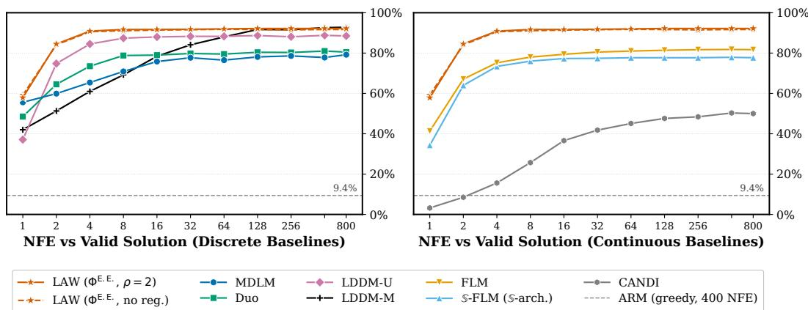  
Figure 3: Maze valid-solution accuracy against NFE. Fraction (%) of the 1k evaluation mazes for which a valid solution is generated (Suppl. C.4). All methods are trained with matched training FLOPs (Suppl. B). LAW uses $M = 2 , p = 0 . 7 5 ,$ the NELBO, batch size 256 and 80k steps, with $( \rho = 2 ,$ solid) and without (dashed) temperature regularization. The dashed gray line is the ARM with greedy decoding (9.4%). Left: LAW against the DDM baselines. Right: LAW against the continuous baselines.

## 4.3 REASONING ON GSM8K

Experimental Setup. We train on TinyGSM (Liu et al., 2023a), a dataset of 11.8M synthetic math problems, and evaluate on the GSM8K test set (Cobbe et al., 2021). For each test problem, we generate and execute one Python program. We use a 12-layer DiT denoiser and the smollm tokenizer (Allal et al., 2025), with a context length of 512 and padding for shorter programs. The baselines train for 250k steps with a batch size of 512, while LDDMs and LAW train for 192k steps (Suppl. B.1). Unless stated otherwise, LAW uses the Expected Embedding, the NELBO, M = 2 passes with $p = 0 . 9$ , and temperature regularization with $\rho = 3$ . We report the GSM8K accuracy from 1 to 1024 NFE at the sampling temperatures T = 1 and T = 0.1. See Suppl. C.3 for details and Suppl. D.2 for all ablations.

Results. Trained from scratch, LAW solves 42.2% of the problems at T = 1 with 1024 NFE, against 34.5% for the strongest diffusion or flow baseline, LDDM-U, and it outperforms all of them from 32 NFE onward, with their standard samplers (Figure 1, Suppl. C.1). At $T = 0 . 1$ , it is the most accurate model from 4 to 512 NFE (e.g., 26.4% against 12.4% for LDDM-U with 8 NFE), and LDDMs match it only with 1024 NFE. Table 10 shows that with T = 0.1 and 2 to 64 NFE, LAW is more accurate than the recent few-step approaches FMLM+ (Agarwal et al., 2026), DBTM (Tang & Wang, 2026), IDLM (Li et al., 2026) and the undistilled SDM (Deschenaux et al., 2026a).

Fine-Tuning from Duo. We show that LAW can be adapted from a pre-trained Duo checkpoint. We fine-tune one for up to 50k steps, with M = 2 and p = 0.9 or M = 4 and $p = 0 . 7 5$ , and batch sizes from 64 to 512 (Figure 12). With batch size 512 and after 50k steps, LAW solves 48.1% of the problems at T = 1 with 1024 NFE, against 17.2% for Duo and 42.2% for LAW trained from scratch (right panel of Figure 4). This fine-tuning adds 26% to the training compute of Duo. With M = 2, the accuracy peaks after 15k to 20k steps and then decreases, whereas with M = 4 it does not decrease. After 15k steps, which add 8% to the compute of Duo, LAW is more accurate than the ARM at T = 1 in 32 sampling steps (56.2% vs. 53.9% for the ARM with 512 NFE).

Comparison with AlphaDLM. The concurrent work AlphaDLM (Gushchin et al., 2026) is the most accurate method with up to 8 NFE, and is more accurate than LAW trained from scratch. Fine-tuned from Duo for 15k steps, however, LAW is more accurate than AlphaDLM from 16 NFE onward at T = 1, for about 8% more training compute (250k Duo steps plus 15k fine-tuning steps, against 250k for AlphaDLM). Two differences might explain the higher accuracy of AlphaDLM. First, it uses a confidence-based sampler, which alone increases the accuracy of MDLM from 22.1% to 43.9% at 32 NFE. Second, it trades the many-steps performance for higher few-steps accuracy, and its hyperparameter k, which sets this trade-off, must be chosen for a target inference budget (Table 10). Distillation shows a similar trade-off, as the distilled SDM plateaus below the original checkpoint with many steps (Deschenaux et al., 2026a). We therefore see AlphaDLM as complementary to LAW, and leave studying their combination for future work.

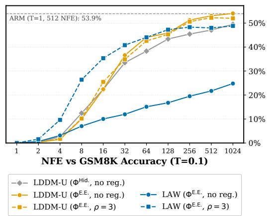

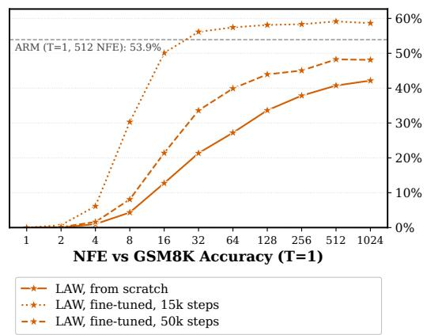  
Figure 4: Ablations on GSM8K: how LAW uses the SC state (left, $T = 0 . 1 )$ and fine-tuning from Duo (right, $T = 1 )$ . Left: the legend gives the SC state and the temperature regularization $( \rho = 3$ or none). Right: LAW fine-tuned from Duo for 15k and 50k steps, with $M = \mathbf { \bar { 2 } } , p = 0 . 9$ $\rho = 3$ and batch size 512, against LAW trained from scratch.

Ablations. Three design choices are essential (Suppl. D.2). First, the state map $\Phi _ { \theta } ^ { \mathrm { E . E . } }$ performs better than $\Phi _ { \theta } ^ { \mathrm { H i d . } }$ . With $\Phi _ { \theta } ^ { \mathrm { H i d . } }$ ., LAW solves fewer than 1.5% of the problems, against 35.8% with $\Phi _ { \theta } ^ { \mathrm { E . E . } }$ (Figure 6; no regularization). Second, temperature regularization doubles the accuracy at $T = 0 . 1$ , from 24.8% to 48.8% with 1024 NFE (Figure 7). Third, backpropagating through the M passes decreases the accuracy from 42.2% to 20.2% at both matched training FLOPs, and at equal training steps (Figures 9 and 10). Find ablations on the number of passes and p in Suppl. D.2.

Pure vs. Auxiliary SC. To isolate the choice of state map against the effect of pure Self-Conditioning, we train variants a variant of LDDM-U with $\Phi _ { \theta } ^ { \mathrm { E . E . } }$ instead of $\Phi _ { \theta } ^ { \mathrm { H i d . } }$ .. Using $\Phi _ { \theta } ^ { \mathrm { E . E . } }$ improves the accuracy (38.7% instead of 34.5% at $T = 1$ with 1024 NFE). Nevertheless, even with temperature regularization, LDDM-U with $\Phi _ { \theta } ^ { \mathrm { E . E . } }$ remains less accurate than LAW, except at $T = 0 . 1$ with 256 NFE or more (Figure 4; left), where LDDM slightly ouperforms LAW.

## 4.4 LANGUAGE MODELING ON OPENWEBTEXT

Experimental Setup. We train on OpenWebText (Gokaslan & Cohen, 2019) with the GPT-2 tokenizer (Radford et al., 2019) and a context length of 1024, global batch size 512 with the optimizer configuration in Suppl. C.1. In addition to previous baselines, we add S-FLM with the Sphere-DiT architecture (S-arch.; Deschenaux & Gulcehre, 2026). The baselines train for 400k steps, and LD-DMs and LAW, with M = 2 passes and $p = 0 . 9 ( 1 0 )$ , for 308k steps (Suppl. B.1). We use 12-layer DiTs with embedding dimension d = 768 and 12 attention heads. We show LAW trained with the CE (11) (which gives more diverse samples than the NELBO), the mode embedding (Suppl. A.5), and temperature regularization with $\rho = 3 \left( 1 2 \right)$ , and we ablate these choices in Suppl. D.7.

Gen. PPL / Entropy Frontier. Repetitive samples can lower the Gen. PPL without improving sample quality (Dieleman et al., 2022; Velickoviˇ c et al.´ , 2026), and the best sampling temperature differs across models. We therefore sweep the sampling temperature T and plot the Gen. PPL against the unigram entropy of the samples for each model and NFE (Pynadath et al., 2026). A model is considered better if it reaches a lower Gen. PPL at matched entropy (Suppl. C.5).

Results. With 64 NFE, LAW outperforms the diffusion and flow baselines and comes close to the ARM that uses 1024 NFEs (Figure 5). With 1024 NFE, LAW also outperforms the ARM at the same entropy, but its samples are less diverse. Over the same sampling temperatures, its entropy reaches at most 5.1–5.2 with 1024 NFE, against 5.8 with 64 NFE.

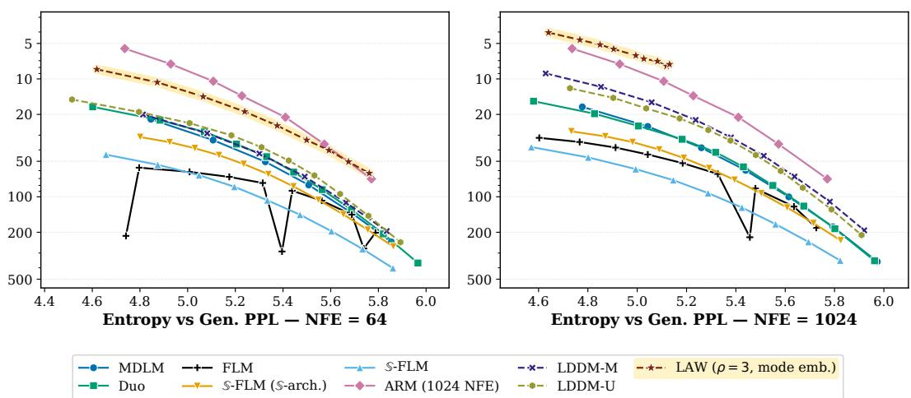  
Figure 5: Gen. PPL against unigram entropy on OpenWebText with 64 (left) and 1024 NFE (right). Each point is a sampling temperature $T \in \{ 0 . 7 0 , 0 . 7 5 , \ldots , 1 . 2 0 \}$ We sample the ARM with 1024 NFE, but show it in both panels for easier comparison with LAW. With 64 NFE, LAW dominates all diffusion and flow baselines and comes close to the ARM. With 1024 NFE, it dominates the ARM up to an entropy of 5.1–5.2.

Ablations. As on GSM8K, temperature regularization is essential. Without it, LAW only reaches low entropies, at a higher Gen. PPL than LDDM-U (Suppl. D.8). With ρ = 3, the mode embedding also prevents the representations from collapsing midway through training (Suppl. D.7). Unlike on GSM8K, the Expected Embedding increases the Gen. PPL of LDDM-U.

## 5 RELATED WORK

Self-Conditioning. SC feeds the previous predictions or hidden representations of the denoiser back as input (Strudel et al., 2022; Chen et al., 2023). In DDMs, several methods pass such a continuous state between denoising steps. LDDMs (Jo et al., 2026) and DiffusionGemma (Google DeepMind, 2026) propagate a continuous state, Soft-Masked Diffusion (Hersche et al., 2026) feeds masked positions a convex combination of the mask embedding and the top-k most confident token embeddings, and Relay (Rozonoyer et al., 2026) and PUMBA (Madeira et al., 2026) pass the last hidden state between the steps of teacher-forced unmasking trajectories. Other methods unroll the denoiser during training. SUNDAE (Savinov et al., 2022) unrolls it over discrete tokens, and FReDA (Sun et al., 2026) refines the discrete drafts of the model without a forward corruption process and, like LAW, backpropagates only through the last pass. Relay and PUMBA instead backpropagate through the propagated state and find that it outperforms a stop-gradient, whereas in LAW, the stop-gradient roughly doubles the GSM8K accuracy (Suppl. D.2). All of these methods still sample discrete tokens between steps and use any continuous state as an auxiliary input. LAW propagates only the SC state, at all positions, and decodes once, after the final step (Suppl. A.3).

Continuous Language Models. Continuous DLMs and Flow Language Models generate by integrating an ODE or SDE. They corrupt token embeddings or one-hot vectors with Gaussian noise (Li et al., 2022; Gulrajani & Hashimoto, 2023; Chen et al., 2026; Hu et al., 2026; Lee et al., 2026a; Potaptchik et al., 2026; Roos et al., 2026; Yoo et al., 2026) or operate on the hypersphere (Chemseddine et al., 2026; Deschenaux & Gulcehre, 2026). Like these models, LAW has a continuous sampling trajectory. However, it is trained with the uniform discrete corruption of UDMs and does not use Gaussian noise nor an ODE solver.

Looped Models. Looped DLMs reuse layers of the denoiser to vary its depth at inference (Carballo-Castro et al., 2026; Lee et al., 2026b; Miele et al., 2026). Looping changes the computation within a denoising step, whereas LAW changes what is passed between steps, so the two are complementary.

## 6 CONCLUSION AND LIMITATIONS

We asked whether a generative model can be based purely on SC, and we proposed LAW. Starting from random tokens, LAW propagates only the SC state, the Expected Embedding under the denoiser’s prediction, and decodes once, after the final step. Our results suggest that pure SC can match or outperform SC as an auxiliary input. LAW is the most accurate model on Sudoku and on Maze with few steps, and on GSM8K, it outperforms the diffusion and flow baselines trained with the same FLOPs. Fine-tuning a pre-trained Duo checkpoint with LAW increases the GSM8K accuracy of Duo from 17.2% to 48.1%. On OpenWebText, it also outperforms the diffusion and flow baselines at matched entropy and comes close to the ARM with 64 NFE. The ablations identify three necessary choices: the state map, temperature regularization, and a stop-gradient between passes, as in LDDMs.

Limitations. The NELBO is more accurate than the CE on GSM8K and Maze, whereas the CE is more accurate on Sudoku and gives more diverse samples on OpenWebText. Since the NELBO is derived for discrete diffusion processes, LAW does not completely depart from the discrete diffusion formalism. With 1024 NFE on OpenWebText, LAW’s samples cover a narrower entropy range than those of the baselines. Finally, we experiment in the standard academic setting. Whether our results hold at larger scale is left for future work.

## AI USE STATEMENT

We acknowledge the use of Large Language Models (LLMs) during the preparation of the manuscript. LLMs assisted in the writing of the paper and code, and certain experiments were submitted using agentic tools. The main ideas were proposed without the use of LLMs. We take full responsibility for the content, claims, citations and conclusions. The TinyGSM dataset is fully generated by GPT-3.5 (as explained by Liu et al., 2023a).

## REFERENCES

Manan Agarwal, Sheel Shah, Chanhyuk Lee, Jaehoon Yoo, Jerry Huang, Seunghoon Hong, Aditi Raghunathan, Jinwoo Kim, and Nicholas M. Boffi. Posterior refinement: Fast language generation via any-order flow maps, 2026. URL https://arxiv.org/abs/2606.24773.

Michael S. Albergo and Eric Vanden-Eijnden. Building normalizing flows with stochastic interpolants. In International Conference on Learning Representations, 2023.

Loubna Ben Allal, Anton Lozhkov, Elie Bakouch, Gabriel Mart´ın Blazquez, Guilherme Penedo,´ Lewis Tunstall, Andres Marafioti, Agust´ ´ın Piqueres Lajar´ın, Hynek Kydl´ıcek, Vaibhav Srivas-ˇ tav, Joshua Lochner, Caleb Fahlgren, Xuan-Son Nguyen, Ben Burtenshaw, Clementine Fourrier,´ Haojun Zhao, Hugo Larcher, Mathieu Morlon, Cyril Zakka, Colin Raffel, Leandro von Werra, and Thomas Wolf. Smollm2: When smol goes big — data-centric training of a fully open small language model. In Conference on Language Modeling, 2025.

Ali Alp. Sudoku puzzle generator. https://github.com/alicommit-malp/sudoku, 2024.

Jacob Austin, Daniel D. Johnson, Jonathan Ho, Daniel Tarlow, and Rianne van den Berg. Structured denoising diffusion models in discrete state-spaces. In Advances in Neural Information Processing Systems, 2021.

Jimmy Lei Ba, Jamie Ryan Kiros, and Geoffrey E Hinton. Layer normalization. arXiv preprint arXiv:1607.06450, 2016.

Georgios Batzolis, Mark Girolami, and Luca Ambrogioni. Towards closing the autoregressive gap in language modeling via entropy-gated continuous bitstream diffusion. In Advances in Neural Information Processing Systems, 2026.

Andrew Campbell, Joe Benton, Valentin De Bortoli, Tom Rainforth, George Deligiannidis, and Arnaud Doucet. A continuous time framework for discrete denoising models. In Advances in Neural Information Processing Systems, 2022.

Alba Carballo-Castro, Julianna Piskorz, Paulius Rauba, Mihaela van der Schaar, and Pascal Frossard. Recursive scaling in masked diffusion models, 2026. URL https://arxiv.org/ abs/2606.18022.

Jannis Chemseddine, Gregor Kornhardt, and Gabriele Steidl. Spherical flows for sampling categorical data. In Advances in Neural Information Processing Systems, 2026.

Ting Chen, Ruixiang Zhang, and Geoffrey Hinton. Analog bits: Generating discrete data using diffusion models with self-conditioning. In International Conference on Learning Representations, 2023.

Yuxin Chen, Chumeng Liang, Hangke Sui, Ruihan Guo, Chaoran Cheng, Jiaxuan You, and Ge Liu. LangFlow: Continuous diffusion rivals discrete in language modeling. In Advances in Neural Information Processing Systems, 2026.

Karl Cobbe, Vineet Kosaraju, Mohammad Bavarian, Mark Chen, Heewoo Jun, Lukasz Kaiser, Matthias Plappert, Jerry Tworek, Jacob Hilton, Reiichiro Nakano, Christopher Hesse, and John Schulman. Training verifiers to solve math word problems, 2021. URL https://arxiv. org/abs/2110.14168.

Justin Deschenaux and Caglar Gulcehre. Promises, outlooks and challenges of diffusion language modeling, 2024. URL https://arxiv.org/abs/2406.11473.

Justin Deschenaux and Caglar Gulcehre. Language modeling with hyperspherical flows. arXiv preprint arXiv:2605.11125, 2026.

Justin Deschenaux, Alexandre Galashov, Andrew Campbell, Li Kevin Wenliang, James Thornton, Arnaud Doucet, and Valentin De Bortoli. Simplex diffusion models, 2026a. URL https: //arxiv.org/abs/2609.35553.

Justin Deschenaux, Lan Tran, and Caglar Gulcehre. Partition generative modeling: Masked modeling without masks. In International Conference on Learning Representations, 2026b.

Sander Dieleman, Laurent Sartran, Arman Roshannai, Nikolay Savinov, Yaroslav Ganin, Pierre H. Richemond, Arnaud Doucet, Robin Strudel, Chris Dyer, Conor Durkan, Curtis Hawthorne, Remi´ Leblond, Will Grathwohl, and Jonas Adler. Continuous diffusion for categorical data, 2022. URL https://arxiv.org/abs/2211.15089.

Guhao Feng, Yihan Geng, Jian Guan, Wei Wu, Liwei Wang, and Di He. Theoretical benefit and limitation of diffusion language model. In Advances in Neural Information Processing Systems, 2025.

Jonas Geiping, Sean McLeish, Neel Jain, John Kirchenbauer, Siddharth Singh, Brian R. Bartoldson, Bhavya Kailkhura, Abhinav Bhatele, and Tom Goldstein. Scaling up test-time compute with latent reasoning: A recurrent depth approach. In Advances in Neural Information Processing Systems, 2025.

Gemini Team, Rohan Anil, Sebastian Borgeaud, et al. Gemini: A family of highly capable multimodal models, 2023. URL https://arxiv.org/abs/2312.11805.

Aaron Gokaslan and Vanya Cohen. Openwebtext corpus. http://Skylion007.github.io/ OpenWebTextCorpus, 2019.

Google DeepMind. DiffusionGemma. https://deepmind.google/models/gemma/ diffusiongemma/, 2026. Model documentation, accessed August 2026.

Aaron Grattafiori, Abhimanyu Dubey, Abhinav Jauhri, Abhinav Pandey, Abhishek Kadian, Ahmad Al-Dahle, Aiesha Letman, Akhil Mathur, Alan Schelten, Alex Vaughan, Amy Yang, Angela Fan, Anirudh Goyal, Anthony Hartshorn, Aobo Yang, Archi Mitra, Archie Sravankumar, Artem Korenev, Arthur Hinsvark, Arun Rao, Aston Zhang, Aurelien Rodriguez, Austen Gregerson, Ava Spataru, Baptiste Roziere, Bethany Biron, Binh Tang, Bobbie Chern, Charlotte Caucheteux, Chaya Nayak, Chloe Bi, Chris Marra, Chris McConnell, Christian Keller, Christophe Touret, Chunyang Wu, Corinne Wong, Cristian Canton Ferrer, Cyrus Nikolaidis, Damien Allonsius, Daniel Song, Danielle Pintz, Danny Livshits, Danny Wyatt, David Esiobu, Dhruv Choudhary, Dhruv Mahajan, Diego Garcia-Olano, Diego Perino, Dieuwke Hupkes, Egor Lakomkin, Ehab AlBadawy, Elina Lobanova, Emily Dinan, Eric Michael Smith, Filip Radenovic, Francisco Guzman, Frank Zhang, Gabriel Synnaeve, Gabrielle Lee, Georgia Lewis Anderson, Govind That-´ tai, Graeme Nail, Gregoire Mialon, Guan Pang, Guillem Cucurell, Hailey Nguyen, Hannah Korevaar, Hu Xu, Hugo Touvron, Iliyan Zarov, Imanol Arrieta Ibarra, Isabel Kloumann, Ishan Misra, Ivan Evtimov, Jack Zhang, Jade Copet, Jaewon Lee, Jan Geffert, Jana Vranes, Jason Park, Jay Mahadeokar, Jeet Shah, Jelmer van der Linde, Jennifer Billock, Jenny Hong, Jenya Lee, Jeremy Fu, Jianfeng Chi, Jianyu Huang, Jiawen Liu, Jie Wang, Jiecao Yu, Joanna Bitton, Joe Spisak, Jongsoo Park, Joseph Rocca, Joshua Johnstun, Joshua Saxe, Junteng Jia, Kalyan Vasuden Alwala, Karthik Prasad, Kartikeya Upasani, Kate Plawiak, Ke Li, Kenneth Heafield, Kevin Stone, Khalid El-Arini, Krithika Iyer, Kshitiz Malik, Kuenley Chiu, Kunal Bhalla, Kushal Lakhotia, Lauren Rantala-Yeary, Laurens van der Maaten, Lawrence Chen, Liang Tan, Liz Jenkins, Louis Martin, Lovish Madaan, Lubo Malo, Lukas Blecher, Lukas Landzaat, Luke de Oliveira, Madeline Muzzi, Mahesh Pasupuleti, Mannat Singh, Manohar Paluri, Marcin Kardas, Maria Tsimpoukelli, Mathew Oldham, Mathieu Rita, Maya Pavlova, Melanie Kambadur, Mike Lewis, Min Si, Mitesh Kumar Singh, Mona Hassan, Naman Goyal, Narjes Torabi, Nikolay Bashlykov, Nikolay Bogoychev, Niladri Chatterji, Ning Zhang, Olivier Duchenne, Onur C¸ elebi, Patrick Alrassy, Pengchuan Zhang, Pengwei Li, Petar Vasic, Peter Weng, Prajjwal Bhargava, Pratik Dubal, Praveen Krishnan,

Punit Singh Koura, Puxin Xu, Qing He, Qingxiao Dong, Ragavan Srinivasan, Raj Ganapathy, Ra mon Calderer, Ricardo Silveira Cabral, Robert Stojnic, Roberta Raileanu, Rohan Maheswari, Ro hit Girdhar, Rohit Patel, Romain Sauvestre, Ronnie Polidoro, Roshan Sumbaly, Ross Taylor, Ruan Silva, Rui Hou, Rui Wang, Saghar Hosseini, Sahana Chennabasappa, Sanjay Singh, Sean Bell, Seohyun Sonia Kim, Sergey Edunov, Shaoliang Nie, Sharan Narang, Sharath Raparthy, Sheng Shen, Shengye Wan, Shruti Bhosale, Shun Zhang, Simon Vandenhende, Soumya Batra, Spencer Whitman, Sten Sootla, Stephane Collot, Suchin Gururangan, Sydney Borodinsky, Tamar Herman, Tara Fowler, Tarek Sheasha, Thomas Georgiou, Thomas Scialom, Tobias Speckbacher, Todor Mi haylov, Tong Xiao, Ujjwal Karn, Vedanuj Goswami, Vibhor Gupta, Vignesh Ramanathan, Viktor Kerkez, Vincent Gonguet, Virginie Do, Vish Vogeti, V´ıtor Albiero, Vladan Petrovic, Weiwe Chu, Wenhan Xiong, Wenyin Fu, Whitney Meers, Xavier Martinet, Xiaodong Wang, Xiaofang Wang, Xiaoqing Ellen Tan, Xide Xia, Xinfeng Xie, Xuchao Jia, Xuewei Wang, Yaelle Gold schlag, Yashesh Gaur, Yasmine Babaei, Yi Wen, Yiwen Song, Yuchen Zhang, Yue Li, Yuning Mao, Zacharie Delpierre Coudert, Zheng Yan, Zhengxing Chen, Zoe Papakipos, Aaditya Singh, Aayushi Srivastava, Abha Jain, Adam Kelsey, Adam Shajnfeld, Adithya Gangidi, Adolfo Victoria, Ahuva Goldstand, Ajay Menon, Ajay Sharma, Alex Boesenberg, Alexei Baevski, Allie Feinstein, Amanda Kallet, Amit Sangani, Amos Teo, Anam Yunus, Andrei Lupu, Andres Alvarado, An drew Caples, Andrew Gu, Andrew Ho, Andrew Poulton, Andrew Ryan, Ankit Ramchandani, An nie Dong, Annie Franco, Anuj Goyal, Aparajita Saraf, Arkabandhu Chowdhury, Ashley Gabriel, Ashwin Bharambe, Assaf Eisenman, Azadeh Yazdan, Beau James, Ben Maurer, Benjamin Leon hardi, Bernie Huang, Beth Loyd, Beto De Paola, Bhargavi Paranjape, Bing Liu, Bo Wu, Boyu Ni, Braden Hancock, Bram Wasti, Brandon Spence, Brani Stojkovic, Brian Gamido, Britt Mon talvo, Carl Parker, Carly Burton, Catalina Mejia, Ce Liu, Changhan Wang, Changkyu Kim, Chao Zhou, Chester Hu, Ching-Hsiang Chu, Chris Cai, Chris Tindal, Christoph Feichtenhofer, Cynthia Gao, Damon Civin, Dana Beaty, Daniel Kreymer, Daniel Li, David Adkins, David Xu, Davide Testuggine, Delia David, Devi Parikh, Diana Liskovich, Didem Foss, Dingkang Wang, Duc Le, Dustin Holland, Edward Dowling, Eissa Jamil, Elaine Montgomery, Eleonora Presani, Emily Hahn, Emily Wood, Eric-Tuan Le, Erik Brinkman, Esteban Arcaute, Evan Dunbar, Evan Smoth ers, Fei Sun, Felix Kreuk, Feng Tian, Filippos Kokkinos, Firat Ozgenel, Francesco Caggioni, Frank Kanayet, Frank Seide, Gabriela Medina Florez, Gabriella Schwarz, Gada Badeer, Georgia Swee, Gil Halpern, Grant Herman, Grigory Sizov, Guangyi, Zhang, Guna Lakshminarayanan, Hakan Inan, Hamid Shojanazeri, Han Zou, Hannah Wang, Hanwen Zha, Haroun Habeeb, Harri son Rudolph, Helen Suk, Henry Aspegren, Hunter Goldman, Hongyuan Zhan, Ibrahim Damlaj, Igor Molybog, Igor Tufanov, Ilias Leontiadis, Irina-Elena Veliche, Itai Gat, Jake Weissman, James Geboski, James Kohli, Janice Lam, Japhet Asher, Jean-Baptiste Gaya, Jeff Marcus, Jeff Tang, Jen nifer Chan, Jenny Zhen, Jeremy Reizenstein, Jeremy Teboul, Jessica Zhong, Jian Jin, Jingyi Yang, Joe Cummings, Jon Carvill, Jon Shepard, Jonathan McPhie, Jonathan Torres, Josh Ginsburg, Jun jie Wang, Kai Wu, Kam Hou U, Karan Saxena, Kartikay Khandelwal, Katayoun Zand, Kathy Matosich, Kaushik Veeraraghavan, Kelly Michelena, Keqian Li, Kiran Jagadeesh, Kun Huang, Kunal Chawla, Kyle Huang, Lailin Chen, Lakshya Garg, Lavender A, Leandro Silva, Lee Bell, Lei Zhang, Liangpeng Guo, Licheng Yu, Liron Moshkovich, Luca Wehrstedt, Madian Khabsa, Manav Avalani, Manish Bhatt, Martynas Mankus, Matan Hasson, Matthew Lennie, Matthias Reso, Maxim Groshev, Maxim Naumov, Maya Lathi, Meghan Keneally, Miao Liu, Michael L. Seltzer, Michal Valko, Michelle Restrepo, Mihir Patel, Mik Vyatskov, Mikayel Samvelyan, Mike Clark, Mike Macey, Mike Wang, Miquel Jubert Hermoso, Mo Metanat, Mohammad Rastegari, Munish Bansal, Nandhini Santhanam, Natascha Parks, Natasha White, Navyata Bawa, Nayan Singhal, Nick Egebo, Nicolas Usunier, Nikhil Mehta, Nikolay Pavlovich Laptev, Ning Dong, Norman Cheng, Oleg Chernoguz, Olivia Hart, Omkar Salpekar, Ozlem Kalinli, Parkin Kent, Parth Parekh, Paul Saab, Pavan Balaji, Pedro Rittner, Philip Bontrager, Pierre Roux, Piotr Dollar, Polina Zvyagina, Prashant Ratanchandani, Pritish Yuvraj, Qian Liang, Rachad Alao, Rachel Ro driguez, Rafi Ayub, Raghotham Murthy, Raghu Nayani, Rahul Mitra, Rangaprabhu Parthasarathy, Raymond Li, Rebekkah Hogan, Robin Battey, Rocky Wang, Russ Howes, Ruty Rinott, Sachin Mehta, Sachin Siby, Sai Jayesh Bondu, Samyak Datta, Sara Chugh, Sara Hunt, Sargun Dhillon, Sasha Sidorov, Satadru Pan, Saurabh Mahajan, Saurabh Verma, Seiji Yamamoto, Sharadh Ra maswamy, Shaun Lindsay, Shaun Lindsay, Sheng Feng, Shenghao Lin, Shengxin Cindy Zha, Shishir Patil, Shiva Shankar, Shuqiang Zhang, Shuqiang Zhang, Sinong Wang, Sneha Agarwal, Soji Sajuyigbe, Soumith Chintala, Stephanie Max, Stephen Chen, Steve Kehoe, Steve Satter field, Sudarshan Govindaprasad, Sumit Gupta, Summer Deng, Sungmin Cho, Sunny Virk, Sura Subramanian, Sy Choudhury, Sydney Goldman, Tal Remez, Tamar Glaser, Tamara Best, Thilo

Koehler, Thomas Robinson, Tianhe Li, Tianjun Zhang, Tim Matthews, Timothy Chou, Tzook Shaked, Varun Vontimitta, Victoria Ajayi, Victoria Montanez, Vijai Mohan, Vinay Satish Kumar, Vishal Mangla, Vlad Ionescu, Vlad Poenaru, Vlad Tiberiu Mihailescu, Vladimir Ivanov, Wei Li, Wenchen Wang, Wenwen Jiang, Wes Bouaziz, Will Constable, Xiaocheng Tang, Xiaojian Wu, Xiaolan Wang, Xilun Wu, Xinbo Gao, Yaniv Kleinman, Yanjun Chen, Ye Hu, Ye Jia, Ye Qi, Yenda Li, Yilin Zhang, Ying Zhang, Yossi Adi, Youngjin Nam, Yu, Wang, Yu Zhao, Yuchen Hao, Yundi Qian, Yunlu Li, Yuzi He, Zach Rait, Zachary DeVito, Zef Rosnbrick, Zhaoduo Wen, Zhenyu Yang, Zhiwei Zhao, and Zhiyu Ma. The Llama 3 herd of models, 2024. URL https://arxiv.org/abs/2407.21783.

Ishaan Gulrajani and Tatsunori B. Hashimoto. Likelihood-based diffusion language models. In Advances in Neural Information Processing Systems, 2023.

Nikita Gushchin, Dmitry Baranchuk, and Alexander Korotin. Alpha diffusion language models: Factorization alone is not the problem, 2026. URL https://arxiv.org/abs/2609. 38066.

Aric A. Hagberg, Daniel A. Schult, and Pieter J. Swart. Exploring network structure, dynamics, and function using networkx. In Gael Varoquaux, Travis Vaught, and Jarrod Millman (eds.),¨ Proceedings ofthe 7th Python in Science Conference, pp. 11 – 15, Pasadena, CA USA, 2008.

Michael Hersche, Samuel Moor-Smith, Thomas Hofmann, and Abbas Rahimi. Soft-masked diffusion language models. In International Conference on Learning Representations, 2026. URL https://arxiv.org/abs/2510.17206.

Emiel Hoogeboom, Didrik Nielsen, Priyank Jaini, Patrick Forre, and Max Welling. Argmax flows ´ and multinomial diffusion: Learning categorical distributions. In Advances in Neural Information Processing Systems, 2021.

Keya Hu, Linlu Qiu, Yiyang Lu, Hanhong Zhao, Tianhong Li, Yoon Kim, Jacob Andreas, and Kaiming He. ELF: Embedded language flows. In Advances in Neural Information Processing Systems, 2026.

Jaehyeong Jo and Sung Ju Hwang. Continuous diffusion model for language modeling. In Advances in Neural Information Processing Systems, 2025.

Mingyu Jo, Jaesik Yoon, Justin Deschenaux, Caglar Gulcehre, and Sungjin Ahn. Loopholing discrete diffusion: Deterministic bypass of the sampling wall. In International Conference on Learning Representations, 2026.

Jared Kaplan, Sam McCandlish, Tom Henighan, Tom B. Brown, Benjamin Chess, Rewon Child, Scott Gray, Alec Radford, Jeffrey Wu, and Dario Amodei. Scaling laws for neural language models, 2020. URL https://arxiv.org/abs/2001.08361.

Jaeyeon Kim, Seunggeun Kim, Taekyun Lee, David Z. Pan, Hyeji Kim, Sham Kakade, and Sitan Chen. Fine-tuning masked diffusion for provable self-correction. In International Conference on Machine Learning, 2026.

Ouail Kitouni, Niklas Nolte, Diane Bouchacourt, Adina Williams, Mike Rabbat, and Mark Ibrahim. The factorization curse: Which tokens you predict underlie the reversal curse and more. In Advances in Neural Information Processing Systems, 2024.

Chanhyuk Lee, Jaehoon Yoo, Manan Agarwal, Sheel Shah, Jerry Huang, Aditi Raghunathan, Seunghoon Hong, Nicholas M. Boffi, and Jinwoo Kim. Flow map language models: One-step language modeling via continuous denoising. In Advances in Neural Information Processing Systems, 2026a.

Sanghyun Lee, Chunsan Hong, Seungryong Kim, Jonghyun Lee, Jongho Park, and Dongmin Park. Looped diffusion language models. In Advances in Neural Information Processing Systems, 2026b.

Lucas Lehnert, Sainbayar Sukhbaatar, DiJia Su, Qinqing Zheng, Paul Mcvay, Michael Rabbat, and Yuandong Tian. Beyond a\*: Better planning with transformers via search dynamics bootstrapping. In Conference on Language Modeling, 2024.

David Li, Nikita Gushchin, Dmitry Abulkhanov, Eric Moulines, Ivan Oseledets, Maxim Panov, and Alexander Korotin. IDLM: Inverse-distilled diffusion language models. In International Conference on Machine Learning, 2026.

Xiang Lisa Li, John Thickstun, Ishaan Gulrajani, Percy Liang, and Tatsunori B. Hashimoto. Diffusion-lm improves controllable text generation. In Advances in Neural Information Processing Systems, 2022.

Yaron Lipman, Ricky T. Q. Chen, Heli Ben-Hamu, Maximilian Nickel, and Matt Le. Flow matching for generative modeling. In International Conference on Learning Representations, 2023.

Bingbin Liu, Sebastien Bubeck, Ronen Eldan, Janardhan Kulkarni, Yuanzhi Li, Anh Nguyen, Rachel Ward, and Yi Zhang. TinyGSM: Achieving >80% on GSM8k with small language models, 2023a. URL https://arxiv.org/abs/2312.09241.

Xingchao Liu, Chengyue Gong, and Qiang Liu. Flow straight and fast: Learning to generate and transfer data with rectified flow. In International Conference on Learning Representations, 2023b.

Aaron Lou, Chenlin Meng, and Stefano Ermon. Discrete diffusion modeling by estimating the ratios of the data distribution. In International Conference on Machine Learning, 2024.

Manuel Madeira, Amitis Shidani, Alice Bizeul, Victor Turrisi, Louis Bethune, Bhavika Devnani,´ Dan Busbridge, Pierre Ablin, and Joao Monteiro. On trajectory-aware training for masked diffu-˜ sion language models, 2026. URL https://arxiv.org/abs/2609.37974.

Andrea Miele, Yiming Qin, Alba Carballo-Castro, Justin Deschenaux, and Pascal Frossard. Fixed point masked generative modeling. In Advances in Neural Information Processing Systems, 2026.

Vaishnavh Nagarajan, Chen Henry Wu, Charles Ding, and Aditi Raghunathan. Roll the dice & look before you leap: Going beyond the creative limits of next-token prediction. In International Conference on Machine Learning, 2025.

Lorenzo Noci, Sotiris Anagnostidis, Luca Biggio, Antonio Orvieto, Sidak Pal Singh, and Aurelien Lucchi. Signal propagation in transformers: Theoretical perspectives and the role of rank collapse. In Advances in Neural Information Processing Systems, 2022.

Jingyang Ou, Shen Nie, Kaiwen Xue, Fengqi Zhu, Jiacheng Sun, Zhenguo Li, and Chongxuan Li. Your absorbing discrete diffusion secretly models the conditional distributions of clean data. In International Conference on Learning Representations, 2025.

Vassilis Papadopoulos, Jer´ emie Wenger, and Cl ´ ement Hongler. Arrows of time for large language´ models. In International Conference on Machine Learning, 2024.

William Peebles and Saining Xie. Scalable diffusion models with transformers. In Proceedings of the IEEE/CVF International Conference on Computer Vision, 2023.

Peter Potaptchik, Jason Yim, Adhi Saravanan, Peter Holderrieth, Eric Vanden-Eijnden, and Michael S. Albergo. Discrete flow maps, 2026. URL https://arxiv.org/abs/2604. 09784.

Patrick Pynadath, Jiaxin Shi, and Ruqi Zhang. Candi: Hybrid discrete-continuous diffusion models. In International Conference on Machine Learning, 2026.

Alec Radford, Jeffrey Wu, Rewon Child, David Luan, Dario Amodei, and Ilya Sutskever. Language models are unsupervised multitask learners, 2019.

Daan Roos, Oscar Davis, Floor Eijkelboom, Michael Bronstein, Max Welling, ˙Ismail ˙Ilkan Ceylan, Luca Ambrogioni, and Jan-Willem van de Meent. Categorical flow maps. In International Conference on Machine Learning, 2026.

Benjamin Rozonoyer, Jacopo Minniti, Dhruvesh Patel, Neil Band, Avishek Joey Bose, Tim G. J. Rudner, and Andrew McCallum. Learned relay representations for forward-thinking discrete diffusion models, 2026. URL https://arxiv.org/abs/2605.22967.

Subham Sekhar Sahoo, Marianne Arriola, Yair Schiff, Aaron Gokaslan, Edgar Marroquin, Justin T Chiu, Alexander Rush, and Volodymyr Kuleshov. Simple and effective masked diffusion language models. In Advances in Neural Information Processing Systems, 2024.

Subham Sekhar Sahoo, Justin Deschenaux, Aaron Gokaslan, Guanghan Wang, Justin Chiu, and Volodymyr Kuleshov. The diffusion duality. In International Conference on Machine Learning, 2025.

Nikolay Savinov, Junyoung Chung, Mikolaj Binkowski, Erich Elsen, and Aaron van den Oord. Stepunrolled denoising autoencoders for text generation. In International Conference on Learning Representations, 2022.

Yair Schiff, Subham Sekhar Sahoo, Hao Phung, Guanghan Wang, Sam Boshar, Hugo Dalla-torre, Bernardo P. de Almeida, Alexander Rush, Thomas Pierrot, and Volodymyr Kuleshov. Simple guidance mechanisms for discrete diffusion models. In International Conference on Learning Representations, 2025.

Junzhe Shen, Jieru Zhao, Ziwei He, and Zhouhan Lin. Codar: Continuous diffusion language models are more powerful than you think, 2026. URL https://arxiv.org/abs/2603.02547.

Jiaxin Shi, Kehang Han, Zhe Wang, Arnaud Doucet, and Michalis K. Titsias. Simplified and generalized masked diffusion for discrete data. In Advances in Neural Information Processing Systems, 2024.

Robin Strudel, Corentin Tallec, Florent Altche, Yilun Du, Yaroslav Ganin, Arthur Mensch, Will´ Grathwohl, Nikolay Savinov, Sander Dieleman, Laurent Sifre, and Remi Leblond. Self-´ conditioned embedding diffusion for text generation, 2022. URL https://arxiv.org/ abs/2211.04236.

Jianlin Su, Murtadha Ahmed, Yu Lu, Shengfeng Pan, Wen Bo, and Yunfeng Liu. RoFormer: Enhanced transformer with rotary position embedding. Neurocomputing, 568:127063, 2024.

Haotian Sun, Rushi Qiang, Yuqian Zheng, and Bo Dai. Forward-free diffusion language models with BPTT-free looped refinement, 2026. URL https://arxiv.org/abs/2606.08357.

Sophia Tang and Shiyi Wang. Discrete beckmann transport models for one-step language modeling and reasoning, 2026. URL https://arxiv.org/abs/2609.15903.

Ashish Vaswani, Noam Shazeer, Niki Parmar, Jakob Uszkoreit, Llion Jones, Aidan N. Gomez, Lukasz Kaiser, and Illia Polosukhin. Attention is all you need. In Advances in Neural Information Processing Systems, 2017.

Petar Velickovi ˇ c, Federico Barbero, Christos Perivolaropoulos, Simon Osindero, and Razvan Pas- ´ canu. Perplexity cannot always tell right from wrong, 2026. URL https://arxiv.org/ abs/2601.22950.

Dimitri von Rutte, Janis Fluri, Yuhui Ding, Antonio Orvieto, Bernhard Sch ¨ olkopf, and Thomas ¨ Hofmann. Generalized interpolating discrete diffusion. In International Conference on Machine Learning, 2025.

Guan Wang, Jin Li, Yuhao Sun, Xing Chen, Changling Liu, Yue Wu, Meng Lu, Sen Song, and Yasin Abbasi Yadkori. Hierarchical reasoning model. arXiv preprint arXiv:2506.21734, 2025. URL https://arxiv.org/abs/2506.21734.

Zhihan Yang, Wei Guo, Shuibai Zhang, Subham Sekhar Sahoo, Yongxin Chen, Arash Vahdat, Morteza Mardani, and John Thickstun. Continuous diffusion scales competitively with discrete diffusion for language. In Advances in Neural Information Processing Systems, 2026.

Jaehoon Yoo, Wonjung Kim, Floor Eijkelboom, Chanhyuk Lee, Nicholas M. Boffi, Seunghoon Hong, and Jinwoo Kim. Self-conditioned flow map language models via fixed-point flows, 2026. URL https://arxiv.org/abs/2607.00714.

## CONTENTS

1 Introduction 2   
Background 2   
2.1 Uniform Discrete Diffusion Models (UDMs) 3   
2.2 Loopholing Discrete Diffusion Models (LDDMs) 4   
3 Loopholing All the Way (LAW) 4   
3.1 Generative Process 4   
3.2 Training the Continuous Trajectory . 5   
4 Experiments 6   
4.1 Reasoning on Sudoku . 6   
4.2 Path Finding on Maze . 6   
4.3 Reasoning on GSM8K 7   
4.4 Language Modeling on OpenWebText . 8   
5 Related Work 9   
6 Conclusion and Limitations 10   
A Method Details 19   
A.1 Uniform Diffusion: Posterior and NELBO 19   
A.2 Training and Sampling Algorithms . 19   
A.3 Comparison to Loopholing Discrete Diffusion Models (LDDMs) . 20   
A.4 Gradient Flow Between Passes 20   
A.5 Mode Embedding . 20   
B Training Compute 20   
B.1 FLOP Matching 21   
B.2 Training Steps . 21   
C Experimental Setup 21   
C.1 Shared Setup 21   
C.2 Sudoku 23   
C.3 TinyGSM 25   
C.4 Maze 25   
C.5 OpenWebText . 26   
D Additional Results 27   
D.1 Sudoku: Ablations 27   
D.2 TinyGSM: Ablations 28   
D.3 TinyGSM: Fine-Tuning from Duo 31   
D.4 TinyGSM: Comparison with Few-Step Methods . 32   
D.5 Maze: Exact Match vs. Valid Solution 33   
D.6 Maze: Ablations . 34   
D.7 OpenWebText: Ablations 37   
D.8 OpenWebText: Comparison to LDDMs . 38   
D.9 OpenWebText: Samples . 40

## A METHOD DETAILS

## A.1 UNIFORM DIFFUSION: POSTERIOR AND NELBO

We reproduce the exact UDM quantities of Duo (Sahoo et al., 2025), with $\alpha _ { t | s } = \alpha _ { t } / \alpha _ { s }$ . The denoising posterior iterated in (4) is

$$
q _ { s | t } ( \cdot | \mathbf { z } _ { t } ^ { \ell } , \mathbf { x } ^ { \ell } ) = \mathrm { C a t } \left( \cdot ; \frac { | \mathcal { V } | \alpha _ { t } \mathbf { z } _ { t } ^ { \ell } \odot \mathbf { x } ^ { \ell } + ( \alpha _ { t | s } - \alpha _ { t } ) \mathbf { z } _ { t } ^ { \ell } + ( \alpha _ { s } - \alpha _ { t } ) \mathbf { x } ^ { \ell } + ( 1 - \alpha _ { t | s } ) ( 1 - \alpha _ { s } ) \mathbf { 1 } / | \mathcal { V } | } { | \mathcal { V } | \alpha _ { t } \langle \mathbf { z } _ { t } ^ { \ell } , \mathbf { x } ^ { \ell } \rangle + 1 - \alpha _ { t } } \right) .\tag{13}
$$

This posterior induces the per-sequence NELBO $\mathrm { N E L B O } ( q , p _ { \theta } ; \mathbf { x } ^ { 1 : L } )$ = $\begin{array} { r } { \mathbb { E } _ { t \sim \mathcal { U } [ 0 , 1 ] , q _ { t } ( \mathbf { z } _ { t } ^ { 1 : L } | \mathbf { x } ^ { 1 : L } ; \alpha _ { t } ) } \sum _ { \ell \in [ L ] } \mathcal { L } _ { \mathrm { t o k } } ( \mathbf { x } _ { \theta } ^ { \ell } ( \mathbf { z } _ { t } ^ { 1 : L } , t ) , \mathbf { x } ^ { \ell } , \mathbf { z } _ { t } ^ { \ell } , \alpha _ { t } ) } \end{array}$ . Its average over $\mathbf { x } ^ { \mathrm { 1 : } L } ~ \sim ~ q _ { \mathrm { d a t a } }$ is (3), and its per-token loss is

$$
\begin{array} { r l } & { \mathcal { L } _ { \mathrm { t o b } } ( \mathbf { x } _ { \theta } ^ { \ell } ( \mathbf { z } _ { t } ^ { 1 : L } , t ) , \mathbf { x } ^ { \ell } , \mathbf { z } _ { t } ^ { \ell } , \alpha _ { t } ) = - \frac { \alpha _ { t } ^ { \prime } } { | \mathcal { V } | \alpha _ { t } } \left[ \frac { | \mathcal { V } | } { \overline { { \mathbf { x } } } _ { t } ^ { \ell } } - \frac { | \mathcal { V } | } { ( \overline { { \mathbf { x } } } _ { \theta } ^ { \ell } ) _ { r } } - \left( \zeta _ { t } \mathbf { 1 } _ { z _ { t } ^ { \ell } = \mathbf { x } ^ { \ell } } + \mathbf { 1 } _ { z _ { t } ^ { \ell } \neq \mathbf { x } ^ { \ell } } \right) \sum _ { j } \log \frac { ( \overline { { \mathbf { x } } } _ { \theta } ^ { \ell } ) _ { r } } { ( \overline { { \mathbf { x } } } _ { \theta } ^ { \ell } ) _ { j } } \right. } \\ & { \qquad \left. - | \mathcal { V } | \frac { \alpha _ { t } } { 1 - \alpha _ { t } } \log \frac { ( \overline { { \mathbf { x } } } _ { \theta } ^ { \ell } ) _ { r } } { ( \overline { { \mathbf { x } } } _ { \theta } ^ { \ell } ) _ { i } } \mathbf { 1 } _ { \mathbf { z } _ { t } ^ { \ell } \neq \mathbf { x } ^ { \ell } } - \left( ( | \mathcal { V } | - 1 ) \zeta _ { t } \mathbf { 1 } _ { \mathbf { z } _ { t } ^ { \ell } = \mathbf { x } ^ { \ell } } - \frac { 1 } { \zeta _ { t } } \mathbf { 1 } _ { \mathbf { z } _ { t } ^ { \ell } \neq \mathbf { x } ^ { \ell } } \right) \log \zeta _ { t } \right] . } \end{array}\tag{14}
$$

Here $\bar { \mathbf { x } } ^ { \ell } = | \mathcal { V } | \alpha _ { t } \mathbf { x } ^ { \ell } + ( 1 - \alpha _ { t } ) \mathbf { 1 } , \bar { \mathbf { x } } _ { \theta } ^ { \ell } = | \mathcal { V } | \alpha _ { t } \mathbf { x } _ { \theta } ^ { \ell } ( \mathbf { z } _ { t } ^ { 1 : L } , t ) + ( 1 - \alpha _ { t } ) \mathbf { 1 } , \alpha _ { t } ^ { \prime }$ is the time derivative of $\alpha _ { t } , r = \arg \operatorname* { m a x } _ { j \in [ | \mathcal { V } | ] } ( \mathbf { z } _ { t } ^ { \ell } ) _ { j }$ is the nonzero entry index of $\begin{array} { r } { \mathbf { z } _ { t } ^ { \ell } , \zeta _ { t } = \frac { 1 - \alpha _ { t } } { | \mathcal { V } | \alpha _ { t } + 1 - \alpha _ { t } } } \end{array}$ and i is the index with $\mathbf { x } _ { i } ^ { \ell } = 1$

## A.2 TRAINING AND SAMPLING ALGORITHMS

Algo. 1 summarizes the sampler of LAW (Sec. 3.1), and Algo. 2 one training update (Sec. 3.2).

Algorithm 1 Sampling with LAW   
Require: Denoiser $f _ { \theta } ,$ , embedding $E _ { \theta }$ , LM head $g _ { \theta }$ , state map $\Phi _ { \theta } ^ { \mathrm { E . E . } }$ , decoder η, sampling temper  
ature $T ,$ time grid $t _ { N } > \cdots > t _ { 1 }$   
1: $\mathbf { z } _ { 1 } \sim \mathrm { C a t } ( \cdot ; | \bar { \mathcal { V } } | ^ { - 1 } \mathbf { 1 } )$ ▷ Draw from the uniform prior   
2: $\mathbf { c } \gets \mathbf { z } _ { 1 } E _ { \theta }$ ▷ Embed to initialize the state   
3: for $n = N$ to 2 do   
4: $\mathbf { h } \gets f _ { \theta } ( \underline { { \mathbf { c } } } , t _ { n } )$ ▷ Denoiser forward pass   
5: $\mathbf { c } \gets \Phi _ { \theta } ^ { \mathrm { { E . E . } } } ( \mathbf { h } ; T )$ ▷ Propagate the SC state (8)   
6: end for   
7: h $ f _ { \theta } ( \mathbf { c } , t _ { 1 } )$ ▷ Final forward pass   
8: return $\mathbf { z } _ { t _ { 0 } } = \eta ( \mathrm { s o f t m a x } ( g _ { \theta } ( \mathbf { h } ) / T ) )$ ▷ Decode tokens (9)

During sampling, the state map and the decoder share the temperature, $\tau = T \left( 8 \right)$

Algorithm 2 Training update of LAW   
Require: Denoiser $f _ { \theta } ,$ embedding $E _ { \theta } ,$ , LM head $g _ { \theta }$ , state map $\Phi _ { \theta } ^ { \mathrm { E . E . } }$ , clean sequence x, multi-pass   
probability $p ,$ number of passes M, time shift δ, temperature range $\rho$   
1: With probability $1 - p ,$ set $M \gets 1$ ▷ Single-pass update   
2: $t \sim \bar { \mathcal { U } } [ ( M - 1 ) \delta , 1 ] , \mathbf { z } _ { t } \sim q _ { t } ( \cdot \mid \mathbf { x } )$ ▷ Corrupt the data (1)   
3: Sample τ with range $\rho$ ▷ Temperature regularization (12)   
4: $\mathbf { c } \gets \mathbf { z } _ { t } E _ { \theta }$ ▷ Embed the noisy tokens   
5: for $i = 1$ to $M - 1$ do   
$\begin{array} { r l } { 6 \colon } & { { } \mathbf { c } \gets \mathrm { s g } \left[ \Phi _ { \theta } ^ { \mathrm { E . E . } } \left( f _ { \theta } ( \mathbf { c } , t - ( i - 1 ) \delta ) ; \tau \right) \right] } \end{array}$ ▷ Pass without gradient (10)   
7: end for   
8: $\hat { \mathbf { x } } \gets \mathrm { s o f t m a x } \big ( g _ { \theta } ( f _ { \theta } ( \mathbf { c } , t - ( M - 1 ) \delta ) ) \big )$ ▷ Last pass, with gradient   
9: Take a gradient step on $\begin{array} { r } { \sum _ { \ell = 1 } ^ { L } \mathcal { L } _ { \mathrm { L A W } } ^ { \ell } } \end{array}$ ▷ NELBO or CE (11)

## A.3 COMPARISON TO LOOPHOLING DISCRETE DIFFUSION MODELS (LDDMS)

LAW and LDDMs both propagate an SC state across denoising steps. They differ in how the backbone uses this state, which affects both sampling and training, and in the state map that computes it (8).

Sampling. At each step, an LDDM samples discrete tokens from the posterior $q _ { s \mid t }$ and feeds the backbone the sum of their embeddings and the SC state (5). LAW instead feeds the backbone the SC state alone (7). It never samples tokens between steps and decodes only once, after the final step (9).

Training. Both methods corrupt the data once, $\mathbf { z } _ { t } \sim \mathbf { \zeta } q _ { t }$ . With probability $p ,$ both run several forward passes, stop the gradient through the SC state between passes, and apply the loss to the last pass only. Otherwise, both run a single pass (Sec. 2.2). LDDMs run two passes at the same time $t { : }$ the first pass receives $\mathbf { z } _ { t } E _ { \theta }$ with a zero SC state and computes the SC state $\mathbf { c } _ { t } ,$ and the second pass receives $\mathbf { z } _ { t } E _ { \theta } + \mathbf { c } _ { t }$ . In contrast, the later passes of LAW receive the SC state alone and run at successive times $t ^ { ( i ) }$ , and the number of passes M can exceed two (10).

State Map. LDDMs propagate the layer-normalized hidden representation $( \Phi _ { \theta } ^ { \mathrm { H i d . } } )$ ), while LAW propagates a linear combination of token embeddings, weighted by the predicted token probabilities $\overset { \cdot } { ( \Phi _ { \theta } ^ { \mathrm { E . E . } } ) } \left( 8 \right)$

## A.4 GRADIENT FLOW BETWEEN PASSES

In (10), a stop-gradient is applied to the SC state fed to the next pass, $\mathbf { c } ^ { ( i + 1 ) } = \mathrm { { s g } } \left[ \Phi _ { \theta } ^ { \mathrm { { E . E . } } } ( \mathbf { h } ^ { ( i ) } ; \tau ) \right]$ where $\mathbf { h } ^ { ( i ) } = f _ { \theta } ( \mathbf { c } ^ { ( i ) } , t ^ { ( i ) } )$ is the final-layer hidden representation of the i-th pass. As a result, the loss (11) only updates the parameters through the last forward pass, and the earlier passes are treated as a fixed input.

Alternatively, we can remove the stop-gradient and set $\mathbf { c } ^ { ( i + 1 ) } = \Phi _ { \theta } ^ { \mathrm { E . E . } } ( \mathbf { h } ^ { ( i ) } ; \tau )$ . The gradient of the loss then also flows through the SC states into the earlier passes. For $M = 2 .$ , the gradient with respect to the output of the first pass is

$$
\frac { \partial \mathcal { L } _ { \mathrm { L A W } } } { \partial \mathbf { h } ^ { ( 1 ) } } = \frac { \partial \mathcal { L } _ { \mathrm { L A W } } } { \partial \mathbf { c } ^ { ( 2 ) } } \frac { \partial \Phi _ { \theta } ^ { \mathrm { E . E . } } ( \mathbf { h } ^ { ( 1 ) } ; \tau ) } { \partial \mathbf { h } ^ { ( 1 ) } } ,\tag{15}
$$

The stop-gradient sets this term to zero. Without it, the first pass learns to produce SC states that help the second pass. We use the stop-gradient by default and compare both variants on TinyGSM (Figure 9).

## A.5 MODE EMBEDDING

The DiT conditions every block on the noise level through $\pmb { \nu } = \mathrm { S i L U } ( \mathrm { E m b } ( \alpha _ { t } ) )$ , from which each block computes the scales, shifts, and gates of its adaLN-Zero modulation (Peebles & Xie, 2023). At the first pass (10) and the first sampling step, the denoiser receives token embeddings, whereas at every later pass it receives the SC state. The mode embedding tells the denoiser which of the two it is processing. We learn two vectors, $\mathbf { m } _ { \mathrm { t o k } }$ for token embeddings and m for SC states, and add the matching one to the noise-level conditioning, $\mathbf { e . g . } \nu = \mathrm { S i L U } ( \operatorname { E m b } ( \alpha _ { t } ) ) + \mathbf { m } _ { \mathrm { S C } }$ at the later passes. We initialize $\mathbf { m } _ { \mathrm { t o k } } = \mathbf { m } _ { \mathrm { S C } } = \mathbf { 0 }$ , so a checkpoint without mode embedding, such as Duo, computes the same function after loading.

## B TRAINING COMPUTE

We compare all methods at matched training FLOPs. Jo et al. (2026) instead train LDDMs and their base models for the same number of updates, although each LDDM update is more expensive. This section states the matching rule and lists the training steps of every LDDM and LAW run.

## B.1 FLOP MATCHING

Let F be the cost of one forward pass of the denoiser, and count a backward pass as 2F. A standard update runs one forward and one backward pass, and costs 3F. An update with M passes and a stop-gradient between them (10) runs $M - 1$ passes without gradient and a last pass with gradient, and costs $( M + 2 ) F$ . Without the stop-gradient, the backward pass goes through all M passes, and the update costs 3MF (Suppl. A.4). LDDMs and LAW run M passes with probability p and a single pass otherwise, so an update costs on average

$$
C = { \bigl ( } 3 + p ( M - 1 ) { \bigr ) } F \quad { \mathrm { w i t h ~ t h e ~ s t o p - g r a d i e n t } } , \qquad C = { \bigl ( } 3 + 3 p ( M - 1 ) { \bigr ) } F \quad { \mathrm { w i t h o u t ~ i t ~ } } \ ( 1 6 ) \qquad N = 3 , 2 . . . = 4
$$

To match the FLOPs of S baseline steps at the same batch size, a run trains for $3 F S / C$ steps. For example, LDDMs and LAW with $M = 2$ and $p = 0 . 9$ cost $C = 3 . 9 F$ per update and train for 77% of the steps of the baselines.

Fine-Tuning. When we fine-tune from Duo on TinyGSM (Suppl. C.3), we count the FLOPs of the 250k Duo steps $( 3 F$ each) and of the fine-tuning updates, both at batch size 512. With $M = 2$ and $p = 0 . 9 $ , fine-tuning adds 8% to the compute of Duo after 15k steps and 26% after 50k steps. With $M = 4$ and $p = 0 . 7 5$ , 50k steps add 35%.

## B.2 TRAINING STEPS

Table 2 gives the budget of the baselines and the default budget of LDDMs and LAW for each task. Table 3, Table 4, Table 5, and Table 6 list the configuration and training steps of every LDDM and LAW run. In these tables, E.E. is the Expected Embedding and Hid. the hidden representation of LDDMs, a row with several values (difficulties or ρ) stands for one run per value with the same number of steps, and each run is listed once.

Table 2: Training budget per task. The baselines run standard updates $( 3 F$ each). By default, LDDMs and LAW run $\bar { M } = 2$ passes with $p = 0 . 9 ( 3 . 9 F$ per update) and train for fewer steps to match the training FLOPs of the baselines (16).
<table><tr><td>Task</td><td>Batch</td><td>Baseline steps</td><td>LDDM / LAW steps</td></tr><tr><td>Sudoku</td><td>256</td><td>20k</td><td>15.4k</td></tr><tr><td>TinyGSM</td><td>512</td><td>250k</td><td>192k</td></tr><tr><td>Maze</td><td>256</td><td>100k</td><td>76.9k</td></tr><tr><td>OpenWebText</td><td>512</td><td>400k</td><td>308k</td></tr></table>

## C EXPERIMENTAL SETUP

## C.1 SHARED SETUP

Training Hyperparameters. All models are trained with AdamW with a learning rate of $3 \times 1 0 ^ { - 4 }$ $( \beta _ { 1 } , \beta _ { 2 } ) = ( 0 . 9 , 0 . 9 9 9 )$ , zero weight decay, 2.5k warmup steps followed by a constant learning rate, and gradient clipping at 1.0. We maintain an exponential moving average of the weights with decay 0.9999 and use it for evaluation. All DiT backbones use dropout 0.1.

Baselines. We compare to the following baselines, using the subset given in each experiment. Beyond the shared hyperparameters above, we use the default hyperparameters of the original implementations unless stated otherwise.

• ARM. Causal Transformer trained with next-token prediction on the target, conditioned on the full prompt when there is one (e.g. the unsolved grid on Maze).

• MDLM (Sahoo et al., 2024). Masked Diffusion with the SUBS parameterization, the loglinear schedule, and no time conditioning.

• Duo (Sahoo et al., 2025). Uniform Diffusion with the log-linear schedule and time conditioning.

Table 3: Training steps of the LAW runs on Sudoku, grouped by experiment. All runs are trained from scratch and match the training FLOPs of 20k baseline steps at batch size 256. Difficulty all stands for easy, medium, and hard. Runs marked ⋆ appear in Table 1.
<table><tr><td>Method</td><td>Difficulty</td><td>SC state Loss</td><td></td><td>M</td><td>p</td><td>Stop-grad.</td><td>ρ</td><td>Mode emb. Batch</td><td></td><td>Cost</td><td>Steps</td></tr><tr><td>Loss</td><td></td><td></td><td></td><td></td><td></td><td></td><td></td><td></td><td></td><td></td><td></td></tr><tr><td>LAW*</td><td>all</td><td>E.E.</td><td>CE</td><td>2</td><td>0.9</td><td>yes</td><td>none</td><td>no</td><td>256</td><td>3.9F</td><td>15,385</td></tr><tr><td>LAW*</td><td>all</td><td>E.E.</td><td>NELBO</td><td>2</td><td>0.9</td><td>yes</td><td>none</td><td>no</td><td>256</td><td>3.9F</td><td>15,385</td></tr><tr><td colspan="10">Multi-pass probability (with the p = 0.9 runs above)</td><td></td><td></td></tr><tr><td>LAW*</td><td>all</td><td>E.E.</td><td>CE</td><td>2</td><td>0.75</td><td>yes</td><td>none</td><td>no</td><td>256</td><td>3.75F</td><td>16,000</td></tr><tr><td>LAW</td><td>hard</td><td>E.E.</td><td>NELBO</td><td>2</td><td>0.75</td><td>yes</td><td>none</td><td>no</td><td>256</td><td>3.75F</td><td>16,000</td></tr><tr><td>LAW</td><td>hard</td><td>E.E.</td><td>CE</td><td>2</td><td>0.5</td><td>yes</td><td>none</td><td>no</td><td>256</td><td>3.5F</td><td>17,143</td></tr><tr><td>LAW</td><td>hard</td><td>E.E.</td><td>NELBO</td><td>2</td><td>0.5</td><td>yes</td><td>none</td><td>no</td><td>256</td><td>3.5F</td><td>17,143</td></tr><tr><td>LAW</td><td>hard</td><td>E.E.</td><td>CE</td><td>2</td><td>0.25</td><td>yes</td><td>none</td><td>no</td><td>256</td><td>3.25F</td><td>18,462</td></tr><tr><td>LAW</td><td>hard</td><td>E.E.</td><td>NELBO</td><td>2</td><td>0.25</td><td>yes</td><td>none</td><td>no</td><td>256</td><td>3.25F</td><td>18,462</td></tr><tr><td>LAW</td><td>hard</td><td>E.E.</td><td>CE</td><td>2</td><td>0.1</td><td>yes</td><td>none</td><td>no</td><td>256</td><td>3.1F</td><td>19,355</td></tr><tr><td>LAW</td><td>hard</td><td>E.E.</td><td>NELBO</td><td>2</td><td>0.1</td><td>yes</td><td>none</td><td>no</td><td>256</td><td>3.1F</td><td>19,355</td></tr><tr><td colspan="10">Number of passes</td><td></td><td></td></tr><tr><td>LAW</td><td>hard</td><td>E.E.</td><td>CE</td><td>3</td><td>0.9</td><td>yes</td><td>none</td><td>no</td><td>256</td><td>4.8F</td><td>12,500</td></tr><tr><td>LAW</td><td>hard</td><td>E.E.</td><td>NELBO</td><td>3</td><td>0.9</td><td>yes</td><td>none</td><td>no</td><td>256</td><td>4.8F</td><td>12,500</td></tr><tr><td>LAW</td><td>hard</td><td>E.E.</td><td>CE</td><td>3</td><td>0.75</td><td>yes</td><td>none</td><td>no</td><td>256</td><td>4.5F</td><td>13,333</td></tr><tr><td>LAW</td><td>hard</td><td>E.E.</td><td>NELBO</td><td>3</td><td>0.75</td><td>yes</td><td>none</td><td>no</td><td>256</td><td>4.5F</td><td>13,333</td></tr><tr><td colspan="10">Temperature regularization (with the corresponding runs above)</td><td></td><td></td><td></td></tr><tr><td>LÁW*</td><td>all</td><td>E.E.</td><td>CE</td><td>2</td><td>0.9</td><td>yes</td><td>2</td><td>no</td><td>256</td><td>3.9F</td><td>15,385</td></tr><tr><td>LAW</td><td>hard</td><td>E.E.</td><td>CE</td><td>2</td><td>0.9</td><td>yes</td><td>3-5</td><td>no</td><td>256</td><td>3.9F</td><td>15,385</td></tr><tr><td>LAW</td><td>hard</td><td>E.E.</td><td>NELBO</td><td>2</td><td>0.9</td><td>yes</td><td>2-5</td><td>no</td><td>256</td><td>3.9F</td><td>15,385</td></tr><tr><td>LAW</td><td>all</td><td>E.E.</td><td>CE</td><td>2</td><td>0.75</td><td>yes</td><td>3</td><td>no</td><td>256</td><td>3.75F</td><td>16,000</td></tr><tr><td>LAW LAW</td><td>hard hard</td><td>E.E. E.E.</td><td>CE NELBO</td><td>2 2</td><td>0.75</td><td>yes</td><td>2,4,5 2-5</td><td>no</td><td>256 256</td><td>3.75F 3.75F</td><td>16,000 16,000</td></tr><tr><td>LAW</td><td>hard</td><td>E.E.</td><td>CE</td><td>3</td><td>0.75 0.9</td><td>yes</td><td>2-5</td><td>no no</td><td>256</td><td>4.8F</td><td>12,500</td></tr><tr><td>LAW</td><td>hard</td><td>E.E.</td><td>NELBO</td><td>3</td><td>0.75</td><td>yes yes</td><td>2-5</td><td>no</td><td>256</td><td>4.5F</td><td>13,333</td></tr><tr><td></td><td></td><td></td><td></td><td></td><td></td><td></td><td></td><td></td><td></td><td></td><td></td></tr></table>

• LDDM (Jo et al., 2026). We describe LDDM-M and LDDM-U in Sec. 2.2 and compare them with LAW in Suppl. A.3.

• FLM (Lee et al., 2026a). Gaussian flow on one-hot token representations, with time conditioning on t ∈ [0, 1].

• CANDI (Pynadath et al., 2026). Hybrid discrete–continuous diffusion with mixing coefficient 0.5, $\sigma _ { \operatorname* { m i n } } = 0 . 0 1 , \sigma _ { \operatorname* { m a x } } = 2 ,$ and percentile scheduling with bounds 0.01 and 0.25.

• S-FLM and S-FLM (S-arch.) (Deschenaux & Gulcehre, 2026). Spherical flow trained with the CE loss and the log-linear schedule truncated at $\alpha _ { \mathrm { m a x } } = \alpha ^ { \star } ( 0 . 1 )$ , which depends on the vocabulary size |V| and the embedding dimension d (Deschenaux & Gulcehre, 2026, Eq. (17)). S-FLM uses the standard DiT, whereas S-FLM (S-arch.) uses the Sphere-DiT backbone with nGPT initialization.

Architecture. All diffusion and flow models, including S-FLM, use the standard DiT (Peebles & Xie, 2023) with RoPE (Su et al., 2024), except FLM and CANDI, which use the DiT variants of their original implementations at the same size, and S-FLM (S-arch.), which uses the Sphere-DiT. The ARM uses the same Transformer with causal attention and without time conditioning. LAW uses the same DiT as Duo, so a Duo checkpoint can be loaded into LAW without any change.

Sampling. Unless stated otherwise, the methods use the following samplers:

• MDLM, Duo: ancestral sampling with the posterior of each process, sampling the tokens at the last step.

• LDDM: ancestral sampling where the SC state of each step is passed to the next one, sampling the tokens at the last step.

Table 4: Training steps of the LDDM and LAW runs on TinyGSM, grouped by the figures that show them. Runs trained from scratch match the training FLOPs of 250k baseline steps at batch size 512. Each fine-tuning configuration starts from the Duo baseline and is trained at batch sizes 64, 128, 256 and 512. The cost per update is given at batch size 512. The run marked ⋆ is LAW from scratch in Figure 1, Figure 13 and Table 10, and † marks LAW without regularization. Outside Figure 12, the fine-tuned LAW is the run with M = 2 at batch size 512.
<table><tr><td>Method</td><td>SC state</td><td>Loss</td><td>M</td><td>p</td><td>Stop-grad.</td><td>ρ</td><td>Mode emb.</td><td>Batch</td><td>Cost</td><td>Steps</td></tr><tr><td colspan="9">LDDMs (Fig. 1)</td><td></td></tr><tr><td>LDDM-U</td><td>Hid.</td><td>NELBO</td><td>2</td><td>0.9</td><td>yes</td><td>none</td><td>no</td><td>512</td><td>3.9F</td><td>192k</td></tr><tr><td>LDDM-M</td><td>Hid.</td><td>NELBO</td><td>2</td><td>0.9</td><td>yes</td><td>none</td><td>no</td><td>512</td><td>3.9F</td><td>192k</td></tr><tr><td colspan="9">SC state and loss (Fig. 6)</td><td></td></tr><tr><td>LAW†</td><td>E.E.</td><td>NELBO</td><td>2</td><td>0.9</td><td>yes</td><td>none</td><td>no</td><td>512</td><td>3.9F</td><td>192k</td></tr><tr><td>LAW</td><td>E.E.</td><td>CE</td><td>2</td><td>0.9</td><td>yes</td><td>none</td><td>no</td><td>512</td><td>3.9F</td><td>192k</td></tr><tr><td>LAW</td><td>Hid.</td><td>NELBO</td><td>2</td><td>0.9</td><td>yes</td><td>none</td><td>no</td><td>512</td><td>3.9F</td><td>192k</td></tr><tr><td>LAW</td><td>Hid.</td><td>CE</td><td>2</td><td>0.9</td><td>yes</td><td>none</td><td>no</td><td>512</td><td>3.9F</td><td>192k</td></tr><tr><td colspan="9">Temperature regularization and mode embedding (Fig. 7, with †)</td><td></td><td></td></tr><tr><td>LAW</td><td>E.E.</td><td>NELBO</td><td>2</td><td>0.9</td><td>yes</td><td>none</td><td>yes</td><td>512</td><td>3.9F</td><td>192k</td></tr><tr><td>LAW*</td><td>E.E.</td><td>NELBO</td><td>2</td><td>0.9</td><td>yes</td><td>3</td><td>no</td><td>512</td><td>3.9F</td><td>192k</td></tr><tr><td>LAW</td><td>E.E.</td><td>NELBO</td><td>2</td><td>0.9</td><td>yes</td><td>3</td><td>yes</td><td>512</td><td>3.9F</td><td>192k</td></tr><tr><td>LAW</td><td>E.E.</td><td>NELBO</td><td>2</td><td>0.9</td><td>yes</td><td>4</td><td>no</td><td>512</td><td>3.9F</td><td>192k</td></tr><tr><td>LAW</td><td>E.E.</td><td>NELBO</td><td>2</td><td>0.9</td><td>yes</td><td>4</td><td>yes</td><td>512</td><td>3.9F</td><td>192k</td></tr><tr><td colspan="9">Number of passes and multi-pass probability (Fig. 8, with *)</td><td></td><td></td><td></td></tr><tr><td>LAW</td><td>E.E.</td><td>NELBO</td><td>2</td><td>0.75</td><td>yes</td><td>3</td><td>no</td><td>512</td><td>3.75F</td><td>200k</td></tr><tr><td>LAW</td><td>E.E.</td><td>NELBO</td><td>3</td><td>0.9</td><td>yes</td><td>3</td><td>no</td><td>512 512</td><td>4.8F</td><td>156k</td></tr><tr><td>LAW</td><td>E.E.</td><td>NELBO</td><td>3</td><td>0.75</td><td>yes</td><td>3</td><td>no</td><td>512</td><td>4.5F</td><td>167k</td></tr><tr><td>LAW LAW</td><td>E.E.</td><td>NELBO</td><td>4</td><td>0.9</td><td>yes</td><td>3</td><td>no</td><td>512</td><td>5.7F</td><td>132k</td></tr><tr><td></td><td>E.E.</td><td>NELBO</td><td>4</td><td>0.75</td><td>yes</td><td>3</td><td>no</td><td></td><td>5.25F</td><td>143k</td></tr><tr><td colspan="9">Gradient flow between passes (Figs. 9 and 10, with *)</td><td></td><td></td></tr><tr><td>LAW</td><td>E.E.</td><td>NELBO</td><td>2</td><td>0.9</td><td>no</td><td>3</td><td>no</td><td>512</td><td>5.7F</td><td>132k</td></tr><tr><td>LAW</td><td>E.E.</td><td>NELBO</td><td>2</td><td>1</td><td>no</td><td>3</td><td>no</td><td>512</td><td>6F</td><td>125k</td></tr><tr><td colspan="9">Expected Embedding in LDDM-U (Figs. 11 and 4 left, with LDDM-U, ★ and †)</td><td></td><td></td></tr><tr><td>LDDM-U</td><td>E.E.</td><td>NELBO</td><td>2</td><td>0.9</td><td>yes</td><td>none</td><td>no</td><td>512</td><td>3.9F</td><td>192k</td></tr><tr><td>LDDM-U</td><td>E.E.</td><td>NELBO</td><td>2</td><td>0.9</td><td>yes</td><td>3</td><td>no</td><td>512</td><td>3.9F</td><td>192k</td></tr><tr><td colspan="9">Fine-tuning from Duo (Figs. 1, 4 right, 12 and 13)</td><td></td><td></td></tr><tr><td>LAW</td><td>E.E.</td><td>NELBO</td><td>2</td><td>0.9</td><td>yes</td><td>3</td><td>no</td><td>64-512</td><td>3.9F</td><td>50k</td></tr><tr><td>LAW</td><td>E.E.</td><td>NELBO</td><td>4</td><td>0.75</td><td>yes</td><td>3</td><td>no</td><td>64-512</td><td>5.25F</td><td>50k</td></tr></table>

• FLM: Euler integration of the flow. When there is a prompt, it is projected back to its clean value at the last step.

• CANDI: the CANDI sampler of the original implementation.

• S-FLM, S-FLM (S-arch.): the sampling setup of the original implementation. At each step, the velocity only points toward the embedding of the most likely token (top-1 velocity), and the tokens are decoded with an argmax at the last step. S-FLM therefore does not depend on the sampling temperature, and appears as the same curve at both temperatures in Figure 1.

• LAW: Algo. 1 with the raw decoder $\eta _ { \mathrm { r a w } }$ (9).

## C.2 SUDOKU

Dataset. Following prior work (Deschenaux & Gulcehre, 2026; Kim et al., 2026), we generate 48k training and 2k validation puzzles with unique solutions (Alp, 2024). The puzzles have three difficulty levels, determined by the number of visible digits: easy (40/81), medium (35/81), and hard (30/81).

Table 5: Training steps of the LAW runs on Maze-Hard, grouped by experiment. All runs are trained from scratch and match the training FLOPs of 100k baseline steps at batch size 256. The run marked ⋆ is LAW in Figure 3, and † marks the same run without regularization.
<table><tr><td>Method</td><td>SC state</td><td>Loss</td><td>M</td><td>p</td><td>Stop-grad.</td><td>ρ</td><td>Mode emb.</td><td>Batch</td><td>Cost</td><td>Steps</td></tr><tr><td colspan="9">Loss</td></tr><tr><td>LAW</td><td>E.E.</td><td>CE</td><td>2</td><td>0.9</td><td>yes</td><td>none</td><td>no</td><td>256</td><td>3.9F</td><td>76,923</td></tr><tr><td>LAW</td><td>E.E.</td><td>NELBO</td><td>2</td><td>0.9</td><td>yes</td><td>none</td><td>no</td><td>256</td><td>3.9F</td><td>76,923</td></tr><tr><td colspan="9">Multi-pass probability (with the p 0 = 0.9 runs above)</td></tr><tr><td>LAW†</td><td>E.E.</td><td>NELBO</td><td>2</td><td>0.75</td><td>yes</td><td>none</td><td>no</td><td>256</td><td>3.75F</td><td>80,000</td></tr><tr><td>LAW</td><td>E.E.</td><td>CE</td><td>2</td><td>0.75</td><td>yes</td><td>none</td><td>no</td><td>256</td><td>3.75F</td><td>80,000</td></tr><tr><td>LAW</td><td>E.E.</td><td>CE</td><td>2</td><td>0.5</td><td>yes</td><td>none</td><td>no</td><td>256</td><td>3.5F</td><td>85,714</td></tr><tr><td>LAW</td><td>E.E.</td><td>NELBO</td><td>2</td><td>0.5</td><td>yes</td><td>none</td><td>no</td><td>256</td><td>3.5F</td><td>85,714</td></tr><tr><td>LAW</td><td>E.E.</td><td>CE</td><td>2</td><td>0.25</td><td>yes</td><td>none</td><td>no</td><td>256</td><td>3.25F</td><td>92,308</td></tr><tr><td>LAW</td><td>E.E.</td><td>NELBO</td><td>2</td><td>0.25</td><td>yes</td><td>none</td><td>no</td><td>256</td><td>3.25F</td><td>92,308</td></tr><tr><td>LAW</td><td>E.E.</td><td>CE</td><td>2</td><td>0.1</td><td>yes</td><td>none</td><td>no</td><td>256</td><td>3.1F</td><td>96,774</td></tr><tr><td>LAW</td><td>E.E.</td><td>NELBO</td><td>2</td><td>0.1</td><td>yes</td><td>none</td><td>no</td><td>256</td><td>3.1F</td><td>96,774</td></tr><tr><td colspan="9">Number of passes</td></tr><tr><td>LAW</td><td>E.E.</td><td>CE</td><td>3</td><td>0.9</td><td>yes</td><td>none</td><td>no</td><td>256</td><td>4.8F</td><td>62,500</td></tr><tr><td>LAW</td><td>E.E.</td><td>NELBO</td><td>3</td><td>0.9</td><td>yes</td><td>none</td><td>no</td><td>256</td><td>4.8F</td><td>62,500</td></tr><tr><td>LAW</td><td>E.E.</td><td>CE</td><td>3</td><td>0.75</td><td>yes</td><td>none</td><td>no</td><td>256</td><td>4.5F</td><td>66,667</td></tr><tr><td>LAW</td><td>E.E.</td><td>NELBO</td><td>3</td><td>0.75</td><td>yes</td><td>none</td><td>no</td><td>256</td><td>4.5F</td><td>66,667</td></tr><tr><td colspan="9">Temperature regularization (with the corresponding runs above)</td></tr><tr><td>LAW</td><td>E.E.</td><td>CE</td><td>2</td><td>0.9</td><td>yes</td><td>2-5</td><td>no</td><td>256</td><td>3.9F</td><td>76,923</td></tr><tr><td>LAW</td><td>E.E.</td><td>NELBO</td><td>2</td><td>0.9</td><td>yes</td><td>2-5</td><td>no</td><td>256</td><td>3.9F</td><td>76,923</td></tr><tr><td>LAW</td><td>E.E.</td><td>CE</td><td>2</td><td>0.75</td><td>yes</td><td>2-5</td><td>no</td><td>256</td><td>3.75F</td><td>80,000</td></tr><tr><td>LAW*</td><td>E.E.</td><td>NELBO</td><td>2</td><td>0.75</td><td>yes</td><td>2</td><td>no</td><td>256</td><td>3.75F</td><td>80,000</td></tr><tr><td>LAW</td><td>E.E.</td><td>NELBO</td><td>2</td><td>0.75</td><td>yes</td><td>3-5</td><td>no</td><td>256</td><td>3.75F</td><td>80,000</td></tr><tr><td>LAW</td><td>E.E.</td><td>CE</td><td>3</td><td>0.9</td><td>yes</td><td>2-5</td><td>no</td><td>256</td><td>4.8F</td><td>62,500</td></tr><tr><td>LAW</td><td>E.E.</td><td>NELBO</td><td>3</td><td>0.9</td><td>yes</td><td>2-5</td><td>no</td><td>256</td><td>4.8F</td><td>62,500</td></tr></table>

Table 6: Training steps of the LDDM and LAW runs on OpenWebText. All runs are trained from scratch and match the training FLOPs of 400k baseline steps at batch size 512. The run marked ⋆ is LAW in Figure 5.
<table><tr><td>Method</td><td>SC state</td><td>Loss</td><td>M</td><td>p</td><td>Stop-grad.</td><td>ρ</td><td>Mode emb.</td><td>Batch</td><td>Cost</td><td>Steps</td></tr><tr><td colspan="9">LDDMs (Figure 5 and Figure 21)</td><td></td></tr><tr><td>LDDM-M</td><td>Hid.</td><td>NELBO</td><td>2</td><td>0.9</td><td>yes</td><td>none</td><td>no</td><td>512</td><td>3.9F</td><td>308k</td></tr><tr><td>LDDM-U</td><td>Hid.</td><td>NELBO</td><td>2</td><td>0.9</td><td>yes</td><td>none</td><td>no</td><td>512</td><td>3.9F</td><td>308k</td></tr><tr><td>LDDM-U</td><td>E.E.</td><td>NELBO</td><td>2</td><td>0.9</td><td>yes</td><td>none</td><td>no</td><td>512</td><td>3.9F</td><td>308k</td></tr><tr><td>LDDM-U</td><td>E.E.</td><td>NELBO</td><td>2</td><td>0.9</td><td>yes</td><td>3</td><td>no</td><td>512</td><td>3.9F</td><td>308k</td></tr><tr><td colspan="9">LAW (Figure 19 and Figure 20)</td><td></td><td></td></tr><tr><td>LAW</td><td>E.E.</td><td>NELBO</td><td>2</td><td>0.9</td><td>yes</td><td>none</td><td>no</td><td>512</td><td>3.9F</td><td>308k</td></tr><tr><td>LAW</td><td>E.E.</td><td>CE</td><td>2</td><td>0.9</td><td>yes</td><td>none</td><td>no</td><td>512</td><td>3.9F</td><td>308k</td></tr><tr><td>LAW</td><td>E.E.</td><td>CE</td><td>2</td><td>0.9</td><td>yes</td><td>3</td><td>no</td><td>512</td><td>3.9F</td><td>308k</td></tr><tr><td>LAW</td><td>E.E.</td><td>CE</td><td>2</td><td>0.9</td><td>yes</td><td>4</td><td>no</td><td>512</td><td>3.9F</td><td>308k</td></tr><tr><td>LAW*</td><td>E.E.</td><td>CE</td><td>2</td><td>0.9</td><td>yes</td><td>3</td><td>yes</td><td>512</td><td>3.9F</td><td>308k</td></tr></table>

Tokenization. Each Sudoku grid is tokenized as a 1D sequence: the partial grid, a beginning-ofsequence token, then the solution. Missing digits are encoded with an empty-cell token, and rows are separated by a row-separator token. The vocabulary contains 12 tokens, and every sequence has length 180. The partial grid serves as the prompt and is never corrupted during training.

Architecture. LDDMs and LAW use an 8-layer DiT with embedding dimension d = 512 and 8 attention heads.

Training. LDDMs and LAW are trained from scratch on a single GPU at batch size 256, with the shared hyperparameters of Suppl. C.1. LDDMs train for the FLOP-matched 15,385 steps, and LAW for the steps of Table 3. We train LAW with the NELBO and the CE, with $M \in \left\{ 2 , 3 \right\}$ passes, multi-pass probabilities $p \in \{ 0 . 1 , 0 . 2 5 , 0 . 5 , 0 . 7 5 , 0 . 9 \}$ , and temperature regularization with $\rho \in \{ 2 , 3 , 4 , 5 \}$ (Suppl. D.1). The results of the other baselines in Table 1 are taken from prior work (Deschenaux & Gulcehre, 2026), which trains them for 20k steps at batch size 256.

Sampling. We sample with 180 NFE. The baselines use the samplers of Suppl. C.1, and LAW uses Algo. 1 with the $\eta _ { \mathrm { r a w } }$ decoder (9).

Metric. We report the exact-match accuracy, i.e., the fraction of the 2k validation puzzles for which the generated grid equals the unique solution.

## C.3 TINYGSM

Dataset. We train on TinyGSM (Liu et al., 2023a), which pairs 11.8M synthetic grade-school math questions with Python programs that solve them, and evaluate on the GSM8K test set (Cobbe et al., 2021).

Tokenization. We tokenize with the HuggingFaceTB/SmolLM-135M tokenizer and discard examples longer than 512 tokens. Shorter examples are padded to 512 tokens. Each sequence is a question–program pair: the question serves as the prompt, and the loss is applied only to the program.

Architecture. All diffusion and flow models use a 12-layer DiT with embedding dimension d = 768 and 12 attention heads.

Training. Every model is trained from scratch on 8 GPUs at global batch size 512, with the shared hyperparameters of Suppl. C.1. The ARM, MDLM, Duo, FLM, CANDI, and S-FLM (S-arch.) train for 250k steps, and LDDMs and LAW for the FLOP-matched steps of Table 4. CANDI reaches 0.2% accuracy with 1024 NFE, close to FLM, and we leave it out of the figures for readability. LDDM-U with the Expected Embedding (Sec. 4.3) adds the SC state to the token embeddings and runs both passes at the same time t, like the standard LDDM-U. Unlike it, it resets the SC state at the prompt positions to the embeddings of the clean prompt.

Fine-Tuning. We fine-tune the Duo baseline (250k steps) with LAW for 50k steps, starting from its online weights, while the Exponential Moving Average (EMA) of the weights continues from that of Duo. The optimizer and the learning rate schedule, including the 2.5k warmup steps, start anew. We fine-tune on 4 GPUs at global batch sizes 64, 128, 256 and 512, and evaluate every 5k steps. Figure 1 reports the run with M = 2, p = 0.9 and batch size 512 after 50k steps, and Figure 13 compares it with its checkpoint after 15k steps. Suppl. B.1 gives the training compute of fine-tuning.

Sampling. For each GSM8K test problem, we generate and execute one program. We sweep the NFE over $\{ 1 , 2 , 4 , \dots , 1 0 2 4 \}$ at the sampling temperatures $T \in \{ 1 , 0 . 1 \}$ , using the last checkpoint of each run trained from scratch. The baselines use the samplers of Suppl. C.1, and LAW uses Algo. 1 with the $\eta _ { \mathrm { r a w } }$ decoder (9). LDDM-U with the Expected Embedding uses the LDDM sampler, except that the sampling temperature also applies to the state map, as in LAW. The accuracy over fine-tuning steps is measured with 256 NFE at T = 1.

Metric. A generated program is correct if executing it returns the reference answer. We report the accuracy over the GSM8K test set.

## C.4 MAZE

Dataset. We regenerate Maze-Hard (Wang et al., 2025) on $2 0 \times 2 0$ grids with an existing maze generator (Lehnert et al., 2024). For each maze, we draw a wall probability from $\mathcal { U } ( 0 . 3 , 0 . 5 )$ , and each cell is independently a wall with this probability. The start and the goal are placed uniformly at random on two distinct empty cells. We keep only solvable mazes whose shortest path contains at least 71 cells, including the start and the $\mathtt { g o a l }$ . The original Maze-Hard (Wang et al., 2025) uses $3 0 \times 3 0$ grids and a threshold of 110 cells. To shorten the sequences from 1800 to 800 tokens, we use $2 0 \times 2 0$ grids. On our grids, a threshold of 71 cells keeps approximately the same fraction of generated mazes. We generate 1,000 training and 1,000 evaluation mazes with seed 42. The shortest paths of the evaluation mazes contain between 70 and 89 moves (71 to 90 cells), with a median of 72. The target is one shortest path, found by breadth-first search with a fixed neighbo order. We verify all 2,000 targets independently of the generator by recomputing the shortest path length with the NetworkX library (Hagberg et al., 2008), and every target passes this check.

Tokenization. Each maze is tokenized as a 1D sequence: the unsolved grid followed by the solved grid, each flattened row by row, from top to bottom and left to right. Each cell is one of five tokens: wall, empty, start, goal, or path. With an additional padding token, the vocabulary contains 6 tokens, plus a mask token for MDLM, LDDM-M, CANDI, and the ARM. Every sequence has length $2 \times \mathsf { \bar { 2 0 } ^ { 2 } } = 8 0 0$ . The unsolved grid serves as the prompt: it is never corrupted during training, the loss is computed only on the solved grid, and the sampler resets the prompt to its clean value at every step.

Architecture. All models use an 8-layer DiT with embedding dimension $d = 2 5 6$ and 8 attention heads. For S-FLM (S-arch.), $| \nu | = 6$ and d = 256 give $\alpha _ { \mathrm { m a x } } = 0 . 1 2 1$

Training. Every model is trained from scratch on a single GPU at batch size 256, with the shared hyperparameters of Suppl. C.1. The baselines train for 100k steps, and LDDMs and LAW for the FLOP-matched steps of Table 5. We train LAW with the NELBO and the CE, with $M \in \{ 2 , 3 \}$ passes, multi-pass probabilities $p \in \{ 0 . 1 , 0 . 2 5 , 0 . 5 , 0 . 7 5 , 0 . 9 \}$ , and temperature regularization with $\rho \in \{ 2 , 3 , 4 , 5 \}$ (Suppl. D.6).

Sampling. We evaluate on the 1,000 evaluation mazes. Unless stated otherwise, all diffusion and flow models sample with 800 NFE at sampling temperature T = 1. The ARM decodes the 400 cells of the solution grid one at a time with a Key-Value (KV) cache, i.e., with 400 NFE. For the ARM, we report both greedy and sampled decoding. The baselines use the samplers of Suppl. C.1, and LAW uses Algo. 1 with the $\eta _ { \mathrm { r a w } }$ decoder (9). We sweep the NFE over $\{ 1 , \bar { 2 } , 4 , \dots , 5 \bar { 1 2 } , 8 0 0 \}$ with all other settings fixed.

Metrics. Prior work reports exact-match accuracy on Maze-Hard (Wang et al., 2025). Since a maze can have several shortest paths, exact match can underestimate the accuracy: a correct shortest path that differs from the target is counted as wrong (Suppl. D.5). We therefore report the valid solution accuracy, i.e., the fraction of evaluation mazes for which the generated grid (i) reproduces every wall, empty, start, and goal cell of the maze, and (ii) marks a shortest path from the start to the goal. To check (ii), let n be the number of cells on the target path (i.e., the length of a shortest path), including the start and the goal. We check that the cells labeled $\mathtt { p a t h }$ lie on empty cells of the maze and, together with the start and the goal, form a connected path of exactly n cells.

## C.5 OPENWEBTEXT

Dataset and Tokenization. We train on OpenWebText (Gokaslan & Cohen, 2019) with the GPT-2 tokenizer (Radford et al., 2019) and a context length of 1024.

Architecture. All diffusion and flow models use a 12-layer DiT with embedding dimension d = 768 and 12 attention heads. The reported LAW model also uses the mode embedding (Suppl. A.5).

Training. We train on 16 GPUs at global batch size 512, with the shared hyperparameters of Suppl. C.1. The baselines train for 400k steps, and every LDDM and LAW run, ablations included, for the FLOP-matched 308k steps (Table 6). We compare the NELBO and the CE (11), and ablate temperature regularization with $\rho \in \{ 3 , 4 \}$ (12) and the mode embedding (Suppl. D.7). As on TinyGSM, we also train LDDM-U with the Expected Embedding as its SC state, with and without temperature regularization $( \rho = 3 )$

Sampling. For the Gen. PPL / entropy frontiers of Figure 5 and Figure 21, we sample with 64 and 1024 NFE and sweep the sampling temperature over $T \in \{ 0 . 7 0 , 0 . 7 5 , \ldots , 1 . 2 0 \}$ for all models. Suppl. D.9 shows samples drawn with 64 and 1024 NFE. LAW uses Algo. 1 with the ηraw decoder (9). Since the ARM generates one token per NFE, we only sample it with 1024 NFE.

Generative Perplexity. We measure sample quality with the Generative Perplexity (Gen. PPL), following prior work (Lou et al., 2024; Sahoo et al., 2024; Deschenaux et al., 2026b; Deschenaux & Gulcehre, 2026). The Gen. PPL measures how well a reference model, here GPT-2 Large (Radford et al., 2019), predicts each token of a generated sample from the previous tokens. We follow the evaluation protocol of S-FLM (Deschenaux & Gulcehre, 2026). For each sampling temperature and NFE, we draw $K = 5 1 2$ samples of length $L = 1 0 2 4$ . We score each sample x with GPT-2 Large, ignoring tokens from the first end-of-text onward as in MDLM (Sahoo et al., 2024), so that L below counts the remaining tokens:

$$
\mathrm { P P L } _ { \mathrm { g e n } } ( \mathbf { x } ) = \exp \left( - \frac { 1 } { L } \sum _ { \ell = 1 } ^ { L } \log p _ { \mathrm { G P T 2 } } ( \mathbf { x } ^ { \ell } \mid \mathbf { x } ^ { < \ell } ) \right) .\tag{17}
$$

We report the mean over the K samples.

Unigram Entropy. Repetitive text can reach a low Gen. PPL (Dieleman et al., 2022). We detect such degenerate samples with the mean unigram entropy

$$
H = - \frac { 1 } { K } \sum _ { k = 1 } ^ { K } \sum _ { v \in \mathcal { V } } \frac { c ( v , \mathbf { x } ^ { ( k ) } ) } { L } \log \frac { c ( v , \mathbf { x } ^ { ( k ) } ) } { L } ,\tag{18}
$$

where $c ( v , \mathbf { x } ^ { ( k ) } )$ counts token v in sample $\mathbf { x } ^ { ( k ) }$ . Repetitive samples have a low entropy.

Plotted Range. Sweeping $T$ gives one curve per method in Figure 5 and Figure 21. We keep points with $4 . 5 \leq H \leq 6 . 0$ and $\mathrm { \bar { P } P L _ { g e n } } \le 5 0 0$ , dropping degenerate settings.

Hidden-State Correlation. As in prior work (Geiping et al., 2025), we measure representation collapse (Noci et al., 2022) with the correlation of the hidden states across positions. We take the final-layer hidden representation h $\in \mathbb { R } ^ { L \times d } \left( 2 \right)$ , i.e., the input to the LM head $g _ { \theta }$ , at the final sampling step. We center each position over the embedding dimension, $\begin{array} { r } { \tilde { \mathbf { h } } ^ { \ell } = \mathbf { h } ^ { \ell } - \frac { 1 } { d } \sum _ { j = 1 } ^ { d } h _ { j } ^ { \ell } \mathbf { 1 } } \end{array}$ and compute the mean cosine similarity over all pairs of distinct positions,

$$
r = \frac { 1 } { L ( L - 1 ) } \sum _ { \ell \neq \ell ^ { \prime } } \frac { \langle \tilde { \mathbf { h } } ^ { \ell } , \tilde { \mathbf { h } } ^ { \ell ^ { \prime } } \rangle } { \| \tilde { \mathbf { h } } ^ { \ell } \| \| \tilde { \mathbf { h } } ^ { \ell ^ { \prime } } \| } .\tag{19}
$$

We report r averaged over the samples. A value close to 1 means that all positions share the same hidden state, i.e., the representations have collapsed.

Evaluation During Training. For the ablations of Suppl. D.7, we evaluate every 5k training steps with the EMA weights. We compute the Gen. PPL and the unigram entropy from 512 samples drawn with 256 NFE at $\bar { T } = 1$ . We also compute the validation loss (the LAW training loss (11) on the validation split) and the hidden-state correlation.

## D ADDITIONAL RESULTS

## D.1 SUDOKU: ABLATIONS

All Sudoku ablations use hard puzzles, since LAW already reaches about 99% on easy and medium puzzles (Table 1). We report the exact-match accuracy with 180 NFE at $T = 1$ , at the last checkpoint of each run. Table 3 lists the configuration and training steps of every run.

Loss. The CE is more accurate than the NELBO in every configuration (Table 7, Table 8, and Table 9). The best CE run solves 96.5% of the hard puzzles, against 88.9% for the best NELBO run.

Multi-Pass Probability. $p = 0 . 7 5$ is the best value for both losses, with 94.5% for the CE and 88.9% for the NELBO (Table 7). With two passes on only 10% of the updates $( p = 0 . 1 )$ , the CE solves only 84.6% of the puzzles.

Number of Passes. A third pass only helps with the CE and $p \ : = \ : 0 . 9 .$ , from 92.2% to 94.5% (Table 8). With the NELBO, M = 3 is clearly less accurate than $M = 2 ( 7 5 . 4 \%$ against 85.3% with $p = 0 . 9 )$ .

Temperature Regularization. With the best $\rho ,$ temperature regularization improves every CE configuration, up to 96.5% with $\rho \ : = \ : 2$ , against 92.2% for the same run without regularization (Table 9). With the NELBO, its effect depends on the configuration. It raises $M = 3$ with $p = 0 . 7 5$ from 79.6% to 86.5%, but no value of $\rho$ improves $M = 2$ with $p = 0 . 7 5$

Table 7: Multi-pass probability on hard Sudoku. LAW with $M = 2$ passes run with probability $p ,$ without regularization. Best per column in bold.
<table><tr><td>Training</td><td>CE</td><td>NELBO</td></tr><tr><td>p = 0.9</td><td>92.2</td><td>85.3</td></tr><tr><td> $p = 0 . 7 5$ </td><td>94.5</td><td>88.9</td></tr><tr><td>p = 0.5</td><td>93.4</td><td>84.3</td></tr><tr><td> $p = 0 . 2 5$ </td><td>90.1</td><td>84.9</td></tr><tr><td> $p = 0 . 1$ </td><td>84.6</td><td>79.3</td></tr></table>

Table 8: Number of passes on hard Sudoku. LAW with M passes run with probability $p ,$ without regularization. Best per column in bold.
<table><tr><td>Training</td><td>CE</td><td>NELBO</td></tr><tr><td> $M = 2 , p = 0 . 9$ </td><td>92.2</td><td>85.3</td></tr><tr><td> $M = 3 , p = 0 . 9$ </td><td>94.5</td><td>75.4</td></tr><tr><td> $M = 2 , p = 0 . 7 5$ </td><td>94.5</td><td>88.9</td></tr><tr><td> $M = 3 , p = 0 . 7 5$ </td><td>94.2</td><td>79.6</td></tr></table>

Table 9: Temperature regularization on hard Sudoku. Each row is one training configuration, without regularization (none) and with range ρ (12). Best per row in bold.
<table><tr><td>Training</td><td>none</td><td> $\rho = 2$ </td><td> $\rho = 3$ </td><td> $\rho = 4$ </td><td> $\rho = 5$ </td></tr><tr><td>CE,  $M = 2 , p = 0 . 9$ </td><td>92.2</td><td>96.5</td><td>94.3</td><td>95.2</td><td>94.5</td></tr><tr><td>NEL  $. 8 0 , M = 2 , p = 0 . 9$ </td><td>85.3</td><td>84.5</td><td>85.2</td><td>87.1</td><td>86.7</td></tr><tr><td>CE,  $M = 2 , p = 0 . 7 5$ </td><td>94.5</td><td>95.4</td><td>96.2</td><td>94.6</td><td>94.5</td></tr><tr><td>NEL  $. \mathrm { B O } , M = 2 , p = 0 . 7 5$ </td><td>88.9</td><td>88.5</td><td>87.8</td><td>86.0</td><td>85.9</td></tr><tr><td>CE,  $M = 3 , p = 0 . 9$ </td><td>94.5</td><td>94.5</td><td>94.9</td><td>95.1</td><td>93.3</td></tr><tr><td> $\ N E L B O , M = 3 , p = 0 . 7 5$ </td><td>79.6</td><td>86.5</td><td>83.1</td><td>83.5</td><td>81.1</td></tr></table>

## D.2 TINYGSM: ABLATIONS

This section shows every TinyGSM ablation of Sec. 4.3, which discusses the main findings. We only add the details that the main text omits. Unless stated otherwise, the figures show the GSM8K accuracy against NFE at $T = 0 . 1$ (left) and $T = 1$ (right). All runs are trained from scratch with the settings of Suppl. C.3, and we evaluate the last checkpoint of each run. Table 4 lists the configuration and training steps of every run.

Temperature Regularization and Mode Embedding. $\rho \ : = \ : 4$ gives results similar to $\rho \ : = \ : 3$ (Figure 7). The mode embedding brings no consistent gain. With 1024 NFE, it lowers the accuracy at $\bar { T } = 1$ in every configuration, and changes it by at most 3.3 points at $T = 0 . 1$

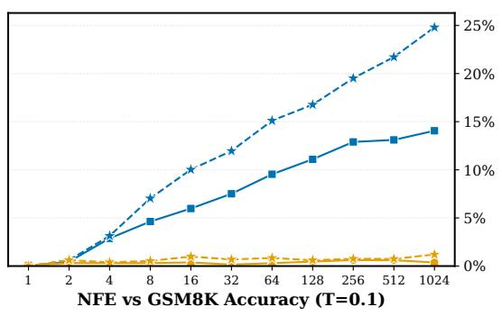

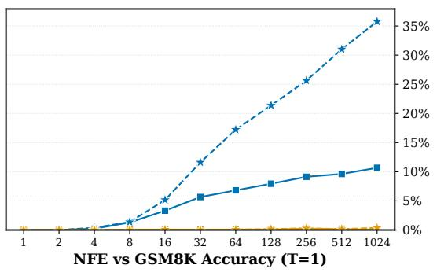

Figure 6: SC state and loss. LAW with the Expected Embedding or the hidden representation as SC state, trained with the NELBO or the CE, without regularization.  
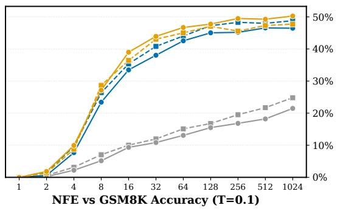

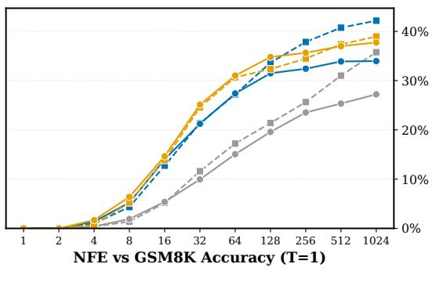  
Figure 7: Temperature regularization and mode embedding. LAW with temperature regularization $( \rho \in \{ 3 , 4 \bar { \} } )$ , the mode embedding (Suppl. A.5), both, or neither.

Number of Passes and Multi-Pass Probability. At $T = 0 . 1 , M = 2$ is the most accurate, with 48.8% $( p = 0 . 9 )$ and 49.4% $( p = 0 . 7 5 )$ with 1024 NFE, against at most 43.2% with more passes (Figure $8 ) . \mathrm { ~ A t ~ } T = 1 , M = 4$ with $p = 0 . 7 5$ is also the most accurate with 1024 NFE (43.6% against 42.2% for $M = 2$ with $p = 0 . 9 )$

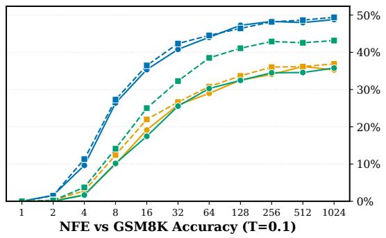

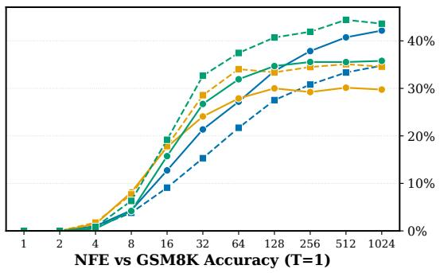  
Figure 8: Number of passes and multi-pass probability. LAW with $M \in \{ 2 , 3 , 4 \}$ passes, run with probability $p \in \{ 0 . 7 5 , 0 . 9 \}$ , and with $\rho = 3$ . Runs with more passes or a higher p train for fewer steps, to match the training FLOPs.

Gradient Flow Between Passes. Without the stop-gradient (Suppl. A.4), LAW reaches 20.2% $( p ~ = ~ 0 . 9 )$ and 16.1% $( p \ : = \ : 1 )$ with 1024 NFE at $T = 1$ , against 42.2% with it (Figure 9 and Figure 10).

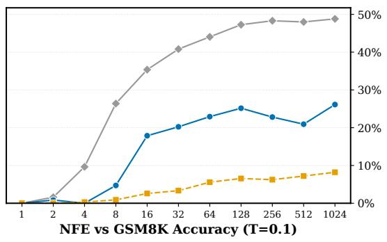

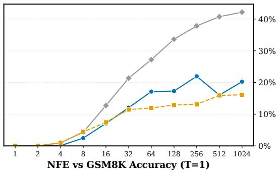  
no stop-grad., p = 0.9

stop-grad., p = 0.9  
Figure 9: Gradient flow between passes. LAW with $M = 2$ and $\rho = 3 ,$ , with the stop-gradient between passes $( p = 0 . 9 )$ and without it $( p \in \{ 0 . 9 , 1 \} )$ . Without the stop-gradient, each update is more expensive, so these runs train for 132k $( p = 0 . 9 )$ and 125k $( p = 1 )$ steps, against 192k with the stop-gradient.  
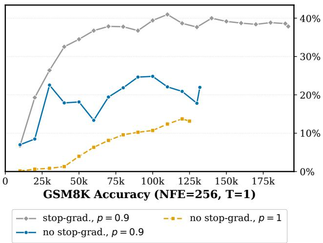  
Figure 10: Gradient flow between passes, over training. GSM8K accuracy with 256 NFE at $T = 1$ over training steps, for the runs of Figure 9. After 120k steps, the accuracy is 38.7% with the stop-gradient, against 20.9% $( p = 0 . 9 )$ and 13.7% $( p = 1 )$ without it. With the stop-gradient, the accuracy plateaus from about 70k steps. Without it, the run with $p = 0 . 9$ does not improve after 100k steps, and the run with $p = 1$ improves slowly.

Expected Embedding in LDDM-U. Figure 11 shows both temperatures for the comparison of the left panel of Figure 4, which only shows $\breve { T } = 0 . 1$

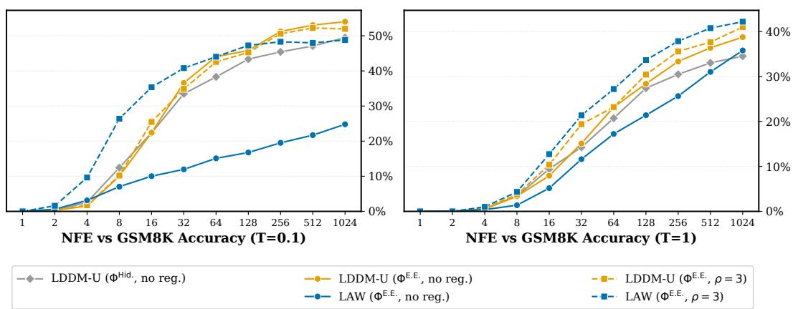  
Figure 11: LAW against LDDM-U with the Expected Embedding. The legend gives the SC state and the temperature regularization (ρ = 3 or none).

## D.3 TINYGSM: FINE-TUNING FROM DUO

With $M = 2 ,$ the accuracy peaks after 15k to 20k fine-tuning steps and then decreases, whereas with $M = 4$ it does not decrease (Figure 12, all batch sizes). Figure 13 compares the $M = 2$ checkpoints after 15k and 50k steps against NFE (Sec. 4.3).

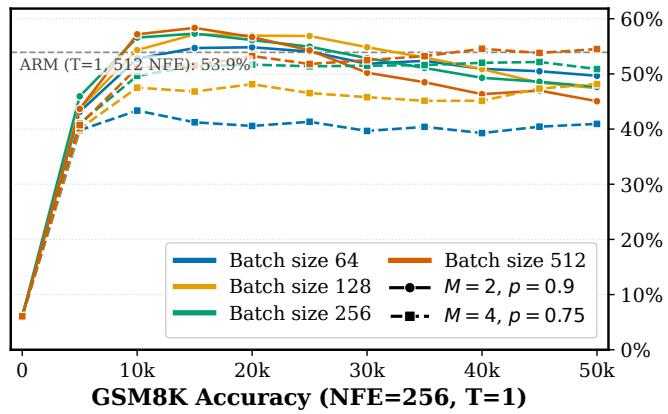  
Figure 12: Fine-tuning from Duo. GSM8K accuracy over fine-tuning steps with 256 NFE at $T = 1$ for $M = 2 , p = 0 . 9$ (solid) and $M = 4 , p = 0 . 7 5$ (dashed), both with $\rho = 3 .$ , at batch sizes 64 to 512. Step 0 is the Duo checkpoint, sampled with the sampler of LAW. The dashed gray line is the ARM sampled at $T = 1$ (53.9%, 512 NFE).

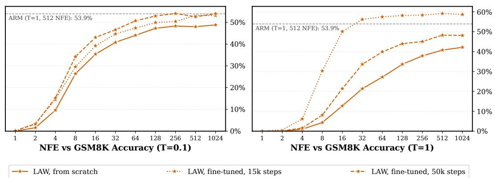  
Figure 13: Early stopping. LAW fine-tuned from Duo with $M = 2 , p = 0 . 9 , \rho = 3$ and batch size 512, after 15k and 50k fine-tuning steps, against LAW trained from scratch (Figure 1). The dashed gray line is the ARM, as in Figure 12.

## D.4 TINYGSM: COMPARISON WITH FEW-STEP METHODS

Table 10 compares LAW with recent few-step methods on TinyGSM, from 1 to 64 NFE.

Table 10: GSM8K accuracy (%) with 1 to 64 NFE on TinyGSM. MDLM, Duo and IDLM are taken from Gushchin et al. (2026), who re-evaluate the checkpoints of Deschenaux & Gulcehre (2026) and Li et al. (2026) (IDLM at 32 and 64 NFE is taken from Li et al. (2026)). FMLM+ is taken from Agarwal et al. (2026), DBTM from Tang & Wang (2026), AlphaDLM from Gushchin et al. (2026), and SDM from Deschenaux et al. (2026a), whose sampler uses the stochasticity κ = 1. SDM (distilled) starts from SDM (Expected Embedding), with a configuration selected on the GSM8K test set. FMLM+ (init. from MDLM) starts from an MDLM checkpoint, IDLM is distilled from MDLM or Duo, and the fine-tuned LAW starts from the Duo baseline. Greedy denotes argmax decoding, and for FMLM+ and DBTM, an NFE is one refinement round. MDLM (confidence) at 1 and 2 NFE is computed from the counts reported by Gushchin et al. (2026). – marks values that are not reported. Best per column in bold.
<table><tr><td>Method</td><td>Decoding</td><td>1</td><td>2</td><td>4</td><td>8</td><td>16</td><td>32</td><td>64</td></tr><tr><td>Discrete Diffusion</td><td></td><td></td><td></td><td></td><td></td><td></td><td></td><td></td></tr><tr><td>MDLM (ancestral)</td><td>T = 0.1</td><td></td><td></td><td>1.7</td><td>5.3</td><td>13.0</td><td>22.1</td><td>28.2</td></tr><tr><td>MDLM (confidence)</td><td>greedy</td><td>0.8</td><td>0.7</td><td>4.2</td><td>20.1</td><td>37.7</td><td>43.9</td><td>40.6</td></tr><tr><td>Duo (ancestral)</td><td>T = 0.1</td><td></td><td></td><td>5.2</td><td>14.0</td><td>23.0</td><td>30.8</td><td>31.2</td></tr><tr><td>Discrete Diffusion, distilled</td><td></td><td></td><td></td><td></td><td></td><td></td><td></td><td></td></tr><tr><td>IDLM (MDLM)</td><td>T = 1</td><td></td><td></td><td>0.4</td><td>1.8</td><td>6.5</td><td>12.8</td><td>14.9</td></tr><tr><td>IDLM (Duo)</td><td>T = 1</td><td></td><td></td><td>2.3</td><td>7.1</td><td>11.7</td><td>15.4</td><td>19.0</td></tr><tr><td>Posterior Refinement</td><td></td><td></td><td></td><td></td><td></td><td></td><td></td><td></td></tr><tr><td>FMLM+ (from scratch)</td><td>greedy</td><td>0.0</td><td>0.1</td><td>2.9</td><td>8.7</td><td>13.4</td><td>19.0</td><td>19.1</td></tr><tr><td>FMLM+ (init. from MDLM)</td><td>greedy</td><td>0.3</td><td>0.7</td><td>5.1</td><td>15.1</td><td>26.1</td><td>31.8</td><td>33.6</td></tr><tr><td>Discrete Beckmann Transport</td><td></td><td></td><td></td><td></td><td></td><td></td><td></td><td></td></tr><tr><td>DBTM</td><td>greedy</td><td>0.8</td><td>1.1</td><td>5.7</td><td>10.1</td><td>14.3</td><td>16.8</td><td>16.2</td></tr><tr><td>Alpha Diffusion Language Models</td><td></td><td></td><td></td><td></td><td></td><td></td><td></td><td></td></tr><tr><td>AlphaDLM (k = 2)</td><td>greedy</td><td>1.0</td><td>1.3</td><td>10.6</td><td>28.6</td><td>43.1</td><td></td><td></td></tr><tr><td>AlphaDLM (k = 4)</td><td>greedy</td><td>1.8</td><td>2.6</td><td>16.7</td><td>35.3</td><td>46.5</td><td></td><td></td></tr><tr><td>AlphaDLM (k = 8)</td><td>greedy</td><td>2.7</td><td>7.7</td><td>28.9</td><td>44.0</td><td>49.2</td><td>49.9</td><td>50.0</td></tr><tr><td>AlphaDLM (k = 16)</td><td>greedy</td><td>6.3</td><td>18.0</td><td>34.6</td><td>39.0</td><td>40.6</td><td>40.9</td><td>40.9</td></tr><tr><td>Simplex Diffusion (κ = 1)</td><td></td><td></td><td></td><td></td><td></td><td></td><td></td><td></td></tr><tr><td>SDM (Expected Embedding)</td><td>T = 1</td><td>0.0</td><td>0.0</td><td>1.0</td><td>6.3</td><td>17.1</td><td>25.4</td><td>32.7</td></tr><tr><td>SDM (Expected Embedding)</td><td>T = 0.1</td><td>0.0</td><td>0.2</td><td>5.4</td><td>17.8</td><td>28.2</td><td>36.5</td><td>39.5</td></tr><tr><td>SDM (argmax + SC)</td><td>T = 1</td><td>0.0</td><td>0.0</td><td>0.6</td><td>4.5</td><td>7.7</td><td>16.8</td><td>22.4</td></tr><tr><td>SDM (argmax + SC)</td><td>T = 0.1</td><td>0.0</td><td>1.0</td><td>8.0</td><td>22.7</td><td>33.9</td><td>40.7</td><td>42.0</td></tr><tr><td>SDM (distilled)</td><td>T = 1</td><td></td><td>一</td><td></td><td>32.1</td><td></td><td>37.6</td><td>37.8</td></tr><tr><td>LAW (Ours)</td><td></td><td></td><td></td><td></td><td></td><td></td><td></td><td></td></tr><tr><td>From scratch</td><td>T = 1</td><td>0.0</td><td>0.0</td><td>1.0</td><td>4.3</td><td>12.7</td><td>21.4</td><td>27.2</td></tr><tr><td>From scratch</td><td>T = 0.1</td><td>0.0</td><td>1.6</td><td>9.6</td><td>26.4</td><td>35.4</td><td>40.8</td><td>44.0</td></tr><tr><td>Fine-tuned, 15k steps</td><td>T = 1</td><td>0.0</td><td>0.7</td><td>6.1</td><td>30.3</td><td>50.1</td><td>56.2</td><td>57.4</td></tr><tr><td>Fine-tuned, 15k steps</td><td>T = 0.1</td><td>0.2</td><td>3.6</td><td>14.6</td><td>29.6</td><td>39.2</td><td>44.7</td><td>47.4</td></tr><tr><td>Fine-tuned, 50k steps</td><td>T = 1</td><td>0.0</td><td>0.2</td><td>1.6</td><td>8.1</td><td>21.4</td><td>33.6</td><td>39.9</td></tr><tr><td>Fine-tuned, 50k steps</td><td>T = 0.1</td><td>0.2</td><td>3.3</td><td>15.3</td><td>34.2</td><td>43.1</td><td>46.6</td><td>50.7</td></tr></table>

## D.5 MAZE: EXACT MATCH VS. VALID SOLUTION

Exact match counts many correct paths as wrong (Figure 15). For example, S-FLM (S-arch.) generates a valid solution for 77.7% of the mazes with 128 NFE, but only 58.3% of them match the target path. Since every exact match is also a valid solution, the exact-match accuracy never exceeds the valid-solution accuracy (Suppl. C.4). Figure 14 shows a valid path of LAW that differs from the target.

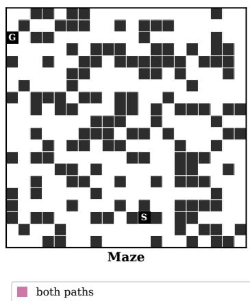

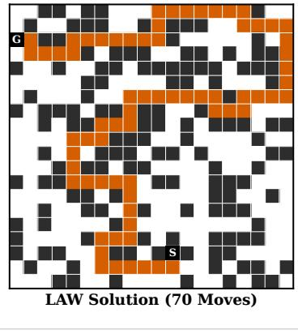

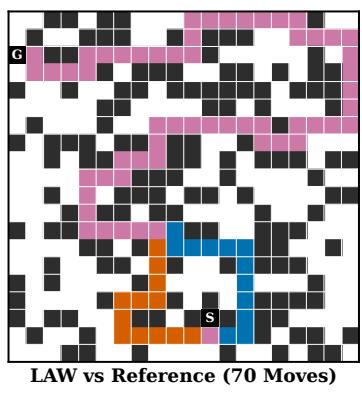

Figure 14: A valid solution that fails exact match. On this Maze-Hard evaluation maze, LAW generates a shortest path that differs from the target. Left: the maze. Middle: the path generated by LAW. Right: cells on both paths (pink), only on the LAW path (vermilion), and only on the target path (blue). Both paths take 70 moves, so the generated path solves the maze, but exact match counts it as wrong.  
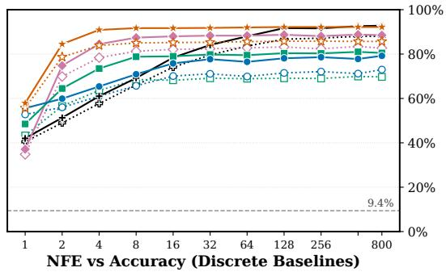

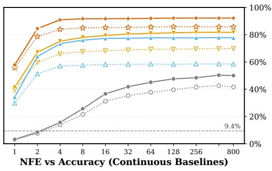  
LAW (ΦE. E. , ρ = 2) MDLM LDDM-U --FLM CANDI valid solution ARM (greedy, 400 NFE) Duo -+- LDDM-M — S-FLM (S-arch.) … exact match (hollow)

Figure 15: Maze-Hard exact-match against valid-solution accuracy. Valid-solution (solid) and exact-match (dotted, hollow markers) accuracy against NFE of the baselines and of LAW with ρ = 2 (Figure 3). Left: DDM baselines. Right: continuous baselines.

## D.6 MAZE: ABLATIONS

We report the valid-solution accuracy at the last checkpoint of each run, with T = 1. Table 5 lists the configuration and training steps of every run.

Multi-Pass Probability and Loss. With the NELBO, p = 0.75 gives the highest accuracy, 91.7% with 800 NFE (Figure 16). The NELBO is more accurate than the CE at every p except p = 0.9, where both solve about 90% of the mazes.

Number of Passes. A third pass does not improve the final accuracy (Figure 17). With p = 0.9 and the CE, M = 3 is less accurate than M = 2 (85.1% against 90.0% with 800 NFE). With the NELBO, it helps with 2 NFE (77.8% against 65.2%), but not with many steps. With $p = 0 . 7 5 .$ M = 3 is below M = 2 with the NELBO and close to it with the CE.

Temperature Regularization. Temperature regularization does not consistently improve the final accuracy (Figure 18). We train LAW with $\rho \in \mathsf { \bar { \{ 2 , 3 , 4 , 5 \} } }$ and both losses for M = 2 with p ∈ {0.9, 0.75} and for M = 3 with $p = 0 . 9$ . The best configuration (NELBO, M = 2, p = 0.75, $\rho = 2 )$ solves 92.2% of the mazes with 800 NFE, against 91.7% without regularization.

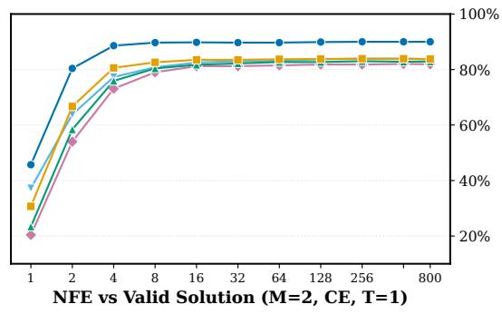

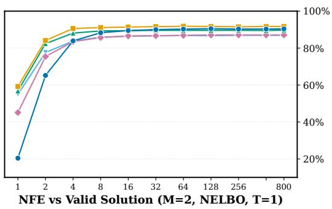  
Figure 16: Multi-pass probability on Maze-Hard. Valid-solution accuracy against NFE at $T = 1$ of LAW with $M = 2$ passes run with probability p, trained with the CE (left) or the NELBO (right).

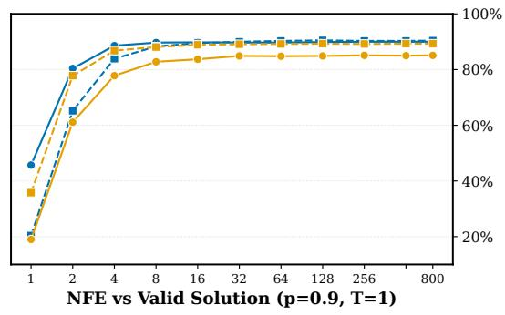

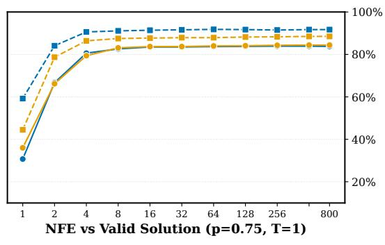  
Figure 17: Number of passes on Maze-Hard. Valid-solution accuracy against NFE at $T = 1$ of LAW with $M = 2$ or $M = 3$ passes, run with probability $p = 0 . 9$ (left) or $p = 0 . 7 5$ (right), and trained with the CE (solid) or the NELBO (dashed).

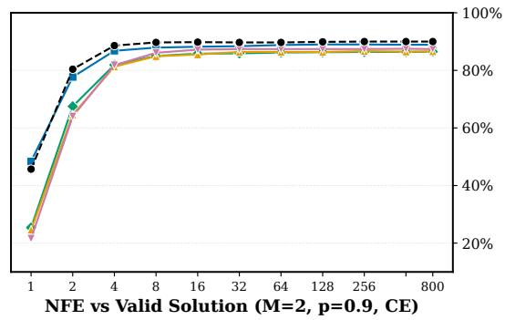

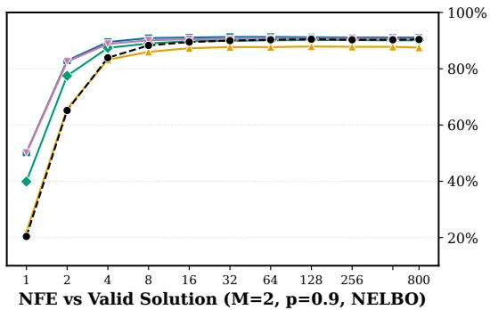

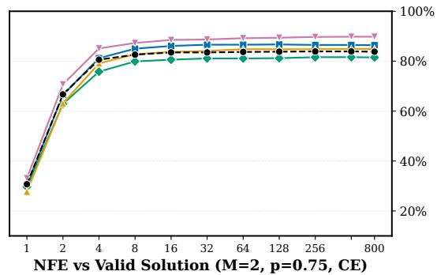

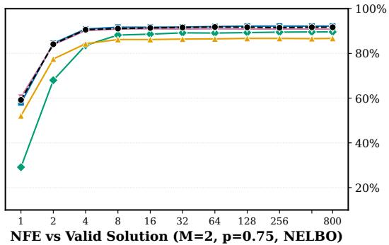

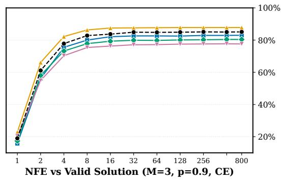

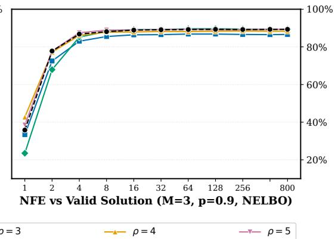  
Figure 18: Temperature regularization on Maze-Hard. Valid-solution accuracy against NFE at $T = 1$ . Each panel is one training configuration (x-axis label), without regularization (dashed black) and with $\rho \in \{ 2 , 3 , 4 , 5 \}$

## D.7 OPENWEBTEXT: ABLATIONS

We first choose the loss, then add temperature regularization and the mode embedding, one change at a time (Table 6). We track the metrics of Suppl. C.5 over training.

Loss. The CE (11) gives a higher entropy than the NELBO, i.e., more diverse samples, at a higher Gen. PPL (Figure 19). We therefore use the CE in the following experiments.

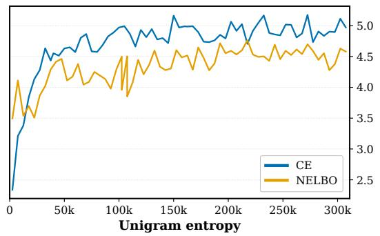

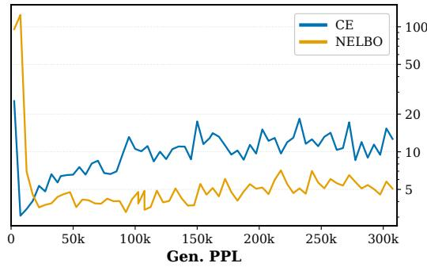  
Figure 19: Loss. Unigram entropy (left) and Gen. PPL (right) over training steps of LAW trained from scratch on OpenWebText with the NELBO or the CE (11), without temperature regularization, and without the mode embedding.

Temperature Regularization and Mode Embedding. The mode embedding prevents the collapse of the run with $\rho = 3$ (Figure 20). Without it, the representations collapse midway through training, as the hidden-state correlation goes to 1 and the entropy drops close to zero. With it, the run reaches a lower hidden-state correlation and a slightly higher entropy than without regularization. The run with $\rho = 4$ stays stable even without the mode embedding, and reaches a lower hidden-state correlation than the run without regularization, at a similar entropy.

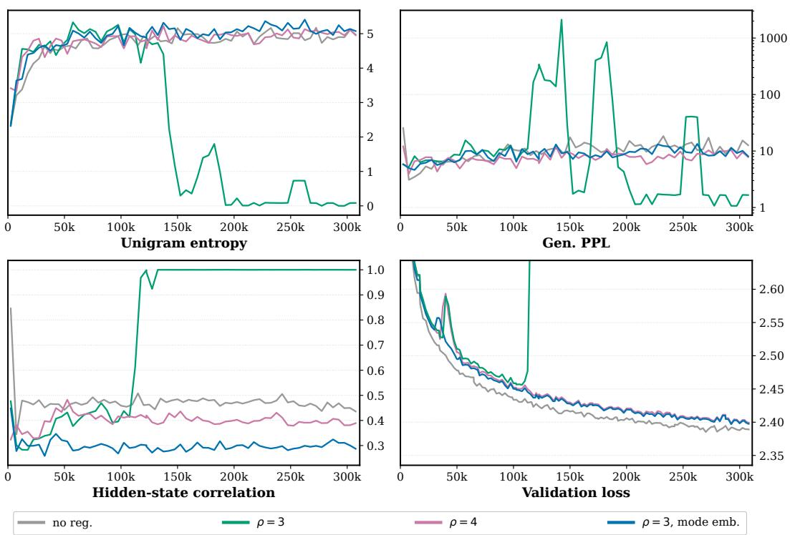  
Figure 20: Temperature regularization and mode embedding. Unigram entropy (top left), Gen. PPL (top right), hidden-state correlation (bottom left), and validation loss (bottom right) over training steps of LAW trained with the CE. No reg. is the CE run of Figure 19. The other runs add temperature regularization with $\rho \in \{ 3 , 4 \}$ (12), then the mode embedding (Suppl. A.5) on top of $\rho = 3$

## D.8 OPENWEBTEXT: COMPARISON TO LDDMS

With temperature regularization, every LAW run reaches a lower Gen. PPL than all LDDMs at both NFE (Figure 21), and with 64 NFE, the best model uses $\rho = 3$ and the mode embedding. The figure compares the LAW runs of Suppl. D.7 that do not collapse with LDDM-M and with LDDM-U using either SC state (Suppl. C.5). Without regularization, LAW only reaches a low entropy and a higher Gen. PPL than LDDM-U. Unlike on TinyGSM, the Expected Embedding increases the Gen. PPL of LDDM-U, with or without temperature regularization, most clearly at high entropy. The gain of LAW over LDDMs therefore does not come from the Expected Embedding alone.

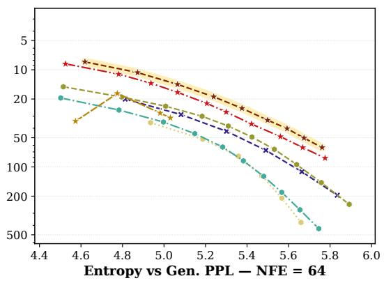

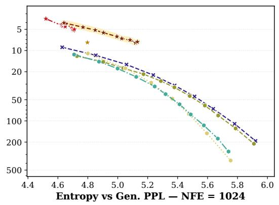  
LDDM-M (ΦHid., no reg.) LDDM-U (ΦHid., no reg.) LAW (ΦE.E., no reg.) LAW (ΦE.E., ρ = 4)

Figure 21: LAW against LDDMs on OpenWebText. Gen. PPL against unigram entropy with 64 (left) and 1024 NFE (right), over the sampling temperatures of Figure 5. The legend gives the SC state and the regularization (Suppl. A.3 compares how LDDMs and LAW use the SC state). The highlighted run is the LAW model of Figure 5.

## D.9 OPENWEBTEXT: SAMPLES

We show unconditional samples of L = 1024 tokens from the LAW model of Sec. 4.4, drawn at T = 1.

<|endoftext|>bird to MozillaBluebird</strong> <strong> <i>[Internet homophobe>: Filimonious blatant anti-aggression at 09:20 PM PDT</</>2> Mozozilla BlueHTML IE is incompatible with HTML5. Sincerely, Mozilla Bluebird</strong> <strong>Microsoft: IE was never spanned HTML5</strong> <strong>All my ducks</blockquote><a href="https://twitter.com/ TMZWB/status/758308800725903404"></script> 
Firefox knuckleball<a href="https: //twitter.com/jonathanjoc">https://twitter.com/jonathan\_jockels/></img> <i>[email protected</i>(Message ID: Send embed message to your Firefox Web browser)</i><strong>All my ducks</blockquote><<a href="https://blockquote.com/TMZWB/status/76912880071803404"></script> <i>[Internet homophobe>: Filimonious anti-aggression, 09:20 PM PDT</t>> Mozozilla HTMLbird browser is incompatible with HTML5. Sincerely, Mozilla Bluebird and MozillaBluebird</strong> <a href="https://blockquote.com/TMZWB/status/82317880070103404"></script> <i>[email protected</i>(Photo credit: iStockphoto/Getty Images)</i>
Firefox knuckleball<a href="https://twitter.com/jonathanjoc">https://twitter.com/jonathan\_ jockels/></a> <strong>Microsoft: IE was never spanned</strong> </strong><|endoftext|>Video Loading Video Unavailable Click to play Tap to play The video will start in 8 Cancel Play now¶¶Liverpool are poised to reject a £7.75million bid from Lyon for world-record signing Alexandre Lacazette but but Brendan Rodgers is keen to begin talks with the France international.¶¶The 35-year-old France international is close to start his ninth Premier League season at Stamford Bridge after agreeing previously agreed terms over £7.5m wages and release clause.¶¶Rodgers is keen to keep Lac a Frenchman, has scored 35 goals in 155 Premier League games since joining from Ukrainian giants Dynamo Moscow and Shakhtar Donetsk in January 2012.¶¶Lac Lazette 20 Chelsea Lyon season after completing a £9.25m loan deal from Spanish academy club Boca Raton and £11.15m from German side Bayer Leverkusen.¶¶The 25-year-old was capped 17 times by France at Euro 2012, has made 25 first-team appearances at the Etihad Stadium and captained Dynamo Moscow after scoring a brace in a 2-1 win over Dortmund in the opening round of the Europa League quarter-final.¶¶Video Loading Video Unavailable Click to play Tap to play The video will start in 8 Cancel Play now¶¶Rodgers is keen to reject a chance bid for Bosnia striker Raferski Kljanic who Arsenal has rejected Marse bids from AC Milan, Roma and Lazio with the club-record £75m release clause which expires when January transfer window reopens.¶¶The 26-year-old France international netted 15 goals and 15 assists in nine Premier League starts since joining from Ukrainian giants Shakhtar Donetsk in January 2012.¶¶The 35-year-old France international was also to offer a of £4.3million from Bundesliga heavyweights Borussia Dortmund and Bayern Munich this summer after agreeing previously agreed terms on a £3m wages and release clause.¶¶Lacazette is keen to become a regular in the Reds starting-team at winning Brendan Cup from out in time, League. Rodgers¶Rod Rodgers is keen to begin talks with Lacazette for his first Premier League season at Stamford Bridge.¶¶Liverpool boss Jurgen Klopp also admitted Arsenal’s Real Sociedad Alexis Sanchez will be omitted from the starting XI with a torn anterior cruciate ligament/left thigh injury.¶¶The 37-year-old Chilean is expected to miss crucial Champions League games against Paris Saint-Germain, Real Madrid and Barcelona at the Etihad on Sunday.<|endoftext|>Image copyright PA Image caption The riot police have cordoned off areas of the stadium following Chelsea’s 2-2 draw with Bournemouth¶¶Riot police have cordoned off areas at the stadium following Chelsea’s 2-2 draw with Bournemouth.¶¶Video footage shows police cars speeding through the pitch at knee-high speed.¶¶Chelsea fans responded off “Goite!” chants as police cleared effective areas of the pitch.¶¶The hosts had who outemouth 5-0 in goal opening two minutes.¶¶Manager Jose Mourinho claims a have “ the it’s by<|endoftext|>

Figure 22: Sample with 64 NFE. Gen. PPL 18.31, unigram entropy 5.60.

<|endoftext|> spill in be devastating to reef’s economy marine and are communities and damaging Great Barrier Reef Heritage status and natural heritage.”¶¶Federal environment minister Patrick McLuhan said further losses from Maccorp would be “catastrophic” for the reef ecosystem.¶¶“Maccor’s are, highly on are oil sands is and are dumping and dredging down our runways and waterways,” McLuhan said.¶¶“These oil spills will wreak havoc on this reef environment, wreak havoc on the tourism and fishing industries and devastate the health and livelihoods of the reef.”¶¶Queensland marine environment minister Greg Hunt said it was “surprising” the fossil fuel industry “has become involved” in the unfolding spill.¶¶“[Industries such as ExxonMobil, Shell, Halliburton, Symantec and Bonhoeven Energy are become involved in their day-to-day operations,” Hunt said.¶¶“ExxonMobil, Halliburton, Symantec, Bonhoeven Energy and Shell marine field activities could greatly impacted.”¶¶Hunt also the Australian Federal Environment and Consumer Protection Agency was monitoring the situation.¶¶‘Oil spill impacts Great Barrier Reef ecosystem’¶¶Great Barrier Reef Environment scientist Andy Bourke said there was “fundhuge concern” about the spill.¶¶Reflecting on the recent car crash off Queensland’s eastern coast, Bourke said Reef Marine Incident Management Team alerted the authorities a vast quantity crude oil had washed up corals.¶¶“After extensive dredging and clearing corals we discovered large quantities of oily sediment that could’ve been contaminated with crude oil,” Bourke said.¶¶Environment Minister Greg Egan told RN One radio the government was taking urgent action to prevent oily material from being released into the waters. Deepwater activists have warned similar spill spill be spill well after the massive flood which inundated the Great Barrier Reef in the late 1990s and early 2000s.¶¶Maccorp used a mixture of flammable dispersants, lexit 9590 and Corexit 8590 – toxic chemicals. The U.S. Environmental Protection Agency says some of the chemicals emitted by Corexit dispersants exceeded EPA’s maximum allowable amount 100 micrograms.¶¶Opposition senator Clive Palmer has labelled the government’s decision to suspend a moratorium on offshore exploration of the reef as “disastrous”.¶¶“It has dramatically changed the way we think about the future of the Great Barrier Reef,” Senator Clive Palmer told ABC¶¶“It is an irresponsible, reckless decision to suspend a moratorium on offshore exploration of the reef.”---¶---environment---impact---issues---environment---government, federal---state---issues-- -national---security, brisbane-4000, sydney-6748, qld, australia¶¶First posted<|endoftext|>Longtime meteorologist Thomas Hockenberger talks about Comet Listen to the interview BBC radio presenter Alistair Clarkson (left) gave about Comet in the 1985 Life Science documentary ‘What caused the asteroid impact?’ AP Long-time meteorologist Thomas Hockenberger was asked about Comet in the 1985 American documentary documentary ‘What caused an asteroid impact?’ BBC radio presenter Alistair Clarkson (right) was asked about Comet in the 1985 PBS science documentary ‘What caused an asteroid impact?’ AP Image 1 of / 37 Caption Close NASA celebrates 25th anniversary of biggest asteroid impact event recorded Image 1 of / 37 Caption Close Long-time meteorologist Thomas Hockenberger talks about Comet 1 / 37 Back to Gallery¶¶MADISON, Wis. — Astrophysicist Thomas Hockenberger spoke about Comet as NASA celebrates the 25th anniversary of the biggest asteroid impact event in recorded history.¶¶Hockenberger presents part on The? The details, which of a cataclysmic asteroid impact believed to have wiped out thousands of vertebrates, from dinosaurs to centroids to arthropods.¶¶Astronomers believe an ejection meteorite fragment from the Cretaceous-Earth-Triassic boundaryogene collided with the asteroid belt and ejected carbon dioxide and dust. That ejected carbon dioxide particles from the atmosphere and smashed through forming a tangle of soft rocks that eroded the Earth’s geologic crust.¶¶Scientists also that late Cretaceous boundaryogene smashed the ejection meteorite fragments and ejected carbon dioxide and dust deposited in Earth’s mantle, created a comet nucleus, impacting on asteroid in Earth.¶¶[SLIDESHOW: Earth’s Biggest Asteroid Impact Event Revealed]¶¶Listen to the fascinating interview about Comet in the podcast below.¶¶Watch legendary meteorologist Thomas Hockenberger talk to our daily newsletter To stay up to date with the latest news and videos, sign up for the Us Weekly iPhone app or subscribe to the Us Weekly Android app.<|endoftext|>(CNN) Japan has extended issued tsunami warning warnings for major quakes along its northeastern coast, prompting experts to warn that a 6.9-magnitude quake is still Japan at<|endoftext|>

Figure 23: Sample with 1024 NFE. Gen. PPL 22.09, unigram entropy 5.69.