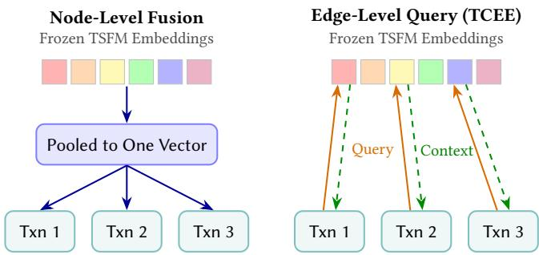
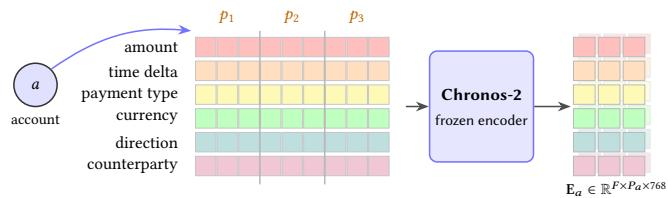
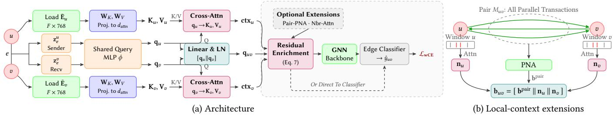
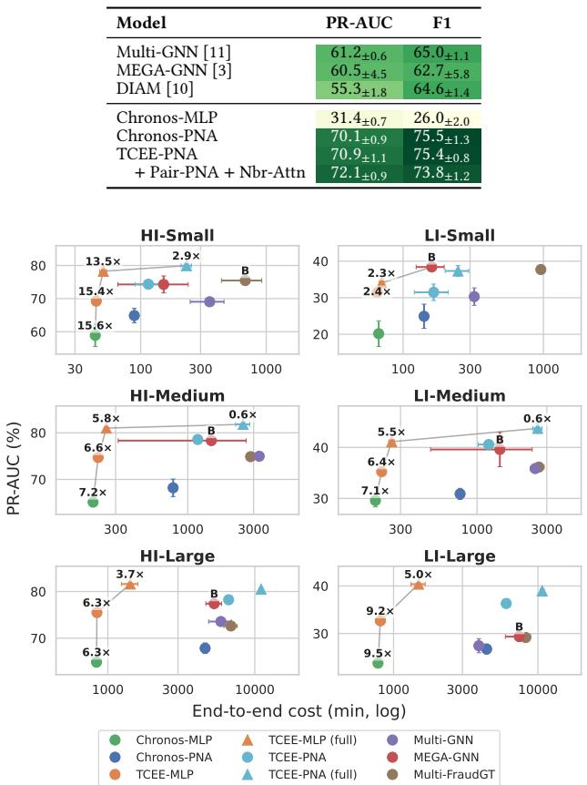
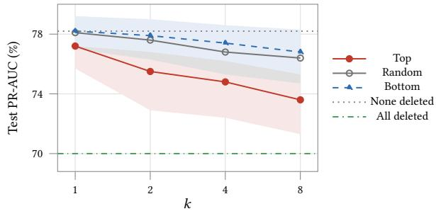

# Leveraging Time-Series Foundation Models for Financial Crime Detection

Danae Natalie Savvidi Delft University of Technology Delft, The Netherlands dsavvidi@tudelft.nl

Kubilay Atasu Delft University of Technology Delft, The Netherlands kubilay.atasu@tudelft.nl

## Abstract

Financial crime detection requires identifying illicit activity within large transaction networks, where suspicious behaviour is rare and unfolds over time. Existing graph-based methods capture relationships among accounts but typically underuse the temporal behaviour encoded in account transaction histories. We introduce Temporal-Context Edge Enrichment (TCEE), a framework that addresses this gap by summarising each account’s transaction history with a frozen time-series foundation model (TSFM), and enriching each transaction’s representation with the relevant temporal context from these summaries. These enriched representations can be scored directly for edge classification, or fed into a graph neural network (GNN) as edge features to capture broader structural infor mation. Across six AMLWorld datasets, TCEE improves PR-AUC over the strongest evaluated baseline on five by a relative 10.8% on average, while training 6.0 faster end-to-end. Feeding TCEE’s rep resentations into a GNN raises PR-AUC a further 4.8% on the four smaller datasets. On an Ethereum phishing dataset, we show that TSFM-generated account representations fed into a GNN are also efective for node classification, improving PR-AUC by 14.5% over the strongest baseline. As TSFMs continue to advance, our results suggest they can strengthen financial crime detection by capturing temporal signals that complement graph-based approaches.

## CCS Concepts

• Computing methodologies Neural networks; • Mathematics of computing Graph algorithms; • Information systems Data mining; • Security and privacy Intrusion/anomaly detection and malware mitigation.

## Keywords

financial crime detection, anti-money laundering, time-series foundation models, graph neural networks

Çağrı Bilgi Delft University of Technology Delft, The Netherlands h.c.bilgi@tudelft.nl

Arie van Deursen Delft University of Technology Delft, The Netherlands arie.vandeursen@tudelft.n

ACM Reference Format:   
Danae Natalie Savvidi, Çağrı Bilgi, Kubilay Atasu, and Arie van Deursen. 2026. Leveraging Time-Series Foundation Models for Financial Crime Detection. In 7th ACM International Conference on AI in Finance (ICAIF ’26), November 14–17, 2026, Milan, Italy. ACM, New York, NY, USA, 9 pages. https://doi.org/10.1145/3858063.3858793

## 1 Introduction

Modern crime is not only physical. Financial crime is carried out through digital transactions, from money laundering to defrauding account holders. Money laundering alone is estimated to account for 2 to 5% of global GDP each year [24]. Whatever the crime, illicit funds must move, and every movement is recorded as a transaction between two accounts, so financial crime unfolds on a transaction network. Such a network is naturally a multigraph, with accounts as nodes, transactions as directed edges, and parallel edges representing repeated transactions between account pairs.

Finding the few illicit transactions among millions of legitimate ones is the task of financial crime detection, a legal obligation for financial institutions [18]. GNNs and graph transformers designed for such multigraphs define the state of the art in banking and blockchain settings alike [10, 11, 16], and recent work further extends them [3]. We call this family structural models, as they focus on the graph structure yet consume time as a plain edge attribute.

Despite advances, detection remains challenging. Illicit behaviour is vanishingly rare, as few as one transaction in two thousand [1], and the criminal patterns, sequences ofcoordinated transfers, evolve as criminals seek to evade detection [18]. What must be detected also varies with the crime. In phishing, such as on the Ethereum (ETH) blockchain, victims are tricked into paying an account the attacker controls, so the label is the account itself and detection is node classification [29]. Money laundering is diferent. The proceeds can travel through otherwise legitimate accounts, and what is illicit is each transfer that moves them, so anti-money laundering (AML) benchmarks pose the problem as edge classification [1]. Edge classification is generally harder, because whether a transaction is suspicious depends on context. The model must learn not only the characteristics of the accounts involved but also how they interact.

Among these challenges, we target the temporal signal. Accounts transact in repeating rhythms, salaries arrive and bills are paid on schedule, and on real bank data these rhythms separate launderers from legitimate customers [14]. Two obstacles stand in the way. Temporal patterns must be learned from scarce illicit labels, and the rhythms belong to accounts while the decision falls on a single transaction. The problem is therefore to enrich each transaction with temporal context drawn from its structural neighbourhood.

  
Figure 1: Node-level fusion (left) provides the same pooled vector to every transaction of the same account; TCEE (right) enables each transaction to query the context independently.

Prior work misses this requirement in diferent ways. The structural models reduce the temporal signal to a single timestamp attribute. Temporal graph models are built around time, yet each line of work reads it narrowly. Snapshot models see only the edges inside a time step [26], temporal graph networks compress an account’s past into one memory vector [20], and recency-weighted message passing reduces timing to one scalar per neighbour [12].

Time-series foundation models (TSFMs) such as Chronos-2 [2] ofer a new option. Pretrained on large corpora, they supply rich temporal representations without needing any labels. A frozen TSFM takes each account’s history as one series per feature, the amount, currency and so on, and returns one embedding per series. Pooling this set into one vector per account, which we call node-level fusion, and using it as a node feature in a GNN works well for node-level tasks. On a real ETH phishing graph [5, 29], this model outperforms all evaluated baselines. However, it still trails the strongest structural models on AML edge classification [1], because it hands every transaction of an account the same pooled vector, while edge-level tasks require telling them apart.

We overcome this limitation by delivering the temporal context directly to the edge. Temporal-Context Edge Enrichment (TCEE) lets each transaction form a query from its own features and attend over the frozen embeddings of its source and destination accounts (Figure 1), producing a rich edge representation. Two transactions by the same account can thus retrieve diferent contexts: e.g., one drawing on the amount history, and another on the timing. We further add two extensions, components that read the raw transaction features directly and produce further representation details the temporal context cannot provide. To our knowledge, TCEE is the first model to query a TSFM from a graph edge. The enriched edge representations built by TCEE can be scored directly by an MLP (TCEE-MLP) or handed to a GNN backbone that can consume edge features (TCEE-GNN).

We make the following main contributions:

(1) Models. We build, to our knowledge, the first TSFM-based detectors of financial crime on transaction multigraphs, Chronos-MLP and Chronos-GNN, which use node-level fusion.

(2) Method. We show that node-level fusion falls short on edgelevel tasks and introduce TCEE, which enables each transaction to independently query its temporal context.

(3) Results. On AMLWorld, TCEE-MLP with both extensions and no backbone improves PR-AUC, the area under the precisionrecall curve, over each dataset’s strongest evaluated baseline on five of the six datasets, by a relative 10.8% on average, and trains 6.0 faster end-to-end on average across all six. A GNN backbone adds a further 4.8% on the four datasets trained to convergence. On the ETH phishing graph, TCEE improves PR-AUC by 17.8% over the strongest baseline. Together, these results make a case for using TSFMs in financial crime detection.

## 2 Background and Related Work

Problem. We work on a directed transaction multigraph $G =$ $( V , E )$ . Each node is an account and each edge a transaction $e =$ $\left( u , v , t , \mathbf { z } _ { e } \right)$ from � to � at time � with raw features $\mathbf { z } _ { e } .$ . AML is edge classification, where a classifier $f : e \mapsto \hat { y } _ { e } \in [ 0 , 1 ]$ predicts the illicit label $y _ { e } \in \{ 0 , 1 \}$ under severe class imbalance, with illicit transactions as rare as 0.051% on AMLWorld LI-Medium [1]. Phishing detection is node classification, predicting one label per account.

Feature Engineering. Before GNNs, AML systems paired handengineered features with classifiers. One early approach [26] pairs each transaction’s local attributes with one-hop neighbourhood statistics on the Elliptic Bitcoin graph, and another [21] extracts community structure and transaction dynamics per group for a supervised classifier. The Graph Feature Preprocessor [4] mines subgraph patterns in real time to feed gradient-boosted trees, matching or outperforming simple GNN baselines. Such features are fixed in advance, so patterns they do not express stay invisible to the classifier. GNNs instead learn features directly from the graph.

Structural GNNs. The strongest models compete on structural expressiveness, how faithfully the model interprets the graph. Multi-GNN [11] adds ego IDs, port numbering and reverse message passing to standard GNNs so they provably recognise directed subgraph patterns such as cycles. MEGA-GNN [3] aggregates in two stages. It first pools the parallel edges between an account pair, then combines the pooled messages across the account’s neighbours. Multi-FraudGT [16] uses the augmentations of Multi-GNN and performs message passing with a graph transformer whose attention is biased by edge features. On the phishing task, early detectors classify each account from a random-walk embedding of the transaction network [29]. DIAM [10], designed for cryptocurrency multigraphs, compresses each account’s transactions into one node embedding with a GRU. Multi-GNN, MEGA-GNN and Multi-FraudGT improve how graph structure is read, yet treat a transaction’s time as a plain edge attribute. DIAM’s GRU models time explicitly, but it is still trained end-to-end on the scarce illicit labels rather than pretrained. TCEE supplies what both lack, a pretrained temporal representation. It is orthogonal to the structural axis, changing only the edge representation consumed, so it composes with any of them.

Temporal Modelling. Several lines already model timing. Message passing can be re-weighted towards recent transactions [12]. Continuous-time dynamic graph networks attach a recurrent memory or a time encoding to each node [20], discrete-time ones evolve their weights over graph snapshots [26], and dedicated detectors exploit smurfing’s transfer timing [23]. The graph models learn their temporal representation from scratch, and each account is summarised by a single node embedding that all its transactions share. TCEE difers on both counts. It reads each account’s full history with a frozen pretrained model, a richer temporal signal, and it delivers that signal to the individual transaction, the unit AML classifies, rather than diluting it in node aggregation.

  
Figure 2: Chronos-2, frozen, reads each account’s history in patches of 16 transactions and emits one 768-d embedding per feature and patch.

Frozen Time-Series Encoders. TSFMs are neural networks pretrained on large, diverse collections of time series, so they learn general temporal patterns and forecast new series with no taskspecific training [2]. Most split each series into short, fixed-length, non-overlapping segments called patches, and treat them as input tokens [17]. Architectures range from encoder-only models such as Chronos-2 [2] and Moirai [28] to decoder-only forecasters such as TimesFM [8], and from univariate to multivariate models that jointly model related series. What matters for TCEE is a set of embeddings per account to attend over, not one pooled vector. Any TSFM with an encoder provides this, so the approach follows TSFM advances rather than depending on one model. We use Chronos-2, a leading multivariate, encoder-only forecaster, kept frozen. Each account � has � parallel feature series, one per transaction feature (Section 3.1). Chronos-2 encodes the � series of an account jointly. Its group attention performs in-context learning, meaning that the representation of every feature series is conditioned on the account’s remaining � 1 series without any weight updates. The encoder reads each in patches of 16 transactions, and returns the tensor $\mathbf { E } _ { a } \in \mathbb { R } ^ { F \times P _ { a } \times 7 6 8 }$ (Figure 2), one 768-dimensional embedding per series and patch, with $P _ { a }$ the account’s patch count. TCEE queries these embeddings with each transaction. Graph models that condition attention on edge features [9] or message-pass on the line graph [19] operate over representations learned inside the graph, and work that brings pretrained encoders to GNNs fuses them at the node level [22]. To our knowledge, TCEE is the first to query a frozen encoder from a graph edge, and to bring a TSFM to financial crime detection.

## 3 Method

This section covers the encoding of transaction histories as time series, node-level fusion, TCEE and the cost analysis. All attention below is single-head scaled dot-product attention [25], Atn q, K, V = softmax $\scriptstyle ( { \mathbf q } { \mathbf K } ^ { \top } / { \sqrt { d } } ) $ V for a query q, keys $\mathbf { K } \in \mathbb { R } ^ { n \times d }$ and values V.

## 3.1 Transaction History as a Time Series

A transaction history is not the time series a TSFM expects, for two reasons. First, transactions are discrete events at irregular intervals, while time-series models often assume regular sampling. Second, each transaction involves two accounts, so a history is part of a graph, not a self-contained series. Our construction addresses both.

We build one sequence per account, containing every transaction it sends or receives, ordered by time. Each transaction is one step of the sequence. For AMLWorld each step carries �=6 features, so the history becomes six parallel series, one per feature (Figure 2). The amount, payment type and currency describe the transaction itself, and the direction flag marks it as incoming or outgoing for the account. The remaining two series close the two gaps above. The time delta $\Delta t _ { i } = t _ { i } - t _ { i - 1 } ,$ in minutes, with $t _ { i }$ the time of the account’s �-th transaction and $\Delta t _ { 1 } = 0 ;$ closes the first. Chronos-2 treats its input as equally spaced, so the delta is the simplest way to expose the spacing between steps. The counterparty index closes the second. It numbers the account’s counterparties in the order they first appear, so a returning partner keeps its number. Through this series the encoder sees the account’s one-hop neighbourhood, so the representation it returns is not purely temporal. We ablate the counterparty index (Table 4) to measure how much of the signal is temporal. Categorical and boolean features become integers, as the oficial implementation accepts only real-valued series.

Before training, Chronos-2 encodes each account’s � series jointly into the embedding tensor $\mathbf { E } _ { a } \in \mathbb { R } ^ { F \times P _ { a } \times 7 6 8 }$ (Figure 2). We average $\mathbf { E } _ { a }$ over its patches, $\begin{array} { r } { \bar { \mathbf { E } } _ { \alpha } = \frac { 1 } { P _ { \alpha } } \sum _ { p = 1 } ^ { P _ { \alpha } } \mathbf { E } _ { \alpha } ^ { \left( p \right) } \in \mathbb { R } ^ { F \times 7 6 8 } } \end{array}$ , with $\mathbf { E } _ { a } ^ { \left( \hat { P } \right) }$ the $\mathcal { P }$ -th patch, leaving one embedding per feature for each account. We ablate the averaging (Table 4).

## 3.2 Node-Level Fusion

A simple way to use the frozen embeddings is node-levelfusion, pooling them into the same vector per account. Two such models measure what the frozen signal is worth on its own. Each model pools the account’s feature embeddings $\bar { \mathbf { E } } _ { a }$ into one vector $\mathbf { h } _ { a } \in \mathbb { R } ^ { d _ { \mathrm { p r o j } } }$ . By default we pool with attention. A linear map per feature projects $\bar { \mathbf { E } } _ { a }$ to $\tilde { \mathbf { E } } _ { a } \in \mathbb { R } ^ { F \times d _ { \mathrm { p r o j } } }$ , and a learned query ${ \bf q } _ { 0 }$ attends over the projections,

$$
\mathbf { h } _ { a } = \mathbf { W } _ { o } \mathrm { A t t n } \big ( \mathbf { q } _ { 0 } , \tilde { \mathbf { E } } _ { a } , \tilde { \mathbf { E } } _ { a } \big ) ,\tag{1}
$$

with $\mathbf { W } _ { o }$ a learned output map. The attention lets each account weight its most informative series, and replacing its weights with a uniform mean gives a plain-mean variant we ablate (Table 4). Chronos-MLP classifies an edge from its two accounts,

$$
\hat { y } _ { e } = \mathrm { M L P } \big ( [ \mathbf { h } _ { u } \parallel \mathbf { h } _ { v } \parallel \mathbf { h } _ { u } \odot \mathbf { h } _ { v } \parallel | \mathbf { h } _ { u } - \mathbf { h } _ { v } | \parallel \mathbf { z } _ { e } ] \big ) ,\tag{2}
$$

with denoting concatenation, the Hadamard product and $\mathbf { z } _ { e }$ the edge’s raw features. The product and absolute diference are standard pair-matching features [6] that show the classifier how the two accounts align and difer. Chronos-GNN instead uses the same ${ \mathbf { h } } _ { a }$ as account �’s initial node feature in the GNN backbone (Section 3.3.4).

## 3.3 TCEE: Temporal-Context Edge Enrichment

TCEE lets each transaction attend over the frozen embeddings of its two accounts, $\bar { \mathbf { E } } _ { u }$ and $\bar { \mathbf { E } } _ { v } ,$ , with a query built from the transaction’s own features. Figure 3a shows the architecture.

  
Figure 3: (a) TCEE architecture. The transaction edge $\boldsymbol { e } = \left( u , \boldsymbol { v } \right)$ takes each account’s frozen Chronos-2 embedding (green) as keys and values, forms a query from the two transaction views through a shared $\mathbf { M L P } \phi ,$ and cross-attends for $\mathbf { c t x } _ { u } , \mathbf { c t x } _ { v } .$ . Residual enrichment fuses the queries, contexts and optional extensions into $\mathbf { e } _ { u v } ^ { \mathbf { r i c h } }$ , scored directly or after a GNN backbone. The temporal signal enters at the edge, not the node. (b) The extensions. Pair pooling aggregates the parallel transactions with PNA, and neighbourhood attention reads each account’s window, giving b��.

## 3.3.1 The Edge-Conditioned Query.

Keys and Values. For each account � we project its averaged feature embeddings $\bar { \mathbf { E } } _ { a }$ (Section 3.1) to � keys and values,

$$
{ \bf K } _ { a } = ( \bar { \bf E } _ { a } + { \bf T } ) { \bf W } _ { K } , \qquad { \bf V } _ { a } = ( \bar { \bf E } _ { a } + { \bf T } ) { \bf W } _ { V } , \qquad { \bf K } _ { a } , { \bf V } _ { a } \in \mathbb { R } ^ { F \times d _ { \mathrm { a t t n } } } ,\tag{3}
$$

where $\mathbf { W } _ { K } , \mathbf { W } _ { V } \ \in \ \mathbb { R } ^ { 7 6 8 \times d _ { \mathrm { a t t n } } }$ are shared across all accounts and $\mathbf { T } \in \mathbb { R } ^ { F \times 7 6 8 }$ is a learned per-feature type embedding that tags each of the � feature series before projection.

The Query Is the Transaction. The same transaction looks different to its two accounts. Its direction, for example, is outgoing for the sender and incoming for the receiver. We write $\mathbf { z } _ { e }$ from each account’s perspective, a sender view $\mathbf { z } _ { e } ^ { u }$ and a receiver view $\mathbf { z } _ { e } ^ { v } { \mathrm { : } }$ , and encode both with one shared MLP � into account queries ${ \bf q } _ { u } = \phi ( { \bf z } _ { e } ^ { u } )$ and ${ \bf q } _ { v } = \phi ( { \bf z } _ { e } ^ { v } )$ in $\mathbb { R } ^ { d _ { \mathrm { { a t t n } } } }$ . Each query attends over its own account’s keys (Figure 3a),

$$
\begin{array} { r } { \mathbf { c t x } _ { u } = \mathrm { A t t n } ( \mathbf { q } _ { u } , \mathbf { K } _ { u } , \mathbf { V } _ { u } ) , \qquad \mathbf { c t x } _ { v } = \mathrm { A t t n } ( \mathbf { q } _ { v } , \mathbf { K } _ { v } , \mathbf { V } _ { v } ) . } \end{array}\tag{4}
$$

The keys ${ \bf K } _ { a }$ and values ${ \mathbf { V } } _ { a }$ are fixed per account while the query changes with every transaction, so two transfers of the same account can weight its feature embeddings diferently.

3.3.2 Local Context. The context retrieved in Eq. (4) is rich but coarse, a summary of whole account histories. It is blind to the specific exchange between � and � and to the timing right around the transaction. We add two extensions, one for each blind spot. Pair pooling aggregates the transactions between � and �, and neighbourhood attention reads the transactions nearest to � in each account’s history (Figure 3b). Both adapt prior GNN components.

Pair Pooling. Let $M _ { u v } = \{ e ^ { \prime } \in E : e ^ { \prime }$ connects � and � be the transactions between the pair. We summarise them with PNA [7], which applies four aggregators � to the multiset �, rescales each result by three degree scalers �, and concatenates the twelve outputs,

$$
\begin{array} { r l } { \operatorname { P N A } ( M ) = \big \| _ { \alpha , s } s \alpha ( M ) , } & { \qquad \alpha \in \{ \operatorname { m e a n } , \operatorname { s t d } , \operatorname* { m a x } , \operatorname* { m i n } \} , } \\ { s \in \{ 1 , \ \lambda , \ \lambda ^ { - 1 } \} , } & { \qquad \lambda = \log ( 1 + | M | ) / \mu , } \end{array}\tag{5}
$$

where $\mu ,$ the mean of log 1 deg over the training set, normalises � to average one. Applied to $M _ { u v } .$ , with each transaction first encoded from its � raw features by a small MLP, this gives $\mathbf { b } _ { u v } ^ { \mathrm { p a i l } }$ . This is the intra-pair pooling that MEGA-GNN [3] performs as the first stage of its aggregation. The account-level summary includes the pair’s transactions but mixes them into the account’s full history, while the pair pooling extension isolates them.

Neighbourhood Attention. The transactions just before and after the target, in each account’s own history, carry local signal the pooled account embedding averages away. For each account � we attend over $\delta _ { w } ( a , e )$ , a window of 2� transactions around � in �’s history. Writing $t _ { e }$ for the time of the target edge, the window holds the � most recent transactions before $t _ { e }$ and the first � from $t _ { e }$ onward, the target itself included. If one side holds fewer than � transactions, the window extends on the other side, and a history of at most 2� transactions is taken whole. The keys ${ \bf K } _ { \delta }$ and values $\mathbf { V } _ { \delta }$ are projected from the $F$ raw features of the transactions in $\delta _ { w } ( a , e )$ . Attention is permutation invariant while the window is an ordered sequence, so we append two features to each transaction as positional encoding relative to $e ,$ the time diference from $t _ { e }$ and a flag, 1 for the entries after $t _ { e }$ and 0 otherwise. The account query ${ \bf q } _ { a } ,$ projected by $\mathbf { W } _ { n } ,$ attends over the window,

$$
\begin{array} { r } { \mathbf { n } _ { \alpha } = \mathrm { A t t n } \big ( \mathbf { W } _ { n } \mathbf { q } _ { \alpha } , \mathbf { K } _ { \delta } , \mathbf { V } _ { \delta } \big ) , } \end{array}\tag{6}
$$

and the outputs for the two accounts concatenate into $\begin{array} { r l } { \mathbf { b } _ { u v } ^ { \mathrm { n b r } } } & { { } = } \end{array}$ $\left[ \mathbf { n } _ { u } \parallel \mathbf { n } _ { v } \right]$ . This is one hop on the line graph of $G ,$ whose nodes are the edges of $G ,$ adjacent when they share an account. Prior AML work processes this line-graph view with message passing [19]. We use attention instead, restricted to each account’s temporal window. The fixed window keeps it a constant-cost local operation, without the neighbourhood sampling message passing needs. The two extension outputs concatenate into $\mathbf { b } _ { u v } = [ \mathbf { b } _ { u v } ^ { \mathrm { p a i r } } \parallel \mathbf { b } _ { u v } ^ { \mathrm { n b r } } ]$

3.3.3 The Enriched Edge. We now fuse the account queries ${ \bf q } _ { u } , { \bf q } _ { v } .$ the contexts $\mathbf { c t x } _ { u }$ , ctx retrieved from the edge’s two accounts, and the extension outputs $\mathbf { b } _ { u v }$ into one edge representation. The account queries are already encoded by $\phi ,$ so we combine them with one linear map and layer normalisation, $\mathbf { q } _ { u v } = \mathrm { L N } \big ( \mathbf { W } _ { f } [ \mathbf { q } _ { u } \parallel \mathbf { q } _ { v } ] \big )$ . The enriched edge representation is then (Figure 3a)

$$
\begin{array} { r } { \begin{array} { l } { \mathbf { e } _ { u v } ^ { \mathrm { \mathrm { r i c h } } } = \mathrm { L N } ( \mathbf { W } _ { r } \mathbf { q } _ { u v } ) + \mathrm { M L P } \big ( [ \mathbf { \Delta q } _ { u v } \mathrm {  ~ \| ~ } \mathbf { c t x } _ { u } \mathrm {  ~ \| ~ } \mathbf { c t x } _ { v } \mathrm {  ~ \| ~ }   } \\ {   \mathbf { c t x } _ { u } \odot \mathbf { c t x } _ { v } \mathrm {  ~ \| ~ } \mathbf { c t x } _ { u } - \mathbf { c t x } _ { v } \mathrm {  ~ \| ~ } \mathbf { b } _ { u v } \mathrm {  ~ \| ~ } \mathbf { b } _ { u v }  ] \big ) , } \end{array} } \end{array}\tag{7}
$$

where $\mathbf { W } _ { r }$ is a learned linear map and $\mathbf { b } _ { u v }$ the optional extension outputs of Section 3.3.2. The skip keeps the transaction’s own features, encoded in $\mathbf { q } _ { u v } ,$ on a direct path to the output. The contexts enter through the same matching features as at the node (Eq. (2)), ctx� ctx� and $\left| \mathbf { c } \mathbf { t x } _ { u } \mathbf { - c } \mathbf { t x } _ { v } \right|$ .

3.3.4 Classifier and Backbone. TCEE changes only the edge representation, so ${ \bf e } _ { u v } ^ { \mathrm { r i c h } }$ drops into any downstream model. TCEE-MLP scores it directly with an MLP, while TCEE-GNN passes it to a GNN backbone. For the GNN backbone we use PNA [7], the aggregator of the best performing baseline variants on most AMLWorld datasets [3, 11]. We name the resulting models TCEE-PNA and Chronos-PNA, which feed the backbone diferently. TCEE-PNA injects $\mathbf { e } _ { u v } ^ { \mathrm { r i c h } }$ at the edge,

$$
{ \bf h } _ { a } ^ { ( 0 ) } = { \bf 0 } , \qquad { \bf e } _ { u v } ^ { ( 0 ) } = { \bf W } _ { E } { \bf e } _ { u v } ^ { \mathrm { r i c h } } ,\tag{8}
$$

with $\mathbf { W } _ { E }$ a learned map. Chronos-PNA injects ${ \mathbf { h } } _ { a }$ at the node,

$$
{ \bf h } _ { a } ^ { ( 0 ) } = { \bf W } _ { C } { \bf h } _ { a } , \qquad { \bf e } _ { u v } ^ { ( 0 ) } = { \bf W } _ { E } { \bf z } _ { e } ,\tag{9}
$$

while the edges carry only projected raw features. Every model is trained end-to-end with the class-weighted cross-entropy

$$
\mathcal { L } = - \sum _ { e } w _ { y _ { e } } \Big [ y _ { e } \log \hat { y } _ { e } + \left( 1 - y _ { e } \right) \log ( 1 - \hat { y } _ { e } ) \Big ] ,\tag{10}
$$

where $\hat { y } _ { e }$ is the illicit probability and the class weight $\boldsymbol { w } _ { y e }$ upweights the rare illicit class $\scriptstyle ( y _ { e } = 1 )$ , as in the baselines.

3.3.5 Node Classification. On a node task the label belongs to an account, not a transaction. TCEE still enriches every edge $\left( \operatorname { E q . } \left( 8 \right) \right)$ the GNN backbone’s message passing pools an account’s incident enriched edges into its node state $\mathbf { h } _ { a } ^ { ( L ) }$ after � layers, and a per-node head classifies the account, $\hat { y } _ { a } = \mathrm { M L P } \big ( \mathbf { h } _ { a } ^ { ( L ) } \big )$ , instead of the edge head. Training uses the loss of Eq. (10) with the sum over accounts.

## 3.4 Computational Resources

Cost matters in deployment, with banks screening millions of transactions and retraining as criminal behaviour changes. We derive compute and storage costs and compare with the structural models.

3.4.1 Computational Complexity. The frozen encoder runs once per account and split before training. Encoding account � is one transformer forward pass over its $F \times P _ { a }$ grid of patch tokens, so building the store costs $\begin{array} { r l r } {  { O \bigl ( F \sum _ { a } ( P _ { a } ^ { 2 } c + P _ { a } ^ { - } c ^ { 2 } ) \bigr ) } } \end{array}$ , with �=768 the encoder width. Every model and epoch reuses this store, so the cost is one-time. Training cost depends on what a minibatch holds, a list of edges or a sampled subgraph. Let � be the largest hidden width.

Chronos-MLP and TCEE-MLP train on minibatches of edges. For every edge, both project the two endpoints’ stored embeddings, $F$ vectors of width � per account, down to width $d ,$ costing � � � per account. The projection weights change at every optimiser step, so the result cannot be precomputed and reused. Chronos-MLP reduces the � projected vectors to one account vector (Eq. (1)) and scores the edge with the MLP head, so an epoch over $| E |$ edges costs

$$
O \big ( | E | \big [ \underbrace { F c d } _ { \mathrm { p o o l , E q . } ( 1 ) } + \underbrace { d ^ { 2 } } _ { \mathrm { h e a d , E q . } ( 2 ) } \big ] \big ) .\tag{11}
$$

TCEE-MLP pays the same projection to form its keys and values, then adds three computations. The attention of Eq. (4) scores the transaction’s query against each account’s � keys, pair pooling aggregates the $| M _ { u v } |$ transactions between � and � $\left( \operatorname { E q . } \left( 5 \right) \right)$ , and neighbourhood attention reads a window of 2� transactions per account (Eq. (6)). Both extensions first encode each transaction from its � raw features, so one edge costs

Table 1: Dataset statistics.
<table><tr><td>Dataset</td><td># Nodes</td><td># Edges</td><td>Emb. (GB)</td><td>Illicit</td><td>Days</td><td>Split [%]</td></tr><tr><td>HI-Small</td><td>515,088</td><td>5,078,345</td><td>4.7</td><td>0.102%</td><td>10</td><td>64/19/17</td></tr><tr><td>LI-Small</td><td>705,907</td><td>6,924,049</td><td>6.5</td><td>0.051%</td><td>10</td><td>64/19/17</td></tr><tr><td>HI-Medium</td><td>2,077,023</td><td>31,898,238</td><td>19.1</td><td>0.110%</td><td>16</td><td>61/17/22</td></tr><tr><td>LI-Medium</td><td>2,032,095</td><td>31,251,483</td><td>18.7</td><td>0.051%</td><td>16</td><td>61/17/22</td></tr><tr><td>HI-Large</td><td>2,116,168</td><td>179,702,229</td><td>19.5</td><td>0.124%</td><td>97</td><td>60/20/20</td></tr><tr><td>LI-Large</td><td>2,070,980</td><td>176,066,557</td><td>19.1</td><td>0.057%</td><td>97</td><td>60/20/20</td></tr><tr><td>ETH</td><td>2,973,489</td><td>13,551,303</td><td>18.3</td><td>0.04%</td><td>1261</td><td>65/15/20</td></tr></table>

$$
{ \cal O } \big ( \underbrace { F c d } _ { \mathrm { k e y s \ a n d \ v a l u e s } } + \underbrace { F d } _ { \mathrm { a c c o u n t \ a t t n . } } + \underbrace { \vert M _ { u v } \vert F d } _ { \mathrm { p a i r \ p o o l . } } + \underbrace { 2 w F d } _ { \mathrm { n b r . \ a t t n . } } + \underbrace { d ^ { 2 } } _ { \mathrm { M L P s } } \big ) .\tag{12}
$$

Only $| M _ { u v } |$ varies across edges, so an epoch costs $O \big ( | E | \big [ F ( c + 1 +$ ${ \overline { { | M | } } } + 2 w ) d + d ^ { 2 } ] )$ , with $\overline { { | M | } }$ the mean of $| M _ { u v } |$ over the training edges. Two things follow. First, no term depends on account degree, account count or a multi-hop neighbourhood, so both models are linear in � . Second, both epochs are dominated by the shared � � � projection, since 1 � 2�  � and � $F c ,$ which is why the two are close in wall-clock (Table 3).

Chronos-PNA and TCEE-PNA train on sampled subgraphs with edges $E _ { s }$ and nodes $V _ { s }$ instead. A subgraph holds far more edges than nodes, so the � � � projection of an account’s stored embeddings is paid once per node rather than once per edge, $O \big ( | V _ { s } | F c d \big )$ per step. The saving does not show because the �-layer PNA backbone (�=2) applies $\operatorname { E q . }$ (5) to every sampled neighbour and its $O \left( L \left( | E _ { s } | + | V _ { s } | \right) d ^ { 2 } \right)$ dominates the step. The baselines MEGA-GNN [3] Multi-GNN [11] and Multi-FraudGT [16] pay this same backbone cost. They score an edge by message passing over a sampled neighbourhood that grows with fanout and depth.

3.4.2 Storage. Each embedding tensor $\mathbf { E } _ { a }$ holds $7 6 8 \cdot F \cdot P _ { a }$ values, so at float16 (2 bytes) the store over � accounts is

$$
S \ = \ 2 \cdot 7 6 8 \cdot F \sum _ { a = 1 } ^ { N } P _ { a } \quad \mathrm { b y t e s } .\tag{13}
$$

An account seen in $n _ { a }$ transactions unfolds into $P _ { a } = \lceil n _ { a } / 1 6 \rceil$ size-16 patches, capped at an 8,192-transaction context (512 patches), so $\textstyle \sum _ { a } P _ { a }$ grows with the transaction count. Averaging over patches (Section 3.1) sets $P _ { a } { = } 1$ , collapsing this to $\bar { \mathbf { E } } _ { a } \in \mathbb { R } ^ { F \times 7 6 8 }$ and the store to $2 \cdot 7 6 8 \cdot F \cdot N$ bytes, a flat 9 KB per account $( F { = } 6 ) .$ . Table 1 reports the full graph storage cost, which recurs per split. We keep the store GPU-resident for faster training, and when it exceeds the GPU’s VRAM (medium and large) we hold only the training split resident and memory-map the rest.

Table 2: Test PR-AUC and minority-class F1 (%) on the six AMLWorld datasets, mean std over 5 seeds.
<table><tr><td></td><td colspan="2">HI-Small</td><td colspan="2">LI-Small</td><td colspan="2">HI-Medium</td><td colspan="2">LI-Medium</td><td colspan="2">HI-Large</td><td colspan="2">LI-Large</td></tr><tr><td>Model</td><td>PR-AUC</td><td>F1</td><td>PR-AUC</td><td>F1</td><td>PR-AUC</td><td>F1</td><td>PR-AUC F1</td><td>PR-AUC</td><td>F1</td><td></td><td>PR-AUC</td><td>F1</td></tr><tr><td>GINe</td><td>49.94±4.02 53.77±3.39 59.40±3.18 60.93±3.35</td><td></td><td> $1 6 . 7 7 _ { \pm 4 . 2 7 }$ </td><td> $2 1 . 2 5 _ { \pm 4 . 8 6 }$ </td><td>44.55±4.53 34.20±9.98</td><td></td><td> $1 4 . 9 5 _ { \pm 3 . 4 2 }$ </td><td> $1 4 . 9 3 _ { \pm 3 . 4 5 }$ </td><td>38.34±7.04</td><td> $4 1 . 1 9 _ { \pm 5 . 6 5 }$ </td><td> $6 . 5 0 _ { \pm 1 . 7 7 }$ </td><td> $5 . 1 0 _ { \pm 5 . 3 0 }$ </td></tr><tr><td>PNAe</td><td></td><td></td><td> $2 2 . 2 9 _ { \pm 1 . 4 0 }$ </td><td> $3 1 . 2 6 _ { \pm 2 . 8 0 }$ </td><td>58.44±3.96 58.12±4.65</td><td></td><td> $2 1 . 0 4 _ { \pm 2 . 3 3 }$ </td><td> $2 6 . 9 9 _ { \pm 3 . 7 3 }$ </td><td>59.90±0.49 61.37±0.98</td><td></td><td> $2 0 . 8 1 _ { \pm 1 . 6 8 }$  _</td><td> $2 5 . 4 8 _ { \pm 3 . 4 5 }$ </td></tr><tr><td>Multi-GNN [11] MEGA-GNN [3]</td><td>69.05±1.22 49.28±4.11 74.28±2.56</td><td>73.63±2.45</td><td> $3 0 . 3 0 _ { \pm 2 . 3 9 }$   $3 8 . 4 1 _ { \pm 1 . 0 8 }$ </td><td> $3 4 . 5 6 _ { \pm 1 . 4 1 }$   $4 5 . 4 9 _ { \pm 2 . 4 9 }$ </td><td>74.97±0.60 73.26±1.31 78.32±0.82</td><td>78.00±0.23</td><td> $3 5 . 8 6 _ { \pm 0 . 1 0 }$   $3 9 . 6 0 _ { \pm 3 . 3 8 }$ </td><td> $4 3 . 7 8 _ { \pm 0 . 5 9 }$   $4 8 . 7 5 _ { \pm 1 . 6 5 }$ </td><td>73.57±0.46  $\angle B C E = \angle D E C$ </td><td>72.36±1.29  $U ( 0 ) ( 0 ) : = ( 1 ) ( - x )$ </td><td> $2 7 . 4 4 _ { \pm 1 . 4 8 }$   $2 9 . 3 6 _ { \pm 1 . 0 1 }$ </td><td> $3 3 . 5 4 _ { \pm 2 . 2 9 }$ </td></tr><tr><td>Multi-FraudGT [16]</td><td>75.46±0.39 75.68±0.78</td><td></td><td> $3 7 . 7 2 _ { \pm 0 . 7 5 }$ </td><td> $4 5 . 2 0 _ { \pm 1 . 5 6 }$ </td><td>74.88±0.36</td><td>75.97±0.20</td><td> $3 6 . 1 5 _ { \pm 0 . 5 7 }$ </td><td> $4 4 . 6 6 _ { \pm 0 . 6 6 }$ </td><td>72.62±0.37</td><td>73.48±0.68</td><td> $2 9 . 1 6 _ { \pm 0 . 1 0 }$ </td><td> $3 4 . 6 2 _ { \pm 1 . 7 7 }$   $3 5 . 5 2 _ { \pm 0 . 1 7 }$ </td></tr><tr><td>Chronos-MLP</td><td>58.92±3.39 60.04±1.48</td><td></td><td> $2 0 . 1 6 _ { \pm 3 . 5 3 }$ </td><td> $2 4 . 0 5 _ { \pm 7 . 5 5 }$ </td><td>65.15±1.02 63.50±4.34</td><td></td><td> $2 7 . 3 0 _ { \pm 1 . 4 1 }$ </td><td> $3 4 . 1 3 _ { \pm 1 . 1 7 }$ </td><td>64.89±1.08</td><td>58.83±1.59</td><td> $2 3 . 7 9 _ { \pm 0 . 8 4 }$ </td><td> $2 8 . 5 1 _ { \pm 0 . 4 7 }$ </td></tr><tr><td>Chronos-PNA</td><td>64.89±2.17 62.22±2.17</td><td></td><td> $2 4 . 9 2 _ { \pm 3 . 3 1 }$ </td><td> $3 2 . 3 9 _ { \pm 2 . 4 4 }$ </td><td>68.20±1.88 67.73±2.98</td><td></td><td> $3 0 . 8 9 _ { \pm 1 . 0 8 }$ </td><td> $3 8 . 2 5 _ { \pm 0 . 9 8 }$ </td><td>67.85±1.12</td><td>67.16±1.44</td><td>一  $2 6 . 7 5 _ { \pm 1 . 0 4 } ^ { \ast }$ </td><td> $3 0 . 4 5 _ { \pm 2 . 1 3 } ^ { \ } ^ { \ast }$ </td></tr><tr><td>TCEE-MLP</td><td>69.24±0.61</td><td>68.66±2.02</td><td> $3 1 . 4 5 _ { \pm 0 . 9 3 }$ </td><td> $3 7 . 1 8 _ { \pm 1 . 0 5 }$ </td><td>74.70±0.53</td><td>74.25±0.66</td><td> $3 5 . 2 5 _ { \pm 0 . 3 6 }$ </td><td> $4 1 . 9 2 _ { \pm 0 . 4 1 }$ </td><td>75.50±0.96</td><td>4.34±0.90</td><td> $3 2 . 6 7 _ { \pm 0 . 7 7 }$ </td><td> $3 8 . 1 3 _ { \pm 0 . 9 5 }$ </td></tr><tr><td>+ Pair-PNA</td><td>75.00±0.60</td><td>73.95±1.85</td><td> $3 4 . 0 4 _ { \pm 1 . 1 5 }$ </td><td> $4 0 . 6 4 _ { \pm 1 . 1 5 }$ </td><td></td><td></td><td> $3 7 . 9 8 _ { \pm 0 . 9 1 }$ </td><td> $4 4 . 0 2 _ { \pm 0 . 7 1 }$ </td><td>80.31±0.37</td><td>79.65±0.18</td><td> $3 8 . 1 8 _ { \pm 0 . 5 4 }$ </td><td> $4 3 . 2 1 _ { \pm 0 . 4 2 }$ </td></tr><tr><td>+ Nbr-Attn + Pair</td><td>75.51±0.87</td><td>72.41±2.46</td><td> $3 4 . 9 9 _ { \pm 1 . 2 8 }$   $3 4 . 0 6 _ { \pm 1 . 0 5 }$ </td><td> $3 8 . 2 2 _ { \pm 1 . 9 3 }$   $4 0 . 5 1 _ { \pm 2 . 4 1 }$ </td><td></td><td></td><td> $3 8 . 4 2 _ { \pm 0 . 8 7 }$ </td><td> $4 4 . 5 4 _ { \pm 1 . 3 0 }$ </td><td> $\bigcirc \bigcirc \bigcirc - \bigcirc \bigcirc - \bigcirc \bigcirc \bigcirc$ </td><td>77.93±0.31</td><td> $3 8 . 4 8 _ { \pm 0 . 1 8 }$ </td><td> $4 3 . 0 8 _ { \pm 0 . 3 7 }$ </td></tr><tr><td> $\mathbf { \partial } . \mathrm { P N A } + \mathrm { N b r } \mathbf { - A t t n }$ </td><td>78.26±1.13</td><td>76.75±1.26</td><td></td><td></td><td>81.00.</td><td></td><td> $4 1 . 1 2 _ { \pm 0 . 4 3 }$ </td><td> $4 6 . 5 4 _ { \pm 0 . 9 6 }$ </td><td> $\pmb { \bigstar } ( \pmb { \mathrm { i d } } | \pmb { \mathrm { s } } | | \pmb { \mathrm { i d } } | | \pmb { \mathrm { i d } } | | \pmb { \mathrm { i d } } )$ </td><td>81.35±0.16</td><td> $4 0 . 3 9 _ { \pm 0 . 1 1 }$ </td><td> $4 5 . 2 5 _ { \pm 0 . 2 2 }$ </td></tr><tr><td>TCEE-PNA</td><td>74.34±1.25</td><td>73.17±1.36</td><td> $3 1 . 4 8 _ { \pm 2 . 2 5 }$ </td><td> $3 6 . 1 8 _ { \pm 1 . 4 1 }$ </td><td></td><td>7.33±0.59</td><td> $4 0 . 5 7 _ { \pm 0 . 2 9 }$ </td><td> $4 5 . 6 9 _ { \pm 1 . 7 0 }$ </td><td>78.24±0.26* 75.03±0.52*</td><td></td><td> $3 6 . 3 2 _ { \pm 0 . 7 2 } \mathrm { ^ * }$  </td><td> $3 9 . 6 5 _ { \pm 0 . 7 8 } ^ { \ast }$ </td></tr><tr><td>+ Pair-PNA</td><td></td><td>76.81±1.40</td><td> $3 6 . 0 8 _ { \pm 0 . 8 3 }$ </td><td> $4 0 . 9 2 _ { \pm 2 . 2 4 }$ </td><td></td><td></td><td> $4 3 . 6 1 _ { \pm 0 . 4 1 }$ </td><td> $4 9 . 5 4 _ { \pm 0 . 3 3 }$ </td><td> $\bigcirc \bigcirc \bigcirc - \bigcirc - \bigcirc \bigcirc - \bigcirc \bigcirc - \bigcirc \bigcirc - \bigcirc \bigcirc - \bigcirc \bigcirc$ </td><td> $\boxed { U } \boxed { ( 6 0 ) } \boxed { 1 } \boxed { 2 } \boxed { 1 } \boxed { 3 }$ </td><td> $3 8 . 6 9 _ { \pm 0 . 9 0 } ^ { \ast }$ </td><td> $4 2 . 2 5 _ { \pm 1 . 1 3 } ^ { } \mathrm { ^ { \ast } }$ </td></tr><tr><td>+ Pair-PNA + Nbr-Attn</td><td>79.94</td><td></td><td> $3 7 . 3 2 _ { \pm 1 . 4 7 }$ </td><td> $4 2 . 6 9 _ { \pm 2 . 7 6 }$ </td><td></td><td></td><td> $4 3 . 7 4 _ { \pm 0 . 9 9 }$ </td><td> $4 9 . 9 1 _ { \pm 0 . 7 1 }$ </td><td>80.50±0.37</td><td>77.53±0.45*</td><td> $3 8 . 9 6 _ { \pm 0 . 4 7 } ^ { \mathrm { ~ ~ } } { ^ \ast }$ </td><td> $4 3 . 1 6 _ { \pm 0 . 9 5 } ^ { \ }$ </td></tr><tr><td></td><td></td><td></td><td></td><td></td><td></td><td></td><td></td><td></td><td></td><td></td><td></td><td></td></tr></table>

<table><tr><td>Model</td><td>HI-S</td><td>LI-S</td><td>HI-M</td><td>LI-M</td><td>HI-L</td><td>LI-L</td></tr><tr><td>Extraction</td><td>39</td><td>58</td><td>177</td><td>181</td><td>523</td><td>509</td></tr><tr><td>Chronos-MLP</td><td>43±2</td><td>67±4</td><td>206±8</td><td>202±3</td><td> $8 3 7 _ { \pm 6 9 }$ </td><td>780±67</td></tr><tr><td>m Chronos-PNA</td><td>89±11</td><td>141±20</td><td> $7 8 3 _ { \pm 4 7 }$ </td><td> $7 6 6 _ { \pm 8 0 }$ </td><td> $4 5 9 2 _ { \pm 4 7 2 }$ </td><td> $4 4 1 4 _ { \pm 2 2 0 }$ </td></tr><tr><td> $\vec { \updownarrow } \mathrm { T C E E - M L P }$  -u</td><td>44±1</td><td>65±2</td><td>224±7</td><td> $2 2 3 _ { \pm 1 1 }$ </td><td> $8 4 3 _ { \pm 4 9 }$ </td><td> $8 1 0 _ { \pm 6 2 }$ </td></tr><tr><td> $+ \mathrm { P a i r  – P N A }$ </td><td>47±2</td><td>68±3</td><td>259±14</td><td> $2 6 9 _ { \pm 1 6 }$ </td><td> $1 3 4 4 _ { \pm 1 3 5 }$ </td><td> $1 4 5 3 _ { \pm 1 1 8 }$ </td></tr><tr><td>+ Pair-PNA + Nbr-Attn</td><td>50±3</td><td>70±3</td><td>257±4</td><td> $2 6 1 _ { \pm 1 2 } ^ { - }$ </td><td> $1 4 2 0 _ { \pm 1 8 4 }$ </td><td> $1 4 8 8 _ { \pm 1 6 8 } ^ { - - }$ </td></tr><tr><td>TCEE-PNA</td><td>115±25</td><td>165±45</td><td> $\overline { { 1 1 8 1 _ { \pm 8 3 } } }$ </td><td> $1 2 0 2 _ { \pm 1 8 3 }$ </td><td> $6 6 3 9 _ { \pm 2 6 0 }$ </td><td> $6 0 3 2 _ { \pm 2 6 0 }$ </td></tr><tr><td>+ Pair-PNA + Nbr-Attn</td><td>232±22</td><td>246±47</td><td>2517±295</td><td> $2 5 9 7 _ { \pm 1 9 1 }$ </td><td> $1 1 0 4 1 _ { \pm 1 1 3 }$ </td><td> $1 0 7 0 6 _ { \pm 3 2 5 }$ </td></tr><tr><td>Multi-GNN</td><td>354±107 321±15</td><td></td><td> $3 2 9 4 _ { \pm 1 4 3 }$ </td><td> $2 4 9 7 _ { \pm 1 8 7 }$ </td><td> $5 8 8 0 _ { \pm 1 0 3 0 }$ </td><td></td></tr><tr><td>Baselines MEGA-GNN</td><td>152±87 160±36</td><td></td><td> $1 4 8 2 _ { \pm 1 1 6 9 }$ </td><td>1432±951</td><td> $5 2 9 1 _ { \pm 6 5 0 }$ </td><td> $\underline { { 3 8 9 7 } } \pm 4 5$   $7 4 2 2 _ { \pm 1 4 7 4 }$ </td></tr><tr><td>Multi-FraudGT</td><td> $6 8 0 _ { \pm 2 4 1 } 9 5 8 _ { \pm 5 2 }$ </td><td></td><td> $2 8 5 2 _ { \pm 3 8 }$ </td><td> $2 6 4 8 _ { \pm 2 2 6 }$ </td><td> $6 8 7 9 _ { \pm 7 1 6 }$ </td><td> $8 2 3 1 _ { \pm 2 6 1 }$ </td></tr></table>

Table 3: Extraction and end-to-end wall-clock cost in minutes. End-to-end includes extraction.  
∗ Due to computational limitations, those runs were not trained to convergence and Pair-PNA was capped at the 64 most recent transactions per pair, so they understate the true performance.

## 4 Experiments

Our experiments answer four research questions, the first three on AML edge classification.

RQ1. How efective (PR-AUC and minority-class F1) is TCEE?

RQ2. What does TCEE cost to train (time-to-best)?

RQ3. How much can the frozen TSFM contribute?

RQ4. How well does TCEE transfer to phishing detection?

## 4.1 Experimental Setup

4.1.1 Datasets. We use AMLWorld [1], an agent-based transaction simulator with complete labels. It comes in higher- and lower-illicitratio regimes (HI, LI) at small, medium and large sizes. We further evaluate on the ETH phishing graph [5, 29], a node- rather than edge-classification task. Table 1 summarises all graphs.

4.1.2 Baselines. The structural floor is GINe and PNAe, the standard GIN [30] and PNA [7] message-passing architectures extended with edge features, as configured in the AML baselines [11]. Strong prior models are MEGA-GNN [3], Multi-FraudGT [16] and Multi-GNN [11]. MEGA-GNN and Multi-GNN each come with a GIN, PNA and GenAgg aggregator. We run all and report per dataset the aggregator with the best test $\mathrm { P R } { \cdot } \mathrm { A U C } ^ { 1 }$ , so every reported baseline entry upper-bounds its variants. On the ETH graph, we also compare with the state-of-the-art DIAM [10].

4.1.3 Evaluation. PR-AUC is the primary metric, as it summarises overall performance under heavy class imbalance. We also report minority-class F1, a thresholded metric, for comparability with prior AML models [3, 11]. As in those models, its threshold is fixed at 0.5 on the predicted illicit probability. For a controlled comparison our GINe, PNAe and the backbones of Chronos-PNA and TCEE-PNA use the hyperparameters of Multi-GNN and MEGA-GNN [3, 11]. We tune our models’ learning rate, attention window size and the widths $d _ { \mathrm { p r o j } }$ and $d _ { \mathrm { a t t n } }$ on validation PR-AUC. Following the baselines [3, 11, 16], which message-pass over all edges in a split, embeddings are computed over each full split. Each run trains on an NVIDIA A40 GPU with early stopping within a fixed epoch budget, so quality and cost stay comparable. We report each test metric at the checkpoint that maximises its validation score, averaged over 5 seeds. Cost is time-to-best, the wall-clock time to the best validation PR-AUC. Reported percentage gains between models are relative.

## 4.2 Experimental Results

## 4.2.1 Efectiveness (RQ1). We discuss Table 2 in three steps.

First, the frozen Chronos-2 embeddings are strong on their own. Chronos-MLP, with no message passing, beats the GINe structural floor on all AML datasets and PNAe on the medium and large graphs, reaching 65.15 PR-AUC on HI-Medium against PNAe’s 58.44. A PNA backbone lifts Chronos-PNA higher, yet both Chronos models trail Multi-GNN and MEGA-GNN, as node-level fusion hands every transaction of an account the same vector.

Second, building the representation per transaction adds more. TCEE-MLP consumes the same embeddings as Chronos-MLP, raising PR-AUC on every dataset, 28.5% on average.

Third, the two extensions help. With both on, the full TCEE-MLP beats the strongest baseline of each dataset in PR-AUC on five of the six, with margins averaging 10.8% and reaching 37.6% on LI-Large. It also leads in minority-class F1 on four of those five, trailing MEGA-GNN on LI-Medium. Adding the PNA backbone raises PR-AUC a further 4.8% on the four datasets trained to convergence, and 2.4% on average across all six. TCEE-MLP trails only on LI-Small, which holds the fewest illicit transactions of any AML dataset. There the full TCEE-PNA narrows the gap to within one standard deviation, 37.3 PR-AUC against MEGA-GNN’s 38.4.

Table 4: Ablations (PR-AUC %). � feature series, � patches.
<table><tr><td>Ablation</td><td>Setting</td><td>HI-Small</td><td>LI-Small</td></tr><tr><td rowspan="4">Counterparty</td><td>Chronos-MLP, -CP</td><td>54.69±4.15</td><td> $1 8 . 8 0 _ { \pm 3 . 1 6 }$ </td></tr><tr><td>Chronos-MLP, +CP</td><td>58.92±3.39</td><td>20.16±3.53</td></tr><tr><td>TCEE-MLP, -CP</td><td>63.20±2.84</td><td>27.64±0.83</td></tr><tr><td>TCEE-MLP, +CP (default)</td><td>69.24±0.61</td><td> $3 1 . 4 5 _ { \pm 0 . 9 3 }$ </td></tr><tr><td rowspan="2">ha pool</td><td>Chronos-MLP, mean over F</td><td>58.74±4.32</td><td> $1 9 . 9 8 _ { \pm 2 . 2 9 }$ </td></tr><tr><td>Chronos-MLP, attn. over F (default)</td><td>58.92±3.39</td><td>20.16±3.53</td></tr><tr><td rowspan="4">Pooling (TCEE-MLP)</td><td>Mean over F and P</td><td>67.24±1.58</td><td>30.84±0.62</td></tr><tr><td>Attn. over F, PNA over P</td><td>68.13±1.51</td><td>30.54±1.37</td></tr><tr><td>Attn. over F’and P</td><td>69.13±0.78</td><td> $2 9 . 7 4 _ { \pm 1 . 3 8 }$ </td></tr><tr><td>Attn. over  $F ,$  mean over P (default)</td><td>69.24±0.61</td><td>31.45±0.93</td></tr><tr><td>Context</td><td>-Chronos</td><td>55.01±0.87</td><td>23.63±0.81</td></tr><tr><td>(TCEE-MLP)</td><td>+Chronos (default)</td><td>69.24±0.61</td><td>31.45±0.93</td></tr></table>

4.2.2 Eficiency (RQ2). Table 3 reports time-to-best including the one-time extraction all models reuse. The plain TCEE-MLP reaches its best score 7.7 faster end-to-end on average than the strongest baseline, and the full variant 6.0 faster. TCEE-MLP adds 8.0 to 11.3 PR-AUC points over Chronos-MLP at almost no extra cost.

Figure 4 plots quality against cost, with better models at the top left. The Chronos models are cheap but score lowest, the structural baselines score well but cost the most, and the TCEE-MLP variants are cheap and score well, holding every dataset’s Pareto front. The GNN backbone improves PR-AUC but trains 7.0 longer end-to-end than the full TCEE-MLP on the four datasets trained to convergence, and 7.1 across all six datasets.

4.2.3 Ablation Studies (RQ3). We ablate the frozen TSFM’s input and pooling (Table 4). On HI-Small and LI-Small, removing the counterparty index costs Chronos-MLP 4.2 and 1.4 PR-AUC points and TCEE-MLP 6.0 and 3.8, so structure is informative.

Attending over an account’s � feature embeddings helps only when the query is the transaction. Chronos-MLP’s attention over � matches a plain mean, while in TCEE-MLP it adds 2.0 and 0.6 points.

Along the patch axis, PNA and attention over both � and � stay within two points of the plain mean and win nowhere, as about 63% of accounts fit in a single 16-transaction patch. Longer medium and large histories might reward richer pooling, but the per-patch store outgrows the GPU (Section 3.4). Finally, we remove the Chronos context from TCEE-MLP entirely. With no keys or values in Eq. (3) there is nothing to attend over, and the model reduces to an MLP over the fused transaction queries $\mathbf { q } _ { u v } .$ This costs 14.2 and 7.8 points, the largest drop of any ablation.

4.2.4 Phishing Detection (RQ4). For the node task, we evaluate phishing detection on the ETH graph against Multi-GNN [11], MEGA-GNN [3] and DIAM [10]. TCEE-MLP scores transactions rather than accounts, so we instead use TCEE-PNA with a pernode head (Section 3.3.5). Chronos-MLP classifies each account from its pooled ${ \mathbf { h } } _ { a }$ alone and reaches only 31.4 PR-AUC, possibly because ETH carries four features against AMLWorld’s six. With a PNA backbone, the same embeddings excel, Chronos-PNA and TCEE-PNA scoring 14.5% and 15.9% above the strongest baseline in PR-AUC (Table 5). The two match because message passing pools an account’s edges into one node state, averaging out the distinctions TCEE builds. On this task, edge-level querying on its own shows no measurable benefit over node-level fusion. The two extensions do add a little on PR-AUC, with the full TCEE-PNA reaching 72.1 PR-AUC, 17.8% above the strongest baseline, but give slightly worse F1 than plain TCEE-PNA.

Table 5: ETH phishing node classification, PR-AUC and minority-class F1 (%).
<table><tr><td>Model</td><td>PR-AUC</td><td>F1</td></tr><tr><td>Multi-GNN [11]</td><td>61.2±0.6</td><td>65.0±1.1</td></tr><tr><td>MEGA-GNN [3]</td><td> $6 0 . 5 _ { \pm 4 . 5 }$ </td><td> $6 2 . 7 _ { \pm 5 . 8 }$ </td></tr><tr><td>DIAM [10]</td><td> $5 5 . 3 _ { \pm 1 . 8 }$ </td><td>64.6±1.4</td></tr><tr><td>Chronos-MLP</td><td>31.4±0.7</td><td>26.0±2.0</td></tr><tr><td>Chronos-PNA</td><td>70.1±0.9</td><td>75.5±1.3</td></tr><tr><td>TCEE-PNA</td><td>70.9±1.1</td><td>75.4±0.8</td></tr><tr><td>+ Pair-PNA + Nbr-Attn</td><td>72.1±0.9</td><td>73.8±1.2</td></tr></table>

Figure 4: Test PR-AUC (%) against end-to-end cost (log minutes). Top left is better, the grey line the Pareto front, and � each model’s speed-up over the strongest baseline B.

## 5 Discussion

TCEE models both structure and time, and without a backbone it beats every evaluated baseline on five of six AMLWorld datasets in PR-AUC at lower end-to-end cost. We discuss the implications and the next steps.

Deployment. Transaction monitoring raises alerts for investigators, and 90 to 95% of those from rule-based systems are false positives [18]. Investigators work through the alerts in order, so a better ranking saves review time. Even on the low-illicit datasets TCEE reaches up to 43.7 PR-AUC, against 0.059 for a random ranking on the same test split. It can support an analyst, not replace one. Cost matters because laundering methods change, requiring frequent retraining [18]. On the large graphs the full TCEE-MLP finishes in about a day on one A40 GPU, where the structural baselines need two to six days (Table 3). How often banks retrain is not public, so whether this sufices remains open.

  
Figure 5: Test PR-AUC on HI-Small after deleting the � top, bottom or random attended window transactions per end point.

Generalisation. AMLWorld is generated to mirror real transaction behaviour [1]. Whether these results hold on real bank data, where labels are incomplete, should be explored. AMLWorld also covers fixed typologies, most within two hops. TCEE-MLP sees one hop, while the PNA backbone sees two and raises PR-AUC on the four datasets trained to convergence.

Interpretability. Each prediction exposes its attention over both accounts’ � feature series and the 2� surrounding transactions. An analyst can point to this trace, whereas message-passing detectors need separate explainers [15]. However, attention marks what the model consulted, not why it decided [13, 27]. We test whether the neighbourhood attention weights are informative on HI-Small by deleting window transactions in order of their attention weight and measuring the drop in PR-AUC (Figure 5). Removing the top 8 transactions per account causes over halfofthe drop from removing the whole window, against about a fifth for 8 random transactions.

Limitations and Future Work. These findings are limited by one GPU, one frozen encoder, and one domain. Larger GPUs can hold the medium and large embeddings resident, making TCEE faster. Future work can try other TSFM encoders, or fine-tune one. TCEE is also not tied to financial crime. It fits any multigraph whose nodes carry a history of timed events, such as cybersecurity data.

## 6 Conclusion

Financial crime detection requires understanding not only the structure of financial networks, but also how the behaviour of accounts evolves over time. Our work shows that combining structural and temporal information can improve detection considerably, and that the gains depend on how this information is used in the model. When an account is represented the same way in all of its transactions, those transactions can become hard to tell apart. TCEE instead builds a separate representation for every transaction from its own features, its accounts’ histories and its local context. This design surpasses the strongest evaluated baseline on five of six anti-money laundering datasets while training 6.0 faster. Adding a GNN that captures broader structure yields further gains on the smaller datasets, and the same combination also outperforms all evaluated baselines on Ethereum phishing detection. Together, these results suggest a simple lesson for detecting illicit transactions: bring the context directly to the point where the decision is made, the individual transaction.

## Acknowledgments

The support of the Swiss National Science Foundation (project number: 212158) for this work is gratefully acknowledged. Research reported in this work was partially facilitated by computational resources and support of the Delft AI Cluster (DAIC) at TU Delft (RRID: SCR\_025091).

## References

[1] Erik Altman, Jovan Blanuša, Luc Von Niederhäusern, Béni Egressy, Andreea Anghel, and Kubilay Atasu. 2023. Realistic synthetic financial transactions for anti-money laundering models. Advances in Neural Information Processing Systems 36 (2023), 29851–29874.

[2] Abdul Fatir Ansari, Oleksandr Shchur, Jaris Küken, Andreas Auer, Boran Han, Pedro Mercado, Syama Sundar Rangapuram, Huibin Shen, Lorenzo Stella, Xiyuan Zhang, Mononito Goswami, Shubham Kapoor, Danielle C. Maddix, Pablo Guer ron, Tony Hu, Junming Yin, Nick Erickson, Prateek Mutalik Desai, Hao Wang, Huzefa Rangwala, George Karypis, Yuyang Wang, and Michael Bohlke-Schneider. 2025. Chronos-2: From univariate to universal forecasting. arXiv preprint arXiv:2510.15821 (2025).

[3] H Çağrı Bilgi, Lydia Y Chen, and Kubilay Atasu. 2024. Multigraph Message Passing with Bi-Directional Multi-Edge Aggregations. arXiv preprint arXiv:2412.00241 (2024).

[4] Jovan Blanuša, Maximo Cravero Baraja, Andreea Anghel, Luc Von Niederhäusern, Erik Altman, Haris Pozidis, and Kubilay Atasu. 2024. Graph Feature Preprocessor: Real-time Subgraph-based Feature Extraction for Financial Crime Detection. In Proceedings of the 5th ACM International Conference on AI in Finance. ACM, 9 pages. doi:10.1145/3677052.3698674

[5] Liang Chen, Jiaying Peng, Yang Liu, Jintang Li, Fenfang Xie, and Zibin Zheng. 2019. XBLOCK Blockchain Datasets: InPlusLab Ethereum Phishing Detection Datasets. http://xblock.pro/ethereum/.

[6] Alexis Conneau, Douwe Kiela, Holger Schwenk, Loïc Barrault, and Antoine Bordes. 2017. Supervised learning of universal sentence representations from natural language inference data. In Proceedings ofthe 2017 conference on empirical methods in natural language processing. 670–680.

[7] Gabriele Corso, Luca Cavalleri, Dominique Beaini, Pietro Liò, and Petar Veličković. 2020. Principal neighbourhood aggregation for graph nets. Advances in neural information processing systems 33 (2020), 13260–13271.

[8] Abhimanyu Das, Weihao Kong, Rajat Sen, and Yichen Zhou. 2024. A decoderonly foundation model for time-series forecasting. In International Conference on Machine Learning.

[9] Cameron Diao and Ricky Loynd. 2023. Relational attention: Generalizing transformers for graph-structured tasks. In International Conference on Learning Representations.

[10] Zhihao Ding, Jieming Shi, Qing Li, and Jiannong Cao. 2024. Efective illicit account detection on large cryptocurrency multigraphs. In Proceedings of the 33rd ACM International Conference on Information and Knowledge Management. 457–466.

[11] Béni Egressy, Luc Von Niederhäusern, Jovan Blanuša, Erik Altman, Roger Wattenhofer, and Kubilay Atasu. 2024. Provably powerful graph neural networks for directed multigraphs. In Proceedings of the AAAI Conference on Artificial Intelligence, Vol. 38. 11838–11846.

[12] Steve Gounoue, Ashutosh Sao, and Simon Gottschalk. 2025. TeMP-TraG: Edge-based Temporal Message Passing in Transaction Graphs. arXiv preprint arXiv:2503.16901 (2025).

[13] Sarthak Jain and Byron C Wallace. 2019. Attention is not explanation. In Proceedings ofthe 2019 Conference ofthe North American Chapter ofthe Association for Computational Linguistics. 3543–3556.

[14] Utku Görkem Ketenci, Tolga Kurt, Selim Önal, Cenk Erbil, Sinan Aktürkoğlu, and Hande Şerban İlhan. 2021. A time-frequency based suspicious activity detection

for anti-money laundering. IEEE Access 9 (2021), 59957–59967.

[15] Kaidi Li, Tianmeng Yang, Min Zhou, Jiahao Meng, Shendi Wang, Yihui Wu, Boshuai Tan, Hu Song, Lujia Pan, Fan Yu, Zhenli Sheng, and Yunhai Tong. 2024. SEFraud: Graph-based self-explainable fraud detection via interpretative mask learning. In Proceedings of the 30th ACM SIGKDD Conference on Knowledge Discovery and Data Mining. 5329–5338.

[16] Junhong Lin, Xiaojie Guo, Yada Zhu, Samuel Mitchell, Erik Altman, and Julian Shun. 2024. FraudGT: A simple, efective, and eficient graph transformer for financial fraud detection. In Proceedings ofthe 5th ACM International Conference on AI in Finance (ICAIF ’24). ACM, 292–300. doi:10.1145/3677052.3698648

[17] Yuqi Nie, Nam H Nguyen, Phanwadee Sinthong, and Jayant Kalagnanam. 2023. A time series is worth 64 words: Long-term forecasting with transformers. In International Conference on Learning Representations.

[18] Berkan Oztas, Deniz Cetinkaya, Festus Adedoyin, Marcin Budka, Gokhan Aksu, and Huseyin Dogan. 2024. Transaction monitoring in anti-money laundering: A qualitative analysis and points ofview from industry. Future Generation Computer Systems 159 (2024), 161–171. doi:10.1016/j.future.2024.05.02

[19] Chung-Hoo Poon, James Kwok, Calvin Chow, and Jang-Hyeon Choi. 2025. LineMVGNN: Anti-money laundering with line-graph-assisted multi-view graph neural networks. AI 6, 4 (2025), 69.

[20] Emanuele Rossi, Ben Chamberlain, Fabrizio Frasca, Davide Eynard, Federico Monti, and Michael Bronstein. 2020. Temporal graph networks for deep learning on dynamic graphs. arXiv preprint arXiv:2006.10637 (2020).

[21] David Savage, Qingmai Wang, Pauline Chou, Xiuzhen Zhang, and Xinghuo Yu. 2016. Detection of money laundering groups using supervised learning in networks. arXiv preprint arXiv:1608.00708 (2016).

[22] Zezhi Shao, Zhao Zhang, Fei Wang, and Yongjun Xu. 2022. Pre-training enhanced spatial-temporal graph neural network for multivariate time series forecasting. In Proceedings ofthe 28th ACM SIGKDD conference on knowledge discovery and

data mining (KDD ’22). ACM, 1567–1577. doi:10.1145/3534678.3539396

[23] Michele Starnini, Charalampos E Tsourakakis, Maryam Zamanipour, André Panisson, Walter Allasia, Marco Fornasiero, Laura Li Puma, Valeria Ricci, Silvia Ronchiadin, Angela Ugrinoska, Marco Varetto, and Dario Moncalvo. 2021. Smurf based anti-money laundering in time-evolving transaction networks. In Machine Learning and Knowledge Discovery in Databases. Springer-Verlag, 171–186. doi:10. 1007/978-3-030-86514-6\_11

[24] United Nations Ofice on Drugs and Crime. 2024. Money Laundering Overview. https://www.unodc.org/unodc/en/money-laundering/overview.html.

[25] Ashish Vaswani, Noam Shazeer, Niki Parmar, Jakob Uszkoreit, Llion Jones, Aidan N Gomez, Łukasz Kaiser, and Illia Polosukhin. 2017. Attention is all you need. Advances in neural information processing systems 30 (2017).

[26] Mark Weber, Giacomo Domeniconi, Jie Chen, Daniel Karl I. Weidele, Claudio Bellei, Tom Robinson, and Charles E. Leiserson. 2019. Anti-Money Laundering in Bitcoin: Experimenting with Graph Convolutional Networks for Financial Forensics. arXiv preprint arXiv:1908.02591 (2019).

[27] Sarah Wiegrefe and Yuval Pinter. 2019. Attention is not not explanation. In Proceedings of the 2019 Conference on Empirical Methods in Natural Language Processing. 11–20.

[28] Gerald Woo, Chenghao Liu, Akshat Kumar, Caiming Xiong, Silvio Savarese, and Doyen Sahoo. 2024. Unified training of universal time series forecasting transformers. In International Conference on Machine Learning.

[29] Jiajing Wu, Qi Yuan, Dan Lin, Wei You, Weili Chen, Chuan Chen, and Zibin Zheng. 2019. Who are the phishers? Phishing scam detection on Ethereum via network embedding. IEEE Transactions on Systems, Man, and Cybernetics: Systems 52, 2 (2019), 1156–1166.

[30] Keyulu Xu, Weihua Hu, Jure Leskovec, and Stefanie Jegelka. 2019. How powerful are graph neural networks? arXiv preprint arXiv:1810.00826 (2019).