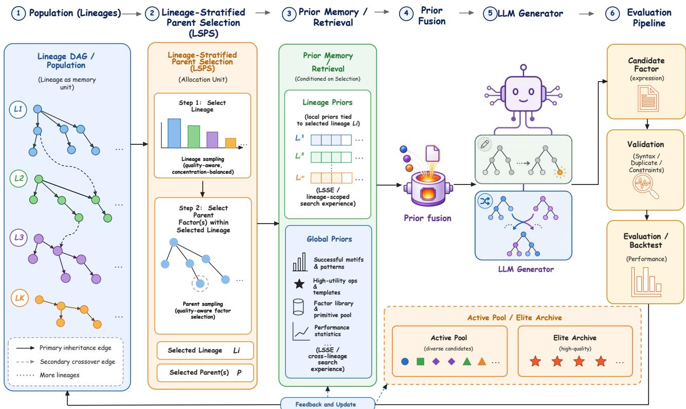
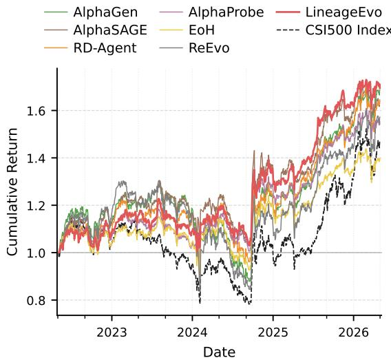
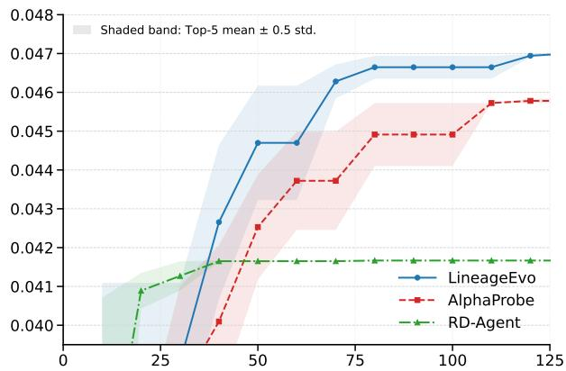
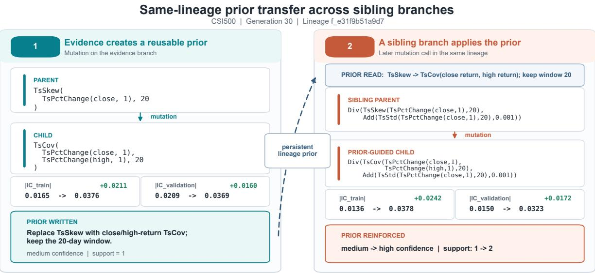

# Lineage-Aware Search Control for LLM-Based Evolutionary Factor Mining

Xintong Liu, Chenkai Zhang, Yanzhao Ma, Peng Yang∗

Southern University of Science and Technology (SUSTech) Shenzhen, China 12311926@mail.sustech.edu.cn

## Abstract

Formulaic alpha factor mining searches for symbolic expres- sions that transform market data into predictive signals. Recent LLM-based evolutionary factor mining methods use large lan- guage models as semantic variation operators. Under the con- ventional LLM-EA paradigm, stochastic variation and fitness- based selection can leave the search weakly directed and con- centrated around a narrow set of structurally similar factors. We argue that these limitations arise because current meth- ods mainly organize search at the individual and population levels, leaving lineage-level control underused. A lineage con- nects successive factor variants through evolutionary descent. We propose LineageEvo, which uses lineage in two coupled forms of search control: (1) lineage-conditioned LLM vari-ation, which distills Lineage-Scoped Search Experience into operator-specific priors and fuses them with global opera- tor priors, providing persistent, lineage-relevant guidance for LLM generation; and (2) lineage-stratified search allocation, which balances factor quality against lineage concentration by distributing the search budget across lineages during evo- lutionary search. Together, these mechanisms make semantic variation more direction aware and prevent branches from dominating the evolution, thereby promoting the discovery of predictive and diverse factors. We evaluate LineageEvo on CSI 500 and S&P 500 in terms of factor predictiveness, portfolio performance, search eficiency, and lineage- and expression-level diversity. LineageEvo achieves the strongest predictive performance on both markets, while LSPS produces a more balanced lineage distribution and a structurally broader factor pool. The results support lineage as a useful intermedi- ate unit for controlling LLM-based evolutionary factor search.

## Introduction

Formulaic alpha factor mining aims to discover mathematical expressions that transform raw market data into predictive signals for future asset returns (Kakushadze 2016). Such factors support portfolio construction and trading, yet the vast expression space and noisy, non-stationary data make predictive and stable factors dificult to discover.

Early factor discovery largely relied on human experts who designed signals based on financial intuition and empirical experience. To reduce such manual efort, automated fac- tor mining methods have been developed, including genetic programming (GP), reinforcement learning (RL), and other machine learning approaches (Zhang et al. 2020; Yu et al. 2023; Chen et al. 2025). These methods expand the search-able factor space and enable systematic exploration beyond hand-crafted factors. However, they still rely mainly on fixed grammars, handcrafted operators, or scalar rewards, limiting semantic reasoning and adaptive reuse of search experience.

More recently, LLM-based factor mining has emerged as a promising paradigm, using pretrained models to generate and refine symbolic formulas through agent-based generation, tree search, and graph-aware evolution (Wang et al. 2023; Tang et al. 2025; Shi, Duan, and Li 2025; Guo et al. 2026; Luo et al. 2026a). Large-scale pretraining provides semantic priors over financial concepts, mathematical expressions, and programming patterns, supporting factor hypothesis gen- eration and formula refinement. Among these approaches, LLM-based evolutionary algorithm (LLM-EA) factor mining is particularly appealing because it replaces purely syn- tactic genetic operators with LLM-based semantic mutation and recombination (Liu et al. 2023; Luo et al. 2026b; Ren et al. 2025; Han et al. 2026). However, two search-control challenges remain. First, LLM-based operators are flexible but weakly controllable, as the mapping from prompt con- text to ofspring is implicit and dificult to steer persistently (Liu et al. 2023; Yin et al. 2024). Second, under limited budgets, fitness-based selection can lead to takeover, where currently strong individuals or branches receive dispropor- tionate search opportunities, reducing diversity and risking premature convergence (Sudholt 2018; Gabor, Belzner, and Linnhof-Popien 2018).

These challenges persist because current LLM-EA factor mining methods mainly organize search at the individual and population levels, while making limited use of lineage-level state. At the individual level, LLM operators modify selected parent factors; at the population level, evolutionary selection favors high-scoring candidates. Between them, a lineage is a descent-defined factor family whose membership follows primary evolutionary inheritance. Unlike an isolated indi- vidual or an unstructured population, a lineage preserves the continuity of local search across successive variation events, making it a natural stateful unit for both persistent opera- tor guidance and search allocation. Conventional evolution- ary algorithms have used genealogy and lineage information for diversity preservation, selection, and inheritance analy- sis (Burke et al. 2003; Gabor, Belzner, and Linnhof-Popien

2018; Burlacu et al. 2013). However, using lineage as a shared scope for operator priors and search allocation remains un- derexplored in LLM-EA factor mining.

To address these issues, we propose LineageEvo, a lineage-aware LLM-EA framework for formulaic factor min- ing. LineageEvo represents evolutionary descent in a lineage DAG and uses lineage in two coupled forms of search con- trol. First, it organizes Lineage-Scoped Search Experience (LSSE) into operator-specific lineage priors and fuses them with global operator priors to condition LLM-based mutation and crossover. Second, Lineage-Stratified Parent Selection (LSPS) allocates search opportunities at the lineage level before selecting parent factor(s), while a separate elite archive preserves high-quality discoveries. This design gives LLM variation a persistent local context and distributes subsequent search more evenly across evolutionary branches.

Experiments on CSI 500 and S&P 500 demonstrate the efectiveness of LineageEvo across markets. Compared with the strongest baseline for each metric, LineageEvo improves IC by 28.3% and 12.6%, and ICIR by 9.9% and 35.8% on CSI 500 and S&P 500, respectively, while achieving the strongest portfolio performance on both markets. Ablation results confirm the complementary roles of lineage-specific and global priors, while LSPS increases lineage entropy from 0.405 to 2.154 and average AST distance from 0.509 to 0.747, preserving a broader and less concentrated factor pool. The search curve further shows that LineageEvo reaches a strong factor set rapidly, indicating eficient evolutionary search.

Our contributions are summarized as follows:

• We identify lineage-level search control as underex-plored in LLM-EA factor mining and use it to connect individual-level semantic variation with population-level selection.

• We propose LineageEvo, which represents descentdefined factor families in an evolutionary DAG and orga- nizes Lineage-Scoped Search Experience into operator- specific lineage priors for LLM variation.

• We introduce lineage-stratified search allocation through LSPS, which balances lineage quality against lineage con- centration, and decouple search allocation from solution preservation through a separate elite archive.

• Experiments on CSI 500 and S&P 500 show that Lin-eageEvo outperforms eight representative baselines in factor performance, while preserving greater lineage and structural diversity.

## Related Work

## Traditional Automated Factor Mining

Traditional automated factor mining mainly formulates al- pha discovery as symbolic search. AutoAlpha applies GP- style variation and quality-diversity search, AlphaGen uses reinforcement learning, and AlphaSAGE improves structure- aware exploration (Zhang et al. 2020; Yu et al. 2023; Chen et al. 2025). These methods broaden automated search, but still largely depend on predefined grammars, handcrafted op- erators, or scalar rewards, making it dificult to incorporate domain semantics or adaptively reuse search experience be- yond predefined operators.

## LLM-Based Factor Mining

Recent work introduces LLMs into factor mining as seman- tic generators, refiners, and search assistants. Alpha-GPT explores human–AI interactive alpha generation by translat- ing investment ideas into candidate formulas (Wang et al. 2023), while AlphaAgent develops an autonomous agent framework with originality, hypothesis-factor alignment, and complexity control (Tang et al. 2025). Search-oriented meth-ods further combine LLM eneration with Monte Carlo Tree Search or graph-based retrieval to guide formula refinement (Shi, Duan, and Li 2025; Guo et al. 2026). These meth-ods make factor mining more semantic by leveraging LLMs’ pretraining-induced knowledge of financial concepts, math- ematical expressions, and programming patterns to generate factors with richer rationales and more flexible structures. However, as suggested by AlphaBench, existing LLM-based factor mining methods may still under-exploit the exploration capacity of LLMs, motivating evolutionary frameworks that embed LLMs into iterative population-based search (Luo et al. 2026a).

## LLM-EA Factor Mining

LLM-EA search combines the semantic generation ability of LLMs with the population-based optimization mecha- nism of evolutionary algorithms. General LLM-EA studies use LLMs as evolutionary optimizers or hyper-heuristics, where LLMs generate, mutate, recombine, or reflect on can- didate solutions within an iterative search loop (Liu et al. 2023, 2024; Ye et al. 2024). In factor mining, EvoAlpha ada ts this aradi m to evolutionar al ha discover with LLM-generated factors (Luo et al. 2026b); TreEvo evolves tree-structured thoughts to capture the hierarchical nature of alpha formulas (Ren et al. 2025); and QuantaAlpha explores trajectory-level mutation and crossover to reuse effective mining experience (Han et al. 2026). These meth-ods move beyond isolated LLM generation by introducing evolutionary variation and selection into factor search. How- ever, they still face two fundamental search-control chal- lenges: LLM-driven variation can be flexible but weakly controllable, while fitness-based selection can cause dom- inant branches to monopolize the search process.

## Genealogy and Lineage in Evolutionary Algorithms

Evolutionary computation has previously used genealogy and lineage information for diversity preservation, inher- itance analysis, and selection (Burke et al. 2003; Gabor, Belzner, and Linnhof-Popien 2018; Burlacu et al. 2013). These studies establish lineage as an evolutionary abstrac- tion. Building on this foundation, LineageEvo uses each lin- eage as the shared scope for accumulating operator-specific priors and allocating subsequent search opportunities in LLM-EA factor mining.

## Method

We propose LineageEvo, a lineage-aware evolutionary framework for formulaic alpha factor mining with LLM- based semantic variation. Its central idea is to associate ac- cumulated search experience and future search opportunities with each lineage. LineageEvo uses lineage as a stateful intermediate search unit between individual-level LLM vari- ation and population-level evolutionary selection. Specifi- cally, lineage serves two complementary roles: (1) it defines a local scope for accumulating operator-specific search ex- perience, and (2) it provides a unit for allocating a limited evaluation budget.

  
Figure 1: Overview of LineageEvo. LSPS first selects a lineage and then selects parent factor(s); lineage-specific and global operator priors are subsequently retrieved and fused to condition LLM-based variation. Valid ofspring are evaluated, and the feedback path updates the lineage DAG, prior states, active population, and elite archive.

Figure 1 summarizes one iteration of LineageEvo. Start- ing from an evolutionary state organized by lineage, Lineage- Stratified Parent Selection (LSPS) first allocates a search op- portunity to a lineage and then selects parent factor(s) from the active population. The corresponding lineage-specific and global operator experience is retrieved and fused into soft guidance for LLM-based mutation or crossover. A de- terministically validated ofspring is subsequently evaluated, after which the lineage graph, prior states, active population, and elite archive are updated. This division of responsibil- ities keeps the LLM focused on semantic variation, while deterministic components govern validation, evaluation, in- heritance, and search-state transitions.

## Problem Setup and Lineage Representation

Let X denote the market feature space and F the symbolic expression space induced by a factor grammar. A formulaic alpha factor ${ \bar { \boldsymbol { f } } } \in { \mathcal { F } }$ maps the historical observations of stock i to a cross-sectional signal:

$$
z _ { i , t } ^ { f } = f ( \mathscr { X } _ { i , \leq t } ) ,\tag{1}
$$

where $z _ { i , t } ^ { f }$ is the factor value at date t. Rather than seeking a single best expression, the goal is to discover a collection of factors that exhibit strong predictive performance and tempo- ral stability while maintaining suficient structural diversity during search. The resulting factor pool supports downstream factor selection and combination.

LineageEvo ties lineage identity to the structural inheri- tance induced by its variation operators. Mutation applies a local modification to a leaf node or a small subtree of one parent while preserving the remaining expression structure. Crossover is asymmetric: the parent sampled from the first selected lineage is fixed as the primary parent and provides the recipient expression backbone. A subtree from the sec- ondary parent replaces a selected primary subtree, while the remaining primary structure is preserved.

We record these inheritance relations using a directed acyclic graph

$$
\mathcal { G } ^ { t } = \left( \mathcal { V } ^ { t } , \mathcal { E } _ { \mathrm { p r i } } ^ { t } , \mathcal { E } _ { \mathrm { s e c } } ^ { t } \right) ,\tag{2}
$$

where $\mathcal { V } ^ { t }$ contains all valid factors evaluated by iteration t. The set $\mathcal { E } _ { \mathrm { p r i } } ^ { t }$ records the inheritance of the expression back- bone. A mutation ofspring has one primary edge from its parent, whereas a crossover ofspring has one primary edge from the backbone parent. The set $\mathcal { E } _ { \mathrm { s e c } } ^ { t }$ records the donor an- cestry of crossover, preserving the contribution of the parent that provides the replacement subtree.

Let $\mathcal { R } ^ { t } \subseteq \mathcal { V } ^ { t }$ denote the set of root factors. Since each non-root node has exactly one incoming primary inheritance edge, its lineage root is recursively defined as

$$
\begin{array} { r } { \rho ^ { t } ( v ) = \left\{ \begin{array} { l l } { v , } & { v \in \mathcal { R } ^ { t } , } \\ { \rho ^ { t } ( u ) , } & { ( u , v ) \in \mathcal { E } _ { \mathrm { p r i } } ^ { t } . } \end{array} \right. } \end{array}\tag{3}
$$

The lineage associated with root $r _ { k }$ is consequently

$$
\mathcal { L } _ { k } ^ { t } = \left\{ v \in \mathcal { V } ^ { t } \mid \rho ^ { t } ( v ) = r _ { k } \right\} .\tag{4}
$$

A lineage is therefore a descent-defined local search fam- ily induced by structure-preserving variation. Lineage mem- bership follows the inherited expression backbone through primary edges, while secondary edges retain cross-lineage donor ancestry. Because mutation modifies only a local com- ponent and crossover preserves the primary backbone, nearby descendants are expected to retain greater structural and DSL-level financial-semantic continuity than factors from unrelated lineages, as verified in Appendix. This continuity provides the basis for using lineage as a scope for search experience and resource allocation.

## Lineage-Stratified Search Allocation

Modules 1–2 in Figure 1 implement lineage-level search al- location. Standard individual-level fitness selection may re- peatedly favor factors from already dominant branches, caus- ing early lineage takeover and reducing exploration (Sudholt 2018; Gabor, Belzner, and Linnhof-Popien 2018). To miti-gate this efect, LineageEvo organizes its active population by lineage:

$$
\mathcal { P } ^ { t } = \bigcup _ { k = 1 } ^ { m _ { t } } \mathcal { P } _ { k } ^ { t } , \qquad \mathcal { P } _ { k } ^ { t } = \mathcal { P } ^ { t } \cap \mathcal { L } _ { k } ^ { t } ,\tag{5}
$$

where $\mathcal { P } _ { k } ^ { t }$ contains the active factors belonging to lineage $k ,$ and mt is the number of active lineages.

LSPS uses a two-stage sampling procedure. It first selects a lineage and then selects a parent factor within that lineage. Both stages use a common robust quality score. Let M denote the optimization metric, either IC or ICIR, and define $T ( f ) =$ $| \mathcal { M } _ { \mathrm { t r } } ( f ) |$ and $V ( f ) ~ = ~ | \mathcal { M } _ { \mathrm { v a l } } ( f ) |$ . For factors satisfying ${ \dot { T } } ( f ) + { \dot { V } } ( f ) > 0$ , the quality score is

$$
q ( f ) = \alpha T ( f ) + \beta V ( f ) - \gamma \left| \mathcal { M } _ { \mathrm { t r } } ( f ) - \mathcal { M } _ { \mathrm { v a l } } ( f ) \right| ,\tag{6}
$$

where $\alpha , \beta > 0$ and $0 \leq \gamma < \operatorname* { m i n } \{ \alpha , \beta \}$ . This guarantees $q ( f ) > 0$ while penalizing both strength disagreement and directional reversals.

For each lineage, we define a quality score and a lineage- balance weight:

$$
b _ { k } ^ { t } = \operatorname* { m a x } _ { f \in \mathcal { P } _ { k } ^ { t } } q ( f ) , \qquad d _ { k } ^ { t } = \frac { 1 } { | \mathcal { P } _ { k } ^ { t } | + 1 } .\tag{7}
$$

The first term reflects the strongest active factor within the lineage, while the second assigns greater weight to less represented lineages. Their normalized mixture defines the lineage-selection distribution:

$$
\pi _ { \mathrm { l i n } } ^ { t } ( k ) = \lambda \frac { b _ { k } ^ { t } } { \sum _ { \ell = 1 } ^ { m _ { t } } b _ { \ell } ^ { t } } + ( 1 - \lambda ) \frac { d _ { k } ^ { t } } { \sum _ { \ell = 1 } ^ { m _ { t } } d _ { \ell } ^ { t } } ,\tag{8}
$$

where $\lambda \in [ 0 , 1 ]$ controls the trade-ofbetween favoring high- quality lineages and maintaining exploration across lineages.

After selecting lineage k, LSPS samples a parent in pro-portion to its robust quality:

$$
\pi _ { \mathrm { p a r } } ^ { t } ( \boldsymbol { f } \mid \boldsymbol { k } ) = \frac { q ( \boldsymbol { f } ) } { \sum _ { g \in \mathcal { P } _ { \boldsymbol { k } } ^ { t } } q ( g ) } , \qquad \boldsymbol { f } \in \mathcal { P } _ { \boldsymbol { k } } ^ { t } .\tag{9}
$$

This two-stage probabilistic selection exploits stronger fac- tors while preserving alternatives at both the lineage and parent levels.

For mutation, one parent is sampled from the selected lineage. For crossover, this first parent $p _ { t } ^ { a }$ is fixed as the primary parent, while a secondary donor $\dot { p } _ { t } ^ { b }$ is drawn from another lineage whenever possible under the same sampling rule. The allocated and inherited lineages therefore coincide:

$$
p _ { t } ^ { \star } = p _ { t } ^ { a } , \qquad \rho ^ { t + 1 } ( f _ { t + 1 } ) = \rho ^ { t } ( p _ { t } ^ { \star } ) = r _ { k } .\tag{10}
$$

The secondary parent contributes the donor subtree and is retained through a secondary ancestry edge.

Search allocation and solution preservation are handled separately. The lineage-bucketed active population governs future parent selection, while an independent elite archive $\mathcal { A } ^ { t }$ retains high-quality factors for final selection.

## Lineage-Conditioned LLM Variation

Modules 3–5 in Figure 1 use evolutionary experience as- sociated with each lineage to condition LLM-based seman- tic variation. Each valid ofspring produces an evolutionary event that records the parent and ofspring structures, their expression diference, the applied operator, and train/valida- tion evidence. A mutation event is associated with its parent lineage, whereas a crossover event is associated with the pri- mary lineage while retaining the secondary donor relation. We refer to the experience accumulated within a lineage as Lineage-Scoped Search Experience (LSSE).

Mutation and crossover require diferent forms of expe- rience. Mutation priors summarize beneficial and harmful local modifications within one lineage, whereas crossover priors capture transferability, complementarity, and incom- patibility between recipient and donor structures. Accord- ingly, each lineage maintains separate priors $S _ { k , o } ^ { t }$ for $o \in$ {mut, cross}, while $G _ { o } ^ { t }$ stores the corresponding cross- lineage experience. Mutation uses the prior of its parent lin- eage, whereas crossover uses both parent-lineage priors, with the primary prior describing the recipient backbone and the secondary prior providing donor-side guidance.

The priors are updated incrementally by an event-triggered LLM rewriter:

$$
\begin{array} { r l } & { S _ { k , o } ^ { t + 1 } = \Psi _ { o } \left( S _ { k , o } ^ { t } , e _ { t + 1 } \right) , } \\ & { G _ { o } ^ { t + 1 } = \Psi _ { o } ^ { \mathrm { g l o b } } \left( G _ { o } ^ { t } , e _ { t + 1 } \right) . } \end{array}\tag{11}
$$

Here, k denotes the mutation-parent lineage or the crossover primary lineage. For crossover, only the primary-lineage prior and global crossover prior are updated because the ofspring inherits the primary backbone; the secondary prior remains read-only. When an improvement or degradation trigger is activated, the rewriter uses its financial and math- ematical knowledge to interpret how the parent–ofspring structural change alters the factor’s signal construction and whether the performance metric change supports or contra- dicts the existing guidance. It then revises the structured prior by strengthening supported hypotheses, weakening contradicted ones, and recording reusable transformation principles or failure warnings. Mutation updates summarize beneficia and harmful local edits, while crossover updates describe transferable donor structures and their compatibility with the primary backbone. A lightweight deterministic manager val- idates the structured output and retains the previous state if rewriting fails.

We use the termprior to denote a structured pre-generation inductive bias rather than a normalized Bayesian distribution. Distilled from previous evolutionary evidence and provided before the next variation step, it biases the LLM toward his- torically promising transformations.

Let St denote the lineage-prior input for the current vari-ation. The conditioning context is constructed as

$$
C _ { t } = \Phi _ { o _ { t } } \left( \mathbf { S } _ { t } , G _ { o _ { t } } ^ { t } ; \lambda _ { k _ { t } , o _ { t } } ^ { t } \right) ,\tag{12}
$$

where $\Phi _ { o }$ is a deterministic fusion and prompt-rendering policy. The emphasis parameter $\lambda _ { k , o } ^ { t }$ is regulated from the recent evolutionary state of lineage k, including its perfor-mance trend and stagnation status. When the lineage con- tinues to improve, the policy places greater emphasis on its lineage-specific prior to exploit locally efective variation. Under stagnation or degradation, it increases the emphasis on the global prior to introduce transferable cross-lineage ex- perience and reduce local search bias. The policy then fuses the two prior sources and renders the resulting context as concise natural-language guidance for the candidate LLM.

Let Pt contain either one mutation parent or an ordered primary–secondary crossover pair, and let Γ denote the factor grammar and generation constraints. The LLM induces

$$
f _ { t + 1 } \sim p _ { \boldsymbol \theta } \left( \cdot \mid o _ { t } , P _ { t } , C _ { t } , \Gamma \right) .\tag{13}
$$

The conditioning context acts as soft semantic guidance rather than a hard search constraint. Consequently, the LLM retains the flexibility to construct new factor structures while receiving persistent lineage-relevant context unavail- able from the current parents alone.

## Feedback and Search-State Update

Module 6 and the feedback path in Figure 1 complete each search iteration. We summarize the search state at iteration t as

$$
\Omega ^ { t } = \left( \mathcal { G } ^ { t } , \mathcal { P } ^ { t } , \mathcal { A } ^ { t } , \{ S _ { k , o } ^ { t } \} _ { k , o } , \{ G _ { o } ^ { t } \} _ { o } \right) .\tag{14}
$$

A enerated ex ression first under oes deterministic checks for grammar, syntax, duplicate expressions, con- straints, and executability. Invalid candidates do not enter the evolutionary DAG or consume the valid-evaluation budget. A valid candidate is evaluated on the training and validation pe- riods, producing an event $e _ { t + 1 }$ that records its performance, operator, parent relations, expression change, and general- ization evidence. The search state then evolves according to

$$
\Omega ^ { t + 1 } = \mathcal { U } \left( \Omega ^ { t } , f _ { t + 1 } , e _ { t + 1 } \right) ,\tag{15}
$$

where U updates the lineage DAG, active population, and elite archive, and invokes the primary-lineage and global prior updates in Equation 11 when the deterministic trigger is satisfied.

The updated lineage state carries operator experience across generations while determining how subsequent search opportunities are allocated. It therefore connects persistent LLM guidance with lineage-level population control within a single evolutionary loop.

## Experiments

We evaluate LineageEvo on formulaic alpha factor min- ing to answer the following questions: (1) whether lineageaware search finds more predictive and stable factors; (2) whether lineage and global priors provide useful guidance for LLM-based variation; (3) whether Lineage-Stratified Parent Selection (LSPS) improves factor diversity and reduces search concentration; and (4) whether LineageEvo generates higher-quality factors eficiently in the search.

## Experimental Setup

Evaluation metrics. We report IC and ICIR to measure factor predictiveness, where IC denotes the average cross- sectional correlation between factor values and future re- turns, and ICIR reflects the temporal stability of IC. We also report portfolio-level metrics, including annualized re- turn (AR), information ratio (IR), and maximum drawdown (MDD). AR and IR measure profitability and risk-adjusted performance, while MDD captures downside risk. Detailed metric definitions are provided in the supplementary mate- rial.

Dataset. We conduct experiments on two market uni-verses: CSI 500 in the Chinese A-share market and S&P 500 in the U.S. stock market. Both markets use the same fixed temporal split: data from 2015-01-01 to 2020-12-31 for training, 2021-01-01 to 2022-04-30 for validation, and 2022-05-01 to 2026-04-30 for testing.

Baselines. We compare LineageEvo with representative baselines from three categories: (1) traditional factor mining methods, including Alpha158 (Yang et al. 2020), GP (Koza 1992), AlphaGen (Yu et al. 2023), and AlphaSAGE (Chen et al. 2025); (2) LLM-based factor mining methods, including RD-Agent (Li et al. 2025) and AlphaPROBE (Guo et al. 2026); and (3) LLM-EA methods, including EoH (Liu et al. 2024) and ReEvo (Ye et al. 2024). Detailed descriptions of the baselines are provided in the supplementary material.

Implementation details. For all LLM-based methods, we use deepseek-v4-flash. LineageEvo initializes each run with 10 LLM-generated seed roots and targets three mutation and two crossover ofspring per genera- tion until reaching B = 200 valid evaluated factors. LineageEvo uses an active pool of 50 factors and an elite archive of 20, with $( \alpha , \dot { \beta } , \gamma ) \ = \ ( 0 . 2 , 0 . 8 , 0 . 1 )$ , and $\lambda _ { \mathrm { L S P S } } = 0 . 8$ . We use IC as the optimization metric M in the reported experiments. The prior improvement/degrada- tion thresholds are (0.003, 0.30)/(0.012, 0.60) on CSI 500 and (0.0015, 0.20)/(0.006, 0.40) on S&P 500, where each pair gives the absolute and relative thresholds. All meth- ods use the same Qlib TopK-Dropout backtest with top-$K = 5 0 , n _ { \mathrm { d r o p } } = 5 .$ , daily rebalancing, and matched risk and transaction-cost settings (Yang et al. 2020). Complete prompt templates, DSL definitions, prior schemas, and vali- dation rules are provided in the supplementary material.

<table><tr><td rowspan="2">Method</td><td colspan="6">CSI 500</td><td colspan="4">S&amp;P 500</td></tr><tr><td>IC↑</td><td>ICIR↑</td><td>AR↑</td><td>IR↑</td><td>MDD↓</td><td>IC↑</td><td>ICIR↑</td><td>AR↑</td><td>IR↑</td><td>MDD↓</td></tr><tr><td>Alpha158</td><td>0.0076</td><td>0.0787</td><td>15.50%</td><td>0.6866</td><td>31.62%</td><td>0.0081</td><td>0.0426</td><td>17.58%</td><td>0.7715</td><td>21.03%</td></tr><tr><td>GP</td><td>0.0074</td><td>0.0774</td><td>15.28%</td><td>0.6861</td><td>33.08%</td><td>0.0055</td><td>0.0575</td><td>21.38%</td><td>1.0958</td><td>20.55%</td></tr><tr><td>AlphaGen</td><td>0.0345</td><td>0.2215</td><td>15.04%</td><td>0.7176</td><td>36.31%</td><td>0.0099</td><td>0.0587</td><td>20.38%</td><td>0.9709</td><td>23.87%</td></tr><tr><td>AlphaSAGE</td><td>0.0230</td><td>0.1855</td><td>13.71%</td><td>0.7654</td><td>21.31%</td><td>0.0118</td><td>0.0668</td><td>18.32%</td><td>0.8539</td><td>21.62%</td></tr><tr><td>RD-Agent</td><td>0.0395</td><td>0.2253</td><td>14.14%</td><td>0.7199</td><td>29.48%</td><td>0.0094</td><td>0.0464</td><td>11.05%</td><td>0.7642</td><td>20.61%</td></tr><tr><td>AlphaPROBE</td><td>0.0385</td><td>0.2298</td><td>11.87%</td><td>0.7587</td><td>20.48%</td><td>0.0119</td><td>0.0622</td><td>5.86%</td><td>0.4597</td><td>25.55%</td></tr><tr><td>EoH</td><td>0.0399</td><td>0.2493</td><td>9.51%</td><td>0.5715</td><td>21.50%</td><td>0.0072</td><td>0.0404</td><td>23.13%</td><td>0.9682</td><td>21.83%</td></tr><tr><td>ReEvo</td><td>0.0303</td><td>0.1950</td><td>13.66%</td><td>0.6030</td><td>42.98%</td><td>0.0047</td><td>0.0267</td><td>16.10%</td><td>0.7397</td><td>18.94%</td></tr><tr><td>LineageEvo</td><td>0.0512</td><td>0.2740</td><td>15.55%</td><td>0.9856</td><td>19.39%</td><td>0.0134</td><td>0.0907</td><td>27.00%</td><td>1.1693</td><td>17.05%</td></tr></table>

Table 1: Main results on CSI 500 and S&P 500. Bold and underlined values denote the best and second-best results.

## Main Results

Table 1 compares LineageEvo with representative tradi- tional, LLM-based, and LLM-EA factor mining methods on both factor-level and portfolio-level metrics. For each method, we select the top 20 factors from its final factor pool according to the method-specific selection criterion when ap- plicable, combine them into a factor set, and evaluate the re- sulting combined signal under the same evaluation pipeline.

LineageEvo achieves the best result on all five metrics in both markets. On CSI 500, it obtains an IC of 0.0512 and an ICIR of 0.2740, together with the highest AR (15.55%) and IR (0.9856) and the lowest MDD (19.39%). On S&P 500, it similarly achieves the highest IC (0.0134), ICIR (0.0907), AR (27.00%), and IR (1.1693), while reducing MDD to 17.05%. The consistent improvements in IC and ICIR indicate that the discovered factors provide both stronger out-of-sample pre- dictiveness and greater temporal stability. Meanwhile, the gains in AR and IR together with lower drawdown show that these predictive improvements can translate into more profitable and risk-controlled portfolios across both markets. Overall, the results support the efectiveness of combining lineage-conditioned variation with lineage-level search allo- cation.

Figure 2 shows that while achieving high predictive power, LineageEvo maintains competitive cumulative re- turns throughout the test period and becomes one of the strongest-performing methods in the later stage, ultimately finishing with the highest cumulative return among the com- pared approaches.

## Ablation on Search Priors

We isolate the contribution of each component in the prior system. LineageEvo uses lineage priors to capture lineage- scoped experience and global priors to provide cross-lineage regularization. Since mutation and crossover require difer- ent forms of evolutionary experience, we also examine the contributions of their corresponding operator-specific priors.

  
Figure 2: Cumulative return curves of diferent factor mining methods on CSI 500 during the test period.

We consider the following variants:

• Full: the complete LineageEvo framework.

• w/o all priors: removes both lineage and global priors.

• w/o lineage priors: removes lineage mutation and crossover priors while retaining global priors.

• w/o global priors: removes global mutation and crossover priors while retaining lineage priors.

• w/o mutation priors: removes both lineage and global mutation priors while retaining crossover priors.

• w/o crossover priors: removes both lineage and global crossover priors while retaining mutation priors.

The ablation results confirm the efectiveness of the prior system. Removing all priors reduces IC from 0.0512 to 0.0384 and ICIR from 0.2740 to 0.1994, showing that prior- guided variation substantially improves factor quality. Re- moving lineage priors produces a similarly large degradation, indicating that lineage-scoped experience is the main source of useful guidance, while global priors alone cannot fully capture the transformation patterns specific to each lineage. The operator-specific ablations further reveal the important roles of mutation and crossover priors.

<table><tr><td>Variant</td><td>IC↑</td><td>ICIR↑</td></tr><tr><td>w/o all priors</td><td>0.0384</td><td>0.1994</td></tr><tr><td>w/o lineage priors</td><td>0.0390</td><td>0.2041</td></tr><tr><td>w/o global priors</td><td>0.0495</td><td>0.2579</td></tr><tr><td>w/o mutation priors</td><td>0.0438</td><td>0.2673</td></tr><tr><td>w/o crossover priors</td><td>0.0445</td><td>0.2362</td></tr><tr><td>Full LINEAGEEvo</td><td>0.0512</td><td>0.2740</td></tr></table>

Table 2: Ablation study of the search-prior components on CSI 500.

## Factor Diversity and Search Concentration

We evaluate how LSPS afects predictive performance, lin- eage concentration, and expression diversity in the active factor pool. We compare LineageEvo with a variant that removes LSPS and samples parents directly from the active pool without lineage stratification. Lineage entropy measures how evenly factors are distributed across lineages, average pairwise AST distance measures expression-level structural diversity, and the efective number of structures estimates the number of non-redundant structural families in the pool.

<table><tr><td>Method</td><td>IC↑</td><td>Lineage ICIR ↑ Entropy ↑</td><td>AST Dist. ↑</td><td>Eff. Struct. ↑</td></tr><tr><td>w/o LSPS</td><td>0.0381</td><td>0.2415 0.405</td><td>0.509</td><td>37.89</td></tr><tr><td>LINEAGEEvo 0.0512 0.2740</td><td></td><td>2.154</td><td>0.747</td><td>41.90</td></tr></table>

Table 3: Efect of LSPS on predictive performance and di- versity on CSI 500. Higher values are better.

As shown in Table 3, LSPS im roves IC from 0.0381 to 0.0512 and ICIR from 0.2415 to 0.2740, while substan- tially increasing all three diversity measures. This joint im-provement reflects the quality–exploration trade-of built into LSPS. The quality component continues to allocate search opportunities to lineages containing strong factors, allowing promising structures to be refined across successive gener- ations. Meanwhile, the lineage-balance component prevents these branches from monopolizing the search and preserves opportunities for underrepresented lineages that may contain distinct but still promising directions. Consequently, the final factor pool retains high-performing descendants while cov- ering a broader and less redundant set of structures. Such a pool is more likely to provide complementary candidates for factor combination, which is consistent with the higher IC and ICIR achieved by the full method (Sudholt 2018; Gabor, Belzner, and Linnhof-Popien 2018; Yu et al. 2023; Shi et al. 2024).

## Search Eficiency

We analyze whether LineageEvo can discover high-quality factors more eficiently under the same budget. For each method, we track the top-5 mean-so-far absolute IC during the search process. Specifically, at each evaluation check- point, we collect all valid factors generated so far, select the five factors with the highest absolute IC, and report their average IC.

  
Figure 3: Search eficiency comparison on CSI 500. The x- axis denotes the number of valid evaluated factors, and the y-axis reports the top-5 mean-so-far absolute IC.

Figure 3 shows diferent search behaviors among the three methods. RD-Agent improves quickly in the early stage but soon saturates at a relatively low top-5 mean-so-far IC, sug- gesting that it can rapidly identify some usable factors but lacks a mechanism to continuously exploit promising search directions. AlphaPROBE improves more gradually and even- tually reaches a stronger factor set than RD-Agent, but its improvement requires more evaluations. In contrast, Lin- eageEvo maintains a consistently higher top-5 mean-so-far IC throughout most of the search process and reaches a strong plateau within about 75 valid evaluations. This pattern is con sistent with the intended role of lineage-conditioned priors in preserving useful search guidance across generations.

## Conclusion

In this paper, we proposed LineageEvo, an LLM-EA frame- work that uses lineage as an intermediate organizational unit for evolutionary factor mining. LineageEvo combines lineage-conditioned priors for guiding LLM variation with Lineage-Stratified Parent Selection for distributing search opportunities across lineages. The resulting framework dis- covers highly predictive and stable factors, achieves strong investment returns, and preserves a more diverse factor pool. Future work may compare lineage with other intermediate organizational units, such as clusters, niches, and retrieval neighborhoods, to study their respective advantages in expe- rience reuse and search control.

## References

Burke, E. K.; Gustafson, S. M.; Kendall, G.; and Krasnogor, N. 2003. Is Increased Diversity in Genetic Programming

Beneficial? An Analysis of Lineage Selection. In Proceedings of the 2003 Congress on Evolutionary Computation, volume 2, 1398–1405. IEEE.

Burlacu, B.; Afenzeller, M.; Kommenda, M.; Winkler, S.; and Kronberger, G. 2013. Visualization of Genetic Lineages and Inheritance Information in Genetic Programming. In Proceedings of the 15th Annual Conference Companion on Genetic and Evolutionary Computation, 1351–1358. ACM.

Chen, B.; Ding, H.; Shen, N.; Huang, J.; Guo, T.; Liu, L.; and Zhang, M. 2025. AlphaSAGE: Structure-Aware Alpha Mining via GFlowNets for Robust Exploration. arXiv:2509.25055.

Gabor, T.; Belzner, L.; and Linnhof-Popien, C. 2018. Inheritance-Based Diversity Measures for Ex- plicit Convergence Control in Evolutionary Algorithms. arXiv:1810.12470.

Guo, T.; Shen, H.; Luo, J.; Chen, B.; Ding, H.; Huang, J.; Liu, L.; Ma, Y.; and Zhang, M. 2026. AlphaPROBE: Al- pha Mining via Principled Retrieval and On-graph Biased Evolution. arXiv:2602.11917.

Han, J.; Zhang, S.; Li, W.; Yang, Z.; Dong, Y.; Hu, T.; Yuan,J.; Yu, X.; Zhu, Y.; Lou, F.; Guo, X.; Liu, Z.; Jiang, T.; An, R.;Liu, J.; Wu, B.; Chen, R.; Wang, K.; Wang, Y.; Hu, S.; Kong,X.; Zhang, L.; Chen, R.; and Wang, H. 2026. QuantaAlpha:An Evolutionary Framework for LLM-Driven Alpha Mining.arXiv:2602.07085.

Kakushadze, Z. 2016. 101 Formulaic Alphas. Wilmott, 2016(84): 72–81.

Koza, J. R. 1992. Genetic Programming: On the Programming of Computers by Means of Natural Selection. MIT Press.

Li, Y.; Yang, X.; Yang, X.; Xu, M.; Wang, X.; Liu, W.; and Bian, J. 2025. R&D-Agent-Quant: A Multi-Agent Frame-work for Data-Centric Factors and Model Joint Optimization. arXiv:2505.15155.

Liu, F.; Tong, X.; Yuan, M.; Lin, X.; Luo, F.; Wang, Z.; Lu, Z.; and Zhang, Q. 2024. Evolution ofHeuristics: Towards Efficient Automatic Algorithm Design Using Large Language Model. arXiv:2401.02051.

Liu, S.; Chen, C.; Qu, X.; Tang, K.; and Ong, Y.-S. 2023. Large Language Models as Evolutionary Optimizers. arXiv:2310.19046.

Luo, H.; Ko, H. T.; Chen, J.; Sun, D.; Zhang, Y.; and Liu, C. 2026a. AlphaBench: Benchmarking Large Language Models in Formulaic Alpha Factor Mining. In Proceedings of the International Conference on Learning Representations.

Luo, H.; Ko, H. T.; Sun, D.; Zhang, Y.; and Liu, C. 2026b. EvoAlpha: Evolutionary Alpha Factor Discovery with Large Language Models. In NeurIPS 2025 Workshop: Generative AI in Finance.

Ren, J.; Zhao, J.; Liu, S.; and Yang, P. 2025. From Lin- ear to Hierarchical: Evolving Tree-structured Thoughts for Eficient Alpha Mining. arXiv:2508.16334.

Shi, H.; Song, W.; Zhang, X.; Shi, J.; Luo, C.; Ao, X.; Ar- ian, H.; and Seco, L. 2024. AlphaForge: A Framework to Mine and Dynamically Combine Formulaic Alpha Factors. arXiv:2406.18394.

Shi, Y.; Duan, Y.; and Li, J. 2025. Navigating the Alpha Jungle: An LLM-Powered MCTS Framework for Formulaic Factor Mining. arXiv:2505.11122.

Sudholt, D. 2018. The Benefits of Population Diversity in Evolutionary Algorithms: A Survey of Rigorous Runtime Analyses. arXiv:1801.10087.

Tang, Z.; Chen, Z.; Yang, J.; Mai, J.; Zheng, Y.; Wang, K.; Chen, J.; and Lin, L. 2025. AlphaAgent: LLM-Driven Alpha Mining with Regularized Exploration to Counteract Alpha Decay. arXiv:2502.16789.

Wang, S.; Yuan, H.; Zhou, L.; Ni, L. M.; Shum, H.-Y.; and Guo, J. 2023. Alpha-GPT: Human-AI Interactive Alpha Mining for Quantitative Investment. arXiv:2308.00016.

Yang, X.; Liu, W.; Zhou, D.; Bian, J.; and Liu, T.-Y. 2020. Qlib: An AI-oriented Quantitative Investment Platform. arXiv:2009.11189.

Ye, H.; Wang, J.; Cao, Z.; Berto, F.; Hua, C.; Kim, H.; Park, J.; and Song, G. 2024. ReEvo: Large Lan- guage Models as Hyper-Heuristics with Reflective Evolution. arXiv:2402.01145.

Yin, H.; Kononova, A. V.; Bäck, T.; and van Stein, N. 2024. Controlling the Mutation in Large Language Models for the Eficient Evolution of Algorithms. arXiv:2412.03250.

Yu, S.; Xue, H.; Ao, X.; Pan, F.; He, J.; Tu, D.; and He, Q. 2023. Generating Synergistic Formulaic Alpha Collections via Reinforcement Learning. arXiv:2306.12964.

Zhang, T.; Li, Y.; Jin, Y.; and Li, J. 2020. AutoAlpha: An Efi- cient Hierarchical Evolutionary Algorithm for Mining Alpha Factors in Quantitative Investment. arXiv:2002.08245.

## A Case Study

Illustrative trace. Figure 4 shows two sequential mutation events on sibling branches of the same lineage in a CSI500 run. At generation 30, Event 1 replaces TsSkew with TsCov between close and high returns, increasing validation |IC| from 0.0209 to 0.0369. This event triggers both lineage and global prior rewriting. Event 2 then receives the updated priors before generating a related mutation on another branch of the same lineage. All reported values are absolute IC strengths.

Rendered prior guidance. Before Event 2, Event 1 had already triggered lineage and global prior rewriting. The following excerpt shows the actual prior-related guidance rendered into the mutation prompt.

## Prompt A.1: Actual Prior Guidance Before Event 2

1 Mutation experience for this lineage:

2 - Effective pattern:

3 Replacing TsSkew with TsCov between close returns and a second

4 price series, while preserving the 20-day rolling window,

5 produced a strong validation IC improvement.

7 - Failed patterns:

  
Dashed link: prior transfer across sibling branches, not a DAG ancestry edge

Figure 4: A same-lineage prior-reuse case. Event 1 replaces TsSkew with a close/high-return TsCov, triggering a structured prior rewrite. Event 2 receives this prior on a sibling branch, applies the same replacement while preserving its denominator, and strengthens the pattern from medium to high confidence. The dashed connector denotes prior transfer.  
8 Avoid replacing TsSkew with TsCorr   
or TsIr.   
9 Avoid introducing raw volume terms   
or EMA smoothing.   
10 Preserve the close-return   
distributional backbone.   
11   
12 - Hint:   
13 TsCov with a second price-return   
series may be useful, while   
14 correlation, smoothing, and volume  
based modifications have   
15 repeatedly degraded this lineage.   
16   
17 - Bias warning: medium   
18   
19   
20 Global mutation experience:   
21 - Percentage-change inputs have   
repeatedly strengthened covariance   
22 and correlation structures across   
lineages.   
23   
24 - TsCov/TsCorr structures should   
operate on transformed return-like   
25 inputs rather than raw price or   
volume levels.   
26   
27 - Avoid TsIr substitutions,   
unnecessary smoothing, and volume  
delta   
28 multipliers.   
29   
30 - Last updated generation: 30

31   
32   
33 Prior fusion decision:   
34 - Lineage prior weight: 0.45   
35 - Global prior weight: 0.55   
36 - Balance lineage-specific evidence   
with global operator guidance.

The example illustrates the complementary roles of the two prior levels. The lineage prior provides factor-family- specific evidence about successful and failed transforma- tions, whereas the global prior contributes patterns observed across lineages. Their relative emphasis is determined by the fusion policy before the guidance is inserted into the candidate-generation prompt.

## B Metric Definitions

Let f denote a formulaic factor, $z _ { i , t } ^ { f }$ its value for stock i at date t, and $r _ { i , t + \Delta }$ the future return used as the prediction target. Let U be the tradable stock universe at date t. The factor-level and portfolio-level metrics follow standard formulaic-alpha and Qlib evaluation practice (Kakushadze 2016; Yang et al. 2020).

Information Coeficient (IC). We compute the daily cross-sectional Spearman correlation between factor values and future returns:

$$
\mathrm { I C } _ { t } ( f ) = \mathrm { c o r r } _ { i \in \mathcal { U } _ { t } } ^ { \mathrm { S p e a r m a n } } \left( z _ { i , t } ^ { f } , r _ { i , t + \Delta } \right) .\tag{16}
$$

The reported IC is the temporal mean of daily cross-sectional IC:

$$
\operatorname { I C } ( f ) = { \frac { 1 } { | T | } } \sum _ { t \in { \mathcal { T } } } \operatorname { I C } _ { t } ( f ) .\tag{17}
$$

Under this implementation, IC is equivalent to RankIC.

Information Coeficient Information Ratio (ICIR). ICIR measures the temporal stability of daily IC:

$$
\mathrm { I C I R } ( f ) = \frac { \operatorname* { m e a n } _ { t \in \mathcal { T } } [ \mathrm { I C } _ { t } ( f ) ] } { \mathrm { s t d } _ { t \in \mathcal { T } } [ \mathrm { I C } _ { t } ( f ) ] + \epsilon } ,\tag{18}
$$

where ϵ is used only to avoid division by zero.

Annualized Return (AR). Let $R _ { t }$ denote the daily return series passed to Qlib’s risk-analysis routine and let N denote its daily annualization scaler. Following Qlib’s default arithmetic accumulation, we report

$$
\mathrm { A R } = N \mathrm { \ m e a n } _ { t \in \mathcal { T } } [ R _ { t } ] .\tag{19}
$$

Information Ratio (IR). Risk-adjusted return is measured as

$$
\mathrm { I R } = \frac { \mathrm { m e a n } _ { t \in \mathcal { T } } [ R _ { t } ] } { \mathrm { s t d } _ { t \in \mathcal { T } } [ R _ { t } ] + \epsilon } \sqrt { N } .\tag{20}
$$

Maximum Drawdown (MDD). Under arithmetic return accumulation, let $\begin{array} { r } { C _ { t } = \sum _ { \tau \leq t } R _ { \tau } } \end{array}$ . Qlib’s signed drawdown statistic is

$$
\mathrm { M D D } _ { \mathrm { s i g n e d } } = \operatorname* { m i n } _ { t \in \mathcal { T } } \left( C _ { t } - \operatorname* { m a x } _ { \tau \leq t } C _ { \tau } \right) .\tag{21}
$$

When a table reports MDD with a downward arrow and non- negative entries, we use the magnitude $\mathrm { | M D D _ { s i g n e d } | } ;$ when signed values are shown, values closer to zero are better.

Validation-Oriented Test Metrics. The factor direction is fixed using validation information before test evaluation. For a metric M, the oriented test IC is

$$
\mathrm { I C } _ { \mathrm { t e s t } } ^ { \mathrm { o r i e n t e d } } ( f ) = \mathrm { s i g n } ( \mathcal { M } _ { \mathrm { v a l } } ( f ) ) \mathrm { I C } _ { \mathrm { t e s t } } ( f ) .\tag{22}
$$

No test statistic is used for factor orientation, parent selection, prior updating, or final factor selection.

Top-5 Mean-so-Far IC. Let $\mathcal { F } _ { k }$ denote the valid factors discovered within the first k valid evaluations. Search efi-ciency is summarized using validation IC:

$$
\mathrm { T o p 5 I C } _ { \mathrm { v a l } } ( k ) = \frac { 1 } { 5 } \sum _ { f \in \mathrm { T o p 5 } ( \mathcal { F } _ { k } ) } \left| \mathrm { I C } _ { \mathrm { v a l } } ( f ) \right| ,\tag{23}
$$

where $\mathrm { T o p } 5 ( \mathcal { F } _ { k } )$ contains the five factors with the largest absolute validation IC discovered so far. Invalid and duplicate attempts do not advance the horizontal-axis evaluation count.

Lineage Entropy. Let $p _ { L }$ be the fraction of factors in the evaluated population state that belong to lineage L. We compute

$$
H _ { \mathrm { l i n e a g e } } = - \sum _ { L } p _ { L } \log p _ { L } .\tag{24}
$$

Higher entropy indicates a more balanced allocation across lineages (Sudholt 2018; Gabor, Belzner, and Linnhof-Popien 2018).

Average Pairwise AST Distance. We measure expressionlevel diversity with normalized tree-edit distance between factor abstract syntax trees (ASTs). For a factor set S,

$$
D _ { \mathrm { A S T } } ( \mathcal { S } ) = \frac { 2 } { | \mathcal { S } | ( | \mathcal { S } | - 1 ) } \sum _ { i < j } d _ { \mathrm { A S T } } ( f _ { i } , f _ { j } ) .\tag{25}
$$

A larger value indicates greater structural dissimilarity.

Efective Number of Structures. For each factor $f ,$ let $\sigma ( f )$ denote the complete structural signature of its normal- ized AST. We apply the same canonical normalization used for expression deduplication and retain all nodes and ordered parent–child relations in the resulting tree. Two factors be- long to the same structural group if and only if

$$
\sigma ( f _ { i } ) = \sigma ( f _ { j } ) .\tag{26}
$$

Thus, the groups correspond to exact normalized AST struc- tures rather than distance-based clusters or partial motifs. Let $p _ { c }$ be the empirical frequency of structural signature c in the factor set. We report

$$
N _ { \mathrm { e f f } } = \exp \left( - \sum _ { c } p _ { c } \log p _ { c } \right) ,\tag{27}
$$

which gives the number of equally represented structures with the same structural entropy.

## C Baseline Descriptions

We compare LineageEvo with representative baselines from traditional factor mining, LLM-based factor mining, and LLM-EA factor mining.

Alpha158. Alpha158 is a standard hand-crafted factor set provided in Qlib and serves as a non-search reference (Yang et al. 2020).

Genetic Programming (GP). GP provides a classical non-LLM evolutionary baseline based on symbolic mutation, crossover, and fitness selection (Koza 1992).

AlphaGen. AlphaGen generates synergistic formulaic al-pha collections through reinforcement learning (Yu et al. 2023).

AlphaSAGE. AlphaSAGE performs structure-aware factor mining with GFlowNet-based exploration (Chen et al. 2025).

RD-Agent. R&D-Agent-Quant is an LLM-based multi-agent framework for data-centric factor and model optimiza- tion (Li et al. 2025).

AlphaPROBE. AlphaPROBE combines principled retrieval with on-graph biased evolution for alpha mining (Guo et al. 2026).

EoH. Evolution of Heuristics uses LLMs to iteratively generate, evaluate, and evolve heuristic programs (Liu et al. 2024).

ReEvo. ReEvo uses reflective evolution to guide LLMbased heuristic search (Ye et al. 2024).

<table><tr><td>Component</td><td>Parameter</td><td>Setting</td></tr><tr><td>LLM</td><td>Backend</td><td>deepseek-v4-flash through an OpenAI-compatible client</td></tr><tr><td>LLM</td><td>Temperature / maximum tokens</td><td>0.7 / 8000</td></tr><tr><td>LLM</td><td>Timeout / retries / retry wait</td><td> $1 2 0 \mathrm { ~ s ~ } / \mathrm { ~ 5 ~ } / \mathrm { ~ 5 ~ s ~ }$ </td></tr><tr><td>Search</td><td>Valid-evaluation budget</td><td> $B = 2 0 0$ </td></tr><tr><td>Search</td><td>Initial lineage roots</td><td>10 LLM-generated seed factors</td></tr><tr><td>Search</td><td>Valid mutation / crossover slots per gen- 3 / 2 eration</td><td></td></tr><tr><td>Search</td><td>Maximum attempts per slot</td><td>5</td></tr><tr><td>Population</td><td>Population capacity / elite archive ca- 50 / 20 pacity</td><td></td></tr><tr><td>Population</td><td>Maximum share of one lineage</td><td>0.40</td></tr><tr><td>Expression</td><td>Prompt / deterministic length limits</td><td>40 / 50</td></tr><tr><td>Robust score</td><td> $( \alpha , \beta , \gamma )$ </td><td>(0.2,0.8, 0.1)</td></tr><tr><td>LSPS</td><td>Quality / diversity mixture weights</td><td>(0.8,0.2)</td></tr><tr><td>Backtest</td><td>Top  $K / n _ { \mathrm { d r o p } } /$  risk degree</td><td>50 / 5 / 0.95 Daily</td></tr><tr><td>Backtest</td><td>Rebalancing frequency</td><td></td></tr><tr><td>Backtest</td><td>Buy / sell cost</td><td> $\mathsf { o p e n \_ c o s t } = 0 . 0 0 1 5 / \mathrm { c l o s e \_ c o s t } = 0 . 0 0 2 5$ </td></tr><tr><td>Backtest</td><td>Minimum transaction cost</td><td> $\mathtt { m i n \_ c o s t } = 5$ </td></tr><tr><td>Finalization</td><td>Number of selected factors</td><td>1, 5, or 20, as specified</td></tr></table>

Table 4: Main implementation and evaluation parameters.

## D Experimental Protocol and Implementation Details

Markets, target, and temporal splits. We evaluate on CSI500 and S&P 500 using daily data and a common Qlibcompatible pipeline (Yang et al. 2020). The prediction target is the next-period return implemented as

$$
\mathsf { R e f } ( \mathsf { S c l o s e } , - 2 ) / \mathsf { R e f } ( \mathsf { S c l o s e } , - 1 ) - 1 .\tag{28}
$$

For both markets, 2015-01-01 to 2020-12-31 is used for train- ing, 2021-01-01 to 2022-04-30 for validation, and 2022-05- 01 to 2026-04-30 for testing. Training and validation data may be used during search; the test period is accessed only after the final selection rule and factor set are fixed.

Core experimental parameters. Table 4 summarizes the shared configuration. Values associated with final Top-K selection vary only when the corresponding Top-1, Top-5, or Top-20 result is explicitly reported.

Candidate generation schedule. Each LLM call returns exactly one candidate expression. A generation targets three valid mutation ofspring and two valid crossover ofspring. Each slot permits at most five generation attempts. Invalid, duplicate, and failed-evaluation candidates are logged but do not count toward the valid-evaluation budget.

Expression grammar and deterministic validation. Candidates may use only the configured market variables, constants, and DSL operators. Validation checks JSON/- expression parsing, permitted variables and operators, con- stants and window arguments, normalized-expression dupli- cation, expression length, Qlib executability, empty or con-stant outputs, and NaN/Inf values. Only valid evaluated can- didates are inserted into the lineage DAG.

Optimization metric and robust quality score. The configured optimization metric M is IC or ICIR. For factors satisfying $| \mathcal { M } _ { \mathrm { t r } } ( f ) | + | \mathcal { M } _ { \mathrm { v a l } } ( f ) | > 0 ,$ let

$$
T ( f ) = | \mathcal { M } _ { \mathrm { t r } } ( f ) | , \quad \quad V ( f ) = | \mathcal { M } _ { \mathrm { v a l } } ( f ) | .\tag{29}
$$

Parent, lineage-quality, and final-selection decisions use

$$
q ( f ) = 0 . 2 T ( f ) + 0 . 8 V ( f ) - 0 . 1 \left| \mathcal { M } _ { \mathrm { t r } } ( f ) - \mathcal { M } _ { \mathrm { v a l } } ( f ) \right| .\tag{30}
$$

The validation term receives the largest weight, while the signed discrepancy penalizes both strength disagreement and directional reversals between training and validation.

Lineage-stratified sampling. For lineage $k ,$ let $\begin{array} { r l } { b _ { k } } & { { } = } \end{array}$ $\operatorname* { m a x } _ { \mathbf { \mu } _ { \infty } } { } _ { f \in { \mathcal { P } } _ { k _ { . } } } q ( f )$ and $d _ { k } \ = \ ( | { \mathcal P } _ { k } | + 1 ) ^ { - 1 }$ . The lineage dis- tribution is

$$
\pi _ { \mathrm { l i n } } ( k ) = 0 . 8 \frac { b _ { k } } { \sum _ { j } b _ { j } } + 0 . 2 \frac { d _ { k } } { \sum _ { j } d _ { j } } .\tag{31}
$$

After sampling lineage k, a parent is sampled according to

$$
\pi _ { \operatorname { p a r } } ( f \mid k ) = { \frac { q ( f ) } { \sum _ { g \in { \mathcal { P } } _ { k } } q ( g ) } } .\tag{32}
$$

The population updater additionally limits the fraction of active factors belonging to any one lineage to 0.40.

Mutation, crossover, and lineage inheritance. Mutation selects one lineage and one parent. Crossover selects an an- chor lineage and parent, then preferentially samples the part- ner from another lineage using the same quality–diversity policy over the remaining lineages. The parent sampled from the first selected lineage becomes the primary parent. The child inherits the primary parent’s lineage, while the other parent is retained through a secondary crossover edge. Op- erationally, crossover replaces or enriches a subtree of the primary parent with a subtree-level structure from the sec- ondary parent.

Operator-specific priors and fusion. Each lineage maintains separate mutation and crossover priors, and the search maintains corresponding global operator priors. Structured prior states are rendered into concise natural-language guid- ance before candidate generation. A deterministic fusion policy determines the relative emphasis on lineage-specific and global experience; the resulting context is soft guidance rather than a hard expression constraint. All compared vari- ants share the same fusion and prompt infrastructure unless a prior source is explicitly removed.

Event-triggered prior rewriting. Prior rewriting is con-sidered only after a valid candidate has been evaluated. We take IC as an example. Let $\mathrm { I C _ { p a r } }$ and $\mathrm { I C } _ { \mathrm { c h i l d } }$ denote the IC values of the reference parent and its ofspring, respectively. For crossover, the primary parent serves as the reference parent. All comparisons use absolute IC strength, consistent with the search objective.

On CSI500, an improvement trigger is activated when

$$
| \mathrm { I C _ { c h i l d } } | - | \mathrm { I C _ { p a r } } | \geq \operatorname* { m a x } \left( 0 . 0 0 3 , 0 . 3 0 | \mathrm { I C _ { p a r } } | \right) ,\tag{33}
$$

whereas a degradation trigger is activated when

$$
| \mathrm { I C _ { p a r } } | - | \mathrm { I C _ { c h i l d } } | \geq \operatorname* { m a x } \left( 0 . 0 1 2 , 0 . 6 0 | \mathrm { I C _ { p a r } } | \right) .\tag{34}
$$

S&P 500 uses more sensitive thresholds. Its improvement and degradation thresholds are max $\mathrm { ( 0 . 0 0 1 5 , 0 . \bar { 2 } 0 | \mathrm { I C _ { p a r } } | ) }$ and $\operatorname* { m a x } ( 0 . 0 0 6 , 0 . 4 0 | \mathrm { I C _ { p a r } } | )$ , respectively.

When either trigger is activated, the rewriter receives the previous structured prior together with a structured sum- mary of the evolutionary event and returns a complete up- dated state rather than a partial patch. A deterministic man- ager checks the output schema, merges redundant entries, removes low-value content, and retains the previous prior if rewriting fails. If neither trigger is activated, the prior re- mains unchanged. This event-triggered mechanism difers from unrestricted free-form reflection (Ye et al. 2024).

Population and elite archive. The population is used for future search allocation and is organized by lineage. The elite archive is updated independently and preserves the strongest evaluated factors.

Final factor selection and orientation. Final factors are selected primarily from the elite archive using the same ro- bust score $q ( f )$ defined above. Expressions are deduplicated after normalization. The sign of each selected factor is fixed using the corresponding validation metric, and no test statis- tic participates in selection or orientation. For Top-K evaluation, the K highest-scoring distinct factors are selected directly. When $\bar { K _ { \mathbf { \alpha } } } > 1$ , oriented factor values are normalized cross-sectionally each day and combined with equal weights.

Backtesting protocol. Portfolio evaluation uses Qlib’s TopkDropoutStrategy with $\mathtt { t o p k } = 5 0 , \mathtt { n \_ d r o p } =$ $5 , \ \mathtt { r i s k \_ d e q r e e } \ = \ 0 . 9 5$ , and daily execution (Yang et al. 2020). The transaction-cost configuration uses the Qlib default values: $\mathsf { o p e n \_ c o s t = 0 . 0 0 1 5 }$ for purchases, $\mathtt { c l o s e \_ c o s t } = 0 . 0 0 2 5$ for sales, and $\mathtt { m i n \_ c o s t } = 5$ per transaction. The same backtesting and cost configuration is applied consistently across methods within each market. AR, IR, and MDD are computed from the cost-adjusted return se-ries produced by the shared backtesting pipeline.

Ablation configurations. The prior ablations preserve the search budget, LLM backend, LSPS policy, validation proto- col, and all non-ablated components. w/o all priors removes lineage and global prior context; w/o lineage priors retains only global operator priors; w/o global priors retains only lineage-specific priors; w/o mutation priors removes both lineage and global mutation guidance; and w/o crossover priors analogously removes crossover guidance. The LSPS ablation replaces lineage-first allocation with score-weighted sampling over the complete population while leaving candi- date generation and evaluation unchanged.

## E Prompt Templates

LineageEvo uses four principal prompt families for seed generation, mutation, crossover, and prior rewriting. Each LLM request contains one system message and one user message. Candidate-generation prompts share the same fac- tor DSL, look-ahead prevention rules, expression-length con- straints, and JSON-format requirements. For readability, the templates below retain the operator-specific instructions, run- time fields, and output schemas while abbreviating repeated DSL definitions, validation constraints, and long examples with bracketed placeholders.

Shared candidate-generation instructions. Seed, mutation, and crossover prompts instruct the LLM to use only the permitted market variables and DSL operators, avoid future information, and generate exactly one executable factor. The performance statistics provided to the LLM are absolute IC or ICIR strengths; the sign used for final factor orientation is not included in candidate-generation prompts.

Seed-generation prompt. The seed prompt encourages di-versity across initial lineages and asks for a financial hypoth- esis together with the expression.

## Prompt E.1: Seed-Generation Prompt (Compressed)

1 SYSTEM   
2   
3 You are an expert quantitative   
researcher. Generate exactly one   
4 diverse and economically plausible   
seed factor using only the   
5 permitted DSL. Avoid look-ahead   
leakage, invalid expressions,   
6 and unnecessary complexity. Return   
strict JSON only.   
7   
8 USER   
9   
10 Market: <MARKET>   
11 Stock universe: <UNIVERSE>   
12 Allowed factor language:   
13 [Shared DSL and operator definitions   
omitted.]   
14   
15 Maximum expression length: <   
LENGTH\_TARGET>   
16 Existing or previously rejected   
factors to avoid:

<table><tr><td>Prompt</td><td>Trigger</td><td>Main runtime inputs</td><td>Required output</td></tr><tr><td>Seed generation</td><td>Population initialization</td><td>Market, stock universe, factor DSL, expression-length target, One factor with hypoth- and existing or rejected seed expressions</td><td>esis and metadata in JSON</td></tr><tr><td>Mutation</td><td>After selecting one parent</td><td>Parent expression and metrics, lineage and global mutation pri- { &quot; fact or &quot; : ors, search-control state, fusion decision, and retry feedback Primary and secondary expressions and metrics, their lineage</td><td>&quot;.. .&quot;}</td></tr><tr><td>Crossover</td><td>After selecting two par- ents</td><td>priors, global crossover prior, fusion decision, and duplicate feedback</td><td>{&quot;factor&quot;: &quot;...&quot;}</td></tr><tr><td>Prior rewriting</td><td>After an informative valid evolutionary event</td><td>Previous prior, parent and child evidence, expression difference, A complete update trigger, and target JSON schema</td><td>updated prior in JSON</td></tr></table>

Table 5: Summary of the principal prompts used by LineageEvo.

17 <EXISTING\_OR\_REJECTED\_EXPRESSIONS>   
18   
19 Generate one seed based on a distinct   
financial hypothesis.   
20 Return:   
21 {   
22 "factor\_name": "<NAME>",   
23 "hypothesis": "<FINANCIAL\_HYPOTHESIS   
>",   
24 "factor": "<FACTOR\_EXPRESSION>",   
25 "expected\_signal\_type": "<   
SIGNAL\_TYPE>",   
26 "rationale": "<BRIEF\_RATIONALE>",   
27 "risk\_notes": "<RISKS>"   
28 }

Mutation prompt. The mutation prompt conditions the LLM on one parent, the experience accumulated within its lineage, and the corresponding global mutation prior. Program-computed control variables specify whether the current search state calls for conservative or broader vari- ation.

## Prompt E.2: Mutation Prompt (Compressed)

1 SYSTEM   
2   
3 <CANDIDATE\_SYSTEM\_MESSAGE>   
4 Generate exactly one mutation   
candidate and return strict JSON   
only.   
5   
6 USER   
7   
8 Parent factor: <PARENT\_EXPRESSION>   
9 Parent predictive strengths: <   
ABSOLUTE\_PARENT\_METRICS>   
10   
11 Lineage mutation prior:   
12 <RENDERED\_LINEAGE\_MUTATION\_PRIOR>   
13   
14 Global mutation prior:   
15 <RENDERED\_GLOBAL\_MUTATION\_PRIOR>   
16   
17 Search-control state:   
18 quality\_trend = <QUALITY\_TREND>   
19 stagnation\_state = <STAGNATION\_STATE>

20 mutation\_strength = <MUTATION\_STRENGTH   
>   
21   
22 Prior-fusion decision:   
23 local\_weight = <LOCAL\_WEIGHT>   
24 global\_weight = <GLOBAL\_WEIGHT>   
25 instruction = <FUSION\_INSTRUCTION>   
26   
27 Recent invalid reasons: <   
FAILURE\_FEEDBACK>   
28 Previous duplicate to avoid: <   
DUPLICATE\_EXPRESSION>   
29   
30 Perform one coherent targeted mutation   
. Preserve useful parent   
31 structure unless broader exploration   
is requested. Treat the   
32 priors as soft guidance and do not   
override the program-computed   
33 mutation strength.   
34   
35 [Shared DSL and validation constraints   
omitted.]   
36   
37 Return only:   
38 {"factor": "<NEW\_MUTATED\_EXPRESSION>"}

Crossover prompt. Crossover is implemented asymmetri-cally. The primary parent provides the expression backbone, whereas the secondary parent provides a local donor subtree. The prompt includes lineage experience from both parents, but the fusion decision is centered on the primary lineage.

## Prompt E.3: Crossover Prompt (Compressed)

1 SYSTEM   
2   
3 <CANDIDATE\_SYSTEM\_MESSAGE>   
4 Generate exactly one crossover   
candidate and return strict JSON   
only.   
5   
6 USER   
7   
8 Primary parent: <PRIMARY\_PARENT>   
9 Primary predictive strengths: <   
PRIMARY\_METRICS>

10 Secondary parent: <SECONDARY\_PARENT>   
11 Secondary predictive strengths: <   
SECONDARY\_METRICS>   
12   
13 Primary-lineage crossover prior:   
14 <PRIMARY\_LINEAGE\_PRIOR>   
15   
16 Secondary-lineage crossover prior:   
17 <SECONDARY\_LINEAGE\_PRIOR>   
18   
19 Global crossover prior:   
20 <GLOBAL\_CROSSOVER\_PRIOR>   
21   
22 Prior-fusion decision: <   
FUSION\_DECISION>   
23 Previous duplicate to avoid: <   
DUPLICATE\_EXPRESSION>   
24   
25 Use the primary parent as the main   
expression tree. Import only a   
26 proper non-root subtree or transformed   
structural motif from the   
27 secondary parent. Do not copy the   
complete secondary expression.   
28 Keep the imported material comparable   
in size and complexity to   
29 the replaced primary subtree, and   
preserve the useful primary   
30 backbone.   
31   
32 [Shared DSL and validation constraints   
omitted.]   
33   
34 Return only:   
35 {"factor": "<NEW\_CROSSOVER\_EXPRESSION   
>"}

Prior-rewriting prompt. Prior rewriting is triggered only after a valid candidate yields informative evolutionary ev- idence. Rather than producing a free-form reflection or a partial patch, the LLM rewrites the complete structured prior, which is subsequently checked against a deterministic schema.

## Prompt E.4: Prior-Rewriting Prompt (Compressed)

1 SYSTEM   
2   
3 Rewrite a persistent structured prior,   
not a free-form reflection   
4 or patch. Merge the previous knowledge   
with the new evidence,   
5 preserve supported patterns, weaken   
contradicted patterns, merge   
6 redundant entries, and keep the state   
compact. The reported   
7 metrics are absolute predictive  
strength values. Do not modify   
8 deterministic validation, evaluation,   
or search control. Return   
9 one complete JSON object matching the   
supplied schema, with no   
10 Markdown.

11   
12 USER   
13   
14 Target prior: <PRIOR\_TARGET>   
15 Previous structured prior:   
16 <OLD\_PRIOR\_JSON>   
17   
18 New evolutionary evidence:   
19 <EVALUATION\_EVIDENCE\_JSON>   
20   
21 Expression difference: <   
EXPRESSION\_DIFF>   
22 Update trigger: <TRIGGER>   
23 Required JSON schema: <   
TARGET\_JSON\_SCHEMA>   
24   
25 Rewrite the complete prior according   
to the target-specific rules.

The four rewriting targets use diferent schemas. A lin- eage mutation prior records successful and failed mutation patterns, a concise hint, and potential bias risks. A lineage crossover prior records transferable and harmful patterns, complementarity, heritable structures, and crossover risks. Global mutation and crossover priors retain only patterns that are considered transferable across lineages.

• Lineage mutation prior:   
successful\_mutation\_patterns,   
failed\_mutation\_patterns, hint, and   
bias\_risk.

• Lineage crossover prior: transferable\_patterns, harmful\_patterns, complementarity\_profile, heritable\_structures, hint, and crossover\_risk.

## • Global mutation prior:

global\_successful\_mutation\_patterns, global\_failed\_mutation\_patterns, common\_invalid\_patterns, hint, and last\_updated\_generation.

## • Global crossover prior:

global\_transferable\_patterns,   
global\_harmful\_patterns,   
global\_complementarity\_patterns, hint,   
and last\_updated\_generation.

Duplicate retries reuse the original generation context and append the previous duplicate expression. Mutation retries may also include recent deterministic validation failures. Ex- pression validity, DSL compliance, executability, and prior- schema validation are handled deterministically rather than through a separate LLM repair prompt.