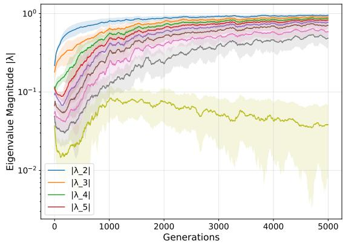
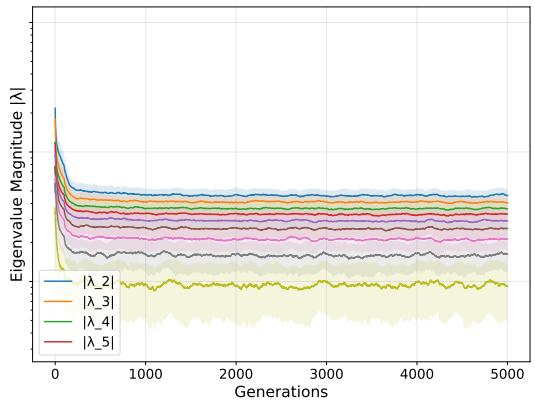
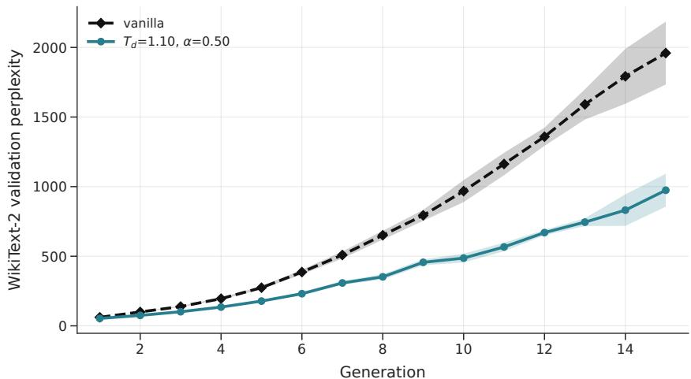
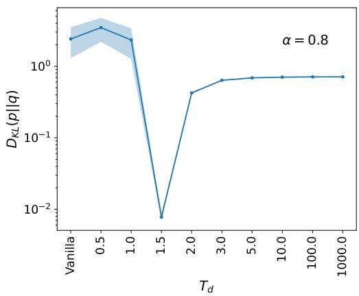
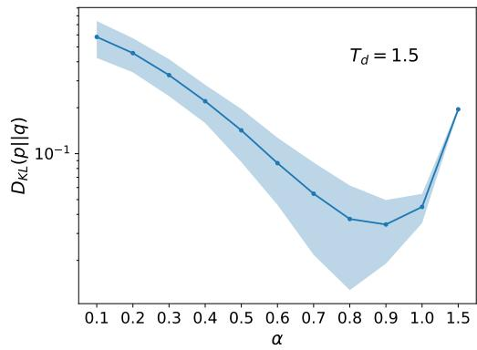
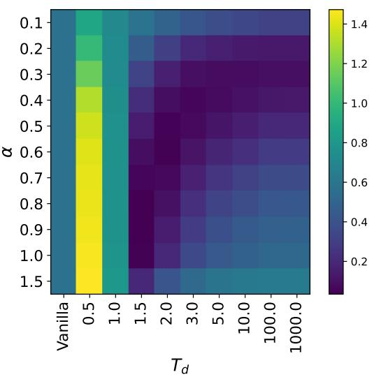
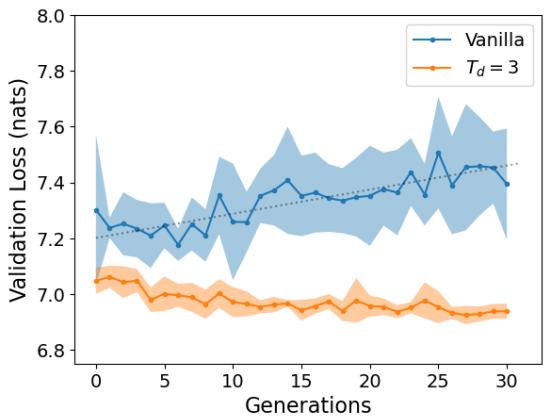
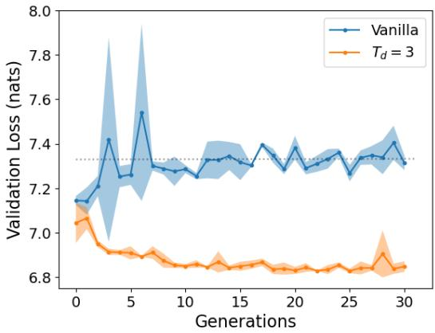
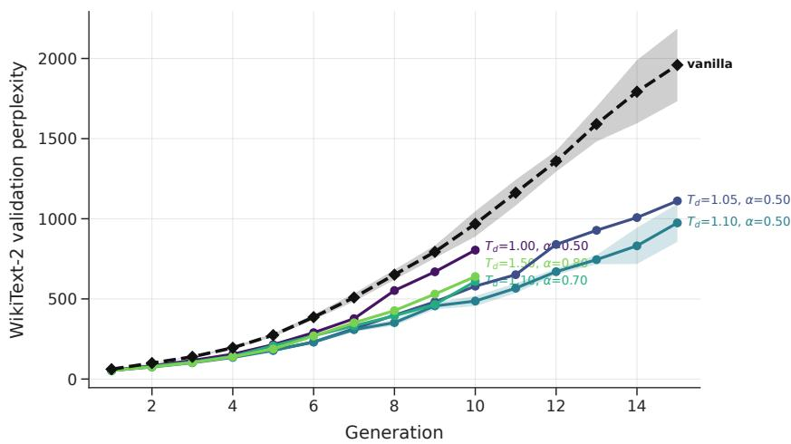

# Mitigating Model Collapse through Dreaming Learning

Matteo Benati DIAG, Sapienza University of Rome, Italy matteo.benati@uniroma1.it

Alessandro Londei Sony CSL Rome, CREF, Rome, Italy

Denise Lanzieri Sony CSL Rome, CREF, Rome, Italy

Raffaello Mastromarino Copenhagen Center for Social Data Science (SODAS), University of Copenhagen, Denmark

Vittorio Loreto Department of Physics, Sapienza University of Rome, Italy Sony CSL Rome, CREF, Rome, Italy Complexity Science Hub, Vienna, Austria

## Abstract

Training generative models on synthetic data causes loss of diversity and a decrease in performance, a phenomenon known as model collapse. We study this degeneration spectrally in a controlled Markov setting. The eigenvalue spectrum of the learned transition operator offers a direct view of the process, since the subdominant eigenvalues set how fast the chain mixes and therefore how much of the state space it continues to explore. We find that sampling at temperature $T _ { s } < 1$ acts on the operator like repeated sharpening, pushing it toward a deterministic system: the subdominant eigenvalues approach the unit circle and the spectral gap narrows. When $T _ { s } < 1$ , even data accumulation does not appear to arrest this drift. We then analyze Dreaming Learning [Londei et al., 2024], a regulariser that, in parallel with regular training, adds a loss term on the model’s own samples drawn at a raised temperature ${ T _ { d } } ^ { - } > 1$ Because high-temperature samples flatten the predicted distribution, training on them keeps the entries of the learned operator from becoming vanishingly small, which in turn keeps the eigenvalues bounded away from the unit circle. Measurements of the spectra over 5000 generations are consistent with this picture, and the mitigation effect persists in more complex settings such as LSTM language models and a 124M-parameter GPT-2.

## 1 Introduction

As synthetic data is an ever-increasing percentage of online content, generative models are increasingly retrained on data they themselves produced, without being able to distinguish human-made content from machine-made one. This phenomenon lowers diversity and drives learned distributions toward low-entropy distributions, an effect observed across GANs, diffusion models and language models [Shumailov et al., 2024, Dohmatob et al., 2024a, Liu et al., 2022, Yoon et al., 2024, Guo et al., 2024]. The leading mitigation technique is accumulation: retaining a fraction of real data alongside synthetic data [Gerstgrasser et al., 2024, Seddik et al., 2024]. Accumulation bounds test error, but existing analyses fix the sampling temperature used in language modeling experiments at $T _ { s } = 1$ , almost never used during inference [Renze and Guven, 2024], and no consensus exists on real-to-synthetic ratios [Dohmatob et al., 2024b]. Furthermore, datasets cannot always be distinguished upfront, risking sub-optimal mitigation.

We approach the problem through the spectrum of the learned transition operator rather than through test error alone. Test error reports how far the model has moved from the target, but it says little about which structural property of the generative process is being lost. The object we track instead is the conditional structure of the process itself. In a Markov setting this structure is a transition operator, or transition matrix, and its eigenvalues give information that a scalar loss does not: the subdominant eigenvalues control how fast the chain mixes and therefore how much of the state space keeps being visited. Watching them evolve across generations gives a clearer picture of collapse as it happens rather than just a degradation in performance. Framed this way, self-consuming retraining is a question about which structural properties of a generative model survive post-training on its own outputs, and the sampling temperature is an inference-time choice that turns out to govern the answer. Our contributions are:

• A spectral view of collapse. Training on synthetic data sampled at $T _ { s } < 1$ acts on the operator as a sharpening map whose fixed points are deterministic transition matrices. The subdominant eigenvalues approach $| \lambda _ { i > 1 } | \overset { - } { \to } 1$ and the spectral gap narrows.

• A mechanism that mitigates it. Adding a loss term on synthetic sequences drawn at $T _ { d } > 1$ flattens the sampled distribution and keeps the entries of the operator from approaching zero. This in turn keeps $| \lambda _ { i > 1 } |$ away from 1 as t grows.

• Empirical measurements across three scales: feed-forward model on Markov chains, LSTM language models and GPT-2 LLM synthetic finetuning (124M), following the protocol of Shumailov et al. [2024].

## 2 Collapse and the spectral gap

The second-largest eigenvalue in modulus, $| \lambda _ { 2 } |$ , sets the asymptotic rate at which a chain converges to its stationary distribution [Levin and Peres, 2017], so the spectrum of the transition matrix says how fast the process forgets its current state. Recursive training on self-generated data degrades a model even when sampling is unbiased, because finite samples under-represent the tails of each conditional [Shumailov et al., 2024]. Sampling below unit temperature adds a second route: outputs are biased toward the mode of each conditional, and retraining on them makes the conditionals more peaked in turn. On the transition matrix one round of this is the row-wise sharpening operator

$$
\displaystyle S _ { T } ( M ) _ { i j } = \frac { M _ { i j } ^ { 1 / T } } { \sum _ { k } M _ { i k } ^ { 1 / T } } ,\tag{1}
$$

with $T = T _ { s }$ . Applying (1) repeatedly concentrates each row on its largest entry, so the matrix drifts toward determinism. Our observations at $T _ { s } = 1$ isolate the tail-truncation route alone. A deterministic row-stochastic matrix is the transition matrix of a map from the state space to itself, whose recurrent part is a union of cycles. A cycle of length $L > 1$ contributes the L-th roots of unity, so the subdominant eigenvalues approach the unit circle and the spectral gap narrows.

Sampling at $T = T _ { d } > 1$ acts in the opposite direction, flattening each row and keeping entries away from zero. A row-stochastic matrix with all entries at least c has Dobrushin ergodicity coefficient at most $1 - n c .$ , which bounds every eigenvalue other than the Perron root [Levin and Peres, 2017]. Dreaming Learning supplies this floor: high-temperature samples spread mass across all states, ensuring nonzero support in the network’s learned conditionals. The spectrum directly validates the mechanism.

## 3 Dreaming Learning

Dreaming Learning [Londei et al., 2024] augments standard training with an auxiliary dreaming phase, in which the network generates synthetic sequences during training and then learns from them. It requires that the network be probabilistic and that its output be mappable back into its input space. We use it as a regularization term. At each step the model generates a synthetic batch $\tilde { x } _ { 1 : \ell } ^ { ( i ) } .$ $i = 1 , \ldots , k .$ , of length ℓ, by recursively sampling from its own Softmax outputs tempered at $T _ { d } ,$ which is (1) applied to the model’s conditionals with $T = T _ { d }$ . The dreaming loss is the cross-entropy of the model on that batch,

$$
\mathcal { L } _ { \mathrm { d r e a m } } = - \frac { 1 } { k ( \ell - 1 ) } \sum _ { i = 1 } ^ { k } \sum _ { t = 1 } ^ { \ell - 1 } \log P \left( \tilde { x } _ { t + 1 } ^ { ( i ) } \mid \tilde { x } _ { 1 : t } ^ { ( i ) } ; \Omega \right) , \qquad \mathcal { L } = \mathcal { L } _ { \mathrm { r e g } } + \alpha \mathcal { L } _ { \mathrm { d r e a m } } ,\tag{2}
$$

where $\mathcal { L } _ { \mathrm { r e g } }$ is the usual next-token cross-entropy on real data and α controls the strength of the regularizer.

Unlike the original formulation [Londei et al., 2024], which targets adaptation to regime shifts, our implementation is epoch-based and uses the dreaming phase to preserve statistical features across repeated retraining. Summing the two losses encourages the model both to fit real data and to explore its own Adjacent Possible [Kauffman, 2000, Tria et al., 2014], which has been associated with robustness in data statistics [Londei et al., 2024]. Related work reaches a similar conclusion from the data side, where selection criteria that reduce diversity in the training corpus degrade general performance [Fan et al., 2025].

## 4 Experiments

## 4.1 Markov chains

The behaviour described in Section 2 can be observed directly in a controlled chain. We fix a Markov transition matrix $M _ { 0 }$ with $n = 1 0$ states and normalised stationary distribution’s entropy of $0 . 8 ,$ and draw a baseline dataset of 20,000 states from it. Each generation runs the following loop: sample $N _ { g } = 5 0 0 0$ new symbols at $T _ { s } = 0 . 7$ from the current model, append them to the dataset so that data accumulates rather than being replaced, and retrain the model on the accumulated data.

The model is a small feed-forward network that predicts the next symbol from the current one, so the transition matrix $M _ { t }$ can be read off its outputs at every generation. Dreaming enters only through the training objective. In the dreaming condition the network is trained with the total loss of (2), where the dreaming term is computed on $\mathrm { \Delta } N _ { d } = 5 0 0 0$ symbols the network generates from its own tempered outputs at $T _ { d }$ . In the vanilla condition $\alpha = 0$ and the second term is absent. All results are over 10 seeds. Details are in Appendix A.

Because M is available at every generation, its spectrum can be measured directly. Figure 1 tracks $| \lambda _ { 2 } | , \ldots , | \lambda _ { 5 } |$ over 5000 generations. Under the vanilla recursion the subdominant eigenvalues drift upward toward the unit circle and the spectral gap narrows, which is the behaviour anticipated for repeated sharpening at $T _ { s } < 1$ . With dreaming enabled the same eigenvalues remain approximately constant in t. The spectrum settles below the true one, so the reconstructed chain mixes somewhat faster than $M _ { 0 } .$ , but it does not drift over the 5000 generations we observe. The size of this offset depends on $T _ { d }$ and α.

Figure 3 shows the KL divergence between true and reconstructed stationary distributions after 5000 generations. The divergence improves by $> 2$ orders of magnitude at $T _ { d } = 1 . 5 , \alpha = 0 . 8 .$ , consistent with strong dreaming keeping transition probabilities away from zero.

## 4.2 Language models

We repeat the recursive protocol with a 4-layer LSTM language model [Hochreiter and Schmidhuber, 1997] trained on a small public-domain corpus (Appendix B), monitoring validation loss as the number of self-generated generations grows, following Gerstgrasser et al. [2024]. At $T _ { s } = 0 . 7$ the vanilla model’s validation loss degrades with slope $8 . 7 \cdot 1 0 ^ { - 5 }$ per generation, while at $T _ { s } = 1$ the slope is $9 . 6 \cdot 1 0 ^ { - 5 } ; $ : accumulation is close to harmless at unit temperature and clearly harmful below it (Figure 5). The dreaming model $( T _ { d } = 3 )$ is flat at both temperatures and, even at generation 0, it already converges to a lower validation loss. As a scaling check we pre-trained GPT-2 (124M) [Radford et al., 2019] from scratch on OpenWebText [Gokaslan and Cohen, 2019], fine-tuned on WikiText-2, and iterated the generate-and-retrain loop with synthetic corpora sampled at $T _ { s } = 0 . 8$ holding out part of each synthetic corpus as a validation set. Figure 2 shows WikiText-2 validation perplexity across 15 generations. Both conditions degrade, but the dreaming run degrades more slowly: at generation 15 the vanilla model reaches a perplexity of roughly 1960 against roughly 980 for $\bar { T _ { d } } = \bar { 1 . 1 } , \alpha = 0 . 5$ , and the two separate from about generation 5 onward with the ratio holding near a factor of 2.0 thereafter. Unlike Markov and LSTM, dreaming slows rather than arrests drift in GPT-2. This asymmetry warrants future investigation.

Figure 1: Eigenvalue magnitudes $| \lambda _ { 2 } | , \ldots , | \lambda _ { 5 } |$ of the reconstructed transition matrix across 5000 generations and 10 seeds, moving average $( w { = } 1 0 0 )$ , shaded region represents 25th to 75th percentile. Dashed lines mark the true spectrum of $M _ { 0 }$ . Left: vanilla recursion. The subdominant eigenvalues climb toward 1 and the spectral gap narrows. Right: with Dreaming Learning $( T _ { d } { = } 1 . 5 , \alpha { = } 0 . 8 )$ the spectrum is flat in t. The dreaming spectrum stabilises below the true one, indicating a residual bias toward faster mixing that is controlled by $T _ { d }$ and α.  
  
Figure 2: GPT-2 (124M) under the generate-and-retrain loop, with synthetic corpora sampled at $T _ { s } = 0 . 8$ . WikiText-2 validation perplexity against generation count, vanilla and dreaming $\bar { ( T _ { d } ) } ^ { - } = 1 . 1$ $\alpha = 0 . 5 )$ ), over five seeds; shaded regions represent 25th to 75th percentile.

## 5 Limitations

A stable spectrum is not necessarily a correct one. The dreaming spectrum in Figure 1 settles below the true subdominant eigenvalues, so the learned chain mixes faster than the target. Second, we observe the temperature dependence at $T _ { s } \in \{ 0 . 7 , 0 . 8 , 1 . 0 \}$ across our three experimental settings, so the behaviour near $T _ { s } = 1$ is suggested by the sharpening picture rather than established by a fine-grained sweep. Third, the argument of Section 2 treats the operator as exactly recoverable, whereas this is not necessarily the case. Fourth, $T _ { d }$ and α require empirical tuning (useful ranges $T _ { d } \in [ 1 , 3 ] , \alpha \in [ 0 . 3 , 1 ]$ , though optimal pairs vary by setting). At GPT-2 scale, tuning cost is the main obstacle to scaling, and dreaming roughly doubles per-step generation cost.

## 6 Conclusion

The eigenvalues of the learned transition operator give a view of model collapse that scalar loss does not. Under self-training at $T _ { s } ~ < ~ 1$ , subdominant eigenvalues drift toward the unit circle and the spectral gap narrows. Dreaming Learning leaves that spectrum flat, apparently by keeping operator entries away from zero through samples drawn at $T _ { d } > 1$ . The spectrum also reveals the method’s cost: the learned chain mixes faster than the target. Open questions: whether residual bias can be reduced by annealing $T _ { d } .$ , and whether the floor can be characterised to predict the optimum in $( T _ { d } , \alpha )$

## References

E. Dohmatob, Y. Feng, and J. Kempe. Model collapse demystified: The case of regression. arXiv:2402.07712, 2024a.

E. Dohmatob, Y. Feng, A. Subramonian, and J. Kempe. Strong model collapse. arXiv:2410.04840, 2024b.

Z. Fan, S. Du, S. Hu, P. Wang, L. Shen, Y. Zhang, D. Tao, and Y. Wang. Combatting dimensional collapse in LLM pre-training data via diversified file selection. In International Conference on Learning Representations (ICLR), 2025.

M. Gerstgrasser et al. Is model collapse inevitable? breaking the curse of recursion by accumulating real and synthetic data. arXiv:2404.01413, 2024.

A. Gokaslan and V. Cohen. OpenWebText corpus, 2019.

Y. Guo, G. Shang, M. Vazirgiannis, and C. Clavel. The curious decline of linguistic diversity: Training language models on synthetic text. arXiv:2404.08453, 2024.

S. Hochreiter and J. Schmidhuber. Long short-term memory. Neural Computation, 9(8):1735–1780, 1997.

S. A. Kauffman. Investigations. Oxford University Press, 2000.

D. A. Levin and Y. Peres. Markov Chains and Mixing Times. American Mathematical Society, 2017.

H. Liu et al. Combating mode collapse in GANs via manifold entropy estimation. arXiv:2208.12055, 2022.

Alessandro Londei, Matteo Benati, Denise Lanzieri, and Vittorio Loreto. Dreaming learning. arXiv:2410.18156, 2024.

A. Radford, J. Wu, R. Child, D. Luan, D. Amodei, and I. Sutskever. Language models are unsupervised multitask learners. OpenAI Blog, 2019.

M. Renze and E. Guven. The effect of sampling temperature on problem solving in large language models. arXiv:2402.05201, 2024.

M. E. A. Seddik, S.-W. Chen, S. Hayou, P. Youssef, and M. Debbah. How bad is training on synthetic data? a statistical analysis of language model collapse. arXiv:2404.05090, 2024.

Ilia Shumailov, Zakhar Shumaylov, Yiren Zhao, Nicolas Papernot, Ross Anderson, and Yarin Gal. AI models collapse when trained on recursively generated data. Nature, 631(8022):755–759, 2024.

F. Tria, V. Loreto, V. D. P. Servedio, and S. H. Strogatz. The dynamics of correlated novelties. Scientific Reports, 4:5890, 2014.

Y. Yoon, D. Hu, I. Weissburg, Y. Qin, and H. Jeong. Model collapse in the self-consuming chain of diffusion finetuning. arXiv:2407.17493, 2024.

## A Markov model implementation

$M _ { 0 }$ has $n = 1 0$ states and normalised stationary entropy 0.8; results are unchanged for other entropies and state counts. The baseline dataset $S _ { 0 }$ is a sequence of 20,000 symbols sampled from $M _ { 0 }$ . At each generation, $N _ { g } = 5 0 0 0$ symbols are generated at $T _ { s } = 0 . 7$ and concatenated, $S _ { t + 1 } = S _ { t } \oplus s _ { t }$ The dreaming batch is $N _ { d } = 5 0 0 0$ symbols sampled recursively from the network’s own tempered outputs at $T _ { d } .$ , as described in Section 3. The reconstruction uses a feed-forward network with two hidden layers of 50 units and tanh activations, trained epoch-wise on the full accumulated dataset with reshuffling. Here α is the coefficient of the dreaming term in (2) and, being a loss coefficient rather than a mixing weight over data, is not restricted to [0, 1]. All figures are over 10 seeds. Figure 4 shows the full $( T _ { d } , \alpha )$ landscape and Figure 3 shows the respective slices demonstrating that optimal performance (lowest KL divergence) occurs at large α, consistent with the mechanism of keeping operator entries away from zero.

  
Figure 3: $D _ { \mathrm { K L } } ( p \Vert q )$ between the true and reconstructed stationary distributions after 5000 generations over 10 seeds. Left: varying $T _ { d }$ at $\alpha = 0 . 8$ . Right: varying α at $T _ { d } = 1 . 5$ . VANILLA denotes no dreaming term. Shaded regions represent 25th to 75th percentile.

  
Figure 4: $D _ { \mathrm { K L } }$ between true and reconstructed stationary distributions after 5000 generations across the $( T _ { d } , \alpha )$ grid.

  
Figure 5: Left, right: LSTM validation loss against generation count for vanilla and dreaming $\left( T _ { d } \mathrm { = } 3 \right)$ models at $\bar { T } _ { s } { = } 0 . 7$ and ${ { T } _ { s } } \mathrm { { = } } 1$ over 10 seeds each. Shaded region represents 25th to 75th percentile.

## B Language model implementation

The LSTM has 4 hidden layers of 400 units; input and output dimensions equal the vocabulary size. Training texts are The Mysterious Affair at Styles and The Secret Adversary (Christie) and The Way We Live Now (Trollope); validation uses Unbroken (Hillenbrand), Armadale (Collins) and Desert Gold (Grey). All are public domain via Project Gutenberg. The vocabulary contains 43,138 word types and the training set 597,035 tokens.

## Meta-parameter selection for GPT-2

  
Figure 6: WikiText-2 validation perplexity at the best primary-validation epoch, for each $( T _ { d } , \alpha )$ configuration tried. Only vanilla and $T _ { d } = 1 . 1 , \alpha = 0 . 5$ are averaged over seeds, with shaded regions spanning the 25th to 75th percentile; the remaining curves are single runs and some end at generation 10.

A single trajectory at the GPT-2 scale is expensive: pre-training from scratch on OpenWebText requires approximately 42 hours on four A100 GPUs, fine-tuning on WikiText-2 takes roughly five minutes, and each of the 15 generate-and-retrain iterations takes approximately 10 minutes (synthesis plus retraining). A complete exhaustive grid over $T _ { d } \in [ 1 . 0 , 1 . 5 ]$ at intervals of 0.05 and $\alpha \in [ \dot { 0 } . 3 , 1 . 0 ]$ at intervals of 0.1 would thus require 88 trajectories, or 88 times the cost of a single run. The computational burden prompted a two-line sweep: fixed $\alpha = 0 . 5$ with $T _ { d } \in \{ 1 . 0 0 , 1 . 0 5 , 1 . 1 0 , 1 . 5 0 \}$ and fixed $T _ { d }$ values at $\alpha \in \{ 0 . 5 , 0 . 7 , 0 . 8 \}$ . This approach required approximately 36 GPU-hours and was sufficient to locate a configuration better than vanilla and to characterize the local landscape (Figure 6).