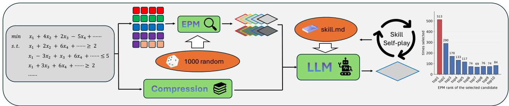
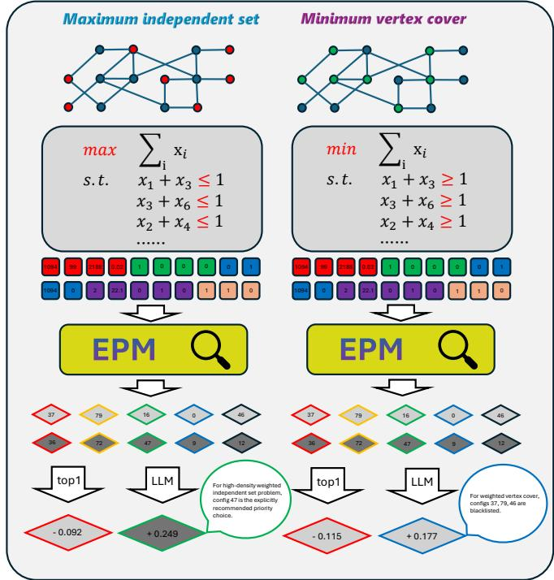
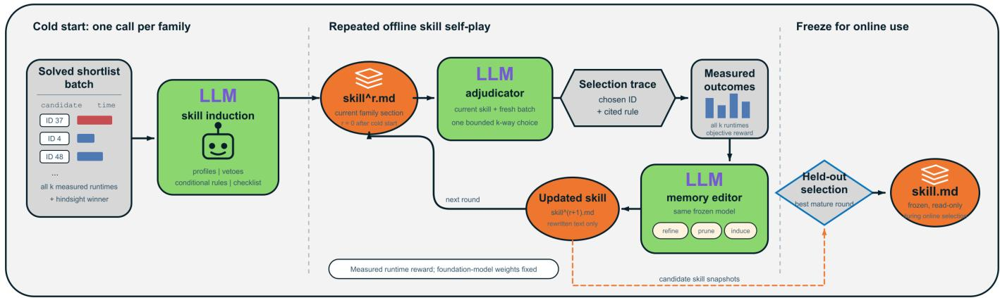
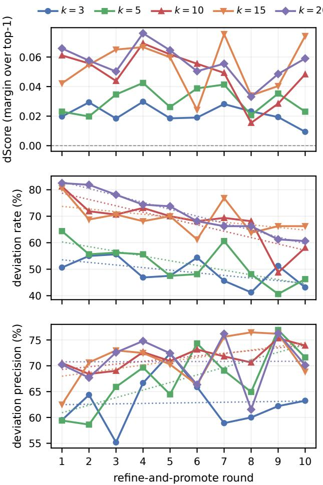
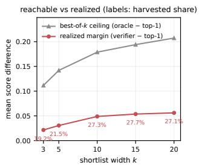
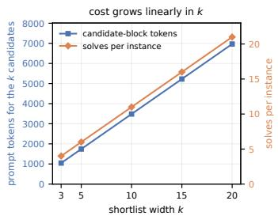
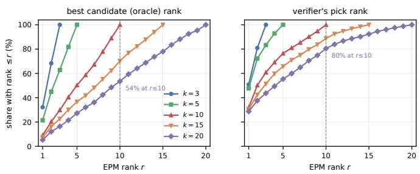
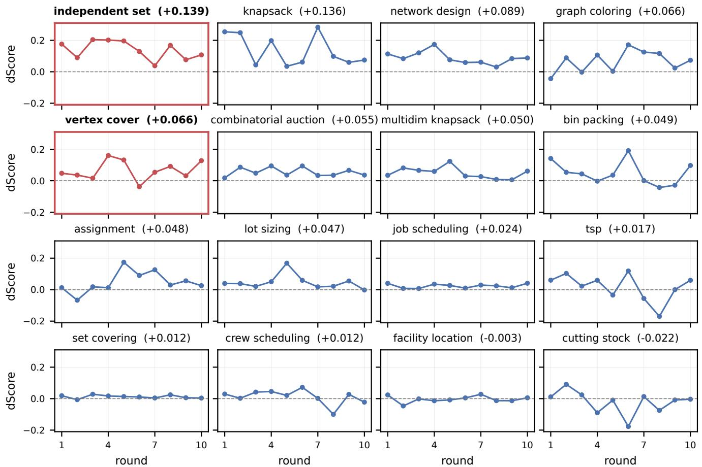

# Nominate-then-Adjudicate: LLM-Assisted One-Pass and Per-Instance MIP Solver Tuning

Yifan Zhao Alibaba Group Hangzhou, China jinxiong.zyf@alibaba-inc.com

Xinyu Guan Alibaba Group Hangzhou, China guanhan.gxy@alibaba-inc.com

Kai Wei   
Alibaba Group   
Hangzhou, China   
weikai.weikai@taobao.com   
Yuming Deng   
Alibaba Group   
Hangzhou, China   
yuming.dym@taobao.com

Abstract—Mixed-integer programming solvers expose hundreds or even thousands of parameters whose best setting varies per instance, yet per-instance search is prohibitively expensive. We frame this as configuration for heterogeneous Big Data optimization workloads and propose a nominate-then-adjudicate pipeline built around two design choices. First, a fixed portfolio is sampled once and reused across instances, removing per-instance configuration search at inference; on the evaluated families, the resulting shortlist retains substantial oracle headroom, making selection within it the empirical focus. Second, the fixed 20- feature representation can map structurally different instances to the same vector, preventing a feature-only selector from distinguishing them even when they prefer different configurations. The foundation model receives no task-specific weight updates, and selection is one-pass: one model call and no solver calls at inference. The study represents structural Variety through distinct formulation families and decision Value through solverperformance outcomes; the one-call, zero-solve protocol specifies the decision interface and leaves end-to-end latency unmeasured. Among comparisons exceeding a 20% practical-difference threshold, the complete adjudicator records 538 wins and 185 losses against the top nominee, while its win rate against the default rises from 84.9% to 90.2%. Against per-instance configuration baselines under a matched one-pass protocol it leads the clusterlevel methods and the best-performing evaluated per-instance baseline, ISAC+.

Qianyang Zhao Alibaba Group Hangzhou, China zhaoqianyang.zqy@alibaba-inc.com

Index Terms—mixed-integer programming, solver configuration, large language models, prompt engineering, big data

## I. INTRODUCTION

Branch-and-cut solvers such as SCIP [1] expose thousands of algorithmic parameters, and no single configuration is best across instances. Such solvers sit beneath large-scale combinatorial decision-making. Routing, assignment and supplychain optimization are routinely formulated as MIPs, so a perinstance configuration decision that adds no solver calls is of practical interest.

The Big Data relevance of this setting centers on heterogeneous optimization workloads. We operationalize Variety through 16 structurally distinct generated MIP families and two heterogeneous MIPLIB transfer cases, and Value through score and solver-time improvements. Velocity enters as an interface requirement: the configuration decision uses one model call and no online solver calls. End-to-end latency remains unmeasured.

Existing methods can be placed on three axes: the granularity of the decision (a whole distribution, a cluster, or a single instance), the number of solver calls it costs at inference, and whether a selector must befitted. Together, these axes highlight an under-studied design point. Classical configurators return a distribution-wide configuration. Per-instance selectors instead fit a mapping from features to configurations. Methods that read more than static features pay for it with solver calls at decision time [2]–[6], [8], [13]–[15]. Recent language-model approaches to configuration [18]–[21] also miss at least one axis. Section II places each precisely.

Against this landscape, we combine natural-language processing, operations research and machine learning in one pipeline: a learned performance model ranks a fixed solver portfolio, and a foundation model adjudicates the shortlist in one model call, with no solver call at inference and no foundation-model weight update. To our knowledge, this is the first reported per-instance MIP configuration system to combine those operational properties. Offline adaptation remains: the nominator is a small tree ensemble trained on measured solves, and the adjudicator consults a textual memory refined from selection outcomes. The foundation model’s weights remain fixed. A representation-level observation further motivates the dual-channel design (Section IV): the final decision cannot always be recovered from the aggregate features used by the nominator, because structurally different instances can share the same feature vector.

Why a Nominate-then-Adjudicate system. A feature-only EPM is limited to the structure retained by its fixed aggregate feature map and cannot recover distinctions that the map discards. Two instances alike in those features can therefore prefer different configurations; yet the configuration pool is far too large to present exhaustively in a compact one-pass prompt. We therefore factorize the problem into recall and re-ranking: a nomination stage scores a fixed portfolio with an empirical performance model and forwards the top k; a adjudication stage hands those k, a compressed textual rendering of the constraint matrix and a textual skill memory to a language model, which returns one index. The instance is thus read twice through different channels (Fig. 1): the features feed the nominator, and both feed the adjudicator.

  
Fig. 1. The nominate-then-adjudicate pipeline. The instance is read twice: one path abstracts it into 20 features that, with each candidate’s 30 parameters, are all the EPM sees; the other passes a compressed constraint matrix to the adjudicator. Portfolio, EPM and skill memory are built offline, so inference is one model call and no solve.

Why use a random portfolio? Bergstra and Bengio [7] showed that random search can explore important coordinates more efficiently than grid search when only a subset of dimensions matters. This motivates a simple reusable candidate set, with no portfolio-coverage guarantee. We construct the fixed portfolio once by random sampling and reuse it for every instance, so the online nominator only has to rank this fixed set.

Why the second stage reads the matrix. Selection can fail when the fixed aggregate feature extractor maps structurally different instances to the same vector. A deterministic selector that observes only that vector must return the same choice for both, even when their preferred portfolio configurations differ (Section IV). Independent-set and vertex-cover instances built on one graph realize such a collision under our 20-feature representation. The adjudicator can distinguish them because it also reads a channel those features discard: the compressed textual matrix rendering. It emits no parameter values; it makes a bounded k-way choice over measured candidates.

Contributions. (i) A nominate-then-adjudicate architecture that separates candidate recall from structure-aware re-ranking and constrains the foundation model to a bounded k-way decision over measured configurations, preventing unconstrained parameter generation, with one model call and no solver call at inference. (ii) A dual-channel selector in which aggregate features support efficient nomination, while a compressed matrix representation and textual experience memory provide complementary structural information for adjudication. The IS/VC construction gives a concrete collision under the chosen 20-feature representation. (iii) An empirical evaluation across 16 generated MIP families, a matched one-pass baseline study, and two feature-range-compatible MIPLIB transfer cases. Under the evaluated protocol, the complete adjudicator bundle improves over the feature-only top nominee, and the full system leads the aggregate metrics in the matched baseline study. These experiments evaluate Variety as cross-family structural heterogeneity and Value as solver performance; the online protocol additionally enforces the stated one-call, zerosolve decision constraint.

## II. RELATED WORK

a) Granularity: Classical configurators tune a single configuration for a whole instance distribution: SMAC [2], [31] fits a surrogate over the parameter space, irace [3] races sampled candidates, and GGA [8] evolves a population (surveyed in [9], [10]). Per-instance methods refine the granularity: ISAC [4] clusters instances and tunes one configuration per cluster, a piecewise-constant map that learned embeddings later smooth [15], while ISAC+ [14] and Hydra-MIP [13] pool such configurations and select among them at instance granularity (per-instance selection is surveyed by [11]). MIPspecific configuration [16] and learned SCIP separator scoring [17] are the closest MIP instantiations. Assembling a fixed portfolio offline and selecting one member per instance from static features is thus a classical skeleton, and we claim no novelty for it.

b) Solver calls at inference: Methods that read more than static features pay for it with solver work at decision time: SATzilla [5] selects among solvers using runtime models whose features include solver probes, Hydra [12] closes the loop between configuring and selecting, and a broader line of in-solver ML replaces or drives a solver component with a network invoked during search, including learningto-branch [6], neural MIP solvers [27] and learned heuristic scheduling in branch-and-bound [28]. The same cost recurs among language-model methods: Lawless et al. [18] propose separator settings for a problem class that the solver must then run to compare, and LLAMBO [21] places the model inside a Bayesian-optimization loop that evaluates candidates repeatedly.

c) Whether a selector is fitted: The per-instance selectors above are all fitted on measured runtimes, so what they can learn is bounded by what the feature extractor kept. Languagemodel approaches either adapt weights, as Kochnev et al. [19] do by fine-tuning a model to emit hyperparameters, or feed a conventionally trained selector, as when Wu et al. [20] turn model embeddings into its features. We instead keep accumulated experience as text tied to measured selection outcomes, relating to self-reflective and experience-accumulating agents [22], [23] and to prompt-level optimization [24], so nothing in the model’s weights is fitted. The EPM and textual memory remain task-specific offline components; the foundation-model weights remain fixed. Against this taxonomy, our contribution lies in the per-instance, solver-free-atinference adjudication design and in the structural and textual information made available to the selector.

## III. PRELIMINARIES

An instance I is a MIP model. A configuration $\theta \in \Theta =$ $\textstyle \prod _ { p = 1 } ^ { 3 0 } { \mathcal { C } } _ { p }$ assigns each of 30 SCIP parameters a value from a finite candidate list $\mathcal { C } _ { p } ; | \Theta | \approx 7 . 9 \times 1 0 ^ { 1 8 }$ . Let $t ( \mathcal { T } , \theta )$ be wall-clock solve time under a fixed time limit and $\operatorname { s p } ( \mathbb { Z } , \theta ) =$ $t ( \mathcal { T } , \theta _ { \mathrm { d e f } } ) / t ( \mathcal { T } , \theta )$ the speedup over the default.

We measure a configuration against the default by a single score $s ( \mathcal { Z } , \theta ) ~ \in ~ [ - 1 , 1 ]$ , defined by a lexicographic order. Feasibility is decided first: a configuration finding no solution where the default does scores −1, and conversely +1; if neither finds one the instance is discarded. Proven optimality comes next, so a configuration that exhausts the time limit scores −1 against one that closes the instance, and timeouts are scored rather than dropped. When both prove optimality, which is the common case, the score is

$$
s ( \mathcal { T } , \theta ) \ = \ \frac { t ( \mathcal { T } , \theta _ { \mathrm { d e f } } ) - t ( \mathcal { T } , \theta ) } { t ( \mathcal { T } , \theta _ { \mathrm { d e f } } ) + t ( \mathcal { T } , \theta ) } \ = \ \operatorname { t a n h } \Bigl ( \frac { \ i } { 2 } \log \operatorname { s p } ( \mathcal { T } , \theta ) \Bigr ) ,\tag{1}
$$

a strictly monotone bounded reparameterisation of log sp, the quantity underlying geometric-mean runtime comparison; when neither side proves optimality the same normalised difference is applied to the feasible objectives. The transformation is zero at parity, symmetric between equal speedups and slowdowns, and depends on the runtimes only through their ratio, so machine speed cancels. Boundedness is why we average it: speedups are heavy-tailed, so a mean speedup is decided by a few instances, whereas log sp is unbounded below and one timeout dominates. The price is saturation in the tails, so the score reflects how often a better configuration is chosen more than by how much, and we report the shifted geometric mean (SGM) of speedup beside it as the physically interpretable figure.

## IV. METHOD

The pipeline reads each instance twice through different channels and decides in one pass. Algorithm 1 is the whole of inference: extract features, score a fixed numbered portfolio with an empirical performance model (EPM), and make a single language-model call that returns an index into the top k. No solver is run to decide. All solver-intensive work happens offline before deployment: building the portfolio, fitting the EPM and revising the skill memory.

TABLE I The 20 static features, by block.
<table><tr><td>block</td><td>features</td></tr><tr><td>size (4)</td><td>row count, column count, nonzeros, density</td></tr><tr><td>variables (4)</td><td>binary / general-integer / continuous ratio, unbounded count</td></tr><tr><td>constraints (4)</td><td>equality ratio, inequality ratio, set-type count, special-constraint count</td></tr><tr><td>coefficients (5)</td><td>mean nonzeros per row, per column, coefficient CV, objective density, RHS CV</td></tr><tr><td>topology (3)</td><td>connected components, largest-component ratio, isolated variables</td></tr></table>

Algorithm 1 Nominate-then-Adjudicate Inference   
Require: Instance I; EPM $\overline { { F ; } }$ skill memory S; portfolio Π =   
$\{ \theta _ { 0 } , \dots , \theta _ { 9 9 9 } \}$   
1: x ← EXTRACTFEATURES(I) {20-dim, Table I}   
2: $\hat { r } _ { j } \gets F ( [ \mathbf { x } \| \operatorname { e n c } ( \theta _ { j } ) ] )$ for all $\theta _ { j } \in \Pi$ {no solves}   
3: $\mathcal { N } = \{ \theta _ { n _ { 1 } } , \theta _ { n _ { 2 } } , \cdot \cdot \cdot , \theta _ { n _ { k } } \} \gets \mathrm { t o p } \ – k$ of Π by $\hat { r } _ { j }$ {identifiers   
retained; $k = 1 0 \}$   
4: i⋆ ← LLMSELECT(ψ(I), x, N, S) $\{ i ^ { \star } \in \{ 1 . . k \} $ , default   
1}   
5: return $\theta _ { n _ { i } \star }$

## A. Step 1: Static Features

From the parsed model we extract $\textbf { x } \in \ \mathbb { R } ^ { 2 0 }$ , listed in Table I. All are cheap, solver-agnostic and solve-independent, and all are permutation-invariant aggregates of the coefficient matrix. This property matters in Step 3. The set is the static branch of an established feature taxonomy for MIP parameter tuning. We deliberately drop that taxonomy’s root-relaxation branch, including root solve time, reduced-cost and dualvalue distributions, because obtaining those features requires actually running the solver, which is precisely the cost our one-pass setting refuses to pay at inference.

## B. Step 2: A Fixed Random Portfolio

The parameters we tune are listed in Table II: 30 SCIP parameters spanning presolving, separation, cut selection, primal heuristics, branching and conflict analysis, each with a finite candidate list, giving $| \Theta | \approx 7 . 9 \times \mathrm { { \dot { 1 } } 0 ^ { 1 8 } }$ . They were distilled by consensus from SCIP’s full parameter listing of over ten thousand entries. Several independent language models were each asked which parameters most affect MIP solving performance, and we kept only the intersection every model flagged, then assigned each survivor a finite candidate list. This common experimental setting is shared by every arm we report, baselines included.

Random sampling provides a simple way to construct a reusable candidate set without an instance-specific configurator at inference. Motivated by random search in spaces where a subset of coordinates drives performance [7], we draw a pool of 1000 configurations once, uniformly from the candidate lists, and number them $\Pi = \{ \theta _ { 0 } , . . . , \theta _ { 9 9 9 } \}$ . This sampled pool is the empirical object evaluated below; random construction provides no near-optimal coverage guarantee for every instance. Building the pool once amortizes candidate construction across instances, and the fixed numbering lets rules and accumulated experience remain attached to portfolio configurations across batches. The pool is built from a batch seed-disjoint from every evaluation batch.

TABLE II The 30 configured SCIP parameters and their candidate values.
<table><tr><td>parameter</td><td>candidates</td></tr><tr><td colspan="2">presolving</td></tr><tr><td>presolving/maxrounds</td><td>-1, 0, 5, 10, 20</td></tr><tr><td>presolving/donotaggr</td><td>F, T</td></tr><tr><td>presolving/donotmultaggr</td><td>F, T</td></tr><tr><td colspan="2">LP</td></tr><tr><td>lp/pricing</td><td>1, a, f, p, s, q, d</td></tr><tr><td>lp/refactorinterval</td><td>0, 50, 100, 200</td></tr><tr><td>lp/scaling</td><td>0,1,2</td></tr><tr><td colspan="2">propagation and symmetry</td></tr><tr><td>propagating/maxrounds</td><td>-1,0, 10, 50, 100</td></tr><tr><td>propagating/maxroundsroot</td><td>-1, 100, 500, 1000, 5000</td></tr><tr><td>misc/usesymmetry</td><td>0-7</td></tr><tr><td colspan="2">separation</td></tr><tr><td>separating/maxroundsroot</td><td>-1, 0, 5, 10, 20</td></tr><tr><td>separating/maxstallrounds</td><td>0, 1, 3, 5</td></tr><tr><td>separating/clique/freq</td><td>-1, 0, 5, 10, 20</td></tr><tr><td>separating/oddcycle/freq</td><td>-1, 0, 5, 10, 20</td></tr><tr><td>separating/gomory/freq</td><td>-1, 0, 5, 10, 20</td></tr><tr><td>separating/zerohalf/maxrounds</td><td>-1, 0,1, 5, 10</td></tr><tr><td>separating/disjunctive/maxroundsroot</td><td>-1, 0, 10, 50, 100</td></tr><tr><td colspan="2">cut selection cutselection/hybrid/minortho</td></tr><tr><td>cutselection/ensemble/</td><td>0.1, 0.3, 0.5, 0.7, 0.9</td></tr><tr><td colspan="2">maxnonzerorootround</td></tr><tr><td>primal heuristics</td><td>1, 2, 4.5, 8, 20</td></tr><tr><td colspan="2"></td></tr><tr><td>heuristics/feaspump/freq</td><td>-1, 0, 10, 20, 50</td></tr><tr><td>heuristics/alns/freq</td><td>-1, 0, 10, 20, 50</td></tr><tr><td>heuristics/undercover/freq</td><td>-1, 0, 10, 20, 50</td></tr><tr><td>heuristics/dins/minfixingrate</td><td>0.1, 0.2, 0.3, 0.5, 0.7</td></tr><tr><td>heuristics/lpface/minfixingrate</td><td>0.05, 0.1, 0.2, 0.3, 0.5</td></tr><tr><td>heuristics/subnlp/presolveemphasis</td><td>0,1, 2, 3</td></tr><tr><td colspan="2">branching</td></tr><tr><td>branching/preferbinary</td><td>T, F</td></tr><tr><td>branching/fullstrong/maxdepth</td><td>-1,0, 5, 10, 20</td></tr><tr><td>branching/relpscost/sbiterquot</td><td>0.1, 0.2, 0.3, 0.5, 0.8</td></tr><tr><td colspan="2">branching/relpscost/</td></tr><tr><td>degeneracyaware conflict analysis</td><td>0,1,2</td></tr><tr><td colspan="2">conflict/enable</td></tr><tr><td></td><td>T, F</td></tr><tr><td>conflict/useinflp</td><td>o, c, d, b</td></tr></table>

## C. Step 3: Nomination by an EPM

Let $\operatorname { e n c } ( \theta ) \in \mathbb { R } ^ { 3 0 }$ encode a configuration (ordinal indices for categorical parameters, values for numeric ones). The EPM is an XGBoost gradient-boosted tree regressor [25] ${ \hat { r } } \ = \ F ( [ \mathbf { x } \ \lVert \operatorname { e n c } ( \theta ) ] ) , \ F \ : \ \mathbb { R } ^ { 5 0 } \ \to \ \mathbb { R }$ , trained to predict log sp. It assigns a score to each (instance, configuration) pair and can therefore rank any candidate set without solving. Training rows come from the offline sampling of Step 2, and we deliberately retain configurations slower than the default as negative targets: a model fitted on winners alone cannot recognize a hazard. Online we score all of Π and forward the top k by predicted log-speedup, indexed by EPM rank and carrying portfolio identifiers. The width k trades reachable ceiling against prompt size; we sweep it in Section V-B and use k = 10 throughout.

D. Step 4: Foundation-Model Adjudication without Weight Updates

The last step is a single foundation-model call that returns an index into the shortlist, and it is the only component that reads the compressed textual matrix rendering rather than aggregate features.

Let x denote the fixed 20-feature extractor used in this work. $\operatorname { I f } \mathbf { x } ( I ) = \mathbf { x } ( I ^ { \prime } )$ , a deterministic selector that observes only x must return the same configuration for both instances. When the two instances prefer different configurations within the portfolio, that selector cannot recover both instance-specific choices. This limitation is specific to the chosen representation; alternative finite-dimensional representations may retain the distinction. PAC-style analyses bound expected regret under a distributional assumption on instances [29]. Here we exhibit one concrete collision under the feature extractor used by our system. The architectural consequence is that the nominator, which scores from x alone, returns the same k nominees for both members of the pair, while the adjudicator also receives ψ and therefore has instance-distinguishing information unavailable to the nominator.

A pair that exposes the collision. A generated pair exhibits this collision. From one shared seed our generators build a maximum-weight independent-set instance and a minimumweight vertex-cover instance on the same graph. They differ only in constraint sense $( x _ { i } + x _ { j } \leq 1$ against $x _ { i } + x _ { j } \geq 1 )$ and objective direction, and neither difference reaches the feature vector, so the two feature vectors come out byteidentical and the pair is feature-degenerate. The two classes do prefer different configurations, along a mechanistically sensible axis: independent set is a packing polytope on which selecting two adjacent vertices is an immediate conflict, so global conflict analysis pays off. The vertex-cover instance shows no corresponding benefit. Fig. 2 shows one such pair.

This pair exposes information absent from the aggregate numbers. The adjudicator reads the constraint matrix ψ, a channel the features discard, and is conditioned on a textual memory carried in its prompt. With ψ removed, the two inputs coincide in the features, shortlist and shared memory, so the prompt contains no instance-specific signal that favors different choices. Supplying ψ makes such an instance-conditioned choice possible under our prompt design. Alternative feature representations may carry the same distinguishing information; this observation motivates the additional structural channel used in this system.

Inputs and output. The prompt carries a deterministic, compressed rendering of the constraint matrix, which supplies ψ; the 20 features; the default and all k candidates as full 30- parameter listings labelled by portfolio identifier; and the skill memory. It returns strict JSON with a chosen index and a oneline rationale, and a parse failure falls back to the top nominee. Restricting the model to a k-way choice bounds the output space and prevents it from inventing unmeasured parameter values. This output-control property provides no guarantee that every selected configuration solves successfully on every

  
Fig. 2. Feature degeneracy, illustrated on one shared seed (drawn small; 99 vertices, 1094 edges). The independent-set and vertex-cover models differ only in constraint sense and objective direction, neither of which reaches the feature vector, so their 20 features are byte-identical and the nominator must return one shortlist for both. Their measured preferred portfolio configurations differ, and reading the matrix lets the adjudicator pick a different configuration for each (here identifiers 47 and 0, against a shared top nominee 37 that is slower than the default on both). The numbers illustrate one pair and provide no aggregate estimate.

instance.

The matrix rendering ψ. The channel that carries structure is a text rendering of the constraint matrix, produced deterministically. In distribution, constraints are grouped by name after stripping trailing indices. Out of distribution, we use the nameindependent structural grouping of Section V-E. Each group is represented by one row written as an explicit linear expression and annotated with the group’s cardinality and the range of its right-hand sides. The header reports the counts of binary, integer and continuous variables. The objective is listed in full when it has at most 40 nonzero terms and summarized by its coefficient range otherwise. Very long rows are truncated, but their sense and bounds are always printed in full, so truncation never conflates $\mathrm { ~ a ~ } \leq \mathrm { ~ r o w ~ }$ with $\mathrm { ~ a ~ } \geq \mathrm { ~ o n e ~ }$ . This preserves the distinction on which the collision in Section IV turns. On the generated families it occupies a few hundred tokens per instance.

Two-objective protocol. The prompt states an ordered objective: never choose a candidate at plausible risk of being slower than the default, and deviate from $\theta ^ { ( 1 ) }$ only with concrete experience-backed evidence, choosing $\theta ^ { ( 1 ) }$ when unsure. Choosing $\theta ^ { ( 1 ) }$ incurs no extra solve because it is the solve the nominator would have made. The protocol therefore only spends deviations it can justify.

Skill memory: cold start. The only evolving artifact is a textual prompt fragment; foundation-model weights remain fixed. One fully solved shortlist batch supplies every nominee’s runtime and hindsight winner. From these trajectories, one model call per family induces identifier profiles, veto rules, observable-threshold rules and a decision checklist. Family indexing lets later rounds retrieve and rewrite one section in isolation.

Skill memory: the self-play loop. In each later round, the fixed model adjudicates a fresh batch, then receives its choice, cited rule and every nominee’s measured outcome. It rewrites the relevant family section by refining rules behind losing deviations, pruning rules that stopped paying, and inducing rules for uncovered structure. The measured-runtime reward makes each edit verifiable; only the prompt changes. Figure 3 summarizes the cold-start, refinement and freeze stages.

## V. EXPERIMENTS

## A. Setup

Two separate components share the protocol below: the skill iteration and ablations of Sections V-B–V-C, on generators for 16 self-built problem families, and the baseline comparison of Section V-D, on the released Ecole suite. Instances are drawn so the default solve time falls in a fixed 0.5–5s window, which keeps speedups measurable and prevents timeouts from dominating. Evaluation batches are seed-disjoint from the pool-building and EPM-training batches. Solves are serial with single-thread pinning, a fixed solver seed and a 10s wall-clock limit. The adjudicator is a Qwen-Max chat model reached through an OpenAI-compatible API at temperature 0.1 with an output budget of 4096 tokens; each instance is decided by exactly one call, and the same model and settings are used for every reported number unless stated otherwise. We report every head-to-head comparison under a practical-difference filter that declares a pair tied whenever the two runtimes differ by less than 20%. We use this threshold operationally and draw no inference about measurement variance or statistical significance from it. A configuration that makes the solver itself abort receives the timeout score. The single occurrence was on a never-selected member in the width sweep.

## B. Skill Iteration: Select the best k.

We ran the loop autonomously at five shortlist widths, $k ~ \in ~ \{ 3 , 5 , 1 0 , 1 5 , 2 0 \}$ , each for ten refinement rounds on disjoint 160-instance batches. Each round evaluates the current skill on a fresh batch, refines from that batch alone, and advances. Fig. 4 reports the per-round record of all five runs, and Table III compares the widths on the batches all five share.

Why k = 10. Raising k expands the best-of-k headroom but also increases solve and prompt cost. In a controlled sweep over $k \in \{ 3 , 5 , 1 0 , 1 5 , 2 0 \}$ , the portfolio, EPM training data and evaluation seeds are shared; only the skill document names k. The harvested fraction plateaus near 27% at $k = 1 0 .$ , 15 and 20 (27.3%, 27.7% and 27.1%; Fig. 5). Although the $k = 2 0$ adjudicator reaches beyond rank 10 (Fig. 6), the additional candidates are not separated by the available evidence, and doubling the width from 10 to 20 adds only +0.007 margin. We therefore use $k = 1 0$ in Section V-D, the smallest evaluated width at which the harvested fraction saturates and the shortlist

  
Fig. 3. Offline construction and refinement of textual skill memory. Cold start induces family-indexed rules from a solved shortlist batch. Later rounds refine, prune and induce rules from measured nominee outcomes; a held-out batch selects the snapshot used online. Model weights remain fixed.

  
Fig. 4. Per-round record of all five width runs over ten rounds. Top: margin over the top nominee. Middle: deviation rate (dotted linear trends). Bottom: deviation precision. Curves are ordered by k.

## TABLE III

Shortlist width sweep on the ten 160-instance batches completed in all five runs (1600 instances each). Scores are means over instances; margin is adjudicator minus top-1, headroom is oracle minus top-1, and harvested is margin as a share of headroom. Best width per row in bold where one exists; harvested is unbolded because it is flat from k = 10 on.
<table><tr><td></td><td>k = 3</td><td> $k = 5$ </td><td> $k = 1 0$ </td><td>k = 15</td><td>k = 20</td></tr><tr><td>mean score</td><td>0.401</td><td>0.409</td><td>0.426</td><td>0.431</td><td>0.434</td></tr><tr><td>top-1</td><td>0.380</td><td>0.379</td><td>0.377</td><td>0.378</td><td>0.378</td></tr><tr><td>margin</td><td>+0.021</td><td>+0.031</td><td>+0.049</td><td>+0.054</td><td>+0.056</td></tr><tr><td>oracle</td><td>0.491</td><td>0.521</td><td>0.556</td><td>0.572</td><td>0.585</td></tr><tr><td>headroom</td><td>0.112</td><td>0.142</td><td>0.179</td><td>0.194</td><td>0.207</td></tr><tr><td>harvested</td><td>19.2%</td><td>21.5%</td><td>27.3%</td><td>27.7%</td><td>27.1%</td></tr><tr><td>win rate</td><td>87.9%</td><td>87.9%</td><td>90.2%</td><td>90.4%</td><td>90.7%</td></tr><tr><td>dev. rate</td><td>49.1%</td><td>52.3%</td><td>67.9%</td><td>69.2%</td><td>71.3%</td></tr><tr><td>dev. prec.</td><td>62.8%</td><td>67.0%</td><td>71.5%</td><td>71.2%</td><td>70.8%</td></tr></table>

remains cheaper to solve and describe.

Conservative refinement produces a mid-run peak. Across all five runs, the deviation rate falls from the first five rounds to the last, while deviation precision rises or holds (at $k = 1 0 ,$ $7 3 . 4 \% \to 6 2 . 5 \%$ and $7 0 . 3 \% \to 7 3 . 0 \%$ , respectively; Fig. 4, middle and bottom). Losing deviations provide evidence to prune unprofitable rules, so later memories deviate less without becoming less precise. The margin peaks around rounds three to five, when deviations remain frequent but are already precise, then eases as refinement favors caution.

Nonmonotone refinement. When a family is repaired by vetoing one hazardous identifier, the adjudicator can shift to a different hazardous identifier in the same family later. At $k ~ = ~ 1 0$ the residual damage concentrates in one family: cutting stock swings from +0.091 in round two to −0.177 in round six as timeouts migrate between configurations. This is a coverage-limited family, where several members can explode and per-identifier vetoes play whack-a-mole. Per-identifier refinement therefore leaves the family-level risk unresolved. We freeze the skill at the best mature round, chosen on a held-out batch.

Deviation rate and precision require within-k interpretation.

Fig. 5. Why $k = 1 0 .$ Left: widening the shortlist raises the best-of-k ceiling steadily, but the realized margin flattens after $k = 1 0 ;$ ; labels give the share of the ceiling harvested, which sits at about 27% for every $k \geq 1 0$ . Right: both costs (prompt tokens and solves per batch) are linear in k. Past $k = 1 0$ the added ceiling yields negligible realized speedup.  
  
Fig. 6. Where the shortlist mass sits, on the batches shared by all five runs. Left: the rank of the best candidate; right: the rank the adjudicator picks. At $k = 2 0$ the best candidate often lies past rank 10 and the adjudicator does reach into that tail, but those extra candidates add no margin (Table III).

Widening the shortlist mechanically lowers the chance the top nominee is the true best, so a larger k raises the deviation rate even a perfectly calibrated selector would show (the $4 9 \% $ 71% rise in Table III). Rates here are therefore read within a fixed k, never across.

## C. Ablations

a) The shortlist leaves substantial selection headroom: Two measurements characterize the sampled portfolio and its ordering. First, the nominee sets are strongly family-structured (mean Jaccard overlap 0.518 within a family against 0.090 across), each family spreading over 3 to 16 identifiers, with a few all-rounders beneath family-specific members. This shows that the realized pool supplies different candidate sets across the evaluated generator families. Second, an oracle over the same 10 nominees scores 0.556 against the top nominee’s 0.377, and its position in the shortlist is almost flat (Table IV). These observations support selection headroom within the sampled pool, while near-optimal portfolio coverage remains untested.

b) What the LLM-based adjudicator adds under this protocol: Table IV holds the 10 nominees, instances and measured solve outcomes fixed while comparing chooser implementations. The with-LLM arm is the complete adjudicator bundle: matrix rendering, textual skill memory and the foundation-model call; the no-LLM arm returns the EPM’s top nominee. The comparison therefore measures the bundle’s

## TABLE IV

The ablation: chooser implementations over a fixed shortlist. All arms use the same 10 nominees on the same 1600 held-out instances. The with-LLM arm comprises the matrix, skill memory and foundation-model adjudicator, while no-LLM returns the EPM top nominee; a hindsight oracle over the same ten scores 0.556. Lower block: with-LLM against no-LLM, per instance.
<table><tr><td></td><td>Random</td><td>no-LLM</td><td>with-LLM</td></tr><tr><td>Mean score</td><td>0.365</td><td>0.377</td><td>0.426</td></tr><tr><td>Win rate vs. default</td><td>84.9%</td><td>84.9%</td><td>90.2%</td></tr><tr><td>Median speedup</td><td>2.34×</td><td>2.43×</td><td>2.69×</td></tr><tr><td>SGM speedup</td><td>1.35×</td><td>1.37×</td><td>1.42×</td></tr><tr><td>Default time saved</td><td>41.1%</td><td>43.8%</td><td>50.4%</td></tr><tr><td>Picks the best of 10</td><td>10.0%</td><td>9.1%</td><td>22.5%</td></tr><tr><td>Headroom harvested</td><td>-7%</td><td>0%</td><td>27%</td></tr><tr><td colspan="2">with-LLM against no-LLM, per instance</td><td></td><td></td></tr><tr><td colspan="2">Faster : slower above threshold  $( > 2 0 \% )$ </td><td> ${ \bf 7 7 1 : 3 1 6 }$ </td><td> $\mathbf { 5 3 8 : 1 8 5 }$ </td></tr></table>

incremental value over feature-only top-1 selection; individual causal contributions from the matrix, memory and model remain unidentified. Under this protocol, no-LLM is close to random choice within the shortlist, whereas the complete adjudicator attains a higher score by beating the top nominee more often than it loses across all ten batches while harvesting only part of the oracle headroom. The observed deviations also convert more default-losing instances into wins than the reverse. Every option remains a member of the fixed, previously evaluated portfolio, so the model chooses among existing configurations and generates no parameter values. Instance-level timeout or failure risk remains.

c) Where the gain lives: The aggregate varies by family (Fig. 7): fourteen of sixteen families are positive on average and eight in every round. The strongest and steadiest are independent set, knapsack and network design. Note where the degeneracy pair of Section IV-D lands. That construction establishes a collision under the fixed 20-feature representation for one IS/VC pair. At family level, independent set is the strongest of all sixteen families and vertex cover is positive in nine of ten rounds. This alignment is consistent with the hypothesis that the additional matrix channel can help when aggregate features omit relevant structure. The one-pair construction leaves collision prevalence and a family-wide causal mechanism unmeasured. The only two negative families, facility location and cutting stock, are the coverage-limited case of Section V-B, where several portfolio members can time out and vetoing one merely moves the hazard. Between the extremes lie saturated families such as set covering and job scheduling, whose nominees are nearly interchangeable, leaving little room for a selector over the evaluated shortlist to improve on the top nominee.

## D. Baseline Comparison

This self-contained comparison is separate from Sections V-B–V-C. It runs on the four standard Ecole generators: set covering, combinatorial auction, capacitated facility location and maximum independent set [6], from the released ML-for-MILP benchmark. It uses its own offline artifacts and its own 400 held-out instances. The sixteen self-built families and their skill memory play no part here. The two components share only the instance-independent portfolio Π and the protocol of Section V-A. Their numbers are therefore reported separately and never read across.

  
Fig. 7. Margin over the top nominee by family, round by round, at the selected width k = 10; panels are ordered by mean margin, which is given in each title, and share one vertical scale. Fourteen of sixteen families are positive on average and eight never dip below zero; the damage concentrates in cutting stock.

We compare against the default and three points on the ISAC family, organized as a descriptive, non-factorial ladder. The ladder compares complete systems and carries no component-level causal attribution. All arms are one-pass (features in, one configuration out, no solver call to choose) and receive the same offline solve budget. ISAC+ROAR [4] clusters instances in our feature space and tunes one configuration per cluster by model-free racing [2], realizing a piecewise-constant map; we sweep the cluster count c and select it on heldout training instances, never on test. ISAC+SMAC substitutes model-based SMAC [2] inside each cluster, which strengthens the within-cluster search while leaving the one-configurationper-cluster constraint intact. The change from ISAC+ROAR to ISAC+SMAC reports how the observed margin moves under stronger within-cluster search. ISAC+ [14] pools those config urations into a portfolio and selects per instance, discarding that constraint; we further give it our feature set and surrogate model class and let it re-select c on validation. Matching these components makes ISAC+ our closest baseline, but the systems still differ in portfolio construction and selector design; their gap is therefore an end-to-end comparison.

The baseline ladder progressively strengthens the comparison (Table V). Replacing ROAR with SMAC inside each cluster halves the gap; allowing per-instance selection in ISAC+ closes most of what remains. Ours leads every aggregate metric, but against ISAC+, the best-performing evaluated perinstance baseline under the matched protocol, the mean-score margin is +0.020. This is similar to the +0.021 gain of the complete adjudicator over no-LLM.

The bounded score compresses this residual because it saturates near the top and averages families with little shortlist headroom. In uncompressed aggregates, the ISAC+ gap is +0.19 in SGM speedup (4.48 vs. 4.29) and +3.6 points of default wall-clock removed. Above the 20% practicaldifference threshold, the descriptive win–loss count is 83: 52; we make no statistical-significance inference from it.

TABLE V  
Baselines under a matched one-pass protocol, 400 held-out instances, all arms re-measured in one session against a shared default (round-robin, median of three). Per row, gold is first, silver second, bronze third. ∆ is our mean score minus the arm’s; “above threshold” counts instances whose runtimes differ by more than the 20% practical-difference threshold. no-LLM returns the EPM’s top nominee from the same shortlist and portfolio; the matrix–memory–foundation-model adjudicator bundle is absent.
<table><tr><td></td><td>default</td><td>ours (k = 10)</td><td>no-LLM</td><td>ISAC+</td><td>ISAC+SMAC</td><td>ISAC+ROAR</td></tr><tr><td colspan="7">Aggregate, all four families (n = 400)</td></tr><tr><td>Mean score</td><td>0.0000</td><td>0.5638</td><td>0.5429</td><td>0.5441</td><td>0.4933</td><td>0.4318</td></tr><tr><td>SGM speedup</td><td>1.00</td><td>4.48</td><td>4.28</td><td>4.29</td><td>3.66</td><td>3.04</td></tr><tr><td>Win rate vs. default</td><td></td><td>99.0%</td><td>97.8%</td><td>98.0%</td><td>96.8%</td><td>95.5%</td></tr><tr><td>Default time removed</td><td></td><td>69.6%</td><td>66.4%</td><td>66.0%</td><td>62.8%</td><td>59.2%</td></tr><tr><td>∆ vs. ours</td><td></td><td></td><td>+0.0209</td><td>+0.0197</td><td>+0.0705</td><td>+0.1321</td></tr><tr><td>Above threshold (&gt; 20%), W:L</td><td></td><td></td><td>92:58</td><td>83:52</td><td>163:52</td><td>191:39</td></tr><tr><td>Solver-call budgets</td><td></td><td>6000</td><td>6000</td><td>6000</td><td>6000</td><td>6000</td></tr><tr><td colspan="7">Mean score by family (n = 100 each)</td></tr><tr><td>facility location</td><td>0.0000</td><td>0.6160</td><td>0.5985</td><td>0.5262</td><td>0.5462</td><td>0.5839</td></tr><tr><td>independent set</td><td>0.0000</td><td>0.3703</td><td>0.3395</td><td>0.3620</td><td>0.3358</td><td>0.3391</td></tr><tr><td>set covering</td><td>0.0000</td><td>0.7048</td><td>0.6942</td><td>0.7105</td><td>0.6287</td><td>0.5521</td></tr><tr><td>combinatorial auction</td><td>0.0000</td><td>0.5641</td><td>0.5393</td><td>0.5777</td><td>0.4627</td><td>0.2520</td></tr></table>

Family outcomes track shortlist headroom only partly. Set covering is saturated (headroom 0.031), whereas combinatorial auction retains headroom (0.091) but converts little of it; the data cannot attribute this shortfall among shortlist composition, EPM ordering and adjudication. Facility location and independent set have the largest headroom and disagreement with ISAC+, yet > 20% comparisons favor us only on the former. Runtime dispersion and headroom are therefore incomplete proxies for discriminability. The facility-location result is consistent with matrix-visible structure aiding selection, but this is not the only possible explanation; on independent set, disagreements cancel and configuration yields the least benefit.

The cluster-level arms expose the expected granularity limit. At c = 4, ISAC+ROAR assigns 247 instances, including every independent-set instance and 95 of 100 combinatorial-auction instances, to one configuration. Its combinatorial-auction score is 0.252 against our 0.564; splitting more finely at c = 8 raises ISAC+SMAC to 0.463.

## E. Transfer to Two MIPLIB Instances

The experiments above use a closed set of generators. To probe bounded transfer without a statistical generalization claim, we retain two heterogeneous, unlabeled MIPLIB 2017 instances [26] whose 20 features all lie within the EPM training ranges. This outcome-independent, pre-solve criterion avoids confounding transfer with EPM extrapolation. The portfolio and skill memory come from the synthetic families; nothing is refit on MIPLIB, and cluster-level baselines are likewise trained on the generators and applied unchanged. All arms therefore face the same shift in one pass. Because both instances remain open at short time scales, we compare time to an attainable relative gap. Targets are instance-specific: mas76 reaches 0.1% in minutes, whereas 50v-10 cannot get below a few percent, making a common target trivial for one or unreachable for the other.

On both instances, ours reaches the target faster than the default and all three competitive ISAC-based methods under the same transfer protocol, by about 2× on mas76 and 3× on 50v-10 (Table VI). Each rationale is traceable to the memory. For mas76, the adjudicator maps a dense binary, medium-CV matrix with at least ten rows to multidimensional knapsack, then selects 48 and vetoes 33, both literal rules of that class. For 50v-10, the renderer identifies lot sizing and network design from flow conservation and capacity/big-M inequalities; the adjudicator selects 4, a core lot-sizing entry, and rejects 0 under a network-design veto. Each decision thus links observed structure to a recorded class and rule.

TABLE VI  
Wall-clock time (s) to an instance-specific relative gap on two feature-range-compatible MIPLIB 2017 cases; lower is better. Each instance’s five arms share one measurement session and default run.
<table><tr><td>time to gap (s)</td><td>mas76 (gap 0.001)</td><td>50v-10 (gap 0.15)</td></tr><tr><td>SCIP default</td><td>172.0</td><td>68.0</td></tr><tr><td>ISAC+ROAR</td><td>123.2</td><td>83.0</td></tr><tr><td>ISAC+SMAC</td><td>363.8</td><td>55.0</td></tr><tr><td>ISAC+</td><td>428.6</td><td>38.0</td></tr><tr><td>ours</td><td>87.2</td><td>22.0</td></tr><tr><td>ours speedup vs. default</td><td>1.97×</td><td>3.09×</td></tr></table>

These cases support only a narrow conclusion: experience distilled from synthetic classes can transfer to real, unlabeled models through structural reading rather than label matching, as required by the open-set argument of Section IV.

## VI. DISCUSSION AND CONCLUSION

The evidence supports a mechanistic interpretation within the evaluated setting: reusable candidate construction followed by fine ranking among structurally subtle candidates. The sampled pool and EPM shortlist provide useful headroom on the evaluated families, while broader portfolio coverage remains open. Three remarks define the scope.

Big Data and latency scope. We operationalize Variety through heterogeneous MIP structure and Value through solver performance. The one-call, zero-solve selection interface addresses Velocity, while volume scaling, distributed storage, streaming ingestion and end-to-end latency remain unmeasured. Deployment accounting must include model-call, serialization and solver-runtime costs.

Alternative matrix readers remain open. A bipartite graph neural network ranker over the full coefficient matrix [6], [30] could in principle exploit a related structural channel. The current evidence supports improvement over the specified feature-only top-1 selector. The necessity or uniqueness of a foundation model remains open; a fair comparison requires a dimension-agnostic architecture and matched supervision and training budgets.

Architectural scope. What we propose is an architecture that nominates from a fixed random portfolio and then adjudicates with a foundation model that reads structure absent from the aggregate features. The same stages can accommodate richer feature maps, parameter spaces and other solvers, and can extend to settings where a cheap model nominates from a measured portfolio before semantic tie-breaking. In the matched study, the complete bundle improves over featureonly top-1 selection and leads the best-performing evaluated per-instance baseline (Tables IV and V).

Overall. We factorized per-instance MIP configuration into a randomized nomination stage from a fixed portfolio and semantic adjudication with matrix and memory inputs. The realized pool and shortlist provide oracle headroom on the evaluated families, while near-universal coverage remains untested. An IS/VC pair with byte-identical features but different preferred configurations exhibits a collision that a deterministic selector under our 20-feature map cannot resolve. The complete adjudicator makes a bounded k-way choice in one frozen-model call, with no online solve or gradient update. Against the top nominee, it records 538 wins and 185 losses above the 20% practical-difference threshold and leads evaluated per-instance baselines under a matched protocol. Whether refined textual memory transfers to unanticipated structure remains open.

## REFERENCES

[1] K. Bestuzheva, M. Besanc¸on, W.-K. Chen et al., “Enabling research through the SCIP Optimization Suite 8.0,” ACM Trans. Math. Softw., vol. 49, no. 2, pp. 1–21, 2023.

[2] F. Hutter, H. H. Hoos, and K. Leyton-Brown, “Sequential modelbased optimization for general algorithm configuration,” in Learning and Intelligent Optimization (LION), 2011, pp. 507–523.

[3] M. Lopez-Ib´ a´nez, J. Dubois-Lacoste, L. P˜ erez C´ aceres, M. Birattari, and´ T. Stutzle, “The irace package: iterated racing for automatic algorithm¨ configuration,” Oper. Res. Perspect., vol. 3, pp. 43–58, 2016.

[4] S. Kadioglu, Y. Malitsky, M. Sellmann, and K. Tierney, “ISAC — instance-specific algorithm configuration,” in European Conf. on Artificial Intelligence (ECAI), 2010, pp. 751–756.

[5] L. Xu, F. Hutter, H. H. Hoos, and K. Leyton-Brown, “SATzilla: portfolio-based algorithm selection for SAT,” J. Artif. Intell. Res., vol. 32, pp. 565–606, 2008.

[6] M. Gasse, D. Chetelat, N. Ferroni, L. Charlin, and A. Lodi, “Exact´ combinatorial optimization with graph convolutional neural networks,” in Advances in Neural Information Processing Systems (NeurIPS), vol. 32, 2019.

[7] J. Bergstra and Y. Bengio, “Random search for hyper-parameter optimization,” J. Mach. Learn. Res., vol. 13, pp. 281–305, 2012.

[8] C. Ansotegui, M. Sellmann, and K. Tierney, “A gender-based genetic´ algorithm for the automatic configuration of algorithms,” in Principles and Practice of Constraint Programming (CP), 2009, pp. 142–157.

[9] E. Schede, J. Brandt, A. Tornede, M. Wever, V. Bengs, E. Hullermeier,¨ and K. Tierney, “A survey of methods for automated algorithm config uration,” J. Artif. Intell. Res., vol. 75, pp. 425–487, 2022.

[10] F. Hutter, L. Xu, H. H. Hoos, and K. Leyton-Brown, “Algorithm runtime prediction: methods and evaluation,” Artif. Intell., vol. 206, pp. 79–111, 2014.

[11] P. Kerschke, H. H. Hoos, F. Neumann, and H. Trautmann, “Automated algorithm selection: survey and perspectives,” Evol. Comput., vol. 27, no. 1, pp. 3–45, 2019.

[12] L. Xu, H. H. Hoos, and K. Leyton-Brown, “Hydra: automatically configuring algorithms for portfolio-based selection,” in Proc. AAAI Conf. on Artificial Intelligence, 2010.

[13] L. Xu, F. Hutter, H. H. Hoos, and K. Leyton-Brown, “Hydra-MIP: automated algorithm configuration and selection for mixed integer programming,” Univ. British Columbia, Tech. Rep. TR-2011-01, 2011; also RCRA Workshop at IJCAI, 2011.

[14] C. Ansotegui, Y. Malitsky, and M. Sellmann, “MaxSAT by improved´ instance-specific algorithm configuration,” in Proc. AAAI Conf. on Artificial Intelligence, 2014.

[15] W. Song, Y. Liu, Z. Cao, Y. Wu, and Q. Li, “Instance-specific algorithm configuration via unsupervised deep graph clustering,” Eng. Appl. Artif. Intell., vol. 125, p. 106740, 2023.

[16] F. Hutter, H. H. Hoos, and K. Leyton-Brown, “Automated configuration of mixed integer programming solvers,” in Integration of AI and OR Techniques in Constraint Programming (CPAIOR), 2010.

[17] S. Li, W. Ouyang, M. B. Paulus, and C. Wu, “Learning to configure separators in branch-and-cut,” in Advances in Neural Information Processing Systems (NeurIPS), 2023.

[18] C. Lawless, Y. Li, A. Wikum, M. Udell, and E. Vitercik, “LLMs for cold-start cutting plane separator configuration,” in Integration of Constraint Programming, Artificial Intelligence, and Operations Research (CPAIOR), 2025.

[19] R. Kochnev et al., “Optuna vs Code Llama: are LLMs a new paradigm for hyperparameter tuning?” in ICCV Workshops, 2025.

[20] X. Wu, Y. Zhong, J. Wu, B. Jiang, and K. C. Tan, “Large language model-enhanced algorithm selection: towards comprehensive algorithm representation,” in Proc. Int. Joint Conf. on Artificial Intelligence (IJ-CAI), 2024.

[21] T. Liu, N. Astorga, N. Seedat, and M. van der Schaar, “Large language models to enhance Bayesian optimization,” in Int. Conf. on Learning Representations (ICLR), 2024.

[22] N. Shinn, F. Cassano, A. Gopinath, K. Narasimhan, and S. Yao, “Reflexion: language agents with verbal reinforcement learning,” in Advances in Neural Information Processing Systems (NeurIPS), 2023.

[23] A. Zhao, D. Huang, Q. Xu, M. Lin, Y.-J. Liu, and G. Huang, “ExpeL: LLM agents are experiential learners,” in Proc. AAAI Conf. on Artificial Intelligence, 2024.

[24] L. A. Agrawal et al., “GEPA: reflective prompt evolution can outperform reinforcement learning,” arXiv:2507.19457, 2025.

[25] T. Chen and C. Guestrin, “XGBoost: a scalable tree boosting system,” in Proc. 22nd ACM SIGKDD Int. Conf. on Knowledge Discovery and Data Mining, 2016, pp. 785–794.

[26] A. Gleixner, G. Hendel, G. Gamrath et al., “MIPLIB 2017: datadriven compilation of the 6th mixed-integer programming library,” Math. Program. Comput., vol. 13, no. 3, pp. 443–490, 2021.

[27] V. Nair, S. Bartunov, F. Gimeno et al., “Solving mixed integer programs using neural networks,” arXiv:2012.13349, 2020.

[28] A. Chmiela, E. B. Khalil, A. Gleixner, A. Lodi, and S. Pokutta, “Learning to schedule heuristics in branch and bound,” in Advances in Neural Information Processing Systems (NeurIPS), 2021.

[29] M.-F. Balcan, T. Dick, T. Sandholm, and E. Vitercik, “Learning to branch,” in Proc. Int. Conf. on Machine Learning (ICML), 2018, pp. 344–353.

[30] Q. Cappart, D. Chetelat, E. B. Khalil, A. Lodi, C. Morris, and P.´ Velickoviˇ c, “Combinatorial optimization and reasoning with graph neu-´ ral networks,” J. Mach. Learn. Res., vol. 24, no. 130, pp. 1–61, 2023.

[31] M. Lindauer, K. Eggensperger, M. Feurer, A. Biedenkapp, D. Deng, C. Benjamins, T. Ruhkopf, R. Sass, and F. Hutter, “SMAC3: a versatile Bayesian optimization package for hyperparameter optimization,” J. Mach. Learn. Res., vol. 23, no. 54, pp. 1–9, 2022.