# ONE ACT, MANY MASKS: EFFECT-MARGINAL POL-ICY OPTIMIZATION FOR LONG-HORIZON AGENTS

Shaojin Ma1,†, Ruitao Wang1, Pengyi Li1,∗, Jie Yang2, Liangyu Chen3 Gangyi Zhao1, Hongyao Tang1, Yan Zheng1, Jianye Hao1,∗

1Tianjin University, 2Fudan University, 3Renmin University of China

## ABSTRACT

Recent advances in multi-turn reinforcement learning (RL) have substantially improved the performance of LLM agents on complex, long-horizon interactive tasks. However, despite progress in fine-grained credit assignment, policy optimization still applies these learning signals through response-specific probability ratios. Different textual responses can induce the same executable effect, yet credit differences arising from subsequent outcomes remain tied to their individual textual realizations. We identify this mismatch as credit–update misalignment. Our analysis reveals that credit–text pairing directly shapes policy-update directions, even when the policy context and executable effect are held fixed. Motivated by this finding, we propose Effect-Marginal Policy Optimization (EMPO), which aligns policy optimization with execution-level equivalence through an effectlevel surrogate that couples updates across alternative textual realizations. EMPO preserves the original credit signals, integrates with both trajectory- level and steplevel credit estimators, and requires no additional critics or rollouts. Experiments on ALFWorld, WebShop, and Sokoban show that EMPO outperforms strong baselines in both task performance and learning efficiency.

## 1 INTRODUCTION

Large language models (LLMs) are increasingly deployed as interactive agents for embodied decision making, computer use, tool use, and coding. Unlike single-turn reasoning, these tasks require agents to repeatedly perceive, reason, and act over extended interaction horizons, often under partial observability, sparse feedback, and delayed rewards. Reinforcement learning (RL), which directly improves policies through environment feedback, has therefore become an important paradigm for post-training long-horizon LLM agents.

Credit assignment remains a central challenge in long-horizon agent RL, where delayed outcomes must supervise many intermediate decisions. PPO (Schulman et al., 2017) typically relies on a learned value function for advantage estimation, while group-based methods such as GRPO (Shao et al., 2024) replace the critic with relative comparisons among sampled trajectories. Recent work further improves the granularity and reliability of credit through local state comparisons, hierarchical or graph-structured attribution, and action-level calibration (Feng et al., 2025; He et al., 2026; Cheng et al., 2026). Despite their different constructions, these methods share the goal of providing more informative credit for individual decisions along a trajectory.

Yet credit estimation is only one part of policy learning, as the resulting signal must still be translated into a policy update. An LLM agent generates a textual response containing reasoning and an eventual action, while an execution interface maps that response to the command that actually affects the environment. The mapping from textual responses to executable effects is generally many-toone. Responses that differ in reasoning, wording, or length may still induce the same immediate executable effect. Standard PPO-style objectives nevertheless retain realization-specific probability ratios, so credit differences among execution-equivalent responses are translated into distinct response-level probability updates. As illustrated in Figure 1, textual variation can therefore introduce substantial update variation even when the resulting environment-level decision is unchanged.

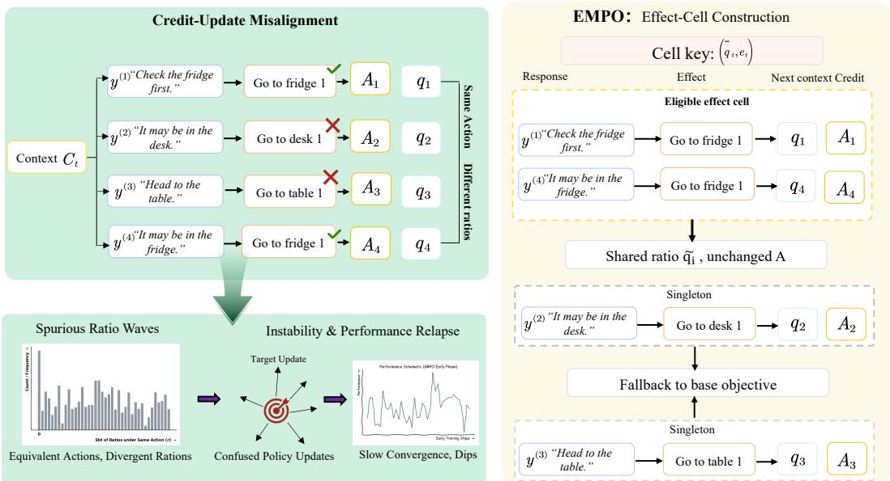  
Figure 1: Execution-equivalent responses may receive different credit and undergo divergent response-wise policy updates despite inducing the same immediate effect. Such within-effect variation can propagate into inconsistent ratio changes and unstable policy updates over training.

We refer to this mismatch between execution-level equivalence and realization-specific credit– gradient pairing as credit–update misalignment. Credit assignment determines the learning sig nal associated with a sampled decision, whereas policy optimization determines how that signal is coupled to changes in the model distribution. We find that conventional response-wise optimization contains a within-effect covariance term coupling supplied credit with realization-specific response scores. The covariance term captures the sample-wise credit–gradient pairing retained by independent response-level optimization, revealing an update-level source of variation that is distinct from the quality of the underlying credit estimator.

Based on this view, we propose Effect-Marginal Policy Optimization (EMPO), which reorganizes policy updates around executable effects rather than individual textual realizations. EMPO identifies locally comparable responses that induce the same canonical effect and shares their lengthnormalized policy ratios during optimization while retaining the original advantage assigned to each response. This factorizes effect-conditioned policy change from realization-specific credit pairing without modifying the underlying credit estimator. EMPO operates entirely on existing rollout data and introduces no additional critic, auxiliary model, reward model, or environment interaction, making it applicable to both trajectory-level and fine-grained credit estimators.

We evaluate EMPO on ALFWorld, WebShop, and Sokoban(Shridhar et al., 2021; Yao et al., 2022; Schrader, 2018) with both GRPO and GiGPO, covering trajectory-level and step-level credit estimation. Across environments and model scales, EMPO improves the overall task performance of the corresponding base algorithms. Controlled analyses further connect the optimization objective to its intended mechanism. Effect-ratio sharing changes within-cell gradient coupling and leads to measurable differences in response-probability updates after a controlled policy step, while introducing only small additional actor-side computation.

The main contributions of this work are summarized as follows. (1) We identify credit–update misalignment, a policy-optimization problem arising when execution-equivalent textual responses retain realization-specific credit–gradient pairing, and characterize it through an exact decomposi tion of the response-wise update. (2) We propose Effect-Marginal Policy Optimization (EMPO), which shares policy ratios across locally comparable, execution-equivalent responses while preserving the original advantages and requiring no additional rollouts, critics, or auxiliary models. (3)

We validate EMPO across three long-horizon agent environments, multiple model scales, and both trajectory-level and step-level credit estimators, with controlled analyses connecting the proposed objective to gradient coupling and realized policy updates.

## 2 RELATED WORK

Reinforcement Learning for LLM Agents. Reinforcement learning has become a central posttraining paradigm for improving the reasoning and decision-making capabilities of large language models. PPO (Schulman et al., 2017) remains a foundation, while critic-free and group-relative methods such as RLOO (Ahmadian et al., 2024), GRPO (Shao et al., 2024), REINFORCE++ (Hu, 2026), and DAPO (Yu et al., 2025) improve the scalability and stability of LLM reinforcement learning. More recently, GSPO (Zheng et al., 2025) moves importance weighting and clipping from the token level to the sequence level. Building on these advances, RL has increasingly been extended from single-turn reasoning to agents that interact repeatedly with external environments. RAGEN (Wang et al., 2025) studies multi-turn RL for reasoning agents in interactive environments, while Search-R1 (Jin et al., 2025), WebAgent-R1 (Wei et al., 2025b), and ToolRL (Qian et al., 2025) apply RL to search, web interaction, and tool use, respectively. Related efforts extend RL to software-engineering tasks (Wei et al., 2025a) and develop general interfaces for training heterogeneous agent workflows (Luo et al., 2025). As agentic training moves toward longer interaction horizons, recent methods also address challenges specific to multi-turn optimization, including adaptive exploration (Wang et al., 2026; Zhao et al., 2026) and training stability (Li et al., 2026b). These studies establish RL as a practical framework for improving LLM agents through interaction tasks.

Credit Assignment in Long-Horizon Decision Making. Credit assignment is a longstanding challenge in reinforcement learning, where delayed outcomes must be attributed to the intermediate decisions that produced them. Classical approaches reduce this difficulty through temporal value estimation, such as generalized advantage estimation (Schulman et al., 2018), reward shaping, or explicit redistribution of delayed returns (Arjona-Medina et al., 2019). For LLM agents, one line of work provides denser intermediate supervision through process-level reward or verification (Choudhury, 2025; Ma et al., 2026). Another line extracts finer-grained credit directly from sampled interaction trajectories without requiring an additional critic. Turn-level advantage estimation assigns localized credit across multi-turn tool interactions (Wei et al., 2026), while GiGPO (Feng et al., 2025) constructs step-level comparison groups from recurring environment states. HGPO (He et al., 2026) further accounts for historical-context consistency when constructing these comparisons. Other approaches exploit richer rollout structures. SALT (Li et al., 2026a) derives steplevel advantages from trajectory graphs, Tree-GRPO (Ding & Ye, 2026) obtains local supervision from tree-structured rollouts, and GraphGPO (Cheng et al., 2026) estimates progress using a shared state-transition graph. Recent work further studies the reliability and granularity of these estimates. ECPO (Li et al., 2026c) aggregates returns over canonical actions and calibrates low-support steplevel credit, while GACA (Liang et al., 2026) adaptively balances trajectory- and step-level advantages according to policy uncertainty. These methods primarily improve what credit is assigned, or how it is estimated, densified, and calibrated. Our work studies a complementary problem at the policy-update stage. EMPO preserves the underlying credit signal and instead changes how it is translated into policy updates when multiple textual responses share the same executable effect.

## 3 PRELIMINARIES

Long-Horizon LLM Agent RL. We consider an LLM agent interacting with an environment over $T$ steps to complete a task specified by an instruction x. At interaction step t, the environment provides an observation $o _ { t }$ , which may only partially reveal its underlying state. The agent constructs a decision context $c _ { t }$ from the task instruction and the available interaction history, and generates a textual response $y _ { t } \sim \pi _ { \theta } ( \cdot \mid c _ { t } )$ . An execution interface maps the generated response to an environment action $a _ { t } ,$ , after which the environment transitions and returns a reward $r _ { t }$ together with the next observation $o _ { t + 1 }$ . A complete episode produces an interaction trajectory $\tau = \bar { \{ } ( c _ { t } , y _ { t } , a _ { t } , r _ { t } ) \} _ { t = 1 } ^ { T }$ Depending on the observability of the environment, this interaction can be viewed as an MDP or POMDP; our formulation does not require the agent to access the underlying environment state.

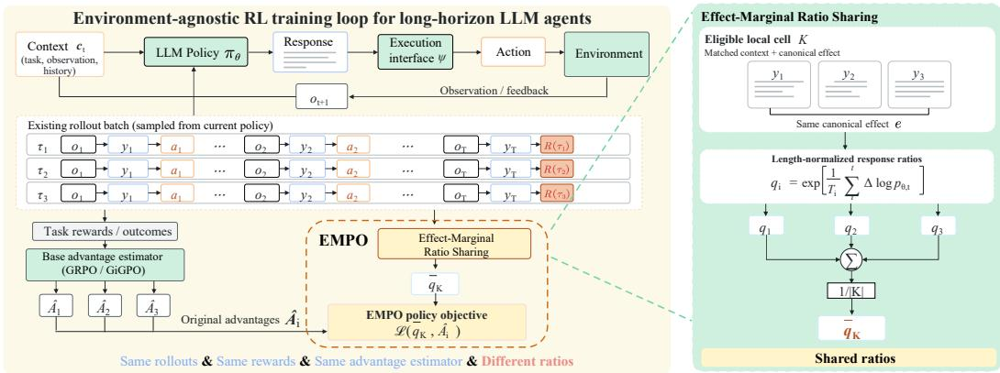  
Figure 2: Overview of Effect-Marginal Policy Optimization (EMPO). EMPO groups locally comparable responses with the same canonical execution effect and aggregates their response-level policy ratios into a shared effect ratio. The shared ratio is combined with the original advantages to coordinate policy updates across execution-equivalent responses.

Group-Based Policy Optimization. For each task, group-based RL methods sample multiple interaction trajectories and estimate relative advantages from the resulting rollout group. Let $\hat { A } _ { i , t }$ denote the advantage assigned to step t of trajectory $\tau _ { i }$ by an arbitrary advantage estimator. The estimated advantages are then used to optimize the LLM policy. Our work focuses on how these credit signals are translated into policy updates, while leaving the rollout procedure, reward function, and underlying advantage estimator unchanged.

## 4 EFFECT-MARGINAL POLICY OPTIMIZATION

We introduce Effect-Marginal Policy Optimization (EMPO), illustrated in Figure 2. EMPO operates at the policy-update stage, organizing probability changes across execution-equivalent responses while preserving the credit estimates supplied by base algorithm. We first characterize credit–update misalignment in conventional response-wise optimization, then derive a policy direction associated with an executable effect, and finally instantiate this direction in a PPO-style policy objective.

## 4.1 CREDIT–UPDATE MISALIGNMENT

At each interaction step, an LLM policy generates a textual response $y \sim \pi _ { \boldsymbol { \theta } } ( \cdot \mid c )$ under decision context c. A fixed execution interface maps the response to an executed effect

$$
e = \psi ( c , y ) ,\tag{1}
$$

such as a parsed environment action or a structured tool call. Responses with different reasoning traces, wording, or generation lengths may therefore induce the same executable effect.

We consider a local group K containing responses with comparable decision contexts and the same executed effect. Let $n = | K |$ and let ${ \hat { A } } _ { i }$ denote the advantage assigned to response i by the base algorithm. As policy changes are compared and aggregated across textual realizations with potentially different generation lengths, raw sequence-level changes introduce a length-dependent scale. We therefore characterize each response on a per-token scale. For response $y _ { i }$ of length $T _ { i }$ , define its normalized policy score at the old-policy point as

$$
s _ { i } = \left. \nabla _ { \theta } \left[ \frac { 1 } { T _ { i } } \log \pi _ { \theta } ( y _ { i } \mid c _ { i } ) \right] \right| _ { \theta = \theta _ { \mathrm { o l d } } } .\tag{2}
$$

We further write $\begin{array} { r } { \bar { A } _ { K } = n ^ { - 1 } \sum _ { i \in K } \hat { A } _ { i } } \end{array}$ and $\textstyle { \bar { s } } _ { K } = n ^ { - 1 } \sum _ { i \in K } s _ { i }$

Under equal response weights and at the old-policy point, the conventional response-wise update over K is

$$
G _ { K } ^ { \mathrm { i n d } } = \frac { 1 } { n } \sum _ { i \in K } \hat { A } _ { i } s _ { i } .\tag{3}
$$

The update retains the sample-matched product between each supplied credit ${ \hat { A } } _ { i }$ and its corresponding policy direction $s _ { i }$ . It admits the exact decomposition

$$
G _ { K } ^ { \mathrm { i n d } } = \underbrace { \bar { A } _ { K } \bar { s } _ { K } } _ { \mathrm { g r o u p - l e v e l \ : f a c t o r i z e d \ : c o m p o n e n t } } + \underbrace { \widehat { \mathrm { C o v } } _ { K } ( \hat { A } , s ) } _ { \mathrm { c r e d i t - p o l i c y - d i r e c t i o n \ : c o v a r i a n c e } }\tag{4}
$$

The covariance term captures how within-group variation in supplied credit co-varies with variation in realization-specific policy directions. Equation 4 shows how this variation enters response-wise policy updates through sample-specific credit–direction products. We call this discrepancy between execution-level equivalence and response-wise policy updating as credit–update misalignment.

## 4.2 EFFECT-CONDITIONED POLICY DIRECTION

We next characterize the policy direction associated with an executable effect. For a fixed decision context c, the response policy induces a distribution over executed effects:

$$
\pi _ { \boldsymbol { \theta } } ^ { E } ( e \mid c ) = \sum _ { y : \psi ( c , y ) = e } \pi _ { \boldsymbol { \theta } } ( y \mid c ) .\tag{5}
$$

Its score satisfies

$$
\nabla _ { \theta } \log \pi _ { \theta } ^ { E } ( e \mid c ) = \mathbb { E } _ { Y \sim \pi _ { \theta } ( \cdot \mid c , e ) } \left[ \nabla _ { \theta } \log \pi _ { \theta } ( Y \mid c ) \right] .\tag{6}
$$

The policy direction of an executable effect is therefore determined jointly by its alternative textual realizations.

Guided by this identity, we use the mean policy direction $\bar { s } _ { K }$ for locally comparable responses sharing the same effect. The corresponding factorized local update is

$$
G _ { K } ^ { \mathrm { f a c t } } = \frac { 1 } { n } \sum _ { i \in K } \hat { A } _ { i } \bar { s } _ { K } = \bar { A } _ { K } \bar { s } _ { K } = \frac { 1 } { n ^ { 2 } } \sum _ { i , j \in K } \hat { A } _ { i } s _ { j } .\tag{7}
$$

Compared with Eq. 3, this form replaces sample-matched credit–direction products with crossresponse combinations within the same context–effect group.

EMPO implements this factorization through the policy ratio while retaining the advantages supplied by the base algorithm. This confines the intervention to the policy-update stage and allows the underlying credit estimator to remain unchanged. The derivations of the effect-policy identity and the local factorization are provided in Appendix C.

## 4.3 EFFECT-MARGINAL POLICY OBJECTIVE

We instantiate the effect-conditioned direction using responses available in the rollout batch. Let B denote the set of responses in the current optimization batch, and let $\nu \subseteq B$ index responses with valid, non-truncated executions. Let $h ( c )$ denote the context representation used to determine local comparability. We define an effect cell as

$$
K ( \tilde { c } , e ) = \left\{ i \in \mathcal { V } \mid h ( c _ { i } ) = \tilde { c } , \ \psi ( c _ { i } , y _ { i } ) = e \right\} .\tag{8}
$$

The context key determines which decisions are locally comparable, while the effect key identifies their shared executable decision. Cells containing at least two responses are eligible for aggregation.

For response $i ,$ let

$$
r _ { i , t } = { \frac { \pi _ { \theta } ( y _ { i , t } \mid c _ { i } , y _ { i , < t } ) } { \pi _ { \mathrm { o l d } } ( y _ { i , t } \mid c _ { i } , y _ { i , < t } ) } }\tag{9}
$$

denote the token-level likelihood ratio. Since EMPO aggregates policy changes across multiple textual realizations, directly aggregating full-sequence ratios would make the result sensitive to response length, as log-ratio changes accumulate over generated tokens. We normalize the sequence log-ratio by generation length and define the response ratio

$$
q _ { i } = \exp \left[ \frac 1 { T _ { i } } \sum _ { t = 1 } ^ { T _ { i } } \log r _ { i , t } \right] .\tag{10}
$$

For each eligible effect cell, EMPO averages these response ratios:

$$
\bar { q } _ { K } = \frac { 1 } { \vert K \vert } \sum _ { j \in K } q _ { j } .\tag{11}
$$

At the old-policy point, $q _ { i } ( \theta _ { \mathrm { o l d } } ) = 1$ and

$$
\nabla _ { \theta } q _ { i } | _ { \theta = \theta _ { \mathrm { o l d } } } = s _ { i } , \qquad \nabla _ { \theta } \bar { q } _ { K } | _ { \theta = \theta _ { \mathrm { o l d } } } = \bar { s } _ { K } .\tag{12}
$$

The shared ratio therefore realizes the effect-conditioned policy direction in Eq. 7 within the optimization objective.

For response i, we define the effective ratio

$$
\begin{array} { r } { \widetilde { r } _ { i , t } = \left\{ \begin{array} { l l } { \bar { q } _ { K ( i ) } , } & { i \in \mathcal { V } \mathrm { a n d } | K ( i ) | \geq 2 , } \\ { r _ { i , t } , } & { \mathrm { o t h e r w i s e } . } \end{array} \right. } \end{array}\tag{13}
$$

The EMPO loss is

$$
\mathcal { L } _ { \mathrm { E M P O } } ( \theta ) = - \frac { 1 } { \sum _ { i \in \mathcal { B } } T _ { i } } \sum _ { i \in \mathcal { B } } \sum _ { t = 1 } ^ { T _ { i } } \operatorname* { m i n } \left( \widetilde { r } _ { i , t } \hat { A } _ { i } , \ : \mathrm { c l i p } \big ( \widetilde { r } _ { i , t } , 1 - \epsilon , 1 + \epsilon \big ) \hat { A } _ { i } \right) .\tag{14}
$$

Eligible responses share the cell-level ratio while retaining their individual advantages. Responses outside eligible cells use the original token-level ratio. EMPO requires no additional environment interaction, critic, or auxiliary model. Additional theoretical results are provided in Appendix C.

## 5 EXPERIMENTS

We first evaluate the task performance and learning efficiency of EMPO on long-horizon agent benchmarks (Section 5.2). We then ablate the three operations underlying the effect-marginal update (Section 5.3). Finally, we examine the resulting policy-update structure (Section 5.4) and characterize the effect cells available for ratio sharing throughout training (Section 5.5).

## 5.1 EXPERIMENTAL SETUP

Tasks. We evaluate EMPO on three long-horizon agent benchmarks: ALFWorld (Shridhar et al., 2021), WebShop (Yao et al., 2022), and Sokoban (Schrader, 2018). ALFWorld evaluates multi-step decision making in household environments and contains 3,827 task instances across six categories: Pick & Place, Examine in Light, Clean & Place, Heat & Place, Cool & Place, and Pick Two & Place. WebShop requires agents to search, navigate, and purchase products in a simulated shopping website containing over 1.1 million products and 12,000 user instructions. Sokoban evaluates sequential visual planning through box-pushing puzzles. We report success rate (SR) on all three benchmarks and additionally report the average task score on WebShop to capture partial task completion.

Baselines. We compare against three groups of baselines: (1) closed-source LLMs, including GPT-4o (Hurst et al., 2024) and Gemini-2.5-Pro (Comanici et al., 2025); (2) prompting-based agents, including direct prompting with Qwen2.5-Instruct, ReAct (Yao et al., 2023), and Reflexion (Shinn et al., 2023); and (3) reinforcement learning methods, including PPO (Schulman et al., 2017), RLOO (Ahmadian et al., 2024), GRPO (Shao et al., 2024), and GiGPO (Feng et al., 2025). We instantiate EMPO on GRPO and GiGPO, two representative RL algorithms with trajectory-level and step-level advantage estimation, yielding EMPO-G and EMPO-GiG.

Training details. We use Qwen2.5-1.5B-Instruct and Qwen2.5-7B-Instruct (Qwen et al., 2025) for ALFWorld and WebShop, and Qwen2.5-VL-3B-Instruct (Bai et al., 2025) for Sokoban. For each base algorithm and its EMPO counterpart, we use the same model initialization, rollout configuration, training budget, and hyperparameter settings. The rollout group size is set to 8 for all group-based RL experiments. We train and evaluate each main setting with three random seeds and report mean ± standard deviation. Full training details are provided in Appendix D.

Table 1: Performance comparison on ALFWorld and WebShop benchmarks. Results are reported as mean ± std over 3 random seeds. ∆ denotes the change from the corresponding baseline.
<table><tr><td rowspan="2">Method</td><td colspan="7">ALFWorld</td><td colspan="2">WebShop</td></tr><tr><td>Pick</td><td>Look</td><td>Clean</td><td>Heat</td><td>Cool</td><td>Pick2</td><td>All</td><td>Score</td><td>Success</td></tr><tr><td colspan="10">Closed-source models</td></tr><tr><td>Prompting</td><td></td><td></td><td></td><td></td><td></td><td></td><td></td><td></td><td></td></tr><tr><td>GPT-40</td><td>75.3</td><td>60.8</td><td>31.2</td><td>56.7</td><td>21.6</td><td>49.8</td><td>48.0</td><td>31.8</td><td>23.7</td></tr><tr><td>Gemini-2.5-Pro</td><td>92.8</td><td>63.3</td><td>62.1</td><td>69.0</td><td>26.6</td><td>58.7</td><td>60.3</td><td>42.5</td><td>35.9</td></tr><tr><td colspan="10">Qwen2.5-1.5B-Instruct</td></tr><tr><td>Prompting</td><td></td><td></td><td></td><td></td><td></td><td></td><td>4.1</td><td></td><td></td></tr><tr><td>Qwen2.5</td><td>5.9</td><td>5.5</td><td>3.3</td><td>9.7</td><td>4.2</td><td>0.0</td><td></td><td>23.1</td><td>5.2 11.3</td></tr><tr><td>ReAct Reflexion</td><td>17.4</td><td>20.5</td><td>15.7</td><td>6.2</td><td>7.7</td><td>2.0</td><td>12.8</td><td>40.1</td><td></td></tr><tr><td></td><td>35.3</td><td>22.2</td><td>21.7</td><td>13.6</td><td>19.4</td><td>3.7</td><td>21.8</td><td>55.8</td><td>21.9</td></tr><tr><td colspan="10">RL Training</td></tr><tr><td>PPO</td><td> $6 4 . 8 ^ { \pm 3 . 5 }$ </td><td> $4 0 . 5 ^ { \pm 6 . 9 }$ </td><td> $5 7 . 1 ^ { \pm 4 . 9 }$ </td><td> $6 0 . 6 ^ { \pm 6 . 6 }$ </td><td> $4 6 . 4 ^ { \pm 4 . 0 }$ </td><td> $4 7 . 4 ^ { \pm 1 . 9 }$ </td><td> $5 4 . 4 ^ { \pm 3 . 1 }$ </td><td> $7 3 . 8 ^ { \pm 3 . 0 }$ </td><td> $5 1 . 5 ^ { \pm 2 . 9 }$ </td></tr><tr><td>RLOO</td><td> $8 8 . 3 ^ { \pm 3 . 0 }$ </td><td> $5 2 . 8 ^ { \pm 8 . 6 }$ </td><td> $7 1 . 0 ^ { \pm 5 . 9 }$ </td><td> $6 2 . 8 ^ { \pm 8 . 7 }$ </td><td> $6 6 . 4 ^ { \pm 5 . 5 }$ </td><td> $5 6 . 9 ^ { \pm 4 . 7 }$ </td><td> $6 9 . 7 ^ { \pm 2 . 5 }$ </td><td> $7 3 . 9 ^ { \pm 5 . 6 }$ </td><td> $5 2 . 1 ^ { \pm 6 . 7 }$ </td></tr><tr><td>GRPO</td><td> $7 5 . 0 ^ { \pm 1 4 . 4 }$ </td><td> $5 6 . 9 ^ { \pm 2 1 . 4 }$ </td><td> $7 1 . 7 ^ { \pm 1 5 . 4 }$ </td><td> $8 4 . 1 ^ { \pm 9 . 7 }$ </td><td> $7 9 . 5 ^ { \pm 1 2 . 0 }$ </td><td> $4 6 . 1 ^ { \pm 1 9 . 2 }$ </td><td> $6 9 . 5 ^ { \pm 1 1 . 1 }$ </td><td> $7 6 . 1 ^ { \pm 2 . 0 }$ </td><td> $6 2 . 8 ^ { \pm 1 . 6 }$ </td></tr><tr><td>EMPO-G</td><td> ${ \bf 9 3 . 1 ^ { \pm 4 . 5 } }$ </td><td> ${ \bf 6 6 . 7 ^ { \pm 1 9 . 1 } }$ </td><td> ${ \bf 8 1 . 6 ^ { \pm 4 . 0 } }$ </td><td> $\mathbf { 9 2 . 3 ^ { \pm 7 . 7 } }$ </td><td> ${ \bf 8 3 . 3 ^ { \pm 3 . 6 } }$ </td><td> ${ \bf 7 3 . 8 ^ { \pm 9 . 0 } }$ </td><td> ${ \bf 8 3 . 3 ^ { \pm 3 . 5 } }$ </td><td> ${ \bf 8 3 . 1 ^ { \pm 1 . 3 } }$ </td><td> ${ \bf 7 0 . 3 ^ { \pm 2 . 1 } }$ </td></tr><tr><td>∆ vs. GRPO</td><td> $+ 1 8 . 1$ </td><td> $+ 9 . 8$ </td><td> $+ 9 . 9$ </td><td> $+ 8 . 2$ </td><td> $+ 3 . 8$ </td><td> $+ 2 7 . 7$ </td><td> $+ 1 3 . 8$ </td><td> $+ 7 . 0$ </td><td> $+ 7 . 5$ </td></tr><tr><td>GiGPO</td><td> $9 8 . 0 ^ { \pm 1 . 7 }$ </td><td> $7 0 . 8 ^ { \pm 7 . 2 }$ </td><td> $9 3 . 1 ^ { \pm 6 . 0 }$ </td><td> $8 9 . 7 ^ { \pm 4 . 4 }$ </td><td> $8 1 . 3 ^ { \pm 6 . 3 }$ </td><td> $8 8 . 1 ^ { \pm 9 . 0 }$ </td><td> $9 0 . 1 ^ { \pm 2 . 3 } $ </td><td> $8 6 . 5 ^ { \pm 3 . 3 }$ </td><td> $7 3 . 8 ^ { \pm 0 . 6 }$ </td></tr><tr><td>EMPO-GiG</td><td> $\mathbf { 9 9 . 0 ^ { \pm 1 . 7 } }$ </td><td> ${ \bf 7 5 . 0 ^ { \pm 1 2 . 5 } }$ </td><td> $9 3 . 1 ^ { \pm 0 . 0 }$ </td><td> $\mathbf { 1 0 0 . 0 ^ { \pm 0 . 0 } }$ </td><td> $\mathbf { 9 1 . 7 ^ { \pm 3 . 6 } }$ </td><td> $\mathbf { 9 2 . 9 ^ { \pm 3 . 6 } }$ </td><td> $\mathbf { 9 4 . 0 ^ { \pm 1 . 2 } }$ </td><td> ${ \bf 8 7 . 9 ^ { \pm 1 . 4 } }$ </td><td> ${ \bf 7 7 . 3 ^ { \pm 3 . 3 } }$ </td></tr><tr><td>∆ vs. GiGPO</td><td> $+ 1 . 0$ </td><td> $+ 4 . 2$ </td><td>0.0</td><td>+10.3</td><td> $+ 1 0 . 4$ </td><td> $+ 4 . 8$ </td><td> $+ 3 . 9$ </td><td> $+ 1 . 4$ </td><td>+3.5</td></tr><tr><td colspan="10">Qwen2.5-7B-Instruct</td></tr><tr><td colspan="10"></td></tr><tr><td>Qwen2.5</td><td>33.4</td><td>21.6</td><td>19.3</td><td>6.9</td><td>2.8</td><td>3.2</td><td>14.8</td><td>26.4</td><td>7.8</td></tr><tr><td>ReAct</td><td>48.5</td><td>35.4</td><td>34.3</td><td>13.2</td><td>18.2</td><td>17.6</td><td>31.2</td><td>46.2</td><td>19.5</td></tr><tr><td>Reflexion</td><td>62.0</td><td>41.6</td><td>44.9</td><td>30.9</td><td>36.3</td><td>23.8</td><td>42.7</td><td>58.1</td><td>28.8</td></tr><tr><td colspan="10">RL Training</td></tr><tr><td>PPO</td><td> $9 2 . 3 ^ { \pm 4 . 0 }$ </td><td> $6 4 . 0 ^ { \pm 8 . 4 }$ </td><td> $9 2 . 5 ^ { \pm 2 . 4 }$ </td><td> $8 9 . 5 ^ { \pm 7 . 0 }$ </td><td> $8 0 . 3 ^ { \pm 2 . 0 }$ </td><td> $6 8 . 8 ^ { \pm 8 . 3 }$ </td><td> $8 0 . 4 ^ { \pm 2 . 7 }$ </td><td> $8 1 . 4 ^ { \pm 3 . 1 }$ </td><td> $6 8 . 7 ^ { \pm 5 . 1 }$ </td></tr><tr><td>RLOO</td><td> $8 7 . 6 ^ { \pm 4 . 3 }$ </td><td> $7 8 . 2 ^ { \pm 8 . 3 }$ </td><td> $8 7 . 3 ^ { \pm 5 . 8 }$ </td><td> $8 1 . 3 ^ { \pm 7 . 6 }$ </td><td> $7 1 . 9 ^ { \pm 5 . 2 }$ </td><td> $4 8 . 9 ^ { \pm 8 . 4 }$ </td><td> $7 5 . 5 ^ { \pm 4 . 6 }$ </td><td> $8 0 . 3 ^ { \pm 3 . 2 }$ </td><td> $6 5 . 7 ^ { \pm 4 . 0 }$ </td></tr><tr><td>GRPO</td><td> $9 4 . 0 ^ { \pm 4 . 5 }$ </td><td> $5 3 . 0 ^ { \pm 2 9 . 9 }$ </td><td> $8 8 . 2 ^ { \pm 4 . 8 }$ </td><td> $5 7 . 8 ^ { \pm 2 2 . 7 }$ </td><td> $6 2 . 6 ^ { \pm 2 2 . 2 }$ </td><td> $5 6 . 5 ^ { \pm 7 . 5 }$ </td><td> $7 1 . 9 ^ { \pm 9 . 0 }$ </td><td> $8 4 . 4 ^ { \pm 1 . 8 }$ </td><td> $7 5 . 8 ^ { \pm 3 . 4 }$ </td></tr><tr><td>EMPO-G</td><td> $\mathbf { 9 4 . 8 ^ { \pm 1 . 8 } }$ </td><td> ${ \bf 6 2 . 5 ^ { \pm 1 2 . 5 } }$ </td><td> $7 7 . 1 ^ { \pm 1 1 . 0 }$ </td><td> $5 0 . 0 ^ { \pm 1 7 . 3 }$ </td><td> ${ \bf 7 5 . 9 ^ { \pm 1 4 . 0 } }$ </td><td> ${ \bf 8 5 . 7 ^ { \pm 6 . 2 } }$ </td><td> ${ \bf 8 0 . 2 ^ { \pm 5 . 2 } }$ </td><td> $\mathbf { 8 8 . 1 ^ { \pm 3 . 9 } }$ </td><td> ${ \bf 7 7 . 3 ^ { \pm 3 . 5 } }$ </td></tr><tr><td>∆ vs. GRPO</td><td> $+ 0 . 8$ </td><td> $+ 9 . 5$ </td><td> $- 1 1 . 1$ </td><td> $- 7 . 8$ </td><td> $+ 1 3 . 3$ </td><td> $+ 2 9 . 2$ </td><td> $+ 8 . 3$ </td><td> $+ 3 . 7$ </td><td> $+ 1 . 5$ </td></tr><tr><td>GiGPO</td><td> $9 7 . 1 ^ { \pm 2 . 9 }$ </td><td> $7 8 . 6 ^ { \pm 6 . 2 }$ </td><td> $1 0 0 . 0 ^ { \pm 0 . 0 }$ </td><td> $7 3 . 3 ^ { \pm 2 3 . 1 }$ </td><td> $9 2 . 6 ^ { \pm 8 . 5 }$ </td><td> $9 4 . 8 ^ { \pm 1 . 8 }$ </td><td> $9 3 . 5 ^ { \pm 2 . 3 }$ </td><td> $8 5 . 1 ^ { \pm 2 . 6 }$ </td><td> $7 2 . 1 ^ { \pm 1 . 8 }$ </td></tr><tr><td>EMPO-GiG</td><td> $\mathbf { 9 8 . 0 ^ { \pm 3 . 4 } }$ </td><td> $\mathbf { 9 5 . 2 ^ { \pm 8 . 2 } }$ </td><td> $9 7 . 1 ^ { \pm 5 . 0 }$ </td><td> $\mathbf { 9 6 . 3 ^ { \pm 6 . 4 } }$ </td><td> $8 4 . 6 ^ { \pm 8 . 5 }$ </td><td> $9 3 . 3 ^ { \pm 6 . 5 }$ </td><td> $\mathbf { 9 4 . 5 ^ { \pm 2 . 8 } }$ </td><td> $\mathbf { 8 9 . 5 ^ { \pm 3 . 0 } }$ </td><td> ${ \bf 7 9 . 7 ^ { \pm 3 . 4 } }$ </td></tr><tr><td>∆ vs. GiGPO</td><td> $+ 0 . 9$ </td><td> $+ 1 6 . 6$ </td><td> $- 2 . 9$ </td><td> $+ 2 3 . 0$ </td><td>-8.0</td><td> $- 1 . 5$ </td><td> $+ 1 . 0$ </td><td> $+ 4 . 4$ </td><td> $+ 7 . 6$ </td></tr></table>

Table 2: Success rates on Sokoban with Qwen2.5-VL-3B-Instruct.
<table><tr><td>Type</td><td>Method</td><td>SR</td></tr><tr><td>Prompting</td><td>Qwen2.5-VL</td><td>11.7</td></tr><tr><td>RL Training</td><td>GRPO</td><td>72.7</td></tr><tr><td rowspan="4"></td><td>EMPO-G ∆</td><td>84.4 +11.7</td></tr><tr><td>GiGPO</td><td>75.0</td></tr><tr><td>EMPO-GiG</td><td>81.3</td></tr><tr><td>∆</td><td>+6.3</td></tr></table>

Table 3: Training steps to reach 60% success $\left( \mathrm { T T } \mathrm { T } _ { 6 0 } \right)$ reported as mean ± std over three seeds.
<table><tr><td></td><td>Model Method Env.</td><td></td><td></td><td>Base ↓ +EMPO ↓ Red. ↑</td><td></td></tr><tr><td rowspan="2">1.5B</td><td>GRPO GiGPO</td><td>ALFWorld</td><td> $1 0 8 . 3 { \pm } 1 5 . 3 $   $7 3 . 3 { \pm } 2 0 . 2 $ </td><td> ${ \bf 7 3 . 3 \pm 1 2 . 6 }$   ${ \bf 5 1 . 7 \pm 7 . 6 }$ </td><td>32.3% 29.5%</td></tr><tr><td>GRPO GiGPO</td><td>WebShop</td><td> $1 2 1 . 7 { \pm } 1 2 . 6 $   $8 0 . 0 { \pm } 4 . 6 $ </td><td> $\mathbf { 9 3 . 3 \pm 2 0 . 8 }$   $\mathbf { 7 3 . 3 \pm 1 2 . 6 }$ </td><td>23.3% 8.4%</td></tr><tr><td rowspan="3">7B</td><td>GRPO GiGPO</td><td>ALFWorld</td><td> $5 8 . 3 { \pm } 2 . 9 $   $3 6 . 7 { \pm } 7 . 6 $ </td><td> ${ \bf 4 1 . 7 \pm 5 . 8 }$   $\mathbf { 2 3 . 3 } { \pm } \mathbf { 2 . 9 }$ </td><td>28.5% 36.5%</td></tr><tr><td>GRPO</td><td></td><td> $5 8 . 3 { \pm } 1 5 . 3 $ </td><td> ${ \bf 5 5 . 0 { \pm } 0 . 0 }$ </td><td>5.7%</td></tr><tr><td>GiGPO</td><td>WebShop</td><td> $5 0 . 0 { \pm } 5 . 1 $ </td><td> ${ \bf 4 8 . 3 \pm 5 . 8 }$ </td><td>3.4%</td></tr></table>

## 5.2 TASK PERFORMANCE AND LEARNING EFFICIENCY

Table 1 presents the main results on ALFWorld and WebShop. EMPO consistently improves the aggregate performance of both GRPO and GiGPO across model scales, covering trajectory-level and step-level advantage estimation. With Qwen2.5-1.5B-Instruct, EMPO-G improves the overall ALFWorld success rate from 69.5% to 83.3% and the WebShop success rate from 62.8% to 70.3%. EMPO-GiG further improves the corresponding GiGPO results from 90.1% to 94.0% on ALFWorld and from 73.8% to 77.3% on WebShop. The gains persist with Qwen2.5-7B-Instruct, where both EMPO variants achieve stronger overall performance on ALFWorld and WebShop.

We additionally evaluate EMPO on Sokoban with Qwen2.5-VL-3B-Instruct. As shown in Table 2, EMPO-G improves the success rate from 72.7% to 84.4%, while EMPO-GiG improves it from

Table 4: Ablation results using Qwen2.5-1.5B-Instruct.
<table><tr><td>Method</td><td>ALFWorld SR</td><td>WebShop Score</td><td>WebShop SR</td></tr><tr><td>EMPO-G</td><td>83.3</td><td>83.1</td><td>70.3</td></tr><tr><td>w/o Length Normalization</td><td>61.7</td><td>43.3</td><td>27.3</td></tr><tr><td>w/o Ratio Sharing</td><td>79.7</td><td>65.3</td><td>55.5</td></tr><tr><td>w/o Effect-Based Grouping</td><td>78.9</td><td>77.5</td><td>64.1</td></tr><tr><td>EMPO-GiG</td><td>94.0</td><td>87.9</td><td>77.3</td></tr><tr><td>w/o Length Normalization</td><td>60.2</td><td>75.2</td><td>43.8</td></tr><tr><td>w/o Ratio Sharing</td><td>90.6</td><td>84.5</td><td>72.7</td></tr><tr><td>w/o Effect-Based Grouping</td><td>92.2</td><td>84.9</td><td>73.4</td></tr></table>

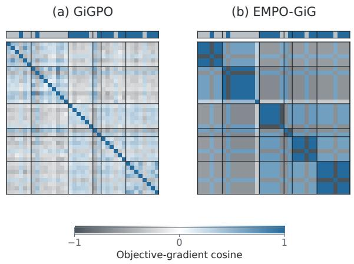

(c) Realized update dispersion  
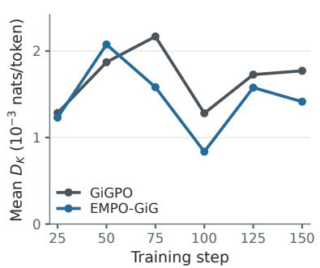  
Figure 3: Policy-update analysis on ALFWorld with Qwen2.5-1.5B-Instruct. Panels (a) and (b) show pairwise cosine similarities of response-level objective gradients under GiGPO and EMPO-GiG. Black lines mark effect-cell boundaries and the top strips indicate advantage signs. Panel (c) reports the within-cell dispersion $D _ { K }$ of log-probability changes after controlled one-step updates.

75.0% to 81.3%. Together, the results across ALFWorld, WebShop, and Sokoban demonstrate consistent gains across text-based interaction and visual planning, different model scales, and different advantage-estimation granularities.

Beyond final task performance, EMPO also improves learning efficiency. Table 3 reports the training steps required to first reach a 60% success rate $\left( \mathrm { T T } \mathrm { T } _ { 6 0 } \right)$ . Across all eight evaluated model– algorithm–environment settings, EMPO reduces $\mathrm { T T T _ { 6 0 } }$ , with the largest reduction reaching 36.5%. The corresponding learning curves are provided in Appendix E.4.

## 5.3 ABLATION STUDY

We ablate the three operations underlying EMPO, including length normalization, effect-based grouping, and ratio sharing. As shown in Table 4, all three components contribute to the effectiveness of the effect-marginal update. Removing length normalization makes response-level ratios increasingly sensitive to generation length, allowing accumulated token-level probability changes in longer responses to exert a larger influence on the shared ratio. Disabling ratio sharing preserves the normalized response ratio but restores realization-specific policy directions, weakening coordinated updates among execution-equivalent responses. Replacing effect-based cells with arbitrary groups couples responses without preserving executable-effect consistency, introducing interference between policy updates associated with different effects. These results show that length normalization calibrates policy changes across responses, effect-based grouping determines an appropriate coupling structure, and ratio sharing realizes coordinated policy updates within each effect cell.

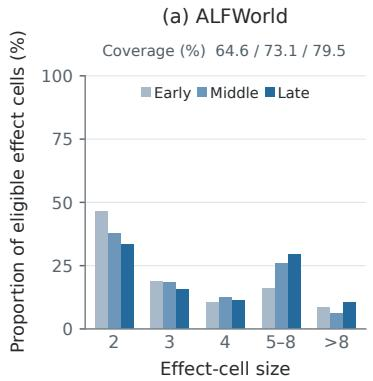

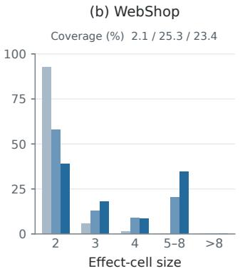

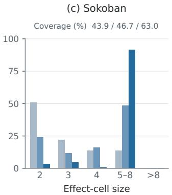  
Figure 4: Effect-cell size distributions of EMPO-GiG at different training stages. Bars show the proportion of eligible cells in each size range, while response coverage measures the fraction of sampled responses assigned to eligible cells with $| K | \geq 2 .$

## 5.4 POLICY-UPDATE ANALYSIS

We further analyze how EMPO changes policy updates among execution-equivalent responses. Panels (a) and (b) of Figure 3 show the pairwise cosine similarities between response-level objective gradients. After ratio sharing, gradients within the same effect cell exhibit a clearer coupling structure, consistent with the factorized update in Section 4.

To examine the realized policy change, for each response i we define

$$
\Delta _ { i } = \frac { 1 } { T _ { i } } \left[ \log \pi _ { \theta ^ { \prime } } ( y _ { i } \mid c _ { i } ) - \log \pi _ { \theta } ( y _ { i } \mid c _ { i } ) \right] ,
$$

where $\theta ^ { \prime }$ denotes the parameters after a controlled one-step update. For an effect cell $K$ , we define the within-cell update dispersion as $D _ { K } = \mathrm { S t d } _ { i \in K } ( \Delta _ { i } )$ . Panel (c) reports the mean $D _ { K }$ over sampled eligible cells. EMPO-GiG yields lower within-cell dispersion overall, indicating more coordinated realized policy updates.

## 5.5 EFFECT-CELL STATISTICS

We further examine how often eligible effect cells arise during training. Figure 4 shows the effectcell size distribution at early, middle, and late training stages, together with the fraction of sampled responses covered by cells with $| K | \ge 2$ . Coverage increases from 64.6% to 79.5% on ALFWorld and from 43.9% to 63.0% on Sokoban, while WebShop reaches 25.3% at the middle stage and 23.4% at the late stage. The corresponding size distributions also contain cells with more than two responses, providing repeated opportunities for effect-level ratio sharing throughout training.

## 6 CONCLUSION

We presented Effect-Marginal Policy Optimization (EMPO) for long-horizon LLM agent reinforcement learning. We identified credit–update misalignment, where execution-equivalent textual responses remain associated with realization-specific policy updates, and characterized its effect through an exact decomposition of the response-wise update. EMPO addresses this mismatch by sharing length-normalized policy ratios among locally comparable responses with the same executable effect while preserving the advantages provided by the base algorithm. Experiments on ALFWorld, WebShop, and Sokoban show that EMPO consistently improves both task performance and learning efficiency across different model scales and advantage estimators. Further analysis shows that effect-level ratio sharing induces more structured within-cell gradient coupling and more coordinated policy updates among execution-equivalent responses. These results demonstrate the effectiveness of effect-marginal policy optimization for long-horizon LLM agent training.

## REFERENCES

Arash Ahmadian, Chris Cremer, Matthias Galle, Marzieh Fadaee, Julia Kreutzer, Olivier Pietquin,´ Ahmet Ust¨ un, and Sara Hooker. Back to basics: Revisiting REINFORCE-style optimization for¨ learning from human feedback in LLMs. In Proceedings of the 62nd Annual Meeting of the Associationfor Computational Linguistics (Volume 1: Long Papers), August 2024.

Jose A. Arjona-Medina, Michael Gillhofer, Michael Widrich, Thomas Unterthiner, Johannes Brand stetter, and Sepp Hochreiter. Rudder: Return decomposition for delayed rewards, 2019. URL https://arxiv.org/abs/1806.07857.

Shuai Bai, Keqin Chen, Xuejing Liu, Jialin Wang, Wenbin Ge, Sibo Song, Kai Dang, Peng Wang, Shijie Wang, Jun Tang, Humen Zhong, Yuanzhi Zhu, Mingkun Yang, Zhaohai Li, Jianqiang Wan, Pengfei Wang, Wei Ding, Zheren Fu, Yiheng Xu, Jiabo Ye, Xi Zhang, Tianbao Xie, Zesen Cheng, Hang Zhang, Zhibo Yang, Haiyang Xu, and Junyang Lin. Qwen2.5-vl technical report, 2025. URL https://arxiv.org/abs/2502.13923.

Xin Cheng, Shuo He, Lang Feng, Haiyang Xu, Ming Yan, Lei Feng, and Bo An. Beyond trajectorylevel attribution: Graph-based credit assignment for agentic reinforcement learning. In Forty-third International Conference on Machine Learning, 2026. URL https://openreview.net/ forum?id=zAFrIOeTCp.

Sanjiban Choudhury. Process reward models for llm agents: Practical framework and directions, 2025. URL https://arxiv.org/abs/2502.10325.

Gheorghe Comanici, Eric Bieber, Mike Schaekermann, et al. Gemini 2.5: Pushing the frontier with advanced reasoning, multimodality, long context, and next generation agentic capabilities, 2025. URL https://arxiv.org/abs/2507.06261.

Zheng Ding and Weirui Ye. TreeGRPO: Tree-advantage GRPO for online RL post-training of diffusion models. In The Fourteenth International Conference on Learning Representations, 2026. URL https://openreview.net/forum?id=3rZdp4TmUb.

Lang Feng, Zhenghai Xue, Tingcong Liu, and Bo An. Group-in-group policy optimization for llm agent training. arXiv preprint arXiv:2505.10978, 2025.

Shuo He, Lang Feng, Qi Wei, Xin Cheng, Lei Feng, and Bo An. Hierarchy-of-groups policy optimization for long-horizon agentic tasks. In The Fourteenth International Conference on Learning Representations, 2026. URL https://openreview.net/forum?id=T8Dev99qnz.

Jian Hu. Reinforce++: A simple and efficient approach for aligning large language models. arXiv preprint arXiv:2501.03262, 2026.

Aaron Hurst, Adam Lerer, Adam P. Goucher, et al. Gpt-4o system card, 2024. URL https: //arxiv.org/abs/2410.21276.

Bowen Jin, Hansi Zeng, Zhenrui Yue, Jinsung Yoon, Sercan Arik, Dong Wang, Hamed Zamani, and Jiawei Han. Search-r1: Training llms to reason and leverage search engines with reinforcement learning. arXiv preprint arXiv:2503.09516, 2025.

Jiazheng Li, Yawei Wang, Qiaojing Yan, Yijun Tian, Zhichao Xu, Huan Song, Panpan Xu, and Lin Lee Cheong. SALT: Step-level advantage assignment for long-horizon agents via trajectory graph. In Vera Demberg, Kentaro Inui, and Llu´ıs Marquez (eds.), Findings of the Associationfor Computational Linguistics: EACL 2026, pp. 4709–4725, Rabat, Morocco, March 2026a. Association for Computational Linguistics. ISBN 979-8-89176-386-9. doi: 10.18653/v1/2026. findings-eacl.247. URL https://aclanthology.org/2026.findings-eacl.247/.

Junbo Li, Peng Zhou, Rui Meng, Meet P. Vadera, Lihong Li, and Yang Li. Turn-PPO: Turn-level advantage estimation with PPO for improved multi-turn RL in agentic LLMs. In Vera Demberg, Kentaro Inui, and Llu´ıs Marquez (eds.), Findings of the Association for Computational Linguistics: EACL 2026, pp. 6227–6243, Rabat, Morocco, March 2026b. Association for Computational Linguistics. ISBN 979-8-89176-386-9. doi: 10.18653/v1/2026.findings-eacl.328. URL https://aclanthology.org/2026.findings-eacl.328/.

Yuanfan Li, Qi Zhou, Wenjing Duan, and Lu Chen. When denser credit is not enough: Evidencecalibrated policy optimization for long-horizon llm agent training, 2026c. URL https: //arxiv.org/abs/2606.05885.

Taoran Liang, Yang Liu, Shang Luo, Yingguang Yang, Rongrong Zhang, Yingzong Min, Yulin Huang, Jianshen Zhang, Yongzhi Qi, Kefu Xu, Congjing Ran, and Bin Chong. Granularityadaptive credit assignment for long-horizon llm agent reinforcement learning, 2026. URL https://arxiv.org/abs/2609.12424.

Xufang Luo, Yuge Zhang, Zhiyuan He, Zilong Wang, Siyun Zhao, Dongsheng Li, Luna K. Qiu, and Yuqing Yang. Agent lightning: Train any ai agents with reinforcement learning, 2025. URL https://arxiv.org/abs/2508.03680.

Da Ma, Ziyue Yang, Hongshen Xu, Haotian Fang, Kai Yu, and Lu Chen. Empowering LLM tool invocation with tool-call reward model. In The Fourteenth International Conference on Learning Representations, 2026. URL https://openreview.net/forum?id=LnBEASInVr.

Cheng Qian, Emre Can Acikgoz, Qi He, Hongru WANG, Xiusi Chen, Dilek Hakkani-Tur, Gokhan Tur, and Heng Ji. Toolrl: Reward is all tool learning needs. In D. Belgrave, C. Zhang, H. Lin, R. Pascanu, P. Koniusz, M. Ghassemi, and N. Chen (eds.), Advances in Neural Information Processing Systems, volume 38, Main Conference, pp. 105523–105553. Curran Associates, Inc., 2025. doi: 10.52202/ 085713-3524. URL https://proceedings.neurips.cc/paper\_files/paper/ 2025/file/97c5b2707228e7e3fb67e4ecc2e0e607-Paper-Conference.pdf.

Qwen, :, An Yang, Baosong Yang, Beichen Zhang, Binyuan Hui, Bo Zheng, Bowen Yu, Chengyuan Li, Dayiheng Liu, Fei Huang, Haoran Wei, Huan Lin, Jian Yang, Jianhong Tu, Jianwei Zhang, Jianxin Yang, Jiaxi Yang, Jingren Zhou, Junyang Lin, Kai Dang, Keming Lu, Keqin Bao, Kexin Yang, Le Yu, Mei Li, Mingfeng Xue, Pei Zhang, Qin Zhu, Rui Men, Runji Lin, Tianhao Li, Tianyi Tang, Tingyu Xia, Xingzhang Ren, Xuancheng Ren, Yang Fan, Yang Su, Yichang Zhang, Yu Wan, Yuqiong Liu, Zeyu Cui, Zhenru Zhang, and Zihan Qiu. Qwen2.5 technical report, 2025. URL https://arxiv.org/abs/2412.15115.

Max-Philipp B. Schrader. gym-sokoban. https://github.com/mpSchrader/ gym-sokoban, 2018.

John Schulman, Filip Wolski, Prafulla Dhariwal, Alec Radford, and Oleg Klimov. Proximal policy optimization algorithms, 2017. URL https://arxiv.org/abs/1707.06347.

John Schulman, Philipp Moritz, Sergey Levine, Michael Jordan, and Pieter Abbeel. Highdimensional continuous control using generalized advantage estimation, 2018. URL https: //arxiv.org/abs/1506.02438.

Zhihong Shao, Peiyi Wang, Qihao Zhu, Runxin Xu, Junxiao Song, Xiao Bi, Haowei Zhang, Mingchuan Zhang, Y. K. Li, Y. Wu, and Daya Guo. Deepseekmath: Pushing the limits of mathematical reasoning in open language models, 2024. URL https://arxiv.org/abs/2402. 03300.

Noah Shinn, Federico Cassano, Ashwin Gopinath, Karthik R Narasimhan, and Shunyu Yao. Reflexion: language agents with verbal reinforcement learning. In Thirty-seventh Conference on Neural Information Processing Systems, 2023. URL https://openreview.net/forum? id=vAElhFcKW6.

Mohit Shridhar, Xingdi Yuan, Marc-Alexandre Cotˆ e, Yonatan Bisk, Adam Trischler, and Matthew´ Hausknecht. ALFWorld: Aligning Text and Embodied Environments for Interactive Learning. In Proceedings of the International Conference on Learning Representations (ICLR), 2021. URL https://arxiv.org/abs/2010.03768.

Haixin Wang, Hejie Cui, Chenwei Zhang, Xin Liu, Shuowei Jin, Shijie Geng, Xinyang Zhang, Nasser Zalmout, Zhenyu Shi, and Yizhou Sun. T 2 po: Uncertainty-guided exploration control for stable multi-turn agentic reinforcement learning. arXiv preprint arXiv:2605.02178, 2026.

Zihan Wang, Kangrui Wang, Qineng Wang, Pingyue Zhang, Linjie Li, Zhengyuan Yang, Xing Jin, Kefan Yu, Minh Nhat Nguyen, Licheng Liu, Eli Gottlieb, Yiping Lu, Kyunghyun Cho, Jiajun Wu, Li Fei-Fei, Lijuan Wang, Yejin Choi, and Manling Li. Ragen: Understanding self-evolution in llm agents via multi-turn reinforcement learning, 2025. URL https://arxiv.org/abs/ 2504.20073.

Quan Wei, Siliang Zeng, Chenliang Li, Zhongruo Wang, William Brown, Oana Frunza, Wei Deng, Anderson Schneider, Yuriy Nevmyvaka, Yang Katie Zhao, Alfredo Garcia, and Mingyi Hong. Reinforcing multi-turn reasoning in llm agents via fine-grained reward structure and credit assignment, 2026. URL https://arxiv.org/abs/2505.11821.

Yuxiang Wei, Olivier Duchenne, Jade Copet, Quentin Carbonneaux, LINGMING ZHANG, Daniel Fried, Gabriel Synnaeve, Rishabh Singh, and Sida Wang. SWE-RL: Advancing LLM reasoning via reinforcement learning on open software evolution. In The Thirty-ninth Annual Conference on Neural Information Processing Systems, 2025a. URL https://openreview.net/forum? id=ULblO61XZ0.

Zhepei Wei, Wenlin Yao, Yao Liu, Weizhi Zhang, Qin Lu, Liang Qiu, Changlong Yu, Puyang Xu, Chao Zhang, Bing Yin, Hyokun Yun, and Lihong Li. WebAgent-r1: Training web agents via endto-end multi-turn reinforcement learning. In Christos Christodoulopoulos, Tanmoy Chakraborty, Carolyn Rose, and Violet Peng (eds.), Proceedings of the 2025 Conference on Empirical Methods in Natural Language Processing, pp. 7909–7928, Suzhou, China, November 2025b. Association for Computational Linguistics. ISBN 979-8-89176-332-6. doi: 10.18653/v1/2025.emnlp-main. 401. URL https://aclanthology.org/2025.emnlp-main.401/.

Shunyu Yao, Howard Chen, John Yang, and Karthik R Narasimhan. Webshop: Towards scalable real-world web interaction with grounded language agents. In Alice H. Oh, Alekh Agarwal, Danielle Belgrave, and Kyunghyun Cho (eds.), Advances in Neural Information Processing Systems, 2022. URL https://openreview.net/forum?id=R9KnuFlvnU.

Shunyu Yao, Jeffrey Zhao, Dian Yu, Nan Du, Izhak Shafran, Karthik Narasimhan, and Yuan Cao. ReAct: Synergizing reasoning and acting in language models. In International Conference on Learning Representations (ICLR), 2023.

Qiying Yu, Zheng Zhang, Ruofei Zhu, et al. DAPO: An open-source LLM reinforcement learning system at scale. In The Thirty-ninth Annual Conference on Neural Information Processing Systems, 2025. URL https://openreview.net/forum?id=2a36EMSSTp.

Haotian Zhao, Songlin Zhou, Yuxin Zhang, Stephen S. T. Yau, Wenyu Zhang, Lun Tian, Tianshu Zhu, Yifeng Huang, Yucheng Zeng, Jingnan Gu, Daxiang Dong, and Jianmin Wu. Aem: Adaptive entropy modulation for multi-turn agentic reinforcement learning, 2026. URL https: //arxiv.org/abs/2605.00425.

Chujie Zheng, Shixuan Liu, Mingze Li, Xiong-Hui Chen, Bowen Yu, Chang Gao, Kai Dang, Yuqiong Liu, Rui Men, An Yang, Jingren Zhou, and Junyang Lin. Group sequence policy optimization, 2025. URL https://arxiv.org/abs/2507.18071.

## A ALGORITHM

Algorithm 1 summarizes the training procedure of EMPO.

Algorithm 1 Effect-Marginal Policy Optimization (EMPO)   
Require: Initial policy $\pi _ { \theta } ,$ base advantage estimator A   
1: for each training iteration do   
2: Freeze the behavior policy $\pi _ { \mathrm { o l d } }  \pi _ { \theta } .$   
3: Collect grouped trajectories with $\pi _ { \mathrm { o l d } }$ and obtain environment rewards.   
4: Compute the original advantage $\widehat { A } _ { i }$ for each response using ${ \mathcal { A } } .$   
5: Identify eligible effect cells by matched contexts $( \widetilde { c } _ { i } )$ and canonical effects $( e _ { i } )$   
6: for each policy optimization step do   
7: Compute token ratios $r _ { i , k } \gets \frac { \ d ^ { . } \pi _ { \theta } ( y _ { i , k } \mid c _ { i } , y _ { i , < k } ) } { \pi _ { \mathrm { ~ . ~ } | \mathcal { n } . , \mathrm { ~ } | \mathcal { c } . \mathrm { ~ } \eta . < 1 } }$   
$\pi _ { \mathrm { o l d } } ( y _ { i , k } \mid c _ { i } , y _ { i , < k } )$   
8: Normalize response ratios $q _ { i } \gets \exp \left( \frac { 1 } { L _ { i } } \sum _ { k = 1 } ^ { L _ { i } } \log r _ { i , k } \right)$   
9: Initialize $\boldsymbol { \tilde { r } } _ { i , k } \gets \boldsymbol { r } _ { i , k } .$   
10: for each eligible effect cell $K$ participating in the update do   
11: Aggregate ratios ${ \bar { q } } _ { K } \gets { \frac { 1 } { | K | } } \sum _ { j \in K } q _ { j }$   
12: Share $\widetilde { r } _ { i , k } \gets \bar { q } _ { K } , \quad i \in \dot { K } , k = 1 , \dots , L _ { i } .$   
13: end for   
14: Compute ${ \mathcal { L } } _ { \mathrm { E M P O } } ( \theta )$ using $\widetilde { r } _ { i , k }$ and the unchanged ${ \widehat { A } } _ { i } .$   
15: Update θ with the base optimizer.   
16: end for   
17: end for   
18: return $\pi _ { \theta }$

## B LIMITATIONS

EMPO relies on identifying comparable interaction contexts and canonical executable effects. These are readily available in the structured-action environments considered here, but may require more careful construction for less structured tool interfaces. Because effect cells are formed from sampled responses, their coverage also varies across tasks and training stages, responses outside eligible cells retain the base objective. Extending effect-cell construction and evaluation to a wider range of agent interfaces is a natural direction for future work.

## C THEORETICAL PROOFS

We provide the derivations supporting the effect-conditioned policy direction and the local factorization used by EMPO. Throughout differentiation, sampled responses, advantages, response lengths, and cell memberships are held fixed.

## C.1 EFFECT-POLICY IDENTITIES AND LOCAL FACTORIZATION

Effect-score identity. Fix a context c and let $\mathcal { V } _ { e } ( c ) = \{ y : \psi ( c , y ) = e \}$ . The induced effect policy is $\begin{array} { r } { \pi _ { \theta } ^ { E } ( e \mid c ) \stackrel { \bullet } { = } \sum _ { y \in \mathcal { V } _ { e } ( c ) } \pi _ { \theta } ( y \mid c ) } \end{array}$ . Assuming that ψ is independent of θ, we have

$$
\begin{array} { r l } & { \nabla _ { \theta } \log \pi _ { \theta } ^ { E } ( e \mid c ) = \frac { \displaystyle \sum _ { y \in \mathcal { Y } _ { e } ( c ) } \nabla _ { \theta } \pi _ { \theta } ( y \mid c ) } { \pi _ { \theta } ^ { E } ( e \mid c ) } } \\ & { \quad \quad \quad \quad = \displaystyle \sum _ { y \in \mathcal { Y } _ { e } ( c ) } \frac { \pi _ { \theta } ( y \mid c ) } { \pi _ { \theta } ^ { E } ( e \mid c ) } \nabla _ { \theta } \log \pi _ { \theta } ( y \mid c ) } \\ & { \quad \quad \quad = \mathbb { E } _ { Y \sim \pi _ { \theta } ( \cdot \mid c , e ) } \left[ \nabla _ { \theta } \log \pi _ { \theta } ( Y \mid c ) \right] , } \end{array}
$$

which proves Eq. 6.

The corresponding full-response importance ratio satisfies

$$
\frac { \pi _ { \theta } ^ { E } ( e \mid c ) } { \pi _ { \mathrm { o l d } } ^ { E } ( e \mid c ) } = \mathbb { E } _ { Y \sim \pi _ { \mathrm { o l d } } ( \cdot \mid c , e ) } \left[ \frac { \pi _ { \theta } ( Y \mid c ) } { \pi _ { \mathrm { o l d } } ( Y \mid c ) } \right] .
$$

EMPO uses the length-normalized response ratio $q _ { i } = \exp [ T _ { i } ^ { - 1 } \sum _ { t } \log r _ { i , t } ]$ . We next characterize its gradient at the old-policy point.

Local factorization. Recall the normalized response score

$$
s _ { i } = \nabla _ { \theta } \frac 1 { T _ { i } } \log \pi _ { \theta } ( y _ { i } \mid c _ { i } ) \Bigg | _ { \theta = \theta _ { \mathrm { o l d } } } , \qquad \bar { s } _ { K } = \frac 1 n \sum _ { i \in K } s _ { i } .
$$

Since $q _ { i } ( \theta _ { \mathrm { o l d } } ) = 1$

$$
\nabla _ { \boldsymbol { \theta } } q _ { i } \big | _ { \boldsymbol { \theta } _ { \mathrm { o l d } } } = s _ { i } , \qquad \nabla _ { \boldsymbol { \theta } } \bar { q } _ { K } \big | _ { \boldsymbol { \theta } _ { \mathrm { o l d } } } = \bar { s } _ { K } .\tag{15}
$$

For the response-wise and shared-ratio surrogates, respectively,

$$
G _ { K } ^ { \mathrm { i n d } } = \frac { 1 } { n } \sum _ { i \in K } \hat { A } _ { i } s _ { i } , \qquad G _ { K } ^ { \mathrm { E M P O } } = \bar { A } _ { K } \bar { s } _ { K } = \frac { 1 } { n ^ { 2 } } \sum _ { i , j \in K } \hat { A } _ { i } s _ { j } .\tag{16}
$$

Using $\begin{array} { r } { \bar { A } _ { K } = n ^ { - 1 } \sum _ { i } \hat { A } _ { i } } \end{array}$

$$
\begin{array} { l } { \displaystyle \widehat { \mathrm { C o v } _ { K } } ( \hat { A } , s ) = \frac { 1 } { n } \sum _ { i \in K } ( \hat { A } _ { i } - \bar { A } _ { K } ) \big ( s _ { i } - \bar { s } _ { K } \big ) } \\ { = \displaystyle \frac { 1 } { n } \sum _ { i \in K } \hat { A } _ { i } s _ { i } - \bar { A } _ { K } \bar { s } _ { K } . } \end{array}
$$

Therefore,

$$
G _ { K } ^ { \mathrm { i n d } } = G _ { K } ^ { \mathrm { E M P O } } + \widehat { \mathrm { C o v } } _ { K } ( \hat { A } , s ) ,\tag{17}
$$

which gives the local factorization in Eqs. 4–7.

The same first-order relation holds for the conventional token-level surrogate because $\nabla _ { \theta } r _ { i , t } | _ { \theta _ { \mathrm { o l d } } } =$ $\nabla _ { \theta } \log \pi _ { \theta } ( y _ { i , t } \mid c _ { i } , y _ { i , < t } ) | _ { \theta _ { \mathrm { o l d } } }$ . Moreover, $r _ { i , t } = 1$ at this point, so PPO clipping leaves the local gradient unchanged.

For the token-weighted loss used in practice, let $Z = \textstyle \sum _ { i } T _ { i }$ . The corresponding cell contributions are

$$
G _ { K } ^ { \mathrm { t o k e n - i n d } } = \frac { 1 } { Z } \sum _ { i \in K } T _ { i } \hat { A } _ { i } s _ { i } , \qquad G _ { K } ^ { \mathrm { t o k e n - E M P O } } = \frac { \sum _ { i \in K } T _ { i } \hat { A } _ { i } } { Z } \bar { s } _ { K } .
$$

Applying the same decomposition to $B _ { i } = T _ { i } { \hat { A } } _ { i }$ gives

$$
G _ { K } ^ { \mathrm { t o k e n - E M P O } } - G _ { K } ^ { \mathrm { t o k e n - i n d } } = - \frac { n } { Z } \widehat { \mathrm { C o v } } _ { K } ( T \hat { A } , s ) .\tag{18}
$$

## C.2 CONDITIONAL VARIANCE

Fix a context–effect key z and cell size $n ,$ and assume $( \hat { A } _ { i } , s _ { i } )$ are conditionally i.i.d. given z. Let $a = \mathbb { E } [ \hat { A } \mid z ] , \mu = \mathbb { E } [ s \mid z ] , v = \operatorname { V a r } ( \hat { A } \mid z )$ , and $\Sigma = \operatorname { C o v } ( s \mid z )$

When $\hat { A } \perp s \mid z$ , both estimators have conditional mean aµ. Expanding their second moments gives

$$
\begin{array} { c } { { \mathrm { C o v } ( G _ { K } ^ { \mathrm { i n d } } \mid z ) = \displaystyle \frac { 1 } { n } \left( a ^ { 2 } \Sigma + v \mu \mu ^ { \top } + v \Sigma \right) , } } \\ { { \mathrm { C o v } ( G _ { K } ^ { \mathrm { E M P O } } \mid z ) = \displaystyle \frac { 1 } { n } \left( a ^ { 2 } \Sigma + v \mu \mu ^ { \top } \right) + \displaystyle \frac { v } { n ^ { 2 } } \Sigma . } } \end{array}
$$

Hence,

$$
\mathrm { C o v } ( G _ { K } ^ { \mathrm { i n d } } \mid z ) - \mathrm { C o v } ( G _ { K } ^ { \mathrm { E M P O } } \mid z ) = \frac { n - 1 } { n ^ { 2 } } v \Sigma \succeq 0 .\tag{19}
$$

More generally, let $C _ { z } = \operatorname { C o v } ( \hat { A } , s \mid z )$ . Conditional independence across different responses gives

$$
\mathbb { E } [ G _ { K } ^ { \mathrm { i n d } } \mid z ] = a \mu + C _ { z } , \quad \quad \mathbb { E } [ G _ { K } ^ { \mathrm { E M P O } } \mid z ] = a \mu + \frac { 1 } { n } C _ { z } .
$$

Therefore,

$$
\mathbb { E } [ G _ { K } ^ { \mathrm { E M P O } } - G _ { K } ^ { \mathrm { i n d } } \ | \ z ] = - \left( 1 - \frac { 1 } { n } \right) C _ { z } .\tag{20}
$$

## C.3 RELATION TO ADVANTAGE AGGREGATION

For equal response weights and without clipping,

$$
\frac { 1 } { n } \sum _ { i \in { \cal K } } \hat { A } _ { i } \bar { q } _ { \cal K } = \bar { A } _ { \cal K } \bar { q } _ { \cal K } = \frac { 1 } { n } \sum _ { i \in { \cal K } } \bar { A } _ { \cal K } q _ { i } .
$$

Thus, shared-ratio and cell-mean-advantage aggregation coincide for this unclipped response-level surrogate.

PPO clipping breaks this equivalence. Let $\phi _ { \epsilon } ( r , A ) = \operatorname* { m i n } \{ r A , \operatorname { c l i p } ( r , 1 - \epsilon , 1 + \epsilon ) A \}$ . Consider $n = 2 , \hat { A } _ { 1 } = 1 , \hat { A } _ { 2 } = - 1$ , and $q _ { 1 } = q _ { 2 } = 1 + \delta$ with $\delta > \epsilon$ . Then $\bar { A } _ { K } = 0$ , whereas

$$
\frac { 1 } { 2 } \sum _ { i = 1 } ^ { 2 } \phi _ { \epsilon } ( \bar { q } _ { K } , \hat { A } _ { i } ) = \frac { \epsilon - \delta } { 2 } < 0 .
$$

The shared-ratio surrogate therefore retains a nonzero update in this case, while the cell-meanadvantage surrogate vanishes.

Under the practical token-weighted reduction, define $B _ { i } = T _ { i } { \hat { A } } _ { i }$ and $\bar { B } _ { K } = n ^ { - 1 } \sum _ { i \in K } B _ { i }$ . The unclipped shared-ratio contribution satisfies

$$
{ \frac { 1 } { Z } } \sum _ { i \in { \cal K } } T _ { i } \hat { A } _ { i } \bar { q } _ { \cal K } = { \frac { 1 } { Z } } \sum _ { i \in { \cal K } } T _ { i } \left( \frac { \bar { B } _ { \cal K } } { T _ { i } } \right) q _ { i } .
$$

For equal response lengths, $\bar { B } _ { K } / T _ { i } = \bar { A } _ { K }$

## D EXPERIMENTAL DETAILS

This section provides additional details on the baselines, environments, and training configurations used in our experiments.

## D.1 BASELINES

ReAct. ReAct (Yao et al., 2023) interleaves natural-language reasoning and environment actions, conditioning each decision on the observations returned by previous interactions.

Reflexion. Reflexion (Shinn et al., 2023) augments subsequent attempts with natural-language reflections generated from unsuccessful trajectories. It provides an inference-time self-improvement baseline without parameter updates.

PPO. Proximal Policy Optimization (PPO) (Schulman et al., 2017) optimizes a clipped policygradient objective and uses a learned value function for advantage estimation. We include PPO as an actor–critic baseline.

RLOO. REINFORCE Leave-One-Out (RLOO) (Ahmadian et al., 2024) replaces the learned critic with a leave-one-out Monte Carlo baseline. For K trajectories with returns $\{ R _ { i } \} _ { i = 1 } ^ { K }$ 1,

$$
\hat { A } _ { i } ^ { \mathrm { R L O O } } = R _ { i } - \frac { 1 } { K - 1 } \sum _ { j \neq i } R _ { j } .
$$

GRPO. Group Relative Policy Optimization (GRPO) (Shao et al., 2024) normalizes returns among trajectories sampled for the same task. For a trajectory group G,

$$
\hat { A } _ { i } ^ { \mathrm { G R P O } } = \frac { R _ { i } - \mu _ { \mathscr { G } } } { \sigma _ { \mathscr { G } } + \varepsilon } ,
$$

where $\mu _ { \mathcal { G } }$ and $\sigma _ { \mathcal { G } }$ are the group mean and standard deviation. The resulting advantages are optimized with a PPO-style clipped objective without a learned critic.

GiGPO. GiGPO (Feng et al., 2025) augments the trajectory-level group-relative advantage with a step-level relative advantage computed among interactions sharing comparable decision contexts:

$$
\hat { A } _ { i , t } ^ { \mathrm { G i G P O } } = \hat { A } _ { i } ^ { \mathrm { t r a j } } + \omega \hat { A } _ { i , t } ^ { \mathrm { s t e p } } .
$$

We follow the original implementation with $\omega = 1$ and discount factor $\gamma = 0 . 9 5$

## D.2 ENVIRONMENTS

ALFWorld. ALFWorld (Shridhar et al., 2021) is a text-based embodied environment derived from ALFRED. Each episode specifies a household task that must be completed through a sequence of textual actions. The benchmark contains six task categories: Pick & Place, Examine in Light, Clean & Place, Heat & Place, Cool & Place, and Pick Two & Place.

WebShop. WebShop (Yao et al., 2022) evaluates web-based decision making in a simulated shopping environment. The agent searches and navigates product pages, selects product options, and completes a purchase according to a natural-language instruction. The environment contains more than 1.1 million products and 12,000 user instructions.

Sokoban. We use procedurally generated Sokoban instances to evaluate EMPO in a visual planning setting. The agent observes an RGB rendering of a 6×6 board with one box and outputs movement actions to push the box onto the target location. Boards are generated with a room-generation search depth of 30, and each episode is limited to 15 interactions.

## D.3 TRAINING METRICS

Policy-gradient loss. We report the clipped surrogate loss used to optimize the actor. Its value is determined jointly by the estimated advantages, policy ratios, and clipping behavior, and therefore reflects the optimization signal encountered by the policy during training.

KL divergence. We track the token-level KL divergence between the current policy and the fixed reference policy. This quantity measures the accumulated deviation of the learned policy from its initialization over the course of training.

Policy-ratio clip fraction. The clip fraction measures the proportion of policy-update terms for which the likelihood ratio falls outside the PPO clipping interval. It characterizes how frequently proposed probability changes are constrained by the clipped surrogate objective. For EMPO, this statistic is computed using the effective ratios defined in Eq. 14.

Training reward and success rate. We report the mean episodic reward and the fraction of successful episodes in each rollout batch to track on-policy task progress during training. The main experimental results are evaluated separately on the corresponding validation sets.

Token entropy. Token entropy is computed from the next-token distribution along sampled response prefixes and averaged over valid response tokens. It measures the diversity of the model’s token-level policy throughout training.

Gradient norm. We record the norm of the actor gradient before gradient clipping. This statistic characterizes the scale of the proposed parameter update and is used to monitor optimization dynamics throughout training.

Table 5: Environment-specific training configurations.
<table><tr><td></td><td>ALFWorld</td><td>WebShop</td><td>Sokoban</td></tr><tr><td>Max. prompt length</td><td>2,048</td><td>4,096</td><td>1,024</td></tr><tr><td>Max. environment steps</td><td>50</td><td>15</td><td>15</td></tr><tr><td>Groups × trajectories</td><td>16 × 8</td><td>16 × 8</td><td>32 × 8</td></tr><tr><td>Actor mini-batch size</td><td>256</td><td>64</td><td>64</td></tr></table>

## D.4 TRAINING DETAILS

We use Qwen2.5-1.5B-Instruct and Qwen2.5-7B-Instruct for ALFWorld and WebShop, and Qwen2.5-VL-3B-Instruct for Sokoban. All models are optimized with AdamW using an actor learning rate of $1 0 ^ { - 6 }$ and weight decay of 0.01. The critic learning rate for PPO is $1 0 ^ { - 5 }$

We use a PPO clipping parameter of 0.2, dual clipping of 3.0, a KL-loss coefficient of 0.01, an entropy coefficient of 0.001, and gradient clipping at 1.0. Rollouts are sampled with temperature 1.0, while evaluation uses temperature 0.4. We set top-p to 1.0 and disable top-k filtering. The rollout group size is eight for all group-based methods.

Unless otherwise stated, models are trained for 150 iterations and evaluated every five iterations using 128 episodes. The maximum response length is 512 tokens in all environments. Environmentspecific settings are summarized in Table 5.

## D.5 COMPUTING RESOURCES

Experiments are run on eight NVIDIA H100 GPUs. We build EMPO on verl-agent1, using PyTorch FSDP for distributed training and vLLM for rollout generation. Gradient checkpointing and bfloat16 mixed precision are enabled.

Rollout tensor parallelism is set to two for the 1.5B language models and the 3B vision–language model, and to four for the 7B models. Optimizer-state offloading is enabled for the 7B experiments. EMPO uses the same actor model and environment rollouts as its corresponding base algorithm.

## E FURTHER ANALYSIS

## E.1 LEARNING CURVES

Figure 5 provides the learning curves corresponding to the $\mathrm { T T T _ { 6 0 } }$ results reported in Table 3. Across ALFWorld, WebShop, and Sokoban, EMPO generally reaches stronger policies earlier in training and maintains favorable learning progress over the training horizon.

## E.2 MAGNITUDE OF CREDIT–DIRECTION COVARIANCE

The decomposition in Eq. 4 isolates a within-effect covariance term that captures the sample-specific pairing between supplied credit and realization-specific policy directions. We examine the magnitude of this term on effect cells sampled from ALFWorld.

For each effect cell K, Figure 8 reports the relative covariance magnitude $\| \widehat { \mathrm { C o v } _ { K } } ( \hat { A } , s ) \| / \| G _ { K } ^ { \mathrm { i n d } } \|$ Across the analyzed cells, the covariance term remains comparable in magnitude to the conventional response-wise update under both GRPO and GiGPO. This empirical pattern complements the gradient decomposition in Section 4 and shows that within-effect credit–direction covariance constitutes a substantial component of the policy update in practice.

## E.3 COMPARISON WITH ADVANTAGE AGGREGATION

Section C.3 shows that sharing the response ratio and averaging the advantage coincide for an unclipped response-level surrogate with equal response weights, while the equivalence no longer hold under the practical clipped and token-weighted objective. We empirically compare EMPO with the corresponding advantage-side aggregation variant on ALFWorld and WebShop.

Qwen2.5-VL-3B-Instruct on Sokoban (GiGPO)  
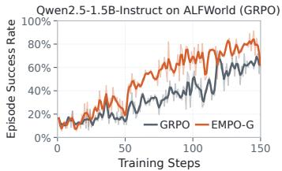

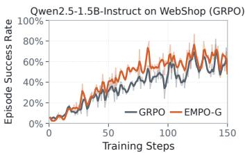

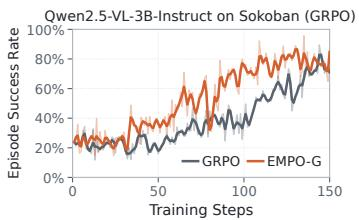

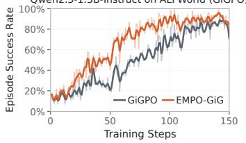

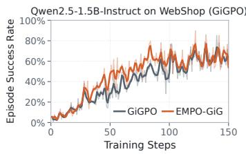

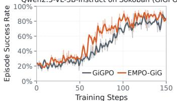  
Figure 5: Training curves on ALFWorld, WebShop, and Sokoban.  
Qwen2.5-1.5B-Instruct on ALFWorld

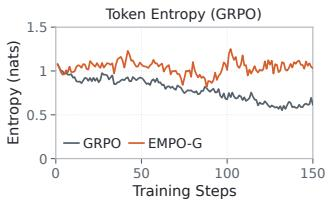

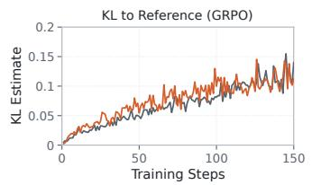

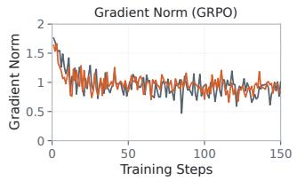

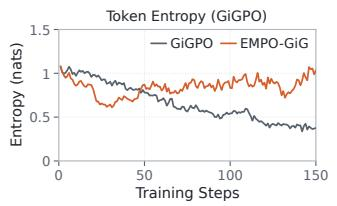

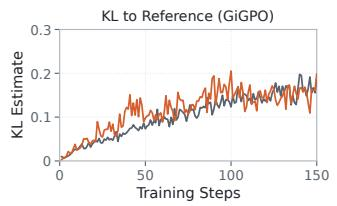

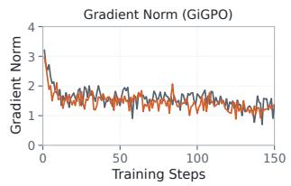  
Figure 6: Training dynamics on ALFWorld with Qwen2.5-1.5B-Instruct. We report token entropy, KL divergence to the reference policy, and gradient norm.

Table 6: Comparison between EMPO and advantage-side aggregation.
<table><tr><td>Base</td><td>Method</td><td>ALFWorld SR</td><td>WebShop Score</td><td>WebShop SR</td></tr><tr><td rowspan="2">GRPO</td><td rowspan="2">Advantage Aggregation EMPO-G</td><td>80.47</td><td>82.1</td><td>70.2</td></tr><tr><td>83.3</td><td>83.1</td><td>70.3</td></tr><tr><td rowspan="2">GiGPO</td><td>Advantage Aggregation</td><td>92.97</td><td>83.6</td><td>71.1</td></tr><tr><td>EMPO-GiG</td><td>94.0</td><td>87.9</td><td>77.3</td></tr></table>

As shown in Table 6, the advantage-side variant remains competitive, consistent with the close relationship established by the unclipped analysis. EMPO achieves higher performance in all reported settings, with the difference becoming more pronounced for GiGPO on WebShop. These results are consistent with the distinction derived in Section C.3: once clipping and practical loss weighting are introduced, ratio-side and advantage-side aggregation induce different policy updates.

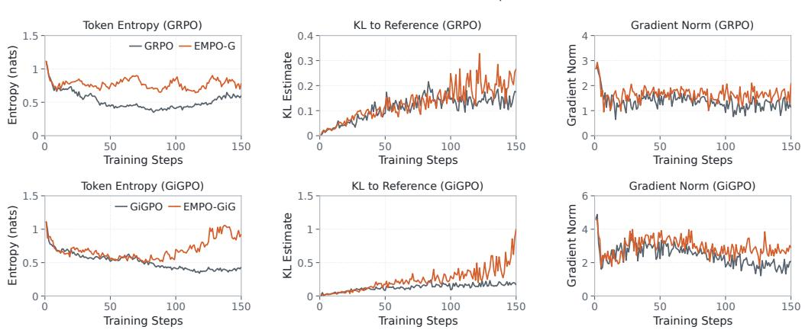

Figure 7: Training dynamics on WebShop with Qwen2.5-1.5B-Instruct. We report token entropy, KL divergence to the reference policy, and gradient norm.  
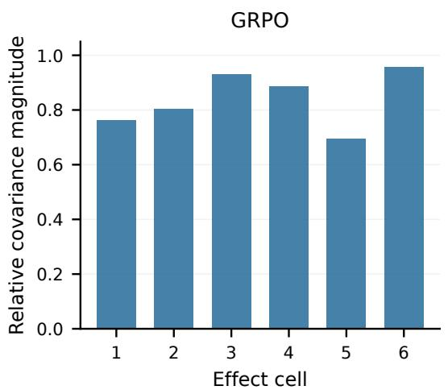

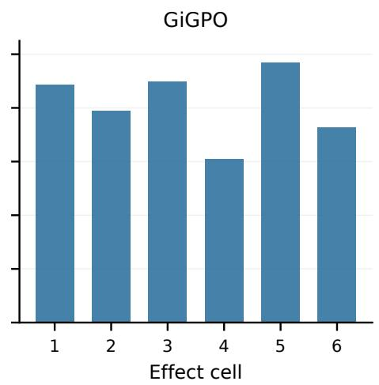  
Figure 8: Relative magnitude of the within-effect covariance term on six effect cells from ALF-World. For each cell K, we report $\| \widehat { \mathrm { C o v } _ { K } } ( \hat { A } , s ) \| / \| G _ { K } ^ { \mathrm { i n d } } \|$ under GRPO and GiGPO.

## E.4 POLICY ADAPTATION AND RESPONSE DIVERSITY

We further examine how effect-marginal optimization shapes policy adaptation throughout training. Figures 6 and 7 report token entropy, KL divergence to the reference policy, and gradient norm for GRPO, GiGPO, and their EMPO variants.

Across both ALFWorld and WebShop, EMPO maintains higher token entropy during the later stages of training while exhibiting continued policy movement, as reflected by the KL divergence and gradient norm. The three quantities together reveal a characteristic optimization pattern: the policy continues to adapt while retaining a less concentrated token distribution. This pattern appears consistently for both trajectory-level GRPO and step-level GiGPO, indicating that it is preserved across different advantage-estimation granularities.

This training behavior connects naturally to the effect-marginal update in Section 4. In responsewise optimization, each credit signal is paired with its realization-specific policy direction, allowing within-cell credit variation to directly shape the probability of individual textual realizations. EMPO couples execution-equivalent responses through a shared effect-level ratio, so their policy changes are organized around a common effect-conditioned direction. The resulting entropy dynamics provide a distribution-level view of the coordinated updates observed in the policy-update analysis in Section 5.4.

## F PROMPT TEMPLATES

We use environment-specific prompt templates specifying the task, available action space, interaction history, and output format.

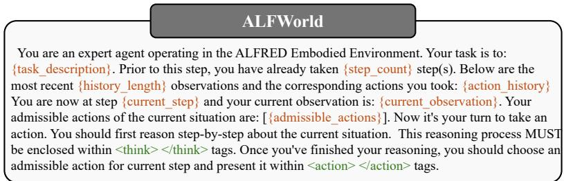  
Figure 9: Prompt template used for ALFWorld.

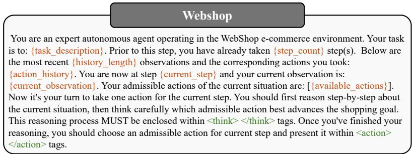  
Figure 10: Prompt template used for WebShop.

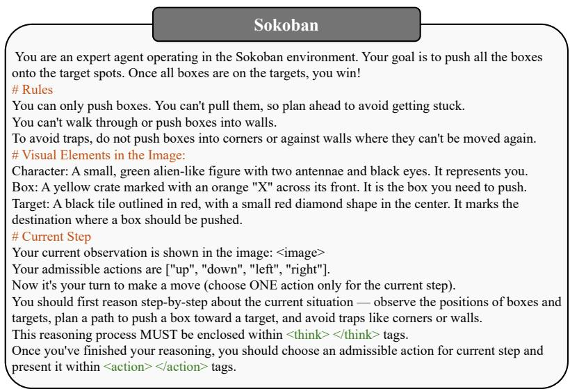  
Figure 11: Prompt template used for Sokoban.