# A FIX FOR SOFTMAX AND CROSS-ENTROPY

Jonathan T. Barron Google DeepMind barron@google.com

Dan Gnanapragasam Google DeepMind nanabyte@google.com

Michael Tschannen Google DeepMind tschannen@google.com

## ABSTRACT

Standard implementations of softmax, log-softmax, and cross-entropy have two numerical bugs. The first bug, Softmax Collapse, rounds the target logit’s gradient to zero if that one logit is much larger than the others, resulting in gradients that no longer sum to zero. The second bug, Softmax Cancellation, occurs when student logits are close to teacher logits, and produces non-zero gradients even when the student and teacher logits are equal. We present simple implementations of log-softmax, softmax, and cross-entropy that fix both bugs. Our fix eliminates the previously-observed “Slingshot” phenomenon, speeds up grokking with weight decay, prevents accuracy collapse without weight decay, stops student networks from drifting away from the teacher during distillation, and shows that after memorization, logit growth is bounded by an equilibrium between weight decay and Adam’s ϵ hyperparameter.

## 1 INTRODUCTION

Naively computing softmax or cross-entropy on logits $\mathbf { z } \in \mathbb { R } ^ { K } \operatorname { a s } e ^ { z _ { k } } / \sum _ { j } e ^ { z _ { j } }$ overflows if any logit exceeds the floating-point exponent limit (≈ 88 in fp32), which is why standard implementations in all deep learning frameworks (JAX, PyTorch, TensorFlow, etc.) shift the input logits by subtracting their maximum value $z _ { \mathrm { m a x } } = \operatorname* { m a x } _ { j } z _ { j } ~ ( \mathrm { H i g h a m }$ , 2002):

$$
\tilde { z } _ { k } = z _ { k } - z _ { \operatorname* { m a x } } , \quad \mathrm { l o g s o f t m a x } ( \mathbf { z } ) _ { k } = \tilde { z } _ { k } - \log \sum _ { j } e ^ { \tilde { z } _ { j } } , \quad q _ { k } = \mathrm { s o f t m a x } ( \mathbf { z } ) _ { k } = \frac { e ^ { \tilde { z } _ { k } } } { \sum _ { j } e ^ { \tilde { z } _ { j } } } .\tag{1}
$$

For a target distribution $\begin{array} { r l } { \mathbf { p } } & { { } \in \quad \Delta ^ { K - 1 } } \end{array}$ , cross-entropy is then computed as $\begin{array} { r l } { \mathcal { L } ( \mathbf { z } , \mathbf { p } ) } & { { } = } \end{array}$ $- \sum k p _ { k }$ logsoftmax(z)<sub>k</sub>, whose exact gradient is $\mathbf { g } = \nabla _ { \mathbf { z } } \mathcal { L } ( \mathbf { z } , \mathbf { p } ) = \mathbf { q } - \mathbf { p }$ . Though subtracting z prevents overflow, two numerical bugs remain.

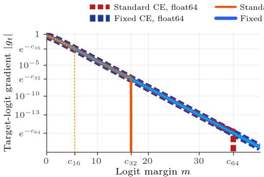  
(a) Softmax Collapse: |g<sub>t</sub>| vs. margin m.

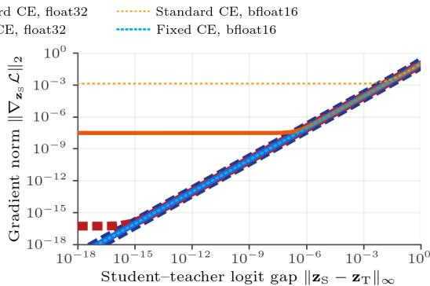  
(b) Softmax Cancellation: $\| \nabla _ { \mathbf { z } _ { \mathrm { S } } } \mathcal { L } \| _ { 2 }$ as ${ \bf z } _ { \mathrm { S } }  { \bf z } _ { \mathrm { T } }$  
Figure 1: The two bugs in standard softmax and cross-entropy. (a) Softmax Collapse: As a model becomes more confident in the correct class (thereby increasing the logit margin m), the true gradient on the target logit shrinks exponentially, but standard implementations incorrectly round that gradient to zero once m crosses a precision cliff $( \approx 5 . 5$ in bf16, 16.6 in fp32, and 36.7 in fp64). (b) Softmax Cancellation: In soft-target distillation, as student logits $\mathbf { z } _ { \mathrm { S } }$ approach teacher logits $\mathbf { z } _ { \mathrm { T } }$ , the true gradient shrinks toward zero, but standard implementations lose precision and plateau at a non-zero noise floor. Our fix eliminates both bugs and yields accurate gradients across all precisions.

The first bug, Softmax Collapse (Figure 1a), occurs when a model correctly predicts the target class $t \in \{ 1 , \ldots , K \}$ with high confidence, so that $z _ { t } = z _ { \operatorname* { m a x } }$ is much larger than all non-target logits $z _ { j }$ $( j \neq t )$ . We measure this confidence by the logit margin, which is how much larger the target logit is than the log-sum-exp of all non-target logits:

$$
m = z _ { t } - \log \sum _ { j \neq t } e ^ { z _ { j } } .\tag{2}
$$

In Equation 1, subtracting $z _ { \operatorname* { m a x } } = z _ { t }$ sets the shifted target logit to $\tilde { z } _ { t } = 0 ( \mathrm { s o } e ^ { \tilde { z } _ { t } } = 1$ in the denominator), while the $K - 1$ non-target exponentials sum to a small positive number $e ^ { - m } =$ $\textstyle \sum _ { j \neq t } e ^ { z _ { j } - z _ { t } } \ll 1$ . Floating-point numbers have much finer precision near 0 than near 1: in $\mathrm { f p } 3 2 ,$ values near 0 can be as small as ${ \sim } 1 0 ^ { - 3 8 }$ , whereas values added to 1.0 are lost to rounding below ${ \sim } 1 0 ^ { - 7 }$ . Because standard implementations form the denominator $1 + e ^ { - m }$ by adding $e ^ { - m } { \mathrm { ~ t o ~ } } 1 . 0 ,$ , the $e ^ { - m }$ term is lost to rounding once the margin m exceeds a threshold $c _ { d }$ that we call the precision cliff $( c _ { 1 6 } \approx 5 . 5$ in $b \mathrm { f } 1 6 , c _ { 3 2 } \approx 1 6 . 6$ in fp32, and $c _ { 6 4 } \approx 3 6 . 7 $ in fp64). When $m > c _ { d } .$ , the denominator $1 + e ^ { - m }$ evaluates to exactly 1.0, which causes $q _ { t } = 1 / ( 1 + e ^ { - m } )$ to evaluate to 1.0 and zeroes out both the loss and the target gradient $\tilde { g } _ { t } = q _ { t } - 1 = 0 . 0 .$ . However, the non-target gradients $\tilde { g } _ { j } = q _ { j } = e ^ { z _ { j } - z _ { t } } / ( 1 + e ^ { - m } \bar { ) ( j \ne t ) }$ are evaluated near 0 without adding 1.0 to their numerators, so they remain positive all the way down to exponent underflow $( m \approx 8 8 )$ . Because the target gradient rounds to 0.0 while the non-target gradients do not, the gradients no longer sum to zero $( \bar { \sum } _ { k } \bar { \tilde { g } } _ { k } > 0 )$ When training with adaptive optimizers such as Adam and AdamW (Kingma & Ba, 2015; Loshchilov & Hutter, 2019), which normalize each gradient by a moving average of its magnitude, this asymmetry causes the recurring “Slingshot” loss spikes observed by Thilak et al. (2022) and the grokking failures studied by Prieto et al. (2025). While prior works used surrogate losses (Prieto et al., 2025), gradient projection (Liu et al., 2026), or fp64 casting (Nanda et al., 2023; Varma et al., 2023) to mitigate these issues, we instead fix log-softmax, softmax, and cross-entropy directly (Section 2).

The second bug, Softmax Cancellation (Figure 1b), occurs in knowledge distillation (Hinton et al., 2015) and KL regularization, where the target $\mathbf { p } = \mathrm { s o f t m a x } ( \mathbf { z } _ { \mathrm { T } } )$ comes from teacher logits $\mathbf { z } _ { \mathrm { T } }$ Standard implementations compute $\mathbf { q } = \mathrm { s o f t m a x } ( \mathbf { z } _ { \mathrm { S } } )$ and $\mathbf { p } = \mathrm { s o f t m a x } ( \mathbf { z } _ { \mathrm { T } } )$ separately and subtract them to get $\tilde { \bf g } = { \bf q } - { \bf p }$ . This means that if $\mathbf { z } _ { \mathrm { S } }$ is close to $\mathbf { z } _ { \mathrm { T } }$ , subtracting these nearly equal probabilities loses precision, and slight differences between the forward-pass softmax and backward-pass logsoftmax formulas leave a non-zero gradient even when $\mathbf { z } _ { \mathrm { S } } = \mathbf { z } _ { \mathrm { T } }$ . We fix this by computing ${ \bf q } - { \bf p }$ directly from ${ \bf z } _ { \mathrm { S } } - { \bf z } _ { \mathrm { T } }$ in log space (Section 3).

## 2 SOFTMAX COLLAPSE

When the target logit $z _ { t } = z _ { \operatorname* { m a x } }$ is the largest logit, shifting by $z _ { \mathrm { m a x } }$ in Equation 1 sets $\tilde { z } _ { t } = 0$ and $\tilde { z } _ { j } = z _ { j } - z _ { t } < 0$ for $j \neq t ,$ so the denominator is $\begin{array} { r } { \sum _ { i } \tilde { e } ^ { \tilde { z } _ { i } } = 1 + \sum _ { j \neq t } e ^ { z _ { j } - z _ { t } } = 1 + e ^ { - m } } \end{array}$ Mathematically, the hard-target loss is L(z, t) = − logsoftmax $\mathbf { \bar { \Psi } } ( \mathbf { z } ) _ { t } = \log ( 1 + \bar { e } ^ { - m } )$ and its gradients are

$$
g _ { t } = \underbrace { \frac { 1 } { 1 + e ^ { - m } } - 1 } _ { \mathrm { s t a n d a r d } } = \underbrace { - \frac { e ^ { - m } } { 1 + e ^ { - m } } } _ { \mathrm { F i x e d } } , \qquad g _ { j } = \frac { e ^ { z _ { j } - z _ { t } } } { 1 + e ^ { - m } } \quad \mathrm { f o r ~ } j \neq t ,\tag{3}
$$

which sum to zero $( \sum _ { k } g _ { k } = 0 )$ . In floating point, however, the two expressions for $g _ { t }$ in Equation 3 behave very differently once $m > c _ { d } .$ , where $e ^ { - m }$ is too small to change 1.0 when added to it (Figure 1a). Standard implementations add 1 and $e ^ { - m }$ to form the denominator $1 + e ^ { - m }$ , which rounds to 1 when $m > c _ { d }$ . In the forward pass, $\log ( 1 + e ^ { - m } )$ then evaluates to $\log ( 1 ) = 0$ , zeroing out both logsoftmax(z) and $\boldsymbol { \mathcal { L } } ( \mathbf { z } , t )$ . In the backward pass, standard cross-entropy implementations compute $q _ { t } = 1 / ( 1 + e ^ { - m } ) = 1$ and subtract 1 to get $\tilde { g } _ { t } = q _ { t } - 1 = 0$ . In contrast, our fixed expression $- e ^ { - \dot { m } } / ( 1 + e ^ { - \dot { m } } )$ keeps $e ^ { - m }$ in the numerator: even when the denominator $1 + e ^ { - m }$ rounds to 1.0, dividing $- e ^ { - m }$ by 1.0 preserves $g _ { t } \approx - e ^ { - m }$ down to exponent underflow $( m \approx 8 8 )$

While $\tilde { g } _ { t }$ rounds to zero when m $> c _ { d } ,$ the non-target gradients do not. For each non-target class $\begin{array} { r } { j \neq t , } \end{array}$ , standard cross-entropy computes $\tilde { g } _ { j } = q _ { j } = e ^ { z _ { j } - z _ { t } } / ( 1 + e ^ { - m } )$ . Because the numerator $e ^ { z _ { j } - z _ { t } }$ is evaluated directly from the negative difference $z _ { j } - z _ { t }$ without adding 1, it remains accurate down to exponent underflow while the denominator rounds to 1. When m $> c _ { d } .$ , standard cross-entropy therefore zeroes out only the target entry t while all $K - 1$ non-target gradients remain positive:

$$
\tilde { g } _ { k } = { \bf 1 } [ k \neq t ] g _ { k } , \qquad \sum _ { k } \tilde { g } _ { k } = - g _ { t } = \frac { e ^ { - m } } { 1 + e ^ { - m } } > 0 \quad \mathrm { f o r } m > c _ { d } .\tag{4}
$$

The same bug affects standalone softmax(z): once $m > c _ { d } ,$ , softmax’s backward pass rounds $q _ { i _ { \mathrm { m a x } } }$ $( i _ { \operatorname* { m a x } } = \arg \operatorname* { m a x } _ { i } z _ { i } )$ to 1 and sets $\tilde { g } _ { i _ { \mathrm { m a x } } } = 0$ while the remaining gradients stay non-zero.

This bug can be fixed by never adding 1 to $e ^ { - m }$ directly. In logsoftmax(z) and softmax(z), only the largest logit $: i _ { \mathrm { m a x } } = \arg \operatorname* { m a x } _ { i } z _ { i }$ is shifted to 0 (where $e ^ { 0 } = 1$ in the denominator). Instead of including $e ^ { 0 } \equiv 1$ in the sum of exponentials, we set $\tilde { z } _ { i _ { \mathrm { m a x } } } = 0 ;$ , compute the margin m by excluding $i _ { \mathrm { m a x } }$ from the log-sum-exp, and combine them with a numerically stable sof $\mathrm { \ p l u { \bar { s } } } ( x ) = \mathrm { \bar { l o g } } ( 1 + e ^ { x } )$ (with softmax(z)<sub>k</sub> = exp(logsoftmax $( { \bf z } ) _ { k } ) )$ ):

$$
\tilde { z } _ { k } = \mathbf { 1 } [ k \neq i _ { \mathrm { m a x } } ] ( z _ { k } - z _ { i _ { \mathrm { m a x } } } ) , \quad m = - \underbrace { \mathrm { I S E } } _ { j \neq i _ { \mathrm { m a x } } } \tilde { z } _ { j } , \quad \mathrm { l o g s o f t m a x } ( \mathbf { z } ) _ { k } = \tilde { z } _ { k } - \mathrm { s o f t p l u s } ( - m ) .\tag{5}
$$

For hard-target cross-entropy with target t, we can use t directly in place of $i _ { \mathrm { m a x } }$ without computing an arg max:

$$
m = - \operatorname { L S E } _ { j \neq t } ( z _ { j } - z _ { t } ) , \qquad \mathscr { L } ( \mathbf { z } , t ) = \log ( 1 + e ^ { - m } ) = \mathrm { s o f t p l u s } ( - m ) .\tag{6}
$$

Because the t-th slot is replaced with the constant 0 rather than $z _ { t } - z _ { t } , z _ { t }$ only appears in L through the $K - 1$ differences $z _ { j } - z _ { t } \left( j \neq t \right)$ , so autodiff correctly computes the target gradient as the negated sum of the non-target gradients:

$$
g _ { j } = e ^ { z _ { j } - z _ { t } - \mathscr { L } } = \frac { e ^ { z _ { j } - z _ { t } } } { 1 + e ^ { - m } } \quad \mathrm { f o r ~ } j \neq t , \qquad g _ { t } = - \sum _ { j \neq t } g _ { j } = - \frac { e ^ { - m } } { 1 + e ^ { - m } } .\tag{7}
$$

Here is a JAX implementation of logsoftmax, softmax, and hard-target cross-entropy, which remains accurate down to exponent underflow and satisfies $\begin{array} { r } { \sum _ { k } g _ { k } = 0 : } \end{array}$

```python
import jax, jax.numpy as jnp, optax
def log_softmax(z):
i_max = jnp.argmax(z, axis=-1)
z_max = jnp.take_along_axis(z, i_max[..., None], axis=-1) # Max logit.
is_max = jax.nn.one_hot(i_max, z.shape[-1], dtype=bool) # Max mask.
shifted = jnp.where(is_max, 0.0, z - z_max) # Exact 0 at argmax.
others = jnp.where(is_max, -jnp.inf, shifted) # Exclude argmax from sum.
m = -jax.nn.logsumexp(others, axis=-1, keepdims=True) # Logit margin.
return shifted - jax.nn.softplus(-m) # log_softmax(z).
softmax = lambda z: jnp.exp(log_softmax(z))
def cross_entropy(z, t):
z_t = jnp.take_along_axis(z, t[..., None], axis=-1) # Target logit.
is_t = jax.nn.one_hot(t, z.shape[-1], dtype=bool) # Target mask.
others = jnp.where(is_t, -jnp.inf, z - z_t) # Exclude target from sum.
m = -jax.nn.logsumexp(others, axis=-1) # Logit margin.
return jax.nn.softplus(-m) # -log_softmax(z)_t.
```

As an example, consider $\textbf { z } = ~ [ 9 . 0 , - 9 . 0 , - 9 . 0 ]$ and $t ~ = ~ 0$ . The standard jax.nn and optax implementations return zero for the target log-probability, loss, and target gradient, while our functions return accurate values whose gradients sum to zero:

```python
z, t = jnp.array([9.0, -9.0, -9.0], dtype=jnp.float32), jnp.array(0)
std_ce = optax.softmax_cross_entropy_with_integer_labels
jax.nn.log_softmax(z) # -> [ 0.0, -18.0, -18.0
jax.grad(lambda z: jax.nn.softmax(z)[0])(z) # -> [ 0.0, -1.523e-8, -1.523e-8]
jax.value_and_grad(std_ce)(z, t) # -> 0.0, [ 0.0, 1.523e-8, 1.523e-8]
log_softmax(z) # -> [-3.046e-8, -18.0, -18.0 ]
jax.grad(lambda z: softmax(z)[0])(z) # -> [ 3.046e-8, -1.523e-8, -1.523e-8]
jax.value_and_grad(cross_entropy)(z, t) # -> 3.046e-8, [-3.046e-8, 1.523e-8, 1.523e-8]
```

## 3 SOFTMAX CANCELLATION

Given student logits $\mathbf { z } _ { \mathrm { S } } ~ \in ~ \mathbb { R } ^ { K }$ and teacher logits $\mathbf { z } _ { \mathrm { T } } \in \mathbb { R } ^ { K }$ , standard soft-target cross-entropy computes p = softmax(z<sub>T</sub>) and evaluates

$$
\mathcal { L } ( \mathbf { z } _ { \mathrm { S } } , \mathbf { z } _ { \mathrm { T } } ) = - \sum _ { k } p _ { k } \log \mathrm { s o f t m a x } ( \mathbf { z } _ { \mathrm { S } } ) _ { k } , \quad \mathbf { q } = \mathrm { s o f t m a x } ( \mathbf { z } _ { \mathrm { S } } ) , \quad \tilde { g } _ { k } = \frac { \partial \mathcal { L } } { \partial z _ { \mathrm { S } , k } } = q _ { k } - p _ { k } .\tag{8}
$$

As the student logits approach the teacher logits $( \mathbf { z } _ { \mathrm { S } }  \mathbf { z } _ { \mathrm { T } } )$ , the true gradient $\mathbf { g } = \mathbf { q } - \mathbf { p }$ shrinks toward 0 and equals 0 when $\mathbf { z } _ { \mathrm { S } } = \mathbf { z } _ { \mathrm { T } }$ . In floating point, however, computing q and p separately and subtracting them (Equation 8) loses precision when $\mathbf { z } _ { \mathrm { S } }$ is close to $\mathbf { z } _ { \mathrm { T } }$ , because the small logit difference $\pmb { \delta } = \mathbf { z } _ { \mathrm { S } } - \mathbf { z } _ { \mathrm { T } }$ is lost when q and p are rounded to probabilities before being subtracted (Figure 1b). Worse, because $\mathbf { p } = \mathrm { s o f t m a x } ( \mathbf { z } _ { \mathrm { T } } )$ in the forward pass and $\begin{array} { r } { \mathbf q = \exp ( \log \mathrm { s o f t m a x } ( \mathbf z _ { \mathrm { S } } ) ) } \end{array}$ in the backward pass are evaluated using slightly different sequences of operations, q and p do not match to machine precision even when ${ \bf z } _ { \mathrm { S } } = { \bf z } _ { \mathrm { T } }$ , leaving a non-zero gradient $\tilde { \mathbf { g } } = \mathbf { q } - \mathbf { p } \neq \mathbf { 0 }$

To avoid subtracting nearly equal probabilities, we pass $\mathbf { z } _ { \mathrm { T } }$ directly to our loss function and compute q − p in log space using expm1 $\bar { ( x ) } = e ^ { x } - 1$ and log $\operatorname { \mathrm { . p } } ( x ) = \log ( 1 + x )$ . Given $\pmb { \delta } = \mathbf { z } _ { \mathrm { S } } - \mathbf { z } _ { \mathrm { T } }$ , we center δ under p and write the log-ratio $s _ { k } = \log ( q _ { k } / p _ { k } )$ and difference $u _ { k } = q _ { k } - p _ { k }$ as:

$$
d _ { k } = \delta _ { k } - \sum _ { i } p _ { i } \delta _ { i } , \qquad s _ { k } = d _ { k } - \log 1 9 \left( \sum _ { i } p _ { i } \exp 1 ( d _ { i } ) \right) , \qquad u _ { k } = p _ { k } \exp 1 ( s _ { k } ) .\tag{9}
$$

Because $\sum _ { i } p _ { i } d _ { i } = 0$ and expm1 $( x ) \geq x .$ , the input to log1p is always non-negative. We then set $g _ { k } = u _ { k } - q _ { k } \sum _ { i } u _ { i }$ to remove any remaining floating-point drift from $\sum _ { k } g _ { k } = 0$ . Because $d _ { k } , s _ { k }$ and $u _ { k }$ are evaluated using expm1 and log1p without adding or subtracting 1, g remains accurate as $\mathbf { z } _ { \mathrm { S } }  \mathbf { z } _ { \mathrm { T } }$ and is 0 when $\mathbf { z } _ { \mathrm { S } } = \mathbf { z } _ { \mathrm { T } }$ . Here is a JAX implementation of soft-target cross-entropy (using log softmax and softmax from Section 2), which uses jax.lax.stop gradient (sg) to return the forward loss while substituting g in the backward pass:

```prolog
def soft_target_cross_entropy(z_S, z_T):
log_q = log_softmax(z_S)
q, p = jnp.exp(log_q), softmax(z_T)
delta = z_S - z_T # Logit difference.
d = delta - jnp.sum(p * delta, axis=-1, keepdims=True) # Center under p.
s = d - jnp.log1p(jnp.sum(p * jnp.expm1(d), axis=-1, keepdims=True)) # log(q / p).
u = p * jnp.expm1(s) # Difference q - p.
g = u - q * jnp.sum(u, axis=-1, keepdims=True) # Ensure sum(g) = 0.
sg = jax.lax.stop_gradient
loss = -jnp.sum(p * sg(log_q), axis=-1) # Forward loss.
return loss + jnp.sum(sg(g) * (z_S - sg(z_S)), axis=-1) # Custom gradient g.
```

As an example, let $\mathbf { z } _ { \mathrm { S } }$ be a small fp32 perturbation of $\mathbf { z } _ { \mathrm { T } }$ . Standard soft-target cross-entropy shrinks the second gradient entry by $3 \times$ , flips the sign of the third, and fails to sum to zero, while our implementation matches the exact fp64 gradient:

```python
z_T = jnp.array([2.0, 1.0, 0.0], dtype=jnp.float32)
z_S = z_T + jnp.array([-1e-7, 1e-7, 0.0], dtype=jnp.float32)
std_soft_ce = lambda z_S, z_T: -jnp.sum(jax.nn.softmax(z_T) * jax.nn.log_softmax(z_S))
jax.grad(std_soft_ce)(z_S, z_T) # -> [-5.960464e-8, 1.451589e-8, -1.123343e-9]
jax.grad(soft_target_cross_entropy)(z_S, z_T) # -> [-4.595504e-8, 4.144190e-8, 4.513142e-9]
# Exact (float64) gradient: [-4.595504e-8, 4.144190e-8, 4.513142e-9]
```

## 4 THE SLINGSHOT MECHANISM

In grokking (Power et al., 2022), a network quickly memorizes the training set $( q _ { t } ~ \to ~ 1 )$ and generalizes much later. While studying grokking on modular addition with Adam (Kingma & Ba, 2015; Loshchilov & Hutter, 2019), Thilak et al. (2022) observed the Slingshot Mechanism, where training after memorization alternates between flat loss plateaus near zero and sudden loss spikes that coincide with jumps in test accuracy.

These Slingshot spikes are a direct consequence of Softmax Collapse (Section 2). Recall that AdamW updates parameters θ by subtracting $\eta \big ( \hat { \mathbf { m } } / ( \sqrt { \hat { \mathbf { v } } } + \epsilon ) + \lambda \pmb { \theta } \big )$ , where mˆ and vˆ are bias-corrected moving averages of the parameter gradient $\mathbf { g } = \nabla _ { \pmb { \theta } } \mathcal { L } ( \pmb { \theta } )$ and its square (with decay rates $\beta _ { 1 } , \beta _ { 2 } )$ After memorization, the logit margins m grow as the network pushes its target probabilities toward 1. Once an example’s margin exceeds the precision cliff $c _ { d } ,$ , standard cross-entropy rounds its target gradient $\tilde { g } _ { t }$ to zero while its non-target gradients $\tilde { g } _ { j } > 0 ( j \neq t )$ remain positive. When all examples in a batch sit above $c _ { d } ,$ the parameter gradients nearly vanish and Adam’s second moment $\hat { v } _ { i }$ decays exponentially toward zero while weight decay slowly shrinks the parameters. Eventually, weight decay or the residual non-target updates pull a few examples back below $c _ { d } ,$ where their target gradients $\tilde { g } _ { t } \approx - e ^ { - m }$ abruptly turn back on. Because $\sqrt { \hat { v } _ { i } }$ decayed while those examples were above $c _ { d } .$ Adam divides the restored gradients by a very small denominator $\sqrt { \hat { v } _ { i } } + \epsilon .$ , producing a large parameter step that spikes the training loss, resets ${ \hat { v } } _ { i } ,$ , and repeats the cycle. With our fixed cross-entropy, the target-logit gradient $g _ { t } = \stackrel { - } { - } e ^ { - m } / ( 1 + e ^ { - m } )$ does not round to zero at $c _ { d } ,$ so $\hat { m } _ { i }$ and $\sqrt { \hat { v } _ { i } }$ decay smoothly together and Slingshot spikes disappear (Figure 2).

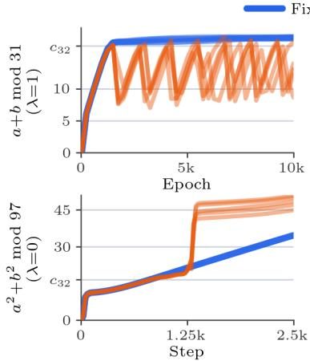  
(a) Mean logit margin m.

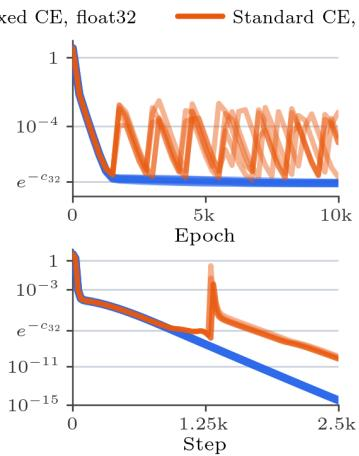  
(b) Training loss.

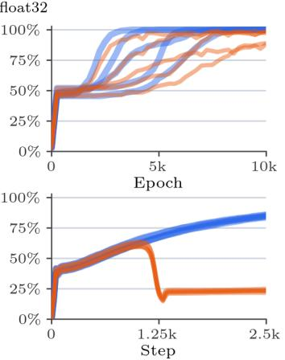  
(c) Test accuracy.  
Figure 2: The Slingshot mechanism (Thilak et al., 2022) with and without weight decay (5 random seeds, fp32). Top row $( a + b$ mod 31, $\lambda = 1 , \epsilon = 1 0 ^ { - 8 }$ , Varma et al. 2023): Standard cross-entropy hits the fp32 cliff $( m = c _ { 3 2 } \approx 1 6 . 6$ , where loss rounds to 0) and repeatedly drops and rebounds, slowing and degrading grokking; fixed cross-entropy crosses $c _ { 3 2 }$ smoothly, groks faster on all 5 seeds, and saturates just above $c _ { 3 2 }$ at $m \approx 1 8 . 4$ (Section 5). Bottom row $( \check { a } ^ { 2 } + b ^ { 2 }$ mod $9 7 , \lambda = 0 ,$ $\epsilon = 1 0 ^ { - 1 6 }$ , Doshi et al. 2024): Without weight decay, hitting $c _ { 3 2 }$ around step 1250 triggers a spike that drops standard cross-entropy test accuracy from 61% to 23%, whereas fixed cross-entropy continues smoothly to 85%.

Whether Slingshot spikes appear to help or hurt generalization depends on how the network’s weight norm is controlled (Figure 2). When a network uses LayerNorm before the output layer and no weight decay (Thilak et al., 2022; Prieto et al., 2025), growing the pre-LayerNorm weights does not change the logits, but it does shrink the effective step size $\eta / \lVert \pmb { \theta } \rVert _ { 2 } ;$ each Slingshot spike inflates $\lVert \pmb \theta \rVert _ { 2 }$ and acts as an accidental learning-rate decay. When weight norms are already controlled by weight decay (Varma et al., 2023), Slingshot spikes at c<sub>32</sub> only slow down and hurt grokking $( 9 4 \pm 5 \% \mathrm { { v s } }$ $1 0 0 \pm 0 \%$ test accuracy on $a + b$ mod 31; Figure 2, top). And when neither LayerNorm nor weight decay is used (Doshi et al., 2024), a single Slingshot spike at $c _ { 3 2 }$ is destructive: on $a ^ { 2 } + b ^ { 2 }$ mod 97 $( \lambda = \stackrel { \cdot } { 0 } , \epsilon = 1 0 ^ { - 1 6 } )$ , standard cross-entropy tracks fixed cross-entropy up to 61% test accuracy until m hits $c _ { 3 2 }$ around step 1250, where a spike drops test accuracy to 23% (and from 60% to 21% on $a ^ { 3 } + b$ mod 97), while fixed cross-entropy continues smoothly to 85% (Figure 2, bottom).

## 5 MARGIN EQUILIBRIA

In Figure $2 \mathrm { a } .$ , our fixed cross-entropy eliminates the precision cliff at $c _ { 3 2 } \approx 1 6 . 6 ,$ , yet why does its margin still saturate just above c at $m \approx 1 8 . 4$ when weight decay is applied $( \lambda = 1$ , top) while continuing to climb without weight decay $( \lambda = 0$ , bottom)? This plateau has nothing to do with fp32 precision; rather, it is the equilibrium where weight decay balances AdamW’s normalized gradient step. At a stationary point where the parameters stop changing, the moving averages converge to $\hat { m } _ { i } = g _ { i }$ and $\hat { v } _ { i } = g _ { i } ^ { 2 }$ (so $\sqrt { \hat { v } _ { i } } = | g _ { i } | )$ , and setting the parameter update to zero gives:

$$
\frac { \hat { m } _ { i } } { \sqrt { \hat { v } _ { i } } + \epsilon } + \lambda \theta _ { i } = 0 \quad \Longrightarrow \quad \frac { g _ { i } } { | g _ { i } | + \epsilon } + \lambda \theta _ { i } = 0 \quad \forall i .\tag{10}
$$

Here $\eta , \beta _ { 1 }$ , and $\beta _ { 2 }$ cancel out, so RMSProp (Tieleman & Hinton, 2012) and LaProp (Ziyin et al., 2020) share the same stationary point. After memorization, the gradients shrink exponentially with the margin $( | g _ { i } | \propto e ^ { - m } )$ . $\mathrm { I f } \ \epsilon = 0$ , the normalized gradient $g _ { i } / { \vert g _ { i } \vert } = \mathrm { s i g n } ( g _ { i } )$ has a magnitude of 1 no matter how small $| g _ { i } |$ becomes, which causes the margin to grow until the gradients underflow. When $\epsilon > 0$ , however, the normalized gradient has magnitude ≈ 1 while $| g _ { i } | \gg \epsilon ,$ , and shrinks as $g _ { i } / \epsilon \propto e ^ { - m }$ once $| g _ { i } | \ll \epsilon$ (Figure 3). Balancing this shrinking step against weight decay $\lambda \theta _ { i }$ requires $| g _ { i } |$ ≈ $\epsilon \lambda | \theta _ { i } |$ (Wortsman et al., 2024; Molybog et al., 2023; Everett et al., 2024; Kosson et al., 2024), which acts like an $L _ { 2 }$ regularizer with weight $\epsilon \lambda$ (Rosset et al., 2004; Soudry et al., 2018). Since $| g _ { i } | \propto e ^ { - m }$ , the margin stops growing at:

$$
m ^ { \star } ( \epsilon ) \approx \log ( 1 / \epsilon ) .\tag{11}
$$

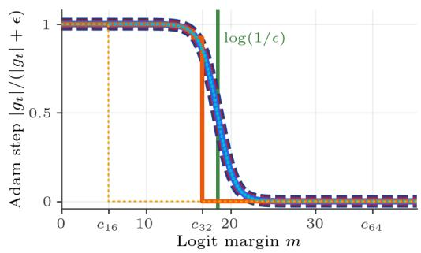

$$
{ \begin{array} { l l l } { \mathbf { \equiv } \equiv \mathbf { \equiv } \mathbf { \equiv } { \mathrm { ~ S t a n d a r d ~ C E , ~ f l o a t 6 4 ~ } } } & { \mathbf { \equiv } \mathbf { \equiv } \mathbf { \emptyset } \mathbf { \equiv } \mathbf { \emptyset } { \mathrm { ~ F i x e d ~ C E , ~ f l o a t 6 4 ~ } } } \\ { \qquad \dots \dots \dots } & { { \mathrm { S t a n d a r d ~ C E , ~ f l o a t 3 2 ~ } } } & { \mathbf { \equiv } \mathbf { \emptyset } { \mathrm { ~ F i x e d ~ C E , ~ f l o a t 3 2 ~ } } } \\ { \qquad \dots \dots } & { { \mathrm { S t a n d a r d ~ C E , ~ b f l o a t 1 6 ~ } } } & { \dots \dots } & { { \mathrm { F i x e d ~ C E , ~ b f l o a t 1 6 ~ } } } \end{array} }
$$

Figure 3: Normalized Adam step $| g _ { t } | / ( | g _ { t } | + \epsilon )$ vs. logit margin m at $\epsilon = 1 0 ^ { - 8 }$ . With our fixed crossentropy, the step stays near 1 and decays smoothly around $\log ( 1 / \epsilon ) \approx 1 8 . 4$ , whereas standard CE zeroes out $\tilde { g } _ { t }$ at $c _ { 1 6 } \approx 5 . 5$ and $c _ { 3 2 } \approx 1 6 . 6$

Equation 11 explains why the default $\epsilon = 1 0 ^ { - 8 }$ causes Slingshot in fp32: its equilibrium log $( 1 / \epsilon )$ ≈ 18.4 sits just above the fp32 cliff $c _ { 3 2 } \approx 1 6 . 6$ (Figure 3), so standard cross-entropy hits the cliff right before reaching equilibrium (whereas for $\epsilon \geq 1 0 ^ { - 7 } , \log ( 1 / \epsilon ) \leq 1 6 . 1 < c _ { 3 2 } ^ { - }$ and standard cross-entropy settles without spiking). To verify Equation 11 across many orders of magnitude down to $\epsilon = 0$ in $\mathrm { f p } 3 2$ (Figure 4), we use LaProp and update $\sqrt { \hat { \mathbf { v } } }$ directly without squaring $g _ { i } ^ { 2 }$ (which would otherwise underflow in fp32 once $| g _ { i } | < 2 ^ { - 6 3 }$ , or $m \approx 3 8 )$

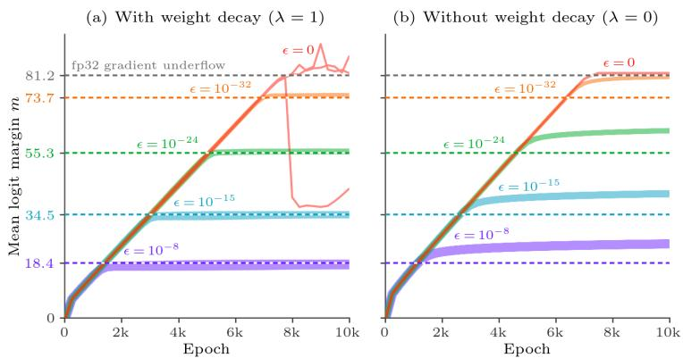  
Figure 4: Logit margins when training with our fixed cross-entropy and LaProp on $a + b$ mod 31 in fp32 $( \beta _ { 1 } = \bar { 0 . 9 } , \beta _ { 2 } = 0 . 9 8 ; 3$ seeds per setting as solid lines, analytical predictions as dashed lines). (a) With weight decay $( \lambda = 1 )$ , the margin for each $\epsilon > 0$ grows along the $\epsilon = 0$ trajectory and levels off at the predicted equilibrium $m ^ { \star } ( \epsilon ) \bar { = } \log ( 1 / \epsilon )$ (colored y-ticks), whereas $\epsilon = 0$ keeps growing until the fp32 gradients themselves underflow at m $\approx 8 1 . 2 ( \mathrm { g r a y } )$ . (b) Without weight decay $( \lambda = 0 )$ nothing balances the $g _ { i } / \epsilon$ step, so the margins rise past log $\left( { 1 \mathord { \left/ { \vphantom { 1 \epsilon } } \right. \kern - delimiterspace } \epsilon } \right)$ and continue drifting upward.

## 6 GROKKING ACROSS PRECISIONS AND BENCHMARKS

To see how the precision cliff behaves across floating-point formats, we follow Varma et al. (2023) and Lyle et al. (2025) and train a 1-layer width-64 ReLU Transformer on $a + b$ mod 31 (50% training split) for 10,000 epochs of full-batch AdamW with $\eta = 1 0 ^ { - 3 } , \beta _ { 1 } = 0 . 9 , \beta _ { 2 } = 0 . 9 8$ , and $\lambda = 1$ . We vary only the loss function (standard vs. fixed cross-entropy), the floating-point precision (bf16, fp32, fp64), and $\epsilon \in \{ 1 0 ^ { - 8 } , 1 0 ^ { - 1 2 } , 1 0 ^ { - 1 6 } \}$ (Figure 5, Table 1). $\mathrm { A t } \ \epsilon = 1 0 ^ { \overline { { - 8 } } }$ (Figure 5, top), standard cross-entropy stalls at $c _ { 1 6 } \approx 5 . 5$ in bf16 and repeatedly spikes at $c _ { 3 2 } \approx 1 6 . 6$ in fp32, whereas our fixed cross-entropy crosses both cliffs smoothly to the equilibrium log $( 1 / \epsilon ) \approx 1 8 . 4 $ and reaches 100% test accuracy in all three precisions. Reducing ϵ to $1 0 ^ { - 1 \mathbf { \dot { 6 } } }$ (Figure 5, bottom) raises the equilibrium to log $( 1 / \epsilon ) \approx 3 6 . 8 > c _ { 6 4 }$ , which causes even fp64 standard cross-entropy to break at $c _ { 6 4 } \approx 3 6 . 7 $ while fixed cross-entropy converges smoothly in every precision.

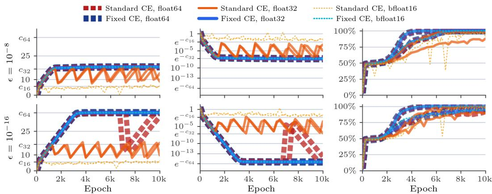  
(a) Mean logit margin m.  
(b) Training loss.  
(c) Test accuracy.  
Figure 5: Standard cross-entropy fails at the precision cliff $c _ { d }$ of its floating-point format; fixed cross-entropy removes the cliff across all precisions $( a + b$ mod 31, $\lambda = 1 ; 2$ of 5 seeds shown). Top: $\epsilon = 1 0 ^ { \div 8 }$ . Bottom: $\epsilon = 1 0 ^ { - 1 6 }$ , where even fp64 standard cross-entropy fails at $c _ { 6 4 }$ while fixed cross-entropy converges smoothly.

In Table 1 we also compare against two recent methods designed to ameliorate Softmax Collapse by modifying the gradients or the loss function. Liu et al. (2026) subtract the mean logit gradient from each entry so the gradients sum to zero (“Zero-sum Proj.”). However, once $m > c _ { 3 2 }$ and $\tilde { g } _ { t } = 0 ,$ subtracting the mean only gives the target logit $- 1 / K$ of the total non-target gradient, which stalls the margin near 18 and drops test accuracy below 50% for $\epsilon \leq 1 0 ^ { - 1 2 }$ . Prieto et al. (2025) propose “StableMax,” which replaces $\exp ( x )$ in softmax with a piecewise rational function (x + 1 for $x \geq 0$ and $1 / ( 1 - x )$ for $x < 0 )$ . Because this function grows linearly instead of exponentially, logit margins blow up to $\mathrm { 1 0 ^ { 3 } { - } 1 0 ^ { 4 } }$ and test accuracy remains lower than with our fixed cross-entropy across all values of ϵ.

Table 1: Comparison of loss functions on modular addition $( a + b$ mod 31, $\lambda = 1 , 5$ seeds) across $\epsilon \in \lbrace 1 0 ^ { \dot { - } 8 } , 1 0 ^ { - 1 2 } , 1 0 ^ { - 1 6 } \rbrace$ . Fixed CE reaches the predicted equilibrium margin $( \log ( 1 / \epsilon )$ ≈ 18.4, 27.6, 36.8) and 99–100% test accuracy across all precisions, whereas Standard CE stalls near its precision cliff $c _ { d } ~ ( c _ { 1 6 } \approx 5 . 5 $ in bf16, $c _ { 3 2 }$ ≈ 16.6 in fp32, and $c _ { 6 4 } \approx 3 6 . 7 $ in fp64).
<table><tr><td rowspan="2">Variant</td><td colspan="3">Test Accuracy (%)</td><td colspan="3">Final Margin m</td></tr><tr><td> $\epsilon = 1 0 ^ { - 8 }$ </td><td> $1 0 ^ { - 1 2 }$ </td><td> $1 0 ^ { - 1 6 }$ </td><td> $1 0 ^ { - 8 }$ </td><td> $1 0 ^ { - 1 2 }$ </td><td> $1 0 ^ { - 1 6 }$ </td></tr><tr><td>fp32 Fixed CE</td><td> $1 0 0 . 0 \pm 0 . 0$ </td><td> $9 9 . 6 \pm 0 . 7$ </td><td> $9 9 . 0 \pm 2 . 3$ </td><td>17.9</td><td>27.4</td><td>36.8</td></tr><tr><td>fp32 Standard CE</td><td> $9 4 . 3 \pm 5 . 4$ </td><td> $9 6 . 4 \pm 5 . 1$ </td><td> $9 6 . 5 \pm 4 . 3$ </td><td>13.0</td><td>15.1</td><td>12.7</td></tr><tr><td>bf16 Fixed CE</td><td> $1 0 0 . 0 \pm 0 . 1$ </td><td> $9 9 . 8 \pm 0 . 2$ </td><td> $9 8 . 9 \pm 2 . 4$ </td><td>17.9</td><td>27.4</td><td>36.8</td></tr><tr><td>bf16 Standard CE</td><td> $9 3 . 3 \pm 7 . 4$ </td><td> $9 4 . 9 \pm 4 . 9$ </td><td> $9 4 . 2 \pm 8 . 3$ </td><td>5.1</td><td>5.6</td><td>5.8</td></tr><tr><td>fp64 Fixed CE</td><td> $1 0 0 . 0 \pm 0 . 0$ </td><td> $9 9 . 5 \pm 1 . 1$ </td><td> $9 9 . 0 \pm 2 . 0$ </td><td>17.9</td><td>27.4</td><td>36.8</td></tr><tr><td>fp64 Standard CE</td><td> $1 0 0 . 0 \pm 0 . 0$ </td><td> $1 0 0 . 0 \pm 0 . 1$ </td><td> $9 7 . 2 \pm 3 . 2 $ </td><td>17.9</td><td>27.4</td><td>30.1</td></tr><tr><td>fp32 Zero-sum Proj. (Liu et al., 2026)</td><td> $9 7 . 9 \pm 3 . 2 $ </td><td> $4 8 . 9 \pm 2 . 6$ </td><td> $4 9 . 3 \pm 2 . 5$ </td><td>17.0</td><td>18.9</td><td>18.9</td></tr><tr><td>fp32 StableMax (Prieto et al., 2025)</td><td> $9 7 . 3 \pm 4 . 7$ </td><td> $9 5 . 6 \pm 2 . 0$ </td><td> $9 7 . 3 \pm 4 . 3$ </td><td>3200</td><td>5661</td><td>6313</td></tr><tr><td>fp64StableMax (Prieto et al., 2025)</td><td> $9 7 . 4 \pm 4 . 2$ </td><td> $9 6 . 7 \pm 5 . 3$ </td><td> $9 5 . 6 \pm 2 . 7$ </td><td>3170</td><td>21252</td><td>2322</td></tr></table>

We observe the same behavior across four grokking benchmarks from the literature at $\epsilon = 1 0 ^ { - 1 2 }$ (Figure 6): 1-layer Transformers on $a + b$ mod 113 (Nanda et al., 2023) and $a + b$ mod 31 (Varma et al., 2023) with $\lambda = 1$ , and 2-layer MLPs on $a ^ { 2 } + b ^ { 2 }$ mod 97 and $a ^ { 3 } + b$ mod 97 (Doshi et al., 2024) with $\lambda = 0 . 2 .$ . On all four tasks, fp32 standard cross-entropy repeatedly spikes once it hits c , whereas fp32 fixed cross-entropy matches fp64 standard cross-entropy and reaches 100% test accuracy.

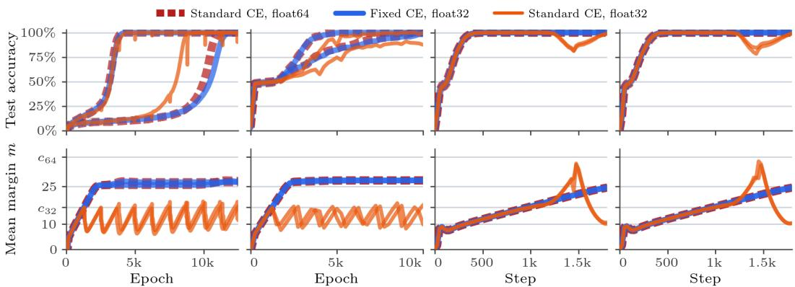  
(a) a+b mod 113 Nanda et al. (2023).  
(b) a+b mod 31  
Varma et al. (2023).  
(c) $a ^ { 2 } + b ^ { 2 }$ mod 97  
Doshi et al. (2024).  
(d) $a ^ { 3 } { + } b$ mod 97  
Doshi et al. (2024).  
Figure 6: Results across four grokking tasks at $\epsilon = 1 0 ^ { - 1 2 }$ (2 of 3–5 seeds shown): 1-layer Transformers (a, b) and 2-layer MLPs (c, d). Fixed cross-entropy in fp32 (blue) matches fp64 standard cross-entropy (red), while standard cross-entropy in fp32 (orange) breaks at $c _ { 3 2 }$

## 7 SOFT-TARGET DISTILLATION

To see how Softmax Cancellation (Section 3) affects optimization, we initialize a student network with the weights of a teacher trained to 100% test accuracy on $a + b$ mod 53 $( \pmb { \theta } _ { \mathrm { S } } ^ { ( 0 ) } = \pmb { \theta } _ { \mathrm { T } } )$ , and run 2,000 steps of Adam $( \eta = 2 \times 1 0 ^ { - 3 } , \lambda = 0 , \epsilon = 1 0 ^ { - 8 } )$ at distillation temperature $T = 4$ (Hinton et al., 2015), which keeps the scaled margin $m / T$ below $c _ { 1 6 }$ so p does not round to one-hot. Because $\mathbf { z } _ { \mathrm { S } } = \mathbf { z } _ { \mathrm { T } }$ at initialization, the true gradient is zero and the student should not move. However, standard soft-target cross-entropy has a non-zero residual gradient at ${ \bf z } _ { \mathrm { S } } = { \bf z } _ { \mathrm { T } }$ due to the mismatch between its forward softmax and backward logsoftmax (Figure 1b). Whenever this residual gradient exceeds $\epsilon ,$ Adam normalizes it into steps of size η (Figure 7): in fp64 the residual $( \sim 1 0 ^ { - 1 7 } )$ lies well below $\epsilon = 1 0 ^ { - 8 }$ so the student stays near $\mathrm { K L } = 0$ , in fp32 $( \sim 1 0 ^ { - 8 } )$ it causes a brief KL spike, and in bf16 $( \sim 1 0 ^ { - 3 } )$ it drives the student away from the teacher and degrades test accuracy. Our fixed soft-target cross-entropy returns $\mathbf { g } = \mathbf { 0 } { \mathrm { ~ a t ~ } } \mathbf { z } _ { \mathrm { S } } = \mathbf { z } _ { \mathrm { T } }$ , so the student remains at $\mathrm { K L } = 0$ and 100% test accuracy across all precisions.

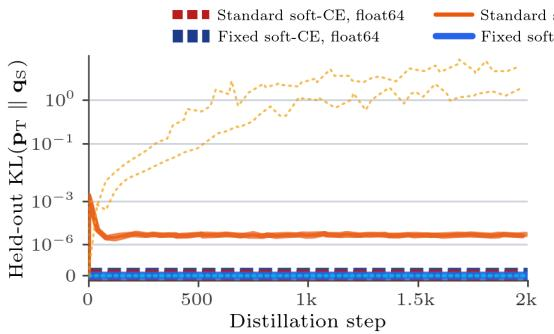

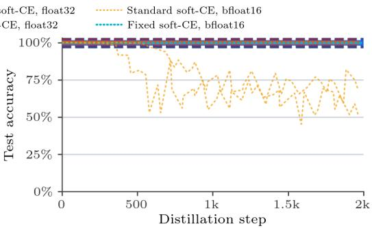  
(a) Held-out $\mathrm { K L } ( \mathbf { p } _ { \mathrm { T } }$ ∥ q<sub>S</sub>).  
(b) Test accuracy.  
Figure 7: Soft-target distillation when the student is initialized with the teacher’s weights $( \pmb { \theta } _ { \mathrm { S } } ^ { ( 0 ) } = \pmb { \theta } _ { \mathrm { T } }$ $T = 4 , \epsilon = 1 0 ^ { - 8 }$ , 2 of 3 seeds shown). Fixed soft-target cross-entropy stays at $\mathrm { K L } = 0$ and 100% accuracy across all precisions; standard soft-target cross-entropy amplifies rounding error into parameter drift in bf16 and a brief KL spike in $\mathrm { f p } 3 2$

## 8 CONCLUSION

We have presented simple fixes for two numerical bugs in standard implementations of softmax, log-softmax, and cross-entropy: Softmax Collapse, which zeroes out the dominant logit’s gradient at high confidence while leaving non-dominant gradients non-zero, and Softmax Cancellation, which loses precision when student logits approach teacher logits in soft-target distillation. Rewriting these functions in log space using softplus, expm1, and log1p restores accurate, zero-sum gradients across bf16, fp32, and fp64 without internally casting to higher precision. Fixing these bugs eliminates Slingshot loss spikes during grokking, prevents student networks from drifting away from the teacher during distillation, and reveals that logit margins under AdamW and weight decay naturally converge to log(1/ϵ). Though the extreme margins and near-zero student–teacher gaps probed by our experiments are uncommon in standard large-scale training, our fixed functions are easy drop-in replacements that can be implemented without meaningful slowdown, and may prove useful whenever models make high-confidence predictions or distill from close teachers.

## ACKNOWLEDGMENTS

We thank Jean-Baptiste Alayrac, Forrester Cole, Roy Frostig, Mark Hamilton, Miki Rubinstein, Keith Rush, and Brandon Zhao for their helpful advice.

## REFERENCES

Darshil Doshi, Tianyu He, Aritra Das, and Andrey Gromov. Grokking modular polynomials. arXiv:2406.03495, 2024.

Katie Everett, Lechao Xiao, Mitchell Wortsman, Alexander A. Alemi, Roman Novak, Peter J. Liu, Izzeddin Gur, Jascha Sohl-Dickstein, Leslie Pack Kaelbling, Jaehoon Lee, and Jeffrey Pennington. Scaling exponents across parameterizations and optimizers. ICML, 2024.

Nicholas J. Higham. Accuracy and stability of numerical algorithms. SIAM, 2nd edition, 2002.

Geoffrey Hinton, Oriol Vinyals, and Jeff Dean. Distilling the knowledge in a neural network. arXiv:1503.02531, 2015.

Diederik P. Kingma and Jimmy Ba. Adam: A method for stochastic optimization. ICLR, 2015.

Atli Kosson, Bettina Messmer, and Martin Jaggi. Rotational equilibrium: How weight decay balances learning across neural networks. ICML, 2024.

H. Liu, Y. Cao, Z. Li, and Y. Zhou. Grokking or glitching? How low-precision drives Slingshot loss spikes. arXiv:2605.06152, 2026.

Ilya Loshchilov and Frank Hutter. Decoupled weight decay regularization. ICLR, 2019.

Clare Lyle, Ghada Sokar, Andras Gy´ orgy, and Razvan Pascanu. What can grokking teach us about¨ learning under non-stationarity? Conference on Lifelong Learning Agents, 2025.

Igor Molybog, Peter Albert, Moya Chen, Zachary DeVito, David Esiobu, Naman Goyal, Punit Singh Koura, Sharan Narang, Andrew Poulton, Ruan Silva, et al. A theory on Adam instability in large-scale machine learning. arXiv:2304.09871, 2023.

Neel Nanda, Lawrence Chan, Tom Lieberum, Jess Smith, and Jacob Steinhardt. Progress measures for grokking via mechanistic interpretability. ICLR, 2023.

Alethea Power, Yuri Burda, Harri Edwards, Igor Babuschkin, and Vedant Misra. Grokking: General ization beyond overfitting on small algorithmic datasets. arXiv:2201.02177, 2022.

Lucas Prieto, Melih Barsbey, Pedro A. M. Mediano, and Tolga Birdal. Grokking at the edge of numerical stability. ICLR, 2025.

Saharon Rosset, Ji Zhu, and Trevor Hastie. Margin maximizing loss functions. NeurIPS, 2004.

Daniel Soudry, Elad Hoffer, Mor Shpigel Nacson, Suriya Gunasekar, and Nathan Srebro. The implicit bias of gradient descent on separable data. JMLR, 2018.

Vimal Thilak, Etai Littwin, Shuangfei Zhai, Omid Saremi, Roei Paiss, and Joshua Susskind. The Slingshot mechanism: An empirical study of adaptive optimizers and the grokking phenomenon. arXiv:2206.04817, 2022.

Tijmen Tieleman and Geoffrey Hinton. Lecture 6.5—RMSProp: Divide the gradient by a running average of its recent magnitude. COURSERA: Neural Networksfor Machine Learning, 2012.

Vikrant Varma, Rohin Shah, Zachary Kenton, Janos Kram ´ ar, and Ramana Kumar. Explaining´ grokking through circuit efficiency. arXiv:2309.02390, 2023.

Mitchell Wortsman, Peter J. Liu, Lechao Xiao, Katie Everett, Alexander Alemi, Ben Adlam, John D. Co-Reyes, Izzeddin Gur, Abhishek Kumar, Roman Novak, et al. Small-scale proxies for large-scale Transformer training instabilities. ICLR, 2024.

Liu Ziyin, Zhikang T. Wang, and Masahito Ueda. LaProp: Separating momentum and adaptivity in Adam. arXiv:2002.04839, 2020.