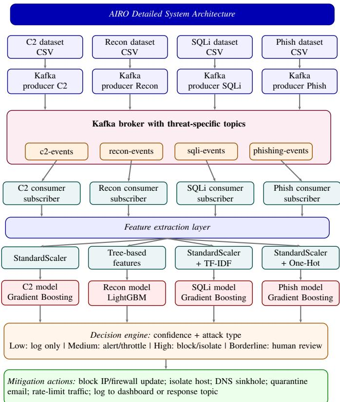
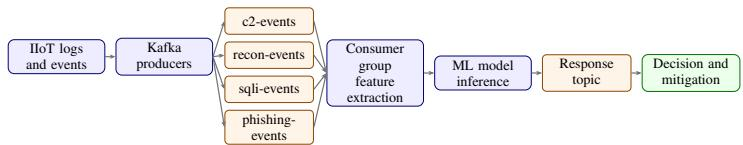
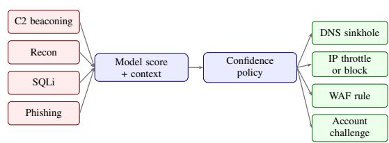
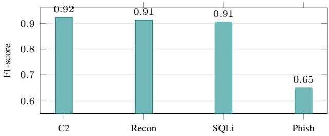
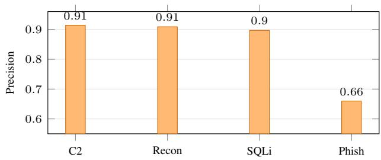
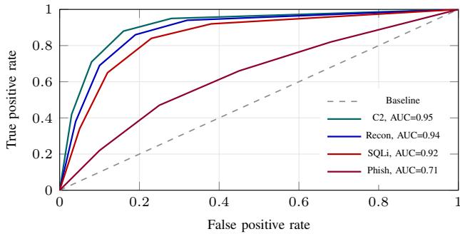

# AIRO: A Streaming-Based Machine Learning Framework for Threat Detection and Security in Industrial Internet of Things

Raima Deb∗, Pranav M Pawar∗, Mithun Mukherjee∗, Raja Muthalagu∗ and Mian Guo†

∗Department of Computer Science, Birla Institute of Technology and Science, Pilani, Dubai Campus,

Dubai International Academic City, Dubai, United Arab Emirates

emails: {p20230011, pranav, mithun, raja.m} @dubai.bits-pilani.ac.in

† Guangdong Polytechnic Normal University, Guangzhou, China, Email: mian.guo123@gmail.com

Abstract—Modern Industrial Internet of Things (IIoT) implementations now connect edge gateways, cloud dashboards and business applications. This improves visibility and remote monitoring. However it simultaneously exposes industrial traffic to various cyber threats including scanning, web attacks and Structured Query Language (SQL) injection (SQLi), phishingdriven credential theft, and command-and-control (C2) activity. Although rule-based tools remain useful for detecting known signatures, their efficacy decreases with minimally altered attacks or when alerts require manual investigation. This paper presents AIRO (Autonomous Intelligence-Driven Cybersecurity Risk Reduction System), an efficient framework for IIoT monitoring and response. AIRO combines Apache Kafka streaming, attackspecific feature extraction, machine learning (ML) inference, confidence-based decision logic and risk reduction measures such as Internet Protocol (IP) blocking, account suspension and traffic limiting. We developed four specialized datasets for C2 beaconing, reconnaissance, SQLi, and phishing to evaluate AIRO. These datasets include noisy and overlapping characteristic distributions to minimize label leakage. The best-performing models, primarily Gradient Boosting and LightGBM, achieve F1-scores up to 0.9229 while ensuring low-latency from event input to mitigation.

Index Terms—cybersecurity, intrusion detection, ML, Apache Kafka, real time streaming, anomaly detection, SQLi, phishing, C2 beaconing

## I. INTRODUCTION

IIoT systems are common in manufacturing, energy, logistics, smart buildings and critical infrastructure. At a site, sensors and controllers do not work by themselves anymore. They share data with edge computers, dashboards, analytics platforms and remote maintenance tools. This is very helpful for automation. However it also makes industrial assets more vulnerable to threats that used to affect enterprise information technology networks [1], [2].

The main motivation for this work is that we need a security mechanism that can monitor traffic, find behavior quickly and take action before a problem affects production. The usual way of detecting intrusions using signatures is helpful for known threats. However it is not very good, at stopping malware, slow scanning, special SQLi payloads, phishing campaigns, and C2 activity that are always changing and evolving. When alerts come in from sensors, gateways and user endpoints, manual response is also slow. We need something to protect these systems [3], [4], [5].

This paper proposes AIRO, an autonomous intelligencedriven framework for IIoT threat detection and mitigation. The work has four goals: to design a streaming security pipeline, prepare attack-specific datasets, compare suitable ML models, and connect detection output to practical response actions. The main contributions are: (i) an IIoT-oriented architecture that combines Kafka streaming, feature extraction, ML inference, and decision logic; (ii) four datasets for C2 beaconing [2], [6], reconnaissance [1], [7], SQLi [8], [4], and phishing [5], [9]; (iii) a comparative evaluation of classical and ensemble ML models; and (iv) a risk-scoring policy that automates highconfidence responses while routing uncertain cases to analyst review.

The rest of the paper is organized as follows. Section II reviews related work and summarizes the research gap. Section III presents the proposed methodology in the order suggested for the design: system architecture and its explanation, Kafka pipeline, and dataset preparation with dataset description. Section IV reports results and discussion. Section V concludes the paper.

## II. RELATED WORK

ML-based intrusion detection has been widely studied as an alternative review classical Intrusion Detection System (IDS) datasets and algorithms like Random Forest and Support Vector Machine (SVM). They identify common issues such as outdated traffic traces, class imbalance, and limited adaptability to new attacks. Ghourabi [8] demonstrated the effectiveness of hybrid LightGBM and Transformer models [10] for healthcare fog security, noting their ability to capture complex patterns. However this study was domain-specific and focused solely on detection. Recent surveys and frameworks in the Internet of Vehicles (IoV) and Internet of Things (IoT) [7], [10], [11] confirm that ensemble learning and feature selection improve classification performance in connected environments.

Cloud and network security research increasingly combines detection with partial response. Mohammed et al. [3] proposed an AI-powered incident detection and response platform for cloud environments. Ghani et al. [4] used Isolation Forest and Random Forest to detect distributed denial-of-service (DDoS), malware, and backdoor attacks. Although valuable for operational security, the response logic in these studies is typically limited and not structured around confidencebased autonomous mitigation. Kim et al. [5] and Malatji [9] emphasized the importance of human involvement and analyst trust for safety. However overreliance on manual review can reduce response speed in IIoT settings.

Recent research also addresses advanced anomaly correlation. Kumar et al. [12] integrated Isolation Forest, Autoencoders and convolutional long short-term memory (ConvL STM) models for robust anomaly detection. Zhu et al. [6] introduced LinTracer for tracking multi stage attack chains using graph-based correlation. Ness et al. [13] evaluated advanced ML models for network anomaly detection. However their focus is offline classification rather than a closed-loop real-time pipeline. BotScan [2] demonstrated the value of lightweight AI defense for IoT botnet threats and supports the need for deployable edge aware security mechanisms.

Existing works show that ML and ensemble models are effective for intrusion detection. However many studies either depend on older datasets or focus on one domain or stop at detection. A practical IIoT solution requires streaming ingestion, attack-specific features, low-latency inference, confidence-aware decisions, and automated mitigation. AIRO addresses this gap by integrating detection and response in a single IIoT-oriented framework.

## III. PROPOSED METHODOLOGY

## A. System Architecture and Explanation

AIRO is designed as a layered IIoT security framework, as shown in Fig. 1. Field devices, gateways, web applications, Domain Name System (DNS) logs, authentication systems, and email security tools generate events continuously. These events are normalized and sent to Kafka topics. During experimentation, comma-separated values (CSV) files emulate live streams, and SQLi payload text is represented using term frequency–inverse document frequency (TF-IDF) features [8]. The inference layer extracts attack-specific features and applies the selected model. The decision engine then maps model confidence to an operational response.

Fig. 1 presents the detailed component-level architecture of AIRO. The data-stream layer contains the four attack data streams used in the prototype: C2 beaconing, reconnaissance, SQLi, and phishing. Each stream is represented as a CSV dataset during experimentation, but the same position can later be occupied by live IIoT logs, DNS records, web-application events, authentication traces, or email-security alerts.

The data-ingestion layer uses four independent Kafka producers. Each producer reads from its attack-specific source, serializes every record as a JavaScript Object Notation (JSON) message, and publishes it to the matching Kafka topic. In the prototype, the producer rate is kept at about one event every 0.3 seconds per stream so that the pipeline behaves like a live monitoring system instead of a one-time batch script. The JSON record keeps raw feature columns together with metadata such as source IP, destination IP, host, and timestamp.

  
Fig. 1. Detailed AIRO system architecture organized as a block diagram from datasets and Kafka streaming to model inference and mitigation.

The Kafka broker layer maintains four isolated topics: c2-events, recon-events, sqli-events, and phishing-events. This separation prevents a high-volume stream, such as phishing traffic, from delaying a low-latency stream such as C2 detection. It also allows each topic to be replayed from Kafka logs if a consumer fails or if a model has to be tested again on the same sequence of events.

The consumer and feature-extraction layers convert incoming topic messages into model-ready inputs. C2 records use StandardScaler for timing and beaconing features, reconnaissance records use tree-based network features, SQLi records use StandardScaler with TF-IDF payload features, and phishing records use StandardScaler with one-hot encoded Uniform Resource Locator (URL) or login attributes. These preprocessing steps produce the fixed-length vectors expected by the trained classifiers.

The ML inference layer contains four dedicated inference threads. Each consumer loads the corresponding pre-trained .pkl model and calls probability inference for each event. The output is a confidence score between 0 and 1. The decision and mitigation layer then maps this score and the attack type to an action: scores below 0.50 are logged, 0.50–0.80 produces an alert or rate limit, scores of 0.80 and above trigger stronger mitigation such as blocking, isolation, sinkholing, or quarantine, and the borderline band of 0.45–0.55 is escalated for human review. This layer keeps the system practical for IIoT use because risky actions are linked to both confidence and operational impact.

  
Fig. 2. Kafka pipeline connecting event ingestion, model inference, and response.

TABLE I  
KAFKA EVENT SCHEMA USED BY THE PROTOTYPE.
<table><tr><td>Field</td><td>Description</td></tr><tr><td>event_id</td><td>Unique identifier for traceability and dupli- cate handling.</td></tr><tr><td>timestamp</td><td>Time at which the gateway or connector observed the event.</td></tr><tr><td>asset_type</td><td>programmable logic controller (PLC), sen- sor gateway, web server, user endpoint, or</td></tr><tr><td>src, dst</td><td>cloud service. Source and destination address, domain, or</td></tr><tr><td>host</td><td>service identifier. Device, endpoint, or service that generated</td></tr><tr><td>features</td><td>the event. Extracted numerical or encoded features used by the model.</td></tr><tr><td>score</td><td>Probability returned by the selected classi-</td></tr><tr><td>action</td><td>fier. Response selected by the decision engine.</td></tr></table>

## B. Kafka Pipeline

Kafka is used as the real-time backbone that connects data generation, feature extraction, model inference, and mitigation. Four producers feed the four dedicated topics shown in Fig. 2. Each topic is consumed by a matching consumer thread, which deserializes the JSON record, applies the required preprocessing step, loads the relevant .pkl model, and produces a confidence score. The broker also provides simple fault tolerance because retained topic logs allow replay when a consumer restarts. In the prototype, the end-to-end delay from event arrival to decision is approximately 0.5 seconds.

The schema in Table I keeps the streaming record small enough for high-volume traffic while retaining the fields needed for auditing. Raw packet payloads do not need to be stored permanently in the Kafka topic; instead, compact features and references are retained. This reduces storage cost and limits exposure of sensitive operational data. If a serious incident is confirmed, the event identifier can be used to retrieve deeper logs from the original sensor or gateway.

Fault tolerance is handled through Kafka offsets. If an inference consumer fails, it can restart from the last committed offset and continue processing without losing events. This behaviour is useful in IIoT sites where connectivity between edge locations and central monitoring may be unstable. The system can also prioritize local enforcement for high-risk events, allowing a gateway to take temporary action even if the central dashboard is delayed.

TABLE II  
DECISION POLICY USED BY THE AIRO RESPONSE ENGINE.
<table><tr><td>Score range</td><td>Risk level</td><td>Action in IIoT deployment</td></tr><tr><td> $p < 0 . 4 5$ </td><td>Low</td><td>Store event, update dashboard, no automated disruption.</td></tr><tr><td> $0 . 4 5 \leq p \leq$  0.55</td><td>Borderline</td><td>Notify analyst and request con- firmation before enforcement.</td></tr><tr><td> $0 . 5 5 < p <$  0.80</td><td>Medium</td><td>Raise alert, increase logging, throttle repeated sources.</td></tr><tr><td> $p \geq 0 . 8 0$ </td><td>High</td><td>Apply attack-specific block, isolation, sinkhole, or quaran- tine.</td></tr></table>

  
Fig. 3. Threat-specific mapping from detection score to mitigation control.

Mitigation is intentionally confidence-driven. For example, a repeated scan from an unknown source can trigger temporary IP blocking, a phishing login attempt can lock or challenge the account, a SQLi attempt can generate a web-application firewall (WAF) rule, and suspected C2 traffic can be redirected to a DNS sinkhole. Events near the decision boundary are escalated to a human analyst to reduce the risk of unnecessary disruption in industrial operations.

The response policy in Table II is conservative because industrial networks value availability as much as confidentiality. A high-confidence SQLi event can be blocked at the web gateway without stopping production traffic, whereas isolating an engineering workstation requires stronger evidence. For this reason, the same probability score is interpreted together with asset criticality, event repetition, and source reputation. The framework therefore avoids a single “detect and block” rule and instead selects a response that matches the operational risk.

Fig. 3 keeps the response path explicit. It is included because several reference papers use architecture and process diagrams to explain how detection output becomes an operational security action. In AIRO, the same idea is adapted for IIoT by separating the threat-specific detector from the enforcement point. This prevents the model from producing only an abstract label and makes the final action easier to audit.

For example, consider an IIoT gateway that normally communicates with a small set of vendor cloud endpoints. If the gateway starts sending periodic DNS queries to a new lowreputation domain and the timing resembles a beacon, the C2 model assigns a high score. The decision engine can then add the domain to a sinkhole list while keeping normal plant traffic active. In contrast, if an engineer’s workstation performs a short port scan during an approved maintenance window, the event may remain in the borderline region and be routed to review instead of being blocked immediately. This distinction is essential because industrial security controls must avoid unnecessary downtime.

TABLE III  
DATASET OVERVIEW USED IN THE PROTOTYPE.
<table><tr><td>Dataset</td><td>Total</td><td>Mal.</td><td>Norm.</td><td>Features</td></tr><tr><td>C2 beacon-</td><td>5,000</td><td>1,264</td><td>3,736</td><td>10 numerical</td></tr><tr><td>ing Recon.</td><td>6,000</td><td>1,898</td><td>4,102</td><td>12 numerical</td></tr><tr><td>SQLi</td><td>5,000</td><td>1,497</td><td>3,503</td><td>5 num. + TF-IDF</td></tr><tr><td>Phishing</td><td>10,000</td><td>5,092</td><td>4,908</td><td>9 num. + 9 cat.</td></tr></table>

From an implementation point of view, every event has some details. These details include a timestamp, source, destination, what kind of asset is involved, some features that were extracted, what the model output is, and the status of the action taken. This information is sent back to a response topic. This way, dashboards, audit reports, and people handling incidents can look at the whole sequence of events. Keeping a decision history within the pipeline is helpful. It helps adjust the thresholds after deploying the system. False positives and analyst overrides can be reviewed without manually collecting logs from multiple tools.

## C. Dataset Preparation and Description

Custom datasets were prepared for four IIoT threat categories because public datasets often contain out-of-date attacks, duplicate entries, or features that leak the label, . The generation process used realistic ranges, noise, overlap between benign and malicious classes, and adversarial variants. Each dataset was divided into training and test sets, and categorical or textual attributes were encoded before model training. Table III summarizes the size, class distribution, and feature type for each dataset used in the prototype.

C2 beaconing dataset: This dataset is made up of network behavior that is related to command and control callbacks. Every sample is an observation period for each host. Normal samples include telemetry, update requests, and cloud synchronization, while the malicious samples involve periodic callbacks, low-jitter inter-arrival time, abnormal DNS bursts, and low-reputation destinations. There are ten numerical features that describe timing, size, DNS entropy, jitter, and destination reputation, as shown in Table IV.

Reconnaissance dataset: This dataset is about port scanning and asset discovery on IIoT gateway and services. In the benign class, there will be maintenance scans and routine service checks to avoid the situation where each scan is regarded as an attack. The malicious class has high unique port numbers, increased failure connections, more port entropy, odd scan rate, and stronger sequential scan. Twelve numerical variables are considered for this class, which are provided in Table V.

SQLi dataset: The data set consists of web requests labeled as either normal or SQLi attack attempts. The normal requests have the following features: form submission and parameterized requests; while the malicious requests include tautologies, union queries, comments, encoded requests, errors-based attacks, and obfuscation attacks. Five numerical metadata features are accompanied by the TF-IDF features calculated based on the query, including special characters, because they help detect attacks. The numerical and textual SQLi features are provided in Table VI.

TABLE IV  
C2 BEACONING FEATURE DESCRIPTIONS.
<table><tr><td>Feature</td><td>Description</td></tr><tr><td>num_nodes</td><td>Nodes in the network window.</td></tr><tr><td>num_malicious_nodes</td><td>Malicious nodes in the scenario.</td></tr><tr><td>heterogeneity</td><td>Diversity of node or device types.</td></tr><tr><td>interval_mean/std</td><td>Mean and variation of beacon intervals.</td></tr><tr><td>packet_size</td><td>Average packet size.</td></tr><tr><td>dns_requests</td><td>DNS query count and burstiness.</td></tr><tr><td>failed_connections</td><td>Failed outbound attempts.</td></tr><tr><td>connection_duration</td><td>Average connection duration.</td></tr></table>

TABLE V

RECONNAISSANCE FEATURE DESCRIPTIONS.
<table><tr><td>Feature</td><td>Description</td></tr><tr><td>connection_attempts</td><td>Total connection attempts.</td></tr><tr><td>unique_ports</td><td>Distinct ports contacted.</td></tr><tr><td>failed/success_connections</td><td>Failed and successful connections.</td></tr><tr><td>scan_rate</td><td>Attempts per second.</td></tr><tr><td>avg_connection_duration</td><td>Average connection duration.</td></tr><tr><td>packet_rate, bytes_sent</td><td>Packet and byte volume.</td></tr><tr><td>port_entropy</td><td>Randomness of port selection.</td></tr><tr><td>sequential_scan_score</td><td>Likelihood of ordered scanning.</td></tr><tr><td>burstiness,</td><td>Timing burst and interval variation.</td></tr><tr><td>interval_variance</td><td></td></tr></table>

TABLE VI

SQLI FEATURE DESCRIPTIONS.
<table><tr><td>Feature</td><td>Description</td></tr><tr><td>request_rate</td><td>Number of queries per second.</td></tr><tr><td>failed_queries</td><td>Number of failed query attempts.</td></tr><tr><td>response_time</td><td>Average query response time.</td></tr><tr><td>payload_length</td><td>Query-string length.</td></tr><tr><td>encoding_flag</td><td>URL or hex encoding indicator.</td></tr><tr><td>query</td><td>Raw SQL text transformed using TF-IDF, with special characters preserved.</td></tr></table>

TABLE VII

PHISHING FEATURE DESCRIPTIONS.
<table><tr><td>Feature group</td><td>Description</td></tr><tr><td>URL/domain</td><td>URL entropy, domain age, redirects, short- ened links, and suspicious tokens are ana-</td></tr><tr><td>Sender</td><td>lyzed. Sender reputation, mismatch flags, and email metadata are evaluated.</td></tr><tr><td>Login</td><td>Login location, frequency, and abnormal ac- cess behavior are monitored.</td></tr><tr><td>Categorical</td><td>Encoded sender, domain, and action cate- gories are identified.</td></tr><tr><td>Network fields</td><td>Connection and request indicators near the email event are examined.</td></tr></table>

Phishing dataset: The dataset consists of interactions for phishing activities of users and emails. The features considered include URL, sender and domain attributes, login context, and simple network characteristics. Malicious instances include suspect tokens, URL redirection, low domain reputation, and abnormal login behavior. The legitimate instances consist of cloud service and enterprise URLs. These are used in order to teach the classifier something more than URL length and token number. It is summarized in Table VII.

TABLE VIII  
DATASET CONSTRUCTION PRINCIPLES.
<table><tr><td>Principle</td><td>Purpose</td></tr><tr><td>Class overlap</td><td>Protects against the learning of impractical threshold policies.</td></tr><tr><td>Noise injection</td><td>Symbolizes packet losses, logging disconti- nuities, encoded strings, and measurement errors.</td></tr><tr><td>Attack variants</td><td>Comprises of low frequency scans, jittered C2, SQLi code, and short URLs.</td></tr><tr><td>Benign look- alikes</td><td>Includes software updates, maintenance scans, admin queries, and valid login URLs.</td></tr><tr><td>Before tuning split</td><td>Avoids accidental data leakage from training to evaluation sets.</td></tr></table>

Preprocessing included handling missing values, scaling numerical features, encoding categorical variables and extracting text-derived features from URLs and payload strings. Three preparation schemes were used to accommodate the diverse data types of attack sources. First was StandardScaler to keep numerical timing and traffic features on a comparable scale. Second was TF-IDF to convert SQLi payload text into model-ready token weights. Last was using one-hot encoding to represent phishing categorical fields without imposing a false numeric order. The dataset construction principles in Table VIII summarize how overlap, noise, attack variants and benign look-alikes were retained to avoid unrealistic separability. Train-test splitting was performed before final evaluation to avoid information leakage. The datasets were not made perfectly separable. Borderline records were retained so that model performance reflects realistic operational conditions.

The records were reviewed from a security perspective rather than solely a statistical one. The malicious class was not defined only by a fixed period for C2. It also encompassed subtle timing changes common in real malware. Benign maintenance windows were included for reconnaissance because industrial teams regularly scan assets for inventory and compliance. Payloads were encoded and integrated with normal parameters for SQLi whch prevented a model from relying on a single symbol. Legitimate cloud-service links were incorporated for phishing as many false positives occur when URL-based detection automatically flags long or redirected links as malicious.

This preparation is crucial for IIoT because public enterprise datasets rarely reflect the complex blend of operational traffic, maintenance behavior and user-driven web activity found in industrial environments. While these datasets do not replace live capture, they offer a controlled setting for comparing models before deploying them to real devices.

Feature importance was also considered while interpreting the trained models. Timing consistency, DNS entropy, and destination reputation were among the most useful indicators for C2 dataset. Number of unique ports and failed connection ratio proved useful than just total packet count for reconnaissance. In SQLi, keyword frequency and encoded character patterns helped distinguish malicious requests from normal parameters. No single feature was reliable enough for phishing which explains the lower F1-score and supports the need for richer text and domain intelligence in future versions.

TABLE IX  
EXPERIMENTAL SETUP AND HYPERPARAMETERS.
<table><tr><td>Threat</td><td>Train/Val/ Test split</td><td>Pre- processing</td><td>Model</td><td>Hyper- parameters</td></tr><tr><td>C2</td><td>64/16/20</td><td>StandardScaler numerical features</td><td>ing</td><td>Gradient Boost- 100 estimates, lr 0.1</td></tr><tr><td>Recon.</td><td>80/0/20</td><td>Tree features, class LightGBM weight 1:2</td><td></td><td>100 estimates, lr 0.1, 31 leaves</td></tr><tr><td>SQLi</td><td>60/20/20</td><td>StandardScaler, TF- Gradient Boost- 100 estimates, lr IDF</td><td>ing</td><td>0.1</td></tr><tr><td>Phishing</td><td>70/15/15</td><td>StandardScaler, one- Gradient Boost- 100 estimates, lr hot encoding</td><td>ing</td><td>0.1</td></tr></table>

TABLE X

BEST-PERFORMING MODELS FOR AIRO DATASETS.
<table><tr><td>Threat</td><td>Selected model</td><td>Acc.</td><td>Prec.</td><td>Rec.</td><td>F1</td></tr><tr><td>C2 beaconing</td><td>Gradient Boosting</td><td>0.923</td><td>0.914</td><td>0.932</td><td>0.923</td></tr><tr><td>Reconnaissance</td><td>LightGBM</td><td>0.914</td><td>0.909</td><td>0.918</td><td>0.913</td></tr><tr><td>SQLi</td><td>Gradient Boosting</td><td>0.908</td><td>0.897</td><td>0.916</td><td>0.906</td></tr><tr><td>Phishing</td><td>Gradient Boosting</td><td>0.671</td><td>0.660</td><td>0.641</td><td>0.650</td></tr></table>

## IV. RESULTS AND DISCUSSION

Logistic Regression, Decision Tree, Random Forest, Gradient Boosting, XGBoost and LightGBM were evaluated. The evaluation used accuracy, precision, recall and F1-score. The final selection focused on F1-score and stable test performance. This is because we need both detection and controlled false positives. Table X summarizes the chosen model for each threat category.

The evaluation involved splitting the data preprocessing for each type of attack and practical model settings. Then the selected classifier was connected to its Kafka consumer. The experimental setup and hyperparameters are listed in Table IX. Implementation files are available at https://github. com/pranav21684/Raima-Sem-2-2025-26.

The results show that ensemble methods work better than a linear model for these datasets. This makes sense because attack labels depend on combinations of features, not one threshold. The Receiver Operating Characteristic (ROC) curves show the area under the curve (AUC) values. SQLi is used in the plot labels. C2 and reconnaissance detection gave the clearest results. This is because timing regularity, destination reputation, port fan-out and failed-connection ratios are behavioral signals. SQLi was also detected reliably. However encoded payloads and normal requests, with characters caused some overlap for phishing category. This is because benign and malicious URLs can look similar. For this reason phishing is used as a warning component not as a stand-alone blocking mechanism.

Figs. 4 and 5 shows that we get the results when the attack has stable patterns of behavior. The way C2 communicates leaves patterns in timing and destination. Reconnaissance creates patterns in connections. SQLi changes the structure of web requests. The ROC curves in Fig. 6 support the conclusion: the C2, reconnaissance and SQLi classifiers are close to the upper-left region but phishing has a weaker curve because good and bad URLs can look very similar. So we should treat phishing detection as a step with email authentication, sandboxing and user verification rather than the only way to control it.

Fig. 4. F1-score of chosen models for each threat category.  
  
Fig. 5. Precision of selected models from each threat category.

  
Fig. 6. ROC curves for the selected AIRO classifiers.

When we deploy this two things are very important not just how accurate it is. First we have to think about latency: if an alert comes after the malware has already done something it gives the attacker time to do more damage. Second we have to think about reversibility: it is safer to block or quarantine something temporarily. Have an analyst approve it rather than making permanent changes that could affect something that is being used for real work. So AIRO uses short response times and actions that can be tracked so that operators can undo something if it affects a task.

Table XI compares our work to recent works. The table shows the metric from each work and whether it can be used in real-time and can respond automatically. In this table, Grey Wolf Optimization (GWO), convolutional neural network (CNN), and Internet of Medical Things (IoMT) are written as acronyms so the cells are easy to read.

The attack categories are separate because SQLi depends on request structure. C2 depends on timing and destination behavior, and each threat maps to a different control point. For deployment AIRO can start in monitoring mode then enable alerting, reversible throttling and controlled automation after analysts review local false positives.

TABLE XI  
COMPARATIVE ANALYSIS WITH RELATED WORKS.
<table><tr><td>Work</td><td>Method/domain</td><td>Accuracy</td><td>Fl-score</td><td>Stream</td><td>Response</td></tr><tr><td>Choukhairi et al. [11]</td><td>Butterfly opt. ensemble; IoT/IDS</td><td>99.795%</td><td>0.9979</td><td>No</td><td>No</td></tr><tr><td>Abid et al. [10]</td><td>GWO + CNN-LightGBM; IoT/IoMT</td><td>95.24%</td><td>0.9951</td><td>No</td><td>No</td></tr><tr><td>Ness et al. [13]</td><td>ML anomaly detection; network</td><td>85%</td><td>0.85</td><td>No</td><td>No</td></tr><tr><td>AIRO</td><td>Kafka + attack-specific ML; IIoT</td><td>95.3%</td><td>0.9229</td><td>Yes</td><td>Yes</td></tr></table>

## V. CONCLUSION

This paper introduced AIRO which is a real time IIoT cybersecurity framework that combines threat detection with autonomous mitigation. Kafka is used for streaming ingestion which helps with attack specific feature extraction, ensemble ML models and confidence based decision making. Four datasets were prepared for C2 beaconing, reconnaissance, SQLi, and phishing attacks. The models performed well in all but one category with phishing being detected as the area requiring further work. In conclusion, AIRO showcases that lightweight ML and a streaming framework could lead to more rapid, secure and practical security responses in IIoT environments.

The main limitations of AIRO include low F1-score in phishing attack detection and additional effort required for maintaining different models. Future work will involve testing the pipeline on IIoT traffic, introducing transformer based features for better phishing detection and model distillation for implementation at edge gateways.

## REFERENCES

[1] V. Hnamte and J. Hussain, “An Extensive Survey on Intrusion Detection Systems: Datasets and Challenges for Modern Scenario,” 3rd Int. Conf. on Electrical, Control and Instrumentation Engineering (ICECIE), 2021, doi: 10.1109/ICECIE52348.2021.9664737.

[2] S. Sadhwani, U. K. Modi, R. Muthalagu, P. M. Pawar, A. Panthakkan, and W. Mansoor, “IoT BotScan: Ultra-Lightweight AI Defense Against Botnet Threats,” IEEE Access, vol. 13, pp. 98771–98790, 2025, doi: 10.1109/ACCESS.2025.3574355.

[3] Mohammed, M. C. Ghanem, A. El-Hajjar, and D. N. Ratnayake, “AIpowered System for an Efficient and Effective Cyber Incidents Detection and Response in Cloud Environments,” IEEE Trans. Machine Learning in Communications and Networking, vol. 3, pp. 623–643, 2025.

[4] E. P. Ghani, A. Sofwan, and M. Somantri, “AI-Driven Network Security: Detecting and Mitigating DDoS, Malware, and Backdoor Attacks with Isolation and Random Forest,” Jun. 2025, doi: 10.1109/siml65326.2025.11080951.

[5] Y. Kim, G. Dán, and Q. Zhu, “Human-in-the-loop Cyber Intrusion Detection Using Active Learning,” IEEE Trans. Information Forensics and Security, vol. 19, pp. 8658–8672, 2024, doi: 10.1109/tifs.2024.3434647.

[6] T. Zhu et al., “LinTracer: An efficient tracking system for cyberattack chains fusing entity and event semantics,” Computers & Security, vol. 154, p. 104413, Jul. 2025, doi: 10.1016/j.cose.2025.104413.

[7] M. Alharthi, F. Medjek, and D. Djenouri, “Ensemble Learning Approaches for Multi-Class IDS for the Internet of Vehicles: A Comprehensive Survey,” Future Internet, vol. 17, no. 7, pp. 317–317, Jul. 2025, doi: 10.3390/fi17070317.

[8] A. Ghourabi, “A Security Model Based on LightGBM and Transformer to Protect Healthcare Systems From Cyberattacks,” IEEE Access, vol. 10, pp. 48890–48903, 2022, doi: 10.1109/ACCESS.2022.3172432.

[9] M. Malatji, “Evaluating Human-Machine Interaction Paradigms for Effective Human-AI Collaboration in Cybersecurity,” pp. 1268–1272, Dec. 2024, doi: 10.1109/icicyta64807.2024.10913015.

[10] T. Abid et al., “A novel IoT threat detection using GWO feature selection and CNN-enhanced LightGBM,” J. Cloud Computing, vol. 14, no. 1, Nov. 2025, doi: 10.1186/s13677-025-00785-2.

[11] M. Choukhairi et al., “Butterfly optimization-based ensemble learning strategy for advanced intrusion detection in IoT networks,” IJECE, vol. 15, no. 3, pp. 3494–3505, May 2025,

[12] A. Kumar et al., “Revolutionising anomaly detection: a hybrid framework integrating isolation forest, autoencoder, and Conv. LSTM,” Knowledge and Information Systems, Sep. 2025, doi: 10.1007/s10115- 025-02580-6.

doi: 10.11591/ijece.v15i3.pp3494-3505.

[13] S. Ness, V. Eswarakrishnan, H. Sridharan, V. Shinde, N. V. P. Janapareddy, and V. Dhanawat, “Anomaly Detection in Network Traffic Using Advanced Machine Learning Techniques,” IEEE Access, 2025.