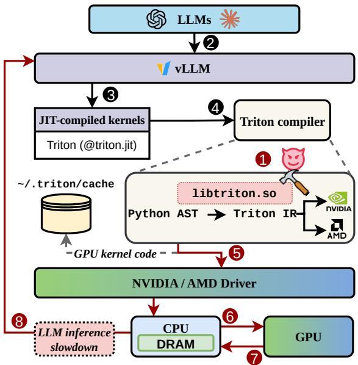
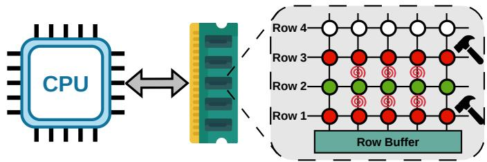
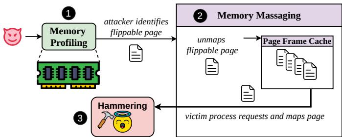
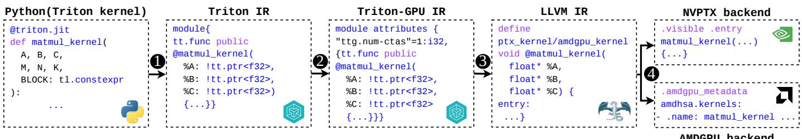
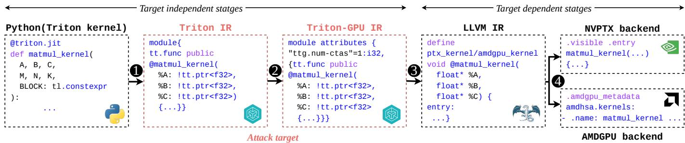
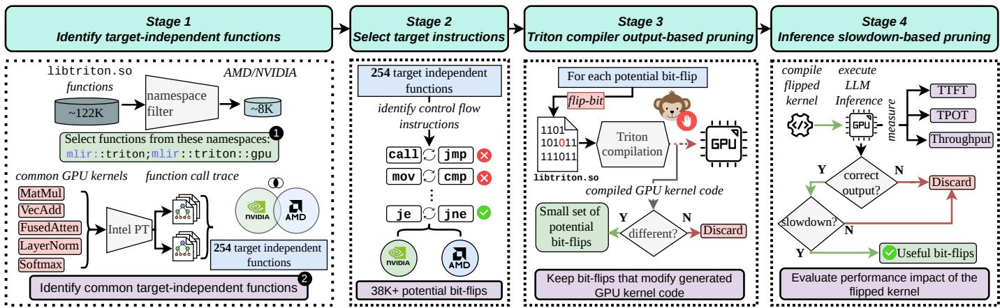
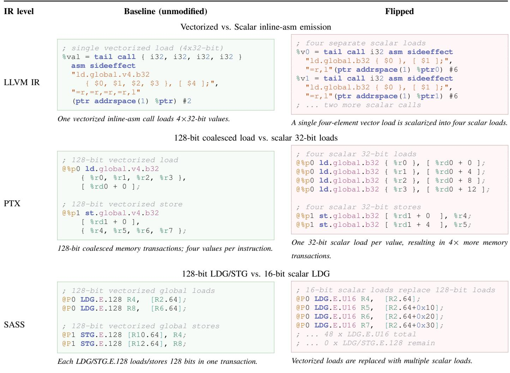
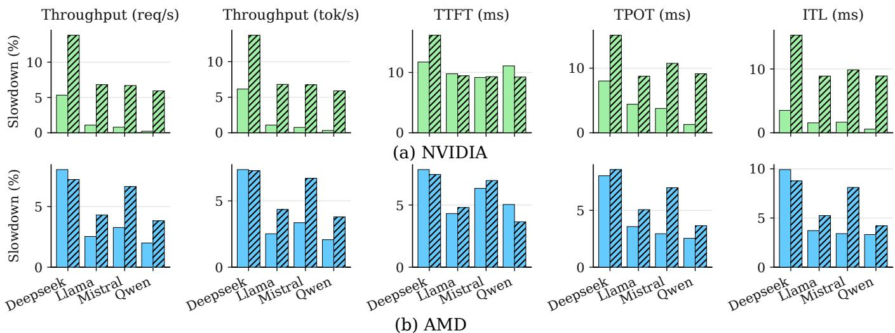
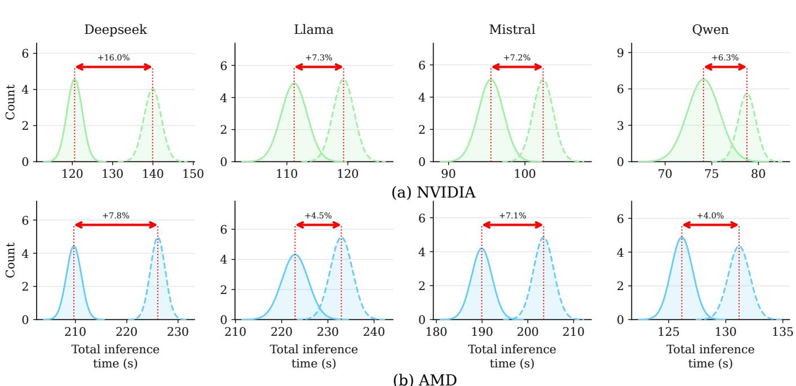

# Amplifying Latency and Cost of LLM Inference via Rowhammer Attack

Mrityunjay Shukla

Shubham Roy

Biswabandan Panda

Indian Institute of Technology Bombay

Indian Institute of Technology Bombay

Mumbai, India

Indian Institute of Technology Bombay

Mumbai, India

Mumbai, India

mrityunjay@cse.iitb.ac.in

royshubham@cse.iitb.ac.in

biswa@cse.iitb.ac.in

Abstract—Large language models (LLMs) achieve high inference efficiency using optimized GPU kernels generated by just-in-time (JIT) compilation frameworks such as Triton. Triton compiles GPU kernels through an MLIR/LLVM-based pipeline. We investigate whether a Rowhammer-induced bit-flip in the CPU’s DRAM can degrade GPU-based LLM inference performance while preserving output correctness. We present LLVMhammer, the first Rowhammer attack that causes LLM inference slowdown by inducing a bit-flip in Triton’s compilation pipeline. A bit-flip in a performance-critical optimization pass causes Triton to generate a functionally identical but suboptimal GPU kernel. Since Triton caches the generated kernel on disk, a single successful bit-flip causes persistent slowdown across subsequent inference executions. Triton’s targetindependent stages are shared across GPU vendors, which makes our attack GPU vendor-agnostic. To identify exploitable bitflip locations without manual inspection, we build Karnage, a tool that isolates useful bit-flip locations in Triton’s targetindependent compilation pipeline. We evaluate LLVMHammer across a diverse set of LLMs, including Qwen2.5-7B-Instruct, Llama-3.1-8B-Instruct, Mistral-7B-Instruct-v0.3, and Deepseekllm-7B-chat, across NVIDIA RTX 4090 and AMD RX 7900 XTX GPUs. LLVMhammer increases inference latency of an LLM inference server running on a single GPU by 4-16%, which, in turn, can translate into additional annual operating costs at the scale of multi-GPU deployments. We further show that LLVMhammer can also corrupt LLM outputs across different GPU vendors, reducing BERTScore to as low as 25%, illustrating the broader security implications of bit-flips in Triton’s compilation pipeline.

## I. INTRODUCTION

Large language models (LLMs) have become ubiquitous across a wide range of applications, from conversational AI and code generation [1] to document summarization [2]. The demand for LLM-powered services continues to grow rapidly [3]. The effectiveness of an LLM deployment depends on both output correctness and inference efficiency. Correctness determines whether the model produces accurate and reliable responses. Inference efficiency is determined by how effectively the deployment utilizes its computational resources and consequently, the throughput it can achieve, measured in terms of the number of tokens generated per second and the number of requests served per second. Lower inference efficiency reduces throughput and increases operational costs. Modern LLMs achieve high inference efficiency by executing optimized GPU kernels for matrix multiplication and attention computations. The GPU software stack generates and manages these kernels and therefore plays a critical role in every production LLM serving system.

Rowhammer [4] is one of the attacks that can affect output correctness. A large body of research investigates accuracy degradation attacks on ML models [5], [6], [7], [8], [9], [10], [11], [12], [13], [14], [15], [16], [17]. Most attacks target model weights [5], [6], [7], [9], [14], [13], [12], [15] and therefore require multiple bit-flips. Other works demonstrate accuracy degradation attacks under more practical and realistic assumptions using Rowhammer [8], [9], [7], [16], [17]. Some of the recent attacks [17], [18] extend this threat to LLM inference by corrupting GPU code. These attacks primarily target output integrity, causing incorrect predictions or incoherent responses. In contrast, we target inference efficiency, degrading LLM serving performance and thereby increasing deployment costs.

## Pertinent question

Is it possible for a Rowhammer-induced bit-flip to reduce the inference efficiency of an LLM deployment running on GPUs without affecting the output correctness?

Our approach. We answer the pertinent question by targeting vLLM [19] (a widely used GPU vendor-agnostic framework for production LLM inference) that relies on OpenAI’s Triton [20] (a Python-based domain-specific language and compiler) to generate optimized GPU kernels for attention and matrix multiplication. Although NVIDIA’s TensorRT-LLM [21] also relies on Triton, it only supports NVIDIA GPUs [22], thus reducing its applicability across different GPU vendors. Triton compiles these kernels justin-time (JIT) via the Multi-Level Intermediate Representation (MLIR) and LLVM compilation pipeline [23], [24]. Triton stores the compiled kernels in a software cache located at ˜/.triton/cache [25] and reuses them across future inference requests without recompilation.

We show that a Rowhammer-induced bit-flip in the Triton binary while it is resident in the CPU’s DRAM can alter the generated GPU kernel, resulting in a suboptimal kernel while preserving output correctness. Triton then caches and reuses this suboptimal kernel, causing LLM inference slowdown. Overall, a single bit-flip persistently reduces inference efficiency in the form of a degradation in Time-to-first-token (TTFT) [26], Time-per-output-token (TPOT) [26], Inter-tokenlatency (ITL) [26], and throughput [27].

Triton’s compilation pipeline as an attack target. Triton’s JIT compilation pipeline is invoked during LLM inference, while its on-disk kernel cache allows a single corrupted compilation to persist across subsequent requests and process restarts. Triton’s MLIR/LLVM-based compilation pipeline includes target-independent stages shared across GPU vendors. The combination of JIT compilation, persistent kernel caching, and shared target-independent stages makes Triton’s compilation pipeline an attack target. To the best of our knowledge, no prior work has examined Triton’s compilation pipeline as an attack target.

## Unexplored attack target

Triton’s target-independent optimization stages expose a previously unexplored attack target. As these optimizations are shared across GPU vendors, a single bit-flip can alter the generated kernels across multiple GPU vendors, causing LLM inference slowdowns.

Challenges. To mount such an attack on Triton, we have to overcome two major challenges.

(i) Identifying target-independent functions: The Triton library contains more than 120,000 functions. Only a small subset of those functions implements the target-independent optimization passes that execute identically across all GPU vendors and kernel types. Manually inspecting and isolating targetindependent functions is intractable at this scale.

(ii) Finding useful bit-flip locations within target-independent functions: even after isolating the target-independent functions, each function contains many potential bit-flip locations, yielding approximately 1.1-1.3 million potential bit-flip locations in total. Evaluating each potential bit-flip location requires inducing a bit-flip, compiling the kernel, and running a complete LLM inference, which takes 30 seconds for one location, making an exhaustive evaluation time-consuming (409 days). Furthermore, the vast majority of potential bit-flip locations either leave the compiled kernel unchanged, crash it, or corrupt its output. Only a rare subset of bit-flip locations produce a kernel that is slower than the optimized baseline, correct in its outputs, and consistent in its slowdown across varying prompts and models. To address these challenges, we develop a tool called Karnage (Section III-D). Karnage efficiently isolates useful bit-flip locations in Triton’s target-independent pipeline without manual inspection of bit-flip locations.

LLVMhammer. Fig. 1 provides an overview of LLVMhammer, our proposed attack on LLM serving systems. The attacker’s objective is to reduce the inference efficiency of the LLM application in the form of a degradation in TTFT, TPOT, ITL, and throughput (tokens/second and requests/second). Before the LLM inference begins, in step ( 1 ), the attacker, a CPU process, uses Rowhammer to induce a bitflip in a performance-critical optimization pass within the Triton compiler library (libtriton.so) resident in the CPU’s DRAM. This bit-flip alters the compiler’s optimization decision and generates a suboptimal GPU kernel that preserves functional correctness while degrading execution time. Triton stores generated GPU kernels in a software cache called the Triton cache [25] and reuses them across future inference requests without recompilation. Therefore, a single successful bit-flip can persistently affect subsequent inference executions that reuse the suboptimal GPU kernel, including executions after process restart.

  
Fig. 1. LLVMhammer in a nutshell.

In step ( 2 ), the victim LLM application initiates inference through an LLM serving framework such as vLLM. In step ( 3 ), during the execution, vLLM invokes JIT-compiled GPU kernels generated by the Triton compiler ( 4 ). In step ( 5 ), the generated suboptimal GPU kernel is passed to the appropriate GPU driver. In step ( 6 ), the runtime and driver load the kernel into GPU memory for execution. In step ( 7 ), the GPU executes the suboptimal kernel and produces inference outputs. Finally, in step ( 8 ), the LLM framework receives the outputs and observes a slowdown in LLM inference.

Key results and impact. We demonstrate the LLVMhammer attack using GPUs from two different vendors, namely NVIDIA RTX 4090 and AMD RX 7900 XTX, on four LLM models (Qwen2.5-7B-Instruct [28], Llama-3.1-8B-Instruct [29], Mistral-7B-Instruct-v0.3 [30], and Deepseekllm-7B-chat [31]). We evaluate the efficacy of our attack using five metrics, i.e., TTFT, TPOT, ITL, and throughput (tokens/second and requests/second). Overall, our attack targets an LLM inference server and increases total inference time up to 16% when running Deepseek-llm-7B-chat for a large number of requests (1,000 requests [32]), compared with the attackfree baseline. This result demonstrates that our attack can cause a measurable slowdown in end-to-end LLM serving performance. Production LLM inference servers handle millions of requests per day [33], [34]. A modest 10% increase in inference latency loses roughly 876 hours (37 days) of serving capacity per year without any output anomaly to prompt investigation. In production deployments, this loss translates into a direct, sustained monetary cost as long as the suboptimal GPU kernel remains in Triton’s on-disk cache. Production deployments range from single-GPU replicas to multi-node clusters, with NVIDIA reference architectures defining scales of 8, 128, and 256 GPUs [35], [36], [37]. At present, H100 pricing is \$4.50-\$10.00/GPU-hour [38], which translates to \$3.9K-\$8.76K per GPU annually, scaling to \$1M-\$2.24M per year for a 256-GPU deployment.

  
Fig. 2. Rowhammer bug.

## Contributions.

• We demonstrate LLVMhammer, the first Rowhammer attack that causes LLM inference slowdown by inducing a bit-flip in Triton’s compilation pipeline, causing the compiler to generate a suboptimal GPU kernel. The slowdown persists across inference sessions and process restarts via Triton’s on-disk kernel cache (Section III).

• We build Karnage, a tool that identifies exploitable bit-flip locations in the target-independent stages of the Triton pipeline without manual inspection (Section III-D).

• We show that LLVMhammer is GPU-vendor agnostic: bit-flip locations in Triton’s target-independent stages generalize across NVIDIA and AMD GPUs, causing a 4–16% increase in inference latency across four LLM models (Section IV).

• We also show that LLVMhammer can corrupt LLM outputs across GPU vendors, reducing BERTScore [39] to as low as 25%, demonstrating that bit-flips in Triton’s compilation pipeline affect output correctness (Section V).

## II. BACKGROUND

In this Section, we briefly cover the Rowhammer attack, followed by the necessary background on the MLIR/LLVM toolchain, which is pivotal in understanding the compilation pipeline of Triton. Finally, we discuss how state-of-the-art LLM inference frameworks, such as vLLM, use Triton to generate efficient kernels.

## A. Rowhammer attack

Rowhammer [4] is a DRAM integrity issue first demonstrated in 2014. Over the past decade, Rowhammer has evolved into a versatile attack vector that spans security and privacy domains [40], [41], [42]. The Rowhammer attack exploits cellto-cell interference in modern DRAMs. Repeatedly activating (hammering) one or more rows increases charge leakage in adjacent rows through capacitive coupling and electromagnetic interference, as shown in Fig. 2. When a DRAM row is activated sufficiently many times within a single refresh interval (typically 64 ms in DDR3 and DDR4 DRAMs and 32ms in DDR5 DRAMs), the affected neighboring cells may lose sufficient charge that, upon subsequent access, the sense amplifier misreads their stored value, resulting in a bit-flip. Attackers have exploited this reliability issue by deliberately accessing certain DRAM rows (called aggressor rows) in their own address space at high frequency, causing flips in the DRAM rows used by a victim process (called victim rows). DRAM vendors have implemented numerous countermeasures, such as Targeted Row Refresh (TRR) [43] and the Per Row Activation Counter (PRAC) in DDR5 [44], which refresh a victim row upon detecting suspicious row activations. However, TRR has been bypassed on several occasions [43] [42], and Rowhammer remains a threat even for the most recent DDR5 DRAMs [45] [46].

  
Fig. 3. Steps in a Rowhammer attack.

To mount a successful Rowhammer attack, an attacker must follow three key steps [40], as shown in Fig. 3. The attack begins with memory profiling ( 1 ), in which the attacker profiles the DRAM to identify DRAM locations susceptible to bit-flips by allocating memory chunks from their own address space. It identifies the page-frames (fixed-sized blocks in DRAM that hold an OS page) that have bit-flips at offsets suitable for their purpose. Upon finding suitable bitflip locations (i.e., at desired offsets within a DRAM page frame), the attacker manipulates the victim process’s memory allocation so that the sensitive victim data or code is mapped to these locations. Typically, the OS’s page-frame allocation policy, which allocates page frames without respecting process boundaries, is exploited in this step. This process is known as memory massaging ( 2 ) [47], [48], [41], [8], [17]. Finally, during the hammering phase ( 3 ), the attacker repeatedly accesses the identified aggressor rows in its own address space to induce bit-flips in the victim’s rows. The end-to-end Rowhammer attack does not require any elevated privileges or root-level access to the target system.

## B. MLIR/LLVM intermediate representations

A compiler intermediate representation (IR) provides a machine-independent program representation. It lies between the source code and the final machine code. The compiler frontend produces the IR after parsing the program. The compiler backend converts the IR into machine instructions. This separation simplifies compiler design and optimization. The same optimizations work for many source languages and work across different target architectures.

  
Fig. 4. Triton compilation pipeline.

LLVM [24] provides a widely used intermediate representation called LLVM IR. LLVM optimizes programs using a sequence of optimization passes. Each pass analyzes or transforms the LLVM IR. These passes reduce register pressure or instruction count. Most LLVM passes are target-independent. LLVM passes do not depend on the target instruction set. The same optimized IR supports many target instruction sets. Examples include x86, ARM, AMDGPU, NVPTX, and RISC-V. Only the final code generation depends on the target.

MLIR [23] extends this idea with multiple intermediate representations. These representations are called dialects. Each dialect defines its own operations and types. Multiple dialects coexist within a single compilation pipeline. The compiler gradually compiles programs across these dialects. Subsequent stages produce LLVM IR or target-specific representations. MLIR optimization passes work on specific dialects. Each pass only understands its own dialect and ignores lower targetspecific dialects. Therefore, the same optimizations work across different target backends.

## C. Triton and its compilation pipeline

Triton [20] is an open-source compiler and Python-based domain-specific language (DSL) that lets developers write GPU kernels without expertise in low-level GPU programming models such as Compute Unified Device Architecture (CUDA) or Heterogeneous-computing Interface for Portability (HIP). Triton’s compiler is responsible for architecture-specific optimizations such as register allocation, shared-memory placement, vectorization, and instruction selection. This design has driven Triton’s rapid adoption as the kernel compiler for attention and matrix-multiplication kernels in LLMs’ inference [19].

Triton’s compilation pipeline compiles a kernel from the Python DSL to target-specific machine code through four successive representations, which Fig. 4 illustrates. In step ( 1 ), the compiler first converts the Python kernel into Triton IR, an MLIR dialect that captures the blocked programming model directly, operations in this dialect express computations over tiles, reductions over blocks, and loads and stores from global and shared memory at a level entirely independent of any target architecture. In step ( 2 ), the compiler then compiles

Triton IR into the Triton-GPU dialect, which introduces GPUspecific abstractions such as thread layout annotations and shared memory synchronization, but remains vendor-agnostic, i.e., it does not yet distinguish between an NVIDIA warp and an AMD wavefront. The optimization passes at this level operate on GPU-specific abstractions while remaining largely independent of the target ISA, enabling the same optimization framework to support multiple GPU backends. Next, in step 3 , the compiler translates the Triton-GPU dialect into LLVM IR, at which point the representation specializes: for NVIDIA targets, it emits LLVM IR targeting the NVPTX backend; for AMD targets, it emits LLVM IR targeting the AMDGPU backend, with target-specific type annotations and intrinsics. In step 4 , the LLVM backend emits target-specific machine code: NVIDIA’s Parallel Thread Execution (PTX) for NVIDIA GPUs and AMD’s Graphics Core Next (AMDGCN) for AMD GPUs.

The boundary between ( 2 ) and ( 3 ) is the critical architectural divide for this work. Every optimization pass that operates at ( 1 ) or ( 2 ) on Triton IR or Triton-GPU IR is target-independent by construction: it operates on abstractions that carry no knowledge of the target backends like NVIDIA or AMD, and its output feeds into all the vendor backends equally. A bit-flip in a data structure that one of these passes reads or writes is therefore not a bit-flip against a single vendor’s compiled artifact; it is a bit-flip against a representation that every vendor’s backend subsequently consumes. Every pass that operates at ( 3 ) or ( 4 ), in contrast, operates on a vendor-specific representation, and a bit-flip there affects only the backend whose IR it corrupts.

## D. vLLM

vLLM [19] is an open-source inference serving framework designed to run LLMs efficiently. It uses PagedAttention [19] to divide the key-value (KV) cache into fixed-size memory blocks. This design improves GPU memory utilization, reduces fragmentation, and enables efficient sharing of the KV cache across concurrent requests, allowing vLLM to achieve high inference throughput. To execute LLM inference, vLLM uses Triton to generate optimized GPU kernels for attention, matrix multiplication, and elementwise operations such as activation functions and layer normalization. Triton compiles these kernels through the MLIR/LLVM compilation pipeline at inference startup and stores the compiled binaries for later reuse. Since vLLM depends on Triton-generated kernels, the

  
Fig. 5. LLVMhammer on the target-independent stages of the Triton compilation pipeline.

Triton compilation pipeline becomes a critical component of every vLLM deployment.

Together, these concepts motivate the attack presented in this paper: (i) Rowhammer demonstrates that an attacker can induce bit-flips in DRAM without requiring elevated privileges, (ii) Triton’s compilation pipeline identifies the compiler intermediate representations that transform high-level GPU kernels into executable machine code, while distinguishing the target-independent stages from the vendor-specific backend and (iii) finally, vLLM shows that modern LLM inference frameworks rely on Triton-generated kernels to execute inference requests. In sumamry, a Rowhammer attacker can corrupt the target-independent stages of Triton’s compilation pipeline and can generate suboptimal GPU kernels affecting subsequent LLM inference.

## III. LLVMHAMMER

## A. Threat model

Victim. The victim runs an LLM inference service on a shared physical host [8], [17], [16], and uses Triton as the GPU kernel compiler for GPU inference. The victim’s model weights are inaccessible to co-tenant processes. We consider the victim’s model trustworthy: its weights are free from prior poisoning or trojan attacks [8], [17], [16], and the Triton source and MLIR/LLVM toolchain the victim uses are unmodified and obtained from trusted providers.

Attacker. The attacker is a malicious co-tenant on the same physical host as the victim, consistent with the cloud cotenancy threat model established by prior Rowhammer attacks on ML systems [9], [8], [17], [10]. The attacker has the following capabilities: (i) it runs an unprivileged user-space CPU process on the same physical machine as the victim and has no direct read or write access to the victim’s process memory, model weights, or the Triton/MLIR/LLVM source, (ii) the attacker can allocate physical DRAM pages and perform Rowhammer to induce bit-flips in physically adjacent DRAM rows, following the standard Rowhammer attack [4], [49], [50], [46], [42], [43], and (iii) the attacker cannot modify the Triton source, the MLIR/LLVM toolchain, the victim’s model weights, or the victim’s inference serving configuration. Triton is deployed as a shared library, and prior attacks have established memory deduplication as a mechanism for mapping identical library pages from different processes to the same physical DRAM pages [17], [8], [9], [51], [10]. Thus, the attacker can target a physical page containing shared Triton code without directly accessing the victim’s process. Even if memory deduplication is disabled, an attacker can use memory massaging to manipulate the victim’s memory allocation to map a vulnerable page in the victim’s address space, as shown by prior Rowhammer attacks [17], [52], [41].

We mount a Rowhammer-based bit-flip attack on the CPU DRAM to degrade the performance of a GPU-based LLM inference. Fig. 1 presents the overview of the LLVMhammer attack against LLM serving applications. The attacker’s objective is to increase inference latency metrics such as TTFT and TPOT, and reduce overall throughput measured in tokens and requests per second.

B. Attacking target-independent stages of Triton’s compilation pipeline

Fig. 5 shows the target-independent and target-dependent stages of the Triton compilation pipeline. We target the code that generates the target-independent stages ( 1 and 2 ), making the attack vendor-agnostic. At this point, the compilation pipeline remains common across all GPU vendors, and backend-specific optimizations occur only in the later stages ( 3 and 4 ). Consequently, once identified, a vulnerable bit-flip location transfers across Triton deployments without requiring rediscovery and affects kernels targeting both the NVPTX and AMDGPU backends.

## Takeaway I:

Attacking the target-independent stages of the Triton compilation pipeline affects the first target-dependent stage, which is LLVM IR, making our attack GPU vendor agnostic. Thus, we name our attack LLVMhammer.

## C. Finding the useful bit-flips

The vast majority of bit-flip locations in libtriton.so, the shared library implementing Triton’s compiler functionality, do not produce a useful attack outcome: (i) most flips leave the generated kernel unchanged, (ii) some cause the compiler or generated kernel to crash, and (iii) others corrupt the kernel’s output. We therefore define a potentially useful bit-flip as one that simultaneously satisfies the following three properties.

  
Fig. 6. Overview of Karnage’s four-stage pruning of useful bit-flip locations.

P1:Target independence. The bit-flip must reside in a function belonging to the target-independent stages of the Triton pipeline, specifically within the Triton IR or Triton-GPU IR optimization stages that execute before any vendor-specific compilation occurs. Because the functions implementing these stages are shared across all vendor binaries, a location satisfying P1 generalizes across GPUs from different vendors. A bit-flip that does not satisfy P1 resides in a vendor-specific function and requires separate identification for each target backend, forfeiting the cross-architecture reach that distinguishes this attack.

P2:Performance slowdown without output corruption or crash. The bit-flip must cause the Triton compiler to generate a suboptimal kernel that executes measurably slower than its optimized counterpart while producing semantically correct outputs and completing without a crash. A crash is immediately observable by the victim’s inference serving infrastructure and terminates the inference request, prompting investigation. Concretely, the suboptimal kernel must produce a measurable increase in TTFT, TPOT, or a measurable reduction in tokens per second relative to the kernel the unmodified compiler produces.

P3:Consistent slowdown across different inference configurations. The slowdown must persist across diverse inference inputs, prompt lengths, and models, consistently increasing both TTFT and TPOT.

## Takeaway II:

A useful flip must lie in a target-independent region of the triton compilation pipeline (P1), cause inference slowdown (P2), and should show consistent slowdown across varying prompts (P3).

Section III-D describes the automated methodology the attacker follows to locate useful bit-flip locations in libtriton.so without manual inspection.

## D. Karnage: A tool for finding useful bit-flips

Identifying a useful bit-flip location is the key challenge in mounting LLVMhammer. The attacker must find a useful bitflip location that satisfies P1, P2, and P3. The Triton compiler library, i.e., libtriton.so contains more than 120,000 functions found using the nm Linux binary utility [53], and each function contains hundreds of potentially useful bit-flip locations. Evaluating a bit-flip location requires inducing a bit-flip, compiling the kernel, and running a complete LLM inference, which takes approximately 30 seconds. Exhaustively evaluating bit-flip locations would require approximately 12 years, making brute-force search impractical. These constraints require an efficient pruning strategy that quickly eliminates unlikely bit-flip locations while preserving useful ones. We propose Karnage, which implements this strategy by systematically reducing the search space to a small set of high-confidence, potentially useful bit-flip locations. The Karnage pruning strategy is a fully offline pre-step to the LLVMhammer. The attacker then uses the identified bit-flip location to mount LLVMhammer against the target LLM serving application, as shown in Fig. 1. Fig. 6 summarizes different stages of Karnage. We describe each stage below.

TABLE I  
NUMBER OF FUNCTIONS IN L I B T R I T O N.S O TAILORED FOR NVIDIA AND AMD GPUS
<table><tr><td>Function count</td><td>NVIDIA</td><td>AMD</td></tr><tr><td>Total functions in libtriton.so</td><td>121,735</td><td>122,148</td></tr><tr><td>Target-independent functions (namespace filter)</td><td>7,963</td><td>8,219</td></tr><tr><td>Target-independent functions (Intel PT filter)</td><td>254</td><td>254</td></tr></table>

1) Stage 1: Identifying target-independent functions: Karnage first identifies the functions that can contain useful bit-flip locations. LLVMhammer targets LLM-serving applications that compile Triton kernels across different GPU vendors and kernel types. Karnage first identifies the target-independent functions that execute across different kernels and GPU vendors. It then searches these functions for platform-specific bitflip locations that satisfy P1, P2, and P3. libtriton.so contains more than 120,000 functions, as shown in Table I, and profiling every function is impractical.

TABLE II  
CONTROL-FLOW ALTERING INSTRUCTION PAIRS AT 1-BIT HAMMING DISTANCE IN THE X86-64-BASED CPU
<table><tr><td>Instruction. A</td><td>Opcode A</td><td>Instruction. B</td><td>Opcode B</td></tr><tr><td>je</td><td>0x74</td><td>jne</td><td>0x75</td></tr><tr><td>j1</td><td>0x7C</td><td>jge</td><td>0x7D</td></tr><tr><td>jle</td><td>0x7E</td><td>jg</td><td>0x7F</td></tr><tr><td>jb</td><td>0x72</td><td>jae</td><td>0x73</td></tr><tr><td>jbe</td><td>0x76</td><td>ja</td><td>0x77</td></tr><tr><td> ${ \dot { \ } } s$ </td><td>0x78</td><td>jns</td><td>0x79</td></tr><tr><td> $\dot { \mathrm { ] } } \mathrm { \mathrm { p } }$ </td><td>0x7A</td><td>jnp</td><td>0x7B</td></tr><tr><td>cmove</td><td>0x44</td><td>cmovne</td><td>0x45</td></tr><tr><td>cmovl</td><td>0x4C</td><td>cmovge</td><td>0x4D</td></tr><tr><td>cmovle</td><td>0x4E</td><td>cmovg</td><td>0x4F</td></tr><tr><td>cmovb</td><td>0x42</td><td>cmovae</td><td>0x43</td></tr><tr><td>cmovbe</td><td>0x46</td><td>cmova</td><td>0x47</td></tr></table>

Karnage identifies target-independent functions in two steps: (i) namespace filtering and (ii) Intel Processor Trace (Intel PT) [54] cross-application and cross-platform intersection. In step one, Karnage performs coarse filtering based on function namespaces. Functions in namespaces such as mlir::triton and mlir::triton::gpu implement target-independent optimization passes on Triton IR and Triton-GPU IR. Step one narrows the search space from over 120,000 functions to 7,963 for NVIDIA and 8,219 for AMD, reducing the candidate set by approximately 94%, as shown in Table I.

As namespace filtering alone does not guarantee that every selected function executes during the compilation of every Triton kernel. Karnage therefore uses Intel PT to record function-call traces from libtriton.so while compiling representative LLM inference kernels, including matrix multiplication, vector addition, fused attention, layer normalization, and softmax, on both NVIDIA and AMD platforms. Karnage first takes the intersection of the function call traces across all kernels on each platform and retains only the functions that appear in every compilation trace. It then takes the intersection of the surviving functions across both platforms. The resulting 254 functions execute across all evaluated kernels on both GPU vendors and provide a common search space for identifying platform-specific useful bit-flip locations, as shown in Table I.

## Takeaway III:

Karnage’s filtering reduces the search space from more than 120K functions to 254 target-independent functions.

Next, we identify instructions within these functions that can be targeted as bit-flips.

2) Stage 2: Selecting target CPU instructions: Having identified 254 target-independent functions, Karnage must determine which CPU instructions within those functions are worth flipping as the entire compilation pipeline gets executed on a CPU. Flipping an arbitrary bit in an arbitrary instruction is unlikely to alter the compiler’s optimization behavior in a meaningful way: a bit-flip in an arithmetic instruction typically corrupts a single intermediate value without changing the control flow of the pass, and the effect either gets discarded by a subsequent operation or produces a crash rather than a suboptimal but correct kernel.

TABLE III  
SEARCH SPACE REDUCTION AND ESTIMATED PROFILING TIME WITH SUBSEQUENT KARNAGE STAGES
<table><tr><td></td><td colspan="2">Potentially useful bit-flip locations</td><td colspan="2">Time per trial (s)</td><td colspan="2">Total time (hrs)</td></tr><tr><td>Stage</td><td>NVIDIA</td><td>AMD</td><td>NVIDIA</td><td>AMD</td><td>NVIDIA</td><td>AMD</td></tr><tr><td>Stage 1: Namespace filter</td><td>1,183,008</td><td>1,326,122</td><td>30</td><td>30</td><td>9,858</td><td>11,051</td></tr><tr><td>Stage 1: Intel PT filter</td><td>38,769</td><td>42,996</td><td>30</td><td>30</td><td>323</td><td>358</td></tr><tr><td>Stage 4: GPU profiling</td><td>1,176</td><td>810</td><td>30</td><td>30</td><td>10</td><td>7</td></tr></table>

Karnage instead restricts its attention to control-flow altering instructions [8], specifically conditional jump and conditional move instructions that determine which branch of an optimization pass the compiler executes. A bit-flip in one of these instructions changes the branch the compiler takes, causing an optimization pass to follow a different code path and emit a different compiled kernel, which is precisely the mechanism by which a useful flip produces a suboptimal but correct kernel rather than a crash or an unchanged output.

Critically, many pairs of control-flow altering instructions lie at a Hamming distance of exactly one in their x86-64 binary encodings, meaning a single bit-flip in the opcode of one instruction produces another syntactically valid instruction. Table II lists all such pairs that Karnage targets. Restricting the search to these pairs ensures that every potentially useful bit-flip produces a valid, executable instruction rather than an illegal opcode that crashes the Triton process before any kernel compilation completes. This restriction is what makes the property P2 achievable in practice: a bit-flip in libtriton.so produces a valid, executable instruction that does not crash the Triton compiler, so the compiler runs to completion and emits a kernel that can be evaluated for performance and correctness.

Selecting target instructions from Table II to the 254 targetindependent functions identified in stage one yields 38,769 potentially useful bit-flips on NVIDIA and 42,996 on AMD, as shown in Table I. As reported in Table III, evaluating all of these potentially useful bit-flips with a full GPU inference run at 30 seconds per trial would require approximately 320+ hours per platform. While this is a substantial reduction from the 9,800+ hours required by exhaustive evaluation, as shown in Table III. The search space still benefits from further pruning before GPU profiling. The next stage eliminates the GPU execution cost for the majority of the remaining potentially useful bit-flips by exploiting Triton’s offline compilation.

3) Stage 3: Triton compiler output-based pruning: After stage two, the surviving potentially useful bit-flips still require empirical verification to determine which flip locations, when targeted in the CPU’s DRAM, actually alter the compiled kernel output. Running a full GPU inference trial for each of the 38,769-42,996 remaining potentially useful bit-flips at 30 seconds per trial remains infeasible.

  
Note: We have shown the effect of a bit-flip on LLVM IR, PTX, and SASS, which is specific to NVIDIA, but we observe similar results for AMD.

Karnage overcomes this bottleneck by exploiting Triton’s offline compilation feature [25]. Rather than triggering a full inference run for each potentially useful bit-flip, Karnage induces the bit-flip in the Triton library, triggers kernel compilation by running the target application, and intercepts the kernel launch call before any GPU execution occurs. This halt is necessary because Triton’s optimization passes consume runtime parameters such as tensor shapes and strides to make kernel optimization decisions, and these parameters must be supplied even in offline compilation to obtain a meaningful compiled code. The monkey-patch (modifies code dynamically at runtime) intercepts the kernel launch call, supplies the required runtime parameters to the compiler, and stops execution before any GPU compute occurs, making the entire filtering step CPU-only. This enables parallel execution, significantly reducing the time required for profiling.

Karnage then compares the compiled kernel code produced under the potentially useful bit-flip against the code produced by the unmodified compiler. Bit-flips that produce no changes in the compiled code are discarded, because a flip that does not alter the compiled code cannot affect inference performance or output correctness, regardless of how the kernel executes on the GPU. Only bit-flips that produce an altered compiled code proceed to stage four, eliminating the majority of the remaining bit-flips without any GPU execution.

4) Stage 4: Inference slowdown-based pruning: The potentially useful bit-flips that survive stage three alter the compiled kernel code but have not yet been evaluated for whether the alteration satisfies P2 and P3 that is, whether the altered kernel executes slower than the unmodified kernel without corrupting the inference output or crashing. Karnage evaluates each surviving potentially useful bit-flip by inducing the bitflip, compiling the kernel, and running a full LLM inference on the GPU, measuring TTFT, TPOT, and tokens per second under the corrupted kernel and comparing them against the baseline measurements from the unmodified kernel. Bit-flips where the corrupted kernel crashes or produces outputs that diverge from the ground truth are discarded since they violate P2. Bit-flips where the performance metrics do not change measurably across the range of inference inputs tested are discarded since they violate P3. Bit-flips where the corrupted kernel produces a consistent and measurable degradation in TTFT, TPOT, ITL, and throughput across the full range of inference inputs without output corruption or crash are retained as useful flips for the inference slowdown attack.

What causes the inference slowdown? Table IV shows the effect of a useful bit-flip on the generated LLVM IR, PTX, and Streaming Assembler (SASS) for an attention kernel. At the LLVM IR level, the bit-flip causes the compiler to emit four separate scalar inline-asm calls in place of a single vectorized call, replacing one ld.global.v4.b32 instruction that loads four 32-bit values in a single transaction with four individual ld.global.b32 instructions that each load one value. This change propagates directly into the PTX: the baseline emits 128-bit coalesced loads and stores using ld.global.v4.b32 and st.global.v4.b32, while the flipped kernel emits one scalar 32-bit instruction per value, producing four times as many memory transactions for the same amount of data. At the SASS level the consequence is most stark: the six 128-bit vectorized global memory transactions (LDG.E.128 and STG.E.128) in the baseline are absent in the flipped kernel, replaced by 48 half-width 16-bit scalar loads (LDG.E.U16) that did not exist in the baseline.

The above transformations in LLVM IR, PTX and SASS directly explains the observed slowdown in inference. Modern GPU memory systems achieve peak bandwidth by issuing wide, coalesced memory transactions that serve all threads in a warp from a single cache line fetch. A 128-bit LDG.E.128 transaction moves 16 bytes per thread in one memory request; replacing it with eight 16-bit LDG.E.U16 transactions requires eight separate memory requests to move the same data, each of which must independently traverse the memory hierarchy and compete for memory bandwidth. The result is a measurable increase in TTFT, TPOT, and ITL and a corresponding reduction in throughput, without any change to the arithmetic operations the kernel performs or the values it produces, which is why the flipped kernel remains functionally correct while executing measurably slower than its optimized counterpart.

## Takeaway IV:

A single bit-flip in the Triton library can lead to making suboptimal decisions during code optimization, such as choosing multiple scalar loads over a vectorized load.

TABLE V  
PLATFORMS FOR EVALUATION
<table><tr><td rowspan=1 colspan=1>Component</td><td rowspan=1 colspan=1>Platform A</td><td rowspan=1 colspan=1>Platform B</td></tr><tr><td rowspan=1 colspan=1>CPU</td><td rowspan=1 colspan=1>Intel i7-4790 (Haswell)</td><td rowspan=1 colspan=1>Intel i7-8700 (Coffee Lake)</td></tr><tr><td rowspan=1 colspan=1>DRAM</td><td rowspan=1 colspan=1>8 GB Kingston DDR3 @ 1600</td><td rowspan=1 colspan=1>8 GB Corsair DDR4 @ 2400</td></tr><tr><td rowspan=1 colspan=1>OS</td><td rowspan=1 colspan=2>Ubuntu 20.04.6 LTS</td></tr><tr><td rowspan=1 colspan=1>Kernel</td><td rowspan=1 colspan=1>5.15.0-131</td><td rowspan=1 colspan=1>6.2.0-060200</td></tr><tr><td rowspan=1 colspan=1>GPU</td><td rowspan=1 colspan=2>NVIDIA RTX 4090 (24 GB GDDR6X)AMD RX 7900 XTX (24 GB GDDR6)</td></tr><tr><td rowspan=1 colspan=1>LLMModels</td><td rowspan=1 colspan=2>Qwen2.5-7B-Instruct [28], Llama-3.1-8B-Instruct [29]Mistral-7B-Instruct-v0.3 [30], Deepseek-llm-7B-chat [31]</td></tr><tr><td rowspan=1 colspan=3>Note: NVIDIA GPU uses CUDA 13.2 [55] and vLLM 0.24.0 with Triton 3.6,while AMD GPU uses ROCm 7.14 [56] and vLLM 0.25.1+rocm723 withTriton 3.6.</td></tr></table>

## IV. EVALUATION

In this section, we evaluate the end-to-end LLVMhammer attack using the useful flips identified by Karnage. We measure the impact of LLVMhammer on LLM inference across four LLM models and two GPU vendors. For each model-GPU vendor combination, we perform 30 repeated runs and apply Welch’s t-test [57] to determine whether the degradation in throughput, TTFT, TPOT, and ITL is caused by the bit-flip rather than the inherent variance of batched inference [58], [59].

## A. Evaluation Methodology

Table V presents the evaluation platforms for our attack. We perform our experiments on two different platforms and with two different GPU vendors. Although we demonstrate LLVMhammer on DDR3 and DDR4 DRAMs, LLVMhammer would also work on any DDR5 DRAMs, which are susceptible to Rowhammer as shown by prior works [45] [46].

We evaluate the inference slowdown using the command vllm bench serve [60], a standard benchmarking tool that drives a running vLLM inference server with a configurable number of prompts and records per request and aggregate performance metrics. All prompts are drawn from the ShareGPT [61] dataset, which provides realistic conversational prompt lengths representative of production LLM serving workloads. We vary the number of prompts submitted to the server from small to large: n ∈ {10, 100, 1000} [62], [32]. For each value of n, we measure five metrics: TTFT, TPOT, ITL, and throughput in the form of tokens/second and requests/second. We evaluate all configurations across four LLM models listed in Table V on both NVIDIA RTX 4090 and AMD RX 7900 XTX.

Challenges in batched vLLM inference. vLLM manages batching internally through its continuous batching scheduler, which dynamically determines the effective batch size at each forward pass iteration based on KV cache occupancy and request arrival rate [63], [64]. vLLM’s continuous batching scheduler introduces non-trivial run-to-run variance in all five metrics, even at sampling temperature τ=0 [64], since the effective per-iteration batch composition varies across runs depending on request timing, KV cache state, and scheduler decisions. A naive single-run comparison between baseline and a bit-flipped configuration is therefore insufficient to establish that any observed performance slowdown is caused by the bit-flip rather than by this inherent scheduling noise.

  
Fig. 7. Batched inference slowdown in terms of throughput(requests/second), throughput(tokens/second), TTFT, TPOT, and ITL with varying number of requests for (a) NVIDIA and (b) AMD GPUs.

TABLE VI  
NUMBER OF METRICS (OUT OF FIVE: TTFT, TPOT, ITL, THROUGHPUT , THROUGHPUT ) WITH p < 0.05 UNDER WELCH’S T-TEST (BASELINE VS. FLIPPED, 30 RUNS EACH). ✓ DENOTES ALL FIVE METRICS SIGNIFICANT
<table><tr><td>Vendor</td><td>Model</td><td> $n = 1 0$ </td><td> $n = 1 0 0$   $n = 1 0 0 0$ </td></tr><tr><td rowspan="4">NVIDIA</td><td>DeepSeek</td><td>2/5</td><td>3/5 √</td></tr><tr><td>Llama</td><td>2/5</td><td>√</td></tr><tr><td>Mistral</td><td>0/5</td><td>√ 3/5 √</td></tr><tr><td>Qwen</td><td>1/5 1/5</td><td>√</td></tr><tr><td rowspan="4">AMD</td><td>DeepSeek</td><td>√</td><td>√ √</td></tr><tr><td>Llama</td><td>1/5</td><td>√ √</td></tr><tr><td>Mistral</td><td>2/5</td><td>√ √</td></tr><tr><td>Qwen</td><td>√ √</td><td>√</td></tr></table>

We address this by running each configuration 30 times under the unmodified Triton binary to establish a baseline distribution and 30 times under the bit-flipped Triton binary to establish the performance slowdown. We then apply Welch’s t-test to each metric pair independently and report the fraction of metrics for which $p < 0 . 0 5$ , meaning the results are statistically significant [65] and not vLLM’s batched inference noise, as summarized in Table VI. Welch’s t-test [57] is appropriate here because it does not assume equal variance between the two distributions, which matters since the flipped kernel alters the memory access pattern of the compiled code and can therefore change the variance of the latency distribution in addition to its mean.

Statistical validation of inference slowdown Table VI shows that at $n { = } 1 0 0 0$ , every model on both NVIDIA and AMD produces $p < 0 . 0 5$ across all five metrics, providing conclusive statistical evidence that the observed slowdown is caused by the bit-flip and not by scheduling noise. We evaluated n up to 1000 because production LLM servers can handle request volumes of this order [32], making this setting representative of realistic inference workloads. At lower request volumes, the signal becomes weaker and more dependent on the model: at n=10, some models show no significant slowdown on any metric, while at $n { = } 1 0 0$ significance is partial. This is consistent with the expectation that a larger request volume sustains higher GPU utilization for longer, amplifying the cost of the suboptimal memory transactions the suboptimal kernel emits and producing a stronger and more consistent slowdown signal relative to the scheduling noise floor.

## B. LLM Inference Slowdown

Fig. 7 presents the percentage slowdown across all five metrics for all four models on NVIDIA (Fig. 7 (a)) and AMD $( \mathrm { F i g . } ~ 7 ( \mathrm { b } ) )$ at $n \in \{ 1 0 0 , 1 0 0 0 \}$ . Fig. 8 presents the distribution of total inference time in seconds as a function of prompt count, comparing the baseline and flipped kernels on both platforms.

Effect of prompt count on inference slowdown. As shown in Table VI at $n { = } 1 0 .$ , the slowdown signal is inconsistent and unreliable across models and vendors. On NVIDIA, Mistral shows no significant metric at all, and no model achieves significance on more than two out of five metrics. On AMD GPU, the results are more consistent but still unreliable for Llama and Mistral. The inconsistency arises because, at low request counts, the inference workload completes almost instantly. Thus, we cannot reliably distinguish the effect of the suboptimal kernel from vLLM’s batched inference noise [64], [63]. We therefore exclude n=10 from Fig. 7 and Fig. 8 and focus on n ∈ {100, 1000}.

  
Fig. 8. Distribution of total inference time for n=1000 number of requests across 30 runs for (a) NVIDIA and (b) AMD GPUs. Although an increase of 4-16% does seems modest, in production inference servers which serve millions of requests [33], [34] slowdown becomes quite apparent.

At n=100, we start seeing more consistent results. AMD shows consistent significance across all five metrics for three out of four models, while on NVIDIA, the significance is partial, with DeepSeek and Mistral reaching 3/5 metrics and only Llama achieving full significance. The stronger signal on AMD at n=100 suggests that the memory access penalty of the flipped kernel manifests more consistently on the AMD backend at moderate load,

At n=1000, the slowdown is conclusive and consistent across all models and both vendors. As shown in Fig. 8, the flipped kernel increases total inference time by 6.3–16% on NVIDIA, with DeepSeek showing the largest slowdown at 16% and Qwen the smallest at 6.3%. On AMD, the increase ranges from 4–8%, with DeepSeek again showing the largest effect at 7.8%. The gap between the baseline and flipped curves widens decisively at n=1000, confirming that the slowdown compounds as the number of requests grows and is unambiguously attributable to the bit-flip rather than to scheduling noise. Although 4–16% may appear modest, production LLM inference servers that serve millions of requests [33], [34] accumulate this overhead continuously, translating a seemingly small per-request penalty into a high and sustained operational cost.

Impact of inference slowdown at production scale. A slowdown of 4-16% may appear modest in isolation, but its consequences compound rapidly at the scale of production LLM inference deployments. A serving infrastructure that handles one million requests [33], [34] per day and experiences a 10% throughput reduction effectively loses the equivalent of 2.4 hours of serving capacity every day, or roughly 876 hours per year, without any output anomaly that would prompt the operator to investigate. In production deployments where compute time is billed directly to the customer, this throughput loss translates to a direct and sustained monetary cost that accumulates indefinitely as long as the flipped kernel artifact remains in the Triton on-disk cache. At present, with H100 pricing of \$4.50-\$10.00/GPU-hour [38], the total cost translates to \$3.9K-\$8.76K per GPU annually, scaling to \$1M-\$2.24M for a 256-GPU deployment. These costs accumulate silently, making even a modest loss of throughput economically significant. The attack therefore does not need to produce a dramatic instantaneous degradation; a modest but persistent slowdown across every inference session is sufficient to impose a significant operational cost on the victim.

## V. MOVING FROM INFERENCE SLOWDOWN TO INFERENCE CORRUPTION

Section IV comprehensively evaluates the effectiveness of our attack in terms of LLM inference slowdown. Now we show that the same target-independent attack target exposes an additional capability: corrupting the output of LLM inference entirely. Recent works such as PRowhammer [17] demonstrates that GPU-side inference can be targeted to corrupt model outputs, but its attack is tightly coupled to NVIDIA’s SASS instruction set and requires the victim’s stack to dispatch computation through cuBLAS. Our attack is not bound by either constraint as the bit-flip locations we identify reside in the target-independent stages of the Triton compilation pipeline. The flip location transfers to every GPU vendor’s binary without re-profiling, and the resulting output corruption manifests on both NVIDIA and AMD platforms from a single identified location. We repurpose the Karnage tool (Section III-D) to identify useful bit-flip locations for the output corruption attack, where bit-flips only need to satisfy condition P1 (Section III-C). In this section we demonstrate this additional capability and establish its cross-architecture reach.

TABLE VII  
LLM OUTPUT CORRUPTION AFTER A BIT-FLIP ON AMD AND NVIDIA GPUS. THE SAME PROMPT PRODUCES COHERENT OUTPUT UNDER THE BASELINEKERNEL AND INCOHERENT OUTPUT UNDER THE SUBOPTIMAL KERNEL ON BOTH PLATFORMS, DEMONSTRATING CROSS-ARCHITECTURE OUTPUTCORRUPTION FROM A SINGLE TARGET-INDEPENDENT BIT-FLIP LOCATION.
<table><tr><td>Platform</td><td colspan="2">Baseline output</td></tr><tr><td colspan="3">Prompt: A hospitalized 70-year-old woman develops thrombocytopenia on day 7 post orthopedic surgery ... What is the most likely cause?</td></tr><tr><td>AMD</td><td>A: Immune-mediated thrombocytopenia B: Thrombotic thrombocytopenic purpura C: Drug-induced thrombocytopenia ...</td><td>,000000000000000000000000000000000 0000000000000000000000000000000000 n000000000000000000000000000000000</td></tr><tr><td>NVIDIA</td><td>A) Heparin-induced thrombocytopenia B) Immune thrombocytopenia purpura C) Thrombotic thrombocytopenic purpura ...</td><td>from theise from the, theise, theise from the, the from the, the from the, the from the, the from the from theise</td></tr></table>

## A. LLM Output Corruption

Beyond inference slowdown, the target-independent nature of LLVMhammer also supports a different attack goal: corrupting the semantic content of the LLM’s generated text. A bitflip in a correctness-controlling pass in the target-independent pipeline causes the compiler to emit a kernel that computes incorrect results, producing incoherent or semantically wrong outputs on every inference request the bit-flipped kernel serves.

Table VII demonstrates LLVMhammer’s capability to corrupt the LLM’s output on both platforms using the same prompt submitted to all four evaluated models. Under the baseline kernel, both NVIDIA and AMD produce coherent, clinically relevant responses that correctly reason about the presented medical scenario. Under the flipped kernel, outputs degrade entirely: on AMD, the model produces a stream of repeated numeric characters with no semantic content, and on NVIDIA, the model produces a looping repetition of meaningless phrase fragments. Neither output bears any relationship to the input prompt or to a plausible language model response, confirming that the bit-flipped kernel corrupts the computation at a fundamental level rather than introducing subtle factual errors.

We also measure BERTScore [39] for the generated texts, following PRowhammer [17]. We compare the BERTScore of the golden and flipped executions for all four models on NVIDIA and AMD GPUs. A single bit-flip consistently reduces BERTScore across all models and both GPU vendors, with the flipped outputs reaching scores as low as 0.25 compared with substantially higher scores for the golden executions. Overall, the consistent degradation shows that a bit-flip can alter the semantic content of the generated text, rather than merely affecting inference performance.

The output corruption on both NVIDIA and AMD stems from bit-flips in the same target-independent functions, even though each vendor ships a distinct libtriton.so binary. These functions reside above the vendor-specific targetdependent functions and are logically identical across all vendor binaries: identifying a function as a useful flip target on one platform immediately reveals the same function as a target on every other vendor’s binary, without repeating the profiling process. The corrupted compilation decision then propagates into both the NVPTX and AMDGPU compilation paths equally, since the flipped functions operate on IR abstractions that carry no vendor-specific information.

## Takeaway V:

Our attack differs from PRowhammer [17] in its ability to identify bit-flip locations that generalize across GPU vendors, whereas PRowhammer identifies exploitable locations by profiling NVIDIA SASS instructions and requires the full profiling process to be repeated for GPU vendors and their instruction sets

## VI. POTENTIAL COUNTERMEASURES

LLVMhammer countermeasures. LLVMhammer relies on two properties of the Triton compilation pipeline: the persistence of the compiled kernel artifacts in the on-disk cache and the integrity of the libtriton.so binary in memory. Setting the TRITON\_ALWAYS\_COMPILE [25] environment variable forces Triton to recompile every kernel from scratch at each inference call, bypassing the cache entirely and preventing any suboptimal kernel from persisting across sessions. Reloading libtriton.so from disk before each inference session ensures that any in-memory bit-flip induced during a prior session does not carry over into the next compilation. Together, these two mitigations break the persistence mechanism that makes LLVMhammer effective, at the cost of increased kernel compilation overhead at inference startup.

Rowhammer countermeasures. Since the attack primarily targets CPU DRAM, conventional CPU-oriented Rowhammer defenses remain applicable. These include DRAM-level and memory-controller-level techniques [66], [67] that rely on hardware modifications. DDR5’s Per-Row Activation Counter (PRAC) [44] offers robust Rowhammer protection but introduces timing-channel vulnerabilities [68]; the subsequent Timing-Safe PRAC (TPRAC) design eliminates these channels without compromising effectiveness. Error-Correcting Codes (ECC), at hardware or software layers, reduce bit-flip rates but remain susceptible to single-bit corruption [49], [50].

Targeted software defenses such as SoftTRR [69] and CATT [70] protect specific privileged CPU data structures such as page tables and kernel memory, preventing privilege escalation, but do not prevent bit-flips in unprotected DRAM regions. Guard-row approaches like ZebRAM [71] alternate guard and data rows to absorb bit-flips but incur a 50-67% DRAM capacity overhead, making them impractical. Coarsegrained isolation schemes like Siloz [72] assign entire DRAM subarrays to individual domains but limit the number of supported domains and introduce severe memory stranding. The more recent Citadel [73] addresses many of these scalability limitations by supporting thousands of variably-sized domains, yet still does not protect against shared-library-based attacks. Memory Band-Aid [74] instead throttles per-bank DRAM bandwidth in the memory controller to keep row activations below the Rowhammer threshold, but current hardware lacks per-bank limits, forcing a global throttle that incurs overheads of up to 431%. MOAT [75] further shows that Panopticon [76], which inspired JEDEC’s PRAC+ABO framework in DDR5, is vulnerable, indicating that PRAC-based mitigations are not inherently secure. Rowhammer remains an unsolved problem as existing mitigations continue to be circumvented [46], [45].

## VII. RELATED WORK

Accuracy degradation attacks. A large body of research investigates accuracy degradation attacks on ML models [5], [6], [7], [8], [9], [10], [14], [12]. Most attacks target model weights and therefore require multiple bit-flips. Several works demonstrate the practical feasibility of such attacks using Rowhammer [8], [9], [7]. The works most closely related to ours are [8], [17], which uses Rowhammer to corrupt library code targeting ML models. Existing fault-injection defenses for DNNs and LLMs, such as DeepDyve [77] and BitFlipScope [78], also fail against [8], [17], [10] and LLVMhammer because these attacks target library code rather than model parameters. ObfusBFA [79], on the other hand, also tries to mitigate code-based attacks and thus can mitigate FrameFlip [8] but not PRowhammer, which targets NVIDIA SASS and is outside its scope. LLVMhammer is also resilient against ObfusBFA because it maintains output correctness and is never flagged as vulnerable.

Rowhammer attacks. Rowhammer attacks exploit repeated DRAM accesses to induce bit-flips in neighboring memory rows. Early research demonstrated that Rowhammer enables OS privilege escalation [80]. Subsequent work extended these attacks to cross-virtual-machine attacks, such as Flip Feng Shui [40], kernel-manipulation attacks, such as Go Go Gadget [81], and hypervisor attacks, such as HyperHammer [82]. A recent large-scale, fully automated study [83] across 822 systems has shown that Rowhammer remains pervasive across a broad range of real-world, consumer-grade systems. Researchers have also expanded Rowhammer trigger mechanisms beyond traditional CPU-based exploitation. These mechanisms include integrated GPUs that induce bit-flips in shared CPU DRAM [84], remote network-based attacks using Network Interface Cards [85], FPGA-based attacks [86], browser-based attacks [87], [47], and ARM/Android platforms [88].

GPUHammer [16], GDDRHammer [89] and GeForge [90] further demonstrate Rowhammer attacks against GDDR6 memory used by GPUs, while PRowhammer [17] shows that CPU-side Rowhammer can corrupt GPU workloads through bit-flips in host DRAM. GPUBreach [18] demonstrated a Rowhammer-based GPU privilege-escalation attack via pagetable tampering, using the resulting arbitrary GPU read/write primitive to leak cryptographic keys, stealthily corrupt ML model code, and even escalate to root privileges on the host CPU despite IOMMU protection. Rowhammer vulnerabilities also persist across successive DRAM generations, with attacks demonstrated on DDR3 [4], [80], [40], [91] and DDR4 even in the presence of the TRR mitigation [43], [42], [92], [93], [94], LPDDR4 [42], and DDR5 [45], [46]. Experimental results further show that ECC-protected DRAM remains vulnerable to targeted bit-flips despite on-die mitigation mechanisms [49], [50], [46], [95].

## VIII. CONCLUSION

In this work, we investigated whether a Rowhammerinduced bit-flip could reduce LLM inference efficiency without affecting output correctness. We presented LLVMhammer, the first Rowhammer attack that caused LLM inference slowdown by inducing a bit-flip in Triton’s target-independent compilation pipeline. A single bit-flip in a performance-critical optimization pass caused Triton to generate a correct but suboptimal GPU kernel. Since Triton cached the generated kernel on disk, the slowdown persisted across inference sessions and process restarts without any output anomaly to prompt investigation. We built Karnage, a tool that identifies exploitable bit-flip locations in Triton’s target-independent pipeline without manual inspection, turning a one-off finding into a repeatable methodology. As Triton’s target-independent stages are shared across GPU vendors, bit-flip locations identified once transferred across NVIDIA and AMD GPUs. We evaluated LLVMhammer on four LLMs across NVIDIA RTX 4090 and AMD RX 7900 XTX GPUs. LLVMhammer increased inference latency by 4-16%. We further demonstrated that the same attack target corrupted LLM outputs, reducing BERTScore to as low as 25%. Collectively, these results established that Triton’s compilation pipeline represented a previously unexplored and security-critical attack target, and that bit-flips in this pipeline posed a threat to both inference efficiency and output correctness.

## REFERENCES

[1] E. Pounds, “Getting Started with Large Language Models for Enterprise Solutions — resources.nvidia.com,” https://resources.nvidia.com/en-u s-ai-large-language-models/getting-started-with-llm, 2023, [Accessed 01-08-2026].

[2] H. Y. Yifan Wu, Cameron Angus and J. Barthelemy, “Accelerating Scientific Literature Reviews with NVIDIA NIM Microservices for LLMs — NVIDIA Technical Blog — developer.nvidia.com,” https: //developer.nvidia.com/blog/accelerating-scientific-literature-revie ws-with-nvidia-nim-microservices-for-llms/, [Accessed 01-08-2026].

[3] D. Salvator, “Fast, Low-Cost Inference Offers Key to Profitable AI — blogs.nvidia.com,” https://blogs.nvidia.com/blog/ai-inference-platform/, 2025, [Accessed 01-08-2026].

[4] Y. Kim, R. Daly, J. S. Kim, C. Fallin, J. Lee, D. Lee, C. Wilkerson, K. Lai, and O. Mutlu, “Flipping bits in memory without accessing them: An experimental study of DRAM disturbance errors,” in ACM/IEEE 41st International Symposium on Computer Architecture, ISCA 2014, Minneapolis, MN, USA, June 14-18, 2014. IEEE Computer Society, 2014, pp. 361–372. [Online]. Available: https://doi.org/10.1109/ISCA.2014.6853210

[5] A. S. Rakin, Z. He, J. Li, F. Yao, C. Chakrabarti, and D. Fan, “T-BFA: Targeted Bit-Flip Adversarial Weight Attack,” IEEE Transactions on Pattern Analysis & Machine Intelligence, vol. 44, no. 11, pp. 7928–7939, Nov. 2022. [Online]. Available: https://doi.ieeecomputerso ciety.org/10.1109/TPAMI.2021.3112932

[6] A. S. Rakin, Z. He, and D. Fan, “Bit-flip attack: Crushing neural network with progressive bit search,” in Proceedings of the IEEE/CVF International Conference on Computer Vision, 2019, pp. 1211–1220.

[7] S. Hong, P. Frigo, Y. Kaya, C. Giuffrida, and T. Dumitras¸, “Terminal brain damage: exposing the graceless degradation in deep neural networks under hardware fault attacks,” in Proceedings of the 28th USENIX Conference on Security Symposium, ser. SEC’19. USA: USENIX Association, 2019, p. 497–514.

[8] S. Li, X. Wang, M. Xue, H. Zhu, Z. Zhang, Y. Gao, W. Wu, and X. S. Shen, “Yes, One-Bit-Flip matters! universal DNN model inference depletion with runtime code fault injection,” in 33rd USENIX Security Symposium (USENIX Security 24). Philadelphia, PA: USENIX Association, Aug. 2024, pp. 1315–1330. [Online]. Available: https: //www.usenix.org/conference/usenixsecurity24/presentation/li-shaofeng

[9] F. Yao, A. S. Rakin, and D. Fan, “DeepHammer: Depleting the intelligence of deep neural networks through targeted chain of bit flips,” in 29th USENIX Security Symposium (USENIX Security 20). USENIX Association, Aug. 2020, pp. 1463–1480. [Online]. Available: https://www.usenix.org/conference/usenixsecurity20/presentation/yao

[10] Y. Chen, Z. Liu, Y. Yuan, S. Hu, T. Li, and S. Wang, “Compiled models, built-in exploits: Uncovering pervasive bit-flip attack surfaces in dnn executables,” arXiv preprint arXiv:2309.06223, 2023.

[11] J. Guo, C. Chakrabarti, and D. Fan, “Sbfa: Single sneaky bit flip attack to break large language models,” 2025. [Online]. Available: https://arxiv.org/abs/2509.21843

[12] S. Das, S. Bhattacharya, S. Kundu, S. Kundu, A. Menon, A. Raha, and K. Basu, “Genbfa: An evolutionary optimization approach to bit-flip attacks on llms,” 2025. [Online]. Available: https: //arxiv.org/abs/2411.13757

[13] X. Yan, Y. Li, H. Wang, H. Qiu, and T. Zhang, “Bithydra: Towards bit-flip inference cost attack against large language models,” 2026. [Online]. Available: https://arxiv.org/abs/2505.16670

[14] K. Khalil and K. A. Hoque, “Flipllm: Efficient bit-flip attacks on multimodal llms using reinforcement learning,” in 2026 IEEE International Symposium on Hardware Oriented Security and Trust (HOST), 2026, pp. 356–366.

[15] M. C. Tol, S. Islam, A. J. Adiletta, B. Sunar, and Z. Zhang, “Don’t knock! rowhammer at the backdoor of dnn models,” in 2023 53rd Annual IEEE/IFIP International Conference on Dependable Systems and Networks (DSN). IEEE, 2023, pp. 109–122.

[16] C. S. Lin, J. Qu, and G. Saileshwar, “Gpuhammer: Rowhammer attacks on gpu memories are practical,” arXiv preprint arXiv:2507.08166, 2025.

[17] M. Shukla, S. Roy, S. Saha, and B. Panda, “Prowhammer: Propagating bit-flips from cpu to gpu,” in 2026 ACM/IEEE 53rd Annual International Symposium on Computer Architecture (ISCA), 2026, pp. 1579–1594.

[18] C. S. Lin, Y. Yan, G. Ding, J. Qu, J. Zhu, D. Lie, and G. Saileshwar, “Gpubreach: Privilege escalation attacks on gpus using rowhammer,” in 2026 IEEE Symposium on Security and Privacy (SP). IEEE, 2026, pp. 526–545.

[19] W. Kwon, Z. Li, S. Zhuang, Y. Sheng, L. Zheng, C. H. Yu, J. E. Gonzalez, H. Zhang, and I. Stoica, “Efficient memory management for large language model serving with pagedattention,” in Proceedings of the ACM SIGOPS 29th Symposium on Operating Systems Principles, 2023.

[20] P. Tillet, H.-T. Kung, and D. Cox, “Triton: an intermediate language and compiler for tiled neural network computations,” in Proceedings of the 3rd ACM SIGPLAN International Workshop on Machine Learning and Programming Languages, 2019, pp. 10–19.

[21] “NVIDIA TensorRT-LLM — docs.nvidia.com,” https://docs.nvidia.co m/tensorrt-llm/, [Accessed 08-08-2026].

[22] Y. Labs, “vLLM vs TensorRT-LLM: Which Inference Engine Should You Use in 2026? — yottalabs.ai,” https://www.yottalabs.ai/post/vl lm-vs-tensorrt-llm-which-inference-engine-should-you-use-in-2026, [Accessed 08-08-2026].

[23] C. Lattner, M. Amini, U. Bondhugula, A. Cohen, A. Davis, J. Pienaar, R. Riddle, T. Shpeisman, N. Vasilache, and O. Zinenko, “Mlir: scaling compiler infrastructure for domain specific computation,” in Proceedings of the 2021 IEEE/ACM International Symposium on Code Generation and Optimization, ser. CGO ’21. IEEE Press, 2021, p. 2–14. [Online]. Available: https://doi.org/10.1109/CGO51591.2021.9370308

[24] C. Lattner and V. Adve, “Llvm: A compilation framework for lifelong program analysis & transformation,” in Proceedings of the International Symposium on Code Generation and Optimization: Feedback-Directed and Runtime Optimization, ser. CGO ’04. USA: IEEE Computer Society, 2004, p. 75.

[25] “GitHub - triton-lang/triton: Development repository for the Triton language and compiler — github.com,” https://github.com/triton-lan g/triton, [Accessed 09-08-2026].

[26] “Benchmark CLI - vLLM — docs.vllm.ai,” https://docs.vllm.ai/en/late st/benchmarking/cli/, [Accessed 14-08-2026].

[27] “Metrics &#x2014; NVIDIA NIM LLMs Benchmarking docs.nvidia.com,” https://docs.nvidia.com/nim/benchmarking/llm /latest/metrics.html, [Accessed 10-08-2026].

[28] “Qwen/Qwen2.5-7B-Instruct · Hugging Face — huggingface.co,” https: //huggingface.co/{Q}wen/{Q}wen2.5-7{B}-{I}nstruct, [Accessed 06-08-2026].

[29] “meta-llama/Llama-3.1-8B-Instruct · Hugging Face — huggingface.co,” https://huggingface.co/meta-llama/{L}lama-3.1-8{B}-{I}nstruct, [Accessed 06-08-2026].

[30] “mistralai/Mistral-7B-Instruct-v0.3 · Hugging Face — huggingface.co,” https://huggingface.co/mistralai/{M}istral- 7{B}-{I}nstruct- v0.3, [Accessed 06-08-2026].

[31] “deepseek-ai/deepseek-llm-7b-chat · Hugging Face — huggingface.co,” https://huggingface.co/deepseek-ai/deepseek-llm-7b-chat, [Accessed 06-08-2026].

[32] vLLM Team, “Inside vLLM: Anatomy of a High-Throughput LLM Inference System — vllm.ai,” https://vllm.ai/blog/2025-09-05-anato my-of-vllm, [Accessed 07-08-2026].

[33] S. Jaiswal, K. Jain, Y. Simmhan, A. Parayil, A. Mallick, R. Wang, R. S. Amant, C. Bansal, V. Ruhle, A. Kulkarni, S. Kofsky, and S. Rajmohan, “Sageserve: Optimizing llm serving on cloud data centers with forecast aware auto-scaling,” Proc. ACM Meas. Anal. Comput. Syst., vol. 9, no. 3, Dec. 2025. [Online]. Available: https://doi.org/10.1145/3771576

[34] “vLLM Production Deployment — introl.com,” https://introl.com/blog/ vllm-production-deployment-inference-serving-architecture, [Accessed 06-08-2026].

[35] Hugging Face, “vllm – inference endpoints,” https://huggingface.co/doc s/inference-endpoints/engines/vllm, 2026, accessed August 2026.

[36] NVIDIA, “Nvidia enterprise reference architecture: H100 nvl and nvidia spectrum platforms,” https://docs.nvidia.com/enterprise-reference-arc hitectures/white-paper/latest/appendix-b.html, 2026, accessed August 2026.

[37] NVIDIA, “Nvidia enterprise reference architecture: Hgx h100/h200/b200 and nvidia spectrum-x networking platform,” https://docs.nvidia.com/enterprise- reference- architectures/white -paper/latest/appendix-c.html, 2026, accessed August 2026.

[38] Hugging Face, “Inference endpoints pricing,” https://huggingface.co/doc s/inference-endpoints/en/support/pricing, 2026, accessed August 2026.

[39] T. Zhang, V. Kishore, F. Wu, K. Q. Weinberger, and Y. Artzi, “Bertscore: Evaluating text generation with bert,” arXiv preprint arXiv:1904.09675, 2019.

[40] K. Razavi, B. Gras, E. Bosman, B. Preneel, C. Giuffrida, and H. Bos, “Flip feng shui: Hammering a needle in the software stack,” in 25th USENIX Security Symposium (USENIX Security 16). Austin, TX: USENIX Association, Aug. 2016, pp. 1–18. [Online]. Available: https://www.usenix.org/conference/usenixsecurity16/technical-sessions/ presentation/razavi

[41] A. Kwong, D. Genkin, D. Gruss, and Y. Yarom, “Rambleed: Reading bits in memory without accessing them,” in 41st IEEE Symposium on Security and Privacy (S&P), 2020.

[42] P. Jattke, V. van der Veen, P. Frigo, S. Gunter, and K. Razavi, “BLACK-SMITH: Scalable Rowhammering in the Frequency Domain,” 2022-05, https://github.com/comsec-group/blacksmith.

[43] P. Frigo, E. Vannacci, H. Hassan, V. van der Veen, O. Mutlu, C. Giuffrida, H. Bos, and K. Razavi, “Trrespass: Exploiting the many sides of target row refresh,” CoRR, vol. abs/2004.01807, 2020. [Online]. Available: https://arxiv.org/abs/2004.01807

[44] “JEDEC Updates JESD79-5C DDR5 SDRAM Standard: Elevating Performance and Security for Next-Gen Technologies JEDEC jedec.org,” https://www.jedec.org/news/pressreleases/jedec-updates-jesd79-5c-ddr 5-sdram-standard-elevating-performance-and-security, 2024, [Accessed 20-08-2025].

[45] P. Jattke, M. Wipfli, F. Solt, M. Marazzi, M. Bolcskei, and¨ K. Razavi, “ZenHammer: Rowhammer attacks on AMD zen-based platforms,” in 33rd USENIX Security Symposium (USENIX Security 24). Philadelphia, PA: USENIX Association, Aug. 2024, pp. 1615–1633. [Online]. Available: https://www.usenix.org/conference/usenixsecurity 24/presentation/jattke

[46] D. Meyer, P. Jattke, M. Marazzi, S. Qazi, D. Moghimi, and K. Razavi, “Phoenix: Rowhammer Attacks on DDR5 with Self-Correcting Synchronization,” in Proceedings of the 2026 IEEE Symposium on Security and Privacy (SP). San Francisco, CA, USA: IEEE, May 2026.

[47] I. Kang, W. Wang, J. Kim, S. van Schaik, Y. Tobah, D. Genkin, A. Kwong, and Y. Yarom, “SledgeHammer: Amplifying rowhammer via bank-level parallelism,” in 33rd USENIX Security Symposium (USENIX Security 24). Philadelphia, PA: USENIX Association, Aug. 2024, pp. 1597–1614. [Online]. Available: https://www.usenix.org/con ference/usenixsecurity24/presentation/kang

[48] S. Amer, Y. Wang, H. Kippen, T. Dang, D. Genkin, A. Kwong, A. Nelson, and A. Yerukhimovich, “Pq-hammer: End-to-end key recovery attacks on post-quantum cryptography using rowhammer,” in 2025 IEEE Symposium on Security and Privacy (SP). IEEE Computer Society, 2024, pp. 48–48.

[49] L. Cojocar, K. Razavi, C. Giuffrida, and H. Bos, “Exploiting correcting codes: On the effectiveness of ecc memory against rowhammer attacks,” in 2019 IEEE Symposium on Security and Privacy (SP). IEEE, 2019, pp. 55–71.

[50] N. Kamadan, W. Wang, S. van Schaik, C. Garman, D. Genkin, and Y. Yarom, “Ecc.fail: Mounting rowhammer attacks on ddr4 servers with ecc memory,” in 34th USENIX Security Symposium (USENIX Security 25). USENIX Association, 2025. [Online]. Available: https: //www.usenix.org/conference/usenixsecurity25/presentation/kamadan

[51] A. S. Rakin, M. H. I. Chowdhuryy, F. Yao, and D. Fan, “Deepsteal: Advanced model extractions leveraging efficient weight stealing in memories,” in 2022 IEEE symposium on security and privacy (SP). IEEE, 2022, pp. 1157–1174.

[52] D. Gruss, M. Lipp, M. Schwarz, D. Genkin, J. Juffinger, S. O’Connell, W. Schoechl, and Y. Yarom, “Another flip in the wall of rowhammer defenses,” in 2018 IEEE Symposium on Security and Privacy (SP). IEEE, 2018, pp. 245–261.

[53] “nm(1) - Linux manual page — man7.org,” https://man7.org/linux/man -pages/man1/nm.1.html, [Accessed 05-08-2026].

[54] “perf-intel-pt(1) - Linux manual page — man7.org,” https://man7.org/l inux/man-pages/man1/perf-intel-pt.1.html, [Accessed 05-08-2026].

[55] “CUDA Toolkit - Free Tools and Training — developer.nvidia.com,” https://developer.nvidia.com/cuda/toolkit, [Accessed 13-08-2026].

[56] “AMD ROCm &#x2014; AMD ROCm 7.14.0 — rocm.docs.amd.com,” https://rocm.docs.amd.com/en/latest/, [Accessed 13-08-2026].

[57] “Welch’s t-test - Wikipedia — en.wikipedia.org,” https://en.wikipedia.o rg/wiki/{W}elch%27s t-test, [Accessed 06-08-2026].

[58] T. M. Lab, “Defeating Nondeterminism in LLM Inference — thinkingmachines.ai,” https://thinkingmachines.ai/blog/defeating-nondeterminis m-in-llm-inference/, [Accessed 06-08-2026].

[59] “[Feature]: Batch Invariant Feature and Performance Optimization · Issue #27433 · vllm-project/vllm — github.com,” https://github.com /vllm-project/vllm/issues/27433, [Accessed 06-08-2026].

[60] “vllm bench serve - vLLM — docs.vllm.ai,” https://docs.vllm.ai/en/stab le/cli/bench/serve/, [Accessed 06-08-2026].

[61] “Aeala/ShareGPT Vicuna unfiltered · Datasets at Hugging Face — huggingface.co,” https://huggingface.co/datasets/{A}eala/{S}hare {G}{P}{T} {V}icuna unfiltered, [Accessed 06-08-2026].

[62] R. Prabhu, A. Nayak, J. Mohan, R. Ramjee, and A. Panwar, “vattention: Dynamic memory management for serving llms without pagedattention,” in Proceedings of the 30th ACM International Conference on Architectural Support for Programming Languages and Operating Systems, Volume 1, ser. ASPLOS ’25. New York, NY, USA: Association for Computing Machinery, 2025, p. 1133–1150. [Online]. Available: https://doi.org/10.1145/3669940.3707256

[63] “[Feature]: continuous batching for vllm.LLM · Issue #7353 · vllmproject/vllm — github.com,” https://github.com/vllm-project/vllm/issu es/7353, [Accessed 06-08-2026].

[64] “LLM Inference Performance Engineering: Best Practices — databricks.com,” https://www.databricks.com/blog/llm- inference -performance-engineering-best-practices, [Accessed 06-08-2026].

[65] R. A. Fisher, Statistical methodsfor research workers. Oliver and Boyd, 1930, no. 5.

[66] M. Marazzi, P. Jattke, F. Solt, and K. Razavi, “Protrr: Principled yet optimal in-dram target row refresh,” in 2022 IEEE Symposium on Security and Privacy (SP), 2022, pp. 735–753.

[67] M. Marazzi, F. Solt, P. Jattke, K. Takashi, and K. Razavi, “Rega: Scalable rowhammer mitigation with refresh-generating activations,” in 2023 IEEE Symposium on Security and Privacy (SP), 2023, pp. 1684– 1701.

[68] J. Woo, J. Qu, G. Saileshwar, and P. J. Nair, “When mitigations backfire: Timing channel attacks and defense for prac-based rowhammer mitigations,” ser. ISCA ’25. New York, NY, USA: Association for Computing Machinery, 2025. [Online]. Available: https://doi.org/10.1 145/3695053.3731007

[69] Z. Zhang, Y. Cheng, M. Wang, W. He, W. Wang, S. Nepal, Y. Gao, K. Li, Z. Wang, and C. Wu, “SoftTRR: Protect page tables against rowhammer attacks using software-only target row refresh,” in 2022 USENIX Annual Technical Conference (USENIX ATC 22). Carlsbad, CA: USENIX Association, Jul. 2022, pp. 399–414. [Online]. Available: https://www.usenix.org/conference/atc22/presentation/zhang-zhi

[70] F. Brasser, L. Davi, D. Gens, C. Liebchen, and A.-R. Sadeghi, “CAn’t touch this: Software-only mitigation against rowhammer attacks targeting kernel memory,” in 26th USENIX Security Symposium (USENIX Security 17). Vancouver, BC: USENIX Association, Aug. 2017, pp. 117–130. [Online]. Available: https://www.usenix.org/confere nce/usenixsecurity17/technical-sessions/presentation/brasser

[71] R. K. Konoth, M. Oliverio, A. Tatar, D. Andriesse, H. Bos, C. Giuffrida, and K. Razavi, “ZebRAM: Comprehensive and compatible software protection against rowhammer attacks,” in 13th USENIX Symposium on Operating Systems Design and Implementation (OSDI 18). Carlsbad, CA: USENIX Association, Oct. 2018, pp. 697–710. [Online]. Available: https://www.usenix.org/conference/osdi18/presentation/konoth

[72] K. Loughlin, J. Rosenblum, S. Saroiu, A. Wolman, D. Skarlatos, and B. Kasikci, “Siloz: Leveraging dram isolation domains to prevent inter-vm rowhammer,” in Proceedings of the 29th Symposium on Operating Systems Principles, ser. SOSP ’23. New York, NY, USA: Association for Computing Machinery, 2023, p. 417–433. [Online]. Available: https://doi.org/10.1145/3600006.3613143

[73] A. Saxena, W. Wang, and A. Daglis, Citadel: Rethinking Memory Allocation to Safeguard Against Inter-Domain Rowhammer Exploits. New York, NY, USA: Association for Computing Machinery, 2025, p. 1117–1131. [Online]. Available: https://doi.org/10.1145/3725843.3756 098

[74] C. Fiedler, J. Juffinger, S. R. Neela, M. Heckel, H. Weissteiner, A. G. Yaglikc¸i, F. Adamsky, and D. Gruss, “Memory band-aid: A principled rowhammer defense-in-depth.” in NDSS, 2026.

[75] M. Qureshi and S. Qazi, “Moat: Securely mitigating rowhammer with per-row activation counters,” in Proceedings of the 30th ACM International Conference on Architectural Support for Programming Languages and Operating Systems, Volume 1, ser. ASPLOS ’25. New York, NY, USA: Association for Computing Machinery, 2025, p. 698–714. [Online]. Available: https://doi.org/10.1145/3669940.3707278

[76] T. Bennett, S. Saroiu, A. Wolman, and L. Cojocar, “Panopticon: A complete in-dram rowhammer mitigation,” in 1st Workshop on DRAM Security (DRAMSec), June 2021. [Online]. Available: https://www.microsoft.com/en-us/research/publication/panopticon-a-c omplete-in-dram-rowhammer-mitigation/

[77] Y. Li, M. Li, B. Luo, Y. Tian, and Q. Xu, “Deepdyve: Dynamic verification for deep neural networks,” in Proceedings of the 2020 ACM SIGSAC Conference on Computer and Communications Security, ser. CCS ’20. New York, NY, USA: Association for Computing Machinery, 2020, p. 101–112. [Online]. Available: https: //doi.org/10.1145/3372297.3423338

[78] M. Z. Karamat, S. Saif, and C. Chamon, “Bitflipscope: Scalable fault localization and recovery for bit-flip corruptions in llms,” in 2026 IEEE International Symposium on Hardware Oriented Security and Trust (HOST), 2026, pp. 367–382.

[79] X. Yan, H. Qiu, and T. Zhang, “Obfusbfa: A holistic approach to safeguarding dnns from different types of bit-flip attacks,” in 2026 IEEE International Symposium on Hardware Oriented Security and Trust (HOST), 2026, pp. 344–355.

[80] M. Seaborn and T. Dullien, “Exploiting the dram rowhammer bug to gain kernel privileges,” Black Hat, vol. 15, no. 71, p. 2, 2015.

[81] Y. Tobah, A. Kwong, I. Kang, D. Genkin, and K. G. Shin, “Go go gadget hammer: Flipping nested pointers for arbitrary data leakage,” in 33rd USENIX Security Symposium (USENIX Security 24), 2024, pp. 1635–1650.

[82] W. Chen, Z. Zhang, X. Zhang, Q. Shen, Y. Yarom, D. Genkin, C. Yan, and Z. Wang, “Hyperhammer: Breaking free from kvm-enforced isolation,” in Proceedings of the 30th ACM International Conference on Architectural Support for Programming Languages and Operating Systems, Volume 2, 2025, pp. 545–559.

[83] M. Heckel, N. Sayadi, J. Juffinger, C. Fiedler, D. Gruss, and F. Adamsky, “Flippyram: A large-scale study of rowhammer prevalence.” in NDSS, 2026.

[84] P. Frigo, C. Giuffrida, H. Bos, and K. Razavi, “Grand pwning unit: Accelerating microarchitectural attacks with the gpu,” in 2018 IEEE Symposium on Security and Privacy (SP), 2018, pp. 195–210.

[85] A. Tatar, R. K. Konoth, E. Athanasopoulos, C. Giuffrida, H. Bos, and K. Razavi, “Throwhammer: Rowhammer attacks over the network and defenses,” in 2018 USENIX Annual Technical Conference (USENIX ATC 18), 2018, pp. 213–226.

[86] Z. Weissman, T. Tiemann, D. Moghimi, E. Custodio, T. Eisenbarth, and B. Sunar, “Jackhammer: Efficient rowhammer on heterogeneous fpgacpu platforms,” arXiv preprint arXiv:1912.11523, 2019.

[87] D. Gruss, C. Maurice, and S. Mangard, “Rowhammer. js: A remote software-induced fault attack in javascript,” in Detection of Intrusions and Malware, and Vulnerability Assessment: 13th International Confer-

ence, DIMVA 2016, San Sebastian, Spain, July 7-8, 2016, Proceedings´ 13. Springer, 2016, pp. 300–321.

[88] V. Van Der Veen, Y. Fratantonio, M. Lindorfer, D. Gruss, C. Maurice, G. Vigna, H. Bos, K. Razavi, and C. Giuffrida, “Drammer: Deterministic rowhammer attacks on mobile platforms,” in Proceedings of the 2016 ACM SIGSAC conference on computer and communications security, 2016, pp. 1675–1689.

[89] Y. Hu, N. Brown, Y. Chen, J. Bakita, T. Chen, D. Genkin, and A. Kwong, “Gddrhammer: Greatly disturbing dram rows — crosscomponent rowhammer attacks from modern gpus,” in Proceedings of the 2026 IEEE Symposium on Security and Privacy (SP). San Francisco, CA, USA: IEEE, May 2026.

[90] J. Wan, Y. Guo, Z. Zhang, Z. Li, D. J. Tian, and Z. Zhang, “Geforge: Hammering gddr memory to forge gpu page tables for fun and profit,” in Proceedings of the 2026 IEEE Symposium on Security and Privacy (SP). San Francisco, CA, USA: IEEE, May 2026.

[91] A. Tatar, C. Giuffrida, H. Bos, and K. Razavi, “Defeating software mitigations against rowhammer: a surgical precision hammer,” in International Symposium on Research in Attacks, Intrusions, and Defenses. Springer, 2018, pp. 47–66.

[92] A. Kogler, J. Juffinger, S. Qazi, Y. Kim, M. Lipp, N. Boichat, E. Shiu, M. Nissler, and D. Gruss, “Half-Double: Hammering from the next row over,” in 31st USENIX Security Symposium (USENIX Security 22). Boston, MA: USENIX Association, Aug. 2022, pp. 3807–3824. [Online]. Available: https://www.usenix.org/conference/usenixsecurity 22/presentation/kogler-half-double

[93] F. de Ridder, P. Frigo, E. Vannacci, H. Bos, C. Giuffrida, and K. Razavi, “SMASH: Synchronized many-sided rowhammer attacks from JavaScript,” in 30th USENIX Security Symposium (USENIX Security 21). USENIX Association, Aug. 2021, pp. 1001–1018. [Online]. Available: https://www.usenix.org/conference/usenixsecurity 21/presentation/ridder

[94] F. de Ridder, P. Jattke, and K. Razavi, “Posthammer: Pervasive browser-based rowhammer attacks with postponed refresh commands,” in 34th USENIX Security Symposium (USENIX Security 25). Seattle, WA: USENIX Association, Aug. 2025, pp. 5661–5678. [Online]. Available: https://www.usenix.org/conference/usenixsecurity25/present ation/de-ridder

[95] I. E. Yuksel, A. Olgun, N. Bostanci, H. Luo, A. G. Yaglikci, and O. Mutlu, “Columndisturb: Understanding column-based read disturbance in real dram chips and implications for future systems,” in Proceedings of the 58th IEEE/ACM International Symposium on Microarchitecture, ser. MICRO ’25. New York, NY, USA: Association for Computing Machinery, 2025, p. 975–994. [Online]. Available: https://doi.org/10.1145/3725843.3756022