# BRIDGING THE DATA GAP: SOURCE-INFORMED TASK-SPACE TRANSPORT FOR FEW-SHOT DIFFUSION

Jinjian Jiang1 Jing Peng2

Rehan Deen3

Yu Cao4

Ziquan Liu4 Muhammad Salman Haleem4 David Mguni4∗

1University of Warwick 2Columbia University 3Independent Researcher

4Queen Mary University of London

## ABSTRACT

Many deployments require a model to move rapidly from a data-rich source to a related target observed only sparsely. This is especially consequential where target data are difficult to collect, as in healthcare settings with persistent population or acquisition imbalances. Retraining or fine-tuning a high-capacity generator for every target is costly and can be statistically unreliable when target data are scarce. We introduce Meta-Diff, which instead learns a recurring source–target relation once in a compact task space. A shared encoder maps each distribution to a low-dimensional coordinate; a learned relation transports a new source coordinate to its predicted target, and a shared diffusion backbone generates from that prediction without target-specific retraining. Controlled Gaussian-mixture experiments identify when this works: task identity must survive the representation, the relation must generalise across tasks, and the source–target shift must leave useful headroom for transport. On held-out CIFAR-100 validation tasks, correct source + transport achieves 13.9% lower mean SW than transport from the wrong source. With validation-selected adaptation settings in the final-test one-target comparison, its mean SW is 14.7% lower than target-only modelling and 32.7% lower than full fine-tuning; the main route itself uses no target image and assumes the applicable relation is known. On matched CIFAR test episodes, generating from the cleansource coordinate and then applying the known corruption yields lower SW than task-space transport. Office-Home exposes a complementary boundary: transport can align target-domain statistics without reliable object identity. Together, these results recast extreme-few-shot adaptation as reusable transport in task space, while making the conditions for its success and failure directly measurable.

## 1 INTRODUCTION

A new deployment rarely arrives with exactly the data one would like. A category may be abundant in one visual domain but scarce in another; an institution, device or population may be well represented while a related target setting contains only a handful of observations. The imbalance is especially consequential in healthcare, where uneven sampling across demographic groups, institutions and acquisition settings can produce systematic subgroup performance gaps (Larrazabal et al., 2020; Seyyed-Kalantari et al., 2021; Daneshjou et al., 2022). Representative target-data collection remains the preferred long-term remedy, but it can be slow, costly or privacy-sensitive for rare settings.

The conventional response is target adaptation. Full fine-tuning, restricted parameter updates and learned embeddings reduce the cost of fitting a generator to a new target (Ruiz et al., 2023; Kumari et al., 2023; Hu et al., 2022; Gal et al., 2023; Ruiz et al., 2024), but they still infer each target largely from target-side evidence. We exploit a different regularity: source and target domains often recur across semantic tasks. If their relationship is structured, earlier source–target pairs can teach us how a new source task should move before target examples become plentiful.

We therefore consider relation-level generalisation. During meta-training we observe

$$
P _ { S } ^ { y _ { 1 } } \to P _ { T } ^ { y _ { 1 } } , . . . , P _ { S } ^ { y _ { n } } \to P _ { T } ^ { y _ { n } } ,
$$

for semantic tasks $y _ { i } \in \mathcal { D } _ { \mathrm { t r a i n } }$ . At test time the semantic identity changes to an unseen task $y ^ { \star } \in \mathcal { V } _ { \mathrm { t e s t } }$ but the source–target relation is shared. The comparison protocol provides a source set $D _ { S } ^ { y ^ { \star } }$ and a target budget $D _ { T } ^ { y ^ { \star } }$ for independent baselines. The main route uses the source set and relation only, at every reported target budget.

Meta-Diff turns this question into low-dimensional transport (Figure 1). A set encoder estimates $z _ { S }$ a linear relation predicts ${ \widetilde { z } } _ { T } .$ , and a frozen shared diffusion backbone generates from that prediction without target-time optimisation. Figure 2 instead intervenes on own, mean, shuffled and zero coordinates of the model; it visualises coordinate sensitivity, not the deployment transport comparison.

Task-space transport also makes the mechanism inspectable. Task identity must survive the encoder; the relation must generalise; the shift must leave headroom over source reuse; and the generator must express the transported information. Section 3 establishes two supporting properties, source-coordinate concentration and stability to coordinate error, but not task identity or relational generalisation. Section 5.1 isolates those missing conditions, Section 5.2 tests their generative consequence, and Section 5.3 tests whether transport error alone can explain a remaining semantic failure.

(a) Observe recurring pairs  
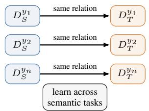

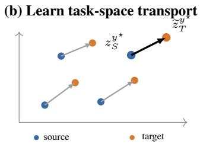

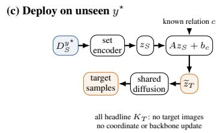  
Figure 1: Meta-Diff learns a relation between task distributions, rather than a separate adaptation for each target. Meta-training observes the same source→target relation across different semantic tasks; a shared encoder embeds these distributions in task space; and the learned relation is applied to the source coordinate of a held-out task. At every headline $K _ { T }$ , the main route generates directly from the transported coordinate, with no target images, coordinate refinement or backbone update. Target-support budgets apply to independent baselines.

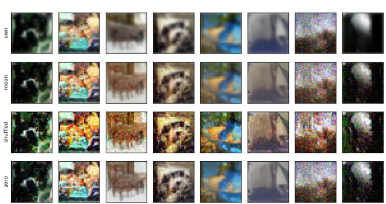  
Figure 2: Qualitative task-coordinate control on held-out CIFAR generations. Columns share initial diffusion noise; rows differ only in the task coordinate (own, mean, shuffled, $\mathrm { o r } z = 0 )$ . The samples come from the 50k-step CIFAR checkpoint, with matched tasks and paired noise. Own-task coordinates are encoder coordinates, not transported predictions; deployment claims use the separate paired route evaluations in Section 5.2.

The paper makes four contributions. First, we formulate data-asymmetric generation as relation-level meta-learning over a shared source–target transformation. Second, a 210-run GMM study maps its operating regime and separates intrinsically recoverable task information from what is represented in z. Third, CIFAR-100 tests source-specific generation without target images and the comparison with target-adapted baselines. At one target image for the baselines, SW is 0.1781, 0.2087 and 0.2648 for direct transport, target-only and full fine-tuning, respectively. Under validation-selected, budgetspecific adaptation settings, transport has lower mean SW at $\dot { K } _ { T } = 1 , 5 .$ , whereas full fine-tuning has lower mean SW at $K _ { T } = 2 0$ . Because the optimisation steps and learning rates also vary, this comparison does not isolate target-data quantity. FiLM independently reproduces source specificity; the transport-structure ablations test whether nonlinearity is needed. Finally, Office-Home extends the analysis to a natural domain shift, where Meta-Diff achieves source-specific target-domain alignment and frozen-checkpoint diagnostics show that transport error alone cannot explain the remaining semantic failure.

## 2 RELATED WORK

Few-shot diffusion and compact adaptation. Few-Shot Diffusion Models condition on support sets from unseen classes (Giannone et al., 2022); Conditional Distribution Modelling transfers learned conditioning statistics (Gupta et al., 2024); and CRDI obtains sample-wise guidance embeddings through diffusion inversion (Cao & Gong, 2024). Personalisation methods adapt pretrained text-toimage models through full fine-tuning, compact embeddings, restricted cross-attention updates or amortised hypernetwork prediction (Ruiz et al., 2023; Gal et al., 2023; Kumari et al., 2023; Ruiz et al., 2024). LoRA constrains adaptation to a low-rank parameter space (Hu et al., 2022), while intrinsic-dimension and weight-space studies suggest that useful adaptation can occupy a much smaller space than the full parameter vector (Dravid et al., 2024). These approaches establish that target adaptation can be compressed. Meta-Diff instead amortises the source–target relation across semantic tasks: given a data-rich source for an unseen task, it predicts the corresponding target distribution without requiring target examples or target-specific backbone adaptation.

Meta-learning and task representations. Meta-learning reuses experience across tasks through shared representations or update rules (Finn et al., 2017). Our set encoder follows the permutationinvariant Deep Sets construction (Zaheer et al., 2017); FiLM provides a generic affine mechanism for injecting the resulting coordinate into the denoiser (Perez et al., 2018). Transfer Guided Diffusion Processes likewise combine source diffusion with target-domain guidance (Ouyang et al., 2024). The distinguishing requirement here is relational generalisation: semantic identity is held out while the source–target relation has been observed on other tasks. Success therefore depends on the quality of the task representation as well as on adaptation capacity.

Data asymmetry as motivation. Uneven population and institutional coverage can induce subgroup degradation in medical imaging (Larrazabal et al., 2020; Seyyed-Kalantari et al., 2021; Daneshjou et al., 2022), while dataset audits document substantial gaps in demographic coverage and reporting (Daneshjou et al., 2021; Wen et al., 2022). This motivates methods that make use of related abundant data, but synthetic data are not a substitute for representative collection. We therefore treat the clinical studies in Appendix E as stress tests and limitations, not as evidence for clinical deployment.

## 3 PROBLEM AND METHOD

## Data-asymmetric task transfer

Let $y \in \mathcal { D }$ denote a semantic task and $d \in \{ S , T \}$ a source or target domain, with distribution $P _ { d } ^ { y }$ . Semantic tasks are partitioned into disjoint $\mathcal { V } _ { \mathrm { t r a i n } } , \mathcal { V } _ { \mathrm { v a l } } , \mathcal { V } _ { \mathrm { t e s t } } . \mathrm { ~ A t }$ deployment, the comparison protocol provides a source support set $D _ { S } ^ { y }$ of size $M _ { S }$ and permits independent baselines to use a target support set $D _ { T } ^ { y }$ of size $K _ { T }$ ; evaluation uses a disjoint target query set. The correct source + transport main route consumes only $D _ { S } ^ { y }$ and the relation descriptor for every $K _ { T }$ . We focus on $M _ { S } \gg K _ { T }$ . A shared permutation-invariant encoder maps any support set to a task coordinate,

$$
z = r _ { \psi } ( D ) = \rho _ { \psi } \left( { \frac { 1 } { | D | } } \sum _ { x \in D } h _ { \psi } ( x ) \right) .\tag{1}
$$

The same encoder places source and target distributions in a common task space. Transfer therefore becomes a prediction problem in that space rather than a new high-dimensional optimisation problem for every target.

## Conditioning and transport

The coordinate must next control a shared generator. We use standard DDPM noise prediction (Ho et al., 2020), with the continuous-time score interpretation of Song et al. (2021). The additive-basis

parameterisation writes

$$
\widehat { \epsilon } _ { z } ( x _ { t } , t ) = \widehat { \epsilon } _ { 0 } ( x _ { t } , t ) + \sum _ { \ell = 1 } ^ { k } z _ { \ell } R _ { \ell } ( x _ { t } , t ) ,\tag{2}
$$

where $R _ { \ell }$ are learned residual noise-prediction fields. To test whether the task-space effect depends on this construction, we also use FiLM. At U-Net block $j ,$ the feature tensor $\bar { H ^ { ( j ) } }$ is modulated as

$$
H ^ { ( j ) }  ( 1 + \gamma _ { j } ( z ) ) \odot H ^ { ( j ) } + \beta _ { j } ( z ) ,
$$

with learned projections $\gamma _ { j } , \beta _ { j }$ from the task coordinate to feature-wise scales and shifts.

For a source set, $z _ { S } = r _ { \psi } ( D _ { S } ^ { y } )$ . Let $c = c _ { S  T }$ index the applicable source–target relation, assumed known at deployment. It selects a relation-specific bias learned during meta-training. We evaluate new semantic tasks under relations observed during meta-training; an unseen relation is outside this protocol. We compare identity, relation-only offsets, residual MLPs and linear maps; the experiments show that source dependence matters but non-linearity is not required. The final transport is therefore

$$
\widetilde { z } _ { T } = A z _ { S } + b _ { c _ { S  T } } ,\tag{3}
$$

where the relation-specific bias reduces to a single b when only one relation is present. Across all headline $K _ { T }$ , the main route directly decodes $\widetilde { z } _ { T }$ with $J = 0$ target-time coordinate-refinement steps and no backbone update. Target-only and full-fine-tuning baselines use their stated targetsupport budgets. Strict source reuse decodes $z _ { S }$ directly; source-initialised target adaptation is named separately. The matched refinement ablation in Appendix C.3 tests a separate intervention and does not imply that refinement is universally ineffective.

## 3.1 META-TRAINING AND STABILITY UNDER LIMITED OBSERVATIONS

Each training episode contains source and target support/query sets for one semantic task. With $z _ { S } = r _ { \psi } ( D _ { S } ^ { s } ) , z _ { T } = r _ { \psi } ( D _ { T } ^ { s } )$ and $\widetilde { z } _ { T }$ from Equation (3), we minimise

$$
\mathcal { L } _ { \mathrm { m e t a } } = \mathcal { L } _ { S } ( z _ { S } ) + \lambda _ { T } \mathcal { L } _ { T } ( z _ { T } ) + \lambda _ { \mathrm { t r } } \mathcal { L } _ { T } ( \widetilde { z } _ { T } ) + \lambda _ { z } ( \| z _ { S } \| _ { 2 } ^ { 2 } + \| z _ { T } \| _ { 2 } ^ { 2 } ) ,\tag{4}
$$

where each $\mathcal { L }$ is the standard diffusion denoising loss evaluated on a disjoint query set. Target supports and queries supervise meta-training through separate branches. The transport map takes only the source coordinate and relation; at deployment the main route reads no target support or query and updates neither coordinates nor backbone weights.

Why task-space transfer can help in the low-data regime. A compact coordinate is useful only if abundant source data estimate it reliably and transport errors do not destabilise generation. Two results formalise these requirements.

Proposition 1 (Source-coordinate concentration). For i.i.d. $X _ { 1 } , \dots , X _ { M }$ , let $\mu = \mathbb { E } h _ { \psi } ( X )$ and $\begin{array} { r } { z _ { M } = \rho _ { \psi } ( M ^ { - 1 } \sum _ { i } h _ { \psi } ( X _ { i } ) ) . \ I f \mathbb { E } \| h _ { \psi } ( X ) \| _ { 2 } ^ { 2 } < } \end{array}$ ∞ and $\rho _ { \psi }$ is $L _ { \rho } – L i p s c h i t z ,$ , then

$$
\mathbb { E } \| z _ { M } - \rho _ { \psi } ( \mu ) \| _ { 2 } ^ { 2 } \leq \frac { L _ { \rho } ^ { 2 } \operatorname { t r } ( \operatorname { C o v } [ h _ { \psi } ( X ) ] ) } { M } .
$$

Thus source-coordinate estimation error decays at the usual $O ( M ^ { - 1 } )$ mean-squared rate. This motivates the CIFAR source-budget check, but does not establish a generated-distance plateau at any particular $M _ { S }$

Proposition 2 (Stability to coordinate perturbations). Write the reverse-time drift in diffusiontime notation as $b _ { z } ( x , t ) = f ( x , t ) - g ( \bar { t } ) ^ { 2 } [ s _ { 0 } ( x , t ) + B ( x , t ) z ]$ . In the increasing sampling clock $u = T - t ,$ , the drift is $\bar { b } _ { z } ( x , u ) = - b _ { z } ( x , T - u )$ and the diffusion coefficient is $g ( T - u )$ . Assume well-posed solutions withfinite second moments, a common initial law $\mu _ { \mathrm { i n i t } }$ independent $o f z$ with $\begin{array} { r } { \int \| x \| _ { 2 } ^ { 2 } d \mu _ { \mathrm { i n i t } } ( x ) < \infty } \end{array}$ , uniform $L _ { x } – L i p s c h i t z$ continuity $o f b _ { z }$ in x, and su $\begin{array} { r } { \mathsf { \Pi } \Psi _ { x , t } \left\| g ( t ) ^ { 2 } B ( x , t ) \right\| _ { \mathrm { o p } } \leq } \end{array}$ $L _ { z } .$ . Couple the processes using $X _ { 0 } ^ { z } = X _ { 0 } ^ { z ^ { \prime } } \sim \mu _ { \mathrm { i n i t } }$ and the same Brownian path. Then

$$
\begin{array} { r } { \underset { u \leq T } { \mathbb { E } } \| X _ { u } ^ { z } - X _ { u } ^ { z ^ { \prime } } \| _ { 2 } ^ { 2 } \leq C _ { T } \| z - z ^ { \prime } \| _ { 2 } ^ { 2 } , \qquad W _ { 2 } ( P _ { z } , P _ { z ^ { \prime } } ) \leq \sqrt { C _ { T } } \| z - z ^ { \prime } \| _ { 2 } , } \end{array}
$$

where $C _ { T } = L _ { z } ^ { 2 } \phi _ { L _ { x } } ( T ) ^ { 2 }$ and $\phi _ { L _ { x } } ( T ) = ( e ^ { L _ { x } T } - 1 ) / L _ { x }$ (with value T at $L _ { x } = 0 )$

These results establish coordinate-estimation and continuous-time stability properties under the stated assumptions. The second proposition concerns the additive-score-conditioned process with uniform Lipschitz bounds; it does not certify a small practical error for the trained DDIM sampler or

automatically cover a general FiLM-conditioned denoiser. Neither proposition establishes semantic task identity, relation predictability on unseen tasks, or semantic use by the generator. Section 5.1 tests those missing conditions; full proofs are in Appendix A.

## 4 EXPERIMENTAL DESIGN

The propositions establish estimation and stability, not content or relational generalisation. Experiments therefore progress from GMMs, where these missing quantities are observable, to CIFAR under controlled image shifts and finally to the natural Product→Clipart relation in Office-Home. Headline comparisons are paired on semantic task, support draw, target query set and sampling noise where possible. Generation repeats are not independent semantic tasks. CIFAR generation intervals use 10,000 paired class-cluster bootstrap resamples (seed 20261020): each draw samples 20 semantic classes with replacement, retaining all three corruptions within a class. We average corruptions within class, then classes, and report percentile 95% intervals. Stars mark unrounded paired intervals excluding zero; intervals are pointwise, without multiplicity adjustment. These fixed-checkpoint intervals do not quantify training-seed variation. Other benchmarks retain their separately specified statistical units. Hyperparameters for target-only adaptation and fine-tuning are selected on validation tasks and frozen before final test evaluation.

Controlled GMM boundary study. Two-dimensional Gaussian-mixture tasks vary sourcetask separation through $\alpha \in \{ 0 , . 1 , . 2 5 , . 5 , . 7 5 , 1 , 1 . 5 \}$ and relation heterogeneity through $\eta \in$ $\{ 0 , . 1 , \bar { . 2 5 } , . 5 , 1 , 2 \}$ . The full $7 \times { \dot { 6 } }$ grid is repeated over five seeds, giving 210 trained cells and 13,440 held-out task evaluations at $K _ { T } = 0$ . A separate shift-magnitude sweep at $\alpha = 1 , \eta = 0$ contributes a further 25 cells and 1,600 held-out task evaluations. The primary effect is

$$
G _ { \mathrm { s o u r c e } } = \mathrm { S W } _ { \mathrm { w r o n g } } - \mathrm { S W } _ { \mathrm { c o r r e c t } } ,
$$

so positive values favour the correct source. Because the data-generating distributions are known, intrinsic Bayes task identification can be measured separately from task identification in the learned coordinate and from held-out affine relation predictability.

CIFAR-100. Fine classes are semantic tasks (Krizhevsky, 2009). Entire superclasses are held out: 60 fine classes from 12 superclasses for meta-training, 20 from four superclasses for validation, and 20 from four disjoint superclasses for final testing. Sources are clean; targets apply Gaussian blur, Gaussian noise or contrast reduction at fixed severity (Hendrycks & Dietterich, 2019). Source and target pools contain disjoint underlying images. We test zero-shot source controls and $K _ { T } \in$ {1, 5, 20} against target-only modelling and validation-selected full fine-tuning. Sliced Wasserstein distance (SW) is the headline distribution metric; energy MMD and semantic consistency are complementary. The appendix retains separate GMM denoising-calibration and historical oracle diagnostics; these are not pooled with the image-generation metrics.

Office-Home. Product→Clipart provides a natural relation across 65 object categories. The fixed semantic split is 45/10/10 train/validation/test classes. Real-image audits verify both the semantic evaluator and the Product–Clipart domain distinction before generated images are scored. We first evaluate the same source controls used on CIFAR, then use frozen-checkpoint diagnostics to probe possible semantic limitations in the encoder, transport and coordinate-to-generation path.

## 5 RESULTS

## 5.1 GMM: A CONTROLLED OPERATING REGIME

The analytical results guarantee a stable coordinate, not a useful one. GMMs make the missing ingredients observable: we vary source-task separation α and relation heterogeneity η independently, then evaluate zero-target transfer over the resulting $7 \times 6$ grid. Figure 3 shows the first two conclusions. When $\alpha = 0$ , correct and wrong sources are unresolved in all six relation conditions; once the source carries task information, a correct-source advantage emerges, but it decreases as the relation becomes less reusable. In total, 34 of 42 cells have positive paired intervals excluding zero, with the unresolved cells confined to the six $\alpha = 0$ conditions and the two most heterogeneous relations at $\alpha = . 1$

The same experiment distinguishes intrinsic from usable identifiability. At $\alpha = . 2 5$ , the Bayes classifier on the true GMM likelihoods already identifies the source task with accuracy .953, yet nearest-centroid identification in the learned coordinate is only .325. $\mathrm { { A t } } \alpha = 1 . 5$ , the corresponding values are 1.000 and .914. This gap is not cosmetic: across the 42 cells, $G _ { \mathrm { s o u r c e } }$ correlates much more strongly with learned-ID than with Bayes-ID $( \rho = . 9 8 $ versus .89). Replacing Bayes-ID with learned-ID in the same descriptive interaction model raises the cell-level fit from $R ^ { \bar { 2 } } = . 5 8 7$ to .843; even within the 24 cells with Bayes- $\mathrm { \cdot I D > \ . 9 9 }$ , learned-ID remains strongly associated with the source-specific gain $( \rho = . 9 7 )$ ). We treat these regressions as descriptive summaries of the factorial experiment rather than causal estimates.

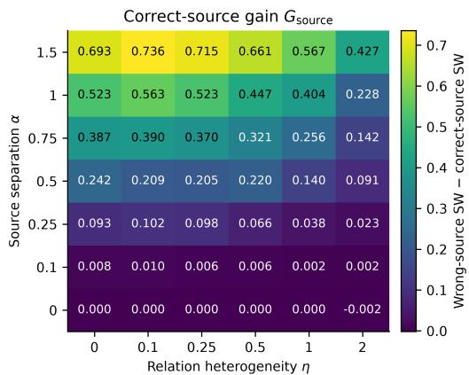

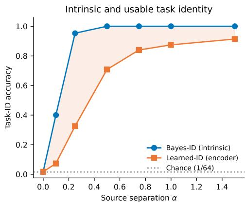  
Figure 3: GMM operating regime. $L e f t { \mathrm { . } }$ correct-source advantage $G _ { \mathrm { s o u r c e } } = \mathrm { S W } _ { \mathrm { w r o n g } } - \mathrm { S W }$ correct over the full source-identifiability/relation-heterogeneity grid at $K _ { T } = 0$ . The advantage disappears when source identity is absent and attenuates as the relation becomes less predictable. $R i g h t \cdot$ intrinsic Bayes task identification and nearest-centroid identification in the learned encoder coordinate, averaged over relation levels. Nearly perfect intrinsic identifiability can coexist with substantially weaker usable identity. Full cell-level results and paired intervals are in Appendix B.

Relation predictability is a separate requirement. Along $\alpha = 1$ , Bayes-ID remains at 1.0 while increasing η from 0 to 2 lowers held-out affine relation $R ^ { 2 }$ from 1.000 to .408 and reduces the correctover-wrong SW advantage from .523 to .228. Across the full grid, $\rho ( G _ { \mathrm { s o u r c e } } , R _ { \mathrm { r e l } } ^ { 2 } ) = . 5 4$ . Thus source identifiability alone is insufficient: even when the source task is intrinsically unambiguous, source-specific transfer weakens as the relation becomes less reusable. Full diagnostics are in Appendix B.

The coordinate-retrieval analysis makes information loss along the pipeline explicit. For $\alpha \geq . 5 .$ intrinsic identity is perfect, yet learned-ID ranges from .691 to .920 and transported target-coordinate retrieval from only .169 to .341 (chance $1 / 6 \hat { 4 } )$ . Averaged over the grid, transported retrieval is .172 versus .061 for the raw cross-domain $z _ { S }  z _ { T }$ baseline; the transport gain is resolved in every cell with $\alpha \geq$ .25 (+.112 overall, paired seed-block interval [+.106, +.116]) and correctly vanishes at $\alpha \in \{ 0 , . 1 \}$ . Across the grid it correlates with $G _ { \mathrm { s o u r c e } }$ at $\rho = . 9 1$ , between Bayes-ID (.89) and learned-ID (.98). Retrieval margins show that the recovery is partial: the learned-z margin rises from −.002 to +.060 across the sweep, whereas the transported margin remains negative (−.039 to −.079). Figure 4a and Appendix B report the full identity chain.

The shift-magnitude sweep in Figure 4b isolates a different question: when is transport itselfneeded? We fix $\alpha = 1 , \eta = 0$ and interpolate the same source–target transformation by λ. The correct-source advantage over a wrong source remains large even at $\lambda = 0 ( G _ { \mathrm { s o u r c e } } = . 4 8 2 )$ , because source identity is still recoverable. In contrast, transport improves over direct source reuse by an unresolved .024 SW when there is essentially no shift to correct, but by .541 at $\lambda = 2 ;$ the independently measured source–target headroom increases from .08 to 1.59 SW over the same sweep. Source specificity and transport utility are therefore different quantities: identifying the right source is not enough to make a transport map useful if source and target are already nearly the same.

The controlled study therefore adds four empirical requirements beyond the two analytical guarantees: task identity must survive the encoder, the relation must generalise, transport must preserve enough identity to reach the target task, and the source–target discrepancy must leave useful headroom over source reuse. CIFAR now asks whether this mechanism survives when the distributions are images rather than known mixtures.

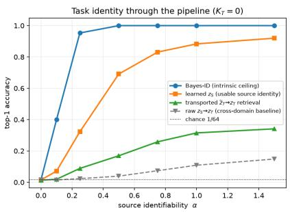

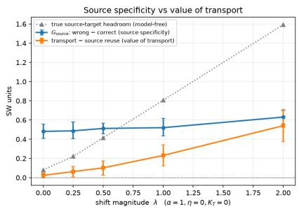  
Figure 4: Two additional GMM boundaries. $L e f t { \mathrm { : } }$ task identity through the pipeline. Bayes-ID is the intrinsic ceiling, learned $z _ { S }$ measures usable source identity, and transported $\widetilde { z } _ { T }$ measures whether the predicted target coordinate retrieves the correct held-out target task; raw $z _ { S }  z _ { T }$ retrieval is a cross-domain baseline. Right: the shift-magnitude sweep separates source specificity from the value of transport, with hierarchical seed/task 95% intervals. The correct source remains informative as $\lambda  0 ,$ whereas the advantage of transport over source reuse grows only when there is nontrivial source–target headroom. Exact tables, regression diagnostics and uncertainty are in Appendix B.

## 5.2 CIFAR: SOURCE SPECIFICITY AND TARGET-BUDGET COMPARISONS

We first evaluate generation without any target images on the 60 held-out validation class– transformation episodes. Correct source + transport reaches SW 0.2061, versus 0.2393 for wrongsource transport and 0.2407 for relation-only prediction (Table 1). Their paired SW and semanticconsistency contrasts favour the correct source; the semantic difference from strict source reuse remains unresolved. Frozen-coordinate diagnostics point in the same direction before generation: transported target-coordinate retrieval reaches 62.5%, 59.5% and 49.0% top-1 for blur, noise and contrast, versus 17.3%, 26.5% and 14.0% for the raw source coordinate and at most 2.25% for wrong source transport (Appendix C). A separate $K _ { T } = 1$ deployment grid from the model checkpoint is shown in Figure 10; it retains six generated routes, one real-target row and paired generation noise. This visual diagnostic is distinct from the zero-target and frozen-coordinate packages.

On the separate final-test episodes, one-target SW is 0.1781 for correct source + transport, 0.2087 for target-only and 0.2648 for full fine-tuning. At $K _ { T } = 2 0$ , the corresponding transport and full-FT values are 0.1844 and 0.1483. Paired transport-versus-target-only intervals favour transport at $K _ { T } = 1$ ; remain unresolved at $K _ { T } = 5$ , 20; transport-versus-full-FT intervals favour transport at $K _ { T } = 1 , 5 ;$ favour full fine-tuning at $K _ { T } = 2 0$ . Under validation-selected, budget-specific adaptation settings, transport has lower mean SW at $K _ { T } = 1 , 5$ , whereas full fine-tuning has lower mean SW at $K _ { T } = 2 0$ . Because the optimisation steps and learning rates also vary, this comparison does not isolate target-data quantity. Energy MMD and its paired contrasts are reported separately in Appendix C. Full-FT settings were selected on validation tasks and frozen before final-test evaluation. The appendix also reports the matched refinement on/off experiment on the correct source + transport checkpoint; it is a separate diagnostic, not part of the headline route.

Two further results distinguish source use from architecture. FiLM correct source + transport improves SW and class consistency over mean-source, shuffled-source and relation-only controls at all three budgets in its own validation package. This tests FiLM source specificity, not a complete FiLM full-FT crossover. The matched conditioning SW intervals contain zero at all three budgets, so they do not establish a FiLM–basis ranking. In the separate retained transport-structure ablations, Basis linear versus residual MLP remains unresolved, while FiLM linear has lower SW than FiLM nonlinear at all three budgets; its energy-MMD advantage is resolved at $K _ { T } = 1$ , 5 only. These oneseed matched comparisons do not quantify training-seed variation. The basis uses 55,344 conditioning parameters versus 118,784 for FiLM; this does not establish a runtime or memory advantage.

Distributional improvement does not establish reliable class-correct generation. Headline class consistency is 0.1075 for transport and 0.1102 for strict reuse, with an unresolved paired difference. In the separate direct-z diagnostic, held-out generated identity is 3.59%, 3.85% and 2.71% for blur, noise and contrast, versus 51.20%, 34.50% and 70.90% on its real queries. That diagnostic uses a different support/query partition and identity instrument, so its percentages cannot be ranked numerically against headline consistency (Appendix C).

The measured source-budget changes between $M _ { S } = 1 6$ and 300 are small, but the paired SW intervals relative to 16 all contain zero. At $M _ { S } = 6 4$ , the difference is −0.00287 [−0.00655, 0.00089].

Table 1: CIFAR headline comparisons for correct source + transport, $J = 0 .$ . Panel A uses validation classes; Panel B uses separate final-test classes. Distances: $\Delta =$ comparator − main; consistency: ∆ = main − comparator. Positive favours the main route. Entries show mean [95% class-cluster CI]; stars use unrounded paired intervals excluding zero, in either direction.
<table><tr><td colspan="6">A. Zero-target controls: 60 validation episodes</td></tr><tr><td>Route</td><td>SW</td><td>∆ SW</td><td>Class consistency</td><td>∆ class</td></tr><tr><td>correct source + transport</td><td>0.2061 [0.1789, 0.2392] 0.2416</td><td>0.0355*</td><td>0.1075 [0.0740, 0.1479] 0.1102</td><td>-0.0028</td></tr><tr><td>Strict source reuse</td><td>[0.2169,0.2703] 0.2393</td><td>[0.0283,0.0420] 0.0333*</td><td>[0.0726, 0.1554] 0.0470</td><td>[-0.0160, 0.0083] 0.0604*</td></tr><tr><td>Wrong source</td><td>[0.2085, 0.2737] 0.2407</td><td>[0.0163, 0.0525] 0.0346*</td><td>[0.0366, 0.0582] 0.0490</td><td>[0.0297, 0.0977] 0.0585*</td></tr><tr><td>Relation-only</td><td>[0.2115,0.2742]</td><td>[0.0224, 0.0477]</td><td>[0.0382, 0.0608]</td><td>[0.0293, 0.0932]</td></tr><tr><td colspan="5">B. Final-test SW: 180 episodes, 60 per budget Route  $K _ { T } = 1$   $K _ { T } = 5$ </td></tr><tr><td>correct source + transport</td><td>0.1781 [0.1627, 0.1959]</td><td>0.1834 [0.1691,0.1983]</td><td> $K _ { T } = 2 0$  0.1844</td><td></td></tr><tr><td>Target-only</td><td>0.2087 [0.1869, 0.2337]</td><td>0.1884 [0.1708,0.2078]</td><td>[0.1676, 0.2030] 0.1799 [0.1677,0.1935]</td><td></td></tr><tr><td>Full fine-tuning</td><td>0.2648 [0.2380, 0.2927]</td><td>0.2205 [0.2028, 0.2386]</td><td>0.1483 [0.1395,0.1580]</td><td></td></tr><tr><td>∆ target-only</td><td>0.0306*</td><td>0.0051</td><td>-0.0044</td><td></td></tr><tr><td></td><td>[0.0152, 0.0467] 0.0867*</td><td>[-0.0028, 0.0122] 0.0371*</td><td>[-0.0132, 0.0036] -0.0361*</td><td></td></tr><tr><td>∆ full FT</td><td>[0.0623, 0.1108]</td><td>[0.0151,0.0597]</td><td>[-0.0588, -0.0150]</td><td></td></tr></table>

This does not establish equivalence or an exact plateau; no $M _ { S } < 1 6$ was tested. Figure 5 uses the actual final-test target-budget and nested source-budget records. Appendix C contains the validation source-dependence sweep, final-test MMD, FiLM controls, frozen adaptation settings, the separate refinement ablation, and conditioning/task-scarcity results.

Table 2: Three separate matched CIFAR packages. The first row uses the two conditioning runs of correct source + transport; the other rows compare transport structures. Each evaluated transport route uses J = 0. Signs follow the first column; entries show mean [95% paired class-cluster CI] and stars use unrounded intervals. One training seed per arm.
<table><tr><td>Paired SW comparison</td><td> $K _ { T } = 1$ </td><td> $K _ { T } = 5$ </td><td> $K _ { T } = 2 0$ </td></tr><tr><td></td><td>-0.0094</td><td>-0.0148</td><td>-0.0149</td></tr><tr><td>FiLM – basis</td><td>[−0.0238, 0.0046] 0.0022</td><td>[-0.0298, 0.0003] 0.0004</td><td>[-0.0300, 0.0003] 0.0036</td></tr><tr><td>Linear — MLP (basis)</td><td>[-0.0031, 0.0080] 0.0093*</td><td>[-0.0056, 0.0068] 0.0112*</td><td>[-0.0019, 0.0097] 0.0087*</td></tr><tr><td>MLP — linear (FiLM)</td><td>[0.0044,0.0147]</td><td>[0.0057,0.0175]</td><td>[0.0026, 0.0151]</td></tr></table>

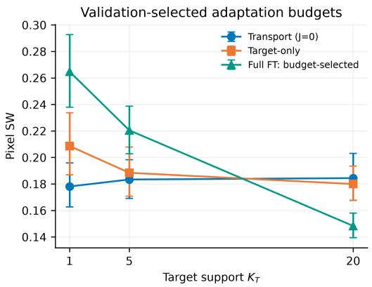

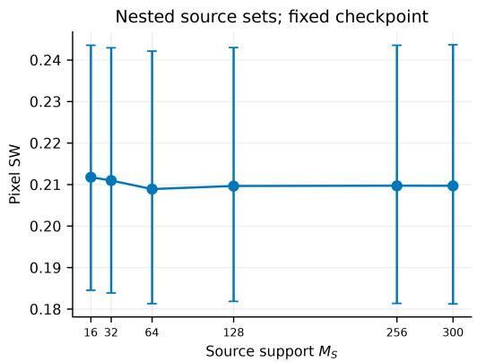  
Figure 5: CIFAR target and source budgets. Left: final-test SW for correct source + transport and target-adapted baselines. The main route uses no target support at any $K _ { T } ;$ its small changes across budgets reflect different sampled source/query episodes and generation noise. Right: $K _ { T } \stackrel { = } { = } 1$ with nested source supports and the checkpoint trained at $M _ { S } = 6 4$ . Error bars show marginal class-cluster percentile 95% intervals; paired effects and stars are computed separately.

Additional matched controls. Generating from the clean-source coordinate and then applying the known image-space corruption gives SW 0.1688 versus 0.1781 for transport on the same 60 test episodes; the baseline-minus-transport difference is $- 0 . 0 0 9 2 \left[ - 0 . 0 1 3 8 , - \mathrm { \bar { 0 } } . 0 0 4 5 \right]$ . The simple image-space route has lower SW, so these results do not establish an advantage for task-space transport over this baseline. This route uses no target image (Appendix F).

A separate controlled-budget experiment fixes full fine-tuning at 100 updates, learning rate $1 0 ^ { - 5 }$ and 20 noised examples per update at $\mathrm { e v e r y ~ } K _ { T }$ , selected once on validation classes. Full-FT SW is 0.3054, 0.2123, 0.1709 at $\begin{array} { r c l } { K _ { T } } & { = } & { 1 , 5 , 2 0 \mathrm { { : } } } \end{array}$ ; the paired 20-minus-1 effect is $- 0 . 1 3 4 5 \left[ - 0 . 1 7 3 0 , - 0 . 0 9 5 7 \right]$ . Under this fixed schedule, the $K _ { T } = 2 0$ versus 1 SW reduction is resolved. Transport has lower SW at $K _ { T } = 1 , 5 ;$ at $K _ { T } = 2 0$ , the full-FT-minus-transport effect $\mathbf { i s - 0 . 0 1 1 9 } \left[ - 0 . 0 4 2 9 , 0 . 0 2 1 3 \right]$ , which remains unresolved. This controls the full-FT update budget across target-set sizes, not the compute difference between full-FT and zero-update transport.

The matched supplementary DINO-100 requested-class fractions at $\begin{array} { r c l } { K _ { T } } & { = } & { 1 , 5 , 2 0 } \end{array}$ are 2.53, 2.85, 2.34% for transport and 3.68, 9.58, 10.50% for full-FT, versus 50.49, 49.79, 50.65% on the corresponding real queries. Full FT has higher identity at all three budgets under the paired intervals; transport-versus-target-only identity differences remain unresolved. This separate instrument uses 100 source-derived class prototypes; its values are not interchangeable with the headline class-consistency scores.

## 5.3 OFFICE-HOME: NATURAL-DOMAIN ALIGNMENT AND UNRESOLVED SEMANTICLIMITATIONS

CIFAR provides evidence of source-specific improvement in measured distributional metrics under controlled shifts, but does not establish reliable generation of the requested class. Office-Home asks whether the distributional effect persists under a natural Product→Clipart shift. Before scoring generated images, the benchmark passes the intended structural checks: CLIP reaches 65.96% top-1 on held-out real Clipart images, DINOv2 distinguishes Product from Clipart with 98.30% accuracy, and same-class cross-domain centroid retrieval is 100% top-1 with median rank 1. Weak generated semantics therefore cannot be dismissed as a broken real-image evaluator.

Office-Home yields a positive source-specific domain-alignment result while exposing a distinct semantic bottleneck. At $K _ { T } = 0$ , correct-source transport improves DINO-SW over wrong-source transport (.038969 vs. .039394), relation-only prediction (.039251) and source reuse (.041641); all three paired distance gains exclude zero. It also raises predicted Clipart share from 63.8% under source reuse to 86.5%. Yet requested-object identity is only 1.67%, and its differences from wrongsource and relation-only controls are unresolved. Figure 6 summarises this separation: with one target example, transport beats target-only in DINO-SW and MMD but is unresolved against full fine-tuning in SW; by $K _ { T } = 5$ and 10, full fine-tuning is clearly better.

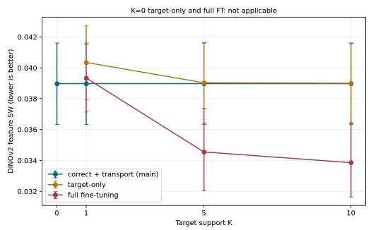

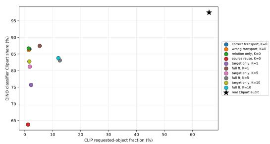  
Figure 6: Office-Home exposes a different boundary from CIFAR. Left: correct-source transport remains nearly flat in DINO feature-SW, while full fine-tuning improves as target support grows. Right: generated routes can become strongly Clipart-like without preserving the requested object; the star is the held-out real Clipart audit. The natural-domain limitation is therefore semantic, not simply a failure to change domain appearance.

The distributional gain without reliable object identity creates a localisation question: is semantic information lost in the encoder, the transport map, or the decoder? Frozen-checkpoint diagnostics probe these stages. Independent 16-image Product support sets retrieve the matching held-out class in learned z with 91.0% top-1 accuracy, so the encoder has substantial within-domain object information. Transport improves cross-domain target-coordinate retrieval from 12.0% to 42.0% L2 top-1, although the correct-versus-wrong transport interval remains unresolved over the ten test classes. More decisively, bypassing transport does not restore semantics: a direct target coordinate estimated from abundant Clipart support produces only 2.38% requested-class accuracy on seen classes and 1.56% on held-out classes, despite real-query accuracies around 50%. Correct coordinates do reduce denoising MSE slightly across diffusion time, so the generator is not coordinate-blind, but the effect is weak. An explicit learned class embedding raises generated identity to 6.90% on seen classes, still far below the real-image calibration. Taken together, the direct-target-coordinate results show that transport error alone cannot account for poor object identity; limitations remain in the target-task coordinate representation and/or its use by the generator. These probes do not uniquely localise the failure to the decoder. Full route matrices, frozen-checkpoint diagnostics, and the validation-only checkpoint/baseline selection record are in Appendix D (Table 28).

An additional matched semantic check uses the same CLIP instrument and queries for all three routes. At $K _ { T } = 5 ,$ identity is 1.67, 1.81, 12.55% for transport, target-only and full-FT; same-query realimage calibration is 52.00% under the generation-evaluation preprocessing. The main-minus-full-FT paired difference is $- 1 0 . 8 9 [ - 1 9 . 8 2 , - 4 . 1 4 ]$ percentage points. Appendix F reports all budgets and the same-query real-image calibration.

## 6 MECHANISTIC SYNTHESIS AND LIMITATIONS

Theory and experiments form one diagnostic chain. Propositions 1–2 explain why task-space transfer can be stable; Table 3 shows what else makes it useful. GMMs isolate usable identity, relation predictability, transport preservation and headroom; CIFAR tests its image-generation consequences through paired comparisons; Office-Home tests limitations in target-coordinate representation and its use by the generator.

Table 3: Stages of source-informed transfer. Representative diagnostics identify conditions enabling transfer and the stage that becomes limiting; values are not intended as a common metric across rows.
<table><tr><td>Setting</td><td>Representation / transport evidence</td><td>Generative implication</td></tr><tr><td>GMM</td><td>Bayes-ID can be perfect while learned-ID is weaker; at α = 1, learned-ID .883 and transported retrieval .315. Shift sweep: transport-over-reuse .024 → .541 as headroom grows.</td><td>Correct-vs-wrong SW gain .523 at (1, 0); usable identity tracks the gain more closely than Bayes- ID</td></tr><tr><td>CIFAR</td><td>Transported target-coordinate retrieval 49–62.5% across relations</td><td>Correct source + transport improves on wrong/relation-only at  ${ K _ { T } } ^ { \mathbf { { \bar { \alpha } } } } = \ 0 ;$  the separate final-test budget comparison is in Table 1</td></tr><tr><td>Office-Home</td><td>Product-z retrieval 91.0%; transport raises target-coordinate retrieval 12.0% → 42.0%</td><td>Clipart share 86.5%; low object ID persists even with abundant direct zT, showing that transport error alone is insufficient to explain the failure.</td></tr></table>

This comparison suggests a practical diagnostic hierarchy for source-informed generative transfer. Before training a new route, one can ask whether source tasks are separable, whether the learned coordinate retains that information, whether the source–target relation generalises, whether there is enough headroom for transport to improve on source reuse, and whether the generator uses the resulting coordinate semantically. The GMM study isolates the first four under known ground truth; Office-Home shows a semantic limitation that persists when transport is bypassed. These are operating diagnostics rather than interchangeable post-hoc explanations.

Source specificity survives FiLM under the matched source-control protocol, while the transportstructure ablations retain their own comparison scope. $~ \mathrm { A t } ~ k = 1 6 ,$ a single-relation affine map needs 272 active parameters; the three-relation CIFAR implementation uses a shared matrix plus relation-specific biases (304 active parameters) and performs no deployment update. Its sourcebudget changes over 16–300 images are small but do not establish a precise plateau at 16. Under validation-selected, budget-specific adaptation settings, transport has lower mean SW at $K _ { T } = 1 , 5$ whereas full fine-tuning has lower mean SW at $K _ { T } = \mathrm { \bar { 2 0 } }$ . Because the optimisation steps and learning rates also vary, this comparison does not isolate target-data quantity.

Limitations. CIFAR supports source specificity in the measured distributional metrics under controlled shifts, conditional on the tested checkpoints and class-cluster uncertainty; Office-Home achieves target-domain alignment without reliable object-specific generation. Propositions 1–2, proved in Appendix A, establish concentration and continuity only, not relational generalisation. On matched CIFAR test episodes, generating from the clean-source coordinate and then applying the known corruption yields lower SW than task-space transport. The clinical studies in Appendix E are retained as boundary analyses and do not establish source-specific clinical transfer.

## 7 CONCLUSION

Meta-Diff asks whether a recurring source–target relation can replace repeated high-capacity adaptation when target data are scarce. Under the stated assumptions, the theory bounds source-coordinate estimation error and its propagation through the ideal continuous-time additive-score process; GMMs identify the additional requirements of usable task identity, relation predictability and headroom. CIFAR supports source-specific improvements in measured distributional metrics with zero target images and a known relation, while its adaptation comparison is conditional on validation-selected budgets. Office-Home exposes semantic limitations that cannot be explained by transport error alone. Together, these results establish a measurable operating regime for source-informed task-space transport and make its success conditions and semantic bottlenecks directly inspectable.

## AI USE STATEMENT

We used generative artificial intelligence (AI) tools for language editing, drafting support, literature search, and to support some implementation and analysis tasks. The authors reviewed all AI-assisted text, technical claims, derivations, experimental specifications, analyses, and code, and take full responsibility for the final content.

## REPRODUCIBILITY STATEMENT

The paper specifies the task-space encoder, conditioning mechanisms, source–target transport map, meta-training objective, evaluation protocols, baselines, and ablations. Full proofs are in Appendix A; complete GMM diagnostics, CIFAR-100 controls and ablations, Office-Home experiments, and clinical stress tests are in Appendices B, C, D, and E. Implementation details, data splits, adaptation settings, parameter counts, statistical units, and checkpoint-selection procedures are also reported in the appendix.

## IMPACT STATEMENT

This work studies generative modelling under uneven data availability. Source-informed generation may reduce target-specific optimisation where representative target data are difficult to obtain, but synthetic data can also reproduce existing bias or create misleading detail. We therefore evaluate against held-out real data, retain negative stress tests, and do not treat generated clinical images as substitutes for representative collection or clinical validation. Any healthcare deployment would require independent clinical evaluation, governance and privacy review beyond the scope of this work.

## REFERENCES

Yu Cao and Shaogang Gong. Few-shot image generation by conditional relaxing diffusion inversion. In European Conference on Computer Vision, pp. 20–37, 2024. doi: 10.1007/978-3-031-72907-2 2.

Roxana Daneshjou, Mary P. Smith, Mary D. Sun, Veronica Rotemberg, and James Zou. Lack of transparency and potential bias in artificial intelligence data sets and algorithms: A scoping review. JAMA Dermatology, 157(11):1362–1369, 2021. doi: 10.1001/jamadermatol.2021.3129.

Roxana Daneshjou, Kailas Vodrahalli, Roberto A. Novoa, Melissa Jenkins, Weixin Liang, Veronica Rotemberg, Justin Ko, Susan M. Swetter, Elizabeth E. Bailey, Olivier Gevaert, Pritam Mukherjee, Michelle Phung, Kiana Yekrang, Bradley Fong, Rachna Sahasrabudhe, Johan A. C. Allerup, Utako Okata-Karigane, James Zou, and Albert S. Chiou. Disparities in dermatology ai performance on a diverse, curated clinical image set. Science Advances, 8(32):eabq6147, 2022. doi: 10.1126/sciadv. abq6147.

Amil Dravid, Yossi Gandelsman, Kuan-Chieh Wang, Rameen Abdal, Gordon Wetzstein, Alexei A. Efros, and Kfir Aberman. Interpreting the weight space of customized diffusion models. In Advances in Neural Information Processing Systems, 2024. URL https://openreview. net/forum?id=DAO2BFzMfy.

Chelsea Finn, Pieter Abbeel, and Sergey Levine. Model-agnostic meta-learning for fast adaptation of deep networks. In Proceedings of the 34th International Conference on Machine Learning, pp. 1126–1135, 2017.

Rinon Gal, Yuval Alaluf, Yuval Atzmon, Or Patashnik, Amit Haim Bermano, Gal Chechik, and Daniel Cohen-Or. An image is worth one word: Personalizing text-to-image generation using textual inversion. In International Conference on Learning Representations, 2023. URL https: //openreview.net/forum?id=NAQvF08TcyG.

Giorgio Giannone, Didrik Nielsen, and Ole Winther. Few-shot diffusion models. arXiv preprint arXiv:2205.15463, 2022.

Parul Gupta, Munawar Hayat, Abhinav Dhall, and Thanh-Toan Do. Conditional distribution modelling for few-shot image synthesis with diffusion models. In Proceedings ofthe Asian Conference on Computer Vision, pp. 818–834, 2024.

Dan Hendrycks and Thomas Dietterich. Benchmarking neural network robustness to common corruptions and perturbations. In International Conference on Learning Representations, 2019. URL https://openreview.net/forum?id=HJz6tiCqYm.

Jonathan Ho, Ajay Jain, and Pieter Abbeel. Denoising diffusion probabilistic models. In Advances in Neural Information Processing Systems, volume 33, pp. 6840–6851, 2020.

Edward J. Hu, Yelong Shen, Phillip Wallis, Zeyuan Allen-Zhu, Yuanzhi Li, Shean Wang, Lu Wang, and Weizhu Chen. LoRA: Low-rank adaptation of large language models. In International Conference on Learning Representations, 2022. URL https://openreview.net/forum? id=nZeVKeeFYf9.

Alex Krizhevsky. Learning multiple layers of features from tiny images. Technical report, University of Toronto, 2009.

Nupur Kumari, Bingliang Zhang, Richard Zhang, Eli Shechtman, and Jun-Yan Zhu. Multi-concept customization of text-to-image diffusion. In Proceedings of the IEEE/CVF Conference on Computer Vision and Pattern Recognition, pp. 1931–1941, 2023. doi: 10.1109/CVPR52729.2023.00192.

Agostina J. Larrazabal, Nicolas Nieto, Victoria Peterson, Diego H. Milone, and Enzo Ferrante.´ Gender imbalance in medical imaging datasets produces biased classifiers for computer-aided diagnosis. Proceedings ofthe National Academy ofSciences, 117(23):12592–12594, 2020. doi: 10.1073/pnas.1919012117.

Maxime Oquab, Timothee Darcet, Th´ eo Moutakanni, Huy Vo, Marc Szafraniec, Vasil Khalidov,´ Pierre Fernandez, Daniel Haziza, Francisco Massa, Alaaeldin El-Nouby, Mahmoud Assran, Nicolas Ballas, Wojciech Galuba, Russell Howes, Po-Yao Huang, Shang-Wen Li, Ishan Misra, Michael Rabbat, Vasu Sharma, Gabriel Synnaeve, Hu Xu, Herve J´ egou, Julien Mairal, Patrick Labatut, Ar-´ mand Joulin, and Piotr Bojanowski. DINOv2: Learning robust visual features without supervision. arXiv preprint arXiv:2304.07193, 2023. URL https://arxiv.org/abs/2304.07193.

Yidong Ouyang, Liyan Xie, Hongyuan Zha, and Guang Cheng. Transfer learning for diffusion models. In Advances in Neural Information Processing Systems, volume 37, pp. 136962–136989, 2024.

Ethan Perez, Florian Strub, Harm de Vries, Vincent Dumoulin, and Aaron C. Courville. FiLM: Visual reasoning with a general conditioning layer. In Proceedings ofthe AAAI Conference on Artificial Intelligence, volume 32, pp. 3942–3951, 2018. doi: 10.1609/aaai.v32i1.11671.

Alec Radford, Jong Wook Kim, Chris Hallacy, Aditya Ramesh, Gabriel Goh, Sandhini Agarwal, Girish Sastry, Amanda Askell, Pamela Mishkin, Jack Clark, Gretchen Krueger, and Ilya Sutskever. Learning transferable visual models from natural language supervision. In Proceedings of the 38th International Conference on Machine Learning, volume 139 of Proceedings ofMachine Learning Research, pp. 8748–8763. PMLR, 2021. URL https://proceedings.mlr.press/ v139/radford21a.html.

Nataniel Ruiz, Yuanzhen Li, Varun Jampani, Yael Pritch, Michael Rubinstein, and Kfir Aberman. Dreambooth: Fine tuning text-to-image diffusion models for subject-driven generation. In Proceedings ofthe IEEE/CVF Conference on Computer Vision and Pattern Recognition, pp. 22500–22510, 2023. doi: 10.1109/CVPR52729.2023.02155.

Nataniel Ruiz, Yuanzhen Li, Varun Jampani, Wei Wei, Tingbo Hou, Yael Pritch, Neal Wadhwa, Michael Rubinstein, and Kfir Aberman. Hyperdreambooth: Hypernetworks for fast personalization of text-to-image models. In Proceedings ofthe IEEE/CVF Conference on Computer Vision and Pattern Recognition, pp. 6527–6536, 2024.

Laleh Seyyed-Kalantari, Haoran Zhang, Matthew B. A. McDermott, Irene Y. Chen, and Marzyeh Ghassemi. Underdiagnosis bias of artificial intelligence algorithms applied to chest radiographs in under-served patient populations. Nature Medicine, 27:2176–2182, 2021. doi: 10.1038/ s41591-021-01595-0.

Yang Song, Jascha Sohl-Dickstein, Diederik P. Kingma, Abhishek Kumar, Stefano Ermon, and Ben Poole. Score-based generative modeling through stochastic differential equations. In International Conference on Learning Representations, 2021. URL https://openreview.net/forum? id=PxTIG12RRHS.

David Wen, Saad M. Khan, Antonio Ji Xu, Hussein Ibrahim, Luke Smith, Jose Caballero, Luis Zepeda, Carlos de Blas Perez, Alastair K. Denniston, Xiaoxuan Liu, and Rubeta N. Matin. Characteristics of publicly available skin cancer image datasets: A systematic review. The Lancet Digital Health, 4(1):e64–e74, 2022. doi: 10.1016/S2589-7500(21)00252-1.

Manzil Zaheer, Satwik Kottur, Siamak Ravanbakhsh, Barnabas Poczos, Ruslan Salakhutdinov, and Alexander J. Smola. Deep sets. In Advances in Neural Information Processing Systems, volume 30, pp. 3391–3401, 2017.

## A PROOFS FOR THE MAIN-TEXT GUARANTEES

The guarantees in Section 3 justify source-coordinate estimation and stability with respect to coordinate error only. They do not establish low-dimensionality, semantic sufficiency, task identifiability, or cross-task relational generalisation.

## A.1 PROOF OF PROPOSITION 1

Let $Y _ { i } = h _ { \psi } ( X _ { i } ) - \mu$ . Then $\mathbb { E } [ Y _ { i } ] = 0$ , the $Y _ { i }$ are independent, and

$$
\bar { h } _ { M } - \mu = \frac { 1 } { M } \sum _ { i = 1 } ^ { M } Y _ { i } .
$$

By the $L _ { \rho ^ { - 1 } }$ Lipschitz property of $\rho _ { \psi }$ ,

$$
\begin{array} { r } { \| z _ { M } - \rho _ { \psi } ( \mu ) \| _ { 2 } ^ { 2 } \leq L _ { \rho } ^ { 2 } \| \bar { h } _ { M } - \mu \| _ { 2 } ^ { 2 } . } \end{array}
$$

Taking expectations and expanding,

$$
\begin{array} { l } { \displaystyle \mathbb { E } \| \bar { h } _ { M } - \mu \| _ { 2 } ^ { 2 } = \frac 1 { M ^ { 2 } } \mathbb { E } \left\| \sum _ { i = 1 } ^ { M } Y _ { i } \right\| _ { 2 } ^ { 2 } } \\ { \displaystyle \quad = \frac 1 { M ^ { 2 } } \left[ \sum _ { i = 1 } ^ { M } \mathbb { E } \| Y _ { i } \| _ { 2 } ^ { 2 } + 2 \sum _ { i < j } \mathbb { E } \langle Y _ { i } , Y _ { j } \rangle \right] . } \end{array}
$$

For $i \neq j ,$ , independence and zero mean imply

$$
\mathbb { E } \langle Y _ { i } , Y _ { j } \rangle = \langle \mathbb { E } Y _ { i } , \mathbb { E } Y _ { j } \rangle = 0 .
$$

Hence

$$
\mathbb { E } \| \bar { h } _ { M } - \mu \| _ { 2 } ^ { 2 } = \frac { 1 } { M } \mathbb { E } \| h _ { \psi } ( X ) - \mu \| _ { 2 } ^ { 2 } = \frac { \mathrm { t r } ( \mathrm { C o v } [ h _ { \psi } ( X ) ] ) } { M } .
$$

Combining the last two displays yields

$$
\mathbb { E } \| z _ { M } - \rho _ { \psi } ( \mu ) \| _ { 2 } ^ { 2 } \leq \frac { L _ { \rho } ^ { 2 } \operatorname { t r } ( \operatorname { C o v } [ h _ { \psi } ( X ) ] ) } { M } .
$$

This proves Proposition 1. The result controls mean-squared estimation error around the population feature coordinate; it does not imply that this coordinate is semantically sufficient.

## A.2 PROOF OF PROPOSITION 2

Use the increasing reverse-sampling clock of Proposition 2, denoted by t here for brevity, and drift $b _ { z }$ Let $X _ { 0 } ^ { z } = X _ { 0 } ^ { z ^ { \prime } }$ have the same coordinate-independent law $\mu _ { \mathrm { i n i t } }$ with finite second moment. Couple the well-posed processes with this initial random variable and the same Brownian path, and write

$$
\Delta _ { t } = X _ { t } ^ { z } - X _ { t } ^ { z ^ { \prime } } .
$$

Because the diffusion coefficient does not depend on z, the stochastic increments cancel under this synchronous coupling. With $\Delta _ { 0 } = 0$

$$
\Delta _ { t } = \int _ { 0 } ^ { t } \left[ \bar { b } _ { z } ( X _ { s } ^ { z } , s ) - \bar { b } _ { z ^ { \prime } } ( X _ { s } ^ { z ^ { \prime } } , s ) \right] d s .
$$

Adding and subtracting $\bar { b } _ { z } ( X _ { s } ^ { z ^ { \prime } } , s )$ gives

$$
\begin{array} { r l } & { \| \Delta _ { t } \| _ { 2 } \leq \displaystyle \int _ { 0 } ^ { t } \| \bar { b } _ { z } ( X _ { s } ^ { z } , s ) - \bar { b } _ { z } ( X _ { s } ^ { z ^ { \prime } } , s ) \| _ { 2 } d s } \\ & { \qquad + \displaystyle \int _ { 0 } ^ { t } \| \bar { b } _ { z } ( X _ { s } ^ { z ^ { \prime } } , s ) - \bar { b } _ { z ^ { \prime } } ( X _ { s } ^ { z ^ { \prime } } , s ) \| _ { 2 } d s . } \end{array}
$$

The state-Lipschitz assumption bounds the first integrand by $L _ { x } \| \Delta _ { s } \| _ { 2 }$ . For the second,

$$
\bar { b } _ { z } ( x , s ) - \bar { b } _ { z ^ { \prime } } ( x , s ) = + g ( T - s ) ^ { 2 } B ( x , T - s ) ( z - z ^ { \prime } ) ,
$$

so

$$
\| \bar { b } _ { z } ( x , s ) - \bar { b } _ { z ^ { \prime } } ( x , s ) \| _ { 2 } \leq L _ { z } \| z - z ^ { \prime } \| _ { 2 } .
$$

Therefore

$$
\| \Delta _ { t } \| _ { 2 } \leq L _ { x } \int _ { 0 } ^ { t } \| \Delta _ { s } \| _ { 2 } d s + L _ { z } t \| z - z ^ { \prime } \| _ { 2 } .
$$

The integral form of Gronwall’s inequality yields¨

$$
\| \Delta _ { t } \| _ { 2 } \leq L _ { z } \| z - z ^ { \prime } \| _ { 2 } \int _ { 0 } ^ { t } e ^ { L _ { x } ( t - s ) } d s = L _ { z } \phi _ { L _ { x } } ( t ) \| z - z ^ { \prime } \| _ { 2 } ,
$$

where

$$
\phi _ { L _ { x } } ( t ) = \left\{ \begin{array} { l l } { ( e ^ { L _ { x } t } - 1 ) / L _ { x } , } & { L _ { x } > 0 , } \\ { t , } & { L _ { x } = 0 . } \end{array} \right.
$$

Since $\phi _ { L _ { x } }$ is nondecreasing,

$$
\operatorname* { s u p } _ { t \leq T } \| \Delta _ { t } \| _ { 2 } \leq L _ { z } \phi _ { L _ { x } } ( T ) \| z - z ^ { \prime } \| _ { 2 } .
$$

Squaring and taking expectations proves the first claim with $C _ { T } = L _ { z } ^ { 2 } \phi _ { L _ { x } } ( T ) ^ { 2 }$

For the Wasserstein statement, the synchronous construction is a valid coupling of the endpoint laws $P _ { z }$ and $P _ { z ^ { \prime } }$ . Hence

$$
W _ { 2 } ( P _ { z } , P _ { z ^ { \prime } } ) ^ { 2 } \leq \mathbb { E } \| X _ { T } ^ { z } - X _ { T } ^ { z ^ { \prime } } \| _ { 2 } ^ { 2 } \leq C _ { T } \| z - z ^ { \prime } \| _ { 2 } ^ { 2 } ,
$$

and taking square roots completes the proof.

The proposition establishes continuity of the generated law with respect to z under the stated regularity assumptions and a common initial law coupled identically. Its displayed drift uses additive score conditioning. A general FiLM-conditioned drift would require a corresponding uniform Lipschitz bound in z as an additional assumption; the FiLM experiments alone do not establish that bound. It does not imply that the learned coordinate is low-dimensional, task-identifying, or transferable across unseen semantic tasks.

## B GAUSSIAN-MIXTURE EXPERIMENTS

## B.1 COORDINATE CALIBRATION

Five separate 2-D Gaussian-mixture families check whether the learned generator responds to task coordinates. We evaluate calibration on each corresponding 80k-step checkpoint using 32 held-out tasks, $K _ { T } = 5$ and eight noise draws per task. The mean-minus-own loss interval is positive in 5 of the five families. These conditioning diagnostics remain separate from the factorial boundary study.

Table 4: GMM calibration on five separate 80k-step checkpoints. Each uses 32 held-out tasks; eight noise draws are averaged within task. $\Delta _ { \mathrm { t a s k } } = L ( \bar { z } ) - L ( \bar { z } _ { y } )$ has a paired task-level 95% half-width. This is a coordinate intervention, not a deployment comparison.
<table><tr><td>Task family</td><td>Own</td><td>Mean</td><td> $\Delta _ { \mathrm { t a s k } }$ </td></tr><tr><td>Perturbation .10</td><td>0.4398</td><td>0.5956</td><td> $0 . 1 5 5 8 \pm 0 . 0 2 8 6 ^ { \ast }$ </td></tr><tr><td>Perturbation .25</td><td>0.4912</td><td>0.6125</td><td> $0 . 1 2 1 2 \pm 0 . 0 2 3 2 ^ { \ast }$ </td></tr><tr><td>Perturbation .50</td><td>0.5847</td><td>0.6729</td><td> $0 . 0 8 8 2 \pm 0 . 0 2 7 2 ^ { \ast }$ </td></tr><tr><td>Perturbation 1.00</td><td>0.6684</td><td>0.7591</td><td> $0 . 0 9 0 7 \pm 0 . 0 4 2 3 ^ { \ast }$ </td></tr><tr><td>Unrelated</td><td>0.5427</td><td>0.6386</td><td> $0 . 0 9 5 9 \pm 0 . 0 3 4 1 ^ { \ast }$ </td></tr></table>

Figure 7 has two different checkpoint sources: the GMM panel uses the 80k-step perturbation-0.1 checkpoint, and the CIFAR panel uses the 50k-step cifar ds3 checkpoint. They interpolate encoder coordinates and diagnose conditioning; neither panel directly measures correct-source deployment superiority.

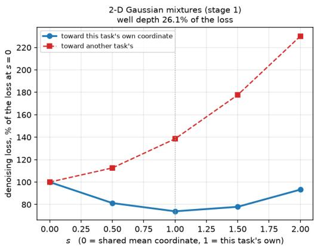

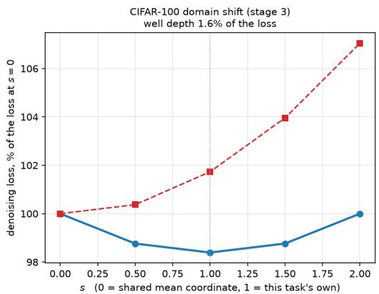  
Figure 7: Task-coordinate interpolation. The GMM and CIFAR panels use their respective model checkpoints. Losses are normalised by the shared-coordinate loss; well depth is the percentage drop from this loss to the minimum along the own-task direction. Own-task and wrong-task directions keep their diagnostic meanings. Their shapes do not replace the paired deployment-route comparisons.

## B.2 COMPLETE FACTORIAL DIAGNOSTICS

The boundary experiment uses 64/16/64 train/validation/test semantic tasks, five model/data seeds, 8,000 training steps, linear transport and $K _ { T } = 0$ . Each task is a four-component 2-D GMM with fixed mixture weights and covariances; only component means vary across tasks. Let $\bar { \mu } _ { S , j }$ be the component-wise mean over meta-training tasks. Source-task identifiability is controlled by

$$
\begin{array} { r } { \mu _ { S , j } ^ { y } ( \alpha ) = \bar { \mu } _ { S , j } + \alpha \big ( \mu _ { S , j } ^ { y } - \bar { \mu } _ { S , j } \big ) , } \end{array}
$$

with $\alpha \in \{ 0 , . 1 , . 2 5 , . 5 , . 7 5 , 1 , 1 . 5 \}$ . Thus $\alpha = 0$ makes source tasks distributionally identical, $\alpha = 1$ recovers the original task separation, and $\alpha > 1$ increases it.

Targets share the affine base relation

$$
T _ { 0 } ( u ) = R u + b , \qquad R = 1 . 1 0 \left[ \sin 2 5 ^ { \circ } \quad - \sin 2 5 ^ { \circ } \right] , \qquad b = \left[ { 0 . 7 5 } ^ { 0 . 5 } \right] .
$$

For each task $y$ and component $j ,$ , a perturbation $\xi _ { y , j } \sim \mathcal { N } ( 0 , I _ { 2 } )$ is drawn once and reused across the heterogeneity sweep. After normalising these perturbations to unit RMS over training tasks and components, target means are

$$
\mu _ { T , j } ^ { y } ( \alpha , \eta ) = T _ { 0 } \Big ( \mu _ { S , j } ^ { y } ( \alpha ) \Big ) + \eta s _ { R } \xi _ { y , j } ,
$$

where $s _ { R }$ is the RMS magnitude of the common source–target transformation over meta-training components and $\eta \in \{ 0 , . 1 , . 2 5 , . 5 , 1 , 2 \}$ . Hence $\eta = 0$ gives a perfectly shared relation, while increasing η introduces task-specific displacement that cannot be inferred from other source–target pairs. The same latent tasks and perturbations are reused across neighbouring cells to support paired comparisons. The component index is $j \in \{ 1 , \ldots , 4 \}$ ; it is unrelated to the refinement-step count $J .$ The transformation scale depends on the source-separation condition:

$$
s _ { R } ( \alpha ) ^ { 2 } = \frac { 1 } { 4 | \mathcal { V } _ { \mathrm { t r a i n } } | } \sum _ { y \in \mathcal { V } _ { \mathrm { t r a i n } } } \sum _ { j = 1 } ^ { 4 } \bigl \| T _ { 0 } ( \mu _ { S , j } ^ { y } ( \alpha ) ) - \mu _ { S , j } ^ { y } ( \alpha ) \bigr \| _ { 2 } ^ { 2 } .
$$

Training-task centres and normalisation constants are applied unchanged to validation and test tasks. Bayes task identification uses the known source-GMM likelihoods over the 64 held-out candidates; learned identification uses the trained encoder coordinate. Neither identification accuracy is a generated-image fidelity metric.

The full grid makes three distinctions visible. First, $G _ { \mathrm { s o u r c e } }$ is effectively zero at $\alpha = 0$ even though a shared relation can still move the source distribution. Second, learned task discrimination increases much more slowly than Bayes identifiability around $\alpha = . 1 \mathrm { - } . 2 5$ . Third, relation predictability falls with η even when Bayes-ID is saturated. The mechanism analysis makes the second point sharper: the rank association with $G _ { \mathrm { s o u r c e } }$ is $\rho = . 9 8$ for learned-ID versus .89 for Bayes-ID, and replacing Bayes-ID with learned-ID in the same interaction model increases cell-level fit from $R ^ { 2 } = . 5 8 7$ to .843. These regressions are descriptive summaries of the factorial grid rather than causal estimates.

Table 5: Complete GMM factorial diagnostics. Top: correct-source advantage $G _ { \mathrm { s o u r c e } } = \mathrm { S W } _ { w r o n g } -$ $\mathrm { S W } _ { c o r r e c t }$ . Middle: learned-coordinate task-ID accuracy. Bottom: held-out oracle affine relation $\bar { \boldsymbol { R } } ^ { 2 }$ Each cell averages five seeds; generation effects further average 64 held-out tasks per seed.

$$
G _ { \mathrm { s o u r c e } }
$$

<table><tr><td> $\alpha \backslash \eta$ </td><td>0</td><td>0.1</td><td>0.25</td><td>0.5</td><td>1</td><td>2</td></tr><tr><td>0</td><td>0.000</td><td>0.000</td><td>-0.000</td><td>0.000</td><td>-0.000</td><td>-0.002</td></tr><tr><td>0.1</td><td>0.008</td><td>0.010</td><td>0.006</td><td>0.006</td><td>0.002</td><td>0.002</td></tr><tr><td>0.25</td><td>0.093</td><td>0.102</td><td>0.098</td><td>0.066</td><td>0.038</td><td>0.023</td></tr><tr><td>0.5</td><td>0.242</td><td>0.209</td><td>0.205</td><td>0.220</td><td>0.140</td><td>0.091</td></tr><tr><td> $0 . 7 5$ </td><td>0.387</td><td>0.390</td><td>0.370</td><td>0.321</td><td>0.256</td><td>0.142</td></tr><tr><td>1</td><td>0.523</td><td>0.563</td><td>0.523</td><td>0.447</td><td>0.404</td><td>0.228</td></tr><tr><td>1.5</td><td>0.693</td><td>0.736</td><td>0.715</td><td>0.661</td><td>0.567</td><td>0.427</td></tr><tr><td colspan="7">Learned-coordinate task ID</td></tr><tr><td> $\alpha \backslash \eta$ </td><td>0</td><td>0.1</td><td>0.25</td><td>0.5</td><td>1</td><td>2</td></tr><tr><td> $0$ </td><td>0.014</td><td>0.016</td><td>0.016</td><td>0.020</td><td>0.018</td><td>0.013</td></tr><tr><td>0.1</td><td>0.074</td><td>0.061</td><td>0.057</td><td>0.069</td><td>0.078</td><td>0.098</td></tr><tr><td>0.25</td><td>0.338</td><td>0.340</td><td>0.316</td><td>0.282</td><td>0.324</td><td>0.349</td></tr><tr><td> $0 . 5$ </td><td>0.718</td><td>0.737</td><td>0.717</td><td>0.728</td><td>0.670</td><td>0.678</td></tr><tr><td> $0 . 7 5$ </td><td>0.866</td><td>0.861</td><td>0.849</td><td>0.845</td><td>0.825</td><td>0.791</td></tr><tr><td> $^ { 1 }$ </td><td>0.873</td><td>0.894</td><td>0.891</td><td>0.886</td><td>0.871</td><td>0.830</td></tr><tr><td> $1 . 5$ </td><td>0.928</td><td>0.920</td><td>0.925</td><td>0.920</td><td>0.908</td><td>0.882</td></tr><tr><td colspan="7">Oracle affine relation  $R ^ { 2 }$ </td></tr><tr><td> $\alpha \backslash \eta$ </td><td>0</td><td>0.1</td><td>0.25</td><td>0.5</td><td>1</td><td>2</td></tr><tr><td>0</td><td>1.000</td><td>0.849</td><td>0.509</td><td>0.227</td><td>0.067</td><td>0.007</td></tr><tr><td>0.1</td><td>1.000</td><td>0.918</td><td>0.652</td><td>0.327</td><td>0.105</td><td>0.019</td></tr><tr><td>0.25</td><td>1.000</td><td>0.975</td><td>0.861</td><td>0.609</td><td>0.276</td><td>0.077</td></tr><tr><td>0.5</td><td>1.000</td><td>0.992</td><td>0.949</td><td>0.824</td><td>0.538</td><td>0.218</td></tr><tr><td>0.75</td><td>1.000</td><td>0.995</td><td>0.971</td><td>0.892</td><td>0.672</td><td>0.333</td></tr><tr><td>1</td><td>1.000</td><td>0.996</td><td>0.978</td><td>0.919</td><td>0.738</td><td>0.408</td></tr><tr><td>1.5</td><td>1.000</td><td>0.997</td><td>0.984</td><td>0.939</td><td>0.794</td><td>0.487</td></tr></table>

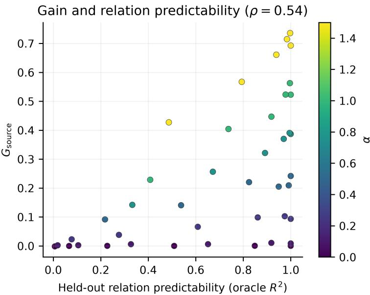  
Figure 8: Relation predictability is a separate boundary from task identifiability. Each colour fixes source-task separation α while η varies. The horizontal axis is the held-out ${ \dot { R } } ^ { 2 }$ of an affine map fitted to true training-task component means; it is therefore independent of Meta-Diff’s learned coordinate. $\mathrm { A t } \alpha = 1$ , Bayes-ID remains 1.0 while relation $R ^ { 2 }$ falls from 1.000 to .408 and the correct-over-wrong SW advantage falls from .523 to .228. Over the full grid, $\rho ( G _ { \mathrm { s o u r c e } } , R _ { \mathrm { r e l } } ^ { 2 } ) = . 5 4$

Relation-only SW minus correct
<table><tr><td rowspan=4 colspan=1>1.510.75</td><td></td><td></td><td></td><td></td><td></td><td></td></tr><tr><td rowspan=1 colspan=1>0.42*</td><td rowspan=1 colspan=1>0.42*</td><td rowspan=1 colspan=1>0.43*</td><td rowspan=1 colspan=1>0.39*</td><td rowspan=1 colspan=1>0.36*</td><td rowspan=1 colspan=1>0.22*</td></tr><tr><td rowspan=1 colspan=1>0.31*</td><td rowspan=1 colspan=1>0.33*</td><td rowspan=1 colspan=1>0.31*</td><td rowspan=1 colspan=1>0.26*</td><td rowspan=1 colspan=1>0.21*</td><td rowspan=1 colspan=1>0.12*</td></tr><tr><td rowspan=1 colspan=1>0.22*</td><td rowspan=1 colspan=1>0.23*</td><td rowspan=1 colspan=1>0.22*</td><td rowspan=1 colspan=1>0.18*</td><td rowspan=1 colspan=1>0.15*</td><td rowspan=1 colspan=1>0.09*</td></tr><tr><td rowspan=1 colspan=1>α0.5</td><td rowspan=1 colspan=1>0.14*</td><td rowspan=1 colspan=1>0.13*</td><td rowspan=1 colspan=1>0.11*</td><td rowspan=1 colspan=1>0.11*</td><td rowspan=1 colspan=1>0.07*</td><td rowspan=1 colspan=1>0.05*</td></tr><tr><td rowspan=1 colspan=1>0.25</td><td rowspan=1 colspan=1>0.05*</td><td rowspan=1 colspan=1>0.06*</td><td rowspan=1 colspan=1>0.05*</td><td rowspan=1 colspan=1>0.04*</td><td rowspan=1 colspan=1>0.02*</td><td rowspan=1 colspan=1>0.01</td></tr><tr><td rowspan=1 colspan=1>0.1</td><td rowspan=1 colspan=1>0.00*</td><td rowspan=1 colspan=1>0.00*</td><td rowspan=1 colspan=1>0.00*</td><td rowspan=1 colspan=1>0.00*</td><td rowspan=1 colspan=1>0.00</td><td rowspan=1 colspan=1>0.00</td></tr><tr><td rowspan=1 colspan=1>0</td><td rowspan=1 colspan=2>-0.00-0.00</td><td rowspan=1 colspan=1>0.00</td><td rowspan=1 colspan=1>0.00</td><td rowspan=1 colspan=1>-0.00</td><td rowspan=1 colspan=1>-0.00</td></tr><tr><td rowspan=1 colspan=1></td><td rowspan=1 colspan=2>0   0.1</td><td rowspan=1 colspan=2>0.25 0.5η</td><td rowspan=1 colspan=2>1    2</td></tr></table>

Source pairwise SW (×10−3)
<table><tr><td colspan="7">Source pairwise SW  $( \times 1 0 ^ { - 3 } )$ </td></tr><tr><td>1.5</td><td>5.08</td><td>5.08</td><td>5.08</td><td>5.08</td><td>5.08</td><td>5.08</td></tr><tr><td>1</td><td>3.31</td><td>3.31</td><td>3.31</td><td>3.31</td><td>3.31</td><td>3.31</td></tr><tr><td>0.75</td><td>2.44</td><td>2.44</td><td>2.44</td><td>2.44</td><td>2.44</td><td>2.44</td></tr><tr><td>α0.5</td><td>1.57</td><td>1.57</td><td>1.57</td><td>1.57</td><td>1.57</td><td>1.57</td></tr><tr><td>0.25</td><td>0.75</td><td>0.75</td><td>0.75</td><td>0.75</td><td>0.75</td><td>0.75</td></tr><tr><td>0.1</td><td>0.30</td><td>0.30</td><td>0.30</td><td>0.30</td><td>0.30</td><td>0.30</td></tr><tr><td>0</td><td>0.03</td><td>0.03</td><td>0.03</td><td>0.03</td><td>0.03</td><td>0.03</td></tr><tr><td></td><td>0</td><td>0.1</td><td>0.25 η</td><td>0.5</td><td>1</td><td>2</td></tr></table>

Figure 9: Full-grid GMM controls. Left: relation-only minus correct-source SW; positive values favour the source-conditioned route and stars mark hierarchical paired intervals excluding zero. Right: true-source pairwise SW (in units of $1 0 ^ { - 3 } )$ , an outcome-independent source-separation diagnostic. The source-conditioned route has a resolved advantage over relation-only in 33 of 42 cells; Table 7 also contains 34 resolved correct-versus-wrong cells, while source-reuse and abundant-target-reference comparisons are not uniformly favourable.

Complete route means and paired uncertainty. The following tables give SW/MMD means and paired route contrasts for all 42 factorial cells. Route intervals use the hierarchical seed/task bootstrap and remain separate from the independent pipeline and shift-sweep summaries below.

Table 6: Complete factorial GMM SW route means. Lower is better; five seeds and 64 held-out tasks per seed.
<table><tr><td colspan="6"></td><td colspan="2">Abundant-target</td></tr><tr><td>α</td><td>η</td><td>Correct</td><td>Wrong</td><td>Relation-only</td><td>Source reuse</td><td>reference</td></tr><tr><td>0</td><td>0</td><td>0.09386</td><td>0.09396</td><td>0.09361</td><td>0.64158</td><td>0.09311</td></tr><tr><td>0</td><td>0.1</td><td>0.14144</td><td>0.14170</td><td>0.14129</td><td>0.70917</td><td>0.14840</td></tr><tr><td>0</td><td>0.25</td><td>0.16930</td><td>0.16911</td><td>0.16933</td><td>0.63886</td><td>0.16775</td></tr><tr><td>0</td><td>0.5</td><td>0.32266</td><td>0.32270</td><td>0.32317</td><td>0.77757</td><td>0.31470</td></tr><tr><td>0</td><td>1</td><td>0.58670</td><td>0.58635</td><td>0.58467</td><td>0.71809</td><td>0.52292</td></tr><tr><td>0</td><td>2</td><td>1.04219</td><td>1.04036</td><td>1.04108</td><td>1.16237</td><td>0.90496</td></tr><tr><td>0.1</td><td>0</td><td>0.18620</td><td>0.19456</td><td>0.19078</td><td>0.64653</td><td>0.19528</td></tr><tr><td>0.1</td><td>0.1</td><td>0.16964</td><td>0.17991</td><td>0.17319</td><td>0.71509</td><td>0.18359</td></tr><tr><td>0.1</td><td>0.25</td><td>0.23343</td><td>0.23926</td><td>0.23713</td><td>0.68183</td><td>0.23469</td></tr><tr><td>0.1</td><td>0.5</td><td>0.32876</td><td>0.33447</td><td>0.33166</td><td>0.76656</td><td>0.34392</td></tr><tr><td>0.1</td><td>1</td><td>0.61856</td><td>0.62068</td><td>0.62086</td><td>0.77128</td><td>0.56109</td></tr><tr><td>0.1</td><td>2</td><td>1.13177</td><td>1.13375</td><td>1.13227</td><td>1.19641</td><td>0.99374</td></tr><tr><td>0.25</td><td>0</td><td>0.26717</td><td>0.36053</td><td>0.32118</td><td>0.70593</td><td>0.29249</td></tr><tr><td>0.25</td><td>0.1</td><td>0.25727</td><td>0.35972</td><td>0.31534</td><td>0.68822</td><td>0.25517</td></tr><tr><td>0.25</td><td>0.25</td><td>0.30459</td><td>0.40290</td><td>0.35736</td><td>0.73701</td><td>0.31244</td></tr><tr><td>0.25</td><td>0.5</td><td>0.38146</td><td>0.44737</td><td>0.41840</td><td>0.73248</td><td>0.34137</td></tr><tr><td>0.25</td><td>1</td><td>0.66614</td><td>0.70417</td><td>0.69010</td><td>0.82028</td><td>0.55004</td></tr><tr><td>0.25</td><td>2</td><td>1.16372</td><td>1.18639</td><td>1.17351</td><td>1.23343</td><td>0.98578</td></tr><tr><td>0.5</td><td>0</td><td>0.43521</td><td>0.67676</td><td>0.57230</td><td>0.75540</td><td>0.48756</td></tr><tr><td>0.5</td><td>0.1</td><td>0.46706</td><td>0.67618</td><td>0.59320</td><td>0.66103</td><td>0.45364</td></tr><tr><td>0.5</td><td>0.25</td><td>0.50701</td><td>0.71183</td><td>0.62122</td><td>0.76954</td><td>0.52467</td></tr><tr><td>0.5</td><td>0.5</td><td>0.53815</td><td>0.75841</td><td>0.64413</td><td>0.78782</td><td>0.52228</td></tr><tr><td>0.5</td><td>1</td><td>0.83608</td><td>0.97654</td><td>0.91079</td><td>0.89080</td><td>0.68141</td></tr><tr><td>0.5</td><td>2</td><td>1.31188</td><td>1.40333</td><td>1.36229</td><td>1.32739</td><td>1.08919</td></tr><tr><td>0.75</td><td>0</td><td>0.63087</td><td>1.01769</td><td>0.85555</td><td>0.87930</td><td>0.68385</td></tr><tr><td>0.75</td><td>0.1</td><td>0.59480</td><td>0.98529</td><td>0.82756</td><td>0.83604</td><td>0.63539</td></tr><tr><td>0.75</td><td>0.25</td><td>0.65450</td><td>1.02438</td><td>0.87596</td><td>0.87217</td><td>0.68470</td></tr><tr><td>0.75</td><td>0.5</td><td>0.77528</td><td>1.09644</td><td>0.95094</td><td>0.93380</td><td>0.73713</td></tr><tr><td>0.75</td><td>1</td><td>0.98062</td><td>1.23690</td><td>1.13105</td><td>1.05599</td><td>0.85252</td></tr><tr><td>0.75</td><td>2</td><td>1.57659</td><td>1.71834</td><td>1.66407</td><td>1.47961</td><td>1.30518</td></tr><tr><td>1</td><td>0</td><td>0.83601</td><td>1.35871</td><td>1.14405</td><td>1.00989</td><td>0.87475</td></tr><tr><td>1</td><td>0.1</td><td>0.77718</td><td>1.33978</td><td>1.10764</td><td>1.01242</td><td>0.83143</td></tr><tr><td>1</td><td>0.25</td><td>0.84056</td><td>1.36367</td><td>1.14931</td><td>1.06450</td><td>0.88271</td></tr><tr><td>1</td><td>0.5</td><td>0.98325</td><td>1.42997</td><td>1.24690</td><td>1.04953</td><td>0.93214</td></tr><tr><td>1</td><td>1</td><td>1.19519</td><td>1.59930</td><td>1.40758</td><td>1.25568</td><td>1.07821</td></tr><tr><td>1</td><td>2</td><td>1.83706</td><td>2.06552</td><td>1.95703</td><td>1.68288</td><td>1.53973</td></tr><tr><td>1.5</td><td>0</td><td>1.30175</td><td>1.99432</td><td>1.71676</td><td>1.58434</td><td>1.45669</td></tr><tr><td>1.5</td><td>0.1</td><td>1.32602</td><td>2.06157</td><td>1.75072</td><td>1.56571</td><td>1.39372</td></tr><tr><td>1.5</td><td>0.25</td><td>1.32210</td><td>2.03668</td><td>1.74836</td><td>1.58367</td><td>1.39352</td></tr><tr><td>1.5</td><td>0.5</td><td>1.38495</td><td>2.04579</td><td>1.77314</td><td>1.57787</td><td>1.41911</td></tr><tr><td>1.5</td><td>1</td><td>1.66776</td><td>2.23484</td><td>2.02376</td><td>1.67006</td><td>1.50820</td></tr><tr><td>1.5</td><td>2</td><td>2.47424</td><td>2.90125</td><td>2.69910</td><td>2.32351</td><td>2.11900</td></tr></table>

Table 7: Complete factorial GMM SW source controls: comparator minus correct-source transport, with hierarchical seed/task 95% intervals. Positive favours correct-source transport.
<table><tr><td rowspan=1 colspan=7>α  η Wrong — correct                  Relation-only — correct</td></tr><tr><td rowspan=1 colspan=3>0  0  +0.00010</td><td rowspan=1 colspan=2>[-0.00035,+0.00059]</td><td rowspan=1 colspan=1>-0.00025</td><td rowspan=1 colspan=1>[-0.00086, +0.00036]</td></tr><tr><td rowspan=1 colspan=3>0  0.1 +0.00025</td><td rowspan=1 colspan=2>[-0.00054, +0.00093]</td><td rowspan=1 colspan=1>-0.00015</td><td rowspan=1 colspan=1>-0.00087,+0.00044]</td></tr><tr><td rowspan=1 colspan=3>0  0.25 -0.00019</td><td rowspan=1 colspan=2>[-0.00106, +0.00062]</td><td rowspan=1 colspan=1>+0.00003</td><td rowspan=1 colspan=1>[-0.00105,+0.00102]</td></tr><tr><td rowspan=1 colspan=3>0  0.5 +0.00004</td><td rowspan=1 colspan=2>[-0.00138, +0.00160]</td><td rowspan=1 colspan=1>+0.00051</td><td rowspan=1 colspan=1>[-0.00113,+0.00227]</td></tr><tr><td rowspan=1 colspan=2>0   1</td><td rowspan=1 colspan=1>-0.00035</td><td rowspan=1 colspan=2>[-0.00319, +0.00254]</td><td rowspan=1 colspan=1>-0.00203</td><td rowspan=1 colspan=1>[-0.00437, +0.00043]</td></tr><tr><td rowspan=1 colspan=2>0   2</td><td rowspan=1 colspan=1>-0.00182</td><td rowspan=1 colspan=2>-0.00695, +0.00300]</td><td rowspan=1 colspan=1>-0.00110</td><td rowspan=1 colspan=1>[-0.00633, +0.00385]</td></tr><tr><td rowspan=1 colspan=2>0.1  0</td><td rowspan=1 colspan=1>+0.00835</td><td rowspan=1 colspan=2>[+0.00423, +0.01379]</td><td rowspan=1 colspan=1>+0.00458</td><td rowspan=1 colspan=1>[+0.00175,+0.00758]</td></tr><tr><td rowspan=1 colspan=2>0.1 0.1</td><td rowspan=1 colspan=1>+0.01027*</td><td rowspan=1 colspan=2>[+0.00584, +0.01483]</td><td rowspan=1 colspan=1>+0.00355*</td><td rowspan=1 colspan=1>[+0.00065,+0.00663]</td></tr><tr><td rowspan=1 colspan=2>0.1 0.25</td><td rowspan=1 colspan=1>+0.00583*</td><td rowspan=1 colspan=2>[+0.00176,+0.01033]</td><td rowspan=1 colspan=1>+0.00370*</td><td rowspan=1 colspan=1>[+0.00007, +0.00708]</td></tr><tr><td rowspan=1 colspan=2>0.1 0.5</td><td rowspan=1 colspan=1>+0.00572</td><td rowspan=1 colspan=2>[+0.00102, +0.01033]</td><td rowspan=1 colspan=1>+0.00291</td><td rowspan=1 colspan=1>[+0.00013, +0.00566]</td></tr><tr><td rowspan=1 colspan=2>0.1  1</td><td rowspan=1 colspan=1>+0.00213</td><td rowspan=1 colspan=2>[-0.00186, +0.00623]</td><td rowspan=1 colspan=1>+0.00231</td><td rowspan=1 colspan=1>-0.00150,+0.00582]</td></tr><tr><td rowspan=1 colspan=2>0.1  2</td><td rowspan=1 colspan=1>+0.00198</td><td rowspan=1 colspan=2>[-0.00546, +0.00931]</td><td rowspan=1 colspan=1>+0.00051</td><td rowspan=1 colspan=1>-0.00778,+0.00873]</td></tr><tr><td rowspan=1 colspan=2>0.25 0</td><td rowspan=1 colspan=1>+0.09336</td><td rowspan=1 colspan=2>[+0.07494, +0.11153]</td><td rowspan=1 colspan=1>+0.05401</td><td rowspan=1 colspan=1>[+0.03773,+0.07027]</td></tr><tr><td rowspan=1 colspan=1>0.25</td><td rowspan=1 colspan=1>0.1</td><td rowspan=1 colspan=1>+0.10245*</td><td rowspan=1 colspan=2>[+0.07687,+0.12837]</td><td rowspan=1 colspan=1>+0.05807*</td><td rowspan=1 colspan=1>[+0.04549, +0.06963]</td></tr><tr><td rowspan=1 colspan=1>0.25</td><td rowspan=1 colspan=1>0.25</td><td rowspan=1 colspan=1>+0.09831</td><td rowspan=1 colspan=2>[+0.07986, +0.11555]</td><td rowspan=1 colspan=1>+0.05277*</td><td rowspan=1 colspan=1>[+0.04184, +0.06411]</td></tr><tr><td rowspan=1 colspan=1>0.25</td><td rowspan=1 colspan=1>0.5</td><td rowspan=1 colspan=1>+0.06591</td><td rowspan=1 colspan=2>[+0.04754, +0.08641]</td><td rowspan=1 colspan=1>+0.03694*</td><td rowspan=1 colspan=1>[+0.01948, +0.05338]</td></tr><tr><td rowspan=1 colspan=1>0.25</td><td rowspan=1 colspan=1>1</td><td rowspan=1 colspan=1>+0.03803*</td><td rowspan=1 colspan=2>[+0.02468,+0.05266]</td><td rowspan=1 colspan=1>+0.02396*</td><td rowspan=1 colspan=1>[+0.01248,+0.03724]</td></tr><tr><td rowspan=1 colspan=1>0.25</td><td rowspan=1 colspan=1>2</td><td rowspan=1 colspan=1>+0.02266*</td><td rowspan=1 colspan=2>[+0.00366, +0.04314]</td><td rowspan=1 colspan=1>+0.00979</td><td rowspan=1 colspan=1>-0.01160,+0.03503]</td></tr><tr><td rowspan=1 colspan=1>0.5</td><td rowspan=1 colspan=1>0</td><td rowspan=1 colspan=1>+0.24155*</td><td rowspan=1 colspan=1>[+0.21516,</td><td rowspan=1 colspan=1>+0.26783]</td><td rowspan=1 colspan=1>+0.13709*</td><td rowspan=1 colspan=1>[+0.10877, +0.16139]</td></tr><tr><td rowspan=1 colspan=1>0.5</td><td rowspan=1 colspan=1>0.1</td><td rowspan=1 colspan=1>+0.20912*</td><td rowspan=1 colspan=1>[+0.16496,</td><td rowspan=1 colspan=1>+0.25024]</td><td rowspan=1 colspan=1>+0.12614*</td><td rowspan=1 colspan=1>[+0.09744, +0.15530]</td></tr><tr><td rowspan=1 colspan=1>0.5</td><td rowspan=1 colspan=1>0.25</td><td rowspan=1 colspan=1>+0.20482*</td><td rowspan=1 colspan=1>[+0.15696,</td><td rowspan=1 colspan=1>+0.25306]</td><td rowspan=1 colspan=1>+0.11421</td><td rowspan=1 colspan=1>[+0.08465, +0.14390]</td></tr><tr><td rowspan=1 colspan=1>0.5</td><td rowspan=1 colspan=1>0.5</td><td rowspan=1 colspan=1>+0.22026*</td><td rowspan=1 colspan=1>[+0.17131,</td><td rowspan=1 colspan=1>+0.27742]</td><td rowspan=1 colspan=1>+0.10598*</td><td rowspan=1 colspan=1>[+0.07229, +0.13699</td></tr><tr><td rowspan=1 colspan=1>0.5</td><td rowspan=1 colspan=1>1</td><td rowspan=1 colspan=1>+0.14047</td><td rowspan=1 colspan=1>[+0.08743,</td><td rowspan=1 colspan=1>+0.20163]</td><td rowspan=1 colspan=1>+0.07471*</td><td rowspan=1 colspan=1>[+0.04927,+0.10087]</td></tr><tr><td rowspan=1 colspan=1>0.5</td><td rowspan=1 colspan=1>2</td><td rowspan=1 colspan=1>+0.09145*</td><td rowspan=1 colspan=1>[+0.05889,</td><td rowspan=1 colspan=1>+0.12524]</td><td rowspan=1 colspan=1>+0.05041*</td><td rowspan=1 colspan=1>[+0.00794, +0.08689]</td></tr><tr><td rowspan=1 colspan=1>0.75</td><td rowspan=1 colspan=1>0</td><td rowspan=1 colspan=1>+0.38682*</td><td rowspan=1 colspan=1>[+0.31401,</td><td rowspan=1 colspan=1>+0.46122]</td><td rowspan=1 colspan=1>+0.22468*</td><td rowspan=1 colspan=1>[+0.18242, +0.26639]</td></tr><tr><td rowspan=1 colspan=1>0.75</td><td rowspan=1 colspan=1>0.1</td><td rowspan=1 colspan=1>+0.39049*</td><td rowspan=1 colspan=1>[+0.32193,</td><td rowspan=1 colspan=1>+0.44730]</td><td rowspan=1 colspan=1>+0.23276*</td><td rowspan=1 colspan=1>[+0.18354,+0.27327]</td></tr><tr><td rowspan=1 colspan=1>0.75</td><td rowspan=1 colspan=1>0.25</td><td rowspan=1 colspan=1>+0.36989*</td><td rowspan=1 colspan=1>[+0.30159,</td><td rowspan=1 colspan=1>+0.44673]</td><td rowspan=1 colspan=1>+0.22146*</td><td rowspan=1 colspan=1>[+0.17257, +0.26753]</td></tr><tr><td rowspan=1 colspan=1>0.75</td><td rowspan=1 colspan=1>0.5</td><td rowspan=1 colspan=1>+0.32116*</td><td rowspan=1 colspan=1>[+0.24744,</td><td rowspan=1 colspan=1>+0.40265]</td><td rowspan=1 colspan=1>+0.17567*</td><td rowspan=1 colspan=1>[+0.11925,+0.23146]</td></tr><tr><td rowspan=1 colspan=1>0.75</td><td rowspan=1 colspan=1>1</td><td rowspan=1 colspan=1>+0.25629</td><td rowspan=1 colspan=1>[+0.18494,</td><td rowspan=1 colspan=1>+0.34726]</td><td rowspan=1 colspan=1>+0.15043*</td><td rowspan=1 colspan=1>[+0.09492, +0.20354]</td></tr><tr><td rowspan=1 colspan=1>0.75</td><td rowspan=1 colspan=1>2</td><td rowspan=1 colspan=1>+0.14175*</td><td rowspan=1 colspan=1>[+0.09699,</td><td rowspan=1 colspan=1>+0.18694]</td><td rowspan=1 colspan=1>+0.08748*</td><td rowspan=1 colspan=1>[+0.04723, +0.13009]</td></tr><tr><td rowspan=1 colspan=1>1</td><td rowspan=1 colspan=1>0</td><td rowspan=1 colspan=1>+0.52270</td><td rowspan=1 colspan=1>[+0.44979,</td><td rowspan=1 colspan=1>+0.59553]</td><td rowspan=1 colspan=1>+0.30804*</td><td rowspan=1 colspan=1>[+0.25922, +0.35910]</td></tr><tr><td rowspan=1 colspan=2>1  0.1</td><td rowspan=1 colspan=1>+0.56260*</td><td rowspan=1 colspan=1>[+0.47423,</td><td rowspan=1 colspan=1>+0.66587</td><td rowspan=1 colspan=1>+0.33046*</td><td rowspan=1 colspan=1>[+0.27791,+0.38118]</td></tr><tr><td rowspan=1 colspan=2>1 0.25</td><td rowspan=1 colspan=1>+0.52310*</td><td rowspan=1 colspan=1>[+0.44510,</td><td rowspan=1 colspan=1>+0.59904]</td><td rowspan=1 colspan=1>+0.30874*</td><td rowspan=1 colspan=1>[+0.24722, +0.36915]</td></tr><tr><td rowspan=1 colspan=2>1  0.5</td><td rowspan=1 colspan=1>+0.44672*</td><td rowspan=1 colspan=1>[+0.32666,</td><td rowspan=1 colspan=1>+0.56506]</td><td rowspan=1 colspan=1>+0.26366*</td><td rowspan=1 colspan=1>[+0.20126, +0.33012]</td></tr><tr><td rowspan=1 colspan=1>1</td><td rowspan=1 colspan=1>1</td><td rowspan=1 colspan=1>+0.40410*</td><td rowspan=1 colspan=1>[+0.31186,</td><td rowspan=1 colspan=1>+0.50894]</td><td rowspan=1 colspan=1>+0.21238*</td><td rowspan=1 colspan=1>[+0.15675, +0.27564]</td></tr><tr><td rowspan=1 colspan=1>1</td><td rowspan=1 colspan=1>2</td><td rowspan=1 colspan=1>+0.22846*</td><td rowspan=1 colspan=1>[+0.13314,</td><td rowspan=1 colspan=1>+0.34093]</td><td rowspan=1 colspan=1>+0.11997*</td><td rowspan=1 colspan=1>[+0.05312,+0.18728]</td></tr><tr><td rowspan=1 colspan=1>1.5</td><td rowspan=1 colspan=1>0</td><td rowspan=1 colspan=1>+0.69257*</td><td rowspan=1 colspan=1>[+0.56014,</td><td rowspan=1 colspan=1>+0.82813]</td><td rowspan=1 colspan=1>+0.41501*</td><td rowspan=1 colspan=1>[+0.33127, +0.50103]</td></tr><tr><td rowspan=1 colspan=1>1.5</td><td rowspan=1 colspan=1>0.1</td><td rowspan=1 colspan=1>+0.73555</td><td rowspan=1 colspan=1>[+0.63170,</td><td rowspan=1 colspan=1>+0.84237]</td><td rowspan=1 colspan=1>+0.42470*</td><td rowspan=1 colspan=1>[+0.35280, +0.49942]</td></tr><tr><td rowspan=1 colspan=2>1.5 0.25</td><td rowspan=1 colspan=1>+0.71458*</td><td rowspan=1 colspan=1>[+0.60007,</td><td rowspan=1 colspan=1>+0.83214]</td><td rowspan=1 colspan=1>+0.42626*</td><td rowspan=1 colspan=1>[+0.33255, +0.51560]</td></tr><tr><td rowspan=1 colspan=2>1.5 0.5</td><td rowspan=1 colspan=1>+0.66084*</td><td rowspan=1 colspan=1>[+0.53810,</td><td rowspan=1 colspan=1>+0.81305]</td><td rowspan=1 colspan=1>+0.38819*</td><td rowspan=1 colspan=1>[+0.31138, +0.47313]</td></tr><tr><td rowspan=1 colspan=2>1.5  1</td><td rowspan=1 colspan=1>+0.56708*</td><td rowspan=1 colspan=1>[+0.43503,</td><td rowspan=1 colspan=1>+0.71278]</td><td rowspan=1 colspan=1>+0.35600*</td><td rowspan=1 colspan=1>[+0.25317, +0.46499]</td></tr><tr><td rowspan=1 colspan=2>1.5  2</td><td rowspan=1 colspan=1>+0.42700*</td><td rowspan=1 colspan=1>[+0.28685,</td><td rowspan=1 colspan=1>+0.58549]</td><td rowspan=1 colspan=1>+0.22485</td><td rowspan=1 colspan=1>[+0.14329, +0.30859]</td></tr></table>

Table 8: Complete factorial GMM SW reuse/reference contrasts: comparator minus correct-source transport, with hierarchical seed/task 95% intervals. Positive favours correct-source transport. The abundant-target coordinate reference encodes 512 target samples with the frozen encoder and uses the same frozen generator, without target-time coordinate optimisation. It is a reference route, not a performance upper bound.
<table><tr><td rowspan=1 colspan=7>α  η Source reuse — correct             Abundant-target ref. — correct</td></tr><tr><td rowspan=1 colspan=3>0   0  +0.54772*</td><td rowspan=1 colspan=1>[+0.47915,+0.61436]</td><td rowspan=1 colspan=1>-0.00075</td><td rowspan=1 colspan=2>[-0.02123,+0.01295]</td></tr><tr><td rowspan=1 colspan=2>0  0.1</td><td rowspan=1 colspan=1>+0.56772*</td><td rowspan=1 colspan=1>[+0.50726, +0.63460]</td><td rowspan=1 colspan=1>+0.00695</td><td rowspan=1 colspan=1>[-0.00126, +0.01545]</td><td rowspan=1 colspan=1></td></tr><tr><td rowspan=1 colspan=2>0  0.25</td><td rowspan=1 colspan=1>+0.46955</td><td rowspan=1 colspan=1>[+0.40729, +0.51238]</td><td rowspan=1 colspan=1>-0.00156</td><td rowspan=1 colspan=1>[-0.01588, +0.01273]</td><td rowspan=1 colspan=1></td></tr><tr><td rowspan=1 colspan=2>0  0.5</td><td rowspan=1 colspan=1>+0.45492</td><td rowspan=1 colspan=1>[+0.37794, +0.53592]</td><td rowspan=1 colspan=1>-0.00796</td><td rowspan=1 colspan=1>[-0.02093, +0.00691]</td><td rowspan=1 colspan=1></td></tr><tr><td rowspan=1 colspan=2>0   1</td><td rowspan=1 colspan=1>+0.13139</td><td rowspan=1 colspan=1>-0.01521,+0.26379]</td><td rowspan=1 colspan=1>-0.06379*</td><td rowspan=1 colspan=2>[-0.09976, -0.02633]</td></tr><tr><td rowspan=1 colspan=2>0   2</td><td rowspan=1 colspan=1>+0.12019</td><td rowspan=1 colspan=1>[-0.02686, +0.29146]</td><td rowspan=1 colspan=1>-0.13723</td><td rowspan=1 colspan=2>*[-0.18348, -0.08521]</td></tr><tr><td rowspan=1 colspan=2>0.1  0</td><td rowspan=1 colspan=1>+0.46033</td><td rowspan=1 colspan=1>[+0.40389, +0.52582]</td><td rowspan=1 colspan=1>+0.00908</td><td rowspan=1 colspan=1>*[+0.00413,+0.01490]</td><td></td></tr><tr><td rowspan=1 colspan=1>0.1</td><td rowspan=1 colspan=1>0.1</td><td rowspan=1 colspan=1>+0.54545</td><td rowspan=1 colspan=1>[+0.47017,+0.62192</td><td rowspan=1 colspan=1>+0.01395*</td><td rowspan=1 colspan=1>[+0.00489, +0.02307]</td><td></td></tr><tr><td rowspan=1 colspan=1>0.1</td><td rowspan=1 colspan=1>0.25</td><td rowspan=1 colspan=1>+0.44839*</td><td rowspan=1 colspan=1>[+0.37088, +0.51481</td><td rowspan=1 colspan=1>+0.00125</td><td rowspan=1 colspan=1>[-0.00893, +0.00999]</td><td></td></tr><tr><td rowspan=1 colspan=1>0.1</td><td rowspan=1 colspan=1>0.5</td><td rowspan=1 colspan=1>+0.43781</td><td rowspan=1 colspan=1>[+0.32473, +0.53652]</td><td rowspan=1 colspan=1>+0.01517</td><td rowspan=1 colspan=2>-0.02963, +0.07979]</td></tr><tr><td rowspan=1 colspan=1>0.1</td><td rowspan=1 colspan=1>1</td><td rowspan=1 colspan=1>+0.15272</td><td rowspan=1 colspan=1>[+0.03401,+0.24160]</td><td rowspan=1 colspan=1>-0.05746</td><td rowspan=1 colspan=1>[-0.08008, -0.03720]</td><td></td></tr><tr><td rowspan=1 colspan=1>0.1</td><td rowspan=1 colspan=1>2</td><td rowspan=1 colspan=1>+0.06465</td><td rowspan=1 colspan=1>-0.14536,+0.25890]</td><td rowspan=1 colspan=1>-0.13803</td><td rowspan=1 colspan=1>*[-0.18973, -0.08234]</td><td></td></tr><tr><td rowspan=1 colspan=2>0.25 0</td><td rowspan=1 colspan=1>+0.43875</td><td rowspan=1 colspan=1>[+0.34914, +0.52549]</td><td rowspan=1 colspan=1>+0.02532</td><td rowspan=1 colspan=1>-0.01838, +0.06959]</td><td></td></tr><tr><td rowspan=1 colspan=2>0.25 0.1</td><td rowspan=1 colspan=1>+0.43095*</td><td rowspan=1 colspan=1>[+0.33990, +0.51491</td><td rowspan=1 colspan=1>-0.00210</td><td rowspan=1 colspan=1>[-0.01978, +0.01578]</td><td rowspan=1 colspan=1></td></tr><tr><td rowspan=1 colspan=2>0.250.25</td><td rowspan=1 colspan=1>+0.43242*</td><td rowspan=1 colspan=1>[+0.31778, +0.56028]</td><td rowspan=1 colspan=1>+0.00784</td><td rowspan=1 colspan=1>[-0.01576, +0.03842]</td><td rowspan=1 colspan=1></td></tr><tr><td rowspan=1 colspan=2>0.25 0.5</td><td rowspan=1 colspan=1>+0.35102*</td><td rowspan=1 colspan=1>[+0.25553, +0.44285]</td><td rowspan=1 colspan=1>-0.04009</td><td rowspan=1 colspan=1>-0.07272,+0.00166]</td><td rowspan=1 colspan=1></td></tr><tr><td rowspan=1 colspan=1>0.25</td><td rowspan=1 colspan=1>1</td><td rowspan=1 colspan=1>+0.15415</td><td rowspan=1 colspan=1>[+0.01199,+0.25514]</td><td rowspan=1 colspan=1>-0.11609*</td><td rowspan=1 colspan=1>[-0.14699, -0.08798]</td><td></td></tr><tr><td rowspan=1 colspan=1>0.25</td><td rowspan=1 colspan=1>2</td><td rowspan=1 colspan=1>+0.06971</td><td rowspan=1 colspan=1>[-0.06061,+0.19539]</td><td rowspan=1 colspan=1>-0.17795</td><td rowspan=1 colspan=1>[-0.23321, -0.13095]</td><td></td></tr><tr><td rowspan=1 colspan=1>0.5</td><td rowspan=1 colspan=1>0</td><td rowspan=1 colspan=1>+0.32019</td><td rowspan=1 colspan=1>[+0.26384, +0.36867]</td><td rowspan=1 colspan=1>+0.05235</td><td rowspan=1 colspan=1>[+0.02156, +0.08589]</td><td></td></tr><tr><td rowspan=1 colspan=1>0.5</td><td rowspan=1 colspan=1>0.1</td><td rowspan=1 colspan=1>+0.19397*</td><td rowspan=1 colspan=1>[+0.08944, +0.29378]</td><td rowspan=1 colspan=1>-0.01342</td><td rowspan=1 colspan=1>[-0.07453, +0.04412]</td><td></td></tr><tr><td rowspan=1 colspan=1>0.5</td><td rowspan=1 colspan=1>0.25</td><td rowspan=1 colspan=1>+0.26253*</td><td rowspan=1 colspan=1>[+0.16573, +0.34602</td><td rowspan=1 colspan=1>+0.01765</td><td rowspan=1 colspan=1>-0.02270,+0.06038]</td><td rowspan=1 colspan=1></td></tr><tr><td rowspan=1 colspan=1>0.5</td><td rowspan=1 colspan=1>0.5</td><td rowspan=1 colspan=1>+0.24967</td><td rowspan=1 colspan=1>[+0.12643, +0.35329]</td><td rowspan=1 colspan=1>-0.01587</td><td rowspan=1 colspan=1>-0.06285,+0.03293]</td><td rowspan=1 colspan=1></td></tr><tr><td rowspan=1 colspan=1>0.5</td><td rowspan=1 colspan=1>1</td><td rowspan=1 colspan=1>+0.05472</td><td rowspan=1 colspan=1>[-0.10061,+0.15118]</td><td rowspan=1 colspan=1>-0.15467</td><td rowspan=1 colspan=1>[-0.22629, -0.09391]</td><td></td></tr><tr><td rowspan=1 colspan=1>0.5</td><td rowspan=1 colspan=1>2</td><td rowspan=1 colspan=1>+0.01552</td><td rowspan=1 colspan=1>[-0.13468,+0.15717]</td><td rowspan=1 colspan=1>-0.22269</td><td rowspan=1 colspan=1>[-0.29576, -0.16079]</td><td></td></tr><tr><td rowspan=1 colspan=1>0.75</td><td rowspan=1 colspan=1>0</td><td rowspan=1 colspan=1>+0.24843</td><td rowspan=1 colspan=1>[+0.12217,+0.36943]</td><td rowspan=1 colspan=1>+0.05298</td><td rowspan=1 colspan=1>[-0.01921,+0.13013]</td><td rowspan=1 colspan=1></td></tr><tr><td rowspan=1 colspan=1>0.75</td><td rowspan=1 colspan=1>0.1</td><td rowspan=1 colspan=1>+0.24124</td><td rowspan=1 colspan=1>[+0.12439, +0.34690</td><td rowspan=1 colspan=1>+0.04059</td><td rowspan=1 colspan=1>[-0.01339, +0.08357]</td><td rowspan=1 colspan=1></td></tr><tr><td rowspan=1 colspan=1>0.75</td><td rowspan=1 colspan=1>0.25</td><td rowspan=1 colspan=1>+0.21767</td><td rowspan=1 colspan=1>[+0.12208, +0.31442]</td><td rowspan=1 colspan=1>+0.03021</td><td rowspan=1 colspan=1>[-0.02956, +0.09356]</td><td rowspan=1 colspan=1></td></tr><tr><td rowspan=1 colspan=1>0.75</td><td rowspan=1 colspan=1>0.5</td><td rowspan=1 colspan=1>+0.15852*</td><td rowspan=1 colspan=1>[+0.05433, +0.24901]</td><td rowspan=1 colspan=1>-0.03815</td><td rowspan=1 colspan=1>-0.07614, +0.00502]</td><td rowspan=1 colspan=1></td></tr><tr><td rowspan=1 colspan=1>0.75</td><td rowspan=1 colspan=1>1</td><td rowspan=1 colspan=1>+0.07538</td><td rowspan=1 colspan=1>-0.05367, +0.16205]</td><td rowspan=1 colspan=1>-0.12810*</td><td rowspan=1 colspan=1>[-0.20445, -0.06870]</td><td></td></tr><tr><td rowspan=1 colspan=1>0.75</td><td rowspan=1 colspan=1>2</td><td rowspan=1 colspan=1>-0.09698</td><td rowspan=1 colspan=1>[-0.30044, +0.04797]</td><td rowspan=1 colspan=1>-0.27141*</td><td rowspan=1 colspan=1>[-0.39106, -0.17787]</td><td></td></tr><tr><td rowspan=1 colspan=1>1</td><td rowspan=1 colspan=1>0</td><td rowspan=1 colspan=1>+0.17388</td><td rowspan=1 colspan=1>[+0.07600,+0.27364]</td><td rowspan=1 colspan=1>+0.03874</td><td rowspan=1 colspan=1>-0.02206, +0.09591]</td><td></td></tr><tr><td rowspan=1 colspan=2>1  0.1</td><td rowspan=1 colspan=1>+0.23524</td><td rowspan=1 colspan=1>[+0.14588, +0.32692]</td><td rowspan=1 colspan=1>+0.05425</td><td rowspan=1 colspan=1>-0.00352, +0.10887]</td><td rowspan=1 colspan=1></td></tr><tr><td rowspan=1 colspan=1>1</td><td rowspan=1 colspan=1>0.25</td><td rowspan=1 colspan=1>+0.22394</td><td rowspan=1 colspan=1>[+0.08812, +0.33918]</td><td rowspan=1 colspan=1>+0.04214</td><td rowspan=1 colspan=1>[-0.02872, +0.10773]</td><td rowspan=1 colspan=1></td></tr><tr><td rowspan=1 colspan=1>1</td><td rowspan=1 colspan=1>0.5</td><td rowspan=1 colspan=1>+0.06628</td><td rowspan=1 colspan=1>[-0.12114,+0.20964]</td><td rowspan=1 colspan=1>-0.05111</td><td rowspan=1 colspan=1>-0.15309, +0.03730]</td><td rowspan=1 colspan=1></td></tr><tr><td rowspan=1 colspan=1>1</td><td rowspan=1 colspan=1>1</td><td rowspan=1 colspan=1>+0.06048</td><td rowspan=1 colspan=1>-0.00260,+0.12129]</td><td rowspan=1 colspan=1>-0.11699*</td><td rowspan=1 colspan=1>[-0.18859, -0.04980]</td><td></td></tr><tr><td rowspan=1 colspan=1>1</td><td rowspan=1 colspan=1>2</td><td rowspan=1 colspan=1>-0.15418</td><td rowspan=1 colspan=1>[-0.33414, +0.00775]</td><td rowspan=1 colspan=1>-0.29733*</td><td rowspan=1 colspan=1>[-0.43268, -0.17561]</td><td></td></tr><tr><td rowspan=1 colspan=1>1.5</td><td rowspan=1 colspan=1>0</td><td rowspan=1 colspan=1>+0.28258</td><td rowspan=1 colspan=1>[+0.17342, +0.39528]</td><td rowspan=1 colspan=1>+0.15494*</td><td rowspan=1 colspan=1>[+0.10056,+0.21521]</td><td></td></tr><tr><td rowspan=1 colspan=1>1.5</td><td rowspan=1 colspan=1>0.1</td><td rowspan=1 colspan=1>+0.23969*</td><td rowspan=1 colspan=1>[+0.09724, +0.38696]</td><td rowspan=1 colspan=1>+0.06770</td><td rowspan=1 colspan=1>[-0.07017,+0.19717]</td><td></td></tr><tr><td rowspan=1 colspan=2>1.5 0.25</td><td rowspan=1 colspan=1>+0.26157</td><td rowspan=1 colspan=1>[+0.15161,+0.36427]</td><td rowspan=1 colspan=1>+0.07142</td><td rowspan=1 colspan=1>[+0.00223,+0.14246]</td><td></td></tr><tr><td rowspan=1 colspan=2>1.5 0.5</td><td rowspan=1 colspan=1>+0.19292</td><td rowspan=1 colspan=1>[+0.10353, +0.28814]</td><td rowspan=1 colspan=1>+0.03416</td><td rowspan=1 colspan=1>[-0.02510, +0.08968]</td><td></td></tr><tr><td rowspan=1 colspan=2>1.5  1</td><td rowspan=1 colspan=1>+0.00230</td><td rowspan=1 colspan=1>[-0.08436, +0.09102]</td><td rowspan=1 colspan=1>-0.15957*</td><td rowspan=1 colspan=1>[-0.24140, -0.07676]</td><td></td></tr><tr><td rowspan=1 colspan=2>1.5  2</td><td rowspan=1 colspan=1>-0.15073*</td><td rowspan=1 colspan=1>[-0.29265,-0.04305]</td><td rowspan=1 colspan=1>-0.35525*</td><td rowspan=1 colspan=2>[-0.46329, -0.24579]</td></tr></table>

Table 9: Complete factorial GMM MMD route means. Lower is better; five seeds and 64 held-out tasks per seed.
<table><tr><td colspan="7">Abundant-target</td></tr><tr><td>α</td><td>η</td><td>Correct</td><td>Wrong</td><td>Relation-only</td><td>Source reuse</td><td>reference</td></tr><tr><td>0</td><td>0</td><td>0.01827</td><td>0.01820</td><td>0.01813</td><td>0.88275</td><td>0.01782</td></tr><tr><td>0</td><td>0.1</td><td>0.03767</td><td>0.03772</td><td>0.03767</td><td>1.01943</td><td>0.04387</td></tr><tr><td>0</td><td>0.25</td><td>0.06638</td><td>0.06640</td><td>0.06653</td><td>0.87212</td><td>0.06448</td></tr><tr><td>0</td><td>0.5</td><td>0.14388</td><td>0.14391</td><td>0.14401</td><td>1.02813</td><td>0.13898</td></tr><tr><td>0</td><td>1</td><td>0.32266</td><td>0.32176</td><td>0.32035</td><td>0.71514</td><td>0.24480</td></tr><tr><td>0</td><td>2</td><td>0.72649</td><td>0.72400</td><td>0.72402</td><td>1.19824</td><td>0.52956</td></tr><tr><td>0.1</td><td>0</td><td>0.07334</td><td>0.08149</td><td>0.07906</td><td>0.83916</td><td>0.07990</td></tr><tr><td>0.1</td><td>0.1</td><td>0.05986</td><td>0.06983</td><td>0.06498</td><td>0.97429</td><td>0.06869</td></tr><tr><td>0.1</td><td>0.25</td><td>0.09329</td><td>0.10050</td><td>0.09806</td><td>0.91302</td><td>0.09706</td></tr><tr><td>0.1</td><td>0.5</td><td>0.16318</td><td>0.17106</td><td>0.16820</td><td>0.95430</td><td>0.18661</td></tr><tr><td>0.1</td><td>1</td><td>0.34343</td><td>0.34776</td><td>0.34619</td><td>0.80935</td><td>0.25908</td></tr><tr><td>0.1</td><td>2</td><td>0.75629</td><td>0.75893</td><td>0.75859</td><td>1.22893</td><td>0.54214</td></tr><tr><td>0.25</td><td>0</td><td>0.10815</td><td>0.23019</td><td>0.17891</td><td>0.78865</td><td>0.13855</td></tr><tr><td>0.25</td><td>0.1</td><td>0.10634</td><td>0.23746</td><td>0.17717</td><td>0.80646</td><td>0.10232</td></tr><tr><td>0.25</td><td>0.25</td><td>0.12515</td><td>0.25525</td><td>0.19413</td><td>0.81587</td><td>0.12691</td></tr><tr><td>0.25</td><td>0.5</td><td>0.18401</td><td>0.28003</td><td>0.23306</td><td>0.81571</td><td>0.14977</td></tr><tr><td>0.25</td><td>1</td><td>0.37590</td><td>0.43806</td><td>0.41686</td><td>0.81969</td><td>0.25679</td></tr><tr><td>0.25</td><td>2</td><td>0.78925</td><td>0.82407</td><td>0.81257</td><td>1.25444</td><td>0.56455</td></tr><tr><td>0.5</td><td>0</td><td>0.17616</td><td>0.49284</td><td>0.35407</td><td>0.59608</td><td>0.23008</td></tr><tr><td>0.5</td><td>0.1</td><td>0.22647</td><td>0.52662</td><td>0.39873</td><td>0.45728</td><td>0.20212</td></tr><tr><td>0.5</td><td>0.25</td><td>0.23612</td><td>0.52913</td><td>0.40286</td><td>0.59270</td><td>0.25045</td></tr><tr><td>0.5</td><td>0.5</td><td>0.25410</td><td>0.57246</td><td>0.40274</td><td>0.62153</td><td>0.23771</td></tr><tr><td>0.5</td><td>1</td><td>0.49623</td><td>0.72537</td><td>0.62030</td><td>0.73690</td><td>0.33088</td></tr><tr><td>0.5</td><td>2</td><td>0.82885</td><td>0.98155</td><td>0.91753</td><td>1.21317</td><td>0.55722</td></tr><tr><td>0.75</td><td>0</td><td>0.28914</td><td>0.83530</td><td>0.59069</td><td>0.60096</td><td>0.33253</td></tr><tr><td>0.75</td><td>0.1</td><td>0.27496</td><td>0.82089</td><td>0.58035</td><td>0.56537</td><td>0.29812</td></tr><tr><td>0.75</td><td>0.25</td><td>0.31701</td><td>0.85119</td><td>0.62212</td><td>0.60848</td><td>0.35899</td></tr><tr><td>0.75</td><td>0.5</td><td>0.39967</td><td>0.87885</td><td>0.64763</td><td>0.62969</td><td>0.34415</td></tr><tr><td>0.75</td><td>1</td><td>0.53643</td><td>0.93519</td><td>0.77855</td><td>0.75011</td><td>0.41116</td></tr><tr><td>0.75</td><td>2</td><td>0.99672</td><td>1.24134</td><td>1.15750</td><td>1.17534</td><td>0.68976</td></tr><tr><td>1</td><td>0</td><td>0.38453</td><td>1.13998</td><td>0.81764</td><td>0.61778</td><td>0.42747</td></tr><tr><td>1</td><td>0.1</td><td>0.34852</td><td>1.17486</td><td>0.82466</td><td>0.62534</td><td>0.37613</td></tr><tr><td>1</td><td>0.25</td><td>0.40165</td><td>1.17876</td><td>0.84802</td><td>0.69373</td><td>0.42724</td></tr><tr><td>1</td><td>0.5</td><td>0.53272</td><td>1.20578</td><td>0.95292</td><td>0.63116</td><td>0.45816</td></tr><tr><td>1</td><td>1</td><td>0.64184</td><td>1.28125</td><td>0.99301</td><td>0.83097</td><td>0.54703</td></tr><tr><td>1</td><td>2</td><td>1.13301</td><td>1.52550</td><td>1.35384</td><td>1.22301</td><td>0.82498</td></tr><tr><td>1.5</td><td>0</td><td>0.66734</td><td>1.76367</td><td>1.28258</td><td>1.04101</td><td>0.82003</td></tr><tr><td>1.5</td><td>0.1</td><td>0.68992</td><td>1.82891</td><td>1.34389</td><td>1.01392</td><td>0.73695</td></tr><tr><td>1.5</td><td>0.25</td><td>0.64330</td><td>1.74992</td><td>1.28208</td><td>1.00599</td><td>0.71198</td></tr><tr><td>1.5</td><td>0.5</td><td>0.68368</td><td>1.67984</td><td>1.25541</td><td>0.96404</td><td>0.69489</td></tr><tr><td>1.5</td><td>1</td><td>0.86344</td><td>1.75000</td><td>1.38795</td><td>0.94367</td><td>0.67324</td></tr><tr><td>1.5</td><td>2</td><td>1.62377</td><td>2.34254</td><td>1.99685</td><td>1.68128</td><td>1.17444</td></tr></table>

Table 10: Complete factorial GMM MMD source controls: comparator minus correct-source transport, with hierarchical seed/task 95% intervals. Positive favours correct-source transport.
<table><tr><td>α</td><td>η</td><td>Wrong - correct</td><td></td><td>Relation-only — correct</td><td></td></tr><tr><td>0</td><td>0</td><td>-0.00007</td><td>[-0.00025, +0.00007]</td><td>-0.00014</td><td>[-0.00033,+0.00003]</td></tr><tr><td>0</td><td>0.1</td><td>+0.00005</td><td>-0.00008, +0.00018]</td><td>+0.00000</td><td>[-0.00013, +0.00012]</td></tr><tr><td>0</td><td>0.25</td><td>+0.00003</td><td>-0.00022, +0.00026]</td><td>+0.00015</td><td>[-0.00009, +0.00044]</td></tr><tr><td>0</td><td>0.5</td><td>+0.00004</td><td>[-0.00072, +0.00090]</td><td>+0.00014</td><td>[-0.00066, +0.00098]</td></tr><tr><td>0</td><td>1</td><td>-0.00090</td><td>[-0.00334,+0.00176]</td><td>-0.00231</td><td>[-0.00389, -0.00061]</td></tr><tr><td>0</td><td>2</td><td>-0.00249</td><td>[-0.00761,+0.00164]</td><td>-0.00247</td><td>[-0.00659,+0.00100]</td></tr><tr><td>0.1</td><td>0</td><td>+0.00815</td><td>[+0.00443, +0.01245]</td><td>+0.00573</td><td>[+0.00352,+0.00875]</td></tr><tr><td>0.1</td><td>0.1</td><td>+0.00998*</td><td>[+0.00621, +0.01473]</td><td>+0.00512*</td><td>[+0.00289, +0.00797]</td></tr><tr><td>0.1</td><td>0.25</td><td>+0.00720</td><td>[+0.00217, +0.01418]</td><td>+0.00476</td><td>[+0.00159, +0.00878]</td></tr><tr><td>0.1</td><td>0.5</td><td>+0.00788</td><td>[+0.00284, +0.01387]</td><td>+0.00502</td><td>[+0.00219, +0.00798]</td></tr><tr><td>0.1</td><td>1</td><td>+0.00433</td><td>[-0.00037,+0.00924]</td><td>+0.00277</td><td>-0.00149,+0.00691]</td></tr><tr><td>0.1</td><td>2</td><td>+0.00264</td><td>[-0.00755, +0.01284]</td><td>+0.00230</td><td>-0.00857,+0.01487]</td></tr><tr><td>0.25</td><td>0</td><td>+0.12203</td><td>[+0.09047, +0.15798]</td><td>+0.07076</td><td>[+0.05145, +0.08979]</td></tr><tr><td>0.25</td><td>0.1</td><td>+0.13112</td><td>[+0.09258, +0.18448]</td><td>+0.07083*</td><td>[+0.05726, +0.08734]</td></tr><tr><td>0.25</td><td>0.25</td><td>+0.13011</td><td>[+0.10825, +0.15320</td><td>+0.06898</td><td>[+0.05395, +0.08484]</td></tr><tr><td>0.25</td><td>0.5</td><td>+0.09601</td><td>[+0.07087, +0.12419]</td><td>+0.04904*</td><td>[+0.02913, +0.06673]</td></tr><tr><td>0.25</td><td>1</td><td>+0.06216*</td><td>[+0.04336, +0.08356]</td><td>+0.04096</td><td>[+0.02735, +0.05778]</td></tr><tr><td>0.25</td><td>2</td><td>+0.03481*</td><td>[+0.00644, +0.06557]</td><td>+0.02331</td><td>[-0.00206, +0.05358]</td></tr><tr><td>0.5</td><td>0</td><td>+0.31668*</td><td>[+0.27528, +0.36086]</td><td>+0.17791</td><td>[+0.15063, +0.20589]</td></tr><tr><td>0.5</td><td>0.1</td><td>+0.30015</td><td>[+0.22862, +0.37459]</td><td>+0.17226</td><td>[+0.13303, +0.22478]</td></tr><tr><td>0.5</td><td>0.25</td><td>+0.29300</td><td>[+0.23177,+0.36024]</td><td>+0.16674*</td><td>[+0.13550, +0.19907]</td></tr><tr><td>0.5</td><td>0.5</td><td>+0.31836</td><td>[+0.24775, +0.40319]</td><td>+0.14864*</td><td>[+0.10246, +0.19293</td></tr><tr><td>0.5</td><td>1</td><td>+0.22914</td><td>[+0.16015, +0.30839]</td><td>+0.12407</td><td>[+0.08790, +0.15940]</td></tr><tr><td>0.5</td><td>2</td><td>+0.15270</td><td>[+0.09963, +0.20514]</td><td>+0.08868*</td><td>[+0.03489, +0.13962]</td></tr><tr><td>0.75</td><td>0</td><td>+0.54616*</td><td>[+0.46194, +0.63855]</td><td>+0.30155*</td><td>[+0.24394, +0.37747]</td></tr><tr><td>0.75</td><td>0.1</td><td>+0.54593*</td><td>[+0.44574, +0.63694]</td><td>+0.30539*</td><td>[+0.23962, +0.37953]</td></tr><tr><td>0.75</td><td>0.25</td><td>+0.53418*</td><td>[+0.44127, +0.64401]</td><td>+0.30511*</td><td>[+0.23772, +0.38154]</td></tr><tr><td>0.75</td><td>0.5</td><td>+0.47917*</td><td>[+0.38579, +0.57822</td><td>+0.24796*</td><td>[+0.16661, +0.33848]</td></tr><tr><td>0.75</td><td>1</td><td>+0.39875</td><td>[+0.30187, +0.52259]</td><td>+0.24212*</td><td>[+0.16768, +0.31574]</td></tr><tr><td>0.75</td><td>2</td><td>+0.24462</td><td>[+0.17113, +0.31805]</td><td>+0.16078</td><td>[+0.09541, +0.22461]</td></tr><tr><td>1</td><td>0</td><td>+0.75545</td><td>[+0.65833, +0.85396]</td><td>+0.43311</td><td>[+0.34737, +0.53878]</td></tr><tr><td>1</td><td>0.1</td><td>+0.82634</td><td>[+0.68290, +0.99393]</td><td>+0.47615</td><td>[+0.38587, +0.56505]</td></tr><tr><td>1</td><td>0.25</td><td>+0.77711*</td><td>[+0.66190, +0.89134]</td><td>+0.44637*</td><td>[+0.35150, +0.57146]</td></tr><tr><td>1</td><td>0.5</td><td>+0.67306</td><td>[+0.52330, +0.82360]</td><td>+0.42019*</td><td>[+0.31515, +0.52882]</td></tr><tr><td>1</td><td>1</td><td>+0.63941</td><td>[+0.49330, +0.81341]</td><td>+0.35117</td><td>[+0.25545, +0.46088]</td></tr><tr><td>1</td><td>2</td><td>+0.39249</td><td>[+0.24244, +0.57382]</td><td>+0.22082*</td><td>[+0.11081,+0.32567]</td></tr><tr><td>1.5</td><td>0</td><td>+1.09634</td><td>[+0.91938, +1.28449]</td><td>+0.61525</td><td>[+0.49514, +0.75308]</td></tr><tr><td>1.5</td><td>0.1</td><td>+1.13899</td><td>[+0.97726, +1.31227]</td><td>+0.65397</td><td>[+0.55980, +0.75650]</td></tr><tr><td>1.5</td><td>0.25</td><td></td><td></td><td></td><td>[+0.49773, +0.79731]</td></tr><tr><td>1.5</td><td></td><td>+1.10662*</td><td>[+0.96072, +1.25630</td><td>+0.63877*</td><td></td></tr><tr><td>1.5</td><td>0.5 1</td><td>+0.99616 +0.88656</td><td>[+0.82566,+1.20117]</td><td>+0.57174* +0.52451*</td><td>[+0.44409, +0.70192]</td></tr><tr><td></td><td></td><td></td><td>[+0.68842, +1.10578]</td><td></td><td>[+0.37423, +0.69403]</td></tr><tr><td>1.5</td><td>2</td><td>+0.71877</td><td>[+0.48858, +0.97687]</td><td>+0.37308</td><td>[+0.23704, +0.50955]</td></tr></table>

Table 11: Complete factorial GMM MMD reuse/reference contrasts: comparator minus correctsource transport, with hierarchical seed/task 95% intervals. Positive favours correct-source transport. The abundant-target coordinate reference encodes 512 target samples with the frozen encoder and uses the same frozen generator, without target-time coordinate optimisation. It is a reference route, not a performance upper bound.
<table><tr><td rowspan=1 colspan=8>α  η Source reuse— correct             Abundant-target ref. — correct</td></tr><tr><td rowspan=1 colspan=3>0  0  +0.86448*</td><td rowspan=1 colspan=2>[+0.62391,+1.08397]</td><td rowspan=1 colspan=1>-0.00044 [</td><td rowspan=2 colspan=2>-0.01105, +0.00643][+0.00008, +0.01270]</td></tr><tr><td rowspan=1 colspan=3>0  0.1 +0.98176</td><td rowspan=1 colspan=2>[+0.86073,+1.10203]</td><td rowspan=1 colspan=1>+0.00620*</td></tr><tr><td rowspan=1 colspan=2>0  0.25</td><td rowspan=1 colspan=1>+0.80574*</td><td rowspan=1 colspan=2>[+0.62634, +0.92682]</td><td rowspan=1 colspan=1>-0.00190</td><td rowspan=2 colspan=2>[-0.01245, +0.00877][-0.02169, +0.01614]</td></tr><tr><td rowspan=1 colspan=2>0  0.5</td><td rowspan=1 colspan=1>+0.88426</td><td rowspan=1 colspan=2>[+0.69128, +1.05914]</td><td rowspan=1 colspan=1>-0.00489</td></tr><tr><td rowspan=1 colspan=2>0   1</td><td rowspan=1 colspan=1>+0.39248</td><td rowspan=1 colspan=2>[+0.18649, +0.59469</td><td rowspan=1 colspan=1>-0.07786*</td><td rowspan=1 colspan=2>[-0.11287,-0.04096]</td></tr><tr><td rowspan=1 colspan=2>0   2</td><td rowspan=1 colspan=1>+0.47175</td><td rowspan=1 colspan=2>[+0.24454, +0.74321]</td><td rowspan=1 colspan=1>-0.19693</td><td rowspan=1 colspan=2>*[-0.24489, -0.15161]</td></tr><tr><td rowspan=1 colspan=2>0.1  0</td><td rowspan=1 colspan=1>+0.76582</td><td rowspan=1 colspan=2>[+0.64899, +0.88055]</td><td rowspan=1 colspan=1>+0.00656*</td><td rowspan=1 colspan=2>[+0.00010,+0.01308]</td></tr><tr><td rowspan=1 colspan=2>0.1 0.1</td><td rowspan=1 colspan=1>+0.91444*</td><td rowspan=1 colspan=2>[+0.73172, +1.06691</td><td rowspan=1 colspan=1>+0.00883*</td><td rowspan=1 colspan=2>[+0.00461, +0.01360]</td></tr><tr><td rowspan=1 colspan=2>0.1 0.25</td><td rowspan=1 colspan=1>+0.81973</td><td rowspan=1 colspan=2>[+0.60398, +1.01282]</td><td rowspan=1 colspan=1>+0.00377</td><td rowspan=1 colspan=2>[-0.00503,+0.01209]</td></tr><tr><td rowspan=1 colspan=2>0.1 0.5</td><td rowspan=1 colspan=1>+0.79112</td><td rowspan=1 colspan=2>[+0.62793, +0.91909]</td><td rowspan=1 colspan=1>+0.02343</td><td rowspan=1 colspan=2>[-0.02890, +0.10372]</td></tr><tr><td rowspan=1 colspan=2>0.1  1</td><td rowspan=1 colspan=1>+0.46593*</td><td rowspan=1 colspan=2>[+0.31219, +0.61078]</td><td rowspan=1 colspan=1>-0.08435</td><td rowspan=1 colspan=1>[-0.11503, -0.05602]</td><td></td></tr><tr><td rowspan=1 colspan=2>0.1  2</td><td rowspan=1 colspan=1>+0.47265</td><td rowspan=1 colspan=2>[+0.17378, +0.73851]</td><td rowspan=1 colspan=1>-0.21415*</td><td rowspan=1 colspan=1>[-0.24325, -0.18304]</td><td></td></tr><tr><td rowspan=1 colspan=2>0.25  0</td><td rowspan=1 colspan=1>+0.68050</td><td rowspan=1 colspan=2>[+0.53245, +0.83404]</td><td rowspan=1 colspan=1>+0.03039</td><td rowspan=1 colspan=1>[-0.01902, +0.07962]</td><td></td></tr><tr><td rowspan=1 colspan=2>0.25 0.1</td><td rowspan=1 colspan=1>+0.70012</td><td rowspan=1 colspan=2>[+0.56395, +0.82675]</td><td rowspan=1 colspan=1>-0.00402</td><td rowspan=1 colspan=2>[-0.02492, +0.01340]</td></tr><tr><td rowspan=1 colspan=2>0.250.25</td><td rowspan=1 colspan=1>+0.69072</td><td rowspan=1 colspan=2>[+0.54898, +0.83160]</td><td rowspan=1 colspan=1>+0.00176</td><td rowspan=1 colspan=2>[-0.02138, +0.03217]</td></tr><tr><td rowspan=1 colspan=2>0.25 0.5</td><td rowspan=1 colspan=1>+0.63169</td><td rowspan=1 colspan=2>[+0.45808, +0.82498]</td><td rowspan=1 colspan=1>-0.03424</td><td rowspan=1 colspan=2>[-0.07724, +0.01442]</td></tr><tr><td rowspan=1 colspan=1>0.25</td><td rowspan=1 colspan=1>1</td><td rowspan=1 colspan=1>+0.44378</td><td rowspan=1 colspan=2>[+0.25424, +0.62415]</td><td rowspan=1 colspan=1>-0.11912</td><td rowspan=1 colspan=1>[-0.14697, -0.09456]</td><td></td></tr><tr><td rowspan=1 colspan=1>0.25</td><td rowspan=1 colspan=1>2</td><td rowspan=1 colspan=1>+0.46519</td><td rowspan=1 colspan=2>[+0.34597, +0.59740]</td><td rowspan=1 colspan=1>-0.22470*</td><td rowspan=1 colspan=1>[-0.27629, -0.17115]</td><td></td></tr><tr><td rowspan=1 colspan=1>0.5</td><td rowspan=1 colspan=1>0</td><td rowspan=1 colspan=1>+0.41992</td><td rowspan=1 colspan=2>[+0.34712, +0.49157]</td><td rowspan=1 colspan=1>+0.05392</td><td rowspan=1 colspan=1>[+0.02198, +0.09153]</td><td></td></tr><tr><td rowspan=1 colspan=1>0.5</td><td rowspan=1 colspan=1>0.1</td><td rowspan=1 colspan=1>+0.23082</td><td rowspan=1 colspan=2>[+0.09143, +0.36996]</td><td rowspan=1 colspan=1>-0.02435</td><td rowspan=1 colspan=1>[-0.09469, +0.04308]</td><td></td></tr><tr><td rowspan=1 colspan=1>0.5</td><td rowspan=1 colspan=1>0.25</td><td rowspan=1 colspan=1>+0.35657*</td><td rowspan=1 colspan=2>[+0.20655, +0.49022]</td><td rowspan=1 colspan=1>+0.01433</td><td rowspan=1 colspan=1>[-0.03347, +0.06629]</td><td rowspan=1 colspan=1></td></tr><tr><td rowspan=1 colspan=1>0.5</td><td rowspan=1 colspan=1>0.5</td><td rowspan=1 colspan=1>+0.36743*</td><td rowspan=1 colspan=2>[+0.19529, +0.50937]</td><td rowspan=1 colspan=1>-0.01639</td><td rowspan=1 colspan=1>[-0.07890, +0.05097]</td><td rowspan=1 colspan=1></td></tr><tr><td rowspan=1 colspan=1>0.5</td><td rowspan=1 colspan=1>1</td><td rowspan=1 colspan=1>+0.24067</td><td rowspan=1 colspan=1>[+0.01953,</td><td rowspan=1 colspan=1>+0.39879]</td><td rowspan=1 colspan=1>-0.16535</td><td rowspan=1 colspan=1>[-0.24434, -0.09497]</td><td></td></tr><tr><td rowspan=1 colspan=1>0.5</td><td rowspan=1 colspan=1>2</td><td rowspan=1 colspan=1>+0.38432</td><td rowspan=1 colspan=1>[+0.25790,</td><td rowspan=1 colspan=1>+0.51440]</td><td rowspan=1 colspan=1>-0.27164*</td><td rowspan=1 colspan=1>[-0.32902, -0.21952]</td><td></td></tr><tr><td rowspan=1 colspan=1>0.75</td><td rowspan=1 colspan=1>0</td><td rowspan=1 colspan=1>+0.31182</td><td rowspan=1 colspan=1>[+0.13990,</td><td rowspan=1 colspan=1>+0.47463]</td><td rowspan=1 colspan=1>+0.04339</td><td rowspan=1 colspan=1>[-0.01995,+0.10980]</td><td></td></tr><tr><td rowspan=1 colspan=1>0.75</td><td rowspan=1 colspan=1>0.1</td><td rowspan=1 colspan=1>+0.29041</td><td rowspan=1 colspan=1>[+0.14437,</td><td rowspan=1 colspan=1>+0.42873]</td><td rowspan=1 colspan=1>+0.02316</td><td rowspan=1 colspan=1>[-0.02126, +0.06039]</td><td rowspan=1 colspan=1></td></tr><tr><td rowspan=1 colspan=1>0.75</td><td rowspan=1 colspan=1>0.25</td><td rowspan=1 colspan=1>+0.29147</td><td rowspan=1 colspan=2>[+0.15950, +0.42208]</td><td rowspan=1 colspan=1>+0.04198</td><td rowspan=1 colspan=1>[-0.02242, +0.10815]</td><td rowspan=1 colspan=1></td></tr><tr><td rowspan=1 colspan=1>0.75</td><td rowspan=1 colspan=1>0.5</td><td rowspan=1 colspan=1>+0.23002*</td><td rowspan=1 colspan=2>[+0.10975, +0.34290]</td><td rowspan=1 colspan=1>-0.05552</td><td rowspan=1 colspan=1>[-0.09451, -0.01572]</td><td></td></tr><tr><td rowspan=1 colspan=1>0.75</td><td rowspan=1 colspan=1>1</td><td rowspan=1 colspan=1>+0.21367</td><td rowspan=1 colspan=2>[+0.05158, +0.32043]</td><td rowspan=1 colspan=1>-0.12527*</td><td rowspan=1 colspan=1>[−0.20447, -0.06212]</td><td></td></tr><tr><td rowspan=1 colspan=1>0.75</td><td rowspan=1 colspan=1>2</td><td rowspan=1 colspan=1>+0.17862</td><td rowspan=1 colspan=2>[-0.02082,+0.34877]</td><td rowspan=1 colspan=1>-0.30697</td><td rowspan=1 colspan=1>[-0.42875, -0.19865]</td><td></td></tr><tr><td rowspan=1 colspan=1>1</td><td rowspan=1 colspan=1>0</td><td rowspan=1 colspan=1>+0.23325</td><td rowspan=1 colspan=2>[+0.10184, +0.37085]</td><td rowspan=1 colspan=1>+0.04294</td><td rowspan=1 colspan=1>[-0.01879, +0.10034]</td><td rowspan=1 colspan=1></td></tr><tr><td rowspan=1 colspan=1>1</td><td rowspan=1 colspan=1>0.1</td><td rowspan=1 colspan=1>+0.27682</td><td rowspan=1 colspan=2>[+0.15706, +0.40179]</td><td rowspan=1 colspan=1>+0.02761</td><td rowspan=1 colspan=1>[-0.03696, +0.08544]</td><td rowspan=1 colspan=1></td></tr><tr><td rowspan=1 colspan=1>1</td><td rowspan=1 colspan=1>0.25</td><td rowspan=1 colspan=1>+0.29208</td><td rowspan=1 colspan=2>[+0.11990, +0.45826]</td><td rowspan=1 colspan=1>+0.02559</td><td rowspan=1 colspan=1>[-0.04356, +0.09289]</td><td rowspan=1 colspan=1></td></tr><tr><td rowspan=1 colspan=1>1</td><td rowspan=1 colspan=1>0.5</td><td rowspan=1 colspan=1>+0.09844</td><td rowspan=1 colspan=2>[-0.10099,+0.24785]</td><td rowspan=1 colspan=1>-0.07456</td><td rowspan=1 colspan=1>[-0.18434, +0.01108]</td><td rowspan=1 colspan=1></td></tr><tr><td rowspan=1 colspan=1>1</td><td rowspan=1 colspan=1>1</td><td rowspan=1 colspan=1>+0.18914</td><td rowspan=1 colspan=2>[+0.11140, +0.27233]</td><td rowspan=1 colspan=1>-0.09481*</td><td rowspan=1 colspan=1>[-0.16812, -0.02574]</td><td></td></tr><tr><td rowspan=1 colspan=1>1</td><td rowspan=1 colspan=1>2</td><td rowspan=1 colspan=1>+0.08999</td><td rowspan=1 colspan=2>[-0.09839,+0.25686]</td><td rowspan=1 colspan=1>-0.30804*</td><td rowspan=1 colspan=1>[-0.45103, -0.16747]</td><td></td></tr><tr><td rowspan=1 colspan=1>1.5</td><td rowspan=1 colspan=1>0</td><td rowspan=1 colspan=1>+0.37367</td><td rowspan=1 colspan=2>[+0.21737, +0.53198]</td><td rowspan=1 colspan=1>+0.15269*</td><td rowspan=1 colspan=1>[+0.08160, +0.23430]</td><td></td></tr><tr><td rowspan=1 colspan=1>1.5</td><td rowspan=1 colspan=1>0.1</td><td rowspan=1 colspan=1>+0.32400*</td><td rowspan=1 colspan=2>[+0.10381, +0.55118]</td><td rowspan=1 colspan=1>+0.04703</td><td rowspan=1 colspan=1>[-0.12328, +0.20882]</td><td></td></tr><tr><td rowspan=1 colspan=2>1.5 0.25</td><td rowspan=1 colspan=1>+0.36268</td><td rowspan=1 colspan=2>[+0.20650, +0.52492]</td><td rowspan=1 colspan=1>+0.06868</td><td rowspan=1 colspan=1>[-0.01017,+0.16233]</td><td rowspan=2 colspan=1></td></tr><tr><td rowspan=1 colspan=2>1.5 0.5</td><td rowspan=1 colspan=1>+0.28036</td><td rowspan=1 colspan=2>[+0.14932, +0.42798]</td><td rowspan=1 colspan=1>+0.01121</td><td rowspan=1 colspan=1>[-0.05211,+0.07335]</td></tr><tr><td rowspan=1 colspan=2>1.5  1</td><td rowspan=1 colspan=1>+0.08023</td><td rowspan=1 colspan=2>[-0.01360,+0.17687]</td><td rowspan=1 colspan=1>-0.19020</td><td rowspan=1 colspan=1>[-0.24430, -0.13708]</td><td></td></tr><tr><td rowspan=1 colspan=2>1.5  2</td><td rowspan=1 colspan=1>+0.05751</td><td rowspan=1 colspan=2>[-0.06773,+0.17574]</td><td rowspan=1 colspan=1>-0.44933*</td><td rowspan=1 colspan=1>[-0.60695, -0.29172]</td><td></td></tr></table>

## B.3 USABLE IDENTITY EXPLAINS THE SOURCE-SPECIFIC GAIN

The mechanism analysis compares intrinsic Bayes task identification with nearest-centroid identification in the learned source coordinate. Bayes-ID saturates rapidly, while learned-ID catches up only at much larger α. Averaging across relation levels gives the following identity profile. All factorial summaries and regressions in the main text and appendix use the same 42 unrounded five-seed cell means; Spearman correlations use average ranks for ties.

Table 12: Intrinsic versus usable source-task identifiability. Chance is $1 / 6 4 = . 0 1 5 6$ . The collapse gap is Bayes-ID minus learned-ID.
<table><tr><td>α</td><td>Bayes-ID</td><td>learned-ID</td><td>Collapse gap</td></tr><tr><td>0.00</td><td>.016</td><td>.016</td><td>-.001</td></tr><tr><td>0.10</td><td>.400</td><td>.073</td><td>.327</td></tr><tr><td>0.25</td><td>.953</td><td>.325</td><td>.628</td></tr><tr><td>0.50</td><td>1.000</td><td>.708</td><td>.292</td></tr><tr><td>0.75</td><td>1.000</td><td>.839</td><td>.161</td></tr><tr><td>1.00</td><td>1.000</td><td>.874</td><td>.126</td></tr><tr><td>1.50</td><td>1.000</td><td>.914</td><td>.086</td></tr></table>

The source-specific gain tracks usable learned identity more closely than the intrinsic ceiling. Across the 42 cells, $\rho ( G _ { \mathrm { s o u r c e } } , I _ { \mathrm { l e a r n e d } } ) = . 9 8$ versus $\rho ( G _ { \mathrm { s o u r c e } } , I _ { \mathrm { B a y e s } } ) = . 8 9$ . Restricting to the 24 cells with Bayes-ID $> . 9 9$ leaves $\rho ( G _ { \mathrm { s o u r c e } } , I _ { \mathrm { l e a r n e d } } ) = . 9 7$ . The following table reports descriptive cell-level regressions.

Table 13: Descriptive GMM regressions predicting $G _ { \mathrm { s o u r c e } } .$ OLS fits use the 42 unrounded seed-mean cells. Displayed coefficient intervals are the conventional homoskedastic normal approximation $\widehat { \beta } \pm 1 . 9 6 \mathrm { S E _ { O L S } }$ with residual variance estimated using $4 2 - p$ degrees of freedom $( p = 4$ including the intercept). These descriptive cell-level intervals do not account for matched-seed dependence across cells and are not the hierarchical seed/task intervals for route comparisons.
<table><tr><td>Predictors</td><td> $\mathrm { F i t } \ : R ^ { 2 }$ </td><td>Key coefficient</td><td>95% CI</td></tr><tr><td>Bayes-ID  $+ R _ { \mathrm { r e l } } ^ { 2 } +$  interaction</td><td>.587</td><td> $I _ { \mathrm { B a y e s } } \times R _ { \mathrm { r e l } } ^ { 2 } = + . 5 4$ </td><td> $[ + . 1 7 , + . 9 2 ]$ </td></tr><tr><td>learned.  $\cdot \mathrm { I D } + R _ { \mathrm { r e l } } ^ { 2 } + \mathrm { i n t e r a c t i o n }$ </td><td>.843</td><td> $I _ { \mathrm { l e a r n e d } } \times R _ { \mathrm { r e l } } ^ { 2 } = + . 6 1$ </td><td> $[ + . 3 3 , + . 8 9 ]$ </td></tr><tr><td>Bayes  $\mathrm { \cdot I D } + \mathrm { l e a r n e d - I D } + R _ { \mathrm { r e l } } ^ { 2 }$ </td><td>.814</td><td> $I _ { \mathrm { l e a r n e d } } = + . 7 3$ </td><td> $[ + . 5 5 , + . 9 1 ]$ </td></tr><tr><td></td><td></td><td> $I _ { \mathrm { B a y e s } } = - . 2 7$ </td><td> $[ - . 4 4 , - . 1 0 ]$ </td></tr></table>

The negative Bayes coefficient in the joint descriptive regression should not be interpreted causally; Bayes-ID and learned-ID share strong variation with α. The robust point is that variation remaining in the learned coordinate continues to track the transfer benefit after intrinsic identification has saturated. The dedicated identity-pipeline retrieval uses an independently sampled retrieval protocol, so its learned-zS values below differ slightly from the phase-diagram learned-ID summary above; the qualitative ordering is unchanged.

## B.4 IDENTITY THROUGH THE TRANSPORT PIPELINE

To locate where task information is lost, we retrieve the correct target task at successive stages of the pipeline. Transported-coordinate retrieval asks whether $\tilde { z } _ { T } = \bar { A } z _ { S } + b$ is closest to the correct held-out target coordinate. Raw $z _ { S }  z _ { T }$ retrieval is a cross-domain baseline that omits transport.

Table 14: Mean top-1 task identity through the GMM pipeline, averaged over relation levels and seeds. Chance is $1 / 6 4 = . 0 1 5 6$
<table><tr><td>α</td><td>Bayes-ID</td><td>learned  $z _ { S }$ </td><td>transported  $\widetilde { z } _ { T }$ </td><td>raw  $z _ { S }  z _ { T }$ </td></tr><tr><td>0.00</td><td>.016</td><td>.015</td><td>.013</td><td>.016</td></tr><tr><td>0.10</td><td>.400</td><td>.071</td><td>.019</td><td>.015</td></tr><tr><td>0.25</td><td>.953</td><td>.323</td><td>.089</td><td>.023</td></tr><tr><td>0.50</td><td>1.000</td><td>.691</td><td>.169</td><td>.039</td></tr><tr><td>0.75</td><td>1.000</td><td>.831</td><td>.258</td><td>.074</td></tr><tr><td>1.00</td><td>1.000</td><td>.883</td><td>.315</td><td>.109</td></tr><tr><td>1.50</td><td>1.000</td><td>.920</td><td>.341</td><td>.148</td></tr></table>

Identity is therefore compressed at both learned stages. Averaged over the grid, transported retrieval is .172, compared with .061 for raw cross-domain retrieval. The reported overall gain is +.112 (paired

seed-block interval $[ + . 1 0 6 , + . 1 1 6 ] )$ . Mean transported retrieval is close to chance at $\alpha = 0$ and .1. These summaries do not provide cellwise retrieval intervals. Across the 42 cells, $\rho ( G _ { \mathrm { s o u r c e } } , I _ { \mathcal { Z } _ { T } } ) =$ .91. The nearest-centroid margin for learned z grows from −.002 at $\alpha = 0$ to +.060 at $\alpha = 1 . 5$ while the transported margin remains negative $\left( - . 0 3 9 \mathrm { t o } - . 0 7 9 \right)$ , showing that transport improves task alignment without fully recovering the correct target coordinate.

## B.5 SOURCE–TARGET SHIFT MAGNITUDE AND TRANSPORT HEADROOM

The phase diagram varies task identity and relation consistency. A separate sweep holds $\alpha = 1 , \eta = 0$ fixed and changes only the magnitude of the shared transformation,

$$
T _ { \lambda } ( u ) = u + \lambda ( T _ { 0 } ( u ) - u ) , \qquad \lambda \in \{ 0 , 2 5 , . 5 , 1 , 2 \} .
$$

This separates the value of choosing the correct source from the value of transporting that source.

Table 15: GMM shift-magnitude sweep: route means averaged over tasks and five seeds. $G _ { \mathrm { s o u r c e } } =$ $\mathrm { S W _ { w r o n g } - S W _ { c o r r e c t } ; }$ transport-over-reuse is $\mathrm { S W } _ { \mathrm { r e u s e } } - \bar { \mathrm { S W } }$ correct.
<table><tr><td>λ</td><td>Correct</td><td>Wrong</td><td>Relation-only</td><td>Source reuse</td><td> $G _ { \mathrm { s o u r c e } }$ </td><td>Transport over reuse</td></tr><tr><td>0.00</td><td>.759</td><td>1.241</td><td>1.062</td><td>.783</td><td>+.482</td><td>+.024</td></tr><tr><td>0.25</td><td>.765</td><td>1.252</td><td>1.048</td><td>.828</td><td>+.487</td><td>+.063</td></tr><tr><td>0.50</td><td>.802</td><td>1.315</td><td>1.115</td><td>.905</td><td>+.513</td><td>+.102</td></tr><tr><td>1.00</td><td>.835</td><td>1.355</td><td>1.157</td><td>1.066</td><td>+.520</td><td>+.231</td></tr><tr><td>2.00</td><td>1.037</td><td>1.667</td><td>1.443</td><td>1.577</td><td>+.631</td><td>+.541</td></tr></table>

The source-specific gain remains large across the sweep because the semantic source task is identifiable even when $\lambda = 0$ . The mean transport-over-reuse advantage grows from .024 at $\lambda = 0 \mathrm { t o } \ . 5 4 1$ at $\lambda = 2 .$ . These shift-sweep comparisons are descriptive mean differences. The independent model-free source–target SW headroom increases from approximately .08 to 1.59 over the same sweep. This dissociation shows that source specificity and transport utility answer different questions: a correct source can matter even when there is almost nothing to transport.

## B.6 HISTORICAL REPRESENTATION-CAPACITY AND RELATEDNESS DIAGNOSTICS

The earlier MLP-era GMM suite is retained because it probes the representational ceiling, but it is not used as evidence for the final correct source + transport route. Its aggregate summaries lack the paired task-level records needed to recover new confidence intervals. Here the historical oracle is an optimised coordinate, not the frozen-encoder reference in the factorial experiment. In the relatedness reference protocol, it uses 2,048 target samples, starts at the transported coordinate, and applies 500 Adam updates at learning rate 0.01 without a coordinate prior, keeping the generator frozen. The abundant-target full-FT reference updates the generator and reports the smallest mean score-field error over $( J , \mathrm { { l r } } ) \in \{ ( 5 0 0 , 3 { \times } 1 0 ^ { - 4 } )$ $( 2 0 0 0 , 3 { \times } 1 0 ^ { - 4 } )$ $( 8 0 0 0 , 3 \mathrm { { \bar { \times } } 1 0 ^ { - 4 } ) }$ $( 8 0 0 0 , 1 0 ^ { - 4 } ) \}$ This reference protocol uses six held-out tasks and 1,024 score-evaluation points per task. These are privileged, budget-selected diagnostics, not guaranteed performance upper bounds.

Table 16: Historical GMM representation-capacity diagnostic. The oracle fits an abundant-target coordinate; captured fraction is $( e _ { 0 } - e _ { \mathrm { o r a c l e } } ) / ( e _ { 0 } - e _ { \mathrm { F T } } )$
<table><tr><td>Configuration</td><td>No adapt.</td><td>Oracle</td><td>Full FT ref.</td><td>Captured</td></tr><tr><td> $k = 1 6 , 8 0 \mathrm { k }$ </td><td>.8821</td><td>.6320</td><td>.1276</td><td>33.2%</td></tr><tr><td> $k = 1 6 , 3 2 0 \mathrm { k }$ </td><td>.8741</td><td>.5965</td><td>.1508</td><td>38.4%</td></tr><tr><td> $k = 6 4 , 8 0 \mathrm { k }$ </td><td>.8868</td><td>.5396</td><td>.1267</td><td>45.7%</td></tr><tr><td> $k = 6 4 , 3 2 0 \mathrm { k }$ </td><td>.8779</td><td>.4690</td><td>.1565</td><td>56.7%</td></tr></table>

Table 17: Historical GMM task-relatedness diagnostic at $k = 1 6 ,$ 80k steps. Larger template perturbations produce less related tasks.
<table><tr><td>Task family</td><td>No adapt.</td><td>Oracle</td><td>Best-grid FT</td><td>Captured</td></tr><tr><td>Perturbation .10</td><td>.7513</td><td>.3835</td><td>.1179</td><td>58.1%</td></tr><tr><td>Perturbation .25</td><td>.8910</td><td>.5583</td><td>.1220</td><td>43.3%</td></tr><tr><td>Perturbation .50</td><td>.9516</td><td>.6949</td><td>.1359</td><td>31.5%</td></tr><tr><td>Perturbation 1.00</td><td>.9679</td><td>.7808</td><td>.1239</td><td>22.2%</td></tr></table>

These diagnostics support the intuitive claim that a compact shared representation has a higher ceiling when tasks are more closely related. Because the runs predate the final deployment protocol and report aggregate rather than paired route statistics, they are deliberately separated from the main claim.

C CIFAR-100: FULL CONTROLS AND ABLATIONS

## C.1 PROTOCOL

The official CIFAR-100 training and test images are pooled before the custom semantic-task split; original split and row identifiers are retained for provenance. Entire superclasses are assigned to train, validation or test so that close sibling classes do not cross the split. Twelve superclasses (60 fine classes) train the model, four superclasses (20 classes) are used for validation and hyperparameter selection, and four superclasses (20 classes) are held for final evaluation. A fixed permutation creates disjoint source and target pools: 300 source-support images, 50 source-query images, 20 reserved target-support images and 230 target-query images per class. Target transformations are Gaussian blur $( \sigma = 1 . 0 )$ , additive Gaussian noise (standard deviation 0.18 on the normalised scale), and contrast reduction (factor 0.45 toward the image mean), all at severity 3. The 300/50/20/230 counts are pool capacities. The main generation evaluations produce 96 samples and compare against 128 sampled target queries per episode. Pixel SW uses 256 unit-normal Gaussian projections with projection seed 0 on flattened [−1, 1] images. Energy MMD is the energy-distance V-statistic $2 \overline { { \| a - b \| } } - \overline { { \| a - a ^ { \prime } \| } } - \overline { { \| b - b ^ { \prime } \| } }$ , including within-sample diagonals, using the first 64 generated and 64 query images. Gaussian-noise draws are deterministic functions of image identifiers. Wrongsource controls choose the next distinct class within the same corruption’s episode order, retaining the relation. Protocols for independent diagnostics are specified separately below.

Meaning of the evaluation packages. In all headline generation packages, $J = 0$ denotes no target-time coordinate-refinement steps for correct-source transport; $K _ { T }$ is the target-support budget made available to adapting baselines, not a refinement-step count. Table 1A uses 60 validation class– transformation episodes at $K _ { T } = 0 ;$ Table 1B uses 60 final-test episodes at each of $K _ { T } = 1 , 5 , 2 0$ The source-dependence sweep is a separate 180-episode validation package. The conditioning comparison and the two transport-structure comparisons are three separately matched packages, each with one training seed per arm; their rows are not paired across packages. Historical interpolation/deployment grid and refinement diagnostics use the identified 50k cifar ds3 checkpoint. The frozen FiLM retrieval/direct-target diagnostic below is another independent package and uses its own support resampling, post-hoc target split and semantic evaluator. For the generation tables, intervals are percentile 95% class-cluster bootstrap intervals (10,000 resamples; seed 20261020). Each resample retains the three corruptions of a sampled class, averages within class and then across 20 classes; paired contrasts use the same sampled classes. Entries report mean [lower, upper], rather than symmetric half-widths. A star marks an unrounded paired interval excluding zero in either direction. These pointwise intervals are not multiplicity-adjusted and do not cover training-seed variation. Independent retrieval and direct-target diagnostics retain their explicitly stated resampling units.

## C.2 SOURCE SPECIFICITY FROM ZERO TO TWENTY TARGETS

This independent validation package adds mean-source and shuffled-source controls to the final-test comparison. 9 of nine main-relative source-control SW intervals favour correct source + transport. Target-only comparisons favour transport at $K _ { T } = 1 ;$ remain unresolved at $K _ { T } = 5 , 2 0$ . Rows labelled source-initialised adaptation optimise a source-initialised coordinate using target support; they do not implement direct target-free reuse.

The same final-test package gives energy MMD 2.3306, 2.3386, 2.4041 for correct source + transport, 3.4434, 2.5351, 2.4137 for target-only, and 5.8971, 4.0219, 1.9086 for full finetuning at $K _ { T } ~ = ~ 1 , 5 , 2 0$ . Paired full-FT-minus-main differences are 3.5666 [2.5424, 4.6245]∗, 1.6833 [0.9979, $2 . 3 8 3 6 \lvert ^ { * } , - 0 . 4 9 5 5 \lvert - 1 . 0 7 9 2 , 0 . 0 3 8 6 \lvert$ , favouring transport at $K _ { T } = 1 , 5$ and remain ing unresolved at $K _ { T } = 2 0$ . Paired target-only-minus-main differences are $1 . 1 1 2 9 [ 0 . 5 7 8 7 , 1 . 7 4 7 4 ] ^ { \ast }$ $0 . 1 9 6 5 \left[ - 0 . 0 1 4 6 , 0 . 4 1 2 8 \right] , 0 . 0 0 9 6 \left[ - 0 . 2 0 3 7 , 0 . 2 1 1 1 \right]$ , favouring transport at $K _ { T } = 1$ and remaining unresolved at $K _ { T } = 5 , \bar { 2 } 0$ . These are paired class-cluster intervals on the same 60 episodes per budget and are not inferred from SW.

Table 18: CIFAR validation source-dependence sweep: 180 episodes, 60 per budget. Main transport and mean/shuffled/relation controls use $J = 0$ . Source-initialised adaptation uses target support and is not strict reuse. SW is lower-is-better; paired $\Delta$ is comparator minus main. Entries show mean [95% class-cluster CI] with unrounded paired stars.
<table><tr><td>Route / comparison</td><td> $K _ { T } = 1$ </td><td> $K _ { T } = 5$ </td><td> $K _ { T } = 2 0$ </td></tr><tr><td>correct source + transport</td><td>0.2071 [0.1797,0.2421]</td><td>0.2077 [0.1831,0.2380]</td><td>0.2129 [0.1854, 0.2471]</td></tr><tr><td>Source-init. adaptation</td><td>0.2436 [0.2186, 0.2756]</td><td>0.2351 [0.2108,0.2652]</td><td>0.2203 [0.1901,0.2597]</td></tr><tr><td>Target-only</td><td>0.2255 [0.1986,0.2605]</td><td>0.2130 [0.1858,0.2469]</td><td>0.2087 [0.1781, 0.2481]</td></tr><tr><td>Mean source</td><td>0.2309 [0.2019,0.2667]</td><td>0.2347 [0.2073,0.2663]</td><td>0.2379 [0.2080, 0.2731]</td></tr><tr><td>Shuffled source</td><td>0.2417 [0.2113, 0.2779]</td><td>0.2453 [0.2165, 0.2774]</td><td>0.2469 [0.2155, 0.2827]</td></tr><tr><td>Relation-only</td><td>0.2413 [0.2126, 0.2764]</td><td>0.2427 [0.2158,0.2739]</td><td>0.2476 [0.2183, 0.2818]</td></tr><tr><td>∆ Source-init. adaptation</td><td>0.0366* [0.0303, 0.0427]</td><td>0.0274* [0.0221, 0.0330]</td><td>0.0074 [-0.0019, 0.0168]</td></tr><tr><td>∆ Target-only</td><td>0.0184* [0.0080, 0.0294]</td><td>0.0053 [-0.0016, 0.0123]</td><td>-0.0043 [-0.0157, 0.0076]</td></tr><tr><td>∆ Mean source</td><td>0.0239* [0.0135, 0.0351]</td><td>0.0270* [0.0155, 0.0398]</td><td>0.0250* [0.0136, 0.0374]</td></tr><tr><td>∆ Shuffled source</td><td>0.0347* [0.0192, 0.0518]</td><td>0.0376*</td><td>0.0340*</td></tr><tr><td>∆ Relation-only</td><td>0.0342* [0.0231, 0.0462]</td><td>[0.0197,0.0573] 0.0350* [0.0239, 0.0474]</td><td>[0.0171, 0.0530] 0.0347* [0.0224, 0.0475]</td></tr></table>

## C.3 VALIDATION-FROZEN FULL FINE-TUNING AND COORDINATE REFINEMENT

Identity of the current CIFAR result packages. The archived A1 source-dependence, A4 sourcebudget, A6 zero-target and A9 final-test outputs identify the same 50k-step basis-conditioned cifar ds3 EMA checkpoint, with linear transport and $k ~ = ~ 1 6$ (recorded SHA256 prefix be2b86b158cf). Its training seed is 12345; these evaluations use seed 4321, 96 generated samples per episode and 50-step DDIM. A1 and A6 use $M _ { S } =$ 64 with independently drawn source sets; A4 varies $M _ { S }$ using nested prefixes. The separate frozen FiLM diagnostics below use their own checkpoint and protocol.

Coordinate updates in the validation controls. The A1 and A4 reports log $J = 2 5$ , coordinate learning rate 0.01 and $\beta _ { 0 } = 1 . 0$ for their target-using coordinate routes; the corresponding checkpoint configuration records a noise-batch setting of 16. Target-only starts from the target-support encoding, while source-initialised adaptation starts from $z _ { S }$ . In A4, the raw label reuse $_ { z , S }$ refers to this source-initialised target adaptation. Correct-source transport remains at $J = 0$ . These validationcontrol settings are separate from the full-FT budgets below.

The full-fine-tuning settings were selected on validation tasks and frozen before correct source + transport was evaluated on the final-test classes. They remain 25 steps at learning rate $1 0 ^ { - 5 }$ for $K _ { T } = 1$ , 25 at $1 0 ^ { - 4 }$ for $K _ { T } = 5$ , and 400 at $1 0 ^ { - 5 }$ for $K _ { T } = 2 0$ . No test result selects a new budget or model.

Table 19: CIFAR validation-selected full-fine-tuning settings frozen before the matched final-test evaluation.
<table><tr><td></td><td>Target budget Full-FT steps Learning rate</td><td></td></tr><tr><td> $K _ { T } = 1$ </td><td>25</td><td> $1 0 ^ { - 5 }$ </td></tr><tr><td> $K _ { T } = 5$ </td><td>25</td><td> $1 0 ^ { - 4 }$ </td></tr><tr><td> $K _ { T } = 2 0$ </td><td>400</td><td> $1 0 ^ { - 5 }$ </td></tr></table>

The five-budget A3 refinement experiment compares matched on/off conditions on the 50k-step cifar ds3 checkpoint. It uses 300 validation episodes (60 at each $K _ { T } )$ , matched target support/query sets and paired refinement/generation noise. The metric is transformation-statistic distance. Gain is transport alone minus transport plus 25 refinement steps; positive favours refinement. This separate diagnostic is not pooled with final-test SW or MMD.

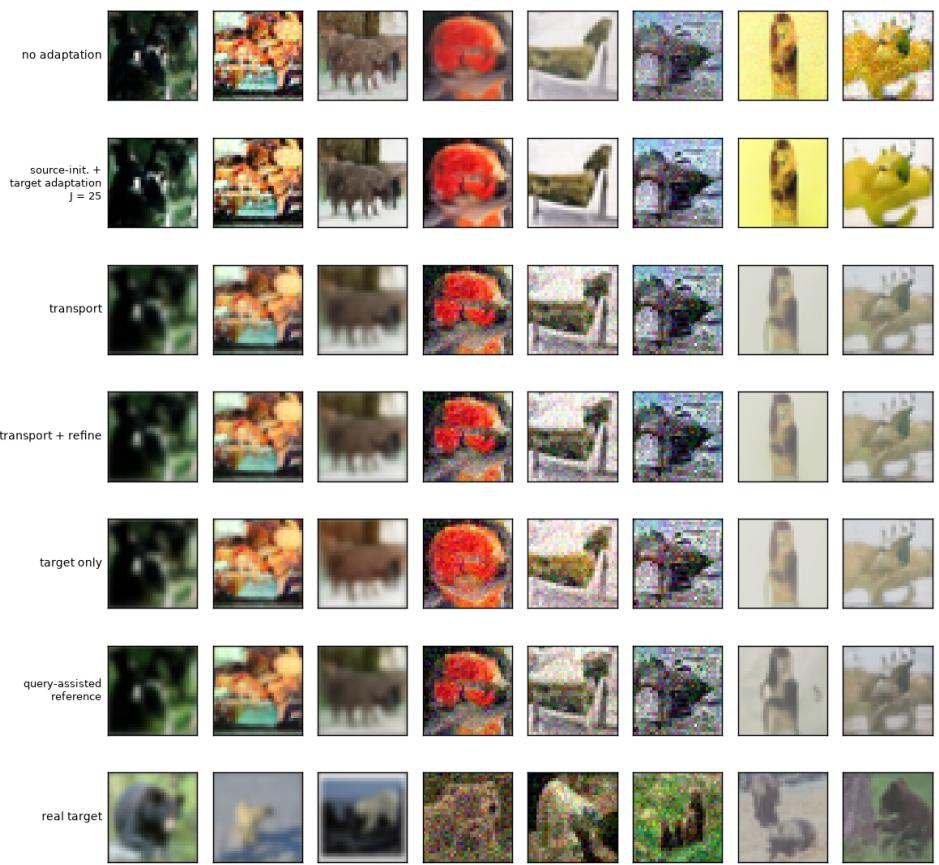  
Figure 10: CIFAR $K _ { T } = 1$ historical deployment grid from the 50k-step checkpoint. The seven rows show no adaptation, source-initialised target adaptation $\left( J = 2 5 \right)$ , correct source + transport $( J = 0 )$ transport plus refinement, target-only, a query-assisted target-coordinate reference, and real target. The source-initialised route uses target support and is not strict reuse. The query-assisted reference starts at the transported coordinate and optimises the coordinate on the same target-query set used as its reference, without a coordinate prior, for 25 steps; its frozen generator is unchanged. It is a privileged diagnostic, not a deployable baseline or a performance upper bound. Generated rows retain the original samples and paired noise; the bottom row is real target data.

Table 20: Matched refinement ablation on the correct source + transport checkpoint. $J = 0$ remains the main route; the ablation uses $J = 2 5$ , learning rate 0.01 and the same prior/noise budget. Entries report paired 95% class-cluster intervals; stars use unrounded gain intervals.
<table><tr><td> $K _ { T }$ </td><td>Refinement gain [95% CI]</td></tr><tr><td>1</td><td> $- 0 . 0 2 4 4 \left[ - 0 . 0 3 6 5 , - 0 . 0 1 2 0 \right] ^ { \ast }$ </td></tr><tr><td>2</td><td> $- 0 . 0 0 7 \mathrm { i } \left[ - 0 . 0 2 4 9 , 0 . 0 1 1 6 \right]$ </td></tr><tr><td>5</td><td> $- 0 . 0 2 6 7 [ \dot { - } 0 . 0 4 6 8 , - 0 . 0 0 6 \dot { 1 } ] ^ { \ast }$ </td></tr><tr><td>10</td><td> $0 . 0 1 4 4 \dot { [ - 0 . 0 1 6 9 , 0 . 0 4 5 9 ] }$ </td></tr><tr><td>20</td><td> $- 0 . 0 0 6 5 \left[ - 0 . 0 5 1 1 , 0 . 0 3 8 \right]$ </td></tr></table>

The gain intervals are negative at $K _ { T } = 1$ , 5: refinement worsens transformation-statistic distance in those comparisons. The other three intervals contain zero; this establishes neither equivalence nor universal absence of benefit. The separate source-initialised target-adaptation baseline starts from $z _ { S }$ and uses target evidence. Its behaviour cannot be inferred from the post-transport gains in this table, and it must not be called strict direct reuse.

## C.4 SOURCE BUDGET AND CONDITIONING GENERALITY

The measured source-budget changes between $M _ { S } = 1 6$ and 300 are small, but the paired SW intervals relative to 16 all contain zero. At $M _ { S } = 6 4$ , the difference i $ - 0 . 0 0 2 8 7 [ - 0 . 0 0 6 5 \bar { 5 } , 0 . 0 0 0 8 9 ]$ This does not establish equivalence or an exact plateau; no $M _ { S } < 1 6$ was tested. The model was trained with $M _ { S } = 6 4$ and evaluated at $K _ { T } = 1$ with nested source prefixes and matched query/noise. Proposition 1 concerns coordinate estimation error, not equivalence of generated SW at all source sizes.

In the independent 180-episode FiLM validation package, SW for correct source + transport is 0.1973, 0.1942, 0.1987 and fine-class consistency is 0.1306, 0.1278, 0.1311 at $\begin{array} { r l r } { \bar { \cal K } _ { T } } & { { } = } & { 1 , 5 , 2 0 . } \end{array}$ Mean-source SW is 0.2417, 0.2441, 0.2462, shuffled-source 0.2567, 0.2578, 0.2616, and relation-only 0.2366, 0.2373, 0.2414. All 9/9 SW and 9/9 semantic main-relative intervals favour the correct source. Paired consistency gains are $0 . 0 7 4 0 \left[ 0 . 0 4 1 0 , 0 . 1 1 6 1 \right] ^ { \ast } , 0 . 0 7 8 6 \left[ 0 . 0 4 3 1 , 0 . 1 2 5 7 \right] ^ { \ast } , 0 . 0 7 8 0 \left[ 0 . 0 4 4 1 , 0 . 1 2 1 7 \right] ^ { \ast }$ against mean source, $0 . 0 8 3 5 \ : \mathrm { \hat { [ 0 . 0 5 1 7 , 0 . 1 2 5 2 ] ^ { * } } } , \ : \ : 0 . 0 7 9 \ : \dot { 9 } \ : [ 0 . 0 4 3 6 , 0 . 1 2 \delta \dot { 6 } ] ^ { * } , \ : \ : \ : 0 . 0 8 \dot { 3 } 5 \ : [ 0 . 0 4 8 8 , 0 . 1 \dot { 2 } 9 2 ] ^ { \frac { - \alpha } { 4 } } , \ : \ : \ : \mathrm { \hat { [ 0 . 0 2 5 0 ] ^ { * } } } .$ against shuffled source, and 0.0757 [0.0451, 0.1141]∗, 0.0773 [0.0443, 0.1219]∗, 0.0773 [0.0470, 0.1149]∗ against relation-only. These source controls do not test the full FiLM target-only/full-FT crossover.

Table 21: Three independent matched CIFAR SW packages. Upper block: correct source + transport with two conditioning architectures. Lower blocks: transport-structure ablations, with direct $J = 0$ generation in both compared arms. Pairing is within block only; intervals resample validation classes at one training seed per arm.
<table><tr><td>Configuration / comparison</td><td> $K _ { T } = 1$ </td><td> $K _ { T } = 5$ </td><td> $K _ { T } = 2 0$ </td></tr><tr><td>Basis: correct source + transport</td><td>0.2067 [0.1793,0.2414]</td><td>0.2090 [0.1834, 0.2391]</td><td>0.2136 [0.1864, 0.2469]</td></tr><tr><td>FiLM: correct source + transport</td><td>0.1973 [0.1689, 0.2355]</td><td>0.1942 [0.1709, 0.2239]</td><td>0.1987 [0.1720, 0.2334] -0.0149</td></tr><tr><td>FiLM — basis</td><td>-0.0094 [-0.0238, 0.0046]</td><td>-0.0148 [-0.0298, 0.0003]</td><td>[-0.0300, 0.0003]</td></tr><tr><td>Basis residual MLP</td><td>0.2102 [0.1839, 0.2451]</td><td>0.2109 [0.1879, 0.2392]</td><td>0.2138 [0.1870, 0.2481]</td></tr><tr><td>Basis linear</td><td>0.2124 [0.1829, 0.2516]</td><td>0.2113 [0.1859, 0.2442]</td><td>0.2174 [0.1886, 0.2550]</td></tr><tr><td>Linear – MLP</td><td>0.0022 [-0.0031,0.0080]</td><td>0.0004 [-0.0056, 0.0068]</td><td>0.0036 [-0.0019,0.0097]</td></tr><tr><td>FiLM nonlinear</td><td>0.2066</td><td>0.2054 [0.1795, 0.2395]</td><td>0.2074 [0.1777, 0.2465]</td></tr><tr><td>FiLM linear</td><td>[0.1759, 0.2489] 0.1973 [0.1689, 0.2355]</td><td>0.1942 [0.1709, 0.2239]</td><td>0.1987 [0.1720, 0.2334]</td></tr><tr><td>Nonlinear – linear</td><td>0.0093* [0.0044, 0.0147]</td><td>0.0112* [0.0057, 0.0175]</td><td>0.0087* [0.0026, 0.0151]</td></tr></table>

In the retained FiLM transport-structure ablation, nonlinear-minus-linear MMD differences are $0 . 2 4 7 9 \left[ 0 . 0 5 8 5 , 0 . 5 4 1 2 \right] ^ { * } , 0 . 2 8 1 0 \left[ 0 . 0 9 7 6 , 0 . 5 5 4 9 \right] ^ { * } , 0 . 1 9 5 8 \left[ - 0 . 0 1 4 4 , 0 . 4 8 7 0 \right]$ , favouring linear transport at $K _ { T } = 1 ,$ 5 and unresolved at $K _ { T } = 2 0$ . They are paired effects, not raw MMD values. The matched conditioning SW comparison remains unresolved at all three budgets. The basis and FiLM conditioning counts remain 55,344 and 118,784 (46.6% ratio). Their evaluated score paths have 27,798,195 and 27,916,979 parameters, respectively; the shared transport module adds the same 352 registered parameters (304 active). No latency, FLOP or memory conclusion is inferred.

## C.5 META-TRAINING-TASK SCARCITY

Both task-scarcity arms use correct source + transport and $\begin{array} { r l r } { { \cal J } } & { { } = } & { 0 , } \end{array}$ with 50% (30/60 classes, all 12 superclasses) and 25% training subsets. At 50%, FiLM-minus-basis SW effects are $- 0 . 0 0 9 \overset { \cdot } { 8 } \left[ - 0 . 0 2 6 8 , 0 . 0 0 6 2 \right] , \ - 0 . 0 1 0 \overset { \cdot } { 2 } \left[ - 0 . 0 2 8 0 , 0 . 0 0 6 7 \right] , \ - 0 . 0 1 0 4 \left[ - 0 . 0 2 9 3 , 0 . 0 0 7 8 \right]$ all contain zero. MMD effects are −0.3484 [−0.7712, 0.0456], −0.5448 [−1.0850, −0.0527]∗, $- 0 . 5 4 6 8 \left[ - 1 . 1 6 3 0 , 0 . 0 1 6 9 \right]$ , favouring FiLM at $K _ { T } = 5 \ \mathrm { o n l y }$ . Superclass-consistency effects are 0.0363 [0.0050, 0.0675]∗, 0.0380 [0.0050, 0.0693]∗, 0.0335 [0.0030, 0.0635]∗, favouring FiLM at all three budgets. At 25%, SW effects are 0.0027 [−0.0079, 0.0144], 0.0007 [−0.0108, 0.0129], −0.0003 [−0.0118, 0.0113], all unresolved. These SW intervals establish neither an architecture ranking nor a ranking reversal. Each arm has one training seed; the class-cluster intervals do not cover training-seed uncertainty.

## C.6 COORDINATE RETRIEVAL AND DIRECT-TARGET DIAGNOSTICS

The frozen 50k EMA FiLM model with affine transport (checkpoint hash prefix $\pounds 7 \subset 1 3 6 9 \subset )$ was probed on 60 seen and 20 held-out fine classes. Retrieval uses 20 fixed support resamples, with 64 source and 64 target images per class in each resample; candidates are confined to the corresponding seen or held-out class group. This diagnostic support pool is distinct from the default 20-image target-support pool used for the headline budget comparison. Its bootstrap resamples the 20 support draws conditional on the same classes, so significance describes stability to support choice and does not establish population-level class significance. With 20 held-out candidates, correct-source transport achieves L2 retrieval of 62.5%, 59.5%, and 49.0% for blur, noise, and contrast, respectively; $\operatorname { r a w } z _ { S }$ achieves 17.25%, 26.5%, and 14.0%, and wrong-source transport achieves 1.25%, .75%, and 2.25%. Tables 22 and 23 give retrieval rates, margins and paired contrasts for the reported class groups and transformations.

Table 22: Complete CIFAR frozen-coordinate retrieval. Each cell is top-1 percentage / mean nearestwrong margin. Positive margins favour the requested class; relation-only chance/tie behaviour is not task discrimination.
<table><tr><td>Group</td><td>Relation Metric</td><td></td><td>Raw zs</td><td></td><td></td><td>Main Wrong-source + transport</td><td></td><td>Relation only</td></tr><tr><td>Seen</td><td>Blur</td><td>L2</td><td> $3 6 . 5 0 / - 0 . 0 1 0 5 0$ </td><td></td><td> $7 1 . 5 0 / + 0 . 0 2 2 4 1$ </td><td></td><td> $0 . 4 2 / - 0 . 2 4 3 2 4$ </td><td> $1 . 6 7 / - 0 . 1 3 5 9 2$ </td></tr><tr><td>Seen</td><td>Noise</td><td>Cosine</td><td> $2 6 . 5 8 / - 0 . 0 6 8 4 9$ </td><td></td><td> $7 2 . 5 8 / + 0 . 0 1 6 7 5$ </td><td> $0 . 4 2 \dot { / } - 0 . 2 4 2 2 8$ </td><td></td><td> $1 . 6 7 / - 0 . 1 0 3 3 0$ </td></tr><tr><td></td><td></td><td>L2 Cosine</td><td> $5 6 . 8 3 / + 0 . 0 0 5 4 8$   $3 0 . 5 0 \dot { / } - 0 . 0 4 8 4 3$ </td><td></td><td> $7 4 . 5 0 / + 0 . 0 2 8 7 2$ </td><td> $0 . 3 3 / - 0 . 2 6 4 9 3$ </td><td></td><td> $1 . 6 7 / - 0 . 1 3 9 5 6$ </td></tr><tr><td>Seen</td><td>Contrast</td><td></td><td> $3 6 . 0 0 \dot { / } - 0 . 0 1 4 4 7$ </td><td></td><td> $7 8 . 0 8 \dot { / } + 0 . 0 1 7 9 1$ </td><td></td><td> $0 . 2 5 \dot { / } - 0 . 2 4 5 6 5$ </td><td> $1 . 6 7 / - 0 . 0 9 9 0 6$ </td></tr><tr><td></td><td></td><td>L2 Cosine</td><td> $2 5 . 5 8 / - 0 . 0 7 1 7 8$ </td><td></td><td> $6 8 . 8 3 \mathrm { \dot { / } + 0 . 0 2 7 1 9 }$ </td><td></td><td> $0 . 5 0 \dot { / } - 0 . 2 6 6 5 7$ </td><td> $1 . 6 7 / - 0 . 1 2 7 8 1$ </td></tr><tr><td></td><td></td><td></td><td></td><td></td><td> $7 2 . 0 8 / + 0 . 0 2 0 4 8$ </td><td> $0 . 6 7 / - 0 . 2 8 8 3 7$ </td><td></td><td> $1 . 6 7 / - 0 . 1 1 2 4 9$ </td></tr><tr><td>Held-out Blur</td><td></td><td>L2</td><td> $1 7 . 2 5 / - 0 . 0 2 4 2 7$ </td><td></td><td> $6 2 . 5 0 / + 0 . 0 1 1 1 4$ </td><td> $1 . 2 5 / - 0 . 1 2 9 0 0$ </td><td></td><td> $5 . 0 0 / - 0 . 0 8 8 1 2$ </td></tr><tr><td></td><td></td><td>Cosine</td><td> $1 6 . 7 5 / - 0 . 1 3 2 3 1$ </td><td></td><td> $6 4 . 5 0 \dot { / } + 0 . 0 0 8 0 6$ </td><td> $1 . 2 5 \dot { / } - 0 . 1 1 5 1 7$ </td><td></td><td> $5 . 0 0 \dot { / } - 0 . 0 7 6 6 3$ </td></tr><tr><td>Held-out Noise</td><td></td><td>L2</td><td> $2 6 . 5 0 \dot { / } - 0 . 0 1 0 9 8$ </td><td></td><td> $5 9 . 5 0 \dot { / } + 0 . 0 0 9 8 5$ </td><td> $0 . 7 5 / - 0 . 1 1 4 7 6$ </td><td></td><td> $5 . 0 0 \dot { / } - 0 . 0 8 3 7 0$ </td></tr><tr><td></td><td></td><td>Cosine</td><td> $1 5 . 5 0 \dot { / } - 0 . 0 9 9 0 0$ </td><td></td><td> $6 0 . 0 0 \dot { / } + 0 . 0 0 6 9 3$ </td><td> $0 . 0 0 \dot { / } - 0 . 0 9 3 9 2$ </td><td></td><td> $5 . 0 0 \dot { / } - 0 . 0 6 3 7 2$ </td></tr><tr><td>Held-out Contrast</td><td></td><td>L2</td><td> $1 4 . 0 0 / - 0 . 0 4 4 3 1$ </td><td></td><td> $4 9 . 0 0 \dot { / } - 0 . 0 0 4 2 3$ </td><td> $2 . 2 5 / - 0 . 0 9 9 7 5$ </td><td></td><td> $5 . 0 0 \dot { / } - 0 . 0 7 5 8 4$ </td></tr><tr><td></td><td></td><td>Cosine</td><td> $1 0 . 2 5 / - 0 . 1 6 0 9 7$ </td><td></td><td> $4 8 . 2 5 / - 0 . 0 0 3 1 3$ </td><td> $2 . 0 0 \dot { / } - 0 . 0 9 9 2 1$ </td><td></td><td> $5 . 0 0 \dot { / } - 0 . 0 7 5 9 5$ </td></tr></table>

Table 23: CIFAR L2 retrieval gains in percentage points, main minus comparator. Intervals bootstrap the 20 paired support resamples conditional on the fixed class set; positive favours correct-source transport.
<table><tr><td>Group</td><td>Relation</td><td></td><td></td><td>Main − raw source (pp) [95% CI] Main — wrong source (pp) [95% CI]</td><td></td></tr><tr><td>Seen</td><td>Blur</td><td>+35.00</td><td> $[ + 3 2 . 2 5 , + 3 7 . 6 7 ] ^ { \ast }$ </td><td></td><td>+71.08 [+69.08, +73.08]*</td></tr><tr><td>Seen</td><td>Noise</td><td>+17.67</td><td> $\bar { [ + 1 5 . 3 3 , + 2 0 . 0 0 ] ^ { * } }$ </td><td></td><td> $+ 7 4 . 1 7 \bar { [ + 7 2 . 2 5 , + 7 5 . 9 2 \bar { ] } } ^ { \ast }$ </td></tr><tr><td>Seen</td><td>Contrast</td><td>+32.83</td><td> $\bar { [ + 3 0 . 6 7 , + 3 5 . 0 8 ] ^ { \ast } }$ </td><td></td><td> $+ 6 8 . 3 3 \bar { [ + 6 6 . 5 8 , + 7 0 . 0 8 ] } ^ { \ast }$ </td></tr><tr><td>Held-out</td><td>Blur</td><td>+45.25</td><td> $\dot { + } 4 2 . 2 5 , + 4 8 . 2 5 \dot { ] } ^ { \ast }$ </td><td></td><td> $+ 6 1 . 2 5 \ : [ + 5 8 . 2 5 , + 6 4 . 0 0 ] ^ { \ast }$ </td></tr><tr><td>Held-out</td><td>Noise</td><td>+33.00 [</td><td> $+ 2 7 . 2 5 , + 3 8 . 2 5 \bar { ] } ^ { \ast }$ </td><td></td><td> $+ 5 8 . 7 5 \left[ + 5 4 . 5 0 , + 6 3 . 2 5 \right] ^ { * }$ </td></tr><tr><td>Held-out</td><td>Contrast</td><td>+35.00</td><td> $+ 3 0 . 2 5 , + 3 9 . 5 0 \bar { ] } ^ { \ast }$ </td><td>+46.75[</td><td> $+ 4 3 . 0 0 , + 5 0 . 5 0 \bar { ] } ^ { \ast }$ </td></tr></table>

Direct-target generation and timestep probes. For direct-z generation, a separate post-hoc repartition supplies 200 target-support images and 50 disjoint real target queries per class; it does not reuse the headline 20/230 target-support/query partition. Each class has 96 generated samples using 50-step DDIM. The frozen DINO nearest-prototype evaluator ranks all 80 seen-plus-held-out classes and is calibrated on the diagnostic real queries. These identity percentages are not directly comparable with headline semantic consistency because both the partition and the identity instrument differ. Generation and timestep intervals resample classes, not the fixed support draws used for retrieval. Tables 24 and 25 report the raw metrics and the descriptive held-out-minus-seen identity contrasts.

Table 24: CIFAR direct-target generation using abundant target support. Identity rates are percentages; SW and MMD use the diagnostic DINO feature space, not the headline pixel-space metrics.
<table><tr><td>Group</td><td>Relation</td><td>Generated identity (%)</td><td>Real identity (%)</td><td>DINO-SW↓</td><td>DINO-MMD ↓</td></tr><tr><td>Seen</td><td>Blur</td><td>5.52</td><td>50.80</td><td>0.02176</td><td>0.15937</td></tr><tr><td>Seen</td><td>Noise</td><td>3.78</td><td>29.27</td><td>0.01671</td><td>0.09777</td></tr><tr><td>Seen</td><td>Contrast</td><td>6.84</td><td>78.10</td><td>0.02983</td><td>0.27962</td></tr><tr><td>Held-out</td><td>Blur</td><td>3.59</td><td>51.20</td><td>0.02338</td><td>0.18884</td></tr><tr><td>Held-out</td><td>Noise</td><td>3.85</td><td>34.50</td><td>0.01888</td><td>0.13402</td></tr><tr><td>Held-out</td><td>Contrast</td><td>2.71</td><td>70.90</td><td>0.03059</td><td>0.28967</td></tr></table>

Table 25: CIFAR direct-target generated-identity differences, held-out minus seen, in percentage points. The two different class groups are independently resampled; these are descriptive group contrasts, not paired causal effects.
<table><tr><td></td><td>Relation Identity ∆ (pp) [95% CI]</td></tr><tr><td>Blur</td><td> $- 1 . 9 3 \left[ - 6 . 7 0 , + 4 . 1 1 \right]$ </td></tr><tr><td>Noise</td><td> $+ 0 . 0 7 \left[ - 4 . 3 4 , + 6 . 1 8 \right]$ </td></tr><tr><td>Contrast</td><td> $- 4 . 1 3 \left[ - 7 . 9 9 , + 0 . 1 4 \right]$ </td></tr></table>

The timestep probe pairs correct and cyclic wrong-class target coordinates at identical real query, noise and timestep. The five bins contain 200 diffusion steps each, with 800–999 the highest-noise bin. In Table 26, positive $\Delta _ { z } = \mathcal { L } _ { \epsilon } ( z _ { \mathrm { w r o n g } } ) - \mathcal { L } _ { \epsilon } ( z _ { \mathrm { c o r r e c t } } )$ favours the correct target coordinate; this does not specifically test transport. MSE values are unscaled. Stars follow the source report’s unrounded class-bootstrap limits, including limits displayed as zero after rounding.

Table 26: CIFAR coordinate use across diffusion time: absolute denoising MSE and wrong-minuscorrect differences with class-bootstrap 95% intervals.
<table><tr><td>Group</td><td>Relation</td><td>Timesteps</td><td>Correct MSE</td><td>Wrong MSE</td><td>∆z [95% CI]</td><td></td></tr><tr><td>Seen</td><td>Blur</td><td>0-199</td><td>0.069118</td><td>0.069843</td><td></td><td>+0.00073 [+0.00058, +0.00089]</td></tr><tr><td></td><td></td><td>200-399</td><td>0.025385</td><td>0.026199</td><td></td><td>+0.00081 [+0.00065, +0.00099]</td></tr><tr><td></td><td></td><td>400-599</td><td>0.014950</td><td>0.015695</td><td></td><td>+0.00074[+0.00061, +0.00089]</td></tr><tr><td></td><td></td><td>600-799</td><td>0.008320</td><td>0.008864</td><td></td><td>+0.00054 [+0.00045, +0.00065] *</td></tr><tr><td></td><td></td><td>800-999</td><td>0.002333</td><td>0.002566</td><td></td><td>+0.00023 [+0.00019, +0.00028]</td></tr><tr><td>Seen</td><td>Noise</td><td>0-199</td><td>0.575592</td><td>0.576098</td><td></td><td>+0.00051 [+0.00040, +0.00062]</td></tr><tr><td></td><td></td><td>200-399</td><td>0.149464</td><td>0.150564</td><td></td><td>+0.00110[+0.00087, +0.00135]</td></tr><tr><td></td><td></td><td>400-599</td><td>0.055730</td><td>0.056779</td><td></td><td>+0.00105 [+0.00083, +0.00129]</td></tr><tr><td></td><td></td><td>600-799</td><td>0.020958</td><td>0.021725</td><td></td><td>+0.00077[+0.00063, +0.00092]</td></tr><tr><td></td><td></td><td>800-999</td><td>0.004284</td><td>0.004563</td><td></td><td>+0.00028 [+0.00023, +0.00033]</td></tr><tr><td>Seen</td><td>Contrast</td><td>0-199</td><td>0.097140</td><td>0.098230</td><td></td><td>+0.00109 [+0.00084, +0.00137]</td></tr><tr><td></td><td></td><td>200-399</td><td>0.025000</td><td>0.026042</td><td></td><td>+0.00104 [+0.00082, +0.00130]</td></tr><tr><td></td><td></td><td>400-599</td><td>0.011904</td><td>0.012583</td><td></td><td>+0.00068 [+0.00055, +0.00083]</td></tr><tr><td></td><td></td><td>600-799</td><td>0.005251</td><td>0.005642</td><td></td><td>+0.00039 [+0.00032, +0.00047]</td></tr><tr><td></td><td></td><td>800-999</td><td>0.001187</td><td>0.001322</td><td></td><td>+0.00014 [+0.00011, +0.00016]</td></tr><tr><td>Held-out</td><td>Blur</td><td>0-199</td><td>0.079225</td><td>0.079248</td><td></td><td>+0.00002[-0.00008, +0.00012]</td></tr><tr><td></td><td></td><td>200-399</td><td>0.030886</td><td>0.030951</td><td>+0.00006 [</td><td>[+0.00000,+0.00013]</td></tr><tr><td></td><td></td><td>400-599</td><td>0.018033</td><td>0.018145</td><td></td><td>+0.00011[+0.00005, +0.00018</td></tr><tr><td></td><td></td><td>600-799</td><td>0.009747</td><td>0.009893</td><td>+0.00015</td><td>[+0.00005, +0.00026</td></tr><tr><td></td><td></td><td>800-999</td><td>0.002668</td><td>0.002732</td><td></td><td>+0.00006[+0.00002, +0.00012]</td></tr><tr><td>Held-out</td><td>Noise</td><td>0-199</td><td>0.584385</td><td>0.584397</td><td>+0.00001</td><td>[-0.00004,+0.00006]</td></tr><tr><td></td><td></td><td>200-399</td><td>0.157766</td><td>0.157801</td><td></td><td>+0.00004[-0.00005, +0.00013]</td></tr><tr><td></td><td></td><td>400-599</td><td>0.060890</td><td>0.060990</td><td></td><td>+0.00010 [+0.00005, +0.00016]</td></tr><tr><td></td><td></td><td>600-799</td><td>0.023057</td><td>0.023172</td><td>+0.00012</td><td>[+0.00004, +0.00021]</td></tr><tr><td></td><td></td><td>800-999</td><td>0.004634</td><td>0.004695</td><td></td><td>+0.00006 [+0.00002, +0.00011]</td></tr><tr><td>Held-out</td><td>Contrast</td><td>0-199</td><td>0.111840</td><td>0.111861</td><td>+0.00002</td><td>[-0.00011,+0.00016]</td></tr><tr><td></td><td></td><td>200-399</td><td>0.030179</td><td>0.030231</td><td>+0.00005</td><td>[-0.00006, +0.00015]</td></tr><tr><td></td><td></td><td>400-599</td><td>0.013888</td><td>0.013959</td><td></td><td>+0.00007[-0.00000, +0.00015]</td></tr><tr><td></td><td></td><td>600-799</td><td>0.005905</td><td>0.005997</td><td></td><td>+0.00009 [+0.00003, +0.00017]</td></tr><tr><td></td><td></td><td>800-999</td><td>0.001368</td><td>0.001395</td><td></td><td>+0.00003 [+0.00001, +0.00005]</td></tr><tr><td></td><td></td><td></td><td></td><td></td><td></td><td></td></tr></table>

Bypassing transport does not guarantee semantic generation. Direct target coordinates estimated from 200 target images give held-out generated identity of 3.59% (blur), 3.85% (noise), and 2.71% (contrast), compared with real-query identity of 51.2%, 34.5%, and 70.9%. Diffusion-time probes nevertheless show that correct target coordinates lower denoising MSE in most held-out timestep bins, including all three highest-noise bins. The evidence therefore supports coordinate use without implying that coordinate use alone guarantees class-correct generation.

## D OFFICE-HOME: FULL NATURAL-DOMAIN STRESS TEST

## D.1 PROTOCOL AND EVALUATOR AUDIT

The corrective Office-Home experiment uses the Product→Clipart relation, 45/10/10 train/validation/test semantic classes, $6 4 \times 6 4$ images, FiLM conditioning, linear transport and the effective-batch-64 training run. Ten held-out classes are the independent inference units; eight generation repeats and wrong-source assignments are averaged within class before the 10,000-draw class bootstrap.

Table 27: Office-Home real-image evaluator audit.
<table><tr><td>Check</td><td>Result</td></tr><tr><td>CLIP top-1, Product / Clipart</td><td>89.03% / 65.96%</td></tr><tr><td>Test classes with Clipart top-1 ≥ 30%</td><td>10/10</td></tr><tr><td>DINOv2 held-out domain accuracy</td><td>98.30%</td></tr><tr><td>Same-class centroid top-1 / median rank</td><td>100.0% / 1</td></tr><tr><td>Same-minus-different centroid cosine gap</td><td>.5077</td></tr></table>

## D.2 VALIDATION-ONLY CHECKPOINT AND ADAPTATION SELECTION

All Office-Home model and adapting-baseline choices were fixed on the ten validation classes before the outer test. Validation DINO-SW decreased monotonically across the saved checkpoint sequence, and the 50,000-step checkpoint was selected for the final route comparisons.

Table 28: Office-Home validation-only selection record. The upper block reports the main-route checkpoint trajectory. The lower block reports the budget-specific target-only and full-fine-tuning settings subsequently frozen for final testing. These validation values are not pooled with test results.

<table><tr><td>Checkpoint step</td><td>Main  $K _ { T } = 0 \mathrm { D I N O - S W }$ </td></tr><tr><td>20,000</td><td>.040525</td></tr><tr><td>25,000</td><td>.039609</td></tr><tr><td>30,000</td><td>.038712</td></tr><tr><td>35,000</td><td>.038019</td></tr><tr><td>40,000</td><td>.037572</td></tr><tr><td>45,000</td><td>.037351</td></tr><tr><td>50,000</td><td>.037283</td></tr></table>

<table><tr><td> $K _ { T }$ </td><td>Target steps</td><td>Target lr</td><td>Target val SW</td><td>Full-FT steps</td><td>Full-FT lr</td><td>Full-FT val SW</td></tr><tr><td>1</td><td>5</td><td>.030</td><td>.037660</td><td>100</td><td> $3 \times 1 0 ^ { - 5 }$ </td><td>.036521</td></tr><tr><td>5</td><td>5</td><td>.010</td><td>.038021</td><td>400</td><td> $3 \times 1 0 ^ { - 5 }$ </td><td>.034206</td></tr><tr><td>10</td><td>5</td><td>.030</td><td>.037397</td><td>400</td><td> $3 \times 1 0 ^ { - 5 }$ </td><td>.032314</td></tr></table>

A separate validation-only zero-target code-path check gave DINO-SW .037239 for correct-source transport, .038168 for wrong-source transport, .037950 for relation-only prediction and .040021 for source reuse. These values are selection/audit evidence only; all Office-Home headline superiority claims use the held-out test route matrices below.

## D.3 ZERO-TARGET AND TARGET-BUDGET RESULTS

Table 29: Office-Home $K _ { T } = 0$ route matrix. Distance metrics are lower-is-better; requested-class and Clipart fractions are higher-is-better.

<table><tr><td>Route</td><td>DINO-SW</td><td>MMD</td><td>Object ID (%)</td><td>Clipart (%)</td></tr><tr><td>Correct + transport</td><td>.038969</td><td>.407846</td><td>1.67</td><td>86.50</td></tr><tr><td>Wrong + transport</td><td>.039394</td><td>.419016</td><td>1.44</td><td>86.27</td></tr><tr><td>Relation-only</td><td>.039251</td><td>.415280</td><td>1.37</td><td>86.71</td></tr><tr><td>Source reuse</td><td>.041641</td><td>.457524</td><td>1.18</td><td>63.80</td></tr></table>

The paired SW gain over wrong-source transport is .000425 [.000213, .000643]; over relation-only it is .000282 [.000109, .000456]; over source reuse it is .002673 [.002270, .003036]. Requested-class differences from wrong and relation-only are unresolved. Thus the zero-target claim is distributional/domain alignment rather than reliable semantic transfer.

At $K _ { T } ~ = ~ 1$ , transport improves DINO-SW over target-only with paired difference .001377 [.000568, .002311]; its SW comparison with full fine-tuning is unresolved, although its MMD is better. At $K _ { T } = 5$ and 10, full fine-tuning is significantly better in SW, MMD and requested-object accuracy.

Table 30: Office-Home target-budget route means. The same zero-target correct-source generations are reused across budgets; adapting baselines receive the stated target support. SW and MMD are lower-is-better; identity and Clipart rates are percentages.
<table><tr><td>KT</td><td>Route</td><td>DINO-SW</td><td>MMD</td><td>Object ID (%)</td><td>Clipart (%)</td></tr><tr><td>1</td><td>Correct + transport</td><td>0.038969</td><td>0.407846</td><td>1.67</td><td>86.50</td></tr><tr><td>1</td><td>Target-only</td><td>0.040346</td><td>0.439860</td><td>2.23</td><td>75.73</td></tr><tr><td>1</td><td>Fuli FT</td><td>0.039336</td><td>0.468223</td><td>5.33</td><td>87.49</td></tr><tr><td>5</td><td>Correct + transport</td><td>0.038969</td><td>0.407846</td><td>1.67</td><td>86.50</td></tr><tr><td>5</td><td>Target-only</td><td>0.039031</td><td>0.409734</td><td>1.81</td><td>81.22</td></tr><tr><td>5</td><td>Fuli FT</td><td>0.034550</td><td>0.349838</td><td>12.55</td><td>83.11</td></tr><tr><td>10</td><td>Correct + transport</td><td>0.038969</td><td>0.407846</td><td>1.67</td><td>86.50</td></tr><tr><td>10</td><td>Target-only</td><td>0.039001</td><td>0.406858</td><td>1.61</td><td>82.79</td></tr><tr><td>10</td><td>Fuli FT</td><td>0.033859</td><td>0.321982</td><td>12.01</td><td>83.82</td></tr></table>

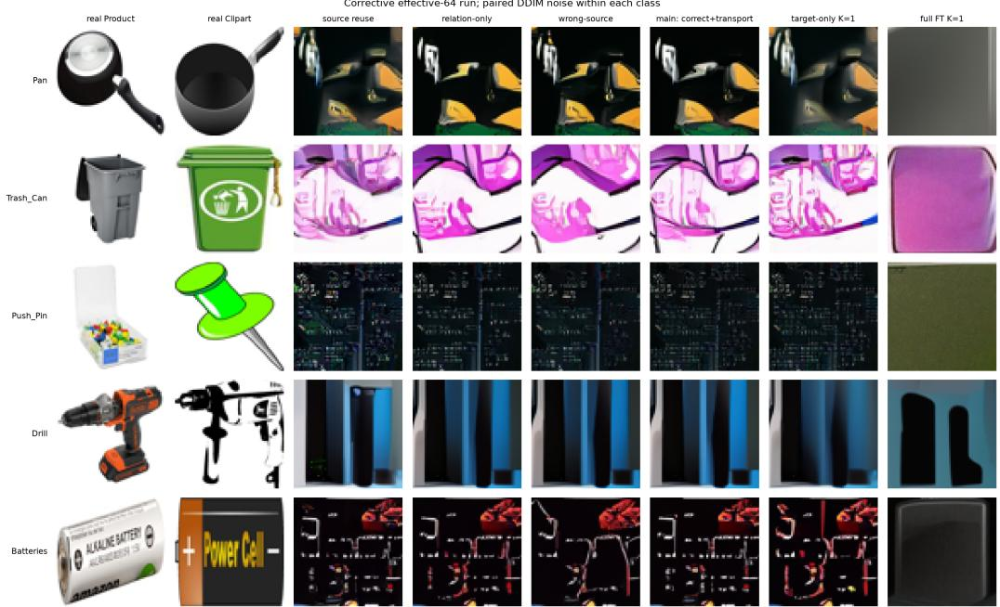  
Figure 11: Office-Home generation grid. Rows are held-out classes. Columns contain real Product, real Clipart, source reuse, relation-only, wrong-source transport, correct-source transport, one-shot target-only and one-shot full fine-tuning. Generated routes share DDIM noise within class.

Complete main-relative uncertainty. For distance metrics, $\Delta$ is comparator minus main; for requested identity and Clipart share it is main minus comparator. Thus positive values always favour correct-source transport in Tables 31 and 32. Eight generation repeats and wrong-source assignments are averaged within each of the ten held-out classes before a paired 10,000-draw class bootstrap. Identity/domain differences are percentage points. Stars mark unrounded 95% intervals excluding zero in either direction; the tests are exploratory and unadjusted for multiplicity.

Table 31: Office-Home paired distributional gains with 95% class-bootstrap intervals. Positive favours correct-source transport; negative favours the comparator.
<table><tr><td>KT</td><td>Comparator</td><td>∆ DINO-SW [95% CI]</td><td>∆ MMD [95% CI]</td></tr><tr><td>0</td><td>Wrong + transport</td><td>0.000425* [0.000213, 0.000643]</td><td>0.011170* [0.006870, 0.015706]</td></tr><tr><td>0</td><td>Relation-only</td><td>0.000282* [0.000109, 0.000456]</td><td>0.007434* [0.002360, 0.012075]</td></tr><tr><td>0</td><td>Source reuse</td><td>0.002673* [0.002270, 0.003036]</td><td>0.049678* [0.039741, 0.060430]</td></tr><tr><td>1</td><td>Target-only</td><td>0.001377* [0.000568, 0.002311]</td><td>0.032014* [0.015413, 0.047276]</td></tr><tr><td>1</td><td>Fuli FT</td><td>0.000367 [-0.001578, 0.002312]</td><td>0.060376* [0.019137,0.101637]</td></tr><tr><td>5</td><td>Target-only</td><td>0.000062 [-0.000754, 0.000800]</td><td>0.001888 [-0.019453, 0.018779]</td></tr><tr><td>5</td><td>Fuli FT</td><td>-0.004419*[-0.006279, -0.002922]</td><td>-0.058008*[-0.097989, -0.024569]</td></tr><tr><td>10</td><td>Target-only</td><td>0.000032 [-0.000685, 0.000719]</td><td>-0.000988 [-0.021510, 0.016291]</td></tr><tr><td>10</td><td>Full FT</td><td>-0.005110*[-0.006639, -0.003887]</td><td>-0.085864* [-0.124581, -0.053092]</td></tr></table>

Table 32: Office-Home paired identity and domain-share gains with 95% class-bootstrap intervals, in percentage points. Positive favours correct-source transport.
<table><tr><td> $K _ { T }$ </td><td>Comparator</td><td>∆ object ID [95% CI]</td><td>∆ Clipart [95% CI]</td></tr><tr><td>0</td><td>Wrong + transport</td><td>0.230 [-0.043, 0.543]</td><td>0.226 [-0.438, 0.955]</td></tr><tr><td>0</td><td>Relation-only</td><td>0.299 [-0.078, 0.885]</td><td>-0.208 [-0.885, 0.443]</td></tr><tr><td>0</td><td>Source reuse</td><td>0.482 [-0.221, 1.406]</td><td>22.695* [20.820, 24.661]</td></tr><tr><td>1</td><td>Target-only</td><td>-0.560 [-2.031, 0.404]</td><td>10.768* [2.760, 19.062]</td></tr><tr><td>1</td><td>Fuli FT</td><td>-3.659 [-8.737, 0.195]</td><td>-0.990 [-4.844, 2.734]</td></tr><tr><td>5</td><td>Target-only</td><td>-0.143 [-0.703, 0.286]</td><td>5.273* [1.667,9.532]</td></tr><tr><td>5</td><td>Full FT</td><td>-10.885* [-20.261, -3.984]</td><td>3.385 [-1.289, 8.581]</td></tr><tr><td>10</td><td>Target-only</td><td>0.052 [-0.638, 0.573]</td><td>3.711* [0.482, 7.161]</td></tr><tr><td>10</td><td>Full FT</td><td>-10.339* [-18.229, -3.802]</td><td>2.682 [-1.289, 8.815]</td></tr></table>

## D.4 SEMANTIC LIMITATIONS AFTER BYPASSING TRANSPORT

Three frozen-checkpoint probes and a separately trained class-conditioning capacity control probe where object identity is lost.

Table 33: Office-Home target-coordinate retrieval on ten held-out classes.
<table><tr><td>Query route</td><td>L2 top-1</td><td>Cosine top-1</td><td>L2 margin</td><td>Cosine margin</td></tr><tr><td>Raw zs</td><td>12.0%</td><td>26.5%</td><td>-.0500</td><td>-.1749</td></tr><tr><td>Correct source + transport</td><td>42.0%</td><td>44.5%</td><td>-.0153</td><td>-.0620</td></tr><tr><td>Wrong-source transport</td><td>20.0%</td><td>19.0%</td><td>-.0897</td><td>-.2654</td></tr><tr><td>Relation-only</td><td>10.0%</td><td>10.0%</td><td>-.0545</td><td>-.1510</td></tr></table>

The cross-domain retrieval probe uses 20 fixed support resamples over the ten held-out classes, with 16 Product images and at most 32 disjoint Clipart support images per class. Retrieval is among ten target-class coordinates. L2 margins compare the correct target distance with the nearest wrong target; cosine margins compare corresponding similarities, with positive margins favourable in both cases. Table 34 averages support resamples within class and reports paired class-bootstrap contrasts. This target-coordinate task is distinct from the within-Product retrieval summary in the main text.

Table 34: Office-Home target-coordinate retrieval gains, main minus comparator, in percentage points with paired class-bootstrap 95% intervals.
<table><tr><td>Comparator</td><td>L2 ∆ [95% CI]</td><td>Cosine ∆ [95% CI]</td></tr><tr><td>Raw zS</td><td>+30.00  $[ + 4 . 0 0 , + 5 8 . 5 0 ] ^ { \ast }$ </td><td> $+ 1 8 . 0 0 \left[ - 2 . 5 0 , + 4 3 . 5 0 \right]$ </td></tr><tr><td>Wrong-source transport +22.00 [−11.50, +56.00] +25.50 [−10.00, +60.00]</td><td></td><td></td></tr><tr><td>Relation only +32.00</td><td> $[ + 5 . 5 0 , + 5 9 . 5 0 ] ^ { \ast }$ </td><td> $+ 3 4 . 5 0 \left[ + 7 . 0 0 , + 6 1 . 5 0 \right] ^ { * }$ </td></tr></table>

Correct transport significantly improves L2 retrieval over raw z and both L2/cosine retrieval over relation-only, but the correct-versus-wrong transport class intervals include zero. This is partial coordinate alignment rather than a resolved source-specific retrieval result.

For direct-target generation, all available Clipart images outside 20 fixed real queries per class form the target support. The frozen EMA checkpoint (hash prefix $4 4 { \tt e } 2 7 1 0 { \tt a } )$ generates 96 images per class using 50-step DDIM. Seen classes were used in original Meta-Diff training, and their query images were not necessarily excluded from that training. This is a target-coordinate diagnostic, not the zero-target main route. The seen and held-out groups contain different classes, so their identity contrast independently resamples the two groups rather than pairing them.

Bypassing transport does not restore object identity; target-coordinate representation and/or generator use remain possible limitations, and these results do not isolate the decoder alone. The held-outminus-seen generated-identity contrast is −.82 percentage points with 95% interval [−2.45, .76].

The diffusion-time probe replaces the correct target coordinate with a cyclic wrong-class coordinate while holding query image, noise and timestep fixed. On seen classes, wrong-minus-correct MSE is positive in all five timestep bins; on held-out classes it is positive with intervals excluding zero in three of five bins. The highest-noise differences are only $5 . 5 \times 1 0 ^ { - 5 }$ (seen) and $1 . 7 \times 1 0 ^ { - 5 }$ (held-out), showing weak but nonzero coordinate use.

Finally, an explicit 16-D learned class embedding provides a separately trained capacity control with the same FiLM interface. On seen Clipart classes, generated identity rises from 2.38% with direct learned $z _ { T }$ to 6.90%, a paired gain of 4.51 percentage points [2.85, 6.37]; DINO-SW and MMD also improve. Because 6.90% remains far below the 50.33% real-image calibration, the control demonstrates partial semantic conditioning capacity rather than a complete solution.

Table 35: Office-Home direct-z generation using abundant non-query Clipart support.
<table><tr><td>Group</td><td>Generated ID</td><td>Real ID</td><td>DINO-SW</td><td>DINO-MMD</td><td>Clipart</td></tr><tr><td>Seen (45 classes)</td><td>2.38%</td><td>50.33%</td><td>.03679</td><td>.35175</td><td>87.34%</td></tr><tr><td>Held-out (10 classes)</td><td>1.56%</td><td>52.00%</td><td>.03902</td><td>.40642</td><td>88.33%</td></tr></table>

Table 36: Office-Home direct-target coordinate use across diffusion time. MSEs use identical query/noise/timestep pairs; positive wrong-minus-correct differences favour the correct coordinate. Intervals resample classes.
<table><tr><td>Group</td><td>Timesteps</td><td>Correct MSE</td><td>Wrong MSE</td><td> $\Delta _ { z }$  [95% CI]</td><td></td></tr><tr><td>Seen</td><td>0-199</td><td>0.056513</td><td>0.056724</td><td></td><td>+0.000211[+0.000141, +0.000294]</td></tr><tr><td></td><td>200-399</td><td>0.019655</td><td>0.019785</td><td></td><td>+0.000131 [+0.000086, +0.000183]</td></tr><tr><td></td><td>400-599</td><td>0.013028</td><td>0.013164</td><td>+0.000136</td><td> $\left[ + 0 . 0 0 0 0 8 9 , + 0 . 0 0 0 1 8 9 \right] ^ { * }$ </td></tr><tr><td></td><td>600-799</td><td>0.008825</td><td>0.008963</td><td></td><td>+0.000138[+0.000095, +0.000187]*</td></tr><tr><td></td><td>800-999</td><td>0.003287</td><td>0.003342</td><td>+0.000055</td><td> $\left[ + 0 . 0 0 0 0 3 9 , + 0 . 0 0 0 0 7 2 \right] ^ { * }$ </td></tr><tr><td>Held-out</td><td>0-199</td><td>0.059910</td><td>0.059928</td><td></td><td> $+ 0 . 0 0 0 0 1 8 \left[ - 0 . 0 0 0 0 4 4 , + 0 . 0 0 0 0 7 3 \right]$ </td></tr><tr><td></td><td>200-399</td><td>0.022160</td><td>0.022180</td><td></td><td> $ + 0 . 0 0 0 0 2 0 [ - 0 . 0 0 0 0 7 0 , + 0 . 0 0 0 0 9 8 ]$ </td></tr><tr><td></td><td>400-599</td><td>0.014911</td><td>0.014948</td><td></td><td> $+ 0 . 0 0 0 0 3 7 \bar { [ + 0 . 0 0 0 0 0 6 , + 0 . 0 0 0 0 6 8 ] } ^ { \ast }$ </td></tr><tr><td></td><td>600-799</td><td>0.009441</td><td>0.009505</td><td></td><td> $+ 0 . 0 0 0 0 6 3 \bar { [ + 0 . 0 0 0 0 0 6 , + 0 . 0 0 0 1 4 4 \bar { ] } } ^ { * }$ </td></tr><tr><td></td><td>800-999</td><td>0.003140</td><td>0.003157</td><td></td><td> $+ 0 . 0 0 0 0 1 7 \ : [ + 2 . 1 5 \times 1 0 ^ { - 7 } , + 0 . 0 0 0 0 3 4 ] ^ { \ast }$ </td></tr></table>

The capacity control is newly initialised, has 45 learned 16-D training-class embeddings, and uses neither the set encoder nor transport. It completes 50,000 updates with 64 independently noised observations per update; evaluation uses the same 20 fixed real queries and 96 generated images per class with DDIM-50. Those query IDs are explicitly withheld from this new control, whereas they may have appeared during training of the original direct- ${ \cdot } z _ { T }$ model. This exposure difference limits causal attribution of the gain to the conditioning representation alone. Tables 37 and 38 report the raw metrics and contrasts; positive effects in the latter favour the explicit class control, not Meta-Diff’s main route.

Table 37: Office-Home separately trained class-conditioning capacity control on 45 seen classes. Identity and Clipart columns are percentages.
<table><tr><td>Seen-class route</td><td>Generated identity (%)</td><td>Real identity (%)</td><td>DINO-SW ↓</td><td>DINO-MMD ↓</td><td>Clipart (%)</td></tr><tr><td>Original direct zT</td><td>2.38</td><td>50.33</td><td>0.03679</td><td>0.35175</td><td>87.34</td></tr><tr><td>Explicit class embedding</td><td>6.90</td><td>50.33</td><td>0.03507</td><td>0.32768</td><td>87.45</td></tr></table>

Table 38: Office-Home capacity-control effects with 95% intervals paired over 45 classes. Identity/domain gains are control minus direct-z ; SW/MMD reductions are direct-z minus control.
<table><tr><td>Metric</td><td>Favor-control ∆ [95% CI]</td></tr><tr><td>Requested-class identity</td><td>+4.51 pp [+2.85, +6.37]*</td></tr><tr><td>DINO-SW reduction</td><td> $\mathbf { + 0 . 0 0 1 7 2 [ + 0 . 0 \dot { 0 } \dot { 1 } 2 1 , + 0 . 0 0 2 2 9 ] ^ { * } }$ </td></tr><tr><td>DINO-MMD reduction</td><td>+0.02407[+0.01332, +0.03671]*</td></tr><tr><td>Clipart-share increase</td><td> $+ \mathbf { \dot { 0 } } . 1 2 \mathbf { p p } \left[ - 1 . 3 0 , + 1 . 5 3 \right]$ </td></tr></table>

## E CLINICAL AND EXTERNAL-DOMAIN STRESS TESTS

These studies are retained for transparency and boundary analysis. They are not used as positive evidence for clinical or demographic source-specific transfer.

## E.1 CHESTX-RAY14 AGE-GROUP TRANSFER

Tasks are single-positive thoracic findings, source ages are 45–60, and target ages are 0–30, 30–45 and 60–75. The fixed 4/2/3 finding split uses whole-patient allocation. Evaluation covers three held-out findings, three age relations and four resamples, with $M _ { S } = 6 4$

Table 39: ChestX-ray14 SW route means. Lower is better. The independently reported wrong-minuscorrect paired interval at $K _ { T } = 1 { \mathrm { i s } } 7 . 7 \times 1 0 ^ { - 6 } \pm 2 . 3 \times 1 0 ^ { - 5 }$ ; other displayed route differences lack paired covariance information.
<table><tr><td>Method</td><td> $K _ { T } = 1$ </td><td>2</td><td>5</td><td>10</td><td>20</td></tr><tr><td>No adaptation</td><td>.3696</td><td>.3696</td><td>.3696</td><td>.3696</td><td>.3696</td></tr><tr><td>Target-only</td><td>.1397</td><td>.1406</td><td>.1398</td><td>.1405</td><td>.1408</td></tr><tr><td>Relation-only</td><td>.3680</td><td>.3680</td><td>.3680</td><td>.3680</td><td>.3680</td></tr><tr><td>Wrong-source transport</td><td>.1407</td><td>.1407</td><td>.1407</td><td>.1407</td><td>.1407</td></tr><tr><td>Correct source + transport</td><td>.1407</td><td>.1407</td><td>.1407</td><td>.1407</td><td>.1407</td></tr><tr><td>Full fine-tuning</td><td>.2981</td><td>.2802</td><td>.2304</td><td>.1800</td><td>.1591</td></tr></table>

Correct-source transport reaches the broad target-image distribution far better than no adaptation or relation-only, but wrong-source transport has the same rounded mean and the available paired correct-versus-wrong contrast is unresolved. The finding classifier has only 12.1% accuracy and an abundant-target age diagnostic has slope . $0 3 9 \pm . 0 6 4$ , so neither image distance nor predictor output validates the requested age/finding identity. This branch therefore establishes broad distribution matching, not source-specific demographic transfer.

## E.2 FITZPATRICK17K DISEASE AND PATHOLOGY-FAMILY TRANSFER

All 16,577 official rows were recovered from the SFU renamed archive, matched to the official CSV by MD5, and filtered through the published cleaned allow-list. The retained set contains 11,394 images, of which 11,098 have Fitzpatrick type I–VI. The disease-level split is 8/4/4 train/validation/test diseases. Pathology-family follow-ups use six test families for I–III→IV–VI and five for I–III→V– VI.

Table 40: Fitzpatrick zero-target route means. Invalidated phenotype/semantic instruments are omitted here; statistic distance, SW and energy MMD are lower-is-better.
<table><tr><td>Protocol</td><td>Route</td><td>Statistic</td><td>SW</td><td>MMD</td></tr><tr><td rowspan="4">Disease IV-VI</td><td>Source reuse</td><td>2.5248</td><td>.3642</td><td>7.1765</td></tr><tr><td>Wrong disease, same family</td><td>2.5020</td><td>.3638</td><td>7.1466</td></tr><tr><td>Wrong disease, different family</td><td>2.5025</td><td>.3639</td><td>7.1444</td></tr><tr><td>Correct source + transport</td><td>2.5030</td><td>.3638</td><td>7.1429</td></tr><tr><td rowspan="3">Family IV-VI</td><td>Source reuse</td><td>1.7452</td><td>.3081</td><td>5.7946</td></tr><tr><td>Wrong-family transport</td><td>1.7185</td><td>.3064</td><td>5.7468</td></tr><tr><td>Correct source + transport</td><td>1.7188</td><td>.3063</td><td>5.7436</td></tr></table>

Disease-level correct-source and wrong-source routes show no resolved difference on the valid distributional metrics under the reported intervals; this is not an equivalence result. The same conclusion holds at pathology-family resolution: correct source has no resolved advantage over wrongfamily transport. The stronger I–III→V–VI follow-up also fails to recover source specificity; the wrong-task-minus-correct paired effects are −.00068±.00273 for statistic distance, −.00003±.00134 for SW and −.00107 ± .03907 for MMD.

The interpretation is further constrained by the evaluators. The pathology-family semantic gate fails on every outer fold in the stronger split, and an exploratory phenotype audit finds real-target recall of 0% for IV–VI and 0–6.3% for V–VI despite high aggregate accuracy. A source-only diseaseseparability analysis reports $\rho = - . 7 7 5$ over four diseases, but three of the four semantic effects are exactly zero and only $6 { , } 7 9 3 / 1 0 { , } 0 0 0$ bootstrap draws have defined rank variance. We therefore do not use task separability as the central explanation for the Fitzpatrick result. Downstream demographic augmentation was not run because the pre-specified positive family-semantic gate was not met.

## E.3 CRC HISTOLOGY PREFLIGHT

CRC uses NCT-CRC-HE-100K as source and CRC-VAL-HE-7K as external target over nine tissue classes and three outer folds. A prespecified gate required both a valid tissue evaluator and sufficient source–target domain separation before any Meta-Diff training.

Table 41: CRC real-image preflight and stopping decision.
<table><tr><td>Check</td><td>Result</td></tr><tr><td>Target tissue balanced accuracy</td><td>88.25%</td></tr><tr><td>Minimum target tissue recall</td><td>60.57%</td></tr><tr><td>Domain balanced accuracy, fold 1</td><td>59.01%</td></tr><tr><td>Domain balanced accuracy, fold 2</td><td>58.24%</td></tr><tr><td>Domain balanced accuracy, fold 3</td><td>57.00%</td></tr><tr><td>Same-tissue centroid retrieval</td><td>100% top-1 in each fold</td></tr><tr><td>Diffusion training / generation</td><td>Not run: structural gate failed</td></tr></table>

The tissue evaluator and cross-domain tissue alignment pass, but all three domain-separation folds fall below the locked 70% threshold. No CRC generation result exists. The stop therefore concerns benchmark suitability under the frozen representation and provides no evidence for or against Meta Diff generation performance.

## F SUPPLEMENTARY CONTROLLED EXPERIMENTS

These post-hoc additions address a known-corruption image-space baseline, a controlled full-FT bud get across target-set sizes, and semantic fidelity under a common evaluator. The CIFAR experiments use the same frozen 50,000-update EMA model as the main generation comparison and its fixed semantic-class split. All results are conditional on one trained model; training-seed variability is not estimated. Each test budget contains 20 held-out classes with three severity-3 corruptions per class; each route produces 96 samples and is evaluated against 128 target queries. Source support contains 64 images. SW and energy MMD use the definitions in Appendix C. Intervals resample 20 classes 10,000 times with seed 20261020, retaining all three corruptions within each class; they are pointwise and unadjusted.

Routes share target queries and DDIM initial noise within an episode. In these new comparisons, denoising noise and full-FT dropout use fixed per-episode random seeds. The full-FT measurements below are a separate seeded replication of the budget-specific comparison in Table 1B; stochastic adaptation means they need not reproduce its earlier point estimates exactly.

## F.1 KNOWN-CORRUPTION IMAGE-SPACE BASELINE

The image-space baseline encodes the correct clean-source support, generates using that untransported coordinate, and then applies the known target corruption at severity 3. It uses neither target images nor target-time optimisation. Blur, noise and contrast have the same definitions and scales as the target-data corruptions; Gaussian corruption noise is independent of the real-query noise. We evaluate the $K _ { T } = 1$ slice of the regenerated test episodes; $\hat { K _ { T } }$ is only an episode index for these two zero-target routes. The baseline and transport share source support, target queries, sampling noise, preprocessing and evaluator.

Table 42: Known-corruption baseline on 60 matched test episodes. Entries are mean [95% classcluster CI]. For SW/MMD, the paired effect is image-space baseline minus transport; for identity, it is transport minus image-space baseline in percentage points. Positive favours transport; stars mark paired intervals excluding zero.
<table><tr><td>Route</td><td>SW</td><td>Energy MMD</td><td>DINO-100 (%)</td></tr><tr><td>Correct source + transport Clean-source generation</td><td>0.1781 [0.1627,0.1959] 0.1688</td><td>2.3306 [1.9624, 2.7620] 2.3336</td><td>2.53 [0.54, 5.73] 2.62</td></tr><tr><td>+ corruption</td><td>[0.1528,0.1867] -0.0092*</td><td>[1.9307, 2.8087]</td><td>[0.57,5.71]</td></tr><tr><td>Paired effect</td><td>[-0.0138, -0.0045]</td><td>0.0030 [-0.0748,0.0827]</td><td>-0.09 [-0.59, 0.35]</td></tr></table>

The simple image-space route has lower SW, so these results do not establish an advantage for task-space transport over this baseline.

## F.2 FIXED FULL-FT UPDATE BUDGET ACROSS TARGET-SET SIZES

The validation subset contains four fixed validation classes (fine IDs 3, 6, 7 and 9), with all three corruptions and $K _ { T } = 1 , 5 , 2 0$ . The grid is $J \in \{ 2 5 , 1 0 0 \}$ and weight learning rate $\lbrace 1 0 ^ { - 5 } , 1 0 ^ { - 4 } \rbrace$ . A single setting minimises equally weighted pixel SW over all 36 validation episodes, and is then frozen for all three test budgets. The chosen setting is $J = 1 0 0$ , learning rate $1 0 ^ { - 5 }$ . Each update processes exactly 20 noised examples, repeated from the available support set as necessary; architecture and precision are held fixed. This matches update count and processed-example count within full-FT across $K _ { T } .$ , not wall-clock time or compute between full-FT and coordinate-only routes.

Test episodes have nested target supports, identical source and query images, and identical DDIM initial noise across $K _ { T }$ . This panel uses a separate matched draw from the original budget-specific comparison; route comparisons are made within each panel. Zero-target transport therefore gives the same output at all three budgets in this panel. The target-only reference uses 25 coordinate updates, learning rate 0.01, prior scale $\beta _ { 0 } = 1$ and 20 examples per update in this new panel. Its coordinate penalty follows the original $\beta _ { 0 } / K _ { T }$ rule; the controlled full-FT schedule does not use this coordinate prior.

Table 43: Validation selection for the common full-FT schedule. Lower mean SW is better; no test outcome selects the setting.
<table><tr><td>Updates</td><td>Learning rate</td><td>Mean validation SW</td></tr><tr><td>25</td><td> $1 0 ^ { - 5 }$ </td><td>0.218506</td></tr><tr><td>25</td><td> $1 0 ^ { - 4 }$ </td><td>0.259794</td></tr><tr><td>100</td><td> $1 0 ^ { - 5 }$ </td><td>0.217296</td></tr><tr><td>100</td><td> $1 0 ^ { - 4 }$ </td><td>0.310748</td></tr></table>

Under this fixed schedule, the $K _ { T } = 2 0$ versus 1 SW reduction is resolved. Transport has lower SW at $K _ { T } = 1$ , 5; at $K _ { T } = 2 0$ , the full-FT-minus-transport effect $\mathrm { i s - 0 . 0 1 1 9 \left[ - 0 . 0 4 2 9 , 0 . 0 2 1 3 \right] }$ , which remains unresolved. These intervals do not cover training-seed uncertainty.

Fixed full-FT update budget across target-set sizes  
Table 44: Controlled-budget test panel, with 60 matched episodes per budget. Mean [95% classcluster CI]. The full-FT update schedule is constant across columns; zero-target transport has identical samples across columns.
<table><tr><td>Route and metric</td><td> $K _ { T } = 1$ </td><td> $K _ { T } = 5$ </td><td> $K _ { T } = 2 0$ </td></tr><tr><td>Transport: SW</td><td>0.1828 [0.1634,0.2036]</td><td>0.1828 [0.1634,0.2036]</td><td>0.1828 [0.1634,0.2036]</td></tr><tr><td>Transport: MMD</td><td>2.5036 [2.0193,3.0320]</td><td>2.5036 [2.0193,3.0320]</td><td>2.5036 [2.0193,3.0320]</td></tr><tr><td></td><td>2.64</td><td>2.64</td><td>2.64</td></tr><tr><td>Transport: DINO-100 (%)</td><td>[0.40, 5.97] 0.2108</td><td>[0.40, 5.97] 0.1905</td><td>[0.40, 5.97] 0.1774</td></tr><tr><td>Target-only: SW Target-only: MMD</td><td>[0.1857,0.2381] 3.5534 [2.7894, 4.4358]</td><td>[0.1690,0.2138] 2.7992 [2.2504, 3.3998]</td><td>[0.1615,0.1937] 2.4628</td></tr><tr><td>Target-only: DINO-100 (%)</td><td>2.64 [0.50, 5.99]</td><td>2.74 [0.47, 6.18]</td><td>[2.0898, 2.8443] 2.69 [0.52, 5.95]</td></tr><tr><td>Full FT: SW</td><td>0.3054 [0.2749, 0.3378]</td><td>0.2123 [0.1902, 0.2359]</td><td>0.1709</td></tr><tr><td>Full FT: MMD</td><td>7.4178</td><td>3.5963</td><td>[0.1533, 0.1919] 2.4053</td></tr><tr><td>Full FT: DINO-100 (%)</td><td>[6.0127, 8.9525] 5.28 [1.23, 11.34]</td><td>[2.9610, 4.2934] 5.26 [1.82, 9.83]</td><td>[1.9574, 2.9350] 5.73 [2.33, 10.14]</td></tr></table>

Table 45: Paired SW effects for the controlled-budget panel. The first two rows compare routes at each budget; positive favours transport. The last two rows report changes in full-FT SW as $K _ { T }$ increases; negative favours the larger support set.
<table><tr><td>Comparison</td><td> $K _ { T } = 1 / \mathrm { c h a n g e }$ </td><td> $K _ { T } = 5$ </td><td> $K _ { T } = 2 0$ </td></tr><tr><td>Target-only – transport: SW</td><td>0.0280* [0.0127,0.0448]</td><td>0.0077*</td><td>-0.0054 [0.0021,0.0134][-0.0121,0.0014]</td></tr><tr><td>Full FT — transport: SW</td><td>0.1226* [0.0899, 0.1568]</td><td>0.0294*</td><td>-0.0119 [0.0033,0.0570][-0.0429,0.0213]</td></tr><tr><td>Full FT:  $K _ { T } = 5$  minus 1</td><td>-0.0932*  $\begin{array} { c } { { \left[ - 0 . 1 2 7 0 , - 0 . 0 5 6 4 \right] } } \\ { { - 0 . 1 3 4 5 ^ { * } } } \end{array}$ </td><td></td><td></td></tr><tr><td>Full FT:  $K _ { T } = 2 0 \mathrm { \ m i n u s } 1$ </td><td> $[ - 0 . 1 7 3 0 , - 0 . 0 9 5 7 ]$ </td><td></td><td></td></tr></table>

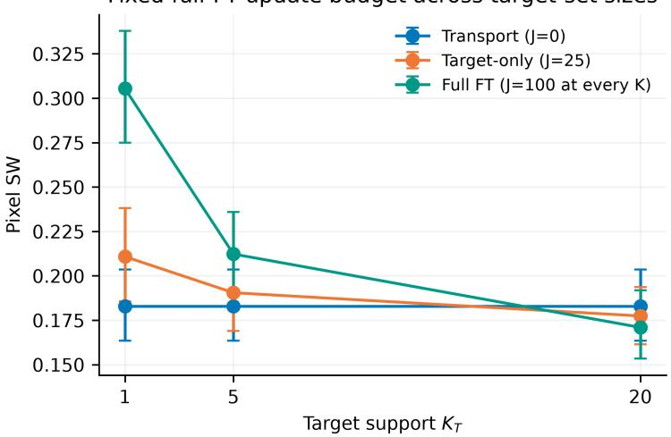  
Figure 12: Controlled full-FT update schedule across target budgets. Error bars are marginal 95% class-cluster intervals; route and support-size comparisons use the paired intervals in Table 45.

## F.3 MATCHED CIFAR SEMANTIC EVALUATION

All routes use a frozen DINOv2-small feature extractor (Oquab et al., 2023) with normalised CLS features and cosine nearest-prototype classification over 100 fine classes. Each prototype averages 20 fixed clean source-support images of its class and is normalised again; no target-query image enters the prototypes. Generated and real images undergo the same conversion from [−1, 1] to uint8 and the standard DINOv2 image processing. The resulting DINO-100 requested-class fraction is distinct from both the headline semantic-classifier consistency and the independent 80-way direct-z diagnostic. It uses labelled source prototypes, including prototypes for the held-out semantic classes. The three routes are evaluated on the same 60 held-out class–corruption episodes per target budget, with identical query images and generation noise. The original budget-specific full-FT schedule is used here, separately from the controlled-budget panel above. Real-query calibration is scored on exactly the same 128 images used to evaluate each route.

Table 46: Matched DINO-100 requested-class fractions (%) and real-query calibration, with 95% class-cluster intervals. Paired effects are percentage points; positive favours transport.
<table><tr><td>Route / paired effect</td><td> $K _ { T } = 1$ </td><td> $K _ { T } = 5$ </td><td> $K _ { T } = 2 0$ </td></tr><tr><td>Transport</td><td>2.53 [0.54, 5.73]</td><td>2.85 [0.54, 6.46]</td><td>2.34 [0.35, 5.49]</td></tr><tr><td>Target-only</td><td>2.38 [0.36, 5.62]</td><td>2.71 [0.45, 6.25]</td><td>2.50 [0.49, 5.54]</td></tr><tr><td>Full FT</td><td>3.68 [1.02, 7.20]</td><td>9.58 [3.85, 16.82]</td><td>10.50 [5.35, 16.70]</td></tr><tr><td>Real-query calibration</td><td>50.49 [42.20, 58.79]</td><td>49.79 [41.59, 57.99]</td><td>50.65 [42.23, 59.13]</td></tr><tr><td>Transport — target-only</td><td>0.16 [−0.14,0.49]</td><td>0.14 [-0.07,0.33]</td><td>-0.16 [-0.45, 0.09]</td></tr><tr><td>Transport – full FT</td><td>-1.15* [-2.67, -0.09]</td><td>-6.74* [-11.79,-3.00]</td><td>-8.16* [-12.00, -4.67]</td></tr></table>

Full FT has higher DINO-100 requested-class fraction than transport at all three target budgets, whereas transport-versus-target-only differences remain unresolved. All generated-route means remain substantially below their matched real-query calibration.

Table 47: SW and energy MMD for the new seeded full-FT replication used for semantic evaluation. Table 1B retains the earlier budget-specific comparison.
<table><tr><td>Metric / paired effect</td><td> $K _ { T } = 1$ </td><td> $K _ { T } = 5$ </td><td> $K _ { T } = 2 0$ </td></tr><tr><td>Full FT: SW</td><td>0.2649 [0.2382,0.2927]</td><td>0.2177 [0.2002,0.2355]</td><td>0.1487 [0.1395,0.1591]</td></tr><tr><td>Full FT – transport: SW</td><td>0.0868* [0.0625,0.1107]</td><td>0.0343* [0.0122, 0.0577]</td><td>-0.0357* [-0.0586, -0.0146]</td></tr><tr><td>Full FT: energy MMD</td><td>5.9003 [4.7552, 7.1604]</td><td>3.9034 [3.2829, 4.5988]</td><td>1.9151 [1.7299,2.1178]</td></tr><tr><td>Full FT – transport: MMD</td><td>3.5698* [2.5478, 4.6246]</td><td>1.5648* [0.8988, 2.2642]</td><td>-0.4890 [-1.0680, 0.0466]</td></tr></table>

## F.4 MATCHED OFFICE-HOME SEMANTIC EVALUATION

For Office-Home, we analyse matched semantic scores from the effective-batch-64, 50,000-update EMA model: 10 test classes, eight repeats, three target budgets $( K _ { T } = 1 , 5 , 1 0 )$ , and three routes. Within each class/repeat/budget, target queries and generation seeds match across routes; support and queries are disjoint. Each repeat contains 96 generated images.

The same 20 fixed real queries per class are additionally evaluated with the identical frozen CLIP ViT-B/32 classifier (Radford et al., 2021): 65 candidate classes, a three-prompt ensemble, and the same 64-pixel image preparation followed by the CLIP image processor. The existing generated-image scores are compared with this new same-query real-image calibration. This 200-image, class-balanced calibration is separate from the 564-image preflight audit reporting 65.96%, which applies the CLIP processor to the original-resolution images. Both the evaluation images and their preprocessing differ. Repeats are averaged within class before 10,000 class-bootstrap resamples.

The transport-versus-target-only semantic intervals contain zero at all three budgets. Full FT improves identity relative to transport at $K _ { T } = 5$ , 10, while the $K _ { T } = 1$ difference remains unresolved. Even

Table 48: Matched Office-Home CLIP-65 identity (%) and same-query real calibration. Effects are percentage points with 95% class intervals; positive favours transport. The identical real-query set is used at every target budget.
<table><tr><td>Route / paired effect</td><td> $K _ { T } = 1$ </td><td> $K _ { T } = 5$ </td><td> $K _ { T } = 1 0$ </td></tr><tr><td>Transport</td><td>1.67 [0.60, 3.19]</td><td>1.67 [0.60, 3.19]</td><td>1.67 [0.60, 3.19]</td></tr><tr><td></td><td>2.23</td><td>1.81</td><td>1.61</td></tr><tr><td>Target-only</td><td>[0.52, 5.01] 5.33</td><td>[0.65, 3.35] 12.55</td><td>[0.59, 2.94] 12.01</td></tr><tr><td>Full FT</td><td>[0.63, 11.59] 52.00 [40.00, 66.00]</td><td>[5.13, 21.63] 52.00</td><td>[4.84, 20.16] 52.00</td></tr><tr><td>Real-query calibration</td><td>-0.56 [-1.98, 0.42]</td><td>[40.00, 66.00] -0.14</td><td>[40.00, 66.00] 0.05</td></tr><tr><td>Transport — target-only</td><td>-3.66</td><td>[−0.70, 0.30] -10.89*</td><td>[-0.64,0.57] -10.34*</td></tr><tr><td>Transport – full FT</td><td>[-8.57, 0.18]</td><td>[−19.82, -4.14]</td><td>[-17.88, -3.84]</td></tr></table>

the higher full-FT means remain well below the real-query calibration. These matched measurements reinforce the need to distinguish distributional distances from reliable requested-class generation; they do not isolate the cause of the semantic limitation.

## G IMPLEMENTATION AND REPRODUCIBILITY

The CIFAR score model uses a 128-base-channel U-Net and $k = 1 6$ coordinates; its encoder has approximately 0.33M parameters. The basis contributes 55,344 conditioning parameters. The actual three-relation linear transport is $A z _ { S } + b _ { c } \colon 1 6 ^ { 2 } + 3 \times 1 6 = 3 0 4$ active parameters. Its saved module has 352 registered parameters because a 48-value compatibility embedding is not used by its forward map. A single-relation affine map has $1 6 ^ { 2 } + 1 6 = \hat { 2 } 7 2$ parameters. The headline CIFAR correct source + transport route directly decodes the predicted coordinate at all $K _ { T }$ , without target images, coordinate refinement or backbone update. Office-Home retains its separate 64-base-channel, $6 4 \times 6 4$ FiLM model, DDIM-50 and no-refinement headline protocol.

Semantic splits are fixed and target support/query images are disjoint. Within each paired CIFAR generation or ablation package, routes share the task, support/query episode and generation noise; the class-cluster bootstrap retains each class’s three corruption episodes and resamples classes rather than treating those episodes as independent. The independent frozen-coordinate retrieval diagnostic instead bootstraps fixed support resamples conditional on the class set, and its direct-target generation and timestep diagnostics resample classes. The direct-target diagnostic uses the explicitly stated post-hoc support/query repartition. Independent conditioning packages are not pooled. Validation-selected full-FT budgets are frozen before matched final-test evaluation, and no test score selects a new model, budget or subset. Other benchmarks retain their own frozen protocols and statistical units.

The paper distinguishes final-model interventions from historical evidence. The GMM calibration table, two-panel interpolation profile and main-text own/mean/shuffled/zero generation grid use their separately identified checkpoints; these diagnose coordinates, not deployment superiority. Historical GMM capacity/relatedness aggregates remain accurately labelled in the appendix, and transportstructure ablations compare MLP and linear maps. The refinement table reports matched on/off measurements on the correct source + transport checkpoint. Frozen-coordinate and direct-target semantic probes are reported as independent diagnostics.

## G.1 EVALUATION PROTOCOLS

Table 49 summarises the sampling and evaluation settings. Independent comparisons retain their own models, task splits, evaluators and statistical units.

For the main CIFAR split, the pooled official train/test images are partitioned by semantic superclass, and the per-class source-support/source-query/target-support-reserve/target-query pool capacities are 300/50/20/230. The model uses a cosine 1,000-step diffusion schedule, simple denoising loss, loss weights $( \lambda _ { \mathrm { t g t } } , \lambda _ { \mathrm { t r a n s } } , \lambda _ { z } ) = ( 1 , 1 , 1 0 ^ { - 4 } )$ , training learning rate $2 \times 1 0 ^ { - 4 }$ , zero weight decay and EMA decay 0.999. Evaluation uses the 50,000-update EMA model and deterministic DDIM-50 sampling.

Table 49: Protocol matrix. Counts refer to actual metric evaluation unless marked as pool capacities. Independent comparisons retain their own statistical units. The new supplementary experiments are described in Appendix F.
<table><tr><td>Comparison</td><td>Data and sampling</td><td>Evaluation and uncertainty</td></tr><tr><td>GMM factorial</td><td>out tasks per seed</td><td>42 (α, η) cells; five seeds; 64 held- SW/MMD paired by seed and task; hierar- chical intervals; abundant-target encoding reference uses 512 target points.</td></tr><tr><td>target</td><td>erated/128 query images</td><td>CIFAR main zero- 20 validation classes × three cor- Pixel SW: 256 projections; energy MMD: ruptions; 64 source images; 96 gen- 64/64 samples. Frozen semantic instrument from the original package. Class-cluster in- tervals.</td></tr><tr><td>tation comparison</td><td>at each  $K _ { T } = 1 , 5 , 2 0 ;$  ated/128 query images</td><td>CIFAR original adap- 20 test classes × three corruptions Pixel SW and energy MMD as above. 96 gener- Budget-specific full-FT settings; class- cluster intervals.</td></tr><tr><td>transport and source- comparisons; budget ablations</td><td>prefixes for  $M s = 1 6 , \ldots , 3 0 0$ </td><td>CIFAR conditioning, Separately matched validation Each comparison uses its own trained model nested source and matched class-corruption episodes. Paired class-cluster intervals; one training</td></tr><tr><td>direct-zT diagnostic</td><td>CIFAR independent Its separate 200-support/50-query repartition</td><td>seed per arm. Its stated DINO identity instrument and real-query calibration; class intervals. The coordinate-retrieval probe instead resamples</td></tr><tr><td>routes</td><td>Office-Home main 10 held-out classes; eight repeats; fixed real queries per class</td><td>supports conditional on its class set. DINO feature-space distances and 65-way 96 generated images per repeat; 20 CLIP identity are distinct metrics. Repeats are averaged within class; class intervals.</td></tr><tr><td>mentary routes</td><td>in the controlled-budget panel</td><td>New CIFAR supple- Same frozen model; matched Pixel SW/MMD and a separate DINO-100 source/query images and initial requested-class fraction; matched real-query generation noise; nested supports calibration. Class-cluster intervals, condi- tional on one training seed.</td></tr></table>