# BeNice! Closing Looping’s Inference-Memory Gap via KV-Sharing

Hayden Prairie1,2,\*, Jacob M. Ryan1,\*, Taylor Berg-Kirkpatrick1, and Daniel Y. Fu1,2

1University of California, San Diego 2Together AI

{hprairie,jmryan,tberg,danfu}@ucsd.edu

## Abstract

Looped architectures scale quality while keeping parameter count fixed by repeatedly passing activations through the same block of layers. During inference, each recurrence generates independent KV-caches, causing memory to grow linearly. To address this challenge, prior work has proposed KV-sharing (i.e., sharing KV-caches across depth), finding that, in some cases, the KV-cache of the final recurrence can be shared with the earlier recurrences without quality loss, a property we denote as KV-shareability. However, the mechanisms underlying KV-shareability remain poorly understood, with even identically trained looped architectures not consistently exhibiting it. In this paper, we study how KV-shareability can be enabled in looped models. We propose a two-stage method: in the first stage, we use stochastic depth during pretraining, which induces contractive residual dynamics that drive representations toward a common limit across recurrences. In the second stage, we propose BeNice!, a post-training method that broadcasts the final recurrence’s KV-cache into the first recurrence, training it to produce compatible residuals while preserving the original model’s quality. As a result, BeNice! enables KV-shareability while matching standard finetuning’s unshared validation perplexity. Using BeNice!, we show that KV-sharing is complementary to alternative KV-compression methods, composing with memory-eficient sequence mixers (e.g., multi-latent attention, Kimi delta attention) and low-precision KV-cache quantization (e.g., fp8, mxfp8, nvfp4). Finally, in simulated low-memory, long-context inference, KV-sharing improves cache hit rates by up to 31.4%, increases throughput by up to 23.6%, and reduces p90 time-to-first-token by up to 83.6%.

## 1 Introduction

As inference deployments move to the edge [43, 45] and take up a large portion of compute [67], looped architectures create a new, predictable avenue to scale quality while keeping parameter count fixed [20, 41, 50]. Unfortunately, while looped architectures keep the memory overhead of parameters capped, they still create KV-caches at each recurrence [19, 50, 80], causing memory overhead to still grow linearly with recurrence count at inference time. One potential direction to reduce inference-memory overhead is KV-sharing (i.e., sharing KV-caches across recurrences). Specifically, some recent looped models have been shown to support reuse of the final recurrence’s KV-cache for all prior recurrences with minimal impact to quality [20, 21], a property we term KV-shareability (Figure 1 [right]).

Unfortunately, the mechanisms underlying KV-shareability remain poorly understood, with more recent work reporting significant quality degradation with KV-cache reuse [19, 80]. Moreover, even models trained under identical setups can difer in whether they exhibit KV-shareability (see Table 1). In this paper, we hypothesize that contractive recurrent dynamics drive residual states toward fixed points, whose agreement under shared and unshared KV-caches enables KV-shareability.

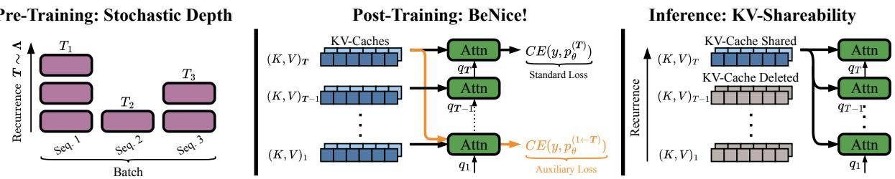

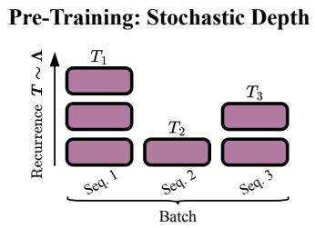  
Figure 1: Stochastic Depth, BeNice!, and KV-Shareability. (Left) During pretraining, stochastic depth induces contractive residual dynamics. (Middle) BeNice! post-trains by injecting the final recurrence KV-caches into the first recurrence. Together, they enable KV-shareability in looped models, retaining only the final recurrence’s KV-cache without degrading quality (Right).

To encourage contractive residual dynamics, we train with stochastic depth, randomly sampling depth throughout training (Figure 1 [left]). By requiring low-loss predictions across multiple depths, stochastic depth discourages residual drift and promotes convergence across recurrences. Contractive residual dynamics are what allow KV-shareability, which we formally analyze and empirically validate by showing that replacing intermediate caches with the final cache perturbs the attention output by a term bounded by the diference between their input residuals (see Section 3.1).

Unfortunately, even though stochastic depth creates contractive residual dynamics, it does not guarantee that residual states converge to the same fixed point with and without KV-sharing. Instead, KV-sharing sometimes introduces token-independent residual errors in the first recurrence, shifting the model’s fixed point and harming downstream quality (see Section 3.2).

To enable KV-shareability, we pair stochastic depth pretraining with a targeted correction of the residual errors introduced by KV-sharing. We propose a two-stage method: first, stochastic depth pretraining to induce contractive residual dynamics; second, BeNice! to correct first recurrence residual errors created from KV-sharing. Specifically, BeNice! jointly optimizes both the first recurrence with KV-cache reuse and the final recurrence without reuse (Figure 1 [middle]), balancing KV-shareability and base-model quality. To further study KV-sharing with other KV-compression techniques, we extended BeNice! to memory-eficient sequence mixers, including multi-latent attention (MLA) [13] and Kimi delta attention (KDA) [65], by reusing the final recurrence’s latent or state, respectively. Overall, BeNice! unlocks near-lossless KV-cache reuse across recurrences, facilitating predictable quality scaling using extended looping [50] while keeping parameter count and KV-cache memory constant as depth grows.

We evaluate KV-shareability and BeNice! on end-to-end quality, compatibility with other KV compression methods, and how it accelerates inference workloads:

• End-to-End Quality. BeNice! improves shared quality by up to 8.35 and 4.56 points for Core and Core-extended [38], respectively. Compared with standard finetuning, BeNice! improves validation perplexity by 9.75 points when sharing, while matching quality in the unshared case.

• Complementary to other KV Compression Methods. To evaluate KV-sharing with other KV-compression methods, we study its composition with memory-eficient sequence mixers and KV-quantization. We find that KV-sharing composes with both MLA and KDA sequence mixers and low-precision KV-quantization (e.g., fp8, mxfp4, nvfp4).

• Accelerating Inference Workloads. Under simulated long-context inference trafic, we observe that memory reductions in KV-sharing improve cache-hit rates by up to 31.4% (8.1 points), increasing throughput by up to 23.6%, and reducing p90 TTFT by up to 83.6%.

## 2 Background

We first provide a brief background on prior looped models (Section 2.1) and the inference overhead of language models (Section 2.2). Looped architectures have been widely explored in synthetic problem solving tasks [7, 29, 31, 57, 70]; however, our work focuses on looped language models [14, 20, 50, 80]. These models difer in where recurrence occur (pre-, mid, post-, or full-looping) [2], how it is halted (i.e., explicit router [80] or implicitly within the residual [20, 50]), and how gradients are computed (explicit or implicit backpropagation [5]). We study middle-looped models using implicit halting and explicit diferentiation, with an emphasis on how pretraining for fixed-point convergence enables memory-eficient inference. An extended literature review is found in Section B.

## 2.1 Prior Looped Models

Most prior looped language models [20, 50, 80] follow a middle-looped structure sequentially composed of an initial prelude block ${ \mathcal { P } } ,$ a middle recurrent block ${ \mathcal { R } } ,$ , and a final coda block C. For an input sequence $s \in \mathcal { V } ^ { n }$ , computation proceeds sequentially as $e = \mathscr { P } ( s ) , h _ { t + 1 } = \mathscr { R } ( h _ { t } , e ) , p = \mathscr { C } ( h _ { T } )$ where a model is looped T times and $h _ { 0 }$ is initialized randomly $( \mathrm { i . e . , ~ } h _ { 0 } \sim \mathcal { N } ( 0 , I \sigma ^ { 2 } ) ; [ 2 0 , 5 0 ] )$ or with $e \ ( \mathrm { i . e . , \ } h _ { 0 }  e ; \ [ 8 0 ] )$ . Intuitively, P maps a sequence s into a latent embedding $e \in \mathbb { R } ^ { n \times d _ { e } }$ R iteratively refines a hidden state $h _ { t } \in \mathbb { R } ^ { n \times d _ { h } }$ conditioned on $e ,$ and then $\mathcal { C }$ maps the final h to an output $p \in \mathbb { R } ^ { n \times | \mathcal { V } | }$ . To condition R on e, input injection at each recurrence is often used (i.e., $h _ { t + 1 } = \mathcal { R } ( \overline { { A } } \cdot h _ { t } + \overline { { B } } e )$ , where $\overline { { \pmb { A } } } \in \mathbb { R } ^ { d _ { h } \times d _ { h } }$ and $\overline { { B } } \in \mathbb { R } ^ { d _ { h } \times d _ { e } } ; [ 2 0 , 5 0 , 7 3 ] )$ , and following Prairie et al. [50] is constrains $\rho ( { \overline { { A } } } ) < 1$ where $\rho ( \cdot )$ is the spectral radius, to prevent state explosion.

During training, prior works either sample depth stochastically [20, 50] or use adaptive computation time (ACT) [23]. Specifically, Parcae [50] and Huginn [20] sample a depth $T \sim \Lambda$ independently per sequence/batch, where Λ is a distribution (e.g., Poisson) with mean $\mu _ { \mathrm { r e c } } .$ , training R to produce meaningful representations across depths. Ouro [80] uses ACT: a learned router predicts a halting probability at each recurrence, with computation stopping once the cumulative probability exceeds a threshold [23]. We will show the advantages of training with stochastically sampled depth in this work. Finally, to bound training memory, some models use truncated backpropagation through time (TBPTT) [20, 50], propagating gradients through only the final $\mu _ { \mathrm { b w d } } < T$ recurrences.

## 2.2 Inference Overhead of Looped Language Models

We will study how memory overhead at inference scales with context length and model depth, particularly within the scope of looped architectures [20, 50]. Under uniform numerical precision, inference memory M for a P-parameter model, with L context length, D depth, and $d _ { \mathrm { k } x }$ KV width is $M = M _ { \theta } + M _ { \mathrm { k v } }$ , where model-weight memory is $M _ { \theta } = \mathcal { O } ( P )$ and KV-cache memory is $M _ { \mathrm { k v } } = \mathcal { O } ( L D d _ { k v } )$ . Beyond lowering numerical precision, prior work reduces $M _ { \mathrm { k v } }$ overhead primarily by shrinking per-layer footprint $L d _ { \mathrm { k v } }$ (e.g., MLA [13], GQA [1], KDA [65]), leaving its linear dependence on depth D unchanged. For a looped model evaluated with $T$ recurrences, the efective depth is $D = D _ { \mathcal { P } } + T \cdot D _ { \mathcal { R } } + D _ { \mathcal { C } }$ . Although looping keeps $M _ { \theta }$ fixed as $T$ increases, conventional inference stores a distinct KV cache for each recurrence, causing $M _ { \mathrm { k v } }$ to grow linearly with T.

<table><tr><td rowspan="2"></td><td rowspan="2">Model</td><td colspan="3">Lambada BPB (↓)</td><td colspan="3">Core (↑)</td><td colspan="3">Core-Extended (↑)</td></tr><tr><td>Unshared</td><td>Shared</td><td>Δ</td><td>Unshared</td><td>Shared</td><td>Δ</td><td>Unshared</td><td>Shared</td><td>Δ</td></tr><tr><td rowspan="6">Fidd-ooint</td><td>Parcae 140M</td><td>0.962</td><td>0.962</td><td>0.000</td><td>14.07</td><td>14.17</td><td>0.10</td><td>10.13</td><td>10.09</td><td>-0.04</td></tr><tr><td>Parcae 370M</td><td>0.762</td><td>0.764</td><td>0.002</td><td>20.47</td><td>19.85</td><td>-0.62</td><td>13.23</td><td>13.24</td><td>0.01</td></tr><tr><td>Parcae 770M</td><td>0.645</td><td>1.460</td><td>0.814</td><td>25.05</td><td>21.10</td><td>-3.94</td><td>15.69</td><td>13.95</td><td>-1.74</td></tr><tr><td>Parcae 1.3B</td><td>0.601</td><td>2.281</td><td>1.680</td><td>28.76</td><td>21.37</td><td>-7.40</td><td>16.73</td><td>13.48</td><td>-3.25</td></tr><tr><td>Huginn 3.5B</td><td>0.429</td><td>0.429</td><td>0.000</td><td>40.97</td><td>40.53</td><td>-0.44</td><td>29.06</td><td>28.61</td><td>-0.44</td></tr><tr><td>Ouro 1.4B</td><td>0.353</td><td>1.280</td><td>0.927</td><td>54.57</td><td>25.17</td><td>29.40</td><td>53.11</td><td>32.13</td><td>20.98</td></tr><tr><td>AT</td><td>Ouro 2.6B</td><td>0.301</td><td>0.744</td><td>0.443</td><td>59.78</td><td>26.58</td><td>33.20</td><td>61.42</td><td>37.57</td><td>23.84</td></tr></table>

Table 1: Emergence of KV-shareability in Looped Models. Quality of looped architectures with and without a shared KV-cache. Observe that KV-shareability is not universal to all looped architectures ( Bolded models have KV-shareability ). See Section C for evaluation details.

## 3 Understanding KV-shareability in Looped Models

In this section, we study KV-shareability in looped architectures. To evaluate KV-shareability, we compare shared evaluations, which reuse the final-recurrence cache across all recurrences, against unshared evaluations, which retain every recurrence’s cache. Details on reproducing accurate KVsharing inference setups for our benchmarks are provided in Section C.

We motivate our investigation by observing that KV-shareability is not universal to all looped models (see Table 1). We establish that stochastic depth enables contractive recurrent dynamics, which we formally analyze and empirically validate allows KV-shareability when fixed points agree under shared and unshared KV-caches (Section 3.1). However, stochastic depth alone is insuficient to guarantee agreement, leading to models not exhibiting KV-shareability (e.g., Parcae 1.3B in Table 1). Analyzing failure cases, we find that KV-sharing creates a token-independent basis shift, causing convergence to diferent fixed points and degraded quality under KV-sharing (Section 3.2).

## 3.1 Stochastic Depth Enables Contractive Residual Dynamics

In this section, we characterize how stochastic-depth training induces fixed-point convergence, driving KV-caches near a common limit and correlating with the emergence of KV-shareability.

Setup. We train Parcae-style [50] models from scratch at four scales (140M, 370M, 770M, and 1.3B), varying only whether recurrence depth is stochastic (i.e., randomly sampled during training) or static (i.e., fixed throughout training). KV-shareability is evaluated on final models and never trained for explicitly. Training and evaluation details are in Section G and Section C, respectively.

Fixed-Point Convergence encourages Shareable KV-Caches. Our key insight is that KVshareability often emerges as a downstream consequence of fixed-point convergence in the recurrent block R. Specifically, consider a looped architecture in which R is a contraction on the hidden state $h _ { t } .$ , such that $h _ { t }  \hat { h }$ where hˆ is a fixed point (e.g., Parcae [50]; Huginn [20]; see Section F for empirical evidence). Since the key and value projections are locally-Lipschitz in $h ,$ their caches also converge: $k _ { t } ^ { ( l ) } , v _ { t } ^ { ( l ) } \to \hat { k } ^ { ( l ) } , \hat { v } ^ { ( l ) }$ for every layer l in R. Moreover, $\| \boldsymbol { k } _ { t } ^ { ( l ) } - \boldsymbol { k } _ { T } ^ { ( l ) } \|$ is bounded by the step-to-step residual $\| h _ { t } - h _ { t - 1 } \|$ (see Section D), as illustrated in Figure 2.

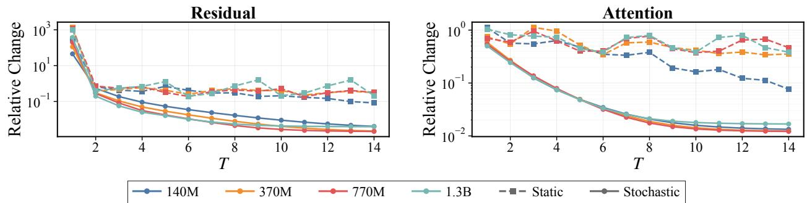  
Figure 2: Residuals and Attention Convergence. Relative step-to-step change of the residual stream $\left( \Vert h _ { i } - h _ { i - 1 } \Vert / \Vert h _ { i - 1 } \Vert \right.$ , left) and attention pattern $\left( \Vert A _ { i } - A _ { i - 1 } \Vert / \Vert A _ { i - 1 } \right|$ , right) across recurrence depth T. Stochastic-depth training exhibits fixed-point convergence, while static-depth does not.

<table><tr><td rowspan="2">Size</td><td colspan="2">Δ Val PPL (↓)</td><td colspan="2">∆Core (↓)</td></tr><tr><td>Stochastic</td><td>Static</td><td>Stochastic</td><td>Static</td></tr><tr><td>140M</td><td>-0.02</td><td>1.31</td><td>0.08</td><td>0.62</td></tr><tr><td>370M</td><td>0.02</td><td>2.70</td><td>0.13</td><td>0.78</td></tr><tr><td>770M</td><td>0.01</td><td>3.10</td><td>0.13</td><td>1.06</td></tr><tr><td>1.3B</td><td>0.01</td><td>2.84</td><td>0.25</td><td>2.00</td></tr></table>

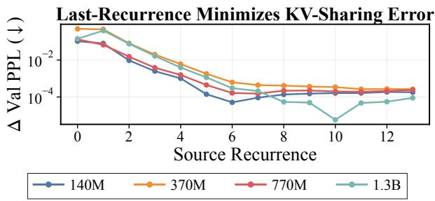  
Table 2: KV-Sharing Relies on Stochastic Depth. We report the quality delta between unshared and shared KV-caching. Extended results and training details are in Section G.  
Figure 3: Final-Recurrence KV is Optimal. We find the best quality results are from converged KV caches.

KV-cache convergence is necessary for KV-shareability: replacing an intermediate cache $( k _ { t } ^ { ( l ) } , v _ { t } ^ { ( l ) } )$ with a fixed-point cache $( \hat { k } ^ { ( l ) } , \hat { v } ^ { ( l ) } )$ perturbs the attention output by a term bounded by the fixed-point residual $\| \hat { h } - h _ { t } \|$ . To test this, we train Parcae models from scratch using stochastic and static depth training. Stochastic depth training induces a contraction∗ and coincides with the emergence of KV-shareability (Table 2). In contrast, static-depth lacks an incentive to keep intermediate latents near a common limit, as reflected in their attention patterns (Figure 2) and shared quality (Table 2).

Consistent with this mechanism, the final-recurrence cache is empirically the optimal broadcast target (Figure 3), as $( k _ { T } ^ { ( l ) } , v _ { T } ^ { ( l ) } )$ lie closest to a fixed point across all t, minimizing substitution error. While KV-shareability is still surprising, it suggests that looped architectures should favor stochastic fixed-point training over ACT objectives. By inducing a contraction towards a common fixed point, stochastic-depth training can enable KV-shareability without explicitly optimizing for it.

## 3.2 KV-Sharing Fails to Converge to a Common Fixed Point

We now investigate why contractive residual dynamics alone are insuficient (e.g., 770M and 1.3B Parcae use stochastic depth and are fixed-point [Section F], yet lack KV-shareability [Table 1]).

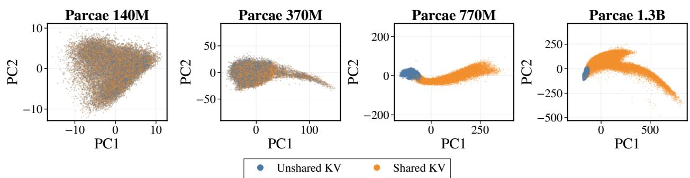  
Figure 4: KV-Sharing Failures Converge to Incorrect Fixed Points. We visualize fixed points of several tokens after T = 8 test-time recurrence with unshared and shared KV-caches. Models with KV-shareability (e.g., 140m and 370m) converge to the same fixed point under both setups, while models without KV-shareability (e.g., 770M and 1.3B) do not. See Section H for extended details.

<table><tr><td>Cache Compression</td><td>Val. PPL. (↓) 770M 1.3B</td></tr><tr><td>Unshared</td><td></td></tr><tr><td>Layer &gt; 1, Recurrence &gt; 1</td><td>11.86 10.80</td></tr><tr><td>Naive Patching</td><td>11.86 10.80 11.87</td></tr><tr><td>Shared</td><td>10.84 34.24 1.71e4</td></tr></table>

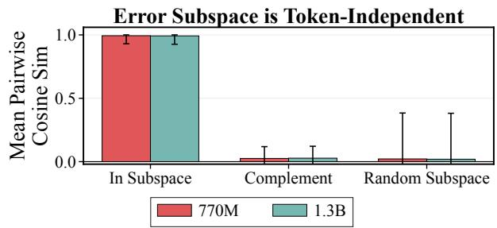  
Table 3: Pinpointing Parcae Failures. Preserving first-layer KVs from the first recurrence or applying naive patching matches the unshared baseline, whereas full KV-sharing fails.  
Figure 5: KV-Sharing Error Subspace Similarity. We find that tokens are strongly aligned within the subspace, but orthogonal in its complement and a random 8-dimensional subspace.

Setup. We focus our analysis on the released Parcae models [50], focusing on 770M and 1.3B scales that both fail to preserve quality under KV-sharing, yet were trained with stochastic depth and an equivalent setup to 140M and 370M Parcae models. We evaluate them using the setup in Section C.

KV-Sharing Fails to Converge to Similar Fixed Points. Figure 4 visualizes the converged representation with and without KV-sharing. We quantify the fixed-point agreement by the mean relative diference between final latents, $\lVert h _ { T } ^ { ( \mathrm { s h a r e d } ) } - h _ { T } ^ { ( \mathrm { \bar { u n s h a r e d } } ) } \rVert / \lVert h _ { T } ^ { ( \mathrm { s h a r e d } ) } \rVert$ . Models with KVshareability (e.g., Parcae 140M and 370M in Table 1) converge to similar fixed points, with a mean relative diference of at most 1.69%. In contrast, models without KV-shareability (e.g., Parcae 770M and 1.3B in Table 1) exhibit mean relative diferences reaching up to 177.5%.

KV-Sharing Failures are Token-Independent Basis Shifts Analyzing the source of KVsharing failure, we observe that caching only the first layer KV of the first recurrence, on top of all final recurrence caches, restores quality (i.e., Layer > 1, Recurrence > 1 in Table 3). This localizes the failure to just the first layer of the first recurrence. More surprisingly, this failure manifests as a token-independent basis shift, altering the fixed point under KV-sharing and degrading quality.

Table 3 and Figure 5 confirm this empirically: by constructing a subspace B from the error delta between the first layer output with and without KV-sharing (see Section E for derivation) and projecting each token into B, we observe an average projected pairwise cosine similarity of 0.99.

This confirms that KV-sharing errors act as a token-independent residual basis shift. To test this, we add the mean projected error to the residual after the first layer during shared evaluations (see Section E for details). This correction eliminates the need to separately cache the first layer and recurrence when sharing (see Naive Patching in Table 3).

## 4 Learning to Share Across Recurrences

One way to induce KV-shareability is to train directly on KV-sharing rollouts (i.e., sequentially rolling out KV-sharing dynamics token-by-token). However, this would be computationally infeasible and slow during training. Alternatively, using our analysis in Section $^ { 3 , }$ we propose a two-stage method to enable KV-shareability (as visualized in Figure 1). In the first stage, we follow our observations in Section 3.1 and pretrain models with stochastic depth to induce contractive residual dynamics that drive KV-caches to a common limit across recurrences (Section 4.1). In the second stage, we correct the token-independent basis shift observed in Section 3.2 with BeNice! by optimizing both the first recurrence with KV-cache reuse and the standard final recurrence without reuse (Section 4.2).

## 4.1 Stochastic-Depth Pretraining: Enabling Contractive Recurrent Dynamics

In the first stage of our method, we train with stochastic depth, driving KV-caches to a common shareable limit across recurrences and setting the groundwork for KV-shareability based on Section 3.1. Specifically, following Prairie et al. [50], we utilize per-sequence stochastic depth training, assigning a diferent depth for each sequence in a batch. This sampling structure was empirically observed to reduce loss spikes in prior work. We further follow Prairie et al. [50], sampling per-sequence depth from $T \sim \Lambda ( \mu _ { \mathrm { r e c } } )$ , where Λ is a Poisson distribution with mean $\mu _ { \mathrm { r e c } }$ . Lastly, to keep memory bounded during pretraining, we use truncated backpropagation through recurrences, with a backprop depth of $\mu _ { \mathrm { b w d } } = \lfloor \frac { \mu _ { \mathrm { r e c } } } { 2 } \rfloor \ [ 5 0 \rfloor$

## 4.2 BeNice! Post-training: Correcting First Recurrence Residual Errors

In the second stage of our method, we correct token-independent issues that still emerge when KV-sharing, even with stochastic-depth training. Using our analysis from Section 3.2, we know quality degradations are primarily introduced in the first recurrence (see Table 3). This suggests that KV-sharing compatible inference can be recovered by training the first recurrence pass to be compatible with future KV-caches, rather than directly creating KV-sharing rollouts. Specifically, consider the ordinary T-recurrence predictor $p _ { \theta } ^ { ( T ) }$ and a hybrid predictor $\breve { p } _ { \theta } ^ { ( 1  T ) }$ that uses firstrecurrence queries and residuals with final-recurrence KV (see Figure 1 [middle]). We define the BeNice! loss as:

$$
\mathcal { L } _ { \mathrm { B E N I C E ! } } = \mathrm { C E } \Big ( y , p _ { \theta } ^ { ( T ) } \Big ) + \gamma \mathrm { C E } \Big ( y , p _ { \theta } ^ { ( 1  T ) } \Big )\tag{1}
$$

where CE(·) denotes cross-entropy loss and γ controls auxiliary loss strength. Intuitively, the auxiliary term trains the first recurrence to be compatible with future recurrences’ KV-caches, while the standard language-modeling term maintains base quality at later depths. Finally, during finetuning, we sample T from the same recurrence-depth distribution Λ used during pretraining.

Additionally, to study if KV-sharing is complementary to other KV compression methods, we further generalize BeNice! to multiple memory-eficient sequence mixers. For example, we can

<table><tr><td rowspan="2">Model</td><td rowspan="2"></td><td colspan="3">Core (↑)</td><td colspan="3">Core-Extended (↑)</td></tr><tr><td>Unshared</td><td>Shared</td><td>Δ</td><td>Unshared</td><td>Shared</td><td>Δ</td></tr><tr><td>140</td><td>Parcae</td><td>15.50</td><td>14.97</td><td>-0.53</td><td>10.43</td><td>10.10</td><td>-0.33</td></tr><tr><td></td><td>+ BENICE!</td><td>15.47</td><td>15.61</td><td>+0.14</td><td>10.28</td><td>10.19</td><td>-0.09</td></tr><tr><td>370M</td><td>Parcae</td><td>20.74</td><td>15.16</td><td>-5.58</td><td>12.99</td><td>9.68</td><td>-3.31</td></tr><tr><td></td><td>+ BENICE!</td><td>23.90</td><td>23.51</td><td>-0.39</td><td>14.39</td><td>14.24</td><td>-0.15</td></tr><tr><td>70</td><td>Parcae</td><td>30.45</td><td>26.92</td><td>-3.52</td><td>19.22</td><td>16.67</td><td>-2.55</td></tr><tr><td></td><td>+ BENICE!</td><td>30.79</td><td>30.53</td><td>-0.26</td><td>19.18</td><td>19.13</td><td>-0.05</td></tr><tr><td>1.3B</td><td>Parcae</td><td>37.27</td><td>33.94</td><td>-3.33</td><td>25.41</td><td>23.46</td><td>-1.95</td></tr><tr><td></td><td>+ BENICE!</td><td>37.40</td><td>37.43</td><td>+0.04</td><td>25.69</td><td>25.59</td><td>-0.10</td></tr></table>

Table 4: BeNice! Maintains Quality and Enables KV-Shareability. We train Parcae models [50] and then post-tune with BeNice!. BeNice! maintains and improves base model quality, while fully enabling KV-sharing. Best results are bolded.  
extend BeNice! to multi-latent attention [13] and Kimi delta attention [65] by swapping the final recurrence’s latent or hidden state, respectively, over the KV-cache (see Section K for details).

## 5 Results

We evaluate end-to-end quality of finetuning methods for enabling KV-shareability (Section 5.1), its composition with other KV compression techniques (Section 5.2), and its latency and throughput gains in memory-bound setups (Section 5.3). Overall, we find BeNice! enables KV-shareability, improving shared Core and Core-Extended [38] quality by up to 8.35 and 4.56 points, respectively. Furthermore, BeNice! is complementary to memory-eficient sequence mixers (e.g., MLA [13], KDA [65]) and KV-quantization. Lastly, in synthetic memory-constrained inference workloads, KV-shareability improves cache-hit rate by up to 31.4% (8.1 percentage points), increases throughput by up to 23.6%, and reduces p90 TTFT by up to 83.6%.

## 5.1 Enabling KV-Shareability while Maintaining End-to-End Quality

On newly trained Parcae [50], BeNice! enables KV-shareability and improves base quality. BeNice! achieves comparable results to standard finetuning, while enabling KV-shareability.

Setup. We follow Parcae [50], training 140M, 370M, 770M, and 1.3B model classes (see Section N for definitions) on over 100B climbix [16] tokens. Baselines [50] are tuned by sweeping hyperparameters, using our hyperparameter-transfer observations in Section M. We finetune BeNice! with three seeds, and then evaluate using a test-time recurrence of $T = \mu _ { \mathrm { r e c } }$ , following Prairie et al. [50]. Individual hyperparameter sweeps are done for standard finetuning and BeNice! (see Section O).

BeNice! Enables KV-Shareability and Maintains Base Model Quality. Table 4 shows that KV-sharing failures emerge at all scales, reducing Core and Core-Ext [38] by up to 5.58 and 3.31 points, respectively. Finetuning with BeNice! further improves base model quality; it also enables KV-shareability, improving shared Core and Core-Ext by up to 8.35 and 4.56 points, respectively.

<table><tr><td rowspan="3" colspan="2">Model</td><td colspan="3">Val. PPL (↓)</td><td colspan="3">Core (↑)</td><td colspan="3">Core-Extended (↑)</td></tr><tr><td>Unshared</td><td>Shared</td><td>Δ</td><td>Unshared</td><td>Shared</td><td>Δ</td><td>Unshared</td><td>Shared</td><td>Δ</td></tr><tr><td></td><td>Standard FT</td><td>11.86</td><td>21.61</td><td>+9.75</td><td>24.74</td><td>23.42</td><td>-1.32</td><td>15.34</td><td>14.54</td><td>-0.80</td></tr><tr><td>772M</td><td>BENICE!</td><td>11.85</td><td>11.86</td><td>+0.01</td><td>25.15</td><td>25.19</td><td>+0.04</td><td>15.35</td><td>15.29</td><td>-0.06</td></tr><tr><td>1.3</td><td>Standard FT</td><td>10.79</td><td>18.52</td><td>+7.73</td><td>29.01</td><td>27.49</td><td>-1.51</td><td>17.23</td><td>16.66</td><td>-0.58</td></tr><tr><td></td><td>BENICE!</td><td>10.79</td><td>10.78</td><td>-0.01</td><td>28.63</td><td>28.67</td><td>+0.04</td><td>17.32</td><td>17.41</td><td>+0.09</td></tr></table>

Table 5: Comparing BeNice! with Standard Finetuning. We finetune public checkpoints of Parcae [50] on three diferent seeds, evaluating on fineweb-edu [49] validation and Core and Core Extended [38]. BeNice! matches the quality of standard finetuning, while enabling KV-shareability.  
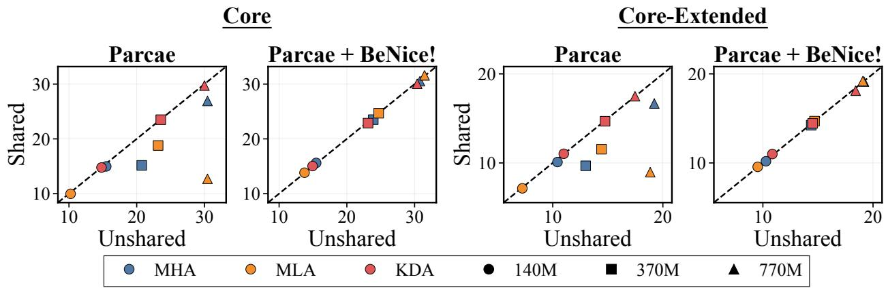  
Figure 6: KV-Shareability with Memory-Eficient Sequence Mixers. We train Parcae [50] models with MHA [68], MLA [13], and KDA [65]. We find that BeNice! allows memory-eficient sequence mixers to have KV-shareability, reducing inference overhead.

Overall, BeNice! allows looped architectures to scale recurrences to improve quality without scaling memory overhead at test-time.

BeNice! Matches Standard Finetuning and Gains KV-Shareability. We further compare BeNice! to standard finetuning (i.e., without an auxiliary loss term). As seen in Table 5, BeNice! achieves comparable quality to standard finetuning when no KV-cache reuse is done (i.e., unshared). However, BeNice! enables KV-shareability, reducing validation perplexity by up to 45.2% (9.75 PPL points), when KV-caches are reused across recurrences.

## 5.2 KV-Shareability is Complementary to Other KV Compression Methods.

In this section, we highlight how KV-shareability is complementary to alternative KV compression methods, by composing it with memory-eficient sequence mixers (e.g., MLA [13] and KDA [65]) and KV-quantization.

Setup. For experiments on KV-compression, we use Parcae models from Section 5.1. For experiments composing KV-sharing with memory-eficient sequence mixers, we train models with multi-head attention (MHA) [68], multi-latent attention (MLA) [13] and Kimi delta attention (KDA) [65] (see Section K for more details). For experiments composing KV-sharing with KV-quantization,

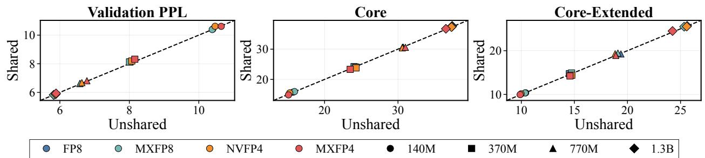  
Figure 7: Quality of KV-Sharing and -Quantization. We report changes in climbmix PPL. [16], Core, and Core-Extended [38] after quantizing the KV-shared cache across MHA [68] model scales. KV-sharing maintains quality across cache precisions.  
we directly reduce the precision of keys and values for MHA [68] or the shared latent for MLA [13].

KV-Sharing Composes with Memory-Eficient Sequence Mixers. In Figure 6, base MLA and KDA† variants of Parcae fail to have KV-shareability, sufering quality drops when sharing final recurrence KV across earlier recurrences. These KV-sharing failures mirror the same pattern as the released MHA Parcae models explored in Section 3 (see Section K for more details). BeNice! achieves KV-shareability with all sequence mixers. Across all model scales and sequence mixers, KV-sharing decreases Core and Core-Extended [38] by 0.09 and 0.04 points, respectively, on average.

KV-Sharing is Compatible with KV-Quantization. In Figure 7, across scales and precisions, KV-sharing changes Core and Core-Ext by only −0.02 and +0.06 points on average, respectively, while increasing ClimbMix validation perplexity [16] by just 0.67% on average. KV-sharing and quantization interact by at most 0.53% in climbmix perplexity [16], indicating that KV-sharing is an orthogonal compression axis. We expect stronger KV-quantization methods (e.g., KVQuant [27], KIVI [40], ScaleSearch [24]) will compose with KV-sharing, further improving quality.

## 5.3 Saving Memory and Accelerating Inference Workloads with KV-Shareability

In this section, we simulate how memory savings from KV-shareability improve TTFT and throughput under long-context inference workloads.

Setup. For long-context memory experiments, we implement eficient KV-sharing for Parcae [50] in sglang [77]. We report total GPU memory usage, including model weights, KV-cache storage, CUDA graphs, and runtime bufers. For workload experiments, we replay production-derived Mooncake requests [51] using AIPerf [46], preserving arrival times, input/output lengths, and prefix-sharing relations. To study realistic model scales, we construct proxy models from standard open-weights (e.g., GLM 4.7-FP8 [64]) by repeatedly looping the middle third transformer blocks, with and without KV-sharing. We vary both the ofered request rate and maximum concurrency to characterize performance across load- and concurrency-limited regimes, respectively.

KV-Sharing Reduces Memory Overhead. In Figure 8, we observe that memory savings scale with recurrence count $\left( \mu _ { \mathrm { r e c } } \right)$ and KV-cache size. For our 1.3B Parcae on Core-Extended [38] with batch size and context length of 64 and 2048, respectively, KV-shareability reduces measured global HBM usage by 66.2% from 63.82 GB to 21.60 GB. At $\mu _ { \mathrm { r e c } } = 8$ , KV-sharing increases the total token capacity to 3.33× the unshared capacity under the same KV-memory budget.

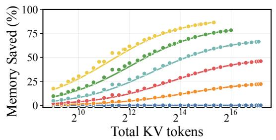

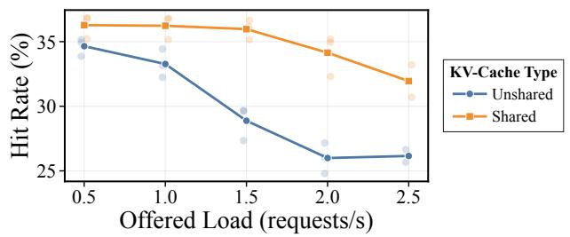  
Figure 8: Global Memory Reduction of KV- Figure 9: Cache-Hit Rate Under Sharing. Sharing. We measure and fit the memory over- We average the cache-hit rate with and without head of KV-sharing, varying test-time recurrences. KV-sharing using Mooncake traces [51].

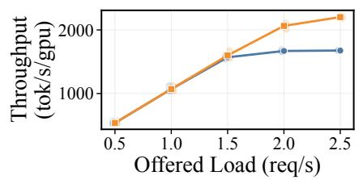

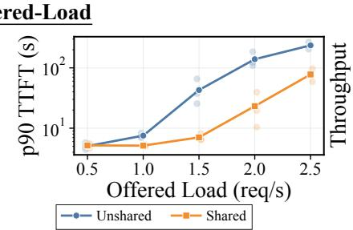

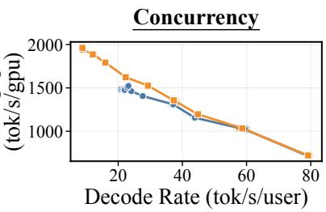  
Figure 10: Throughput Frontier of KV-Sharing. (Left) Under increasing ofered load, KV-Sharing improves throughput and reduces TTFT over unshared looping. (Right) Under high concurrency load, KV-sharing improves overall throughput at matched decode rates.

KV-Sharing Accelerates Inference Workloads. With reduced memory overhead, KV-shareability increases the total tokens retained under a fixed cache budget (e.g., KV-sharing increases total token budgets by 3.33× and 6× for $\mu _ { \mathrm { r e c } } = 8$ and $\mu _ { \mathrm { r e c } } = 1 6$ , respectively). Larger token budgets reduce prefix evictions and prefix recomputation (i.e., directly increasing cache hit rate by 8.1 points at 2 req/s in Figure 9). Higher cache-hit rates further improve throughput: at low loads (e.g., 0.5 req/s), KV-sharing matches the unshared baseline in TTFT and throughput; however, at high loads (e.g., 2 req/s), KV-shareability improves throughput by 23.6% and reduces p90 TTFT from 139.2 s to 23.2 s (Figure 10 [left]). Along the concurrency frontier, KV-shareability provides up to 6.7% higher throughput at a fixed median decode rate and 34.8% higher median decode rate at a fixed throughput (Figure 10 [right]). Overall, KV-shareability improves throughput and latency when workloads approach saturation.

## 6 Conclusion

In this work, we study the emergence and failure points of KV-shareability, finding that contractive residual dynamics drive KV-caches towards a common shareable limit. To enable KV-shareability, we propose a two stage method: first, we use stochastic depth to induce contractive residual dynamics across recurrences; second, we provide BeNice!, a post-training method that corrects residual errors in the first recurrence to ensure that models approach a common limit with and without KV-sharing. KV-shareability composes with both memory-eficient sequence mixers and KV-quantization, detaches inference memory overhead from test-time recurrences, and improves throughput and TTFT in memory-constrained settings.

Acknowledgments. We graciously acknowledge the support of Together AI and AMD through the FAR research grant. This research was supported in part by the NSF under grants 2146151 and 2422214.

## References

[1] Joshua Ainslie, James Lee-Thorp, Michiel de Jong, Yury Zemlyanskiy, Federico Lebrón, and Sumit Sanghai. Gqa: Training generalized multi-query transformer models from multi-head checkpoints. In Proceedings of the 2023 Conference on Empirical Methods in Natural Language Processing, 2023.

[2] Ibrahim Alabdulmohsin and Xiaohua Zhai. Recursive inference scaling: A winning path to scalable inference in language and multimodal systems. In Advances in Neural Information Processing Systems, volume 38, 2025.

[3] Aida Amini, Saadia Gabriel, Peter Lin, Rik Koncel-Kedziorski, Yejin Choi, and Hannaneh Hajishirzi. Mathqa: Towards interpretable math word problem solving with operation-based formalisms. In Proceedings of the 2019 Conference of the North American Chapter of the Association for Computational Linguistics: Human Language Technologies, 2019.

[4] Sangmin Bae, Yujin Kim, Reza Bayat, Sungnyun Kim, Jiyoun Ha, Tal Schuster, Adam Fisch, Hrayr Harutyunyan, Ziwei Ji, Aaron Courville, and Se-Young Yun. Mixture-of-recursions: Learning dynamic recursive depths for adaptive token-level computation, 2025. URL https: //arxiv.org/abs/2507.10524.

[5] Shaojie Bai, J. Zico Kolter, and Vladlen Koltun. Deep equilibrium models. In Advances in Neural Information Processing Systems, volume 32, 2019.

[6] Daniel Bailey, Amelia Harrison, Yuliya Lierler, Vladimir Lifschitz, and Julian Michael. The winograd schema challenge and reasoning about correlation. In Working Notes of the Symposium on Logical Formalizations of Commonsense Reasoning. AAAI Press, 2015. URL http://www. cs.utexas.edu/users/ai-lab?wsc15.

[7] Arpit Bansal, Avi Schwarzschild, Eitan Borgnia, Zeyad Emam, Furong Huang, Micah Goldblum, and Tom Goldstein. End-to-end algorithm synthesis with recurrent networks: Extrapolation without overthinking. In Alice H. Oh, Alekh Agarwal, Danielle Belgrave, and Kyunghyun Cho, editors, Advances in Neural Information Processing Systems, 2022. URL https://openreview. net/forum?id=PPjSKy40XUB.

[8] Yonatan Bisk, Rowan Zellers, Jianfeng Gao, Yejin Choi, et al. PIQA: Reasoning about physical commonsense in natural language. In Proceedings of the AAAI conference on Artificial Intelligence, volume 34, 2020.

[9] Johan Bjorck, Alon Benhaim, Vishrav Chaudhary, Furu Wei, and Xia Song. Scaling optimal lr across token horizons. In The Thirteenth International Conference on Learning Representations, 2025.

[10] Zizhe Chen, Jiqian Dong, Yizhou Tian, Garry Yang, Yongqiang Chen, Zhitang Chen, and James Cheng. Hista and numca: Estimate state value efectively for llm reinforcement learning, 2026. URL https://arxiv.org/abs/2605.29782.

[11] Christopher Clark, Kenton Lee, Ming-Wei Chang, Tom Kwiatkowski, Michael Collins, and Kristina Toutanova. Boolq: Exploring the surprising dificulty of natural yes/no questions. In NAACL, 2019.

[12] Peter Clark, Isaac Cowhey, Oren Etzioni, Tushar Khot, Ashish Sabharwal, Carissa Schoenick, and Oyvind Tafjord. Think you have solved question answering? try ARC, the AI2 reasoning challenge. arXiv preprint arXiv:1803.05457, 2018.

[13] DeepSeek-AI, Aixin Liu, Bei Feng, Bin Wang, Bingxuan Wang, Bo Liu, Chenggang Zhao, Chengqi Dengr, Chong Ruan, Damai Dai, Daya Guo, Dejian Yang, Deli Chen, Dongjie Ji, Erhang Li, Fangyun Lin, Fuli Luo, Guangbo Hao, Guanting Chen, Guowei Li, H. Zhang, Hanwei Xu, Hao Yang, Haowei Zhang, Honghui Ding, Huajian Xin, Huazuo Gao, Hui Li, Hui Qu, J. L. Cai, Jian Liang, Jianzhong Guo, Jiaqi Ni, Jiashi Li, Jin Chen, Jingyang Yuan, Junjie Qiu, Junxiao Song, Kai Dong, Kaige Gao, Kang Guan, Lean Wang, Lecong Zhang, Lei Xu, Leyi Xia, Liang Zhao, Liyue Zhang, Meng Li, Miaojun Wang, Mingchuan Zhang, Minghua Zhang, Minghui Tang, Mingming Li, Ning Tian, Panpan Huang, Peiyi Wang, Peng Zhang, Qihao Zhu, Qinyu Chen, Qiushi Du, R. J. Chen, R. L. Jin, Ruiqi Ge, Ruizhe Pan, Runxin Xu, Ruyi Chen, S. S. Li, Shanghao Lu, Shangyan Zhou, Shanhuang Chen, Shaoqing Wu, Shengfeng Ye, Shirong Ma, Shiyu Wang, Shuang Zhou, Shuiping Yu, Shunfeng Zhou, Size Zheng, T. Wang, Tian Pei, Tian Yuan, Tianyu Sun, W. L. Xiao, Wangding Zeng, Wei An, Wen Liu, Wenfeng Liang, Wenjun Gao, Wentao Zhang, X. Q. Li, Xiangyue Jin, Xianzu Wang, Xiao Bi, Xiaodong Liu, Xiaohan Wang, Xiaojin Shen, Xiaokang Chen, Xiaosha Chen, Xiaotao Nie, Xiaowen Sun, Xiaoxiang Wang, Xin Liu, Xin Xie, Xingkai Yu, Xinnan Song, Xinyi Zhou, Xinyu Yang, Xuan Lu, Xuecheng Su, Y. Wu, Y. K. Li, Y. X. Wei, Y. X. Zhu, Yanhong Xu, Yanping Huang, Yao Li, Yao Zhao, Yaofeng Sun, Yaohui Li, Yaohui Wang, Yi Zheng, Yichao Zhang, Yiliang Xiong, Yilong Zhao, Ying He, Ying Tang, Yishi Piao, Yixin Dong, Yixuan Tan, Yiyuan Liu, Yongji Wang, Yongqiang Guo, Yuchen Zhu, Yuduan Wang, Yuheng Zou, Yukun Zha, Yunxian Ma, Yuting Yan, Yuxiang You, Yuxuan Liu, Z. Z. Ren, Zehui Ren, Zhangli Sha, Zhe Fu, Zhen Huang, Zhen Zhang, Zhenda Xie, Zhewen Hao, Zhihong Shao, Zhiniu Wen, Zhipeng Xu, Zhongyu Zhang, Zhuoshu Li, Zihan Wang, Zihui Gu, Zilin Li, and Ziwei Xie. Deepseek-v2: A strong, economical, and eficient mixture-of-experts language model, 2024. URL https://arxiv.org/abs/2405.04434.

[14] Mostafa Dehghani, Stephan Gouws, Oriol Vinyals, Jakob Uszkoreit, and Lukasz Kaiser. Universal transformers. In International Conference on Learning Representations, 2019. URL https: //openreview.net/forum?id=HyzdRiR9Y7.

[15] Chunyuan Deng, Yizhe Zhang, Rui-Jie Zhu, Yuanyuan Xu, Jiarui Liu, T S Eugene Ng, and Hanjie Chen. LT2: Linear-time looped transformers. arXiv [cs.LG], May 2026.

[16] Shizhe Diao, Yu Yang, Yonggan Fu, Xin Dong, Dan Su, Markus Kliegl, Zijia Chen, Peter Belcak, Yoshi Suhara, Hongxu Yin, Mostofa Patwary, Yingyan, Lin, Jan Kautz, and Pavlo Molchanov. Nemotron-climb: Clustering-based iterative data mixture bootstrapping for language model pre-training, 2025. URL https://arxiv.org/abs/2504.13161.

[17] Maha Elbayad, Jiatao Gu, Edouard Grave, and Michael Auli. Depth-adaptive transformer. In International Conference on Learning Representations, 2020. URL https://openreview.net/ forum?id=SJg7KhVKPH.

[18] Hengyu Fu, Tianyu Guo, Zixuan Wang, Hanlin Zhu, Jason D Lee, Jiantao Jiao, Stuart Russell, and Song Mei. DiscoLoop: Looping discrete embeddings and continuous hidden states for multi-hop reasoning. arXiv [cs.CL], July 2026.

[19] Zitian Gao, Yilong Chen, Yihao Xiao, Xinyu Yang, Ran Tao, Joey Zhou, and Bryan Dai. Loop the loopies!, 2026. URL https://arxiv.org/abs/2607.16051.

[20] Jonas Geiping, Sean Michael McLeish, Neel Jain, John Kirchenbauer, Siddharth Singh, Brian R. Bartoldson, Bhavya Kailkhura, Abhinav Bhatele, and Tom Goldstein. Scaling up test-time compute with latent reasoning: A recurrent depth approach. In The Thirty-ninth Annual Conference on Neural Information Processing Systems, 2025. URL https://openreview.net/ forum?id=S3GhJooWIC.

[21] Jonas Geiping, Xinyu Yang, and Guinan Su. Eficient parallel samplers for recurrent-depth models and their connection to difusion language models, 2025. URL https://arxiv.org/ abs/2510.14961.

[22] Andrew Gordon, Zornitsa Kozareva, and Melissa Roemmele. SemEval-2012 task 7: Choice of plausible alternatives: An evaluation of commonsense causal reasoning. In Eneko Agirre, Johan Bos, Mona Diab, Suresh Manandhar, Yuval Marton, and Deniz Yuret, editors, \*SEM 2012: The First Joint Conference on Lexical and Computational Semantics – Volume 1: Proceedings of the main conference and the shared task, and Volume 2: Proceedings of the Sixth International Workshop on Semantic Evaluation (SemEval 2012), pages 394–398, Montréal, Canada, 7-8 June 2012. Association for Computational Linguistics. URL https://aclanthology.org/S12-1052/.

[23] Alex Graves. Adaptive computation time for recurrent neural networks, 2017. URL https: //arxiv.org/abs/1603.08983.

[24] Tanmaey Gupta, Hayden Prairie, Xiaoxia Wu, Reyna Abhyankar, Qingyang Wu, Austin Silveria, Pragaash Ponnusamy, Jue Wang, Ben Athiwaratkun, Leon Song, Tri Dao, Daniel Y. Fu, and Chris De Sa. Search your block floating point scales! In Proceedings of Machine Learning and Systems, 2026.

[25] Dan Hendrycks, Collin Burns, Steven Basart, Andy Zou, Mantas Mazeika, Dawn Song, and Jacob Steinhardt. Measuring massive multitask language understanding. In International Conference on Learning Representations, 2021.

[26] Alex Henry, Prudhvi Raj Dachapally, Shubham Pawar, and Yuxuan Chen. Query-key normalization for transformers. In Findings of the Association for Computational Linguistics: EMNLP 2020, 2020.

[27] Coleman Hooper, Sehoon Kim, Hiva Mohammadzadeh, Michael W. Mahoney, Yakun Sophia Shao, Kurt Keutzer, and Amir Gholami. Kvquant: Towards 10 million context length llm inference with kv cache quantization. In Advances in Neural Information Processing Systems, volume 37, 2024.

[28] Edward J Hu, yelong shen, Phillip Wallis, Zeyuan Allen-Zhu, Yuanzhi Li, Shean Wang, Lu Wang, and Weizhu Chen. LoRA: Low-rank adaptation of large language models. In International Conference on Learning Representations, 2022. URL https://openreview.net/forum?id= nZeVKeeFYf9.

[29] Benhao Huang, Zhengyang Geng, and Zico Kolter. Equilibrium reasoners: Learning attractors enables scalable reasoning. In Proceedings of the 43rd International Conference on Machine Learning, 2026.

[30] Qiao Jin, Bhuwan Dhingra, Zhengping Liu, William Cohen, and Xinghua Lu. Pubmedqa: A dataset for biomedical research question answering. In Proceedings of the 2019 Conference on Empirical Methods in Natural Language Processing and the 9th International Joint Conference on Natural Language Processing (EMNLP-IJCNLP), pages 2567–2577, 2019.

[31] Alexia Jolicoeur-Martineau. Less is more: Recursive reasoning with tiny networks, 2025. URL https://arxiv.org/abs/2510.04871.

[32] Keller Jordan, Yuchen Jin, Vlado Boza, You Jiacheng, Franz Cesista, Laker Newhouse, and Jeremy Bernstein. Muon: An optimizer for hidden layers in neural networks, 2024. URL https://kellerjordan.github.io/posts/muon/.

[33] kaggle200000Jeopardy. 200,000+ Jeopardy! Questions, 2019. URL https://www.kaggle.com/ datasets/tunguz/200000-jeopardy-questions.

[34] Andrej Karpathy. nanochat: The best chatgpt that \$100 can buy, 2025. URL https://github. com/karpathy/nanochat.

[35] Hyunjik Kim, George Papamakarios, and Andriy Mnih. The lipschitz constant of self-attention. In Proceedings of the 38th International Conference on Machine Learning, volume 139 of Proceedings of Machine Learning Research, 2021.

[36] Diederik P. Kingma and Jimmy Ba. Adam: A method for stochastic optimization. In 3rd International Conference on Learning Representations, 2015.

[37] Ian Li, Kapilesh Guruprasad, Raunak Sengupta, Ninad Satish, Loris D’Antoni, and Rose Yu. Manifold-guided attention steering. In Proceedings of the 43rd International Conference on Machine Learning, 2026.

[38] Jefrey Li, Alex Fang, Georgios Smyrnis, Maor Ivgi, Matt Jordan, Samir Gadre, Hritik Bansal, Etash Guha, Sedrick Keh, Kushal Arora, Saurabh Garg, Rui Xin, Niklas Muennighof, Reinhard Heckel, Jean Mercat, Mayee Chen, Suchin Gururangan, Mitchell Wortsman, Alon Albalak, Yonatan Bitton, Marianna Nezhurina, Amro Abbas, Cheng-Yu Hsieh, Dhruba Ghosh, Josh Gardner, Maciej Kilian, Hanlin Zhang, Rulin Shao, Sarah Pratt, Sunny Sanyal, Gabriel Ilharco, Giannis Daras, Kalyani Marathe, Aaron Gokaslan, Jieyu Zhang, Khyathi Chandu, Thao Nguyen, Igor Vasiljevic, Sham Kakade, Shuran Song, Sujay Sanghavi, Fartash Faghri, Sewoong Oh, Luke Zettlemoyer, Kyle Lo, Alaaeldin El-Nouby, Hadi Pouransari, Alexander Toshev, Stephanie Wang, Dirk Groeneveld, Luca Soldaini, Pang Wei Koh, Jenia Jitsev, Thomas Kollar, Alexandros G. Dimakis, Yair Carmon, Achal Dave, Ludwig Schmidt, and Vaishaal Shankar. Datacomp-lm: In search of the next generation of training sets for language models. In Advances in Neural Information Processing Systems (Datasets and Benchmarks Track), volume 37, 2024.

[39] Jian Liu, Leyang Cui, Hanmeng Liu, Dandan Huang, Yile Wang, and Yue Zhang. Logiqa: A challenge dataset for machine reading comprehension with logical reasoning. In Proceedings of the Twenty-Ninth International Joint Conference on Artificial Intelligence, 2020.

[40] Zirui Liu, Jiayi Yuan, Hongye Jin, Shaochen Zhong, Zhaozhuo Xu, Vladimir Braverman, Beidi Chen, and Xia Hu. KIVI: A tuning-free asymmetric 2bit quantization for KV cache. In

Proceedings of the 41st International Conference on Machine Learning, volume 235 of Proceedings of Machine Learning Research, 2024.

[41] Sean McLeish, Ang Li, John Kirchenbauer, Dayal Singh Kalra, Brian R. Bartoldson, Bhavya Kailkhura, Avi Schwarzschild, Jonas Geiping, Tom Goldstein, and Micah Goldblum. Teaching pretrained language models to think deeper with retrofitted recurrence. arXiv preprint arXiv:2511.07384, 2025.

[42] Todor Mihaylov, Peter Clark, Tushar Khot, and Ashish Sabharwal. Can a suit of armor conduct electricity? a new dataset for open book question answering. In Proceedings of the 2018 Conference on Empirical Methods in Natural Language Processing, 2018.

[43] Seungjae Moon, Jung-Hoon Kim, Junsoo Kim, Seongmin Hong, Junseo Cha, Minsu Kim, Sukbin Lim, Gyubin Choi, Dongjin Seo, Jongho Kim, Hunjong Lee, Hyunjun Park, Ryeowook Ko, Soongyu Choi, Jongse Park, Jinwon Lee, and Joo-Young Kim. Lpu: A latency-optimized and highly scalable processor for large language model inference. IEEE Micro, 2024.

[44] MosaicML. llm-foundry: LLM training and evaluation framework. https://github.com/ mosaicml/llm-foundry, 2023.

[45] Avanika Narayan, Dan Biderman, Sabri Eyuboglu, Avner May, Scott Linderman, James Zou, and Christopher Re. Cost-eficient collaboration between on-device and cloud language models. In Proceedings of the 42nd International Conference on Machine Learning, volume 267 of Proceedings of Machine Learning Research, 2025.

[46] NVIDIA. AIPerf: AI performance benchmarking tool. https://github.com/ai-dynamo/ aiperf, 2025.

[47] Denis Paperno, Germán Kruszewski, Angeliki Lazaridou, Ngoc-Quan Pham, Rafaella Bernardi, Sandro Pezzelle, Marco Baroni, Gemma Boleda, and Raquel Fernández. The LAMBADA dataset: Word prediction requiring a broad discourse context. In Proceedings of the 54th Annual Meeting of the Association for Computational Linguistics, pages 1525–1534, 2016.

[48] Alicia Parrish, Angelica Chen, Nikita Nangia, Vishakh Padmakumar, Jason Phang, Jana Thompson, Phu Mon Htut, and Samuel R. Bowman. Bbq: A hand-built bias benchmark for question answering. In Findings of the Association for Computational Linguistics: ACL 2022, 2022.

[49] Guilherme Penedo, Hynek Kydlíček, Loubna Ben allal, Anton Lozhkov, Margaret Mitchell, Colin Rafel, Leandro Von Werra, and Thomas Wolf. The fineweb datasets: Decanting the web for the finest text data at scale. In Advances in Neural Information Processing Systems (Datasets and Benchmarks Track), volume 37, 2024.

[50] Hayden Prairie, Zachary Novack, Taylor Berg-Kirkpatrick, and Daniel Y. Fu. Parcae: Scaling laws for stable looped language models, 2026. URL https://arxiv.org/abs/2604.12946.

[51] Ruoyu Qin, Zheming Li, Weiran He, Mingxing Zhang, Yongwei Wu, Weimin Zheng, and Xinran Xu. Mooncake: Trading more storage for less computation — a KVCache-centric architecture for serving LLM chatbot. In 23rd USENIX Conference on File and Storage Technologies (FAST 25), 2025.

[52] Pranav Rajpurkar, Jian Zhang, Konstantin Lopyrev, and Percy Liang. Squad: 100,000+ questions for machine comprehension of text. In Proceedings of the 2016 Conference on Empirical Methods in Natural Language Processing, pages 2383–2392, 2016.

[53] Siva Reddy, Danqi Chen, and Christopher D. Manning. Coqa: A conversational question answering challenge. Transactions of the Association for Computational Linguistics, 7:249–266, 2019.

[54] Rachel Rudinger, Jason Naradowsky, Brian Leonard, and Benjamin Van Durme. Gender bias in coreference resolution. In Proceedings of the 2018 Conference of the North American Chapter of the Association for Computational Linguistics: Human Language Technologies, 2018.

[55] Keisuke Sakaguchi, Ronan Le Bras, Chandra Bhagavatula, and Yejin Choi. Winogrande: An adversarial Winograd schema challenge at scale. Communications of the ACM, 64(9):99–106, 2021.

[56] Maarten Sap, Hannah Rashkin, Derek Chen, Ronan LeBras, and Yejin Choi. Socialiqa: Commonsense reasoning about social interactions. In Proceedings of the 2019 Conference on Empirical Methods in Natural Language Processing and the 9th International Joint Conference on Natural Language Processing (EMNLP-IJCNLP), 2019.

[57] Avi Schwarzschild, Eitan Borgnia, Arjun Gupta, Furong Huang, Uzi Vishkin, Micah Goldblum, and Tom Goldstein. Can you learn an algorithm? generalizing from easy to hard problems with recurrent networks. In A. Beygelzimer, Y. Dauphin, P. Liang, and J. Wortman Vaughan, editors, Advances in Neural Information Processing Systems, 2021. URL https://openreview. net/forum?id=Tsp2PL7-GQ.

[58] Kristian Schwethelm, Daniel Rueckert, and Georgios Kaissis. How much is one recurrence worth? iso-depth scaling laws for looped language models. arXiv [cs.LG], April 2026.

[59] Xian Shuai, Yiding Wang, Yimeng Wu, Xin Jiang, and Xiaozhe Ren. Scaling law for language models training considering batch size, 2024. URL https://arxiv.org/abs/2412.01505.

[60] Aarohi Srivastava, Abhinav Rastogi, Abhishek Rao, Abu Awal Md Shoeb, Abubakar Abid, Adam Fisch, Adam R. Brown, Adam Santoro, Aditya Gupta, Adrià Garriga-Alonso, Agnieszka Kluska, Aitor Lewkowycz, Akshat Agarwal, Alethea Power, Alex Ray, Alex Warstadt, Alexander W. Kocurek, Ali Safaya, Ali Tazarv, Alice Xiang, Alicia Parrish, Allen Nie, Aman Hussain, Amanda Askell, and Amanda Dsouza et al. Beyond the imitation game: Quantifying and extrapolating the capabilities of language models. Transactions on Machine Learning Research, 2023.

[61] Jianlin Su, Yu Lu, Shengfeng Pan, Ahmed Murtadha, Bo Wen, and Yunfeng Liu. Roformer: Enhanced transformer with rotary position embedding. Neurocomputing, 568:127063, 2024.

[62] Sho Takase, Shun Kiyono, Sosuke Kobayashi, and Jun Suzuki. Spike no more: Stabilizing the pre-training of large language models, 2025. URL https://arxiv.org/abs/2312.16903.

[63] Alon Talmor, Jonathan Herzig, Nicholas Lourie, and Jonathan Berant. Commonsenseqa: A question answering challenge targeting commonsense knowledge. In Proceedings of the 2019 Conference of the North American Chapter of the Association for Computational Linguistics: Human Language Technologies, 2019.

[64] GLM Team. Glm-4.5: Agentic, reasoning, and coding (arc) foundation models, 2025. URL https://arxiv.org/abs/2508.06471.

[65] Kimi Team, Yu Zhang, Zongyu Lin, Xingcheng Yao, Jiaxi Hu, Fanqing Meng, Chengyin Liu, Xin Men, Songlin Yang, Zhiyuan Li, Wentao Li, Enzhe Lu, Weizhou Liu, Yanru Chen, Weixin Xu, Longhui Yu, Yejie Wang, Yu Fan, Longguang Zhong, Enming Yuan, Dehao Zhang, Yizhi Zhang, T. Y. Liu, Haiming Wang, Shengjun Fang, Weiran He, Shaowei Liu, Yiwei Li, Jianlin Su, Jiezhong Qiu, Bo Pang, Junjie Yan, Zhejun Jiang, Weixiao Huang, Bohong Yin, Jiacheng You, Chu Wei, Zhengtao Wang, Chao Hong, Yutian Chen, Guanduo Chen, Yucheng Wang, Huabin Zheng, Feng Wang, Yibo Liu, Mengnan Dong, Zheng Zhang, Siyuan Pan, Wenhao Wu, Yuhao Wu, Longyu Guan, Jiawen Tao, Guohong Fu, Xinran Xu, Yuzhi Wang, Guokun Lai, Yuxin Wu, Xinyu Zhou, Zhilin Yang, and Yulun Du. Kimi linear: An expressive, eficient attention architecture, 2025. URL https://arxiv.org/abs/2510.26692.

[66] Rui Tian, Zuxuan Wu, Qi Dai, Han Hu, Yu Qiao, and Yu-Gang Jiang. Resformer: Scaling vits with multi-resolution training. In Proceedings of the IEEE/CVF Conference on Computer Vision and Pattern Recognition, 2023.

[67] Hugo Touvron, Thibaut Lavril, Gautier Izacard, Xavier Martinet, Marie-Anne Lachaux, Timothée Lacroix, Baptiste Rozière, Naman Goyal, Eric Hambro, Faisal Azhar, Aurelien Rodriguez, Armand Joulin, Edouard Grave, and Guillaume Lample. Llama: Open and eficient foundation language models, 2023. URL https://arxiv.org/abs/2302.13971.

[68] Ashish Vaswani, Noam Shazeer, Niki Parmar, Jakob Uszkoreit, Llion Jones, Aidan N. Gomez, Lukasz Kaiser, and Illia Polosukhin. Attention is all you need. In Advances in Neural Information Processing Systems, volume 30, 2017.

[69] Victor Conchello Vendrell, Arnau Padres Masdemont, Niccolò Grillo, Jordi Ros-Giralt, Arash Behboodi, and Fabio Valerio Massoli. Memory-eficient looped transformer: Decoupling compute from memory in looped language models. In Proceedings of the 43rd International Conference on Machine Learning, 2026.

[70] Guan Wang, Jin Li, Yuhao Sun, Xing Chen, Changling Liu, Yue Wu, Meng Lu, Sen Song, and Yasin Abbasi Yadkori. Hierarchical reasoning model, 2025. URL https://arxiv.org/abs/ 2506.21734.

[71] Siyuan Wang, Zhongkun Liu, Wanjun Zhong, Ming Zhou, Zhongyu Wei, Zhumin Chen, and Nan Duan. From lsat: The progress and challenges of complex reasoning. IEEE/ACM Transactions on Audio, Speech, and Language Processing, 2022.

[72] Greg Yang, Edward J. Hu, Igor Babuschkin, Szymon Sidor, Xiaodong Liu, David Farhi, Nick Ryder, Jakub Pachocki, Weizhu Chen, and Jianfeng Gao. Tensor programs v: Tuning large neural networks via zero-shot hyperparameter transfer. In Advances in Neural Information Processing Systems, volume 34, 2021.

[73] Liu Yang, Kangwook Lee, Robert Nowak, and Dimitris Papailiopoulos. Looped transformers are better at learning learning algorithms. In The Twelfth International Conference on Learning Representations, 2024.

[74] Rowan Zellers, Ari Holtzman, Yonatan Bisk, Ali Farhadi, and Yejin Choi. HellaSwag: Can a machine really finish your sentence? In Proceedings of the 57th Annual Meeting of the Association for Computational Linguistics, 2019.

[75] Biao Zhang and Rico Sennrich. Root mean square layer normalization. In Advances in Neural Information Processing Systems, volume 32, 2019.

[76] Zhengyan Zhang, Yixin Song, Guanghui Yu, Xu Han, Yankai Lin, Chaojun Xiao, Chenyang Song, Zhiyuan Liu, Zeyu Mi, and Maosong Sun. Relu2 wins: Discovering eficient activation functions for sparse llms, 2024. URL https://arxiv.org/abs/2402.03804.

[77] Lianmin Zheng, Liangsheng Yin, Zhiqiang Xie, Chuyue Sun, Jef Huang, Cody Hao Yu, Shiyi Cao, Christos Kozyrakis, Ion Stoica, Joseph E. Gonzalez, Clark Barrett, and Ying Sheng. Sglang: Eficient execution of structured language model programs. In Advances in Neural Information Processing Systems, volume 37, 2024.

[78] Wanjun Zhong, Siyuan Wang, Duyu Tang, Zenan Xu, Daya Guo, Jiahai Wang, Jian Yin, Ming Zhou, and Nan Duan. Analytical reasoning of text. In Findings of the Association for Computational Linguistics: NAACL 2022, 2022.

[79] Wanjun Zhong, Ruixiang Cui, Yiduo Guo, Yaobo Liang, Shuai Lu, Yanlin Wang, Amin Saied, Weizhu Chen, and Nan Duan. Agieval: A human-centric benchmark for evaluating foundation models. In Findings of the Association for Computational Linguistics: NAACL 2024, 2024.

[80] Rui-Jie Zhu, Zixuan Wang, Kai Hua, Tianyu Zhang, Ziniu Li, Haoran Que, Boyi Wei, Zixin Wen, Fan Yin, He Xing, Lu Li, Jiajun Shi, Kaijing Ma, Shanda Li, Taylor Kergan, Andrew Smith, Xingwei Qu, Mude Hui, Bohong Wu, Qiyang Min, Hongzhi Huang, Xun Zhou, Wei Ye, Jiaheng Liu, Jian Yang, Yunfeng Shi, Chenghua Lin, Enduo Zhao, Tianle Cai, Ge Zhang, Wenhao Huang, Yoshua Bengio, and Jason Eshraghian. Scaling latent reasoning via looped language models, 2025. URL https://arxiv.org/abs/2510.25741.

## A Glossary

We include a brief glossary of notations present in this work in Table 6.
<table><tr><td>Notation</td><td>Description</td></tr><tr><td> $d _ { h }$ </td><td>Hidden dimension of the model</td></tr><tr><td> $t$ </td><td>Discrete temporal state axis of R on N</td></tr><tr><td> $\gamma$ </td><td>Hyperparameter used to select the strength of the auxiliary loss in BENiCE!</td></tr><tr><td> $\mathcal { P }$ </td><td>Initial prelude block of a recurrent architecture</td></tr><tr><td> $\mathcal { R }$ </td><td>Middle recurrent block of a recurrent architecture</td></tr><tr><td> $\mathcal { C }$ </td><td>Final coda block of a recurrent architecture</td></tr><tr><td> $s$ </td><td>Input sequence to a model</td></tr><tr><td> $e$ </td><td>Output embedding of the prelude block  $\mathcal { P }$ </td></tr><tr><td> $h$ </td><td>Hidden embedding of the recurrent block R</td></tr><tr><td> $\mu _ { \mathrm { r e c } }$ </td><td>Mean recurrent forward propagation steps during pre-training</td></tr><tr><td> $\mu _ { \mathrm { b w d } }$ </td><td>Mean recurrent backward propagation steps during pre-training</td></tr><tr><td> $T$ </td><td>Final number of recurrent steps actually taken</td></tr><tr><td> $\Lambda$ </td><td>Distribution that recurrences are sampled from during training</td></tr><tr><td>KV-sharing</td><td>Using final recurrence&#x27;s KV-cache in early recurrences without quality loss</td></tr><tr><td>Unshared</td><td>Decoding performed with a KV cache per recurrence</td></tr><tr><td>Shared</td><td>Decoding performed using only the final recurrence KV cache (KV-sharing)</td></tr><tr><td> $p _ { \theta } ^ { ( 1  T ) }$ </td><td>Output with first recurrence attending to final recurrence KV-cache</td></tr><tr><td> $p _ { \theta } ^ { \check { ( } T ) }$ </td><td>Output with first recurrence attending to first recurrence KV-cache (Unshared</td></tr></table>

Table 6: Glossary of notation and terminology. $( T o p )$ Frequently used dimensions for tensors. (Middle) Definition of Parcae blocks, tensors, and distributions used to express recurrent depth models. (Bottom) KV-cache compression definitions.

## B Extended Literature Review

Looped architectures have been and continue to be explored by a growing body of work. We focus on architectural diferences. Here, we discuss the main categories of architectural diferences, as well as other works on memory eficiency in looped models.

Middle-Looped Models. This framework of models utilizes three blocks: a prelude block (P) that performs representation extraction using transformer layers, a recurrent block (R) that recurrently updates activations, and a coda block (C) that turns activations into outputs. Bansal et al. [7], Geiping et al. [20], McLeish et al. [41], and Prairie et al. [50] all train middle-looped models with stochastically sampled recurrence depth during pretraining. Schwethelm et al. [58] trained middlelooped models with fixed recurrence depth. These architectures tend to be trained with implicit halting mechanisms to determine when to stop looping [7, 20, 41, 50, 58], using either convergence methods like KL divergence between loops [7, 41], low relative diferences in successive hidden states [20], or use the mean training recurrence as the optimal inference time recurrence depth [50, 58].

However, Bae et al. [4] is trained with a middle-looped architecture, but uses an explicit halting mechanism of lightweight routers to decide recurrence depth.

Fully Looped Models. This regime of looped models loops the entire model every recurrence. While not strictly a requirement, this regime of architecture tends to pull from Graves [23] work on adaptive compute time (ACT), using explicit halting mechanism to determine when to stop looping. Dehghani et al. [14], Zhu et al. [80] (Ouro), Elbayad et al. [17], Jolicoeur-Martineau [31], and Fu et al. [18] all extend this concept to language models, varying the mechanisms used for explicit halting. These halting mechanisms include prediction heads for dynamically deciding halting probabilities [17, 80] and Q-learning as a means of determining convergence [14, 23, 31]. Most of these models are trained with fixed recurrence depth [14, 17, 18, 80].

KV-sharing and Memory Eficiency in Looped Models. Huginn [20, 21] was noted as having KV-sharing ability out-of-the-box. Bae et al. [4] proposed a KV-sharing variant for their model that shares first recurrence KV-cache, with some quality loss. Deng et al. [15] extends the Ouro[80] style looped model to use with memory-eficient sequence mixers. Vendrell et al. [69] proposed a KV-sharing variant of the Ouro style model that shares the first recurrence KV-cache with later recurrences in addition to maintaining a sliding window KV-cache per recurrence.

## C Evaluation Setup of KV-Shareability

In this section, we will discuss how we augment benchmarks to evaluate whether a looped architecture can losslessly utilize KV-sharing. We will break benchmarks into two types (i.e., perplexity- and question-answering-based evaluations) and discuss how each is evaluated below.

Perplexity-Based Evalutations. For a standard perplexity benchmark S evaluated on a looped architecture with $T$ test-time recurrences, the average per-token perplexity is

$$
\mathrm { P P L } ( S , T ) = \exp \left( - \frac { 1 } { \sum _ { s \in { \cal S } } | s | } \sum _ { s \in { \cal S } } \sum _ { i = 1 } ^ { | s | } \log p _ { \theta } ^ { ( T ) } ( s _ { i } \mid s _ { < i } ) \right) ,\tag{2}
$$

where $p _ { \theta } ^ { ( T ) }$ denotes the model’s next-token distribution when run for $T$ recurrences. Because the full prefix $s _ { < i }$ can be teacher-forced in a single parallel forward pass, the per-sequence cost is $\mathcal { O } ( T | s | )$ . To assess whether a looped architecture has KV-shareability, we augment this benchmark in two ways. First, we replace the per-recurrence KV cache with the projection

$$
\Pi _ { \mathrm { s h a r e d } } \Big ( \big \{ K _ { \ell } ^ { ( t ) } , V _ { \ell } ^ { ( t ) } \big \} _ { t = 1 } ^ { T } \Big ) : = \big \{ K _ { \ell } ^ { ( T ) } , V _ { \ell } ^ { ( T ) } \big \} _ { t = 1 } ^ { T } , \qquad \forall \ell \in \mathcal { R } ,
$$

which broadcasts the final recurrence’s keys and values across all $T$ recurrences in the looped block. To recover the standard perplexity evaluation, we can use the operator $\Pi _ { \mathrm { u n s h a r e d } }$ , where

$$
\Pi _ { \mathrm { u n s h a r e d } } \Big ( \big \{ K _ { \ell } ^ { ( t ) } , V _ { \ell } ^ { ( t ) } \big \} _ { t = 1 } ^ { T } \Big ) : = \big \{ K _ { \ell } ^ { ( t ) } , V _ { \ell } ^ { ( t ) } \big \} _ { t = 1 } ^ { T } , \qquad \forall \ell \in \mathcal { R } .
$$

Finally, as populating the shared cache $\Pi _ { T }$ for the prediction at position i requires re-running the entire prefix token-by-token (each token must complete all $T$ recurrences so its final-recurrence

$K _ { \ell } ^ { ( T ) } , V _ { \ell } ^ { ( T ) }$ is written into the shared slot before the next token can read it back), the evaluation no longer admits a single parallel forward pass per sequence, giving

$$
\mathrm { P P L } ( S , T ; \mathrm { I I } _ { \mathrm { s h a r e d } } ) = \exp \left( - \frac { 1 } { \sum _ { s \in S } \left| s \right| } \sum _ { s \in S } \sum _ { i = 1 } ^ { \left| s \right| } \log p _ { \theta } ^ { ( T ) } \Bigl ( s _ { i } \Bigl | \ : \mathrm { I I } _ { \mathrm { s h a r e d } } ( s _ { < i } ) \Bigr ) \right) ,\tag{3}
$$

where $\Pi _ { \mathrm { s h a r e d } } ( s _ { < i } )$ denotes the prefix $s _ { < i }$ processed under the KV-cache reuse projection $\Pi _ { \mathrm { s h a r e d } }$ (i.e., with each token’s per-recurrence keys and values $\{ K _ { \ell } ^ { ( t ) } , V _ { \ell } ^ { ( t ) } \} _ { t = 1 } ^ { T }$ collapsed to the final-recurrence cache $\{ K _ { \ell } ^ { ( T ) } , V _ { \ell } ^ { ( T ) } \} _ { t = 1 } ^ { T }$ before the next token attends back to it). The per-sequence cost is $\mathcal { O } ( T | s | ^ { 2 } )$ as one factor of |s| comes from the outer position sum, and another from the prefix that must be re-processed for each prediction.

Question-Answering Evaluations. For a question prompt q with candidate answers ${ \mathcal { A } } =$ $\bar { \{ a ^ { ( 1 ) } , \ldots , a ^ { ( m ) } \} }$ , we rank candidates by their length-normalized conditional negative log-likelihood:

$$
\mathcal { L } _ { \Pi } \Big ( a ^ { ( j ) } \mid q \Big ) = - \frac { 1 } { | a ^ { ( j ) } | } \sum _ { k = 1 } ^ { | a ^ { ( j ) } | } \log p _ { \theta } ^ { ( T ) } \Big ( a _ { k } ^ { ( j ) } \Big | \Pi \Big ( q \circ a _ { < k } ^ { ( j ) } \Big ) \Big ) ,\tag{4}
$$

and predict

$$
\hat { y } = \arg \operatorname* { m i n } _ { j \in \{ 1 , \ldots , m \} } \mathcal { L } _ { \Pi } \Big ( a ^ { ( j ) } \mid q \Big ) .\tag{5}
$$

For KV-cache reuse, we prefill the common prompt q once under $\Pi _ { \mathrm { s h a r e d } }$ , replicate the resulting cache across candidates, and decode each candidate token-by-token so that every token writes its final-recurrence keys and values before the next token is scored. For the unshared baseline, al candidate sequences are evaluated with a standard parallel teacher-forced forward pass.

Categorization of Benchmarks. Table 7 summarizes the 46 downstream tasks used in our evaluation, grouped by domain, scoring protocol, and number of in-context examples. CORE comprises the marked 22-task subset, while CORE-Extended includes all 46 tasks.

<table><tr><td>Category</td><td>Task</td><td>Type</td><td>Shots</td><td>KV Protocol</td><td>CORE</td></tr><tr><td></td><td>HellaSwag (0-shot) [74]</td><td>MC</td><td>0</td><td>QA</td><td>√</td></tr><tr><td></td><td>HellaSwag (10-shot) [74]</td><td>MC</td><td>10</td><td>QA</td><td>√</td></tr><tr><td></td><td>LAMBADA [47]</td><td>LM</td><td>0</td><td>QA/PPL</td><td>√</td></tr><tr><td></td><td>Winograd WSC [6]</td><td>S</td><td>0</td><td>QA</td><td>√</td></tr><tr><td></td><td>WinoGrande [55]</td><td>S</td><td>0</td><td>QA</td><td>√</td></tr><tr><td></td><td>BIG-Bench Language ID [60]</td><td>MC</td><td>10</td><td>QA</td><td>√</td></tr><tr><td>Undddiing</td><td>BIG-Bench Conlang Translation [60]</td><td>LM</td><td>0</td><td>QA</td><td></td></tr><tr><td></td><td>BIG-Bench Conceptual Combinations [60]</td><td>MC</td><td>10</td><td>QA</td><td></td></tr><tr><td></td><td></td><td></td><td></td><td></td><td></td></tr><tr><td></td><td>Jeopardy [33]</td><td>LM</td><td>10</td><td>QA</td><td></td></tr><tr><td></td><td>BIĠ-Bench QA WikiData [60]</td><td>LM</td><td>10</td><td>QA</td><td>vV</td></tr><tr><td></td><td>ARC-Easy [12]</td><td>MC</td><td>10</td><td>QA</td><td></td></tr><tr><td></td><td>ARC-Challenge e [12]</td><td>MC</td><td>10</td><td>QA</td><td>vV</td></tr><tr><td></td><td>MMLU (0-shot) [25]</td><td>MC</td><td>0</td><td>QA</td><td></td></tr><tr><td></td><td>MMLU (5-shot) [25]</td><td>MC</td><td>5</td><td>QA</td><td></td></tr><tr><td>Wood Kded</td><td>BIG-Bench Misconceptions [60]</td><td>MC</td><td>10</td><td>QA</td><td></td></tr><tr><td></td><td></td><td>MC</td><td></td><td>QA</td><td></td></tr><tr><td></td><td>COPA [22] CommonsenseQA [63]</td><td>MC</td><td>0</td><td>QA</td><td>V√</td></tr><tr><td></td><td></td><td></td><td>10</td><td></td><td></td></tr><tr><td></td><td>PIQA [8]</td><td>MC</td><td>10</td><td>QA</td><td>S</td></tr><tr><td>Comnse</td><td>OpenBookQA [42]</td><td>MC</td><td>0</td><td>QA</td><td>√</td></tr><tr><td></td><td>SIQA [56]</td><td>MC</td><td>10</td><td>QA</td><td></td></tr><tr><td></td><td>BIG-Bench Novel Concepts [60]</td><td>MC</td><td>10</td><td>QA</td><td></td></tr><tr><td></td><td>BIG-Bench Strange Stories [60]</td><td>MC</td><td>10</td><td>QA</td><td></td></tr><tr><td></td><td>BIG-Bench StrategyQA [60]</td><td>MC</td><td>10</td><td>QA</td><td></td></tr><tr><td></td><td>BIG-Bench Dyck Languages [60]</td><td>LM</td><td>10</td><td>QA</td><td>vV</td></tr><tr><td>SShhh/Math</td><td>AGI Eval LSÅT AR [78]</td><td>MC</td><td>3</td><td>QA</td><td></td></tr><tr><td></td><td>BIG-Bench CS Algorithms [60]</td><td>LM</td><td>10</td><td>QA</td><td>S</td></tr><tr><td></td><td>BIG-Bench Operators [60]</td><td>LM</td><td>10</td><td>QA</td><td>V√</td></tr><tr><td></td><td>BIG-Bench Repeat Copy Logic [60]</td><td>LM</td><td>10</td><td>QA</td><td></td></tr><tr><td></td><td>BIG-Bench Elementary Math QA [60]</td><td>MC</td><td>10</td><td>QA</td><td></td></tr><tr><td></td><td>BIG-Bench Logical Deduction [60]</td><td>MC</td><td>10</td><td>QA</td><td></td></tr><tr><td></td><td>Simple Arithmetic (no spaces) [44]</td><td>LM</td><td>10</td><td>QA</td><td></td></tr><tr><td></td><td>Simple Arithmetic (with spaces) [44]</td><td>LM</td><td>10</td><td>QA</td><td></td></tr><tr><td></td><td>MathQA [3]</td><td>MC</td><td>10</td><td>QA</td><td></td></tr><tr><td></td><td>LogiQA [39]</td><td>MC</td><td>10</td><td>QA</td><td></td></tr><tr><td></td><td>SQuAD [52]</td><td>LM</td><td></td><td></td><td></td></tr><tr><td></td><td>CoQA [53]</td><td>LM</td><td>10 0</td><td>QA QA</td><td>√ √</td></tr><tr><td>eaan Ceadm.</td><td>BooIQ [11]</td><td>MC</td><td>10</td><td>QA</td><td>V</td></tr><tr><td></td><td>PubMedQA (labeled) [30]</td><td>LM</td><td>10</td><td>QA</td><td></td></tr><tr><td></td><td>AGI Eval LSAT RC [79]</td><td>MC</td><td>3</td><td>QA</td><td></td></tr><tr><td></td><td>AGI Eval LSAT LR [71]</td><td>MC</td><td>3</td><td></td><td></td></tr><tr><td></td><td>AGI Eval SAT English [79]</td><td>MC</td><td></td><td>QA</td><td></td></tr><tr><td></td><td>BIG-Bench Understanding Fables [60]</td><td>MC</td><td>3</td><td>QA QA</td><td></td></tr><tr><td></td><td></td><td></td><td>10</td><td></td><td></td></tr><tr><td></td><td>Winogender MC (Female) [54]</td><td>MC</td><td>10</td><td>QA</td><td></td></tr><tr><td></td><td>Winogender MC (Male) [54]</td><td>MC</td><td>10</td><td>QA</td><td></td></tr><tr><td>Saety</td><td>Enterprise PII Classification</td><td>MC</td><td>10</td><td>QA</td><td></td></tr><tr><td></td><td>BBQ [48]</td><td>MC</td><td>3</td><td>QA</td><td></td></tr></table>

Table 7: Downstream evaluation tasks. Tasks marked with ✓ belong to the 22-task CORE suite; all 46 tasks belong to CORE-Extended. Under the QA KV-sharing protocol, the context is prefilled using the final-recurrence cache and candidate continuations are scored against that cache. Under the PPL protocol, used for the separate LAMBADA BPB evaluation, the complete sequence is streamed token-by-token so that every prediction reads only final-recurrence KVs. Type denotes the task scoring rule: MC uses mean candidate NLL, S uses schema-based NLL, and LM requires an exact greedy continuation match.

## D Proof of KV Convergence

In this section, we make precise the claim in Section 3 that fixed-point convergence of the hidden state induces convergence of the per-layer keys and values. Specifically, we show that if the recurrent block R is a contraction with a fixed point $\hat { h } ,$ then for every attention layer $l \in \mathcal { R }$ , then $k _ { t } ^ { ( l ) } , v _ { t } ^ { ( l ) } \to \hat { k } ^ { ( l ) } , \hat { v } ^ { ( l ) }$ at a rate controlled by the step-to-step residual $\| h _ { t } - h _ { t - 1 } \|$

Furthermore, we comment on the scope of this result. First, there is no guarantee that looped architectures such as Parcae [50] and Huginn [20] are contractive. However, both prior works empirically observe convergence to fixed points, and we independently verify this behavior in Section F. Second, we are not claiming that self-attention itself is Lipschitz, which has been proved not to be globally Lipschitz on unbounded inputs [35]. Our proof only requires that the per-layer key and value projection, $h \mapsto W _ { K , V } ^ { ( l ) }$ · RMSNorm(h), is Lipschitz. This follows from standard bounds on linear maps composed with the Lipschitz bound of RMSNorm [10, 75].

Theorem 1. Let $\mathcal { R } : \mathbb { R } ^ { d }  \mathbb { R } ^ { d }$ be κ-Lipschitz with $\kappa < 1$ , and for each layer $l \in \mathcal { R }$ let $\phi _ { K } ^ { ( l ) } , \phi _ { V } ^ { ( l ) }$ $\mathbb { R } ^ { d }  \mathbb { R } ^ { d _ { h } }$ be L(l)-Lipschitz. Let $h _ { t + 1 } = \mathcal { R } ( h _ { t } ) , \ : k _ { t } ^ { ( l ) } = \phi _ { K } ^ { ( l ) } ( h _ { t } ) , \ : v _ { t } ^ { ( l ) } = \phi _ { V } ^ { ( l ) } ( h _ { t } )$ . Then R has a unique fixed point $\hat { h } _ { ; }$ , and for every $t \leq T$

$$
\big \| \boldsymbol { k } _ { t } ^ { ( l ) } - \boldsymbol { k } _ { T } ^ { ( l ) } \big \| , ~ \big \| \boldsymbol { v } _ { t } ^ { ( l ) } - \boldsymbol { v } _ { T } ^ { ( l ) } \big \| \leq \frac { L ^ { ( l ) } } { 1 - \kappa } \| h _ { t + 1 } - h _ { t } \| ,
$$

with $k _ { t } ^ { ( l ) } \to \hat { k } ^ { ( l ) } : = \phi _ { K } ^ { ( l ) } ( \hat { h } )$ and $v _ { t } ^ { ( l ) } \to \hat { v } ^ { ( l ) } : = \phi _ { V } ^ { ( l ) } ( \hat { h } )$ as t → ∞.

Proof. Lipschitz continuity of R gives $\lvert | h _ { s + 1 } - h _ { s } \rvert | \leq \kappa ^ { s - t } \lvert | h _ { t + 1 } - h _ { t } \rvert |$ for $s \geq t$ . Summing,

$$
\| h _ { T } - h _ { t } \| \leq \sum _ { s = t } ^ { T - 1 } \| h _ { s + 1 } - h _ { s } \|\tag{6}
$$

$$
\leq \| h _ { t + 1 } - h _ { t } \| \sum _ { j = 0 } ^ { T - t - 1 } \kappa ^ { j }
$$

via Triangle Inequality

(7)

$$
\leq \| h _ { t + 1 } - h _ { t } \| \sum _ { j = 0 } ^ { \infty } \kappa ^ { j }\tag{8}
$$

$$
\leq \frac { \| h _ { t + 1 } - h _ { t } \| } { 1 - \kappa }
$$

via Geometric Sum Closed Form

(9)

Lipschitz continuity of $\phi _ { K } ^ { ( l ) } ~ ( \mathrm { r e s p . } ~ \phi _ { V } ^ { ( l ) } )$ then gives $\| \boldsymbol { k } _ { t } ^ { ( l ) } - \boldsymbol { k } _ { T } ^ { ( l ) } \| \le L ^ { ( l ) } \| h _ { t } - h _ { T } \|$ , yielding the stated bound. Existence of $\hat { h }$ and convergence $h _ { t }  \hat { h }$ follow from Banach’s fixed-point theorem, and continuity of $\phi _ { K , V } ^ { ( l ) }$ transfers convergence to the keys and values. □

## E KV-Sharing Error Subspace

In this section, we formalize the construction of the KV Sharing Error Subspace. This construction is inspired by [37].

Looking only at the first layer in the recurrent block and only during the first recurrence, let $a _ { \mathrm { s h a r e d } } \in \mathbb { R } ^ { N \times d _ { h } }$ be attention output for N tokens attending to only final recurrence KV cache, while

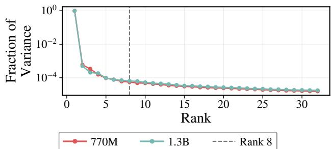  
Figure 11: KV-sharing Error Subspace is Low Rank. The variance within KV-sharing error subspace is well explained with a few directions.

$a _ { \mathrm { u n s h a r e d } } \in \mathbb { R } ^ { N \times d _ { h } }$ is the attention output using the first recurrence KV for the same N tokens (we use $N = 2 4 \mathrm { K }$ tokens).

Then, define $\delta = a _ { \mathrm { u n s h a r e d } } - a _ { \mathrm { s h a r e d } }$ as the per-token diferences between the attention outputs using first recurrence KV and shared KV.

We perform SVD on δ. In Figure 11, we observe that variance within δ is low-rank and well explained with 8 right singular vectors, defining our KV-sharing error subspace.

$$
\begin{array} { c } { \delta = U \Sigma V ^ { \top } \in \mathbb { R } ^ { N \times d _ { h } } } \\ { B _ { 8 } = V _ { : , 1 : 8 } } \end{array}
$$

Naive Patching Here we provide a more formal explanation of our Naive Patching work. We take the average across per token diferences within the subspace and project it back into the hidden dimension.

$$
\bar { a } = \left( \frac { 1 } { N } \mathbf { 1 } ^ { \top } \delta B _ { 8 } \right) B _ { 8 } ^ { \top }\tag{10}
$$

Then, during KV-sharing decode, we add the average projected subspace error to the first layer, first recurrence attention output per token.

$$
\hat { a } _ { \mathrm { s h a r e d } } ^ { t } = a _ { \mathrm { s h a r e d } } ^ { t } + \bar { a }\tag{11}
$$

All other layers receive no patch, and the first layer on all subsequent recurrences receives no patch.   
Naive Patching is nearly lossless in terms of KV-sharing quality (Table 3).

## F Parcae and Huginn Converge to Fixed-Points

In this section, we provide evidence that Parcae [50] and Huginn [20] contract to fixed-points.

Setup. We evaluate the publicly released Parcae 140M, 370M, 770M, and 1.3B checkpoints [50], together with Huginn 3.5B [20], without additional training. For each model, we process 1,000 sequences of length 2,048 from the climbmix validation set in BF16. We evaluate Parcae for 15 recurrences and Huginn for its standard 32 recurrences. At each recurrence T, we measure the relative change in the recurrent residual state,

$$
\Delta _ { h } ( T ) = \mathbb { E } _ { x } \bigg [ \frac { \| h _ { T } - h _ { T - 1 } \| _ { \mathrm { R M S } } } { \| h _ { T - 1 } \| _ { \mathrm { R M S } } } \bigg ] ,\tag{12}
$$

and the relative change in attention patterns,

$$
\Delta _ { A } ( T ) = \mathbb { E } _ { x , \ell , j } \left[ \frac { \lVert A _ { T } ^ { ( \ell , j ) } - A _ { T - 1 } ^ { ( \ell , j ) } \rVert _ { F } } { \lVert A _ { T - 1 } ^ { ( \ell , j ) } \rVert _ { F } } \right] ,\tag{13}
$$

where ℓ and j index recurrent-block layers and attention heads, respectively.

Results. As shown in Figure 12, residual states and attention patterns stabilize with recurrence depth across all models. Parcae 140M–770M converge rapidly, while Parcae 1.3B converges more slowly; Huginn exhibits the same behavior over its 32-recurrence horizon. Fixed-point dynamics are already present in the original pretrained models and are not specific to our KV-sharing experiments. All of these models were trained with stochastic-depth.

Parcae 140M  
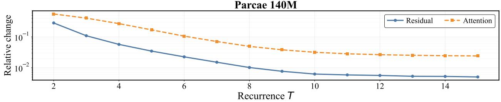

Parcae 370M  
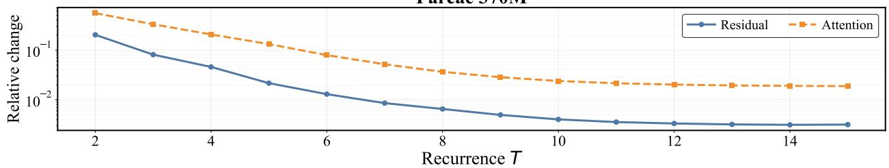

Parcae 770M  
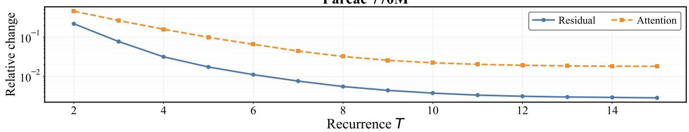

Parcae 1.3B  
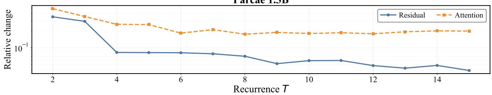

Huginn 3.5B  
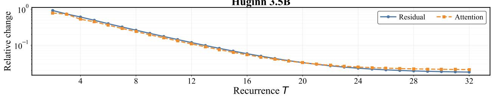  
Figure 12: Fixed-point convergence of pretrained looped models. Relative changes in the recurrent residual state and attention pattern decrease with recurrence depth for the released Parcae models and Huginn.

## G Expanded Results Comparing Stochastic and Static Sampling Depth Training

In this section, we investigate the emergence of KV-sharing by connecting it to fixed-point convergence in looped architectures. Specifically, we train size-matched Parcae models, using either stochastic or static recurrence depth, and compare their residual convergence, attention convergence, and quality under KV-sharing.

Setup. We follow the experimental setup of Prairie et al. [50], using Parcae [50] as the architectural backbone for our experiments (see Section N for model definitions), and trained with $\mu _ { \mathrm { r e c } } = 8$ and $\mu _ { \mathrm { b w d } } = 4 .$ . For stochastic depth training, we use a Poisson distribution following [50], while for static depth training, we forward pass exactly $\mu _ { \mathrm { r e c } }$ and a truncated backpropagation of exactly µbwd. We train on climbmix [16], using approximately 1:7 param-to-token ratios, and using the hyperparameters defined in Section O. Hyperparameters were selected after extensive tuning following Section M. Evaluation is done following Section C.

Stochastic and Static Depth Training. We compare models trained with stochastic recurrence depth against models trained at a static depth of $T \ = \ 8 .$ Both exhibit similar training-loss trajectories (Figure 13) and comparable uncompressed quality. However, KV-sharing is nearly lossless for stochastic-depth models at every scale, while static-depth models degrade substantially under compression (Table 8). Thus, the emergence of KV-sharing is associated with stochastic-depth training rather than ordinary language-model optimization alone.

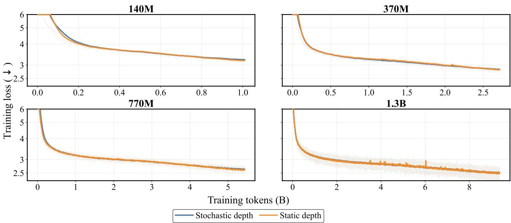  
Figure 13: Training Curves for Stochastic- and Static-Depth Models. Training loss as a function of training tokens across model scales. The curves closely overlap, showing that stochasticand static-depth training exhibit similar optimization dynamics.

<table><tr><td rowspan="2">Training</td><td rowspan="2"></td><td colspan="2">Val. PPL (↓)</td><td colspan="3">CORE (↑)</td></tr><tr><td>Unshared</td><td>Shared Δ</td><td>Unshared</td><td>Shared</td><td>Δ</td></tr><tr><td></td><td>Stochastic</td><td>25.68</td><td>25.67 -0.02</td><td>6.41</td><td>6.48</td><td>+0.08</td></tr><tr><td></td><td>Static</td><td>24.48</td><td>25.79 +1.31</td><td>9.17</td><td>8.55</td><td>-0.62</td></tr><tr><td>37010</td><td>Stochastic</td><td>17.34</td><td>17.36 +0.02</td><td>14.49</td><td>14.36</td><td>-0.13</td></tr><tr><td></td><td>Static</td><td>17.30</td><td>20.00 +2.70</td><td>15.00</td><td>14.22</td><td>-0.78</td></tr><tr><td>WOLL</td><td>Stochastic</td><td>14.03</td><td>14.04 +0.01</td><td>18.91</td><td>18.78</td><td>-0.13</td></tr><tr><td></td><td>Static</td><td>14.10</td><td>17.20 +3.10</td><td>18.17</td><td>17.11</td><td>-1.06</td></tr><tr><td>1</td><td>Stochastic</td><td>12.33</td><td>12.34</td><td>+0.01</td><td>23.63 23.34</td><td>-0.29</td></tr><tr><td></td><td>Static</td><td>12.32</td><td>15.17</td><td>+2.84</td><td>22.59 20.82</td><td>-1.77</td></tr></table>

Table 8: Quality under stochastic- and static-depth training. We compare the standard per-recurrence cache (Unshared) with final-recurrence KV sharing (Shared). $\Delta$ is Shared minus Unshared.

## H Extended Empirical Analysis on KV-Sharing Fixed Point Convergence Failures

In this section, we provide extended empirical evidence that KV-sharing failures in models trained with stochastic depth are fixed-point convergence failures. Specifically, we provide expanded empirical evidence that while contractive residual dynamics are necessary to induce KV-shareability, models can still fail to converge to the correct fixed points.

Setup. We use prior Parcae looped models [50] to explore our observations about KV-sharing failures. We additionally use models trained in Section 5.1, showing how BeNice! impacts fixed-point convergence, before and after finetuning. Following convergence observations made in Section F and the saturation of test-time compute made by Prairie et al. [50], we use T = 8 test-time recurrences, as both the residual diferences and downstream quality saturate at this point. We use climbmix [16] validation data for all evaluations and explorations.
<table><tr><td>Model</td><td> $\mathbb { E } [ \| \mathbf { h } _ { 8 } ^ { ( \mathrm { s h a r e d } ) } - \mathbf { h } _ { 8 } ^ { ( \mathrm { u n s h a r e d } ) } \| _ { 2 } ]$ </td><td> $\mathbb { E } [ \| \mathbf { h } _ { \mathbf { 8 } } ^ { ( \mathrm { u n s h a r e d } ) } \| _ { 2 } ]$   $\left[ { \frac { \lVert \mathbf { h } _ { \mathbf { 8 } } ^ { \mathrm { ( s h a r e d ) } } - \mathbf { h } _ { \mathbf { 8 } } ^ { \mathrm { ( u n s h a r e d ) } } \rVert _ { 2 } } { \lVert \mathbf { h } _ { \mathbf { 8 } } ^ { \mathrm { ( u n s h a r e d ) } } \rVert _ { 2 } } } \right]$  E</td></tr><tr><td>140M</td><td>0.4588</td><td>56.3 0.82</td></tr><tr><td>370M</td><td>2.2766</td><td>135.2 1.69</td></tr><tr><td>770M</td><td>186.35</td><td>153.4 134.8</td></tr><tr><td>1.3B</td><td>342.65</td><td>301.6 177.5</td></tr></table>

Table 9: Mean diference between shared and unshared final latents, mean unshared latent norm, and mean relative diference.

KV-sharing Fails to Converge Correctly. As visualized by Figure 4, we see that models that do not have KV-shareability from Table 1 (e.g., Parcae 770M and 1.3B) seem to have disjoint sets between unshared and shared fixed points, while models with KV-shareability have approximately similar distributions. We capture this numerically in Table 9, where we find that models that have KV-shareability approach a relatively similar fixed point. For example, Parcae 140M and 370M have a relative diference of 0.82% and 1.69%, respectively, which means they approached the same relative fixed point. However, Parcae 770M and 1.3B have an average relative diference of 134.8% and 177.5%, respectively, which means that they converge to diferent points with and without KV-sharing. Thus, Parcae 770M and 1.3B fail to have KV-shareability as they do not converge to the same fixed points as the base model.

<table><tr><td>Model</td><td>Baseline: Mean Relative Difference BENiCE!: Mean Relative Difference</td><td></td></tr><tr><td>140M</td><td>0.0526</td><td>0.0059</td></tr><tr><td>370M</td><td>0.1304</td><td>0.0059</td></tr><tr><td>770M</td><td>0.0957</td><td>0.0070</td></tr><tr><td>1.3B</td><td>0.1253</td><td>0.0049</td></tr></table>

Table 10: Mean Relative Diference of Fixed Points With and Without KV-sharing Before and After Post-training with BeNice!. Mean relative diference at each model scale for the baseline and BeNice!.

We further verify these results empirically with models trained in Section 5.1, where we find that all trained baseline Parcae models fail to converge to the same fixed point under KV-sharing (see Table 10), preventing them from having KV-shareability. However, after finetuning with BeNice!, we empirically observe that models converge to the correct fixed point, as seen by Table 10.

## I Extended Finetuning Setup

In this section, we provide more details about the BeNice! finetuning process.

Setup. Following the training procedures of Parcae in Prairie et al. [50], all models are trained using batch sizes of 256 at context length of 2048. Recurrence depth is sampled stochastically from $\Lambda \sim \mathrm { P o i s s o n } ( \mu _ { \mathrm { r e c } } )$ , where $\mu _ { \mathrm { r e c } } = 8 .$ , as in pretraining.

We use BeNice! on two generations of models: previously released Parcae models (770m and 1.3B) [50] and new Parcae style models trained from scratch (including the MLA and KDA models in Section 5.1. The publicly released models are finetuned using BeNice! with the same hyperparameters as their pretraining setup (see Prairie et al. [50]) and use 140M fineweb-edu [49] tokens. The new Parcae models are pretrained using hyperparameters described in Section O on climbmix [16] tokens, and are further finetuned on 140M climbmix tokens using BeNice!. Per-model finetuning learning rates and γ values are listed in Section O.

All BeNice! results are averaged across three diferently seeded finetuning runs evaluated on Core and Core-Ext using three diferent seeds as well.

## J LoRA Finetuning for KV-sharing

In this section, we show that KV-sharing can be achieved using a LoRA[28] finetuning version of BeNice!, which we denote BeNice!†.

Following our findings in Section 3 that the KV-sharing error subspace is low-rank (Figure 11), we finetune released Parcae 770M and 1.3B with low-rank adapters on the key and value weights of the first layer of the recurrent block. We use rank-8 adapters on both key and value weights and freeze the rest of the model weights, leading to 41K trainable parameters in the 770M model and 49K trainable parameters in the 1.3B model. We finetune using 65M fineweb-edu tokens with batch size 32 and sequence length 2048.

<table><tr><td colspan="2">Model</td><td colspan="3">Val. PPL (↓)</td><td colspan="3">Core (↑)</td><td colspan="3">Core-Extended (↑)</td></tr><tr><td colspan="2">Parcae</td><td>Unshared</td><td>Shared</td><td>Δ</td><td>Unshared</td><td>Shared</td><td>Δ</td><td>Unshared</td><td>Shared</td><td>Δ</td></tr><tr><td rowspan="5">WOLL</td><td></td><td>11.87</td><td>34.20</td><td>+22.33</td><td>25.05</td><td>21.10</td><td>-3.94</td><td>15.69</td><td>13.95</td><td>-1.74</td></tr><tr><td>+ Standard FT</td><td>11.86</td><td>21.61</td><td>+9.75</td><td>24.74</td><td>23.42</td><td>-1.32</td><td>15.34</td><td>14.54</td><td>-0.80</td></tr><tr><td>+ BENICE!</td><td>11.85</td><td>11.86</td><td>+0.01</td><td>25.15</td><td>25.19</td><td>+0.04</td><td>15.35</td><td>15.29</td><td>-0.06</td></tr><tr><td>+ BENICE!†</td><td>11.89</td><td>11.89</td><td>+0.00</td><td>24.69</td><td>24.71</td><td>+0.02</td><td>15.32</td><td>15.19</td><td>-0.13</td></tr><tr><td>Parcae</td><td>10.78</td><td>1.6e4</td><td>+1.6e4</td><td>28.78</td><td>21.33</td><td>-7.45</td><td>16.73</td><td>13.48</td><td>-3.25</td></tr><tr><td rowspan="4">1.B</td><td>+ Standard FT</td><td>10.79</td><td>18.52</td><td>+7.73</td><td>29.01</td><td>27.49</td><td>-1.51</td><td>17.23</td><td>16.66</td><td>-0.58</td></tr><tr><td>+ BENICE!</td><td>10.79</td><td>10.78</td><td>-0.01</td><td>28.63</td><td>28.67</td><td>+0.04</td><td>17.32</td><td>17.41</td><td>+0.09</td></tr><tr><td>+ BENICE!†</td><td>10.81</td><td>10.81</td><td>0.00</td><td>28.28</td><td>28.35</td><td>+0.07</td><td>16.94</td><td>16.96</td><td>+0.02</td></tr></table>

Table 11: Quality of BeNice! Finetuning Extended. We provide the extended results of finetuning using BeNice! and BeNice!†. Both enable KV-sharing while maintaining quality.

We use the same BeNice! loss function defined in Section 4. Hyperparameter details are in Section O. In Table 11, both BeNice! and BeNice!† enable KV-sharing while maintaining quality across benchmarks.

## K Extended Discussion of Experimental Setup for MLA and KDA Evaluation

In this section, we provide a more detailed description of the experimental setup for evaluating MLA [13] and KDA [65] versions of Parcae [50]. We will fully discuss how KV-sharing is done for both alternative sequence mixing methods. Hyperparameters and model configurations can be found in Section O and Section N, respectively. BeNice! finetuning is explained in Section I.

KV-sharing with Multi-Latent Attention Similarly to MHA [68], KV-sharing with MLA [13] is done by discarding the latent cache of indeterminate recurrences, and keeping only the final recurrences latent cache. More formally, for an input $h _ { t } \in \mathbb { R } ^ { n \times d }$ at recurrence t, the latent cache and the decoupled RoPE [61] caches are calculated as

$$
\begin{array} { r } { c _ { t } ^ { \mathrm { K V } } = W ^ { \mathrm { K V } } h _ { t } \qquad k _ { t } ^ { \mathrm { R o P E } } = \mathrm { R o P E } ( W ^ { \mathrm { R o P E } } h _ { t } ) , } \end{array}\tag{14}
$$

where RoPE(·) denotes the RoPE rotation [61]. Thus with KV-sharing MLA models, we discard all $c _ { t } ^ { \mathrm { K V } } , k _ { t } ^ { \mathrm { R o P E } }$ where $t < T$ keeping only the cache at $t = T$

KV-sharing with Kimi Delta Attention Again, like both MHA [68] and MLA [13], KV-sharing with KDA [65] is done by keeping only the final recurrences sequence-mixing hidden state. More formally, for an input $h _ { t }$ at recurrence t, we focus on the linear update rule used in KDA [65]

$$
S _ { t , i } = ( I - \beta _ { t , i } k _ { t , i } k _ { t , i } ^ { \top } ) \mathrm { D i a g } ( \alpha _ { t , i } ) S _ { t , i - 1 } + \beta _ { t , i } k _ { t , i } v _ { t , i } ^ { \top } \in \mathbb { R } ^ { d _ { k } \times d _ { v } }\tag{15}
$$

<table><tr><td rowspan="2"></td><td rowspan="2">Model</td><td colspan="3">Val. PPL (↓)</td></tr><tr><td>Unshared Layer &gt; 1, Recurrence &gt; 1</td><td>Naive Patching</td><td>Shared</td></tr><tr><td rowspan="4">VHA</td><td>140M</td><td>15.51</td><td>15.50 15.52</td><td>16.99</td></tr><tr><td>370M</td><td>11.57</td><td>11.56 11.56</td><td>3723</td></tr><tr><td>770M</td><td>9.78</td><td>10.49</td><td>36.66</td></tr><tr><td>1.3B</td><td>8.58</td><td>12.77</td><td>9.42</td></tr><tr><td rowspan="4">MA</td><td>140M</td><td>15.56</td><td>8.92 15.54 15.55</td><td>15.55</td></tr><tr><td>370M</td><td>11.67</td><td>11.64 11.66</td><td>22.72</td></tr><tr><td>770M</td><td>9.75</td><td>9.75 11.30</td><td>4894</td></tr><tr><td>140M</td><td>16.02</td><td>16.00 15.99</td><td>15.99</td></tr><tr><td rowspan="3">KDA</td><td>370M</td><td>11.74</td><td>11.73 11.73</td><td>11.77</td></tr><tr><td>770M</td><td>10.13</td><td>10.13 10.13</td><td>10.16</td></tr><tr><td></td><td></td><td></td><td></td></tr></table>

Table 12: KV-Sharing Failures on New Models. Preserving first-layer KVs from the first recurrence matches the unshared baseline across model sizes and sequence mixers. Mean patching fails to fully recover quality for MLA at 770M. KV-sharing fails for MLA models as size increases. Surprisingly, KDA models have KV-sharing out-of-the-box.

where $\beta _ { i } = W ^ { \beta } h _ { t , i } \in \mathbb { R } , \alpha _ { i } = W ^ { \alpha } h _ { t , i } \in \mathbb { R } ^ { d _ { k } } , k _ { i } = W ^ { \mathrm { K } } h _ { t , i } \in \mathbb { R } ^ { d _ { k } }$ , and $v _ { i } = W _ { v } h _ { t , i } \in \mathbb { R } ^ { d _ { v } }$ and $W ^ { \beta } , W ^ { \alpha } , W ^ { \mathrm { K } } , W ^ { \mathrm { V } }$ are learned projections. Thus with KV-sharing KDA models, we discard all $S _ { t , i }$ where $t < T$ and all i up to our current decode token.

## L Extended Compression and Patching Results for Newly Pretrained Models

In Table 12 we explore the KV-sharing ability of the base pretrained Parcae models introduced in Section 5.1 (Table 4, see Section N for configurations and Section O for hyperparameters). All four MHA models have KV-sharing errors. Preserving the first-layer KVs from the first recurrence in addition to normal KV-sharing maintains lossless quality for all models except the 1.3B model. The 1.3B model also has further quality degradation when using Naive Patching. Interestingly, in Table 4 using BeNice! on the 1.3B model leads to near lossless quality, performing much better than the sub-optimal (in terms of memory eficiency) additional first layer, first recurrence KV-cache during KV-sharing.

We also explore the KV-sharing ability of MLA and KDA variants of Parcae in Table 12. MLA variants of Parcae have the same failure mode of KV-sharing as released Parcae models. Mean patching fails to recover quality for our MLA model at 770M size. KDA models perform well on KV-sharing out-of-the-box.

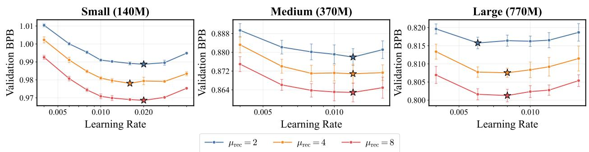

Figure 14: Transferability of Learning Rate. Optimal learning rate transfers strongly across deeper recurrences for all model backbones.  
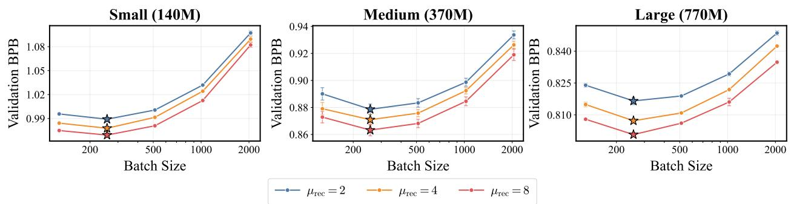  
Figure 15: Transferability of Batch Size. Optimal batch size transfers strongly across deeper recurrences for all model backbones.

## M Optimal Hyperparameter Transferability Across Recurrence

While several works have shown how optimal hyperparameter transfer varies with tokens [9, 59] and model size [72], we explore how scaling recurrence [50] is afected. Specifically, in this section, we investigate how optimal hyperparameters (e.g., learning rate, batch size, etc.) are afected by increasing recurrence at multiple parameter classes.

Setup. We follow the model configuration and architecture backbone of Prairie et al. [50] (see Section N for extend details), and train using ClimbMix [16]. We evaluate the transferability of learning rate, momentum, warm-up ratios, and batch size across $\mu _ { \mathrm { r e c } } \in \{ 2 , 4 , 8 \}$ using 140M, 370M, and 770M parameter backbones. To ensure robustness, for each hyperparameter, recurrence, backbones data point, we train three models using diferent seeds, 42, 1234, 2345, and then use the average of these runs. This totals to 504 runs for this ablation and approximately 4,685 H100 hours.

Optimal Hyperparameters Transfer Strongly Across Increased Recurrence. As seen in Figure 14 and Figure 15, we find that across all model classes optimal learning rate and batch size transfer strongly. We further find this to be true of other minor hyperparameters (e.g., muon momentum and warmup ratio), with some minor variation in flat regions. This finding implies that lower recurrence $( \mathrm { i . e . , } \mu _ { \mathrm { r e c } } = 2 )$ can be used to cheaply sweep for optimal hyperparameters, which in general remain optimal at higher recurrences. drastically reduces the necessary FLOPs required to find optimal hyperparameters for looped architectures.

<table><tr><td>Hyperparameter Model</td><td colspan="4"> $2 \iff 4$   $2 \iff 8$   $4 \iff 8$  Mean  $\Delta \mathrm { B P B } ~ ( \times 1 0 ^ { - 3 } )$ </td></tr><tr><td>Learning Rate</td><td>140M</td><td>0.950 0.967</td><td>0.900</td><td>0.939 41.805</td></tr><tr><td>Learning Rate</td><td>370M</td><td>0.943 1.000</td><td>0.943</td><td>0.962 26.483</td></tr><tr><td>Learning Rate</td><td>770M</td><td>0.829 0.829</td><td>1.000 0.886</td><td>18.373</td></tr><tr><td>Muon Momentum</td><td>140M</td><td>0.900 0.700</td><td>0.900 0.833</td><td>37.269</td></tr><tr><td>Muon Momentum</td><td>370M</td><td>1.000 1.000</td><td>1.000</td><td>1.000 25.083</td></tr><tr><td>Warmup Fraction</td><td>140M</td><td>0.600 0.900</td><td>0.700</td><td>0.733 22.614</td></tr><tr><td>Warmup Fraction</td><td>370M</td><td>0.700 0.700</td><td>1.000</td><td>0.800 19.451</td></tr><tr><td>Batch Size</td><td>140M</td><td>1.000 1.000</td><td>1.000</td><td>1.000 128.046</td></tr><tr><td>Batch Size</td><td>370M</td><td>1.000 1.000</td><td>1.000</td><td>1.000 70.462</td></tr><tr><td>Batch Size</td><td>770M</td><td>1.000 1.000</td><td>1.000</td><td>1.000 47.777</td></tr></table>

Table 13: Spearman Rank Correlation of Hyperparameter curves across Recurrence. Here $x \iff y$ is the Spearman correlation between the validation BPB hyperparameter curves of a model trained with $\mu _ { \mathrm { r e c } } = x$ and a model trained with $\mu _ { \mathrm { r e c } } = y$ . Furthermore, $\Delta$ BPB indicates the validation BPB span across all (recurrence schedule × hyperparameter values) points for that specific parameter class. While Spearman correlation is not 1 in all transfers, we observe that low Spearman correlation coincides with a lower $\Delta \mathrm { \ B P B }$ span, which resolves to slight noise on a relatively flat landscape for hyperparameter tuning.  
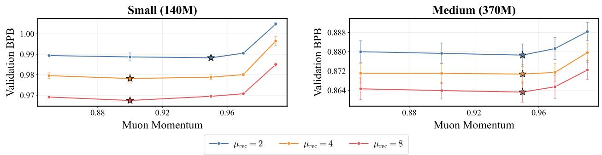  
Figure 16: Transferability of Muon Momentum. We observe optimal muon momentum to transfer well across recurrences, with some minor variation in relatively flat regions.

Furthermore, as seen in Table 13, we observe a high Spearman rank correlation between the validation BPB across hyperparameter sweeps at diferent recurrences. While Spearman correlation is not 1 for all hyperparameters, we find that this is derived from noisy and flat hyperparameter landscapes. Thus, generally, we observe that most hyperparameters appear to transfer across recurrences, motivating our use of extremely low recurrence for hyperparameter tuning.

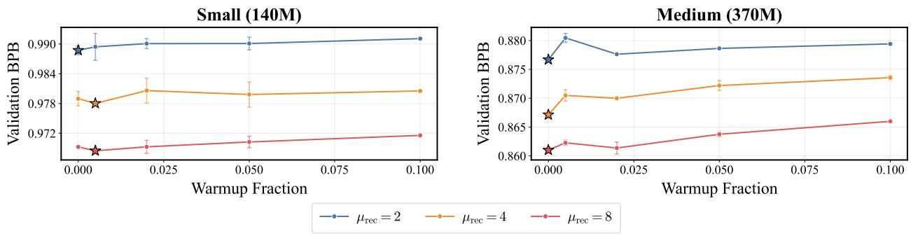  
Figure 17: Transferability of Warmup Ratio. We observe optimal warmup ratios to transfer well across recurrences, with some minor variation in relatively flat regions.

## N Model Definitions and Configurations

In this section, we discuss the model definition used for our experiments. For our experiments done in Section 3 for our Stochastic and Static comparison, the models follow the configuration and hyperparameters presented in Table 14 and Section O respectively, with two notable exceptions. First, for both models, we use a 1:7 param to token ratio. Second, for the Static depth models, recurrence depth sampling does not follow the Poisson distribution, and is instead held deterministically at µrec = 8 recurrences.

Our models present in pretraining results in Section 5.1 also use the model configurations in Table 14 along with the hyperparameters present in Table 16. Our optimizer parameter group assignment for all models (including those present in Section 3) can be found in Table 15.

## O Hyperparameters and Training Details

In this section, we will discuss the hyperparameter configuration used in Section 5.1.

Pretraining. All pretraining hyperparameters are present in Table 16, with the notable exception of the Stochastic and Static recurrence depth models present in Section 3. Those exceptions are explained in Section G.

BeNice! and Standard Finetuning. For both BeNice! and Standard Finetuning, we sweep over learning rates, ${ \mathrm { l r } } \in \{ 5 e ^ { - 6 } , 1 e ^ { - 5 } , 2 e ^ { - 5 } , 3 e ^ { - 5 }$ $5 e ^ { - 5 } , 8 ^ { - 5 } , 1 . 2 5 e ^ { - 4 } , 2 e ^ { - 4 } , 3 e ^ { - 4 } , 4 . 5 e ^ { - 4 } , 6 e ^ { - 4 } \}$ and $\gamma \in \{ 0 . 0 1 , 0 . 0 3 , 0 . 1 , 0 . 3 , 1 , 3 \}$ . We perform these sweeps with an optimizer budget of 500 steps. For Standard Finetuning, we find 770M models (across MHA, MLA, and KDA) to perform best at a learning rate of $2 e ^ { - 4 }$ , while the 1.3B models perform best at $8 e ^ { - 5 }$ on a held out validation set. For BeNice! we find all models perform best at a learning rate of $1 . 2 5 e ^ { - 4 }$ and with $\mathrm { ~ a ~ } \gamma$ of 0.01 on a held out validation set. Since we sweep over learning rates with an optimizer budget of 500 steps, we rescale our learning rate to account for the increase in optimizer budget (1800 steps). Specifically, all final learning rates are $\mathrm { l r _ { o p t i m } * \frac { 5 0 0 } { 1 8 0 0 } }$

<table><tr><td></td><td></td><td>Small (140M)</td><td>Medium ( (370M)</td><td>Large (770M)</td><td>XLarge (1.3B)</td></tr><tr><td rowspan="5">Arcceure</td><td>Layers in P</td><td>2</td><td>4</td><td>6</td><td>8</td></tr><tr><td>Layers in R</td><td>2</td><td>4</td><td>6</td><td>8</td></tr><tr><td>Layers in C</td><td>2</td><td>4</td><td>6</td><td>8</td></tr><tr><td> $d _ { \mathrm { m o d e l } }$ </td><td>768</td><td>1,024</td><td>1,280</td><td>1,536</td></tr><tr><td>dintermediate</td><td>3,072</td><td>4,096</td><td>5,120</td><td>6,144</td></tr><tr><td rowspan="4">VHA</td><td>Attention</td><td rowspan="4">6</td><td>Causal Self-Attention [68] w/ QK-Norm [26]</td><td></td><td rowspan="4">12</td></tr><tr><td>Attention Heads</td><td>8</td><td>10</td></tr><tr><td>Head Dimension</td><td>128</td><td></td></tr><tr><td>Pos. Embed.</td><td colspan="2">RoPE (θ=50,000) [61]</td></tr><tr><td rowspan="7">MA</td><td>Attention</td><td colspan="3">Causal Multi-Head Latent Attention [13]</td><td rowspan="6">12</td></tr><tr><td>Attention Heads</td><td>6</td><td>8</td></tr><tr><td>KV LoRA Rank</td><td></td><td>10 512</td></tr><tr><td>QK NoPE Head Dimension</td><td>128</td><td></td></tr><tr><td>QK RoPE Head Dimension</td><td></td><td>64</td></tr><tr><td>V Head Dimension</td><td></td><td>128</td></tr><tr><td>Pos. Embed.</td><td></td><td>RoPE (θ=50,000) [61]</td></tr><tr><td rowspan="5">KDA</td><td>Attention</td><td rowspan="5"></td><td>Causal Kimi Delta Attention [65] 10</td><td rowspan="5"></td><td rowspan="5">12</td></tr><tr><td>Attention Heads</td><td>8</td></tr><tr><td>Decay Gate</td><td>Lower bound at —5</td></tr><tr><td>Head Dimension</td><td>128</td></tr><tr><td>Convolution Kernel Size</td><td>4</td></tr><tr><td rowspan="8">Shad Dharis</td><td>MLP</td><td rowspan="8"></td><td> $\mathrm { R e L U } ^ { 2 } \ [ 7 6 ]$ </td><td></td></tr><tr><td></td><td></td></tr><tr><td>Value Embeddings Vocab Size</td><td>Gated, alternating layers [66]</td></tr><tr><td>Norm</td><td>32,768 RMS-Norm (Pre-Norm) [75]</td></tr><tr><td>Context Length</td><td>2,048</td></tr><tr><td>Bias</td><td>None</td></tr><tr><td>Init.</td><td>Scaled-zero [34, 62]</td></tr><tr><td>Tied Embeddings</td><td>Yes</td></tr><tr><td rowspan="5">Parcade</td><td></td><td rowspan="5"></td><td></td><td></td><td rowspan="5"></td></tr><tr><td>Injection</td><td>Diagonal</td></tr><tr><td>State Init.</td><td>like-init [20]</td></tr><tr><td>μrec</td><td>8 4</td></tr><tr><td>Backprop Depth Sampling</td><td>Poisson (truncated, per-sequence)</td></tr></table>

Table 14: Model definitions of baseline Parcae [50], Parcae with MLA, and Parcae with KDA.
<table><tr><td>Optimizer</td><td>Parameters</td></tr><tr><td>AdamW [36]</td><td>Token embeddings (wte) LM head (1m_head) Normalization layers (RMSNorm) Value embedding gates (ve_gate) All 1D parameters Injection parameters (A, ∆, B) Readout projection (C)</td></tr><tr><td>Muon [32]</td><td>Attention projections  $( W _ { Q } , W _ { K } , W _ { V } , W _ { O } )$  MLP weights  $( W _ { \mathrm { f c } } , W _ { \mathrm { p r o j } } )$ </td></tr></table>

Table 15: Optimizer parameter group assignment for Parcae.

<table><tr><td></td><td>Small (140M)</td><td>Medium (370M)</td><td>Large (770M)</td><td>XLarge (1.3B)</td></tr><tr><td>AdamW and Muon Learning Rate</td><td> $2 e ^ { - 2 }$ </td><td> $1 . 2 e ^ { - 2 }$ </td><td> $6 e ^ { - 3 }$ </td><td> $5 e ^ { - 3 }$ </td></tr><tr><td>Warmup Ratio</td><td></td><td>0.05</td><td></td><td></td></tr><tr><td>Constant Decay Ratio</td><td></td><td>0.2</td><td></td><td></td></tr><tr><td>Gradient Clipping</td><td></td><td>1.0</td><td></td><td></td></tr><tr><td>Muon Momentum</td><td></td><td>0.95</td><td></td><td></td></tr><tr><td>Muon Weight Decay</td><td></td><td>0.3</td><td></td><td></td></tr><tr><td>Muon Orthogonalization Steps</td><td></td><td>5</td><td></td><td></td></tr><tr><td>AdamW Betas</td><td></td><td>(0.8,0.95)</td><td></td><td></td></tr><tr><td>AdamW Weight Decay</td><td></td><td>0.1</td><td></td><td></td></tr><tr><td>AdamW Epsilon</td><td></td><td> $1 e ^ { - 1 0 }$ </td><td></td><td></td></tr><tr><td>Batch Size</td><td></td><td></td><td></td><td></td></tr><tr><td>Context Length</td><td></td><td>256</td><td></td><td></td></tr><tr><td>Param to Token Ratio</td><td></td><td>2048</td><td></td><td></td></tr><tr><td>Precision</td><td></td><td>1:80 bf16-mixed</td><td></td><td></td></tr></table>

Table 16: Pretraining Hyperparameters for climbmix trained Parcae models (including MLA and KDA variants).

BeNice!† Finetuning. For BeNice!†, we perform a more limited hyperparameter sweep on a limited model set: the released Parcae 770M and 1.3B models. We sweep over lr $\in \{ 3 e ^ { - 4 } , 1 e ^ { - \bar { 3 } } \}$ and $\gamma \in \{ 0 . 0 6 , 0 . 1 2 , 0 . 2 5 , 1 \}$ for the full 1000 step optimizer budget. For both models, a learning rate of 1e−3 and a γ of 0.06 performed best on a held out validation set. We use a rank 8 adapter with an $\alpha = 1 6$