# Bifurcations from Weight Space: JEPAWG on Parametric Dynamical Systems

Tobias Göbel1,2

Miranda C. N. Cheng1,3∗

1Institute for Mathematics, Academia Sinica, Taipei, Taiwan 2Department of Physics, National Taiwan University, Taipei, Taiwan 3Institute of Physics, University of Amsterdam, Amsterdam, Netherlands

## Abstract

Trained network weights are increasingly treated as data, but there is rarely ground truth about what a population of models should encode, which hampers systematic validation of weight-space methods. This makes parametric dynamical systems a natural test-bed: the dynamics change qualitatively at submanifolds of parameter space that are, in well-studied families, known analytically or numerically. Finetuning a forecasting network at each point of a parameter grid yields a model zoo indexed by a physical parameter, against which weight-space diagnostics can be checked.

We build such model zoos for four dynamical systems and analyse them with JEPAWG, a recently proposed joint-embedding hypernetwork built around a learned parameter–weight representation. It was first introduced for neural samplers for lattice field theories, where its latent geometry located the phase transition and estimated the 2D Ising critical exponent. Applied to dynamical systems, JEPAWG is competitive on forecasting with a hypernetwork trained directly for that task, despite being supervised on the parameter–weight correspondence rather than on forecasts. Beyond forecasting, the norm of the parameter-derivative of the decoded weights locates Hopf points and curves, tracks a period-doubling cascade closely enough to give a qualitative estimate of the Feigenbaum constant, and detects a global bifurcation, which has no eigenvalue signature and is therefore invisible to linearisation. As such, JEPAWG provides interpretable insight into the dynamics that is not available from other hypernetworks. Together, these results indicate that JEPAWG is a workable instrument for reading physical structure off a population of trained networks.

## 1 Introduction

With the growing number and scope of trained neural networks, the weights have increasingly become an object of study themselves. Collections of networks trained under controlled variation, model zoos [1], are used as datasets in their own right: to predict properties of a network from its weights, to average models into stronger ones (model soups [2]), or to learn representations of weight space itself. A related line of work builds hypernetworks [3] generating the weights of a target network from a conditioning input, treating weights not as data but as the output to be produced.

A model zoo becomes a parametrised model zoo when each of its members is associated with a value of a continuous task parameter p. Because the task the members are trained for differs only through p, such a zoo carries information about the system the task operates in, and analysing the zoo, rather than any single network in it, becomes a way to study that system. JEPAWG (JEPA Weight Generation) [4] realises this vision through an interpretable hypernetwork: it learns a joint latent space of model weights and task parameters with a joint-embedding predictive architecture (JEPA) objective [5]. Afterwards, it trains a decoder from this latent back to weight space, which enables the generation of weights at unseen parameters. The parameter derivative of the decoded weights exposes qualitative changes in the underlying dynamics. JEPAWG was first applied in lattice field theory, where its latent space was shown to locate the Ising phase transition and estimate its critical exponent. Here we consider parametric dynamical systems, which provide a natural test-bed: data generation is cheap, and the dynamics change qualitatively on bifurcations, submanifolds of parameter space whose location is, for the families we study, known analytically or numerically.

In this work we build parametrised model zoos for four dynamical systems, train the JEPAWG architecture, and study the result from two perspectives: as a hypernetwork, by evaluating the generated forecasters at unseen parameters, and as a probe of the dynamics, by testing whether the derivative of the decoded weights with respect to the control parameters localises the known bifurcations. We find that JEPAWG is competitive with an end-to-end hypernetwork on held-out interpolation parameters, despite never being trained on the forecasting loss. As a probe for the underlying dynamical systems, the weight-space response localises Hopf points and curves, resolves a period-doubling cascade, and registers a global bifurcation. Our main contributions are the following.

A weight-space benchmark with known ground truth Parametric dynamical systems supply an independent statement of what a population should encode. Crossing a bifurcation qualitatively changes the dynamics, so networks trained on either side should differ in weight space. We construct zoos for four families with established bifurcation structure, against which weight-space diagnostics can be validated: the Brusselator Hopf curve $b _ { c } = 1 + a ^ { 2 }$ , the Lorenz Hopf locus $\rho _ { H } ( \sigma )$ at $\bar { \beta } = 8 / 3$ the period-doubling cascades of the Rössler oscillator and the Hénon map, whose accumulation should recover the Feigenbaum constant δ ≈ 4.6692.

Detection of local bifurcations The parameter derivative of the decoded weights peaks where the dynamics are most sensitive to the parameter, which happens near local bifurcations. For the Lorenz system $( \sigma = 1 0 , \beta = 8 / 3 )$ the peak lies at $\rho = 2 4 . 5 1 \pm 0 . 2 3$ , inside the bistable window preceding the subcritical Hopf point $\rho _ { H } \approx 2 4 . 7 4$ , and tracks $\rho _ { H } ( \sigma )$ when both parameters are swept. The response also locates the supercritical Hopf curve of the Brusselator, and in the Hénon map it resolves the first five period doublings accurately enough to provide a qualitative estimate of the Feigenbaum constant δ.

Detection of a global bifurcation Global bifurcations, unlike local bifurcations, are not visible in the linearisation and traditionally require computing invariant manifolds or scanning attractor-level observables. The same derivative again detects the Lorenz Bykov T-point, at which every fixed point retains its stability. This shows that information inaccessible to a Jacobian computation can be read off the geometry of the JEPAWG-generated weights.

The decoded map as a regulariser of the weight grid The fine-tuned weights carry per-run training noise that dominates their parameter derivative. The decoder, fitted on a fixed embedding of the parameter, does not reproduce this noise (Fig. 3a), and the decoded weights retain accurate forecasts for longer than the fine-tuned weights on all four systems (Table 5). The JEPA-style latent is organised by dynamical regime, has an intrinsic dimension that is close to dim p (Fig. 4b, Table 4), and is insensitive to parameters that do not enter the dynamics (Appendix B, Fig. 8).

## 2 Related Work

Trained weights as data. Model zoos [1] assemble populations of networks trained under controlled variation, and permutation-aware encoders and neural functionals [6, 7] learn structure over weight space directly. More recently Falk et al. [8] argues that useful weight-space representations can be learned from unstructured public model repositories, without curated zoos. That line targets prediction of model properties across heterogeneous populations. We study a single population indexed by a physical parameter, where known bifurcation structure provides ground truth for weight-space diagnostics.

Hypernetworks for dynamical systems. Hypernetworks, networks that generate the weights of another network [3], have recently been applied to parametric dynamical systems. PHLieNet [9] learns a continuous parameter-to-weights map by back-propagating through the forecasting loss, generalising recurrent forecasters that take $p$ as an additional input. It is indexed by the control parameter, but its weights are constrained only by forecasting accuracy, and in our experiments its parameter derivative shows no discernible bifurcation signal (Section 5.2.1). CoDA [10] adapts a shared forecaster through context-dependent low-rank weight corrections, and TiDHy [11] generates, from a latent state, the weights that mix several linear systems evolving on different timescales. Both condition on a variable inferred from trajectories rather than on the control parameter, so their weights are not indexed by a directly interpretable physical quantity. In each case the weights are a means to accurate prediction. In this work forecasting remains a requirement, but the map from parameter to weights carries the additional role of a diagnostic.

Transitions read off learned models. Machine learning has been used to locate phase transitions without a known order parameter, from classifiers trained on raw configurations [12] to the accuracy of classifiers trained on deliberately mislabelled data [13]. Closer to the present work are approaches that read the transition off the parameters of trained networks rather than their outputs. Tanaka and Tomiya [14] observed that the weights of a network trained to predict the temperature of Ising configurations organise into two domains whose boundary approximates the critical temperature. Hernandes et al. [15] fine-tune neural quantum states adiabatically across a phase diagram, so that the resulting weights are strongly correlated, and detect quantum phase transitions as structure in weight space. JEPAWG [4] instead learns a map from couplings to the weights of normalising flows for a scalar lattice field theory through a JEPA-style [5] latent space, whose geometry locates the phase transition and encodes a finite-size shift consistent with the 2D Ising critical exponent. In the present work we transfer this approach to dynamical systems, where the known bifurcation structure provides ground truth.

Within dynamical systems, data-driven approaches to bifurcations have stayed close to local, equilibrium-based theory. Bury et al. [16, 17] train classifiers on noisy normal-form simulations to detect the critical slowing down that precedes a bifurcation in a time series and predict its type, including period doubling in discrete-time maps. Mogharabin and Ghadami [18] fit a normal form on a learned low-dimensional invariant manifold, and Pal and Melnik [19] locate saddle-nodes from a learned equilibrium-to-parameter map trained on the governing equations. All of these target bifurcations of a single equilibrium, and Bury et al. [17] explicitly leave global bifurcations outside their scope. We instead differentiate a map from the parameter to the weights of a model of the full dynamics. This requires no order parameter, linearisation or governing equations, and remains defined for transitions that are not a property of any single equilibrium or periodic orbit, such as global bifurcations [20, 21].

## 3 Background

Parametric dynamical systems and bifurcations Consider a parametric dynamical system whose evolution is governed by

$$
\frac { d x } { d t } = f ( x ; p ) ,\tag{1}
$$

where $x \in \mathbb { R } ^ { D _ { x } }$ is the state, t is time, and $p \in \mathbb { R } ^ { D _ { p } }$ is a vector of control parameters. Trajectories can be obtained with any integration scheme $( \mathrm { e . g }$ . Euler or Runge–Kutta). For discrete-time maps the evolution is given by $x _ { n + 1 } = F ( x _ { n } ; p )$ , producing a discrete sequence of states instead of a continuous path.

The long-time behaviour of such a system is characterised by its attractors, the sets toward which trajectories converge. Depending on the parameter p, different types of attractors can arise: fixed points, limit cycles (periodic orbits), or strange attractors, on which the dynamics are chaotic. As the control parameters vary, an attractor can lose stability and the dynamics reorganise qualitatively; such a change is called a bifurcation. The submanifolds of parameter space on which bifurcations occur partition it into regions of qualitatively distinct dynamics [22, 23]. Two types recur in this work: the Hopfbifurcation, in which a fixed point loses stability, and the period-doubling bifurcation, in which a periodic orbit of period τ is replaced by one of period 2τ. Many systems reach chaos through an infinite cascade of such doublings.

Local bifurcations, including the two types mentioned above, happen at a single fixed point or orbit and are visible in the linearisation there: a Hopf bifurcation is an eigenvalue pair of the Jacobian crossing the imaginary axis, a period doubling a Floquet multiplier crossing −1. Such conditions can be solved in closed form or tracked numerically, which is how the analytic reference values we validate against in this work are obtained [23].

Global bifurcations admit no such local criterion: there is no single fixed point or orbit whose linearisation registers the change. They instead involve the invariant manifolds of a saddle. $\mathbf { A }$ saddle carries an unstable manifold, the trajectories that emerge from it, and a stable manifold, the trajectories that converge to it. Both extend far into state space. A one-dimensional unstable manifold generically misses the stable manifold of a saddle, since their coincidence is one scalar condition on the parameters; at isolated parameter values, however, it lands exactly on one, either of the same saddle (a homoclinic connection) or of another (a heteroclinic connection). When this happens the global arrangement of trajectories reorganises, yet every fixed point keeps its stability. As a result there are no eigenvalue signals for this change. Finding global bifurcations therefore traditionally requires computing the invariant manifolds themselves, or scanning attractor-level observables across parameter space.

In this work we locate both classes by a route that uses neither the linearisation nor an explicit analysis of trajectories. At each parameter value $p _ { i }$ we train a small network $( \sim 1 0 ^ { 4 }$ weights) to forecast the dynamics, so that the model zoo supplies a family of trained weight vectors $\{ \theta ( p _ { i } ) \}$ }. Each network is fine-tuned only on trajectories generated at its own $p _ { i }$ , so its weights encode how the system behaves there; when the dynamics reorganise, the weights must change rapidly. A bifurcation is then visible as a large sensitivity of the weights to the parameter, a quantity we make precise in Section 4.3.

The first step is to build a forecasting model, by which we mean a function that predicts the future evolution of the state from a short observed history together with the parameter values $p .$ We call such a function a parametricforecaster, and specify the architecture we use below.

Forecasting The forecasting task is to predict the evolution of a state $x _ { t }$ given its history $\left( x _ { t - T + 1 } , \ldots , x _ { t } \right)$ and the parameter vector $p .$ The next state is obtained through a neural network that predicts the finite difference:

$$
\hat { d } _ { t } ~ = ~ f _ { \theta } \big ( x _ { t - T + 1 : t } ; p \big ) , ~ x _ { t + 1 } ~ \approx ~ x _ { t } + \Delta t \cdot \hat { d } _ { t } ,\tag{2}
$$

where $T$ is the input sequence length (the history-window size), $\Delta t$ is the observation interval $( \Delta t = 1$ for discrete maps) and $\dot { \boldsymbol { \theta } }$ are the network weights. Given windows drawn from the trajectories at each parameter, the weights are fitted by minimising the derivative-matching loss

$$
\mathcal { L } _ { p } ( \boldsymbol { \theta } ) = \sum _ { k , t } \big | \big | f _ { \boldsymbol { \theta } } ( x _ { t - T + 1 : t } ^ { ( k ) } ; p ) - ( x _ { t + 1 } ^ { ( k ) } - x _ { t } ^ { ( k ) } ) / \Delta t \big | \big | ^ { 2 } ,\tag{3}
$$

where k, t index initial conditions and window positions. The forecasting networks considered in this work are trained with this objective: for the p-conditional network of Section 4.1 (summed over the training parameters $p _ { i } ) ;$ for the per-parameter fine-tuning that produces each $\theta _ { i } ;$ and for the hypernetwork baseline below, where $\theta$ is generated from $p .$ Models that have been employed for learning this type of sequential data include Recurrent Neural Networks (RNNs) [24], LSTMs [25, 26], Transformers [27, 28] and Temporal Convolutional Neural Networks with Causal Dilated convolutions (TCNN-CD) [29]. Throughout this work we use the TCNN-CD architecture as the forecasting network $f _ { \theta } ,$ , whose stacked causal convolutions, with exponentially growing dilations, provide a long receptive field without recurrence.

## 3.1 Forecasting Hypernetworks

A forecaster can be made aware of the parameter vector p in several ways. The simplest is not to condition on $p$ at all and to let the model infer the dynamics from the state history alone. Alternatively, extending the state vector as $\boldsymbol { x } ^ { \prime } = [ \boldsymbol { x } , p ]$ gives the model direct knowledge of the parameter setting. As a third option, we consider a hypernetwork: a separate neural network that learns to map a given parameter to a weight vector, $p \mapsto \theta .$ . The resulting weights $\theta$ then parametrise the forecasting network $f _ { \theta }$ , which predicts the state evolution.

PHLieNet One such hypernetwork for dynamical systems is PHLieNet [9], which is trained endto-end. A Learned Interpolated Embedding (LIE) maps the parameter p to a continuous embedding $e ( p ) \in \mathbb { R } ^ { d _ { \epsilon } }$ by softmax-RBF interpolation between learned embedding vectors placed at fixed anchor positions, and a small MLP, the hypernetwork HN, maps $e ( p )$ to the flattened weight vector θ of the TCNN-CD. Only the anchor embeddings and the hypernetwork are trainable; the TCNN-CD weights are generated per parameter. Training minimises the loss (3) at the generated weights, summed over the set of parameters, $\begin{array} { r } { \sum _ { i } \mathcal { L } _ { p _ { i } } \big ( \mathrm { H N } ( e \overline { { ( \boldsymbol { p } _ { i } } } ) ) \big ) } \end{array}$ .

Two consequences of this design matter for what follows. First, the parameter-to-weights map is supervised only through the forecasting loss, which leaves the weight-space geometry unconstrained: the map is free to organise the latent as long as the forecasts are accurate. Second, the LIE anchors only cover the training range by construction and softmax-RBF interpolation saturates outside the anchor support, so PHLieNet is an interpolation architecture by design.

JEPAWG Instead of training a hypernetwork through the forecasting loss, one can treat trained network weights themselves as data. This is the approach of JEPAWG [4]. First, one prepares a collection of per-parameter weights $\{ ( p _ { i } , \theta _ { i } ) \} _ { i = 1 } ^ { M }$ by training a forecaster at each parameter value. A joint-embedding predictive architecture (JEPA) [5] is then trained on that collection: the parameters and the weights are treated as two views of the same object, and the weight embedding is predicted from the parameter embedding, so that the objective is defined in latent space. A decoder back to weight space is trained separately, and weights at a new parameter are obtained by composing the parameter encoder, the predictor and the decoder. Concretely, JEPAWG has four learnable components: a weight encoder $E _ { \theta } { } _ { : }$ , a parameter encoder $E _ { p } ,$ , a latent predictor $P ,$ , and a decoder D. The first three are trained jointly, and the decoder afterwards with them frozen:

Stage 1 Train $( E _ { \theta } , E _ { p } , P )$ with the JEPA/VICReg [30] loss

$$
\begin{array} { r } { \mathcal { L } _ { \mathrm { J E P A } } = w _ { \mathrm { i n v } } \Vert P ( z _ { c } ) - z _ { w } \Vert ^ { 2 } + w _ { \mathrm { v a r } } \big ( \mathbf { V } ( z _ { w } ) + \mathbf { V } ( z _ { c } ) \big ) , \qquad z _ { w } = E _ { \theta } ( \theta ) , z _ { c } = E _ { p } ( p ) . } \end{array}\tag{4}
$$

The variance term $\begin{array} { r } { \mathbf { V } ( z ) = \frac { 1 } { d _ { z } } \sum _ { j = 1 } ^ { d _ { z } } \operatorname* { m a x } \bigl ( 0 , \gamma - s _ { j } ( z ) \bigr ) } \end{array}$ , with $s _ { j } ( z )$ the standard deviation of latent dimension $j$ over the batch and margin $\gamma = 1$ , prevents the encoders from collapsing to a constant. The standard VICReg covariance term is omitted $( w _ { \mathrm { c o v } } = 0 )$ .

Stage 2 Freeze $E _ { \theta } , E _ { p } , P$ and train the decoder by MSE in weight space:

$$
\mathcal { L } _ { \mathrm { D e c } } \ : = \ : \left\| D \big ( P ( E _ { p } ( p _ { i } ) ) \big ) - \theta _ { i } \right\| ^ { 2 } .\tag{5}
$$

At inference, weights are generated by composing the parameter encoder, latent predictor and decoder: $\hat { \theta } ( p ) = D \big ( P ( E _ { p } ( p ) ) \big )$ , yielding forecasting networks at unseen parameters. Moreover, since the latent space is organised by the parameter-weight correspondence, its geometry can be probed for qualitative changes in the underlying dynamics, such as bifurcations or phase transitions.

## 4 Methods

This section describes the pipeline in three steps (Figure 1). Section 4.1 builds the model zoos: trajectories are generated across a parameter range, a single p-conditional forecaster is trained on all of them, and that network is fine-tuned at each selected point to give the weights $\{ ( p _ { i } , \theta _ { i } ) \} _ { i = 1 } ^ { M }$ Section 4.2 fits JEPAWG to that collection of weights. Section 4.3 defines the two ways we evaluate the resulting map $p \mapsto { \hat { \theta } } ( p )$ : as a forecaster at unseen parameters, and as a probe of the dynamics through its parameter derivative.

## 4.1 Data Generation

In principle, the zoo could be built by training a separate forecaster from scratch at every parameter value. We instead train one p-conditional TCNN-CD [29] on the pooled trajectories and use it as the initialisation for a further fine-tune at each $p _ { i }$ . Besides amortising the training cost, this addresses a symmetry of the problem. The loss is invariant under a large symmetry group, including permutations of channels within a layer and rescalings across ReLU layers, so forecasters trained independently at neighbouring parameter values would generically land in different symmetry copies of an equivalent solution, and the difference between their weight vectors would be dominated by that choice rather than by the change in the dynamics. A common initialisation acts as an approximate gauge fixing. The hope is that fine-tuning every $\theta _ { i }$ from the common conditional network, with a short schedule at a fixed learning rate, keeps the weights within a common symmetry branch, so that variation along the grid reflects the parameter dependence of the dynamics.

Trajectory generation For each system we sample M parameter values by scrambled Sobol sequences [31] over the control range (per-system ranges are given in Table 1, and densities and stratification in Table 6). At each parameter p we generate trajectories from several random initial conditions. Continuous-time systems are integrated with fixed-step RK4 at solver step $\delta t = 1 0 ^ { - 3 }$ the observation interval, recorded length, and number of initial conditions are per-experiment and are listed in Table 6. Discrete maps are iterated directly $( \Delta t = 1 )$ . To mitigate dependence on the initial conditions we discard an initial transient for some systems, integrated in addition to the recorded lengths above; durations per system are listed in Table 6. States are standardised per state dimension, with mean and variance computed over the pooled training trajectories; training and rollouts operate in this scaled space, and all metrics are computed after inverting the standardisation, in the original state space.

Conditional forecaster We first train a single p-conditional TCNN-CD on the trajectories from all parameter values. The conditioning is implemented by appending p to every state, $\boldsymbol { x } ^ { \prime } = [ \boldsymbol { x } , p ]$ and the network is trained by minimising $\sum _ { i } \dot { C } _ { p _ { i } } ( \theta )$ with the loss (3). This conditional base network learns the dynamics shared across the parameter range and serves as a common initialisation for the per-parameter fine-tuned networks below. Training windows are perturbed by additive Gaussian input noise with standard deviation 5% of the standardised feature scale, redrawn each batch and applied to the input window only. Target states are computed from the clean trajectories, and evaluation uses clean inputs. This trains the network to contract the small state perturbations it feeds itself during iterated predictions, following [9].

Fine-tuning Initialised from the conditional base, the network is fine-tuned on the windows of each parameter value $p _ { i }$ separately for 30 epochs with Adam at learning rate $1 0 ^ { - 3 }$ , under the same objective and input noise as pre-training, giving target weights $\theta _ { i } \in \mathbf { \mathbb { R } } ^ { D _ { \theta } }$ . Each member keeps the standardised parameter as an extra input channel, inherited from the conditional base; since it is fine-tuned at a fixed $p _ { i } .$ , this channel is constant during fine-tuning, and all $p \cdot$ -dependence the member learns is stored in $\theta _ { i }$ . The resulting weight grid $\{ ( \overline { { p } } _ { i } , \theta _ { i } ) \} _ { i = 1 } ^ { M }$ is flattened and standardised per dimension.

## 4.2 JEPAWG Training

JEPAWG is then trained on the parameter–weight pairs $\{ ( p _ { i } , \theta _ { i } ) \} _ { i = 1 } ^ { M }$ assembled above, in the two stages described in Section 3.1 (Figure 1, panel 2). All components $E _ { p } , P , E _ { \theta } , D$ are taken to be MLPs with ReLU activations. The latent dimension is $d _ { z } \ = { 1 6 }$ , following [4]: the latent is deliberately over-sized relative to the dimension of the parameter manifold, so that any concentration onto fewer dimensions is a learned property rather than an architectural constraint. Note that $E _ { p }$ is not a compression: $p$ is one- or two-dimensional here, so the parameter branch expands rather than reduces, and the name encoder is inherited from the joint-embedding setting rather than descriptive. The weight encoder $E _ { \theta }$ and decoder D both have two hidden layers of size 512 each. The parameter encoder $E _ { p }$ maps a feature vector consisting of $p _ { i }$ together with 40 sinusoidal encodings per parameter axis (sine and cosine at 20 log-spaced frequencies; 128 encodings for the Hénon u-cascade) to the 16-dimensional latent space through a single hidden layer of size 64. The predictor P also contains a single hidden layer of width 64. Loss hyperparameters are set to be $w _ { \mathrm { i n v } } = w _ { \mathrm { v a r } } = 2 5 , w _ { \mathrm { c o v } } = 0$ with $\gamma = 1$ . Both stages use Adam at learning rate $3 \times 1 0 ^ { - 4 }$ , batch size 256, and 5000 steps. We train 5 independent seeds per configuration.

## 4.3 Analysis

We evaluate JEPAWG on four dynamical systems in two respects. First, we decode weights at unseen parameters and compare the resulting forecasts against the true trajectories and against the baselines. Accurate forecasts show that the decoded weights retain the information specifying the dynamics, which we then probe by measuring how strongly the decoded weights respond to a small perturbation of the parameters and comparing where this response peaks with the known bifurcations.

Forecasting We distinguish between interpolation and extrapolation, where we evaluate the forecaster at parameters p inside or outside the training range, respectively. At a test parameter p we decode $\hat { \theta } ( p ) = D ( P ( E _ { p } ( p ) ) )$ ) once and use the resulting network to evolve a state for the recorded test length of that experiment (Table 6). Its accuracy can be measured by the normalised root-mean-square error

$$
\mathrm { N R M S E } ( t ) = \Vert \hat { x } ( t ) - x ( t ) \Vert / \sqrt { \mathrm { V a r } [ x ] } ,
$$

computed in the original state units (predictions are un-standardised before evaluation). The normalising variance is that of the true test trajectories at the same parameter, pooled over time, initial conditions, and state dimensions: $\operatorname { V a r } [ x ] = \mathbf { \bar { E } } _ { x _ { 0 } , t , d } \big [ ( x _ { d } ( t ; x _ { 0 } ) - \mathbf { \bar { x } } ) ^ { 2 } \big ]$ with x¯ the pooled scalar mean. From this metric we determine the time-to-threshold (TtT): the longest initial duration over which the initial-condition-averaged NRMSE stays below 0.2. The TtT is averaged over the test parameters of each task; all results are reported as mean ± standard deviation over the 5 training seeds.

Weight-space response Beyond forecasting, JEPAWG lets us probe the dynamics through the learned map $p \mapsto \hat { \theta } ( p ) = D ( P ( E _ { p } ( p ) ) ,$ ). We measure how fast the decoded weights change with the control parameter,

$$
G ( \boldsymbol { p } ) = \left\| \nabla _ { \boldsymbol { p } } \hat { \theta } ( \boldsymbol { p } ) \right\| _ { F } = \sqrt { \sum _ { j = 1 } ^ { D _ { \boldsymbol { p } } } \sum _ { \boldsymbol { k } } \left( \partial \hat { \theta } _ { \boldsymbol { k } } / \partial p _ { j } \right) ^ { 2 } } ,\tag{6}
$$

and expect it to peak at bifurcations. The reason is that a forecaster is fitted where its training trajectories lie, approximately on the invariant measure of the attractor. The vector fields studied here are smooth in p, but the invariant measure reorganises when the attractor changes, and the weights, which are pinned down on its support, change with it. The derivative is evaluated by central differences on a dense grid of evaluation points, which is independent of the parameters at which networks were fine-tuned,

$$
\partial \hat { \theta } _ { k } / \partial p _ { j } \simeq \left[ \hat { \theta } _ { k } ( p + h e _ { j } ) - \hat { \theta } _ { k } ( p - h e _ { j } ) \right] / 2 h ,
$$

with $e _ { j }$ the unit vector along the j-th control parameter and h the evaluation step, and averaged over seeds, with per-experiment values of h in Table 6. G is computed in the standardised weight coordinates of Section 4.1; the raw-weight curve in Fig. 3a (top) uses unstandardised weights. Note that by differentiating the decoded weights, rather than the raw weights, we suppress per-parameter training noise and obtain a substantially cleaner signal (Fig. 3a, top vs. middle plots).

What $G ( \boldsymbol { p } )$ is able to detect depends on the trajectories the forecasting networks were trained on. Since the weights are pinned down only where these trajectories lie, G should peak at any transition that changes the attracting dynamics. This includes local bifurcations such as the Hopf and perioddoubling events above, as well as global transitions that alter the attractor, for which no eigenvalue condition exists (Section 3). Transitions that leave typical trajectories unchanged, such as bifurcations of non-attracting sets, produce no response. Two further properties are set by how the training dataset is built. Its resolution is bounded from below by the average parameter spacing (Table 6), so transitions that are closer to each other than this effective width cannot be distinguished. And whether transients are discarded or retained is a deliberate, per-experiment choice (Table 6). Discarding them yields weights that encode only on-attractor statistics (the standard forecasting setting). Retaining them opens a different kind of analysis, because the data then also sample the relaxation onto the attractor, which slows down critically near a bifurcation, causing the weights to carry a second signature beyond the change in the invariant measure.

## 5 Experiments

We evaluate on four parametric families, chosen so that each admits an independently known bifurcation structure as ground truth; parameter ranges and grid sizes M for all systems are listed in Table 1 and supplementary details are given in Table 6. The Lorenz system,

$$
\dot { x } = \sigma ( y - x ) , \qquad \dot { y } = x ( \rho - z ) - y , \qquad \dot { z } = x y - \beta z ,\tag{7}
$$

is a classical example of a system that can exhibit chaotic behaviour. With $\sigma { = } 1 0 , \beta { = } 8 / 3$ fixed, the system crosses a Hopf bifurcation at $\rho _ { H } \approx 2 4 . 7 4$ beyond which the fixed points lose stability and

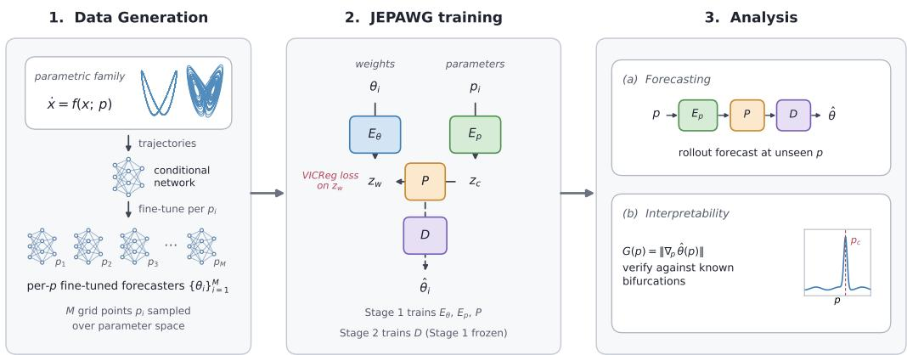  
Figure 1: JEPAWG pipeline. (1) A conditional forecaster is trained on trajectories from the parametric family and fine-tuned at each of M parameter values, yielding the weight grid $\{ ( p _ { i } , \theta _ { i } ) \} _ { i = 1 } ^ { M }$ (Section 4.1). (2) Encoders, predictor and decoder are trained in two stages (Eqs. 4, 5), giving the inference path $\hat { \theta } ( p ) = D ( P ( E _ { p } ( p ) ) )$ . (3) The decoded weights are evaluated as a hypernetwork and probed via $G ( p ) = \| \nabla _ { p } \widehat { \theta } ( p ) \|$ , verified against known bifurcations.

trajectories settle onto the strange attractor. When $\sigma$ is varied as well, this point becomes the analytic Hopf curve

$$
\rho _ { H } ( \sigma ) = \sigma ( \sigma + \beta + 3 ) / ( \sigma - \beta - 1 ) .\tag{8}
$$

We study both a one-parameter ρ-sweep and a two-parameter $( \sigma , \rho )$ -plane.

The Rössler oscillator,

$$
\dot { x } = - y - z , \qquad \dot { y } = x + a y , \qquad \dot { z } = b + z ( x - c ) ,\tag{9}
$$

is a minimal chaotic system with a single non-linear term. With $a { = } b { = } 0 . 2$ fixed, as c increases the attractor undergoes a period-doubling cascade, the doublings accumulating at the onset of chaotic motion.

The Brusselator,

$$
\dot { x } = a + x ^ { 2 } y - ( b + 1 ) x , \qquad \dot { y } = b x - x ^ { 2 } y ,\tag{10}
$$

is used as a model for autocatalytic reactions, and has a single fixed point at $( a , b / a )$ , which is stable only if $\textstyle \cdot - 1 + a ^ { 2 } \colon$ a supercritical Hopf curve. When crossed, the fixed point hands over smoothly to a small stable limit cycle whose amplitude grows continuously from zero, in contrast to the subcritical Lorenz Hopf above, where trajectories jump discontinuously onto the coexisting strange attractor. We use a one-parameter b-sweep, with $a = 1$ .25 fixed, for forecasting. Finally, the discrete-time Hénon map,

$$
x _ { n + 1 } = 1 - a x _ { n } ^ { 2 } + y _ { n } , \qquad y _ { n + 1 } = b x _ { n } ,\tag{11}
$$

is a standard two-dimensional chaotic map. As a increases at fixed b it undergoes a period-doubling cascade, with successive doublings at decreasing parameter intervals. Since the doubling locations are known, this provides a direct test of the resolution of $G ( \boldsymbol { p } )$ . We use the map in three configurations, with different protocols (Table 6): a one-parameter a-sweep for forecasting, a two-parameter $( a , b )$ grid, and a separate zoo built along the cascade, described in Section 5.2.3.

## 5.1 Forecasting

Table 1 reports the time-to-threshold $\mathrm { T t T _ { 0 . 2 } }$ (Section 4.3) for the four systems. Additional results and experimental details are given in Tables 2, 6 and 7.

On interpolation, JEPAWG is tied with the PHLieNet hypernetwork on three systems and within two time units of it on the Brusselator, and outperforms the AE and VAE baselines on all four systems. The decoded weights therefore retain the information specifying the dynamics at parameters not seen in training, the precondition for the weight-space analysis of Section 5.2. We further observe that the decoded weights forecast better than the raw fine-tuned weights they were trained to reconstruct, in TtT on all four systems and most strongly on Rössler, though not always better than the shared base network (Table 5).

Table 1: Forecasting performance: $\mathrm { T t T _ { 0 . 2 } }$ on held-out interpolation parameters and on each side of the training range, mean ± std over 5 seeds. Bold: best mean and all entries whose interval overlaps the best entry’s. Rows in which all entries overlap carry no bold. Continuous-time systems in time units, the discrete Hénon map in iterations; Hénon extrapolation is omitted: for discrete maps one inaccurate iteration exits the training region, so TtT collapses to ≈ 0 for every method. Per-experiment transient handling is given in Table 6 and the full test sets in Table 7.
<table><tr><td>system</td><td>split</td><td>PHLieNet</td><td>JEPAWG</td><td>VAE</td><td>AE</td></tr><tr><td>Lorenz, M=800</td><td> $\mathrm { i n t e r p } \rho \in [ 1 0 , 3 5 ]$ </td><td> ${ \bf 2 0 . 2 3 \pm 0 . 8 9 }$ </td><td> ${ \bf 2 0 . 1 9 \pm 0 . 1 5 }$ </td><td> $1 8 . 6 9 \pm 0 . 2 7$ </td><td> $1 8 . 3 1 \pm 0 . 6 4$ </td></tr><tr><td></td><td>below  $\rho \in [ 5 , 9 ]$ </td><td> ${ \bf 1 5 . 5 3 \pm 4 . 1 8 }$ </td><td> $3 . 6 1 \pm 0 . 2 5$ </td><td> $5 . 5 8 \pm 0 . 8 1$ </td><td> $4 . 3 1 \pm 1 . 8 2$ </td></tr><tr><td></td><td>above  $\rho \in [ 3 6 , 4 0 ]$ </td><td> $2 . 0 4 \pm 0 . 2 2$ </td><td> $2 . 0 3 \pm 0 . 0 9$ </td><td> ${ \bf 2 . 4 8 \pm 0 . 1 1 }$ </td><td> ${ \bf 2 . 2 1 \pm 0 . 2 2 }$ </td></tr><tr><td>Rössler,  $M { = } 1 0 0 0$ </td><td> ${ \mathrm { i n t e r p ~ } } c \in [ 3 , 9 ]$ </td><td> ${ \bf 5 0 . 1 6 \pm 1 . 9 3 }$ </td><td> ${ \bf 4 7 . 4 2 \pm 0 . 9 0 }$ </td><td> $3 5 . 8 4 \pm 2 . 5 8$ </td><td> $3 0 . 1 0 \pm 2 . 4 9$ </td></tr><tr><td></td><td>below  $c \in [ 1 . 8 , 2 . 8 ]$ </td><td> $6 . 9 8 \pm 2 . 2 5$ </td><td> $\mathbf { 4 2 . 6 6 \pm 1 2 . 5 3 }$ </td><td> $\mathbf { 2 7 . 6 4 \pm 1 2 . 2 0 }$ </td><td> $1 0 . 4 4 \pm 8 . 3 0$ </td></tr><tr><td></td><td>above  $c \in [ 9 . 2 , 1 0 . 2 ]$ </td><td> ${ \bf 1 5 . 7 2 \pm 1 . 7 1 }$ </td><td> $9 . 0 6 \pm 0 . 9 2$ </td><td> $7 . 8 6 \pm 0 . 5 1$ </td><td> $6 . 0 9 \pm 0 . 5 4$ </td></tr><tr><td>Brusselator, M=1024</td><td>interp  $b \in [ 1 . 5 , 4 ]$ </td><td> ${ \bf 2 7 . 3 4 \pm 0 . 2 3 }$ </td><td> $2 5 . 4 0 \pm 0 . 5 1$ </td><td> $2 0 . 4 7 \pm 0 . 4 6$ </td><td> $2 0 . 5 6 \pm 1 . 1 2$ </td></tr><tr><td></td><td>below  $b \in [ 1 . 1 , 1 . 4 ]$ </td><td> $5 . 4 4 \pm 6 . 0 4$ </td><td> $0 . 8 4 \pm 0 . 1 8$ </td><td> $0 . 4 7 \pm 0 . 1 1$ </td><td> $0 . 8 9 \pm 0 . 2 5$ </td></tr><tr><td></td><td>above  $b \in [ 4 . 2 , 4 . 8 ]$ </td><td> $3 . 1 9 \pm 1 . 0 8$ </td><td> $5 . 7 1 \pm 3 . 2 6$ </td><td> $3 . 2 6 \pm 0 . 8 2$ </td><td> $2 . 3 6 \pm 0 . 1 9$ </td></tr><tr><td>Hénon, M=1024</td><td> $\operatorname { i n t e r p } a \in [ 0 . 8 5 , 1 . 1 0 ]$ </td><td> $\mathbf { 6 5 0 \pm 1 2 6 }$ </td><td> ${ \bf 7 7 2 \pm 8 5 }$ </td><td> $5 9 4 \pm 9 0$ </td><td> $4 7 1 \pm 1 1 6$ </td></tr></table>

Extrapolation proves to be more challenging, and the performance is strongly dependent on the regime beyond the training range (Table 2). JEPAWG, AE and VAE decode weights with MLPs that are unconstrained beyond the training range and continue the trend of the weights past it. PHLieNet instead saturates: as p moves away from the anchors it returns the forecaster of the nearest one. Where the exterior dynamics exhibit moving limit cycles, JEPAWG produces better forecasters: for Rössler with $c \in [ 1 . 8 , 2 . 8 ]$ the cycle keeps shrinking and JEPAWG holds a usable forecast $( 4 2 . 7 \pm 1 2 . 5 $ against $7 . 0 \pm 2 . 3 )$ , degrading monotonically with distance, and the same ordering holds for the Brusselator with $b \in [ 4 . 2 , 4 . 8 ]$ until the growing cycles leave the state-space region covered by training. Where the dynamics beyond the range fall onto a fixed point, the forecaster has to keep a zero of its vector field at a location that moves with the parameter. For Lorenz with $\rho \in [ 5 , 9 ]$ ], the forecasters generated by PHLieNet preserve the fixed point more reliably than those decoded by JEPAWG $( 1 \bar { 5 } . 5 \pm 4 . 2$ against $3 . 6 \pm 0 . 3 )$ , whose vector field displaces or removes it. For the Brusselator with $b \in [ 1 . 1 , 1 . 4 ]$ trajectories after the initial transient lie close to the fixed point, so the variance normalising the NRMSE is small and even small offsets exceed the threshold. PHLieNet scores higher here, but with a near-zero normaliser and one seed dominating the mean, the difference is not meaningful. Where the dynamics beyond the range are chaotic, small one-step errors grow exponentially, so TtT is limited by the Lyapunov time rather than by how well the attractor itself is reproduced. For Rössler with $c \in [ 9 . 2 , \mathrm { i 0 . 2 } ]$ , PHLieNet leads, although its rollouts stay bounded slightly less often $( 9 3 \pm 7 \%$ against 100%; Table 2). For Lorenz with $\rho \in [ 3 6 , 4 0 ]$ , all methods reach the threshold after about two to three Lyapunov times. Figure 2 shows $\mathrm { T t T _ { 0 . 2 } }$ for each regime as the parameter moves further outside the training range, and Figure 9 shows examples of predicted trajectories at the furthest extrapolation parameter.

Accurate forecasts from the decoded networks show that the map $p \mapsto { \hat { \theta } } ( p )$ retains the information specifying the dynamics, but this does not guarantee that this information is arranged in a way that can be retrieved by differentiation. PHLieNet is such an example: it matches JEPAWG on forecasting (Table 1) yet its generated weights carry no visible response at the Lorenz Hopf point (Section 5.2.1). JEPAWG instead fits the parameter–weight correspondence directly, which is what the weight-space analysis relies on.

## 5.2 Bifurcation Detection

We now apply the weight-space response $G ( p )$ introduced in Section 4.3 to locate regime changes, comparing its peaks with bifurcations of known location: Hopf points and curves in the Lorenz

Changing limit cycle

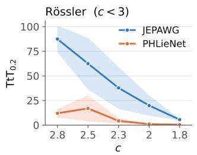  
Stable fixed point

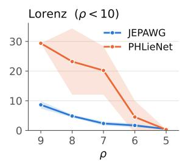  
Chaotic

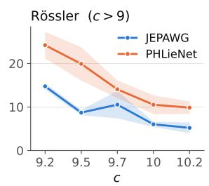

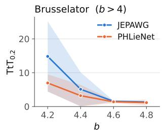

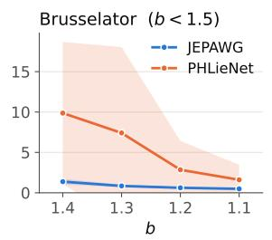

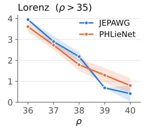  
Figure 2: Extrapolation $\mathrm { T t T _ { 0 . 2 } }$ of JEPAWG and PHLieNet, by regime beyond the training range. Left: limit cycles that keep changing; for Rössler the cycle shrinks as c decreases below the training range $( c < 3 )$ , for the Brusselator it grows and moves as b increases above it $( b > 4 )$ . Middle: a stable fixed point, with initial transients included for Lorenz and excluded for the Brusselator. Right: chaotic dynamics.

Table 2: Extrapolation by regime of the true dynamics beyond the training range: $\mathrm { T t T _ { 0 . 2 } }$ (shorthorizon tracking) and bounded fraction (share of rollouts that stay within 1.5× the extent of the true test trajectories over the full horizon), mean±std over 5 seeds of per-side means; bold as in Table 1. Intervals as in Table $7 ; \lambda _ { \mathrm { m a x } }$ is the largest Lyapunov exponent over the range, 0 on limit cycles and the leading Jacobian eigenvalue at fixed points. JEPAWG leads on both measures where the limit cycle keeps changing; PHLieNet holds a fixed point that JEPAWG loses on Lorenz; in chaos the measures split: PHLieNet tracks longer for Rössler with $c \in [ 9 . 2 , 1 0 . 2 ]$ , but JEPAWG’s rollouts always stay bounded.
<table><tr><td colspan="4"></td><td colspan="2">JEPAWG</td><td colspan="2">PHLieNet</td></tr><tr><td>side</td><td>regime</td><td></td><td> $\lambda _ { \mathrm { m a x } }$ </td><td> $\mathrm { T t T _ { 0 . 2 } }$ </td><td>bounded (%)</td><td> $\mathrm { T t T _ { 0 . 2 } }$ </td><td>bounded (%)</td></tr><tr><td>Rössler,  $c \in [ 1 . 8 , 2 . 8 ]$ </td><td></td><td>limit cycle</td><td>0</td><td> ${ \bf 4 2 . 7 \pm 1 2 . 5 }$ </td><td> $6 6 \pm 8$ </td><td> $7 . 0 \pm 2 . 3$ </td><td> $4 9 \pm 1 1$ </td></tr><tr><td>Brusselator,</td><td> $\bar { b } \in [ 4 . 2 , \dot { 4 } . 8 ]$ </td><td>limit cycle</td><td>0</td><td> $5 . 7 \pm 3 . 3$ </td><td> ${ \bf 1 0 0 \pm 0 }$ </td><td> $3 . 2 \pm 1 . 1$ </td><td> $7 0 \pm 2 7$ </td></tr><tr><td>Lorenz,  $\rho \in [ 5 , 9 ]$ </td><td></td><td>stable fixed pt.</td><td>-0.65</td><td> $3 . 6 \pm 0 . 3$ </td><td> $5 4 \pm 7$ </td><td> ${ \bf 1 5 . 5 \pm 4 . 2 }$ </td><td> ${ \bf 9 7 \pm 6 }$ </td></tr><tr><td>Brusselator,</td><td> $\dot { b } \in [ 1 . 1 , 1 . 4 ]$ </td><td>stable fixed pt.</td><td>-0.58</td><td> $0 . 8 \pm 0 . 2$ </td><td> $0 \pm 0$ </td><td> $5 . 4 \pm 6 . 0$ </td><td> $0 \pm 0$ </td></tr><tr><td>Rössler,  $c \in [ 9 . 2 , 1 0 . 2 ]$ </td><td>chaotic</td><td></td><td>0.11</td><td> $9 . 1 \pm 0 . 9$ </td><td> $1 0 0 \pm 0$ </td><td> ${ \bf 1 5 . 7 \pm 1 . 7 }$ </td><td> $9 3 \pm 7$ </td></tr><tr><td>Lorenz,  $\rho \in [ 3 6 , 4 0 ]$ </td><td></td><td>chaotic</td><td>1.13</td><td> $2 . 0 3 \pm 0 . 0 9$ </td><td> $1 0 0 \pm 0$ </td><td> $2 . 0 4 \pm 0 . 2 2$ </td><td> $9 9 \pm 1$ </td></tr></table>

and Brusselator systems, the period-doubling cascade of the Hénon map, and the global bifurcation structure around the Lorenz T-point. The Rössler cascade is treated in Appendix D.2.

## 5.2.1 Lorenz

We first consider the Lorenz system, whose subcritical Hopf bifurcation occurs at $\rho _ { H } ( \sigma )$ given in (8). Varying only ρ (at $\sigma = 1 0 , \beta = 8 / 3 )$ , the bifurcation is a single point, and $G ( \rho )$ shows a peak at $\rho = 2 4 . { \overset { \cdot } { 5 } } 1 { \overset { \cdot } { \pm } } 0 . { \overset { \cdot } { 2 } } 3$ (mean and standard deviation over five seeds), close to the analytic $\rho _ { H } \approx 2 4 . 7 4$ We do not expect the peak to coincide exactly with $\rho _ { H } \colon$ since the Hopf bifurcation is subcritical, the chaotic set already becomes attracting at $\rho \approx 2 4 . 0 6$ and coexists with the stable fixed points up to $\rho _ { H }$ , so the observed dynamics, and hence the trained weights, begin to change before the fixed points lose stability (Fig. 3a, bottom). Neither the derivative of the raw weights nor that of the generated PHLieNet weights shows any discernible signal, in contrast to the JEPAWG-decoded weights (Figure 3a). When also sweeping over $\sigma \in [ 5 , 2 0 ]$ , the two-parameter response develops a ridge that tracks the Hopf curve for $\sigma < 1 3$ and moves towards the onset of chaos $( \lambda _ { \operatorname* { m a x } } = 0 )$ for larger σ (Figure 3b). Besides the Hopf curve and the onset of chaos, we probe the global bifurcation structure around the Bykov T-point at $\left( \sigma , \rho \right) \approx \left( 1 0 . 1 7 , 3 0 . 8 7 \right) [ 3 2 ]$ , a codimension-two heteroclinic point at which curves of homoclinic bifurcations accumulate [20, 21]. Near it, small changes in $( \sigma , \rho )$ repeatedly rearrange the chaotic dynamics, changing the pattern with which trajectories switch between the two wings of the attractor, while no fixed point changes stability. As a result, the linearisation at the equilibria registers none of it. Figure 3c shows a ring of elevated response G surrounding the T-point.

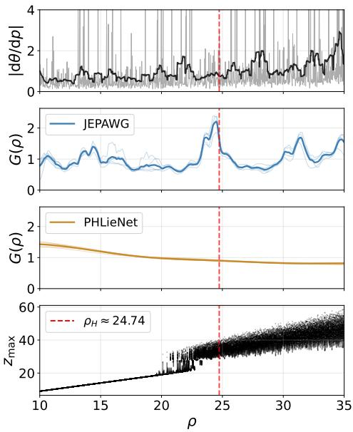  
(a)

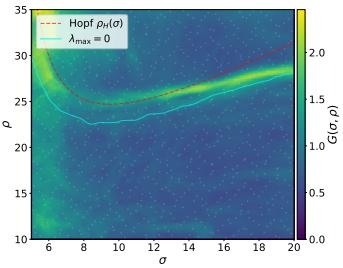  
(b)

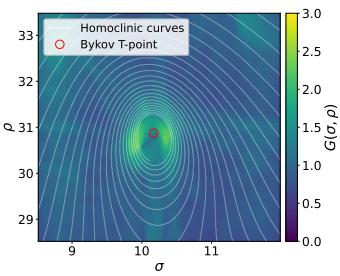  
(c)  
Figure 3: Lorenz. (a) Raw-weights derivative $\| d \theta / d \rho \|$ across the ρ-sweep, with a Gaussian-smoothed version as the thick line (top); derivative $G ( \rho ) = \| d \hat { \theta } / d \rho \|$ of the JEPAWG-decoded (M=800) and PHLieNet-generated weights, 5 seeds each, with their mean as the thick curves (middle); the groundtruth bifurcation diagram (bottom). The Hopf point $\rho _ { H }$ , at which the fixed points lose their stability, is shown as a red dashed line in all panels. (b) Weight-space response $G ( \sigma , \rho ) = \| \nabla _ { \sigma , \rho } \hat { \theta } \|$ for a zoo trained on $\left( \sigma , \rho \right) \in \left[ 5 , 2 0 \right] \times \left[ 1 0 , 4 0 \right] \left( M { = } 1 0 2 4 , \beta { = } 8 / 3 \right)$ , shown for $\rho \leq 3 5$ because the finitedifference derivative is unreliable at the edge of the training range; the analytic Hopf curve is in red, and the blue curve marks the level set $\lambda _ { \operatorname* { m a x } } = 0$ of the largest Lyapunov exponent. (c) Zoom above the Hopf curve with parameter ranges $( \sigma , \rho ) \in [ 8 . 5 , 1 2 ] \stackrel { - } { \times } [ 2 8 . { \overset { . } { 5 } } , { \overset { . } { 3 } } 3 . 5 ]$ $\scriptstyle ( M = 1 0 2 4 , \beta = 8 / 3 ) \colon$ : a ring of elevated response surrounds the marked Bykov T-point at $( \sigma , \rho ) \approx ( 1 0 . 1 7 , 3 0 . 8 7 )$ ). White lines: the principal homoclinic curves of the origin, obtained independently of the model by integrating its unstable manifold $W ^ { u } ( 0 )$ on a $6 0 0 ^ { 2 }$ grid and locating the parameter values at which its winding number around the nearest equilibrium before escaping to the other wing jumps by one turn. They form a single spiral winding onto the T-point [20, 21]; the ring of G lies on its innermost turns, where successive curves are closest, while no fixed point changes stability anywhere in the window.

## 5.2.2 Brusselator

The Brusselator displays a second two-parameter Hopf curve: whereas the Lorenz Hopf is subcritical, with trajectories jumping onto the coexisting strange attractor, crossing $b = 1 + a ^ { 2 }$ is supercritical, with the fixed point giving way to a limit cycle that grows from zero amplitude. With both $( a , b )$ varied, $G ( \boldsymbol { p } )$ again traces the analytic curve (Fig. 4a). The same transition is visible in the learned latent space: the top two principal components of the latent variable $z _ { w }$ form a smoothly varying sheet in which the two regimes occupy the two sides of an internal boundary, and the sheet is stretched near the Hopf curve (Fig. 4b).

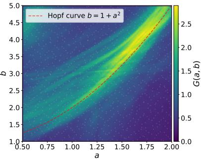  
(a)

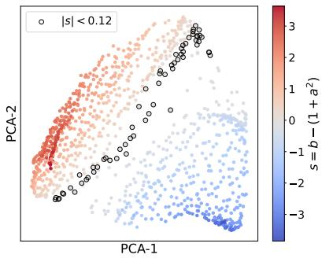  
(b)

Figure 4: Brusselator. (a) Weight-space response $G ( a , b ) = \| \nabla _ { a , b } \hat { \theta } \|$ with the analytic Hopf curve $b = 1 + a ^ { 2 }$ in red; white dots mark the $M { = } 1 0 2 4$ Sobol sampled training parameters. (b) Latent space $\mathrm { ( P C A - 2 D }$ with 86% explained variance), coloured by the signed distance $s = b - ( 1 + a ^ { 2 } )$ to the curve; circled points $( | s | < 0 . 1 2 )$ correspond to the parameters nearest to the curve and trace a coherent boundary in every seed. Parameter ranges are $\left( a , b \right) \in \left[ 0 . 5 , 2 \right] \times \left[ 1 , 5 \right] \left( M { = } 1 0 2 4 \right)$  
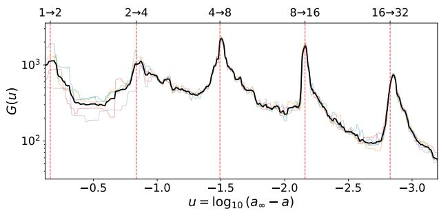  
Figure 5: Weight-space response $G ( u )$ along the Hénon u-cascade for $u > - 3 . 2 ,$ 5 seeds in colour and their mean in black. In order to include the dynamics of falling into the attractor, all transients are kept during training. The response and bifurcation diagram over the full sampled range are shown in Fig. 12 (Appendix D.3).

Table 3: Detected doubling locations for the Hénon map (5-seed mean $G ( u )$ , local peaks) against bisection references.
<table><tr><td>event</td><td>reference a</td><td>detected a</td></tr><tr><td> $1  2$ </td><td>0.36749</td><td>0.4159</td></tr><tr><td> $2  4$ </td><td>0.91250</td><td>0.9242</td></tr><tr><td> $4  8$ </td><td>1.02585</td><td>1.02649</td></tr><tr><td> $8  1 6$ </td><td>1.05112</td><td>1.05116</td></tr><tr><td> $1 6  3 2$ </td><td>1.05656</td><td>1.05665</td></tr></table>

## 5.2.3 Hénon

Last, we consider the discrete-time Hénon map (11), which exhibits a period-doubling cascade as a increases at fixed $b = 0 . 3 \colon$ the attractor’s period doubles at a sequence of parameter values $a _ { 1 } < a _ { 2 } < . .$ . accumulating at the chaos onset $a _ { \infty } \approx 1 . 0 5 8 0 5$ , visible as successive branchings in the bifurcation diagram of Figure 12. The doublings occur at shrinking intervals whose ratio converges to the universal Feigenbaum constant [33, 34]

$$
\delta \ = \ \operatorname* { l i m } _ { n \to \infty } { \frac { a _ { n } - a _ { n - 1 } } { a _ { n + 1 } - a _ { n } } } \ \approx \ 4 . 6 6 9 2 .\tag{12}
$$

In the following we test whether we can detect the doubling locations with the weight-space response G, and qualitatively recover the Feigenbaum scaling. The asymptotic progression of the doubling locations towards $a _ { \infty }$ suggests a natural coordinate,

$$
u = \log _ { 1 0 } ( a _ { \infty } - a ) ,\tag{13}
$$

in which the doublings are asymptotically equidistant, so that a sample evenly spread in u resolves every level with the same relative precision. Concretely, we build a separate zoo for the cascade: $M { = } 1 5 4 0$ parameters at $b { = } 0 . 3$ over $a \in [ 0 . 3 0 , a _ { \infty } \mathrm { - 3 } { \times } \mathbf { \dot { 1 } } 0 ^ { - 5 } ]$ , stratified in u, with u as the control input and the initial transient retained (Table 6).

$G ( u )$ exhibits a local peak at each of the first five period doublings (Fig. 5, Table 3), each localised to within $| \Delta u | \le 0 . 0 4$ . The estimated ratios $( \hat { \delta } _ { 1 } , \hat { \delta } _ { 2 } , \hat { \delta } _ { 3 } ) = ( 4 . 9 7 , 4 . 1 5 , 4 . 4 9 )$ are comparable to the reference ratios (4.81, 4.49, 4.65), which themselves converge slowly to δ. A universal constant of the underlying dynamics is thus qualitatively measured from the parameter derivative of the decoded weights. On the two-parameter $( a , b )$ grid the ridge of G follows the 2→4 and 4→8 doubling curves of the ground-truth period map and broadens over the chaotic band (Appendix D.3, Fig. 13).

## 6 Conclusion

For four dynamical systems, we built model zoos of fine-tuned forecasting networks indexed by the control parameters, and evaluated the parameter-to-weights map JEPAWG learns from them both as a hypernetwork and as a probe of the dynamics. As a hypernetwork, JEPAWG is competitive with an end-to-end baseline on held-out interpolation parameters across all four systems. Outside the training range, which method performs better depends on the dynamics there. Where the limit cycles continue to change, JEPAWG follows the trend of the weights and gives the better forecasts, most clearly for Rössler with $c \in [ 1 . 8 , 2 . 8 ]$ Where the dynamics settle onto a fixed point, PHLieNet, which returns the forecaster of the nearest training parameter, preserves it more reliably. In chaotic regimes, both methods lose the forecast within a few Lyapunov times. As a probe, the parameter derivative of the decoded weights, $G ( p )$ , recovers the subcritical Hopf point and curve of the Lorenz system and the supercritical Hopf curve of the Brusselator, and registers the global bifurcation structure around the Bykov T-point, which, unlike the Hopf curves, is invisible to any linearisation. Finally, we used the weight-space response $G ( \boldsymbol { p } )$ to localise the first five period doublings of the Hénon map to within $| \Delta u | \overset { \_ } { \leq } 0 . \bar { 0 4 }$ , yielding a qualitative measurement of the Feigenbaum constant. JEPAWG thus turns a parametrised model zoo into a single object serving two roles: a hypernetwork producing functional forecasters at unseen parameters, and a probe of the dynamics that generated the zoo. Having validated the weight-space response against known bifurcation structure, we see a promising prospect in applying the method to systems whose dynamics are not yet fully understood, where the weights would point to structures not yet identified, indicating where to concentrate simulation or further training rather than sweeping a parameter range at uniform cost.

Limitations First, the probe can only register what is present in the training data. Transitions that leave typical trajectories unchanged, such as bifurcations of non-attracting sets, are invisible to it. Second, outside the range of the training parameters nothing constrains the decoded weights, and how quickly the error destroys the forecast depends on the dynamics there. In chaotic regimes it is amplified, and every method we tested loses the forecast within a few Lyapunov times. Where the dynamics settle onto a fixed point, JEPAWG continues the trend of the weights and displaces or removes the fixed point (Section 5.1). Third, $G ( p )$ responds to any rapid change in the distribution of the training trajectories, so a peak indicates a reorganisation of the observed dynamics, not necessarily a bifurcation. Its resolution is bounded by the average parameter spacing (Table 6) and by the smoothness of the decoded map, and since G is a derivative, the location of its peaks depends on the coordinates in which the parameter is expressed. Finally, the dominant cost is the zoo itself, which requires M fine-tuned networks per system.

## Acknowledgments

T. G. was supported by the AI-application grant AS-IAIA-114-M02 from Academia Sinica. M. C. N. C. was supported by the same grant and by the Vici grant VI.C.232.117 from the Dutch Research Council (NWO).

## References

[1] Konstantin Schürholt, Diyar Taskiran, Boris Knyazev, Xavier Giró i Nieto, and Damian Borth. Model zoos: A dataset of diverse populations of neural network models, 2022. URL https: //arxiv.org/abs/2209.14764.

[2] Mitchell Wortsman, Gabriel Ilharco, Samir Yitzhak Gadre, Rebecca Roelofs, Raphael Gontijo-Lopes, Ari S. Morcos, Hongseok Namkoong, Ali Farhadi, Yair Carmon, Simon Kornblith, and Ludwig Schmidt. Model soups: averaging weights of multiple fine-tuned models improves accuracy without increasing inference time, 2022. URL https://arxiv.org/abs/2203. 05482.

[3] David Ha, Andrew Dai, and Quoc V. Le. Hypernetworks, 2016. URL https://arxiv.org/ abs/1609.09106.

[4] Tobias Göbel, Julian R. Ebelt, Zier Mensch, Mathis Gerdes, and Miranda C. N. Cheng. Weightspace physics: Interpretable hypernetworks for lattice quantum field theories, 2026. URL https://arxiv.org/abs/2607.07127.

[5] Mahmoud Assran, Quentin Duval, Ishan Misra, Piotr Bojanowski, Pascal Vincent, Michael Rabbat, Yann LeCun, and Nicolas Ballas. Self-supervised learning from images with a jointembedding predictive architecture. In Proceedings ofthe IEEE/CVF Conference on Computer Vision and Pattern Recognition (CVPR), pages 15619–15629, June 2023.

[6] Aviv Navon, Aviv Shamsian, Idan Achituve, Ethan Fetaya, Gal Chechik, and Haggai Maron. Equivariant architectures for learning in deep weight spaces. In Andreas Krause, Emma Brunskill, Kyunghyun Cho, Barbara Engelhardt, Sivan Sabato, and Jonathan Scarlett, editors, Proceedings ofthe 40th International Conference on Machine Learning, volume 202 of Proceedings ofMachine Learning Research, pages 25790–25816. PMLR, 23–29 Jul 2023. URL https://proceedings.mlr.press/v202/navon23a.html.

[7] Allan Zhou, Kaien Yang, Kaylee Burns, Adriano Cardace, Yiding Jiang, Samuel Sokota, J. Zico Kolter, and Chelsea Finn. Permutation equivariant neural functionals. In A. Oh, T. Naumann, A. Globerson, K. Saenko, M. Hardt, and S. Levine, editors, Advances in Neural Information Processing Systems, volume 36, pages 24966–24992. Curran Associates, Inc., 2023. doi: 10.52202/075280-1085. URL https://proceedings.neurips.cc/paper\_files/paper/ 2023/file/4e9d8aeeab6120c3c83ccf95d4c211d3-Paper-Conference.pdf.

[8] Damian Falk, Konstantin Schürholt, Konstantinos Tzevelekakis, Léo Meynent, and Damian Borth. Learning model representations using publicly available model hubs, 2025. URL https://arxiv.org/abs/2510.02096.

[9] Pantelis R. Vlachas, Konstantinos Vlachas, and Eleni Chatzi. Beyond static models: Hypernetworks for adaptive and generalizable forecasting in complex parametric dynamical systems. Mechanical Systems and Signal Processing, 258:114635, 2026. ISSN 0888-3270. doi: 10.1016/j.ymssp.2026.114635.

[10] Matthieu Kirchmeyer, Yuan Yin, Jeremie Dona, Nicolas Baskiotis, Alain Rakotomamonjy, and Patrick Gallinari. Generalizing to new physical systems via context-informed dynamics model. In Kamalika Chaudhuri, Stefanie Jegelka, Le Song, Csaba Szepesvari, Gang Niu, and Sivan Sabato, editors, Proceedings ofthe 39th International Conference on Machine Learning, volume 162 of Proceedings ofMachine Learning Research, pages 11283–11301. PMLR, 17–23 Jul 2022. URL https://proceedings.mlr.press/v162/kirchmeyer22a.html.

[11] Elliott Taylor Tsuyoshi Abe and Bingni W. Brunton. TiDHy: Timescale demixing via hypernetworks to learn simultaneous dynamics from mixed observations. Journal ofThe Royal Society Interface, 23(238):20250738, May 2026. ISSN 1742-5689. doi: 10.1098/rsif.2025.0738.

[12] Juan Carrasquilla and Roger G. Melko. Machine learning phases of matter. Nature Physics, 13(5):431–434, February 2017. ISSN 1745-2481. doi: 10.1038/nphys4035. URL http: //dx.doi.org/10.1038/nphys4035.

[13] Evert P. L. van Nieuwenburg, Ye-Hua Liu, and Sebastian D. Huber. Learning phase transitions by confusion. Nature Physics, 13(5):435–439, May 2017. ISSN 1745-2481. doi: 10.1038/ nphys4037.

[14] Akinori Tanaka and Akio Tomiya. Detection of phase transition via convolutional neural networks. Journal ofthe Physical Society ofJapan, 86(6):063001, June 2017. ISSN 1347-4073. doi: 10.7566/jpsj.86.063001. URL http://dx.doi.org/10.7566/JPSJ.86.063001.

[15] Vinicius Hernandes, Thomas Spriggs, Saqar Khaleefah, and Eliska Greplova. Adiabatic finetuning of neural quantum states enables detection of phase transitions in weight space, 2025. URL https://arxiv.org/abs/2503.17140.

[16] Thomas M. Bury, R. I. Sujith, Induja Pavithran, Marten Scheffer, Timothy M. Lenton, Madhur Anand, and Chris T. Bauch. Deep learning for early warning signals of tipping points. Proceedings ofthe National Academy ofSciences, 118(39):e2106140118, 2021. doi: 10.1073/pnas.2106140118.

[17] Thomas M. Bury, Daniel Dylewsky, Chris T. Bauch, Madhur Anand, Leon Glass, Alvin Shrier, and Gil Bub. Predicting discrete-time bifurcations with deep learning. Nature Communications, 14(1), October 2023. ISSN 2041-1723. doi: 10.1038/s41467-023-42020-z. URL http: //dx.doi.org/10.1038/s41467-023-42020-z.

[18] Nami Mogharabin and Amin Ghadami. Bifurcation analysis in dynamical systems through integration of machine learning and dynamical systems theory. Journal of Computational and Nonlinear Dynamics, 20(2):021006, December 2024. ISSN 1555-1415. doi: 10.1115/1. 4067297.

[19] Swadesh Pal and Roderick Melnik. Machine learning for complex systems dynamics: Detecting bifurcations in dynamical systems with deep neural networks, 2026. URL https://arxiv. org/abs/2603.04420.

[20] Paul Glendinning and Colin Sparrow. T-points: A codimension two heteroclinic bifurcation. Journal of Statistical Physics, 43(3):479–488, May 1986. ISSN 1572-9613. doi: 10.1007/ BF01020649.

[21] Roberto Barrio, Andrey Shilnikov, and Leonid Shilnikov. Kneadings, symbolic dynamics and painting Lorenz chaos. International Journal ofBifurcation and Chaos, 22(04):1230016, 2012. doi: 10.1142/S0218127412300169.

[22] Steven H. Strogatz. Nonlinear Dynamics and Chaos: With Applications to Physics, Biology, Chemistry and Engineering. Westview Press, 2000.

[23] John Guckenheimer and Philip Holmes. Nonlinear Oscillations, Dynamical Systems, and Bifurcations of Vector Fields, volume 42 of Applied Mathematical Sciences. Springer New York, 1983. doi: 10.1007/978-1-4612-1140-2.

[24] Alex Graves. Generating sequences with recurrent neural networks, 2014. URL https: //arxiv.org/abs/1308.0850.

[25] Sepp Hochreiter and Jürgen Schmidhuber. Long short-term memory. Neural Computation, 9 (8):1735–1780, November 1997. ISSN 0899-7667. doi: 10.1162/neco.1997.9.8.1735.

[26] Pantelis R. Vlachas, Jaideep Pathak, Brian R. Hunt, Themistoklis P. Sapsis, Michelle Girvan, Edward Ott, and Petros Koumoutsakos. Backpropagation algorithms and reservoir computing in recurrent neural networks for the forecasting of complex spatiotemporal dynamics, 2020. URL https://arxiv.org/abs/1910.05266.

[27] Ashish Vaswani, Noam Shazeer, Niki Parmar, Jakob Uszkoreit, Llion Jones, Aidan N Gomez, Łukasz Kaiser, and Illia Polosukhin. Attention is all you need. In I. Guyon, U. Von Luxburg, S. Bengio, H. Wallach, R. Fergus, S. Vishwanathan, and R. Garnett, editors, Advances in Neural Information Processing Systems, volume 30. Curran Associates, Inc., 2017.

[28] Gregory Duthé, Nikolaos Evangelou, Wei Liu, Ioannis G. Kevrekidis, and Eleni Chatzi. A mechanistic analysis of transformers for dynamical systems, 2026. URL https://arxiv. org/abs/2512.21113.

[29] Shaojie Bai, J. Zico Kolter, and Vladlen Koltun. An empirical evaluation of generic convolutional and recurrent networks for sequence modeling, 2018. URL https://arxiv.org/abs/ 1803.01271.

[30] Adrien Bardes, Jean Ponce, and Yann LeCun. Vicreg: Variance-invariance-covariance regularization for self-supervised learning, 2022. URL https://arxiv.org/abs/2105.04906.

[31] I.M Sobol’. On the distribution of points in a cube and the approximate evaluation of integrals. USSR Computational Mathematics and Mathematical Physics, 7(4):86–112, 1967. ISSN 0041-5553. doi: 10.1016/0041-5553(67)90144-9.

[32] Tali Pinsky. On the topology of the Lorenz system. Proceedings of the Royal Society A: Mathematical, Physical and Engineering Sciences, 473(2205):20170374, September 2017. ISSN 1364-5021. doi: 10.1098/rspa.2017.0374.

[33] P. Collet, J. P. Eckmann, and H. Koch. Period doubling bifurcations for families of maps on Rn. Journal of Statistical Physics, 25(1):1–14, May 1981. ISSN 1572-9613. doi: 10.1007/ BF01008475. URL https://doi.org/10.1007/BF01008475.

[34] Mitchell J. Feigenbaum. Quantitative universality for a class of nonlinear transformations. Journal of Statistical Physics, 19(1):25–52, July 1978. ISSN 1572-9613. doi: 10.1007/ BF01020332.

[35] Less Wright. Ranger - a synergistic optimizer. https://github.com/lessw2020/ Ranger-Deep-Learning-Optimizer, 2019.

[36] Elena Facco, Maria d’Errico, Alex Rodriguez, and Alessandro Laio. Estimating the intrinsic dimension of datasets by a minimal neighborhood information. Scientific Reports, 7(1):12140, September 2017. ISSN 2045-2322. doi: 10.1038/s41598-017-11873-y.

[37] Elizaveta Levina and Peter Bickel. Maximum likelihood estimation of intrinsic dimension. In L. Saul, Y. Weiss, and L. Bottou, editors, Advances in Neural Information Processing Systems, volume 17. MIT Press, 2004.

## A Architectural Details

Forecasting network The forecasting network throughout is the TCNN-CD [29] in the configuration of [9]: a causal temporal CNN with dilations $2 ^ { 0 } , \ldots , 2 ^ { L - 1 }$ (L chosen as the minimum depth whose receptive field covers the input window, L=4 at input sequence length $T = 3 2 )$ , 22 channels per layer, kernel size 5, and a linear readout. PHLieNet uses the same TCNN-CD as its generated target network, with a LIE of 32 anchors, embedding dimension 16, RBF bandwidth $\ell { = } 0 . 2 .$ , and a hypernetwork MLP of two hidden layers of width 64; it is trained with Ranger (RAdam + Lookahead) [35], initial learning rate $1 0 ^ { - 2 }$ , and the training protocol of [9].

Baselines We compare JEPAWG’s embedding against PCA, a deterministic autoencoder (AE), and a variational autoencoder (VAE) on the weight grids of all four systems (layer sizes below are for Lorenz, $M { = } 8 0 0 )$ . All methods use latent dimension $d _ { z } { = } 1 6$ and weights normalised per-feature with training-split statistics. PCA projects onto the top 16 training principal components; AE/VAE mirror JEPAWG’s encoder/decoder capacity (7857→512→512→16 and back; VAE with $\beta _ { \mathrm { K L } } { = } 1 0 ^ { - 3 } )$ . Since PCA/AE/VAE provide no parameter-to-latent map, each is paired with an identical post-hoc regressor p → z (MLP 2×64, 5 000 Adam steps); JEPAWG uses its parameter path $D ( P ( \bar { E _ { p } } ( p ) ) ,$ ).

## B Intrinsic Dimension and Ablation

Intrinsic dimension We estimate the intrinsic dimension of each training-set latent with the TwoNN maximum-likelihood estimator of Facco et al. [36] and the Levina–Bickel MLE (MacKay– Ghahramani correction) [37] at neighbourhood sizes $k \in \{ 5 , 1 0 , 2 0 \}$ , probing increasingly coarse scales.

On the two one-parameter grids, JEPAWG’s estimate decreases monotonically with scale (2.9 → 1.4 on Lorenz and 2.8 → 1.7 on Rössler (Table 4)); on the two-parameter Brusselator and Hénon grids (d=2) the same descent levels off at 2.3 and 2.2 respectively. The other baselines generally show much higher intrinsic dimension, further removed from the control dimension. The raw weight grid themselves measure 12–20 (Lorenz), up to 17 (Rössler), and 4.5–6 (Brusselator, Hénon). JEPAWG’s covariance-free VICReg objective acts as a regulariser, smoothing the weight variation that the control encoder cannot predict, collapsing to a latent space that is more closely aligned with the underlying manifold.

Table 4: Intrinsic-dimension estimates across neighbourhood scale (TwoNN, then Levina–Bickel with k=5, 10, 20) for the weight grids of four families and their embeddings (all bottleneck $d _ { z } = 1 6 ;$ PCA: rank 16). The JEPAWG latent dimension is closest to dim p in 15 of 16 columns (exception: TwoNN on Rössler); PCA, AE and VAE are fitted without access to p.
<table><tr><td>grid</td><td>method</td><td>TwoNN</td><td>k=5</td><td>k=10</td><td>k=20</td></tr><tr><td rowspan="5">Lorenz (dim p=1)</td><td>raw θ PCA-16</td><td>19.9</td><td>17.9</td><td>15.1</td><td>12.3</td></tr><tr><td></td><td>4.7</td><td>4.1</td><td>3.5</td><td>3.3</td></tr><tr><td>AE</td><td>7.9</td><td>7.3</td><td>6.5</td><td>5.7</td></tr><tr><td>VAE JEPAWG</td><td>11.4</td><td>10.4</td><td>9.7</td><td>8.9</td></tr><tr><td></td><td>2.9</td><td>2.3</td><td>1.7</td><td>1.4</td></tr><tr><td rowspan="5">Rössler (dim p=1)</td><td>raw θ</td><td>2.8</td><td>8.9</td><td>14.2</td><td>17.1</td></tr><tr><td>PCA-16</td><td>2.5</td><td>4.9</td><td>5.6</td><td>5.2</td></tr><tr><td>AE</td><td>1.4</td><td>4.0</td><td>5.7</td><td>6.4</td></tr><tr><td>VAE</td><td>1.4</td><td>4.5</td><td>7.0</td><td>8.8</td></tr><tr><td>JEPAWG</td><td>2.8</td><td>2.4</td><td>2.0</td><td>1.7</td></tr><tr><td rowspan="5">Brusselator (dim p=2)</td><td>raw θ</td><td>5.7</td><td>4.6</td><td>4.5</td><td>4.5</td></tr><tr><td>PCA-16</td><td>3.3</td><td>2.7</td><td>2.5</td><td>2.4</td></tr><tr><td>AE</td><td>3.3</td><td>2.8</td><td>2.8</td><td>2.8</td></tr><tr><td>VAE</td><td>3.3</td><td>3.0</td><td>3.2</td><td>3.4</td></tr><tr><td>JEPAWG</td><td>2.8</td><td>2.4</td><td>2.4</td><td>2.3</td></tr><tr><td rowspan="5">Hénon (dim p=2)</td><td>raw θ</td><td>6.0</td><td>5.4</td><td>5.6</td><td>6.1</td></tr><tr><td>PCA-16</td><td>4.0</td><td>3.4</td><td>3.1</td><td>2.8</td></tr><tr><td>AE</td><td>3.2</td><td>2.9</td><td>2.8</td><td>2.8</td></tr><tr><td>VAE</td><td>3.2</td><td>3.1</td><td>3.3</td><td>3.6</td></tr><tr><td>JEPAWG</td><td>3.0</td><td>2.6</td><td>2.4</td><td>2.2</td></tr></table>

Decoded weights versus raw weights As an ablation, we evaluate the raw weights on the forecasting task and compare with the performance of the decoded weights. We observe that the decoded weights outperform the raw weights in TtT on all four systems (Table 5), even though the decoder is trained only to reconstruct them. A plausible explanation is that each $\theta _ { i }$ carries noise specific to the trajectories of its fine-tune; the smooth decoder cannot fit this per-point noise and would then converge toward a denoised weight sheet, so that its reconstruction residual consists largely of the component that harms forecasting.

Table 5: Shared p-conditional base network, raw fine-tuned grid weights and JEPAWG-decoded weights on the held-out interpolation test sets. The base $\theta _ { 0 }$ is the single conditional TCNN-CD every zoo member was fine-tuned from; raw weights use the nearest grid point’s $\theta _ { i } ;$ both are deterministic given the zoo. Decoded TtT entries are mean ± std over 5 hypernetwork seeds; decoded MSE entries are seed means. $\mathrm { T t T _ { 0 . 2 } }$ in time units (Hénon: iterations); one-step MSE in the standardised training space. The decoder has the lowest one-step error on the three continuous systems and recovers the Rössler horizon the per-parameter fine-tunes lose; on Hénon fine-tuning gives no improvement over the base.
<table><tr><td rowspan="2">system</td><td colspan="3"> $\mathrm { T t T _ { 0 . 2 } }$ </td><td colspan="3">one-step MSE</td></tr><tr><td>base  $\theta _ { 0 }$ </td><td>raw  $\theta _ { i }$ </td><td>decoded ê</td><td>base  $\theta _ { 0 }$ </td><td>raw  $\theta _ { i }$ </td><td>decoded  $\hat { \theta }$ </td></tr><tr><td>Lorenz</td><td>20.64</td><td>15.79</td><td> $2 0 . 1 9 \pm 0 . 1 5$ </td><td>1.8e-3</td><td>2.5e-3</td><td>6.7e-4</td></tr><tr><td>Rössler</td><td>42.08</td><td>15.33</td><td> ${ \bf 4 7 . 4 2 \pm 0 . 9 0 }$ </td><td>2.1e-3</td><td>6.6e-4</td><td>1.1e-4</td></tr><tr><td>Brusselator</td><td>17.44</td><td>24.25</td><td> ${ \bf 2 5 . 4 0 \pm 0 . 5 1 }$ </td><td>9.7e-4</td><td>6.8e-4</td><td>8.6e-5</td></tr><tr><td>Hénon</td><td>856</td><td>733</td><td> ${ \bf 7 7 2 \pm 8 5 }$ </td><td>9.6e-6</td><td>1.3e-5</td><td>1.5e-5</td></tr></table>

Architecture ablation To isolate the effect of the JEPAWG architecture, we consider two alternative networks. First, we train a single network $H : p \mapsto { \hat { \theta } }$ that maps parameters directly to weight space. H uses the same MLP components as JEPAWG, $H ( p ) = \bar { D } ( \bar { P } ( E _ { p } ( p ) ) )$ (Sec. 3.1), but is trained directly with the reconstruction loss on the decoded weights $\left( \operatorname { E q . } \left( 5 \right) \right)$ ). Since no weight-space encoder $\theta \mapsto z _ { w }$ is learned, the latent representation of $p$ is not tied to the structure of the weights, and H can fit each training target independently. Fig. 6 shows that the resulting response $G _ { H } ( p ) = \| d \hat { \theta } / d p \|$ is considerably noisier on the Lorenz system than under full JEPAWG training (Fig. 3a). Although a peak is visible at $\rho _ { H }$ , comparable or larger peaks appear elsewhere, making it impossible to use $G _ { H }$ to locate the bifurcation reliably.

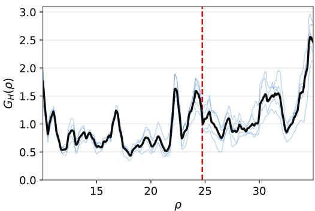  
Figure 6: $G _ { H } ( \rho )$ on the Lorenz zoo for a regressor $p \mapsto { \widehat { \theta } }$ trained jointly, i.e. parameter encoder, predictor and decoder fitted together on the weightspace MSE. Thin lines: five seeds; thick line: seed mean; $G _ { H }$ is the norm of $\mathrm { d } H ( p ) / \mathrm { d } \rho ;$ red dashed line: subcritical Hopf point $\rho _ { H } \approx 2 4 . 7 4$

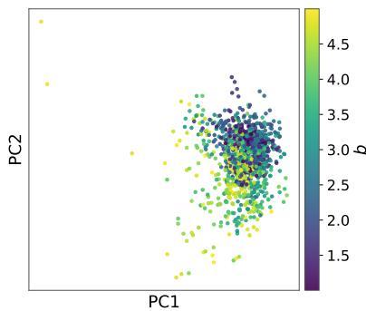  
Figure 7: Weight-side latent of the Brusselator zoo without stage 1. Each of the $M { = } 1 0 2 4$ finetuned networks $\theta _ { i }$ is embedded as $E _ { \theta } ( \theta _ { i } )$ with the weight encoder and predictor left at their random initialisation. The first two principal components, which carry 50 % of the variance, are coloured by $b .$

As a second ablation, we freeze the encoders $E _ { p } , E _ { \theta }$ and the predictor P (Sec. 3.1) at initialisation and train only the decoder D with the reconstruction loss (Eq. (5)). The frozen $E _ { \theta }$ is then a random projection of the weights whose latent shows no organisation by parameter (Fig. 7), in contrast to the trained latent of Fig. 4b, where the same zoo lies on a surface parametrised by $( a , b )$ that separates the stable fixed point from the limit-cycle regime. The parameter encoder $E _ { p } ^ { \mathrm { { \bar { \Phi } } } }$ effectively becomes a random-feature embedding. On the Brusselator zoo this control reaches a reconstruction error comparable to JEPAWG (random-feature MSE 0.0446 vs. JEPAWG 0.0441), and its response $G$ on the $( a , b )$ grid correlates strongly with JEPAWG’s (Pearson $r = 0 . 9 6 )$ , indicating that a similar map $p \mapsto { \dot { \theta } }$ is learned. However, a random-feature encoder fixes the geometry of the parameter latent before any data are seen: every coordinate of p is embedded on the same footing, irrespective of its effect on the dynamics. JEPAWG’s latent is instead shaped by the zoo through the invariance term, which ties $P ( \dot { E } _ { p } ( p ) )$ to the weight-side latent $E _ { \theta } ( \theta )$ . A parameter that moves the weights spans a latent direction, while one that does not is dropped. With a single parameter, the two embeddings behave alike, since there is only one direction along which to allocate capacity. They separate as soon as the coordinates of p are not on equal footing, which is the common case in more complicated systems with several parameters of unequal influence, or with parameters that are recorded but do not enter the dynamics.

We test the limiting case directly by appending k random parameters $\xi \sim \mathcal { U } ( 0 , 1 ) ^ { k } \mathrm { t o } p = ( \rho , \xi )$ on the Lorenz zoo; they have no effect on the dynamics, and the zoo weights are unchanged. JEPAWG is insensitive to ξ: the Hopf peak keeps its location (Fig. 8), and at most 0.1% of the squared gradient of $\hat { \theta }$ lies along $\xi .$ . The random-feature control has no way to tell ξ apart from $\rho$ and spends capacity on it, so its peak near the Hopf point degrades as k grows, until $G$ no longer reliably locates the bifurcation. The forecasts reflect the same difference. At $k = 1 0$ , the interpolation horizon of the JEPAWG-decoded networks is $2 0 . 1 \pm 0 . 2$ time units, against $2 0 . 2 \pm 0 . 2$ at $k = 0$ , while that of the random-feature control drops from $2 0 . 2 \pm 0 . 2 \mathrm { t o } 1 8 . 5 \pm 0 . 5$

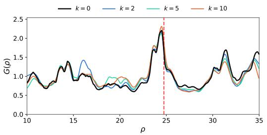  
(a) JEPAWG encoding.

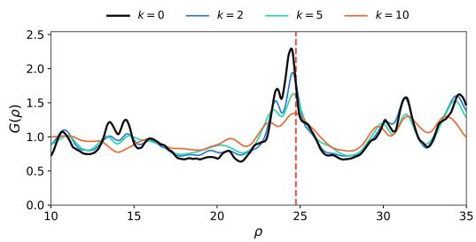  
(b) Random-feature encoding.

Figure 8: Random parameters. k random coordinates $\xi \sim \mathcal { U } ( 0 , 1 ) ^ { k }$ , with no effect on the dynamics, are appended to $p = \left( \rho , \xi \right)$ on the Lorenz zoo $( M { = } 8 0 0$ , weights unchanged), and both models are retrained. Shown is $G ( \rho )$ evaluated at a fixed random draw of ξ, averaged over 5 seeds; the red line marks $\rho _ { H } \approx 2 4 . 7 4$ . (a) JEPAWG; the curves for $k = 0 , 2 , 5 , \mathrm { i } 0$ coincide. (b) the random-feature control, with the same architecture but encoders frozen at initialisation. As k grows, its baseline rises, the Hopf peak broadens and loses prominence.  
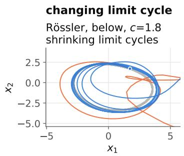

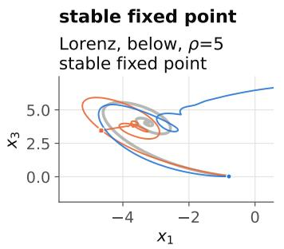

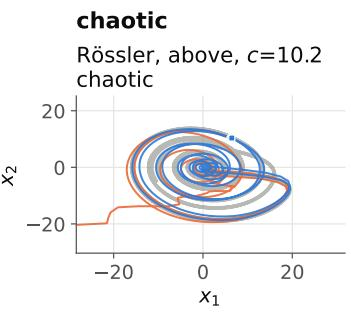

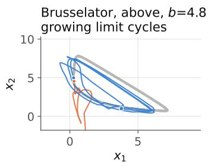

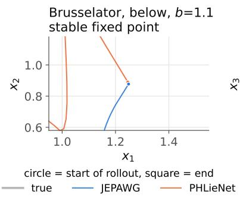

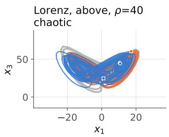  
Figure 9: Predicted and true trajectories at the furthest extrapolation parameter in each regime (one seed). In the limit-cycle regimes, JEPAWG-generated forecasters follow the true cycle more closely, while PHLieNet-generated trajectories tend to diverge after a number of steps, as quantified by the bounded fraction in Table 2.

## C Extrapolation per Regime

Figure 9 shows predicted and true trajectories at the furthest extrapolation parameter of each regime in Table 2.

## D Additional Results per Dynamical System

## D.1 Lorenz

On the Lorenz forecasting experiment, we plot JEPAWG forecasts and validate generated trajectories against the numerically integrated evolution.

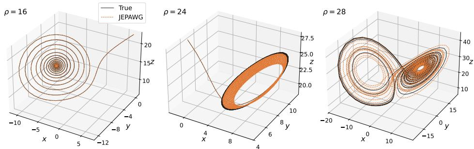  
Figure 10: Forecast trajectories of the Lorenz system at held-out $\rho$ (solid: truth; dashed: JEPAWG) at $\sigma = 1 0$ . From left to right: spiral trajectory into a stable fixed point, slowly decaying spiral just below the subcritical Hopf point, and the chaotic attractor. At these $\rho$ inside the training range, the forecasts follow the true trajectory with reasonable precision.

## D.2 Rössler

For the Rössler system we also examine $G ( c )$ over the range $c \in [ 3 , 9 ]$ , and observe distinct peaks in the response at period doublings and transitions into chaos.

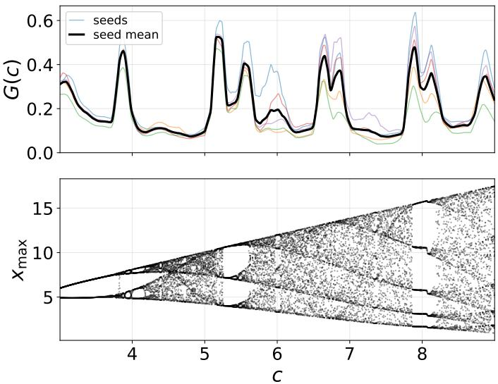  
Figure 11: Rössler weight-space response at $M = 1 0 0 0 \ ( a { = } b { = } 0 . 2 , c \in [ 3 , 9 ] )$ . Top: the response $G ( c )$ of JEPAWG-generated weights (Gaussian smoothed), per-seed curves and seed mean. Bottom: ground-truth diagram (successive local maxima of $x ( t )$ per parameter). The peaks of $G$ correspond to features of the bifurcation diagram in the plot below: the $2 \to 4$ doubling at $c { = } 3 . 8 3 $ and the entry/exit boundaries of the periodic windows show clear signal; the finite parameter resolution limits the visibility of the doublings closer to chaos.

## D.3 Hénon

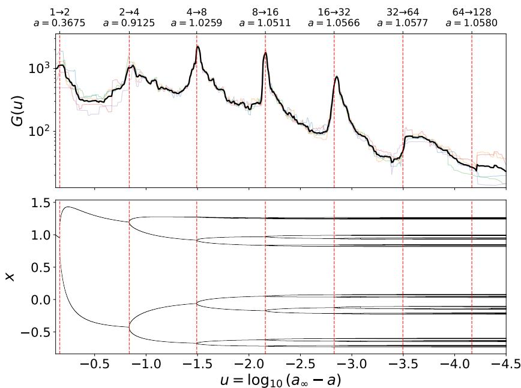  
Figure 12: Hénon u-cascade. Top: weight-space response $G ( u )$ of the cascade zoo, 5 seeds in colour and their mean in black, over the full trained range $u \in [ - 4 . 5 , - 0 . 1 2 ]$ (Fig. 5 shows the part $u \geq - 3 . 2 )$ . Bottom: bifurcation diagram of the Hénon map $\left( b { = } 0 . 3 \right)$ in the same coordinate $u = \log _ { 1 0 } ( a _ { \infty } - a )$ , with $a _ { \infty } = 1 . 0 5 8 0 5 [ 3 3 ]$ . For each of 6000 parameter values, 512 iterates of the attractor are shown after a $\mathrm { 2 \times 1 0 ^ { 5 } }$ -iterate transient. Red dashed lines mark the period-doubling bifurcations $a _ { 1 } , \ldots , a _ { 7 }$ (labels on the top axis); $a _ { 1 }$ is exact, $a _ { 2 } , \ldots , a _ { 7 }$ were located by bisection on the attractor period. The last two splittings of the orbit points are narrower than $1 0 ^ { - 3 }$ in x and are not resolved at this scale. $G ( u )$ peaks at each of the first five doublings, shows a step at $a _ { 6 }$ and no feature at $a _ { 7 }$ , where the seeds begin to disagree.

Two-parameter grid Trained on the 2-D grid $( a , b ) \in [ 0 . 3 , 1 . 5 5 ] \times [ 0 . 1 , 0 . 3 ] ( M { = } 1 0 2 4 )$ , the weight-space response reproduces the interior structure of the ground-truth period map (Fig. 13): the ridge of $\lVert \nabla _ { a , b } \hat { \theta } \rVert$ follows the 2→4 and $4 \to 8$ doubling curves and broadens over the chaotic band.

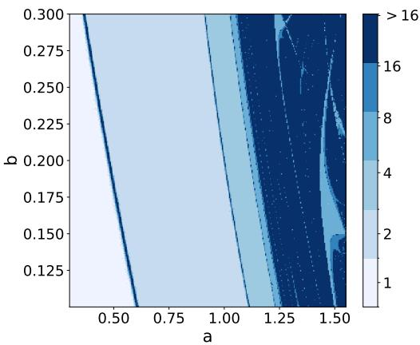

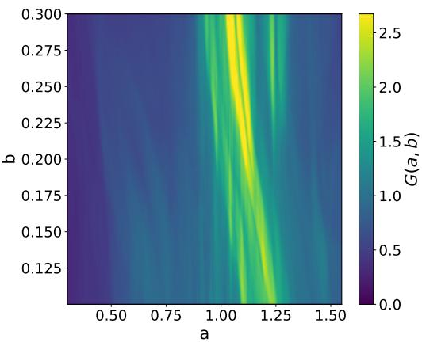  
Figure 13: Hénon. Left: ground-truth orbit period over $( a , b ) ;$ the boundaries between coloured bands are the bifurcation curves. Right: JEPAWG weight-space response $G ( a , b ) = \| \nabla _ { a , b } \hat { \theta } \|$ on the same rectangle, mean over seeds. The ridge of G tracks the interior doubling curves and the chaotic band.

## E Compute Resources

All training and evaluation ran on single NVIDIA L4 GPUs on a university SLURM cluster. The dominant cost is the construction of each weight grid: conditional pre-training followed by M per-parameter fine-tunes takes 2–6 GPU-hours per grid, depending on trajectory length and grid size. Training one JEPAWG seed on a finished grid takes ∼40 seconds, so the five-seed embedding stage is negligible relative to grid construction; evaluation adds 5–20 GPU-minutes per system.

## F Experimental Details

Table 6: Per-experiment protocol. The M parameter values are drawn from scrambled Sobol sequences (seed 0; stratified per-band draws for the Brusselator b sweep and the Hénon u-cascade, joint draws for the two-parameter families). Transients are integrated in addition to the recorded lengths; a zero entry means transients are retained in the data. $\bar { \Delta } t { : }$ observation interval (maps: 1 iteration); recorded lengths as training/test. ICs: initial conditions per training parameter (test sets use 10; Lorenz 20). h: evaluation step of the G sweep (two-parameter rows list the per-axis pair $( h _ { 1 } , h _ { 2 } )$ in the order of the experiment label), alongside the mean spacing $\Delta p$ of the fine-tuned parameters (Brusselator b: spacing in the dense band $\bar { b } \in [ 2 . 3 5 , 2 . 8 5 ]$ around $b _ { c } ;$ overall mean $2 . 4 \times 1 0 ^ { - 3 } )$ (ucascade: both in $u = \log _ { 1 0 } ( a _ { \infty } - a )$ , on which it is trained). $\lambda _ { \operatorname* { m a x } } ^ { \mathrm { s u p } } \colon$ largest Lyapunov exponent over the training range (per time unit; maps: per iteration); $\leq 0$ marks ranges without chaotic parameters. Input noise 5% of the standardised feature scale. The Lorenz- $- \rho$ grid also underlies Fig. 3a.
<table><tr><td>exp.</td><td>M</td><td>trans.</td><td> $\Delta t$ </td><td>len (tr/te)</td><td>ICs</td><td>h</td><td> $\Delta p$ </td><td> $\lambda _ { \mathrm { m a x } } ^ { \mathrm { s u p } }$ </td></tr><tr><td>Forecasting</td><td></td><td></td><td></td><td></td><td></td><td></td><td></td><td></td></tr><tr><td>Lorenz,  $\rho$ </td><td>800</td><td>0</td><td>0.02</td><td>20/30</td><td>5</td><td> $3 . 1 \times 1 0 ^ { - 2 }$ </td><td> $3 . 1 \times 1 0 ^ { - 2 }$ </td><td>1.06</td></tr><tr><td>Rössler, c</td><td>1000</td><td>300</td><td>0.1</td><td>20/100</td><td>10</td><td> $7 . 5 { \times } 1 0 ^ { - 3 }$ </td><td> $6 . 0 \times 1 0 ^ { - 3 }$ </td><td>0.09</td></tr><tr><td>Brusselator, b</td><td>1024</td><td>20</td><td>0.05</td><td>30/30</td><td>5</td><td> $3 . 1 \times 1 0 ^ { - 3 }$ </td><td> $8 \times 1 0 ^ { - 4 }$ </td><td> $\leq 0$ </td></tr><tr><td>Hénon, a</td><td>1024</td><td>200 it.</td><td>1</td><td>800/1500</td><td>5</td><td> $3 . 1 \times 1 0 ^ { - 4 }$ </td><td> $2 . 4 \times 1 0 ^ { - 4 }$ </td><td>0.18</td></tr><tr><td>Interpretability</td><td></td><td></td><td></td><td></td><td></td><td></td><td></td><td></td></tr><tr><td>Lorenz,  $( \sigma , \rho )$ </td><td>1024</td><td>0</td><td>0.02</td><td>20/30</td><td>5</td><td> $( 0 . 7 5 , 1 . 5 ) \times 1 0 ^ { - 1 }$ </td><td> $6 . 6 \times 1 0 ^ { - 1 }$ </td><td>1.14</td></tr><tr><td>Lorenz,  $\operatorname { T - p o i n t } \left( \sigma , \rho \right)$ </td><td>1024</td><td>0</td><td>0.02</td><td>20/30</td><td>5</td><td> $( 1 . 5 , 2 . 1 ) \times 1 0 ^ { - 2 }$ </td><td> $1 . 3 \times 1 0 ^ { - 1 }$ </td><td>1.03</td></tr><tr><td>Brusselator,  $( a , b )$ </td><td>1024</td><td>20</td><td>0.05</td><td>30/30</td><td>5</td><td> $( 0 . 7 5 , 2 . 0 ) \times 1 0 ^ { - 2 }$ </td><td> $7 . 7 \times 1 0 ^ { - 2 }$ </td><td> $\leq 0$ </td></tr><tr><td>Hénon,  $( a , b )$ </td><td>1024</td><td>200 it.</td><td>1</td><td>800/1500</td><td>5</td><td> $( 4 . 2 , 0 . 6 7 ) \times 1 0 ^ { - 3 }$ </td><td> $1 . 6 \times 1 0 ^ { - 2 }$ </td><td>0.45</td></tr><tr><td>Hénon, u</td><td>1540</td><td>0</td><td>1</td><td>1600/1500</td><td>5</td><td> $3 . 7 \times 1 0 ^ { - 4 }$ </td><td> $2 . 8 \times 1 0 ^ { - 3 }$ </td><td> $\leq 0$ </td></tr></table>

Table 7: Interpolation and extrapolation test sets for the forecasting experiments. Interpolation test parameters are Sobol draws from the training range, except Lorenz- $\cdot \rho ,$ which uses 10 fixed values. Fixed parameters: Lorenz $\sigma = 1 0 , \beta = 8 / 3 ;$ Rössler $a { = } b { = } 0 . 2 ;$ Brusselator a=1.25; Hénon $b { = } 0 . 3$
<table><tr><td>experiment</td><td>train range</td><td>interp. test</td><td>extrapolation</td></tr><tr><td>Lorenz,  $\rho$ </td><td>[10, 35]</td><td>10 fixed</td><td> $3 6 { - } 4 0 ; 1 0 \mathrm { w } \ 5 { - } 9$ </td></tr><tr><td>Rössler, c</td><td> $[ 3 , 9 ]$ </td><td>10 Sobol</td><td> $1 . 8 \mathrm { - } 2 . 8 ; 9 . 2 \mathrm { - } 1 0 . 2$ </td></tr><tr><td>Brusselator, b</td><td> $[ 1 . 5 , 4 ]$ </td><td>32 Sobol</td><td> $1 . 1 { - } 1 . 4 ; 4 . 2 { - } 4 . 8$ </td></tr><tr><td>Hénon, a</td><td>[0.85, 1.10]</td><td>32 Sobol</td><td></td></tr></table>