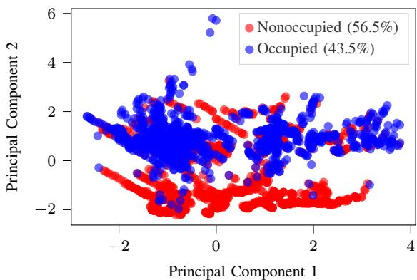
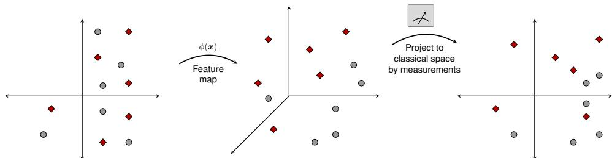
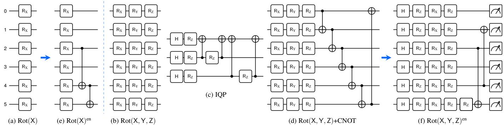
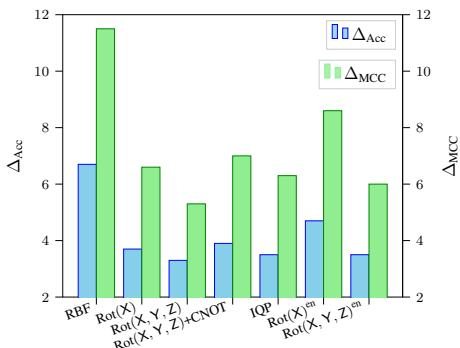

# Can Entanglement-Induced Feature-Map Designs Improve Projected Quantum Kernels?

Ravi Kumar Jha, Hsuan-Yin Lin, and Eirik Rosnes

Simula UiB, N–5006 Bergen, Norway

Emails: {ravi, lin, eirikrosnes}@simula.no

Abstract—Projected quantum kernels (PQKs) have emerged as a notable approach to circumvent the hardness of machine learning tasks arising from the exponential dimensionality of the quantum Hilbert space. However, recent PQK studies often rely heavily on extensive classical hyperparameter tuning of the radial basis function (RBF) kernel parameter and the support vector machine regularization parameter. The extensive tuning can mask the true representational power of the underlying PQKs induced by quantum feature maps, which has not been explored in detail. Thus, this work aims to expose the structural capabilities of PQKs by isolating and evaluating their native inductive bias through comparisons between untuned and tuned PQKs against the RBF baseline. Furthermore, we propose novel quantum feature maps that leverage two-qubit entanglement to capture multivariate correlations in IoT data. The results show that extensive tuning can lead to competitive performance architectures, while our proposed entanglement topologies exhibit a significantly stronger native inductive bias. This reveals that superior quantum architectural design can yield structurally better PQKs with improvements arising from quantum-mechanical properties rather than from classical hyperparameter tuning.

## I. INTRODUCTION

Quantum computing (QC) for machine learning (ML), also known as quantum machine learning (QML), has emerged as a promising research direction for ML tasks [1], [2]. This development is primarily driven by the need for computationally efficient paradigms to address complex systems, data modeling and simulation, data structures and design patterns, and energy estimation. QML leverages intriguing quantummechanical phenomena, such as information processing using quantum bits (qubits), superposition, and entanglement [3]. Notable algorithms have been developed over the last decade to enhance existing ML capabilities by leveraging these quantum properties. In the vicinity of ML, algorithms such as quantum neural networks, quantum principal component analysis (PCA), and quantum kernels have been developed to explore various advancements [4]. This work focuses on quantum kernels.

The mathematical framework of quantum kernels is straightforward and aligns with kernel theory, in which information is processed by mapping it to state vectors living in a large quantum feature space [5], [6]. The high-dimensional feature vectors need not be computed explicitly, and instead, a quantum device directly evaluates the inner products of quantum states. This overlap forms a quantum kernel, providing the similarity measure that drives kernel-based methods [4]–[6].

One ongoing challenge in QML is how to effectively encode classical inputs into quantum states through a quantum feature map, or simply a feature map [5]–[7]. In kernel methods, feature maps are crucial because kernel performance depends on how effectively they capture task-relevant structure through pairwise inner products of mapped inputs. A feature map typically consists of single- and two-qubit gates together with entangling operations [5]–[8]. An early demonstration of quantum advantage was achieved using a quantum fidelity kernel on synthetic data, executed on an IBM quantum device. This work remains influential in introducing the ZZfeature map [9]. This has inspired many useful formulations of quantum kernels in various applications, such as solving differential equations, hybrid neuro-inspired modeling, and data analysis [1], [10]– [12].

Standard quantum kernels assess data similarity by computing the global inner product between quantum states in a highdimensional Hilbert space. However, as the number of qubits increases, these global states become increasingly orthogonal, causing the kernel values of data points to decay exponentially toward zero, called exponential concentration [13]. Thus, exponential concentration severely hinders learning by diminishing the variance of the kernel matrix, making data points nearly indistinguishable and thereby limiting the model’s predictive capability. To mitigate the exponential scaling of the Hilbert space, the projected quantum kernel (PQK) was introduced [14]. Instead of relying on global state overlap, a PQK projects the quantum state back into a lower-dimensional classical feature space via local observable measurements, preserving relevant nonlinear quantum correlations while maintaining the discriminative power required for effective kernel estimation [14]–[16]. However, the PQK formulation appears to rely heavily on extensive classical hyperparameter tuning of the radial basis function (RBF) kernel parameter γ and the support vector machine (SVM) regularization parameter ξ. Therefore, this work critically examines current literature practices by addressing the following key objectives:

• To assess the extensive classical tuning influences on both PQKs and the RBF, we isolate their native inductive biases by comparing their tuned and untuned performances.

• To introduce two novel entanglement-induced feature maps that achieve empirical gains while demonstrating reduced hyperparameter sensitivity over untuned PQKs.

To this end, we evaluate the models under two distinct settings: untuned baselines and robustly tuned models. This framework ensures reliable assessment, aiming to provide a missing understanding of how structurally aligned quantum topologies can natively separate complex data and improve understanding of PQK models.

  
Fig. 1. An illustration of the complex class separation of IoT data using PCA.

## II. PRELIMINARIES

## A. Notation

N and R denote the sets of positive integers and reals, respectively. Moreover, $[ a ] \triangleq \{ 1 , 2 , \dots , a \}$ for $a \in \mathbb { N } .$ Vectors are boldfaced, $\mathrm { { e . g . , ~ } } x .$ . Matrices and sets are represented by capital sans serif letters and calligraphic uppercase letters, respectively, e.g., X and X. The single-qubit rotation operators about the $x \cdot , y \cdot$ , and z-axes are denoted by $\mathsf { R } _ { \mathrm { X } } , \mathsf { R } _ { \mathrm { Y } }$ , and $\mathsf { R } _ { \mathrm { Z } } ,$ respectively, and H is the Hadamard gate. We use $\rho$ to denote a density operator, and $\operatorname { t r } ( { \mathsf { X } } )$ and $\operatorname { t r } _ { \boldsymbol { \mathcal { A } } } ( \mathsf { X } )$ for the trace of X and the partial trace of X over a subsystem ${ \mathcal { A } } ,$ , respectively. Tensor products of Pauli operators are written without the tensor-product symbol, e.g., XX denotes ${ \sf X } \otimes { \sf X } .$

## B. Internet of Things Data

Internet of Things (IoT) platforms capture real-time environmental changes across a network of connected devices and sensors. The idea of using IoT data in this work is to extend the real-world applications of current quantum models beyond synthetic datasets, demonstrating how a quantum method handles complex, nonlinear correlations in sensor networks. Moreover, the inclusion of this data facilitates a fair comparison with ML models, as it does not require any feature reduction or selection method, given the moderate sample size and dimensionality, and it has previously been used in QML work [16], [17]. The data is open access on the IoT platform COGITO [16]. The dataset contains $N = 2 8 6 5$ samples and the six features illuminance, blinds, lamps, relative humidity $( r h ) ,$ , carbon dioxide (CO2), and temperature (temp) for classifying room occupancy. Standard data pre-processing was used to remove irrelevant variables, such as levels and timestamps, and redundant records. The binary classification task of occupied vs nonoccupied was normalized before being used in distinct PQKs and classical models. Fig. 1 visualizes the IoT data using the first two principal components obtained by PCA. The plot shows that the two classes are partially separable but remain noticeably overlapping, illustrating the nontrivial structure of the classification task.

## C. Data Encoding

Encoding classical inputs into quantum states, commonly referred to as data encoding, is a critical step in QML. A dataencoding scheme that maps classical feature inputs into highdimensional quantum states is known as a quantum feature map. In a basic formulation, a d-dimensional feature input ${ \pmb x } \in$ $\mathbb { R } ^ { d }$ is encoded into an n-qubit quantum state $| \phi ( { \pmb x } ) \rangle$ through a data-dependent unitary $\mathsf { U } ( { \pmb x } )$ , namely, $| \phi ( \pmb { x } ) \rangle \triangleq \mathsf { U } ( \pmb { x } ) | 0 \rangle \overset { \Delta } { \otimes } \mathsf { n }$ The corresponding density matrix is denoted by $\rho ( { \pmb x } )$ . This encoding via feature maps transforms the input data into a high-dimensional Hilbert space. Finding a suitable feature map is therefore a central component of quantum kernel models, where predictions can be made through kernel evaluations [5], [9], [12], [13]. In this work, following the IoT setting in [16], the number of qubits is chosen to be the same as the number of IoT input features, namely $n \ = \ 6 .$ . In general, however, the input dimension, the number of qubits, and the projected feature dimension need not coincide.

## D. Projected Quantum Kernel

PQKs are a class of quantum models that project quantum states into an approximate classical space [14]. In the PQK framework, rather than computing the fidelity between quantum states, the output quantum states are measured to extract the expectation values of Pauli observables, further discussed in Sec. III. Fig. 2 shows a schematic design of the PQK formulation. The original idea of this formulation was to address the challenges posed by the exponential dimensionality of the quantum Hilbert space endured by the standard quantum kernel approach [13]–[16]. The PQK formulation demonstrated merit in computational efficiency, with linear scaling of the required QC resources. However, PQKs still utilize the quantum Hilbert space and therefore can still pose a hardness barrier to classical simulation. We use the PQK formulation from [16, eq. (14)] (see also [14, Supplementary information]):

$$
\begin{array} { r l } & { \kappa _ { \mathrm { P Q K } } ( \pmb { x } , \pmb { x } ^ { \prime } ) } \\ & { \triangleq \exp \Bigg ( - \gamma \displaystyle \sum _ { \mathcal { M } \in \mathcal { S } } \displaystyle \sum _ { \mathbf { \Omega } } \Big [ \mathrm { t r } \big ( 0 \rho _ { \mathcal { M } } ( \pmb { x } ) \big ) - \mathrm { t r } \big ( 0 \rho _ { \mathcal { M } } ( \pmb { x } ^ { \prime } ) \big ) \Big ] ^ { 2 } \Bigg ) , } \end{array}
$$

where $\gamma \mathrm { ~  ~ { ~ > ~ } ~ } 0$ is a kernel hyperparameter, S denotes a collection of subsystems of the n-qubit system, and $\mathcal { P }$ denotes a set of nontrivial Pauli observables whose locality is chosen consistently with the subsystems in S. For a subsystem $\mathcal { M } ,$ $\rho _ { \mathcal { M } } ( { \pmb x } ) \ \triangleq \ \mathrm { t r } _ { \mathcal { M } ^ { \mathrm { c } } } \left( \rho ( { \pmb x } ) \right)$ is the reduced density operator obtained by tracing out the complement subsystem $\mathcal { M } ^ { \mathrm { c } }$

The PQK $\kappa _ { \mathrm { P Q K } } ( \pmb { x } , \pmb { x } ^ { \prime } )$ evaluates similarity using the expectation values of selected observables computed from the reduced density matrices $\rho _ { \mathcal { M } } ( \pmb { x } )$ . It can therefore be interpreted as a classical RBF kernel applied to quantum-projected feature vectors. Different projection strategies can be used to extract these features from the quantum states.

  
Fig. 2. A schematic design of the PQK architecture, where the raw inputs are first mapped into quantum feature space using a quantum feature map ϕ, and finally projected back into a classical space through measurement.

In this work, we follow the same choices of subsystems and observable sets as in [16] to compute $\kappa _ { \mathrm { P Q K } } ( \pmb { x } , \pmb { x } ^ { \prime } )$ according to the locality level m. The measurement settings are as follows. (a) Single-qubit local measurements $( m ~ = ~ 1 )$ : We set $\textit { S } = \textit { S } _ { 1 } \triangleq \{ \{ 1 \} , \{ 2 \} , \dots , \{ 6 \} \}$ and $\mathcal { P } ~ = ~ \mathcal { P } _ { 1 } \overset { \Delta } { = } ~ \{ { \sf X } , { \sf Y } , Z \}$ , yielding 18 observables. (b) Twoqubit measurements on adjacent qubit pairs $( m = 2 )$ : We set $\bar { \mathcal { S } } \ = \ S _ { 2 } \ \triangleq \ \{ \{ 1 , 2 \} , \{ 2 , 3 \} , \{ 3 , 4 \} , \{ 4 , 5 \} , \{ 5 , 6 \} , \{ 6 , 1 \} \}$ and $\mathcal { P } = \mathcal { P } _ { 2 } \triangleq \{ \mathsf { X } \mathsf { X } , \mathsf { Y } \mathsf { Y } , \mathsf { Z } \mathsf { Z } \}$ , again yielding 18 observables. (c) Combined single- and two-qubit measurements $( m \in \{ 1 , 2 \} )$ We concatenate the projected features obtained using ${ \mathcal { S } } = { \mathcal { S } } _ { 1 }$ and $\mathcal { P } = \mathcal { P } _ { 1 }$ for $m = 1$ , with those obtained using ${ \mathcal { S } } = { \mathcal { S } } _ { 2 }$ and $\mathcal { P } = \mathcal { P } _ { 2 }$ for $m = 2 ,$ , yielding 36 observables [16].

As a simple example for computing κPQK, consider two input samples $\mathbf { \delta x } _ { 1 }$ and $\mathbf { \delta x } _ { 2 }$ encoded into density operators $\rho ( \pmb { x } _ { 1 } )$ and $\rho ( { \pmb x } _ { 2 } )$ . We take $\begin{array} { r } { S = S ^ { \prime } = \{ \{ 1 \} , \{ 2 \} \} } \end{array}$ , and use the simple observable set ${ \mathcal P } = { \mathcal P } ^ { \prime } = \{ Z \}$ for illustration. Suppose that the corresponding expectation values are

$$
\begin{array} { r l } & { \mathrm { t r } ( \mathsf Z \rho _ { \{ 1 \} } ( { \pmb x } _ { 1 } ) ) = 0 . 8 , \quad \mathrm { t r } ( \mathsf Z \rho _ { \{ 2 \} } ( { \pmb x } _ { 1 } ) ) = - 0 . 2 , } \\ & { \mathrm { t r } ( \mathsf Z \rho _ { \{ 1 \} } ( { \pmb x } _ { 2 } ) ) = 0 . 5 , \quad \mathrm { t r } ( \mathsf Z \rho _ { \{ 2 \} } ( { \pmb x } _ { 2 } ) ) = 0 . 4 . } \end{array}
$$

Applying the PQK definition with $\gamma \quad = \quad 1$ , we obtain $\begin{array} { r c l } { { \kappa _ { \mathrm { P Q K } } ( { \bf x } _ { 1 } , { \pmb x } _ { 2 } ) } } & { { = } } & { { \exp \left( - [ ( 0 . 8 - 0 . 5 ) ^ { 2 } + ( - 0 . 2 - 0 . 4 ) ^ { 2 } ] \right) } } \end{array} =$ exp $( - [ 0 . 0 9 + 0 . 3 6 ] ) = \exp ( - 0 . 4 5 ) \approx 0 . 6 3 7 6 .$

## III. METHODOLOGY

## A. Projected Quantum Kernel Classifier

The IoT input features are encoded into high-dimensional quantum states using 6-qubit quantum feature-map circuits, where each qubit encodes one input feature. The resulting quantum states are then measured using local Pauli observables to extract information from localized subsystems. Following the subsystem measurement strategies described above, these quantum states are projected into a classical feature space by evaluating the expectation values of the selected local observables. The resulting expectation values are concatenated to form lower-dimensional classical feature vectors, which are then used to compute all pairwise PQK $\kappa _ { \mathrm { P Q K } } ( \pmb { x } , \pmb { x } ^ { \prime } )$ values. After all pairwise PQK values are computed, the remaining classification stage is entirely classical. In particular, PQK classification follows the standard SVM-kernel pipeline [14]– [16], with the classical feature map replaced by the PQK pipeline described above.

Consider the binary training set $\mathcal D = \{ ( \boldsymbol x _ { i } , y _ { i } ) \} _ { i = 1 } ^ { N }$ with labels $y _ { i } \in \{ - 1 , + 1 \}$ . The values κPQK $( \pmb { x } _ { i } , \pmb { x } _ { j } ) , i , j \in [ N ]$ are supplied to a classical soft-margin SVM classifier, which learns the dual coefficients ${ \pmb { \alpha } } = ( \alpha _ { 1 } , \dots , \alpha _ { N } )$ , by solving the optimization problem

$$
\begin{array} { r l } { \pmb { \alpha } ^ { \star } = \underset { \pmb { \alpha } } { \mathrm { a r g m i n } } \left\{ \frac { 1 } { 2 } \displaystyle \sum _ { i = 1 } ^ { N } \sum _ { j = 1 } ^ { N } \alpha _ { i } \alpha _ { j } y _ { i } y _ { j } \kappa _ { \mathrm { P Q K } } ( \pmb { x } _ { i } , \pmb { x } _ { j } ) - \sum _ { i = 1 } ^ { N } \alpha _ { i } \right\} } & { } \\ { \mathrm { s u b j e c t ~ t o } } & { 0 \le \alpha _ { i } \le \xi , \quad i \in [ N ] , \quad \displaystyle \sum _ { i = 1 } ^ { N } \alpha _ { i } y _ { i } = 0 . } \end{array}
$$

The support vectors are the training samples with $\alpha _ { i } ^ { \star } > 0 .$ . For the classical RBF kernel, the optimization formulation remains unchanged, with κPQK replaced by the RBF kernel $\kappa _ { \mathrm { R B F } } ~ =$ exp $\big ( - \gamma \| \pmb { x } _ { i } - \pmb { x } _ { j } \| ^ { 2 } \big )$ before hyperparameter tuning.

## B. Quantum Feature Map Circuit

In QML, quantum feature map circuits are used to implement the data encoding process on a quantum device. In kernel methods, high-order nonlinear feature maps are employed to approximate complex target functions. In the quantum domain, this is widely achieved with instantaneous quantum polynomial (IQP) designs such as the $\textsf { Z Z }$ feature map, which enables nonlinear feature interactions using singlequbit transformations and multi-qubit entanglements [9]. Earlier studies have introduced useful encoding designs, properly renamed as $\operatorname { R o t } ( { \mathsf { X } } )$ , a single qubit $\mathsf { R } _ { \mathrm { X } }$ rotation, and IQP. Later work also introduced variants of mapping designs, such as Rot $( \mathsf { X } , \mathsf { Y } , \mathsf { Z } ) , \mathsf { R } _ { \mathrm { X } } , \mathsf { R } _ { \mathrm { Y } } , \mathsf { R } _ { \mathrm { Z } }$ rotations; and Rot $( \mathsf { X } , \mathsf { Y } , \mathsf { Z } ) { \mathsf { + C N O T } } ,$ $\mathsf { R o t } ( { \mathsf { X } } , { \mathsf { Y } } , { \mathsf { Z } } )$ with circular entanglement, to develop PQKs for benchmarking and real-world IoT applications [14]–[16]. The common idea behind such variants is to introduce a broader class of entanglements, either linear or fully entangled, or additional complexity through additional rotation gates [16]. Moreover, a PQK employs distinct measurement strategies described in Sec. II-D.

These previous studies support the merit of PQK formulations and their applicability, to some extent, toward developing useful quantum models. However, we observe two major shortcomings: (a) the performance is highly dependent on extensive classical hyperparameter tuning of the RBF kernel parameter $\gamma$ and the SVM regularization parameter $\xi ;$ and (b) there is a lack of structural explainability in quantum featuremap designs for real-world data. Through this work, we aim to assess the impact of different feature maps without tuning the hyperparameters $\gamma$ and $\xi ,$ thereby more precisely isolating the representational capabilities of the quantum feature maps. We also propose a structured approach to feature-map design based on selected entanglement pairs. Based on this selection procedure, we propose two new tailor-made feature maps, Rot(X)en and Rot(X, Y, Z)en, for IoT data classification, as illustrated in Fig. 3 (e) and (f).

  
Fig. 3. Schematic diagram of the distinct feature maps used for PQKs: (a) Rot(X), a single qubit $\mathsf { R } _ { \mathrm { X } }$ rotation, inspired the designing of (e) Rot(X)en, Rot(X) with a specific pair of entanglement; (b) Rot $( { \mathsf { X } } , { \mathsf { Y } } , { \bar { \mathsf { Z } } } ) .$ , RX, RY, RZ rotations; (c) IQP, standard design, for simplicity, only an $n = 3$ qubits circuit is shown; (d) Rot(X, Y, Z)+CNOT, Rot(X, Y, Z) with circular entanglement, conceptually formed (f) Rot(X, Y, Z)en, with a specific pair of entanglement.

The proposed feature maps aim to explore potential empirical advantage by designing entanglement-induced PQKs within our framework. A crucial component of our framework is the intended structural design of the entanglement layer. Rather than fixing an arbitrary entangling pattern, we systematically evaluate pairwise entanglement candidate topologies constructed from all possible two-qubit featureinteraction pairs. We then select the topology that yields the best empirical performance. In this way, the proposed feature maps test whether carefully chosen pairwise entanglement can improve the resulting PQK on real-world IoT data. Specifically, $\operatorname { R o t } ( \mathsf { X } ) ^ { \mathrm { e n } }$ and Rot(X, Y, Z)en couple selected qubit pairs through feature-dependent two-qubit interactions, thereby encoding multivariate input-feature correlations into the quantum Hilbert space. Since previous benchmark studies have suggested that quantumness via entanglement may not be a decisive performance driver for smaller learning tasks [18], our experiment evaluates whether such selected entanglement structures are beneficial for real-world IoT data.

## C. Evaluation Criteria

To examine the influence of classical hyperparameter tuning, we compare PQKs and the classical RBF baseline before and after tuning. For the untuned PQK baselines, we fix ξ = 1 and use the data-dependent heuristic $\gamma = 1 / ( | S | | \mathcal { P } | \sigma ^ { 2 } )$ , motivated by the variance-scaled bandwidth grid in [14, Supplementary information, eq. (S115)], with the multiplicative factor fixed to one. Here, S and $\mathcal { P }$ are defined in Sec. II-D, and $\sigma ^ { 2 }$ is the empirical variance of the projected features over the training data. For the combined setting, the heuristic uses the 36-dimensional concatenated training representation. For the untuned classical RBF baseline, we also fix $\xi ~ = ~ 1$ and use $\gamma ~ = ~ 1 / ( d \sigma _ { \mathrm { x } } ^ { 2 } )$ , where $d = 6$ is the input dimension and $\sigma _ { \mathrm { x } } ^ { 2 }$ is the empirical variance of the input features over the training data. This prescribed rule provides a reproducible baseline without gridsearch tuning, although the resulting performance comparisons may still depend on the selected baseline hyperparameters. For the PQKs only, each feature-map circuit is repeated twice to increase its expressivity and circuit complexity, which may make classical simulation more demanding as the system size increases [9], [12]. Thereafter, we tune each feature map circuit to quantify its impact and assess the need for tuning. We have used 10-fold cross-validation, in which 10% of the data is used for testing, with 95% confidence intervals (CIs) to assess the performance of untuned and tuned models, and report test accuracy. The optimal values for the tuning hyperparameters are determined through a grid search over the sets $\xi \in \{ 0 . 0 0 6 , 0 . 0 1 5 , 0 . 0 3 , 0 . 0 6 2 5 \} \cup \{ 2 ^ { r } \mid r = - 3 , \ldots , 1 0 \}$ and $\gamma \in \{ 0 . 0 3 , 0 . 0 6 2 5 \} \cup \{ 2 ^ { r } \mid r = - 3 , \ldots , 2 \} \cup \{ 5 , 7 , 8 \}$ [16].

TABLE I  
IOT DATA CLASSIFICATION EVALUATION FOR CLASSICAL MODELS.
<table><tr><td>Models</td><td>Accuracy</td><td>F1-score</td><td>MCC</td></tr><tr><td>Lin</td><td> $0 . 7 9 2 \pm 0 . 0 1 4$ </td><td> $0 . 7 9 8 \pm 0 . 0 1 5$ </td><td> $0 . 6 2 6 \pm 0 . 0 2 3$ </td></tr><tr><td rowspan="2">RBF</td><td> $0 . 8 2 6 \pm 0 . 0 1 7$ </td><td> $0 . 8 2 0 \pm 0 . 0 2 1$ </td><td> $0 . 6 7 0 \pm 0 . 0 3 3$ </td></tr><tr><td> $0 . 8 9 3 \pm 0 . 0 0 8$ </td><td> $0 . 8 8 1 \pm 0 . 0 0 9$ </td><td> $0 . 7 8 5 \pm 0 . 0 1 7$ </td></tr><tr><td>LDA</td><td> $0 . 7 9 2 \pm 0 . 0 1 2$ </td><td> $0 . 7 9 8 \pm 0 . 0 1 3$ </td><td> $0 . 6 2 7 \pm 0 . 0 1 7$ </td></tr><tr><td>RF</td><td> $0 . 9 0 2 \pm 0 . 0 0 6$ </td><td> $0 . 8 9 1 \pm 0 . 0 0 8$ </td><td> $0 . 8 0 4 \pm 0 . 0 1 3$ </td></tr><tr><td>AB</td><td> $0 . 8 6 3 \pm 0 . 0 1 0$ </td><td> $0 . 8 3 9 \pm 0 . 0 1 6$ </td><td> $0 . 7 2 0 \pm 0 . 0 2 3$ </td></tr><tr><td>MLP</td><td> $0 . 8 9 1 \pm 0 . 0 0 7$ </td><td> $0 . 8 7 8 \pm 0 . 0 0 8$ </td><td> $0 . 7 8 1 \pm 0 . 0 1 4$ </td></tr></table>

The PQKs performances are evaluated using distinct statistical metrics such as accuracy, F1-score, and Matthews correlation coefficient (MCC). MCC provides valuable consideration, given that IoT data is slightly imbalanced and reported within the standard range [−1, +1] [12], [19]. In addition to linear (Lin) and RBF kernels, other non-kernel ML models such as linear discriminant analysis (LDA), random forest (RF), AdaBoost (AB), and multilayer perceptron (MLP), are included for a robust and realistic comparison beyond the kernel methods. These non-kernel models are also optimized (tuned) to achieve their best performance. The experiments are conducted in a noiseless quantum PennyLane simulator [20].

TABLE II  
IOT DATA CLASSIFICATION ACCURACY, F1-SCORE, AND MCC VALUE FOR PQK MODELS BEFORE AND AFTER HYPERPARAMETER TUNING.
<table><tr><td rowspan="2">Models</td><td colspan="3"> $m = 1$ </td><td colspan="3"> $m = 2$ </td><td colspan="3"> $m \in \{ 1 , 2 \}$ </td></tr><tr><td>Accuracy</td><td> $\mathbf { F 1 - s c o r e }$ </td><td>MCC</td><td>Accuracy</td><td>F1-score</td><td>MCC</td><td>Accuracy</td><td>F1-score</td><td>MCC</td></tr><tr><td rowspan="2">Rot(X)</td><td> $0 . 8 5 3 \pm 0 . 0 1 5$ </td><td> $0 . 8 4 2 \pm 0 . 0 1 7$ </td><td> $0 . 7 1 1 \pm 0 . 0 3 0$ </td><td> $0 . 8 5 5 \pm 0 . 0 1 3$ </td><td> $0 . 8 4 7 \pm 0 . 0 1 2$ </td><td> $0 . 7 2 0 \pm 0 . 0 2 6$ </td><td> $0 . 8 5 9 \pm 0 . 0 1 5$ </td><td> $0 . 8 5 0 \pm 0 . 0 1 6$ </td><td> $0 . 7 2 6 \pm 0 . 0 3 0$ </td></tr><tr><td> $0 . 8 9 3 \pm 0 . 0 0 9$ </td><td> $0 . 8 8 1 \pm 0 . 0 0 9$ </td><td> $0 . 7 8 6 \pm 0 . 0 1 8$ </td><td> $0 . 8 9 5 \pm 0 . 0 0 9$ </td><td> $0 . 8 8 3 \pm 0 . 0 1 0$ </td><td> $0 . 7 8 9 \pm 0 . 0 1 8$ </td><td> $0 . 8 9 6 \pm 0 . 0 0 9$ </td><td> $0 . 8 8 4 \pm 0 . 0 1 0$ </td><td> $0 . 7 9 2 \pm 0 . 0 1 9$ </td></tr><tr><td rowspan="2"> $\mathrm { R o t } ( { \sf X } , { \sf Y } , { \sf Z } )$ </td><td> $0 . 8 6 4 \pm 0 . 0 1 2$ </td><td> $0 . 8 5 8 \pm 0 . 0 1 5$ </td><td> $0 . 7 4 2 \pm 0 . 0 2 3$ </td><td> $0 . 8 5 2 \pm 0 . 0 1 3$ </td><td> $0 . 8 4 3 \pm 0 . 0 1 5$ </td><td> $0 . 7 1 4 \pm 0 . 0 2 6$ </td><td> $0 . 8 6 4 \pm 0 . 0 1 3$ </td><td> $0 . 8 5 7 \pm 0 . 0 1 5$ </td><td> $0 . 7 4 0 \pm 0 . 0 2 6$ </td></tr><tr><td> $0 . 8 9 5 \pm 0 . 0 1 1$ </td><td> $0 . 8 8 3 \pm 0 . 0 1 2$ </td><td> $0 . 7 8 9 \pm 0 . 0 2 2$ </td><td> $0 . 8 9 2 \pm 0 . 0 1 0$ </td><td> $0 . 8 8 0 \pm 0 . 0 1 2$ </td><td> $0 . 7 8 4 \pm 0 . 0 2 1$ </td><td> $0 . 8 9 7 \pm 0 . 0 1 0$ </td><td> $0 . 8 8 5 \pm 0 . 0 1 3$ </td><td> $0 . 7 9 3 \pm 0 . 0 2 1$ </td></tr><tr><td rowspan="2"> $\overline { { \mathrm { R o t } ( \mathsf { X } , \mathsf { Y } , Z ) } }$  +CNOT</td><td> $0 . 8 4 4 \pm 0 . 0 1 3$ </td><td> $0 . 8 3 2 \pm 0 . 0 1 5$ </td><td> $0 . 6 9 3 \pm 0 . 0 2 7$ </td><td> $0 . 8 3 9 \pm 0 . 0 1 3$ </td><td> $0 . 8 2 9 \pm 0 . 0 1 6$ </td><td> $0 . 6 8 8 \pm 0 . 0 2 2$ </td><td> $0 . 8 5 7 \pm 0 . 0 1 4$ </td><td> $0 . 8 4 9 \pm 0 . 0 1 7$ </td><td> $0 . 7 2 4 \pm 0 . 0 2 7$ </td></tr><tr><td> $0 . 8 9 4 \pm 0 . 0 0 8$ </td><td> $0 . 8 8 3 \pm 0 . 0 1 0$ </td><td> $0 . 7 8 9 \pm 0 . 0 1 7$ </td><td> $0 . 8 9 0 \pm 0 . 0 0 6$ </td><td> $0 . 8 7 8 \pm 0 . 0 0 9$ </td><td> $0 . 7 8 0 \pm 0 . 0 1 1$ </td><td> $0 . 8 9 6 \pm 0 . 0 0 8$ </td><td> $0 . 8 8 6 \pm 0 . 0 1 0$ </td><td> $0 . 7 9 4 \pm 0 . 0 1 6$ </td></tr><tr><td rowspan="2">IQP</td><td> $0 . 8 3 6 \pm 0 . 0 1 4$ </td><td> $0 . 8 2 8 \pm 0 . 0 1 8$ </td><td> $0 . 6 8 5 \pm 0 . 0 2 4$ </td><td> $0 . 8 3 8 \pm 0 . 0 1 5$ </td><td> $0 . 8 2 6 \pm 0 . 0 2 0$ </td><td> $0 . 6 8 3 \pm 0 . 0 2 9$ </td><td> $0 . 8 3 8 \pm 0 . 0 1 3$ </td><td> $0 . 8 2 9 \pm 0 . 0 1 7$ </td><td> $0 . 6 8 7 \pm 0 . 0 2 3$ </td></tr><tr><td> $0 . 8 7 2 \pm 0 . 0 0 8$ </td><td> $0 . 8 5 6 \pm 0 . 0 1 1$ </td><td> $0 . 7 4 1 \pm 0 . 0 1 7$ </td><td> $0 . 8 6 8 \pm 0 . 0 0 8$ </td><td> $0 . 8 5 4 \pm 0 . 0 1 1$ </td><td> $0 . 7 3 6 \pm 0 . 0 1 7$ </td><td> $0 . 8 7 3 \pm 0 . 0 1 1$ </td><td> $0 . 8 6 2 \pm 0 . 0 1 3$ </td><td> $0 . 7 5 0 \pm 0 . 0 2 1$ </td></tr><tr><td rowspan="2"> $\operatorname { R o t } ( \mathsf { X } ) ^ { \mathrm { e n } }$ </td><td> $0 . 8 4 8 \pm 0 . 0 1 5$ </td><td> $0 . 8 3 8 \pm 0 . 0 1 8$ </td><td> $0 . 7 0 3 \pm 0 . 0 3 1$ </td><td> $0 . 8 5 5 \pm 0 . 0 1 5$ </td><td> $0 . 8 4 5 \pm 0 . 0 1 6$ </td><td> $0 . 7 1 7 \pm 0 . 0 2 7$ </td><td> $0 . 8 5 6 \pm 0 . 0 1 6$ </td><td> $0 . 8 4 6 \pm 0 . 0 1 8$ </td><td> $0 . 7 2 0 \pm 0 . 0 3 1$ </td></tr><tr><td> $\mathbf { 0 . 9 0 2 \pm 0 . 0 0 9 }$ </td><td> $\mathbf { 0 . 8 9 1 \pm 0 . 0 1 0 }$ </td><td> $\mathbf { 0 . 8 0 3 \pm 0 . 0 1 9 }$ </td><td> $\mathbf { 0 . 8 9 8 \pm 0 . 0 1 2 }$ </td><td> $\mathbf { 0 . 8 8 7 \pm 0 . 0 1 5 }$ </td><td> $\mathbf { 0 . 7 9 6 \pm 0 . 0 2 4 }$ </td><td> $\mathbf { 0 . 9 0 3 \pm 0 . 0 1 1 }$ </td><td> $\mathbf { 0 . 8 9 2 \pm 0 . 0 1 3 }$ </td><td></td></tr><tr><td rowspan="2"> $\mathrm { R o t } ( { \mathsf { X } } , { \mathsf { Y } } , { \mathsf { Z } } ) ^ { * }$ </td><td></td><td> $0 . 8 4 4 \pm 0 . 0 1 3$ </td><td> $0 . 7 1 6 \pm 0 . 0 1 9$ </td><td> $0 . 8 5 4 \pm 0 . 0 1 2$ </td><td> $0 . 8 4 9 \pm 0 . 0 1 6$ </td><td> $0 . 7 2 6 \pm 0 . 0 2 4$ </td><td> $0 . 8 5 6 \pm 0 . 0 1 0$ </td><td></td><td> $\mathbf { 0 . 8 0 6 \pm 0 . 0 2 2 }$ </td></tr><tr><td> $0 . 8 5 0 \pm 0 . 0 1 0$   $0 . 8 9 3 \pm 0 . 0 1 0$ </td><td> $0 . 8 8 3 \pm 0 . 0 1 1$ </td><td> $0 . 7 8 9 \pm 0 . 0 2 0$ </td><td> $0 . 8 9 0 \pm 0 . 0 1 0$ </td><td> $0 . 8 7 9 \pm 0 . 0 0 9$ </td><td> $0 . 7 8 2 \pm 0 . 0 1 9$ </td><td> $0 . 8 9 4 \pm 0 . 0 0 8$ </td><td> $0 . 8 5 0 \pm 0 . 0 1 4$   $0 . 8 8 3 \pm 0 . 0 0 9$ </td><td> $0 . 7 2 7 \pm 0 . 0 1 9$ </td></tr><tr><td rowspan="2"> $\mathsf { R o t } ( { \mathsf { X } } , { \mathsf { Y } } , { \mathsf { Z } } ) ^ { \mathrm { c n } }$ </td><td> $\mathbf { 0 . 8 6 5 \pm 0 . 0 1 4 }$ </td><td> $\mathbf { 0 . 8 5 7 \pm 0 . 0 1 7 }$ </td><td> $\mathbf { 0 . 7 4 0 \pm 0 . 0 2 8 }$ </td><td> $\mathbf { 0 . 8 6 7 \pm 0 . 0 1 5 }$ </td><td> $\mathbf { 0 . 8 5 5 \pm 0 . 0 2 0 }$ </td><td> $\mathbf { 0 . 7 3 7 \pm 0 . 0 3 2 }$ </td><td> $\mathbf { 0 . 8 6 8 \pm 0 . 0 1 4 }$ </td><td> $\mathbf { 0 . 8 6 0 \pm 0 . 0 1 8 }$ </td><td> $0 . 7 8 9 \pm 0 . 0 1 5$ </td></tr><tr><td></td><td></td><td> $\mathbf { 0 . 8 0 1 \pm 0 . 0 1 2 }$ </td><td></td><td> $\mathbf { 0 . 8 8 4 \pm 0 . 0 1 5 }$ </td><td> $\mathbf { 0 . 7 9 1 \pm 0 . 0 2 2 }$ </td><td></td><td></td><td> $\mathbf { 0 . 7 4 6 \pm 0 . 0 2 8 }$ </td></tr><tr><td></td><td> $\mathbf { 0 . 9 0 0 \pm 0 . 0 0 6 }$ </td><td> $\mathbf { 0 . 8 8 9 \pm 0 . 0 0 8 }$ </td><td></td><td> $\mathbf { 0 . 8 9 6 \pm 0 . 0 1 0 }$ </td><td></td><td></td><td> $\mathbf { 0 . 9 0 3 \pm 0 . 0 0 8 }$ </td><td> $\mathbf { 0 . 8 9 2 \pm 0 . 0 1 0 }$ </td><td> $\mathbf { 0 . 8 0 6 \pm 0 . 0 1 6 }$ </td></tr></table>

## IV. NUMERICAL RESULTS AND DISCUSSION

The performance on the IoT data is analyzed from two perspectives: (a) the evaluation of classical models to establish baseline performance, with particular emphasis on the RBF kernel under both untuned and tuned settings, as reported in Table I; and (b) the evaluation of different PQKs feature maps with and without hyperparameter tuning, as reported in Table II. This structure allows us to separate the effect of classical hyperparameter tuning from the intrinsic representational capability of the feature maps. For both Tables I and II, untuned results are highlighted in blue.

As shown in Table I, the simple linear kernel, Lin, gives the lowest baseline performance, with an accuracy of $0 . 7 9 2 \pm$ 0.014 and an MCC of $0 . 6 2 6 \pm 0 . 0 2 3$ . The LDA model, which is also linear, performs similarly, achieving an accuracy of $0 . 7 9 2 \pm 0 . 0 1 2$ and an MCC of $0 . 6 2 7 \pm 0 . 0 1 7$ . These results indicate that the classification is not well captured by a purely linear decision boundary.

To examine the role of native inductive bias, we focus on the RBF as the classical nonlinear kernel baseline, since its behavior provides a natural reference point for contextualizing the formulation and potential advantages of PQKs. Table I compares the untuned RBF performance with the optimized RBF performance after hyperparameter tuning. Before tuning, the RBF achieves moderate performance, with an accuracy of $0 . 8 2 6 { \pm } 0 . 0 1 7$ and an MCC of $0 . 6 7 0 { \scriptstyle \pm 0 . 0 3 3 }$ . After grid-search optimization, the performance improves substantially, reaching an accuracy of $0 . 8 9 3 \pm 0 . 0 0 8$ and an MCC of $0 . 7 8 5 \pm 0 . 0 1 7 .$ Overall, the optimized RBF outperforms the Lin baseline by approximately 10% in accuracy, 8% in F1-score, and 16% in MCC, while also reducing the CIs across the metrics. This large improvement shows that the RBF is highly sensitive to hyperparameter tuning.

Among the remaining classical models, AB and MLP perform better than the linear baselines, with AB achieving an accuracy of $0 . 8 6 3 \pm 0 . 0 1 0$ and an MCC of $0 . 7 2 0 \pm 0 . 0 2 3 ,$ , and MLP achieving an accuracy of $0 . 8 9 1 \pm 0 . 0 0 7$ and an MCC of $0 . 7 8 1 \pm 0 . 0 1 4 .$ . The RF model gives the strongest classical performance, with an accuracy of $0 . 9 0 2 \pm 0 . 0 0 6 ,$ an F1-score of $0 . 8 9 1 \pm 0 . 0 0 8 ,$ and an MCC of $0 . 8 0 4 \pm 0 . 0 1 3 .$ . Note that RF is a more complex ensemble model than the kernel methods, as it can capture nonlinear and higher-order feature interactions. Hence, it provides a strong classical benchmark for assessing the empirical competitiveness of the PQKs.

Table II reports the performance of six PQK models derived from distinct feature maps. The untuned PQK results already reveal a meaningful native inductive bias. For example, the untuned Rot(X) with $m \ = \ 1$ achieves an accuracy of $0 . 8 5 3 \pm 0 . 0 1 5$ and an MCC of $0 . 7 1 1 \pm 0 . 0 3 0$ , outperforming the untuned RBF kernel. Similarly, the untuned Rot(X, Y, Z) feature map achieves an accuracy of $0 . 8 6 4 \pm 0 . 0 1 2$ and an MCC of $0 . 7 4 2 \pm 0 . 0 2 3$ under $m = 1$ . These results suggest that the induced quantum feature spaces can provide useful geometric separation even before classical hyperparameter tuning is applied.

After hyperparameter tuning, the standard PQK feature maps become comparable to the tuned RBF baseline. For Rot(X), the best performance is obtained under $m \in \{ 1 , 2 \}$ with an accuracy of $0 . 8 9 6 \pm 0 . 0 0 9 ,$ , an F1-score of 0.884 ± 0.010, and an MCC of $0 . 7 9 2 { \pm } 0 . 0 1 9$ . The Rot(X, Y, Z) feature map achieves a similar trend, with its best-tuned performance under $m \in \{ 1 , 2 \}$ reaching an accuracy of $0 . 8 9 7 { \scriptstyle \pm 0 . 0 1 0 }$ and an MCC of $0 . 7 9 3 \pm 0 . 0 2 1$ . These results indicate that increasing the measurement-based feature representation from individual m values to combined values m ∈ {1, 2} yields consistent, although marginal improvements.

The entanglement-based standard feature maps do not automatically lead to better performance. In particular, Rot(X, Y, Z)+CNOT performs similarly to Rot(X, Y, Z) after tuning, while the IQP feature map performs worse compared to the other PQKs, reaching an accuracy of $0 . 8 7 3 \pm 0 . 0 1 1$ and an MCC of $0 . 7 5 0 \pm 0 . 0 2 1$ under $m \ \in \ \{ 1 , 2 \}$ . This observation suggests that simply adding entanglement or using a dense entangling architecture is not useful in improving PQK performance. Rather, the structure of the entanglement pattern appears to be important.

The proposed feature maps, based on selected pairwise entanglement structures, yield the strongest PQK results. The proposed $\operatorname { R o t } ( \mathsf { X } ) ^ { \mathrm { e n } }$ feature map achieves an accuracy of $0 . 9 0 2 \pm 0 . 0 0 9$ , an F1-score of $0 . 8 9 1 \pm 0 . 0 1 0 .$ and an MCC of $0 . 8 0 3 \pm 0 . 0 1 9$ under $m \ = \ 1 . \ \mathrm { U n d e r } \ m \ \in \ \{ 1 , 2 \}$ , it further reaches an accuracy of $0 . 9 0 3 \pm 0 . 0 1 1$ and an MCC of $0 . 8 0 6 \pm 0 . 0 2 2$ . Similarly, $\mathsf { R o t } ( { \mathsf { X } } , { \mathsf { Y } } , { \mathsf { Z } } ) ^ { \mathrm { e n } }$ achieves competitive performance, with an accuracy of $0 . 9 0 0 \pm 0 . 0 0 6 .$ an F1-score of $0 . 8 8 9 \pm 0 . 0 0 8$ , and an MCC of $0 . 8 0 1 { \scriptstyle \pm 0 . 0 1 2 }$ under $m = 1 ,$ and its best overall performance under $m \in \{ 1 , 2 \}$ reaches an accuracy of $0 . 9 0 3 { \scriptstyle \pm 0 . 0 0 8 }$ , an F1-score of $0 . 8 9 2 { \scriptstyle \pm 0 . 0 1 0 }$ , and an MCC of $0 . 8 0 6 \pm 0 . 0 1 6$ . These results show that the proposed selected-entanglement feature maps outperform the standard PQK designs and are competitive with the strongest classical baseline model, the RF. As an ablation study, we also report numerical results for an unentangled variant of $\mathsf { R o t } ( { \mathsf { X } } , { \mathsf { Y } } , { \mathsf { Z } } ) ^ { \mathrm { e n } }$ denoted by $\mathrm { R o t } ( { \sf X } , { \sf Y } , { \sf Z } ) ^ { * }$ , to isolate and quantify the performance gains attributable to entanglement.

  
Fig. 4. Sensitivity analysis of PQK and RBF hyperparameter tuning.

To quantify the effect of hyperparameter tuning, Fig. 4 presents a sensitivity analysis based on the performance differences between the tuned and untuned settings. We define $\Delta _ { \mathrm { A c c } }$ as the change in accuracy and $\Delta _ { \mathrm { M C C } }$ as the improvement in MCC after tuning. The RBF exhibits the highest tuning sensitivity, indicating that its strong performance depends heavily on grid-search tuning. In contrast, the PQK models generally show lower sensitivity, suggesting that their feature maps provide a stronger native inductive bias before tuning. The proposed entanglement-induced feature maps maintain strong performance while requiring less tuning-induced correction than the RBF. The results support two main observations. First, all untuned PQKs can induce useful native geometric separation in IoT data classification, as evidenced by their performance relative to the untuned RBF baseline. Second, carefully selected pairwise entanglement structures can improve PQK performance more effectively than generic entanglement patterns, such as circular CNOT layers or IQPstyle dense entanglement. These findings suggest that the empirical usefulness of entanglement in PQKs depends not only on the presence of entanglement, but also on how the entanglement topology is selected and aligned with the data.

## V. CONCLUSION AND FUTURE WORK

This study compared six quantum feature maps for IoT classification before and after classical hyperparameter tuning.

The proposed circuits, $\mathsf { R o t } ( \mathsf { X } ) ^ { \mathrm { e n } }$ and $\mathsf { R o t } ( { \mathsf { X } } , { \mathsf { Y } } , { \mathsf { Z } } ) ^ { \mathrm { e n } }$ , achieved the strongest PQK performance and were competitive with the strongest classical baseline. Under the prescribed untuned settings, PQKs outperformed the untuned RBF and generally showed smaller tuning-related gains, suggesting useful taskspecific inductive biases.

This study is limited to heuristic feature-map designs evaluated on a single, relatively small dataset. Future work should assess robustness across multiple baseline hyperparameter choices and datasets, and examine how circuit-induced inductive biases shape the geometry and expressivity of the projected feature space.

## REFERENCES

[1] P. Rebentrost, M. Mohseni, and S. Lloyd, “Quantum support vector machine for big data classification,” Phys. Rev. Lett., vol. 113, no. 13, Sep. 2014, Art. no. 130503.

[2] J. Biamonte et al., “Quantum machine learning,” Nature, vol. 549, no. 7671, pp. 195–202, Sep. 2017.

[3] M. A. Nielsen and I. L. Chuang, Quantum Computation and Quantum Information, 10th ed. Cambridge, U.K.: Cambridge University Press, 2010.

[4] F. Rodr´ıguez-D´ıaz, D. Gutierrez-Avil ´ es, A. Troncoso, and F. Mart ´ ´ınez-Alvarez, “A survey of quantum machine learning: Foundations, algo-´ rithms, frameworks, data and applications,” ACM Comput. Surv., vol. 58, no. 4, pp. 1–35, Oct. 2025.

[5] M. Schuld and N. Killoran, “Quantum machine learning in feature Hilbert spaces,” Phys. Rev. Lett., vol. 122, no. 4, Feb. 2019, Art. no. 040504.

[6] M. Schuld, “Supervised quantum machine learning models are kernel methods,” Jan. 2021, arXiv:2101.11020v2 [quant-ph].

[7] M. A. Khan, M. N. Aman, and B. Sikdar, “Beyond bits: A review of quantum embedding techniques for efficient information processing,” IEEE Access, vol. 12, pp. 46 118–46 137, 2024.

[8] N. Nguyen and K.-C. Chen, “Quantum embedding search for quantum machine learning,” IEEE Access, vol. 10, pp. 41 444–41 456, 2022.

[9] V. Havl´ıcekˇ et al., “Supervised learning with quantum-enhanced feature spaces,” Nature, vol. 567, no. 7747, pp. 209–212, Mar. 2019.

[10] Y. Liu, S. Arunachalam, and K. Temme, “A rigorous and robust quantum speed-up in supervised machine learning,” Nature Phys., vol. 17, no. 9, pp. 1013–1017, Jul. 2021.

[11] A. E. Paine, V. E. Elfving, and O. Kyriienko, “Quantum kernel methods for solving regression problems and differential equations,” Phys. Rev. A, vol. 107, no. 3, Mar. 2023, Art. no. 032428.

[12] R. K. Jha, N. Kasabov, S. Bhattacharyya, D. Coyle, and G. Prasad, “A hybrid spiking neural network - quantum framework for spatio-temporal data classification: A case study on EEG data,” EPJ Quantum Technol., vol. 12, no. 1, Nov. 2025, Art. no. 130.

[13] S. Thanasilp, S. Wang, M. Cerezo, and Z. Holmes, “Exponential concentration in quantum kernel methods,” Nature Commun., vol. 15, no. 1, Jun. 2024, Art. no. 5200.

[14] H.-Y. Huang et al., “Power of data in quantum machine learning,” Nature Commun., vol. 12, no. 1, May 2021, Art. no. 2631.

[15] J. Schnabel and M. Roth, “Quantum kernel methods under scrutiny: A benchmarking study,” Quantum Mach. Intell., vol. 7, no. 1, Apr. 2025, Art. no. 58.

[16] F. D’Amore et al., “Assessing projected quantum kernels for the classification of IoT data,” Array, vol. 29, Mar. 2026, Art. no. 100695.

[17] I. Khan et al., “Leveraging distributed AI for multi-occupancy prediction in Cognitive Buildings,” Internet of Things, vol. 26, Jul. 2024, Art. no. 101181.

[18] J. Bowles, S. Ahmed, and M. Schuld, “Better than classical? The subtle art of benchmarking quantum machine learning models,” Mar. 2024, arXiv:2403.07059v2 [quant-ph].

[19] D. Chicco and G. Jurman, “The advantages of the Matthews correlation coefficient (MCC) over F1 score and accuracy in binary classification evaluation,” BMC Genomics, vol. 21, no. 1, Jan. 2020, Art. no. 6.

[20] V. Bergholm et al., “Pennylane: Automatic differentiation of hybrid quantum-classical computations,” Nov. 2018, arXiv:1811.04968v4 [quant-ph].