# Continuous-depth Deep Gaussian Processes

Ying Li<sup>1</sup> Sanyou Wu<sup>2</sup> Zi Yang<sup>3</sup> Qiaochu Xu<sup>3</sup> Yuhao Liu<sup>4</sup> Zhidi Lin<sup>5</sup> Michael Minyi Zhang<sup>3</sup> Petar Djuric<sup>6</sup> Alexandre H. Thiery<sup>1∗</sup>

<sup>1</sup>National University of Singapore <sup>2</sup>Columbia University <sup>3</sup>The University of Hong Kong <sup>4</sup>Capital One <sup>5</sup>The Education University of Hong Kong <sup>6</sup>Stony Brook University

## Abstract

Deep Gaussian processes (DGPs) are appealing Bayesian regression models, but their standard discrete-depth parameterization often becomes harder to optimize as depth grows. We argue that depth is better treated as a latent continuous evolution than as a long discrete stack. We therefore propose a continuous-depth formulation in which the latent representation follows a stochastic differential equation with a depth-indexed drift family equipped with a GP-based prior. This reframes the core design choice as the prior placed on that family, rather than adopting a purely neural continuous-depth parameterization as in neural ODE or neural SDE models. We study two instantiations of this idea: CDGP, a direct GP prior over the state–depth drift, and FlowDGP, a flow-evolved prior that captures richer depth dependence at lower training cost. To motivate the redesign, we analyze how the single-sample DGP objective can become increasingly sensitive under repeated layer composition, while residual DGP is a useful first repair that still remains a finite discrete construction. We also give pathwise sensitivity analysis for the continuous-depth formulation. Experiments on synthetic, benchmark, and largescale regression tasks show that residual DGP improves over plain DGP, while CDGP and FlowDGP provide a stronger overall story across the regimes we study.

## 1 Introduction

Deep Gaussian processes (DGPs) promise hierarchical probabilistic regression, but in practice they become difficult to optimize as depth grows. This is exactly the regime where a DGP should be most useful, yet the standard discrete stack often becomes least reliable there. The central question is therefore not only how to stabilize a deep composition, but how depth itself should be parameterized in a probabilistic latent-function model.

Empirically, deeper DGPs often exhibit pathological behavior, with additional layers degrading performance [7, 6]. As a result, DGPs are usually kept shallow, which undercuts their original modeling appeal. This practical difficulty is consistent with a simple sensitivity view of discrete composition: repeated layerwise transformations can amplify parameter perturbations and make optimization progressively more brittle.

Prior work clarifies parts of this picture without resolving it. Theoretical studies identified depth pathologies in deep compositions [7, 6], while residual DGP variants [19] introduced the most direct repair by keeping an identity path. Residual DGP is therefore the right place to start, but it still leaves depth represented as a finite stack of separately parameterized layers. Other successful alternatives, such as deep kernel learning [18] or thin DGPs [5], can improve predictive performance, and related continuous-depth constructions such as differential GP flows [10] show that GP-based dynamics can be useful. Our focus is narrower: preserve a GP-native latent-function view of depth while changing the way depth itself is parameterized.

Plain discrete-depth DGPs admit an optimization pathology: repeated layer composition can make the single-sample training objective increasingly sensitive to parameter perturbations. Residual DGP is the natural first fix because it weakens that amplification through an identity shortcut. But it does not change the underlying parameterization of depth. Once depth is treated as continuous latent evolution, the most natural non-GP alternatives are neural ordinary differential equations (ODE) and neural stochastic differential equations (SDE) models. We study the complementary design in which the deep stack is replaced by a latent continuous-depth system whose drift family retains a GP-based prior. Once this latent SDE is in place, the central design choice is no longer the number of layers, but the prior placed on that drift family. This leads to two concrete models: CDGP, which uses a direct separable GP prior on the drift family, and FlowDGP, which uses a GP prior on a base drift together with flow evolution across depth.

Our contributions are fourfold. First, we propose a continuous-depth methodology for DGP regression in which the latent representation evolves as an SDE with a depth-indexed drift family equipped with a GP-based prior. Second, we study two priors on that drift, CDGP and FlowDGP, within a shared sparse variational inference framework. Third, we identify the repeated Jacobian products that control sensitivity in discrete DGPs and derive a finite-horizon pathwise sensitivity bound for the continuous-depth formulation. The stronger contractive corollary is a specialized auxiliary result, not a property used to design our models. Fourth, we show empirically that residual DGP is a meaningful first repair of plain DGP, and that against both discrete-depth baselines and the natural continuous-depth neural alternatives, CDGP and FlowDGP are more stable or more competitive across toy, benchmark, and scalable regression settings. Continuous depth is a better way to represent depth in deep GP regression than a long discrete stack, especially when the drift family retains GP-based structure rather than being parameterized only by neural dynamics.

## 2 Background

We review only the ingredients needed for the continuous-depth reformulation: GPs as priors over latent functions, DGPs as discrete compositions of those functions.

Gaussian Process (GP). A GP [15] defines a prior over scalar-valued functions $f : \mathbb { R } ^ { D }  \mathbb { R } .$ , written $f ( \mathbf { x } ) \sim \mathcal { G P } ( m ( \mathbf { x } ) , k ( \mathbf { x } , \mathbf { x ^ { \prime } } ) )$ , where $m ( \mathbf { x } )$ and $k ( \mathbf { x } , \mathbf { x } ^ { \prime } )$ are the mean and covariance functions. Unless otherwise stated, we assume zero mean and write $k ( \mathbf { x } , \mathbf { x } ^ { \prime } )$ simply as k when no ambiguity arises. For vector-valued mappings $f : \mathbb { R } ^ { D }  \mathbb { R } ^ { P }$ , we model each output dimension independently: $f _ { p } ( \cdot ) \sim \mathcal { G P } ( 0 , k )$ for $p = 1 , \ldots , P$ . Thus $f$ is represented by $P$ scalar-valued GPs sharing the same kernel.

Deep Gaussian Process (DGP). A DGP [4] defines a hierarchy of latent representations through a composition of GP mappings. Let $\mathbf { h } ^ { ( \ell ) } \in \mathbb { R } ^ { D _ { \ell } }$ denote the latent representation at layer ℓ, for $\ell = 1 , \ldots , L$ , with $\mathbf { h } ^ { ( 0 ) } = \mathbf { \bar { x } } \in \mathbf { \bar { \mathbb { R } } } ^ { D _ { x } }$ . The observed output $\mathbf { y } \in \mathbb { R } ^ { D _ { 3 } }$ is modeled as a noisy observation of the deepest latent representation, $\mathbf { y } = \mathbf { h } ^ { ( L ) } + \epsilon _ { y }$ with $\epsilon _ { y } \sim \mathcal { N } ( \mathbf { 0 } , \sigma _ { y } ^ { 2 } \mathbf { I } )$ . The latent representations are defined recursively by ${ \mathbf h } ^ { ( \ell ) } = f ^ { ( \ell ) } ( { \mathbf h } ^ { ( \ell - 1 ) } ) + \epsilon ^ { ( \ell ) }$ for $\ell = 1 , \ldots , L$ , where $\epsilon ^ { ( \ell ) } \sim \mathcal { N } ( \mathbf { 0 } , \sigma _ { \ell } ^ { 2 } \mathbf { I } )$ is the additive Gaussian noise at layer $\ell ,$ and $f ^ { ( \ell ) } : \mathbb { R } ^ { D _ { \ell - 1 } }  \mathbb { R } ^ { D _ { \ell } }$ is a vector-valued GP mapping. Although this hierarchy increases expressive power, training becomes significantly harder as depth increases [7, 6].

## 3 From Discrete-Depth Pathology to the Residual Bridge

Depth and Lipschitz Intuition. Repeated composition can amplify parameter perturbations. To characterize this possibility, we analyze the Lipschitz constant of the standard DGP evidence lower bound (ELBO) under variational inference [16]. Since this objective is typically optimized using Monte Carlo estimates, we work with a single-sample estimator:

$$
\hat { \mathcal { L } } _ { \mathrm { D G P } } ( \pmb { \theta } ) = \log p ( \mathbf { y } \mid \mathbf { f } ^ { ( L ) } ) - \sum _ { \ell = 1 } \mathrm { K L } [ \cdot \parallel \cdot ] .\tag{1}
$$

Here, the first term is the data-fit term and the second is a Kullback–Leibler (KL) regularizer. We suppress the KL arguments because their exact form depends on the chosen approximation. Moreover, θ denotes all variational parameters and kernel hyperparameters, and $\mathbf { f } ^ { ( { \dot { L } } ) ^ { 2 } }$ is sampled from the

variational distribution over the final-layer latent function values, given by

$$
{ \bf f } ^ { ( L ) } = f ^ { ( L ) } \bigl ( f ^ { ( L - 1 ) } ( \cdot \cdot \cdot f ^ { ( 1 ) } ( { \bf x } ) \cdot \cdot \cdot ) \bigr ) .
$$

Let $L _ { \mathrm { D G P } }$ denote the Lipschitz constant of $\hat { \mathcal { L } } _ { \mathrm { D G P } }$ on the parameter domain under consideration, with Monte Carlo randomness held fixed. The following proposition gives an assumption-dependent upper bound on this sensitivity.

Proposition 3.1. Consider an L-layer DGP whose sampled layer map at layer ℓ is λ<sub>ℓ</sub>-Lipschitz with respect to its input. Assume in addition that the output-gradient term and the layerwise parameter-Jacobian term are uniformly bounded, and that the KL regularizer decomposes layerwise with uniformly bounded block gradients, as stated precisely in Appendix A. Then the Lipschitz constant of the single-sample DGP objective satisfies

$$
L _ { \mathrm { D G P } } \leq C \left( \sum _ { k = 1 } ^ { L } \prod _ { \ell = k + 1 } ^ { L } \lambda _ { \ell } ^ { 2 } \right) ^ { 1 / 2 } + O ( \sqrt { L } ) ,
$$

where C is independent of $L ,$ and the $O ( \sqrt { L } )$ term captures the contribution ofthe KL regularizer under that layerwise decomposition. The proofis given in Appendix A.

Proposition 3.1 shows that the depth dependence of $L _ { \mathrm { D G P } }$ is driven mainly by the data-fit term, rather than the KL regularization, and may grow exponentially with depth. Even at the level of a single-sample pathwise estimator, this implies increasing sensitivity to parameter perturbations as depth grows, making standard DGP optimization progressively more ill-conditioned, with estimator variance potentially worsening the effect. Repeated discrete composition allows small perturbations to be multiplied from one layer to the next. That is the pathology we want to repair before introducing a continuous-depth model.

Residual DGP as a First Repair. This motivates a residual formulation of DGPs [19], in which each layer updates the current latent representation additively rather than fully remapping it:

$$
{ \bf h } ^ { ( \ell ) } = { \bf h } ^ { ( \ell - 1 ) } + f ^ { ( \ell ) } ( { \bf h } ^ { ( \ell - 1 ) } ) + \epsilon ^ { ( \ell ) } , \qquad \ell = 1 , \dots , L .
$$

Because the identity path is retained, each residual function only needs to model a correction, reducing perturbation amplification at each layer. However, the model remains a finite discrete composition, so its sensitivity can still be influenced by repeated Jacobian products and may accumulate with depth. Residual DGP is therefore the right first repair, but it still treats depth as a finite stack of separately parameterized residual blocks. This motivates the continuous-depth redesign introduced in Section 4.

## 4 Continuous-Depth Modeling and Inference

If depth is meant to express gradual representation evolution, then a finite collection of separately parameterized residual layers is only one way to represent that evolution. We therefore replace the discrete layer index by a depth variable $t \in [ 0 , T ]$ , so the latent representation evolves gradually rather than through a fixed stack of residual blocks.

The resulting model is a redesign motivated by the residual view, not a claimed scaling limit of a discrete DGP. Its advantage is that it separates the latent dynamics from the choice of parameterization across depth. Once this shared continuous-depth system is fixed, the main modeling question becomes what prior should be placed on its depth-indexed drift family.

Concretely, the latent representation evolves over depth $t \in [ 0 , T ]$ according to the Itô SDE

$$
d \mathbf { h } _ { t } = f _ { t } ( \mathbf { h } _ { t } ) d t + \sigma _ { t } d \mathbf { w } _ { t } ,\tag{2}
$$

where $\mathbf { w } _ { t }$ is a Wiener process and $\sigma _ { t } d \mathbf { w } _ { t }$ is the continuous counterpart of the layerwise noise $\epsilon ^ { ( \ell ) } . ^ { 3 }$ The central modeling object is therefore the depth-indexed drift family $\{ f _ { t } \} _ { t \in [ 0 , T ] }$ , with each $f _ { t }$ acting as a vector field on the current latent state. This formulation cleanly separates the latent dynamics from the way dependence across depth is parameterized.

The paper studies two GP-based priors on this same drift family. CDGP places a direct GP prior on the joint state-depth drift, while FlowDGP generates the family by placing a GP prior on a base drift and evolving it across depth. The common latent SDE is the same in both cases; only the prior on $\{ f _ { t } \}$ changes.

## 4.1 CDGP: Separable Kernel Instantiation

The continuous-depth model in Section 4 leaves open the prior on the drift family $\{ f _ { t } \}$ . The most direct answer is to write that family as a single function of state and depth, $f _ { t } ( \mathbf { \dot { h } } ) \equiv \dot { f } ( \mathbf { h } , t )$ , and place a GP prior on this joint state–depth drift with a separable kernel:

$$
k \big ( ( { \bf h } , t ) , ( { \bf h } ^ { \prime } , t ^ { \prime } ) \big ) = k _ { h } ( { \bf h } , { \bf h } ^ { \prime } ) k _ { t } ( t , t ^ { \prime } ) .
$$

We term this first prior the continuous-depth DGP (CDGP). CDGP is the most direct implementation of the continuous-depth idea: place a GP prior on the drift family itself and infer that object with standard sparse-GP machinery. The separable structure enables a Kronecker factorization of the inducing-point covariance, making inference scalable. However, it restricts how the drift can vary jointly with state and depth: the covariance between drift values at different depths factorizes into a product of state-only and depth-only terms, preventing the kernel from capturing interactions in which the spatial structure of the drift changes with depth. This motivates a second, more structured prior on the same family {f<sub>t</sub>}.

## 4.2 FlowDGP: CNF-Transformed GP

CDGP models the shared drift family directly, but its separable kernel is deliberately restrictive. We therefore consider a second prior on the same family $\{ f _ { t } \}$ , one that enriches the depth dependence without incurring the cost of a non-separable joint kernel. We draw a base drift $f _ { 0 }$ from a GP prior and evolve it across depth via a continuous normalizing flow (CNF). A shared vector field $g _ { \phi }$ defines an ODE whose solution at depth t gives the evolved drift $f _ { t }$ . Here $g _ { \phi }$ acts on a finite-dimensional representation of the drift itself, not on the latent state $\mathbf { h } _ { t } ;$ in practice it is applied pointwise to sampled drift values such as $f _ { 0 } (  { \mathbf { x } } _ { n } )$ , and we parameterize it as a small multilayer perceptron (MLP) with parameters $\phi .$ For regression with latent state dimension $D _ { y }$ , each such pointwise drift value lies in $\mathbb { R } ^ { D _ { y } }$ , so $g _ { \phi } : \mathbb { R } ^ { D _ { y } }  \mathbb { R } ^ { D _ { y } }$ . Concretely,

$$
\frac { \mathrm { d } f _ { t } } { \mathrm { d } t } = g _ { \phi } ( f _ { t } ) , \qquad f _ { 0 } \sim \mathcal { G P } ( 0 , k _ { 0 } ) .\tag{3}
$$

Here $f _ { 0 }$ is learned through its inducing variables rather than fixed as a function. The displayed equation is a function-level idealization; in inference we apply the same flow pointwise to sampled drift values along each propagated data trajectory.

FlowDGP should therefore be understood as a second prior on the same latent SDE in Eq. (2), not as a separate model family. The contrast is simple: CDGP parameterizes depth dependence directly in the kernel, whereas FlowDGP parameterizes it by evolving a base drift through the neural flow $g _ { \phi }$ . The evolution is deterministic given $f _ { 0 } ,$ keeping inference on a single base GP. This avoids both the large joint kernel matrix of a non-separable kernel and the additional path inference required by a diffusion over $f _ { t }$ . The choice is motivated by tractability, rather than optimality among flow or diffusion architectures. Depth dependence is instead captured by the ODE integration of $g _ { \phi } ,$ which adds solver cost but, as we show in Section 5.2, yields substantially faster training than CDGP. This construction is also related in spirit to differential GP flows [10], but here it is used to define a prior over the depth-indexed drift that sits inside the same continuous-depth regression framework as CDGP.

## 4.3 Variational Inference

CDGP and FlowDGP are two priors on the same continuous-depth latent system. Their shared inference structure is most transparent at the level of the common simulator rather than model-specific algebra. For each input $\mathbf { x } _ { n } .$ , both models produce a terminal latent state ${ \bf h } _ { T } ^ { ( n ) }$ and then apply the same readout likelihood:

$$
\mathbf { y } _ { n } \sim p ( \mathbf { y } _ { n } \mid \mathbf { h } _ { T } ^ { ( n ) } ) , \qquad \mathbf { h } _ { T } ^ { ( n ) } = \Phi ( \mathbf { x } _ { n } , \mathbf { F } , \xi _ { n } ; \pmb { \theta } ) ,\tag{4}
$$

where F denotes the latent GP object, $\xi _ { n }$ collects the Gaussian exogenous noise used during path simulation, and θ collects the remaining model, kernel, and variational parameters. Here $\Phi ( \mathbf { x } _ { n } , \mathbf { \bar { F } } , \xi _ { n } ; \pmb { \theta } )$ denotes the deterministic map that propagates the latent state from depth 0 to depth T once F and $\xi _ { n }$ are given.

The two models differ only in what object carries the GP prior. In CDGP, the latent GP object is the joint state–depth drift $\dot { \mathbf { F } } = f ( \mathbf { h } , t )$ , so inference is performed directly on the drift defined over the joint state–depth domain. In FlowDGP, the latent GP object is the base drift $\mathbf { F } = f _ { 0 } ;$ the full depth-indexed family $\left( f _ { t } \right)$ is then obtained deterministically by evolving $f _ { 0 }$ through the flow ODE in Eq. (3). This is why FlowDGP places inducing points only on the base GP, whereas CDGP places them on the joint state–depth input.

Both models use the same variational recipe. Introduce inducing variables U for the latent GP object $\mathbf { F } ,$ place a Gaussian variational distribution

$$
q ( \mathbf { U } ) = \mathcal { N } ( { \mathbf { m } } , { \mathbf { S } } ) ,\tag{5}
$$

and keep the GP conditional exact, so that the full approximation takes the form

$$
q ( \mathbf { F } , \mathbf { U } , \boldsymbol { \xi } ) = q ( \mathbf { U } ) p ( \mathbf { F } \mid \mathbf { U } ) p ( \boldsymbol { \xi } ) .\tag{6}
$$

All model-specific structure remains inside the simulator Φ: once F is sampled from its sparse variational posterior and $\xi _ { n }$ is sampled from its Gaussian law, the latent path and the terminal state are obtained by deterministic propagation. The evidence lower bound is

$$
\mathcal { L } = \sum _ { n = 1 } ^ { N } \mathbb { E } _ { q ( \mathbf { U } ) p ( \mathbf { F } | \mathbf { U } ) p ( \xi _ { n } ) } \Big [ \log p \big ( \mathbf { y } _ { n } \mid \Phi \big ( \mathbf { x } _ { n } , \mathbf { F } , \xi _ { n } ; \theta \big ) \big ) \Big ] - \mathrm { K L } \big [ q ( \mathbf { U } ) \mid | p ( \mathbf { U } ) \big ] .\tag{7}
$$

This is the common inference structure: inducing-point variational inference for GP-driven continuous-depth simulators. In practice, Φ is implemented on the discretized depth grid $0 \ : =$ $\tau _ { 0 } < \tau _ { 1 } < \cdot \cdot \cdot < \tau _ { J } = T$ using a left-point Euler–Maruyama scheme. Writing $\Delta \tau _ { j } = \tau _ { j } - \tau _ { j - 1 }$ and $\Delta \mathbf { w } _ { j } = \mathbf { w } _ { \tau _ { j } } - \mathbf { w } _ { \tau _ { j - 1 } }$ , one simulated path is generated by first sampling the relevant GP object and then updating

$$
\mathbf h _ { \tau _ { j } } ^ { ( n ) } = \mathbf h _ { \tau _ { j - 1 } } ^ { ( n ) } + f _ { \tau _ { j - 1 } } ^ { ( n ) } \bigl ( \mathbf h _ { \tau _ { j - 1 } } ^ { ( n ) } \bigr ) \Delta \tau _ { j } + \sigma _ { \tau _ { j } } \Delta \mathbf w _ { j } , \qquad j = 1 , \ldots , J ,\tag{8}
$$

starting from $\mathbf { h } _ { 0 } ^ { ( n ) } = \mathbf { x } _ { n }$ . In CDGP, the drift value $f _ { \tau _ { j - 1 } } ^ { ( n ) } ( \mathbf h _ { \tau _ { j - 1 } } ^ { ( n ) } )$ is read directly from the sampled joint GP $f ( \mathbf { h } , t ) { \dot { \mathbf { \theta } } }$ ; in FlowDGP, one first samples the base $\mathrm { G P } \ \bar { f } _ { 0 }$ , transports it through the flow ODE to obtain $\left( f _ { t } \right)$ , and then uses the transported drift in the same update.

With S Monte Carlo samples, the optimized discretized objective is

$$
\widehat { \mathcal { L } } = \sum _ { n = 1 } ^ { N } \frac { 1 } { S } \sum _ { s = 1 } ^ { S } \log p \big ( \mathbf { y } _ { n } \mid \mathbf { h } _ { T } ^ { ( n , s ) } \big ) - \mathrm { K L } \big [ q ( \mathbf { U } ) \mid \mid p ( \mathbf { U } ) \big ] ,\tag{9}
$$

where each ${ \bf h } _ { T } ^ { ( n , s ) }$ is obtained by the corresponding simulated path under Eq. (8).

For CDGP, we instantiate this construction with ${ \bf U } = f ( \widetilde { { \bf Z } } )$ on the Cartesian product $\widetilde { \mathbf { Z } } = \mathbf { Z } _ { h } \times \mathbf { Z } _ { t }$ where the separable kernel gives the Kronecker prior $\mathbf { \check { K } } _ { u u } = \mathbf { K } _ { h } ( \mathbf { Z } _ { h } , \mathbf { Z } _ { h } ) \otimes \mathbf { K } _ { t } ( \mathbf { Z } _ { t } , \mathbf { Z } _ { t } )$ The simulator Φ propagates the latent state by discretizing the SDE in Eq. (2) and evaluating the sampled drift $f ( \mathbf { h } _ { \tau _ { j - 1 } } ^ { ( n ) } , \tau _ { j - 1 } )$ along the path. For FlowDGP, we instantiate the same construction with ${ \bf u } =$ $f _ { 0 } ( \mathbf { Z } )$ for the base GP alone. After sampling the base drift from its sparse variational posterior, Φ first transports it across depth through the ODE in Eq. (3) to obtain the family $\left( f _ { t } \right)$ , and then propagates the latent state with those transported drift values. CDGP and FlowDGP therefore share the same likelihood, the same simulator-level variational logic, and the same Monte Carlo training principle; they differ only in the latent $\mathrm { G P }$ object being approximated and in the domain on which inducing variables are placed.

## 4.4 Optimization Stability

We now ask what kind of sensitivity statement survives once the deep stack is replaced by a latent SDE. The relevant quantity is the pathwise sensitivity of the SDE solution to parameter perturbations. This analysis clarifies what replaces the repeated Jacobian products of a discrete stack, but it is not itself a training guarantee for CDGP or FlowDGP.

Theorem 4.1. Consider the SDE $d \mathbf { h } _ { t } = f ( \mathbf { h } _ { t } , t ; \pmb { \theta } ) d t + \sigma _ { t } d \mathbf { w } _ { t } . L e t \mathbf { h } _ { t } ^ { ( 1 ) } a n d \mathbf { h } _ { t } ^ { ( 2 ) }$ denote the strong solutions associated with parameters $\pmb { \theta } _ { 1 }$ and $\theta _ { 2 } ,$ , respectively, driven by the same Brownian motion. Assume that the diffusion coefficient $\sigma _ { t }$ is shared across the two systems, and that f is Lipschitz continuous in the state variable with constant $L _ { h }$ , and in the parameter variable with constant $L _ { \theta }$ Then, for any $t \in [ 0 , T ]$

$$
\big \| \mathbf { h } _ { t } ^ { ( 1 ) } - \mathbf { h } _ { t } ^ { ( 2 ) } \big \| \leq L _ { \theta } \phi ( L _ { h } , t ) \big \| \pmb \theta _ { 1 } - \pmb \theta _ { 2 } \big \| ,\tag{10}
$$

where $\phi ( L _ { h } , t ) = ( e ^ { L _ { h } t } - 1 ) / L _ { h } f o r L _ { h } > 0 ,$ with continuous extension $\phi ( 0 , t ) = t ,$ , for almost every sample path. See Appendix B for the proof.

Theorem 4.1 is a generic pathwise sensitivity statement. Unlike the discrete-depth proposition, it does not grow through repeated products of layerwise Jacobians. It still carries an exponential dependence on $\check { T }$ , however, so a depth-uniform conclusion requires extra structure.

Corollary 4.2. Under the assumptions ofTheorem 4.1, suppose in addition that the drift satisfies a one-sided contractivity condition on [0, T], i.e., there exists $\mu > 0$ such that, for all $\mathbf { h } _ { 1 } , \mathbf { h } _ { 2 }$ and $t \in [ 0 , T ]$

$$
\begin{array} { r } { \left. f ( \mathbf { h } _ { 1 } , t ; \pmb \theta ) - f ( \mathbf { h } _ { 2 } , t ; \pmb \theta ) , \mathbf { h } _ { 1 } - \mathbf { h } _ { 2 } \right. \leq - \mu \| \mathbf { h } _ { 1 } - \mathbf { h } _ { 2 } \| ^ { 2 } . } \end{array}\tag{11}
$$

Then,

$$
\| { \bf h } _ { T } ^ { ( 1 ) } - { \bf h } _ { T } ^ { ( 2 ) } \| \le \frac { L _ { \theta } } { \mu } \sqrt { 1 - e ^ { - \mu T } } \| \theta _ { 1 } - \theta _ { 2 } \| \le \frac { L _ { \theta } } { \mu } \| \theta _ { 1 } - \theta _ { 2 } \| ,\tag{12}
$$

for almost every sample path. See Appendix C for the proof.

Under the contractive regime, the pathwise sensitivity is bounded by $L _ { \theta } / \mu$ . If the loss gradient is bounded by $C ,$ , the data-fit term at terminal time satisfies, denoting by L<sub>SDE</sub> the Lipschitz constant of the terminal data-fit term with respect to $\theta ,$

$$
L _ { \mathrm { S D E } } \leq \frac { C L _ { \theta } } { \mu } .\tag{13}
$$

The qualitative difference from discrete DGPs is the object that controls sensitivity. Proposition 3.1 is driven by repeated discrete composition, whereas the continuous-depth formulation yields bounds in terms of a single drift field. The contractive corollary is intentionally stronger and more specialized: neither CDGP nor FlowDGP explicitly enforces that regime. We therefore use these results to interpret the redesign, while Section 5.1 shows empirically that the proposed continuous-depth models remain stable across the depth ranges we study. Appendix F.2 provides a controlled SDE illustration of Corollary 4.2.

## 5 Experiments

The experiments are organized as a sequence of evidence for the paper’s main claim. First, the toy study makes the discrete-depth pathology visible and tests whether residualization is enough to repair it. Second, the benchmark study asks whether the continuous-depth redesign remains competitive on realistic regression tasks once residual DGP is granted as the strongest discrete-depth baseline. Third, the large-scale study asks which part of the continuous-depth family remains practical when direct GP baselines become too expensive to train.

## 5.1 Toy Example

We begin with a synthetic regression task designed to expose the depth pathology directly. The point of this experiment is diagnostic: make the failure of plain DGP visible, show that residualization is the right first repair, and then ask whether the continuous-depth models remain stable beyond it. The dataset comprises 800 input–output pairs generated from a nonlinear function with additive Gaussian noise, partitioned into 300 training and 500 test samples. We report test negative log-likelihood (NLL), root mean squared error (RMSE), and mean absolute error (MAE), averaged over random seeds. Details of the dataset and hyperparameter settings are provided in Appendix E.1 and Appendix E.2, respectively.

Figure 1 should be read row by row. The top row tests the failure mode of increasing discrete depth, the middle row asks whether the continuous-depth models stay stable as the numerical resolution J changes, and the bottom row asks whether they remain well behaved as the terminal depth T increases.

The top row of Figure 1 shows DGP and Residual DGP as the number of layers L increases from 1 to 10. Standard DGP deteriorates sharply across all three metrics at larger $L ,$ , consistent with the exponential Lipschitz growth identified in Proposition 3.1. Residual DGP is more robust due to its identity shortcut but still degrades at larger depths, confirming that residualization helps materially but does not remove the limitations of discrete composition.

The middle row fixes $T = 1$ and varies the number of discretization steps J from 1 to 10. CDGP remains stable across all metrics, matching or outperforming the two-layer Residual DGP configuration (dashed line). FlowDGP achieves lower NLL than CDGP at $J \le 5$

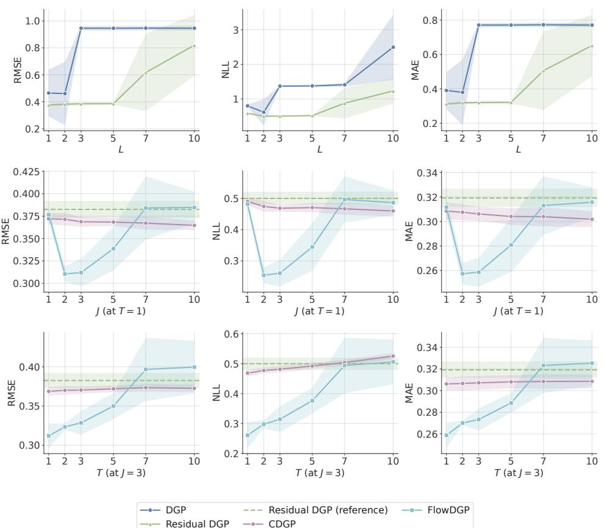  
Figure 1: Toy regression results. Top: test root mean squared error (RMSE), negative log-likelihood (NLL), and mean absolute error (MAE) versus depth L for standard DGP and residual DGP. Middle: CDGP and FlowDGP versus J at fixed $T = 1$ , with the dashed line showing the two-layer residual DGP reference. Bottom: CDGP and FlowDGP versus T at fixed J = 3. Shaded regions denote one standard deviation across random seeds.

The bottom row fixes $J = 3$ and varies T from 1 to 10. CDGP maintains stable performance as T increases, and FlowDGP shows better RMSE and MAE at T values. This behavior is qualitatively consistent with the sensitivity perspective of Section 4.4, but the empirical point stands on its own: once depth is parameterized continuously, the models remain well behaved across the range we test.

## 5.2 Benchmark Datasets

The benchmark study asks a different question from the toy experiment: once residual DGP is granted as the strongest discrete-depth repair, are the proposed continuous-depth models still competitive on realistic regression tasks? We therefore evaluate all methods on six regression datasets spanning diverse data characteristics: heavy\_tailed, heteroscedastic, and nonstationary are synthetic datasets designed to test specific modeling challenges, while sarcos\_small, uci\_bike\_small, and uci\_energy\_small are subsampled versions of real-world datasets (see Appendix E.1 for details). We report test NLL, RMSE, and training time averaged over random seeds. The benchmark baselines are sparse GP, heteroscedastic GP [11], standard DGP, residual DGP [19], deep kernel learning (DKL) [18], thin DGP (TDGP) [5], neural ODE (NODE) [3], neural SDE (NSDE) [12], and transformed GP (TGP) [13].

Table 1 summarizes the results. Three patterns matter most. First, the continuous-depth models are not only stable in the toy setting; they are genuinely competitive on realistic regression tasks. FlowDGP achieves the best NLL on heteroscedastic and nonstationary, while CDGP achieves the best NLL on sarcos\_small. TGP has the best NLL on heavy\_tailed and uci\_bike\_small; CDGP or FlowDGP has lower RMSE than TGP on all six datasets. Second, the comparison to discrete-depth baselines matches the motivating story of the paper: standard DGP performs poorly across most datasets, especially in NLL, and residual DGP improves over DGP but still trails CDGP and FlowDGP. Third, the two continuous-depth variants occupy different practical regimes. FlowDGP

Table 1: Regression results on benchmark datasets. We report mean ± std over multiple random seeds. Bold indicates the best result; underline indicates the second best. Training time is in seconds. Rows highlighted in light blue correspond to our methods. Method abbreviations: DKL = deep kernel learning, TDGP = thin DGP, TGP = transformed GP, NODE = neural ODE, and NSDE = neural SDE.
<table><tr><td rowspan="2">Metric</td><td rowspan="2">Method</td><td colspan="6">Dataset</td></tr><tr><td> $\mathtt { h e a v y \_ t a i l e d }$ </td><td>heteroscedastic nonstationary</td><td></td><td>sarcos_small</td><td> $\mathtt { u c i \_ b i k e \_ s m a l l }$ </td><td> $\mathtt { u c i \_ e n e r g y \_ s m a l l }$ </td></tr><tr><td rowspan="10">RMSE</td><td>FlowDGP</td><td> $\underline { { 0 . 2 3 5 \pm 0 . 0 0 3 } }$ </td><td> $\mathbf { 0 . 8 1 9 \pm 0 . 0 1 1 }$ </td><td> $0 . 3 7 7 \pm 0 . 1 2 3$ </td><td> $\underline { { 0 . 3 2 3 \pm 0 . 0 2 8 } }$ </td><td> $\mathbf { 0 . 9 3 4 \pm 0 . 1 2 1 }$ </td><td> $0 . 8 0 4 \pm 0 . 0 0 9$ </td></tr><tr><td>CDGP</td><td> $\mathbf { 0 . 2 3 1 \pm 0 . 0 0 5 }$ </td><td> $0 . 8 5 6 \pm 0 . 0 7 7$ </td><td> $0 . 6 3 4 \pm 0 . 0 0 8$ </td><td> $\overline { { 0 . 3 3 2 \pm 0 . 0 0 4 } }$ </td><td> $1 . 1 2 2 \pm 0 . 0 1 2$ </td><td> $0 . 8 0 2 \pm 0 . 0 0 1$ </td></tr><tr><td>Heteroskedastic GP</td><td> $0 . 3 0 6 \pm 0 . 0 0 2$ </td><td> $\underline { { 0 . 8 2 3 \pm 0 . 0 0 6 } }$ </td><td> $0 . 6 5 4 \pm 0 . 0 0 8$ </td><td> $0 . 3 4 5 \pm 0 . 0 1 0$ </td><td> $1 . 1 5 2 \pm 0 . 0 0 6$ </td><td> $\mathbf { 0 . 7 9 7 \pm 0 . 0 0 1 }$ </td></tr><tr><td>Residual DGP</td><td> $0 . 3 1 1 \pm 0 . 0 0 5$ </td><td> $\underline { { 0 . 8 2 3 \pm 0 . 0 0 3 } }$ </td><td> $0 . 6 7 6 \pm 0 . 0 5 6$ </td><td> $0 . 3 4 7 \pm 0 . 0 0 6$ </td><td> $1 . 1 2 6 \pm 0 . 0 0 5$ </td><td> $\underline { { 0 . 8 0 2 \pm 0 . 0 0 1 } }$ </td></tr><tr><td>Sparse GP</td><td> $0 . 3 0 9 \pm 0 . 0 0 1$ </td><td> $1 . 0 2 3 \pm 0 . 0 0 8$ </td><td> $0 . 7 5 6 \pm 0 . 0 0 6$ </td><td> $1 . 0 5 1 \pm 0 . 0 0 3$ </td><td> $1 . 1 6 2 \pm 0 . 0 0 4$ </td><td> $\underline { { 0 . 8 0 2 \pm 0 . 0 0 2 } }$ </td></tr><tr><td>TGP</td><td> $0 . 3 0 5 \pm 0 . 0 0 3$ </td><td> $0 . 8 9 3 \pm 0 . 0 0 6$ </td><td> $0 . 4 6 4 \pm 0 . 0 0 8$ </td><td> $0 . 3 8 3 \pm 0 . 0 2 8$ </td><td> $0 . 9 8 6 \pm 0 . 0 2 6$ </td><td> $\overline { { 0 . 8 2 7 \pm 0 . 0 0 4 } }$ </td></tr><tr><td>DGP</td><td> $0 . 3 2 1 \pm 0 . 0 0 2$ </td><td> $1 . 0 1 2 \pm 0 . 0 0 2$ </td><td> $0 . 7 4 5 \pm 0 . 0 0 2$ </td><td> $1 . 0 5 0 \pm 0 . 0 0 1$ </td><td> $1 . 1 8 2 \pm 0 . 0 3 1$ </td><td> $\underline { { 0 . 8 0 2 \pm 0 . 0 2 7 } }$ </td></tr><tr><td>NODE</td><td> $0 . 5 4 4 \pm 0 . 1 9 7$ </td><td> $0 . 8 9 7 \pm 0 . 0 3 6$ </td><td> $0 . 3 5 6 \pm 0 . 0 2 9$ </td><td> $0 . 3 5 1 \pm 0 . 0 1 0$ </td><td> $0 . 9 9 3 \pm 0 . 0 7 5$ </td><td> $0 . 9 6 4 \pm 0 . 0 9 9$ </td></tr><tr><td>TDGP</td><td> $0 . 3 0 7 \pm 0 . 0 0 8$ </td><td> $0 . 8 9 4 \pm 0 . 0 7 8$ </td><td> $\underline { { 0 . 2 7 1 \pm 0 . 0 9 1 } }$ </td><td> $0 . 3 9 3 \pm 0 . 0 1 4$ </td><td> $1 . 0 3 7 \pm 0 . 0 3 4$ </td><td> $0 . 8 0 2 \pm 0 . 0 0 1$ </td></tr><tr><td>DKL</td><td> $0 . 4 3 7 \pm 0 . 0 2 9$ </td><td> $0 . 9 2 8 \pm 0 . 0 1 8$ </td><td> $\overline { { 0 . 5 4 8 \pm 0 . 0 6 5 } }$ </td><td> $0 . 5 4 3 \pm 0 . 1 6 2$ </td><td> $\underline { { 0 . 9 5 6 \pm 0 . 1 7 5 } }$ </td><td> $\overline { { 1 . 5 9 3 \pm 0 . 1 6 1 } }$ </td></tr><tr><td rowspan="14">↑TIN</td><td>NSDE</td><td> $0 . 4 8 0 \pm 0 . 0 4 3$ </td><td> $0 . 9 6 2 \pm 0 . 0 3 7$ </td><td> $\mathbf { 0 . 2 1 1 \pm 0 . 0 1 0 }$ </td><td> $\mathbf { 0 . 3 0 2 \pm 0 . 0 0 7 }$ </td><td> $1 . 0 5 2 \pm 0 . 0 3 3$ </td><td> $1 . 3 1 7 \pm 0 . 1 4 6$ </td></tr><tr><td>FlowDGP</td><td> $\underline { { 0 . 3 2 9 \pm 0 . 0 2 2 } }$ </td><td> $\mathbf { 1 . 2 4 8 \pm 0 . 0 0 8 }$ </td><td> $\mathbf { 0 . 4 1 1 \pm 0 . 2 8 6 }$  </td><td> $1 . 3 5 2 \pm 0 . 6 9 2$ </td><td> $1 . 8 6 8 \pm 0 . 2 0 3$ </td><td> $1 . 2 2 9 \pm 0 . 0 2 1$ </td></tr><tr><td>CDGP</td><td> $0 . 3 5 5 \pm 0 . 0 3 7$ </td><td> $1 . 2 8 5 \pm 0 . 0 7 6$ </td><td> $0 . 9 7 9 \pm 0 . 0 0 6$ </td><td> $\mathbf { 0 . 3 7 6 \pm 0 . 0 1 1 }$ </td><td> $1 . 5 8 5 \pm 0 . 0 1 6$ </td><td> $1 . 2 2 3 \pm 0 . 0 0 3$ </td></tr><tr><td>Heteroskedastic GP</td><td> $0 . 4 9 0 \pm 0 . 0 1 5$   $0 . 4 9 0 \pm 0 . 0 2 2$ </td><td> $1 . 2 8 7 \pm 0 . 0 0 5$ </td><td> $1 . 0 1 3 \pm 0 . 0 1 2$ </td><td> $\underline { { 0 . 4 4 0 \pm 0 . 0 2 5 } }$ </td><td> $1 . 5 6 9 \pm 0 . 0 0 6$ </td><td> $1 . 2 5 8 \pm 0 . 0 1 1$ </td></tr><tr><td>Residual DGP</td><td></td><td> $1 . 2 5 4 \pm 0 . 0 0 4$ </td><td> $1 . 0 3 2 \pm 0 . 0 7 6$ </td><td> $\overline { { 0 . 4 4 0 \pm 0 . 0 1 7 } }$ </td><td> $\overline { { 1 . 6 0 5 \pm 0 . 0 1 0 } }$ </td><td> $1 . 2 3 2 \pm 0 . 0 0 4$ </td></tr><tr><td>Sparse GP</td><td> $0 . 5 0 1 \pm 0 . 0 0 5$ </td><td> $1 . 2 5 3 \pm 0 . 0 0 6$ </td><td> $0 . 9 8 7 \pm 0 . 0 0 8$ </td><td> $1 . 4 7 0 \pm 0 . 0 0 1$ </td><td> $1 . 6 0 5 \pm 0 . 0 0 2$ </td><td> $\underline { { 1 . 2 1 1 \pm 0 . 0 0 1 } }$ </td></tr><tr><td>TGP DGP</td><td> $\mathbf { 0 . 2 5 8 \pm 0 . 0 0 7 }$   $0 . 5 3 6 \pm 0 . 0 3 6$ </td><td> $1 . 3 2 6 \pm 0 . 0 0 8$ </td><td> $\underline { { 0 . 8 9 7 \pm 0 . 0 0 5 } }$ </td><td> $0 . 7 0 7 \pm 0 . 0 1 8$ </td><td> $\mathbf { 1 . 5 1 9 \pm 0 . 0 5 3 }$ </td><td> $1 . 2 5 7 \pm 0 . 0 0 7$ </td></tr><tr><td>NODE</td><td> $0 . 8 7 0 \pm 0 . 4 2 7$ </td><td> $1 . 4 4 2 \pm 0 . 0 0 2$ </td><td> $1 . 1 2 5 \pm 0 . 0 0 2$   $3 0 . 0 5 9 \pm 3 . 5 5 9$ </td><td> $1 . 4 7 0 \pm 0 . 0 0 1$ </td><td> $1 . 8 0 0 \pm 0 . 0 2 2$ </td><td> $1 . 2 1 8 \pm 0 . 0 0 3$ </td></tr><tr><td>TDGP</td><td> $0 . 3 5 7 \pm 0 . 0 5 1$ </td><td> $4 2 . 2 3 1 \pm 9 . 5 9 2$   $5 . 3 1 7 \pm 1 . 0 2 6$ </td><td> $1 . 0 8 0 \pm 1 . 3 2 3$ </td><td> $2 6 . 2 4 5 \pm 3 . 3 6 6$ </td><td> $5 2 . 4 4 7 \pm 2 3 . 8 0 8$ </td><td> $2 1 . 6 3 4 \pm 1 1 . 7 2 1$ </td></tr><tr><td>DKL</td><td> $2 5 . 5 3 6 \pm 2 . 3 1 9$ </td><td> $3 4 . 4 0 1 \pm 3 . 5 1 8$ </td><td> $6 . 6 0 8 \pm 0 . 2 7 1$ </td><td> $1 . 2 7 8 \pm 0 . 1 0 3$   $6 . 6 0 5 \pm 0 . 3 6 1$ </td><td> $5 . 5 8 5 \pm 0 . 5 7 3$ </td><td> $\mathbf { 1 . 2 0 4 \pm 0 . 0 0 2 }$ </td></tr><tr><td>NSDE</td><td> $0 . 8 2 8 \pm 0 . 2 5 9$ </td><td> $3 . 5 2 7 \pm 1 . 6 0 1$ </td><td> $2 . 0 5 8 \pm 0 . 4 6 2$ </td><td> $9 . 5 1 6 \pm 0 . 3 9 0$ </td><td> $4 . 6 0 4 \pm 1 . 6 5 2$   $1 . 5 8 4 \pm 0 . 0 4 9$ </td><td> $9 . 5 9 0 \pm 1 . 3 9 1$ </td></tr><tr><td>FlowDGP</td><td> $2 7 . 4 9 0 \pm 0 . 9 4 0$ </td><td> $1 9 . 1 3 0 \pm 2 . 2 4 0$ </td><td></td><td></td><td></td><td> $\mathbf { 1 . 2 0 4 \pm 0 . 0 0 3 }$ </td></tr><tr><td>CDGP</td><td> $2 0 1 . 3 3 0 \pm 1 . 1 3 0$ </td><td> $1 8 9 . 1 8 0 \pm 4 . 4 2 0$ </td><td> $2 7 . 6 9 0 \pm 1 0 . 1 5 0$   $1 2 6 . 9 3 0 \pm 1 . 6 7 0$ </td><td> $1 4 . 8 7 0 \pm 1 . 6 9 4$   $2 0 2 . 6 4 3 \pm 1 2 . 0 1 9$ </td><td> $1 2 . 8 8 7 \pm 0 . 2 3 1$   $9 3 . 1 4 9 \pm 9 . 6 0 7$ </td><td> $3 1 . 9 1 0 \pm 7 . 9 0 9$ </td></tr><tr><td rowspan="10">Train Taime</td><td>Heteroskedastic GP</td><td> $2 1 . 8 7 0 \pm 0 . 6 0 0$ </td><td> $2 6 . 0 6 0 \pm 1 . 9 1 0$ </td><td> $2 2 . 6 0 0 \pm 0 . 7 3 0$ </td><td> $2 3 . 3 7 5 \pm 5 . 9 7 0$ </td><td> $2 6 . 1 7 4 \pm 8 . 2 2 7$ </td><td> $1 7 8 . 5 9 8 \pm 2 3 . 0 2 1$ </td></tr><tr><td>Residual DGP</td><td></td><td></td><td></td><td></td><td></td><td> $3 1 . 0 2 3 \pm 7 . 7 7 2$ </td></tr><tr><td></td><td> $4 7 . 8 8 0 \pm 4 . 7 9 0$ </td><td> $7 4 . 5 8 0 \pm 8 . 3 4 0$ </td><td> $6 7 . 9 6 0 \pm 2 . 3 4 0$ </td><td> $4 8 . 0 6 5 \pm 2 . 8 1 4$ </td><td> $5 1 . 4 0 6 \pm 6 . 5 2 3$ </td><td> $1 1 7 . 8 4 7 \pm 1 6 . 6 7 4$ </td></tr><tr><td>Sparse GP</td><td> $1 1 . 8 1 0 \pm 0 . 1 6 0$ </td><td> $1 1 . 3 0 0 \pm 1 . 2 8 0$ </td><td> $1 1 . 5 1 0 \pm 0 . 2 7 0$ </td><td> $1 0 . 0 5 2 \pm 1 . 8 6 9$ </td><td> $9 . 1 9 1 \pm 0 . 1 5 5$ </td><td> $9 . 2 3 6 \pm 0 . 2 6 4$ </td></tr><tr><td>TGP</td><td> $1 2 9 . 8 7 8 \pm 8 . 2 3 7$ </td><td> $1 2 9 . 3 0 3 \pm 7 . 1 5 4$ </td><td> $1 3 7 . 3 2 9 \pm 5 . 9 5 9$ </td><td> $1 3 4 . 8 5 9 \pm 8 . 7 5 9$ </td><td> $1 4 0 . 0 4 2 \pm 9 . 2 5 4$ </td><td> $1 3 0 . 9 9 7 \pm 9 . 9 2 9$ </td></tr><tr><td>DGP</td><td> $7 1 . 3 6 0 \pm 4 . 3 5 0$ </td><td> $1 2 4 . 4 2 0 \pm 6 . 0 3 0$ </td><td> $1 1 9 . 1 9 0 \pm 2 . 4 1 0$ </td><td> $7 0 . 5 4 0 \pm 5 . 5 3 2$ </td><td> $7 1 . 3 2 7 \pm 8 . 2 9 1$ </td><td> $1 2 8 . 7 2 2 \pm 1 1 . 9 2 2$ </td></tr><tr><td>NODE</td><td> $1 3 . 4 7 0 \pm 0 . 2 3 0$ </td><td> $1 0 . 5 9 0 \pm 0 . 4 8 0$ </td><td> $3 . 8 4 0 \pm 0 . 0 5 0$ </td><td> $4 . 8 2 2 \pm 0 . 2 8 3$ </td><td> $6 . 9 2 7 \pm 2 . 0 8 1$ </td><td> $5 . 5 7 3 \pm 2 . 4 2 3$ </td></tr><tr><td>TDGP</td><td> $5 2 . 3 8 6 \pm 6 . 2 3 6$ </td><td> $3 7 . 2 7 8 \pm 1 5 . 1 7 1$ </td><td> $3 4 . 3 8 9 \pm 2 4 . 1 7 8$ </td><td> $3 2 . 1 6 7 \pm 2 1 . 9 1 2$ </td><td> $2 6 . 4 5 1 \pm 2 . 1 9 9$ </td><td> $7 2 . 7 8 9 \pm 1 2 . 3 7 1$ </td></tr><tr><td>DKL</td><td> $6 . 5 7 0 \pm 0 . 4 6 0$ </td><td> $6 . 8 8 0 \pm 1 . 0 0 0$ </td><td> $8 . 9 9 0 \pm 0 . 5 4 0$ </td><td> $8 . 8 5 4 \pm 0 . 4 5 6$ </td><td> $4 . 0 5 1 \pm 0 . 2 2 3$ </td><td> $3 . 9 9 5 \pm 0 . 0 4 4$ </td></tr><tr><td>NSDE</td><td> $7 4 . 3 5 0 \pm 9 . 5 8 0$ </td><td> $6 7 . 5 8 0 \pm 9 . 3 8 0$ </td><td> $6 9 . 4 2 0 \pm 6 . 6 3 0$ </td><td> $7 3 . 2 5 3 \pm 2 . 4 7 3$ </td><td> $6 3 . 4 4 3 \pm 8 . 3 2 0$ </td><td> $7 9 . 7 4 1 \pm 1 0 . 0 4 7$ </td></tr></table>

is substantially faster than CDGP, with roughly 5–14× lower training time across datasets, while CDGP remains the strongest direct GP instantiation of the framework.

## 5.3 Large-Scale Datasets

The benchmark comparison also includes NODE and NSDE, which share continuous-depth dynamics but parameterize the vector field with a neural network rather than a GP-based prior. They play different roles. NODE is the clean deterministic baseline for continuous depth without a GP-based prior, but its NLL is often dramatically worse, especially on heteroscedastic, nonstationary, and sarcos\_small. NSDE is the closer stochastic rival: it achieves very strong RMSE on nonstationary and sarcos\_small, but its NLL remains markedly weaker. The benchmark results show more than the usefulness of continuous dynamics alone. In this small- to mediumscale regime, the GP-based prior over the drift family materially improves probabilistic performance relative to the neural continuous-depth alternatives. Together with the toy study, this closes the main comparison against both residual DGP and the non-GP continuous-depth baselines. The next subsection isolates the larger-scale regime in which FlowDGP, rather than CDGP, becomes the practical representative of the continuous-depth approach.

The large-scale study isolates the practical regime of FlowDGP. We compare against methods with neural-network components that scale naturally to larger datasets: DKL [18], neural ODE [3], neural SDE [12], and FlowDGP. The evaluation uses the full-size versions of uci\_bike, uci\_energy, and sarcos (Appendix E.1). CDGP and residual DGP are omitted because their training cost is prohibitive at these scales; the benchmark timings already show this trend, and Appendix D explains why. We report RMSE, NLL, and continuous ranked probability score (CRPS), averaged over random seeds. The point is not that CDGP disappears from the story, but that the two continuousdepth variants occupy different cost-quality regimes: CDGP is the direct GP instantiation, whereas FlowDGP is the scalable one. In this regime, the most meaningful comparison is between FlowDGP and NSDE: both are stochastic continuous-depth models, but only FlowDGP retains a GP-based prior over the drift family.

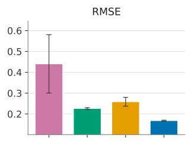

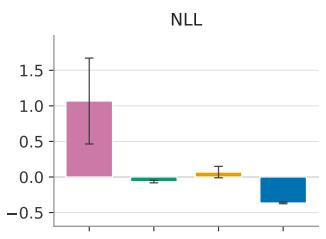

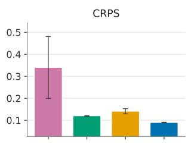

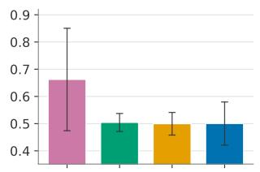

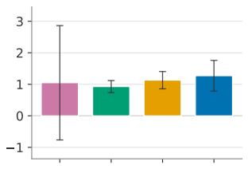

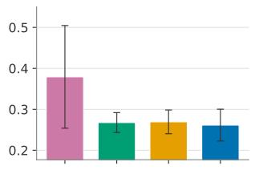

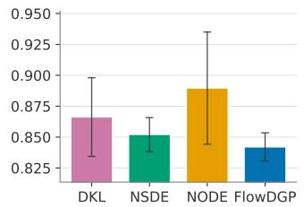

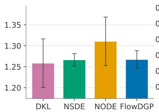

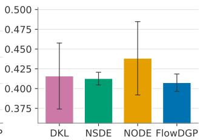  
Figure 2: Results on full-size uci\_bike (top), uci\_energy (middle), and sarcos (bottom) datasets comparing FlowDGP, deep kernel learning (DKL), neural ordinary differential equations (NODE), and neural stochastic differential equations (NSDE). We report root mean squared error (RMSE), negative log-likelihood (NLL), and continuous ranked probability score (CRPS) averaged over random seeds; error bars denote one standard deviation. For readability, the NLL values of DKL on sarcos are scaled by 0.1 (first) and 1/3 (second) to avoid distorting the y-axis scale.

Figure 2 presents the results. On uci\_bike, FlowDGP achieves the best performance across RMSE, NLL, and CRPS. On uci\_energy, it obtains the best CRPS and is tied for the best RMSE, while NSDE has the best NLL. On sarcos, it performs comparably to, or slightly better than, neural SDE across all three metrics, while neural ODE and DKL provide the weakest probabilistic performance.

Overall, the large-scale picture is sharper than a generic baseline comparison. NODE remains a useful deterministic continuous-depth reference, but it is not the main rival in probabilistic regression. NSDE is the closer stochastic comparator, and the figure shows that FlowDGP remains competitive with it in NLL and CRPS across the datasets studied here. The practical point is therefore not just that FlowDGP is competitive in point prediction, but that a GP-based prior over the drift family remains useful even in the scalable continuous-depth regime.<sup>4</sup>

## 6 Related Work

DGPs compose GP mappings [4], with scalable variational inference [16]. Residual [19] and thin DGPs [5] modify this hierarchy. Deep kernel learning [18] instead learns neural features, while TGPs [13] transform a GP through an invertible, potentially input-dependent map. Our focus is the parameterization of latent depth.

GP networks [9] put GP priors on conditional relations in a discrete graphical model; nonlinear multifidelity GPs [14] learn relations between observed fidelity levels. Our depth variable is latent and continuous, without observations required at intermediate depths.

Neural ODEs and SDEs [3, 12] parameterize continuous-depth dynamics with neural vector fields. Deep state-space GPs [20] use conditional SDE representations over the input time variable within a finite hierarchy, enabling sequential inference. Differential GP flows [10] use a GP posterior to determine the drift and diffusion of an input-warping SDE, followed by a separate output GP.

In FlowDGP, a sampled base drift is evolved across latent depth, the state diffusion is specified separately, and the terminal state enters the likelihood directly.

## 7 Conclusion

For probabilistic regression, depth in a deep GP is better treated as latent continuous evolution than as a long discrete stack. Plain DGPs become increasingly awkward as depth grows, and residual DGP is the right first repair but not the final answer.

We therefore replaced the deep stack by a latent SDE with a depth-indexed drift family and studied two GP-based priors on that family: CDGP as a direct separable prior, and FlowDGP as a structured flow-evolved prior, both trained with a shared sparse variational framework. The theory explains why this continuous-depth formulation lives in a different sensitivity regime from repeated discrete composition, while the strongest depth-uniform statement remains conditional.

Empirically, the pattern is consistent across scales. Residual DGP improves over plain DGP, but the continuous-depth models are more stable or more competitive in the regimes we study, with FlowDGP performing best at larger scale. Continuous depth is a useful redesign of how depth is represented in probabilistic regression. Relative to the natural continuous-depth neural alternatives, especially neural ODEs and neural SDEs, the advantage is not continuous depth alone but continuou depth with a GP-based prior over the drift family.

## 8 Limitations

On the modelling side, CDGP’s separable kernel limits the joint state–depth dependence of the drift, while FlowDGP captures this dependence through a deterministic CNF, so uncertainty in the drift across depths is inherited solely from the base GP $f _ { 0 }$ . Our empirical evaluation also focuses on regression tasks of moderate dimensionality, and extending the approach to classification or structured prediction is left to future work.

## Acknowledgments

Ying Li and Alexandre Thiery acknowledge support from Singapore MOE AcRF Tier 2 grants MOE-T2EP20123-0010 and MOE-T2EP20223-0011. The contribution of Petar Djuric is supported by the National Science Foundation (NSF) under Award 2212506. The contribution of Michael Zhang is funded by the Research Grants Council under the General Research Fund #17312826 and by the University of Hong Kong Seed Fund for PI Research – Basic Research #2402101367.

## References

[1] Thierry Bertin-Mahieux. Year Prediction MSD. UCI Machine Learning Repository, 2011. DOI: 10.24432/C50K61.

[2] Luis Candanedo. Appliances Energy Prediction. UCI Machine Learning Repository, 2017. DOI: 10.24432/C5VC8G.

[3] Ricky TQ Chen, Yulia Rubanova, Jesse Bettencourt, and David K Duvenaud. Neural ordinary differential equations. In Advances in Neural Information Processing Systems, volume 31, 2018.

[4] Andreas Damianou and Neil D. Lawrence. Deep Gaussian processes. In International Conference on Artificial Intelligence and Statistics, pages 207–215, 2013.

[5] Daniel Augusto De Souza, Alexander Nikitin, ST John, Magnus Ross, Mauricio A Álvarez, Marc Deisenroth, João Paulo Gomes, Diego Mesquita, and César Lincoln Mattos. Thin and deep Gaussian processes. In Advances in Neural Information Processing Systems, volume 36, 2023.

[6] Matthew M Dunlop, Mark A Girolami, Andrew M Stuart, and Aretha L Teckentrup. How deep are deep Gaussian processes? Journal ofMachine Learning Research, 19(54):1–46, 2018.

[7] David Duvenaud, Oren Rippel, Ryan Adams, and Zoubin Ghahramani. Avoiding pathologies in very deep networks. In International Conference on Artificial Intelligence and Statistics, pages 202–210, 2014.

[8] Hadi Fanaee-T. Bike sharing. UCI Machine Learning Repository, 2013. DOI: 10.24432/C5W894.

[9] Nir Friedman and Iftach Nachman. Gaussian process networks. In Proceedings of the Sixteenth Conference on Uncertainty in Artificial Intelligence, 2000.

[10] Pashupati Hegde, Markus Heinonen, Harri Lähdesmäki, and Samuel Kaski. Deep learning with differential Gaussian process flows. In International Conference on Artificial Intelligence and Statistics, pages 1–15, 2019.

[11] Quoc V Le, Alex J Smola, and Stéphane Canu. Heteroscedastic Gaussian process regression. In Proceedings ofthe 22nd international conference on Machine learning, pages 489–496, 2005.

[12] Xuechen Li, Ting-Kam Leonard Wong, Ricky TQ Chen, and David Duvenaud. Scalable gradients for stochastic differential equations. In International conference on artificial intelligence and statistics, pages 3870–3882. PMLR, 2020.

[13] Juan Maroñas, Oliver Hamelijnck, Jeremias Knoblauch, and Theodoros Damoulas. Transforming Gaussian processes with normalizing flows. In Proceedings ofthe 24th International Conference on Artificial Intelligence and Statistics, volume 130, pages 1081–1089. PMLR, 2021.

[14] Paris Perdikaris, Maziar Raissi, Andreas Damianou, Neil D. Lawrence, and George Em Karniadakis. Nonlinear information fusion algorithms for data-efficient multi-fidelity modelling. Proceedings ofthe Royal Society A, 473(2198):20160751, 2017.

[15] Carl Edward Rasmussen and Christopher K. I. Williams. Gaussian Processes for Machine Learning. MIT Press, Cambridge, MA, USA, 2006.

[16] Hugh Salimbeni and Marc Deisenroth. Doubly stochastic variational inference for deep Gaussian processes. In Advances in Neural Information Processing Systems, volume 30, 2017.

[17] S Vijayakumar and S Schaal. An o(n) algorithm for incremental real time learning in high dimensional space. In Proc. ofthe Seventeenth International Conference on Machine Learning, pages 1079–1086, 2000.

[18] Andrew Gordon Wilson, Zhiting Hu, Ruslan Salakhutdinov, and Eric P Xing. Deep kernel learning. In International Conference on Artificial Intelligence and Statistics, pages 370–378, 2016.

[19] Kacper Wyrwal, Andreas Krause, and Viacheslav Borovitskiy. Residual deep Gaussian processes on manifolds. In The Thirteenth International Conference on Learning Representations, 2025.

[20] Zheng Zhao, Muhammad Emzir, and Simo Särkkä. Deep state-space Gaussian processes. Statistics and Computing, 2021.

## A Proof of Proposition 3.1

Recall that the single-sample DGP objective is

$$
\hat { \mathcal { L } } _ { \mathrm { D G P } } ( \pmb { \theta } ) = \log p ( \mathbf { y } \mid \mathbf { f } ^ { ( L ) } ) - \sum _ { \ell = 1 } ^ { L } \mathrm { K L } [ \cdot \parallel \cdot ] .
$$

Let $L _ { \mathrm { D G P } }$ denote a Lipschitz constant of $\hat { \mathcal { L } } _ { \mathrm { D G P } } ( \pmb { \theta } )$ . By standard smoothness arguments,

$$
L _ { \mathrm { D G P } } \leq \operatorname* { s u p } _ { \pmb { \theta } } \left\| \nabla _ { \pmb { \theta } } \hat { \mathcal { L } } _ { \mathrm { D G P } } ( \pmb { \theta } ) \right\| .
$$

Using the decomposition of the objective and the triangle inequality, we obtain

$$
{ \cal L } _ { \mathrm { D G P } } \leq { \cal L } _ { \mathrm { d a t a } } + { \cal L } _ { \mathrm { K L } } ,
$$

where

$$
L _ { \mathrm { d a t a } } : = \operatorname* { s u p } _ { \theta } \left\| \nabla _ { \theta } \log p ( \mathbf { y } \mid \mathbf { f } ^ { ( L ) } ) \right\| , \qquad L _ { \mathrm { K L } } : = \operatorname* { s u p } _ { \theta } \left\| \nabla _ { \theta } \sum _ { \ell = 1 } ^ { L } \mathrm { K L } [ \cdot \left\| \cdot \right\| ] \right\| .
$$

We bound these two terms separately.

Lemma A.1. Assume that

$$
\left\| \frac { \partial \log p ( \mathbf { y } \mid \mathbf { f } ^ { ( L ) } ) } { \partial \mathbf { h } ^ { ( L ) } } \right\| \leq C _ { \mathrm { o u t } } , \qquad \left\| \frac { \partial f ^ { ( k ) } ( \mathbf { h } ^ { ( k - 1 ) } ) } { \partial \theta ^ { ( k ) } } \right\| \leq C _ { \mathrm { p a r a m } } ,
$$

for all $k = 1 , \ldots , L ,$ and that each sampled layer function is $\lambda _ { \ell } { - } L i p s c h i t z$ with respect to its input, uniformly over θ, i.e.

$$
\left\| \frac { \partial f ^ { ( \ell ) } ( \mathbf { h } ^ { ( \ell - 1 ) } ) } { \partial \mathbf { h } ^ { ( \ell - 1 ) } } \right\| \le \lambda _ { \ell } , \qquad \ell = 1 , \ldots , L .
$$

Then

$$
L _ { \mathrm { d a t a } } \leq C \left( \sum _ { k = 1 } ^ { L } \prod _ { \ell = k + 1 } ^ { L } \lambda _ { \ell } ^ { 2 } \right) ^ { 1 / 2 } ,
$$

where $C : = C _ { \mathrm { o u t } } C _ { \mathrm { p a r a m } }$ is independent of L.

Proof. Write

$$
\pmb { \theta } = \big ( \pmb { \theta } ^ { ( 1 ) } , \dots , \pmb { \theta } ^ { ( L ) } \big ) ,
$$

where $\pmb \theta ^ { ( k ) }$ is the parameter block associated with layer $k .$ For each $k \in \{ 1 , \ldots , L \}$ , by the chain rule,

$$
\frac { \partial \log p ( \mathbf { y } \mid \mathbf { f } ^ { ( L ) } ) } { \partial \pmb { \theta } ^ { ( k ) } } = \frac { \partial \log p ( \mathbf { y } \mid \mathbf { f } ^ { ( L ) } ) } { \partial \mathbf { h } ^ { ( L ) } } \frac { \partial \mathbf { h } ^ { ( L ) } } { \partial \pmb { \theta } ^ { ( k ) } } .
$$

Since the latent states satisfy

$$
\mathbf { h } ^ { ( \ell ) } = f ^ { ( \ell ) } \big ( \mathbf { h } ^ { ( \ell - 1 ) } \big ) + \epsilon ^ { ( \ell ) } ,
$$

and the additive noise $\epsilon ^ { ( \ell ) }$ does not depend on θ, we have

$$
\frac { \partial \mathbf { h } ^ { ( \ell ) } } { \partial \mathbf { h } ^ { ( \ell - 1 ) } } = \frac { \partial f ^ { ( \ell ) } ( \mathbf { h } ^ { ( \ell - 1 ) } ) } { \partial \mathbf { h } ^ { ( \ell - 1 ) } } , \qquad \frac { \partial \mathbf { h } ^ { ( k ) } } { \partial \pmb { \theta } ^ { ( k ) } } = \frac { \partial f ^ { ( k ) } ( \mathbf { h } ^ { ( k - 1 ) } ) } { \partial \pmb { \theta } ^ { ( k ) } } .
$$

Therefore,

$$
\frac { \partial \mathbf { h } ^ { ( L ) } } { \partial \pmb { \theta } ^ { ( k ) } } = \left( \prod _ { \ell = k + 1 } ^ { L } \frac { \partial \mathbf { h } ^ { ( \ell ) } } { \partial \mathbf { h } ^ { ( \ell - 1 ) } } \right) \frac { \partial \mathbf { h } ^ { ( k ) } } { \partial \pmb { \theta } ^ { ( k ) } } = \left( \prod _ { \ell = k + 1 } ^ { L } \frac { \partial f ^ { ( \ell ) } ( \mathbf { h } ^ { ( \ell - 1 ) } ) } { \partial \mathbf { h } ^ { ( \ell - 1 ) } } \right) \frac { \partial f ^ { ( k ) } ( \mathbf { h } ^ { ( k - 1 ) } ) } { \partial \pmb { \theta } ^ { ( k ) } } .
$$

Taking norms and using sub-multiplicativity of operator norms yields

$$
\left\| \frac { \partial \log p ( \mathbf { y } \mid \mathbf { f } ^ { ( L ) } ) } { \partial \pmb { \theta } ^ { ( k ) } } \right\| \leq \left\| \frac { \partial \log p ( \mathbf { y } \mid \mathbf { f } ^ { ( L ) } ) } { \partial \mathbf { h } ^ { ( L ) } } \right\| \prod _ { \ell = k + 1 } ^ { L } \left\| \frac { \partial f ^ { ( \ell ) } ( \mathbf { h } ^ { ( \ell - 1 ) } ) } { \partial \mathbf { h } ^ { ( \ell - 1 ) } } \right\| \left\| \frac { \partial f ^ { ( k ) } ( \mathbf { h } ^ { ( k - 1 ) } ) } { \partial \pmb { \theta } ^ { ( k ) } } \right\| .
$$

By the assumptions,

$$
\left\| \frac { \partial \log p ( \mathbf { y } \mid \mathbf { f } ^ { ( L ) } ) } { \partial \pmb { \theta } ^ { ( k ) } } \right\| \leq C _ { \mathrm { o u t } } C _ { \mathrm { p a r a m } } \prod _ { \ell = k + 1 } ^ { L } \lambda _ { \ell } .
$$

Hence,

$$
\left\| \nabla _ { \theta } \log p ( \mathbf { y } \mid \mathbf { f } ^ { ( L ) } ) \right\| = \left( \sum _ { k = 1 } ^ { L } \left\| \nabla _ { \theta ^ { ( k ) } } \log p ( \mathbf { y } \mid \mathbf { f } ^ { ( L ) } ) \right\| ^ { 2 } \right) ^ { 1 / 2 } \leq C _ { \mathrm { o u t } } C _ { \mathrm { p a r a m } } \left( \sum _ { k = 1 } ^ { L } \prod _ { \ell = k + 1 } ^ { L } \lambda _ { \ell } ^ { 2 } \right) ^ { 1 / 2 } .
$$

Taking the supremum over θ gives the result.

Lemma A.2. Under the layerwise variational parameterization of the DGP objective, the KL regularizer decomposes as

$$
\sum _ { \ell = 1 } ^ { L } \mathrm { K L } [ \cdot \| \cdot ] = \sum _ { \ell = 1 } ^ { L } \mathrm { K L } _ { \ell } ( \pmb { \theta } ^ { ( \ell ) } ) .
$$

If each layerwise KL term has uniformly bounded gradient, namely

$$
\operatorname* { s u p } _ { \pmb { \theta } ^ { ( \ell ) } } \left\| \nabla _ { \pmb { \theta } ^ { ( \ell ) } } \mathrm { K L } _ { \ell } \big ( \pmb { \theta } ^ { ( \ell ) } \big ) \right\| \leq C _ { \mathrm { K L } } , \qquad \ell = 1 , \ldots , L ,
$$

then

$$
L _ { \mathrm { K L } } ( L ) = O ( { \sqrt { L } } ) .
$$

Proof. Since the KL regularizer decomposes layerwise, we have

$$
\nabla _ { \pmb \theta } \sum _ { \ell = 1 } ^ { L } \mathrm { K L } _ { \ell } \big ( \pmb \theta ^ { ( \ell ) } \big ) = \big ( \nabla _ { \pmb \theta ^ { ( 1 ) } } \mathrm { K L } _ { 1 } , \dots , \nabla _ { \pmb \theta ^ { ( L ) } } \mathrm { K L } _ { L } \big ) .
$$

Therefore,

$$
\left. \nabla _ { \theta } \sum _ { \ell = 1 } ^ { L } \operatorname { K L } _ { \ell } ( \theta ^ { ( \ell ) } ) \right. = \left( \sum _ { \ell = 1 } ^ { L } \left. \nabla _ { \theta ^ { ( \ell ) } } \operatorname { K L } _ { \ell } ( \theta ^ { ( \ell ) } ) \right. ^ { 2 } \right) ^ { 1 / 2 } \leq \left( \sum _ { \ell = 1 } ^ { L } C _ { \mathrm { K L } } ^ { 2 } \right) ^ { 1 / 2 } = \sqrt { L } C _ { \mathrm { K L } } .
$$

Taking the supremum over θ yields

$$
L _ { \mathrm { K L } } \leq \sqrt { L } C _ { \mathrm { K L } } ,
$$

and hence $L _ { \mathrm { K L } } ( L ) = O ( { \sqrt { L } } )$

Combining Lemmas\~A.1 and\~A.2, we obtain

$$
L _ { \mathrm { D G P } } \leq C \left( \sum _ { k = 1 } ^ { L } \prod _ { \ell = k + 1 } ^ { L } \lambda _ { \ell } ^ { 2 } \right) ^ { 1 / 2 } + O ( { \sqrt { L } } ) ,
$$

where the $O ( \sqrt { L } )$ term captures the contribution of the KL regularizer. This proves Proposition 3.1.

## B Proof of Theorem 4.1

Proof of Theorem 4.1. Define

$$
\Delta _ { t } = \mathbf h _ { t } ^ { ( 1 ) } - \mathbf h _ { t } ^ { ( 2 ) } ,\tag{14}
$$

so that $\pmb { \Delta } _ { 0 } = \mathbf { 0 }$ . Subtracting the two SDEs driven by the same Brownian motion gives

$$
d \pmb { \Delta } _ { t } = \left[ f ( \mathbf { h } _ { t } ^ { ( 1 ) } , t ; \pmb { \theta } _ { 1 } ) - f ( \mathbf { h } _ { t } ^ { ( 2 ) } , t ; \pmb { \theta } _ { 2 } ) \right] d t + \left( \sigma _ { t } - \sigma _ { t } \right) d \mathbf { w } _ { t } .\tag{15}
$$

Hence the stochastic terms cancel exactly and

$$
\pmb { \Delta } _ { t } = \int _ { 0 } ^ { t } \left[ f ( \mathbf { h } _ { s } ^ { ( 1 ) } , s ; \pmb { \theta } _ { 1 } ) - f ( \mathbf { h } _ { s } ^ { ( 2 ) } , s ; \pmb { \theta } _ { 2 } ) \right] d s .\tag{16}
$$

Adding and subtracting $f ( \mathbf { h } _ { s } ^ { ( 2 ) } , s ; \theta _ { 1 } )$ yields

$$
\Delta _ { t } = \int _ { 0 } ^ { t } \left[ f ( \mathbf { h } _ { s } ^ { ( 1 ) } , s ; \pmb { \theta } _ { 1 } ) - f ( \mathbf { h } _ { s } ^ { ( 2 ) } , s ; \pmb { \theta } _ { 1 } ) \right] + \left[ f ( \mathbf { h } _ { s } ^ { ( 2 ) } , s ; \pmb { \theta } _ { 1 } ) - f ( \mathbf { h } _ { s } ^ { ( 2 ) } , s ; \pmb { \theta } _ { 2 } ) \right] d s .\tag{17}
$$

Taking norms and using the Lipschitz assumptions,

$$
\begin{array} { r l } & { \left\| f ( \mathbf { h } _ { s } ^ { ( 1 ) } , s ; \pmb { \theta } _ { 1 } ) - f ( \mathbf { h } _ { s } ^ { ( 2 ) } , s ; \pmb { \theta } _ { 1 } ) \right\| \leq L _ { h } \| \pmb { \Delta } _ { s } \| , } \\ & { \left\| f ( \mathbf { h } _ { s } ^ { ( 2 ) } , s ; \pmb { \theta } _ { 1 } ) - f ( \mathbf { h } _ { s } ^ { ( 2 ) } , s ; \pmb { \theta } _ { 2 } ) \right\| \leq L _ { \theta } \| \pmb { \theta } _ { 1 } - \pmb { \theta } _ { 2 } \| . } \end{array}
$$

Therefore, with $\boldsymbol { u } ( t ) = \lVert \boldsymbol { \Delta } _ { t } \rVert$ and $\delta _ { \pmb { \theta } } = \| \pmb { \theta } _ { 1 } - \pmb { \theta } _ { 2 } \|$

$$
u ( t ) \leq \int _ { 0 } ^ { t } \left( L _ { h } u ( s ) + L _ { \theta } \delta _ { \theta } \right) d s .\tag{18}
$$

Define

$$
y ( t ) = \int _ { 0 } ^ { t } \left( L _ { h } u ( s ) + L _ { \theta } \delta _ { \theta } \right) d s ,\tag{19}
$$

so that $u ( t ) \leq y ( t )$ and $y ( 0 ) = 0$ . Then

$$
\begin{array} { r } { \frac { d y ( t ) } { d t } = L _ { h } u ( t ) + L _ { \theta } \delta _ { \theta } } \\ { \leq L _ { h } y ( t ) + L _ { \theta } \delta _ { \theta } . } \end{array}\tag{20}
$$

Multiplying by $e ^ { - L _ { h } t }$ gives

$$
\frac { d } { d t } \big [ e ^ { - L _ { h } t } y ( t ) \big ] \leq L _ { \theta } e ^ { - L _ { h } t } \delta _ { \theta } .\tag{21}
$$

Integrating from 0 to t and using $y ( 0 ) = 0$ , we obtain, for $L _ { h } > 0$

$$
e ^ { - L _ { h } t } y ( t ) \le L _ { \theta } \delta _ { \theta } \int _ { 0 } ^ { t } e ^ { - L _ { h } s } d s = \frac { L _ { \theta } \delta _ { \theta } } { L _ { h } } ( 1 - e ^ { - L _ { h } t } ) ,\tag{22}
$$

and hence

$$
y ( t ) \leq \frac { L _ { \theta } } { L _ { h } } ( e ^ { L _ { h } t } - 1 ) \delta _ { \theta } .\tag{23}
$$

If $L _ { h } = 0 $ , Eq. (18) reduces to

$$
u ( t ) \leq \int _ { 0 } ^ { t } L _ { \theta } \delta _ { \theta } d s = L _ { \theta } t \delta _ { \theta } .\tag{24}
$$

Combining the two cases,

$$
\| \mathbf { h } _ { t } ^ { ( 1 ) } - \mathbf { h } _ { t } ^ { ( 2 ) } \| \leq L _ { \theta } \phi ( L _ { h } , t ) \| \pmb \theta _ { 1 } - \pmb \theta _ { 2 } \| ,\tag{25}
$$

where

$$
\phi ( L _ { h } , t ) = \left\{ \frac { e ^ { L _ { h } t } - 1 } { L _ { h } } , L _ { h } > 0 , \right.\tag{26}
$$

## C Proof of Corollary 4.2

Proof. Starting from the pathwise ODE for $\Delta _ { t }$ established in the proof of Theorem 4.1, we have

$$
\frac { 1 } { 2 } \frac { d } { d t } \| \pmb { \Delta } _ { t } \| ^ { 2 } = \big \langle \pmb { \Delta } _ { t } , f ( \mathbf { h } _ { t } ^ { ( 1 ) } , t ; \pmb { \theta } _ { 1 } ) - f ( \mathbf { h } _ { t } ^ { ( 2 ) } , t ; \pmb { \theta } _ { 2 } ) \big \rangle .
$$

Adding and subtracting $f ( \mathbf { h } _ { t } ^ { ( 2 ) } , t ; \pmb { \theta } _ { 1 } )$ yields

$$
\frac { 1 } { 2 } \frac { d } { d t } \| \Delta _ { t } \| ^ { 2 } = \underbrace { \left. \Delta _ { t } , f ( \mathbf { h } _ { t } ^ { ( 1 ) } , t ; \theta _ { 1 } ) - f ( \mathbf { h } _ { t } ^ { ( 2 ) } , t ; \theta _ { 1 } ) \right. } _ { ( \mathrm { I } ) } + \underbrace { \left. \Delta _ { t } , f ( \mathbf { h } _ { t } ^ { ( 2 ) } , t ; \theta _ { 1 } ) - f ( \mathbf { h } _ { t } ^ { ( 2 ) } , t ; \theta _ { 2 } ) \right. } _ { ( \mathrm { I I } ) } .
$$

By the one-sided contractivity assumption, $\mathrm { ( I ) } \le - \mu \| \Delta _ { t } \| ^ { 2 }$ . For (II), Cauchy–Schwarz and the Lipschitz condition in θ give

$$
\begin{array} { r } { \mathrm { ( I I ) } \le \| \Delta _ { t } \| L _ { \theta } \| \pmb { \theta } _ { 1 } - \pmb { \theta } _ { 2 } \| . } \end{array}
$$

Applying Young’s inequality with parameter $\mu ,$

$$
\| \pmb { \Delta } _ { t } \| L _ { \theta } \| \pmb { \theta } _ { 1 } - \pmb { \theta } _ { 2 } \| \leq \frac { \mu } { 2 } \| \pmb { \Delta } _ { t } \| ^ { 2 } + \frac { L _ { \theta } ^ { 2 } } { 2 \mu } \| \pmb { \theta } _ { 1 } - \pmb { \theta } _ { 2 } \| ^ { 2 } ,
$$

and combining the two bounds yields

$$
\frac { d } { d t } \| \pmb { \Delta } _ { t } \| ^ { 2 } \leq - \mu \| \pmb { \Delta } _ { t } \| ^ { 2 } + \frac { L _ { \theta } ^ { 2 } } { \mu } \| \pmb { \theta } _ { 1 } - \pmb { \theta } _ { 2 } \| ^ { 2 } .
$$

Since $\pmb { \Delta } _ { 0 } = \mathbf { 0 }$ , Grönwall’s inequality gives

$$
\| \Delta _ { t } \| ^ { 2 } \leq \frac { L _ { \theta } ^ { 2 } } { \mu ^ { 2 } } \big ( 1 - e ^ { - \mu t } \big ) \| \theta _ { 1 } - \theta _ { 2 } \| ^ { 2 } .
$$

Taking square roots and evaluating at $t = T$

$$
\| { \bf h } _ { T } ^ { ( 1 ) } - { \bf h } _ { T } ^ { ( 2 ) } \| \le \frac { L _ { \theta } } { \mu } \sqrt { 1 - e ^ { - \mu T } } \| \theta _ { 1 } - \theta _ { 2 } \| \le \frac { L _ { \theta } } { \mu } \| \theta _ { 1 } - \theta _ { 2 } \| ,
$$

for almost every sample path.

## D Complexity Analysis

In CDGP, the inducing set is the Cartesian product $\mathbf { Z } _ { h } \times \mathbf { Z } _ { t }$ of size $M _ { h } M _ { t }$ . Exploiting the Kronecker structure of the separable kernel, the per-iteration complexity is $\mathcal { O } ( \ddot { M _ { h } ^ { 3 } } + M _ { t } ^ { 3 } + N \Breve { J } M _ { h } M _ { t } )$

In FlowDGP, inference is performed only over the base $\mathrm { G P } ~ f _ { 0 }$ with M inducing points, giving a per-iteration complexity of $\mathcal { O } ( M ^ { 3 } + N \bar { M } ^ { 2 } + N J C _ { g } )$ , where $C _ { g }$ is the cost of evaluating $g _ { \phi }$ . The reduction from $\bar { M _ { h } } M _ { t }$ to $M$ inducing points more than compensates for the additional ODE solver cost, resulting in substantially faster training in practice.

This complexity gap is reflected in the benchmark train-time results in Table 1, where FlowDGP is already substantially faster than CDGP on the smaller benchmark subsets. That empirical gap is the main reason why CDGP and residual DGP are not carried into the full-size large-scale experiment.

## E Simulation Details

The experiments were run on a single NVIDIA RTX 4500 Ada Generation GPU (24 GB). Note that, for each test input $\mathbf { x } _ { n } .$ , we draw $\bar { S _ { \mathrm { ~ } } } = 3 0 0$ Monte Carlo samples $\{ f _ { s } ( \mathbf { x } _ { n } ) \} _ { s = } ^ { S } .$ from the model and form a Gaussian predictive distribution $\mathcal { N } ( \mu _ { n } , \sigma _ { n } ^ { 2 } )$ whose moments are estimated from the samples:

$$
\mu _ { n } = \frac { 1 } { S } \sum _ { s = 1 } ^ { S } f _ { s } ( { \bf x } _ { n } ) , \qquad \sigma _ { n } ^ { 2 } = \frac { 1 } { S } \sum _ { s = 1 } ^ { S } \bigl ( f _ { s } ( { \bf x } _ { n } ) - \mu _ { n } \bigr ) ^ { 2 } + \sigma _ { \mathrm { n o i s e } } ^ { 2 } .\tag{27}
$$

The negative log-likelihood is then evaluated as

$$
\mathrm { N L L } = \frac { 1 } { 2 N } \sum _ { n = 1 } ^ { N } \left[ \log ( 2 \pi \sigma _ { n } ^ { 2 } ) + \frac { ( y _ { n } - \mu _ { n } ) ^ { 2 } } { \sigma _ { n } ^ { 2 } } \right] .\tag{28}
$$

## E.1 Datasets Description

We evaluate on a one-dimensional toy example, three synthetic benchmarks, three real-world regression tasks at two sample sizes, and YearPredictionMSD. For the toy and benchmark datasets, inputs are standardised per dimension and targets are standardised by the training-set mean and standard deviation. The toy example is used in Section 5.1 with $N _ { \mathrm { t r a i n } } = 3 0 0$ and $N _ { \mathrm { t e s t } } = 5 0 0$ For the benchmark experiments (Section 5.2), each dataset uses $N _ { \mathrm { t r a i n } } = 3 0 0$ and $N _ { \mathrm { t e s t } } = 5 0 0 ;$ for the real-world tasks, we randomly subsample from the full datasets to this size. For the large-scale experiments (Section 5.3), the full versions of the real-world datasets are used.

1D toy example (toy\_example). Inputs $x \in [ 0 , 1 ]$ are drawn uniformly, and the scalar target is $y = f ( x ) + \sigma ( x ) \varepsilon { \mathrm { w i t h } } \varepsilon \sim \mathcal { N } ( 0 , 1 )$ . Writing $\tilde { x } = ( x - x _ { \operatorname* { m i n } } ) / ( x _ { \operatorname* { m a x } } - x _ { \operatorname* { m i n } } )$ for the normalized input, the clean signal is a superposition of seven components, $\begin{array} { r } { f ( x ) = \sum _ { i = 1 } ^ { 7 } f _ { i } ( \tilde { x } ) } \end{array}$ , where

$$
\begin{array} { r l } & { f _ { 1 } ( \tilde { x } ) = \left[ 0 . 0 8 + 0 . 4 2 \mathrm { s i g m o i d } ( 2 ( \tilde { x } - 0 . 2 8 ) ) + 0 . 8 2 \tilde { x } ^ { 2 } \right] \sin \phi ( \tilde { x } ) , } \\ & { f _ { 2 } ( \tilde { x } ) = 0 . 1 2 \sin ( 2 \phi ( \tilde { x } ) + 6 \tilde { x } ) + 0 . 1 0 \sin ( 9 2 \tilde { x } ^ { 2 } ) } \\ & { \qquad + 0 . 0 8 \sin ( 3 6 \tilde { x } + 2 . 2 \sin ( 4 \pi \tilde { x } ) ) + 0 . 1 0 ( \tilde { x } - 0 . 4 8 ) ^ { 2 } , } \\ & { f _ { 3 } ( \tilde { x } ) = 0 . 4 2 \sin ( 2 . 2 \pi \tilde { x } ) + 0 . 3 8 \sin ( 5 6 \pi \tilde { x } ) , } \\ & { f _ { 4 } ( \tilde { x } ) = 0 . 3 2 \cos ( - \frac { 1 } { 2 } ( \tilde { x } - 0 . 5 ) ^ { 2 } / 0 . 1 1 ^ { 2 } ) \sin ( 8 4 \pi \tilde { x } ) , } \\ & { f _ { 5 } ( \tilde { x } ) = 0 . 2 8 \sqrt { | \tilde { x } - 0 . 3 4 | } , } \\ & { f _ { 6 } ( \tilde { x } ) = 0 . 4 5 \mathrm { s i g m o i d } \big ( 1 1 0 ( \tilde { x } - 0 . 5 \tilde { x } ) \big ) , } \\ & { f _ { 7 } ( \tilde { x } ) = 0 . 3 2 \big [ w ( \tilde { x } ) \sin ( 9 \tilde { x } ( 0 . 6 5 + 0 . 3 \tilde { x } ) \big ) } \\ & { \qquad + \big ( 1 - w ( \tilde { x } ) \big ) \sin ( 5 2 \tilde { x } ) \big ] , } \end{array}
$$

with chirp phase $\begin{array} { r } { \phi ( \tilde { x } ) = \frac { \omega _ { \mathrm { h i } } } { \beta } \big ( 1 - e ^ { - \beta \tilde { x } } \big ) + \omega _ { \mathrm { l o } } ; } \end{array}$ x˜ (parameters $\omega _ { \mathrm { h i } } = 8 8 , \omega _ { \mathrm { l o } } = 5 , \beta = 9 . 5 )$ and regimeswitching gate $w ( \tilde { x } ) = \mathrm { s i g m o i d } ( 2 8 ( \tilde { x } - 0 . 4 5 ) )$ . The seven components respectively contribute: (1) a chirp with growing envelope, (2) second-harmonic, quadratic-phase, and FM terms with a mild polynomial trend, (3) spectrally conflicting slow and fast sinusoids, (4) a localised high-frequency burst inside a narrow Gaussian window, (5) a square-root cusp, (6) a near-discontinuous step, and (7) a regime blend whose dominant frequency differs sharply between the two sides of the domain. Noise is heteroscedastic with $\sigma ( x ) = 0 . { \overset { \vartriangle } { 1 6 } } ( 0 . { \overset { \triangledown } { . 5 } } 5 + 0 . 9 { \overset { \vartriangle } { x } } )$ , so the output variance grows roughly 2.6× from left to right. We use $N _ { \mathrm { t r a i n } } = 3 0 0$ and $N _ { \mathrm { t e s t } } = 5 0 0$ ; inputs and targets are standardised using training-set statistics. Although the task is strictly one-dimensional $( D _ { x } ^ { - } = 1 )$ , the combination of multi-scale sinusoids, a localised burst, a cusp, a near-step, and a regime change makes it adversarial to any model with a single stationary lengthscale.

Heteroscedastic (heteroscedastic). Inputs $\mathbf { x } \in \mathbb { R } ^ { D _ { x } }$ with $D _ { x } = 1 0$ are drawn uniformly on $[ - 4 , 4 ] ^ { D _ { x } }$ . The latent signal is

$$
g ( \mathbf { x } ) = \sin ( 2 x _ { 1 } ) + 0 . 5 \cos ( x _ { 2 } ) + 0 . 3 x _ { 3 } , \qquad f _ { k } ( \mathbf { x } ) = g ( \mathbf { x } ) + 0 . 2 \sin ( k x _ { 1 } ) , \quad k = 1 , \ldots , 1 0 ,
$$

and intermediate observations are $\tilde { y } _ { k } = f _ { k } ( \mathbf { x } ) + \sigma ( \mathbf { x } ) \varepsilon _ { k }$ with $\varepsilon _ { k } \sim \mathcal { N } ( 0 , 1 )$ and input-dependent noise scale

$$
\sigma ( \mathbf { x } ) = 0 . 1 + 0 . 5 \mathrm { s i g m o i d } ( 1 . 5 x _ { 1 } - 0 . 5 x _ { 2 } ) .
$$

The scalar target is $\begin{array} { r } { y = \frac { 1 } { 1 0 } \sum _ { k = 1 } ^ { 1 0 } \tilde { y } _ { k } } \end{array}$ , so the effective noise is heteroscedastic with roughly a $5 \times$ variance ratio across the input space. This benchmark evaluates a model’s ability to fit input-dependent aleatoric uncertainty.

Nonstationary (nonstationary). Inputs $\textbf { x } \in \ \mathbb { R } ^ { D _ { s } }$ with $D _ { x } ~ = ~ 1 0$ are drawn uniformly on $[ - 4 , 4 ] ^ { D _ { x } }$ . The clean signal is a smooth two-regime blend governed by the first coordinate,

$$
f ( \mathbf { x } ) = \left( 1 - w ( x _ { 1 } ) \right) \mathrm { s i n } ( x _ { 1 } ) + w ( x _ { 1 } ) \cos ( x _ { 1 } ) + 0 . 2 x _ { 2 } , \qquad w ( x _ { 1 } ) = \mathrm { s i g m o i d } ( x _ { 1 } ) ,
$$

with homoscedastic Gaussian noise $\varepsilon \sim \mathcal { N } ( 0 , 0 . 2 ^ { 2 } )$ . The change in effective lengthscale between the $x _ { 1 } \ll 0$ and $x _ { 1 } \gg 0$ regimes is the principal challenge: a single stationary kernel cannot match both regimes simultaneously.

Heavy-tailed (heavy\_tailed). Inputs $\mathbf { x } \in \mathbb { R } ^ { D _ { x } }$ with $D _ { x } = 1 0$ are drawn uniformly on $[ - 5 , 5 ] ^ { D _ { x } }$ and the latent signal takes the additive form

$$
f ( \mathbf { x } ) = \frac { 1 } { D _ { x } } \sum _ { i = 1 } ^ { D _ { x } } \bigl ( \sin ( 1 . 5 x _ { i } ) + 0 . 3 x _ { i } \bigr ) .
$$

Observations are $y = f ( \mathbf { x } ) + \varepsilon$ with Student-t noise $\varepsilon \sim t _ { \nu } ( 0 , s )$ , where $\nu = 3$ and $s = 0 . 3 $ . The fat tails induce a non-negligible fraction of gross outliers, which stresses baselines that assume Gaussian noise.

SARCOS (sarcos, sarcos\_small). The SARCOS inverse-dynamics benchmark [17]: given $D _ { x } = 2 1$ joint-state features (seven positions, seven velocities, seven accelerations) from a sevendegree-of-freedom anthropomorphic robot arm, predict the first joint torque. We use the standard split with 44,484 training and 4,449 test samples in the large-scale setting, and subsample to $N _ { \mathrm { t r a i n } } = 3 0 0$ and $N _ { \mathrm { t e s t } } = 5 0 0$ in the benchmark setting (sarcos\_small). Features and targets are standardised using the full parent training set.

UCI Bike (uci\_bike, uci\_bike\_small). The UCI Bike Sharing dataset [8]: the target is the hourly rental count (cnt), and the inputs are $D _ { x } = 1 2$ weather and calendar features (season, yr, mnth, hr, holiday, weekday, workingday, weathersit, temp, atemp, hum, windspeed). We apply an $8 0 / 2 0$ time-ordered split with per-feature z-scoring and target standardisation, yielding 13,903 training and $^ { 3 , 4 7 6 }$ test samples in the large-scale setting; the benchmark setting subsamples to $N _ { \mathrm { t r a i n } } = 3 0 0$ and $N _ { \mathrm { t e s t } } = 5 0 0$ . The target is highly non-Gaussian (count data with mixed diurnal and seasonal regimes), making this a useful test of non-stationarity.

UCI Energy (uci\_energy, uci\_energy\_small). The UCI Appliances Energy Prediction dataset [2]: the target is appliance energy consumption (Wh), and the inputs are $D _ { x } \ = \ 2 9$ indoor sensor readings and weather variables, augmented with four derived temporal features (hour of day, day of week, month, weekend indicator) parsed from the timestamp. Metadata columns (date, rv1, rv2) and the target itself are excluded from the inputs. We apply a chronological 80/20 split with z-scoring, yielding 15,788 training and 3,947 test samples in the large-scale setting; the benchmark setting subsamples to $N _ { \mathrm { t r a i n } } = 3 0 0$ and $N _ { \mathrm { t e s t } } = 5 0 0$ . Targets are strongly right-skewed with sparse high-activity spikes, producing effectively heavy-tailed residuals in small samples.

YearPredictionMSD. YearPredictionMSD [1] is a song-release-year prediction dataset containing 515,345 observations, each represented by 90 numerical audio features. The task is scalar regression from audio characteristics to release year.

Summary. Table 2 summarises the input dimension, sample sizes (benchmark setting), and principal regression challenge targeted by each dataset. All tasks are scalar regression $( D _ { y } = 1 ) ;$ ; sample sizes for the corresponding large-scale datasets (sarcos, uci\_bike, uci\_energy) are given in the paragraphs above.

## E.2 Hyperparameter Settings

To ensure reproducibility, we provide the hyperparameter configurations for all methods. Table 3 lists the hyperparameters selected via grid search, and Table 4 reports the fixed settings shared across experiments. For each method and dataset, hyperparameters were selected based on validation performance, considering both NLL and RMSE. We first identified configurations whose validation NLL was close to the best-performing one, and among them chose the configuration with the lowest validation RMSE. This favors models that achieve strong probabilistic performance without sacrificing point prediction accuracy. In these tables, J is the number of integration steps and $M _ { t }$ is the number of inducing locations along depth for CDGP. Neither denotes the terminal horizon $T ,$ , which is 1.0 for both CDGP and FlowDGP unless varied explicitly.

<table><tr><td>Dataset</td><td> $D _ { x }$ </td><td> $N _ { \mathrm { t r a i n } }$ </td><td> $N _ { \mathrm { t e s t } }$ </td><td>Primary challenge</td></tr><tr><td>heteroscedastic</td><td>10</td><td>300</td><td>500</td><td>input-dependent noise</td></tr><tr><td>nonstationary</td><td>10</td><td>300</td><td>500</td><td>two-regime lengthscale change</td></tr><tr><td>heavy_tailed</td><td>10</td><td>300</td><td>500</td><td>Student-t (ν = 3) outliers</td></tr><tr><td>sarcos_small</td><td>21</td><td>300</td><td>500</td><td>high-dimensional nonlinear dynamics</td></tr><tr><td>uci_bike_small</td><td>12</td><td>300</td><td>500</td><td>mixed diurnal/seasonal regimes</td></tr><tr><td>uci_energy_small</td><td>29</td><td>300</td><td>500</td><td>skewed, spiky real sensor data</td></tr><tr><td>sarcos</td><td>21</td><td>44,484</td><td>4,449</td><td>high-dimensional nonlinear dynamics</td></tr><tr><td>uci_bike</td><td>12</td><td>13,903</td><td>3,476</td><td>mixed diurnal/seasonal regimes</td></tr><tr><td>uci_energy</td><td>29</td><td>15,788</td><td>3,947</td><td>skewed, spiky real sensor data</td></tr></table>

Table 2: Summary of evaluation datasets. The first block lists the three synthetic benchmarks, the second block the subsampled real-world datasets used in Section 5.2, and the third block their full-size counterparts used in Section 5.3. All tasks are scalar regression with $D _ { y } = 1$

Table 3: Grid-searched hyperparameters for the benchmark methods. For each method and dataset, we select the configuration with the lowest validation NLL.
<table><tr><td>Method</td><td>Search space</td></tr><tr><td>SparseGP</td><td>1r ∈ {0.01, 0.02, 0.03, 0.05}</td></tr><tr><td>HeteroskedasticGP</td><td>1r ∈ {0.01, 0.02, 0.03, 0.05}</td></tr><tr><td>DKL</td><td>grid_size ∈ {80, 100, 120} num_dims ∈ {2, 3}</td></tr><tr><td>TDGP</td><td>1r ∈ {0.01, 0.02, 0.03, 0.05} m_v ∈ {20, 30} m_u ∈ {20, 30} 1r ∈ {0.01, 0.02, 0.03, 0.05}</td></tr><tr><td>DGP</td><td>num_layers ∈ {2, 3, 5} 1r ∈ {0.01, 0.02, 0.03, 0.05}</td></tr><tr><td>ResidualDGP</td><td>num_layers ∈ {2, 3, 5} 1r ∈ {0.01, 0.02, 0.03, 0.05}</td></tr><tr><td>NODE</td><td>hidden_dim ∈ {32, 64} num_layers ∈ {1, 2} J ∈ {2, 3, 5}</td></tr><tr><td>NSDE</td><td>1r ∈ {0.01, 0.02, 0.03, 0.05} hidden_dim ∈ {32, 64} J ∈ {2, 3, 5} 1r ∈ {0.01, 0.02, 0.03, 0.05}</td></tr><tr><td>CDGP</td><td>J ∈ {2, 3, 5} Mt ∈ {3, 5} 1r ∈ {0.01, 0.02, 0.03, 0.05} hidden_dims ∈ {[32, 32], [64, 64]}</td></tr><tr><td>FlowDGP J ∈ {2, 3, 5}</td><td>1r ∈ {0.01, 0.02, 0.03, 0.05}</td></tr></table>

## F Additional Experimental Comparisons

## F.1 Large-scale comparison on YearPredictionMSD

We compare FlowDGP with DKL, NODE and NSDE on YearPredictionMSD (Appendix E.1). Table 5 reports the results: FlowDGP achieves the lowest mean RMSE and NLL, while NSDE achieves the lowest mean CRPS.

Table 4: Fixed hyperparameter settings for the toy and benchmark experiments. Method-specific entries override the defaults.  
```ini
Scope Setting
Defaults num_inducing = 30 (whenever applicable)
epochs = 2500
optimiser = Adam
DKL epochs = 500
CDGP σ = 0.15
T = 1.0 (unless otherwise specified)
FlowDGP σ = 0.15
T = 1.0 (unless otherwise specified)
NODE T = 1.0
solver = Euler
rtol = 10<sup>−4</sup>, atol = 10<sup>−5</sup>
adjoint = False
NSDE T = 1.0
solver = Euler
activation = LipSwish
TDGP diag_qmu = True
epochs=1000
TGP num_blocks = 3 (SAL)
hidden_dims = [50, 50]
epochs = 15000
lr = 0.001
```

Table 5: YearPredictionMSD results, mean ± standard deviation over random seeds. Lower is better; bold marks the lowest mean.
<table><tr><td>Method</td><td>RMSE</td><td>NLL</td><td>CRPS</td></tr><tr><td>DKL</td><td> $0 . 8 0 9 0 \pm 0 . 0 0 2 2$ </td><td> $1 . 2 0 7 8 \pm 0 . 0 0 2 3$ </td><td> $0 . 4 2 4 3 \pm 0 . 0 0 1 2$ </td></tr><tr><td>NODE</td><td> $0 . 8 0 9 6 \pm 0 . 0 0 1 8$ </td><td> $1 . 2 0 8 8 \pm 0 . 0 0 2 5$ </td><td> $0 . 4 2 5 2 \pm 0 . 0 0 1 8$ </td></tr><tr><td>NSDE</td><td> $0 . 8 0 7 5 \pm 0 . 0 0 2 2$ </td><td> $1 . 2 0 7 4 \pm 0 . 0 0 3 3$ </td><td> $\mathbf { 0 . 4 2 2 7 \pm 0 . 0 0 1 6 }$ </td></tr><tr><td>FlowDGP</td><td> $\mathbf { 0 . 8 0 5 2 \pm 0 . 0 0 1 5 }$ </td><td> $\mathbf { 1 . 2 0 2 7 \pm 0 . 0 0 2 3 }$ </td><td> $0 . 4 2 3 4 \pm 0 . 0 0 1 6$ </td></tr></table>

## F.2 A controlled contraction illustration

To illustrate Corollary 4.2, we consider an auxiliary one-dimensional SDE, separate from the fitted CDGP and FlowDGP models. Paired paths share the same Brownian motion, and we measure

$$
S ( T ) = \frac { \left| h _ { T } ( \theta _ { 2 } ) - h _ { T } ( \theta _ { 1 } ) \right| } { \left| \theta _ { 2 } - \theta _ { 1 } \right| } .
$$

The contractive drift is $f ( h ; \theta ) = - \mu h - 0 . 5 \operatorname { t a n h } ( h ) + \theta ;$ the control is $f ( h ; \theta ) = 0 . 2 5 h + \theta .$ For the contractive drift, $\partial _ { h } f = - \mu - 0 . 5 \mathrm { s e c h } ^ { 2 } ( h ) \leq - \mu$ and $L _ { \theta } = 1$ . With equal initial conditions and shared parameter-independent additive noise, the corollary bounds sensitivity by $1 / \mu .$ . Table 6 reports the results from 5,000 paired paths. Sensitivity levels off below the bound in the contractive cases, while the control increases with the horizon.

Table 6: Controlled SDE illustration of Corollary 4.2.
<table><tr><td>Drift</td><td> $\mu$ </td><td>S(1)</td><td>S(4)</td><td>S(8)</td><td> $L _ { \theta } / \mu$ </td></tr><tr><td>Contractive</td><td>0.5</td><td>0.637</td><td>1.002</td><td>1.023</td><td>2.000</td></tr><tr><td>Contractive</td><td>1.0</td><td>0.521</td><td>0.672</td><td>0.673</td><td>1.000</td></tr><tr><td>Contractive</td><td>2.0</td><td>0.368</td><td>0.401</td><td>0.401</td><td>0.500</td></tr><tr><td>Non-contractive</td><td>一</td><td>1.136</td><td>6.870</td><td>25.542</td><td></td></tr></table>

## F.3 Learned drift evolution

We use the toy dataset to visualize how the learned drift and latent state evolve with continuous depth in CDGP and FlowDGP.

Both models use $T = 1 , J = 3 ,$ 30 inducing points for each state or base GP, and 2,500 training epochs; CDGP uses five depth inducing points. The FlowDGP drift posterior mean is estimated using 512 base-GP samples. We plot eight latent trajectories for each of seven inputs.

Figure 3 plots the drift posterior means at fixed states for CDGP and fixed inputs for FlowDGP, together with sampled latent trajectories. In this toy example, CDGP’s drift means change modestly with t, whereas FlowDGP’s vary more substantially. The latent trajectories show a similar pattern, with more pronounced changes across depth for FlowDGP.

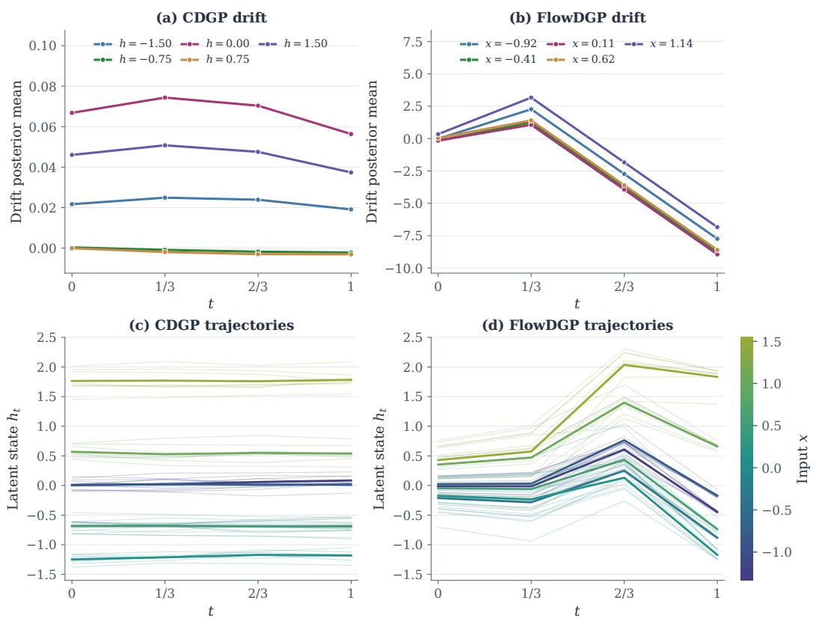  
Figure 3: Learned drift evolution and latent trajectories on the toy dataset. Top: drift posterior means versus t at fixed states h for CDGP and fixed inputs x for FlowDGP. Bottom: sampled latent trajectories (thin lines) and their means (thick lines), colored by input.

## G LLM Usage

Large language models were used solely for editing and polishing the writing of this paper.