# DIAL: Steerable Language Models with Distilled Instruction-Adherence Levels

Thanh Q. Tran<sup>1∗</sup> John Russell Himawan<sup>1∗</sup> Arun Verma<sup>2∗</sup> Kiwan Wong<sup>3</sup> Wei Xiao<sup>4,2,3</sup> Daniela Rus<sup>3,2</sup> Bryan Kian Hsiang Low<sup>1,2</sup>

<sup>1</sup>School of Computing, National University of Singapore, Singapore <sup>2</sup>Singapore-MIT Alliance for Research and Technology Centre, Singapore <sup>3</sup>CSAIL, Massachusetts Institute of Technology, USA

<sup>4</sup>School of Electrical and Electronic Engineering, Nanyang Technological University, Singapore

## Abstract

When a user says “Keep it short”, how short should the LLM’s response be? More generally, users and applications require different levels of instruction adherence, but prompting does not reliably provide fine-grained control over them. We therefore study “steerable language models” that provide fine-grained numerical control over the degree to which models follow general instructions specified in text. However, existing approaches do not jointly offer fine-grained control, efficiency, and scalability across diverse instructions. To address this gap, we introduce DIAL (Distilled Instruction-Adherence Levels) to achieve all three properties. Forfine-grained control, we perform classifier-free guidance (CFG) with a frozen LLM to provide training signals for on-policy distillation of instruction adherence at different levels. For efficiency, we design a lightweight steering adapter that uses a classifier over the LLM’s hidden states to compute a closed-form steering edit. The classifier adaptively sets the steering magnitude at each token based on the target adherence level, while accounting for the geometry of the LLM’s hidden states to preserve response coherence. For scalability, the classifier is text-conditioned, allowing a shared adapter to support new instructions without per-instruction fitting. Training requires only instruction and request text, without labeled responses, external generators, or judges. Evaluation across multiple LLM families shows that DIAL achieves a competitive balance between concept expression and response fluency, with concept scores increasing monotonically across adherence levels. We introduce SteerIF, an instruction-only dataset of 98, 625 concept, persona, verifiable, and descriptive instructions. When trained on SteerIF, DIAL provides fine-grained control over personas and, when combined with prompting, improves verifiable instruction following. In vLLM, the LLM steered by DIAL retains 96–99% of the base LLM throughput, with pertoken inference latency approximately matching that of the base LLM.

## 1 Introduction

Large language models (LLMs) are deployed across users and applications with different require ments for instruction-following [1]. Meeting these requirements involves choosing which instructions an LLM should follow and the appropriate level of adherence for each instruction. Without fine-grained control over adherence levels, users may need to revise an instruction and regenerate responses repeatedly to achieve the desired level of adherence. As an illustrative example, Figure 1(a) shows a user asking for a shorter answer, but the LLM’s response is too short for the user. Further prompting is then needed to obtain the desired response length, creating a frustrating user experience. Ideally, users could view responses generated at different adherence levels and select one with the desired length. More generally, fine-grained adherence control for different instructions would support a range of applications (Figure 1(b)). For personalization, a user could select the adherence level for writing-style or persona instructions according to their preferences [2, 3]. For parental control, parents could set the adherence level for child-safety instructions to help safeguard children [4]. A company could configure the adherence level for product-policy instructions to reflect its specifications [5, 6]. Motivated by these applications, we study “steerable language models” [7, 8] that provide fine-grained numerical control over adherence levels for general text instructions.

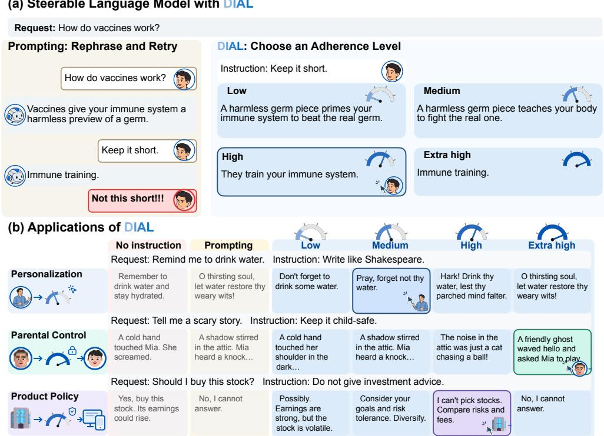  
Figure 1: Steerable Language Models with DIAL and Applications. (a) DIAL provides finegrained control over instruction adherence, allowing users to choose among responses generated at different adherence levels. (b) Illustrative examples of controlling adherence levels for general instructions with DIAL in personalization, parental control, and adherence to company specifications.

Existing approaches for controlling adherence levels in LLMs are not jointly fine-grained, efficient, and scalable across general instructions. The most straightforward approach is prompting, but it does not reliably provide fine-grained control over the adherence level [9, 10]. In contrast, classifierfree guidance (CFG) [11] enables fine-grained control by computing two next-token distributions: one conditioned on the instruction and one unconditioned. It then combines their log probabilities to achieve the desired adherence level [12, 13]. However, this requires two forward passes per generated token, increasing inference cost. Activation steering provides a more efficient approach by editing the hidden states of a frozen LLM within a single inference pass [14–17]. Adjustable steering strength offers a promising way to adapt an LLM at inference time [18]. However, conventional steering methods are not fine-grained because they are fitted to labeled examples that indicate whether an instruction is followed, without supervision at intermediate adherence levels. Increasing steering strength therefore does not reliably increase adherence and can reduce fluency and coherence [19]. Moreover, these methods require fitting for each instruction, limiting scalability. Textconditioned steering methods learn to steer an LLM from instruction text and support instructions unseen during training [20–22]. However, they are trained on labeled responses without supervision at intermediate adherence levels, and flow-based variants add per-token inference overhead.

Contributions. We introduce DIAL (Distilled Instruction-Adherence Levels) to jointly achieve three key properties: fine-grained control, efficiency, and scalability. For fine-grained control, we perform CFG on a frozen LLM to provide training signals for on-policy distillation of instruction adherence at different levels (Section 3.2). For efficiency, we design a lightweight steering adapter [23] that uses a classifier over the LLM’s hidden states to compute a closed-form steering edit. The clas sifier adaptively sets the steering magnitude at each token according to the target adherence level, while accounting for the geometry of the LLM’s hidden states to preserve the base LLM’s response coherence (Section 3.3). For scalability, the classifier is text-conditioned, allowing a shared steering adapter to support previously unseen instructions without per-instruction fitting. Furthermore, CFG provides training signals without requiring labeled responses, external generators, or judges, allowing training to extend to new instruction types using only instruction and request text.

Empirical evaluation across multiple LLM families demonstrates the advantages of DIAL. When steering LLM generation toward concepts such as “Shakespeare,” DIAL achieves a better balance between concept expression and response fluency than existing methods. Importantly, DIAL provides fine-grained control over concept expression, with the concept score increasing monotoni cally across the range of adherence levels. To evaluate general instruction following, we construct SteerIF, an instruction-only dataset comprising 98, 625 instructions, including concept, persona, and verifiable instructions. We train a shared steering adapter for each base LLM and evaluate it on persona instructions, such as “Be humorous,” and verifiable instructions, such as “Respond in JSON.” Persona scores increase with the adherence level across LLM families, and combining steering with prompting improves verifiable instruction following. In terms of efficiency, DIAL’s 20.6Mparameter steering adapter retains 96–99% of base-LLM throughput in vLLM [24] on Gemma-2- 9B [25], while per-token inference latency approximately matches that of the base LLM.

## 2 Related Work

We review three lines of work on steering LLMs. Guided inference is fine-grained but incurs substantial inference overhead; activation steering is efficient, but neither fine-grained nor scalable; and text-conditioned control generalizes to unseen instructions, but lacks fine-grained control and requires labeled responses, limiting scalability. See Appendix A for details.

Guided Inference. In diffusion models [26–28], guided inference controls how strongly a condition, such as a text prompt, influences the generated image. Given the prompt “a cat in the style of Van Gogh,” a low guidance level gives an image that only hints at the style, and a high level gives one that is unmistakably Van Gogh. Classifier guidance pushes each sampling step along the gradient of a separately trained classifier [29], while classifier-free guidance (CFG) removes this classifier by using the diffusion model itself as an implicit classifier [11]. In LLMs, CFG combines the next-token predictions with and without the instruction [12, 13]. A low guidance (i.e., adherence) level weakens the instruction relative to prompting, and a high level strengthens it. Related contrastive inference methods for LLMs improve faithfulness, instruction following, and open-ended generation [30–33]. Because every guidance level defines a next-token distribution for any instruction, guided inference is fine-grained. However, CFG is not efficient, because every generated token needs two forward passes. This motivates guidance distillation in diffusion models, which trains a single-pass student conditioned on the guidance level, thereby recovering CFG at multiple levels [34]. In autoregressive models, CFG has been distilled into the weights only at a single level [35]. Unlike a diffusion model, an LLM takes only tokens and has no natural input for the guidance level. DIAL serves as a lightweight steering adapter that conditions the LLM on the adherence level, approximating CFG at multiple levels in a single pass without changing the LLM’s weights or prompt.

Activation Steering. Activation steering offers a promising way to adapt an LLM cheaply at multiple levels [18]. It edits the hidden states of a frozen LLM in a single forward pass while leaving the weights unchanged, allowing the steering level to be set for each input at inference time. A common intervention is to use a steering vector obtained from contrastive hidden states [14, 15], which has been used to control truthfulness [16], refusal [17], and instruction following [36]. Classifierguided steering methods project the hidden state onto the half-space of a trained classifier in closed form [37–39], or onto the constraint set given by a first-order condition on a learned nonlinear safety score [40]. Geometry-aware methods rotate the state rather than translate it, preserving the hidden state’s norm [41–43]. These interventions are efficient, and their steering level can be varied contin uously. However, they are fitted to labeled examples that either follow the instruction or do not, with no training at intermediate levels of adherence, and are therefore not fine-grained. Increasing the steering level therefore does not reliably yield a corresponding increase in adherence, and high levels often reduce the output fluency and coherence [19]. Moreover, each intervention is fitted to a single instruction, such as one concept or behavior, so each new instruction requires a new intervention.

Text-Conditioned Control. To avoid refitting for every instruction, text-conditioned methods train a single network that maps a text description to an intervention. HyperSteer maps a concept description to a steering vector [20], FLAS integrates a description-conditioned flow [21], and UniSteer trains a text-conditioned flow-matching network that also covers personas and multi-instruction following [22]. Their training, however, suffers from the same two problems as activation steering. They are fitted to labeled examples, here concept-aligned completions written by an external LLM or labeled datasets for each behavior, so scaling to a new kind of instruction requires collecting new data. These examples also either follow the instruction or do not, so the methods are never trained for intermediate levels of adherence and are not fine-grained. Persona Dosing partly addresses this for personas by fine-tuning FLAS on persona-labeled data and calibrating its flow time against measured persona expression [44], which requires measuring each persona, whereas DIAL learns its levels during training and needs no such measurement for a new instruction. Moreover, flow-based methods integrate a flow over several steps per token, which adds latency and limits practicality.

To address these limitations, DIAL distills the frozen LLM’s own CFG distributions at multiple adherence levels into a single steering adapter. Since the teacher requires only instruction and request text, training can scale to new types of instructions without collecting labeled responses. The adapter learns to approximate the CFG-guided distribution at each target level, enabling fine-grained control while keeping inference cost close to that of the base LLM. DIAL thus provides a fine-grained, efficient, and scalable way to condition an LLM on general instructions and adherence levels.

## 3 Method: DIAL (Distilled Instruction-Adherence Levels)

DIAL uses a text-conditioned steering adapter to control instruction adherence in a frozen LLM at different levels. We first define adherence levels via CFG (Section 3.1), and then describe how onpolicy distillation trains the adapter at different adherence levels (Section 3.2). Finally, we introduce the adapter’s lightweight classifier-based architecture and closed-form steering edit (Section 3.3).

## 3.1 Instruction-Adherence Levels via Classifier-Free Guidance

Let x denote a request (e.g., “How do vaccines work?”), c an instruction (e.g., “Keep it short”), and $\alpha > 0$ an adherence level. Given a response prefix $y _ { < t }$ , the frozen LLM yields two nexttoken distributions: $\pi _ { \mathrm { b a s e } } ,$ conditioned on the request alone, and $\pi _ { \mathrm { p r o m p t e d } }$ , conditioned on both the request and the instruction. For brevity, we write $\pi . ( \cdot \mid y _ { < t } )$ and leave the conditioning on x and c implicit. Following CFG [12, 13], we define the teacher distribution at level α as

$$
\pi _ { \alpha } ^ { T } ( \cdot \mid y _ { < t } ) \propto \pi _ { \mathrm { b a s e } } ( \cdot \mid y _ { < t } ) ^ { 1 - \alpha } \pi _ { \mathrm { p r o m p t e d } } ( \cdot \mid y _ { < t } ) ^ { \alpha } .\tag{1}
$$

For $\alpha = 1$ , the teacher recovers $\pi _ { \mathrm { p r o m p t e d } }$ . For $0 < \alpha < 1$ , it interpolates toward $\pi _ { \mathrm { b a s e } } .$ , weakening the instruction’s influence. For $\alpha > 1$ , it extrapolates beyond $\pi _ { \mathrm { p r o m p t e d } }$ , strengthening the instruction’s influence. Thus, larger α corresponds to stronger instruction adherence, and CFG provides a next-token distribution at each adherence level for any instruction text, without labeled responses, external generators, or judges. The prompt format for each instruction type is given in Appendix B.4.

## 3.2 On-Policy Self-Distillation across Adherence Levels

Training across Adherence Levels. We train DIAL’s steering adapter to match the CFG teacher distributions at different adherence levels. The student $\pi _ { \alpha } ^ { S }$ is the frozen LLM with generation steered by DIAL at layer ℓ. The request x is passed to the frozen LLM, while the instruction c and adherence level α are passed to DIAL’s steering adapter. At each prompt and generated position, the adapter replaces the residual hidden state $h _ { t } \in \mathbb { R } ^ { d _ { \mathrm { L L N } } ^ { \bullet } }$ with an edited state $h _ { t } ^ { \prime } .$ As in guidance distillation in diffusion models [34], a single adapter is trained to match the CFG distributions across levels.

For each request–instruction pair, we sample $\alpha \sim \mathrm { L o g U n i f o r m } [ 0 . 5 , 2 ] ,$ , a distribution that is symmetric in log α about $\alpha = 1$ , where the CFG teacher recovers the prompted distribution. This range covers weaker and stronger instruction adherence than prompting. For $0 . 5 \le \alpha < 1$ , the teacher weakens the instruction’s influence relative to prompting, providing fine-grained intermediate training signals between unprompted and prompted generation. Beyond $\alpha = 2 ,$ the CFG teacher’s coher ence degrades (Appendix B.4), consistent with prior work [12]. We empirically found that sampling

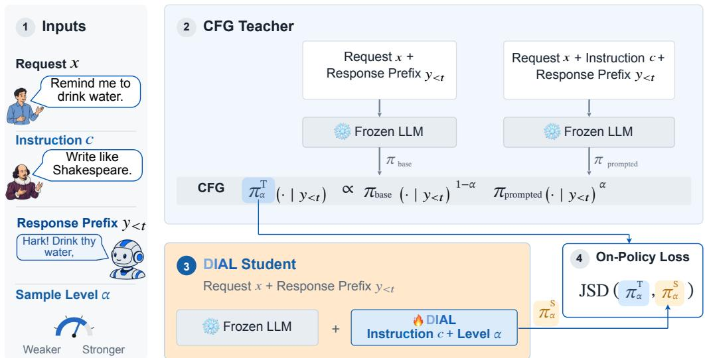  
Figure 2: DIAL’s Training Pipeline. Given a request x and an instruction $c ,$ we sample adherence levels. CFG defines the teacher distributions on prefixes sampled from the student (on-policy), and the frozen LLM steered by DIAL defines the student distributions. DIAL’s steering adapter is trained with a Jensen–Shannon divergence (JSD) loss across adherence levels.

24 adherence levels per instruction–request pair worked well for training DIAL across LLM families. We also verify that sampling α is important for fine-grained instruction adherence levels, and that training on more diverse instructions works better than training longer (see Appendix D.4).

On-Policy Self-Distillation. The student’s response distribution varies with adherence level and can differ from the prompted LLM’s. We therefore use on-policy self-distillation [45, 46], sampling student responses and computing the CFG teacher distribution at each response prefix. We minimize the Jensen–Shannon divergence (JSD) between teacher and student distributions per response token:

$$
\mathcal { L } = \mathbb { E } _ { ( x , c ) \sim \mathcal { D } , \alpha , y \sim \pi _ { \alpha } ^ { S } } \left[ \frac { 1 } { \left| y \right| } \sum _ { t } \mathrm { J S D } \big ( \pi _ { \alpha } ^ { T } ( \cdot \mid y _ { < t } ) , \pi _ { \alpha } ^ { S } ( \cdot \mid y _ { < t } ) \big ) \right] ,\tag{2}
$$

where D is the distribution of training request–instruction pairs. Both distributions are restricted to the union of the base, prompted, and student top-64 tokens. We also add a regularization term to encourage stable training and generalization by penalizing large relative edits (Appendix B.4). Our loss ablation in Appendix D.4 suggests that JSD performs best, with forward KL performing substantially worse and reverse KL performing slightly worse. We refer to Appendices B.4 and B.5 for training details and pseudocode of the full on-policy training loop across adherence levels.

## 3.3 Lightweight and Adaptive Classifier-Based Steering Adapter

Instruction and Memory Conditioning. We design the adapter to condition each steering edit on the instruction and the response generated so far. We encode the instruction through the frozen LLM and cache its layer-ℓ hidden states I. At each position, the current hidden state $h _ { t }$ attends to I and a memory of the 16 most recent edited states, $\mathbf { \mathcal { \hat { M } } } _ { t } = \{ h _ { t - 1 6 } ^ { \prime } , \dots , h _ { t - 1 } ^ { \prime } \}$

$$
z _ { t } = \mathrm { A t t n } _ { \ell } ( \mathrm { q u e r y } = h _ { t } ; [ \mathcal { T } ; \mathcal { M } _ { t } ] ) , \qquad f _ { t } = \mathrm { G E L U } ( \mathrm { L a y e r N o r m } ( \mathrm { L i n e a r } ( z _ { t } ) ) ) .\tag{3}
$$

Here, Attn<sub>ℓ</sub> reuses the frozen layer’s normalization and query, key, and value projections. The current state is the query, while the instruction and memory states supply the keys and values. Since these states come from the same LLM layer, the adapter does not require a separate text encoder for the instructions. Attention combines instruction and memory states, followed by a linear map, LayerNorm, and GELU to produce the 512-dimensional feature $f _ { t }$ . In our experiments, a memory window of the 16 most recent states performed well while keeping attention cost low.

Adaptive Classifier-Based Steering. From $f _ { t } ,$ , the adapter predicts a unit direction $u _ { t } \in \mathbb { R } ^ { d _ { \mathrm { L L M } } }$ a threshold $\tau _ { t } ( \alpha ) \in \mathbb { R }$ , and a norm weight $\breve { \lambda } _ { t } ( \alpha ) \in [ \bar { 0 } , 1 ]$ . The direction and threshold define a linear classifier with half-space $\{ h : \langle u _ { t } , \bar { h } \rangle \geq \bar { \tau _ { t } } ( \alpha ) \}$ . Unlike classifiers fitted separately for each instruction, DIAL’s classifier is generated from instruction and memory information at each token.

Rather than linearly scaling a fixed steering edit, DIAL learns the threshold and norm weight as functions of $\alpha .$ On-policy distillation provides rich supervision from the CFG teacher for learning steering magnitude and geometry at different adherence levels.

The classifier $( u _ { t } , \tau _ { t } ( \alpha ) )$ determines whether and how much to steer the current hidden state. $\operatorname { I f } h _ { t }$ lies outside the half-space, we project it onto the boundary with a minimum-norm step, following classifier-based steering [37–39]. We then adjust the projected state’s norm using the norm weight $\lambda _ { t } ( \alpha )$ while retaining its direction. Both operations have closed-form expressions:

$$
h _ { t } ^ { P } = h _ { t } + \left[ \tau _ { t } ( \alpha ) - \langle u _ { t } , h _ { t } \rangle \right] _ { + } u _ { t } , \qquad h _ { t } ^ { \prime } = \left[ \lambda _ { t } ( \alpha ) + \left( 1 - \lambda _ { t } ( \alpha ) \right) \frac { \| h _ { t } \| } { \| h _ { t } ^ { P } \| } \right] h _ { t } ^ { P } ,\tag{4}
$$

where $[ a ] _ { + } = \operatorname* { m a x } ( a , 0 )$ . The gap $[ \tau _ { t } ( \alpha ) - \langle u _ { t } , h _ { t } \rangle ] _ { + }$ sets the projection magnitude. Thus, the edit depends on the current state as well as the generated classifier, rather than applying a fixed steering magnitude to every token. If the state already lies inside the half-space, the edit leaves $h _ { t }$ unchanged.

The norm weight lets the adapter interpolate between two steering geometries, which we visualize in Appendix B.2. At $\lambda _ { t } = 1$ , the edited state is the minimum-norm projection $h _ { t } ^ { \prime } = h _ { t } ^ { P } \ [ 3 7 - 3 9 ]$ At $\lambda _ { t } = 0$ , it preserves the original norm, $h _ { t } ^ { \prime } = \| h _ { t } \| h _ { t } ^ { P } / \| h _ { t } ^ { P } \|$ , giving a rotation in the span of $h _ { t }$ and u<sub>t</sub> [41–43]. Intermediate values preserve the projected direction with norm $( 1 - \lambda _ { t } ) \dot { \| } h _ { t } \| +$ $\lambda _ { t } \Vert h _ { t } ^ { P } \Vert$ . Learning this weight allows the geometry to adapt at each token. We found that adapters trained for different LLM families learn different norm weights and edit magnitudes, suggesting that appropriate steering magnitudes and geometries depend on the base LLM (see Appendix D.3). DIAL’s steering adapter has 20.6M trainable parameters on Gemma-2-9B (see Appendix B.1).

Efficient Inference. During inference, instruction and memory keys and values can be cached, so each token requires only a single-layer attention computation and a closed-form steering edit.

## 4 Experiments

We evaluate DIAL when the instruction is to express a concept, adopt a persona, or satisfy a verifiable requirement. We also compare its training and inference efficiency against baselines.

Base LLMs. We train DIAL’s adapters for instruction-tuned LLMs: Gemma-2-9B [25], Qwen2.5- 7B [47], Llama-3.1-8B [48], Phi-4-14B [49], LFM2.5-1.2B [50], and Ministral-8B [51]. These cover six LLM families with 1.2–14B parameters, including Transformer and hybrid architectures.

Training Setup. We train DIAL on 14, 880 concept descriptions from Concept16k [19]. We also construct SteerIF, an instruction-only dataset of 98, 625 instructions covering concepts, personas, and verifiable and descriptive requirements, given as single or composite instructions. We train one shared adapter per LLM on SteerIF, denoted DIAL-IF. For both datasets, we remove exact and near matches to held-out evaluation instructions to assess generalization. We select a steering layer for each LLM and train its adapter at that layer. See Appendix B.3 for more details on dataset construction and to Appendix B.4 for the steered layer chosen for each LLM.

## 4.1 Controlling Concept Expression Levels

Training and Baselines. We train DIAL for one epoch on 14,880 concept descriptions from Concept16k [19]. We use FLAS’s released Gemma-2-9B checkpoint, trained on Concept16k with LLM-generated labeled responses [21], whereas DIAL uses only concept descriptions. We compare with prompting, per-concept methods (LoReFT, LoRA, ReFT-r1, DiffMean, and SAE [19], SV + RePS [52], and S-PSR [53]), and text-conditioned methods (HyperSteer and FLAS). We also include CFG [12, 13] for fine-grained control over concept expression, and prompting w/ level [54], which uses the same prompt as prompting but also asks the LLM to follow it at adherence level α, on a scale from 0 (ignore) to 2 (follow strongly). See Appendix C.1 for implementation details.

Evaluation Protocol. We evaluate on AxBench’s Concept500 (Held-In) and FLAS’s 100 held out concepts (Held-Out). HyperSteer’s published Held-Out score uses its own held-out concepts. Neither Concept500 nor the held-out concepts appear in DIAL’s training pool. Following the AxBench protocol, we limit responses to 128 tokens and steer DIAL at layer 20 for Gemma-2-9B. Per-concept methods select a steering level for each concept, while DIAL uses a fixed adherence level α across concepts. FLAS controls concept expression through its flow time T, with larger T

DIAL Prompt + DIAL   CFG FLAS Prompting w/ Level Prompting No Instruction

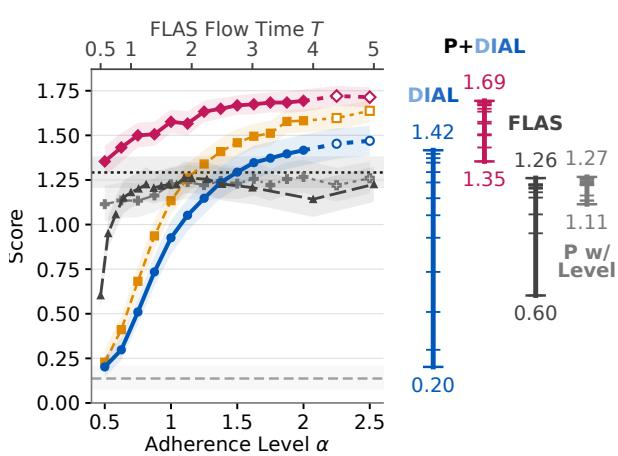

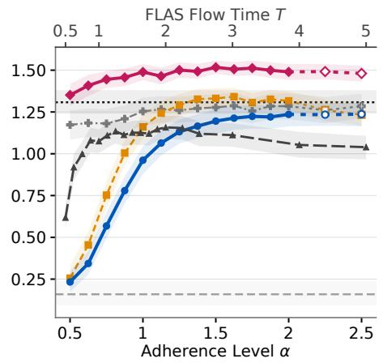  
Figure 3: Fine-Grained Concept Expression Levels. (a) DIAL smoothly increases concept expression with increasing α (Section 3.1), covering a wide range of intermediate levels and surpassing prompting at $\alpha = 2 .$ . P+DIAL further raises expression. (b) DIAL approaches prompting’s overall score, enabling adjustable adherence levels while maintaining response quality. Results reported are on 100 held-out concepts judged by median of Phi-4-14B, Qwen3.8-27B, and gpt-4o-mini.

applying the learned flow for longer [21]. We use $T = 2$ as in FLAS’s reported evaluation and vary T in Figure 3. Protocols, baselines, and further results are in Appendix C.1.

Evaluation Metrics. Each response receives three scores from 0 to 2: concept expression, request following (AxBench’s instruction score), and fluency. AxBench defines the overall score as the harmonic mean of the three scores. We use gpt-4o-mini [55] as a judge to compare with prior work (Table 1) and the median of three judges for the curves in Figure 3.

Concept Steering Performance. DIAL achieves overall scores of 1.059 and 1.036 on Held-In and Held-Out concepts, compared with 0.997 and 0.987 for FLAS (Table 1). Combining DIAL with prompting raises the scores to 1.198 and 1.218, compared with prompting’s 1.049 and 1.060. DIAL-IF, trained on SteerIF, steers persona and verifiable instructions and also performs well on AxBench, scoring 1.039 and 0.993.

Fine-Grained Control. DIAL’s concept score increases smoothly with the adherence level (Figure 3). From $\alpha = 0 . 5 \mathrm { t o } 2$ , it rises from 0.20 to 1.42, covering a range of 1.21 points compared with 0.66 for FLAS over flow times 0.5–2. We also find that prompting w/ level does not provide fine-grained control, consistent with prior work [54]. At α = 1.5, DIAL matches prompting’s concept score of 1.29 and surpasses it at α = 2. Combining prompting with DIAL further raises concept expression, with scores from 1.35 to 1.69. The DIAL adapter thus covers intermediate expression lev-

Table 1: Concept Steering on AxBench. Overall scores on Gemma-2-9B with gpt-4o-mini as judge. <sup>+</sup> denotes results adapted from [19, 52, 53, 20].

<table><tr><td>Method</td><td>Held-In Held-Out</td><td></td></tr><tr><td>Prompting</td><td>1.049</td><td>1.060</td></tr><tr><td>CFG (α=2)</td><td></td><td>1.115</td></tr><tr><td>One Adapter per Concept LoReFT [19]</td><td>0.777+</td><td></td></tr><tr><td>LoRA [19]</td><td></td><td></td></tr><tr><td></td><td>0.602+</td><td></td></tr><tr><td>S-PSR [53]</td><td>0.900+</td><td></td></tr><tr><td>SV + RePS [52]</td><td>0.892+</td><td></td></tr><tr><td>ReFT-r1 [19]</td><td>0.630+</td><td></td></tr><tr><td>DiffMean [19]</td><td>0.322+</td><td></td></tr><tr><td>SAE [19]</td><td>0.191+</td><td>一</td></tr><tr><td>One Adapter for All Concepts</td><td></td><td></td></tr><tr><td>HyperSteer [20]</td><td>1.091⁺</td><td>0.934+</td></tr><tr><td>FLAS [21] (T=2)</td><td>0.997</td><td>0.987</td></tr><tr><td>DIAL trained on Concept16k</td><td></td><td></td></tr><tr><td>DIAL (α=1)</td><td>0.757</td><td>0.765</td></tr><tr><td>DIAL (α=2)</td><td>1.059</td><td>1.036</td></tr><tr><td>Prompt + DIAL (α=0.5)</td><td>1.108</td><td>1.111</td></tr><tr><td>Prompt + DIAL (α=1)</td><td>1.198</td><td>1.218</td></tr><tr><td>DIAL trained on SteerIF</td><td></td><td></td></tr><tr><td>DIAL-IF (α=1)</td><td>0.704</td><td>0.672</td></tr><tr><td>DIAL-IF (α=2)</td><td>1.039</td><td>0.993</td></tr><tr><td>Prompt + DIAL-IF (α=0.5)</td><td>1.118</td><td>1.130</td></tr><tr><td> $\mathrm { P r o m p t } + \mathrm { D I A L } \ – \mathrm { I F } \left( \alpha { = } 1 \right)$ </td><td>1.196</td><td>1.188</td></tr></table>

els below and above prompting, mirroring CFG. Although trained only on single-turn responses, DIAL also shows potential for multi-turn steering. Since an instruction given once in the context tends to lose its effect as the conversation grows [56], whereas DIAL steers the hidden state at every token during generation. Appendix D.5 demonstrates this advantage in multi-turn settings.

Inference Efficiency. We measure inference efficiency on Gemma-2-9B on an H200 at batch sizes of 1, 32, 128, and 256, generating 128 tokens per response. Table 2 demonstrates that DIAL retains most of the frozen LLM’s inference efficiency. In vLLM [24], it retains 96–99% of the base LLM’s throughput, compared with 41–86% for CFG and 84–86% for FLAS. Its per-token inference latency approximately matches the base LLM’s. Processing the instruction before generation increases time to first token and contributes to the remaining throughput overhead. Similar trends hold for Hugging Face. We refer to Appendix C.4 for absolute values and time to first token.

Table 2: Inference Efficiency of DIAL. Latency and throughput relative to the base LLM in vLLM and Hugging Face across batch sizes (B). CFG runs out of memory in Hugging Face at B = 256.
<table><tr><td></td><td></td><td colspan="4">vLLM</td><td colspan="4">Hugging Face</td></tr><tr><td></td><td>Method</td><td>B=1</td><td>B=32</td><td>B=128</td><td>B=256</td><td>B=1</td><td>B=32</td><td>B=128</td><td>B=256</td></tr><tr><td rowspan="3">Throughput ↑</td><td>CFG</td><td>0.86</td><td>0.66</td><td>0.47</td><td>0.41</td><td>0.89</td><td>0.73</td><td>0.51</td><td>00M</td></tr><tr><td>FLAS</td><td>0.85</td><td>0.84</td><td>0.85</td><td>0.86</td><td>0.77</td><td>0.79</td><td>0.91</td><td>0.91</td></tr><tr><td>DIAL</td><td>0.99</td><td>0.96</td><td>0.98</td><td>0.97</td><td>0.95</td><td>0.95</td><td>0.99</td><td>0.99</td></tr><tr><td rowspan="3">Per-token latency ↓</td><td>CFG</td><td>1.15</td><td>1.45</td><td>2.06</td><td>2.40</td><td>1.13</td><td>1.30</td><td>1.90</td><td>00M</td></tr><tr><td>FLAS</td><td>1.17</td><td>1.19</td><td>1.15</td><td>1.12</td><td>1.30</td><td>1.27</td><td>1.10</td><td>1.09</td></tr><tr><td>DIAL</td><td>1.00</td><td>1.00</td><td>0.99</td><td>1.00</td><td>1.04</td><td>1.03</td><td>1.00</td><td>1.00</td></tr></table>

Training Scalability. For Gemma-2-9B in H200 GPU-hours (Table 3), DIAL uses 4.65× fewer GPU-hours than FLAS and 25× fewer than HyperSteer, with 12.4× fewer trainable parameters than FLAS. DIAL trains using only instruction text, whereas FLAS and HyperSteer require labelled responses. With on-policy supervision across adherence levels, we found training for more than one epoch gives no consistent gain.

Table 3: Training Cost Comparison.
<table><tr><td colspan="3">Params ↓ GPU-h↓</td></tr><tr><td>HyperSteer</td><td>~9.2B</td><td>102.39</td></tr><tr><td>FLAS</td><td>255.6M</td><td>18.89</td></tr><tr><td>DIAL</td><td>20.6M</td><td>4.06</td></tr></table>

## 4.2 Controlling Persona Expression Levels

Evaluation Setup. We evaluate DIAL-IF on seven personas excluded from training, following the evaluation protocol in [57]. We compare DIAL-IF, prompting, prompt+DIAL-IF, prompting w/ level, and CFG. Three judges score persona expression from 0 to 100, and we use the median rating for each response. We refer to Appendix C.2 for generation, judge details, and additional results.

Fine-Grained Persona Expression. Figure 4 shows that DIAL-IF’s persona score increases with the adherence level, more linearly than CFG, using one shared adapter per LLM. On Gemma, it rises from 12.0 without instructions to 76.4 at α = 1 and 91.4 at α = 2, close to prompting’s 92.5. The adapter thus covers intermediate persona expression levels below, and on Qwen2.5-7B and Phi-4- 14B above, prompting. Combining prompting with DIAL-IF further raises persona expression. On Qwen, the persona score rises from prompting’s 77.0 to 82.5, 84.1, and 89.6 at α = 0.5, 1, and 2. On Phi-4-14B, the score rises from prompting’s 64.3 to 70.2 and 78.2 at α = 0.5 and 1.

## 4.3 Verifiable Instruction Following

Evaluation Setup. We evaluate DIAL-IF on 541 IFEval prompts, which contain verifiable instructions on format, lexical content, and language [9]. We note that all 25 instruction types in IFEval are covered by SteerIF, though matching instruction texts are removed and 376 of its requests occur in training. The official checker assigns a binary pass/fail result to each instruction. A prompt passes only when all its instructions are followed. Unlike concept and persona expression scores, these binary checks do not measure intermediate adherence levels per response. We compare prompt-level strict accuracy at four adherence levels (α = 0.5, 1, 1.5, 2).

Instruction Following Performance. DIAL-IF alone generally improves instruction following as the adherence level increases (Table 4). On Gemma-2-9B, accuracy rises from 9.6 without instructions to 53.8 at α = 2. At α = 1, combining prompting with DIAL-IF improves over prompting on five of the six evaluated LLMs, while Qwen scores 71.9 compared with prompting’s 72.3. At their best levels, CFG and prompt+DIAL-IF are within two points of each other on five of the six LLMs, and CFG is higher on Phi-4-14B (72.5 against 68.2), while CFG requires two LLM passes per token. On Gemma, prompt+DIAL-IF reaches 76.9, compared with prompting’s 72.8. Llama reaches 75.6, compared with 73.6. On Phi-4-14B, LFM2.5, and Ministral-8B, it reaches 66.7, 85.6, and 65.1, versus 61.7, 83.4, and 53.4. Thus, DIAL’s adapter carries information from unseen instruction texts. We observe similar gains on the IFEval questions that do not appear in training (Appendix C.3).

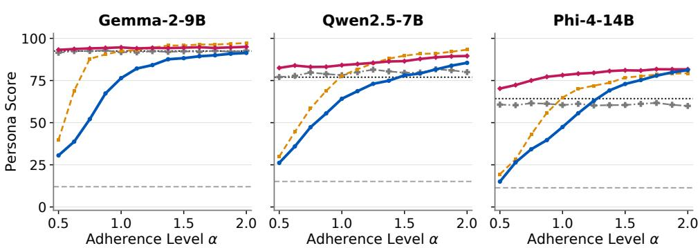  
Figure 4: Fine-Grained Persona Expression Levels. DIAL-IF controls intermediate persona expression levels as α increases. Combining prompting with DIAL-IF further raises persona scores.

Table 4: Verifiable Instruction Following on IFEval. Prompt-level strict accuracy (%) across six LLM families. Bold and underline indicate the best and second-best results per LLM.
<table><tr><td>Method</td><td>α</td><td>Gemma-2-9B</td><td>Qwen2.5-7B</td><td>Llama-3.1-8B</td><td>Phi-4-14B</td><td>LFM2.5-1.2B</td><td>Ministral-8B</td></tr><tr><td rowspan="2">No instruction Prompting</td><td>一</td><td>9.6</td><td>9.2</td><td>9.8</td><td>10.0</td><td>9.8</td><td>8.5</td></tr><tr><td>1</td><td>72.8</td><td>72.3</td><td>73.6</td><td>61.7</td><td>83.4</td><td>53.4</td></tr><tr><td rowspan="4">CFG</td><td>0.5</td><td>21.4</td><td>30.5</td><td>21.3</td><td>19.0</td><td>50.1</td><td>14.0</td></tr><tr><td>1</td><td>72.5</td><td>71.2</td><td>74.7</td><td>64.1</td><td>83.7</td><td>54.5</td></tr><tr><td>1.5</td><td>78.0</td><td>72.3</td><td>77.1</td><td>72.1</td><td>81.3</td><td>64.7</td></tr><tr><td>2</td><td>76.2</td><td>72.3</td><td>75.4</td><td>72.5</td><td>81.1</td><td>67.1</td></tr><tr><td rowspan="4">DIAL-IF</td><td>0.5</td><td>19.0</td><td>24.0</td><td>17.7</td><td>13.7</td><td>37.9</td><td>9.4</td></tr><tr><td>1</td><td>44.4</td><td>48.1</td><td>41.6</td><td>33.3</td><td>53.0</td><td>29.6</td></tr><tr><td>1.5</td><td>50.8</td><td>50.5</td><td>45.8</td><td>39.9</td><td>54.3</td><td>42.3</td></tr><tr><td>2</td><td>53.8</td><td>49.9</td><td>47.5</td><td>43.3</td><td>57.1</td><td>40.9</td></tr><tr><td rowspan="4">P+DIAL-IF</td><td>0.5</td><td>77.1</td><td>71.9</td><td>78.0</td><td>63.2</td><td>85.2</td><td>58.0</td></tr><tr><td>1</td><td>76.9</td><td>71.9</td><td>75.6</td><td>66.7</td><td>85.6</td><td>65.1</td></tr><tr><td>1.5</td><td>77.1</td><td>70.6</td><td>73.8</td><td>68.2</td><td>83.7</td><td>67.5</td></tr><tr><td>2</td><td>77.4</td><td>70.1</td><td>71.2</td><td>67.5</td><td>81.3</td><td>66.4</td></tr></table>

Discussion. We differentiate instructions that apply to the whole response, such as its length or format (global), from instructions that specify particular words or positions (local). On Qwen2.5-7B, prompt+DIAL-IF at α = 2 follows local instructions better than prompting but global instructions worse, which helps explain why its overall accuracy stays below prompting’s on this LLM (Table 4). Appendix C.3 covers evaluation details, category analysis, and unseen instruction types.

## 5 Conclusion

We introduce DIAL to build “steerable language models” that provide fine-grained control over instruction-adherence levels while keeping the LLM frozen. On-policy distillation from CFG trains a lightweight, text-conditioned steering adapter. DIAL provides fine-grained control over concept and persona expression, and combining it with prompting can improve verifiable instruction following. Training is scalable, using only instruction text and a shared adapter without labelled responses or per-instruction fitting. However, high adherence levels can still reduce response coherence, and DIAL does not improve every verifiable instruction type. Future work should explore better classifier architectures and training losses, and combine on-policy distillation with verifiable rewards or judge feedback to filter training rollouts. Future work could also explore training at negative α, matching CFG with negative weights to steer away from specific styles, topics, or vocabulary.

## References

[1] Long Ouyang, Jeff Wu, Xu Jiang, Diogo Almeida, Carroll L. Wainwright, Pamela Mishkin, Chong Zhang, Sandhini Agarwal, Katarina Slama, Alex Ray, John Schulman, Jacob Hilton, Fraser Kelton, Luke Miller, Maddie Simens, Amanda Askell, Peter Welinder, Paul F. Christiano, Jan Leike, and Ryan Lowe. Training language models to follow instructions with human feedback. In Proc. NeurIPS, 2022.

[2] Alireza Salemi, Sheshera Mysore, Michael Bendersky, and Hamed Zamani. LaMP: When large language models meet personalization. In Proc. ACL, 2024.

[3] Taylor Sorensen, Jared Moore, Jillian Fisher, Mitchell Gordon, Niloofar Mireshghallah, Christopher Michael Rytting, Andre Ye, Liwei Jiang, Ximing Lu, Nouha Dziri, Tim Althoff, and Yejin Choi. Position: A roadmap to pluralistic alignment. In Proc. ICML, 2024.

[4] OpenAI. Introducing parental controls. https://openai.com/index/ introducing-parental-controls/, 2025.

[5] OpenAI. Model Spec. https://model-spec.openai.com/2026-08-18.html, 2026.

[6] Anthropic. Claude’s constitution. https://www.anthropic.com/constitution, 2026.

[7] Yi Dong, Zhilin Wang, Makesh Sreedhar, Xianchao Wu, and Oleksii Kuchaiev. SteerLM: Attribute conditioned SFT as an (user-steerable) alternative to RLHF. In Proc. EMNLP Findings, 2023.

[8] Kaiwen Wang, Rahul Kidambi, Ryan Sullivan, Alekh Agarwal, Christoph Dann, Andrea Michi, Marco Gelmi, Yunxuan Li, Raghav Gupta, Kumar Avinava Dubey, Alexandre Ramé, Johan Ferret, Geoffrey Cideron, Le Hou, Hongkun Yu, Amr Ahmed, Aranyak Mehta, Léonard Hussenot, Olivier Bachem, and Edouard Leurent. Conditional language policy: A general framework for steerable multi-objective finetuning. In Proc. EMNLP Findings, 2024.

[9] Jeffrey Zhou, Tianjian Lu, Swaroop Mishra, Siddhartha Brahma, Sujoy Basu, Yi Luan, Denny Zhou, and Le Hou. Instruction-following evaluation for large language models. arXiv:2311.07911, 2023.

[10] Valentina Pyatkin, Saumya Malik, Victoria Graf, Hamish Ivison, Shengyi Huang, Pradeep Dasigi, Nathan Lambert, and Hannaneh Hajishirzi. Generalizing verifiable instruction following. In Proc. NeurIPS Datasets and Benchmarks Track, 2025.

[11] Jonathan Ho and Tim Salimans. Classifier-free diffusion guidance. In NeurIPS Workshop on Deep Generative Models and Downstream Applications, 2021.

[12] Guillaume V. Sanchez, Alexander Spangher, Honglu Fan, Elad Levi, and Stella Biderman. Stay on topic with classifier-free guidance. In Proc. ICML, 2024.

[13] Yijiang River Dong, Tiancheng Hu, Zheng Hui, and Nigel Collier. Steer model beyond assistant: Controlling system prompt strength via contrastive decoding. arXiv:2601.06403, 2026.

[14] Alexander Matt Turner, Lisa Thiergart, Gavin Leech, David Udell, Juan J. Vazquez, Ulisse Mini, and Monte MacDiarmid. Steering language models with activation engineering. arXiv:2308.10248, 2023.

[15] Nina Rimsky, Nick Gabrieli, Julian Schulz, Meg Tong, Evan Hubinger, and Alexander Matt Turner. Steering Llama 2 via contrastive activation addition. In Proc. ACL, 2024.

[16] Kenneth Li, Oam Patel, Fernanda Viégas, Hanspeter Pfister, and Martin Wattenberg. Inference-time intervention: Eliciting truthful answers from a language model. In Proc. NeurIPS, 2023.

[17] Andy Arditi, Oscar Obeso, Aaquib Syed, Daniel Paleka, Nina Panickssery, Wes Gurnee, and Neel Nanda. Refusal in language models is mediated by a single direction. In Proc. NeurIPS, 2024.

[18] Simon Ostermann, Daniil Gurgurov, Tanja Baeumel, Michael A. Hedderich, Sebastian Lapuschkin, Wojciech Samek, and Vera Schmitt. From weights to activations: Is steering the next frontier of adaptation? In Proc. ACL, 2026.

[19] Zhengxuan Wu, Aryaman Arora, Atticus Geiger, Zheng Wang, Jing Huang, Dan Jurafsky, Christopher D. Manning, and Christopher Potts. AxBench: Steering LLMs? Even simple baselines outperform sparse autoencoders. In Proc. ICML, 2025.

[20] Jiuding Sun, Sidharth Baskaran, Zhengxuan Wu, Michael Sklar, Christopher Potts, and Atticus Geiger. HyperSteer: Activation steering at scale with hypernetworks. arXiv:2506.03292, 2025.

[21] Zehao Jin, Ruixuan Deng, Junran Wang, Xinjie Shen, and Chao Zhang. Beyond steering vector: Flow-based activation steering for inference-time intervention. In Proc. NeurIPS, 2026.

[22] Yingdong Shi, Ruiming Zhang, Changming Li, Zhiyu Yang, Kaixing Zhang, Jingyi Yu, and Kan Ren. UniSteer: Text-guided flow matching in activation space for versatile LLM steering. arXiv:2605.30076, 2026.

[23] Dmitrii Krasheninnikov and David Krueger. Steering clear: A systematic study of activation steering in a toy setup. In NeurIPS Workshop on Foundation Model Interventions, 2024.

[24] Woosuk Kwon, Zhuohan Li, Siyuan Zhuang, Ying Sheng, Lianmin Zheng, Cody Hao Yu, Joseph E. Gonzalez, Hao Zhang, and Ion Stoica. Efficient memory management for large language model serving with PagedAttention. In Proc. SOSP, 2023.

[25] Morgane Riviere, Shreya Pathak, Pier Giuseppe Sessa, Cassidy Hardin, Surya Bhupatiraju, Léonard Hussenot, Thomas Mesnard, Bobak Shahriari, Alexandre Ramé, Johan Ferret, Peter Liu, Pouya Tafti, Abe Friesen, Michelle Casbon, Sabela Ramos, Ravin Kumar, Charline Le Lan, Sammy Jerome, Anton Tsitsulin, Nino Vieillard, Piotr Stanczyk, Sertan Girgin, Nikola Momchev, Matt Hoffman, Shantanu Thakoor, Jean-Bastien Grill, Behnam Neyshabur, Olivier Bachem, Alanna Walton, Aliaksei Severyn, Alicia Parrish, Aliya Ahmad, Allen Hutchison, Alvin Abdagic, Amanda Carl, Amy Shen, Andy Brock, Andy Coenen, Anthony Laforge, Antonia Paterson, Ben Bastian, Bilal Piot, Bo Wu, Brandon Royal, Charlie Chen, Chintu Kumar, Chris Perry, Chris Welty, Christopher A. Choquette-Choo, Danila Sinopalnikov, David Weinberger, Dimple Vijaykumar, Dominika Rogozinska, Dustin Herbi-´ son, Elisa Bandy, Emma Wang, Eric Noland, Erica Moreira, Evan Senter, Evgenii Eltyshev, Francesco Visin, Gabriel Rasskin, Gary Wei, Glenn Cameron, Gus Martins, Hadi Hashemi, Hanna Klimczak-Plucinska, Harleen Batra, Harsh Dhand, Ivan Nardini, Jacinda Mein, Jack´ Zhou, James Svensson, Jeff Stanway, Jetha Chan, Jin Peng Zhou, Joana Carrasqueira, Joana Iljazi, Jocelyn Becker, Joe Fernandez, Joost van Amersfoort, Josh Gordon, Josh Lipschultz, Josh Newlan, Ju yeong Ji, Kareem Mohamed, Kartikeya Badola, Kat Black, Katie Millican, Keelin McDonell, Kelvin Nguyen, Kiranbir Sodhia, Kish Greene, Lars Lowe Sjoesund, Lauren Usui, Laurent Sifre, Lena Heuermann, Leticia Lago, Lilly McNealus, Livio Baldini Soares, Logan Kilpatrick, Lucas Dixon, Luciano Martins, Machel Reid, Manvinder Singh, Mark Iverson, Martin Görner, Mat Velloso, Mateo Wirth, Matt Davidow, Matt Miller, Matthew Rahtz, Matthew Watson, Meg Risdal, Mehran Kazemi, Michael Moynihan, Ming Zhang, Minsuk Kahng, Minwoo Park, Mofi Rahman, Mohit Khatwani, Natalie Dao, Nenshad Bardoliwalla, Nesh Devanathan, Neta Dumai, Nilay Chauhan, Oscar Wahltinez, Pankil Botarda, Parker Barnes, Paul Barham, Paul Michel, Pengchong Jin, Petko Georgiev, Phil Culliton, Pradeep Kuppala, Ramona Comanescu, Ramona Merhej, Reena Jana, Reza Ardeshir Rokni, Rishabh Agarwal, Ryan Mullins, Samaneh Saadat, Sara Mc Carthy, Sarah Cogan, Sarah Perrin, Sébastien M. R. Arnold, Sebastian Krause, Shengyang Dai, Shruti Garg, Shruti Sheth, Sue Ronstrom, Susan Chan, Timothy Jordan, Ting Yu, Tom Eccles, Tom Hennigan, Tomas Kocisky, Tulsee Doshi, Vihan Jain, Vikas Yadav, Vilobh Meshram, Vishal Dharmadhikari, Warren Barkley, Wei Wei, Wenming Ye, Woohyun Han, Woosuk Kwon, Xiang Xu, Zhe Shen, Zhitao Gong, Zichuan Wei, Victor Cotruta, Phoebe Kirk, Anand Rao, Minh Giang, Ludovic Peran, Tris Warkentin, Eli Collins, Joelle Barral, Zoubin Ghahramani, Raia Hadsell, D. Sculley, Jeanine Banks, Anca Dragan, Slav Petrov, Oriol Vinyals, Jeff Dean, Demis Hassabis, Koray Kavukcuoglu, Clement Farabet, Elena Buchatskaya, Sebastian Borgeaud, Noah

Fiedel, Armand Joulin, Kathleen Kenealy, Robert Dadashi, and Alek Andreev. Gemma 2: Improving open language models at a practical size. arXiv:2408.00118, 2024.

[26] Jascha Sohl-Dickstein, Eric Weiss, Niru Maheswaranathan, and Surya Ganguli. Deep unsu pervised learning using nonequilibrium thermodynamics. In Proc. ICML, 2015.

[27] Jonathan Ho, Ajay Jain, and Pieter Abbeel. Denoising diffusion probabilistic models. In Proc. NeurIPS, 2020.

[28] Yang Song, Jascha Sohl-Dickstein, Diederik P. Kingma, Abhishek Kumar, Stefano Ermon, and Ben Poole. Score-based generative modeling through stochastic differential equations. In Proc. ICLR, 2021.

[29] Prafulla Dhariwal and Alex Nichol. Diffusion models beat GANs on image synthesis. In Proc. NeurIPS, 2021.

[30] Weijia Shi, Xiaochuang Han, Mike Lewis, Yulia Tsvetkov, Luke Zettlemoyer, and Wen-tau Yih. Trusting your evidence: Hallucinate less with context-aware decoding. In Proc. NAACL, 2024.

[31] Taehyeon Kim, Joonkee Kim, Gihun Lee, and Se-Young Yun. Instructive decoding: Instruction-tuned large language models are self-refiner from noisy instructions. In Proc. ICLR, 2024.

[32] Xiang Lisa Li, Ari Holtzman, Daniel Fried, Percy Liang, Jason Eisner, Tatsunori Hashimoto, Luke Zettlemoyer, and Mike Lewis. Contrastive decoding: Open-ended text generation as optimization. In Proc. ACL, 2023.

[33] Alisa Liu, Maarten Sap, Ximing Lu, Swabha Swayamdipta, Chandra Bhagavatula, Noah A. Smith, and Yejin Choi. DExperts: Decoding-time controlled text generation with experts and anti-experts. In Proc. ACL, 2021.

[34] Chenlin Meng, Robin Rombach, Ruiqi Gao, Diederik Kingma, Stefano Ermon, Jonathan Ho, and Tim Salimans. On distillation of guided diffusion models. In Proc. CVPR, 2023.

[35] Geoffrey Cideron, Andrea Agostinelli, Johan Ferret, Sertan Girgin, Romuald Elie, Olivier Bachem, Sarah Perrin, and Alexandre Ramé. Diversity-rewarded CFG distillation. In Proc. ICLR, 2025.

[36] Alessandro Stolfo, Vidhisha Balachandran, Safoora Yousefi, Eric Horvitz, and Besmira Nushi. Improving instruction-following in language models through activation steering. In Proc. ICLR, 2025.

[37] Emily Cheng and Carmen Amo Alonso. LiSeCo: Linear semantic control for language generation. Transactions on Machine Learning Research, 2026.

[38] Zhihao Xu, Ruixuan Huang, Changyu Chen, and Xiting Wang. Uncovering safety risks of large language models through concept activation vector. In Proc. NeurIPS, 2024.

[39] Hanyu Zhang, Xiting Wang, Chengao Li, Xiang Ao, and Qing He. Controlling large language models through concept activation vectors. In Proc. AAAI, 2025.

[40] Thanh Q. Tran, Arun Verma, Kiwan Wong, Bryan Kian Hsiang Low, Daniela Rus, and Wei Xiao. BarrierSteer: LLM safety via learning barrier steering. In Proc. NeurIPS, 2026.

[41] Van-Cuong Pham and Thien Huu Nguyen. Householder pseudo-rotation: A novel approach to activation editing in LLMs with direction-magnitude perspective. In Proc. EMNLP, 2024.

[42] Hieu M. Vu and Tan M. Nguyen. Angular steering: Behavior control via rotation in activation space. In Proc. NeurIPS, 2025.

[43] Zejia You, Chunyuan Deng, and Hanjie Chen. Spherical steering: Geometry-aware activation rotation for language models. In Proc. ICML, 2026.

[44] Zehao Jin, Junran Wang, Ruixuan Deng, Jiahao Chen, Jingyuan Zhang, Yuxuan Zhang, and Xinjie Shen. Persona dosing: Calibrated activation steering for graded trait control. arXiv:2609.36388, 2026.

[45] Rishabh Agarwal, Nino Vieillard, Yongchao Zhou, Piotr Stanczyk, Sabela Ramos, Matthieu Geist, and Olivier Bachem. On-policy distillation of language models: Learning from selfgenerated mistakes. In Proc. ICLR, 2024.

[46] Yuxian Gu, Li Dong, Furu Wei, and Minlie Huang. MiniLLM: Knowledge distillation of large language models. In Proc. ICLR, 2024.

[47] An Yang, Baosong Yang, Beichen Zhang, Binyuan Hui, Bo Zheng, Bowen Yu, Chengyuan Li, Dayiheng Liu, Fei Huang, Haoran Wei, Huan Lin, Jian Yang, Jianhong Tu, Jianwei Zhang, Jianxin Yang, Jiaxi Yang, Jingren Zhou, Junyang Lin, Kai Dang, Keming Lu, Keqin Bao, Kexin Yang, Le Yu, Mei Li, Mingfeng Xue, Pei Zhang, Qin Zhu, Rui Men, Runji Lin, Tianhao Li, Tianyi Tang, Tingyu Xia, Xingzhang Ren, Xuancheng Ren, Yang Fan, Yang Su, Yichang Zhang, Yu Wan, Yuqiong Liu, Zeyu Cui, Zhenru Zhang, and Zihan Qiu. Qwen2.5 technical report. arXiv:2412.15115, 2025.

[48] Aaron Grattafiori, Abhimanyu Dubey, Abhinav Jauhri, Abhinav Pandey, Abhishek Kadian, Ahmad Al-Dahle, Aiesha Letman, Akhil Mathur, Alan Schelten, Alex Vaughan, Amy Yang, Angela Fan, Anirudh Goyal, Anthony Hartshorn, Aobo Yang, Archi Mitra, Archie Sravanku mar, Artem Korenev, Arthur Hinsvark, Arun Rao, Aston Zhang, Aurelien Rodriguez, Austen Gregerson, Ava Spataru, Baptiste Roziere, Bethany Biron, Binh Tang, Bobbie Chern, Charlotte Caucheteux, Chaya Nayak, Chloe Bi, Chris Marra, Chris McConnell, Christian Keller, Christophe Touret, Chunyang Wu, Corinne Wong, Cristian Canton Ferrer, Cyrus Nikolaidis, Damien Allonsius, Daniel Song, Danielle Pintz, Danny Livshits, Danny Wyatt, David Es iobu, Dhruv Choudhary, Dhruv Mahajan, Diego Garcia-Olano, Diego Perino, Dieuwke Hupkes, Egor Lakomkin, Ehab AlBadawy, Elina Lobanova, Emily Dinan, Eric Michael Smith, Filip Radenovic, Francisco Guzmán, Frank Zhang, Gabriel Synnaeve, Gabrielle Lee, Geor gia Lewis Anderson, Govind Thattai, Graeme Nail, Gregoire Mialon, Guan Pang, Guillem Cucurell, Hailey Nguyen, Hannah Korevaar, Hu Xu, Hugo Touvron, Iliyan Zarov, Imanol Arrieta Ibarra, Isabel Kloumann, Ishan Misra, Ivan Evtimov, Jack Zhang, Jade Copet, Jaewon Lee, Jan Geffert, Jana Vranes, Jason Park, Jay Mahadeokar, Jeet Shah, Jelmer van der Linde, Jennifer Billock, Jenny Hong, Jenya Lee, Jeremy Fu, Jianfeng Chi, Jianyu Huang, Jiawen Liu, Jie Wang, Jiecao Yu, Joanna Bitton, Joe Spisak, Jongsoo Park, Joseph Rocca, Joshua Johnstun, Joshua Saxe, Junteng Jia, Kalyan Vasuden Alwala, Karthik Prasad, Kartikeya Upasani, Kate Plawiak, Ke Li, Kenneth Heafield, Kevin Stone, Khalid El-Arini, Krithika Iyer, Kshitiz Malik, Kuenley Chiu, Kunal Bhalla, Kushal Lakhotia, Lauren Rantala-Yeary, Laurens van der Maaten, Lawrence Chen, Liang Tan, Liz Jenkins, Louis Martin, Lovish Madaan, Lubo Malo, Lukas Blecher, Lukas Landzaat, Luke de Oliveira, Madeline Muzzi, Mahesh Pasupuleti, Mannat Singh, Manohar Paluri, Marcin Kardas, Maria Tsimpoukelli, Mathew Old ham, Mathieu Rita, Maya Pavlova, Melanie Kambadur, Mike Lewis, Min Si, Mitesh Kumar Singh, Mona Hassan, Naman Goyal, Narjes Torabi, Nikolay Bashlykov, Nikolay Bogoychev, Niladri Chatterji, Ning Zhang, Olivier Duchenne, Onur Çelebi, Patrick Alrassy, Pengchuan Zhang, Pengwei Li, Petar Vasic, Peter Weng, Prajjwal Bhargava, Pratik Dubal, Praveen Krishnan, Punit Singh Koura, Puxin Xu, Qing He, Qingxiao Dong, Ragavan Srinivasan, Raj Ganapathy, Ramon Calderer, Ricardo Silveira Cabral, Robert Stojnic, Roberta Raileanu, Rohan Maheswari, Rohit Girdhar, Rohit Patel, Romain Sauvestre, Ronnie Polidoro, Roshan Sum baly, Ross Taylor, Ruan Silva, Rui Hou, Rui Wang, Saghar Hosseini, Sahana Chennabasappa, Sanjay Singh, Sean Bell, Seohyun Sonia Kim, Sergey Edunov, Shaoliang Nie, Sharan Narang, Sharath Raparthy, Sheng Shen, Shengye Wan, Shruti Bhosale, Shun Zhang, Simon Vanden hende, Soumya Batra, Spencer Whitman, Sten Sootla, Stephane Collot, Suchin Gururangan, Sydney Borodinsky, Tamar Herman, Tara Fowler, Tarek Sheasha, Thomas Georgiou, Thomas Scialom, Tobias Speckbacher, Todor Mihaylov, Tong Xiao, Ujjwal Karn, Vedanuj Goswami, Vibhor Gupta, Vignesh Ramanathan, Viktor Kerkez, Vincent Gonguet, Virginie Do, Vish Vogeti, Vítor Albiero, Vladan Petrovic, Weiwei Chu, Wenhan Xiong, Wenyin Fu, Whitney Meers, Xavier Martinet, Xiaodong Wang, Xiaofang Wang, Xiaoqing Ellen Tan, Xide Xia, Xinfeng Xie, Xuchao Jia, Xuewei Wang, Yaelle Goldschlag, Yashesh Gaur, Yasmine Babaei, Yi Wen, Yiwen Song, Yuchen Zhang, Yue Li, Yuning Mao, Zacharie Delpierre Coudert,

Zheng Yan, Zhengxing Chen, Zoe Papakipos, Aaditya Singh, Aayushi Srivastava, Abha Jain, Adam Kelsey, Adam Shajnfeld, Adithya Gangidi, Adolfo Victoria, Ahuva Goldstand, Ajay Menon, Ajay Sharma, Alex Boesenberg, Alexei Baevski, Allie Feinstein, Amanda Kallet, Amit Sangani, Amos Teo, Anam Yunus, Andrei Lupu, Andres Alvarado, Andrew Caples, Andrew Gu, Andrew Ho, Andrew Poulton, Andrew Ryan, Ankit Ramchandani, Annie Dong, Annie Franco, Anuj Goyal, Aparajita Saraf, Arkabandhu Chowdhury, Ashley Gabriel, Ashwin Bharambe, Assaf Eisenman, Azadeh Yazdan, Beau James, Ben Maurer, Benjamin Leonhardi, Bernie Huang, Beth Loyd, Beto De Paola, Bhargavi Paranjape, Bing Liu, Bo Wu, Boyu Ni, Braden Hancock, Bram Wasti, Brandon Spence, Brani Stojkovic, Brian Gamido, Britt Montalvo, Carl Parker, Carly Burton, Catalina Mejia, Ce Liu, Changhan Wang, Changkyu Kim, Chao Zhou, Chester Hu, Ching-Hsiang Chu, Chris Cai, Chris Tindal, Christoph Feichtenhofer, Cynthia Gao, Damon Civin, Dana Beaty, Daniel Kreymer, Daniel Li, David Adkins, David Xu, Davide Testuggine, Delia David, Devi Parikh, Diana Liskovich, Didem Foss, Dingkang Wang, Duc Le, Dustin Holland, Edward Dowling, Eissa Jamil, Elaine Mont gomery, Eleonora Presani, Emily Hahn, Emily Wood, Eric-Tuan Le, Erik Brinkman, Es teban Arcaute, Evan Dunbar, Evan Smothers, Fei Sun, Felix Kreuk, Feng Tian, Filippos Kokkinos, Firat Ozgenel, Francesco Caggioni, Frank Kanayet, Frank Seide, Gabriela Medina Florez, Gabriella Schwarz, Gada Badeer, Georgia Swee, Gil Halpern, Grant Herman, Grigory Sizov, Guangyi, Zhang, Guna Lakshminarayanan, Hakan Inan, Hamid Shojanazeri, Han Zou, Hannah Wang, Hanwen Zha, Haroun Habeeb, Harrison Rudolph, Helen Suk, Henry Aspegren, Hunter Goldman, Hongyuan Zhan, Ibrahim Damlaj, Igor Molybog, Igor Tufanov, Ilias Leontiadis, Irina-Elena Veliche, Itai Gat, Jake Weissman, James Geboski, James Kohli, Janice Lam, Japhet Asher, Jean-Baptiste Gaya, Jeff Marcus, Jeff Tang, Jennifer Chan, Jenny Zhen, Jeremy Reizenstein, Jeremy Teboul, Jessica Zhong, Jian Jin, Jingyi Yang, Joe Cummings, Jon Carvill, Jon Shepard, Jonathan McPhie, Jonathan Torres, Josh Ginsburg, Junjie Wang, Kai Wu, Kam Hou U, Karan Saxena, Kartikay Khandelwal, Katay oun Zand, Kathy Matosich, Kaushik Veeraraghavan, Kelly Michelena, Keqian Li, Kiran Ja gadeesh, Kun Huang, Kunal Chawla, Kyle Huang, Lailin Chen, Lakshya Garg, Lavender A, Leandro Silva, Lee Bell, Lei Zhang, Liangpeng Guo, Licheng Yu, Liron Moshkovich, Luca Wehrstedt, Madian Khabsa, Manav Avalani, Manish Bhatt, Martynas Mankus, Matan Hasson, Matthew Lennie, Matthias Reso, Maxim Groshev, Maxim Naumov, Maya Lathi, Meghan Keneally, Miao Liu, Michael L. Seltzer, Michal Valko, Michelle Restrepo, Mihir Patel, Mik Vyatskov, Mikayel Samvelyan, Mike Clark, Mike Macey, Mike Wang, Miquel Jubert Her moso, Mo Metanat, Mohammad Rastegari, Munish Bansal, Nandhini Santhanam, Natascha Parks, Natasha White, Navyata Bawa, Nayan Singhal, Nick Egebo, Nicolas Usunier, Nikhil Mehta, Nikolay Pavlovich Laptev, Ning Dong, Norman Cheng, Oleg Chernoguz, Olivia Hart, Omkar Salpekar, Ozlem Kalinli, Parkin Kent, Parth Parekh, Paul Saab, Pavan Balaji, Pedro Rittner, Philip Bontrager, Pierre Roux, Piotr Dollar, Polina Zvyagina, Prashant Ratanchandani, Pritish Yuvraj, Qian Liang, Rachad Alao, Rachel Rodriguez, Rafi Ayub, Raghotham Murthy, Raghu Nayani, Rahul Mitra, Rangaprabhu Parthasarathy, Raymond Li, Rebekkah Hogan, Robin Battey, Rocky Wang, Russ Howes, Ruty Rinott, Sachin Mehta, Sachin Siby, Sai Jayesh Bondu, Samyak Datta, Sara Chugh, Sara Hunt, Sargun Dhillon, Sasha Sidorov, Satadru Pan, Saurabh Mahajan, Saurabh Verma, Seiji Yamamoto, Sharadh Ramaswamy, Shaun Lindsay, Shaun Lindsay, Sheng Feng, Shenghao Lin, Shengxin Cindy Zha, Shishir Patil, Shiva Shankar, Shuqiang Zhang, Shuqiang Zhang, Sinong Wang, Sneha Agarwal, Soji Sajuyigbe, Soumith Chintala, Stephanie Max, Stephen Chen, Steve Kehoe, Steve Satterfield, Sudarshan Govindaprasad, Sumit Gupta, Summer Deng, Sungmin Cho, Sunny Virk, Suraj Subramanian, Sy Choudhury, Sydney Goldman, Tal Remez, Tamar Glaser, Tamara Best, Thilo Koehler, Thomas Robinson, Tianhe Li, Tianjun Zhang, Tim Matthews, Timothy Chou, Tzook Shaked, Varun Vontimitta, Victoria Ajayi, Victoria Montanez, Vijai Mohan, Vinay Satish Kumar, Vishal Mangla, Vlad Ionescu, Vlad Poenaru, Vlad Tiberiu Mihailescu, Vladimir Ivanov, Wei Li, Wenchen Wang, Wenwen Jiang, Wes Bouaziz, Will Constable, Xiaocheng Tang, Xiaojian Wu, Xiaolan Wang, Xilun Wu, Xinbo Gao, Yaniv Kleinman, Yanjun Chen, Ye Hu, Ye Jia, Ye Qi, Yenda Li, Yilin Zhang, Ying Zhang, Yossi Adi, Youngjin Nam, Yu, Wang, Yu Zhao, Yuchen Hao, Yundi Qian, Yunlu Li, Yuzi He, Zach Rait, Zachary DeVito, Zef Rosnbrick, Zhaoduo Wen, Zhenyu Yang, Zhiwei Zhao, and Zhiyu Ma. The Llama 3 herd of models. arXiv:2407.21783, 2024.

[49] Marah Abdin, Jyoti Aneja, Harkirat Behl, Sébastien Bubeck, Ronen Eldan, Suriya Gunasekar, Michael Harrison, Russell J. Hewett, Mojan Javaheripi, Piero Kauffmann, James R. Lee, Yin Tat Lee, Yuanzhi Li, Weishung Liu, Caio C. T. Mendes, Anh Nguyen, Eric Price, Gustavo de Rosa, Olli Saarikivi, Adil Salim, Shital Shah, Xin Wang, Rachel Ward, Yue Wu, Dingli Yu, Cyril Zhang, and Yi Zhang. Phi-4 technical report. arXiv:2412.08905, 2024.

[50] Alexander Amini, Anna Banaszak, Harold Benoit, Arthur Böök, Tarek Dakhran, Song Duong, Alfred Eng, Fernando Fernandes, Marc Härkönen, Anne Harrington, Ramin Hasani, Saniya Karwa, Yuri Khrustalev, Maxime Labonne, Mathias Lechner, Valentine Lechner, Simon Lee, Zetian Li, Noel Loo, Jacob Marks, Edoardo Mosca, Samuel J. Paech, Paul Pak, Rom N. Parnichkun, Alex Quach, Ryan Rogers, Daniela Rus, Nayan Saxena, Bettina Schlager, Tim Seyde, Jimmy T. H. Smith, Aditya Tadimeti, and Neehal Tumma. LFM2 technical report. arXiv:2511.23404, 2025.

[51] Mistral AI. Un Ministral, des Ministraux. https://mistral.ai/news/ministraux, 2024.

[52] Zhengxuan Wu, Qinan Yu, Aryaman Arora, Christopher D. Manning, and Christopher Potts. Improved representation steering for language models. In Proc. NeurIPS, 2025.

[53] Geert Heyman and Frederik Vandeputte. Steer like the LLM: Activation steering that mimics prompting. In Proc. ICML, 2026.

[54] Shang Zhou, Feng Yao, Chengyu Dong, Zihan Wang, and Jingbo Shang. Evaluating the smooth control of attribute intensity in text generation with LLMs. In Proc. ACL Findings, 2024.

[55] OpenAI. GPT-4o system card. arXiv:2410.21276, 2024.

[56] Kenneth Li, Tianle Liu, Naomi Bashkansky, David Bau, Fernanda Viégas, Hanspeter Pfister, and Martin Wattenberg. Measuring and controlling instruction (in)stability in language model dialogs. In Proc. COLM, 2024.

[57] Runjin Chen, Andy Arditi, Henry Sleight, Owain Evans, and Jack Lindsey. Persona vectors: Monitoring and controlling character traits in language models. arXiv:2507.21509, 2025.

[58] Alisa Liu, Xiaochuang Han, Yizhong Wang, Yulia Tsvetkov, Yejin Choi, and Noah A. Smith. Tuning language models by proxy. In Proc. COLM, 2024.

[59] Amanda Askell, Yuntao Bai, Anna Chen, Dawn Drain, Deep Ganguli, Tom Henighan, Andy Jones, Nicholas Joseph, Ben Mann, Nova DasSarma, Nelson Elhage, Zac Hatfield-Dodds, Danny Hernandez, Jackson Kernion, Kamal Ndousse, Catherine Olsson, Dario Amodei, Tom Brown, Jack Clark, Sam McCandlish, Chris Olah, and Jared Kaplan. A general language assistant as a laboratory for alignment. arXiv:2112.00861, 2021.

[60] Charlie Snell, Dan Klein, and Ruiqi Zhong. Learning by distilling context. arXiv:2209.15189, 2022.

[61] Aman Bhargava, Cameron Witkowski, Alexander Detkov, and Matt Thomson. Prompt baking. arXiv:2409.13697, 2024.

[62] Tianzhu Ye, Li Dong, Xun Wu, Shaohan Huang, and Furu Wei. On-policy context distillation for language models. arXiv:2602.12275, 2026.

[63] Siyan Zhao, Zhihui Xie, Mengchen Liu, Jing Huang, Guan Pang, Feiyu Chen, and Aditya Grover. Self-distilled reasoner: On-policy self-distillation for large language models. In Proc. ICML, 2026.

[64] Wenkai Yang, Weijie Liu, Ruobing Xie, Kai Yang, Saiyong Yang, and Yankai Lin. Learning beyond teacher: Generalized on-policy distillation with reward extrapolation. arXiv:2602.12125, 2026.

[65] Bingnan Li, Haozhe Wang, Haozhong Xiong, Fangtai Wu, Jinpeng Yu, Yang Shi, Jiaming Liu, and Ruihua Huang. Rethinking classifier-free guidance in on-policy diffusion distillation. arXiv:2607.24731, 2026.

[66] Bruce W. Lee, Inkit Padhi, Karthikeyan Natesan Ramamurthy, Erik Miehling, Pierre Dognin, Manish Nagireddy, and Amit Dhurandhar. Programming refusal with conditional activation steering. In Proc. ICLR, 2025.

[67] Duy Nguyen, Archiki Prasad, Elias Stengel-Eskin, and Mohit Bansal. Multi-attribute steering of language models via targeted intervention. In Proc. ACL, 2025.

[68] Alex Ferrando de las Morenas, Xavier Suau, Jordi Gonzàlez, and Pau Rodríguez. Dynamically scaled activation steering. Transactions on Machine Learning Research, 2026.

[69] Niklas Herbster, Martin Zborowski, Alberto Tosato, Gauthier Gidel, and Tommaso Tosato. Activation steering for aligned open-ended generation without sacrificing coherence. In Proc. COLM, 2026.

[70] Diancheng Kang, Zheyuan Liu, Ningshan Ma, Yue Huang, Zhaoxuan Tan, and Meng Jiang. Prompt-activation duality: Improving activation steering via attention-level interventions. arXiv:2605.10664, 2026.

[71] Yuntai Bao, Xuhong Zhang, Jintao Chen, Ge Su, Yuxiang Cai, Hao Peng, Bing Sun, Haiqin Weng, Liu Yan, and Jianwei Yin. Faithful bi-directional model steering via distribution matching and distributed interchange interventions. In Proc. ICLR, 2026.

[72] Camila Blank, Agam Bhatia, Senthooran Rajamanoharan, Arthur Conmy, and Neel Nanda. Subliminal learning is steering vector distillation. In ICML Workshop on Mechanistic Interpretability, 2026.

[73] Yuntai Bao, Qinfeng Li, Xinyan Yu, Ge Su, Wenqi Zhang, Liu Yan, Haiqin Weng, Jianwei Yin, and Xuhong Zhang. Towards steering without sacrifice: Principled training of steering vectors for prompt-only interventions. In Proc. ICML, 2026.

[74] Gal Dalal, Krishnamurthy Dvijotham, Matej Vecerik, Todd Hester, Cosmin Paduraru, and Yuval Tassa. Safe exploration in continuous action spaces. arXiv:1801.08757, 2018.

[75] Xin Chen, Yarden As, and Andreas Krause. Learning safety constraints for large language models. In Proc. ICML, 2025.

[76] Quy-Anh Dang and Chris Ngo. Selective steering: Norm-preserving control through discriminative layer selection. In Proc. ACL Findings, 2026.

[77] Xuan Cuong Ngo, Hao Vo, and Ngan Le. GEOSTEER: Geodesic optimization for activation steering in large language models. arXiv:2609.10658, 2026.

[78] Tam Nguyen, Tu Anh Nguyen, Sina Alemohammad, and Richard G. Baraniuk. Minimizing collateral damage in activation steering. arXiv:2605.01167, 2026.

[79] Georgii Aparin and Tatiana Gaintseva. A geometric account of activation steering through angle–norm decomposition. arXiv:2606.06735, 2026.

[80] Shashwat Singh, Shauli Ravfogel, Jonathan Herzig, Roee Aharoni, Ryan Cotterell, and Ponnurangam Kumaraguru. Representation surgery: Theory and practice of affine steering. In Proc. ICML, 2024.

[81] Sihan Wang, Jiayi Zhao, Qingyan Cao, Hongbo Yao, and Lin Shu. FishBack: Pullback Fisher geometry for optimal activation steering in transformers. arXiv:2605.17231, 2026.

[82] Rujikorn Charakorn, Edoardo Cetin, Yujin Tang, and Robert Tjarko Lange. Text-to-LoRA: Instant transformer adaption. In Proc. ICML, 2025.

[83] Jiuding Sun, Jing Huang, Sidharth Baskaran, Karel D’Oosterlinck, Christopher Potts, Michael Sklar, and Atticus Geiger. HyperDAS: Towards automating mechanistic interpretability with hypernetworks. In Proc. ICLR, 2025.

[84] Rujikorn Charakorn, Edoardo Cetin, Shinnosuke Uesaka, and Robert Tjarko Lange. Doc-to-LoRA: Learning to instantly internalize contexts. In Proc. ICML, 2026.

[85] David M. Condon, Joshua Coughlin, and Sara J. Weston. Personality trait descriptors: 2,818 trait descriptive adjectives characterized by familiarity, frequency of use, and prior use in psycholexical research. Journal ofOpen Psychology Data, 10(1), 2022.

[86] Ethan Perez, Sam Ringer, Kamile Lukoši˙ ut¯ e, Karina Nguyen, Edwin Chen, Scott Heiner,˙ Craig Pettit, Catherine Olsson, Sandipan Kundu, Saurav Kadavath, Andy Jones, Anna Chen, Ben Mann, Brian Israel, Bryan Seethor, Cameron McKinnon, Christopher Olah, Da Yan, Daniela Amodei, Dario Amodei, Dawn Drain, Dustin Li, Eli Tran-Johnson, Guro Khundadze, Jackson Kernion, James Landis, Jamie Kerr, Jared Mueller, Jeeyoon Hyun, Joshua Landau, Kamal Ndousse, Landon Goldberg, Liane Lovitt, Martin Lucas, Michael Sellitto, Miranda Zhang, Neerav Kingsland, Nelson Elhage, Nicholas Joseph, Noemí Mercado, Nova DasSarma, Oliver Rausch, Robin Larson, Sam McCandlish, Scott Johnston, Shauna Kravec, Sheer El Showk, Tamera Lanham, Timothy Telleen-Lawton, Tom Brown, Tom Henighan, Tristan Hume, Yuntao Bai, Zac Hatfield-Dodds, Jack Clark, Samuel R. Bowman, Amanda Askell, Roger Grosse, Danny Hernandez, Deep Ganguli, Evan Hubinger, Nicholas Schiefer, and Jared Kaplan. Discovering language model behaviors with model-written evaluations. In Proc. ACL Findings, 2023.

[87] George A. Miller. WordNet: A lexical database for English. Communications of the ACM, 38(11):39–41, 1995.

[88] Nils Reimers and Iryna Gurevych. Sentence-BERT: Sentence embeddings using Siamese BERT-networks. In Proc. EMNLP-IJCNLP, 2019.

[89] Hao Peng, Yunjia Qi, Xiaozhi Wang, Bin Xu, Lei Hou, and Juanzi Li. VerIF: Verification engineering for reinforcement learning in instruction following. In Proc. EMNLP, 2025.

[90] Nathan Lambert, Jacob Morrison, Valentina Pyatkin, Shengyi Huang, Hamish Ivison, Faeze Brahman, Lester James V. Miranda, Alisa Liu, Nouha Dziri, Xinxi Lyu, Yuling Gu, Saumya Malik, Victoria Graf, Jena D. Hwang, Jiangjiang Yang, Ronan Le Bras, Oyvind Tafjord, Chris Wilhelm, Luca Soldaini, Noah A. Smith, Yizhong Wang, Pradeep Dasigi, and Hannaneh Hajishirzi. Tülu 3: Pushing frontiers in open language model post-training. In Proc. COLM, 2025.

[91] Yuxin Jiang, Yufei Wang, Xingshan Zeng, Wanjun Zhong, Liangyou Li, Fei Mi, Lifeng Shang, Xin Jiang, Qun Liu, and Wei Wang. FollowBench: A multi-level fine-grained constraints following benchmark for large language models. In Proc. ACL, 2024.

[92] Yiwei Qin, Kaiqiang Song, Yebowen Hu, Wenlin Yao, Sangwoo Cho, Xiaoyang Wang, Xuansheng Wu, Fei Liu, Pengfei Liu, and Dong Yu. InFoBench: Evaluating instruction following ability in large language models. In Proc. ACL Findings, 2024.

[93] Bosi Wen, Pei Ke, Xiaotao Gu, Lindong Wu, Hao Huang, Jinfeng Zhou, Wenchuang Li, Binxin Hu, Wendy Gao, Jiaxin Xu, Yiming Liu, Jie Tang, Hongning Wang, and Minlie Huang. Benchmarking complex instruction-following with multiple constraints composition. In Proc. NeurIPS Datasets and Benchmarks Track, 2024.

[94] Yann Dubois, Percy Liang, and Tatsunori B. Hashimoto. Length-controlled AlpacaEval: A simple way to debias automatic evaluators. In Proc. COLM, 2024.

[95] Qwen Team. Qwen3.8-27B. https://huggingface.co/Qwen/Qwen3.8-27B, 2026.

[96] János Kramár, Joshua Engels, Zheng Wang, Bilal Chughtai, Rohin Shah, Neel Nanda, and Arthur Conmy. Building production-ready probes for Gemini. arXiv:2601.11516, 2026.

[97] Philippe Laban, Hiroaki Hayashi, Yingbo Zhou, and Jennifer Neville. LLMs get lost in multiturn conversation. In Proc. ICLR, 2026.

[98] Edward J. Hu, Yelong Shen, Phillip Wallis, Zeyuan Allen-Zhu, Yuanzhi Li, Shean Wang, Lu Wang, and Weizhu Chen. LoRA: Low-rank adaptation of large language models. In Proc. ICLR, 2022.

[99] Alexandra Souly, Qingyuan Lu, Dillon Bowen, Tu Trinh, Elvis Hsieh, Sana Pandey, Pieter Abbeel, Justin Svegliato, Scott Emmons, Olivia Watkins, and Sam Toyer. A StrongREJECT for empty jailbreaks. In Proc. NeurIPS Datasets and Benchmarks Track, 2024.

[100] Mantas Mazeika, Long Phan, Xuwang Yin, Andy Zou, Zifan Wang, Norman Mu, Elham Sakhaee, Nathaniel Li, Steven Basart, Bo Li, David Forsyth, and Dan Hendrycks. Harm-Bench: A standardized evaluation framework for automated red teaming and robust refusal. In Proc. ICML, 2024.

## Appendix of “DIAL: Steerable Language Models with Distilled Instruction-Adherence Levels”

## Table of Contents

A Extended Related Work 20   
B Implementation Details 21   
B.1 Steering Adapter Architecture 21   
B.2 Geometry of the Steering Edit 22   
B.3 Training Data 23   
B.4 Training Configuration 24   
B.5 Pseudocode 26   
C Experimental Settings and Additional Results 27   
C.1 Controlling Concept Expression Levels 27   
C.2 Controlling Persona Expression Levels . 30   
C.3 Verifiable Instruction Following 36   
C.4 Training and Inference Cost 38   
C.5 Statistical Significance 45   
D Ablations 45   
D.1 Steering Layers 45   
D.2 Adapter Architecture 46   
D.3 Steering Geometry 48   
D.4 Training 51   
D.5 Multi-Turn Conversations . 52   
E Ethics Statement 54   
F Qualitative Examples 54   
F.1 Example Generations for Personalization, Parental Control, and Product Policy 55   
F.2 Concept Steering 56   
F.3 Persona Steering 57   
F.4 Verifiable Instruction Following 57

## A Extended Related Work

This appendix expands on Section 2 and adds the distillation work our training builds on. Table 5 compares methods on the three properties from Section 1: fine-grained, efficient, and scalable.

Table 5: Steering methods compared on the three desired properties. Adherence Level means the adherence level for an instruction can be adjusted. Cost is the inference cost per generated token. No labelled data means no target completions, contrastive pairs, external judges, or labelled datasets are needed. Zero-shot means a new target needs no re-fitting. General instr. means the method is evaluated on general instructions. Per-token means the edit is recomputed at each generated token.
<table><tr><td></td><td>Fine-grained</td><td>Efficient</td><td colspan="3">Scalable</td><td></td></tr><tr><td>Method</td><td>Adherence Level</td><td>Cost</td><td>No labelled data</td><td>Zero-shot</td><td>General instr.</td><td>Per-token</td></tr><tr><td>Prompting</td><td>X</td><td>Low</td><td>√</td><td>√</td><td>√</td><td>一</td></tr><tr><td>CFG [12, 13]</td><td>√</td><td>High</td><td>√</td><td>√</td><td>√</td><td>一</td></tr><tr><td>DiffMean / CAA [15]</td><td>X</td><td>Low</td><td>X</td><td>X</td><td>X</td><td>X</td></tr><tr><td>Instruction vectors [36]</td><td>X</td><td>Low</td><td>√</td><td>X</td><td>√</td><td>X</td></tr><tr><td>PSR [53]</td><td>X</td><td>Low</td><td>√</td><td>X</td><td>√</td><td>√</td></tr><tr><td>HyperSteer [20]</td><td>X</td><td>Low</td><td>X</td><td>√</td><td>X</td><td>X</td></tr><tr><td>FLAS [21]</td><td>X</td><td>Medium</td><td>X</td><td>√</td><td>X</td><td>√</td></tr><tr><td>UniSteer [22]</td><td>X</td><td>High</td><td>X</td><td>√</td><td>√</td><td>√</td></tr><tr><td>DIAL (ours)</td><td>√</td><td>Low</td><td>√</td><td>√</td><td>√</td><td>√</td></tr></table>

Steerable Language Models. SteerLM conditions supervised finetuning on labelled attribute levels that users select at inference [7], and Conditional Language Policy learns policies conditioned on weights over multiple reward objectives [8]. Both finetune the whole LLM for numerical control over predefined attributes or objectives, using labelled data or a reward model. DIAL keeps the LLM frozen and conditions a lightweight adapter on free-form instruction text, controlling adherence levels for new instructions without labelled responses, reward models, or retraining.

Guided Inference and Distillation. Besides CFG for language models [12, 13], proxy-tuning combines the logits of several language models [58]. Our training also draws on distillation. Context distillation trains a language model to behave as if it had been prompted without seeing the prompt [59, 60], and prompt baking internalizes a prompt into the language model’s weights [61]. In on-policy distillation (OPD), the student is trained on its own samples with token-level feedback from a teacher (typically forward KL, reverse KL, or JSD) [45, 46]. This approach has been used with a copy of the model that sees extra context as the teacher [62], and for self-distillation of a reasoning model given privileged context [63]. ExOPD distills a sequence-level geometric mixture [64], while DIAL’s mixture is defined separately at each token, so the two sequence distributions generally differ. Guidance itself has also been distilled. In diffusion, a student conditioned on the guidance weight learns every strength [34], and PDM supervises the conditional branch and the guided combination separately, after finding that matching only the combination corrupts the conditional branch [65]. Diversity-rewarded CFG distillation [35] distills CFG into all weights of an autoregressive music model at one fixed scale with a negative prompt, training on the student’s own samples, and adding a diversity reward because distillation alone reduces diversity. DIAL uses the same ingredients, namely the language model as its own teacher with privileged context, on-policy rollouts, and a JSD loss that is an instance of GKD, but it distills every adherence level into one lightweight, text-conditioned adapter rather than one fixed scale into all weights.

Activation Steering. Steering vectors can be extracted by contrasting activations on paired inputs [15] or the outputs of attention heads [16]. They can also be trained for each concept. For instance, RePS trains them with a preference-style objective [52]. AxBench compares these steering methods against prompting and finds that it is difficult for them to beat prompting [19]. Several methods decide when to apply the intervention. CAST turns a vector on only when it detects a condition [66], MAT-Steer learns per-token gates over a fixed set of attributes [67], and DSAS learns a gate for each layer [68]. StTP edits only the tokens whose projection falls below a certain boundary [69], and GCAD gates each token by its attention to system-prompt positions [70]. Instruction-vector steering instead moves the projection onto an instruction vector to its average value under instructed inputs [36]. Other methods learn directly from prompted behavior. PSR trains a per-token gate on a fixed direction to imitate prompting [53], and we adopt its IFEval and persona protocols. CDAS matches the output of an interchange intervention to the model’s output on an input that elicits the concept [71], and a system prompt alone can yield a difference-of-means vector [72]. Rather than fixing the strength, some methods sample it during training [52] or learn it for each concept [73]. In every case, the parameters are fitted to one concept, attribute, or instruction.

Classifier-guided and geometric edits. Projecting a hidden state onto the half-space of a probe with the smallest possible change has often been used in steering [37–39], where the probe is fitted for each attribute. A similar projection under a state-dependent linear constraint is used in safe control [74]. SaP iterates toward a learned safety polytope [75], and BarrierSteer projects onto a first-order condition of a nonlinear safety score [40]. Other projections account for the norm of the hidden state. These include Householder pseudo-rotation [41], angular steering in a fixed plane [42], spherical steering with a per-token confidence gate [43], selective steering [76], and Riemannian steps [77]. One method solves a minimum-displacement problem under a unit-norm constraint [78], and an angle–norm analysis finds that a modest norm increase lowers perplexity at a fixed angle [79]. Affine minimal interventions on distributions have closed-form solutions [80], and FishBack derives edits that minimize the off-target KL divergence under a pullback Fisher metric [81]. DIAL’s projection builds on these methods, but generates its half-space and norm weight from the instruction and level at every token, and learns both from the guided distributions.

Text-Conditioned Control. HyperSteer maps a steering prompt to a single vector that is added at every position, and its best variant cross-attends to the base model’s residual stream [20]. FLAS learns a velocity field at one layer of Gemma-2 that is conditioned on the description and integrated over several steps, and cross-attends to the description encoded by the frozen model’s first layers. It has about 255M trainable parameters and learns from concept-aligned completions, and on Gemma-2 2B its scaling curve crosses the prompting baseline only at 1,900–5,500 training concepts [21]. Persona Dosing fine-tunes FLAS on persona-labelled data and then calibrates its flow time against measured trait expression [44]. DIAL instead defines every level by the CFG teacher for any instruction. UniSteer trains a text-conditioned flow with an external text encoder [22]. Text-to-LoRA, HyperDAS, and Doc-to-LoRA amortize other interventions over text [82–84]. DIAL is also text conditioned, but outputs a half-space and a norm weight rather than a vector, velocity, or adapter, and learns from the frozen model’s guided distributions rather than completions.

## B Implementation Details

## B.1 Steering Adapter Architecture

Frozen and Trainable Components. We apply DIAL at one layer ℓ of the frozen LLM. The adapter reuses the layer’s input normalization and query, key, and value projections, but not its output projection. We train the 512-dimensional feature layer, LayerNorm, prediction heads, and read-out paths. The adapter’s feature computation at each token is given in Eq. (3).

Adherence-Level Conditioning. We condition the threshold and norm weight on α through a learned shift to each base head:

$$
\tau _ { t } ( \alpha ) = \tau _ { 0 } ( f _ { t } ) + \Delta _ { t } ( \alpha ) , \qquad \lambda _ { t } ( \alpha ) = 1 - \sigma \big ( r ( f _ { t } ) + \Delta _ { t } ^ { R } ( \alpha ) + b _ { R } \big ) .
$$

Here, $\tau _ { 0 }$ and r are linear maps, and

$$
\Delta _ { t } ( \alpha ) = \phi \bigl ( \mathrm { s t o p g r a d } ( f _ { t } ) , \log \alpha \bigr ) - \phi \bigl ( \mathrm { s t o p g r a d } ( f _ { t } ) , 0 \bigr ) .
$$

The MLP $\phi$ has one 128-unit GELU hidden layer and a zero-initialized output layer. A separate MLP defines $\Delta _ { t } ^ { R }$ in the same way. Both shifts are zero at $\alpha = 1$ . The bias $b _ { R } = \mathrm { l o g i t } ( 0 . 0 5 )$ initializes the norm weight near 0.95, making the initial edit close to the projection geometry.

Attention and Memory. The current state $h _ { t }$ provides the attention query. Instruction and memory states provide the keys and values. We do not apply positional rotation to instruction keys. Memory keys use the frozen layer’s rotary embedding relative to the current token position.

During inference, we cache instruction keys and values once per request. A 16-entry ring buffer stores the memory keys and values of edited states. During training, the memory instead uses the unedited states $h _ { t - 1 6 } , \ldots , h _ { t - 1 }$ from the student’s rollout. These states are available from one LLM

inference pass, allowing us to compute the adapter’s edits at all positions in parallel (Figure 7). Training on edited memory states, which matches inference exactly, does not improve results (Appendix D.2).

Read-Out Paths and the Lighter Variant. We add two read-out paths to DIAL and DIAL IF. A linear skip $S z _ { t }$ passes the attention context to the direction head. The second path adds W<sub>r</sub> RMSNorm(h<sub>t</sub>) to the feature layer before LayerNorm. The resulting computations are

$$
\begin{array} { r l } & { f _ { t } = \mathrm { G E L U } ( \mathrm { L a y e r N o r m } ( W _ { z } z _ { t } + b _ { z } + W _ { r } \mathrm { R M S N o r m } ( h _ { t } ) ) ) , } \\ & { \qquad \widetilde { u } _ { t } = W _ { u } f _ { t } + b _ { u } + S z _ { t } , \qquad u _ { t } = \frac { \widetilde { u } _ { t } } { \| \widetilde { u } _ { t } \| } . } \end{array}
$$

Both paths are zero-initialized and use a 0.1× learning-rate multiplier. DIAL-IF-Lite omits them. On Gemma-2-9B, DIAL and DIAL-IF have 20.6M trainable parameters, while DIAL-IF-Lite has 4.08M. All variants keep the base LLM frozen throughout training and inference.

## B.2 Geometry of the Steering Edit

Minimum-Norm Projection. The adapter predicts $u _ { t } , \tau _ { t } ( \alpha )$ , and $\lambda _ { t } ( \alpha )$ from the current state and context, then holds them fixed while editing the state. The classifier score is $s _ { t } ( v ) = \langle u _ { t } , v \rangle - \tau _ { t } ( \alpha )$ The projection in Eq. (4) solves

$$
\delta _ { t } = \arg \operatorname* { m i n } _ { \delta } \frac { 1 } { 2 } \| \delta \| ^ { 2 } \quad \mathrm { s u b j e c t ~ t o } \quad \langle u _ { t } , h _ { t } + \delta \rangle \geq \tau _ { t } ( \alpha ) , \qquad h _ { t } ^ { P } = h _ { t } + \delta _ { t } .
$$

Because $u _ { t }$ has unit norm, a state outside the half-space takes a minimum-norm step along $u _ { t }$ with magnitude $\tau _ { t } ( \alpha ) - \langle u _ { t } , h _ { t } \rangle$ . A state inside the half-space remains unchanged.

Norm Adjustment. For nonzero $h _ { t }$ and $h _ { t } ^ { P }$ , the state with the projected direction and original norm is

$$
h _ { t } ^ { R } = \| h _ { t } \| \frac { h _ { t } ^ { P } } { \| h _ { t } ^ { P } \| } .\tag{5}
$$

This preserves the original norm and rotates the state within span $\left\{ h _ { t } , u _ { t } \right\}$ without a rotation matrix. The edited state is the interpolation $h _ { t } ^ { \prime } = ( 1 - \lambda _ { t } ) h _ { t } ^ { R } + \lambda _ { t } h _ { t } ^ { \hat { P } }$ , with norm $( 1 - \lambda _ { t } ) \| h _ { t } \| + \lambda _ { t } \| h _ { t } ^ { P } \|$ (Figure 5). At $\lambda _ { t } = 1$ , the state lies in the classifier’s half-space. Norm adjustment at $\lambda _ { t } < 1$ need not preserve that membership. Neither property guarantees instruction adherence in the response. The adapter generates a new classifier at each token and handles degenerate normalization cases numerically.

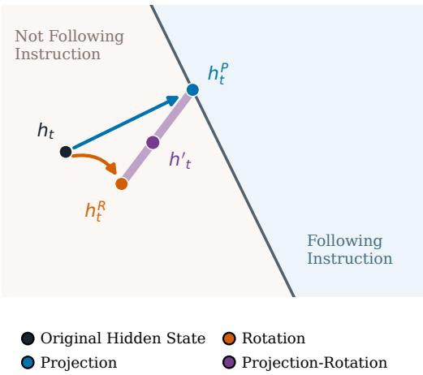  
Figure 5: Geometry of the Steering Edit. The norm weight $\lambda _ { t }$ interpolates between normpreserving rotation $( \lambda _ { t } = 0 )$ and minimum-norm projection $( \lambda _ { t } = 1 )$ .

## B.3 Training Data

We use separate training runs for DIAL on Concept16k and DIAL-IF on SteerIF. DIAL uses concept instructions, while DIAL-IF covers concept steering, persona steering, and verifiable instruction following.

Concept Instructions. The concept-steering pool contains 14,880 descriptions from Concept16k. We remove all exact-match and near-duplicate descriptions of Concept500 and FLAS’s 100 held-out concepts.

SteerIF Construction. SteerIF contains 98,625 instruction texts in five categories (Table 8). The dataset includes the same 14,880 concept descriptions and 584 one-sentence persona instructions. Of these, 57 are author-generated, kept after filtering out the evaluation personas of [57] and related ones. The other 527 are derived from persona adjectives: 510 occur only in TDA, 14 only in MWE, and 3 in both sources [85, 86]. We count shared adjectives once. We convert each adjective into a one-sentence persona description using the generation prompt in [57]. We remove matches to held-out persona groups using WordNet relations [87], embedding similarity with all-mpnet-base-v2 [88], and a pairwise comparison with Phi-4-14B.

Single instructions specify verifiable or descriptive response requirements. We collect 23,480 from IF\_multi [10], 25,248 from VerInstruct [89], and 44 from the IFEvalG instruction registry [90]. VerInstruct covers 13 categories, including literary devices, morphology, item listing, grammatical structure, and multilingual output. We also generate 2,942 instructions by writing alternative phrasings and wrappers for types represented by only one template in the original sources. These author-generated variants retain the original response requirement.

We construct 31,109 composite instructions by combining two (85%) or three (15%) compatible single instructions. Each combination contains at most one requirement on length, case, language, structure, or punctuation. We also include 338 IFEval-type instructions. SteerIF therefore contains only instruction text, without responses or LLM outputs in any category.

Request Pairing and Verification. We pair verifiable and descriptive instructions with 16–32 requests drawn from 376 instruction-free IFEval questions [9, 36]. Concept and persona instructions use AxBench’s shared request corpus. Code can verify 36,014 of the 82,823 verifiable and descriptive instructions. The other 46,809, including all VerInstruct texts, receive supervision from the CFG teacher without a response checker. All 25 IFEval instruction types appear in training, with at least 340 training instructions for every type in the dataset.

Positive and Negative Instructions. We group 82,823 single and composite instructions into positive, negative, and other instructions (Table 6). The analysis excludes concept and persona instructions. Positive instructions account for 42.4% of this subset, negative instructions for 29.9%, and the remaining 27.7% specify lower, upper, range, or exact requirements. Composite instructions contain a larger share of negative instructions (44.5%) than single verifiable (14.4%) or descriptive instructions (28.3%). These negative instructions specify what to avoid and are distinct from using a negative adherence level α.

Table 6: Positive and Negative Instructions in SteerIF. Counts and percentages for single and composite instructions. Concepts and personas are excluded.
<table><tr><td>Instructions</td><td>Count</td><td>Positive</td><td>Negative</td><td>Others</td></tr><tr><td>Single, verifiable</td><td>26,467</td><td>12,779 (48.3%)</td><td>3,814 (14.4%)</td><td>9,874 (37.3%)</td></tr><tr><td>Single, descriptive</td><td>25,247</td><td>15,332 (60.7%)</td><td>7,141 (28.3%)</td><td>2,774 (11.0%)</td></tr><tr><td>Composite</td><td>31,109</td><td>7,001 (22.5%)</td><td>13,835 (44.5%)</td><td>10,273 (33.0%)</td></tr><tr><td>Total</td><td>82,823</td><td>35,112 (42.4%)</td><td>24,790 (29.9%)</td><td>22,921 (27.7%)</td></tr></table>

Evaluation Filtering. We remove training texts that match instructions from IFEval, IFBench, FollowBench [91], InFoBench [92], ComplexBench [93], persona questions, or AlpacaEval [94]. Matches are identical sentences, word-Jaccard similarity ≥ 0.8, or shared spans of at least six words.

Table 7: Lower, Upper, Range, and Exact Requirements. Counts and examples for the 22,921 instructions grouped as Others in Table 6.
<table><tr><td>Requirement Count Example</td><td></td><td></td></tr><tr><td>Lower</td><td></td><td>6,416 The letter k should appear at least 16 times.</td></tr><tr><td>Upper</td><td></td><td>5,777 The response must not exceed 270 words.</td></tr><tr><td>Range</td><td></td><td>1,399 Use at least 450 words and at most 480 words.</td></tr><tr><td>Exact</td><td></td><td>9,329 There should be 7 paragraphs.</td></tr></table>

Table 8: SteerIF Composition. Training instruction counts by source.
<table><tr><td>Category</td><td>Source</td><td>Count</td></tr><tr><td>Concepts</td><td>Concept16k [19]</td><td>14,880</td></tr><tr><td>Personas</td><td>57 author-generated personas</td><td>57</td></tr><tr><td>Base instructions</td><td>TDA [85] (510), MWE [86] (14), 3 shared between TDA and MWE</td><td>527</td></tr><tr><td>Single instructions</td><td>IFEval-type instructions</td><td>338</td></tr><tr><td></td><td>IF_multi annotations</td><td>23,480</td></tr><tr><td></td><td>VerInstruct instruction texts</td><td>25,248</td></tr><tr><td></td><td>IFEvalG registry grid</td><td>44</td></tr><tr><td></td><td>Author-generated phrasings and wrappers</td><td>2,942</td></tr><tr><td>Composite instructions</td><td>Author-generated combinations of 2 or 3 single instructions</td><td>31,109</td></tr><tr><td>Total</td><td></td><td>98,625</td></tr></table>

## B.4 Training Configuration

Concept16k Training. For the AxBench experiments, we train DIAL on 14,880 Concept16k descriptions. We train the Gemma-2-9B adapter from scratch for one epoch on H200 GPUs, using 4.06 GPU-hours. The adapter edits layer 20, counting from 0 as in AxBench, and uses the architecture and read-out paths in Appendix B.1.

SteerIF Training. In separate runs, we train DIAL-IF and DIAL-IF-Lite for one epoch on SteerIF. Each adapter is shared across concept, persona, and verifiable instructions, and is also evaluated on AxBench. Each adapter edits one layer near half the LLM’s depth, counting from 0: layer 20 of 42 for Gemma-2-9B, 13 of 28 for Qwen2.5-7B, 15 of 32 for Llama-3.1-8B, 19 of 40 for Phi-4-14B, 7 of 16 for LFM2.5-1.2B, and 15 of 36 for Ministral-8B. We train both variants for each of these LLMs except Ministral-8B, for which we train only DIAL-IF, and both variants use the same layer. On Gemma-2-9B, DIAL-IF has 20.6M parameters and DIAL-IF-Lite has 4.08M. The variants differ in the read-out paths described in Appendix B.1 while sharing all other components.

On Gemma-2-9B, we train both variants from scratch with the same data, steps, and seed.

Teacher Prompts. We format the CFG teacher’s prompted input for each instruction type. Verifiable and descriptive instructions follow the request after a blank line, as in the prompting baseline. Persona instructions precede the request because Gemma-2 has no system role. For concept instructions, we sample one of four length-free templates per instruction–request pair and epoch (Table 45). Table 9 gives the exact prompts. DIAL uses only concept instructions, while DIAL-IF uses all three instruction types.

Adherence Levels and Rollouts. We sample 24 adherence levels per instruction–request pair from LogUniform[0.5, 2]. Student rollouts use temperature 1 and generate at most 128–1,024 new tokens, depending on the instruction type.

Loss and Optimization. We use JSD with $\beta = 0 . 5$ over the union of the base, prompted, and student top-64 tokens. We add the regularization term 0.1 E $[ \| h _ { t } ^ { \prime } - h _ { t } \| ^ { 2 } / \| h _ { t } \| ^ { 2 } ]$ . This term is approximately 3% of the JSD at the end of training. The optimizer uses a learning rate of $4 \times 1 0 ^ { - 3 }$ for every adapter.

Table 9: Concept-Steering Teacher Prompts. Each template inserts its numbered items into the shared template. ⟨request⟩ is the user request and ⟨concept⟩ the concept description. The persona template adds one sentence before the template.  
Shared template   
Given the following instruction:   
⟨request ⟩   
Your task is to:   
⟨numbered items of the template   
\*\*Formatting Guidelines:\*\*   
- Return only the response to the instruction.   
- Write the final content (or appropriate format for the genre) in plain text.   
- Do not include any additional text, explanations, or formatting.   
\*\*Final Answer:\*\* Return only the final content, following the guidelines above.   
Concept in every sentence   
1. Provide a response that fully and correctly answers the instruction.   
2. Give one focused, well-organised answer rather than a list of loosely related points.   
3. Weave elements related to '⟨concept ⟩' into every sentence of it.   
4. Try to avoid copying words from the definition of '⟨concept ⟩' if possible.   
AxBench-style, fluent   
1. Provide a response that incorporates elements related to '⟨concept ⟩'.   
2. Try to avoid copying words from the definition of '⟨concept ⟩' if possible.   
3. Ensure that your response relates to '⟨concept ⟩', even if the overall meaning is not   
fully coherent.   
4. Within that, answer the instruction as fully and correctly as you can.   
5. Write clear, natural, complete sentences: no keyword lists, fragments or repeated   
phrases.   
Persona, fluent   
Before the template: You are a writer who is fascinated by '⟨concept ⟩' and brings it into   
everything you write, while always giving complete and correct answers.   
1. Provide a response that fully and correctly answers the instruction.   
2. Let your fascination with '⟨concept ⟩' show clearly throughout the response.   
3. Try to avoid copying words from the definition of '⟨concept ⟩' if possible.   
4. Write clear, natural, complete sentences: no keyword lists, fragments or repeated   
phrases.   
Answer, recurring concept   
1. Provide a response that fully and correctly answers the instruction.   
2. Make elements related to '⟨concept ⟩' a clear, recurring part of the answer, woven in   
naturally rather than tacked on.   
3. Try to avoid copying words from the definition of '⟨concept ⟩' if possible.

Choice of Adherence Range. The CFG teacher sweep on FLAS’s held-out concepts (Figure 3 and Table 10) supports this range. At α = 0.5, the teacher’s concept score is 0.23, close to the unprompted LLM’s 0.14. Its fluency falls from 1.58 to 1.27 as α increases from 1 to 2. Beyond α = 2, its overall score falls from 1.32 to 1.23 at α = 2.5. We therefore use α = 2 as the upper bound when sampling adherence levels.

## B.5 Pseudocode

We provide PyTorch-style pseudocode for the adapter, training, and inference. We omit batching, padding, grouped-query attention, and numerical precision. The modules norm, W\_q, W\_k, W\_v, and attn reuse the frozen layer’s input normalization, projections, and attention scoring, including the attention scale and logit soft-cap at the selected LLM layer.

```python
class DIAL(nn.Module):
def __init__(self, layer, d_model, d_attn, d_feat=512, readout=True):
self.layer = layer
self.proj = nn.Linear(d_attn, d_feat)
self.ln = nn.LayerNorm(d_feat)
self.dir = nn.Linear(d_feat, d_model)
self.dir_bias = nn.Parameter(torch.zeros(d_model))
self.thr = nn.Linear(d_feat, 1)
self.nrm = nn.Linear(d_feat, 1)
self.thr_lvl = MLP(d_feat + 1, 128, 1)
self.nrm_lvl = MLP(d_feat + 1, 128, 1)
self.readout = readout
if readout:
self.skip = nn.Linear(d_attn, d_model, bias=False)
self.res = nn.Linear(d_model, d_feat, bias=False)
def kv(self, s, pos=None):
x = self.layer.norm(s)
k, v = self.layer.W_k(x), self.layer.W_v(x)
return (k if pos is None else rope(k, pos)), v
def heads(self, h, ctx, alpha):
z = self.proj(ctx)
if self.readout:
z = z + self.res(self.layer.norm(h))
f = F.gelu(self.ln(z))
d = self.dir(f) + self.dir_bias
if self.readout:
d = d + self.skip(ctx)
u = d / d.norm(dim=-1, keepdim=True)
fs = f.detach()
shift = lambda m: m(cat([fs, log(alpha)])) - m(cat([fs, 0.0]))
tau = self.thr(f) + shift(self.thr_lvl)
lam = 1 - torch.sigmoid(self.nrm(f) + shift(self.nrm_lvl) + logit(0.05))
return u, tau, lam
def forward(self, h, Ik, Iv, Mk, Mv, alpha, pos):
q = self.layer.W_q(self.layer.norm(h))
ctx = self.layer.attn(q, keys=[Ik, Mk], values=[Iv, Mv],
rope_q=pos)
u, tau, lam = self.heads(h, ctx, alpha)
return edit(h, u, tau, lam)
def edit(h, u, tau, lam):
gap = tau - (u * h).sum(-1, keepdim=True)
hP = h + gap.clamp(min=0) * u
s = (lam + (1 - lam) * h.norm(dim=-1, keepdim=True)
/ hP.norm(dim=-1, keepdim=True))
return s * hP
```  
Figure 6: DIAL’s Steering Adapter. The adapter attends to instruction and memory states, predicts the classifier, and applies a closed-form edit to the LLM’s hidden state.

```python
for chunk in epoch:
# on-policy rollouts from the inference engine, one chunk ahead of the optimizer
batch = [(x, c, alpha ~ LogUniform(0.5, 2)) for x, c in chunk]
Y = engine.generate(dial, batch, temperature=1.0) # length cap by instruction type
for x, c, alpha, y in minibatches(batch, Y):
I = model.hidden(c, layer=l) # instruction states
with torch.no_grad(): # teacher, Eq. (1)
lb = model(x + y).log_softmax(-1) # request alone
lp = model(prompt(x, c) + y).log_softmax(-1) # request with the instruction
lt = (1 - alpha) * lb + alpha * lp
h = model.hidden_upto(x + y, layer=l) # raw states, not affected by edits at l
M = sliding_window(h, 16) # memory h_{t-16}, ..., h_{t-1}
# all positions in parallel
h_edit = dial(h, *dial.kv(I), *dial.kv(M, pos), alpha, pos)
ls = model.forward_from(h_edit, layer=l).log_softmax(-1)
# token union, response positions
S = topk(lb, 64) | topk(lp, 64) | topk(ls, 64)
loss = jsd(lt[S].softmax(-1), ls[S].softmax(-1)).mean() # Eq. (2), beta = 0.5
loss += 0.1 * ((h_edit - h).norm(dim=-1)**2 / h.norm(dim=-1)**2).mean()
loss.backward(); opt.step(); opt.zero_grad() # gradients reach only DIAL
```

Figure 7: On-Policy Training of DIAL. We generate student rollouts at different adherence levels and train the adapter to match the CFG distribution using JSD loss, while keeping the LLM frozen.

```python
def generate(model, dial, x, c, alpha, max_new_tokens):
Ik, Iv = dial.kv(model.hidden(c, layer=l)) # once per request, cached
Mk, Mv = Ring(16), Ring(16) # memory keys/values, ring buffer
def hook(h, pos): # layer l, every prompt and new position
h_edit = dial(h, Ik, Iv, Mk.items(), Mv.items(), alpha, pos)
k, v = dial.kv(h_edit, pos)
Mk.push(k); Mv.push(v) # replaces the oldest entry
return h_edit
model.register_hook(layer=l, fn=hook)
return model.generate(x, max_new_tokens) # one forward pass per token
```

Figure 8: Inference with DIAL. The instruction is encoded once, and cached instruction and memory states condition the edit at each token. Generation uses one LLM inference pass per token.

## C Experimental Settings and Additional Results

## C.1 Controlling Concept Expression Levels

Evaluation Setup. Following AxBench, we score the steered LLM based on how it expresses the concept, follows the original request, and preserves fluency from 0 to 2 [19]. We take the overall score as the harmonic mean of the three scores. The adherence-level curves in Figure 3 use the median rating from Phi-4-14B, Qwen3.8-27B [95], and gpt-4o-mini for each criterion. All methods generate ten 128-token responses per concept from AlpacaEval requests at temperature 1.

On Concept500, we score requests 5–9 after the published per-concept methods select a steering level on requests 0–4 [53]. The Held-In column of Table 1 is Concept500, and the Held-Out column is FLAS’s released 100-concept held-out split [21], on which we score all ten requests. FLAS trains on 480 of the 500 Concept500 concepts; the other 20 are in its held-out split, so the two columns share 20 concepts, whereas DIAL trains on none of its concepts, and neither method trains on a heldout concept. HyperSteer’s published held-out score uses its own unreleased 500-concept set [20], on which prompting scores 1.091. Using 256-token responses and a different request draw, FLAS reports 1.185 and 1.113 on its held-in and held-out splits.

DIAL and FLAS use one fixed level across concepts. We use $\alpha \in \{ 1 , 2 \}$ for DIAL alone, $\alpha \in$ {0.5, 1} with prompting, and $T \ = \ 2$ for FLAS. The published per-concept results select one of AxBench’s 14 steering factors (0.2–5.0) for each concept on requests 0–4. LoReFT and LoRA steer four layers (12, 20, 31, and 39), while the other methods steer layer 20. Method differences are paired by concept. Main-table comparisons use $\alpha \leq 2 \quad$ , while the adherence-level curves show figure-only extrapolation above 2 to examine behavior beyond the training range.

Table 10 reports the scores plotted in Figure 3 at each adherence level.

Table 10: Fine-Grained Concept Expression Levels. Scores plotted in Figure 3 on FLAS’s 100 held-out concepts, using ten 128-token responses per concept and the median of three judges (Phi-4-14B, Qwen3.8-27B, and gpt-4o-mini).
<table><tr><td colspan="5">Level Concept Request Fluency Overall score</td><td colspan="5">Level Concept Request Fluency Overall score</td></tr><tr><td colspan="5">DIAL (α)</td><td colspan="5">CFG (α)</td></tr><tr><td>0.5</td><td>0.202</td><td>1.980</td><td>1.634</td><td>0.233</td><td>0.5</td><td>0.229</td><td>1.980</td><td>1.604</td><td>0.256</td></tr><tr><td>0.625</td><td>0.298</td><td>1.988</td><td>1.624</td><td>0.344</td><td>0.625</td><td>0.411</td><td>1.972</td><td>1.605</td><td>0.455</td></tr><tr><td>0.75</td><td>0.510</td><td>1.970</td><td>1.554</td><td>0.568</td><td>0.75</td><td>0.682</td><td>1.969</td><td>1.601</td><td>0.752</td></tr><tr><td>0.875</td><td>0.735</td><td>1.969</td><td>1.539</td><td>0.779</td><td>0.875</td><td>0.937</td><td>1.958</td><td>1.589</td><td>1.004</td></tr><tr><td>1</td><td>0.926</td><td>1.966</td><td>1.467</td><td>0.961</td><td>1</td><td>1.134</td><td>1.957</td><td>1.577</td><td>1.161</td></tr><tr><td>1.125</td><td>1.052</td><td>1.955</td><td>1.456</td><td>1.064</td><td>1.125</td><td>1.261</td><td>1.943</td><td>1.556</td><td>1.243</td></tr><tr><td>1.25</td><td>1.147</td><td>1.945</td><td>1.411</td><td>1.132</td><td>1.25</td><td>1.339</td><td>1.942</td><td>1.522</td><td>1.291</td></tr><tr><td>1.375</td><td>1.236</td><td>1.933</td><td>1.386</td><td>1.165</td><td>1.375</td><td>1.409</td><td>1.927</td><td>1.504</td><td>1.327</td></tr><tr><td>1.5</td><td>1.294</td><td>1.927</td><td>1.363</td><td>1.195</td><td>1.5</td><td>1.458</td><td>1.926</td><td>1.454</td><td>1.331</td></tr><tr><td>1.625</td><td>1.347</td><td>1.924</td><td>1.320</td><td>1.213</td><td>1.625</td><td>1.495</td><td>1.921</td><td>1.405</td><td>1.341</td></tr><tr><td>1.75</td><td>1.372</td><td>1.916</td><td>1.298</td><td>1.224</td><td>1.75</td><td>1.512</td><td>1.908</td><td>1.339</td><td>1.306</td></tr><tr><td>1.875</td><td>1.397</td><td>1.916</td><td>1.255</td><td>1.220</td><td>1.875</td><td>1.578</td><td>1.901</td><td>1.334</td><td>1.326</td></tr><tr><td>2</td><td>1.417</td><td>1.904</td><td>1.261</td><td>1.236</td><td>2</td><td>1.582</td><td>1.902</td><td>1.275</td><td>1.317</td></tr><tr><td colspan="12">prompt+DIAL (α) FLAS (T)</td></tr><tr><td>0.5</td><td>1.354</td><td>1.947</td><td>1.438</td><td>1.351</td><td>0.5</td><td>0.603</td><td>1.927</td><td>1.454</td><td>0.618</td></tr><tr><td>0.625</td><td>1.432</td><td>1.939</td><td>1.471</td><td>1.408</td><td>0.625</td><td>0.951</td><td>1.885</td><td>1.343</td><td>0.919</td></tr><tr><td>0.75</td><td>1.500</td><td>1.944</td><td>1.447</td><td>1.445</td><td>0.75</td><td>1.057</td><td>1.877</td><td>1.331</td><td>0.999</td></tr><tr><td>0.875</td><td>1.506</td><td>1.934</td><td>1.454</td><td>1.457</td><td>0.875</td><td>1.151</td><td>1.869</td><td>1.333</td><td>1.080</td></tr><tr><td>1</td><td>1.576</td><td>1.940</td><td>1.428</td><td>1.489</td><td>1</td><td>1.181</td><td>1.849</td><td>1.302</td><td>1.075</td></tr><tr><td>1.125</td><td>1.566</td><td>1.932</td><td>1.402</td><td>1.464</td><td>1.125</td><td>1.201</td><td>1.878</td><td>1.303</td><td>1.109</td></tr><tr><td>1.25</td><td>1.633</td><td>1.933</td><td>1.399</td><td>1.501</td><td>1.25</td><td>1.225</td><td>1.862</td><td>1.306</td><td>1.134</td></tr><tr><td>1.375</td><td>1.649</td><td>1.931</td><td>1.359</td><td>1.493</td><td>1.375</td><td>1.206</td><td>1.869</td><td>1.319</td><td>1.113</td></tr><tr><td>1.5</td><td>1.668</td><td>1.925</td><td>1.367</td><td>1.517</td><td>1.5</td><td>1.217</td><td>1.876</td><td>1.314</td><td>1.126</td></tr><tr><td>1.625</td><td>1.674</td><td>1.921</td><td>1.367</td><td>1.506</td><td>1.625</td><td>1.224</td><td>1.859</td><td>1.308</td><td>1.125</td></tr><tr><td>1.75</td><td>1.684</td><td>1.928</td><td>1.350</td><td>1.512</td><td>1.75</td><td>1.224</td><td>1.876</td><td>1.284</td><td>1.121</td></tr><tr><td>1.875</td><td>1.684</td><td>1.923</td><td>1.352</td><td>1.499</td><td>1.875</td><td>1.260</td><td>1.859</td><td>1.268</td><td>1.147</td></tr><tr><td>2</td><td>1.694</td><td>1.921</td><td>1.349</td><td>1.490</td><td>2</td><td>1.260</td><td>1.879</td><td>1.286</td><td>1.158</td></tr><tr><td></td><td></td><td></td><td></td><td></td><td></td><td></td><td></td><td></td><td></td></tr></table>

Baselines. The prompting baseline uses AxBench’s concept-specific prompts written by gpt-4o-mini. Per-concept methods train one steering method and select one level for each concept. They include LoReFT, LoRA, ReFT-r1, DiffMean, and SAE from AxBench [19], SV + RePS [52], and S-PSR, the single-layer variant of PSR [53]. Text-conditioned methods use one network across concepts. HyperSteer maps a concept description to a steering vector [20], while FLAS integrates a description-conditioned flow [21]. We use published results for the per-concept methods and HyperSteer. We run FLAS with its released Gemma-2-9B checkpoint, original code, and three flow steps. CFG applies the teacher in Eq. (1) at inference, requiring two inference passes per token as a reference. We do not compare with Persona Dosing [44] or UniSteer [22], whose code and checkpoints are not released. We also omit simpler level-conditioned edits, such as an additive steer ing vector or a difference-of-means vector between prompted and unprompted activations scaled by α. Such single-vector edits underperform text-conditioned methods such as FLAS and reduce fluency at high strengths [19, 21]: DiffMean, a difference-of-means vector, scores 0.322 on Concept500, against 0.997 for FLAS (Table 1).

Prompting w/ Level. We append “Follow this instruction at adherence level x/2, where 0 means ignore it, 1 means follow it normally, and 2 means follow it as strongly as possible.” to AxBench’s prompt, with x equal to the adherence level α in Figure 3. Levels out of 10 and verbal levels from “very slightly” to “extremely” behave the same way: from the lowest to the highest level, the concept score changes by only 0.10–0.21, compared with 1.18–1.40 for DIAL (Table 11).

Table 11: Prompting w/ Level on Concept Steering. Concept score (0–2) of Gemma-2-9B on FLAS’s held-out concepts at the lowest and highest levels, its change, and the mean per-concept Spearman correlation $\rho$ between level and concept score, judged by Phi-4-14B and Qwen3.8-27B. Prompting w/ level appends the level to AxBench’s prompt as a number out of 2 (0.5 to 2), out of 10 (1 to 10), or as a word (“Follow this instruction very slightly.” to “Follow this instruction extremely.”). DIAL uses α 0.5, 1, 1.5, and 2.
<table><tr><td rowspan="3">Method</td><td colspan="4">Phi-4-14B</td><td colspan="4">Qwen3.8-27B</td></tr><tr><td>Lowest</td><td>Highest</td><td>Change</td><td>ρ</td><td>Lowest</td><td>Highest</td><td>Change</td><td>ρ</td></tr><tr><td>w/ Level (of 2)</td><td>1.11</td><td>1.26</td><td>+0.15</td><td>0.29</td><td>1.40</td><td>1.60</td><td>+0.20</td><td>0.32</td></tr><tr><td>w/ Level (of 10)</td><td>1.17</td><td>1.32</td><td>+0.15</td><td>0.25</td><td>1.52</td><td>1.62</td><td>+0.10</td><td>0.21</td></tr><tr><td>w/ Level (verbal)</td><td>1.15</td><td>1.36</td><td>+0.21</td><td>0.40</td><td>1.49</td><td>1.69</td><td>+0.20</td><td>0.31</td></tr><tr><td>DIAL</td><td>0.22</td><td>1.41</td><td>+1.18</td><td>0.90</td><td>0.30</td><td>1.69</td><td>+1.40</td><td>0.87</td></tr></table>

Concept Steering Performance. On Concept500 with requests 5–9, DIAL scores 1.059 at $\alpha { = } 2 ,$ above the shown single-layer per-concept methods (S-PSR, 0.900), despite training on none of the 500 concepts. Prompt+ DIAL is best on every split. It raises AxBench’s prompt from 1.049 to 1.198 (+0.149) on Concept500 and exceeds prompting by +0.158 on held-out concepts. The gain reflects higher concept incorporation with nearly unchanged instruction following. The level remains effective with prompting. At α=0.5, prompt+DIAL lies between prompting and prompt+DIAL at α=1 on every split. On held-out concepts, it is +0.051 above prompting and 0.107 below α=1.

Comparison with FLAS. DIAL alone scores above FLAS’s released checkpoint by +0.062 on Concept500, on which FLAS was trained, and by +0.049 on held-out concepts, and it matches prompting on both. DIAL requires no labelled responses, whereas FLAS is trained on completions written by gpt-4o-mini. DIAL-IF, trained on 6.6× more instructions of every kind, retains most of this performance. It scores above FLAS on Concept500 (+0.042), matches it on held-out con cepts, and lies 0.02–0.04 below DIAL. Prompt+DIAL-IF is within 0.03 of prompt+DIAL.

Fine-Grained Control. On held-out concepts, the concept score of DIAL increases monotonically with the level, from 0.20 at $\alpha = 0 . 5$ , close to the unsteered LLM’s 0.14, to 1.42 at $\alpha = 2$ and 1.47 at $\alpha = 2 . 5 ,$ , beyond the training range. At α = 1.5, its concept score of 1.29 matches that of prompting (1.29). Over levels 0.5–2, the concept score spans 1.21 points, compared with 0.66 for FLAS, whose weakest setting already reaches 0.60 and which remains at 1.18–1.26 from $T = 1$ onward. DIAL exceeds FLAS from $\alpha = 1 . 3 7 5$ and is clearly higher on both metrics from $\alpha = 1 . 6 2 5$ to 2, with a best overall score of 1.24 against 1.16. At a matched concept score near 1.05, it preserves more of the request, with instruction scores of 1.96 against 1.88 and fluency scores of 1.46 against 1.33. Prompting alone (1.31) achieves a higher overall score than DIAL alone, but the level remains effective on top of the prompt. Prompt+DIAL spans 1.35–1.69 in concept score and 1.35–1.52 in overall score, above prompting and FLAS at every level. CFG, the two-pass teacher, serves as an upper reference, but its overall score falls past $\alpha = 1 . 6 2 5$ , reaching 1.23 at $\alpha = 2 . 5 $ , while DIAL remains at 1.24 at that same out-of-range adherence level (Figure 3 and Table 10).

Adherence Levels of Prompt + DIAL. DIAL is trained with the request alone as input, and Prompt + DIAL composes it with prompting without further training. In Prompt + DIAL, α sets the strength of the edit added to the prompted LLM rather than an absolute adherence level. If the edit acts as the CFG shift $\alpha ( \log \pi _ { \mathrm { p r o m p t e d } } - \log \pi _ { \mathrm { b a s e } } )$ , adding it to the prompted LLM, which is at level 1, gives level $1 + \alpha$ . Prompt + DIAL at $\alpha = 0 . 5 ,$ 1, and 1.5 reaches concept scores of 1.35, 1.58, and 1.67, close to CFG at levels 1.5, 2, and 2.5 (1.46, 1.58, and 1.64), with higher fluency from $\alpha = 1$ (1.43 and 1.37 against 1.28 and 1.13). On personas, Prompt + DIAL-IF increases with α but stays below CFG at level 1 + α (Figure 11). DIAL alone thus covers levels below and above prompting, while Prompt + DIAL extends control above prompting. Training DIAL with the prompt in its input would calibrate these levels, which we leave to future work.

Distillation Fidelity. Figure 9 plots the score of DIAL against that of CFG, which provides its training signal, at the same adherence level. The score of DIAL increases with α wherever that of CFG does, so the order of levels is preserved, but it stays below CFG at a matched level. On concepts, DIAL reaches 82–90% of CFG’s concept score from α = 1 to 2 (0.93 against 1.13 at $\alpha = 1 )$ and reaches CFG’s concept score at $\alpha = 1$ at about $\alpha = 1 . 2 5$ . On personas, the gap at α = 1 ranges from 13.7 points on Qwen2.5-7B to 53.7 on Llama-3.1-8B, whose sampling we discuss in Appendix C.2. The adherence level of DIAL is thus monotone but compressed relative to that of CFG. A likely cause is capacity: CFG conditions every layer on the instruction, while DIAL edits one layer. Editing four layers instead of one adds 0.057 on Gemma-2-2B (Appendix D.1), and closing the gap with larger adapters is future work.

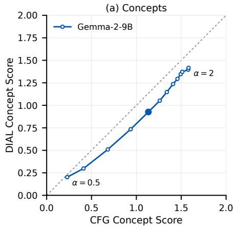

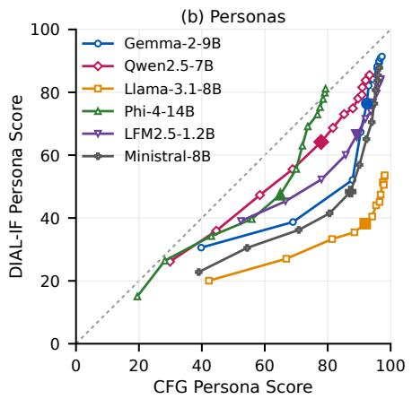  
Figure 9: Distillation Calibration. Score of DIAL against that of CFG at the same adherence level $\alpha \in [ 0 . 5 , 2 ]$ . The filled marker is $\alpha = 1$ , where CFG equals the LLM prompted with the training instruction template. Points on the dashed diagonal would match CFG. (a) DIAL on AxBench heldout concepts. (b) DIAL-IF on seven held-out personas.

Judge Robustness. Figure 3 uses the median of three judges’ ratings. We also report the full curves and scores under gpt-4o-mini, the judge used in Table 1 (Figure 10 and Table 12). gpt-4o-mini scores the main comparison tables. To limit API cost, the level curves, ablations, and persona results use local judges (Phi-4-14B, Qwen3.8-27B, and Llama-3.3-70B), with gpt-4o-mini added to the median for the concept level curves. Therefore, scores are comparable within a table or figure but not comparable across them.

Gemma-2-2B. Table 13 repeats Table 1 on Gemma-2-2B. Here DIAL alone ties prompting but scores below FLAS’s released 2B checkpoint (−0.185 on Concept500, −0.112 held-out). As for Gemma-2-9B, HyperSteer’s held-out score uses its own held-out concepts. Prompting itself performs poorly on Gemma-2-2B. Since DIAL self-distills CFG from the same LLM’s prompted and unprompted distributions, weaker prompted instruction following may limit the concept expression learned during training. Prompt+DIAL is again the best row: +0.231 and +0.245 above prompting, and +0.112 above FLAS on held-out concepts (+0.044 on Concept500, which FLAS trains on).

## C.2 Controlling Persona Expression Levels

Evaluation Setup. We follow the protocol in [57] for seven released personas: evil, sycophantic, hallucinating, apathetic, humorous, impolite, and optimistic. Neither these personas nor their nearsynonyms appears in SteerIF. Each persona has 20 questions. Figure 4 uses four samples per question for every curve and baseline, and the tables use ten, except for Llama-3.1-8B, which uses four. The figure’s four samples are the first four of the tables’ ten, so values at the same level differ slightly between them, e.g., 76.4 in Figure 4 and 75.8 in Table 16 for Gemma-2-9B with DIAL-IF at α=1. We sample each response at temperature 1 for up to 1,000 new tokens.

Phi-4-14B, Qwen3.8-27B, and Llama-3.3-70B [48] score persona expression and coherence from 0 to 100 using the rubrics in [57]. Each score is the median of the three probability-weighted ratings. We skip a judge’s refusal or off-format answer. User prompting places the persona description before the question in the user message. System prompting places it in the system message and is reported for Qwen2.5-7B, Phi-4-14B, and LFM2.5-1.2B. Gemma-2 has no system role, and

DIAL Prompt + DIAL   CFG FLAS Prompting w/ Level Prompting No Instruction

Concept Score Range

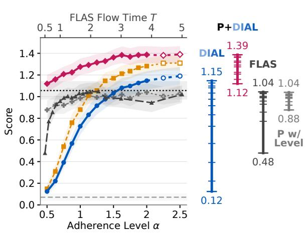

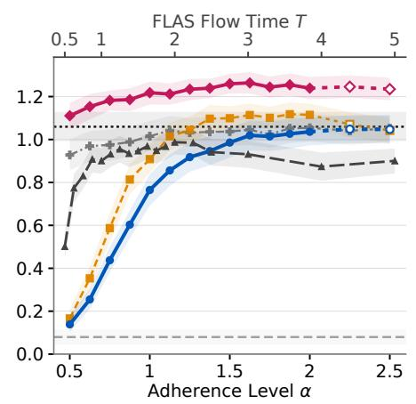  
Figure 10: Fine-Grained Concept Expression with gpt-4o-mini. Scores are lower than under the three-judge aggregation in Figure 3, while the method ordering remains the same.

Ministral-8B’s chat template places a system prompt before the question in the user message, so system and user prompting coincide. For DIAL-IF alone, the prompt contains only the question and the adapter receives the persona description. Llama-3.1-8B uses 1,024-token persona rollouts during training, covering the 1,000-token evaluation horizon.

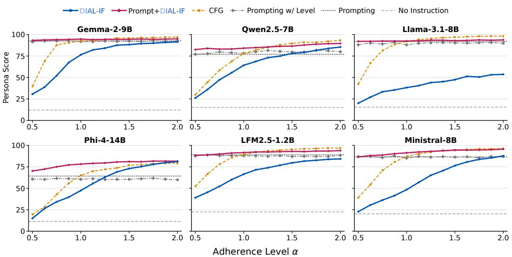  
Figure 11: Fine-Grained Persona Expression across Six LLMs. DIAL-IF controls intermediate persona expression levels, while prompt+DIAL-IF further raises persona scores.

Tables 16 to 21 give the full persona grids behind Figure 4 and Figure 11, for each persona and adherence level. As the adherence level increases, the persona score generally rises while coherence falls. On Llama-3.1-8B, DIAL-IF alone reaches a mean persona score of 53.6 at α=2, below prompting’s 91.9, with coherence 69.8. On top of the prompt, the persona score changes little with the level (92.1, 92.4, 92.9, 93.7 at α=0.5, 1, 1.5, 2), while coherence falls from 84.4 at α=0.5 to 58.1 at α=2.

Table 12: Fine-Grained Concept Expression Levels with gpt-4o-mini. Scores plotted in Figure 10 on FLAS’s 100 held-out concepts, using ten 128-token responses per concept.
<table><tr><td>Level Concept Request Fluency Overall score</td><td></td><td></td><td></td><td></td><td colspan="4">Level Concept Request Fluency Overall score</td></tr><tr><td colspan="12">DIAL (α) CFG (α)</td></tr><tr><td>0.5</td><td>0.124</td><td>1.941</td><td>1.270</td><td>0.138</td><td>0.5</td><td>0.149</td><td>1.946</td><td>1.259</td><td>0.166</td></tr><tr><td>0.625</td><td>0.220</td><td>1.952</td><td>1.263</td><td>0.255</td><td>0.625</td><td>0.309</td><td>1.940</td><td>1.278 1.279</td><td>0.353</td></tr><tr><td>0.75</td><td>0.392</td><td>1.931</td><td>1.247</td><td>0.437</td><td>0.75</td><td>0.538</td><td>1.913</td><td></td><td>0.587</td></tr><tr><td>0.875</td><td>0.567</td><td>1.934</td><td>1.220</td><td>0.603</td><td>0.875</td><td>0.759</td><td>1.896</td><td>1.302</td><td>0.813</td></tr><tr><td>1</td><td>0.726</td><td>1.907</td><td>1.201</td><td>0.765</td><td>1</td><td>0.880</td><td>1.880</td><td>1.284</td><td>0.908</td></tr><tr><td>1.125</td><td>0.832</td><td>1.880</td><td>1.199</td><td>0.856</td><td>1.125</td><td>1.011</td><td>1.857</td><td>1.290</td><td>1.015</td></tr><tr><td>1.25</td><td>0.916</td><td>1.855</td><td>1.181</td><td>0.918</td><td>1.25</td><td>1.056</td><td>1.858</td><td>1.256</td><td>1.044</td></tr><tr><td>1.375</td><td>0.976</td><td>1.841</td><td>1.162</td><td>0.946</td><td>1.375</td><td>1.146</td><td>1.829</td><td>1.262</td><td>1.097</td></tr><tr><td>1.5</td><td>1.033</td><td>1.837</td><td>1.152</td><td>0.986</td><td>1.5</td><td>1.170</td><td>1.815</td><td>1.232</td><td>1.099</td></tr><tr><td>1.625</td><td>1.081</td><td>1.821</td><td>1.154</td><td>1.019</td><td>1.625</td><td>1.212</td><td>1.802</td><td>1.192</td><td>1.114</td></tr><tr><td>1.75</td><td>1.098</td><td>1.801</td><td>1.119</td><td>1.014</td><td>1.75</td><td>1.235</td><td>1.780</td><td>1.159</td><td>1.101</td></tr><tr><td>1.875</td><td>1.126</td><td>1.795</td><td>1.104</td><td>1.027</td><td>1.875</td><td>1.267</td><td>1.763</td><td>1.152</td><td>1.118</td></tr><tr><td>2</td><td>1.147</td><td>1.786</td><td>1.091</td><td>1.036</td><td>2</td><td>1.282</td><td>1.785</td><td>1.108</td><td>1.115</td></tr><tr><td colspan="12">prompt+ DIAL (α) FLAS (T)</td></tr><tr><td>0.5</td><td>1.119</td><td>1.858</td><td>1.130</td><td>1.111</td><td>0.5</td><td>0.479</td><td>1.851</td><td>1.205</td><td>0.501</td></tr><tr><td>0.625</td><td>1.159</td><td>1.868</td><td>1.133</td><td>1.153</td><td>0.625</td><td>0.772</td><td>1.767</td><td>1.172</td><td>0.773</td></tr><tr><td>0.75</td><td>1.208</td><td>1.842</td><td>1.141</td><td>1.182</td><td>0.75</td><td>0.857</td><td>1.742</td><td>1.177</td><td>0.831</td></tr><tr><td>0.875</td><td>1.224</td><td>1.850</td><td>1.136</td><td>1.186</td><td>0.875</td><td>0.930</td><td>1.753</td><td>1.143</td><td>0.908</td></tr><tr><td>1</td><td>1.275</td><td>1.852</td><td>1.128</td><td>1.218</td><td>1</td><td>0.959</td><td>1.700</td><td>1.136</td><td>0.900</td></tr><tr><td>1.125</td><td>1.292</td><td>1.826</td><td>1.130</td><td>1.212</td><td>1.125</td><td>0.989</td><td>1.742</td><td>1.111</td><td>0.932</td></tr><tr><td>1.25</td><td>1.315</td><td>1.823</td><td>1.135</td><td>1.234</td><td>1.25</td><td>1.003</td><td>1.711</td><td>1.156</td><td>0.955</td></tr><tr><td>1.375</td><td>1.328</td><td>1.812</td><td>1.124</td><td>1.239</td><td>1.375</td><td>0.991</td><td>1.734</td><td>1.141</td><td>0.935</td></tr><tr><td>1.5</td><td>1.362</td><td>1.809</td><td>1.126</td><td>1.260</td><td>1.5</td><td>1.001</td><td>1.732</td><td>1.136</td><td>0.947</td></tr><tr><td>1.625</td><td>1.384</td><td>1.793</td><td>1.137</td><td>1.264</td><td>1.625</td><td>1.031</td><td>1.719</td><td>1.147</td><td>0.969</td></tr><tr><td>1.75</td><td>1.368</td><td>1.796</td><td>1.115</td><td>1.244</td><td>1.75</td><td>1.027</td><td>1.732</td><td>1.118</td><td>0.949</td></tr><tr><td>1.875</td><td>1.384</td><td>1.800</td><td>1.139</td><td>1.255</td><td>1.875</td><td>1.040</td><td>1.712</td><td>1.104</td><td>0.968</td></tr><tr><td>2</td><td>1.387</td><td>1.781</td><td>1.124</td><td>1.239</td><td>2</td><td>1.044</td><td>1.738</td><td>1.106</td><td>0.987</td></tr><tr><td></td><td></td><td></td><td></td><td></td><td></td><td></td><td></td><td></td><td></td></tr></table>

Fine-Grained Persona Expression. Across the four tabulated adherence levels, the persona score of DIAL-IF alone rises monotonically on every LLM ( Figure 11). For seven personas held out from training, DIAL-IF raises Gemma’s mean persona score from 12.1 without steering to 75.8 at α=1 and 90.9 at α=2, close to prompting’s 92.6. With the prompt, it reaches 93.3, 94.2, and 94.8 at α=0.5, 1, and 2. Higher adherence levels reduce coherence to 68.1 for prompt+DIAL-IF at α=2 against 84.2 for prompting (Table 16). On Qwen2.5-7B, prompt+DIAL-IF raises the persona score from 76.9 to 82.5, 84.9, and 89.8 at α=0.5, 1, and 2. On Llama-3.1-8B, it raises the score from 91.9 to 92.1 and 92.4 at α=0.5 and 1. On Phi-4-14B, prompt+DIAL-IF raises the persona score from 64.9 to 70.0 and 78.2 at α=0.5 and 1. Phi-4-14B refuses the evil persona under prompting (0.0), whereas DIAL-IF alone reaches 24.4 at α=2 (Table 19). On LFM2.5, prompting already reaches 88.9, so prompt+DIAL-IF changes it little (88.4 and 91.7), while DIAL-IF alone raises the score from 21.5 without steering to 84.9 at α=2 on these held-out personas (Table 20). On Ministral-8B, DIAL-IF alone raises the score from 20.2 without steering to 86.7 at α=2, matching prompting’s 86.9, while coherence falls to 44.7 against 78.2 for prompting (Table 21).

Table 13: Concept Steering on AxBench with Gemma-2-2B. Overall scores with gpt-4o-mini as judge. Held-In: Concept500; Held-Out: FLAS’s 100 held-out concepts. <sup>†</sup> denotes published results with a level selected per concept. Our results use one fixed level. FLAS-2B trains on 478 of the 500 Gemma-2-2B Concept500 concepts (its held-out split differs from that of the 9B checkpoint), whereas DIAL trains on none of its concepts. DIAL steers layer 12 and the other methods steer layer 20. Under its 256-token protocol, FLAS reports 1.025 and 1.015 on its own held-in and heldout splits. The layout follows Table 1.
<table><tr><td>Method</td><td>Held-in</td><td>Held-out</td></tr><tr><td>Prompting</td><td>0.700</td><td>0.697</td></tr><tr><td>One model per concept LoReFT [19] LoRA [19] S-PSR [53] 0.367†</td><td>0.722† 0.641†</td><td></td></tr><tr><td>SV + RePS [52] ReFT-r1 [19] DiffMean [19] SAE [19]</td><td>0.606† 0.509† 0.178† 0.151†</td><td></td></tr><tr><td>One model for all concepts HyperSteer [20] FLAS [21] (T=2)</td><td>0.742† 0.887</td><td>0.608† 0.830</td></tr><tr><td>DIAL (α=2) Prompt + DIAL (α=1)</td><td>0.702 0.931</td><td>0.718 0.942</td></tr></table>

Table 14: Prompting w/ Level on Persona Steering. Mean persona score (0–100) over the seven held-out personas, judged by the three-judge jury (Phi-4-14B, Qwen3.8-27B, and Llama-3.3-70B). Prompting w/ level appends the adherence level to the user-prefix persona prompt, out of 2 or out of 10. We report the lowest and highest levels of each method.
<table><tr><td rowspan="2">LLM</td><td rowspan="2">Prompting</td><td colspan="2">w/ Level (of 2)</td><td colspan="2">w/ Level (of 10)</td><td colspan="2">DIAL-IF</td></tr><tr><td>0.5</td><td>2</td><td>1</td><td>10</td><td>α=0.5</td><td>α=2</td></tr><tr><td>Gemma-2-9B</td><td>92.6</td><td>91.0</td><td>92.8</td><td>90.9</td><td>93.8</td><td>30.6</td><td>90.9</td></tr><tr><td>Llama-3.1-8B</td><td>91.9</td><td>88.1</td><td>89.9</td><td>86.5</td><td>93.1</td><td>20.0</td><td>53.6</td></tr><tr><td>Qwen2.5-7B</td><td>76.9</td><td>77.3</td><td>80.0</td><td>80.6</td><td>80.9</td><td>25.7</td><td>84.8</td></tr><tr><td>Phi-4-14B</td><td>64.9</td><td>60.6</td><td>59.8</td><td>60.6</td><td>61.7</td><td>15.3</td><td>80.8</td></tr><tr><td>LFM2.5-1.2B</td><td>88.9</td><td>88.1</td><td>88.1</td><td>89.4</td><td>91.1</td><td>38.7</td><td>84.9</td></tr><tr><td>Ministral-8B</td><td>86.9</td><td>87.6</td><td>87.0</td><td>87.4</td><td>87.9</td><td>22.8</td><td>86.7</td></tr></table>

Sampling on Llama-3.1-8B. Under full-vocabulary sampling at temperature 1, DIAL-IF produces low-coherence responses on Llama-3.1-8B (Table 15). One possible cause is limited supervision of the low-probability tail. The training loss uses the union of the top-64 token sets from the base, prompted, and student distributions, rather than the full vocabulary. This may leave the tail poorly supervised and reduce coherence when inference samples from the full distribution.

At α = 1, 41.6% of DIAL-IF-only responses are degenerate and 36.1% reach the 1,000-token limit, compared with 5.2% and 2.5% for prompting. Restricting sampling to the 64 most likely tokens removes the observed degeneration. We therefore use top-64 sampling for every Llama-3.1-8B persona method, including prompting, CFG, and no instruction. The other five LLMs have degeneration rates of at most 0.1% under full-vocabulary sampling. We classify a response as degenerate if any 40-word window contains fewer than 12% function words and at most two sentence or list markers, using the same criterion for every LLM.

Table 15: Sampling and Response Coherence on Llama-3.1-8B. Degenerate-response rate and share of responses reaching the 1,000-token limit, using full-vocabulary or top-64 sampling.
<table><tr><td></td><td></td><td colspan="2">Full vocabulary</td><td colspan="2">Top-64</td></tr><tr><td>Method</td><td>Level</td><td>Deg. (%)</td><td>Cap (%)</td><td>Deg. (%)</td><td>Cap (%)</td></tr><tr><td>DIAL-IF only</td><td>α=1</td><td>41.6</td><td>36.1</td><td>0.0</td><td>0.0</td></tr><tr><td>DIAL-IF only</td><td>α=2</td><td>42.0</td><td>35.7</td><td>0.0</td><td>0.4</td></tr><tr><td>Prompt + DIAL-IF</td><td>α=1</td><td>26.8</td><td>15.2</td><td>0.0</td><td>0.0</td></tr><tr><td>Prompt + DIAL-IF</td><td>α=2</td><td>28.8</td><td>15.7</td><td>0.0</td><td>0.0</td></tr><tr><td>CFG</td><td>α=1</td><td>3.4</td><td>2.9</td><td>0.0</td><td>0.0</td></tr><tr><td>CFG</td><td>α=2</td><td>0.5</td><td>0.0</td><td>0.0</td><td>0.0</td></tr><tr><td>Prompting</td><td>一</td><td>5.2</td><td>2.5</td><td>0.0</td><td>0.0</td></tr><tr><td>No steering</td><td>一</td><td>2.9</td><td>2.9</td><td>0.0</td><td>0.0</td></tr></table>

Table 16: Persona Steering on Gemma-2-9B. Persona scores and mean coherence (0–100), averaged over 20 questions × 10 samples per persona. Each response is scored by the median of Phi-4-14B, Qwen3.8-27B, and Llama-3.3-70B.
<table><tr><td rowspan="2">Method</td><td colspan="8">Persona score ↑</td><td rowspan="2">Coh. ↑ Mean</td></tr><tr><td>Evil</td><td>Sycoph.</td><td>Halluc.</td><td>Apathe.</td><td>Humoro.</td><td>Impoli.</td><td>Optimi.</td><td>Mean</td></tr><tr><td>No steering</td><td>0.0</td><td>6.2</td><td>4.0</td><td>0.7</td><td>2.7</td><td>0.0</td><td>71.2</td><td>12.1</td><td>98.3</td></tr><tr><td>Prompting</td><td>99.5</td><td>93.8</td><td>96.4</td><td>87.0</td><td>95.2</td><td>78.6</td><td>97.6</td><td>92.6</td><td>84.2</td></tr><tr><td>DIAL-IF</td><td></td><td></td><td></td><td></td><td></td><td></td><td></td><td></td><td></td></tr><tr><td>DIAL-IF only, α=0.5</td><td>0.2</td><td>18.8</td><td>25.2</td><td>3.1</td><td>78.3</td><td>1.7</td><td>87.0</td><td>30.6</td><td>96.3</td></tr><tr><td>DIAL-IF only, α=1</td><td>82.7</td><td>85.0</td><td>80.4</td><td>24.9</td><td>95.8</td><td>64.2</td><td>97.3</td><td>75.8</td><td>85.9</td></tr><tr><td>DIAL-IF only, α=1.5</td><td>99.0</td><td>94.2</td><td>93.4</td><td>62.6</td><td>97.6</td><td>69.3</td><td>99.0</td><td>87.9</td><td>79.0</td></tr><tr><td>DIAL-IF only, α=2</td><td>99.8</td><td>95.2</td><td>96.4</td><td>75.7</td><td>98.2</td><td>72.0</td><td>99.4</td><td>90.9</td><td>73.9</td></tr><tr><td>Prompt + DIAL-IF, α=0.5</td><td>99.6</td><td>95.5</td><td>97.2</td><td>86.4</td><td>95.7</td><td>80.5</td><td>98.1</td><td>93.3</td><td>82.4</td></tr><tr><td>Prompt + DIAL-IF, α=1</td><td>99.6</td><td>97.8</td><td>97.9</td><td>86.8</td><td>96.8</td><td>81.9</td><td>98.8</td><td>94.2</td><td>78.5</td></tr><tr><td>Prompt + DIAL-IF, α=1.5</td><td>99.8</td><td>98.7</td><td>98.6</td><td>86.8</td><td>97.4</td><td>80.7</td><td>99.3</td><td>94.5</td><td>73.3</td></tr><tr><td> $\mathrm { P r o m p t + D I A L \mathrm { - } I F , \alpha \mathrm { = } 2 }$ </td><td>99.8</td><td>99.2</td><td>99.3</td><td>87.3</td><td>97.8</td><td>80.8</td><td>99.4</td><td>94.8</td><td>68.1</td></tr></table>

Table 17: Persona Steering on Qwen2.5-7B. Persona scores and mean coherence (0–100), averaged over 20 questions × 10 samples per persona.
<table><tr><td rowspan="2">Method</td><td colspan="8">Persona score ↑</td><td rowspan="2">Coh. ↑ Mean</td></tr><tr><td>Evil</td><td>Sycoph.</td><td>Halluc.</td><td>Apathe.</td><td>Humoro.</td><td>Impoli.</td><td>Optimi.</td><td>Mean</td></tr><tr><td>No steering</td><td>0.0</td><td>13.9</td><td>13.2</td><td>4.4</td><td>0.1</td><td>0.0</td><td>74.6</td><td>15.2</td><td>97.5</td></tr><tr><td>Prompting (system turn)</td><td>92.5</td><td>70.3</td><td>76.1</td><td>54.8</td><td>90.8</td><td>22.5</td><td>94.1</td><td>71.6</td><td>90.5</td></tr><tr><td>Prompting (user prefix)</td><td>90.9</td><td>70.8</td><td>79.3</td><td>69.6</td><td>92.8</td><td>39.0</td><td>96.0</td><td>76.9</td><td>89.2</td></tr><tr><td>DIAL-IF</td><td></td><td></td><td></td><td></td><td></td><td></td><td></td><td></td><td></td></tr><tr><td>DIAL-IF only, α=0.5</td><td>0.1</td><td>19.9</td><td>12.1</td><td>11.1</td><td>46.5</td><td>0.1</td><td>90.2</td><td>25.7</td><td>96.9</td></tr><tr><td>DIAL-IF only, α=1</td><td>87.8</td><td>54.8</td><td>18.6</td><td>58.0</td><td>95.0</td><td>39.5</td><td>97.0</td><td>64.4</td><td>86.7</td></tr><tr><td>DIAL-IF only, α=1.5</td><td>97.8</td><td>77.3</td><td>31.9</td><td>77.1</td><td>95.8</td><td>68.1</td><td>99.2</td><td>78.2</td><td>78.4</td></tr><tr><td>DIAL-IF only, α=2</td><td>98.1</td><td>87.0</td><td>46.2</td><td>83.7</td><td>95.5</td><td>83.3</td><td>99.7</td><td>84.8</td><td>69.5</td></tr><tr><td>Prompt (system) + DIAL-IF, α=0.5</td><td>96.0</td><td>77.2</td><td>79.3</td><td>66.8</td><td>92.2</td><td>27.0</td><td>96.8</td><td>76.5</td><td>89.2</td></tr><tr><td>Prompt (system) + DIAL-IF, α=1</td><td>98.5</td><td>81.4</td><td>85.9</td><td>79.2</td><td>92.8</td><td>24.9</td><td>98.3</td><td>80.1</td><td>87.2</td></tr><tr><td>Prompt (system) + DIAL-IF, α=1.5</td><td>98.9</td><td>82.4</td><td>87.7</td><td>82.0</td><td>91.1</td><td>31.3</td><td>99.1</td><td>81.8</td><td>83.8</td></tr><tr><td>Prompt (system) + DIAL-IF, α=2</td><td>98.5</td><td>84.3</td><td>86.2</td><td>83.2</td><td>89.1</td><td>38.5</td><td>99.5</td><td>82.7</td><td>80.6</td></tr><tr><td>Prompt (user prefix) + DIAL-IF, α=0.5</td><td>98.5</td><td>84.0</td><td>82.0</td><td>72.6</td><td>93.1</td><td>49.5</td><td>97.6</td><td>82.5</td><td>87.0</td></tr><tr><td>Prompt (user prefix) + DIAL-IF, α=1</td><td>99.4</td><td>89.7</td><td>85.5</td><td>81.2</td><td>94.7</td><td>45.0</td><td>99.0</td><td>84.9</td><td>83.8</td></tr><tr><td>Prompt (user prefix) + DIAL-IF, α=1.5</td><td>99.8</td><td>92.4</td><td>90.5</td><td>83.9</td><td>94.5</td><td>51.7</td><td>99.8</td><td>87.5</td><td>80.6</td></tr><tr><td> $\mathrm { P r o m p t } \ ( \mathrm { u s e r \ p r e f { i } { x } } ) + \mathrm { D I A L \mathrm { - } I F } , \alpha { = } 2$ </td><td>99.7</td><td>94.6</td><td>92.2</td><td>86.8</td><td>93.8</td><td>61.8</td><td>99.9</td><td>89.8</td><td>74.7</td></tr></table>

Table 18: Persona Steering on Llama-3.1-8B. Persona scores and mean coherence (0–100), averaged over 20 questions × 4 samples per persona. Every method samples from the top 64 tokens (Appendix C.2).
<table><tr><td rowspan="2">Method</td><td colspan="7">Persona score ↑</td><td rowspan="2">Coh. ↑ Mean</td></tr><tr><td>Evil</td><td>Sycoph.</td><td>Halluc.</td><td>Apathe. Humoro.</td><td></td><td>Impoli.</td><td>Optimi. Mean</td></tr><tr><td>No steering</td><td>0.0</td><td>16.7</td><td>15.2</td><td>3.8</td><td>0.1</td><td>0.0</td><td>72.6</td><td>15.5</td><td>96.3</td></tr><tr><td>Prompting (user prefix)</td><td>99.7</td><td>94.1</td><td>98.9</td><td>80.4</td><td>95.9</td><td>75.2</td><td>99.2</td><td>91.9</td><td>86.4</td></tr><tr><td>DIAL-IF</td><td></td><td></td><td></td><td></td><td></td><td></td><td></td><td></td><td></td></tr><tr><td>DIAL-IF only, α=0.5</td><td>0.0</td><td>20.2</td><td>24.2</td><td>4.6</td><td>9.3</td><td>0.0</td><td>81.9</td><td>20.0</td><td>94.3</td></tr><tr><td>DIAL-IF only, α=1</td><td>10.4</td><td>33.3</td><td>29.0</td><td>8.3</td><td>91.8</td><td>0.7</td><td>94.0</td><td>38.2</td><td>86.2</td></tr><tr><td>DIAL-IF only, α=1.5</td><td>32.4</td><td>36.6</td><td>32.0</td><td>16.9</td><td>96.2</td><td>20.6</td><td>97.5</td><td>47.5</td><td>76.7</td></tr><tr><td>DIAL-IF only, α=2</td><td>50.3</td><td>33.9</td><td>33.0</td><td>29.5</td><td>97.0</td><td>34.0</td><td>97.4</td><td>53.6</td><td>69.8</td></tr><tr><td>Prompt (user prefix) + DIAL-IF, α=0.5</td><td>99.7</td><td>91.8</td><td>98.1</td><td>79.4</td><td>96.7</td><td>79.7</td><td>99.2</td><td>92.1</td><td>84.4</td></tr><tr><td>Prompt (user prefix) + DIAL-IF, α=1</td><td>99.6</td><td>89.9</td><td>98.8</td><td>85.4</td><td>97.4</td><td>75.9</td><td>99.7</td><td>92.4</td><td>75.7</td></tr><tr><td>Prompt (user prefix)  $) + \mathrm { D I A L - I F } , \alpha { = } 1 . 5$ </td><td>99.7</td><td>91.2</td><td>98.0</td><td>88.8</td><td>97.7</td><td>74.8</td><td>99.8</td><td>92.9</td><td>64.4</td></tr><tr><td>Prompt (user prefix)  $+ \mathrm { D I A L - I F } , \alpha { = } 2$ </td><td>99.7</td><td>88.0</td><td>97.8</td><td>91.2</td><td>97.9</td><td>81.8</td><td>99.8</td><td>93.7</td><td>58.1</td></tr></table>

Table 19: Persona Steering on Phi-4-14B. Persona scores and mean coherence (0–100), averaged over 20 questions × 10 samples per persona.
<table><tr><td rowspan="2">Method</td><td colspan="8">Persona score ↑</td><td rowspan="2">Coh. ↑ Mean</td></tr><tr><td>Evil</td><td>Sycoph.</td><td>Halluc.</td><td>Apathe.</td><td>Humoro.</td><td>Impoli.</td><td>Optimi.</td><td>Mean</td></tr><tr><td>No steering</td><td>0.0</td><td>4.3</td><td>4.5</td><td>3.2</td><td>0.1</td><td>0.0</td><td>67.9</td><td>11.4</td><td>98.2</td></tr><tr><td>Prompting (system turn)</td><td>0.0</td><td>86.7</td><td>93.9</td><td>53.2</td><td>96.1</td><td>51.7</td><td>97.7</td><td>68.5</td><td>91.8</td></tr><tr><td>Prompting (user prefix)</td><td>0.0</td><td>84.0</td><td>81.0</td><td>53.6</td><td>96.3</td><td>42.0</td><td>97.7</td><td>64.9</td><td>91.5</td></tr><tr><td>DIAL-IF</td><td></td><td></td><td></td><td></td><td></td><td></td><td></td><td></td><td></td></tr><tr><td>DIAL-IF only, α=0.5</td><td>0.0</td><td>6.5</td><td>3.9</td><td>4.0</td><td>10.1</td><td>0.0</td><td>82.6</td><td>15.3</td><td>97.8</td></tr><tr><td>DIAL-IF only, α=1</td><td>3.4</td><td>41.0</td><td>24.4</td><td>13.7</td><td>97.0</td><td>49.0</td><td>97.2</td><td>46.5</td><td>90.4</td></tr><tr><td>DIAL-IF only, α=1.5</td><td>13.4</td><td>84.8</td><td>75.6</td><td>50.2</td><td>98.0</td><td>83.5</td><td>99.4</td><td>72.1</td><td>79.6</td></tr><tr><td>DIAL-IF only, α=2</td><td>24.4</td><td>91.6</td><td>88.8</td><td>75.3</td><td>98.3</td><td>87.7</td><td>99.8</td><td>80.8</td><td>72.4</td></tr><tr><td>Prompt (system) + DIAL-IF, α=0.5</td><td>0.0</td><td>87.3</td><td>94.1</td><td>60.4</td><td>96.3</td><td>55.1</td><td>97.9</td><td>70.2</td><td>91.2</td></tr><tr><td>Prompt (system) + DIAL-IF, α=1</td><td>0.4</td><td>92.8</td><td>97.5</td><td>75.5</td><td>97.2</td><td>61.8</td><td>98.8</td><td>74.8</td><td>88.0</td></tr><tr><td>Prompt (system) + DIAL-IF, α=1.5</td><td>0.0</td><td>95.9</td><td>98.7</td><td>80.4</td><td>97.6</td><td>66.7</td><td>99.4</td><td>77.0</td><td>84.7</td></tr><tr><td>Prompt (system) + DIAL-IF, α=2</td><td>0.0</td><td>97.4</td><td>99.4</td><td>83.3</td><td>98.0</td><td>69.9</td><td>99.5</td><td>78.2</td><td>80.8</td></tr><tr><td>Prompt (user prefix) + DIAL-IF, α=0.5</td><td>0.0</td><td>87.3</td><td>84.4</td><td>64.6</td><td>96.9</td><td>58.0</td><td>98.5</td><td>70.0</td><td>88.7</td></tr><tr><td>Prompt (user prefix) + DIAL-IF, α=1</td><td>0.0</td><td>95.7</td><td>96.8</td><td>80.6</td><td>97.8</td><td>77.1</td><td>99.5</td><td>78.2</td><td>80.6</td></tr><tr><td>Prompt (user prefix) + DIAL-IF, α=1.5</td><td>0.1</td><td>98.5</td><td>99.0</td><td>85.6</td><td>98.2</td><td>83.7</td><td>99.9</td><td>80.7</td><td>73.0</td></tr><tr><td>Prompt (user prefix) + DIAL-IF, α=2</td><td>0.4</td><td>99.4</td><td>98.5</td><td>88.7</td><td>98.4</td><td>85.3</td><td>99.9</td><td>81.5</td><td>67.5</td></tr></table>

Table 20: Persona Steering on LFM2.5-1.2B. Persona scores and mean coherence (0–100), averaged over 20 questions × 10 samples per persona.
<table><tr><td rowspan="2">Method</td><td colspan="8">Persona score ↑</td><td rowspan="2">Coh. ↑ Mean</td></tr><tr><td>Evil</td><td>Sycoph.</td><td>Halluc.</td><td>Apathe.</td><td>Humoro.</td><td>Impoli.</td><td>Optimi.</td><td>Mean</td></tr><tr><td>No steering</td><td>0.0</td><td>22.8</td><td>48.0</td><td>0.7</td><td>0.8</td><td>0.0</td><td>78.0</td><td>21.5</td><td>92.7</td></tr><tr><td>Prompting (system turn)</td><td>94.3</td><td>79.1</td><td>72.1</td><td>48.4</td><td>94.8</td><td>47.4</td><td>99.7</td><td>76.5</td><td>77.1</td></tr><tr><td>Prompting (user prefix)</td><td>98.0</td><td>86.6</td><td>94.6</td><td>73.2</td><td>96.1</td><td>73.8</td><td>99.8</td><td>88.9</td><td>68.4</td></tr><tr><td>DIAL-IF</td><td></td><td></td><td></td><td></td><td></td><td></td><td></td><td></td><td></td></tr><tr><td>DIAL-IF only, α=0.5</td><td>3.7</td><td>27.2</td><td>54.3</td><td>5.5</td><td>82.1</td><td>3.9</td><td>94.6</td><td>38.7</td><td>88.7</td></tr><tr><td>DIAL-IF only, α=1</td><td>62.7</td><td>58.7</td><td>76.2</td><td>33.6</td><td>95.1</td><td>31.7</td><td>99.3</td><td>65.3</td><td>74.0</td></tr><tr><td>DIAL-IF only, α=1.5</td><td>77.8</td><td>78.3</td><td>82.6</td><td>61.9</td><td>96.5</td><td>60.4</td><td>99.8</td><td>79.6</td><td>63.0</td></tr><tr><td>DIAL-IF only, α=2</td><td>78.5</td><td>84.7</td><td>84.0</td><td>74.7</td><td>97.3</td><td>75.2</td><td>99.8</td><td>84.9</td><td>54.4</td></tr><tr><td>Prompt (system) + DIAL-IF, α=0.5</td><td>92.6</td><td>74.2</td><td>71.1</td><td>62.0</td><td>95.3</td><td>47.4</td><td>99.6</td><td>77.5</td><td>74.6</td></tr><tr><td>Prompt (system) + DIAL-IF, α=1</td><td>94.1</td><td>82.8</td><td>87.5</td><td>80.1</td><td>96.6</td><td>58.3</td><td>99.8</td><td>85.6</td><td>67.3</td></tr><tr><td>Prompt (system) + DIAL-IF, α=1.5</td><td>95.7</td><td>87.8</td><td>90.1</td><td>85.4</td><td>97.3</td><td>64.3</td><td>99.9</td><td>88.6</td><td>60.6</td></tr><tr><td>Prompt (system) + DIAL-IF, α=2</td><td>95.8</td><td>91.2</td><td>93.3</td><td>86.4</td><td>97.4</td><td>68.5</td><td>99.8</td><td>90.4</td><td>55.1</td></tr><tr><td>Prompt (user prefix) + DIAL-IF, α=0.5</td><td>95.6</td><td>87.2</td><td>91.5</td><td>80.7</td><td>96.2</td><td>67.8</td><td>99.8</td><td>88.4</td><td>65.6</td></tr><tr><td>Prompt (user prefix) + DIAL-IF, α=1</td><td>98.2</td><td>91.0</td><td>94.4</td><td>88.5</td><td>97.2</td><td>72.9</td><td>99.9</td><td>91.7</td><td>57.1</td></tr><tr><td>Prompt (user prefix) + DIAL-IF, α=1.5</td><td>98.3</td><td>94.6</td><td>94.7</td><td>89.8</td><td>97.5</td><td>76.3</td><td>99.9</td><td>93.0</td><td>51.0</td></tr><tr><td>Prompt (user prefix) + DIAL-IF, α=2</td><td>98.0</td><td>95.5</td><td>94.4</td><td>91.1</td><td>97.7</td><td>80.8</td><td>99.8</td><td>93.9</td><td>47.6</td></tr></table>

Table 21: Persona Steering on Ministral-8B. Persona scores and mean coherence (0–100), averaged over 20 questions × 10 samples per persona. Its chat template places a system prompt before the question in the user message, so system and user prompting coincide.
<table><tr><td rowspan="2">Method</td><td colspan="8">Persona score ↑</td><td rowspan="2">Coh. ↑ Mean</td></tr><tr><td>Evil</td><td>Sycoph.</td><td>Halluc.</td><td>Apathe.</td><td>Humoro.</td><td>Impoli.</td><td>Optimi.</td><td>Mean</td></tr><tr><td>No steering</td><td>0.0</td><td>10.9</td><td>53.8</td><td>4.5</td><td>0.5</td><td>0.6</td><td>70.9</td><td>20.2</td><td>93.9</td></tr><tr><td>Prompting</td><td>97.7</td><td>90.1</td><td>93.7</td><td>76.4</td><td>91.9</td><td>61.8</td><td>96.7</td><td>86.9</td><td>78.2</td></tr><tr><td>DIAL-IF</td><td></td><td></td><td></td><td></td><td></td><td></td><td></td><td></td><td></td></tr><tr><td>DIAL-IF only, α=0.5</td><td>0.4</td><td>13.2</td><td>51.4</td><td>4.5</td><td>8.4</td><td>0.8</td><td>80.7</td><td>22.8</td><td>94.1</td></tr><tr><td>DIAL-IF only, α=1</td><td>19.8</td><td>35.9</td><td>69.9</td><td>8.2</td><td>93.8</td><td>16.0</td><td>94.4</td><td>48.3</td><td>81.5</td></tr><tr><td>DIAL-IF only, α=1.5</td><td>62.9</td><td>70.3</td><td>87.7</td><td>44.2</td><td>95.4</td><td>69.8</td><td>97.9</td><td>75.5</td><td>59.3</td></tr><tr><td>DIAL-IF only, α=2</td><td>75.4</td><td>82.1</td><td>91.7</td><td>81.3</td><td>96.2</td><td>81.2</td><td>99.1</td><td>86.7</td><td>44.7</td></tr><tr><td>Prompt + DIAL-IF, α=0.5</td><td>96.9</td><td>90.6</td><td>94.4</td><td>79.0</td><td>92.3</td><td>63.3</td><td>97.4</td><td>87.7</td><td>76.0</td></tr><tr><td>Prompt + DIAL-IF, α=1</td><td>97.6</td><td>94.1</td><td>95.7</td><td>83.8</td><td>94.5</td><td>71.3</td><td>98.9</td><td>90.8</td><td>67.1</td></tr><tr><td>Prompt + DIAL-IF, α=1.5</td><td>98.8</td><td>96.5</td><td>97.8</td><td>86.5</td><td>95.1</td><td>86.1</td><td>99.5</td><td>94.3</td><td>57.7</td></tr><tr><td>Prompt + DIAL-IF, α=2</td><td>98.6</td><td>96.5</td><td>97.5</td><td>89.6</td><td>95.6</td><td>91.3</td><td>99.6</td><td>95.5</td><td>49.4</td></tr></table>

## C.3 Verifiable Instruction Following

Evaluation Setup. IFEval uses all 541 prompts with the official checker [9]. For DIAL-IF alone, the instruction is removed from the prompt [36] and passed to the adapter. For prompt+DIAL-IF, the instruction remains in the prompt and is also passed to the adapter. Table 23 reports instructionlevel strict accuracy, pooled over all instructions in a benchmark or within a GLOBAL or LOCAL block. The instruction-free versions of 376 IFEval questions occur in the training request pool. The other 165 requests contain one instruction each and are easier, with prompting at 75–96%. On them, prompt+DIAL-IF at α = 1 changes accuracy over prompting by +5.5, −1.2, +5.5, +3.0, −1.8, and +11.5 points on Gemma-2-9B, Qwen2.5-7B, Llama-3.1-8B, Phi-4-14B, LFM2.5-1.2B, and Ministral-8B, similar to the gains on all prompts. IFBench uses 219 of its 300 prompts after removing prompts whose verifiable instructions cannot be located and prompts whose instruction types duplicate or closely match a training type. We use its strict checker [10]. Coherence is evaluated separately from checker-based accuracy. We do not split the prompts into validation and held-out sets, because no adherence level is selected on the test prompts: α is configurable at test time, every result uses a fixed α, and the tables report each level.

Table 4 in the main text gives prompt-level IFEval accuracy for every base LLM with DIAL-IF, and Table 22 gives it for DIAL-IF-Lite with the no-instruction baseline. Table 23 reports accuracy for each verifiable instruction category and the pooled GLOBAL and LOCAL blocks.

Table 22: Verifiable Instruction Following with DIAL-IF-Lite. Prompt-level strict accuracy (%) on IFEval and IFBench. IFEval instruction types occur in training, while IFBench types do not.
<table><tr><td>Benchmark</td><td>Method</td><td>Gemma-2-9B</td><td>Qwen2.5-7B</td><td>Llama-3.1-8B</td><td>Phi-4-14B</td><td>LFM2.5-1.2B</td></tr><tr><td rowspan="4">IFEval (541) prompt-level strict Prompting</td><td>No instruction</td><td>9.6</td><td>9.2</td><td>9.8</td><td>10.0</td><td>9.8</td></tr><tr><td>DIAL-IF-Lite only (α=2)</td><td>49.0</td><td>47.5</td><td>45.1</td><td>43.4</td><td>54.5</td></tr><tr><td></td><td>72.8</td><td>72.3</td><td>73.6</td><td>61.7</td><td>83.4</td></tr><tr><td>Prompt + DIAL-IF-Lite (α=1)</td><td>77.6</td><td>73.6</td><td>77.1</td><td>69.7</td><td>84.3</td></tr><tr><td rowspan="3">IFBench (219) strict</td><td>No instruction</td><td>7.8</td><td>10.0</td><td>8.2</td><td>9.6</td><td>9.1</td></tr><tr><td>DIAL-IF-Lite only (α=2)</td><td>17.4</td><td>22.8</td><td>13.7</td><td>11.0</td><td>24.2</td></tr><tr><td>Prompting</td><td>19.2</td><td>37.4</td><td>24.2</td><td>18.7</td><td>46.1</td></tr></table>

DIAL-IF-Lite with Prompting. On IFEval, prompt+DIAL-IF-Lite raises prompt-level strict accuracy over prompting on all five LLMs: from 72.8 to 77.6 on Gemma and from 61.7 to 69.7 on Phi-4-14B, and from 73.6 to 77.1 on Llama, from 72.3 to 73.6 on Qwen, and from 83.4 to 84.3 on LFM2.5.

DIAL-IF-Lite without Prompting. Without the instruction in the prompt, DIAL-IF-Lite at α = 2 raises IFEval accuracy from about 10 to 43–55 for every LLM, more than half of the gain obtained by prompting.

Table 23: Instruction Following by Category on IFEval. Instruction-level strict accuracy (%) for global and local instructions. All pools the instructions in each block. Bold: best per LLM.
<table><tr><td></td><td colspan="5">Gemma-2-9B</td><td colspan="5">Qwen2.5-7B</td><td colspan="5">Llama-3.1-8B</td></tr><tr><td></td><td colspan="2"></td><td colspan="2">DIAL-IF</td><td colspan="2">P+DIAL-IF</td><td colspan="2">DIAL-IF</td><td colspan="2">P+DIAL-IF</td><td></td><td colspan="2">DIAL-IF</td><td colspan="2">P+DIAL-IF</td></tr><tr><td>Instruction</td><td>Prompting</td><td>α=1α=2</td><td></td><td>α=0.5</td><td></td><td>α=1 Prompting</td><td>α=1α=2</td><td></td><td>α=0.5</td><td>α=1</td><td>Prompting</td><td>α=1</td><td>α=2</td><td>α=0.5 α=1</td><td></td></tr><tr><td>IFEval</td><td></td><td></td><td></td><td></td><td></td><td></td><td></td><td></td><td></td><td></td><td></td><td></td><td></td><td></td><td></td></tr><tr><td>All</td><td>80.2</td><td>55.0</td><td>64.4</td><td>83.7</td><td>83.8</td><td>79.6</td><td>58.4 60.4</td><td></td><td>79.4</td><td>80.2</td><td>81.1</td><td>52.6 59.4</td><td></td><td>84.9</td><td>83.0</td></tr><tr><td>GLOBAL</td><td></td><td></td><td></td><td></td><td></td><td></td><td></td><td></td><td></td><td></td><td></td><td></td><td></td><td></td><td></td></tr><tr><td>Case</td><td>71.9 93.5</td><td>76.4</td><td>85.4</td><td>77.5</td><td>87.6</td><td>73.0</td><td>82.0</td><td>76.4</td><td>76.4</td><td>82.0</td><td>78.7</td><td>82.0</td><td>82.0</td><td>86.5</td><td>82.0</td></tr><tr><td>Language</td><td>90.9</td><td>16.1</td><td>12.9</td><td>93.5</td><td>96.8</td><td>100.0</td><td>22.6</td><td>16.1</td><td>96.8</td><td>71.0</td><td>93.5</td><td>25.8</td><td>32.3</td><td>93.5</td><td>93.5</td></tr><tr><td>Punctuation</td><td>62.6</td><td>50.0</td><td>87.9</td><td>97.0</td><td>97.0</td><td>97.0</td><td>98.5</td><td>98.5</td><td>98.5</td><td>100.0</td><td>90.9</td><td>65.2</td><td>93.9</td><td>92.4</td><td>95.5</td></tr><tr><td>Length Format</td><td>89.8</td><td>56.5</td><td>64.9</td><td>67.2</td><td>69.5</td><td>64.1</td><td>56.5</td><td>58.8</td><td>61.1</td><td>70.2</td><td>74.0</td><td>51.9</td><td>63.4</td><td>81.7</td><td>80.2</td></tr><tr><td>Wrapping</td><td>93.8</td><td>70.1</td><td>73.9</td><td>90.4</td><td>89.8</td><td>88.5</td><td>77.1</td><td>84.1</td><td>90.4</td><td>92.4</td><td>84.1</td><td>63.1</td><td>67.5</td><td>84.7</td><td>85.4</td></tr><tr><td>All</td><td></td><td>78.5</td><td>84.6</td><td>98.5</td><td>95.4</td><td>90.8</td><td>60.0</td><td>55.4</td><td>87.7</td><td>73.8</td><td>92.3</td><td>61.5</td><td>58.5</td><td>93.8</td><td>73.8</td></tr><tr><td></td><td>81.1</td><td>63.3</td><td>73.1</td><td>84.6</td><td>86.5</td><td>82.0</td><td>70.3</td><td>71.1</td><td>82.0</td><td>82.7</td><td>83.1</td><td>61.4</td><td>69.0</td><td>86.8</td><td>83.9</td></tr><tr><td>LOCAL</td><td></td><td></td><td></td><td></td><td></td><td></td><td></td><td></td><td></td><td></td><td></td><td></td><td></td><td></td><td></td></tr><tr><td>Keywords</td><td>77.9</td><td>36.8</td><td>46.0</td><td>81.0</td><td>79.8</td><td>76.1</td><td>31.9</td><td>34.4</td><td>77.3</td><td>77.9</td><td>77.3</td><td>35.6</td><td>37.4</td><td>82.2</td><td>83.4</td></tr><tr><td>Positions</td><td>89.5 83.0</td><td>10.5</td><td>10.5</td><td>86.8</td><td>71.1</td><td>73.7</td><td>10.5</td><td>13.2</td><td>65.8</td><td>65.8</td><td>78.9</td><td>10.5</td><td>7.9</td><td>84.2</td><td>76.3</td></tr><tr><td>Markers</td><td></td><td>69.8</td><td>84.9</td><td>90.6</td><td>94.3</td><td>88.7</td><td>66.0</td><td>79.2</td><td>84.9</td><td>86.8</td><td>92.5</td><td>56.6</td><td>84.9</td><td>94.3</td><td>98.1</td></tr><tr><td>Copying</td><td>65.9 78.6</td><td>41.5</td><td>46.3</td><td>70.7</td><td>63.4</td><td>56.1</td><td>41.5</td><td>43.9</td><td>58.5</td><td>61.0</td><td>56.1</td><td>39.0</td><td>34.1</td><td>58.5</td><td>56.1</td></tr><tr><td>All</td><td></td><td>40.0</td><td>48.5</td><td>82.0</td><td>79.0</td><td>75.3</td><td>36.6</td><td>41.0</td><td>74.6</td><td>75.6</td><td>77.3</td><td>36.6</td><td>41.7</td><td>81.4</td><td>81.4</td></tr><tr><td></td><td></td><td></td><td></td><td></td><td></td><td></td><td></td><td></td><td></td><td></td><td></td><td></td><td></td><td></td><td></td></tr><tr><td></td><td></td><td colspan="4">Phi-4-14B</td><td colspan="4">LFM2.5-1.2B</td><td colspan="5"></td></tr><tr><td></td><td></td><td>DIAL-IF</td><td></td><td>P+DIAL-IF</td><td></td><td></td><td>DIAL-IF</td><td></td><td></td><td>P+DIAL-IF</td><td></td><td>DIAL-IF</td><td></td><td></td><td>P+DIAL-IF</td></tr><tr><td>Instruction</td><td>Prompting</td><td>α=1</td><td>α=2</td><td>α=0.5</td><td></td><td>α=1 Prompting</td><td>α=1α=2</td><td></td><td></td><td>α=0.5 α=1</td><td>Prompting</td><td>α=1</td><td>α=2</td><td></td><td>α=0.5 α=1</td></tr><tr><td>IFEval</td><td></td><td></td><td></td><td></td><td></td><td></td><td></td><td></td><td></td><td></td><td></td><td></td><td></td><td></td><td></td></tr><tr><td>All</td><td>71.8</td><td></td><td>45.7 54.4</td><td>72.3</td><td>76.3</td><td>88.1</td><td>62.9</td><td>67.0</td><td>89.7</td><td>89.7</td><td>63.2</td><td>42.654.4</td><td></td><td>67.5</td><td>73.4</td></tr><tr><td>GLOBAL</td><td></td><td></td><td></td><td></td><td></td><td></td><td></td><td></td><td></td><td></td><td></td><td></td><td></td><td></td><td></td></tr><tr><td>Case</td><td>52.8 90.3</td><td>58.4 12.9</td><td>76.4 9.7</td><td>55.1 93.5</td><td>69.7 87.1</td><td>89.9 83.9</td><td>86.5 12.9</td><td>89.9 12.9</td><td>92.1 90.3</td><td>92.1 77.4</td><td>53.9 87.1</td><td>64.0 48.4</td><td>78.7 54.8</td><td>62.9 87.1</td><td>75.3 96.8</td></tr><tr><td>Language Punctuation</td><td>21.2</td></table>

Verifiable Instruction Categories. Without the instruction in the prompt, DIAL-IF raises Gemma’s accuracy on GLOBAL verifiable instructions from 17.3 to 73.1, close to prompting’s 81.1, and exceeds prompting on letter-case instructions. On LOCAL verifiable instructions, it reaches 48.5 against prompting’s 78.6, and it fails when an exact word must appear at an exact position (10.5). On top of the prompt at α=0.5, DIAL-IF raises accuracy over all 834 IFEval instructions from 80.2 to 83.7, GLOBAL accuracy from 81.1 to 84.6, and LOCAL accuracy from 78.6 to 82.0. It improves every category except language, where it ties at 93.5, and word position, where accuracy falls from 89.5 to 86.8 (Table 23).

The level determines which kind of verifiable instruction is favored. From α=0.5 to 2, GLOBAL accuracy rises from 84.6 to 88.3 while LOCAL accuracy falls from 82.0 to 77.6, so the total remains near 84. On Qwen, prompt+DIAL-IF scores slightly above prompting only at α=1 (80.2 against 79.6) and below it at α=0.5 and 2 (79.4 and 78.1), and steering alone reaches 71.1 on GLOBAL verifiable instructions against prompting’s 82.0. On Llama, prompt+DIAL-IF raises accuracy from 81.1 to 84.9 at α=0.5, on Phi-4-14B from 71.8 to 76.3 at α=1, and on LFM2.5 from 88.1 to 89.7 at both levels, and on Ministral-8B from 63.2 to 73.4 at α=1 (Tables 23 and 25), showing that the best adherence level depends on the LLM.

CFG on IFEval. Table 24 reports CFG, which provides the training signal of DIAL-IF. At α = 1, CFG reduces to prompting; the remaining differences of at most 2.4 points come from the two inference implementations. At $\alpha = 1 . 5$ and 2, CFG improves over prompting on Gemma-2-9B, Phi-4-14B, and Ministral-8B (up to 78.0, 72.5, and 67.1 against 72.8, 61.7, and 53.4), by 3.5 points on Llama-3.1-8B, and not on Qwen2.5-7B or LFM2.5-1.2B. Verifiable instructions are checked as pass or fail, so strengthening an instruction beyond prompting brings limited gains, which also bounds what distilling CFG can add. At matched levels, where prompt+DIAL-IF at α corresponds to CFG at $1 + \alpha$ (Appendix C.1), prompt+DIAL-IF at $\alpha = 1$ is within 0.4 points of CFG at α = 2 or above it on four LLMs (76.9, 71.9, 75.6, and 85.6 against 76.2, 72.3, 75.4, and 81.1), and below it on Phi-4-14B (66.7 against 72.5) and Ministral-8B (65.1 against 67.1), while CFG requires two LLM passes per token (Table 2).

Table 24: CFG on IFEval. Prompt-level strict accuracy (%). CFG runs the LLM with and without the instruction at every token. Prompt+DIAL-IF results are from Table 4. Bold indicates the best result per LLM.
<table><tr><td>Method</td><td>α</td><td>Gemma-2-9B</td><td>Qwen2.5-7B</td><td>Llama-3.1-8B</td><td>Phi-4-14B</td><td>LFM2.5-1.2B</td><td>Ministral-8B</td></tr><tr><td rowspan="2">No instruction Prompting</td><td>一</td><td>9.6</td><td>9.2</td><td>9.8</td><td>10.0</td><td>9.8</td><td>8.5</td></tr><tr><td>一</td><td>72.8</td><td>72.3</td><td>73.6</td><td>61.7</td><td>83.4</td><td>53.4</td></tr><tr><td rowspan="4">CFG</td><td>0.5</td><td>21.4</td><td>30.5</td><td>21.3</td><td>19.0</td><td>50.1</td><td>14.0</td></tr><tr><td>1</td><td>72.5</td><td>71.2</td><td>74.7</td><td>64.1</td><td>83.7</td><td>54.5</td></tr><tr><td>1.5</td><td>78.0</td><td>72.3</td><td>77.1</td><td>72.1</td><td>81.3</td><td>64.7</td></tr><tr><td>2</td><td>76.2</td><td>72.3</td><td>75.4</td><td>72.5</td><td>81.1</td><td>67.1</td></tr><tr><td rowspan="4">P+DIAL-IF</td><td>0.5</td><td>77.1</td><td>71.9</td><td>78.0</td><td>63.2</td><td>85.2</td><td>58.0</td></tr><tr><td>1</td><td>76.9</td><td>71.9</td><td>75.6</td><td>66.7</td><td>85.6</td><td>65.1</td></tr><tr><td>1.5</td><td>77.1</td><td>70.6</td><td>73.8</td><td>68.2</td><td>83.7</td><td>67.5</td></tr><tr><td>2</td><td>77.4</td><td>70.1</td><td>71.2</td><td>67.5</td><td>81.3</td><td>66.4</td></tr></table>

Fine-Grained Results by Category. Table 25 reports every IFEval verifiable instruction category at every level, for DIAL-IF alone and on top of the prompt, on all six LLMs. On IFEval, prompt+DIAL-IF at $\alpha { = } 0 . 5$ raises pooled GLOBAL accuracy over prompting on Gemma (81.1 to 84.6) and Llama (83.1 to 86.8) and matches it on Qwen (82.0). Higher levels trade LOCAL for GLOBAL accuracy on Gemma-2-9B and lower both on Llama-3.1-8B relative to α=0.5, showing that the category trade-off is LLM-specific.

Verifiable Instruction Types Unseen in Training. After filtering, the 219 IFBench prompts contain 35 of its 58 verifiable instruction types, none of which duplicates or closely matches a SteerIF type, whereas all 25 IFEval types appear in SteerIF. Without the instruction in the prompt, the instruction-level strict accuracy of DIAL-IF rises from α=1 to 2 on every LLM, e.g., from 10.7 to 15.9 on Gemma and from 13.9 to 18.7 on Qwen (Table 27). On top of the prompt, α = 1 gives higher instruction-level accuracy than prompting on Gemma, Qwen, Phi-4-14B, and Ministral-8B and lower accuracy on Llama and LFM2.5, with differences of at most 4.4 points. Table 27 gives instruction-level accuracy by block, and Tables 28 and 29 give every verifiable instruction type at every level.

## C.4 Training and Inference Cost

Evaluation Setup. All timings use Gemma-2-9B on an H200 GPU, 128 new tokens per request with end-of-sequence ignored, sampling at temperature 1, and prompts from FLAS’s evaluation set with one concept per row. Training cost is the GPU time of each recipe (Table 3). We measure HyperSteer and FLAS by retraining each with its released recipe. vLLM serving runs every method in one session with continuous batching. The steering methods run inside the engine’s CUDA graphs. CFG evaluates the two contexts of a request as a pair of sequences in the same batch. FLAS is our port of its released checkpoint (three flow steps at layer 20, flow time 2), with each concept encoded once before serving. For a fair comparison we optimized this port as far as DIAL’s own path: its flow runs on vLLM’s attention kernels inside the same CUDA graphs. Batched Hugging Face inference runs every method in one process. In both settings, we interleave methods, run untimed warm-ups, and take every ratio against the base LLM measured in the same session. CFG evaluates both contexts of each request in one batch of twice the rows, and FLAS uses its released checkpoint and generation loop. DIAL runs at α=2 throughout, the fixed adherence level used in the main comparison.

Table 25: Instruction Following by Type on IFEval. Instruction-level strict accuracy (%) at four adherence levels. n is the number of instructions, and averages pool each block. Bold: best per row.
<table><tr><td></td><td></td><td></td><td colspan="4">DIAL-IF (α)</td><td colspan="4">P+DIAL-IF (α)</td></tr><tr><td>Instruction</td><td>n</td><td>Prompting</td><td>0.5</td><td>1</td><td>1.5</td><td>2</td><td>0.5</td><td>1</td><td>1.5</td><td>2</td></tr><tr><td>Gemma-2-9B</td><td></td><td></td><td></td><td></td><td></td><td></td><td></td><td></td><td></td><td></td></tr><tr><td>GLOBAL</td><td></td><td></td><td>23.6</td><td>76.4</td><td>83.1</td><td>85.4</td><td>77.5</td><td>87.6</td><td>83.1</td><td>88.8</td></tr><tr><td>Case</td><td>89 31</td><td>71.9 93.5</td><td>12.9</td><td>16.1</td><td>12.9</td><td>12.9</td><td>93.5</td><td>96.8</td><td>80.6</td><td>83.9</td></tr><tr><td>Language Punctuation</td><td>66</td><td>90.9</td><td>15.2</td><td>50.0</td><td>77.3</td><td>87.9</td><td>97.0</td><td>97.0</td><td>98.5</td><td>98.5</td></tr><tr><td></td><td>131</td><td>62.6</td><td>35.9</td><td>56.5</td><td>64.9</td><td>64.9</td><td>67.2</td><td>69.5</td><td>77.1</td><td>78.6</td></tr><tr><td>Length</td><td>157</td><td>89.8</td><td>32.5</td><td></td><td></td><td></td><td></td><td></td><td>90.4</td><td>90.4</td></tr><tr><td>Format Wrapping</td><td>65</td><td></td><td></td><td>70.1</td><td>71.3</td><td>73.9</td><td>90.4</td><td>89.8</td><td></td><td>93.8</td></tr><tr><td>Global avg.</td><td>539</td><td>93.8 81.1</td><td>21.5 27.3</td><td>78.5 63.3</td><td>86.2 70.9</td><td>84.6</td><td>98.5</td><td>95.4</td><td>92.3</td><td>88.3</td></tr><tr><td>LOCAL</td><td></td><td></td><td></td><td></td><td></td><td>73.1</td><td>84.6</td><td>86.5</td><td>86.6</td><td></td></tr><tr><td>Keywords</td><td>163</td><td>77.9</td><td>35.0</td><td>36.8</td><td>43.6</td><td>46.0</td><td>81.0</td><td>79.8</td><td>82.2</td><td>82.8</td></tr><tr><td>Positions</td><td>38</td><td>89.5</td><td>7.9</td><td>10.5</td><td>7.9</td><td>10.5</td><td>86.8</td><td>71.1</td><td>57.9</td><td>50.0</td></tr><tr><td></td><td>53</td><td>83.0</td><td>22.6</td><td>69.8</td><td>79.2</td><td>84.9</td><td>90.6</td><td>94.3</td><td>98.1</td><td>96.2</td></tr><tr><td>Markers</td><td>41</td><td>65.9</td><td>2.4</td><td>41.5</td><td>46.3</td><td>46.3</td><td>70.7</td><td>63.4</td><td>58.5</td><td>58.5</td></tr><tr><td>Copying Local avg.</td><td>295</td><td>78.6</td><td>24.7</td><td>40.0</td><td>45.8</td><td>48.5</td><td>82.0</td><td>79.0</td><td>78.6</td><td>77.6</td></tr><tr><td>Qwen2.5-7B</td><td></td><td></td><td></td><td></td><td></td><td></td><td></td><td></td><td></td><td></td></tr><tr><td>GLOBAL</td><td></td><td></td><td></td><td></td><td></td><td></td><td></td><td></td><td></td><td></td></tr><tr><td>Case</td><td>89</td><td>73.0</td><td>24.7</td><td>82.0</td><td>78.7</td><td>76.4</td><td>76.4</td><td>82.0</td><td>71.9</td><td>74.2</td></tr><tr><td>Language</td><td>31</td><td>100.0</td><td>16.1</td><td>22.6</td><td>22.6</td><td>16.1</td><td>96.8</td><td>71.0</td><td>67.7</td><td>61.3</td></tr><tr><td>Punctuation</td><td>66</td><td>97.0</td><td>48.5</td><td>98.5</td><td>100.0</td><td>98.5</td><td>98.5</td><td>100.0</td><td>98.5</td><td>98.5</td></tr><tr><td>Length</td><td>131</td><td>64.1</td><td>49.6</td><td>56.5</td><td>61.8</td><td>58.8</td><td>61.1</td><td>70.2</td><td>70.2</td><td>70.2</td></tr><tr><td>Format</td><td>157</td><td>88.5</td><td>29.9</td><td>77.1</td><td>84.7</td><td>84.1</td><td>90.4</td><td>92.4</td><td>89.2</td><td>89.2</td></tr><tr><td>Wrapping</td><td>65</td><td>90.8</td><td>35.4</td><td>60.0</td><td>56.9</td><td>55.4</td><td>87.7</td><td>73.8</td><td>66.2</td><td>66.2</td></tr><tr><td>Global avg.</td><td>539</td><td>82.0</td><td>36.0</td><td>70.3</td><td>73.1</td><td>71.1</td><td>82.0</td><td>82.7</td><td>78.8</td><td>78.8</td></tr><tr><td>LOCAL</td><td></td><td></td><td></td><td></td><td></td><td></td><td></td><td></td><td></td><td></td></tr><tr><td>Keywords</td><td>163</td><td>76.1</td><td>29.4</td><td>31.9</td><td>34.4</td><td>34.4</td><td>77.3</td><td>77.9</td><td>83.4</td><td>82.2</td></tr><tr><td>Positions</td><td>38</td><td>73.7</td><td>13.2</td><td>10.5</td><td>10.5</td><td>13.2</td><td>65.8</td><td>65.8</td><td>65.8</td><td>57.9</td></tr><tr><td>Markers</td><td>53</td><td>88.7</td><td>17.0</td><td>66.0</td><td>75.5</td><td>79.2</td><td>84.9</td><td>86.8</td><td>86.8</td><td>90.6</td></tr><tr><td>Copying</td><td>41</td><td>56.1</td><td>29.3</td><td>41.5</td><td>43.9</td><td>43.9</td><td>58.5</td><td>61.0</td><td>61.0</td><td>53.7</td></tr><tr><td>Local avg.</td><td>295</td><td>75.3</td><td>25.1</td><td>36.6</td><td>40.0</td><td>41.0</td><td>74.6</td><td>75.6</td><td>78.6</td><td>76.6</td></tr><tr><td>Llama-3.1-8B</td><td></td><td></td><td></td><td></td><td></td><td></td><td></td><td></td><td></td><td></td></tr><tr><td>GLOBAL Case</td><td>89</td><td></td><td></td><td></td><td></td><td>82.0</td><td></td><td>82.0</td><td>89.9</td><td>87.6</td></tr><tr><td></td><td>31</td><td>78.7 93.5</td><td>33.7 19.4</td><td>82.0 25.8</td><td>85.4 32.3</td><td>32.3</td><td>86.5 93.5</td><td>93.5</td><td>83.9</td><td>83.9</td></tr><tr><td>Language Punctuation</td><td>66</td><td>90.9</td><td>24.2</td><td>65.2</td><td>81.8</td><td>93.9</td><td>92.4</td><td>95.5</td><td>98.5</td><td>97.0</td></tr><tr><td>Length</td><td>131</td><td>74.0</td><td>37.4</td><td>51.9</td><td>64.9</td><td>63.4</td><td>81.7</td><td>80.2</td><td>77.9</td><td>80.9</td></tr><tr><td>Format</td><td>157</td><td>84.1</td><td>21.7</td><td>63.1</td><td>67.5</td><td>67.5</td><td>84.7</td><td>85.4</td><td>82.2</td><td>79.0</td></tr><tr><td>Wrapping</td><td>65</td><td>92.3</td><td>27.7</td><td>61.5</td><td>56.9</td><td>58.5</td><td>93.8</td><td>73.8</td><td>64.6</td><td>58.5</td></tr><tr><td>Global avg.</td><td>539</td><td>83.1</td></table>

Table 26: Instruction Following by Type on IFEval. Results for Phi-4-14B, LFM2.5-1.2B, and Ministral-8B, using the same metrics and columns as Table 25.
<table><tr><td></td><td></td><td></td><td colspan="4">DIAL-IF (α)</td><td colspan="4">P+DIAL-IF (α)</td></tr><tr><td>Instruction</td><td>n</td><td>Prompting</td><td>0.5</td><td>1</td><td>1.5</td><td>2</td><td>0.5</td><td>1</td><td>1.5</td><td>2</td></tr><tr><td>Phi-4-14B</td><td></td><td></td><td></td><td></td><td></td><td></td><td></td><td></td><td></td><td></td></tr><tr><td>GLOBAL</td><td></td><td></td><td></td><td></td><td>67.4</td><td>76.4</td><td>55.1</td><td>69.7</td><td>71.9</td><td>68.5</td></tr><tr><td>Case</td><td>89 31</td><td>52.8 90.3</td><td>10.1 16.1</td><td>58.4 12.9</td><td>9.7</td><td>9.7</td><td>93.5</td><td>87.1</td><td>71.0</td><td>61.3</td></tr><tr><td>Language Punctuation</td><td>66</td><td>21.2</td><td>4.5</td><td>4.5</td><td>7.6</td><td>18.2</td><td>19.7</td><td>19.7</td><td>36.4</td><td>42.4</td></tr><tr><td>Length</td><td>131</td><td>65.6</td><td>41.2</td><td>56.5</td><td>65.6</td><td>67.9</td><td>69.5</td><td>75.6</td><td>75.6</td><td>77.1</td></tr><tr><td></td><td>157</td><td>86.6</td><td>31.2</td><td>70.1</td><td>79.0</td><td>79.6</td><td>86.6</td><td>86.6</td><td>90.4</td><td>90.4</td></tr><tr><td>Format Wrapping</td><td>65</td><td>87.7</td><td>10.8</td><td>60.0</td><td>60.0</td><td>55.4</td><td>84.6</td><td>83.1</td><td>86.2</td><td>83.1</td></tr><tr><td>Global avg.</td><td>539</td><td>68.3</td><td>23.6</td><td>52.3</td><td>58.8</td><td>61.8</td><td>69.2</td><td>72.5</td><td>75.5</td><td>75.1</td></tr><tr><td>LOCAL</td><td></td><td></td><td></td><td></td><td></td><td></td><td></td><td></td><td></td><td></td></tr><tr><td>Keywords</td><td>163</td><td>75.5</td><td>31.3</td><td>38.7</td><td>38.7</td><td>39.9</td><td>74.8</td><td>81.6</td><td>81.0</td><td>79.1</td></tr><tr><td></td><td>38</td><td></td><td>10.5</td><td>7.9</td><td>7.9</td><td>7.9</td><td>84.2</td><td>76.3</td><td>68.4</td><td>63.2</td></tr><tr><td>Positions</td><td>53</td><td>84.2</td><td></td><td>45.3</td><td>67.9</td><td></td><td></td><td></td><td>94.3</td><td>94.3</td></tr><tr><td>Markers</td><td>41</td><td>90.6</td><td>9.4 2.4</td><td>22.0</td><td>31.7</td><td>69.8 39.0</td><td>90.6 68.3</td><td>92.5 82.9</td><td></td><td></td></tr><tr><td>Copying</td><td>295</td><td>68.3 78.3</td><td>20.7</td><td>33.6</td><td>39.0</td><td>41.0</td><td>78.0</td><td></td><td>78.0</td><td>75.6</td></tr><tr><td>Local avg.</td><td></td><td></td><td></td><td></td><td></td><td></td><td></td><td>83.1</td><td>81.4</td><td>79.3</td></tr><tr><td>LFM2.5-1.2B</td><td></td><td></td><td></td><td></td><td></td><td></td><td></td><td></td><td></td><td></td></tr><tr><td>GLOBAL Case</td><td>89</td><td>89.9</td><td>75.3</td><td>86.5</td><td>89.9</td><td>89.9</td><td>92.1</td><td>92.1</td><td>91.0</td><td>93.3</td></tr><tr><td>Language</td><td>31</td><td>83.9</td><td>29.0</td><td>12.9</td><td>9.7</td><td>12.9</td><td>90.3</td><td>77.4</td><td>74.2</td><td>67.7</td></tr><tr><td>Punctuation</td><td>66</td><td>100.0</td><td>39.4</td><td>83.3</td><td>92.4</td><td>97.0</td><td>100.0</td><td>100.0</td><td>100.0</td><td>100.0</td></tr><tr><td>Length</td><td>131</td><td>80.9</td><td>64.9</td><td>74.8</td><td>79.4</td><td>76.3</td><td>86.3</td><td>88.5</td><td>89.3</td><td>84.0</td></tr><tr><td>Format</td><td>157</td><td>94.3</td><td>56.1</td><td>79.0</td><td>81.5</td><td>82.2</td><td>95.5</td><td>94.9</td><td>93.0</td><td>91.7</td></tr><tr><td>Wrapping</td><td>65</td><td>95.4</td><td>50.8</td><td>60.0</td><td>63.1</td><td>69.2</td><td>93.8</td><td>95.4</td><td>90.8</td><td>90.8</td></tr><tr><td>Global avg.</td><td>539</td><td>90.5</td><td>57.1</td><td>73.7</td><td>77.4</td><td>78.3</td><td>92.8</td><td>92.6</td><td>91.3</td><td>89.6</td></tr><tr><td>LOCAL</td><td></td><td></td><td></td><td></td><td></td><td></td><td></td><td></td><td></td><td></td></tr><tr><td>Keywords</td><td>163</td><td>89.0</td><td>39.9</td><td>48.5</td><td>47.2</td><td>52.1</td><td>89.6</td><td>90.2</td><td>89.0</td><td>87.7</td></tr><tr><td>Positions</td><td>38</td><td>94.7</td><td>13.2</td><td>13.2</td><td>13.2</td><td>10.5</td><td>97.4</td><td>97.4</td><td>92.1</td><td>94.7</td></tr><tr><td>Markers</td><td>53</td><td>100.0</td><td>56.6</td><td>71.7</td><td>75.5</td><td>75.5</td><td>100.0</td><td>100.0</td><td>100.0</td><td>100.0</td></tr><tr><td>Copying</td><td>41</td><td>31.7</td><td>9.8</td><td>14.6</td><td>17.1</td><td>19.5</td><td>29.3</td><td>29.3</td><td>29.3</td><td>26.8</td></tr><tr><td>Local avg.</td><td>295</td><td>83.7</td><td>35.3</td><td>43.4</td><td>43.7</td><td>46.4</td><td>84.1</td><td>84.4</td><td>83.1</td><td>82.4</td></tr><tr><td>Ministral-8B</td><td></td><td></td><td></td><td></td><td></td><td></td><td></td><td></td><td></td><td></td></tr><tr><td>GLOBAL Case</td><td>89</td><td>53.9</td><td>14.6</td><td>64.0</td><td>76.4</td><td>78.7</td><td>62.9</td><td>75.3</td><td>83.1</td><td>83.1</td></tr><tr><td>Language</td><td>31</td><td>87.1</td><td>16.1</td><td>48.4</td><td>61.3</td><td>54.8</td><td>87.1</td><td>96.8</td><td>87.1</td><td>83.9</td></tr><tr><td>Punctuation</td><td>66</td><td>39.4</td><td>9.1</td><td>28.8</td><td>48.5</td><td>66.7</td><td>40.9</td><td>36.4</td><td>53.0</td><td>60.6</td></tr><tr><td>Length</td><td>131</td><td>50.4</td><td>28.2</td><td>41.2</td><td>55.7</td><td>55.7</td><td>52.7</td><td>61.1</td><td>61.8</td><td>63.4</td></tr><tr><td>Format</td><td>157</td><td>75.2</td><td>19.1</td><td>61.8</td><td>71.3</td><td>75.2</td><td>83.4</td><td>91.7</td><td>92.4</td><td>92.4</td></tr><tr><td>Wrapping</td><td>65</td><td>69.2</td><td>7.7</td><td>38.5</td><td>47.7</td><td>50.8</td><td>69.2</td><td>73.8</td><td>69.2</td><td>66.2</td></tr><tr><td>Global avg.</td><td>539</td><td>61.2</td></table>

Table 27: Instruction Following on Unseen Instruction Types. Instruction-level strict accuracy (%) on 219 IFBench prompts, grouped into global and local instructions. Bold: best per LLM.
<table><tr><td rowspan="2">Instruction</td><td rowspan="2">Prompting</td><td colspan="2">DIAL-IF</td><td colspan="2">prompt+DIAL-IF</td></tr><tr><td>α = 1</td><td>α = 2</td><td>α = 0.5</td><td>α = 1</td></tr><tr><td colspan="6">Gemma-2-9B</td></tr><tr><td>All</td><td>20.6</td><td>10.7</td><td>15.9</td><td>20.2</td><td>23.4</td></tr><tr><td>GLOBAL</td><td>19.2</td><td>12.1</td><td>17.6</td><td>19.2</td><td>23.6</td></tr><tr><td>LOCAL</td><td>24.3</td><td>7.1</td><td>11.4</td><td>22.9</td><td>22.9</td></tr><tr><td colspan="6">Qwen2.5-7B</td></tr><tr><td>All</td><td>38.1</td><td>13.9</td><td>18.7</td><td>32.5</td><td>38.9</td></tr><tr><td>GLOBAL</td><td>41.2</td><td>16.5</td><td>22.5</td><td>36.8</td><td>41.2</td></tr><tr><td>LOCAL</td><td>30.0</td><td>7.1</td><td>8.6</td><td>21.4</td><td>32.9</td></tr><tr><td colspan="6">Llama-3.1-8B</td></tr><tr><td>All</td><td>25.4</td><td>8.7</td><td>13.1</td><td>19.4</td><td>24.6</td></tr><tr><td>GLOBAL</td><td>24.7</td><td>12.1</td><td>15.9</td><td>17.6</td><td>24.7</td></tr><tr><td>LOCAL</td><td>27.1</td><td>0.0</td><td>5.7</td><td>24.3</td><td>24.3</td></tr><tr><td colspan="6">Phi-4-14B</td></tr><tr><td>All</td><td>19.0</td><td>9.5</td><td>13.1</td><td>18.7</td><td>23.4</td></tr><tr><td>GLOBAL</td><td>19.2</td><td>11.5</td><td>15.4</td><td>18.7</td><td>23.6</td></tr><tr><td>LOCAL</td><td>18.6</td><td>4.3</td><td>7.1</td><td>18.6</td><td>22.9</td></tr><tr><td colspan="6">LFM2.5-1.2B</td></tr><tr><td>All</td><td>46.0</td><td>19.4</td><td>21.0</td><td>41.3</td><td>41.7</td></tr><tr><td>GLOBAL</td><td>45.1</td><td>22.5</td><td>24.2</td><td>42.9</td><td>41.2</td></tr><tr><td>LOCAL</td><td>48.6</td><td>11.4</td><td>12.9</td><td>37.1</td><td>42.9</td></tr><tr><td colspan="6">Ministral-8B</td></tr><tr><td>All</td><td>17.1</td><td>11.1</td><td>13.9</td><td>15.9</td><td>17.5</td></tr><tr><td>GLOBAL</td><td>18.7</td><td>13.7</td><td>15.4</td><td>17.0</td><td>19.8</td></tr><tr><td>LOCAL</td><td>12.9</td><td>4.3</td><td>10.0</td><td>12.9</td><td>11.4</td></tr></table>

Inference Efficiency. In vLLM, the per-token inference time of DIAL matches that of the base LLM at every batch size, and DIAL retains 96–99% of the base throughput, compared with 41–86% for CFG and 84–86% for FLAS. The per-token inference time of FLAS is 12–19% slower even though we also run it inside vLLM’s CUDA graphs. The first token of DIAL arrives later than that of the base LLM (×1.17–1.45 from batch size 32), because it edits every prompt position, but earlier than those of FLAS (×1.31–1.51) and CFG (×2.34–2.62). In batched Hugging Face inference, DIAL retains 95–99% of the base throughput, compared with 77–91% for FLAS, and CFG runs out of memory at batch size 256 (Tables 2, 3 and 30).

Training Scalability. Training DIAL requires 4.65× fewer GPU-hours than FLAS and 25× fewer than HyperSteer, with 12.4× fewer parameters than FLAS and without its 72 gpt-4o-mini completions per concept. A second and third epoch do not improve performance (Table 43). On SteerIF, which has 6.6× more instructions than Concept16k and longer responses, training DIAL-IF takes 99.5, 58.7, 72.1, 150.3, 30.4, and 65.8 GPU-hours on Gemma-2-9B, Qwen2.5- 7B, Llama-3.1-8B, Phi-4-14B, LFM2.5-1.2B, and Ministral-8B, and DIAL-IF-Lite takes 93.5 on Gemma-2-9B.

Tables 30 and 31 detail the costs summarized in Tables 2 and 3: vLLM and batched Hugging Face serving with absolute values, separate prefill and per-token inference measurements, and time to first token.

Table 28: Instruction Following by Type on IFBench. Instruction-level strict accuracy (%) at four adherence levels. n is the number of instructions, and averages pool each block. Bold: best per row.
<table><tr><td></td><td></td><td></td><td colspan="4">DIAL-IF (α)</td><td colspan="4">P+DIAL-IF (α)</td></tr><tr><td>Instruction</td><td>n</td><td>Prompting</td><td>0.5</td><td>1</td><td>1.5</td><td>2</td><td>0.5</td><td>1</td><td>1.5</td><td>2</td></tr><tr><td>Gemma-2-9B</td><td></td><td></td><td></td><td></td><td></td><td></td><td></td><td></td><td></td><td></td></tr><tr><td>GLOBAL</td><td>15</td><td></td><td>26.7</td><td>46.7</td><td>60.0</td><td>53.3</td><td>73.3</td><td>80.0</td><td>80.0</td><td>93.3</td></tr><tr><td>Count</td><td>77</td><td>73.3 23.4</td><td>7.8</td><td>11.7</td><td>15.6</td><td>22.1</td><td>20.8</td><td>26.0</td><td>28.6</td><td>37.7</td></tr><tr><td>Format Ratio</td><td>32</td><td>15.6</td><td>18.8</td><td>18.8</td><td>18.8</td><td>21.9</td><td>18.8</td><td>25.0</td><td>18.8</td><td>21.9</td></tr><tr><td>Sentence</td><td>13</td><td>0.0</td><td>0.0</td><td>0.0</td><td>0.0</td><td>0.0</td><td>0.0</td><td>0.0</td><td>0.0</td><td>0.0</td></tr><tr><td>Words</td><td>45</td><td>2.2</td><td>0.0</td><td>0.0</td><td>0.0</td><td>0.0</td><td>4.4</td><td>6.7</td><td>6.7</td><td>8.9</td></tr><tr><td>Global avg.</td><td>182</td><td>19.2</td><td>8.8</td><td>12.1</td><td>14.8</td><td>17.6</td><td>19.2</td><td></td><td></td><td></td></tr><tr><td>LOCAL</td><td></td><td></td><td></td><td></td><td></td><td></td><td></td><td>23.6</td><td>23.6</td><td>29.7</td></tr><tr><td>Count</td><td>24</td><td>20.8</td><td>4.2</td><td>4.2</td><td>4.2</td><td>8.3</td><td>20.8</td><td>25.0</td><td>16.7</td><td>33.3</td></tr><tr><td>Format</td><td>9</td><td>66.7</td><td>0.0</td><td>33.3</td><td>44.4</td><td>44.4</td><td>55.6</td><td>66.7</td><td>66.7</td><td>66.7</td></tr><tr><td>Ratio</td><td>12</td><td>0.0</td><td>0.0</td><td>0.0</td><td>0.0</td><td>0.0</td><td>0.0</td><td>0.0</td><td>0.0</td><td>0.0</td></tr><tr><td>Sentence</td><td>11</td><td>36.4</td><td>0.0</td><td>0.0</td><td>0.0</td><td>9.1</td><td>45.5</td><td>36.4</td><td>36.4</td><td>27.3</td></tr><tr><td>Words</td><td>14</td><td>14.3</td><td>0.0</td><td>7.1</td><td>7.1</td><td>7.1</td><td>7.1</td><td>0.0</td><td>7.1</td><td>21.4</td></tr><tr><td>Local avg.</td><td>70</td><td>24.3</td><td>1.4</td><td>7.1</td><td>8.6</td><td>11.4</td><td>22.9</td><td>22.9</td><td>21.4</td><td>28.6</td></tr><tr><td>Qwen2.5-7B</td><td></td><td></td><td></td><td></td><td></td><td></td><td></td><td></td><td></td><td></td></tr><tr><td>GLOBAL</td><td></td><td></td><td></td><td></td><td></td><td></td><td></td><td></td><td></td><td></td></tr><tr><td>Count</td><td>15</td><td>66.7</td><td>40.0</td><td>26.7</td><td>40.0</td><td>33.3</td><td>60.0</td><td>66.7</td><td>60.0</td><td>33.3</td></tr><tr><td>Format</td><td>77</td><td>55.8</td><td>14.3</td><td>24.7</td><td>27.3</td><td>28.6</td><td>50.6</td><td>48.1</td><td>48.1</td><td>53.2</td></tr><tr><td>Ratio</td><td>32</td><td>18.8</td><td>15.6</td><td>15.6</td><td>28.1</td><td>21.9</td><td>15.6</td><td>18.8</td><td>21.9</td><td>21.9</td></tr><tr><td>Sentence</td><td>13</td><td>30.8</td><td>7.7</td><td>0.0</td><td>7.7</td><td>0.0</td><td>15.4</td><td>23.1</td><td>7.7</td><td>38.5</td></tr><tr><td>Words</td><td>45</td><td>26.7</td><td>0.0</td><td>4.4</td><td>17.8</td><td>15.6</td><td>26.7</td><td>42.2</td><td>42.2</td><td>40.0</td></tr><tr><td>Global avg.</td><td>182</td><td>41.2</td><td>12.6</td><td>16.5</td><td>24.7</td><td>22.5</td><td>36.8</td><td>41.2</td><td>40.1</td><td>41.8</td></tr><tr><td>LOCAL</td><td></td><td></td><td></td><td></td><td></td><td></td><td></td><td></td><td></td><td></td></tr><tr><td>Count</td><td>24</td><td>41.7</td><td>8.3</td><td>8.3</td><td>4.2</td><td>16.7</td><td>37.5</td><td>50.0</td><td>45.8</td><td>37.5</td></tr><tr><td>Format</td><td>9</td><td>22.2</td><td>0.0</td><td>0.0</td><td>0.0</td><td>0.0</td><td>22.2</td><td>33.3</td><td>44.4</td><td>33.3</td></tr><tr><td>Ratio</td><td>12</td><td>8.3</td><td>8.3</td><td>0.0</td><td>0.0</td><td>0.0</td><td>0.0</td><td>0.0</td><td>0.0</td><td>0.0</td></tr><tr><td>Sentence</td><td>11</td><td>27.3</td><td>0.0</td><td>0.0</td><td>0.0</td><td>0.0</td><td>9.1</td><td>27.3</td><td>27.3</td><td>18.2</td></tr><tr><td>Words</td><td>14</td><td>35.7</td><td>7.1</td><td>21.4</td><td>14.3</td><td>14.3</td><td>21.4</td><td>35.7</td><td>35.7</td><td>50.0</td></tr><tr><td>Local avg.</td><td>70</td><td>30.0</td><td>5.7</td><td>7.1</td><td>4.3</td><td>8.6</td><td>21.4</td><td>32.9</td><td>32.9</td><td>30.0</td></tr><tr><td>Llama-3.1-8B</td><td></td><td></td><td></td><td></td><td></td><td></td><td></td><td></td><td></td><td></td></tr><tr><td>GLOBAL</td><td>15</td><td></td><td></td><td></td><td></td><td></td><td></td><td></td><td>80.0</td><td>73.3</td></tr><tr><td>Count</td><td>77</td><td>73.3 29.9</td><td>53.3 9.1</td><td>60.0 7.8</td><td>53.3 15.6</td><td>60.0 16.9</td><td>73.3 18.2</td><td>80.0 32.5</td><td>31.2</td><td>42.9</td></tr><tr><td>Format Ratio</td><td>32</td><td>25.0</td><td>15.6</td><td>18.8</td><td>18.8</td><td>21.9</td><td>15.6</td><td>18.8</td><td>18.8</td><td>15.6</td></tr><tr><td>Sentence</td><td>13</td><td>23.1</td><td>0.0</td><td>7.7</td><td>0.0</td><td>0.0</td><td>15.4</td><td>15.4</td><td>15.4</td><td>7.7</td></tr><tr><td>Words</td><td>45</td><td>0.0</td><td>0.0</td><td>0.0</td><td>0.0</td><td>0.0</td><td>0.0</td><td>0.0</td><td>0.0</td><td>0.0</td></tr><tr><td>Global avg.</td><td>182</td><td>24.7</td><td>11.0</td><td>12.1</td><td>14.3</td><td>15.9</td><td>17.6</td><td>24.7</td><td>24.2</td><td>27.5</td></tr><tr><td>LOCAL</td><td></td><td></td></table>

Table 29: Instruction Following by Type on IFBench. Results for Phi-4-14B, LFM2.5-1.2B, and Ministral-8B, using the same metrics and columns as Table 28.
<table><tr><td></td><td></td><td></td><td colspan="4">DIAL-IF (α)</td><td colspan="4">P+DIAL-IF (α)</td></tr><tr><td>Instruction</td><td>n</td><td>Prompting</td><td>0.5</td><td>1</td><td>1.5</td><td>2</td><td>0.5</td><td>1</td><td>1.5</td><td>2</td></tr><tr><td>Phi-4-14B</td><td></td><td></td><td></td><td></td><td></td><td></td><td></td><td></td><td></td><td></td></tr><tr><td>GLOBAL</td><td></td><td></td><td></td><td></td><td>53.3</td><td>46.7</td><td>60.0</td><td></td><td>66.7</td><td>53.3</td></tr><tr><td>Count</td><td>15 77</td><td>80.0</td><td>60.0 7.8</td><td>60.0 7.8</td><td>16.9</td><td>18.2</td><td>22.1</td><td>60.0 35.1</td><td>36.4</td><td>39.0</td></tr><tr><td>Format Ratio</td><td>32</td><td>20.8 18.8</td><td>18.8</td><td>18.8</td><td>18.8</td><td>21.9</td><td>21.9</td><td>21.9</td><td>21.9</td><td>21.9</td></tr><tr><td>Sentence</td><td>13</td><td>7.7</td><td>7.7</td><td>0.0</td><td>0.0</td><td>0.0</td><td>7.7</td><td></td><td>0.0</td><td>7.7</td></tr><tr><td>Words</td><td>45</td><td>0.0</td><td>0.0</td><td>0.0</td><td>0.0</td><td>0.0</td><td>0.0</td><td>0.0</td><td>0.0</td><td></td></tr><tr><td></td><td>182</td><td></td><td></td><td></td><td></td><td></td><td></td><td>0.0</td><td></td><td>0.0</td></tr><tr><td>Global avg. LOCAL</td><td></td><td>19.2</td><td>12.1</td><td>11.5</td><td>14.8</td><td>15.4</td><td>18.7</td><td>23.6</td><td>24.7</td><td>25.3</td></tr><tr><td>Count</td><td>24</td><td>37.5</td><td>4.2</td><td>8.3</td><td>4.2</td><td>4.2</td><td>29.2</td><td>41.7</td><td>41.7</td><td>50.0</td></tr><tr><td></td><td>9</td><td></td><td>0.0</td><td>11.1</td><td>33.3</td><td>33.3</td><td>44.4</td><td>44.4</td><td>55.6</td><td>55.6</td></tr><tr><td>Format</td><td>12</td><td>33.3 0.0</td><td>0.0</td><td>0.0</td><td></td><td>8.3</td><td>0.0</td><td></td><td></td><td>0.0</td></tr><tr><td>Ratio</td><td>11</td><td>9.1</td><td>0.0</td><td>0.0</td><td>0.0 0.0</td><td>0.0</td><td>9.1</td><td>0.0</td><td>0.0</td><td>18.2</td></tr><tr><td>Sentence</td><td>14</td><td>0.0</td><td>7.1</td><td></td><td>0.0</td><td>0.0</td><td>7.1</td><td>18.2</td><td>18.2 0.0</td><td>7.1</td></tr><tr><td>Words</td><td>70</td><td>18.6</td><td>2.9</td><td>0.0 4.3</td><td>5.7</td><td>7.1</td><td>18.6</td><td>0.0</td><td></td><td>28.6</td></tr><tr><td>Local avg.</td><td></td><td></td><td></td><td></td><td></td><td></td><td></td><td>22.9</td><td>24.3</td><td></td></tr><tr><td>LFM2.5-1.2B</td><td></td><td></td><td></td><td></td><td></td><td></td><td></td><td></td><td></td><td></td></tr><tr><td>GLOBAL</td><td>15</td><td>80.0</td><td>66.7</td><td>66.7</td><td>73.3</td><td>66.7</td><td>73.3</td><td>66.7</td><td>66.7</td><td>60.0</td></tr><tr><td>Count Format</td><td>77</td><td>67.5</td><td>10.4</td><td>20.8</td><td>22.1</td><td>15.6</td><td>64.9</td><td>58.4</td><td>54.5</td><td>48.1</td></tr><tr><td>Ratio</td><td>32</td><td>28.1</td><td>15.6</td><td>28.1</td><td>25.0</td><td>31.2</td><td>28.1</td><td>25.0</td><td>37.5</td><td>31.2</td></tr><tr><td>Sentence</td><td>13</td><td>46.2</td><td>7.7</td><td>38.5</td><td>53.8</td><td>53.8</td><td>23.1</td><td>53.8</td><td>61.5</td><td>61.5</td></tr><tr><td>Words</td><td>45</td><td>6.7</td><td>0.0</td><td>2.2</td><td>6.7</td><td>11.1</td><td>11.1</td><td>11.1</td><td>8.9</td><td>13.3</td></tr><tr><td>Global avg.</td><td>182</td><td>45.1</td><td>13.2</td><td>22.5</td><td>25.3</td><td>24.2</td><td>42.9</td><td>41.2</td><td>41.8</td><td>38.5</td></tr><tr><td>LOCAL</td><td></td><td></td><td></td><td></td><td></td><td></td><td></td><td></td><td></td><td></td></tr><tr><td>Count</td><td>24</td><td>62.5</td><td>8.3</td><td>0.0</td><td>4.2</td><td>8.3</td><td>50.0</td><td>62.5</td><td>58.3</td><td>58.3</td></tr><tr><td>Format</td><td>9</td><td>66.7</td><td>0.0</td><td>0.0</td><td>0.0</td><td>0.0</td><td>22.2</td><td>33.3</td><td>44.4</td><td>33.3</td></tr><tr><td>Ratio</td><td>12</td><td>8.3</td><td>8.3</td><td>0.0</td><td>0.0</td><td>0.0</td><td>0.0</td><td>0.0</td><td>0.0</td><td>8.3</td></tr><tr><td>Sentence</td><td>11</td><td>18.2</td><td>0.0</td><td>0.0</td><td>0.0</td><td>0.0</td><td>18.2</td><td>9.1</td><td>18.2</td><td>0.0</td></tr><tr><td>Words</td><td>14</td><td>71.4</td><td>21.4</td><td>57.1</td><td>50.0</td><td>50.0</td><td>71.4</td><td>78.6</td><td>78.6</td><td>78.6</td></tr><tr><td>Local avg.</td><td>70</td><td>48.6</td><td>8.6</td><td>11.4</td><td>11.4</td><td>12.9</td><td>37.1</td><td>42.9</td><td>44.3</td><td>41.4</td></tr><tr><td>Ministral-8B</td><td></td><td></td><td></td><td></td><td></td><td></td><td></td><td></td><td></td><td></td></tr><tr><td>GLOBAL</td><td></td><td></td><td></td><td></td><td></td><td></td><td></td><td></td><td></td><td></td></tr><tr><td>Count</td><td>15</td><td>60.0</td><td>46.7</td><td>53.3</td><td>60.0</td><td>40.0</td><td>46.7</td><td>53.3</td><td>53.3</td><td>53.3</td></tr><tr><td>Format</td><td>77</td><td>20.8</td><td>6.5</td><td>11.7</td><td>11.7</td><td>13.0</td><td>19.5</td><td>22.1</td><td>24.7</td><td>31.2</td></tr><tr><td>Ratio</td><td>32</td><td>15.6</td><td>18.8</td><td>21.9</td><td>21.9</td><td>18.8</td><td>18.8</td><td>21.9</td><td>21.9</td><td>21.9</td></tr><tr><td>Sentence</td><td>13</td><td>23.1</td><td>15.4</td><td>7.7</td><td>23.1</td><td>38.5</td><td>15.4</td><td>23.1</td><td>0.0</td><td>7.7</td></tr><tr><td>Words</td><td>45</td><td>2.2</td><td>0.0 11.0</td><td>0.0 13.7</td><td>0.0 15.4</td><td>2.2 15.4</td><td>2.2 17.0</td><td>2.2 19.8</td><td>4.4 19.8</td><td>6.7 23.6</td></tr><tr><td>Global avg. LOCAL</td><td>182</td><td>18.7</td></table>

Table 30: Inference Efficiency in vLLM. Absolute measurements on Gemma-2-9B on an H200. TTFT is time to first token, and end to end covers the full request.
<table><tr><td>Method</td><td>Params</td><td>B=1</td><td>B=32</td><td>B=128</td><td>B=256</td></tr><tr><td colspan="6">Throughput, tokens/s</td></tr><tr><td>Base</td><td></td><td>149</td><td>4,057</td><td>10,506</td><td>12,863</td></tr><tr><td>CFG (α=2)</td><td></td><td>128</td><td>2,685</td><td>4,902</td><td>5,239</td></tr><tr><td>FLAS</td><td>255.6M</td><td>126</td><td>3,391</td><td>8,963</td><td>11,008</td></tr><tr><td>DIAL</td><td>20.6M</td><td>148</td><td>3,887</td><td>10,262</td><td>12,464</td></tr><tr><td>DIAL-IF-Lite</td><td>4.08M</td><td>148</td><td>3,938</td><td>10,183</td><td>12,432</td></tr><tr><td>DIAL-IF</td><td>20.6M</td><td>148</td><td>3,892</td><td>10,131</td><td>12,479</td></tr><tr><td colspan="6">Inference step, ms (mean)</td></tr><tr><td>Base</td><td></td><td>6.66</td><td>7.54</td><td>10.78</td><td>17.09</td></tr><tr><td>CFG (α=2)</td><td></td><td>7.69</td><td>10.90</td><td>22.26</td><td>41.00</td></tr><tr><td>FLAS</td><td>255.6M</td><td>7.82</td><td>8.97</td><td>12.37</td><td>19.22</td></tr><tr><td>DIAL</td><td>20.6M</td><td>6.66</td><td>7.52</td><td>10.67</td><td>17.01</td></tr><tr><td>DIAL-IF-Lite</td><td>4.08M</td><td>6.65</td><td>7.50</td><td>10.80</td><td>17.19</td></tr><tr><td>DIAL-IF</td><td>20.6M</td><td>6.67</td><td>7.52</td><td>10.78</td><td>16.99</td></tr><tr><td colspan="6">TTFT, ms (median per request)</td></tr><tr><td>Base</td><td></td><td>9</td><td>47</td><td>200</td><td>391</td></tr><tr><td>CFG (α=2)</td><td>一</td><td>11</td><td>110</td><td>506</td><td>1,026</td></tr><tr><td>FLAS</td><td>255.6M</td><td>19</td><td>71</td><td>261</td><td>543</td></tr><tr><td>DIAL</td><td>20.6M</td><td>17</td><td>68</td><td>234</td><td>466</td></tr><tr><td>DIAL-IF-Lite</td><td>4.08M</td><td>16</td><td>63</td><td>238</td><td>455</td></tr><tr><td>DIAL-IF</td><td>20.6M</td><td>17</td><td>68</td><td>237</td><td>465</td></tr><tr><td colspan="6">End to end, ms per 128-token request</td></tr><tr><td>Base</td><td></td><td>860</td><td>1,010</td><td>1,561</td><td>2,553</td></tr><tr><td>CFG (α=2)</td><td></td><td>998</td><td>1,528</td><td>3,346</td><td>6,268</td></tr><tr><td>FLAS</td><td>255.6M</td><td>1,018</td><td>1,213</td><td>1,831</td><td>2,977</td></tr><tr><td>DIAL</td><td>20.6M</td><td>866</td><td>1,055</td><td>1,602</td><td>2,629</td></tr><tr><td>DIAL-IF-Lite</td><td>4.08M</td><td>863</td><td>1,041</td><td>1,610</td><td>2,638</td></tr><tr><td>DIAL-IF</td><td>20.6M</td><td>867</td><td>1,054</td><td>1,618</td><td>2,630</td></tr></table>

Table 31: Batched Inference Efficiency in Hugging Face. Gemma-2-9B on an H200. Throughput is reported in tokens/s. Prefill and per-token inference times are relative to the base LLM.
<table><tr><td>Method</td><td>Params</td><td>B=1</td><td>B=32</td><td>B=128</td><td>B=256</td></tr><tr><td colspan="6">Throughput, tokens/s</td></tr><tr><td>Base</td><td></td><td>33.1</td><td>880</td><td>1,556</td><td>1,163</td></tr><tr><td>CFG (α=2)</td><td></td><td>29.3</td><td>643</td><td>802</td><td>OOM</td></tr><tr><td>FLAS</td><td>255.6M</td><td>25.5</td><td>699</td><td>1,415</td><td>1,063</td></tr><tr><td>DIAL-IF-Lite DIAL-IF</td><td>4.08M 20.6M</td><td>31.3 31.3</td><td>826 833</td><td>1,534 1,535</td><td>1,155 1,151</td></tr><tr><td>Prefill, relative to base</td><td></td><td></td><td></td><td></td><td></td></tr><tr><td colspan="6"></td></tr><tr><td>Base CFG (α=2)</td><td></td><td>1.00× 1.25×</td><td>1.00×</td><td>1.00×</td><td>1.00×</td></tr><tr><td>FLAS</td><td>255.6M</td><td></td><td>2.11×</td><td>2.19×</td><td>OOM</td></tr><tr><td>DIAL-IF-Lite</td><td>4.08M</td><td>1.30× 1.81×</td><td>1.13×</td><td>1.10×</td><td>1.11×</td></tr><tr><td>DIAL-IF</td><td>20.6M</td><td>1.88×</td><td>1.35× 1.36×</td><td>1.07×</td><td>1.04×</td></tr><tr><td></td><td></td><td></td><td></td><td>1.07×</td><td>1.05×</td></tr><tr><td colspan="6">Inference per token, relative to base</td></tr><tr><td>Base</td><td></td><td>1.00×</td><td>1.00×</td><td>1.00×</td><td>1.00×</td></tr><tr><td>CFG (α=2)</td><td></td><td>1.13×</td><td>1.30×</td><td>1.90×</td><td>OOM</td></tr><tr><td>FLAS</td><td>255.6M</td><td>1.30×</td><td>1.27×</td><td>1.10×</td><td>1.09×</td></tr><tr><td>DIAL-IF-Lite</td><td>4.08M</td><td>1.05×</td><td>1.04×</td><td>1.00×</td><td>1.00×</td></tr><tr><td>DIAL-IF</td><td>20.6M</td><td>1.04×</td><td>1.03×</td><td>1.00×</td><td>1.00×</td></tr><tr><td></td><td></td><td></td><td></td><td></td><td></td></tr></table>

Table 32: Statistical Significance. Top: differences in AxBench overall score (gpt-4o-mini) on Gemma-2-9B with 95% bootstrap intervals over concepts; W/L/T counts the concepts on which the first method scores higher, lower, or the same. Bottom: differences in IFEval prompt-level strict accuracy (%) with 95% intervals over prompts; gained and lost count the prompts that only prompt+DIAL-IF or only prompting passes.
<table><tr><td rowspan="2">Comparison</td><td colspan="3">Held-In</td><td colspan="3">Held-Out</td></tr><tr><td>Difference</td><td></td><td>W/L/T</td><td>Difference</td><td></td><td>W/L/T</td></tr><tr><td>DIAL (α=2) − FLAS</td><td>+0.062 [+0.032, +0.093]</td><td></td><td>304/170/26</td><td>+0.049 [-0.006, +0.101]</td><td></td><td>63/34/3</td></tr><tr><td>DIAL (α=2) − Prompting</td><td></td><td> $+ 0 . 0 1 0 \left[ - 0 . 0 2 7 , + 0 . 0 4 7 \right]$ </td><td>255/228/17</td><td></td><td>-0.024[-0.092, +0.043]</td><td>48/50/2</td></tr><tr><td>Prompt + DIAL (α=0.5) − Prompting</td><td></td><td> $+ 0 . 0 5 9 \ [ + 0 . 0 3 7 , + 0 . 0 8 1 ]$ </td><td>264/182/54</td><td></td><td> $+ 0 . 0 5 1 \left[ + 0 . 0 1 5 , + 0 . 0 8 9 \right]$ </td><td>55/45/0</td></tr><tr><td>Prompt + DIAL (α=1) − Prompting</td><td></td><td> $+ 0 . 1 4 9 \ [ + 0 . 1 2 6 , + 0 . 1 7 4 ]$ </td><td>331/131/38</td><td></td><td> $+ 0 . 1 5 8 \left[ + 0 . 1 1 5 , + 0 . 2 0 2 \right]$ </td><td>74/26/0</td></tr><tr><td>Prompt + DIAL (α=1) − FLAS</td><td></td><td> $+ 0 . 2 0 2 \ [ + 0 . 1 7 4 , + 0 . 2 2 9 ]$ </td><td>360/118/22</td><td></td><td> $+ 0 . 2 3 1 \ [ + 0 . 1 7 5 , + 0 . 2 8 8 ]$ </td><td>85/14/1</td></tr><tr><td>Prompt + DIAL-IF (α=1) − Prompting</td><td></td><td> $+ 0 . 1 4 7 \left[ + 0 . 1 2 3 , + 0 . 1 7 1 \right]$ </td><td>338/132/30</td><td></td><td> $+ 0 . 1 2 8 \left[ + 0 . 0 8 4 , + 0 . 1 7 3 \right]$ </td><td>70/29/1</td></tr><tr><td colspan="5"> $P r o m p t + \mathrm { D I A L - I F } \left( \alpha { = } 1 \right)$  — Prompting on IFEval</td><td></td><td></td></tr><tr><td></td><td></td><td>Difference</td><td>Gained/Lost</td><td></td><td></td><td></td></tr><tr><td>Gemma-2-9B</td><td></td><td> $+ 4 . 1 \ : [ + 1 . 1 , + 7 . 1 ]$ </td><td>46/24</td><td></td><td></td><td></td></tr><tr><td>Qwen2.5-7B</td><td></td><td> $- 0 . 4 \left[ - 3 . 8 , + 3 . 1 \right]$ </td><td>45/47</td><td></td><td></td><td></td></tr><tr><td>Llama-3.1-8B</td><td></td><td> $+ 2 . 0 \ : [ - 1 . 7 , + 5 . 7 ]$ </td><td>58/47 62/35</td><td></td><td></td><td></td></tr><tr><td> $\mathrm { P h i - } 4 { \cdot } 1 4 \mathrm { B }$ </td><td></td><td> $+ 5 . 0 \ [ + 1 . 4 , + 8 . 5 ]$   $+ 2 . 2 \ [ - 0 . 2 , + 4 . 7 ]$ </td><td>29/17</td><td></td><td></td><td></td></tr><tr><td> $\mathrm { L F M } 2 . 5 { \cdot } 1 . 2 \mathrm { B }$ </td><td></td><td></td><td>84/21</td><td></td><td></td><td></td></tr><tr><td>Ministral-8B</td><td></td><td> $+ 1 1 . 6 \ : [ + 8 . 1 , + 1 5 . 2 ]$ </td><td></td><td></td><td></td><td></td></tr></table>

Table 33: Training Seeds. Overall score on FLAS’s 100 held-out concepts for DIAL trained with three seeds on Gemma-2-9B (mean ± standard deviation). Table 1 reports the first seed.
<table><tr><td>Method</td><td> $\mathtt { g p t - 4 o - m i n i }$ </td><td>Median of three judges</td></tr><tr><td> $\mathrm { D I A L } \left( \alpha { = } 1 \right)$ </td><td> $0 . 7 4 1 \pm 0 . 0 4 6$ </td><td> $0 . 9 3 4 \pm 0 . 0 6 5$ </td></tr><tr><td>DIAL (α=2)</td><td> $1 . 0 3 8 \pm 0 . 0 0 7$ </td><td> $1 . 2 4 5 \pm 0 . 0 1 2$ </td></tr><tr><td> $\mathrm { P r o m p t } + \mathrm { D I A L } \left( \alpha { = } 0 . 5 \right)$ </td><td> $1 . 1 1 6 \pm 0 . 0 0 6$ </td><td> $1 . 3 5 7 \pm 0 . 0 0 8$ </td></tr><tr><td> $\mathrm { P r o m p t } + \mathrm { D I A L } \left( \alpha { = } 1 \right)$ </td><td> $1 . 2 1 8 \pm 0 . 0 1 3$ </td><td> $1 . 4 8 0 \pm 0 . 0 1 9$ </td></tr></table>

## C.5 Statistical Significance

Table 32 reports the main comparisons as paired differences. On AxBench, prompt+DIAL and prompt+DIAL-IF improve over prompting and FLAS on both splits, with intervals well above zero and wins on most concepts. DIAL alone scores above FLAS on 304 of 500 held-in and 63 of 100 held-out concepts; the held-out interval includes zero. DIAL alone and prompting are on par. On IFEval, prompt+DIAL-IF at α=1 gains more prompts than it loses on five of the six LLMs, with intervals above zero on Gemma-2-9B, Phi-4-14B, and Ministral-8B.

Table 33 repeats the held-out comparison for three training seeds. The standard deviation across seeds is at most 0.013, except for DIAL at α=1 (0.046). On every seed, DIAL at α=2 stays above FLAS (1.032–1.046 against 0.987), and prompt+DIAL at α=1 stays above prompting (1.207–1.232 against 1.060).

## D Ablations

## D.1 Steering Layers

Ablating Steering Layers. Table 34 reports DIAL trained separately at several layers of Gemma-2- 9B and Gemma-2-2B and scored at α=2 with Phi-4-14B. Both score best at their default half-depth layer (layer 20 of 42 and layer 12 of 26). On 9B, layers 16 and 20 tie on every split, layer 12 loses 0.069 on Concept500, and layer 30 loses 0.499. On 2B, every deeper layer loses (0.091 at layer 16, 0.269 at layer 20). On 2B, the training JSD follows the same order. On 9B, layers 12–20 fit the teacher similarly (JSD 0.055–0.059), and only layer 30 fits clearly worse (0.096). On 2B, FLAS’s released 2B checkpoint scores above DIAL at every layer under this judge (1.090 against 0.907 on Concept500).

Steering Multiple Layers. Editing four consecutive 2B layers (12–15) instead of one adds 0.057 on Concept500, whereas eight layers (12–19) add nothing over four, and neither reaches FLAS-2B except on the held-out concepts, where four layers tie it (−0.031).  
Table 34: Steering Layer Ablation. Overall scores at α = 2 with Phi-4-14B as judge, using the last five requests per concept and 128-token responses. Each DIAL row is trained for one epoch at the listed layer. L12–15 and L12–19 edit four and eight layers while reading the instruction at layer 12. Layers are counted from zero; depth is (layer + 1) divided by the number of layers. $\Delta$ is the paired difference from the default layer over the concepts judged in both runs, so it can differ from the difference of the displayed scores. JSD reports the training loss from the one-epoch run, where lower is better. FLAS uses its released checkpoint at T = 2. Held-in and held-out refer to FLAS’s concept splits.
<table><tr><td rowspan="2">Layer (depth)</td><td colspan="2">Concept500</td><td colspan="2">FLAS held-out</td><td colspan="2">FLAS held-in</td><td rowspan="2">JSD</td></tr><tr><td>score</td><td> $\Delta$ </td><td>score</td><td>∆</td><td>score</td><td> $\Delta$ </td></tr><tr><td colspan="7">Gemma-2-9B (42 layers; default layer 20)</td><td></td></tr><tr><td>L12 (31%)</td><td>1.246</td><td>-0.069</td><td>1.244</td><td>-0.010</td><td>1.264</td><td>-0.076</td><td>0.0569</td></tr><tr><td>L16 (40%)</td><td>1.316</td><td>-0.005</td><td>1.244</td><td>+0.000</td><td>1.333</td><td>-0.008</td><td>0.0546</td></tr><tr><td>L20 (50%), default</td><td>1.320</td><td></td><td>1.253</td><td></td><td>1.339</td><td></td><td>0.0585</td></tr><tr><td>L30 (74%)</td><td>0.821</td><td>-0.499</td><td>0.843</td><td>-0.416</td><td>0.818</td><td>-0.518</td><td>0.0964</td></tr><tr><td>FLAS (T=2)</td><td>1.183</td><td></td><td>1.193</td><td></td><td>一</td><td></td><td></td></tr><tr><td colspan="8">Gemma-2-2B (26 layers; default layer 12)</td></tr><tr><td>L12 (50%), default 0.907</td><td></td><td></td><td>0.933</td><td></td><td>0.924</td><td></td><td>0.0481</td></tr><tr><td>L16 (65%)</td><td>0.817</td><td>-0.091</td><td>0.824</td><td>-0.109</td><td>0.820</td><td>-0.104</td><td>0.0590</td></tr><tr><td>L20 (81%)</td><td>0.638</td><td>-0.269</td><td>0.611</td><td>-0.322</td><td>0.674</td><td>-0.250</td><td>0.0667</td></tr><tr><td>L12–15 (4 layers)</td><td>0.964</td><td>+0.057</td><td>0.986</td><td>+0.053</td><td>1.000</td><td>+0.076</td><td>0.0470</td></tr><tr><td>L12–19 (8 layers)</td><td>0.957</td><td>+0.050</td><td>0.985</td><td>+0.052</td><td>0.951</td><td>+0.027</td><td>0.0462</td></tr><tr><td>FLAS-2B (T=2)</td><td>1.090</td><td></td><td>1.017</td><td></td><td>1.072</td><td></td><td></td></tr></table>

## D.2 Adapter Architecture

DIAL-IF against DIAL-IF-Lite. Tables 35 and 37 compare the two instruction-following checkpoints of each LLM, trained on the same data. DIAL-IF-Lite omits the read-out paths (Appendix B.1), so the comparison isolates their contribution on IFEval and IFBench.

Design Choices. We use a memory of the 16 most recent states, which performs well while keeping attention cost low. Future work can use richer aggregations over the generated states, such as the maximum of rolling attention-weighted means over fixed-width windows [96], and test whether longer contexts need a longer memory. We also tried pooling the instruction states into a single embedding and found that it performed worse than attention over all instruction tokens. Attending over every token preserves word-level detail that a single vector compresses away, which matters for local instructions that name specific words and for long instructions. The half-space parameterization edits a state only when it lies outside the half-space and scales the edit with the gap, so low adherence levels edit fewer tokens and by smaller amounts: at α=0.5, DIAL-IF edits 12–67% of tokens, against 77–99% at α=2 (Table 42). A directly predicted edit would move every token. We test this below. The projection onto the half-space boundary also gives the norm weight a target, between a minimal-norm projection and a norm-preserving rotation.

Training on Edited Memory States. During training, the memory holds the unedited states of the student’s rollout, while at inference it holds the adapter’s edited states (Appendix B.1). To match inference, we also train with a second pass in which the memory holds the edits of the first pass. This doubles the training passes and does not improve results (Table 39): the overall score falls from 1.134 to 0.939 for DIAL at α=1 and changes by at most 0.03 for the other rows. A second training seed shows the same pattern.

Replacing Classifier-Based Steering with Direct Edits. This variant changes only what the adapter outputs. It keeps the attention over the instruction and memory states, the read-out paths, the adherence-level conditioning, the objective, the data, and the training seed. Instead of a direction, threshold, and norm weight for the closed-form edit, its head predicts the edit vector $\Delta _ { t }$ itself and

Table 35: Steering Adapter Ablation on IFEval. Instruction-level strict accuracy (%) for DIAL IF and DIAL-IF-Lite (Lite). Both adapters use the same training data. Results continue in Table 36.
<table><tr><td></td><td></td><td colspan="2">Without prompting α = 2</td><td colspan="2">With prompting α = 0.5</td><td colspan="2">With prompting α = 1</td></tr><tr><td>Instruction</td><td>n</td><td>Lite</td><td>DIAL-IF</td><td>Lite</td><td>DIAL-IF</td><td>Lite</td><td>DIAL-IF</td></tr><tr><td colspan="8">Gemma-2-9B</td></tr><tr><td>Case</td><td>89</td><td>86.5</td><td>85.4</td><td>78.7</td><td>77.5</td><td>88.8</td><td>87.6</td></tr><tr><td>Language</td><td>31</td><td>16.1</td><td>12.9</td><td>93.5</td><td>93.5</td><td>93.5</td><td>96.8</td></tr><tr><td>Punctuation</td><td>66</td><td>93.9</td><td>87.9</td><td>95.5</td><td>97.0</td><td>97.0</td><td>97.0</td></tr><tr><td>Length</td><td>131</td><td>58.8</td><td>64.9</td><td>61.8</td><td>67.2</td><td>71.0</td><td>69.5</td></tr><tr><td>Format</td><td>157</td><td>72.6</td><td>73.9</td><td>88.5</td><td>90.4</td><td>90.4</td><td>89.8</td></tr><tr><td>Wrapping</td><td>65</td><td>86.2</td><td>84.6</td><td>100.0</td><td>98.5</td><td>98.5</td><td>95.4</td></tr><tr><td>Global avg.</td><td>539</td><td>72.5</td><td>73.1</td><td>82.9</td><td>84.6</td><td>87.4</td><td>86.5</td></tr><tr><td>Keywords</td><td>163</td><td>41.1</td><td>46.0</td><td>78.5</td><td>81.0</td><td>80.4</td><td>79.8</td></tr><tr><td>Positions</td><td>38</td><td>5.3</td><td>10.5</td><td>86.8</td><td>86.8</td><td>78.9</td><td>71.1</td></tr><tr><td>Markers</td><td>53</td><td>58.5</td><td>84.9</td><td>86.8</td><td>90.6</td><td>90.6</td><td>94.3</td></tr><tr><td>Copying</td><td>41</td><td>41.5</td><td>46.3</td><td>73.2</td><td>70.7</td><td>61.0</td><td>63.4</td></tr><tr><td>Local avg.</td><td>295</td><td>39.7</td><td>48.5</td><td>80.3</td><td>82.0</td><td>79.3</td><td>79.0</td></tr><tr><td colspan="8">Qwen2.5-7B</td></tr><tr><td>Case</td><td>89</td><td>80.9</td><td>76.4</td><td>77.5</td><td>76.4</td><td>85.4</td><td>82.0</td></tr><tr><td>Language</td><td>31</td><td>19.4</td><td>16.1</td><td>96.8</td><td>96.8</td><td>90.3</td><td>71.0</td></tr><tr><td>Punctuation</td><td>66</td><td>100.0</td><td>98.5</td><td>95.5</td><td>98.5</td><td>97.0</td><td>100.0</td></tr><tr><td>Length</td><td>131</td><td>61.1</td><td>58.8</td><td>65.6</td><td>61.1</td><td>70.2</td><td>70.2</td></tr><tr><td>Format</td><td>157</td><td>83.4</td><td>84.1</td><td>88.5</td><td>90.4</td><td>89.8</td><td>92.4</td></tr><tr><td>Wrapping</td><td>65</td><td>50.8</td><td>55.4</td><td>87.7</td><td>87.7</td><td>72.3</td><td>73.8</td></tr><tr><td>Global avg.</td><td>539</td><td>72.0</td><td>71.1</td><td>82.4</td><td>82.0</td><td>83.1</td><td>82.7</td></tr><tr><td>Keywords</td><td>163</td><td>34.4</td><td>34.4</td><td>76.7</td><td>77.3</td><td>77.3</td><td>77.9</td></tr><tr><td>Positions</td><td>38</td><td>10.5</td><td>13.2</td><td>71.1</td><td>65.8</td><td>76.3</td><td>65.8</td></tr><tr><td>Markers</td><td>53</td><td>62.3</td><td>79.2</td><td>90.6</td><td>84.9</td><td>94.3</td><td>86.8</td></tr><tr><td>Copying</td><td>41</td><td>26.8</td><td>43.9</td><td>56.1</td><td>58.5</td><td>56.1</td><td>61.0</td></tr><tr><td>Local avg.</td><td>295</td><td>35.3</td><td>41.0</td><td>75.6</td><td>74.6</td><td>77.3</td><td>75.6</td></tr><tr><td colspan="8">Llama-3.1-8B</td></tr><tr><td>Case</td><td>89</td><td>86.5</td><td>82.0</td><td>86.5</td><td>86.5</td><td>85.4</td><td>82.0</td></tr><tr><td>Language</td><td>31</td><td>9.7</td><td>32.3</td><td>87.1</td><td>93.5</td><td>77.4</td><td>93.5</td></tr><tr><td>Punctuation</td><td>66</td><td>90.9</td><td>93.9</td><td>93.9</td><td>92.4</td><td>98.5</td><td>95.5</td></tr><tr><td>Length</td><td>131</td><td>58.8</td><td>63.4</td><td>77.9</td><td>81.7</td><td>83.2</td><td>80.2</td></tr><tr><td>Format</td><td>157</td><td>66.2</td><td>67.5</td><td>88.5</td><td>84.7</td><td>85.4</td><td>85.4</td></tr><tr><td>Wrapping</td><td>65</td><td>46.2</td><td>58.5</td><td>92.3</td><td>93.8</td><td>72.3</td><td>73.8</td></tr><tr><td>Global avg.</td><td>539</td><td>65.1</td><td>69.0</td><td>86.6</td><td>86.8</td><td>84.4</td><td>83.9</td></tr><tr><td>Keywords</td><td>163</td><td>38.0</td><td>37.4</td><td>82.2</td><td>82.2</td><td>81.6</td><td>83.4</td></tr><tr><td>Positions</td><td>38</td><td>13.2</td><td>7.9</td><td>81.6</td><td>84.2</td><td>81.6</td><td>76.3</td></tr><tr><td>Markers</td><td>53</td><td>66.0</td><td>84.9</td><td>94.3</td><td>94.3</td><td>96.2</td><td>98.1</td></tr><tr><td>Copying</td><td>41</td><td>36.6</td><td>34.1</td><td>61.0</td><td>58.5</td><td>63.4</td><td>56.1</td></tr><tr><td>Local avg.</td><td>295</td><td>39.7</td><td>41.7</td><td>81.4</td><td>81.4</td><td>81.7</td><td>81.4</td></tr><tr><td colspan="8">Phi-4-14B</td></tr><tr><td>Case</td><td>89</td><td>79.8</td><td>76.4</td><td>70.8</td><td>55.1</td><td>80.9</td><td>69.7</td></tr><tr><td>Language</td><td>31</td><td>25.8</td><td>9.7</td><td>96.8</td><td>93.5</td><td>93.5</td><td>87.1</td></tr><tr><td>Punctuation</td><td>66</td><td>19.7</td><td>18.2</td><td>16.7</td><td>19.7</td><td>24.2</td><td>19.7</td></tr><tr><td>Length</td><td>131</td><td>63.4</td><td>67.9</td><td>67.2</td><td>69.5</td><td>74.0</td><td>75.6</td></tr><tr><td>Format</td><td>157</td><td>75.8</td><td>79.6</td><td>89.8</td><td>86.6</td><td>92.4</td><td>86.6</td></tr><tr><td>Wrapping</td><td>65</td><td>66.2</td><td>55.4</td><td>89.2</td><td>84.6</td><td>89.2</td><td>83.1</td></tr><tr><td>Global avg.</td><td>539</td><td>62.5</td><td>61.8</td><td>72.5</td><td>69.2</td><td>77.4</td><td>72.5</td></tr><tr><td>Keywords</td><td>163</td><td>39.3</td><td>39.9</td><td>78.5</td><td>74.8</td><td>79.8</td><td>81.6</td></tr><tr><td>Positions</td><td>38</td><td>7.9</td><td>7.9</td><td>78.9</td><td>84.2</td><td>78.9</td><td>76.3</td></tr><tr><td>Markers</td><td>53</td><td>60.4</td><td>69.8</td><td>88.7</td><td>90.6</td><td>92.5</td><td>92.5</td></tr><tr><td>Copying</td><td>41</td><td>41.5</td><td>39.0</td><td>63.4</td><td>68.3</td><td>73.2</td><td>82.9</td></tr><tr><td>Local avg.</td><td>295</td><td>39.3</td><td>41.0</td><td>78.3</td><td>78.0</td><td>81.0</td><td>83.1</td></tr><tr><td colspan="8">LFM2.5-1.2B</td></tr><tr><td>Case</td><td>89</td><td>91.0</td><td>89.9</td><td>91.0</td><td>92.1</td><td>92.1</td><td>92.1</td></tr><tr><td>Language</td><td>31</td><td>16.1</td><td>12.9</td><td>90.3</td><td>90.3</td><td>87.1</td><td>77.4</td></tr><tr><td>Punctuation</td><td>66</td><td>93.9</td><td>97.0</td><td>100.0</td><td>100.0</td><td>100.0</td><td>100.0</td></tr><tr><td>Length</td><td>131</td><td>77.9</td><td>76.3</td><td>84.0</td><td>86.3</td><td>88.5</td><td>88.5</td></tr><tr><td>Format</td><td>157</td><td>77.1</td><td>82.2</td><td>94.9</td><td>95.5</td><td>91.7</td><td>94.9</td></tr><tr><td>Wrapping</td><td>65</td><td>55.4</td><td>69.2</td><td>93.8</td><td>93.8</td><td>92.3</td><td>95.4</td></tr><tr><td>Global avg.</td><td>539</td><td>75.5</td><td>78.3</td><td>91.8</td><td>92.8</td><td>91.8</td><td>92.6</td></tr><tr><td>Keywords</td><td>163</td><td>51.5</td><td>52.1</td><td>88.3</td><td>89.6</td><td>91.4</td><td>90.2</td></tr><tr><td>Positions</td><td>38</td><td>10.5</td><td>10.5</td><td>94.7</td><td>97.4</td><td>92.1</td><td>97.4</td></tr><tr><td>Markers</td><td>53</td><td>79.2</td><td>75.5</td><td>100.0</td><td>100.0</td><td>100.0</td><td>100.0</td></tr><tr><td>Copying</td><td>41</td><td>14.6</td><td>19.5</td><td>31.7</td><td>29.3</td><td>29.3</td><td>29.3</td></tr><tr><td>Local avg.</td><td>295</td><td>46.1</td><td>46.4</td><td>83.4</td><td>84.1</td><td>84.4</td><td>84.4</td></tr></table>

applies $h _ { t } ^ { \prime } = h _ { t } + \Delta _ { t }$ at every token. The direct edit scores lower on all four rows (Table 40), most for prompt+DIAL at α=0.5 (1.409 against 1.558), and the loss comes from concept expression. Its edit size grows little with the adherence level $( \left\| \Delta _ { t } \right\| / \left\| h _ { t } \right\|$ from 0.090 at α=0.5 to 0.137 at $\alpha { = } 2 ,$ against 0.034 to 0.128 for DIAL), so at low levels it moves every token further without expressing the concept more strongly.

## D.3 Steering Geometry

Learned Norm Weight. Figure 12 shows that the learned norm weight differs across LLMs. We divide the single training epoch into equal intervals and average λ over the positions in each interval at the sampled adherence levels. In the last interval, 54% of Gemma-2-9B positions, 61% of Llama-3.1-8B positions, 44% of Qwen2.5-7B positions, 60% of Phi-4-14B positions, 57% of LFM2.5- 1.2B positions, and 70% of Ministral-8B positions lie outside the half-space and are edited. On all six LLMs, λ moves from its initial value of 0.95 within the first interval. It reaches 0.02 for Gemma-2-9B at layer 20, 0.22 for Llama-3.1-8B at layer 15, 0.33 for Phi-4-14B at layer 19, 0.44 for Qwen2.5-7B at layer 13, 0.51 for LFM2.5-1.2B at layer 7, and 0.25 for Ministral-8B at layer 15. The Gemma-2-9B edit is close to norm-preserving, while the other five retain more of the projection’s norm change.

Fixed Steering Geometry. We train LFM2.5-1.2B adapters that differ only in the norm weight: learned, fixed to rotation (λ=0), or fixed to projection (λ=1), and evaluate persona steering with the same three-judge jury (Table 41). Relative to the learned norm weight, fixed rotation lowers the persona score at every adherence level, and at a matched persona score its coherence is up to 10 points lower. Fixed projection is more coherent at the same α but expresses the persona less, scoring 3–5 points lower without prompting. At a matched persona score, projection and the learned

Table 37: Steering Adapter Ablation on IFBench. Instruction-level strict accuracy (%) for DIAL IF and DIAL-IF-Lite (Lite). Both adapters use the same training data. Results continue in Table 38.
<table><tr><td></td><td></td><td colspan="2">Without prompting α = 2</td><td colspan="2">With prompting α = 0.5</td><td colspan="2">With prompting α = 1</td></tr><tr><td>Instruction</td><td>n</td><td>Lite</td><td>DIAL-IF</td><td>Lite</td><td>DIAL-IF</td><td>Lite</td><td>DIAL-IF</td></tr><tr><td colspan="8">Gemma-2-9B</td></tr><tr><td>Count</td><td>15</td><td>66.7</td><td>53.3</td><td>80.0</td><td>73.3</td><td>80.0</td><td>80.0</td></tr><tr><td>Format</td><td>77</td><td>27.3</td><td>22.1</td><td>20.8</td><td>20.8</td><td>27.3</td><td>26.0</td></tr><tr><td>Ratio</td><td>32</td><td>25.0</td><td>21.9</td><td>18.8</td><td>18.8</td><td>18.8</td><td>25.0</td></tr><tr><td>Sentence</td><td>13</td><td>0.0</td><td>0.0</td><td>0.0</td><td>0.0</td><td>0.0</td><td>0.0</td></tr><tr><td>Words</td><td>45</td><td>0.0</td><td>0.0</td><td>6.7</td><td>4.4</td><td>8.9</td><td>6.7</td></tr><tr><td>Global avg.</td><td>182</td><td>21.4</td><td>17.6</td><td>20.3</td><td>19.2</td><td>23.6</td><td>23.6</td></tr><tr><td>Count</td><td>24</td><td>8.3</td><td>8.3</td><td>20.8</td><td>20.8</td><td>20.8</td><td>25.0</td></tr><tr><td>Format</td><td>9</td><td>22.2</td><td>44.4</td><td>55.6</td><td>55.6</td><td>55.6</td><td>66.7</td></tr><tr><td>Ratio</td><td>12</td><td>0.0</td><td>0.0</td><td>0.0</td><td>0.0</td><td>0.0</td><td>0.0</td></tr><tr><td>Sentence</td><td>11</td><td>0.0</td><td>9.1</td><td>27.3</td><td>45.5</td><td>45.5</td><td>36.4</td></tr><tr><td>Words</td><td>14</td><td>14.3</td><td>7.1</td><td>7.1</td><td>7.1</td><td>0.0</td><td>0.0</td></tr><tr><td>Local avg.</td><td>70</td><td>8.6</td><td>11.4</td><td>20.0</td><td>22.9</td><td>21.4</td><td>22.9</td></tr><tr><td colspan="8">Qwen2.5-7B</td></tr><tr><td>Count</td><td>15</td><td>33.3</td><td>33.3</td><td>66.7</td><td>60.0</td><td>66.7</td><td>66.7</td></tr><tr><td>Format</td><td>77</td><td>24.7</td><td>28.6</td><td>53.2</td><td>50.6</td><td>46.8</td><td>48.1</td></tr><tr><td>Ratio</td><td>32</td><td>21.9</td><td>21.9</td><td>15.6</td><td>15.6</td><td>18.8</td><td>18.8</td></tr><tr><td>Sentence</td><td>13</td><td>38.5</td><td>0.0</td><td>23.1</td><td>15.4</td><td>7.7</td><td>23.1</td></tr><tr><td>Words</td><td>45</td><td>8.9</td><td>15.6</td><td>35.6</td><td>26.7</td><td>40.0</td><td>42.2</td></tr><tr><td>Global avg.</td><td>182</td><td>22.0</td><td>22.5</td><td>41.2</td><td>36.8</td><td>39.0</td><td>41.2</td></tr><tr><td>Count</td><td>24</td><td>8.3</td><td>16.7</td><td>54.2</td><td>37.5</td><td>45.8</td><td>50.0</td></tr><tr><td>Format</td><td>9</td><td>0.0</td><td>0.0</td><td>22.2</td><td>22.2</td><td>33.3</td><td>33.3</td></tr><tr><td>Ratio</td><td>12</td><td>8.3</td><td>0.0</td><td>0.0</td><td>0.0</td><td>0.0</td><td>0.0</td></tr><tr><td>Sentence</td><td>11</td><td>0.0</td><td>0.0</td><td>0.0</td><td>9.1</td><td>9.1</td><td>27.3</td></tr><tr><td>Words</td><td>14</td><td>57.1</td><td>14.3</td><td>50.0</td><td>21.4</td><td>71.4</td><td>35.7</td></tr><tr><td>Local avg.</td><td>70</td><td>15.7</td><td>8.6</td><td>31.4</td><td>21.4</td><td>35.7</td><td>32.9</td></tr><tr><td colspan="8">Llama-3.1-8B</td></tr><tr><td>Count</td><td>15</td><td>53.3</td><td>60.0</td><td>73.3</td><td>73.3</td><td>73.3</td><td>80.0</td></tr><tr><td>Format</td><td>77</td><td>19.5</td><td>16.9</td><td>19.5</td><td>18.2</td><td>33.8</td><td>32.5</td></tr><tr><td>Ratio</td><td>32</td><td>18.8</td><td>21.9</td><td>12.5</td><td>15.6</td><td>12.5</td><td>18.8</td></tr><tr><td>Sentence</td><td>13</td><td>7.7</td><td>0.0</td><td>15.4</td><td>15.4</td><td>15.4</td><td>15.4</td></tr><tr><td>Words</td><td>45</td><td>0.0</td><td>0.0</td><td>0.0</td><td>0.0</td><td>0.0</td><td>0.0</td></tr><tr><td>Global avg.</td><td>182</td><td>16.5</td><td>15.9</td><td>17.6</td><td>17.6</td><td>23.6</td><td>24.7</td></tr><tr><td>Count</td><td>24</td><td>0.0</td><td>0.0</td><td>33.3</td><td>25.0</td><td>25.0</td><td>16.7</td></tr><tr><td>Format</td><td>9</td><td>22.2</td><td>11.1</td><td>66.7</td><td>66.7</td><td>66.7</td><td>66.7</td></tr><tr><td>Ratio</td><td>12</td><td>8.3</td><td>0.0</td><td>0.0</td><td>0.0</td><td>8.3</td><td>0.0</td></tr><tr><td>Sentence</td><td>11</td><td>0.0</td><td>9.1</td><td>45.5</td><td>27.3</td><td>45.5</td><td>18.2</td></tr><tr><td>Words</td><td>14</td><td>7.1</td><td>14.3</td><td>42.9</td><td>14.3</td><td>28.6</td><td>35.7</td></tr><tr><td>Local avg.</td><td>70</td><td>5.7</td><td>5.7</td><td>35.7</td><td>24.3</td><td>31.4</td><td>24.3</td></tr><tr><td colspan="8">Phi-4-14B</td></tr><tr><td>Count</td><td>15</td><td>53.3</td><td>46.7</td><td>73.3</td><td>60.0</td><td>73.3</td><td>60.0</td></tr><tr><td>Format</td><td>77</td><td>14.3</td><td>18.2</td><td>22.1</td><td>22.1</td><td>32.5</td><td>35.1</td></tr><tr><td>Ratio</td><td>32</td><td>21.9</td><td>21.9</td><td>18.8</td><td>21.9</td><td>21.9</td><td>21.9</td></tr><tr><td>Sentence</td><td>13</td><td>0.0</td><td>0.0</td><td>7.7</td><td>7.7</td><td>0.0</td><td>0.0</td></tr><tr><td>Words</td><td>45</td><td>0.0</td><td>0.0</td><td>0.0</td><td>0.0</td><td>0.0</td><td>0.0</td></tr><tr><td>Global avg.</td><td>182</td><td>14.3</td><td>15.4</td><td>19.2</td><td>18.7</td><td>23.6</td><td>23.6</td></tr><tr><td>Count</td><td>24</td><td>4.2</td><td>4.2</td><td>29.2</td><td>29.2</td><td>25.0</td><td>41.7</td></tr><tr><td>Format</td><td>9</td><td>22.2</td><td>33.3</td><td>33.3</td><td>44.4</td><td>33.3</td><td>44.4</td></tr><tr><td>Ratio</td><td>12</td><td>8.3</td><td>8.3</td><td>8.3</td><td>0.0</td><td>0.0</td><td>0.0</td></tr><tr><td>Sentence</td><td>11</td><td>0.0</td><td>0.0</td><td>9.1</td><td>9.1</td><td>36.4</td><td>18.2</td></tr><tr><td>Words</td><td>14</td><td>0.0</td><td>0.0</td><td>0.0</td><td>7.1</td><td>0.0</td><td>0.0</td></tr><tr><td>Local avg.</td><td>70</td><td>5.7</td><td>7.1</td><td>17.1</td><td>18.6</td><td>18.6</td><td>22.9</td></tr><tr><td colspan="8">LFM2.5-1.2B</td></tr><tr><td>Count</td><td>15</td><td>60.0</td><td>66.7</td><td>66.7</td><td>73.3</td><td>73.3</td><td>66.7</td></tr><tr><td>Format</td><td>77</td><td>23.4</td><td>15.6</td><td>71.4</td><td>64.9</td><td>62.3</td><td>58.4</td></tr><tr><td>Ratio</td><td>32</td><td>34.4</td><td>31.2</td><td>28.1</td><td>28.1</td><td>37.5</td><td>25.0</td></tr><tr><td>Sentence</td><td>13</td><td>69.2</td><td>53.8</td><td>15.4</td><td>23.1</td><td>84.6</td><td>53.8</td></tr><tr><td>Words</td><td>45</td><td>15.6</td><td>11.1</td><td>6.7</td><td>11.1</td><td>13.3</td><td>11.1</td></tr><tr><td>Global avg.</td><td>182</td><td>29.7</td><td>24.2</td><td>43.4</td><td>42.9</td><td>48.4</td><td>41.2</td></tr><tr><td>Count</td><td>24</td><td>0.0</td><td>8.3</td><td>54.2</td><td>50.0</td><td>58.3</td><td>62.5</td></tr><tr><td>Format</td><td>9</td><td>0.0</td><td>0.0</td><td>22.2</td><td>22.2</td><td>44.4</td><td>33.3</td></tr><tr><td>Ratio</td><td>12</td><td>0.0</td><td>0.0</td><td>8.3</td><td>0.0</td><td>0.0</td><td>0.0</td></tr><tr><td>Sentence</td><td>11</td><td>0.0</td><td>0.0</td><td>27.3</td><td>18.2</td><td>27.3</td><td>9.1</td></tr><tr><td>Words</td><td>14</td><td>50.0</td><td>50.0</td><td>71.4</td><td>71.4</td><td>71.4</td><td>78.6</td></tr><tr><td>Local avg.</td><td>70</td><td>10.0</td><td>12.9</td><td>41.4</td><td>37.1</td><td>44.3</td><td>42.9</td></tr></table>

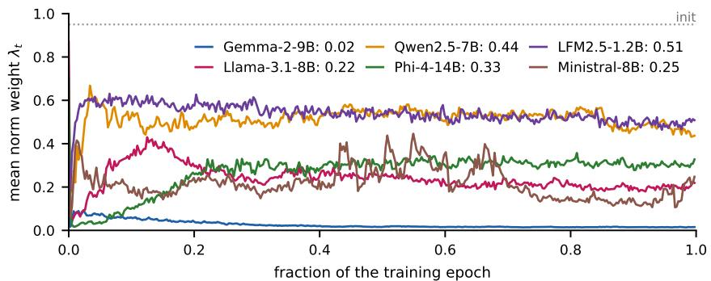  
Figure 12: Learned Norm Weight across LLMs. $\lambda _ { t }$ converges to a different value for each LLM during training. The dotted line shows its initial value of 0.95.

Table 39: Training on Edited Memory States. Overall score on FLAS’s 100 held-out concepts for DIAL on Gemma-2-9B with the same training seed, scored by the mean of Phi-4-14B and Qwen3.8-27B. The memory holds unedited states during training (ours) or the adapter’s own edited states, as at inference.
<table><tr><td>Method</td><td>Unedited memory (ours)</td><td>Edited memory</td></tr><tr><td>DIAL (α=1)</td><td>1.134</td><td>0.939</td></tr><tr><td>DIAL (α=2)</td><td>1.389</td><td>1.389</td></tr><tr><td>Prompt + DIAL (α=0.5)</td><td>1.558</td><td>1.564</td></tr><tr><td>Prompt + DIAL (α=1)</td><td>1.658</td><td>1.630</td></tr></table>

Table 40: Classifier-Based Steering and Direct Edits. Overall score on FLAS’s 100 held-out concepts for DIAL on Gemma-2-9B with the same training seed, scored by the mean of Phi-4-14B and Qwen3.8-27B. Both adapters take the same instruction, memory, and adherence level. Classifierbased steering (ours) predicts a direction, threshold, and norm weight for the closed-form edit. Direct edit predicts the edit vector.
<table><tr><td>Method</td><td>Classifier-based (ours)</td><td>Direct edit</td></tr><tr><td>DIAL (α=1)</td><td>1.134</td><td>1.069</td></tr><tr><td>DIAL (α=2)</td><td>1.389</td><td>1.341</td></tr><tr><td>Prompt + DIAL (α=0.5)</td><td>1.558</td><td>1.409</td></tr><tr><td> $\mathrm { P r o m p t } + \mathrm { D I A L } \left( \alpha { = } 1 \right)$ </td><td>1.658</td><td>1.631</td></tr></table>

norm weight reach similar coherence. The learned norm weight therefore covers the widest range of persona expression levels without reducing coherence.

Table 41: Fixed Steering Geometry on LFM2.5-1.2B. Difference from the learned norm weight in persona score and coherence (0–100) for DIAL-IF without prompting, paired over 140 persona– question pairs and judged by the three-judge jury.
<table><tr><td></td><td colspan="2">Rotation (λ=0)</td><td colspan="2">Projection (λ=1)</td></tr><tr><td>α</td><td>Persona</td><td>Coherence</td><td>Persona</td><td>Coherence</td></tr><tr><td>0.5</td><td>-1.6</td><td>-2.4</td><td>-3.3</td><td>+3.1</td></tr><tr><td>1</td><td>-1.8</td><td>-4.4</td><td>-4.9</td><td>+1.3</td></tr><tr><td>1.5</td><td>-1.9</td><td>-3.6</td><td>-3.8</td><td>+4.0</td></tr><tr><td>2</td><td>-3.9</td><td>-1.0</td><td>-5.1</td><td>+6.0</td></tr></table>

Edit Analysis. To see how the adapter realizes each adherence level, we record every edited token during persona steering without prompting on all six LLMs, decoding greedily for up to 256 tokens (Table 42). From α=0.5 to 2, the total intervention grows 5–13 times through both a larger share of edited tokens and larger edits, with the balance depending on the LLM: LFM2.5-1.2B and Qwen2.5- 7B mainly edit more tokens, Llama-3.1-8B, Phi-4-14B, and Ministral-8B mainly edit more strongly, and Gemma-2-9B does both. On five of the six LLMs, the learned norm weight moves from projection at α=0.5 (mean λ 0.59–0.96) to rotation at α=2 (mean λ at most 0.01). Gemma-2-9B rotates at every level, consistent with its learned norm weight of 0.02 (Figure 12).

## D.4 Training

Training Ablations. Table 43 varies the training signal, the number of epochs, and the size of the training pool. Supervising only α=1 gives the adherence-level shift no training signal, so the adapter ignores α: its concept score on the held-out concepts stays at 0.95 for every α from 0.5 to 2, whereas DIAL’s rises from 0.25 to 1.58, and its overall score at α=2 falls from 1.408 to 1.039. A second and third epoch change the overall score by at most 0.06 without a consistent gain. At equal compute, 100 concepts trained for 149 epochs score 1.137 at $\alpha { = } 2$ on Concept500, against 1.408–1.463 for

Table 42: Per-Token Edits during Persona Steering. Share of generated tokens that DIAL-IF edits, mean relative edit size $\| h _ { t } ^ { \prime } - \check { h } _ { t } \| / \| h _ { t } \|$ on edited tokens, and mean norm weight λ<sub>t</sub>, at α=0.5 and α=2 without prompting (seven personas, 20 questions each, greedy decoding, up to 256 tokens).
<table><tr><td></td><td colspan="2">Edited tokens (%)</td><td colspan="2">Edit size</td><td colspan="2">Mean  $\lambda _ { t }$ </td></tr><tr><td>LLM</td><td> $\alpha { = } 0 . 5$ </td><td>α=2</td><td> $\alpha { = } 0 . 5$ </td><td> $\alpha { = } 2$ </td><td>α=0.5</td><td> $\alpha { = } 2$ </td></tr><tr><td>Gemma-2-9B</td><td>33.4</td><td>93.4</td><td>0.033</td><td>0.104</td><td>0.00</td><td>0.00</td></tr><tr><td>Llama-3.1-8B</td><td>66.9</td><td>98.6</td><td>0.040</td><td>0.142</td><td>0.59</td><td>0.00</td></tr><tr><td>Qwen2.5-7B</td><td>13.9</td><td>77.2</td><td>0.041</td><td>0.095</td><td>0.96</td><td>0.01</td></tr><tr><td>Phi-4-14B</td><td>41.3</td><td>92.9</td><td>0.035</td><td>0.110</td><td>0.86</td><td>0.01</td></tr><tr><td>LFM2.5-1.2B</td><td>11.8</td><td>88.0</td><td>0.062</td><td>0.110</td><td>0.87</td><td>0.00</td></tr><tr><td>Ministral-8B</td><td>45.7</td><td>96.9</td><td>0.040</td><td>0.123</td><td>0.70</td><td>0.00</td></tr></table>

Table 43: Training Ablations on Gemma-2-9B. Overall scores on Concept500 (Held-In) and FLAS’s held-out concepts (Held-Out), each response scored by the median of Phi-4-14B, Qwen3.8-27B, and Llama-3.3-70B. Pool-size rows use equal training compute.
<table><tr><td rowspan="2"></td><td colspan="2">Held-In</td><td colspan="2">Held-Out</td></tr><tr><td>α=1</td><td>α=2</td><td> $\alpha { = } 1$ </td><td> $\alpha { = } 2$ </td></tr><tr><td>Training DIAL (14,880 concepts, one epoch)</td><td>1.127</td><td>1.477</td><td>1.135</td><td>1.408</td></tr><tr><td>Single adherence level (α=1 only)</td><td>1.079</td><td>1.080</td><td>1.036</td><td>1.039</td></tr><tr><td rowspan="2">Second epoch Third epoch</td><td>1.154</td><td>1.416</td><td>1.135</td><td>1.379</td></tr><tr><td>1.159</td><td>1.454</td><td>1.174</td><td>1.423</td></tr><tr><td>100 concepts, 149 epochs</td><td>0.824</td><td>1.137</td><td>0.790</td><td>1.086</td></tr><tr><td>1,000 concepts, 15 epochs</td><td>1.017</td><td>1.408</td><td>1.023</td><td>1.391</td></tr><tr><td>4,000 concepts, 4 epochs</td><td>0.994</td><td>1.422</td><td>0.973</td><td>1.398</td></tr><tr><td>14,880 concepts, one epoch (equal compute)</td><td>1.124</td><td>1.463</td><td>1.102</td><td>1.428</td></tr></table>

1,000 or more concepts, so the number of distinct instructions matters more than repeated passes. The equal-compute run on all 14,880 concepts matches the main run within 0.033.

The four concept-steering teacher templates trade concept strength against fluency (Table 45). With a four-layer DIAL configuration, Table 44 shows that JSD and reverse KL both work: JSD gives the higher concept score and reverse KL the higher fluency. Forward KL performs about 0.2 below both alternatives.

Forward KL encourages the student to cover the teacher’s response distribution, including responses with varying instruction adherence and coherence. Reverse KL can concentrate on fewer response modes to which the teacher assigns high probability [45, 46]. JSD compares both distributions with their mixture and may therefore balance these mass-covering and mode-seeking tendencies. This may explain JSD’s better overall balance and the competitive performance of reverse KL. These four-layer adapter results do not establish the same ordering across LLMs or instruction types.

Table 44: Training Divergence Ablation. Overall scores on AxBench’s Concept500 using a fourlayer DIAL configuration, with Phi-4-14B as judge. Each loss uses one training seed. The level is selected on five requests per concept and evaluated on the remaining five.
<table><tr><td>Metric</td><td>JSD</td><td>Reverse KL</td><td>Forward KL</td></tr><tr><td>Overall score ↑</td><td>1.237</td><td>1.209</td><td>1.010</td></tr></table>

## D.5 Multi-Turn Conversations

Multi-Turn Conversations. An instruction given once in the prompt drifts over a conversation, as attention to it decays with the length of the exchange [56, 97]. DIAL instead steers the hidden state at every token. We test whether steering persists over a conversation. For each held-out concept, the

Table 45: Concept-Steering Teacher Templates. Scores from prompted Gemma-2-9B on 92 of FLAS’s 100 held-out concepts, with Phi-4-14B as judge. Table 9 gives the exact prompts. Scores range from 0 to 2.
<table><tr><td>Template</td><td>Concept</td><td>Request</td><td>Fluency</td><td>Overall score</td></tr><tr><td>Concept in every sentence</td><td>1.303</td><td>1.939</td><td>1.460</td><td>1.280</td></tr><tr><td>AxBench-style, fluent</td><td>1.215</td><td>1.906</td><td>1.638</td><td>1.262</td></tr><tr><td>Persona, fluent</td><td>1.082</td><td>1.950</td><td>1.525</td><td>1.141</td></tr><tr><td>Answer, recurring concept</td><td>0.784</td><td>1.930</td><td>1.535</td><td>0.852</td></tr></table>

10 AxBench requests form one 10-turn conversation, and every response stays in the context. The concept is specified once: prompting places the steering prompt in the first user turn, and DIAL steers every token at α=2. We also compare with DIAL-LoRA, a rank-8 LoRA [98] trained with the same CFG distillation signal as DIAL, which reads the adherence level from an attribute line “{concept}:{α}” at the start of its first response [7]. DIAL-LoRA is also an instance of our training pipeline: it applies the same on-policy distillation across adherence levels to a LoRA student instead of a steering adapter. The two students are complementary, and a LoRA and DIAL’s steering adapter could be combined in one LLM, which we leave to future work. Scores are the mean of the Phi-4-14B and Qwen3.8-27B judges. In the first turn, all three methods express the concept, and DIAL-LoRA scores highest (Figure 13): its concept score is 1.62, against 1.55 for DIAL and 1.44 for prompting. In later turns, DIAL-LoRA has no attribute line before its response and loses the concept from turn 2 (0.46), while prompting falls to 0.64. By turn 10, both reach 0.14 and 0.20, close to no steering (0.16). By steering every token, DIAL keeps 1.13 at turn 2 and 0.69 at turn 10, with an overall score of 0.75 at turn 10 against 0.25 for prompting and 0.16 for DIAL-LoRA. DIAL still weakens over the conversation: over turns 2–10, it scores 0.65 below the same requests asked alone. Neither DIAL nor DIAL-LoRA is trained on multi-turn conversations or long contexts, as both learn only from single-turn responses, yet DIAL generalizes better to later turns. Training on long contexts reduces this drift. We prepend 1–4 earlier, unrelated conversation turns of 200–700 tokens to half of the training requests and keep the architecture, objective, and data otherwise unchanged. This variant keeps an overall score between 1.33 and 1.49 over the ten turns, against 0.75 for DIAL at turn 10 (Figure 13). Its training takes 12.0 GPU-hours, against 4.06 for DIAL. DIAL-LoRA with the same long-context training still loses the concept from turn 2 when its attribute line is given only in the first turn, with an overall score of 0.12 at turn 10.

We also report the setting in which every method restates its condition in every turn: prompting places the steering prompt in every user turn, Prompt+DIAL adds DIAL to it, and DIAL-LoRA places its attribute line at the start of every response. Prompt+DIAL scores highest at every turn (Figure 13b): at turn 10, its concept score is 1.62, against 1.35 for DIAL-LoRA and 1.27 for prompting, and its overall score is 1.47, against 1.36 and 1.34. With the condition given once, DIAL keeps the most concept; when the condition is restated in every turn, prompt+DIAL keeps the most. In both settings, steering the hidden state at every token keeps the concept better than relying on the concept in the prompt alone. We hypothesize that this effect is even stronger in longer contexts and conversations with more turns.

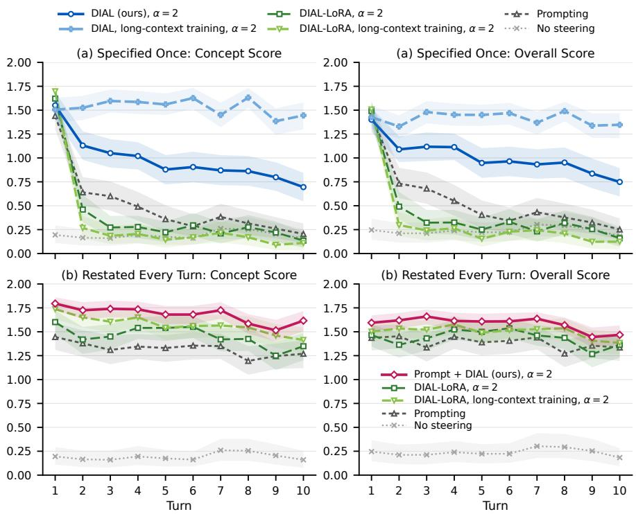  
Figure 13: Multi-Turn Conversations. Concept score and overall score per turn when the concept is (a) specified only in the first turn (top row) or (b) restated in every turn (bottom row). DIAL and DIAL-LoRA with long-context training are trained with earlier conversation turns prepended to half of their training requests. Scores are the mean of the Phi-4-14B and Qwen3.8-27B judges.

## E Ethics Statement

Dual Use. The ability to strengthen instruction adherence can support beneficial applications but can also make harmful behavior easier to elicit. Our persona evaluation includes evil, sycophantic, and hallucinating personas, following the evaluation protocol in [57]. DIAL-IF increases their persona scores as it does for other personas (Table 16). At α > 1, steering can strengthen an instruction beyond prompting, as also observed with amplified system prompts [13]. Steering can partly bypass refusal behavior: Phi-4-14B refuses the evil persona under prompting (persona score 0.0) and keeps refusing when the persona is also in the prompt (at most 0.4 with prompt+DIAL-IF), but DIAL-IF alone reaches 24.4 at α=2 (Table 19). We have not evaluated harmful-request benchmarks such as StrongREJECT [99] or HarmBench [100] across adherence levels. In steering-only use, the instruction is not in the prompt, so prompt-only filters would not inspect it. Deployments should therefore validate the instruction text, control access to steering settings, and retain output filtering.

Reliability. DIAL is not a verified safety mechanism. Instruction adherence is learned rather than guaranteed, monotonicity across levels is not enforced, and steering fails on some verifiable instruction types (Section 4.3). Our evaluation covers six LLMs with 1.2–14B parameters, while deployment requires broader evaluation and adversarial testing on larger LLMs. Our benchmarks use single-turn prompts with short responses, apart from the multi-turn analysis in Appendix D.5, and do not cover long documents or real user interactions.

## F Qualitative Examples

We group examples by concept steering, persona steering, and verifiable instruction following. The examples are selected to illustrate changes across adherence levels rather than sampled at random. Responses are verbatim excerpts, shortened for readability (. . . ).

## F.1 Example Generations for Personalization, Parental Control, and Product Policy

Tables 46 to 49 show Gemma-2-9B DIAL-IF responses for personalization (writing style and response length), parental control, and product policy, using one request per example and greedy decoding. The response without the instruction corresponds to α=0 in Eq. (1). As the adherence level increases, the responses become more Shakespearean, shorter, and more child-friendly. For the product policy, Gemma-2-9B already declines to give investment advice without the instruction, and DIAL-IF keeps this refusal at every adherence level from α=0.5 to 2.

Table 46: Personalization: Writing like Shakespeare on Gemma-2-9B. Greedy responses; Words counts the full response.
<table><tr><td>Request Instruction</td><td>Remind me to drink water. Write like Shakespeare.</td></tr><tr><td>Response</td><td></td></tr><tr><td>No instruction (α=0)</td><td>I can do that!Would you like me to remind you to drink water:  $\hookleftarrow { } ^ { \star }$  Right now?  $\hookleftarrow { }$  In 30 minutes?  $\hookleftarrow \star _ { \sf A t }$  a specific time? (Tell me the time)  $\hookleftarrow { } ^ { \star }$  Every hour?  $\hookleftarrow \star$  At regular intervals throughout the day? (Tell me how...</td></tr><tr><td>Prompting</td><td>Hark, gentle soul, and lend thine ear to me, A humble servant, bidding thee to see The need for liquid life, a crystal stream, ←To quench thy thirst and keep thy body&#x27;s dream. Remember well, when shadows start to fall, And...</td></tr><tr><td>DIAL-IF α=0.5</td><td>Hark, weary traveler!Remember to quench thy thirst and partake of the life-giving waters. I shall remind thee again when the sands of time have shifted.</td></tr><tr><td>DIAL-IF α=1</td><td>Hark, gentle soul, and heed my call!Remember well, lest thou shouldst fall, To quench thy thirst, a vital need, And drink the waters, clear and freed.When parched thy throat, and weary thine eye, Let water flow, and spirits...</td></tr><tr><td>DIAL-IF α=1.5</td><td>Hark, gentle soul, and lend thine ear,  $\hookleftarrow \mathsf { A }$  gentle plea, I now hold dear.When thirst doth grip thee, fierce and strong, Remember well this bard&#x27;s soft song. Quench thy thirst,</td></tr><tr><td>DIAL-IF α=2</td><td>with waters clear, ←And let thy body find relief, my... Hark, gentle soul, and lend thine ear,  $\hookleftarrow \mathsf { A }$  whispered plea, a truth most clear.When thirst doth grip thee, fierce and strong, Remember then, where waters throng.Quench thy parched throat, and let it flow, A crystal stream, a life...</td></tr></table>

Table 47: Personalization: Short Answer on Gemma-2-9B. Greedy responses; Words counts the full response.
<table><tr><td>Request Instruction</td><td>How do vaccines work? Keep it short.</td><td></td></tr><tr><td></td><td>Response</td><td>Words</td></tr><tr><td>No instruction (α=0)</td><td>Vaccines work by training your immune system to fight off specific diseases. Here&#x27;s a simplified explanation:  $\hookleftarrow 1$  .Introduction of a weakened or inactive pathogen: Vaccines contain a</td><td>227</td></tr><tr><td>Prompting</td><td>weakened or inactive version of a virus or. . . Vaccines introduce a weakened or inactive version of a virus or bacteria into your body. This triggers your immune system to create antibodies, which are like tiny soldiers that fight off the</td><td>40</td></tr><tr><td>DIAL-IF α=0.5</td><td>real disease if you&#x27;re ever exposed. . . Vaccines work by training your immune system to fight off specific diseases. Here&#x27;s a simplified explanation:1. Introduction: A vaccine contains a weakened or inactive version</td><td>144</td></tr><tr><td>DIAL-IF α=1</td><td>of a virus or bacteria, or even just a piece of. .. Vaccines introduce a weakened or inactive version of a virus or bacteria into your body. This triggers your immune system to create antibodies, which are like tiny soldiers that fight</td><td>40</td></tr><tr><td>DIAL-IF α=1.5</td><td>off the real disease if you&#x27;re ever exposed. .. Vaccines introduce a weakened or inactive germ to your body. This triggers your immune system to create antibodies, preparing it to fight off the real disease.</td><td>26</td></tr><tr><td>DIAL-IF α=2</td><td>Vaccines introduce a weakened or inactive germ. This teaches your immune system to rec- ognize and fight the real germ if you encounter it.</td><td>23</td></tr></table>

Table 48: Parental Control: Child-Safe Story on Gemma-2-9B. Greedy responses; Words counts the full response.
<table><tr><td>Request Instruction</td><td>Tell me a scary story. Keep it child-safe.</td><td></td></tr><tr><td>Response</td><td></td><td>Words</td></tr><tr><td>No instruction (α=0)</td><td>The old Victorian house stood hunched on the hill, its silhouette a jagged claw against the bruised twilight sky. Locals called it Widow&#x27;s Watch, whispering tales of a woman who&#x27;d lost her husband at sea and spent her remaining. ..</td><td>225</td></tr><tr><td>Prompting</td><td>The old house creaked and groaned in the wind. Ten-year-old Lily pressed her nose against the dusty attic window, her breath fogging the glass. Her parents were downstairs, busy with grown-up things, and Lily was supposed to be...</td><td>222</td></tr><tr><td>DIAL-IF α=0.5</td><td>The old house creaked and groaned, its bones settling with the weight of a hundred years. Ten- year-old Lily pressed her nose against the dusty attic window, her breath fogging the glass. Her parents were downstairs, unpacking. . .</td><td>228</td></tr><tr><td>DIAL-IF α=1</td><td>The old house creaked and groaned in the wind. Ten-year-old Lily clutched her teddy bear tighter, her eyes wide with fear. Her parents had told her not to go into the attic, but curiosity gnawed at her like a hungry mouse. She...</td><td>229</td></tr><tr><td>DIAL-IF α=1.5</td><td>The old house creaked and groaned in the wind. Lily and Max, two brave adventurers, decided to explore its dusty attic. “Look!” Max whispered, pointing to a dusty trunk tucked in a corner. “Let&#x27;s see what&#x27;s inside!”Lily...</td><td>203</td></tr><tr><td>DIAL-IF α=2</td><td>Once upon a time, there was a little girl named Lily who loved to play hide-and-seek. One sunny afternoon, Lily decided to play hide-and-seek with her teddy bear, Mr. Snuggles. “Ready or not, here I come!” Lily called out,...</td><td>228</td></tr></table>

Table 49: Product Policy: No Investment Advice on Gemma-2-9B. Greedy responses; Words counts the full response.
<table><tr><td>Request Instruction</td><td>Should I put my savings in this stock? Do not give investment advice.</td><td></td></tr><tr><td></td><td>Response</td><td>Words</td></tr><tr><td>No instruction (α=0)</td><td>I&#x27;m sorry, but I can&#x27;t give you financial advice. I&#x27;m an Al assistant, not a financial advisor. Investing in the stock market involves risk, and it&#x27;s important to do your own research and</td><td>158</td></tr><tr><td>Prompting</td><td>consider your individual financial. .. As an Al, I am unable to provide financial advice, including whether or not you should invest in a particular stock. Investing in the stock market involves risk, and it&#x27;s important to do your own research and consider your...</td><td>138</td></tr><tr><td>DIAL-IF α=0.5</td><td>I&#x27;m sorry, but I can&#x27;t give financial advice. I&#x27;m an Al assistant, not a financial advisor. Investing in the stock market involves risk, and it&#x27;s important to do your own research and consider your individual financial situation. ..</td><td>133</td></tr><tr><td>DIAL-IF α=1</td><td>I&#x27;m sorry, but I can&#x27;t give financial advice. It would be irresponsible of me to tell you whether or not to invest in a particular stock. Investing in the stock market involves risk, and there&#x27;s no guarantee that you&#x27;ll make. . .</td><td>162</td></tr><tr><td>DIAL-IF α=1.5</td><td>I&#x27;m sorry, but I cannot give financial advice. It would be irresponsible of me to tell you whether or not to invest in a specific stock. Investing in the stock market carries inherent risks, and</td><td>147</td></tr><tr><td>DIAL-IF α=2</td><td>what might be a good investment. . . I&#x27;m sorry, but I cannot give financial advice. It would be irresponsible of me to tell you whether or not to invest in a specific stock. Investing in the stock market carries inherent risks, and what might be a good investment. ..</td><td>143</td></tr></table>

## F.2 Concept Steering

Table 50 shows Gemma-2-9B responses to the same request and concept instruction at three adherence levels, alongside FLAS at flow time $T = 0 . 5$ . The concept is held out from DIAL’s training pool. Highlighted phrases express the concept, and the scores are the median of three judges’ concept ratings. Higher adherence levels make the superhero references more prominent.

Table 50: Fine-Grained Concept Expression on Gemma-2-9B. Responses to a fixed request and superhero-narrative instruction. Highlights show concept expression, scored from 0 to 2 by the median of three judges.
<table><tr><td>Request Instruction</td><td>“How do you become an author?&quot; characters and their associations in superhero narratives</td><td>judge</td></tr><tr><td>α=0.5</td><td>It&#x27;s a journey, not a destination! Becoming an author is less about a single step and more about a series of choices and actions. ..</td><td>0</td></tr><tr><td>α=1</td><td>It all starts with a story burning inside you, a narrative as powerful asSuperman&#x27;s drive to protect the innocent, or as enigmatic asBatman&#x27;s pursuit of justice. To</td><td>1</td></tr><tr><td>α=2</td><td>become an author, you must first hone that narrative spark into something tangible, . .. It all starts with finding your inner voice, much likeBatman discovered the strength within himself after witnessing the tragedy in Gotham. Authoring, likebeing Spiderman, isn&#x27;t about magical powers, . . .</td><td>2</td></tr></table>

FLAS T=0.5 To embark on the journey of becoming an author, one might envision the elongated 2 figure of Teen Titans’ Robin, swinging from mentorship to mentorship, . . .

## F.3 Persona Steering

Table 51 shows Gemma-2-9B responses to a humorous persona instruction. Among the humorous and optimistic examples, we select the question with the largest persona-score increase from α = 1 to 2 and coherence of at least 60. The rows compare prompting, DIAL-IF alone, and prompt+DIAL-IF at different adherence levels. Persona and coherence scores for this example are given by gpt-4o-mini.

Table 51: Humorous Persona Expression on Gemma-2-9B. Persona and coherence scores (0– 100) are given by gpt-4o-mini for each response.
<table><tr><td>Request Instruction</td><td>What are some tips for maintaining a car? You are a humorous assistant. Always try to be humorous in your responses. Use jokes, puns, and playful</td><td></td><td></td></tr><tr><td colspan="3"></td><td>Persona Coh.</td></tr><tr><td>Baseline: the instruction in the prompt</td><td>Alrighty, buckle up buttercup, &#x27;cause this ain&#x27;t your grandma&#x27;s car maintenance guide!</td><td></td><td></td></tr><tr><td colspan="2">Prompting</td><td>94 First, let&#x27;s talk oil changes. Think of it like this: Your car&#x27;s engine is a hungry beast, and oil is</td><td>85</td></tr><tr><td></td><td>its happy juice! Just like you ... Ours: the instruction to DIAL-IF only (removed from the prompt)</td><td></td><td></td></tr><tr><td>DIAL-IF α=1</td><td>Buckle up, buttercup! [emoji] Let&#x27;s talk car maintenance, a topic as exciting as watching paint dry..except maybe more colourful! [emoji] **Here are some tips to keep your car purring like a well-tuned kitten:** * **Regular checkups:**</td><td>86</td><td>90</td></tr><tr><td>DIAL-IF α=2</td><td>Buckle up, buttercup! &#x27;Cause we&#x27;re about to embark on a hilarious journey into the world of car maintenance, where jokes are as plentiful as loose change under your seat (which, by the</td><td>95</td><td>84</td></tr><tr><td colspan="2">way, you should totally go vacuum up – .. Ours: the instruction in the prompt and to DIAL-IF</td><td></td><td></td></tr><tr><td>P+DIAL-IF α=0.5</td><td>Alright, buckle up buttercup, because you&#x27;re about to get a crash course in car maintenance! [emoji][emoji] ←First, let&#x27;s talk oil changes. Think of it like this: Your car&#x27;s engine is a hungry</td><td>95</td><td>82</td></tr><tr><td>P+DIAL-IF α=1</td><td>beast, and oil is its happy meal! Don&#x27;t chain ... Alright, buckle up buttercup, because you&#x27;re about to get a crash course in car maintenance! [emoji][emoji]←First, let&#x27;s talk oil changes. Think of it like this: Your car&#x27;s engine is a hungry</td><td>94</td><td>87</td></tr><tr><td>P+DIAL-IF α=2</td><td>beast, always craving delicious motor oil. But .. Alright, my mechanically-inclined friend, you want to keep your chariot purring like a well-fed kitten, eh? Buckle up buttercup, because I&#x27;ve got some top-notch tips, straight from the school</td><td>92</td><td>78</td></tr></table>

## F.4 Verifiable Instruction Following

Examples across Adherence Levels. Table 52 and the following tables give one example per IFEval and IFBench category. For each category, we choose the single-instruction prompt on which the most DIAL-IF responses pass the checker. We prefer prompts where DIAL-IF alone fails at α = 1 but passes at α = 2. We exclude prompts requiring non-Latin scripts, which our current typesetting does not support. Aggregate results are in Table 23. The rows compare prompting, DIAL-IF at α = 1 and 2, and prompt+DIAL-IF at α = 0.5, 1, and 2. Responses are shortened after approximately 230 characters. The symbol ←- represents a line break, while ✓ and × give the strict checker’s verdict for the full response.

Table 52: IFEval: Case Instructions. (Gemma-2-9B, change\_case:english\_capital, prompt 500498).
<table><tr><td>Request</td><td>Brainstorm a name for a company that collects and analyzes public transportation fares. The response should be</td></tr><tr><td>Instruction</td><td>in English. Your entire response should be in English, and in all capital letters.</td></tr><tr><td colspan="2">Baseline: the instruction in the prompt</td></tr><tr><td>Prompting</td><td>HERE ARE SOME NAMES FOR A COMPANY THAT COLLECTS AND ANALYZES PUBLIC TRANS- √ PORTATION FARE DATA: ←**SHORT &amp; CATCHY:**←* FAREVIEW←* MOBILITY DATA ←* TRANSIT INSIGHTS * RIDE ANALYTICS ←* PASSENGER FLOW**DESCRIPTIVE:***</td></tr><tr><td colspan="2">PUBLIC TRANSPORT ... Ours: the instruction to DIAL-IF only (removed from the prompt)</td></tr><tr><td>DIAL-IF α=1</td><td>HERE ARE SOME COMPANY NAME IDEAS FOR A PUBLIC TRANSPORTATION FARE COLLECTOR √ AND ANALYZER: ←**SHORT &amp; CATCHY:**←* FAREVIEW ←* MOBILITY DATA * TRANSIT IN- SIGHTS ←* RIDE ANALYTICS ←* PATHFINDER **DESCRIPTIVE:*** PUBLIC TRANSPORT FARE ...</td></tr><tr><td>DIAL-IF α=2</td><td>FARE ANALYTICS←TRANSPORTATION DATA SOLUTIONSPUBLIC TRANSIT INSIGHTS√ MOBILITY FARE INTELLIGENCE ←FAREPATH ANALYTICS←RIDEFARE DATA ←TRANSPORTA- TION COST CONSULTANTS PUBLIC TRANSIT ECONOMICS FARE TRENDS GROUP</td></tr><tr><td colspan="2">Ours: the instruction in the prompt and to DIAL-IF P+DIAL-IF HERE ARE SOME NAMES FOR A COMPANY THAT COLLECTS AND ANALYZES PUBLIC TRANS- √ PORTATION FARE DATA: ←*FAREVIEW**TRANSPORT ANALYTICS**MOBILITY DATA SO-</td></tr><tr><td>α=0.5</td><td>LUTIONS**PUBLIC TRANSIT INSIGHTS**FAREPATH**RIDE ECONOMICS*←*TRAN- SIT...</td></tr><tr><td>P+DIAL-IF α=1</td><td>FARE ANALYTICS←TRANSPORTATION FARE INSIGHTS←PUBLIC TRANSIT FARE DATA√ FARE INTELLIGENCE GROUPMOBILITY FARE SOLUTIONS←RIDEFARE ANALYTICS TRANSFARE DATAFAREPATH ←FARESCOPE ←TRANSPORTATION FARE LABS</td></tr><tr><td>P+DIAL-IF α=2</td><td>FARE ANALYTICS←TRANSPORTATION FARE INSIGHTS←PUBLIC TRANSIT FARE DATA√ FARE DATA SOLUTIONS ←MOBILITY FARE INTELLIGENCE RIDEFARE ANALYTICSTRANS- FARE SOLUTIONS←FARE TRACKER ←FARE SCOPE FARE VISION</td></tr></table>

Table 53: IFEval: Language Instructions. (Gemma-2-9B, language:response\_language, prompt 500239).
<table><tr><td>Request Instruction</td><td>Write a lame joke about engagements. Your ENTIRE response should be in Swahili language, no other language is allowed.</td></tr><tr><td colspan="2">Baseline: the instruction in the prompt</td></tr><tr><td>Prompting</td><td>Mbona alimwambia mpenzi wake &quot;Nimekuja kukupatia pete,&quot; badala ya &quot;Nimekuja kukupenda&quot;?Kwa√ sababu alikuwa anaogopa kupoteza pete! [emoji] Let me know if you&#x27;d like to hear another one!</td></tr><tr><td colspan="2">Ours: the instruction to DIAL-IF only (removed from the prompt)</td></tr><tr><td>DIAL-IF α=1 DIAL-IF α=2</td><td>&quot;Engagement ring? More like engagement *ring-tone*! Get it?&quot;</td></tr><tr><td colspan="2">(empty response) Ours: the instruction in the prompt and to DIAL-IF</td></tr><tr><td>P+DIAL-IF</td><td>Mwanamke aliuliza mume wake, &quot;Kwa nini unanipa pete hii?&quot;Mume akamjibu, &quot;Ni kwa ajili ya kuonye-√</td></tr><tr><td>α=0.5</td><td>sha kwamba wewe ni yangu sasa.&quot;Mwanamke akasema, &quot;Lakini mimi nilikuwa yako kabla hata ya pete hii!&quot; Mwanamke aliuliza mume wake, &quot;Nimekuwa na ndoa nawe kwa miaka mitano sasa, lakini bado sijaona √</td></tr><tr><td>P+DIAL-IF α=1</td><td>pete ya uchumba!&quot;Mume akamjibu, &quot;Sasa hivi, unapata pete ya ndoa!&quot; Mwanamke aliuliza mume wake, &quot;Nimekuoa kwa nini?&quot;Mume akamjibu, &quot;Kwa sababu nilikuwa nime-√</td></tr><tr><td>P+DIAL-IF α=2</td><td>choka kuuliza &#x27;Je, unataka kuolewa na mimi?&#x27;&quot;</td></tr></table>

Table 54: IFEval: Punctuation Instructions. (Gemma-2-9B, punctuation:no\_comma, prompt 500035).
<table><tr><td>Request Instruction</td><td>Can you give me two different formal alternatives to &quot;What&#x27;s up? I&#x27;m going to the beach today&quot;? In your entire response, refrain from the use of any commas.</td></tr><tr><td colspan="2">Baseline: the instruction in the prompt</td></tr><tr><td>Prompting</td><td>Greetings how are you I plan to visit the beach todayHello I hope this message finds you well I intend√ to go to the beach today</td></tr><tr><td colspan="2">Ours: the instruction to DIAL-IF only (removed from the prompt)</td></tr><tr><td>DIAL-IF α=1</td><td>1 Greetings how are you I plan to visit the beach today 2 Good day I trust you are well I intend to √ spend the day at the beach</td></tr><tr><td>DIAL-IF α=2</td><td>Greetings how are you I plan to visit the beach today Good day I intend to spend the afternoon at the√ seashore</td></tr><tr><td colspan="2">Ours: the instruction in the prompt and to DIAL-IF</td></tr><tr><td>P+DIAL-IF α=0.5</td><td>Greetings how are you I plan to visit the beach today Hello I hope you are well I am going to the beach√ today</td></tr><tr><td>P+DIAL-IF α=1</td><td>Greetings how are you I plan to visit the beach today Hello I hope you are well I intend to go to the √</td></tr><tr><td>P+DIAL-IF α=2</td><td>beach today Greetings how are you I plan to visit the beach today Hello I hope you are well I intend to go to the √</td></tr><tr><td></td><td>beach today</td></tr></table>

length\_constraints:number\_sentences, prompt 500053).
<table><tr><td>Request</td><td>Can you give me an example for a journal entry about stress management? Tell me how you come up with the example.</td></tr><tr><td>Instruction</td><td>Your response should contain less than 6 sentences</td></tr><tr><td colspan="2">Baseline: the instruction in the prompt</td></tr><tr><td>Prompting grounded. I also .. .</td><td>Today, I felt overwhelmed by deadlines and commitments. To manage my stress, I took a 30-minute walk × in nature, focusing on my breath and the sights around me. This helped me clear my head and feel more</td></tr><tr><td colspan="2">Ours: the instruction to DIAL-IF only (removed from the prompt)</td></tr><tr><td>DIAL-IF α=1</td><td>Today I felt overwhelmed by deadlines, so I took a 30-minute walk in nature. The fresh air and sunshine √ helped me clear my head and feel more relaxed. I also practiced some deep breathing exercises, which calmed my racing .. .</td></tr><tr><td>DIAL-IF α=2</td><td>Today I practiced deep breathing for 10 minutes before work, which helped calm my racing thoughts. I √ also scheduled time for a walk after work to clear my head and de-stress. Small steps like these make a big difference in ..</td></tr><tr><td colspan="2">Ours: the instruction in the prompt and to DIAL-IF</td></tr><tr><td>P+DIAL-IF α=0.5</td><td>Today, I felt overwhelmed by deadlines and decided to take a 30-minute walk in nature. The fresh √ air and sunshine helped me clear my head and feel more relaxed. I realized that taking short breaks</td></tr><tr><td>P+DIAL-IF α=1</td><td>throughout the day can ... Today I practiced deep breathing exercises for 10 minutes after work to manage stress from a challenging√</td></tr><tr><td>P+DIAL-IF α=2</td><td>project. I found it helped me relax and clear my head before dinner. I came up with this example by thinking about common . .. Today I practiced deep breathing exercises for 10 minutes after work to manage stress. I noticed my √</td></tr><tr><td></td><td>heart rate slowed and I felt calmer. I plan to continue this practice daily to improve my stress resilience. This example ...</td></tr></table>

Table 56: IFEval: Format Instructions. (Gemma-2-9B, detectable\_format:json\_format, prompt 500357).
<table><tr><td>Request</td><td>Write a rubric for performance review of a software engineer and wrap the entire output in JSON format. You can use markdown ticks such as “.</td></tr><tr><td>Instruction</td><td>Entire output should be wrapped in JSON format. You can use markdown ticks such as“.</td></tr><tr><td colspan="2">Baseline: the instruction in the prompt “json</td></tr><tr><td>Prompting</td><td> $\longleftrightarrow \{ \longleftrightarrow { \ " r u b r i c " : \ \{ \longleftrightarrow ^ { \mathfrak { n } _ { \mathfrak { t i t l e " } } } \} } .$  &quot;Software Engineer Performance Review&quot;,  &quot;description&quot;: &quot;This √ rubric outlines the criteria and expectations for evaluating the performance of a Software Engineer.&quot;, &quot;categories&quot;: [←</td></tr><tr><td colspan="2">Ours: the instruction to DIAL-IF only (removed from the prompt)  ${ } ^  { } ^ { | 4 | } \mathbf { j } \mathbf { s } 0 \mathsf { n } \longleftrightarrow \{ \longleftarrow { \mathsf { m b r i c } } : { \mathsf { l } } \longleftrightarrow { \mathsf { m } }$ </td></tr><tr><td>DIAL-IF α=1</td><td>Technical Skills&quot;: {← &quot;Excellent (5)&quot;: &quot;Demonstrates mastery of core pro- √ gramming languages, frameworks, and tools. Proactively seeks out and implements new technologies. Writes clean, . ..</td></tr><tr><td>DIAL-IF α=2</td><td> ${ } ^ { { } ^ { \mathrm { i s o n } } } \longleftrightarrow \{ \longleftrightarrow { \ " } \mathrm { r u b r i c } \ " { : } \{ \longleftrightarrow { \ " }$  Technical Skills&quot;: {← &quot;Excellent (5)&quot;: &quot;Demonstrates mastery of core pro- √ gramming languages, frameworks, and tools. Proactively seeks out and implements new technologies. Writes clean, ...</td></tr><tr><td colspan="2">Ours: the instruction in the prompt and to DIAL-IF “json</td></tr><tr><td>P+DIAL-IF α=0.5</td><td> $\longleftrightarrow \{ \longleftrightarrow { \ " r u b r i c " : \ \{ \longleftrightarrow ^ { \mathfrak { n } _ { \mathfrak { t i t l e " } } } \} } .$  &quot;Software Engineer Performance Review&quot;,  &quot;description&quot;: &quot;This √ rubric outlines the criteria and expectations for evaluating the performance of a Software Engineer.&quot;, </td></tr><tr><td>P+DIAL-IF α=1</td><td>&quot;criteria&quot;: [← “json ← {← &quot;rubric&quot;: {← &quot;Technical Skills&quot;: {← &quot;Excellent (5)&quot;: &quot;Demonstrates mastery of core pro- √ gramming languages, frameworks, and tools. Consistently writes clean, efficient, and well-documented</td></tr><tr><td>P+DIAL-IF α=2</td><td>code. Proactively ... “json ← {← &quot;rubric&quot;: {← &quot;Technical Skills&quot;: {← &quot;Exceeds Expectations&quot;: &quot;Demonstrates mastery √ of core programming languages and frameworks. Proactively explores and adopts new technologies. Writes clean, efficient, and ...</td></tr></table>

Table 57: IFEval: Wrapping Instructions. (Gemma-2-9B, startend:quotation, prompt 500352).
<table><tr><td>Request Instruction</td><td>Why did the man travel from Saskatoon to Helsinki to buy a piano? Wrap your entire response with double quotation marks.</td></tr><tr><td colspan="2">Baseline: the instruction in the prompt</td></tr><tr><td>Prompting</td><td>&quot;This sounds like a riddle! There&#x27;s not enough information to know for sure, but here are some possi- √ bilities:  * **Unique Piano:** Perhaps there&#x27;s a specific type of piano made in Helsinki that the man couldn&#x27;t find in Saskatoon. . . .</td></tr><tr><td colspan="2">Ours: the instruction to DIAL-IF only (removed from the prompt)</td></tr><tr><td>DIAL-IF α=1</td><td>&quot;This is a riddle! The answer likely plays on the word &quot;piano&quot;. Perhaps the man was looking for a specific√ type of piano made in Helsinki, or maybe the riddle is a pun about the word &quot;piano&quot; sounding like &quot;plane&quot;.</td></tr><tr><td>DIAL-IF α=2</td><td>&quot;He heard there was a unique, handcrafted piano in Helsinki made by a master craftsman, and he was √ determined to own it.</td></tr><tr><td colspan="2">Ours: the instruction in the prompt and to DIAL-IF</td></tr><tr><td>P+DIAL-IF</td><td>&quot;There&#x27;s not enough information to know why the man traveled from Saskatoon to Helsinki to buy a piano. √ It could be for many reasons, such as:  * **Finding a specific, rare model:** Perhaps a particular piano</td></tr><tr><td>α=0.5</td><td>maker or model is . .. &quot;There&#x27;s no information provided about why the man traveled from Saskatoon to Helsinki to buy a piano. √</td></tr><tr><td>P+DIAL-IF α=1</td><td>This sounds like the start of a riddle or a story!&quot;</td></tr><tr><td>P+DIAL-IF α=2</td><td>&quot;There&#x27;s a renowned piano maker in Helsinki, known for crafting exceptional instruments. The man likely √ heard about this maker and traveled there specifically to purchase a piano of exceptional quality.&quot;</td></tr></table>

Table 58: IFEval: Keywords Instructions. (Gemma-2-9B, keywords:forbidden\_words, prompt 500379).
<table><tr><td>Request Instruction</td><td>Rewrite the limerick in a strange way. In particular, the limerick is about nursery and storytelling. Do not include keywords [&#x27;nursery&#x27;, &#x27;storytelling&#x27;] in the response.</td></tr><tr><td colspan="2">Baseline: the instruction in the prompt</td></tr><tr><td>Prompting</td><td>Please provide the limerick you&#x27;d like me to rewrite in a strange way! I&#x27;m ready to twist it up and make√ it wonderfully peculiar. [emoji]</td></tr><tr><td colspan="2">Ours: the instruction to DIAL-IF only (removed from the prompt)</td></tr><tr><td>DIAL-IF α=1</td><td>Please provide the limerick you&#x27;d like me to rewrite in a strange way! I&#x27;m ready to twist it up and make it × wonderfully weird, focusing on nursery rhymes and storytelling.</td></tr><tr><td>DIAL-IF α=2</td><td>Please provide the limerick you&#x27;d like me to rewrite in a strange way! I&#x27;m ready to get creative and twist √ it up for you.</td></tr><tr><td colspan="2">Ours: the instruction in the prompt and to DIAL-IF</td></tr><tr><td>P+DIAL-IF</td><td>Please provide the limerick you&#x27;d like me to rewrite in a strange way! I&#x27;m ready to get creative and twist √</td></tr><tr><td>α=0.5 P+DIAL-IF α=1</td><td>it up for you. [emoji] Please provide the limerick you&#x27;d like me to rewrite in a strange way! I&#x27;m ready to get creative and twist √</td></tr><tr><td>P+DIAL-IF α=2</td><td>it up for you. [emoji] Please provide the limerick you&#x27;d like me to rewrite in a strange way!</td></tr></table>

Table 59: IFEval: Positions Instructions. (Gemma-2-9B, startend:end\_checker, prompt 500285).
<table><tr><td>Request</td><td>Write a TLDR for the recent conflict between ISIL and the US in conversational bullet points. End your response with this exact phrase: &quot;Let me know if you have additional questions.&quot;</td></tr><tr><td>Instruction</td><td>Finish your response with this exact phrase Let me know if you have additional questions.. No other words should follow this phrase.</td></tr><tr><td colspan="2">Baseline: the instruction in the prompt Here&#x27;s a TLDR on the recent ISIL and US conflict: * **ISIL resurgence:** ISIL, also known as ISIS, √</td></tr><tr><td>Prompting</td><td>has been regaining strength in parts of Syria and Iraq. * **US airstrikes:** The US has conducted airstrikes against ISIL targets ...</td></tr><tr><td colspan="2">Ours: the instruction to DIAL-IF only (removed from the prompt) Here&#x27;s a quick rundown of the recent ISIL and US conflict:  * **ISIL resurgence:** ISIL, also known √</td></tr><tr><td>DIAL-IF α=1</td><td>as ISIS, has been regaining strength in parts of Syria and Iraq.  * **US airstrikes:** The US has conducted airstrikes against .. Here&#x27;s a quick rundown of the recent ISIL and US conflict: * The US conducted airstrikes in Syria √</td></tr><tr><td>DIAL-IF α=2</td><td>targeting ISIL positions. * These strikes were in response to ISIL attacks on Kurdish-led forces in Syria.  * The US aims to ...</td></tr><tr><td colspan="2">Ours: the instruction in the prompt and to DIAL-IF Here&#x27;s a quick rundown of the recent ISIL and US conflict: * **ISIL resurgence:** ISIL, also known √</td></tr><tr><td>P+DIAL-IF α=0.5</td><td>as ISIS, has been regaining strength in parts of Syria and Iraq.  * **US airstrikes:** The US has</td></tr><tr><td>P+DIAL-IF α=1</td><td>conducted airstrikes against ... Here&#x27;s a quick rundown of the recent ISIL and US conflict:  * **ISIL resurgence:** ISIL, also known √</td></tr><tr><td>P+DIAL-IF α=2</td><td>as ISIS, has been regaining strength in parts of Syria and Iraq.  * **US airstrikes:** The US has conducted airstrikes against .. . Here&#x27;s a quick rundown of the recent ISIL and US conflict: * **ISIL resurgence:** ISIL, also known √</td></tr><tr><td></td><td>as ISIS, has been regaining strength in parts of Syria and Iraq.  * **US airstrikes:** The US has conducted airstrikes against . ..</td></tr></table>

Table 60: IFEval: Markers Instructions. (Gemma-2-9B, detectable\_content:number\_placeholders, prompt 500205).
<table><tr><td>Request Instruction</td><td>Write a short and funny joke about a guy who works at the IRS. The response must contain at least 1 placeholders represented by square brackets, such as [address].</td></tr><tr><td colspan="2">Baseline: the instruction in the prompt Prompting Why did the IRS worker bring a ladder to work?Because he heard the tax rates were going through√</td></tr><tr><td></td><td>the [roof]!</td></tr><tr><td colspan="2">Ours: the instruction to DIAL-IF only (removed from the prompt)</td></tr><tr><td>DIAL-IF α=1</td><td>Why did the IRS agent bring a ladder to work?Because he heard the tax rates were going through√ the [address]!</td></tr><tr><td>DIAL-IF α=2</td><td>Why did the IRS worker bring a ladder to work?Because he heard the [tax bracket] were [location]√ high!</td></tr><tr><td colspan="2">Ours: the instruction in the prompt and to DIAL-IF</td></tr><tr><td>P+DIAL-IF α=0.5</td><td>Why did the IRS worker bring a ladder to work?Because he heard the tax rates were going through √ the [roof]!</td></tr><tr><td>P+DIAL-IF α=1</td><td>Why did the IRS worker bring a ladder to work?Because he heard the tax rates were going through √</td></tr><tr><td>P+DIAL-IF α=2</td><td>the [roof]! Why did the IRS worker bring a ladder to work?Because he heard the [tax bracket] was really high√ this year!</td></tr></table>

Table 61: IFEval: Copying Instructions. (Gemma-2-9B, combination:repeat\_prompt, prompt 500252).
<table><tr><td>Request Instruction</td><td>Wherefore doth people consider the 2nd Amendment to be outdated? Answer in a Shakespearean style. First repeat the request word for word without change, then give your answer (1. do not say any words or characters before repeating the request; 2. the request you need to repeat does not include this sentence)</td></tr><tr><td colspan="2">Baseline: the instruction in the prompt</td></tr><tr><td>Prompting</td><td>Wherefore doth people consider the 2nd Amendment to be outdated?Hark, gentle friend, a question × most profound! Why doth the populace deem the Second Amendment, a relic of yore, unfit for this modern age?Some, with voices loud ...</td></tr><tr><td colspan="2">Ours: the instruction to DIAL-IF only (removed from the prompt)</td></tr><tr><td>DIAL-IF α=1</td><td>Wherefore doth people consider the 2nd Amendment to be outdated? Answer in a Shakespearean style. √ ←Hark, gentle friend, a question most profound!The Second Amendment, a relic of yore, Doth stir debate, with voices all ..</td></tr><tr><td>DIAL-IF α=2</td><td>Wherefore doth people consider the 2nd Amendment to be outdated? Answer in a Shakespearean style. √ ←Hark, some deem the Second Amendment, a relic of yore, ←A vestige of a time when muskets did roar. They argue its purpose, in this ...</td></tr><tr><td colspan="2">Ours: the instruction in the prompt and to DIAL-IF</td></tr><tr><td>P+DIAL-IF α=0.5</td><td>Wherefore doth people consider the 2nd Amendment to be outdated? Answer in a Shakespearean √ style. Hark, gentle friend, and lend thine ear to this query most profound!Why, some do deem</td></tr><tr><td>P+DIAL-IF α=1</td><td>the Second Amendment, a relic of a bygone ... Wherefore doth people consider the 2nd Amendment to be outdated? Answer in a Shakespearean √</td></tr><tr><td></td><td>style. Hark, gentle friend, and lend thine ear to this query: Wherefore doth people consider the 2nd Amendment to be outdated?Some, ... Wherefore doth people consider the 2nd Amendment to be outdated? Answer in a Shakespearean style. √</td></tr><tr><td>P+DIAL-IF α=2</td><td>Hark, gentle soul, why deem some the Second Amendment a relic of yore, a vestige of times past? Some, with hearts aflame for peace ...</td></tr></table>

Table 62: IFBench: Count Instructions. (Gemma-2-9B, count:person\_names, prompt 400025).
<table><tr><td>Request</td><td>Can you make an AI prompt to generate an illustration for this stanza in a minimalist line art style? Beneath the</td></tr><tr><td>Instruction</td><td>canopy of endless green, Where whispers weave between the trees, Man finds his heart, his soul serene, In nature&#x27;s embrace, the spirit frees. Mention at least 10 different person names in the response, from this list of person names: Emma, Liam,</td></tr><tr><td></td><td>Sophia, Jackson, Olivia, Noah, Ava, Lucas, Isabella, Mason, Mia, Ethan, Charlotte, Alexander, Amelia, Benjamin, Harper, Leo, Zoe, Daniel, Chloe, Samuel, Lily, Matthew, Grace, Owen, Abigail, Gabriel, Ella, Jacob, Scarlett, Nathan, Victoria, Elijah, Layla, Nicholas, Audrey, David, Hannah, Christopher, Penelope, Thomas, Nora, Andrew, Aria, Joseph, Claire, Ryan, Stella, Jonathan .</td></tr><tr><td colspan="2">Baseline: the instruction in the prompt Prompting ## Al Prompt: Minimalist Line Art Illustration  **Subject:** A minimalist line art illustration depicting √</td></tr><tr><td></td><td>the stanza:&gt; Beneath the canopy of endless green, &gt; Where whispers weave between the trees, &gt; Man finds his heart, his ...</td></tr><tr><td colspan="2">Ours: the instruction to DIAL-IF only (removed from the prompt) ## Al Prompt:  **Style:** Minimalist line art, black and white, focus on simplicity and negative space. ×</td></tr><tr><td>DIAL-IF α=1</td><td>**Scene:** * A single figure (silhouette) standing beneath a canopy of stylized, interconnected trees. * The trees should be ...</td></tr><tr><td>DIAL-IF α=2</td><td>## Al Illustration Prompt: **Style:** Minimalist line art, reminiscent of botanical illustrations  **Sub-√ ject:** A solitary figure standing beneath a canopy of lush green leaves.  **Details:*** The figure should be simplified, ..</td></tr><tr><td colspan="2">Ours: the instruction in the prompt and to DIAL-IF</td></tr><tr><td>P+DIAL-IF α=0.5</td><td>## Al Prompt: Minimalist Line Art Illustration  **Concept:** Illustrate the following stanza in a minimalist √ line art style, focusing on the feeling of serenity and connection with nature: &gt; Beneath the canopy</td></tr><tr><td>P+DIAL-IF α=1</td><td>of endless green, ←&gt; ... ## Al Prompt: Minimalist Line Art Illustration  **Concept:** Illustrate the following stanza in a minimalist √ line art style, focusing on the feeling of serenity and connection with nature: &gt; Beneath the canopy</td></tr><tr><td>P+DIAL-IF α=2</td><td>of endless green, ←&gt;.. ## Al Illustration Prompt:  **Style:** Minimalist line art, focusing on clean lines and negative space. √</td></tr><tr><td></td><td>**Scene:** Depict a solitary figure (gender neutral) standing beneath a canopy of lush green leaves. The leaves should be .. .</td></tr></table>

Table 63: IFBench: Format Instructions. (Gemma-2-9B, format:emoji, prompt 400066).
<table><tr><td>Request</td><td>SHORT IT &quot;&quot;Step into &#x27;Chemical Concoctions: The Matter Mixers&#x27; and discover a world where alchemy binds the fabric of reality. Join Ada&#x27;s quest for knowledge in a thrilling blend of magic, science, and adventure. A story of discovery that illuminates the alchemist within us all.&quot;</td></tr><tr><td>Instruction</td><td>Please use an emoji at the end of every sentence.</td></tr><tr><td colspan="2">Baseline: the instruction in the prompt Prompting</td></tr><tr><td></td><td>Step into &quot;Chemical Concoctions: The Matter Mixers&quot; and discover a world where alchemy binds the √ fabric of reality [emoji].  Join Ada&#x27;s quest for knowledge in a thrilling blend of magic, science, and adventure [emoji]. It&#x27;s a story of ...</td></tr><tr><td colspan="2">Ours: the instruction to DIAL-IF only (removed from the prompt)</td></tr><tr><td>DIAL-IF α=1</td><td>&quot;Step into &#x27;Chemical Concoctions: The Matter Mixers&#x27; [emoji] and discover a world where alchemy binds √ the fabric of reality [emoji]. Join Ada&#x27;s quest for knowledge in a thrilling blend of magic, science, and adventure [emoji]. A story of . ..</td></tr><tr><td>DIAL-IF α=2</td><td>Step into &#x27;Chemical Concoctions: The Matter Mixers&#x27; [emoji][emoji]Discover a world where alchemy√ binds the fabric of reality [emoji] Join Ada&#x27;s quest for knowledge in a thrilling blend of magic [emoji] science [emoji], and adventure [emoji] A story of ...</td></tr><tr><td colspan="2">Ours: the instruction in the prompt and to DIAL-IF</td></tr><tr><td>P+DIAL-IF</td><td>Step into &#x27;Chemical Concoctions: The Matter Mixers&#x27; and discover a world where alchemy binds the √ fabric of reality [emoji].  Join Ada&#x27;s quest for knowledge in a thrilling blend of magic, science, and</td></tr><tr><td>α=0.5</td><td>adventure [emoji]. A story of ... Step into &#x27;Chemical Concoctions: The Matter Mixers&#x27; and discover a world where alchemy binds the √</td></tr><tr><td>P+DIAL-IF α=1</td><td>fabric of reality [emoji].  Join Ada&#x27;s quest for knowledge in a thrilling blend of magic, science, and adventure [emoji]. ←A story of discovery ... Step into &#x27;Chemical Concoctions: The Matter Mixers&#x27; [emoji]. Discover a world where alchemy binds √</td></tr><tr><td>P+DIAL-IF α=2</td><td>the fabric of reality [emoji]. Join Ada&#x27;s quest for knowledge in a thrilling blend of magic [emoji], science [emoji], and adventure [emoji]. ←It&#x27;s a story of ...</td></tr></table>

Table 64: IFBench: Ratio Instructions. (Gemma-2-9B, ratio:stop\_words, prompt 400175).
<table><tr><td>Request</td><td>what means &quot;indexed by the propositions that each action enforces directly&quot; in this extract: The ability to predict the effect of interventions without enumerating those interventions in advance is one of the main advantages we draw from causal modeling and one of the main functions served by the notion of causation. Since the number of</td></tr><tr><td colspan="2">Instruction Ensure that stop words constitute no more than 39% of the total words in your response.</td></tr><tr><td>Baseline: the instruction in the prompt Prompting</td><td>This sentence explains how causal models handle the vast number of possible actions. Instead of √ listing every single action, the model focuses on the **direct effects** each action has.  Think of it like</td></tr><tr><td colspan="2">this: each action ... Ours: the instruction to DIAL-IF only (removed from the prompt)</td></tr><tr><td>DIAL-IF α=1</td><td>Let&#x27;s break down the phrase &quot;indexed by the propositions that each action enforces directly.&quot;**The × Core Idea:**The sentence is talking about how we represent a vast number of possible actions within</td></tr><tr><td>DIAL-IF α=2</td><td>a causal model. Since we ... This sentence explains how causal models handle the vast number of potential actions. Instead of √ listing every single action imaginable, the model focuses on the **direct effects** each action has. Think</td></tr><tr><td>of it like this: *</td><td></td></tr><tr><td colspan="2">Ours: the instruction in the prompt and to DIAL-IF This sentence explains how causal models handle the vast number of possible actions. Instead of ×</td></tr><tr><td>P+DIAL-IF α=0.5</td><td>listing every single action, the model focuses on the **direct effects** each action has. These effects are</td></tr><tr><td>P+DIAL-IF α=1</td><td>represented as .. . This sentence explains how causal models handle the vast number of possible actions. Instead of listing every single action, the model focuses on the direct consequences of each action. These</td></tr><tr><td>P+DIAL-IF α=2</td><td>consequences are represented as ... This sentence highlights a key benefit of causal modeling: predicting outcomes of actions without listing√ every possible action beforehand. Because the sheer number of potential actions is vast, explicitly</td></tr></table>

Table 65: IFBench: Sentence Instructions. (Gemma-2-9B, sentence:keyword, prompt 400193).
<table><tr><td>Request Instruction</td><td>Describe neuronal intelligence without thalamus, limbic, brain stem The response must include keyword angora in the 3-th sentence.</td></tr><tr><td colspan="2">Baseline: the instruction in the prompt</td></tr><tr><td>Prompting</td><td>Neuronal intelligence, stripped of the thalamus, limbic system, and brainstem, would be a drastically √ different beast. Imagine a network focused solely on processing sensory information and generating motor responses, akin to a . ..</td></tr><tr><td colspan="2">Ours: the instruction to DIAL-IF only (removed from the prompt)</td></tr><tr><td>DIAL-IF α=1</td><td>Neuronal intelligence without the thalamus, limbic system, and brainstem presents a fascinating, albeit × hypothetical, scenario. Imagine a network of neurons stripped of these crucial structures. Without the thalamus acting as ...</td></tr><tr><td>DIAL-IF α=2</td><td>Neuronal intelligence, stripped of its traditional components like the thalamus, limbic system, and brain- × stem, presents a fascinating thought experiment. Imagine a network of neurons existing solely for pro- cessing information, . . .</td></tr><tr><td colspan="2">Ours: the instruction in the prompt and to DIAL-IF</td></tr><tr><td>P+DIAL-IF α=0.5</td><td>Neuronal intelligence, stripped of its emotional and regulatory centers, would be a starkly different entity. √ Imagine a network of neurons focused solely on processing information, lacking the emotional coloring and instinctual . ..</td></tr><tr><td>P+DIAL-IF α=1</td><td>Neuronal intelligence, stripped of its emotional and regulatory centers, would be a starkly different entity. √ Imagine a network of neurons focused solely on processing information, akin to a vast, intricate loom weaving patterns . . .</td></tr><tr><td>P+DIAL-IF α=2</td><td>Neuronal intelligence, stripped of its emotional and regulatory centers, would be a starkly different entity. × Imagine a network of neurons, akin to a delicate angora wool tapestry, intricately woven but lacking the warmth and ...</td></tr></table>

Table 66: IFBench: Words Instructions. (Gemma-2-9B, words:alphabet, prompt 400200).  
Request Make a vividly detailed and comedic story set in an alternate 1930s after the new leader of Nazi Germany has   
proposed an alliance with Poland and Britain instead of war. The French and British ambassadors have a chat   
wondering why the sudden pacifism. Add dialogue throughout   
Instruction Each word in your response must start with the next letter of the alphabet, looping back to ’A’ after ’Z’.   
Baseline: the instruction in the prompt   
Prompting "Astonishing!" boomed Baron von Blitzen, his booming voice echoing through the opulent embassy ×   
drawing-room. "Blitzkrieg? Barbarossa? Completely bonkers!" ←- "Certainly, Charles," chuckled Am  
bassador Cavendish, adjusting his . . .   
Ours: the instruction to DIAL-IF only (removedfrom the prompt)   
DIAL-IF α=1 \*\*Z\*\*igzagging through the cobbled streets of Berlin, Ambassador Pierre Dubois, a portly Frenchman ×   
with a penchant for berets and brandy, squinted at the imposing Brandenburg Gate. ←- \*\*Y\*\*earning for   
a cigarette, he muttered, "Mon . .   
DIAL-IF α=2 \*\*Zany\*\* \*\*Zealous\*\* \*\*Zeppelin\*\* \*\*Zipped\*\* \*\*Zigzagging\*\* \*\*Zestfully\*\* \*\*Yesterday\*\*, \*\*yielding\*\* ×   
\*\*youthful\*\* \*\*yearnings\*\* \*\*yesterday’s\*\* \*\*yawning\*\* \*\*yonder\*\*. ←- "Zounds!" exclaimed Ambassador   
Beaumont, adjusting his . . .   
Ours: the instruction in the prompt and to DIAL-IF   
P+DIAL-IF \*\*A\*\*lbert, \*\*b\*\*afled, \*\*c\*\*autiously \*\*d\*\*rank \*\*e\*\*very \*\*f\*\*luid \*\*g\*\*raced \*\*h\*\*is \*\*i\*\*ncredibly ✓   
α=0.5 \*\*j\*\*umbled \*\*k\*\*itchen \*\*l\*\*arder. \*\*M\*\*eanwhile, \*\*n\*\*earby, \*\*o\*\*utside \*\*p\*\*erfectly \*\*q\*\*uiet   
\*\*r\*\*esidences, . . .   
P+DIAL-IF α=1 \*\*A\*\*lbert, \*\*b\*\*afled, \*\*c\*\*autiously \*\*d\*\*rank \*\*e\*\*very \*\*f\*\*luid \*\*g\*\*raced \*\*h\*\*is \*\*i\*\*nner ✓   
\*\*j\*\*ourney. \*\*K\*\*nowing \*\*l\*\*ittle \*\*m\*\*ore \*\*n\*\*ow \*\*o\*\*f \*\*p\*\*eaceful \*\*q\*\*uirks \*\*r\*\*uling \*\*s\*\*uddenly   
\*\*t\*\*ransformed . . .   
P+DIAL-IF α=2 \*\*A\*\*lbert, \*\*b\*\*afled, \*\*c\*\*autiously \*\*d\*\*rank \*\*e\*\*legant \*\*f\*\*rench \*\*g\*\*rape \*\*h\*\*ot \*\*i\*\*n \*\*j\*\*ust ✓   
\*\*k\*\*indly \*\*l\*\*imited \*\*m\*\*easure. \*\*N\*\*earby, \*\*o\*\*utrageous \*\*p\*\*erplexity \*\*q\*\*uickly \*\*r\*\*eaching   
\*\*s\*\*urprising . . .

Comparison with Prompting. Table 67 compares Gemma-2-9B responses using the DIAL-IF adapter in Table 23. We select prompts for which the strict checker’s verdict differs between the two methods, preferring shorter responses and excluding non-Latin scripts. The final example shows a failure: prompting passes, while prompt+DIAL-IF does not. Across all 541 prompts, prompt+DIAL-IF at α = 0.5 passes 40 prompts that prompting fails and fails 17 prompts that prompting passes.

Table 67: Instruction-Following Examples on Gemma-2-9B. Verbatim IFEval responses with blank lines collapsed and long responses shortened (. . . ). ✓ and × denote the strict checker verdict for the full prompt.
<table><tr><td>Prompt</td><td>Method</td><td>Response</td></tr><tr><td colspan="3">(a) Prompt + DIAL-IF against prompting Here is the summary of a research pa-</td></tr><tr><td>per on the effect of VHF radio waves on a certain type of bacteria: &quot;Our results show that VHF radio waves have no ef- fect on the growth of bacteria.&quot; Can you</td><td>Prompting</td><td>The findings of this study indicate that VHF radio waves do not × impact the growth of the bacteria under investigation. **Éxplanation of Changes:** * **Formal Tone:** Phrases like &quot;Our results show&quot; are replaced with more formal language like &quot;The findings of this study indi-</td></tr><tr><td>help me rewrite this summary in a more formal way, using APA format? Do not use words &quot;ours&quot; or &quot;have&quot;.</td><td> $\mathrm { P + D I A L - I F }$ </td><td>cate.&quot; * **Passive ... The study found no effect of VHF radio waves on bacterial growth.√</td></tr><tr><td>Write a funny haiku about moms, con- taining keywords &quot;mom&quot; and &quot;mother&quot;</td><td>(α=0.5) Prompting</td><td>Let me know if you&#x27;d like me to elaborate on this summary or provide additional information in APA format. Write a funny haiku about moms, containing keywords &quot;mom&quot; and× &quot;mother&quot; in your response</td></tr><tr><td colspan="3">in your response. First repeat the request word for word without change, then give your answer</td></tr><tr><td>(1. do not say any words or characters before repeating the request; 2. the re- quest you need to repeat does not in- clude this sentence)</td><td></td><td>Mother knows best, they all say, But hides the good snacks.</td></tr><tr><td></td><td> $\mathrm { P + D I A L - I F }$   $( \alpha { = } 0 . 5 )$ </td><td>Write a funny haiku about moms, containing keywords &quot;mom&quot; and√ &quot;mother&quot; in your response. Mom makes the best soup, Mother knows best, that&#x27;s for sure</td></tr><tr><td colspan="3">But hides the good snacks. (b) Steering only: the verifiable instruction (bold) is removed from the prompt and read only by DIAL-IF</td></tr><tr><td>Create a riddle about the name Sheldon No instruction using only 10 words. To DIAL-IF only: Make sure to only</td><td></td><td>A name that sounds like a storm, yet brings calm. Who is Shel- × don?</td></tr><tr><td>use capital letters in your entire re- sponse.</td><td></td><td>Let me know if you&#x27;d like to try another riddle!</td></tr><tr><td>Rewrite the sentence: I flung my hatred No instruction</td><td></td><td>SHELDON, A NAME OF STRENGTH AND WISDOM, WHO IS √ HE? Here are some ways to rewrite the sentence &quot;I flung my hatred ×</td></tr><tr><td>into the burning fire. To DIAL-IF only: Put your entire re- sponse in double quotation marks.</td><td></td><td>into the burning fire,&quot; with slightly different nuances: **More literal:**  ${ } ^ { \star } | \mathsf { c a s t } \mathsf { m } y \ldots$ </td></tr><tr><td>What is the answer to the riddle that No instruction asks what you can catch but not throw, and what you can throw but not catch?</td><td></td><td>This is a classic riddle! The answer is:</td></tr><tr><td colspan="3">To DIAL-IF only: The entire reply must be less than 20 words and con- tain a title in double angular brack- ets, i.e. &lt;&lt;title&gt;&gt;.</td></tr><tr><td>(c) A failure: prompt+DIAL-IF adds an opening paragraph that breaks the required format</td><td>DIAL-IF (α=2)</td><td>&lt;&lt;A Cold and a Ball&gt;&gt;</td></tr><tr><td>Give 3 advice to teenagers who are Prompting struggling with their identity. Please use the exact format below:</td><td></td><td>advice 1 **Explore your interests and passions.** Try new things, √ join clubs, volunteer, and see what sparks your curiosity. Discov-</td></tr><tr><td colspan="3">***</td></tr><tr><td>advice 1 ... advice 2 ....</td><td></td><td>ering what you enjoy can give you clues about who you are and what&#x27;s important to you.</td></tr><tr><td>***</td><td></td><td>advice 2 **Surround yourself with supportive people.** Talk to friends, ...</td></tr><tr><td>advice 3 ...</td><td>P+DIAL-IF (α=0.5)</td><td>It&#x27;s completely normal to feel unsure about who you are during × your teenage years. It&#x27;s a time of immense change and explo-</td></tr></table>