# Deep Learning for Random Objects in Metric Spaces: Beyond Manifold Assumptions

Marcos Matabuena∗ Mohamed bin Zayed University of Artificial Intelligence Marcos.Matabuena@mbzuai.ac.ae

Xiaokai Luo † University of Notre Dame xluo4@nd.edu

Oscar Hernan Madrid Padilla Department of Statistics at University of California, Los Angeles oscar.madrid@stat.ucla.edu

## Abstract

Deep learning (DL) methods have substantially improved predictive performance across a wide range of downstream prediction tasks, enabling new discoveries in multiple domains. However, principled DL methods for non-Euclidean random objects remain relatively scarce, despite the growing importance of modern biomedical outcomes taking the form of probability distributions, random graphs, functions, and other random objects in metric spaces. Motivated by a new generation of digital and clinical biomarkers, we propose a deep learning framework for regression with random objects in metric spaces. Our approach operates directly on the metric structure of the response space, avoiding restrictive manifold or Euclidean embedding assumptions imposed by many existing methods. At the same time, it retains modern statistical guarantees under the stated statistical assumptions. We establish statistical consistency and convergence rates for the proposed estimator, and characterize conditions under which it can mitigate the curse of dimensionality for hierarchically compositional regression functions. Extensive simulation studies demonstrate competitive predictive performance, with gains over several competing approaches in multiple Euclidean and non-Euclidean configurations. Finally, we demonstrate the practical utility of the proposed framework in two digital health case studies with distribution-valued outcomes in Wasserstein spaces, using high-resolution accelerometry and continuous glucose monitoring data. Embedding-based deep-learning methods may be less suitable when no informative low-dimensional representation exists or when the learned embedding does not adequately preserve the intrinsic geometry of the response space.

Keywords: metric spaces; deep learning; curse of dimensionality; digital health.

## 1 Introduction

Technological advances in biomedicine are generating increasingly dense and nearly continuous measurements of human physiology, behavior, and environment [8]. Digital health data offer new opportunities to characterize human health at an unprecedented resolution and to develop novel personalized medicine strategies [29]. At the same time, they pose new analytical challenges that are not naturally addressed by conventional multivariate statistical methods. In many modern biomedical applications, the outcome of interest is not adequately represented by a scalar or a finite-dimensional vector, but instead takes the form of a random object belonging to a metric space $( \mathcal { V } , d )$ . Examples include probability distributions, networks, trees, and other random objects for which the usual operations of addition and scalar multiplication may not be available [33]. Random objects in metric spaces offer a natural representation for emerging digital biomarkers because they preserve aspects of physiological and behavioral variation that are often lost when high-resolution data are reduced to a few conventional summary measures.

A prominent example arises in continuous glucose monitoring (CGM). Rather than characterizing an individual’s glucose profile exclusively through summary measures such as mean glucose, glucose variability, or time spent within prespecified glycemic ranges, the entire collection of glucose measurements can be represented through a glucodensity, that is, a probability distribution describing the relative amount of time an individual spends across the full range of observed glucose values [25, 26]. Similar distributional representations have been proposed for other high-resolution digital-health measurements, including accelerometer-derived physical activity, where the distribution of activity intensities provides an individualized representation without relying on prespecified physical activity thresholds [23].

Figure 1 illustrates an extension of this perspective using CGM data from three individuals. Rather than considering only the overall distribution of glucose values during the monitoring period, glucose measurements are characterized according to the time of day at which they are observed, yielding a temporal distributional representation of the daily glucose profile. This formulation is particularly appealing for physiological data collected under free-living conditions, where individuals differ in meal timing, sleep patterns, physical activity, and other daily behaviors. Consequently, exact pointwise alignment of the observed trajectories may be neither biologically meaningful nor scientifically appropriate. The distributional representation instead provides a unified statistical framework for defining biomarkers that retain relevant information about human health while enabling meaningful comparisons across individuals [12].

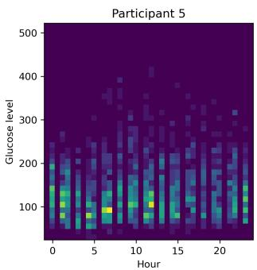

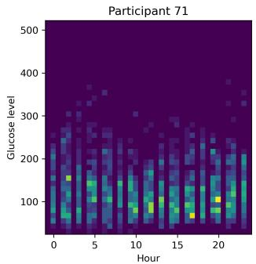

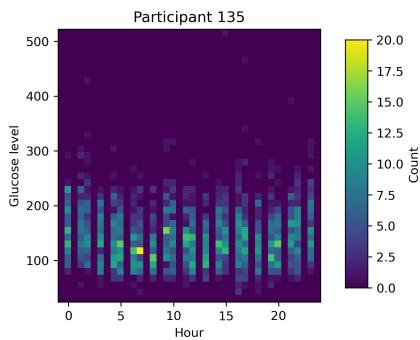  
Figure 1: Bivariate temporal distributions derived from continuous glucose monitoring data for three participants. The horizontal axis represents time of day, and the vertical axis represents glucose concentration.

The increasing availability of distribution-valued and other non-Euclidean data has motivated the development of statistical methods for random objects in metric spaces [11]. A fundamental framework is Fréchet regression, which extends the notion of conditional expectation by defining the regression target through a conditional Fréchet mean [33]. This perspective has since led to a broad range of methods for regression, dimension reduction, variable selection, longitudinal and multilevel data, and other statistical problems involving complex random objects. Nevertheless, most existing regression procedures are either designed for relatively low-dimensional predictors or rely on specific geometric or structural assumptions about the response space. Developing flexible regression methods that simultaneously accommodate general statistical responses and high-dimensional predictors therefore remains an important challenge in contemporary applications.

Deep learning (DL) [18] is a natural candidate for addressing this problem, but DL methods for metric-space-valued responses remain comparatively underdeveloped. Several complementary deep learning strategies have recently emerged. One approach uses an embedding-based construction. Deep Fréchet Regression first represents the relevant response structure in a low-dimensional Euclidean space, for example using ISOMAP, estimates the relationship between the predictors and the resulting coordinates using deep neural networks, and then maps predictions back to the original response space through local Fréchet regression [15]. This approach connects manifold learning and deep regression; its analysis relies on a learned low-dimensional representation followed by local Fréchet regression, so its performance depends on how well that representation captures the regression structure. Another recent strategy avoids explicitly embedding the responses into a Euclidean space and instead constructs predictions directly in the original metric space. The E2M framework of [43] employs a neural network to learn input-dependent weights on the probability simplex, with predictions obtained as weighted Fréchet means of the observed responses. A related approach is the deep Fréchet neural network (DFNN) framework of [16], which combines learned representations of the predictors with a global Fréchet regression output layer and establishes universal approximation and generalization guarantees for metric-space-valued responses. Both frameworks provide end-toend learning architectures that account for the geometry of the response space without requiring an explicit Euclidean embedding of the responses. However, their predictions are defined through weighted Fréchet optimization problems, making their implementation dependent on the geometric properties of the response space and the computational tractability of the corresponding optimization problems.

A separate line of work extends global Fréchet regression to nonlinear settings using operator-based methods. In particular, nonlinear global Fréchet regression based on weak conditional expectation uses reproducing-kernel Hilbert space embeddings and covariance operators to capture nonlinear relationships involving random objects [5]. This approach provides a flexible and theoretically wellgrounded framework, although its implementation requires estimating and regularizing covariance operators and related spectral quantities, which can be computationally and statistically demanding in high-dimensional or non-Euclidean settings.

Despite these advances, developing statistically flexible and computationally tractable deep learning methods for metric-space-valued responses remains challenging. Existing approaches address the lack of linear structure in the response space through geometric embeddings, weighted Fréchet regression, or operator-based constructions. These strategies provide important theoretical and methodological foundations, but also motivate alternative formulations that can directly leverage the extensive methodological and theoretical developments in scalar-valued deep learning. In particular, modern deep learning theory has established favorable approximation and convergence guarantees for regression functions exhibiting hierarchical, compositional, or intrinsically low-dimensional structure, potentially mitigating the curse of dimensionality. This raises a fundamental question: can metric-space regression be reduced to conventional scalar-valued learning problems while transferring these statistical advantages to general non-Euclidean responses?

This challenge is especially interesting in view of recent developments in scalar nonparametric regression. Classical nonparametric methods are highly flexible, but their convergence rates typically deteriorate rapidly as the dimension of the predictors increases [13, 38]. Deep neural networks, however, can behave quite differently when the regression function has additional structure. A growing body of approximation and statistical theory shows that neural networks can achieve favorable rates for functions with hierarchical, compositional, sparse, or intrinsically low-dimensional structure [41, 3, 35]. In these settings, deep architectures can substantially alleviate the classical curse of dimensionality. This naturally raises the question of whether similar advantages can be retained when the response is a general random object rather than a scalar or Euclidean vector.

Motivated by these developments, we introduce a deep learning framework for regression with responses taking values in metric spaces. Our approach builds on the anchor-based regression framework with random effects introduced by Matabuena and Cámara [29], extending its underlying principles to modern deep learning. The proposed framework is designed to retain the statistical flexibility of deep neural networks while imposing minimal structure on the response space. Rather than embedding the responses into a low-dimensional manifold or Euclidean representation, we reduce the original regression problem to a collection of standard scalar-valued learning tasks and subsequently reconstruct the target directly in the original metric space. This formulation allows each component to be estimated using conventional neural-network methods and, importantly, enables the individual models to be trained independently and in parallel.

Our contributions are threefold. First, we introduce an anchor-based deep learning framework for regression with metric-space-valued responses. The proposed approach transforms the original regression problem into a collection of scalar-valued learning tasks, thereby allowing the use of standard neural-network architectures without requiring an explicit Euclidean embedding of the responses. These learning tasks can be trained independently and in parallel, after which predictions are reconstructed in the original metric space. Second, we establish statistical consistency and convergence-rate guarantees for the proposed estimator under explicit assumptions on the response space, the regression structure, and anchor coverage. In particular, we investigate how hierarchical compositional structure in the underlying scalar regression functions influences the convergence behavior of the resulting metric-space estimator. Our analysis connects modern deep learning theory with anchor-based metric regression and identifies conditions under which favorable high-dimensiona learning rates can be retained for non-Euclidean responses. Third, we investigate the finite-sample performance of the proposed framework through extensive simulation experiments and biomedical applications involving distribution-valued responses. We compare the proposed estimator with existing approaches, including Deep Fréchet Regression [15], to evaluate its predictive accuracy and computational behavior across different regression settings.

## 1.1 Notation

For $n \in \mathbb { N } .$ , let $[ n ] = \{ 1 , \dots , n \}$ . For $g : [ 0 , 1 ] ^ { p }  \mathbb { R }$ , define $\| g \| _ { \infty } = \operatorname* { s u p } _ { x \in [ 0 , 1 ] ^ { p } } | g ( x ) |$ |. For $A > 0$ let $g ^ { A }$ denote the clipping of g at level $A , g ^ { A } ( x ) = \operatorname* { m a x } \{ - A$ , min $\{ g ( x ) , A \} \}$

Given the design points $x _ { 1 } , . . . , x _ { n } \in [ 0 , 1 ] ^ { p }$ , define the normalized empirical norm $\| g \| _ { n } ~ =$ $\textstyle \left( n ^ { - 1 } \sum _ { i = 1 } ^ { n } g ( x _ { i } ) ^ { 2 } \right) ^ { 1 / 2 }$ , omitting the dependence on the design points unless needed. The predictor dimension p is fixed in the asymptotic statements. Network depths, widths, and hierarchy levels are positive integers; derivative orders may be zero.

For positive sequences $\left\{ a _ { n } \right\}$ and $\left\{ b _ { n } \right\}$ , we write $a _ { n } = O ( b _ { n } )$ , or equivalently $a _ { n } \lesssim b _ { n }$ , if there exist constants $C , N > 0$ such that $a _ { n } \leq C b _ { n }$ for all $n \geq N$ . We write $a _ { n } \asymp b _ { n }$ if both $a _ { n } = O ( b _ { n } )$ and $b _ { n } = O ( a _ { n } )$ . For random variables $\{ X _ { n } \}$ , we write $\begin{array} { r } { X _ { n } = o _ { \mathbb { P } } ( a _ { n } ) \mathrm { i f } \ \frac { X _ { n } } { a _ { n } } \ \xrightarrow { \mathbb { P } } 0 } \end{array}$ , that is, for every $\varepsilon > 0 .$ , lim $_ { \cdot n  \infty } \mathbb { P } ( | X _ { n } | > \varepsilon a _ { n } ) = 0$

## 1.2 Outline

This paper is organized as follows. Section 2 introduces the methodology, and Section 3 develops the statistical learning theory. Section 4 reports the simulation study, while Section 5 presents two digital-health case studies with multivariate distribution-valued outcomes. Section 6 concludes with limitations and future directions. The Supplementary Material contains the technical proofs and supporting results.

## 2 Methodology

## 2.1 Preliminaries

Let $( \mathcal { V } , d )$ be a separable metric space, and let Y be a random object taking values in Y. We assume that a regular conditional law of Y given $X = x \mathrm { i }$ s fixed and that the risks below are jointly measurable and finite. Throughout the theoretical analysis, all minimizers are assumed to exist and to be found exactly. This includes the population targets, the network estimators, and the best-approximation functions. When a minimizer is not unique, a fixed measurable selection is used. Suppose that, together with $Y ,$ , we observe a predictor vector $X \in \mathcal { X } \subset \mathbb { R } ^ { p }$ . Throughout, we assume that the data consist of an i.i.d. sample ${ \mathcal { D } } _ { n } \stackrel { \cdot } { = } \{ ( X _ { i } , Y _ { i } ) \} _ { i = 1 } ^ { n } \subset \mathcal { X } \times \mathcal { Y }$ from the joint distribution of $( X , Y )$ . A fundamental notion for random objects in metric spaces is the Fréchet mean [11], which generalizes the classical expectation to non-Euclidean settings. The Fréchet mean is defined as

$$
\mathbb { E } _ { \oplus } [ Y ] : = \operatorname * { a r g m i n } _ { y \in \mathcal { Y } } \mathbb { E } \big [ d ^ { 2 } ( y , Y ) \big ] .\tag{1}
$$

Uniqueness requires additional conditions; for example, it holds in Hadamard spaces under a finite second-moment assumption [36]. In the presence of covariates, the main statistical object of interest is the conditional Fréchet mean [33], which generalizes the classical notion of conditional mean. It is defined by

$$
m ( x ) = \mathbb { E } _ { \oplus } { \bigl ( } Y \mid X = x { \bigr ) } : = { \underset { y \in \mathcal { Y } } { \operatorname { a r g m i n } } } \mathbb { E } { \bigl [ } d ^ { 2 } ( y , Y ) \mid X = x { \bigr ] } , \qquad x \in \mathcal { X } .\tag{2}
$$

Here, the expectation is taken with respect to the conditional distribution of $Y$ given $X = x$ . When $\mathcal { V } = \mathbb { R }$ and d is the Euclidean distance, the conditional Fréchet mean reduces to the classical conditional expectation. Regression with metric-space-valued responses can therefore be formulated as the problem of estimating the conditional Fréchet mean function $m ( \cdot )$

We next present two representative regression problems on metric spaces, both arising naturally in modern biomedical applications and playing an important role in contemporary statistical and machine learning methodologies.

Example 1 (Wasserstein distributions). Let $\mathcal { X } = \mathbb { R } ^ { p }$ , and let $\mathcal { V } = \mathcal { W } _ { 2 }$ be the space of Borel probability measures on $\mathbb { R } ^ { d }$ with finite second moments, equipped with the 2-Wasserstein metric $W _ { 2 }$ whose square is

$$
W _ { 2 } ^ { 2 } ( \mu , \nu ) = \operatorname* { i n f } _ { \pi \in \Pi ( \mu , \nu ) } \int _ { \mathbb { R } ^ { d } \times \mathbb { R } ^ { d } } \| u - v \| ^ { 2 } d \pi ( u , v ) ,
$$

where $\Pi ( \mu , \nu )$ is the set of couplings of $\mu$ and ν. This metric compares distributions according to the least costly way of transporting mass, yielding a geometry-aware discrepancy that differs from classical divergence-based measures [40, 31].

In digital health, a common physiological representation is the distribution of a time series generated by a continuous process of interest such as glucose, heart rate, physical activity, or sleep over time. For subject $i = 1 , \ldots , n$ , let $\mathbf Z _ { i } ( t ) \in \mathbb R ^ { d }$ be a digital-health time series observed at $t _ { i 1 } < \dots < t _ { i m _ { i } }$ e.g., continuous glucose, heart rate, or physical activity. The distribution-valued response is often the empirical marginal law

$$
\mu _ { i } = \frac { 1 } { m _ { i } } \sum _ { j = 1 } ^ { m _ { i } } \delta _ { \mathbf { Z } _ { i } ( t _ { i j } ) } ,
$$

or, to incorporate dynamics [26], the empirical joint law of the process and its discrete derivative,

$$
\nu _ { i } = \frac { 1 } { m _ { i } - 1 } \sum _ { j = 1 } ^ { m _ { i } - 1 } \delta _ { \left( \mathbf { Z } _ { i } ( t _ { i j } ) , \frac { \mathbf { Z } _ { i } ( t _ { i , j + 1 } ) - \mathbf { Z } _ { i } ( t _ { i j } ) } { t _ { i , j + 1 } - t _ { i j } } \right) } .
$$

With covariates $X _ { i } \in \mathbb { R } ^ { p }$ , one models $\mathbb { E } [ \mu _ { i } \ | \ X _ { i } = x ]$ or $\mathbb { E } [ \nu _ { i } \mid X _ { i } = x ]$ in the Wasserstein space $\mathcal { W } _ { 2 } ;$ see [28, 25, 26]. Thus the outcome is the full subject-specific distribution rather than a scalar summary, such as the mean biomarker level over the observation period.

Example 2 (Symmetric positive-definite matrices). Let $\mathcal { X } = \mathbb { R } ^ { p }$ and $\mathcal { V } = \mathrm { S y m } _ { + } ^ { l }$ , the space of $l \times { \bar { l } }$ symmetric positive-definite matrices, which includes covariance and correlation matrices. Several natural metrics are available:

• Frobenius: $d _ { F } ( A , B ) = \lVert A - B \rVert _ { F } .$

• Log-Cholesky [19]: if $A = L _ { A } L _ { A } ^ { \top }$ , where $L _ { A }$ is lower triangular with positive diagonal, then

$$
\begin{array} { r } { d _ { \mathrm { L C } } ^ { 2 } ( A , B ) = \Vert \log L _ { A } - \log L _ { B } \Vert _ { F } ^ { 2 } . } \end{array}
$$

• Power Euclidean [10]:

$$
d _ { \alpha } ( A , B ) = \frac { 1 } { \alpha } \| A ^ { \alpha } - B ^ { \alpha } \| _ { F } , \qquad \alpha > 0 ,
$$

with the log-Euclidean limit ∥ log A − log $B \Vert _ { F }$ as $\alpha  0 .$

See also [32, 4] for affine-invariant and Bures–Wasserstein metrics. Such matrices arise naturally as covariance or correlation summaries of multivariate biomedical signals, for example, fMRI functional connectivity across brain regions, EEG channel covariance, or diffusion tensor imaging [42]. This paper develops a deep-learning (DL) estimator of the conditional Fréchet mean that operates directly on metric-space-valued responses without requiring a prespecified Euclidean or manifold embedding.

## 2.2 Deep ReLU neural networks

We define the rectified linear unit (ReLU) activation function by $\tau ( x ) = \operatorname* { m a x } \{ 0 , x \} , \qquad x \in \mathbb { R }$

Following [17, 30], we restrict attention to multilayer feedforward ReLU networks in which all hidden layers have the same width. Specifically, we let $\mathcal { F } ( L , \nu )$ denote the class of dense ReLU networks with L hidden layers and ν hidden units in each layer.

Throughout, the term “dense” refers to the absence of sparsity restrictions on the network parameters; equivalently, we consider fully connected network architectures. An explicit definition of the functions belonging to $\mathcal { F } ( L , \nu )$ is provided in Appendix B.

## 2.3 Estimator

Before defining the estimator, define the conditional Fréchet risk function $M : \mathcal { X } \times \mathcal { Y }  \mathbb { R }$ by

$$
M ( x , y ) : = \mathbb { E } \big [ d ^ { 2 } ( Y , y ) \big | X = x \big ] .
$$

The target of interest is the conditional Fréchet mean function $m : \mathcal { X }  \mathcal { Y }$ , which satisfies

$$
m ( x ) : = \arg \operatorname* { m i n } _ { y \in \mathcal { V } } M ( x , y ) .
$$

Recalling that $\mathcal { D } _ { n } = \{ ( X _ { i } , Y _ { i } ) \} _ { i = 1 } ^ { n }$ are independent copies of $( X , Y )$ , for each $i = 1 , \ldots , n$ , define the random function $M _ { i } : \mathcal { X } $ R by

$$
M _ { i } ( x ) : = M ( x , Y _ { i } ) = \operatorname { \mathbb { E } } \big [ d ^ { 2 } ( Y , Y _ { i } ) \mid Y _ { i } , X = x \big ] .\tag{3}
$$

Thus, for each fixed i, the function $M _ { i }$ describes the conditional expected squared distance between $Y$ and the observed response $Y _ { i }$

An estimator of $M _ { i }$ can be obtained by regressing $\{ d ^ { 2 } ( Y _ { j } , Y _ { i } ) : j \neq i \}$ on $\{ X _ { j } : j \neq i \}$ . The observation indexed by i is excluded so that, conditional on the anchor $Y _ { i } ,$ the remaining regression pairs are independent. In $( 3 ) , ( X , Y )$ denotes a fresh copy independent of the training sample. Based on these estimators, we then construct an estimator of the conditional Fréchet mean function $m ( \cdot )$ The procedure is defined as follows.

1. Estimation of the conditional risk functions.

Let $I \subset \{ 1 , \ldots , n \}$ be nonempty and deterministic. For each $i \in I$ , define the exact empirical minimizer

$$
\widehat { f } _ { i } \in \operatorname * { a r g m i n } _ { f \in \mathcal { F } ( L _ { i } , \nu _ { i } ) } \frac { 1 } { n - 1 } \sum _ { j \in [ n ] \backslash \{ i \} } \big ( d ^ { 2 } ( Y _ { j } , Y _ { i } ) - f ( X _ { j } ) \big ) ^ { 2 } .
$$

The minimum is taken over the entire dense network class: no sparsity or weight constraints are imposed. Set

$$
\widehat { M } _ { i } : = \widehat { f } _ { i } ^ { A _ { n } } , \qquad A _ { n } > 0 .
$$

Thus the clipping is applied after exact minimization.

2. Selection of the estimated Fréchet mean.

Having obtained $\{ \widehat { M } _ { j } \} _ { j \in I }$ , we predict a new covariate value x by selecting the observed response whose estimated conditional risk is smallest. Specifically, we define

$$
{ \widehat { m } } ( x ) : = Y _ { i } ,
$$

where i is chosen so that

$$
i = \operatorname* { m i n } \left\{ j \in I : { \widehat { M } } _ { j } ( x ) = \operatorname* { m i n } _ { k \in I } { \widehat { M } } _ { k } ( x ) \right\} .
$$

## 3 Theory

We first establish risk bounds for arbitrary ReLU neural-network classes, expressed in terms of approximation error, and then specialize these bounds to the conditional risk functions $M _ { i }$ under the hierarchical-composition assumptions of [17].

## 3.1 General Theory for Estimation with ReLU Neural Networks

Throughout we assume that $\mathcal { X } = [ 0 , 1 ] ^ { p }$ for some $p \in \mathbb N$ . We now state our main conditions on the metric d.

Assumption 1. The metric space Y is bounded: $d ( a , b ) \leq C _ { n }$ for all $a , b \in \mathcal { D }$ . The notation $C _ { n }$ is retained to allow an n-dependent bound.

Remark 1. Assumption 1 is satisfied whenever the metric space $( \mathcal { V } , d )$ has finite diameter,

$$
\dim ( { \mathcal { y } } ) : = \operatorname* { s u p } _ { a , b \in { \mathcal { y } } } d ( a , b ) < \infty .
$$

In this case, one may take

$$
C _ { n } = \dim ( \mathcal { Y } )
$$

for every n. Thefollowing are standard examples.

1. Bounded Euclidean responses. Let

$$
\mathcal { V } \subseteq \{ y \in \mathbb { R } ^ { q } : \| y \| _ { 2 } \leq R \} , \qquad d ( a , b ) : = \| a - b \| _ { 2 } ,
$$

for some $R < \infty$ . Then, for every $a , b \in { \mathcal { D } } ,$

$$
d ( a , b ) = \| a - b \| _ { 2 } \leq \| a \| _ { 2 } + \| b \| _ { 2 } \leq 2 R .
$$

Thus Assumption 1 holds with $C _ { n } \ = \ 2 R .$ . More generally, every bounded subset of a finite-dimensional normed space satisfies Assumption 1 under the metric induced by the norm.

2. Bounded functional or Hilbert-space-valued responses. Let H be a Hilbert space and let

$$
\mathcal { V } : = \{ f \in \mathbb { H } : \| f \| _ { \mathbb { H } } \leq R \} , \qquad d ( f , g ) : = \| f - g \| _ { \mathbb { H } } .
$$

Then

$$
d ( f , g ) \leq \| f \| _ { \mathbb { H } } + \| g \| _ { \mathbb { H } } \leq 2 R ,
$$

so Assumption 1 holds with $C _ { n } = 2 R$ . In particular, this includes bounded subsets of $L ^ { 2 } ( \mathcal { T } )$ equipped with the $L ^ { 2 }$ distance.

3. Probability measures under a Wasserstein metric. Let $( S , \rho )$ be a bounded metric space with

$$
D : = \operatorname* { s u p } _ { u , v \in S } \rho ( u , v ) < \infty ,
$$

and let $\mathcal { V } = \mathcal { P } ( \mathcal { S } )$ be a collection ofprobability measures on S. For $r \geq 1$ , equip Y with the r-Wasserstein metric

$$
W _ { r } ( \mu , \nu ) : = \left[ \operatorname* { i n f } _ { \pi \in \Pi ( \mu , \nu ) } \int _ { S \times S } \rho ( u , v ) ^ { r } \pi ( d u , d v ) \right] ^ { 1 / r } ,
$$

where $\Pi ( \mu , \nu )$ denotes the set ofcouplings ofµ and ν. Since $\rho ( u , v ) \leq D$ for all $u , v \in S ,$

$$
W _ { r } ( \mu , \nu ) ^ { r } \leq D ^ { r } ,
$$

and therefore

$$
W _ { r } ( \mu , \nu ) \leq D .
$$

Thus Assumption 1 holds with $C _ { n } = D$ . For example, probability distributions supported on a bounded interval or a bounded subset of ${ \mathbb R } ^ { q }$ satisfy this condition under the Wasserstein metric.

4. Probability distributions under the Hellinger metric. Let Y be a collection of probability measures dominated by a common measure λ, and define

$$
d _ { \mathrm { H } } ( P , Q ) : = \left[ \int \left( \sqrt { \frac { d P } { d \lambda } } - \sqrt { \frac { d Q } { d \lambda } } \right) ^ { 2 } d \lambda \right] ^ { 1 / 2 } .
$$

Since

$$
d _ { \mathrm { H } } ( P , Q ) ^ { 2 } = 2 - 2 \int \sqrt { \frac { d P } { d \lambda } \frac { d Q } { d \lambda } } d \lambda \leq 2 ,
$$

we have

$$
d _ { \mathrm { H } } ( P , Q ) \leq { \sqrt { 2 } } .
$$

Hence Assumption 1 holds with $C _ { n } = { \sqrt { 2 } } ,$ even when the underlying sample space is unbounded.

5. Finite and compact metric response spaces. Every finite metric space is bounded. Indeed, if

$$
\mathcal { Y } = \{ y _ { 1 } , \dots , y _ { m } \} ,
$$

then

$$
C _ { n } = \operatorname* { m a x } _ { 1 \leq j , k \leq m } d ( y _ { j } , y _ { k } ) < \infty .
$$

More generally, every compact metric space is bounded. For example, the unit sphere

$$
\mathbb { S } ^ { q - 1 } = \left\{ y \in \mathbb { R } ^ { q } : \| y \| _ { 2 } = 1 \right\}
$$

has diameter 2 under the Euclidean chordal metric and diameter π under the geodesic metric.

In all ofthese examples, $C _ { n }$ can be chosen to be afixed constant that does not depend on n. The notation ${ \dot { C } } _ { n }$ also permits settings in which the allowed response set grows with n; for example, if Y is restricted to a ball of radius $R _ { n }$ , one may take $C _ { n } = 2 R _ { n }$ .

Remark 2. In digital-health applications, Assumption 1 is particularly natural, as physiological measurements are typically acquired within finite measurement ranges and may be restricted to bounded domains during preprocessing. Moreover, sensor acquisition and preprocessing often involve smoothing or filtering operations that improve the regularity of the observed signals. When the resulting distribution-valued responses are supported on a common bounded domain, their Wasserstein distances are uniformly bounded, and Assumption 1 is satisfied.

For a measurable function $g : [ 0 , 1 ] ^ { p }  \mathcal { Y }$ , define

$$
\mathcal { R } ( g ) : = \mathbb { E } [ d ^ { 2 } ( Y , g ( X ) ) ] = \int M ( x , g ( x ) ) d P _ { X } ( x ) .
$$

When $g$ is learned from $\mathcal { D } _ { n } , \mathcal { R } ( g )$ means the conditional prediction risk $\mathbb { E } [ d ^ { 2 } ( Y , g ( X ) ) \mid { \mathcal { D } } _ { n } ]$ for a fresh independent pair $( X , Y )$ . Thus $\mathcal { R } ( \widehat { m } )$ is random through the training sample, and $\mathcal { R } ( \dot { m } ) \leq \mathcal { R } ( g )$ holds for every realized measurable g.

We are now ready to state our main result which applies to arbitrary ReLU neural network function classes.

Theorem 1. Suppose Assumption 1 holds. Let $L , \nu : \mathcal { V } \to \mathbb { N }$ be deterministic measurable functions, allowed to depend on n, with $L ( y ) \nu ( y ) \geq 2 .$ . Set $L _ { i } = L ( Y _ { i } )$ and $\nu _ { i } = \nu ( Y _ { i } )$ . For every $y \in \mathcal { V }$ , let

$$
\widetilde M ( \cdot , y ) \in \underset { f \in \mathcal { F } ( L ( y ) , \nu ( y ) ) } { \arg \operatorname* { m i n } } \ \| f - M ( \cdot , y ) \| _ { \infty }
$$

be an exact best approximant, and choose a positive sequence $\phi _ { n }$ such that

$$
\operatorname* { s u p } _ { y \in \mathcal { V } } \big \| \widetilde { M } ( \cdot , y ) - M ( \cdot , y ) \big \| _ { \infty } ^ { 2 } \leq \phi _ { n } .
$$

Choose the clipping level $A _ { n }$ deterministically. Suppose

$$
A _ { n } \geq 8 \operatorname* { m a x } \left\{ 1 , \operatorname* { s u p } _ { y } \| M ( \cdot , y ) \| _ { \infty } + \mathcal { U } _ { n } , \mathrm { ~ } 8 \operatorname* { s u p } _ { y } \| M ( \cdot , y ) \| _ { \infty } , \mathrm { ~ } 8 \sqrt { \phi _ { n } } \right\} ,\tag{4}
$$

where $\mathcal { U } _ { n } = C _ { n } ^ { 2 }$ . Then

$$
\mathscr { R } ( \widehat { m } ) \leq \mathscr { R } ( m ) + r _ { n } + c _ { 1 } \left[ \sqrt { \frac { | I | \operatorname* { m a x } \{ \mathscr { U } _ { n } ^ { 2 } , A _ { n } ^ { 2 } \} \operatorname* { m a x } _ { i \in I } \{ L _ { i } ^ { 2 } \nu _ { i } ^ { 2 } \log ( L _ { i } \nu _ { i } ) \} \log ( A _ { n } n ) } { n } + \sqrt { | I | \phi _ { n } } } \right]
$$

with probability approaching one, for a constant $c _ { 1 } > 0$ independent of n, provided that $r _ { n } \downarrow 0 ,$

$$
\frac { \operatorname* { m i n } _ { i \in I } \{ L _ { i } ^ { 2 } \nu _ { i } ^ { 2 } \log ( L _ { i } \nu _ { i } ) \} \log ( 2 A _ { n } ^ { 2 } ) } { \log n } \stackrel { \mathbb { P } } { \to } \infty ,
$$

and

$$
C _ { n } \operatorname* { s u p } _ { y \in \mathcal { V } } \operatorname* { m i n } _ { i \in I } d ( Y _ { i } , y ) = o _ { \mathbb { P } } ( r _ { n } ) .\tag{5}
$$

The probabilities are over $\mathcal { D } _ { n }$ . Constants may depend on the fixed predictor dimension p and the stated uniform bounds.

Remark 3. When $A _ { n }$ and $\mathcal { U } _ { n }$ grow at most polylogarithmically, Theorem 1 gives risk consistency if the coverage condition holds and

$$
\frac { | I | \operatorname* { m a x } \{ \mathcal { U } _ { n } ^ { 2 } , A _ { n } ^ { 2 } \} \operatorname* { m a x } _ { i \in I } \{ L _ { i } ^ { 2 } \nu _ { i } ^ { 2 } \log ( L _ { i } \nu _ { i } ) \} \log ( A _ { n } n ) } { n } = o _ { \mathbb { P } } ( 1 ) , \qquad | I | \phi _ { n } = o ( 1 ) .
$$

The coverage rate depends on both the geometry ofY and the distribution ofthe anchors.

Corollary 1. Suppose that Assumption 1 holds. In addition, assume that the parameters $\{ L _ { i } \} _ { i \in [ n ] }$ and $\{ \nu _ { i } \} _ { i \in [ n ] }$ can be chosen such that the estimates $\widehat { M _ { i } }$ satisfy

$$
\operatorname* { m a x } _ { i \in I } \lVert \widehat { M } _ { i } - M _ { i } \rVert _ { \infty } = O _ { \mathbb { P } } ( \alpha _ { n } )\tag{6}
$$

for a positive sequence $\alpha _ { n }$ that converges to zero. Then, provided that (5) holds,

$$
\mathcal { R } ( \widehat { m } ) - \mathcal { R } ( m ) = O _ { \mathbb { P } } ( r _ { n } + \alpha _ { n } ) .
$$

## 3.2 Theory under Hierarchical Composition Models

We now present our main result under explicit assumptions on the functions $M ( \cdot , y )$ for $y \in \mathcal { V }$ . In particular, we impose conditions intended to mitigate the curse of dimensionality that arises when $\dot { \boldsymbol X } \in [ 0 , 1 ] ^ { p }$ is high-dimensional. To this end, we follow [17], who studied nonparametric regression with ReLU networks under a hierarchical composition class $\mathcal { H } ( l , \mathcal { P } )$ assumption. This class consists of functions formed through successive compositions of smooth component functions, each of which may depend on only a lower-dimensional subset of the p input variables. The relevant definitions are given in Appendix C.

We are now ready to state the main result of this subsection.

Theorem 2. Suppose Assumption 1 holds. For every $y \in \mathcal { V }$ , assume $M ( \cdot , y ) \in \mathcal { H } ( l ( y ) , \mathcal { P } ( y ) )$ , with a chosen representation whosefinite, nonempty set ofcomponent pairs is $\mathcal { P } ( y ) \subset [ 1 , \infty ) \times \mathbb { N }$ . Each component g is $( t _ { g } , C )$ -smooth in the sense ofDefinition 1, where $t _ { g } = q _ { g } + s _ { g } , q _ { g } \ge 0 , s _ { g } \in ( 0 , 1 ]$ and $( t _ { g } , K _ { g } ) \in \mathcal { P } ( y )$ . The smoothness constant $C ,$ the bounds $c _ { 2 }$ on all derivatives oforders at most $q _ { g }$ (including order zero), and the Lipschitz constant $C _ { \mathrm { L i p } } \geq 1$ are uniform in g and y. Assume

$$
\operatorname* { s u p } _ { y } l ( y ) < \infty , \qquad \operatorname* { s u p } _ { y } \operatorname* { m a x } _ { ( t , K ) \in \mathcal { P } ( y ) } \operatorname* { m a x } \{ t , K \} < \infty .
$$

Let

$$
\phi _ { n } : = \operatorname* { s u p } _ { y \in \mathcal { V } } \operatorname* { m a x } _ { ( t , K ) \in \mathcal { P } ( y ) } n ^ { - 2 t / ( 2 t + K ) } .
$$

Let $L ( y )$ and $\nu ( y )$ be as in (15) or (16), with sufficiently large constants uniform in y, and assume these architecture maps are measurable. With $A _ { n }$ satisfying (4) and $\mathcal { U } _ { n }$ as in Theorem 1,

$$
\mathscr { R } ( \widehat { m } ) \leq \mathscr { R } ( m ) + r _ { n } + c _ { 1 } \sqrt { | I | \operatorname* { m a x } \{ \mathscr { U } _ { n } ^ { 2 } , A _ { n } ^ { 2 } \} } \phi _ { n } ( \log n ) ^ { 3 } \log ( A _ { n } n )
$$

with probability approaching one, provided $r _ { n } \downarrow 0$ and the coverage condition (5) holds. The constants may depend on thefixed $p ,$ the uniform hierarchy-depth and smoothness bounds, $c _ { 2 } ,$ , and $C _ { \mathrm { L i p } } ,$ , but not on n or y.

When $A _ { n } = O ( { \mathrm { p o l y } } ( \log n ) )$ , condition (4), which imposes a lower bound on $A _ { n }$ in terms of $u _ { n } ,$ $\operatorname* { s u p } _ { y } \| M ( \cdot , y ) \| _ { \infty }$ , and $\sqrt { \phi _ { n } }$ , also implies that $\mathcal { U } _ { n }$ grows at most polylogarithmically. In this case, Theorem 2 yields a remainder of order $r _ { n } + \sqrt { | I | \phi _ { n } }$ up to logarithmic factors. In particular, since $\log ( A _ { n } n ) \asymp$ log $n _ { \mathrm { { ; } } }$ , the square-root term carries an additional factor $( \log n ) ^ { 2 }$ , together with the factor max $\{ \mathcal { U } _ { n } , A _ { n } \}$ . The rate exponent in $\phi _ { n }$ depends on the component dimensions rather than on the ambient predictor dimension. The resulting bound is therefore a general upper bound under the stated metric-space coverage conditions, rather than a claim of optimality. The corresponding scalar neural-network rate is given in [17].

Remark 4 (Number of anchors). Theorem 2 suggests that,for large sample sizes, selecting a subset ofanchors with cardinality $| I | = k _ { n } \asymp n ^ { \alpha }$ may be preferable to using all observations. In particular, $\dot { \imath } f \phi _ { n } \asymp n ^ { - 2 t / ( 2 t + K ) }$ and the clipping and diameter terms remain bounded, the estimation-error term vanishes whenever

$$
0 < \alpha < \frac { 2 t } { 2 t + K } .
$$

Consequently, the excess-risk bound converges to zero provided that the anchor-coverage condition and the remaining assumptions of Theorem $\bar { 2 }$ are satisfied.

Our convergence results complement and extend recent theoretical developments for deep learning with metric-space-valued responses. Iao, Zhou, and Müller [15] derive convergence rates under a low-dimensional manifold representation of the conditional Fréchet mean, accounting for errors arising from estimating the manifold coordinates. Zhou, Iao, and Müller [43] establish universal approximation and convergence properties for the entropy-regularized E2M training objective. Kim, Chen, and Dubey [16] establish universal approximation, uniform consistency, and generalization guarantees for DFNN, including excess-risk and prediction-error bounds under neural-network complexity controls. Our work makes a distinct theoretical and methodological contribution by establishing a direct connection between deep learning theory for hierarchically compositional functions and regression with general metric-space-valued responses. Unlike existing approaches, our framework reduces the non-Euclidean regression problem to independently estimable scalar conditional squared-distance regression tasks, without requiring a latent manifold representation or an end-to-end Fréchet optimization layer. More importantly, building on Kohler and Langer [17], we establish explicit excess-risk bounds that exploit the hierarchical compositional structure of these scalar regression functions. The resulting statistical estimation rates are governed by the smoothness and effective dimensions of the component functions rather than directly by the ambient predictor dimension.

This result identifies a theoretically important class of high-dimensional non-Euclidean regression problems for which deep learning can mitigate the classical curse of dimensionality. In contrast to general approximation and neural-network complexity guarantees, our analysis makes explicit how favorable compositional structure translates into statistical learning guarantees for metric-spacevalued responses. Crucially, the theory also characterizes the role of the number and coverage of response anchors, revealing the trade-off between scalar estimation accuracy and approximation of the conditional Fréchet target. Thus, our framework provides not only an alternative computational strategy, but also a distinct theoretical perspective on when and why deep learning can be statistically effective for non-Euclidean outcomes.

## 4 Simulation Study

We assess the finite-sample performance of the proposed method through simulation experiments. Our main goal is to evaluate how accurately it estimates the conditional Fréchet mean and how it compares with competing approaches for regression with metric-space-valued responses. The competing methods are deep Fréchet regression (DFR), global Fréchet regression (GFR), k-nearest-neighbor regression (KNN), and random forests (RF).

We consider two response types: (i) Euclidean-valued outcomes and (ii) probability distributions in the 2-Wasserstein space. In all scenarios, the predictor vector is $X = ( X _ { 1 } , \ldots , X _ { p } ) ^ { \intercal } \in \mathbb { R } ^ { p }$ , with $p \in \{ 5 , 1 0 , 1 5 , 2 0 \}$ . The training sample size is varied over $n \in \{ 2 0 0 , 3 0 0 , 4 0 0 , 5 0 0 \}$ , and all fitted models are evaluated on an independent test set of size $n _ { \mathrm { t e s t } } = 2 0 0 0$ . The prediction error is defined as

$$
\frac { 1 } { n _ { \mathrm { t e s t } } } \sum _ { i \in \mathcal { D } _ { \mathrm { t e s t } } } d ^ { 2 } ( Y _ { i } , \widehat { m } ( X _ { i } ) ) ,
$$

where $Y _ { i }$ is the test response corresponding to $X _ { i }$ and $\widehat { m } ( \cdot )$ is the fitted estimator. We use Euclidean distance for Euclidean responses and 2-Wasserstein distance for distribution-valued responses. Each experiment is repeated over 100 independent Monte Carlo replications.

For all neural-network-based methods, we use three hidden layers with 50 ReLU units per layer. Models are trained for 1000 epochs with Adam, learning rate 0.005, and mini-batch size $3 2$ . The same architecture and optimization settings are used for all neural-network competitors.

## 4.1 Euclidean Responses

## 4.1.1 Scenario 1: Mixed nonlinear regression

We first consider a nonlinear regression setting in which both the number of active predictors and the complexity of the regression function increase with the total number of predictors $p .$ Predictors are generated independently as

$$
X _ { j } \stackrel { \mathrm { i i d } } { \sim } \mathrm { U n i f } ( - 2 , 2 ) , \qquad j = 1 , \ldots , p .
$$

The response is

$$
Y = m ( X ) + \varepsilon , \qquad \varepsilon \sim { \mathcal { N } } ( 0 , 0 . 1 ^ { 2 } ) ,
$$

with

$$
\begin{array} { r l } & { m ( x ) = \sin ( x _ { 1 } x _ { 2 } ) + 0 . 5 \cos ( x _ { 3 } ) + 0 . 2 5 x _ { 4 } ^ { 2 } } \\ & { \phantom { m m } + \mathbb { I } ( p \geq 1 5 ) \left( x _ { 1 1 } + x _ { 1 2 } + x _ { 1 3 } + x _ { 1 4 } x _ { 1 5 } \right) } \\ & { \phantom { m m } + \mathbb { I } ( p \geq 2 0 ) \left( x _ { 1 6 } + x _ { 1 7 } + x _ { 1 8 } + x _ { 1 9 } x _ { 2 0 } \right) . } \end{array}\tag{7}
$$

For $p = 5$ and $p = 1 0$ , the response depends only on the first four predictors. For $p = 1 5$ and $p = 2 0$ , we introduce additional active variables and interaction terms. This design allows us to study how the methods behave as both the ambient dimension and the intrinsic complexity of the problem increase.

Figure 2 shows that the proposed DL method improves substantially as the training sample size increases. For $p = 5$ and $p = 1 0 .$ , KNN and RF are competitive when n is small, whereas DL becomes comparable or better as more training data become available. For $p = 1 5$ and $p = 2 0$ linear regression performs well in the smallest-sample settings, but DL eventually achieves the lowest prediction error. The relative performance of DL improves in the higher-dimensional configurations, where the regression function contains more active predictors and nonlinear interactions.

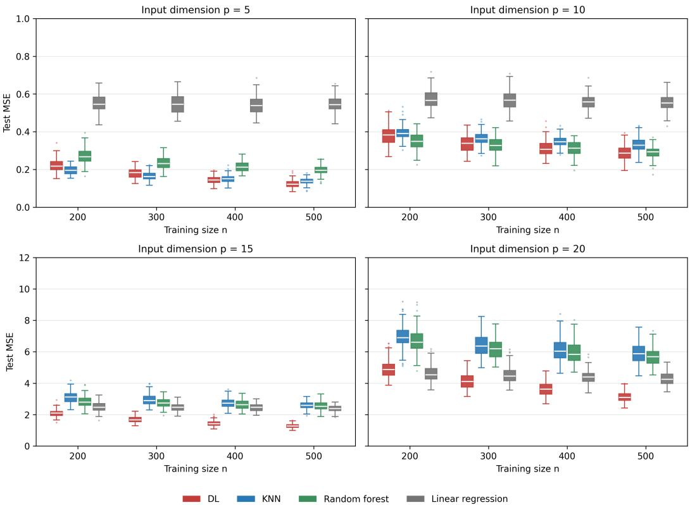  
Figure 2: Boxplots of prediction error for the competing methods in Scenario 1. Each panel corresponds to a different predictor dimension $p .$

## 4.1.2 Scenario 2: Fixed neural-network regression

In the second scenario, the regression function is generated by a fixed teacher neural network. The predictors are independently generated as

$$
X _ { j } \stackrel { \mathrm { i i d } } { \sim } \mathrm { U n i f } ( - 2 , 2 ) , \qquad j = 1 , \dotsc , p ,
$$

and the response is

$$
Y = m ( X ) + \varepsilon , \qquad \varepsilon \sim { \mathcal { N } } ( 0 , 0 . 1 ^ { 2 } ) .
$$

Let $r = \operatorname* { m i n } ( p , 8 )$ and define

$$
\widetilde { X } = ( X _ { 1 } , \ldots , X _ { r } ) ^ { \top } .
$$

Thus, only the first r predictors affect the response. The teacher network has three hidden layers with widths 32, 24, and 16:

$$
\begin{array} { r } { h _ { 1 } ( x ) = \operatorname { t a n h } \left( W _ { 1 } ^ { \top } \widetilde { x } + b _ { 1 } \right) , } \end{array}\tag{8}
$$

$$
\begin{array} { r } { h _ { 2 } ( \boldsymbol { x } ) = \mathrm { R e L U } \big ( \boldsymbol { W } _ { 2 } ^ { \top } h _ { 1 } ( \boldsymbol { x } ) + b _ { 2 } \big ) , } \end{array}\tag{9}
$$

$$
\begin{array} { r } { h _ { 3 } ( x ) = \operatorname { t a n h } \left( W _ { 3 } ^ { \top } h _ { 2 } ( x ) + b _ { 3 } \right) . } \end{array}\tag{10}
$$

Here,

$$
\begin{array} { r l r l r } { W _ { 1 } \in \mathbb { R } ^ { r \times 3 2 } , } & { { } } & { } & { { W _ { 2 } } \in \mathbb { R } ^ { 3 2 \times 2 4 } , } & { } & { { W _ { 3 } } \in \mathbb { R } ^ { 2 4 \times 1 6 } . } \end{array}
$$

Writing

$$
( d _ { 0 } , d _ { 1 } , d _ { 2 } , d _ { 3 } ) = ( r , 3 2 , 2 4 , 1 6 ) ,
$$

the hidden-layer weights are generated independently according to

$$
( W _ { \ell } ) _ { a b } \sim { \mathcal N } \biggl ( 0 , \frac { 2 } { d _ { \ell - 1 } + d _ { \ell } } \biggr ) , \qquad \ell = 1 , 2 , 3 ,
$$

and the corresponding bias components are independently generated from

$$
( b _ { \ell } ) _ { a } \sim \mathcal { N } ( 0 , 0 . 2 ^ { 2 } ) .
$$

The initial output weights and bias satisfy

$$
( \widetilde w _ { 4 } ) _ { a } \sim { \mathcal N } \bigg ( 0 , \frac { 1 } { 1 6 } \bigg ) , \qquad \widetilde b _ { 4 } \sim { \mathcal N } ( 0 , 0 . 1 ^ { 2 } ) ,
$$

and define the uncalibrated signal

$$
\widetilde { m } ( x ) = \widetilde { w } _ { 4 } ^ { \top } h _ { 3 } ( x ) + \widetilde { b } _ { 4 } .
$$

To standardize the signal strength, we generate 20,000 calibration vectors independently from $\operatorname { U n i f } ( [ - 2 , 2 ] ^ { r } )$ . Let m and $s _ { m }$ denote the empirical mean and standard deviation of m‹ over this calibration sample. The final regression function is

$$
m ( x ) = \frac { \widetilde { m } ( x ) - \overline { { m } } } { s _ { m } } .
$$

All network parameters are generated once and held fixed across Monte Carlo replications, ensuring that every replication uses the same underlying regression function. The network output is standardized to have approximately zero mean and unit variance under the predictor distribution.

When $p > 8 ,$ , only the first eight predictors affect the response; the remaining variables are noise predictors. Unlike Scenario 1, increasing p therefore increases ambient dimension without increasing the intrinsic dimension of the regression function.

Figure 3 shows that DL performs particularly well for $p = 5$ and becomes increasingly competitive for $p = 1 0 , 1 5$ , and 20 as training sample size grows. Its prediction error decreases markedly with $n ,$ indicating that the proposed method recovers the nonlinear structure of the teacher network once enough training data are available.

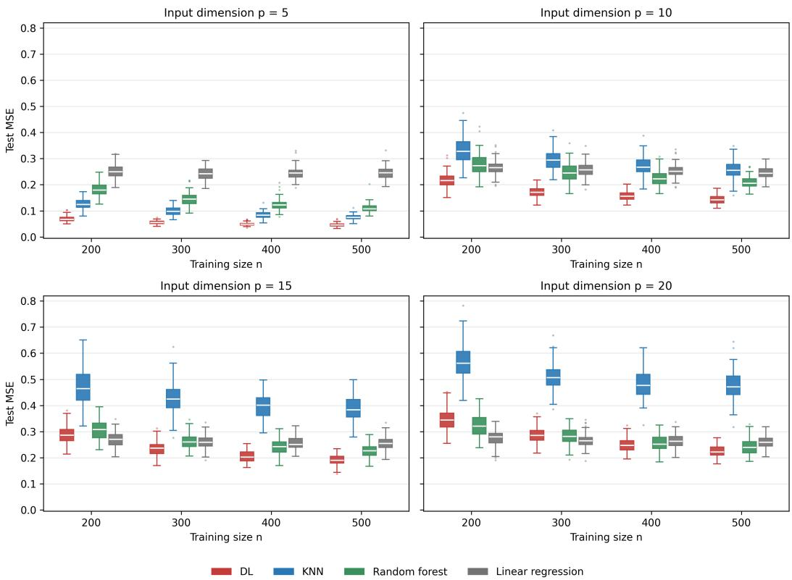  
Figure 3: Boxplots of prediction error for the competing methods in Scenario 2. Each panel corresponds to a different predictor dimension $p .$

## 4.2 Distribution-Valued Responses

We next consider regression settings in which the response is a probability distribution belonging to the Wasserstein space $\mathcal { W } _ { 2 } ( \mathbb { R } ^ { q } )$ , where q denotes the dimension of the underlying Euclidean space on which the distributions are defined.

## 4.2.1 Scenario 3: Covariate-dependent Gaussian distributions

In the third simulation, the response is a probability distribution on $\mathbb { R } ^ { q }$ . For each training observation, we generate

$$
X _ { i } \sim \mathrm { U n i f o r m } ( [ 0 , 1 ] ^ { p } ) ,
$$

where $p$ is the predictor dimension. Conditional on $X _ { i } = x ,$ , the response is a multivariate Gaussian

$$
P _ { i } = \mathcal { N } ( \mu ( x ) , Q _ { \Sigma } ( x ) ) ,
$$

with

$$
\begin{array} { r } { \mu ( x ) = \left( \displaystyle \sum _ { j = 1 } ^ { p } x _ { j } , \displaystyle \sum _ { j = 1 } ^ { p } x _ { j } ^ { 2 } , \ldots , \displaystyle \sum _ { j = 1 } ^ { p } x _ { j } ^ { q } \right) ^ { \top } \in \mathbb { R } ^ { q } , } \\ { Q _ { \Sigma } ( x ) = \Sigma ( x ) + U _ { i } ^ { 2 } \sigma ^ { 2 } I _ { q } , \qquad \Sigma ( x ) = v ( x ) v ( x ) ^ { \top } + 0 . 5 I _ { q } , \qquad v ( x ) = W x . } \end{array}
$$

Here, $W \in \mathbb { R } ^ { q \times p }$ has entries independently generated from $\mathcal { N } ( 0 , 0 . 5 ^ { 2 } )$ and is held fixed across all Monte Carlo replications. Moreover, $U _ { i } \sim \mathrm { U n i f o r m } ( - 1 , 1 )$ , and $\sigma > 0$ controls the isotropic covariance perturbation. We set $\sigma = 0 . 0 5$ throughout this simulation scenario. The term $0 . 5 I _ { q }$ ensures positive definiteness, while the rank-one component allows the covariance to vary smoothly with the predictors.

Each $P _ { i }$ is approximated by $s _ { 1 } = 2 0 0$ independent draws

$$
Y _ { i 1 } , \ldots , Y _ { i s _ { 1 } } \stackrel { \mathrm { i i d } } { \sim } P _ { i } ,
$$

yielding the empirical distribution

$$
\widehat { P _ { i } } = \frac { 1 } { s _ { 1 } } \sum _ { \ell = 1 } ^ { s _ { 1 } } \delta _ { Y _ { i \ell } } ,
$$

where $\delta _ { y }$ denotes the Dirac measure at y.

For the test set, we generate X ∼ Uniform $\mathbf { \delta } _ { \mathbf { \lambda } } ( [ 0 , 1 ] ^ { p } )$ and define the Gaussian reference distribution

$$
P _ { X } ^ { \mathrm { r e f } } = \mathcal { N } \left( \mu ( X ) , \Sigma ( X ) + \frac { \sigma ^ { 2 } } { 3 } I _ { q } \right) .
$$

This reference distribution is obtained by averaging the conditional covariance matrices over the random perturbation $U _ { : }$ using $E [ U ^ { 2 } ] = \mathbf { \dot { 1 } } / 3$ . It provides a deterministic benchmark for evaluating the recovery of the underlying covariate-dependent distributional structure. Although this reference distribution does not necessarily coincide with the conditional Fréchet mean under the 2-Wasserstein metric, the distinction is expected to be negligible in the present setting because the covariance perturbation is small $( \sigma = 0 . 0 5 )$

Thus this scenario provides a nonlinear distributional regression benchmark in which both the location and dispersion of the response vary with the predictors. It assesses whether the competing methods recover smooth covariate-dependent structure in Wasserstein space while accounting for observation-level covariance variability.

Figure 4 reports the results for $q = 1 . \mathrm { D I }$ L achieves the lowest average $W _ { 2 }$ prediction error in 14 of the 20 configurations. It performs best across all sample sizes when $p = 5$ , while for larger p its relative performance improves steadily with $n .$ DFR performs particularly well in higher-dimensional settings when the training sample size is small. KNN and GFR generally lie between these methods, while RF tends to produce the largest errors. Overall, DL benefits strongly from larger training samples and becomes particularly competitive once enough observations are available.

## 4.2.2 Scenario 4: Product-interaction Gaussian distributions

In the fourth simulation, the response is a probability distribution on $\mathbb { R } ^ { q } ,$ empirically represented by $s _ { 1 }$ sampled points. For each training observation, the covariates are generated through a fixed feed-forward neural network. We first draw

$$
Z _ { i } \sim { \mathcal { N } } ( 0 , I _ { d _ { z } } ) ,
$$

and then set

$$
X _ { i } = c _ { X } \{ f _ { \theta } ( Z _ { i } ) + \varepsilon _ { i } \} , \qquad \varepsilon _ { i } \sim \mathcal { N } ( 0 , \sigma _ { X } ^ { 2 } I _ { p } ) ,
$$

where $f _ { \theta } : \mathbb { R } ^ { d _ { z } }  \mathbb { R } ^ { p }$ is a feed-forward neural network with tanh hidden activations and a linear output layer. The parameters $\theta$ are generated once and held fixed within each Monte Carlo replication, so training and test covariates share the same nonlinear transformation.

The mean vector is

$$
\mu ( X _ { i } ) = { \big ( } \pi ( X _ { i } ) , \pi ( X _ { i } ) ^ { 2 } , \ldots , \pi ( X _ { i } ) ^ { q } { \big ) } ^ { \top } , \qquad \pi ( X _ { i } ) = \prod _ { j = 1 } ^ { r } X _ { i j } ,
$$

where $r \le p$ is the number of active covariates, with default $r = 3$ . Thus the mean depends on a multiplicative interaction among the first few predictors.

The covariance is

$$
\Sigma ( X _ { i } ) = v ( X _ { i } ) v ( X _ { i } ) ^ { \top } + 0 . 5 I _ { q } , \qquad v ( X _ { i } ) = W X _ { i } ,
$$

with $W \in \mathbb { R } ^ { q \times p }$ fixed across the experiment.

Within each Monte Carlo replication, W is generated once and shared by the training and test observations. Its entries are independently generated as

$$
W _ { k j } \sim \mathcal { N } ( 0 , 0 . 5 ^ { 2 } ) .
$$

Both W and the covariate-generating neural network are regenerated across Monte Carlo replications using replication-specific random seeds.

To introduce additional heterogeneity, define

$$
Q _ { \Sigma } ( X _ { i } ) = \Sigma ( X _ { i } ) + U _ { i } ^ { 2 } \sigma ^ { 2 } I _ { q } , \qquad U _ { i } \sim \mathrm { U n i f o r m } ( [ - 1 , 1 ] ) ,
$$

where $\sigma > 0$ controls the perturbation level. We set $\sigma = 0 . 0 5$ throughout this simulation scenario. The response distribution is then

$$
P _ { i } = \mathcal { N } \big ( \mu ( X _ { i } ) , Q _ { \Sigma } ( X _ { i } ) \big ) ,
$$

and $P _ { i }$ is empirically represented by $s _ { 1 } = 2 0 0$ independent samples.

This scenario is a challenging distributional benchmark: the conditional distribution varies through both mean and covariance, and the mean contains a multiplicative interaction. It therefore tests whether each method captures interaction-driven distributional effects in Wasserstein space.

Figures 5 and 6 compare the methods for response dimensions $q = 2$ and $q = 4 .$ . For $q = 2$ KNN performs best when $p = 5$ and $p = 1 0$ , while DL becomes increasingly competitive as p grows and achieves the lowest mean error for all sample sizes when $p = 2 0$ . For $q = 4$ , KNN has the lowest mean error in 14 of the 20 configurations, while DL performs best in the remaining six and is particularly competitive for $p = 2 0$ . Overall, KNN is the most stable method, whereas the performance of DL improves in the higher-dimensional settings considered. DFR and GFR generally exhibit intermediate performance, while RF produces the largest errors and variability.

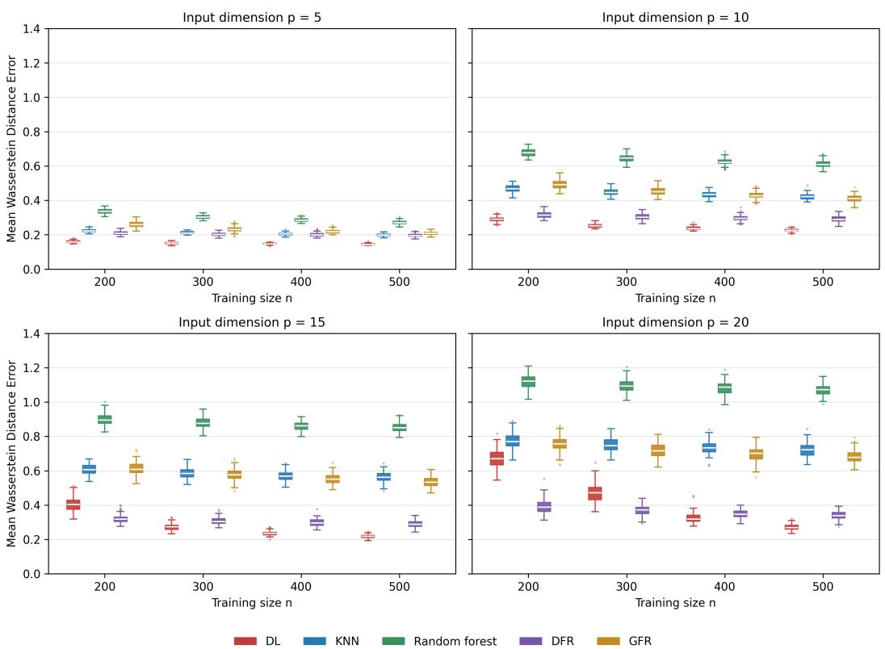  
Figure 4: Boxplots of prediction error for the competing methods in Scenario 3 with $q = 1$ . Each panel corresponds to a different predictor dimension p.

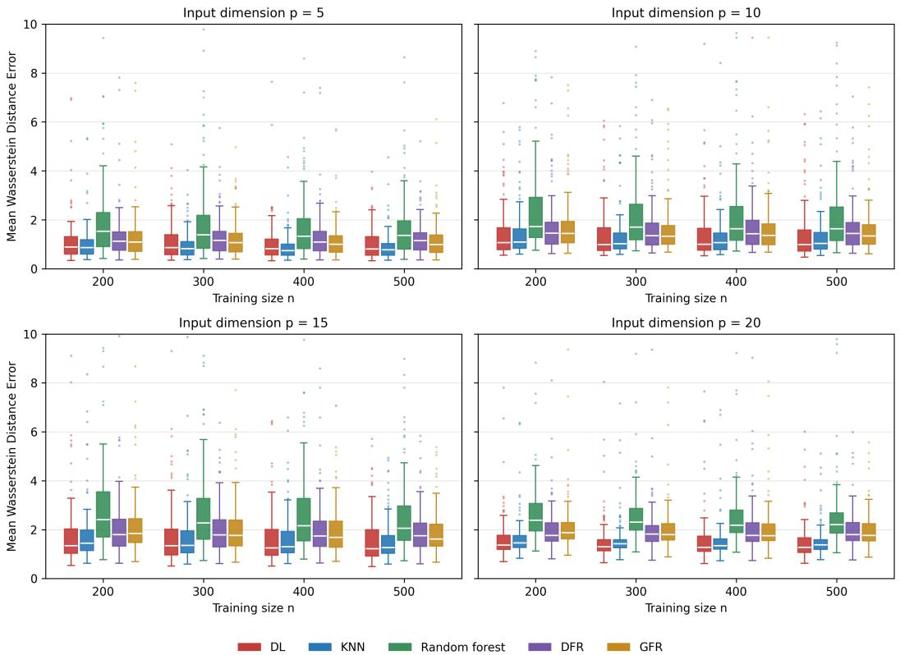  
Figure 5: Boxplots of prediction error for the competing methods in Scenario 4 with $q = 2 .$ Each panel corresponds to a different predictor dimension p.

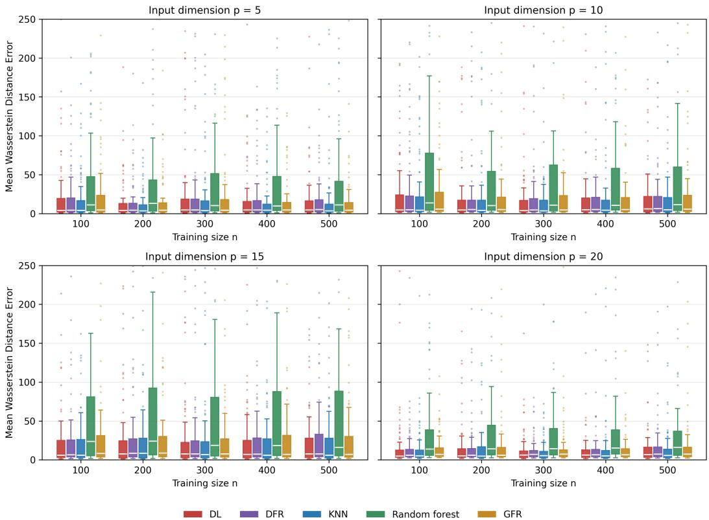  
Figure 6: Boxplots of prediction error for the competing methods in Scenario 4 with $q = 4 .$ . Each panel corresponds to a different predictor dimension $p .$

## 5 Digital Health Case Studies Based on Distributional Data Analysis

## 5.1 Motivation and Benchmark

Digital health technologies can now collect near-continuous physiological, environmental, and behavioral measurements of many clinically relevant biomarkers. The resulting data are, highfrequency times series that offer new opportunities for personalized interventions and improved population health. A natural way to represent the resulting biomarker time series is as random objects in a general metric space. In free-living conditions, for instance, time series of physiological signals are not directly comparable across subjects because meal times and other contextual factors differ. A natural representation of such a time series is therefore its probability distribution [25]—for example, as an element of the Wasserstein space introduced earlier, which lacks a natural vector-space structure.

This section illustrates the versatility of our deep-learning approach for predicting multivariate distributions. In the univariate case, $\dot { \mathcal { W } } _ { 2 } ( \mathbb { R } )$ admits a convenient linear representation via quantile functions and embeds isometrically into $\dot { L } ^ { 2 } ( [ 0 , 1 ] )$ [39, 33]. Multivariate distributions, by contrast, do not admit an analogous Hilbert-space embedding that would allow linear methods to be applied directly [39, 1]. As a result, competing deep-learning approaches for metric-space-valued outcomes that rely on ISOMAP [37] may yield inaccurate estimates. ISOMAP estimates geodesic distances through shortest paths in a neighborhood graph. For multivariate distributions, however, the Wasser stein geometry is not locally Euclidean in the same sense as in the one-dimensional case, and reliable graph construction requires a large, well-spread sample—an assumption rarely satisfied in clinical datasets.

Notation and outcome. For individual i, let $G _ { i j } \in \mathbb R ^ { s } , j = 1 , \ldots , n _ { i }$ , denote the jth repeated measurement vector, where s is the biomarker dimension and $n _ { i }$ is the number of repeated measurements for that subject. We treat these measurements as samples from an individual-specific probability distribution $F _ { i }$ on $\mathbb { R } ^ { s }$ , and estimate the distributional response by the empirical distribution

$$
\widehat { F } _ { i } = \frac { 1 } { n _ { i } } \sum _ { j = 1 } ^ { n _ { i } } \delta _ { G _ { i j } } .
$$

The observed distributional response is $Y _ { i } : = { \widehat { F } } _ { i }$ . In the glucose application below, each response is instead represented by a fixed number $s _ { 1 } = 2 0 0 0$ of samples; here $s _ { 1 }$ generically denotes the number of samples representing a response. To quantify dissimilarity between two responses $Y _ { i }$ and $Y _ { j }$ , we use the 2-Wasserstein distance $\mathcal { W } _ { 2 } ( \cdot , \cdot )$ introduced in Example 1. The regression target is the conditional Fréchet mean

$$
m _ { \oplus } ( x ) = \arg \operatorname* { m i n } _ { P \in \mathcal { V } } \mathbb { E } \big [ \mathcal { W } _ { 2 } ^ { 2 } ( Y , P ) \mid X = x \big ] ,
$$

provided the minimizer exists and is unique. We estimate $m _ { \oplus }$ using the deep-learning method (DL) proposed in Section 2. Prediction error for a held-out subject is

$$
\widehat { \epsilon } _ { i } = \mathcal { W } _ { 2 } ^ { 2 } \bigl ( Y _ { i } , \widehat { m } _ { \oplus } ^ { ( - i ) } ( X _ { i } ) \bigr ) , \qquad i = 1 , \dots , n ,
$$

where $\widehat { m } _ { \oplus } ^ { ( - i ) }$ is the estimator trained without subject i.

Competing methods and evaluation. In both case studies we compare DL with random forests (RF) [7], global Fréchet regression (GFR) [33], deep Fréchet regression (DFR) [15], which uses an ISOMAP manifold step [37], and k-nearest neighbors (KNN) [9]. Performance is assessed using (i) the distribution of $\widehat { \epsilon } _ { i }$ on a test sample $\mathcal { D } _ { \mathrm { t e s t } }$ of 20 individuals and (ii) a jackknife-based assessment over $B = 2 0$ random individuals, summarized by boxplots of the resulting error distributions. The same protocol is used in Sections 5.2 and 5.3.

## 5.2 Results: 3D Physical Activity Distribution Data

We analyze physical-activity data from NHANES 2011–2012. The sample contains $n \ = \ 6 3 2$ participants. For participant i, $G _ { i j } ~ \in ~ \mathbb { R } ^ { 3 }$ denotes the jth repeated activity measurement along the three ActiGraph axes, and the response $Y _ { i }$ is the empirical distribution of these measurements, as defined in Section 5.1. The predictors $X _ { i }$ are age, sex, body mass index, grip strength, and four principal component scores derived from spirometry measurements, following the featureextraction procedure described in prior work [24]. The goal is to predict a distributional response from individual-level covariates; error is measured by $\mathcal { W } _ { 2 }$ as in Section 5.1.

Figure 7 displays the estimated three-dimensional distributions for participants 115, 368, and 500.

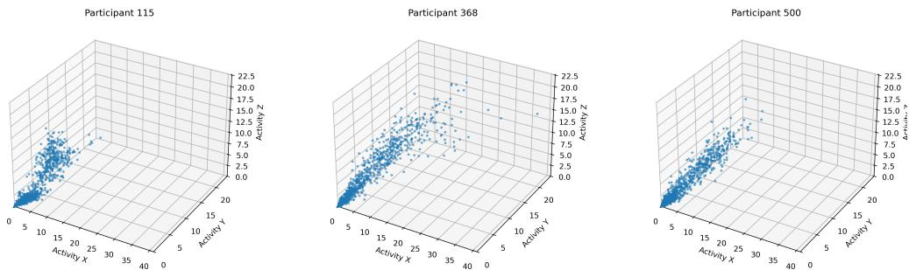  
Figure 7: 3D distributions for Participants 115, 368, and 500.

Figure 8 shows Wasserstein errors for the 20 held-out participants, and Figure 9 summarizes the error distributions. DL has the smallest median error overall and performs competitively for most held-out participants, although it also produces a few larger errors. RF and KNN perform well, with error levels broadly comparable to DL. GFR and DFR yield substantially larger errors. In this application, DL yields lower errors than GFR and DFR while remaining broadly comparable to RF and KNN.

## 5.3 Glucose Distribution Data

We now evaluate DL on a glucose distribution dataset constructed from continuous glucose monitoring (CGM) measurements and clinical covariates. For each patient, we use four clinical predictors: LabA1cResult, AgeAsOfRandDt, Weight, and DurDiabetes used in our prior research [27]. After removing subjects with missing covariates, we obtain a processed dataset with 399 participants. For each individual the response is the empirical distribution of the CGM measurements in the (hour, glucose) plane; each subject is represented by $s _ { 1 } = 2 0 0 0$ samples.

We compare DL with RF, GFR, DFR, and KNN using a leave-one-out validation procedure, as described in Section 5.1. From the full sample of 399 participants, we randomly select 20 individuals for evaluation. For each selected participant, we independently fit the competing models using the remaining 398 participants and predict the distribution-valued response of the held-out individual. This procedure is repeated for all 20 selected participants, yielding 20 out-of-sample predictions per method. Prediction accuracy is then assessed by comparing each predicted distribution with the corresponding observed distribution..Performance is measured by the Wasserstein error $\widehat { \epsilon } _ { i }$ between the predicted and observed glucose distributions.

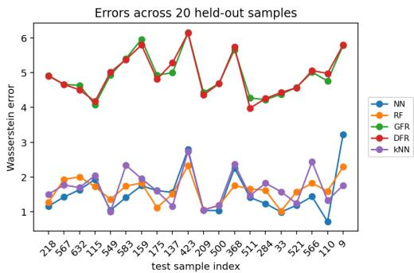  
Figure 8: Physical activity error line plot.

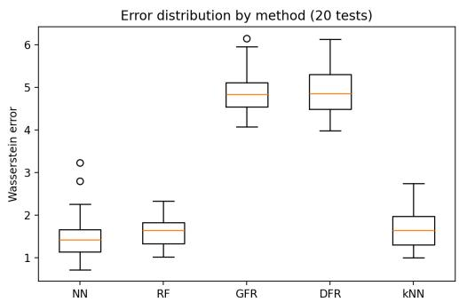  
Figure 9: Physical activity error boxplot.

For DL, we first compute the pairwise Wasserstein distance matrix [6, 34] among the training responses, then train a neural network mapping the clinical covariates to the corresponding distance profile. Given a test patient, the network predicts distances to the training subjects, and the final prediction selects the nearest training distribution. The network uses four hidden layers, each of width 20, with learning rate 0.05, batch size 40, and 1000 training epochs.

Figure 1 shows representative empirical glucose distributions over 24 hours. Each panel displays the joint distribution of hour and glucose level, with vertical bands reflecting repeated measurements at each time point. Most glucose values lie between 70 and 200 mg/dL, but the empirical distributions also exhibit right-skewed tails with occasional hyperglycemic spikes above 300 mg/dL. There is clear heterogeneity across participants: some distributions show more extreme excursions, while others are more tightly concentrated around moderate glucose levels. The distributions differ in both spread and tail behavior, supporting a distributional modeling approach.

Figure 10 reports Wasserstein errors for the 20 held-out participants. Prediction error varies substantially across participants for all methods, indicating considerable heterogeneity in the glucose distributions and suggesting that some subjects are intrinsically harder to predict. The error curves cross frequently, so no single method uniformly dominates. This highlights the importance of examining both patient-level performance and aggregate summaries.

Figure 11 summarizes the distribution of Wasserstein errors across the 20 test participants. Among competing methods, RF has the smallest median error, while DL and GFR yield comparable median performance and remain competitive overall. DFR shows a slightly larger median error, and KNN has the largest median. The interquartile ranges overlap substantially, indicating that differences across methods are moderate and depend on the individual patient. In particular, DL exhibits both very small and very large errors across subjects, suggesting that it adapts well in some cases but is more sensitive to subject-level heterogeneity than RF.

Overall, these results illustrate the potential of the proposed method while indicating that no single approach performs uniformly best across the two distribution-valued applications considered.

## 6 Final Remarks

In this paper, we introduce a deep learning framework for regression with responses taking values in general metric spaces, building on the anchor-based regression approach of [29]. Our estimator reduces the original regression problem to a collection of scalar-valued deep learning tasks that can be trained independently and in parallel, without requiring an embedding of the response space.

We establish excess-risk bounds for general ReLU neural network classes and derive explicit convergence rates under hierarchical composition assumptions [17]. These rates depend on the smoothness and intrinsic dimensions of the component functions, rather than directly on the ambient predictor dimension, providing conditions under which the curse of dimensionality can be mitigated. Relative to approaches based on learned manifold representations or Fréchet-regression output layers [15, 43, 16], our framework analyzes a distinct anchor-based estimator. Its excess-risk rates are explicit under hierarchical-composition and anchor-coverage conditions and apply to bounded metric response spaces, including functional and distributional data.

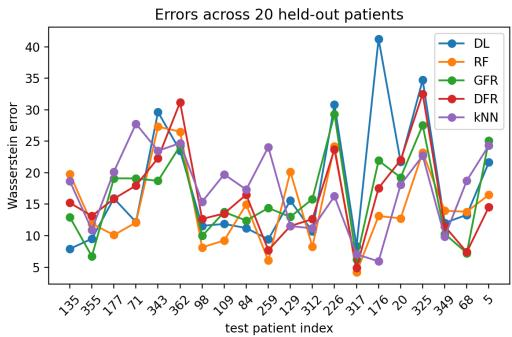  
Figure 10: Glucose error line plot.

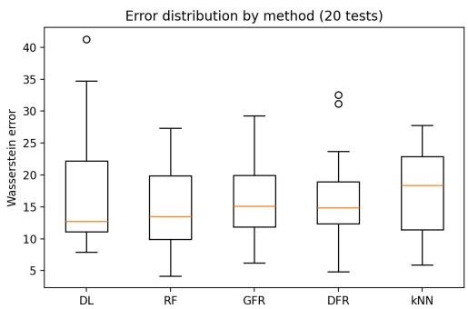  
Figure 11: Glucose error boxplot.

We evaluate the empirical performance of the proposed method through simulation studies and applications to digital health data, where the outcomes are probability distributions. In the multivariate distributional setting, some existing deep learning approaches rely on isometric or approximately isometric Euclidean embeddings [15]. Such embeddings, however, need not exist for general metric spaces. Our method avoids this structural requirement by operating directly through the metric geometry of the response space. Across the simulation settings considered, the proposed approach is particularly competitive as the sample size and complexity of the regression problem increase, and it achieves lower test error than the competing approaches in several configurations. The digital health applications further illustrate its ability to accommodate complex distribution-valued outcomes arising from high-resolution physiological data.

The main limitation of the proposed approach is its computational cost, which results from fitting a potentially large collection of univariate regression models. Although these fits can be carried out in parallel, the overall computational burden may become substantial for large datasets. Future work will therefore focus on developing more scalable variants, including subsampling strategies that reduce the number of required model fits. Another important direction is uncertainty quantification [20], for example through conformal prediction methods adapted to metric-space-valued responses. Finally, we plan to extend the framework to settings with non-Euclidean predictors, potentially building on prototype-based representations and related universal regression approaches [14].

## Acknowledgements

Oscar Hernan Madrid Padilla was partially supported by the National Science Foundation under CAREER Award DMS-2541747.

## A Prediction-error consequence of Theorem 1

Remark 5. Suppose that M satisfies thefollowing growth condition around its conditional minimizer: there exist a measurable function $\Delta ^ { 2 } : \overset { \cdot } { \mathcal { y } } \times \mathcal { y }  \mathbf { \bar { \Phi } } [ 0 , \infty )$ and a constant $c _ { 0 } > 0 ,$ , independent of x and n, such that

$$
M ( x , y ) - M ( x , m ( x ) ) \geq c _ { 0 } \Delta ^ { 2 } ( m ( x ) , y ) , \qquad x \in \mathcal { X } , \quad y \in \mathcal { Y } .\tag{11}
$$

This condition requires the conditional Fréchet risk to increase at least at rate $\Delta ^ { 2 } ( m ( x ) , y )$ as y moves away from the minimizer m(x).

Applying (11) with $y = { \widehat { m } } ( x )$ gives, pointwise in x,

$$
c _ { 0 } \Delta ^ { 2 } ( m ( x ) , \widehat { m } ( x ) ) \leq M ( x , \widehat { m } ( x ) ) - M ( x , m ( x ) ) .
$$

Conditional on the training data ${ \mathcal { D } } _ { n } ,$ , the estimator m“ is fixed. Integrating the preceding inequality with respect to $P _ { X }$ therefore yields

$$
\begin{array} { r l } { c _ { 0 } \mathbb { E } \big [ \Delta ^ { 2 } ( m ( X ) , \widehat { m } ( X ) ) \mid \mathcal { D } _ { n } \big ] = c _ { 0 } \displaystyle \int \Delta ^ { 2 } ( m ( x ) , \widehat { m } ( x ) ) d P _ { X } ( x ) } \\ { \displaystyle } & { \leq \int \{ M ( x , \widehat { m } ( x ) ) - M ( x , m ( x ) ) \} d P _ { X } ( x ) } \\ { \displaystyle } & { = \mathcal { R } ( \widehat { m } ) - \mathcal { R } ( m ) . } \end{array}
$$

Here the expectation is over afresh covariate X, conditional on the training data.

Consequently, the excess-risk bound in Theorem 1 implies, with probability approaching one,

$$
\begin{array} { r l } & { \mathbb { E } \big [ \Delta ^ { 2 } ( m ( X ) , \widehat { m } ( X ) ) \mid \mathcal { D } _ { n } \big ] } \\ & { \quad \lesssim r _ { n } + \sqrt { \frac { | I | \operatorname* { m a x } \{ \mathcal { U } _ { n } ^ { 2 } , A _ { n } ^ { 2 } \} \operatorname* { m a x } _ { i \in I } \{ L _ { i } ^ { 2 } \nu _ { i } ^ { 2 } \log ( L _ { i } \nu _ { i } ) \} \log ( A _ { n } n ) } { n } } + \sqrt { | I | \phi _ { n } } , } \end{array}
$$

where the fixed factor $c _ { 0 } ^ { - 1 }$ is absorbed into the implicit constant. Likewise, Corollary 1 gives

$$
\mathbb { E } \big [ \Delta ^ { 2 } ( m ( X ) , \widehat { m } ( X ) ) \mid \mathcal { D } _ { n } \big ] = O _ { \mathbb { P } } ( r _ { n } + \alpha _ { n } ) .
$$

For Euclidean squared-distance loss, if the conditional mean lies in the response domain, then

$$
M ( x , y ) - M ( x , m ( x ) ) = \lVert y - m ( x ) \rVert _ { 2 } ^ { 2 } ,
$$

so (11) holds with $c _ { 0 } = 1$ and $\Delta = d .$ . This identity does not replace the boundedness and coverage assumptions ofTheorem 1.

A metric-space example corresponding to scalar median regression is obtained by taking

$$
d ( a , b ) = \sqrt { | a - b | / 2 } , \qquad a , b \in \mathcal { V } \subset \mathbb { R } .
$$

Under standard local density conditions ensuring uniqueness ofthe conditional median and quadratic growth ofthe conditional median loss, the growth condition (11) holds with

$$
\Delta ^ { 2 } ( a , b ) = \operatorname* { m i n } \{ | a - b | , | a - b | ^ { 2 } \} .
$$

Related growth conditions for quantile regression are studied in [22, 21]. The present metric formulation corresponds specifically to the symmetric median case.

## B ReLU neural network class

For a network with L hidden layers of width $w _ { 1 } , \dots , w _ { L }$ , consider a multilayer feedforward neural network $f :  { \mathbb { R } ^ { d } } \to  { \mathbb { R } }$ defined by

$$
f ( x ) = \sum _ { i = 1 } ^ { w _ { L } } c _ { 1 , i } ^ { ( L ) } f _ { i } ^ { ( L ) } ( x ) + c _ { 1 , 0 } ^ { ( L ) } ,\tag{12}
$$

where $c _ { 1 , 0 } ^ { ( L ) } , \ldots , c _ { 1 , w _ { L } } ^ { ( L ) } \in \mathbb { R }$ are the output weights and the functions $f _ { i } ^ { ( L ) }$ are defined recursively as

$$
f _ { i } ^ { ( s ) } ( x ) = \tau \left( \sum _ { j = 1 } ^ { w _ { s - 1 } } c _ { i , j } ^ { ( s - 1 ) } f _ { j } ^ { ( s - 1 ) } ( x ) + c _ { i , 0 } ^ { ( s - 1 ) } \right) , \quad s \in \{ 2 , \ldots , L \} ,\tag{13}
$$

with weights $c _ { i , 0 } ^ { ( s - 1 ) } , \ldots , c _ { i , w _ { s - 1 } } ^ { ( s - 1 ) } \in \mathbb { R }$ . The first hidden layer is given by

$$
f _ { i } ^ { ( 1 ) } ( x ) = \tau \left( \sum _ { j = 1 } ^ { d } c _ { i , j } ^ { ( 0 ) } x _ { j } + c _ { i , 0 } ^ { ( 0 ) } \right) ,\tag{14}
$$

for weights $c _ { i , 0 } ^ { ( 0 ) } , \ldots , c _ { i , d } ^ { ( 0 ) } \in \mathbb { R }$

Then, we denote by $\mathcal { F } ( L , \nu )$ the functions of the form (12) with $w _ { 1 } = . . . = w _ { L } = \nu$

## C Hierarchical composition models

Definition 1 $( ( p , C )$ -smoothness). Let $p = q + s f o r$ some $q \in \mathbb { N } = \mathbb { Z } ^ { + } \cup \{ 0 \}$ and $0 < s \leq 1 . A$ function $g : \mathbb { R } ^ { d } $ R is called $( p , C )$ -smooth, if for every $\alpha = ( \alpha _ { 1 } , \ldots , \alpha _ { d } ) \in \mathbb { N } ^ { d }$ , where $d \in \mathbb { Z } ^ { + }$ with $\textstyle \sum _ { j = 1 } ^ { d } \alpha _ { j } = q$ the partial derivative $\partial ^ { q } g / \left( \partial a _ { 1 } ^ { \alpha _ { 1 } } \ldots \partial a _ { d } ^ { \alpha _ { d } } \right)$ exists and satisfies

$$
\left. \frac { \partial ^ { q } g } { \partial a _ { 1 } ^ { \alpha _ { 1 } } \ldots \partial a _ { d } ^ { \alpha _ { d } } } \left( \boldsymbol { a } \right) - \frac { \partial ^ { q } g } { \partial a _ { 1 } ^ { \alpha _ { 1 } } \ldots \partial a _ { d } ^ { \alpha _ { d } } } \left( \boldsymbol { b } \right) \right. \leq C \Vert \boldsymbol { a } - \boldsymbol { b } \Vert ^ { s }
$$

for all $a , b \in \mathbb { R } ^ { d }$

Next, we recall the definition of hierarchical composition models from [17].

Definition 2 (Space of Hierarchical Composition Models, [17]). For $l = 1$ and a smoothness constraint $\mathcal { P } \subseteq ( 0 , \infty ) \times \mathbb { N }$ , define the hierarchical composition class by

$$
\begin{array} { r l r } { \mathcal { H } ( 1 , \mathcal { P } ) } & { : = } & { \{ h : \mathbb { R } ^ { d } \to \mathbb { R } : h ( a ) = g \left( a _ { ( \pi ( 1 ) ) } , \dots , a _ { ( \pi ( K ) ) } \right) , \ w h e r e \ g : \mathbb { R } ^ { K } \to \mathbb { R } i s } \\ & { } & { ( p , C ) { \cdot } s m o o t h f o r s o m e \ ( p , K ) \in \mathcal { P } \ a n d \pi : \{ 1 , \dots , K \} \to \{ 1 , \dots , d \} \} . } \end{array}
$$

For $l > 1$ , we recursively define

$$
\begin{array} { r c l } { \mathcal { H } ( l , \mathcal { P } ) } & { : = } & { \left\{ h : \mathbb { R } ^ { d } \to \mathbb { R } : h ( a ) = g \left( f _ { 1 } ( a ) , \dots , f _ { K } ( a ) \right) , \ w h e r e \ g : \mathbb { R } ^ { K } \to \mathbb { R } i s } \\ & { \quad ( p , C ) { \cdot } s m o o t h f o r s o m e \ ( p , K ) \in \mathcal { P } a n d \ f _ { i } \in \mathcal { H } ( l - 1 , \mathcal { P } ) \right\} . } \end{array}
$$

We now state a more formal version of Theorem 2.

Theorem 3. Suppose Assumption 1 holds. For every $y \in \mathcal { V }$ , assume $M ( \cdot , y ) \in \mathcal { H } ( l ( y ) , \mathcal { P } ( y ) )$ , with a chosen representation whose finite, nonempty set of component pairs is $\mathcal { P } ( y ) \subset [ 1 , \infty ) \times \mathbb { N }$ . Each component g is $( t _ { g } , C )$ -smooth in the sense ofDefinition 1, where $t _ { g } = q _ { g } + s _ { g } , q _ { g } \ge 0 , s _ { g } \in ( 0 , 1 ]$ and $( t _ { g } , K _ { g } ) \in \mathcal { P } ( y )$ . The smoothness constant $C ,$ the bounds c on all derivatives oforders at most $q _ { g }$ (including order zero), and the Lipschitz constant $C _ { \mathrm { L i p } } \geq 1$ are uniform in g and y. Assume

$$
\operatorname* { s u p } _ { y } l ( y ) < \infty , \qquad \operatorname* { s u p } _ { y } \operatorname* { m a x } _ { ( t , K ) \in \mathcal { P } ( y ) } \operatorname* { m a x } \{ t , K \} < \infty .
$$

Let

$$
\phi _ { n } : = \operatorname* { s u p } _ { y \in \mathcal { V } } \operatorname* { m a x } _ { ( t , K ) \in \mathcal { P } ( y ) } n ^ { - 2 t / ( 2 t + K ) } .
$$

There exist sufficiently large constants $c _ { 3 } , c _ { 4 } > 0$ , independent of n and y, for which either architecture

$$
L ( y ) = \lceil c _ { 3 } \log n \rceil , \qquad \nu ( y ) = \left\lceil c _ { 4 } \operatorname* { m a x } _ { ( t , K ) \in \mathcal { P } ( y ) } n ^ { K / [ 2 ( 2 t + K ) ] } \right\rceil\tag{15}
$$

or

$$
L ( y ) = \left\lceil c _ { 3 } \operatorname* { m a x } _ { ( t , K ) \in \mathcal { P } ( y ) } n ^ { K / [ 2 ( 2 t + K ) ] } \log n \right\rceil , \qquad \nu ( y ) = \left\lceil c _ { 4 } \right\rceil\tag{16}
$$

gives, assuming the resulting architecture maps are measurable and $A _ { n }$ satisfies (4), the bound

$$
\mathscr { R } ( \widehat { m } ) \leq \mathscr { R } ( m ) + r _ { n } + c _ { 1 } \sqrt { | I | \operatorname* { m a x } \{ \mathscr { U } _ { n } ^ { 2 } , A _ { n } ^ { 2 } \} } \phi _ { n } ( \log n ) ^ { 3 } \log ( A _ { n } n )
$$

with probability approaching one, provided $r _ { n } \downarrow 0$ and

$$
C _ { n } \operatorname* { s u p } _ { y \in \mathcal { V } } \operatorname* { m i n } _ { i \in I } d ( Y _ { i } , y ) = o _ { \mathbb { P } } ( r _ { n } ) .\tag{17}
$$

Here $\mathcal { U } _ { n }$ and the allowable dependence of constants are as in Theorems 1 and 2.

## D Proofs

## D.1 Proof of Theorem 1

Proof. Step 1: deterministic risk decomposition. Fix the training sample and set

$$
k : \mathcal { X } \to I , \qquad k ( x ) = \operatorname* { m i n } \underset { i \in I } { \operatorname { a r g m i n } } \widehat { M } _ { i } ( x ) .
$$

Thus ${ \widehat { m } } ( x ) = Y _ { k ( x ) }$ . Since $m ( x )$ minimizes $M ( x , \cdot )$

$$
\begin{array} { r l } & { \mathcal { R } ( \widehat { m } ) = \mathcal { R } ( m ) + \displaystyle \int \{ M ( x , Y _ { k ( x ) } ) - M ( x , m ( x ) ) \} d P _ { X } ( x ) } \\ & { \quad \quad \quad \quad \quad \leq \mathcal { R } ( m ) + \displaystyle \int \left| M ( x , Y _ { k ( x ) } ) - \widehat { M } _ { k ( x ) } ( x ) \right| d P _ { X } ( x ) } \\ & { \quad \quad \quad \quad \quad \quad + \displaystyle \int \left| \widehat { M } _ { k ( x ) } ( x ) - M ( x , m ( x ) ) \right| d P _ { X } ( x ) } \\ & { \quad \quad \quad \quad = : \mathcal { R } ( m ) + T _ { 1 } + T _ { 2 } . } \end{array}\tag{18}
$$

By Cauchy–Schwarz and the pointwise inequality $\begin{array} { r } { \operatorname* { m a x } _ { i } a _ { i } ^ { 2 } \leq \sum _ { i } a _ { i } ^ { 2 } } \end{array}$

$$
\begin{array} { l } { \displaystyle T _ { 1 } \leq \left( \int _ { \displaystyle \operatorname* { m a x } _ { i \in I } } | M _ { i } ( x ) - \widehat M _ { i } ( x ) | ^ { 2 } d P _ { X } ( x ) \right) ^ { 1 / 2 } } \\ { \displaystyle \quad \leq \left( \sum _ { i \in I } \int | M _ { i } ( x ) - \widehat M _ { i } ( x ) | ^ { 2 } d P _ { X } ( x ) \right) ^ { 1 / 2 } } \\ { \displaystyle \quad \leq \sqrt { | I | } \operatorname* { m a x } _ { i \in I } \| M _ { i } - \widehat M _ { i } \| _ { c _ { 2 } } . } \end{array}\tag{19}
$$

The elementary inequality $\begin{array} { r } { | \operatorname* { m i n } _ { i } a _ { i } - \operatorname* { m i n } _ { i } b _ { i } | \leq \operatorname* { m a x } _ { i } | a _ { i } - b _ { i } | \mathrm { ~ g i v e } } \end{array}$ s

$$
\begin{array} { l } { \displaystyle T _ { 2 } \le \int \operatorname* { m a x } _ { i \in I } \left| \widehat { M } _ { i } ( x ) - M _ { i } ( x ) \right| d P _ { X } ( x ) } \\ { \displaystyle \quad \quad + \int \left\{ \operatorname* { m i n } _ { i \in I } { M ( x , Y _ { i } ) } - M ( x , m ( x ) ) \right\} d P _ { X } ( x ) } \\ { \displaystyle \le \sqrt { | I | } \operatorname* { m a x } _ { i \in I } \left\| M _ { i } - \widehat { M _ { i } } \right\| _ { L _ { 2 } } } \\ { \displaystyle \quad \quad + \int \left\{ \operatorname* { m i n } _ { i \in I } { M ( x , Y _ { i } ) } - M ( x , m ( x ) ) \right\} d P _ { X } ( x ) . } \end{array}\tag{20}
$$

To obtain the second inequality in (20), we bound the first integral on the right-hand side. Define

$$
e _ { i } ( x ) : = { \widehat { M } } _ { i } ( x ) - M _ { i } ( x ) , \qquad i \in I .
$$

Since $P _ { X }$ is a probability measure, the Cauchy–Schwarz inequality implies

$$
\int \operatorname* { m a x } _ { i \in I } \left| e _ { i } ( x ) \right| d P _ { X } ( x ) \leq \left( \int \left[ \operatorname* { m a x } _ { i \in I } \left| e _ { i } ( x ) \right| \right] ^ { 2 } d P _ { X } ( x ) \right) ^ { 1 / 2 } .\tag{21}
$$

For every fixed $x \in \mathcal { X }$ , we have

$$
\left[ \operatorname* { m a x } _ { i \in I } \left. e _ { i } ( x ) \right. \right] ^ { 2 } = \operatorname* { m a x } _ { i \in I } \lvert e _ { i } ( x ) \rvert ^ { 2 } \leq \sum _ { i \in I } \lvert e _ { i } ( x ) \rvert ^ { 2 } ,
$$

because all terms in the sum are nonnegative. Therefore,

$$
\begin{array} { r l } { \displaystyle \int \operatorname* { m a x } _ { i \in I } \vert e _ { i } ( x ) \vert d P _ { X } ( x ) \le \left( \displaystyle \int \sum _ { i \in I } \vert e _ { i } ( x ) \vert ^ { 2 } d P _ { X } ( x ) \right) ^ { 1 / 2 } } & { } \\ { = \left( \displaystyle \sum _ { i \in I } \displaystyle \int \vert e _ { i } ( x ) \vert ^ { 2 } d P _ { X } ( x ) \right) ^ { 1 / 2 } } & { } \\ { = \left( \displaystyle \sum _ { i \in I } \Vert e _ { i } \Vert _ { \mathcal { L } _ { 2 } } ^ { 2 } \right) ^ { 1 / 2 } . } & { } \end{array}\tag{22}
$$

Next, for every $i \in I ,$

$$
\| e _ { i } \| _ { \mathcal L _ { 2 } } ^ { 2 } \leq \operatorname* { m a x } _ { j \in I } \| e _ { j } \| _ { \mathcal L _ { 2 } } ^ { 2 } .
$$

Hence,

$$
\begin{array} { r l r } & { } & { \left( \displaystyle \sum _ { i \in I } \| e _ { i } \| _ { \mathcal L _ { 2 } } ^ { 2 } \right) ^ { 1 / 2 } \leq \left( | I | \operatorname* { m a x } _ { i \in I } \| e _ { i } \| _ { \mathcal L _ { 2 } } ^ { 2 } \right) ^ { 1 / 2 } } \\ & { } & { = \sqrt { | I | } \operatorname* { m a x } _ { i \in I } \| e _ { i } \| _ { \mathcal L _ { 2 } } . } \end{array}\tag{23}
$$

Combining (21)–(23), and recalling that $e _ { i } = \widehat { M _ { i } } - M _ { i }$ , gives

$$
\int \operatorname* { m a x } _ { i \in I } \vert \widehat { M } _ { i } ( x ) - M _ { i } ( x ) \vert d P _ { X } ( x ) \leq \sqrt { \vert I \vert } \operatorname* { m a x } _ { i \in I } \Vert \widehat { M } _ { i } - M _ { i } \Vert _ { \mathcal { L } _ { 2 } } .\tag{24}
$$

Substituting this bound into the preceding inequality for $T _ { 2 }$ yields

$$
\begin{array} { r l } & { T _ { 2 } \leq \sqrt { | I | } \displaystyle \operatorname* { m a x } _ { i \in I } \| M _ { i } - \widehat M _ { i } \| _ { \mathcal L _ { 2 } } } \\ & { \qquad + \displaystyle \int \left\{ \operatorname* { m i n } _ { i \in I } M ( x , Y _ { i } ) - M ( x , m ( x ) ) \right\} d P _ { X } ( x ) . } \end{array}\tag{25}
$$

Step 2: coverage under Assumption 1. For any $a , b \in \mathcal { D }$ , the triangle inequality yields

$$
\begin{array} { r l } & { | M ( x , a ) - M ( x , b ) | \leq \mathbb { E } [ | d ( Y , a ) - d ( Y , b ) | \{ d ( Y , a ) + d ( Y , b ) \} | \ x = x ] } \\ & { \qquad \leq 2 C _ { n } d ( a , b ) . } \end{array}
$$

Consequently,

$$
\begin{array} { r l r } & { } & { \underset { i \in I } { \operatorname* { m i n } } M ( x , Y _ { i } ) \leq \underset { y \in \mathcal { V } } { \operatorname* { i n f } } \left\{ M ( x , y ) + 2 C _ { n } \underset { i \in I } { \operatorname* { m i n } } d ( Y _ { i } , y ) \right\} } \\ & { } & { \leq M ( x , m ( x ) ) + 2 C _ { n } \underset { y \in \mathcal { V } } { \operatorname* { s u p } } \underset { i \in I } { \operatorname* { m i n } } d ( Y _ { i } , y ) . } \end{array}\tag{25a}
$$

Substituting into (25) gives

$$
T _ { 2 } \leq \sqrt { | I | } \operatorname* { m a x } _ { i \in I } \| M _ { i } - \widehat { M } _ { i } \| _ { \mathcal { L } _ { 2 } } + 2 C _ { n } \operatorname* { s u p } _ { y \in \mathcal { Y } } \operatorname* { m i n } _ { i \in I } d ( Y _ { i } , y ) .\tag{26}
$$

Combining (18), (19), and (26),

$$
\mathcal { R } ( \widehat { m } ) - \mathcal { R } ( m ) \leq 2 \sqrt { | I | } \operatorname* { m a x } _ { i \in I } \| M _ { i } - \widehat { M } _ { i } \| _ { \mathcal { L } _ { 2 } } + 2 C _ { n } \operatorname* { s u p } _ { y \in \mathcal { Y } } \operatorname* { m i n } _ { i \in I } d ( Y _ { i } , y ) .\tag{27}
$$

Step 3: conditional network estimation under Assumption 1. Fix i and condition on $Y _ { i } .$ . The $n - 1$ pairs ${ \dot { ( } } X _ { j } , d ^ { 2 } ( Y _ { j } , Y _ { i } ) ) , j \neq i$ , are i.i.d., with regression function $M _ { i }$ and architecture fixed by $Y _ { i }$ Since both the response and its conditional mean lie in $[ 0 , C _ { n } ^ { 2 } ]$

$$
\vert d ^ { 2 } ( Y _ { j } , Y _ { i } ) - M _ { i } ( X _ { j } ) \vert \leq C _ { n } ^ { 2 } = \mathcal { U } _ { n } .
$$

Moreover, (4) implies $d ^ { 2 } ( Y _ { j } , Y _ { i } ) \leq A _ { n } / 8$ . We apply the bounded-response oracle bound proved in Theorem 4 below, which makes the finite-sample probability and normalization explicit.

For the fixed predictor dimension $p ,$ the dense-network pseudodimension bound in [2] and the associated empirical covering bound [13] imply the following. Define the normalized clipped class

$$
\mathcal { F } _ { A _ { n } } ( L _ { i } , \nu _ { i } ) : = \{ f ^ { A _ { n } } / A _ { n } : f \in \mathcal { F } ( L _ { i } , \nu _ { i } ) \} .
$$

After increasing $C _ { 0 }$ if necessary, for all $0 < \delta < 1$

$$
\begin{array} { r l } & { \underset { x _ { 1 } , \ldots , x _ { n } \in [ 0 , 1 ] ^ { p } } { \operatorname* { s u p } } \log N ( \delta , \mathcal { F } _ { A _ { n } } ( L _ { i } , \nu _ { i } ) , \| \cdot \| _ { n } ) \leq C _ { 0 } L _ { i } ^ { 2 } \nu _ { i } ^ { 2 } \log ( L _ { i } \nu _ { i } ) \log ( 2 A _ { n } / \delta ) } \\ & { } \\ & { \qquad = : \eta _ { i , n } ( \delta ) . } \end{array}\tag{28}
$$

The same upper bound holds for $\{ ( f ^ { A _ { n } } - M _ { i } ) / ( 2 A _ { n } ) : f \in \mathcal { F } ( L _ { i } , \nu _ { i } ) \}$ }, because translation leaves covering numbers unchanged and contraction cannot increase them. All constants here are uniform in the conditioned anchor. Write $q _ { i } = C _ { 0 } L _ { i } ^ { 2 } \nu _ { i } ^ { 2 } \log ( L _ { i } \nu _ { i } )$ only as shorthand in the next calculation. Recall that

$$
\eta _ { i , n } ( \delta ) = q _ { i } \log \left( \frac { 2 A _ { n } } { \delta } \right) , \qquad q _ { i } : = C _ { 0 } L _ { i } ^ { 2 } \nu _ { i } ^ { 2 } \log ( L _ { i } \nu _ { i } ) .
$$

We evaluate the two dyadic sums in (40) explicitly.

For the first sum,

$$
\eta _ { i , n } ( 2 ^ { - l - l ^ { \prime } - 1 } ) = q _ { i } \left\{ \log ( 2 A _ { n } ) + ( l + l ^ { \prime } + 1 ) \log 2 \right\} .
$$

Consequently,

$$
e ^ { - C _ { 1 } \eta _ { i , n } ( 2 ^ { - l - l ^ { \prime } - 1 } ) } = ( 2 A _ { n } ) ^ { - C _ { 1 } q _ { i } } 2 ^ { - C _ { 1 } q _ { i } ( l + l ^ { \prime } + 1 ) } .
$$

Let

$$
r _ { 1 } : = 2 ^ { - C _ { 1 } q _ { i } } \in ( 0 , 1 ) .
$$

Then

$$
\begin{array} { l } { { \displaystyle \sum _ { l = 0 } ^ { \infty } \sum _ { \nu = 1 } ^ { \infty } e ^ { - C _ { 1 } \eta _ { l , n } ( 2 ^ { - 1 - \nu _ { l } - 1 } ) } } } \\ { { \displaystyle = ( 2 A _ { n } ) ^ { - C _ { 1 } q _ { n } } \sum _ { l = 0 } ^ { \infty } \sum _ { \nu = 1 } ^ { \infty } { r _ { 1 } ^ { l + l ^ { \prime } + 1 } } } } \\ { { \displaystyle \quad = ( 2 A _ { n } ) ^ { - C _ { 1 } q _ { n } } \left( \sum _ { l = 0 } ^ { \infty } r _ { l } ^ { l } \right) \left( \sum _ { \nu = 1 } ^ { \infty } r _ { 1 } ^ { l ^ { \prime } + 1 } \right) } } \\ { { \displaystyle \quad = ( 2 A _ { n } ) ^ { - C _ { 1 } q _ { n } } \frac { 1 } { 1 - r _ { 1 } } \frac { r _ { 1 } ^ { 2 } } { 1 - r _ { 1 } } } } \\ { { \displaystyle \quad = \frac { ( 2 A _ { n } ) ^ { - C _ { 1 } q _ { n } - 2 - 2 C _ { 1 } q _ { n } } } { ( 1 - 2 - C _ { 1 } q _ { n } ) } } . }  \end{array}\tag{29}
$$

Similarly,

$$
\eta _ { i , n } ( 2 ^ { - l - 1 } ) = q _ { i } \left\{ \log ( 2 A _ { n } ) + ( l + 1 ) \log 2 \right\} ,
$$

so

$$
e ^ { - C _ { 2 } \eta _ { i , n } ( 2 ^ { - l - 1 } ) } = ( 2 A _ { n } ) ^ { - C _ { 2 } q _ { i } } 2 ^ { - C _ { 2 } q _ { i } ( l + 1 ) } .
$$

Letting $r _ { 2 } : = 2 ^ { - C _ { 2 } q _ { i } }$ , we obtain

$$
\begin{array} { c } { { \displaystyle \sum _ { l = 0 } ^ { \infty } e ^ { - C _ { 2 } \eta _ { i , n } ( 2 ^ { - l - 1 } ) } = ( 2 A _ { n } ) ^ { - C _ { 2 } q _ { i } } \sum _ { l = 0 } ^ { \infty } r _ { 2 } ^ { l + 1 } } } \\ { { = ( 2 A _ { n } ) ^ { - C _ { 2 } q _ { i } } \displaystyle \frac { r _ { 2 } } { 1 - r _ { 2 } } } } \\ { { = \displaystyle \frac { ( 2 A _ { n } ) ^ { - C _ { 2 } q _ { i } } 2 ^ { - C _ { 2 } q _ { i } } } { 1 - 2 ^ { - C _ { 2 } q _ { i } } } . } } \end{array}\tag{30}
$$

Combining (29) and (30) gives

$$
\begin{array} { r } { \displaystyle \sum _ { l = 0 } ^ { \infty } \sum _ { l ^ { \prime } = 1 } ^ { \infty } e ^ { - C _ { 1 } \eta _ { i , n } ( 2 ^ { - l - l ^ { \prime } - 1 } ) } + \displaystyle \sum _ { l = 0 } ^ { \infty } e ^ { - C _ { 2 } \eta _ { i , n } ( 2 ^ { - l - 1 } ) } } \\ { = \frac { ( 2 A _ { n } ) ^ { - C _ { 1 } q _ { i } } 2 ^ { - 2 C _ { 1 } q _ { i } } } { ( 1 - 2 ^ { - C _ { 1 } q _ { i } } ) ^ { 2 } } + \frac { ( 2 A _ { n } ) ^ { - C _ { 2 } q _ { i } } 2 ^ { - C _ { 2 } q _ { i } } } { 1 - 2 ^ { - C _ { 2 } q _ { i } } } . } \end{array}\tag{31}
$$

The constants $C _ { 1 }$ and $C _ { 2 }$ appearing here are the positive constants in the entropy condition (40) of Theorem 4.

We next verify that the right-hand side of (31) converges to zero. For $j \in \{ 1 , 2 \}$

$$
( 2 A _ { n } ) ^ { - C _ { j } q _ { i } } = \exp \{ - C _ { j } q _ { i } \log ( 2 A _ { n } ) \} .
$$

Hence, if

$$
q _ { i } \log ( 2 A _ { n } ) \longrightarrow \infty ,
$$

then

$$
( 2 A _ { n } ) ^ { - C _ { j } q _ { i } } \longrightarrow 0 .
$$

Moreover, under the architecture choices considered below, $q _ { i }$ is eventually bounded away from zero (and in fact diverges). Therefore, for $j \in \{ 1 , 2 \}$ ,

$$
1 - 2 ^ { - C _ { j } q _ { i } }
$$

is bounded away from zero for all sufficiently large n. It follows that

$$
\frac { ( 2 A _ { n } ) ^ { - C _ { 1 } q _ { i } } 2 ^ { - 2 C _ { 1 } q _ { i } } } { ( 1 - 2 ^ { - C _ { 1 } q _ { i } } ) ^ { 2 } } \longrightarrow 0
$$

and

$$
{ \frac { ( 2 A _ { n } ) ^ { - C _ { 2 } q _ { i } } 2 ^ { - C _ { 2 } q _ { i } } } { 1 - 2 ^ { - C _ { 2 } q _ { i } } } } \longrightarrow 0 .
$$

Thus the entire expression in (31) converges to zero.

We emphasize that this calculation is exact. In particular,

$$
\eta _ { i , n } ( 2 ^ { - l - l ^ { \prime } - 1 } ) = q _ { i } \left\{ \log ( 2 A _ { n } ) + ( l + l ^ { \prime } + 1 ) \log 2 \right\} ,
$$

and therefore

$$
\exp \{ - C _ { 1 } \eta _ { i , n } ( 2 ^ { - l - l ^ { \prime } - 1 } ) \} = ( 2 A _ { n } ) ^ { - C _ { 1 } q _ { i } } 2 ^ { - C _ { 1 } q _ { i } ( l + l ^ { \prime } + 1 ) } .
$$

Thus the two factors arise from the identity exp $\{ - ( a + b ) \} = \exp ( - a ) \exp ( - b )$ . For every $l \geq 0 ,$ using

$$
\eta _ { i , n } ( \delta ) = q _ { i } \log \left( \frac { 2 A _ { n } } { \delta } \right) ,
$$

we have

$$
\eta _ { i , n } ( 2 ^ { - l - l ^ { \prime } } ) = q _ { i } \left\{ \log ( 2 A _ { n } ) + ( l + l ^ { \prime } ) \log 2 \right\}
$$

and

$$
\eta _ { i , n } ( 2 ^ { - l } ) = q _ { i } \left\{ \log ( 2 A _ { n } ) + l \log 2 \right\} .
$$

Hence, writing

$$
D _ { l } : = \log ( 2 A _ { n } ) + l \log 2 ,
$$

the factor $q _ { i }$ cancels and

$$
\begin{array} { r l } { \displaystyle \sum _ { \nu ^ { \prime } = 1 } ^ { \infty } \frac { \eta _ { i , n } ( 2 ^ { - l - l ^ { \prime } } ) } { 2 ^ { 2 l ^ { \prime } } \eta _ { i , n } ( 2 ^ { - l } ) } = \displaystyle \sum _ { \nu ^ { - 1 } } ^ { \infty } \frac { D _ { l } + l ^ { \prime } \log 2 } { 4 ^ { \nu } D _ { l } } } \\ { = \displaystyle \sum _ { \nu ^ { - 1 } } ^ { \infty } \frac { 1 } { 4 ^ { \nu } } + \frac { \log 2 } { D _ { l } } \displaystyle \sum _ { \nu ^ { - 1 } } ^ { \infty } \frac { l ^ { \prime } } { 4 ^ { \nu } } } \\ { = \displaystyle \frac { 1 } { 3 } + \frac { 4 \log 2 } { 9 D _ { l } } } \\ { = \displaystyle \frac { 1 } { 3 } + \frac { 4 \log 2 } { 9 \{ \log ( 2 A _ { n } ) + l \log 2 \} } . } \end{array}\tag{32}
$$

The identities

$$
\sum _ { j = 1 } ^ { \infty } 4 ^ { - j } = \frac 1 3 , \qquad \sum _ { j = 1 } ^ { \infty } j 4 ^ { - j } = \frac 4 9
$$

were used in the third line. Since $A _ { n } \geq 8$ and $l \geq 0$

$$
\log ( 2 A _ { n } ) + l \log 2 \geq \log 1 6 = 4 \log 2 .
$$

Consequently,

$$
\sum _ { l ^ { \prime } = 1 } ^ { \infty } \frac { \eta _ { i , n } ( 2 ^ { - l - l ^ { \prime } } ) } { 2 ^ { 2 l ^ { \prime } } \eta _ { i , n } ( 2 ^ { - l } ) } \leq \frac { 1 } { 3 } + \frac { 1 } { 9 } = \frac { 4 } { 9 } < 1 , \qquad l \geq 0 .
$$

Thus condition (41) holds uniformly in l.

Fix $i \in I$ and condition on $Y _ { i }$ . The regression sample then has size

$$
N : = n - 1 ,
$$

with true regression function

$$
f ^ { * } = M _ { i } = M ( \cdot , Y _ { i } ) .
$$

In Theorem 4, take the comparison function to be

$$
\bar { f } = \widetilde { M } ( \cdot , Y _ { i } ) ,
$$

and define its squared approximation error by

$$
\phi _ { i , n } : = \| \widetilde { M } ( \cdot , Y _ { i } ) - M ( \cdot , Y _ { i } ) \| _ { \infty } ^ { 2 } .
$$

Recall that

$$
\eta _ { i , n } ( \delta ) = q _ { i } \log \left( \frac { 2 A _ { n } } { \delta } \right) , \qquad q _ { i } = C _ { 0 } L _ { i } ^ { 2 } \nu _ { i } ^ { 2 } \log ( L _ { i } \nu _ { i } ) .
$$

Evaluating this entropy bound at the scale appearing in Theorem 4 gives

$$
\eta _ { i , n } \left( \frac { 1 } { 2 4 N } \right) = q _ { i } \log ( 4 8 A _ { n } N ) .
$$

Since $N = n - 1 \asymp n$ , this implies

$$
\eta _ { i , n } \left( \frac { 1 } { 2 4 N } \right) \lesssim L _ { i } ^ { 2 } \nu _ { i } ^ { 2 } \log ( L _ { i } \nu _ { i } ) \log ( A _ { n } n ) .
$$

Hence the critical-radius upper bound in Theorem 4 may be chosen so that

$$
\delta _ { i } ^ { 2 } \lesssim \frac { \log n } { n - 1 } + \frac { L _ { i } ^ { 2 } \nu _ { i } ^ { 2 } \log ( L _ { i } \nu _ { i } ) \log ( A _ { n } n ) } { n - 1 } .
$$

Applying Theorem 4 with sample size $N = n - 1$ therefore gives

$$
\| M _ { i } - \widehat { M } _ { i } \| _ { \mathcal { L } _ { 2 } } ^ { 2 } \leq C \left\{ \phi _ { i , n } + A _ { n } ^ { 2 } \delta _ { i } ^ { 2 } \right\}\tag{33}
$$

with conditional failure probability at most $C _ { 4 } n ^ { - 3 }$ . Substituting the preceding bound for $\delta _ { i } ^ { 2 }$ into (33) yields

$$
\begin{array} { r l r } {  { \| M _ { i } - \widehat { M _ { i } } \| _ { \mathcal { L } _ { 2 } } ^ { 2 } \le C \bigg [ \phi _ { i , n } + \frac { A _ { n } ^ { 2 } \log n } { n - 1 } } } \\ & { } & { \qquad + \frac { A _ { n } ^ { 2 } L _ { i } ^ { 2 } \nu _ { i } ^ { 2 } \log ( L _ { i } \nu _ { i } ) \log ( A _ { n } n ) } { n - 1 } \bigg ] . } \end{array}
$$

The middle term is dominated by the last term. Indeed, $L _ { i } \nu _ { i } \geq 2$ implies

$$
L _ { i } ^ { 2 } \nu _ { i } ^ { 2 } \log ( L _ { i } \nu _ { i } ) \geq 4 \log 2 ,
$$

and $A _ { n } \geq 8$ implies

$$
\log ( A _ { n } n ) \geq \log n .
$$

Consequently,

$$
{ \frac { A _ { n } ^ { 2 } \log n } { n - 1 } } \lesssim { \frac { A _ { n } ^ { 2 } L _ { i } ^ { 2 } \nu _ { i } ^ { 2 } \log ( L _ { i } \nu _ { i } ) \log ( A _ { n } n ) } { n - 1 } } .
$$

Since $( n - 1 ) ^ { - 1 } \asymp n ^ { - 1 }$ , we obtain

$$
\begin{array} { r } { \| M _ { i } - \widehat { M _ { i } } \| _ { \mathcal { L } _ { 2 } } ^ { 2 } \leq C _ { 3 } \Bigg [ \frac { A _ { n } ^ { 2 } L _ { i } ^ { 2 } \nu _ { i } ^ { 2 } \log ( L _ { i } \nu _ { i } ) \log ( A _ { n } n ) } { n } } \\ { + \| \widetilde { M } ( \cdot , Y _ { i } ) - M ( \cdot , Y _ { i } ) \| _ { \infty } ^ { 2 } \Bigg ] . } \end{array}
$$

For each $i \in I ,$ , let $E _ { i }$ denote the event on which the preceding conditional estimation bound holds. Since the conditional failure probability is bounded uniformly in the conditioned value of $Y _ { i }$

$$
\mathbb { P } ( E _ { i } ^ { c } \mid Y _ { i } ) \leq C _ { 4 } n ^ { - 3 } \qquad \mathrm { a . s . }
$$

Taking expectation with respect to $Y _ { i }$ and using the tower property gives

$$
\mathbb { P } ( E _ { i } ^ { c } ) = \mathbb { E } [ \mathbb { P } ( E _ { i } ^ { c } \mid Y _ { i } ) ] \le C _ { 4 } n ^ { - 3 } .
$$

Consequently, by the union bound,

$$
\mathbb { P } \left( \bigcup _ { i \in I } E _ { i } ^ { c } \right) \leq \sum _ { i \in I } \mathbb { P } ( E _ { i } ^ { c } ) \leq C _ { 4 } | I | n ^ { - 3 } .
$$

No independence among the events $\{ E _ { i } : i \in I \}$ is needed for this argument. Since $I \subseteq [ n ]$ , we have $| I | \leq n .$ , and hence

$$
C _ { 4 } | I | n ^ { - 3 } \leq C _ { 4 } n ^ { - 2 } .
$$

Moreover, by the definition of $\phi _ { n }$ ,

$$
\| \widetilde M ( \cdot , Y _ { i } ) - M ( \cdot , Y _ { i } ) \| _ { \infty } ^ { 2 } \leq \phi _ { n } \qquad \mathrm { f o r ~ e v e r y ~ } i \in I .
$$

Also,

$$
L _ { i } ^ { 2 } \nu _ { i } ^ { 2 } \log ( L _ { i } \nu _ { i } ) \leq \operatorname* { m a x } _ { k \in I } \{ L _ { k } ^ { 2 } \nu _ { k } ^ { 2 } \log ( L _ { k } \nu _ { k } ) \} .
$$

Therefore, on $\cap _ { i \in I } E _ { i }$

$$
\operatorname* { m a x } _ { i \in I } \| M _ { i } - \widehat { M _ { i } } \| _ { \mathcal { L } _ { 2 } } ^ { 2 } \leq C _ { 3 } \left\lceil \frac { \operatorname* { m a x } \{ \mathcal { U } _ { n } ^ { 2 } , A _ { n } ^ { 2 } \} \operatorname* { m a x } _ { i \in I } \{ L _ { i } ^ { 2 } \nu _ { i } ^ { 2 } \log ( L _ { i } \nu _ { i } ) \} \log ( A _ { n } n ) } { n } + \phi _ { n } \right\rceil .
$$

Thus, defining

$$
\Omega _ { 1 } : = \Bigg \{ \operatorname* { m a x } _ { i \in I } \| M _ { i } - \widehat { M _ { i } } \| _ { \mathcal { E } _ { 2 } } ^ { 2 } \leq C _ { 3 } \left[ \frac { \operatorname* { m a x } \{ \mathcal { U } _ { n } ^ { 2 } , A _ { n } ^ { 2 } \} \operatorname* { m a x } _ { i \in I } \{ L _ { i } ^ { 2 } \nu _ { i } ^ { 2 } \log ( L _ { i } \nu _ { i } ) \} \log ( A _ { n } n ) } { n } + \phi _ { n } \right] \Bigg \} ,
$$

we have

$$
\begin{array} { r } { \mathbb { P } ( \Omega _ { 1 } ) \geq 1 - C _ { 4 } | I | n ^ { - 3 } \geq 1 - C _ { 4 } n ^ { - 2 } . } \end{array}
$$

The additional growth condition

$$
\frac { \operatorname* { m i n } _ { i \in I } \{ L _ { i } ^ { 2 } \nu _ { i } ^ { 2 } \log ( L _ { i } \nu _ { i } ) \} \log ( 2 A _ { n } ^ { 2 } ) } { \log n } \stackrel { \mathbb { P } } { \to } \infty\tag{34}
$$

ensures that the preceding entropy regularity conditions hold uniformly over $i \in I .$ . Indeed, with

$$
q _ { i } = C _ { 0 } L _ { i } ^ { 2 } \nu _ { i } ^ { 2 } \log ( L _ { i } \nu _ { i } ) ,
$$

the dyadic expressions in (31) contain factors of the form

$$
( 2 A _ { n } ) ^ { - C q _ { i } } = \exp \{ - C q _ { i } \log ( 2 A _ { n } ) \} .
$$

Since $A _ { n } \geq 8 ,$

$$
\log ( 2 A _ { n } ) \geq { \frac { 1 } { 2 } } \log ( 2 A _ { n } ^ { 2 } ) ,
$$

and hence (34) implies

$$
\operatorname* { m i n } _ { i \in I } q _ { i } \log ( 2 A _ { n } ) \longrightarrow \infty
$$

in probability. Thus the dyadic terms converge to zero uniformly over the anchors.

We now substitute the simultaneous estimation bound into (27). On $\Omega _ { 1 }$ , writing

$$
B _ { n } : = \frac { \operatorname* { m a x } \{ \mathcal { U } _ { n } ^ { 2 } , A _ { n } ^ { 2 } \} \operatorname* { m a x } _ { i \in I } \{ L _ { i } ^ { 2 } \nu _ { i } ^ { 2 } \log ( L _ { i } \nu _ { i } ) \} \log ( A _ { n } n ) } { n } ,
$$

we have

$$
\operatorname* { m a x } _ { i \in I } \| M _ { i } - \widehat { M _ { i } } \| _ { \mathcal { L } _ { 2 } } \leq C _ { 3 } ^ { 1 / 2 } \sqrt { B _ { n } + \phi _ { n } } \leq C _ { 3 } ^ { 1 / 2 } \left\{ \sqrt { B _ { n } } + \sqrt { \phi _ { n } } \right\} ,
$$

where the last inequality uses ${ \sqrt { a + b } } \leq { \sqrt { a } } + { \sqrt { b } }$ . Therefore, (27) yields

$$
\begin{array} { r l } & { \mathcal { R } ( \widehat { m } ) - \mathcal { R } ( m ) \leq 2 C _ { 3 } ^ { 1 / 2 } \Bigg [ \sqrt { \frac { | I | \operatorname* { m a x } \{ \mathcal { U } _ { n } ^ { 2 } , A _ { n } ^ { 2 } \} \operatorname* { m a x } _ { i \in I } \{ L _ { i } ^ { 2 } \nu _ { i } ^ { 2 } \log ( L _ { i } \nu _ { i } ) \} \log ( A _ { n } n ) } { n } } + \sqrt { | I | \phi _ { n } } \Bigg ] } \\ & { \qquad + \ 2 C _ { n } \underset { y \in \mathcal { Y } } { \operatorname* { s u p } } \underset { i \in I } { \operatorname* { m i n } } d ( Y _ { i } , y ) . } \end{array}\tag{35}
$$

Finally, condition (5) implies

$$
\frac { C _ { n } \operatorname* { s u p } _ { y \in \mathcal { y } } \operatorname* { m i n } _ { i \in I } d ( Y _ { i } , y ) } { r _ { n } } \overset { \mathbb { P } } {  } 0 .
$$

Hence

$$
2 C _ { n } \operatorname* { s u p } _ { y \in \mathcal { V } } \operatorname* { m i n } _ { i \in I } d ( Y _ { i } , y ) \leq r _ { n }
$$

with probability approaching one. Since $\mathbb { P } ( \Omega _ { 1 } ) \to 1$ , combining these two events proves the theorem.

## D.2 Proof of Corollary 1

Proof. With the notation of the proof of Theorem 1, the pathwise decomposition (18) is unchanged:

$$
\begin{array} { c l l } { \displaystyle \mathcal { R } ( \widehat { m } ) \leq \mathcal { R } ( m ) + \int \left| M ( x , Y _ { k ( x ) } ) - \widehat { M } _ { k ( x ) } ( x ) \right| d P _ { X } ( x ) } \\ { \displaystyle + \int \left| \widehat { M } _ { k ( x ) } ( x ) - M ( x , m ( x ) ) \right| d P _ { X } ( x ) } \\ { \displaystyle = : \mathcal { R } ( m ) + T _ { 1 } + T _ { 2 } . } \end{array}\tag{36}
$$

Condition (6) implies

$$
\begin{array} { l } { \displaystyle T _ { 1 } \leq \int \underset { i \in I } { \operatorname* { m a x } } \vert \widehat { M } _ { i } ( x ) - M _ { i } ( x ) \vert d P _ { X } ( x ) } \\ { \leq \displaystyle \operatorname* { m a x } _ { i \in I } \vert \widehat { M } _ { i } - M _ { i } \vert \vert _ { \infty } = O _ { \mathbb { P } } ( \alpha _ { n } ) , } \end{array}\tag{37}
$$

not a deterministic bound by $\alpha _ { n }$ . Similarly, since

$$
k ( x ) \in \arg \operatorname* { m i n } _ { i \in I } \widehat { M } _ { i } ( x ) ,
$$

we have

$$
\widehat { M } _ { k ( x ) } ( x ) = \operatorname* { m i n } _ { i \in I } \widehat { M } _ { i } ( x ) .
$$

Therefore,

$$
T _ { 2 } = \int \left| \operatorname* { m i n } _ { i \in I } \widehat { M } _ { i } ( x ) - M ( x , m ( x ) ) \right| d P _ { X } ( x ) .
$$

For each fixed $x ,$ add and subtract min ${ \it . i } \in I ^ { \textit { M } _ { i } ( x ) }$ and apply the triangle inequality:

$$
\begin{array} { r l } {  { \frac { \operatorname* { m i n } } { i \in I } \widehat { M _ { i } } ( x ) - M ( x , m ( x ) ) \bigg | } \quad } & { } \\ & { \leq | \displaystyle \operatorname* { m i n } _ { i \in I } \widehat { M _ { i } } ( x ) - \operatorname* { m i n } _ { i \in I } M _ { i } ( x ) | } \\ & { \qquad + | \displaystyle \operatorname* { m i n } _ { i \in I } M _ { i } ( x ) - M ( x , m ( x ) ) | . } \end{array}
$$

The elementary inequality

$$
\left| \operatorname* { m i n } _ { i } a _ { i } - \operatorname* { m i n } _ { i } b _ { i } \right| \leq \operatorname* { m a x } _ { i } \left| a _ { i } - b _ { i } \right|
$$

implies

$$
\left| \operatorname* { m i n } _ { i \in I } \widehat { M } _ { i } ( x ) - \operatorname* { m i n } _ { i \in I } M _ { i } ( x ) \right| \leq \operatorname* { m a x } _ { i \in I } | \widehat { M } _ { i } ( x ) - M _ { i } ( x ) | .
$$

Moreover, since $m ( x )$ minimizes $M ( x , \cdot )$ over all $y \in \mathcal { V }$

$$
M ( x , m ( x ) ) \leq M ( x , Y _ { i } ) = M _ { i } ( x ) \qquad { \mathrm { f o r ~ e v e r y ~ } } i \in I .
$$

Hence

$$
\operatorname* { m i n } _ { i \in I } M _ { i } ( x ) - M ( x , m ( x ) ) \geq 0 ,
$$

and therefore

$$
\left| \operatorname* { m i n } _ { i \in I } M _ { i } ( x ) - M ( x , m ( x ) ) \right| = \operatorname* { m i n } _ { i \in I } M _ { i } ( x ) - M ( x , m ( x ) ) .
$$

Combining these inequalities gives

$$
\begin{array} { l } { \displaystyle { T _ { 2 } \leq \int \operatorname* { m a x } _ { i \in I } \left| \widehat { M } _ { i } ( x ) - M _ { i } ( x ) \right| d P _ { X } ( x ) } } \\ { \displaystyle { + \int \left\{ \operatorname* { m i n } _ { i \in I } M ( x , Y _ { i } ) - M ( x , m ( x ) ) \right\} d P _ { X } ( x ) . } } \end{array}
$$

Finally, for every x,

$$
\operatorname* { m a x } _ { i \in I } \vert \widehat { M } _ { i } ( x ) - M _ { i } ( x ) \vert \leq \operatorname* { m a x } _ { i \in I } \vert \vert \widehat { M } _ { i } - M _ { i } \vert \vert _ { \infty } ,
$$

and thus

$$
\int \operatorname* { m a x } _ { i \in I } | \widehat { M } _ { i } ( x ) - M _ { i } ( x ) | d P _ { X } ( x ) \leq \operatorname* { m a x } _ { i \in I } \| \widehat { M } _ { i } - M _ { i } \| _ { \infty } .
$$

Consequently,

$$
\begin{array} { l } { \displaystyle { T _ { 2 } \leq \operatorname* { m a x } _ { i \in I } \| \widehat { M } _ { i } - M _ { i } \| _ { \infty } } } \\ { \displaystyle { + \int \left\{ \operatorname* { m i n } _ { i \in I } M ( x , Y _ { i } ) - M ( x , m ( x ) ) \right\} d P _ { X } ( x ) . } } \end{array}\tag{38}
$$

Proceeding as in Step 2 of the proof of Theorem 1, we obtain that

$$
\int \left\{ \operatorname* { m i n } _ { i \in I } M ( x , Y _ { i } ) - M ( x , m ( x ) ) \right\} d P _ { X } ( x ) \leq 2 C _ { n } \operatorname* { s u p } _ { y \in \mathcal { Y } } \operatorname* { m i n } _ { i \in I } d ( Y _ { i } , y ) .
$$

By condition (5),

$$
C _ { n } \operatorname* { s u p } _ { y \in \mathcal { V } } \operatorname* { m i n } _ { i \in I } d ( Y _ { i } , y ) = o _ { \mathbb { P } } ( r _ { n } ) ,
$$

and hence

$$
2 C _ { n } \operatorname* { s u p } _ { y \in \mathcal { V } } \operatorname* { m i n } _ { i \in I } d ( Y _ { i } , y ) = o _ { \mathbb { P } } ( r _ { n } ) .
$$

Combining (36), (37), and (38) gives

$$
0 \leq \mathcal { R } ( \widehat { m } ) - \mathcal { R } ( m ) \leq 2 \operatorname* { m a x } _ { i \in I } \| \widehat { M } _ { i } - M _ { i } \| _ { \infty } + o _ { \mathbb { P } } ( r _ { n } ) = O _ { \mathbb { P } } ( \alpha _ { n } + r _ { n } ) .
$$

## D.3 Auxiliary result

We use the following bounded-response specialization of the entropy and norm-comparison arguments in [30]. The specialization is sufficient under Assumption 1, as shown in Step 3 above. It is stated with its own proof rather than quoted as a verbatim restatement of the general-noise theorem.

Let $\{ ( x _ { i } , y _ { i } ) \} _ { i = 1 } ^ { n }$ be independent copies of $( X , Y )$ satisfying

$$
y _ { i } = f ^ { * } ( x _ { i } ) + \epsilon _ { i } ,\tag{39}
$$

where $\mathbb { E } ( \epsilon _ { i } \mid x _ { i } ) = 0$ and $\operatorname { V a r } ( \epsilon _ { i } \mid x _ { i } ) = g ^ { * } ( x _ { i } )$ . Conditional on the entire design, the errors are independent. Here $f ^ { * } : [ 0 , 1 ] ^ { p } \overset { \cdot } {  } \overset { \cdot } { \mathbb { R } }$ and $g ^ { * } : [ 0 , 1 ] ^ { p } \to [ 0 , \infty )$ , and

$$
\| g \| _ { \mathcal { L } _ { 2 } } : = \left( \int g ( x ) ^ { 2 } d P _ { X } ( x ) \right) ^ { 1 / 2 } , \qquad \| g \| _ { n } : = \left( \frac { 1 } { n } \sum _ { i = 1 } ^ { n } g ( x _ { i } ) ^ { 2 } \right) ^ { 1 / 2 } .
$$

Definition 3. Given a function class $\mathcal { F } \subset B _ { \infty } ( 1 )$ , call $\delta _ { n } > 0$ a critical radius if

$$
\mathbb { E } \left[ \operatorname* { s u p } _ { \substack { f \in \mathrm { s t a r } ( \mathcal { F } ) : \| f \| _ { n } \leq \delta _ { n } } } \frac { 1 } { n } \sum _ { i = 1 } ^ { n } \xi _ { i } f ( x _ { i } ) \Bigg | x _ { 1 } , \ldots , x _ { n } \right] \leq \delta _ { n } ^ { 2 } ,
$$

where the $\xi _ { i }$ are independent Rademacher variables independent ofthe design and star $( \mathcal F ) = \{ \lambda f$ $0 \leq \lambda \leq \bar { 1 } , \ f \in \mathcal { F } \bar  \}$ . Here $B _ { \infty } ( 1 )$ is the unit ball for the sup norm, and the empirical norm is normalized as above.

Theorem 4. Let F be a deterministic, pointwise-separable class ofmeasurable realfunctions, and let $\bar { f } \in \mathcal { F }$ satisfy $\| \bar { f } - f ^ { * } \| _ { \infty } \leq \sqrt { \phi _ { n } }$ . Let

$$
{ \widehat { f } } \in \underset { f \in \mathcal { F } } { \arg \operatorname* { m i n } } { \frac { 1 } { n } } \sum _ { i = 1 } ^ { n } ( y _ { i } - f ( x _ { i } ) ) ^ { 2 }
$$

be an exact empirical minimizer. Suppose $| Y | \leq { \mathcal { A } } _ { n } / 8$ almost surely and

$$
\begin{array} { r } { A _ { n } \geq 8 \operatorname* { m a x } \{ 1 , \| f ^ { * } \| _ { \infty } + \mathcal { U } _ { n } , 8 \| f ^ { * } \| _ { \infty } , 8 \sqrt { \phi _ { n } } \} . } \end{array}
$$

Write $\widehat { f } _ { A _ { n } } = \widehat { f } ^ { A _ { n } } , \mathcal { F } _ { A _ { n } } = \{ f ^ { A _ { n } } / A _ { n } : f \in \mathcal { F } \}$ , and, for analysis only,

$$
\mathcal { H } _ { n } = \{ ( f ^ { A _ { n } } - f ^ { * } ) / ( 2  { A _ { n } } ) : f \in \mathcal { F } \} \subset B _ { \infty } ( 1 ) .
$$

Suppose a decreasing $\eta _ { n } : ( 0 , 1 ) \to [ 0 , \infty )$ bounds the empirical log covering numbers of both normalized classes, uniformly over all finite designs. The dyadic regularity conditions used in the general entropy formulation are

$$
\operatorname* { l i m } _ { n \to \infty } \left[ \sum _ { l = 0 } ^ { \infty } \sum _ { l ^ { \prime } = 1 } ^ { \infty } e ^ { - C _ { 1 } \eta _ { n } ( 2 ^ { - l - l ^ { \prime } - 1 } ) } + \sum _ { l = 0 } ^ { \infty } e ^ { - C _ { 2 } \eta _ { n } ( 2 ^ { - l - 1 } ) } + \mathbb { P } ( \left\| \epsilon \right\| _ { \infty } > \mathcal { U } _ { n } ) \right] = 0\tag{40}
$$

and

$$
\operatorname* { s u p } _ { l \geq 0 } \sum _ { l ^ { \prime } = 1 } ^ { \infty } { \frac { \eta _ { n } ( 2 ^ { - l - l ^ { \prime } } ) } { 2 ^ { 2 l ^ { \prime } } \eta _ { n } ( 2 ^ { - l } ) } } \leq 1 ,\tag{41}
$$

where denominators are assumed positive for positive constants $C _ { 1 }$ and $C _ { 2 }$ . They are sufficient regularity conditions and are verified in the application; the bounded-response argument below in fact uses only the covering bound. Choose

$$
\delta _ { n } = c \sqrt { \frac { \log n + \eta _ { n } ( 1 / ( 2 4 n ) ) } { n } } ,
$$

with a sufficiently large numerical constant c. This is a critical-radius upper bound for ${ \mathcal { H } } _ { n }$ in Definition 3. Then, for constants $C , C ^ { \prime } > 0$ independent of n,

$$
\operatorname* { m a x } \{ \| f ^ { * } - \widehat f _ { A _ { n } } \| _ { n } ^ { 2 } , \| f ^ { * } - \widehat f _ { A _ { n } } \| _ { \mathcal { L } _ { 2 } } ^ { 2 } \} \leq C \{ \phi _ { n } + \mathcal { A } _ { n } ^ { 2 } \delta _ { n } ^ { 2 } \}\tag{42}
$$

with probability at least 1 − C′n−3,for all $n \geq 3 .$ In particular, the conclusion is a high-probability upper bound, not a little-oP assertion.

Proof. The entropy-to-critical-radius bound and uniform comparison of empirical and population squared norms follow from the critical-radius calculation and the norm-comparison bound proved in Lemma 6 of [30], applied to the centered class ${ \mathcal { H } } _ { n }$ . In particular, increasing c if necessary, with probability at least $1 - C ^ { \prime } n ^ { - 3 }$

$$
\begin{array} { r } { \| h \| _ { \mathcal { L } _ { 2 } } ^ { 2 } \leq 2 \| h \| _ { n } ^ { 2 } + C \delta _ { n } ^ { 2 } \quad \mathrm { f o r e v e r y } h \in \mathcal { H } _ { n } . } \end{array}\tag{43}
$$

This application uses the normalized empirical norm and a design-uniform covering bound. Translating by $f ^ { * }$ in this analysis does not change the class over which the estimator is fitted.

For completeness, we briefly justify the stochastic bound used below. Conditional on the design points $x _ { 1 } , \ldots , x _ { n }$ , let $\{ h _ { 1 } , \ldots , \bar { h _ { N } } \}$ be a $1 / ( 2 4 n )$ -net of ${ \mathcal { H } } _ { n }$ in the empirical norm $\| \cdot \| _ { n }$ , chosen so that

$$
\log N \leq \eta _ { n } \biggl ( \frac { 1 } { 2 4 n } \biggr ) .
$$

Since $| Y | \leq { \mathcal { A } } _ { n } / 8$ almost surely and $f ^ { * } ( x ) = \mathbb { E } ( Y \mid X = x )$ , we have

$$
| f ^ { * } ( x ) | \leq { \frac { \mathcal { A } _ { n } } { 8 } } , \qquad | \epsilon _ { i } | = | Y _ { i } - f ^ { * } ( x _ { i } ) | \leq { \frac { \mathcal { A } _ { n } } { 4 } } .
$$

Hence, conditional on $x _ { 1 } , \ldots , x _ { n }$ , the variables $\epsilon _ { 1 } , \ldots , \epsilon _ { n }$ are independent, centered, and uniformly bounded.

For a fixed net element $h _ { k }$ , define

$$
v _ { k } : = 2 \mathcal { A } _ { n } h _ { k } .
$$

Conditional on $x _ { 1 } , \ldots , x _ { n }$ , the values $v _ { k } ( x _ { 1 } ) , \ldots , v _ { k } ( x _ { n } )$ are deterministic, whereas $\epsilon _ { 1 } , \ldots , \epsilon _ { n }$ are independent and centered. Moreover, $| \dot { \epsilon _ { i } } | \le \mathcal { A } _ { n } / 4$ almost surely. Hence Hoeffding’s inequality implies that, for every $t > 0$

$$
\begin{array} { l } { \displaystyle \mathbb { P } ( | \frac { 2 } { n } \sum _ { i = 1 } ^ { n } \epsilon _ { i } v _ { k } ( x _ { i } ) | > t | x _ { 1 } , \dots , x _ { n }   } \\ { \displaystyle \qquad \leq  2 \exp \{ - \frac { 2 n t ^ { 2 } } { { \mathcal A } _ { n } ^ { 2 } \| v _ { k } \| _ { n } ^ { 2 } } \} , } \end{array}\tag{44}
$$

where

$$
\| v _ { k } \| _ { n } ^ { 2 } : = \frac { 1 } { n } \sum _ { i = 1 } ^ { n } v _ { k } ( x _ { i } ) ^ { 2 } .
$$

In particular, taking

$$
t = C \mathcal { A } _ { n } \delta _ { n } \| v _ { k } \| _ { n }
$$

for a sufficiently large numerical constant $C$ gives

$$
\mathbb { P } \left( \left| { \frac { 2 } { n } } \sum _ { i = 1 } ^ { n } \epsilon _ { i } v _ { k } ( x _ { i } ) \right| > C A _ { n } \delta _ { n } \| v _ { k } \| _ { n } \left| x _ { 1 } , \dots , x _ { n } \right. \right) \leq 2 \exp \{ - c n \delta _ { n } ^ { 2 } \}
$$

for some numerical constant $c > 0 .$

Let N denote the cardinality of the $1 / ( 2 4 n )$ -net. By construction,

$$
\log N \leq \eta _ { n } \left( { \frac { 1 } { 2 4 n } } \right) .
$$

Therefore, a union bound over all $N$ net elements yields

$$
\begin{array} { r l } & { \mathbb { P } \left( \underset { 1 \leq k \leq N } { \operatorname* { m a x } } \frac { \left| \frac { 2 } { n } \sum _ { i = 1 } ^ { n } \epsilon _ { i } v _ { k } ( x _ { i } ) \right| } { \mathcal { A } _ { n } \left\| v _ { k } \right\| _ { n } } > C \delta _ { n } \bigg | x _ { 1 } , \ldots , x _ { n } \right) } \\ & { \qquad \leq 2 N \exp \{ - c n \delta _ { n } ^ { 2 } \} } \\ & { \qquad \leq 2 \exp \left\{ \eta _ { n } \left( \frac { 1 } { 2 4 n } \right) - c n \delta _ { n } ^ { 2 } \right\} . } \end{array}\tag{45}
$$

Since

$$
\delta _ { n } ^ { 2 } = c _ { 0 } ^ { 2 } { \frac { \log n + \eta _ { n } ( 1 / ( 2 4 n ) ) } { n } } ,
$$

with $c _ { 0 }$ chosen sufficiently large, the last expression is bounded by $C ^ { \prime } n ^ { - 3 }$ . Consequently, with conditional probability at least $\overline { { 1 } } - C ^ { \prime } n ^ { - 3 }$

$$
\left| \frac { 2 } { n } \sum _ { i = 1 } ^ { n } \epsilon _ { i } v _ { k } ( x _ { i } ) \right| \leq C \mathcal { A } _ { n } \delta _ { n } \| v _ { k } \| _ { n }
$$

simultaneously for every element $v _ { k }$ of the finite net.

Young’s inequality then implies

$$
\left| \frac { 2 } { n } \sum _ { i = 1 } ^ { n } \epsilon _ { i } v _ { k } ( x _ { i } ) \right| \le \frac { 1 } { 8 } \| v _ { k } \| _ { n } ^ { 2 } + C \mathcal { A } _ { n } ^ { 2 } \delta _ { n } ^ { 2 } .
$$

Now let $v = f ^ { A _ { n } } - f ^ { * }$ be arbitrary, and write $v = 2 \mathcal { A } _ { n } h$ with $h \in \mathcal { H } _ { n }$ . Let $h _ { k }$ be a net element satisfying

$$
\| h - h _ { k } \| _ { n } \leq \frac { 1 } { 2 4 n } ,
$$

and define

$$
v _ { k } : = 2 \mathcal { A } _ { n } h _ { k } .
$$

Then

$$
\| v - v _ { k } \| _ { n } = 2 \mathcal { A } _ { n } \| h - h _ { k } \| _ { n } \leq \frac { \mathcal { A } _ { n } } { 1 2 n } .\tag{46}
$$

We first control the change in the multiplier term. By the Cauchy–Schwarz inequality,

$$
\left| { \frac { 2 } { n } } \sum _ { i = 1 } ^ { n } \epsilon _ { i } \{ v ( x _ { i } ) - v _ { k } ( x _ { i } ) \} \right| \leq 2 \| \epsilon \| _ { n } \| v - v _ { k } \| _ { n } .\tag{47}
$$

Since $| \epsilon _ { i } | \le \mathcal { A } _ { n } / 4$ for every $i ,$

$$
\| \epsilon \| _ { n } = \left( \frac { 1 } { n } \sum _ { i = 1 } ^ { n } \epsilon _ { i } ^ { 2 } \right) ^ { 1 / 2 } \leq \frac { \mathcal { A } _ { n } } { 4 } .
$$

Combining this inequality with (46) gives

$$
\left| { \frac { 2 } { n } } \sum _ { i = 1 } ^ { n } \epsilon _ { i } \{ v ( x _ { i } ) - v _ { k } ( x _ { i } ) \} \right| \leq { \frac { A _ { n } ^ { 2 } } { 2 4 n } } .\tag{48}
$$

Next, by the triangle inequality,

$$
\| v _ { k } \| _ { n } \leq \| v \| _ { n } + \| v - v _ { k } \| _ { n } .
$$

Using $( a + b ) ^ { 2 } \leq 2 a ^ { 2 } + 2 b ^ { 2 }$ and (46),

$$
\begin{array} { r l r } {  { \frac { 1 } { 8 } \| \boldsymbol { v } _ { k } \| _ { n } ^ { 2 } \leq \frac { 1 } { 4 } \| \boldsymbol { v } \| _ { n } ^ { 2 } + \frac { 1 } { 4 } \| \boldsymbol { v } - \boldsymbol { v } _ { k } \| _ { n } ^ { 2 } } } \\ & { } & { \leq \frac { 1 } { 4 } \| \boldsymbol { v } \| _ { n } ^ { 2 } + \frac { A _ { n } ^ { 2 } } { 5 7 6 n ^ { 2 } } . \quad } \end{array}\tag{49}
$$

On the high-probability event established for the finite net,

$$
\left| \frac { 2 } { n } \sum _ { i = 1 } ^ { n } \epsilon _ { i } v _ { k } ( x _ { i } ) \right| \le \frac { 1 } { 8 } \| v _ { k } \| _ { n } ^ { 2 } + C \mathcal { A } _ { n } ^ { 2 } \delta _ { n } ^ { 2 } .
$$

Therefore, by adding and subtracting $v _ { k }$ and using (48) and (49),

$$
\begin{array} { r l r } {  {  \frac { 2 } { n } \sum _ { i = 1 } ^ { n } \epsilon _ { i } v ( x _ { i } )  \le  \frac { 2 } { n } \sum _ { i = 1 } ^ { n } \epsilon _ { i } v _ { k } ( x _ { i } )  +  \frac { 2 } { n } \sum _ { i = 1 } ^ { n } \epsilon _ { i } \{ v ( x _ { i } ) - v _ { k } ( x _ { i } ) \}  } } \\ & { } & { \le \frac { 1 } { 4 } \| v \| _ { n } ^ { 2 } + C A _ { n } ^ { 2 } \delta _ { n } ^ { 2 } + \frac { A _ { n } ^ { 2 } } { 2 4 n } + \frac { A _ { n } ^ { 2 } } { 5 7 6 n ^ { 2 } } . ~ } \end{array}\tag{50}
$$

Since

$$
\delta _ { n } ^ { 2 } \gtrsim \frac { \log n } { n } ,
$$

the last two terms in (50) are bounded by $C \mathcal { A } _ { n } ^ { 2 } \delta _ { n } ^ { 2 }$ for n sufficiently large. Hence, after enlarging the constant $C ,$

$$
\left| \frac 2 n \sum _ { i = 1 } ^ { n } \epsilon _ { i } v ( x _ { i } ) \right| \le \frac 1 4 \| v \| _ { n } ^ { 2 } + C A _ { n } ^ { 2 } \delta _ { n } ^ { 2 } , \qquad v = f ^ { A _ { n } } - f ^ { * } , \quad f \in \mathcal { F } ,\tag{51}
$$

simultaneously over the entire class.

Because $| Y _ { i } | \leq \mathcal { A } _ { n } / 8 < \mathcal { A } _ { n }$ , every observed response $Y _ { i }$ lies in the clipping interval $[ - \mathcal { A } _ { n } , \mathcal { A } _ { n } ]$ For any $z \in \mathbb { R }$ , projection of z onto this interval cannot increase its distance to $Y _ { i }$ . Hence,

$$
\{ Y _ { i } - { \widehat { f } } ^ { A _ { n } } ( x _ { i } ) \} ^ { 2 } \leq \{ Y _ { i } - { \widehat { f } } ( x _ { i } ) \} ^ { 2 } \qquad { \mathrm { f o r ~ e v e r y ~ } } i .
$$

Moreover,

$$
\| \bar { f } \| _ { \infty } \leq \| f ^ { * } \| _ { \infty } + \| \bar { f } - f ^ { * } \| _ { \infty } \leq \| f ^ { * } \| _ { \infty } + \sqrt { \phi _ { n } } < A _ { n } ,
$$

by the assumed lower bound on $A _ { n } .$ . Therefore ${ \bar { f } } ^ { { \bar { A } } _ { n } } = { \bar { f } } .$

Since $\widehat { f }$ is an exact empirical least-squares minimizer and $\bar { f } \in { \mathcal F } ,$ , it follows that

$$
{ \frac { 1 } { n } } \sum _ { i = 1 } ^ { n } \{ Y _ { i } - { \widehat { f } } _ { A _ { n } } ( x _ { i } ) \} ^ { 2 } \leq { \frac { 1 } { n } } \sum _ { i = 1 } ^ { n } \{ Y _ { i } - { \bar { f } } ( x _ { i } ) \} ^ { 2 } .
$$

Using $Y _ { i } = f ^ { * } ( x _ { i } ) + \epsilon _ { i }$ and expanding both squared terms gives

$$
\begin{array} { r l } {  { \Vert \widehat { f } _ { A _ { n } } - f ^ { * } \Vert _ { n } ^ { 2 } \leq \Vert \bar { f } - f ^ { * } \Vert _ { n } ^ { 2 } } } \\ & { \phantom { \frac { \Vert \widehat { f } - f ^ { * } \Vert _ { n } ^ { 2 } } { \Vert \widehat { f } - f ^ { * } \Vert _ { n } ^ { 2 } } } + \displaystyle \frac { 2 } { n } \sum _ { i = 1 } ^ { n } \epsilon _ { i } [ \{ \widehat { f } _ { A _ { n } } - f ^ { * } \} ( x _ { i } ) - \{ \bar { f } - f ^ { * } \} ( x _ { i } ) ] . } \end{array}\tag{52}
$$

On the high-probability multiplier event established above, the bound

$$
\left| \frac { 2 } { n } \sum _ { i = 1 } ^ { n } \epsilon _ { i } v ( x _ { i } ) \right| \leq \frac { 1 } { 4 } \| v \| _ { n } ^ { 2 } + C A _ { n } ^ { 2 } \delta _ { n } ^ { 2 }
$$

holds simultaneously for every $v = f ^ { A _ { n } } - f ^ { * }$ with $f \in { \mathcal { F } } .$ . Applying it first to $v = \widehat { f } _ { A _ { n } } - f ^ { * }$ and then to $v = \bar { f } - f ^ { * }$ , and using

$$
\| \bar { f } - f ^ { * } \| _ { n } ^ { 2 } \leq \| \bar { f } - f ^ { * } \| _ { \infty } ^ { 2 } \leq \phi _ { n } ,
$$

we obtain from (52)

$$
\| \widehat { f } _ { A _ { n } } - f ^ { * } \| _ { n } ^ { 2 } \leq \frac 5 4 \phi _ { n } + \frac 1 4 \| \widehat { f } _ { A _ { n } } - f ^ { * } \| _ { n } ^ { 2 } + C A _ { n } ^ { 2 } \delta _ { n } ^ { 2 } .
$$

Therefore,

$$
\frac { 3 } { 4 } \| \widehat { f } _ { A _ { n } } - f ^ { * } \| _ { n } ^ { 2 } \leq \frac { 5 } { 4 } \phi _ { n } + C \mathcal { A } _ { n } ^ { 2 } \delta _ { n } ^ { 2 } ,
$$

and hence, after changing the numerical constant,

$$
\| \widehat { f } _ { A _ { n } } - f ^ { * } \| _ { n } ^ { 2 } \leq C \left\{ \phi _ { n } + \mathcal { A } _ { n } ^ { 2 } \delta _ { n } ^ { 2 } \right\} .\tag{53}
$$

Recall that

$$
h = \frac { \widehat { f } _ { A _ { n } } - f ^ { * } } { 2 A _ { n } } .
$$

By homogeneity of the population and empirical $L ^ { 2 }$ norms,

$$
\Vert h \Vert _ { \mathcal { L } _ { 2 } } ^ { 2 } = \frac { 1 } { 4 \mathcal { A } _ { n } ^ { 2 } } \Vert \widehat { f } _ { A _ { n } } - f ^ { * } \Vert _ { \mathcal { L } _ { 2 } } ^ { 2 } , \qquad \Vert h \Vert _ { n } ^ { 2 } = \frac { 1 } { 4 \mathcal { A } _ { n } ^ { 2 } } \Vert \widehat { f } _ { A _ { n } } - f ^ { * } \Vert _ { n } ^ { 2 } .
$$

Therefore, on the population–empirical norm comparison event,

$$
\frac { 1 } { 4 \mathcal { A } _ { n } ^ { 2 } } \| \widehat { f } _ { A _ { n } } - f ^ { * } \| _ { \mathcal { L } _ { 2 } } ^ { 2 } \leq \frac { 2 } { 4 \mathcal { A } _ { n } ^ { 2 } } \| \widehat { f } _ { A _ { n } } - f ^ { * } \| _ { n } ^ { 2 } + C \delta _ { n } ^ { 2 } .
$$

Multiplying both sides by $4 \mathcal { A } _ { n } ^ { 2 }$ yields

$$
\begin{array} { r } { \| \widehat { f } _ { A _ { n } } - f ^ { * } \| _ { \mathcal { L } _ { 2 } } ^ { 2 } \leq 2 \| \widehat { f } _ { A _ { n } } - f ^ { * } \| _ { n } ^ { 2 } + 4 C \mathcal { A } _ { n } ^ { 2 } \delta _ { n } ^ { 2 } . } \end{array}
$$

Absorbing the numerical factor 4 into the generic constant $C$ gives

$$
\begin{array} { r } { \| \widehat { f } _ { A _ { n } } - f ^ { * } \| _ { \mathcal { L } _ { 2 } } ^ { 2 } \leq 2 \| \widehat { f } _ { A _ { n } } - f ^ { * } \| _ { n } ^ { 2 } + C A _ { n } ^ { 2 } \delta _ { n } ^ { 2 } . } \end{array}
$$

Combining this inequality with (53) gives

$$
\operatorname* { m a x } \left\{ \| \widehat { f } _ { A _ { n } } - f ^ { * } \| _ { n } ^ { 2 } , \| \widehat { f } _ { A _ { n } } - f ^ { * } \| _ { \mathcal { L } _ { 2 } } ^ { 2 } \right\} \leq C \left\{ \phi _ { n } + \mathcal { A } _ { n } ^ { 2 } \delta _ { n } ^ { 2 } \right\} .
$$

Finally, a union bound over the multiplier event and the population–empirical norm comparison event gives the asserted probability bound. □

## D.4 Proof of Theorem 2

Proof. We verify the assumptions of Theorem 1 uniformly in $y .$ The uniform bounds on the hierarchy depth and on $\check { K }$ imply a uniform bound on the number of component functions in the chosen hierarchical representations. Together with the uniform smoothness, derivative, and Lipschitz bounds, this ensures that the constants in Theorem $3 ( \mathrm { a } ) \mathrm { - } ( \mathrm { b } )$ of [17] can be chosen independently of y.

Fix $y \in \mathcal { V }$ . By Theorem 3(a)–(b) of [17], applied to $M ( \cdot , y ) \in \mathcal { H } ( l ( y ) , \mathcal { P } ( y ) )$ on $[ 0 , 1 ] ^ { p }$ , one can construct a fully connected ReLU network

$$
f _ { y } ^ { \mathrm { a p p } } \in \mathcal { F } ( L ( y ) , \nu ( y ) )
$$

whose approximation error is controlled by

$$
\| f _ { y } ^ { \mathrm { a p p } } - M ( \cdot , y ) \| _ { \infty } \lesssim \operatorname* { m a x } _ { ( t , K ) \in \mathcal { P } ( y ) } M _ { t , K } ^ { - 2 t } ,
$$

where $M _ { t , K }$ is the approximation parameter used in the construction for a component with smoothness t and input dimension K $K$

Choose

$$
M _ { t , K } \asymp n ^ { 1 / [ 2 ( 2 t + K ) ] } .
$$

Then

$$
M _ { t , K } ^ { - 2 t } \asymp n ^ { - t / ( 2 t + K ) }
$$

and

$$
M _ { t , K } ^ { K } \asymp n ^ { K / [ 2 ( 2 t + K ) ] } .
$$

The quantity $M _ { t , K } ^ { K }$ determines the polynomial growth in the network architecture supplied by Theorem $3 ( \mathrm { a } ) \mathrm { - } ( \mathrm { b } )$ of [17]. In the construction corresponding to (15), this growth is accommodated by the width $\nu ( y )$ while $L ( y )$ is of logarithmic order. In the construction corresponding to (16), the width remains bounded and the same polynomial growth is accommodated by the depth $L ( y )$ together with the additional factor log n.

Because all constants in the approximation theorem are uniform in y, the constants $c _ { 3 } , c _ { 4 }$ in (15)–(16) can be chosen sufficiently large, independently of $y ,$ so that $f _ { y } ^ { \mathrm { a p p } } \in \mathcal { F } ( L ( y ) , \nu ( y ) )$ and

$$
\| f _ { y } ^ { \mathrm { a p p } } - M ( \cdot , y ) \| _ { \infty } \leq \operatorname* { m a x } _ { ( t , K ) \in \mathcal { P } ( y ) } n ^ { - t / ( 2 t + K ) } .
$$

By definition,

$$
\widetilde M ( \cdot , y ) \in \underset { f \in \mathcal { F } ( L ( y ) , \nu ( y ) ) } { \arg \operatorname* { m i n } } \| f - M ( \cdot , y ) \| _ { \infty } .
$$

Since $f _ { y } ^ { \mathrm { a p p } } \in \mathcal { F } ( L ( y ) , \nu ( y ) )$ , it follows that

$$
\begin{array} { r l } {  { \| \widetilde { M } ( \cdot , y ) - M ( \cdot , y ) \| _ { \infty } \le \| f _ { y } ^ { \mathrm { a p p } } - M ( \cdot , y ) \| _ { \infty } } } \\ & { \le \operatorname* { m a x } _ { ( t , K ) \in \mathscr { P } ( y ) } n ^ { - t / ( 2 t + K ) } . } \end{array}
$$

Taking the supremum over $y \in \mathcal { V }$ therefore gives

$$
\begin{array} { l } { \displaystyle \operatorname* { s u p } _ { y \in \mathcal { Y } } \| \widetilde { M } ( \cdot , y ) - M ( \cdot , y ) \| _ { \infty } \leq \operatorname* { s u p } _ { y \in \mathcal { Y } } \displaystyle \operatorname* { m a x } _ { ( t , K ) \in \mathcal { P } ( y ) } n ^ { - t / ( 2 t + K ) } } \\ { = \sqrt { \displaystyle \operatorname* { s u p } _ { y \in \mathcal { Y } } \operatorname* { m a x } _ { ( t , K ) \in \mathcal { P } ( y ) } n ^ { - 2 t / ( 2 t + K ) } } } \\ { = \sqrt { \phi _ { n } } . } \end{array}\tag{54}
$$

We next bound the network-complexity term in Theorem 1. Under (15), $L _ { i }$ ≍ log n and

$$
\nu _ { i } \lesssim \operatorname* { m a x } _ { ( t , K ) \in \mathcal { P } ( Y _ { i } ) } n ^ { K / [ 2 ( 2 t + K ) ] } ,
$$

whereas under (16), $\nu _ { i } \asymp 1$ and

$$
L _ { i } \lesssim \operatorname* { m a x } _ { ( t , K ) \in \mathcal { P } ( Y _ { i } ) } n ^ { K / [ 2 ( 2 t + K ) ] } \log n .
$$

In either case,

$$
\log ( L _ { i } \nu _ { i } ) \lesssim \log n ,
$$

and hence

$$
\begin{array} { l } { \displaystyle \operatorname* { m a x } _ { i \in I } \{ L _ { i } ^ { 2 } \nu _ { i } ^ { 2 } \log ( L _ { i } \nu _ { i } ) \} \lesssim \displaystyle \operatorname* { m a x } _ { i \in I } \displaystyle \operatorname* { m a x } _ { ( t , K ) \in \mathcal { P } ( Y _ { i } ) } n ^ { K / ( 2 t + K ) } ( \log n ) ^ { 3 } } \\ { \displaystyle \qquad \leq \operatorname* { s u p } _ { y \in \mathcal { Y } } \displaystyle \operatorname* { m a x } _ { ( t , K ) \in \mathcal { P } ( y ) } n ^ { K / ( 2 t + K ) } ( \log n ) ^ { 3 } } \\ { \displaystyle \qquad = n \phi _ { n } ( \log n ) ^ { 3 } , } \end{array}\tag{55}
$$

where the final equality follows from

$$
n ^ { K / ( 2 t + K ) } = n n ^ { - 2 t / ( 2 t + K ) } .
$$

The ceiling operations affect only multiplicative constants.

Let

$$
\bar { t } : = \operatorname* { s u p } _ { y \in \mathcal { V } } \operatorname* { m a x } _ { ( t , K ) \in \mathcal { P } ( y ) } t < \infty .
$$

Since $K \geq 1$

$$
\frac { K } { 2 ( 2 t + K ) } \geq \frac { 1 } { 2 ( 2 \bar { t } + 1 ) } = : c > 0 .
$$

Therefore,

$$
\operatorname* { m a x } _ { ( t , K ) \in \mathcal { P } ( y ) } n ^ { K / [ 2 ( 2 t + K ) ] } \geq n ^ { c }
$$

uniformly in y. Under (15), this implies $\nu _ { i } \gtrsim n ^ { c }$ while $L _ { i } \asymp \log n ;$ under (16), it implies $L _ { i } \gtrsim$ $n ^ { c }$ log n while $\nu _ { i } \asymp 1$ . Hence, under either architecture,

$$
\operatorname* { m i n } _ { i \in I } \{ L _ { i } ^ { 2 } \nu _ { i } ^ { 2 } \log ( L _ { i } \nu _ { i } ) \} \gtrsim n ^ { 2 c } \log n .
$$

Since $A _ { n } \geq 8 , \log ( 2 A _ { n } ^ { 2 } )$ is bounded below by a positive constant, and therefore

$$
\frac { \operatorname * { m i n } _ { i \in I } \{ L _ { i } ^ { 2 } \nu _ { i } ^ { 2 } \log ( L _ { i } \nu _ { i } ) \} \log ( 2 A _ { n } ^ { 2 } ) } { \log n } \longrightarrow \infty .
$$

Thus (34) holds for either architecture.

Finally, substituting (54) and (55) into Theorem 1 yields

$$
\begin{array} { r l } & { \mathcal { R } ( \widehat { m } ) - \mathcal { R } ( m ) \leq r _ { n } + C \Big [ \sqrt { | I | \operatorname* { m a x } \{ \mathcal { U } _ { n } ^ { 2 } , A _ { n } ^ { 2 } \} \phi _ { n } ( \log n ) ^ { 3 } \log ( A _ { n } n ) } } \\ & { \qquad + \sqrt { | I | \phi _ { n } } \Big ] } \end{array}
$$

with probability approaching one. Since $A _ { n } \geq 8$ and n $\geq 3$ , the second term in brackets is absorbed by the first. This proves Theorem 2 and its expanded formulation, Theorem 3.

## References

[1] Luigi Ambrosio et al. Gradient Flows in Metric Spaces and in the Space of Probability Measures. 2nd ed. Basel: Birkhäuser, 2008. DOI: 10.1007/978-3-7643-8722-8.

[2] Peter L Bartlett et al. “Nearly-tight VC-dimension and pseudodimension bounds for piecewise linear neural networks”. In: Journal ofMachine Learning Research 20.63 (2019), pp. 1–17.

[3] Benedikt Bauer et al. “On Deep Learning as a Remedy for the Curse of Dimensionality in Nonparametric Regression”. In: The Annals of Statistics 47.4 (2019), pp. 2261–2285. DOI: 10.1214/18-AOS1747.

[4] Rajendra Bhatia et al. “On the Bures–Wasserstein Distance Between Positive Definite Matrices”. In: Expositiones Mathematicae 37.2 (2019), pp. 165–191. DOI: 10.1016/j.exmath. 2018.01.002.

[5] Satarupa Bhattacharjee et al. “Nonlinear Global Fréchet Regression for Random Objects via Weak Conditional Expectation”. In: The Annals ofStatistics 53.1 (2025), pp. 117–143. DOI: 10.1214/24-AOS2457.

[6] Nicolas Bonneel et al. “Sliced and Radon Wasserstein barycenters of measures”. In: Journal of Mathematical Imaging and Vision 51.1 (2015), pp. 22–45. DOI: 10.1007/s10851-014- 0506-3.

[7] Louis Capitaine et al. “Fréchet random forests for metric space valued regression with non Euclidean predictors”. In: Journal ofMachine Learning Research 25.355 (2024), pp. 1–41.

[8] Ciprian M Crainiceanu et al. Functional data analysis with R. CRC Press, 2024.

[9] Luc Devroye et al. A Probabilistic Theory of Pattern Recognition. Vol. 31. Applications of Mathematics. New York: Springer, 1996. DOI: 10.1007/978-1-4612-0711-5.

[10] Ian L. Dryden et al. “Non-Euclidean Statistics for Covariance Matrices, with Applications to Diffusion Tensor Imaging”. In: The Annals of Applied Statistics 3.3 (2009), pp. 1102–1123. DOI: 10.1214/09-AOAS249.

[11] Maurice Fréchet. “Les éléments aléatoires de nature quelconque dans un espace distancié”. In: Annales de l’Institut Henri Poincaré 10.4 (1948), pp. 215–310.

[12] Rahul Ghosal et al. “Survival on image regression with application to partially functional distributional representation of physical activity”. In: Statistical Analysis and Data Mining: An ASA Data Science Journal 19.1 (2026), e70068.

[13] László Györfi et al. A Distribution-Free Theory of Nonparametric Regression. New York: Springer, 2002. DOI: 10.1007/b97848.

[14] László Györfi et al. “Universal consistency and rates of convergence of multiclass prototype algorithms in metric spaces”. In: Journal of Machine Learning Research 22.151 (2021), pp. 1– 25.

[15] Su I Iao et al. “Deep Fréchet regression”. In: Journal ofthe American Statistical Association 120.551 (2025), pp. 1437–1448. DOI: 10.1080/01621459.2025.2507982.

[16] Kyum Kim et al. DFNN: A Deep Fréchet Neural Network Framework for Learning Metric-Space-Valued Responses. Revised preprint. 2026. arXiv: 2510 . 17072 [stat.ML]. URL: https://arxiv.org/abs/2510.17072.

[17] Michael Kohler et al. “On the Rate of Convergence of Fully Connected Deep Neural Network Regression Estimates”. In: The Annals of Statistics 49.4 (2021), pp. 2231–2249. DOI: 10. 1214/20-AOS2034.

[18] Yann LeCun et al. “Deep learning”. In: nature 521.7553 (2015), pp. 436–444.

[19] Zhenhua Lin. “Riemannian Geometry of Symmetric Positive Definite Matrices via Cholesky Decomposition”. In: SIAM Journal on Matrix Analysis and Applications 40.4 (2019), pp. 1353– 1370. DOI: 10.1137/18M1221084.

[20] Gábor Lugosi et al. Conformal and kNN Predictive Uncertainty Quantification Algorithms in Metric Spaces. 2026. arXiv: 2507.15741 [stat.ML]. URL: https://arxiv.org/abs/ 2507.15741.

[21] Oscar Hernan Madrid Padilla et al. “Quantile regression with ReLU networks: Estimators and minimax rates”. In: Journal ofMachine Learning Research 23.247 (2022), pp. 1–42.

[22] Oscar Hernan Madrid Padilla et al. “Risk bounds for quantile trend filtering”. In: Biometrika 109.3 (2022), pp. 751–768.

[23] Marcos Matabuena et al. “Distributional Data Analysis of Accelerometer Data from the NHANES Database Using Nonparametric Survey Regression Models”. In: Journal of the Royal Statistical Society: Series C (Applied Statistics) 72.2 (2023), pp. 294–313. DOI: 10. 1093/jrsssc/qlad007.

[24] Marcos Matabuena et al. From Physical Activity to Spirometry (as a Curve): A Combined Model for Mortality Prediction. Preprint. Apr. 21, 2026. DOI: 10.13140/RG.2.2.35806.60486. URL: https://www.researchgate.net/publication/404029545\_From\_Physical\_ Activity \_ to \_ Spirometry \_ as \_ a \_ Curve \_ A \_ Combined \_ Model \_ for \_ Mortality \_ Prediction.

[25] Marcos Matabuena et al. “Glucodensities: A New Representation of Glucose Profiles Using Distributional Data Analysis”. In: Statistical Methods in Medical Research 30.6 (2021), pp. 1445–1464. DOI: 10.1177/0962280221998064.

[26] Marcos Matabuena et al. “Glucodensity functional profiles outperform traditional continuous glucose monitoring metrics”. In: Scientific Reports 15.1 (2025), p. 33662. ISSN: 2045-2322. DOI: 10.1038/s41598-025-18119-2. URL: https://doi.org/10.1038/s41598-025- 18119-2.

[27] Marcos Matabuena et al. “Multilevel functional distributional models with applications to continuous glucose monitoring in diabetes clinical trials”. In: The Annals of Applied Statistics 20.1 (2026), pp. 476–495.

[28] Marcos Matabuena et al. “Predicting distributions of physical activity profiles in the National Health and Nutrition Examination Survey database using a partially linear Fréchet single index model”. In: Biostatistics 26.1 (2025), kxaf013.

[29] Marcos Matabuena et al. Random-Effects Algorithm for Random Objects in Metric Spaces. 2026. DOI: 10.48550/arXiv.2605.02693. arXiv: 2605.02693 [stat.ML]. URL: https: //arxiv.org/abs/2605.02693.

[30] Carlos Misael Madrid Padilla et al. “Confidence interval construction and conditional variance estimation with dense relu networks”. In: arXiv preprint arXiv:2412.20355 (2024).

[31] Victor M Panaretos et al. An invitation to statistics in Wasserstein space. Springer Nature, 2020.

[32] Xavier Pennec et al. “A Riemannian Framework for Tensor Computing”. In: International Journal ofComputer Vision 66.1 (2006), pp. 41–66. DOI: 10.1007/s11263-005-3222-z.

[33] Alexander Petersen et al. “Fréchet regression for random objects with Euclidean predictors”. In: The Annals ofStatistics 47.2 (2019), pp. 691–719. DOI: 10.1214/17-AOS1624.

[34] Gabriel Peyré et al. “Computational Optimal Transport: With Applications to Data Science”. In: Foundations and Trends in Machine Learning 11.5–6 (2019), pp. 355–607. DOI: 10.1561/ 2200000073.

[35] Johannes Schmidt-Hieber. “Nonparametric Regression Using Deep Neural Networks with ReLU Activation Function”. In: The Annals of Statistics 48.4 (2020), pp. 1875–1897. DOI: 10.1214/19-AOS1875.

[36] Karl-Theodor Sturm. “Probability Measures on Metric Spaces of Nonpositive Curvature”. In: Heat Kernels and Analysis on Manifolds, Graphs, and Metric Spaces. Vol. 338. Contemporary Mathematics. 2003. DOI: 10.1090/conm/338/06080.

[37] Joshua B. Tenenbaum et al. “A global geometric framework for nonlinear dimensionality reduction”. In: Science 290.5500 (2000), pp. 2319–2323. DOI: 10.1126/science.290. 5500.2319.

[38] Alexandre B. Tsybakov. Introduction to Nonparametric Estimation. Springer Series in Statistics. New York: Springer, 2009. DOI: 10.1007/b13794.

[39] Cédric Villani. Optimal Transport: Old and New. Vol. 338. Grundlehren der mathematischen Wissenschaften. Berlin: Springer, 2009. DOI: 10.1007/978-3-540-71050-9.

[40] Cédric Villani. Topics in Optimal Transportation. Vol. 58. Graduate Studies in Mathematics. American Mathematical Society, 2003.

[41] Dmitry Yarotsky. “Error Bounds for Approximations with Deep ReLU Networks”. In: Neural Networks 94 (2017), pp. 103–114. DOI: 10.1016/j.neunet.2017.07.002.

[42] Andrew Zalesky et al. “On the use of correlation as a measure of network connectivity”. In: Neuroimage 60.4 (2012), pp. 2096–2106.

[43] Yidong Zhou et al. “End-to-End Deep Learning for Predicting Metric Space-Valued Outputs”. In: Journal of Machine Learning Research 27.132 (2026), pp. 1–38. URL: https://jmlr. org/papers/v27/25-2364.html.