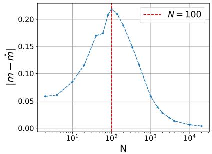
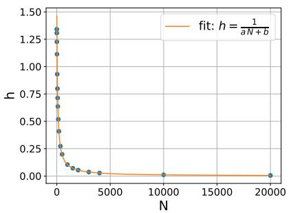
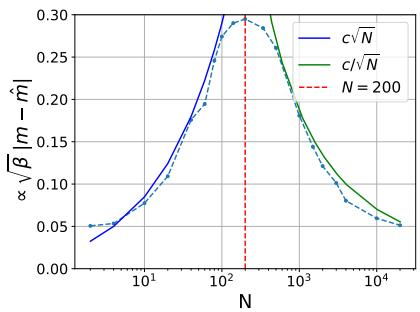
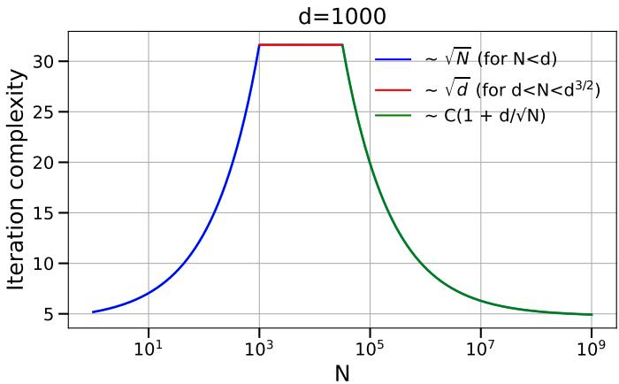
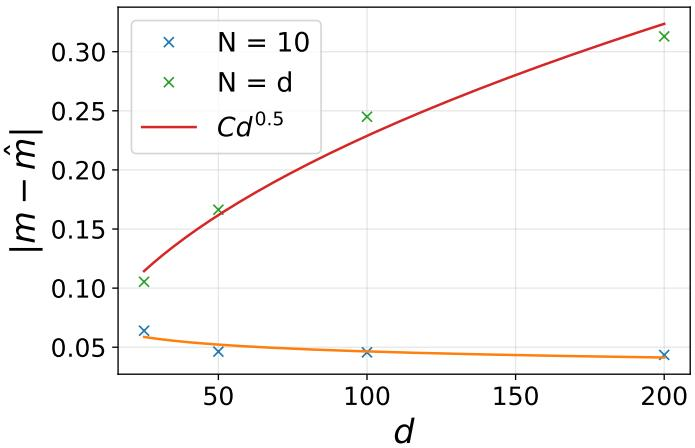
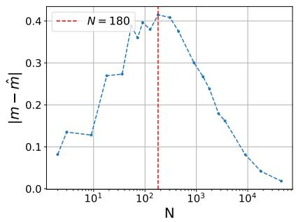
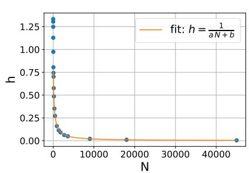
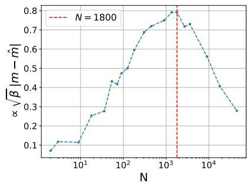

# Dimension-free regimes for unadjusted Langevin in ridge-separable models: A subspace robust Wasserstein analysis

Yuansi Chen1, Francesco Pedrotti1, and Peter A. Whalley2

1Seminar for Statistics, ETH Zürich 2Department of Statistics, University of Warwick

October 23, 2026

## Abstract

The Unadjusted Langevin Algorithm (ULA) is widely used for high-dimensional Bayesian inference. Classical analyses in Wasserstein-2 distance predict an asymptotic bias and a mixing time that grow with dimension, but this metric is stronger than necessary for many statistical tasks. We instead analyze the bias in subspace robust Wasserstein distance, which controls the mean and arbitrary low-dimensional marginals and is therefore well suited to observables typically estimated in practice. For ridge-separable potentials formed with i.i.d. data, we prove high-probability bounds showing a bell-shaped mixing profile as the number of data points N varies relative to the dimension d. In the overparameterized regime, the efective dimension is the rank N of the data-dependent perturbation, leading to complexity depending on N rather than d. In the large-sample regime, Gaussian-perturbation estimates yield dimension-free complexity once N is suficiently large. In contrast, near the proportional regime ≍ d, we prove that dimension-free guarantees are impossible in general.

## 1 Introduction

A fundamental problem in high-dimensional statistics, machine learning and Bayesian inference is to estimate the expectation of a functional with respect to a probability measure [RC04; LL01]. An important class of examples [Ber44; Pam20; Mou+21; FMZ22; CG23] is given by probability measures of the form $\pi \propto e ^ { - V }$ , where the potential $V : \mathbb { R } ^ { d }  \mathbb { R }$ takes the form

$$
V ( x ) = \frac { \lambda } { 2 } | x | ^ { 2 } + \sum _ { i = 1 } ^ { N } u _ { i } ( \langle x , a _ { i } \rangle ) ,\tag{1}
$$

and which we refer to as ridge-separable potentials. For example, in Bayesian posteriors, the first term corresponds to a Gaussian prior component, with precision $\lambda > 0$ , while the vectors $( a _ { i } ) _ { i = 1 } ^ { N }$ in the second term represent data-dependent directions drawn from a distribution in $\mathbb { R } ^ { d }$ , and $( \bar { u } _ { i } ) _ { i = 1 } ^ { N }$ are one-dimensional losses or negative log-likelihoods. Such posteriors arise, for example, in Bayesian ridge regression and Bayesian generalized linear models, including logistic, probit and Poisson regression [Gel+95], as well as in single-neuron Bayesian neural networks [Nea96].

A standard approach to approximate expectations under π is Markov chain Monte Carlo (MCMC). The underlying idea is to design a Markov chain $( X _ { k } ) _ { k }$ which is ergodic with respect to π (or an accurate approximation), and simulate it for a long enough time. Then, under standard ergodicity assumptions, the empirical average of the test function f along $( X _ { k } ) _ { k }$ accurately approximates its expectation under π.

One simple approach for diferentiable V is the Unadjusted Langevin Algorithm (ULA). Given a small step-size $h > 0$ , and a random initialization, it iterates as follows

$$
{ \hat { X } } _ { 0 } \sim \mu , \quad { \hat { X } } _ { k + 1 } = { \hat { X } } _ { k } - h \nabla V ( { \hat { X } } _ { k } ) + \sqrt { 2 } { \big ( } B _ { ( k + 1 ) h } - B _ { k h } { \big ) } ,\tag{2}
$$

where $( B _ { t } ) _ { t \geq 0 }$ is a standard d-dimensional Brownian motion. This is the Euler–Maruyama discretization of the Langevin dynamics (LD)

$$
X _ { 0 } \sim \mu , \quad d X _ { t } = - \nabla V ( X _ { t } ) d t + \sqrt { 2 } d B _ { t } .\tag{3}
$$

Under mild assumptions on V , the continuous-time process (3) is ergodic with respect to π [Pav14]. The discretization scheme (2), however, is biased, which means that its limiting stationary distribution $\hat { \pi }$ is in general diferent from π. Hence, ULA faces a basic discretization trade-of. A smaller step-size h leads to a smaller error in the bias, but also increases the number of iterations required to converge to $\hat { \pi } .$ . One can remove this bias by adding a Metropolis-Hastings accept/reject correction, leading to the Metropolis-adjusted Langevin algorithm (MALA). However, in high dimension, this correction introduces step-size restrictions and dimension-dependent mixing [RR98; WSC22]. For this reason, many large-scale applications use ULA directly.

Empirical observations In many high-dimensional Bayesian problems, ULA appears to estimate statistical functionals of interest accurately even when the step size and the number of iterations are not chosen as a function of dimension, according to the classical theory [Dal17; DM17]. This is especially true when the functionals of interest are simple observables such as the posterior mean, or depend only on a few coordinates [WT11; SLM25; Pau+25; Cha+26; SR26; PVZ20; Fea+24].

We illustrate this phenomenon in Figure 1 for Bayesian logistic regression with simulated data and a ridge-separable potential of the form (1). We plot the error $| m - { \hat { m } } |$ between the means m, mˆ of π and of the biased limit $\hat { \pi }$ respectively. The error is small both in an overparameterized regime, where $N \ll d ,$ and in an asymptotic regime where $N \gg d ,$ while it is larger near the proportional regime $N \asymp d .$ . This error plot produces a bell-shaped dependence of the ULA bias on the interplay between N, d. A similar bell-shaped phenomenon was previously observed in the Bayesian probit model [Anc+23], which was referred to as reminiscent of the double descent phenomena in machine learning theory [Has+22].

  
Figure 1: 20-dimensional Bayesian logistic regression with a mean-zero and variance one Gaussian prior, simulated data $a _ { i } \overset { \mathrm { i . i . d . } } { \sim } \mathcal { N } ( 0 , \frac { 1 } { d } I _ { d } )$ , for $i = 1 , \ldots , N$ , with corresponding simulated labels defined via $y _ { i } \mid a _ { i } , w _ { \mathrm { t r u e } } \sim$ Bernoulli $( p _ { i } )$ with probabilities, $p _ { i } = \sigma ( a _ { i } ^ { \top } w _ { \mathrm { t r u e } } ) : = 1 / ( 1 + \exp \left( - a _ { i } ^ { \top } w _ { \mathrm { t r u e } } \right) )$ 2 where $\begin{array} { r } { w _ { \mathrm { t r u e } } \sim \mathcal { N } ( 0 , \frac { 1 } { d } I _ { d } ) } \end{array}$ . Left: Bell-shaped profile for bias in the mean. Middle: Stepsize scaling is in accordance with Lemma 3.1. Right: Bell-shaped profile for rescaled bias in the mean.

The main motivation of this paper is to theoretically justify these observations, and more generally, to understand in which situations it is possible to accurately estimate the expectation of relevant test functions via (2) with a number of steps independent of the dimension.

Classical guarantees and their limitation The problem of quantifying the performance of the Unadjusted Langevin Algorithm (2), by proving error bounds in the approximation $\mu _ { k } : =$ law $\left( \hat { X } _ { k } \right) \approx \pi$ in several metrics, has given rise to an important line of work (cf. [Che25] and [DE24] for an overview). An important choice of metric is the 2-Wasserstein distance, defined for probability measures $\mu , \nu \in \mathcal { P } _ { 2 } \big ( \mathbb { R } ^ { d } \big )$ with finite second moment by

$$
W _ { 2 } ( \mu , \nu ) = \sqrt { \operatorname* { i n f } _ { X , Y } \mathbb { E } \Big [ | X - Y | ^ { 2 } \Big ] } ,\tag{4}
$$

where the infimum runs over all $\mathbb { R } ^ { d } .$ -valued random vectors X and Y defined on the same probability space $( \Omega , { \mathcal { F } } , { \mathcal { P } } )$ with law $( X ) = \mu$ and law $( Y ) = \nu$

By Kantorovich duality, results establishing upper bounds on $W _ { 2 } ( \mu _ { k } , \pi )$ for k large enough provide a possible justification for using (2) to estimate expectations of Lipschitz test functions with respect to π. Classical Wasserstein guarantees for the Unadjusted Langevin Algorithm, however, require choosing a step-size scaling inversely with the dimension [Che25], similarly to what is enforced for the Metropolis correction. Therefore, they are unable to explain the improved empirical performance of (2) often seen in practice, and in particular in the setting of (1). To illustrate this limitation, we recall below a prototypical result of this type, which holds under the following classical log-concavity assumption.

Assumption 1.1. The potential $V \in C ^ { 2 } (  { \mathbb { R } } ^ { d } )$ satisfies

$$
\alpha I _ { d } \precsim \nabla ^ { 2 } V \prec \beta I _ { d } ,
$$

for some $0 < \alpha < \beta$ . We denote the condition number by $\begin{array} { r } { \kappa : = \frac { \beta } { \alpha } } \end{array}$

Proposition 1.1. [PW26] Under Assumption 1.1, if $\begin{array} { r } { h \leq \frac { 1 } { \beta } } \end{array}$ , we have

$$
W _ { 2 } ( \mu _ { k } , \pi ) \leq ( 1 - \alpha h ) ^ { k } W _ { 2 } ( \mu , \hat { \pi } ) + 6 h \sqrt { \kappa \beta d } .\tag{5}
$$

In particular,

$$
W _ { 2 } ( \pi , \hat { \pi } ) \leq 6 h \sqrt { \kappa \beta d } .\tag{6}
$$

The error bound in (5) is made of two terms: the first is exponentially decaying, and reflects the exponential convergence of (2) to πˆ. The second corresponds to the error due to the bias ${ \hat { \pi } } \neq \pi ;$ making it smaller than some desired accuracy requires choosing a step-size h scaling with $\textstyle { \frac { 1 } { \sqrt { d } } }$ , and correspondingly the iteration complexity of the algorithm scales with the dimension too. Unfortunately, this dimension dependence typically cannot be removed when measuring errors in the W2-metric, even in the simplest case where π is a Gaussian measure.

## 1.1 Our contributions

We propose to use the subspace robust Wasserstein distance SRW from [PC19] to quantify the convergence of ULA, instead of the classical Wasserstein-2 distance. We characterize the iteration complexity to sample from ridge-separable potentials (1) in this metric, thus bridging the gap between the empirical observations discussed above and the classical theoretical guarantees. More generally, we also provide bounds on the asymptotic bias of ULA for target distributions that correspond to perturbations of Gaussian measures, revealing a dimension-free behavior when the perturbation is small enough.

Subspace robust Wasserstein distance The subspace robust Wasserstein distance SRW was introduced in [PC19], and is defined for $\mu , \nu \in \mathcal { P } _ { 2 } ( \mathbb { R } ^ { d } )$ by

$$
\operatorname { S R W } ^ { 2 } ( \mu , \nu ) = \operatorname* { i n f } _ { X , Y } \left\| \mathbb { E } \big [ ( X - Y ) ( X - Y ) ^ { T } \big ] \right\| _ { \mathrm { o p } } ,
$$

where again the infimum is over all couplings $( X , Y )$ of $\mu , \nu$ . By comparison, notice that if we replace $\left\| \mathbb { E } \big [ ( X - Y ) ( X - Y ) ^ { T } \big ] \right\| _ { \mathrm { o p } }$ with $\mathrm { T r } \big ( \mathbb { E } \big [ ( X - Y ) ( X - Y ) ^ { T } \big ] \big )$ , we recover the standard Wasserstein-2 distance $W _ { 2 } ^ { 2 } ( \mu , \nu )$ : in particular, we always have

$$
\frac { W _ { 2 } ( \mu , \nu ) } { \sqrt d } \leq \mathrm { S R W } ( \mu , \nu ) \leq W _ { 2 } ( \mu , \nu ) .
$$

A first crucial observation that we make in this paper is that, when measuring the asymptotic bias of (2), the first inequality above is approximately achieved for some distributions, in the sense that $W _ { 2 } ( \pi , \hat { \pi } )$ scales with $\sqrt { d }$ but $\mathrm { S R W } ( \pi , \hat { \pi } )$ is dimension-free: this is easily checked, for example, when π is Gaussian, cf. our Proposition 2.1 below.

As a second important motivation for choosing this metric, observe that upper bounds on the bias SRW $( \pi , { \hat { \pi } } )$ naturally yield guarantees for the estimation of low-dimensional observables. Indeed, for an integer $k \in \mathbb { N } _ { > 0 }$ and $\boldsymbol { \theta } = ( \theta _ { 1 } , \dots , \theta _ { k } ) \in \left( S ^ { d - 1 } \right) ^ { k }$ , denote by $L _ { \theta } \colon \mathbb { R } ^ { d } \to \mathbb { R } ^ { k }$ to denote the linear map

$$
x  ( \langle x , \theta _ { 1 } \rangle , \dots , \langle x , \theta _ { k } \rangle ) ,
$$

and for a measure $\mu \in \mathcal P ( \mathbb { R } ^ { d } )$ , denote the corresponding pushforward measure by $\mu _ { \theta } : = L _ { \theta } \# \mu \in$ ${ \mathcal { P } } \left( \mathbb { R } ^ { k } \right)$ . Then, we have the inequality

$$
W _ { 2 } ( \mu _ { \theta } , \nu _ { \theta } ) \leq \sqrt { k } \operatorname { S R W } ( \mu , \nu ) .
$$

for all $k \in \mathbb { N } _ { > 0 }$ and $\theta \in \left( S ^ { d - 1 } \right) ^ { k }$ . Besides low-dimensional observables, the SRW-metric also controls the diference between the mean of two distributions, and is intimately related to this quantity. In fact, for any coupling $( X , Y )$ of $( \mu , \nu )$ it is not dificult to check that

$$
\left| \int x d \mu - \int x d \nu \right| \leq \mathrm { S R W } ( \mu , \nu ) \leq \sqrt { \left| \int x d \mu - \int x d \nu \right| ^ { 2 } + \| \mathrm { C o v } [ X - Y ] \| _ { \mathrm { o p } } } .\tag{7}
$$

Bell-shaped mixing profile for ridge-separable potentials Equipped with this metric, we establish bounds on the iteration complexity of sampling in SRW-accuracy from $\pi \propto e ^ { - V }$ with V as in (1). In order to have scale-invariant results, we actually consider the rescaled metric $\sqrt { \alpha } \mathrm { S R W } ,$ where α is the strong log-concavity parameter of π (this is a natural and standard procedure, cf. [Che25, Rmk. 4.1.4]). Our main result in this setting distinguishes between three diferent regimes, and can be informally summarized as follows.

Theorem 1 (Informal). Consider a ridge-separable potential V as in (1), with i.i.d sub-Gaussian data, smooth strongly convex functions $u _ { i } \in C ^ { 3 } ( \mathbb { R } )$ and $\lambda$ of order $\mathbb { E } \bigg [ | a _ { i } | ^ { 2 } \bigg ]$ . Then, with highprobability, setting $\alpha = \operatorname* { s u p } \left\{ \mathfrak { m } > 0 \ \lvert \ \nabla ^ { 2 } V \succeq \mathfrak { m } I _ { d } \right\}$ , we have that the iteration complexity of sampling in a fixed √αSRW-accuracy $\varepsilon > 0$ is upper-bounded by

1. $\frac { C \sqrt { N } } { \varepsilon }$ in the regime $N \lesssim d ,$

2. $\frac { C } { \varepsilon }$ in the regime $N \gtrsim d ^ { 2 }$

where $C > 0$ is a dimension-free constant up to logarithmic factors. Furthermore, when $N \asymp d ,$ the iteration complexity can scale as $\frac { \sqrt { d } } { \varepsilon }$

In summary, the picture that emerges is illustrated in Figure 2. In the overparameterized regime, where $N \lesssim 1$ , we provide a dimension-free iteration complexity to sample in SRW-accuracy with $( 2 )$ ; somewhat more surprisingly, we also prove a similar phenomenon in an asymptotic regime, where $N \gtrsim d ^ { 2 }$ . On the other hand, in the proportional regime where $N \asymp d ,$ , we consider a specific choice of V illustrating that dimension-free rates are not possible in this case, and provide further numerical experiments to confirm this. The findings of Theorem 1 are consistent with the empirical observations previously discussed. Note that, under exponential convergence to a biased limit, the iteration complexity is governed by the stepsize required to control the asymptotic bias. Since it is dificult to measure the SRW-distance numerically (between π and πˆ), in Figure 1 we plotted instead the error in the mean estimation, which, as suggested by (7), is an appropriate proxy.

As anticipated, the findings of Theorem 1 illustrated in Figure 2 cannot be deduced from existing results in the literature. First, if the goal is to ensure that $\sqrt { \alpha } W _ { 2 } ( \mu _ { k } , \pi ) \le \varepsilon$ along (2), classical guarantees like Proposition 1.1 require the number of iterations of (2) to grow polynomially with the dimension. In contrast, in Theorem 1, the iteration complexity to ensure $\sqrt { \alpha } \mathrm { S R W } ( \mu _ { k } , \pi ) \le \varepsilon$ is dimension-free (up to logarithmic factors) in the overparameterized and asymptotic regimes.

  
Figure 2: Illustration of Theorem 1

Closer to our work, a related recent line of research has also focused on replacing classical distances with weaker metrics to provide dimension-free bounds on the bias [Che+24; LZ25]. The work [Che+24] introduced in particular an $\ell ^ { \infty } { \tt _ { - v e r s i o n } }$ of Wasserstein distance, and established dimension-free bound (up to logarithmic terms) on the ℓ∞-Wasserstein bias for distributions with sparse interactions. The sparsity assumptions considered in $[ \mathrm { C h e + 2 4 ; \mathrm { L Z 2 5 } } ]$ , however, are often not satisfied in statistics and machine learning applications, and in particular for the ridge-separable potentials (1). Imposing an approximate product measure structure in this setting is not realistic, and it is more natural to consider assumptions that are not formulated in terms of a coordinate system. Indeed, applying an isometric transformation to the corresponding measure π results in a new potential again of the form (1) (with new transformed data $( \tilde { a } _ { i } ) _ { i } )$ . In contrast, both for the potentials (1) and more generally in Section 2 we provide upper bounds on the SRW-bias under rotationally invariant assumptions on the target measure π.

Subspace robust Wasserstein bias for Gaussian perturbations With the aim to prove Theorem 1, we establish in Theorem 2 upper bounds on the subspace-robust Wasserstein bias for more general distributions, which are of independent interest. More precisely, we consider distributions satisfying the classical Assumption 1.1, but also an additional third-order condition $\| \nabla ^ { 3 } V \| _ { \mathrm { o p } } \leq M$ . Correspondingly, we define a scale-invariant parameter $\begin{array} { r } { \mathfrak { S } : = \frac { M } { \alpha ^ { 3 / 2 } } } \end{array}$ , to quantify closeness to a Gaussian distribution (which correspond to $M = \mathfrak { S } = 0 )$ . $\mathrm { A s } \mathfrak { S }  0$ , our bounds recover in particular the dimension-free inequality S $\operatorname { \Re W } ( \pi , { \hat { \pi } } ) \leq { \sqrt { \beta } } h$ , valid when π is Gaussian.

Overview of proof techniques Theorem 2, the Gaussian-perturbation result, is proved by carefully analyzing the synchronous coupling of (2) and (3), separating the efect of the Gaussian components (which give rise to dimension-free error terms), from the perturbation part.

The proof of Theorem 1 proceeds by treating the three regimes separately. In the large-sample regime $N \gg d ,$ , due to posterior concentration, we can treat the posterior as a Gaussian perturbation and apply our Theorem 2. For ridge-separable potentials with sub-Gaussian data, this requires high-probability estimates on the second and third derivatives. In the overparameterized regime $N \ll d ,$ the data-dependent part of the potential is a low-rank perturbation of a Gaussian, and this efective rank replaces the dimension d in our bounds. Finally, on the other hand, in the proportional regime $N \asymp d$ we construct an explicit example showing that dimension-free guarantees fail in general: the SRW-bias, and even the bias in the mean, can grow with dimension for typical data.

Paper organization This paper is organized as follows. In Section 2, we prove Theorem $^ { 2 , }$ our general upper bounds on the SRW-bias for Gaussian perturbations. Section 3 contains the proof of Theorem 1 and a more in-depth discussion of the results. In Appendix B we further discuss the SRW-distance and compare it with its variants; in particular, we discuss results in expectation/highprobability about the bias in “typical directions”, with implications for estimating the expectation R f dπ for certain observables. Finally, in Appendix A we provide additional numerical experiments in the spirit of Figure 1, while the remaining sections of the Appendix contain omitted proofs and auxiliary technical results: these include the derivation of high-probability bounds needed in Section 3, as well as several bounds on Lp-norms appearing in the proofs in Section 2.

## 2 Subspace robust Wasserstein bias for Gaussian perturbations

In this section, we prove our main result about the SRW-bias for Gaussian perturbations. Our first motivation for considering Gaussian perturbations is the following proposition, of which we give a simple proof in Appendix E. It shows that, when $\pi$ is a Gaussian measure, the SRW-bias is dimension-free, unlike what happens when using the standard Wasserstein-2 distance.

Proposition 2.1. Consider a Gaussian measure π $\propto e ^ { - V }$ with $V ( x ) = \textstyle { \frac { 1 } { 2 } } \langle x - m , A ( x - m ) \rangle$ and α $I _ { d } \preccurlyeq A \preccurlyeq \beta I _ { d }$ for some constants $0 < \alpha < \beta$ . Then, if $\begin{array} { r } { h \leq \frac { 1 } { \beta } } \end{array}$ , we have

$$
\operatorname { S R W } ( \pi , { \hat { \pi } } ) \lesssim { \sqrt { \beta } } h .\tag{8}
$$

However,

$$
W _ { 2 } ( \pi , \hat { \pi } ) \gtrsim \sqrt { \alpha d } h .
$$

The second motivation comes from the key insight that ridge-separable distributions are closely related to Gaussian measures, at least in the overparameterized regimes $N \ll d ,$ thanks to the Gaussian prior component, and in the regime $N \gg d$ , where asymptotic results like the Bernstein-Von Mises Theorem play an important role [Vaa98].

To go beyond the Gaussian example, our focus in this section is on distributions which are strongly log-concave and log-smooth as in Assumption 1.1, but also satisfying the following additional third-order smoothness condition.

Assumption 2.1. The potential $V \in C ^ { 3 } (  { \mathbb { R } } ^ { d } )$ satisfies

$$
\| \nabla ^ { 3 } V \| _ { \mathrm { o p } } \leq M
$$

for some constant $M \geq 0$ , where we define the operator norm of $A \in \mathbb { R } ^ { d \times d \times d }$ by

$$
\| A \| _ { \mathrm { o p } } : = \operatorname* { s u p } \left\{ \sum _ { i , j , k = 1 } ^ { d } A _ { i j k } x _ { i } y _ { j } z _ { k } \Bigg | \sum _ { i } x _ { i } ^ { 2 } \leq 1 , \sum _ { j } y _ { j } ^ { 2 } \leq 1 , \sum _ { k } z _ { k } ^ { 2 } \leq 1 \right\} .
$$

Equivalently, for all $x , y \in \mathbb { R } ^ { d }$

$$
\begin{array} { r } { \left\| \nabla ^ { 2 } V ( y ) - \nabla ^ { 2 } V ( x ) \right\| _ { \mathrm { o p } } \leq M | x - y | } \end{array}
$$

and

$$
\left| \nabla V ( y ) - \nabla V ( x ) - \nabla ^ { 2 } V ( x ) ( y - x ) \right| \leq \frac { M } { 2 } | x - y | ^ { 2 } .
$$

For distributions satisfying Assumptions 1.1 and 2.1, we naturally introduce the following (scale-invariant) parameter of $\pi ,$ , in the spirit of the condition number:

$$
\mathfrak { S } : = \frac { M } { \alpha ^ { \frac { 3 } { 2 } } } .\tag{9}
$$

Notice that the case $M = \mathfrak { S } = 0$ corresponds to $\pi$ being a Gaussian measure, and so Assumption 2.1 quantifies the closeness of π to being Gaussian.

Our main result for this class of distributions is the following theorem, which provides an upper bound on the subspace robust Wasserstein asymptotic bias of ULA, as well as an improved bound for the error in the mean estimation, which goes to 0 as $\mathfrak { S } \to 0$ . We also record a new bound on the bias in the standard $W _ { \mathrm { 2 - m e t r i c } }$ of independent interest, since it follows easily with the same proof; this $W _ { \mathrm { 2 ^ { - } } } \mathrm { b o u n d }$ is closely related to the estimate $W _ { 2 } ( \pi , \hat { \pi } ) \lesssim h \kappa \sqrt { \beta d } + h d \mathfrak { S } \sqrt { \alpha }$ obtained in [DK19, Theorem 5] under the same assumptions.

Theorem 2 (SRW-bias of Gaussian perturbations). Under Assumptions 1.1 and 2.1, if $\begin{array} { r } { h \le \frac { 1 } { \beta } } \end{array}$ we have that

$$
\mathrm { S R W } ( \pi , { \hat { \pi } } ) \lesssim h \sqrt { \beta } + h \sqrt { \beta } \mathfrak { S } d ,\tag{10}
$$

$$
| m - \hat { m } | \lesssim h \sqrt { \beta } \mathfrak { S } d ,\tag{11}
$$

$$
W _ { 2 } ( \pi , \hat { \pi } ) \lesssim h \sqrt { \beta d } + h \sqrt { \beta } \mathfrak { S } d .\tag{12}
$$

Remark 2.1. The improvement in the bound on SRW(π, πˆ) compared to $W _ { 2 } ( \pi , \hat { \pi } )$ might seem minor, by removing just the dimension dependence in the first term. However, as it will be clear from the discussion in Section 3, for our applications to ridge-separable potentials this will be crucial to deduce a dimension-free iteration complexity in the rescaled metric $\sqrt { \alpha } \mathrm { S R W }$

For the proof of Theorem $^ { 2 , }$ we will also make use of the following standard results, which we prove in Appendix D.

Lemma 2.1. Under Assumption 1.1, let $x ^ { * } : = \arg$ min V . Then we have for $X \sim \pi$ and any $u \in \mathbb { R } ^ { d }$

$$
\| X - x ^ { * } \| _ { L ^ { 4 } } \lesssim \sqrt { \frac { d } { \alpha } } , \qquad \| \nabla V ( X ) \| _ { L ^ { 4 } } \lesssim \sqrt { \beta d } , \quad \mathrm { a n d } \quad \| u \cdot \nabla V ( X ) \| _ { L ^ { 4 } } \lesssim \sqrt { \beta } | u | ,\tag{13}
$$

Moreover, define $\begin{array} { r } { A : = \mathbb { E } _ { \pi } \nabla ^ { 2 } V = \mathbb { E } _ { \pi } [ \nabla V \nabla V ^ { \top } ] } \end{array}$ and $Q ( x ) = \nabla ^ { 2 } V ( x ) - A$ . If Assumption 2.1 holds, then

$$
\| Q ( x ) \| _ { \mathrm { o p } } \lesssim M \left( | x - x ^ { * } | + { \sqrt { \frac { d } { \alpha } } } \right) .\tag{14}
$$

Additionally, we will need the following elementary matrix bounds, proved in Appendix E.

Lemma 2.2. Let $0 < \alpha \le \beta$ and A be a symmetric d × d matrix satisfying α $I _ { d } \preccurlyeq A \preccurlyeq \beta I _ { d }$ . If $0 < h \leq 1 / \beta$ , then

$$
h ^ { 2 } \sum _ { j = 0 } ^ { \infty } \| A ^ { 3 / 2 } ( I _ { d } - h A ) ^ { j } \| _ { \mathrm { o p } } \lesssim h \sqrt { \beta } ,\tag{15}
$$

and

$$
h ^ { 3 } \sum _ { j = 0 } ^ { \infty } ( I _ { d } - h A ) ^ { j } A ^ { 2 } ( I _ { d } - h A ) ^ { j } \preceq h ^ { 2 } A .\tag{16}
$$

Proof of Theorem 2. Let $X _ { 0 } = \hat { X } _ { 0 } \sim \pi$ and consider solutions $( X _ { t } ) _ { t \geq 0 }$ and $( \hat { X } _ { k } ) _ { k \in \mathbb { N } }$ of (3) and (2) with synchronous coupling. In particular, $X _ { t } \sim \pi$ for every $t \geq 0$ . We will decompose, for every k,

$$
X _ { k h } - { \hat { X } } _ { k } = G _ { k } + R _ { k } ,\tag{17}
$$

where, uniformly in k,

$$
\mathbb { E } [ G _ { k } ] = 0 , \qquad \operatorname* { s u p } _ { | u | = 1 } \| \langle u , G _ { k } \rangle \| _ { L ^ { 2 } } \lesssim h \sqrt { \beta } , \qquad \| G _ { k } \| _ { L ^ { 4 } } \lesssim h \sqrt { \beta d } ,\tag{18}
$$

$$
\| R _ { k } \| _ { L ^ { 2 } } \lesssim h \sqrt { \beta } \mathfrak { S } d .\tag{19}
$$

From this, the desired conclusion follows easily, taking $k \to \infty$

To achieve the decomposition (17), let us start by writing the recursion

$$
\begin{array} { r l } & { X _ { ( k + 1 ) h } - \hat { X } _ { k + 1 } = X _ { k h } - \hat { X } _ { k } - h \Big ( \nabla V ( X _ { k h } ) - \nabla V ( \hat { X } _ { k } ) \Big ) - \displaystyle \int _ { 0 } ^ { h } ( \nabla V ( X _ { k h + t } ) - \nabla V ( X _ { k h } ) ) d t } \\ & { \quad \quad \quad \quad = X _ { k h } - \hat { X } _ { k } - h \Big ( \nabla V ( X _ { k h } ) - \nabla V ( \hat { X } _ { k } ) \Big ) - \displaystyle \int _ { 0 } ^ { h } ( h - s ) d \nabla V ( X _ { k h + s } ) } \end{array}\tag{20}
$$

Next, as in Lemma 2.1 we define the matrix $A = \mathbb { E } _ { \pi } [ \nabla ^ { 2 } V ]$ and $Q ( x ) = \nabla ^ { 2 } V ( x ) - A$ , to decompose the Hessian of the potential as the sum of a constant matrix and a remainder term, in order to highlight the linear component. This suggests to consider the recursion

$$
G _ { 0 } = 0 , \qquad G _ { k + 1 } = ( I _ { d } - h A ) G _ { k } - A \int _ { 0 } ^ { h } ( h - s ) d X _ { k h + s } ,\tag{21}
$$

and define correspondingly $R _ { k } = X _ { k h } - \hat { X } _ { k } - { G } _ { k }$ . It remains then to prove the two bounds (18) and (19).

Iterating the preceding recursion and using the Langevin equation, we write $G _ { k } = G _ { k } ^ { \mathrm { D } } + G _ { k } ^ { \mathrm { B } }$ where

$$
G _ { k } ^ { \mathrm { D } } = \sum _ { j = 0 } ^ { k - 1 } ( I _ { d } - h A ) ^ { j } A \int _ { 0 } ^ { h } ( h - s ) \nabla V \left( X _ { ( k - 1 - j ) h + s } \right) d s ,
$$

$$
G _ { k } ^ { \mathrm { B } } = - \sqrt { 2 } \sum _ { j = 0 } ^ { k - 1 } ( I _ { d } - h A ) ^ { j } A \int _ { 0 } ^ { h } ( h - s ) d B _ { ( k - 1 - j ) h + s } .
$$

Both terms are centered, since $X _ { t } \sim \pi$ and $\mathbb { E } _ { \pi } [ \boldsymbol { \nabla } V ] = 0$ . For every unit vector $u ,$ stationarity, triangle inequality, and the identity $A = \mathbb { E } _ { \pi } \bigl [ \nabla V \nabla V ^ { \top } \bigr ]$ give

$$
\begin{array} { r l r } & { } & { \displaystyle \left\| \langle u , G _ { k } ^ { \mathrm { D } } \rangle \right\| _ { L ^ { 2 } } \leq \frac { h ^ { 2 } } { 2 } \sum _ { j = 0 } ^ { k - 1 } \Bigl \| \Big \langle A ( I _ { d } - h A ) ^ { j } u , \nabla V ( X _ { 0 } ) \Big \rangle \Bigr \| _ { L ^ { 2 } } } \\ & { } & { \displaystyle = \frac { h ^ { 2 } } { 2 } \sum _ { j = 0 } ^ { k - 1 } \Bigl | A ^ { 3 / 2 } ( I _ { d } - h A ) ^ { j } u \Bigr | \lesssim h \sqrt { \beta } , } \end{array}
$$

where the last inequality follows from (15). Moreover, by independence of the Brownian increments and (16),

$$
\mathrm { C o v } \big [ G _ { k } ^ { \mathrm { B } } \big ] = \frac { 2 h ^ { 3 } } { 3 } \sum _ { j = 0 } ^ { k - 1 } ( I _ { d } - h A ) ^ { j } A ^ { 2 } ( I _ { d } - h A ) ^ { j } \prec \frac { 2 h ^ { 2 } } { 3 } A \prec \frac { 2 h ^ { 2 } \beta } { 3 } I _ { d } ,
$$

which proves the directional estimate in (18).

To prove the vector estimate, let $( e _ { i } ) _ { i = 1 } ^ { d }$ be an orthonormal eigenbasis of A, with $A e _ { i } = a _ { i } e _ { i }$ Lemma 2.1 and a geometric sum yield

$$
\big \| \big \langle e _ { i } , G _ { k } ^ { \mathrm { D } } \big \rangle \big \| _ { L ^ { 4 } } \leq \frac { h ^ { 2 } a _ { i } } { 2 } \sum _ { j = 0 } ^ { k - 1 } ( 1 - h a _ { i } ) ^ { j } \| \langle e _ { i } , \nabla V ( X _ { 0 } ) \rangle \| _ { L ^ { 4 } } \lesssim h \sqrt { \beta } .
$$

It follows that

$$
\left\| G _ { k } ^ { \mathrm { D } } \right\| _ { L ^ { 4 } } \leq \left( \sum _ { i = 1 } ^ { d } \bigl \| \bigl \langle e _ { i } , G _ { k } ^ { \mathrm { D } } \bigr \rangle \bigr \| _ { L ^ { 4 } } ^ { 2 } \right) ^ { 1 / 2 } \lesssim h \sqrt { \beta d } .
$$

The covariance estimate above and the standard Gaussian moment bound give the same estimate for $G _ { k } ^ { \mathrm { B } }$ , which proves (18).

We now turn to $R _ { k }$ . Itô’s formula gives

$$
d \nabla V ( X _ { t } ) = { \bigl ( } \nabla \Delta V - \nabla ^ { 2 } V \nabla V { \bigr ) } ( X _ { t } ) d t + \sqrt { 2 } \nabla ^ { 2 } V ( X _ { t } ) d B _ { t } .
$$

Define now the (1−αh)-Lipschitz map $\Phi ( x ) = x - h \nabla V ( x )$ . Splitting $\nabla ^ { 2 } V = A + Q$ and subtracting the recursion (21) defining $G _ { k }$ from (20), we obtain

$$
R _ { k + 1 } = \Phi ( \hat { X } _ { k } + R _ { k } ) - \Phi ( \hat { X } _ { k } ) - h \rho _ { k } + U _ { k } + N _ { k } ,\tag{22}
$$

where

$$
\begin{array} { l } { \rho _ { k } = \displaystyle \int _ { 0 } ^ { 1 } Q ( X _ { k h } - t G _ { k } ) G _ { k } d t , } \\ { \displaystyle U _ { k } = \displaystyle \int _ { 0 } ^ { h } ( h - s ) [ Q ( X _ { k h + s } ) \nabla V ( X _ { k h + s } ) - \nabla \Delta V ( X _ { k h + s } ) ] d s , } \\ { \displaystyle N _ { k } = - \sqrt { 2 } \displaystyle \int _ { 0 } ^ { h } ( h - s ) Q ( X _ { k h + s } ) d B _ { k h + s } . } \end{array}
$$

We claim now that

$$
\| \rho _ { k } \| _ { L ^ { 2 } } \lesssim M h d \sqrt { \kappa }\tag{23}
$$

$$
\| U _ { k } \| _ { L ^ { 2 } } \lesssim M d h ^ { 2 } \sqrt { \kappa }\tag{24}
$$

$$
\| N _ { k } \| _ { L ^ { 2 } } \lesssim \frac { M d h ^ { 3 / 2 } } { \sqrt { \alpha } } .\tag{25}
$$

To see (23) notice that by (14) we have

$$
\begin{array} { l } { \displaystyle | \rho _ { k } | \le \int _ { 0 } ^ { 1 } \| Q ( X _ { k h } - t G _ { k } ) \| _ { \mathrm { o p } } | G _ { k } | d t } \\ { \displaystyle \lesssim M \left[ \left( | X _ { k h } - x ^ { * } | + \sqrt { \frac { d } { \alpha } } \right) | G _ { k } | + | G _ { k } | ^ { 2 } \right] . } \end{array}
$$

Therefore, by Hölder’s inequality, stationarity, and (18),

$$
\begin{array} { l } { \displaystyle \| \rho _ { k } \| _ { L ^ { 2 } } \lesssim M \left[ \left( \| X _ { k h } - x ^ { * } \| _ { L ^ { 4 } } + \sqrt { \frac { d } { \alpha } } \right) \| G _ { k } \| _ { L ^ { 4 } } + \| G _ { k } \| _ { L ^ { 4 } } ^ { 2 } \right] } \\ { \displaystyle \lesssim M \left[ \sqrt { \frac { d } { \alpha } } h \sqrt { \beta d } + h ^ { 2 } \beta d \right] \lesssim M h d \sqrt { \kappa } , } \end{array}
$$

where in the last inequality we used $h \beta \leq 1$ . To see (24), observe first that by the triangle inequality and stationarity,

$$
\left\| \boldsymbol { U } _ { k } \right\| _ { L ^ { 2 } } \leq \int _ { 0 } ^ { h } ( h - s ) \left[ \left\| \left\| \boldsymbol { Q } ( \boldsymbol { X } _ { 0 } ) \right\| _ { \mathrm { o p } } \lvert \nabla V ( \boldsymbol { X } _ { 0 } ) \rvert \right\| _ { L ^ { 2 } } + \left\| \nabla \Delta V ( \boldsymbol { X } _ { 0 } ) \right\| _ { L ^ { 2 } } \right] d s .
$$

$\mathrm { B y }$ Hölder’s inequality, (14), and the moment estimates,

$$
\begin{array} { r l r } {  { \Big \| \| Q ( X _ { 0 } ) \| _ { \mathrm { o p } } | \nabla V ( X _ { 0 } ) | \Big \| _ { L ^ { 2 } } \leq \Big \| \| Q ( X _ { 0 } ) \| _ { \mathrm { o p } } \Big \| _ { L ^ { 4 } } \| \nabla V ( X _ { 0 } ) \| _ { L ^ { 4 } } } } \\ & { } & { \lesssim M \sqrt { \frac { d } { \alpha } } \sqrt { \beta d } = M d \sqrt { \kappa } . } \end{array}
$$

Moreover, Assumption 2.1 implies that $| \nabla \Delta V | \leq M d .$ and (24) follows. Finally, (25) follows from Itô’s isometry and stationarity. Indeed,

$$
\begin{array} { r l r } {  { \| N _ { k } \| _ { L ^ { 2 } } ^ { 2 } = 2 \int _ { 0 } ^ { h } ( h - s ) ^ { 2 } \mathbb { E } \Big [ \| Q ( X _ { k h + s } ) \| _ { \mathrm { F } } ^ { 2 } \Big ] d s } } \\ & { } & { = 2 \int _ { 0 } ^ { h } ( h - s ) ^ { 2 } d s \mathbb { E } \Big [ \| Q ( X _ { 0 } ) \| _ { \mathrm { F } } ^ { 2 } \Big ] } \\ & { } & { \lesssim d h ^ { 3 } \mathbb { E } \Big [ \| Q ( X _ { 0 } ) \| _ { \mathrm { o p } } ^ { 2 } \Big ] } \\ & { } & { \lesssim M ^ { 2 } \frac { d ^ { 2 } } { \alpha } h ^ { 3 } , } \end{array}
$$

as desired. Finally, let $\mathcal { F } _ { k } = \sigma ( X _ { 0 } , ( B _ { t } ) _ { 0 \leq t \leq k h } )$ and rewrite (22) as

$$
\begin{array} { r l } & { R _ { k + 1 } = \Phi ( \hat { { X } } _ { k } + { R } _ { k } ) - \Phi ( \hat { { X } } _ { k } ) - h \rho _ { k } + { U } _ { k } + { N } _ { k } } \\ & { \qquad = \Phi ( \hat { { X } } _ { k } + { R } _ { k } ) - \Phi ( \hat { { X } } _ { k } ) + \{ - h \rho _ { k } + \mathbb { E } [ { U } _ { k } \mid \mathcal { F } _ { k } ] \} + \{ { U } _ { k } - \mathbb { E } [ { U } _ { k } \mid \mathcal { F } _ { k } ] + { N } _ { k } \} . } \end{array}\tag{26}
$$

Since the last term conditioned on $\mathcal { F } _ { k }$ is a mean-zero random variable, the bounds (23), (24), (25) the $( 1 - \alpha h )$ -Lipschitzness of Φ imply that that for an absolute constant $C > 0$

$$
\begin{array} { l } { \displaystyle \| R _ { k + 1 } \| _ { L ^ { 2 } } ^ { 2 } \leq \big ( ( 1 - \alpha h ) \| R _ { k } \| _ { L ^ { 2 } } + C M d h ^ { 2 } \sqrt { \kappa } \big ) ^ { 2 } + \frac { C M ^ { 2 } d ^ { 2 } h ^ { 3 } } { \alpha } } \\ { \leq ( 1 - \alpha h ) \| R _ { k } \| _ { L ^ { 2 } } ^ { 2 } + \frac { C M ^ { 2 } d ^ { 2 } h ^ { 3 } \kappa } { \alpha } . } \end{array}
$$

This gives the desired inequality

$$
\operatorname* { s u p } _ { k \geq 0 } \lVert R _ { k } \rVert _ { L ^ { 2 } } \lesssim \frac { M h d \sqrt { \kappa } } { \alpha } = h \sqrt { \beta } \mathfrak { S } d ,
$$

thus concluding the proof.

## 3 Main results for ridge-separable models

As discussed in the introduction, our focus here is on a class of common models in Bayesian applications, where the potential takes the form

$$
V ( x ) = \frac { \lambda } { 2 } | x | ^ { 2 } + \sum _ { i = 1 } ^ { N } u _ { i } ( \langle a _ { i } , x \rangle ) ,\tag{27}
$$

for a parameter $\lambda > 0$ , i.i.d datapoints $( a _ { i } ) _ { i }$ in $\mathbb { R } ^ { d }$ , and functions $u _ { i } \colon \mathbb { R }  \mathbb { R }$

In this section, we establish iteration complexity bounds in SRW-accuracy for sampling from π, distinguishing three regimes to complete Theorem 1: for the asymptotic regime, where $N \gg d .$ we provide Theorem 3; for the proportional regime, where $N \asymp d .$ , we provide Theorem 4; for the overparameterized regime, where $N \ll d ,$ , we provide Theorem 6.

In order to analyze and compare between these diferent regimes, we now place ourselves in the following specific setting.

Assumption 3.1. 1. The functions $u _ { i } \in C ^ { 3 } ( \mathbb { R } )$ are such that $\bar { \alpha } \leq u _ { i } ^ { \prime \prime } \leq \bar { \beta }$ and $| u _ { i } ^ { \prime \prime \prime } | \leq \bar { M }$ for some constants $0 \leq \bar { \alpha } \leq \bar { \beta }$ and $\bar { M } \geq 0$

2. The points $( a _ { i } ) _ { i = 1 } ^ { N }$ are i.i.d. from a centered sub-Gaussian distribution $\nu \in \mathcal { P } \big ( \mathbb { R } ^ { d } \big )$ such that $\Sigma : = \operatorname { C o v } [ \nu ] \succ 0$ . We denote by

$$
\kappa _ { \Sigma } : = \frac { \lambda _ { \operatorname* { m a x } } ( \Sigma ) } { \lambda _ { \operatorname* { m i n } } ( \Sigma ) }\tag{28}
$$

the condition number of Σ.

Furthermore, ν is such that there exists a constant $K \geq 1$ for which

$$
\lVert \langle a _ { i } , \theta \rangle \rVert _ { \psi _ { 2 } } \leq K \sqrt { \langle \theta , \Sigma \theta \rangle } \quad \mathrm { ~ f o r ~ a l l ~ } \theta \in S ^ { d - 1 } ,\tag{29}
$$

where $\lVert \cdot \rVert _ { \psi _ { 2 } }$ denotes the sub-Gaussian norm of a random variable [Ver26].

Notice that Assumption 3.1 implies in particular that Assumption 1.1 is satisfied too for some $0 < \alpha \leq \beta ,$ since

$$
\lambda I _ { d } + \bar { \alpha } \sum _ { i = 1 } ^ { N } { a _ { i } a _ { i } ^ { \top } } \precsim \nabla ^ { 2 } V ( x ) \precsim \lambda I _ { d } + \bar { \beta } \sum _ { i = 1 } ^ { N } { a _ { i } a _ { i } ^ { \top } } .
$$

## 3.1 Asymptotic regime: $N \gg d$

The goal of this first subsection is to show that, when $N \gtrsim d ^ { \frac { 3 } { 2 } }$ , our upper bound on the iteration complexity of sampling from π in subspace robust Wasserstein accuracy decreases with N, and in particular becomes dimension-free in the regime $N \gtrsim d ^ { 2 }$ (up to log factors). This is consistent with the empirical observations of Figure 1, where the rescaled bias in the means decreases in the large-sample regime. Our main result in this regime is the following theorem.

Theorem 3. $L e t \pi \propto e ^ { - V }$ for a ridge-separable potential V as in (27), and suppose that Assumption 3.1 holds with $\bar { \alpha } > 0$ . Then, there exists an absolute constant $C > 0$ such that, if

$$
N \geq C \operatorname* { m a x } \left. K ^ { 4 } d , d ^ { 3 / 2 } \right. ,
$$

with probability at least $1 - 4 e ^ { - d }$ over the datapoints $( a _ { i } ) _ { i }$ the following holds. Denoting by $\alpha =$ sup $\left\{ \mathfrak { m } > 0 \ \vert \ \nabla ^ { 2 } V \succeq \mathfrak { m } I _ { d } \right\}$ the log-concavity constant of π, for every $0 \textless \varepsilon \textless 1$ , there exists a step-size $h > 0$ such that along (2) we have

$$
\sqrt { \alpha } \mathrm { S R W } ( \mu _ { k } , \pi ) \le \varepsilon
$$

provided that

$$
k \geq \frac { \tilde { C } ( K , \kappa _ { \Sigma } , \bar { \alpha } , \bar { \beta } , \bar { M } ) \Big ( 1 + \frac { d } { \sqrt { N } } \Big ) } { \varepsilon } \log \biggr ( 1 + \frac { \sqrt { \alpha } W _ { 2 } ( \mu , \hat { \pi } ) } { \varepsilon } \biggr ) ,
$$

where $\tilde { C } ( K , \kappa _ { \Sigma } , \bar { \alpha } , \bar { \beta } , \bar { M } ) > 0$ is a positive constant depending only on the specified parameters.

Remark 3.1. The assumption $\bar { \alpha } > 0$ is not satisfied in Bayesian logistic regression or in many other generalized linear models (including in particular the potential in Figure 1). For such models, [NW22; CZ25; Alt22] instead use local convexity arguments to derive complexity guarantees in the standard $W _ { \mathrm { 2 ^ { - } d i s t a n c e } , }$ with dimension-dependent constants. Roughly speaking, they show with high probability that the posterior is strongly convex on a bounded region containing most of its mass, with a local strong convexity constant of order N arising from the summed Hessian. Although our assumption does not hold for these statistical potentials, it still provides a useful conceptual explanation for the behavior observed in practice, in particular the apparent absence of dimension dependence and the emergence of the Bell-shaped mixing profile illustrated in Figure 1.

A key insight in the proof of Theorem 3 is that, in the limit as $N \to \infty$ , the ridge-separable potential becomes approximately quadratic on its natural scale. In this sense, the distribution becomes increasingly Gaussian, and we know that the SRW-bias is dimension-free for Gaussian measures (cf. Proposition 2.1). We capture this intuition through the parameter S, defined in Section 2 as

$$
\mathfrak { S } = \frac { \operatorname* { s u p } _ { x } \left. \nabla ^ { 3 } V ( x ) \right. _ { \mathrm { o p } } } { \alpha ^ { \frac { 3 } { 2 } } } .
$$

This parameter is equal to 0 if and only if V is quadratic, i.e. if $\pi$ is Gaussian. Furthermore, S is a scale-invariant parameter, meaning that if we replace π by a rescaled version $T _ { \# } \pi$ for a linear map $T ( x ) = c x$ , with $c \in \mathbb { R } \setminus \{ 0 \}$ , then S does not change. For ridge-separable potentials (27), under Assumption 3.1, one could expect that for fixed d both $\alpha , \beta$ and $M = \mathrm { s u p } _ { x } \big \| \nabla ^ { 3 } V \big \| _ { \mathrm { o p } }$ grow

linearly with N, with high-probability. Under this scaling, the parameter S decays to 0 as $\textstyle { \sqrt { \frac { 1 } { N } } }$ if $N \to \infty$ , and at the same time the condition number κ of $V$ remains bounded. We make this intuition rigorous in Lemma 3.1 below, whose proof is given in Appendix C. This allows us to interpret the target measure π in the asymptotic regime as a third-order perturbation of a Gaussian distribution, and to apply our Theorem 2 to provide a bound on the bias $\mathrm { S R W } ( \pi , { \hat { \pi } } )$ , from which, in turn, we can control the iteration complexity to sample to a desired SRW-accuracy.

Lemma 3.1. Suppose that Assumption 3.1 holds with $\bar { \alpha } > 0$ and consider the probability measure $\pi \propto e ^ { - V }$ with potential (27). Then, there exists an absolute constant $C > 0$ such that if $N >$ C max $\{ K ^ { 4 } d , d ^ { 3 / 2 } \}$ then with probability at least $1 - 4 e ^ { - d }$

$$
\kappa \leq C \frac { \kappa _ { \Sigma } \bar { \beta } } { \bar { \alpha } } ,\tag{30}
$$

$$
\mathfrak { S } \le C \frac { \bar { M } \kappa _ { \Sigma } ^ { \frac { 3 } { 2 } } K ^ { 3 } } { \bar { \alpha } ^ { \frac { 3 } { 2 } } } \frac { 1 } { \sqrt { N } } .\tag{31}
$$

Proof of Theorem 3. Fix $\mu \in \mathcal P _ { 2 } ( \mathbb { R } ^ { d } )$ and $0 \ < \ \varepsilon \ < \ 1$ and consider a step-size $\begin{array} { r } { h \le \frac { 1 } { \beta } } \end{array}$ , where $\beta = \operatorname* { i n f } \left\{ \mathfrak { L } > 0 \ \lvert \ \nabla ^ { 2 } V \preceq \mathfrak { L } I _ { d } \right\}$ is the log-smoothness of π. Along (2),

$$
\begin{array} { r l } & { \sqrt { \alpha } \mathrm { S R W } ( \mu _ { k } , \pi ) \leq \sqrt { \alpha } \mathrm { S R W } ( \mu _ { k } , \hat { \pi } ) + \sqrt { \alpha } \mathrm { S R W } ( \hat { \pi } , \pi ) } \\ & { \qquad \leq \sqrt { \alpha } W _ { 2 } ( \mu _ { k } , \hat { \pi } ) + \sqrt { \alpha } \mathrm { S R W } ( \hat { \pi } , \pi ) } \\ & { \qquad \leq \sqrt { \alpha } e ^ { - \alpha k h } W _ { 2 } ( \mu , \hat { \pi } ) + \sqrt { \alpha } \mathrm { S R W } ( \hat { \pi } , \pi ) . } \end{array}\tag{32}
$$

Since the first term decays exponentially fast, the iteration complexity is essentially determined by the choice of the step-size $h > 0$ , as imposed by the second error term. In what follows, we denote by C an absolute constant and by $\hat { C } ( K , \kappa _ { \Sigma } , \bar { \alpha } , \bar { M } ) , \tilde { C } ( K , \kappa _ { \Sigma } , \bar { \alpha } , \bar { \beta } , \bar { M } )$ positive constants depending only on the specified parameters. From Lemma 3.1, we know that if $N \geq C$ max $\{ K ^ { 4 } d , d ^ { 3 / 2 } \}$ then with probability at least $1 - 4 e ^ { - d }$ the potential V satisfies Assumptions 1.1 and 2.1 with $\kappa , { \mathfrak { S } }$ bounded as in (30), (31). On this event, it follows from Theorem 2 that for $\begin{array} { r } { h \leq \frac { 1 } { \beta } } \end{array}$

$$
\sqrt { \alpha } \mathrm { S R W } ( \pi , { \hat { \pi } } ) \lesssim { \hat { C } } ( K , \kappa _ { \Sigma } , { \bar { \alpha } } , { \bar { M } } ) \cdot ( h \beta ) \cdot \bigg ( 1 + \frac { d } { \sqrt { N } } \bigg ) .
$$

We can choose $h = \frac { \varepsilon } { \beta \hat { C } ( K , \kappa _ { \Sigma } , \bar { \alpha } , \bar { M } ) \left( 1 + \frac { d } { \sqrt { N } } \right) }$ so that the second term in (32) is smaller than $\frac { \varepsilon } { 2 }$ . For such step-size, it sufices to take

$$
k \geq \frac { \tilde { C } ( K , \kappa \Sigma , \bar { \alpha } , \bar { \beta } \bar { M } ) \Big ( 1 + \frac { d } { \sqrt { N } } \Big ) } { \varepsilon } \log \biggr ( 1 + \frac { \sqrt { \alpha } W _ { 2 } ( \mu , \hat { \pi } ) } { \varepsilon } \biggr )
$$

iterations of ULA so that the first term in (32) is less than $\varepsilon / 2$ too, as desired.

## 3.2 Proportional regime: N ≍ d

In this section, we study the proportional regime where $N \asymp d ,$ and we argue that in general we cannot prove dimension-free convergence rates in the rescaled SRW-metric. In order to do this, we construct explicitly a potential V of the form (27), choosing $N = d$

Theorem 4. For all $N = d$ large enough, there exists a potential of the form (27) with $\textstyle \lambda = { \frac { 1 } { 4 } }$ $\nu \in \mathcal { P } \big ( S ^ { d - 1 } \big )$ and $u _ { i } \colon \mathbb { R } \to \mathbb { R }$ satisfying Assumption 3.1, such that the following holds for an absolute constant $C > 0$ . With probability at least C over the datapoints ${ { a } _ { i } } ,$ for any step-size $0 < h < C$ small enough so that a stationary distribution πˆ for (2) exists, we have

$$
\mathrm { S R W } ( \pi , { \hat { \pi } } ) \geq C { \sqrt { d } } h .\tag{33}
$$

Furthermore, with probability at least $C ,$ , there exists an initial distribution $\mu \in \mathcal P \big ( \mathbb { R } ^ { d } \big )$ satisfying $W _ { 2 } ( \mu , \pi ) \le 3$ and such that along (2) with $0 < h < C$

$$
\operatorname { S R W } ( \mu _ { k } , \pi ) \geq ( 1 - h / 4 ) ^ { k } .\tag{34}
$$

Remark 3.2. The bounds in the above theorem are stated for the SRW-metric rather than the rescaled version: this is without loss of generality, since the strong log-concavity parameter is of order 1. To appreciate the result, suppose that the goal is to sample with accuracy $\mathrm { S R W } ( \mu _ { k } , \pi ) \le \varepsilon$ for a fixed $\varepsilon > 0$ . Then, (33) forces to choose a step-size $h \lesssim \frac { \varepsilon } { \sqrt { d } }$ . Consequently, from (34), we see that this requires at least

$$
k \gtrsim \frac { \sqrt { d } } { \varepsilon }
$$

iterations of ULA, proving that indeed (almost) dimension-free rates are not possible in this regime. Notice that for the specific distribution ν constructed in Theorem 4 the constant K from Assumption 3.1 is not of order 1, but rather $K \asymp \sqrt { \frac { d } { \log d } } .$ , unlike what happens for Gaussian distributions. The results of the previous subsection still imply that the iteration complexity is asymptotically dimension-free for N large enough, and so the double descent phenomenon holds for this distribution, although in this specific case we require a larger choice of N compared to the $N \gtrsim d ^ { 2 }$ derived before. Theorem 4 provides a rigorous justification that dimension-free guarantees are in general not possible in the regime $N \asymp d .$ We complement this theoretical result with a simulation for a potential analogous to the explicit one of Theorem 4, but with Gaussian data $( a _ { i } ) _ { i }$ satisfying Assumption 3.1 with constant (dimension-free) K. The results are illustrated in Figure 3, showing that even in this setting when $N \asymp d$ the error in the mean (hence the SRW-bias) scales with ${ \sqrt { d } } .$ . Notice that in this setting the strong log-concavity parameter of $\pi \propto e ^ { - V }$ is of order 1, as discussed before, hence without loss of generality we can plot $| m - { \hat { m } } |$ rather than $\sqrt { \alpha } | m - \hat { m } |$

For the proof of Theorem 4, we will use the following lemma, whose proof is given in Appendix E: it constructs a centered one-dimensional distribution $\rho ,$ for which the biased limit of ULA has non-zero mean. The key idea for the proof of Theorem 4 is then to choose the data distribution ν to be supported on the set $\{ \pm e _ { i } \}$ of coordinate vectors, so that the the resulting ridge-separable distribution $\pi \propto e ^ { - V }$ is a product measure; more precisely, we ensure that with high probability there is a subset of order d coordinates such that the marginal of $\pi$ on those coordinates is a product of independent copies of $\rho .$ From this, it follows immediately that the the error in the mean (and to the bias $\operatorname { S R W } ( \pi , { \hat { \pi } } ) )$ ) scales with ${ \sqrt { d } } .$ , as desired.

Lemma 3.2. There exists a one-dimensional probability measure $\rho = e ^ { - U } \in \mathcal { P } ( \mathbb { R } )$ with potential $U : \mathbb { R }  \mathbb { R }$ of the form

$$
U ( x ) = { \frac { x ^ { 2 } } { 2 } } + C _ { 1 } \sin x + C _ { 2 } x + C _ { 3 }
$$

for constants $C _ { 1 } , C _ { 2 } , C _ { 3 } \in \mathbb { R }$ such that $\rho$ has mean 0 and $\begin{array} { r } { \frac { 1 } { 2 } \leq U ^ { \prime \prime } \leq 2 } \end{array}$ . Furthermore, there exists an absolute constant $C > 0$ such that for any step-size $0 < h < C$ , denoting by $\hat { \rho } _ { h }$ the stationary distribution of ULA, we have that

$$
\left| \int _ { \mathbb R } x d \rho - \int _ { \mathbb R } x d \hat { \rho } _ { h } \right| = \left| \int _ { \mathbb R } x d \hat { \rho } _ { h } \right| \ge C h .
$$

  
Figure 3: Bias of ULA as a function of the dimension d for two choices of the number of “data points”: $N = d$ and $N = 1 0$ fixed. For each $d \in \{ 2 5 , 5 0 , 1 0 0 , 2 0 0 \}$ , we study the target with potential $\begin{array} { r } { V ( x ) = \frac { 1 } { 2 } \| x \| ^ { 2 } + \sum _ { i = 1 } ^ { N } \Bigl ( 0 . 7 \sin ( \langle x , a _ { i } \rangle ) + | \langle x , a _ { i } \rangle | ^ { 2 } \Bigr ) } \end{array}$ , where $a _ { i } \sim \mathcal { N } ( 0 , I _ { d } / d )$ , using one sampled matrix $A \in \mathbb { R } ^ { N \times d }$ for each value of d. The reference mean m is approximated by long MALA simulations with a tuned step size targeting acceptance 0.574, and mˆ is the ULA estimate obtained with step size $h = 0 . 2$ . The figure reports the error $| m - { \hat { m } } _ { h } |$ , averaged over independent chains, for the same set of dimensions in both regimes.

Proof of Theorem $\it 4 .$ . Throughout this proof, $C > 0$ is a small absolute constant whose value is possibly adjusted (decreased) from line to line. Recall that we denote by $( e _ { i } ) _ { i }$ the standard basis of $\mathbb { R } ^ { d }$ , and consider $\nu \in \mathcal { P } \big ( S ^ { d - 1 } \big )$ to be the uniform distribution on the set $\{ \pm e _ { i } \mid i \in [ d ] \}$ , which has cardinality $2 d ;$ notice that ν is centered and Cov $\begin{array} { r } { [ \nu ] = \frac { 1 } { d } I _ { d } . } \end{array}$ Set $N = d$ and let $( a _ { i } ) _ { i = 1 } ^ { N } = ( a _ { i } ) _ { i = 1 } ^ { d } \stackrel { \mathrm { i . i . d . } } { \sim } \nu$ We consider $\pi \propto e ^ { - V } \in { \mathcal { P } } ( \mathbb { R } ^ { d } )$ with potential V defined as in (27), where we also choose $\textstyle \lambda = { \frac { 1 } { 4 } }$ and $\begin{array} { r } { u _ { i } ( x ) : = U ( x ) - \frac { 1 } { 8 } x ^ { 2 } } \end{array}$ , where U is the potential from Lemma 3.2. Thus, Assumption 3.1 is satisfied with $\lambda , \bar { \alpha } , \beta , \bar { M } , \kappa _ { \Sigma }$ all of order 1; furthermore, the choice of λ satisfies $\lambda \asymp \operatorname { T r } ( \Sigma )$ , which is the natural order of magnitude as we explain in the next subsection. By construction, π is a

$$
V ( x ) = \sum _ { i = 1 } ^ { d } V _ { i } ( x _ { i } )\tag{35}
$$

$$
V _ { i } ( x _ { i } ) = \frac { 1 } { 8 } ( 1 - k _ { + } ( i ) - k _ { - } ( i ) ) x _ { i } ^ { 2 } + k _ { + } ( i ) U ( x _ { i } ) + k _ { - } ( i ) U ( - x _ { i } )\tag{36}
$$

where $k _ { + } ( i )$ and $k _ { - } ( i )$ are defined as the number of $j \in [ N ]$ such that $a _ { j } = e _ { i } \mathrm { o r } a _ { j } = - e _ { i }$ respectively. We denote now by $u \subset [ d ]$ the set of coordinates i for which $k _ { + } ( i ) = 1$ and $k _ { - } ( i ) = 0$ , and by $\pi _ { u } \in \mathcal { P } \big ( \mathbb { R } ^ { | u | } \big )$ the marginal of $\pi$ on these coordinates. Notice that $\pi _ { u } = \rho ^ { \otimes | u | } , \mathrm { i . e . } \ \pi _ { u }$ is a product measure corresponding to |u| copies of $\rho = e ^ { - U }$ , with $\rho$ from Lemma 3.2. Furthermore, denoting by $\mathcal { A }$ the event that $\begin{array} { r } { | u | \geq \frac { d } { 1 0 } } \end{array}$ and that there exists a coordinate i for which $k _ { + } ( i ) = k _ { - } ( i ) = 0$ , it is not dificult to check that for large $N = d \gg 1$ we have

$$
\mathbb { P } ( \mathcal { A } ) \ge C
$$

(where we recall that $C > 0$ is a small enough absolute constant). It follows that, for any step-size

$0 < h < C ,$ with probability at least $C > 0$

$$
\begin{array} { r l } & { \mathrm { S R W } ( \pi , \hat { \pi } ) \geq \vert m - \hat { m } \vert } \\ & { \qquad \quad \geq \left. \displaystyle \int x d \pi _ { u } - \int x d \hat { \pi } _ { u } \right. } \\ & { \qquad \quad \gtrsim \sqrt { \vert u \vert } h } \\ & { \qquad \quad \gtrsim \sqrt { d } h , } \end{array}
$$

which proves the first desired bound (33). From this, it is not dificult to conclude that in the regime $N \asymp d$ it is not possible to establish dimension-free complexity bounds for sampling in SRW-accuracy, essentially because the previous bound forces to choose a step-size scaling with $\textstyle { \frac { 1 } { \sqrt { d } } }$ More precisely, we argue as follows to prove (34). Recall that, given the event ${ \mathcal { A } } ,$ we denote by i a coordinate for which $k _ { + } ( i ) = k _ { - } ( i ) = 0$ . Consider as initialization for (2) the product measure $\mu$ whose marginal on coordinate i is a Dirac $\delta _ { 1 }$ centered at 1, and whose marginal on the remaining coordinates $[ d ] \backslash \{ i \}$ is equal to that of π. Notice that

$$
W _ { 2 } ( \mu , \pi ) = \sqrt { \int _ { \mathbb { R } } \left| x _ { i } - 1 \right| ^ { 2 } d \pi ( x ) } \leq 3
$$

since $\pi _ { i }$ is a centered one-dimensional Gaussian with variance 4. Consider now running (2) with a step-size $0 < h < C$ , and denote by $R _ { k }$ the mean of the i-th marginal at iteration k. Clearly, $R _ { 0 } = 1$ , and is not dificult to check that by taking expectations in the recursion defining ULA that

$$
R _ { k } = ( 1 - h / 4 ) ^ { k } .
$$

We deduce that

$$
\begin{array} { r l r } {  { \operatorname { S R W } ( \mu _ { k } , \pi ) \geq \bigg | R _ { k } - \int x _ { i } d \pi \bigg | } } \\ & { } & { = ( 1 - h / 4 ) ^ { k } , } \end{array}
$$

which gives the desired conclusion in (34).

## 3.3 Overparameterized regime: $N \ll d$

We first prove in Theorem 5 a general bound about the SRW-bias for low-rank perturbations of standard Gaussians. In the proof, we make use of the following tensorization bound for the SRW-metric, proved in Appendix E.

Lemma 3.3 (Tensorization bound for SRW). Consider product measures $\mu = \mu _ { 1 } \otimes \mu _ { 2 } , \nu = \nu _ { 1 } \otimes \nu _ { 2 } \in$ $\mathcal { P } _ { 2 } \left( \mathbb { R } ^ { d _ { 1 } + d _ { 2 } } \right)$ . We have

$$
\operatorname { S R W } ^ { 2 } ( \mu , \nu ) \leq \operatorname { S R W } ^ { 2 } ( \mu _ { 1 } , \nu _ { 1 } ) + \operatorname { S R W } ^ { 2 } ( \mu _ { 2 } , \nu _ { 2 } ) .\tag{37}
$$

Theorem 5. Suppose that $\pi \propto e ^ { - V }$ with

$$
V ( x ) = { \frac { \lambda } { 2 } } | x | ^ { 2 } + \ell ( R x ) ,
$$

where $\ell \colon  { \mathbb { R } ^ { d } } \to  { \mathbb { R } }$ satisfies $0 _ { d } \preccurlyeq \nabla ^ { 2 } \ell \preccurlyeq L I _ { d } , \lambda > 0$ , and $R \in \mathbb { R } ^ { d \times d }$ is an orthogonal projection matrix with rank $r \geq 1$ such that $R ^ { 2 } = R = R ^ { T }$ . Then, $\textstyle i f 0 < h \leq { \frac { 1 } { \lambda + L } }$ we have

$$
\mathrm { S R W } ( \pi , { \hat { \pi } } ) \lesssim h { \sqrt { r } } { \frac { \lambda + L } { \sqrt { \lambda } } } .
$$

Proof. Without loss of generality, after applying an orthogonal transformation, we can assume that

$$
V ( x ) = \frac { \lambda } { 2 } | x | ^ { 2 } + \tilde { \ell } ( ( x _ { i } ) _ { i = 1 } ^ { r } ) .
$$

with $\tilde { \ell } \colon  { \mathbb { R } ^ { r } } \to  { \mathbb { R } }$ still satisfying $0 _ { r } \preceq \nabla ^ { 2 } \tilde { \ell } \preceq L I _ { r }$ (cf. Appendix D for additional discussion about rotational invariance of (Unadjusted) Langevin).

Then, denoting by π1 the marginal of $\pi$ on the first r coordinates and by $\pi _ { 2 }$ the marginal on the remaining ones we have

$\pi = \pi _ { 1 } \otimes \pi _ { 2 }$ and $\hat { \pi } = \hat { \pi } _ { 1 } \otimes \hat { \pi } _ { 2 } ;$

$\begin{array} { r } { \mathrm { S R W } ( \pi _ { 1 } , \hat { \pi } _ { 1 } ) \lesssim W _ { 2 } ( \pi _ { 1 } , \hat { \pi } _ { 1 } ) \lesssim h \sqrt { r } \frac { \lambda + L } { \sqrt { \lambda } } } \end{array}$ by Proposition 1.1;

$\mathrm { S R W } ( \pi _ { 2 } , { \hat { \pi } } _ { 2 } ) \lesssim h { \sqrt { \lambda } }$ since $\pi _ { 2 }$ is Gaussian, cf. Proposition 2.1.

The proof of the theorem is then completed by Lemma 3.3.

We are finally ready to state our main result for ridge-separable potentials (27) in the overparameterized regime $N \ll d ,$ showing that the iteration complexity of achieving a target SRW-accuracy scales with $\sqrt { N }$ rather than ${ \sqrt { d } } .$

Theorem 6. $L e t \pi \propto e ^ { - V }$ for a ridge-separable potential $V$ as in (27), and suppose that Assumption 3.1 holds, that $N \leq d - 1$ , and that

$$
\lambda \asymp \mathrm { T r } ( \Sigma ) = \mathbb { E } \left[ \vert a \vert ^ { 2 } \right] .
$$

Then, with probability at least $1 - 2 e ^ { - d }$ over the datapoints $( a _ { i } ) _ { i }$ , for any $0 < \varepsilon < 1$ , there exists a suficiently small step-size $h > 0$ such that along (2) we have

$$
\sqrt { \lambda } \mathrm { S R W } ( \mu _ { k } , \pi ) \le \varepsilon
$$

provided that

$$
k \geq \frac { C \sqrt { N } \big ( 1 + \bar { \beta } K ^ { 2 } \kappa _ { \Sigma } \big ) } { \varepsilon } \log \Bigg ( 1 + \frac { \sqrt { \lambda } W _ { 2 } ( \mu , \hat { \pi } ) } { \varepsilon } \Bigg ) ,
$$

where $C > 0$ is a positive absolute constant.

Remark 3.3. In the setting of Theorem 6, observe that

$$
\operatorname* { s u p } \left\{ \mathfrak { m } > 0 \ \lvert \ \nabla ^ { 2 } V \succeq \mathfrak { m } I _ { d } \right\} = \lambda > 0
$$

since $\nabla ^ { 2 } \Big ( V ( x ) - \lambda / 2 | x | ^ { 2 } \Big )$ does not have full rank for $N \leq d - 1$ . Unlike in Theorem 3, here it is important that $\lambda > 0$ is strictly positive, but $\bar { \alpha }$ from Assumption 3.1 is allowed to be equal to 0. The assumption that $\lambda \asymp \operatorname { T r } ( \Sigma )$ reflects the natural order of magnitude for this parameter, so that, for example, λ is of order 1 if the datapoints $a _ { i }$ have unit norm.

The result is deduced as a consequence of Theorem 5 (with $r \leq N )$ , and for this we need the following auxiliary lemma, proved in Appendix $\mathrm { C } ,$ to establish bounds in high-probability for the Hessian of the low-rank perturbative term.

Lemma 3.4. Under Assumption 3.1, there exists an absolute constant $C > 0$ such that, for all $u \geq 0 , i f N \leq d + u$ then with probability at least $1 - 2 e ^ { - u }$ we have that

$$
\sum _ { i = 1 } ^ { N } a _ { i } a _ { i } ^ { T } \prec N \| \Sigma \| _ { \mathrm { o p } } \bigg ( 1 + C K ^ { 2 } \frac { d + u } { N } \bigg ) I _ { d } .\tag{38}
$$

Proof of Theorem 6. Notice first that the assumptions of Theorem 5 are satisfied by $\pi ,$ with $r \leq N$ From Lemma 3.4 with $u = d ,$ with probability $1 - 2 e ^ { - d }$ we have the upper bound

$$
L \lesssim \bar { \beta } K ^ { 2 } \| \Sigma \| _ { \mathrm { o p } } d \leq \bar { \beta } K ^ { 2 } \kappa _ { \Sigma } \mathrm { T r } ( \Sigma ) .
$$

Let us then assume that this event holds. It follows from Theorem 5 that

$$
\mathrm { S R W } ( \pi , \hat { \pi } ) \lesssim \frac { \lambda + \bar { \beta } K ^ { 2 } \kappa _ { \Sigma } \mathrm { T r } ( \Sigma ) } { \sqrt { \lambda } } \sqrt { N } h .
$$

Using that $\lambda \asymp \mathrm { T r } ( \Sigma ) = \mathbb { E } \Big [ \vert a \vert ^ { 2 } \Big ]$ , we deduce that

$$
\mathrm { S R W } ( \pi , \hat { \pi } ) \lesssim h \sqrt { N \mathrm { T r } ( \Sigma ) } \big ( 1 + \bar { \beta } K ^ { 2 } \kappa _ { \Sigma } \big ) .\tag{39}
$$

To conclude the proof, we can derive an upper bound on the iteration complexity to ensure

$$
\sqrt { \lambda } \mathrm { S R W } ( \mu _ { k } , \pi ) \lesssim \varepsilon
$$

for a fixed $0 < \varepsilon < 1$ . Arguing similarly to the proof of Theorem 3, from (39) we choose a step-size

$$
h \lesssim \frac { \varepsilon } { \lambda \sqrt { N } \big ( 1 + \bar { \beta } K ^ { 2 } \kappa _ { \Sigma } \big ) } ,
$$

and from the exponential decay of the Wasserstein distance along (2) we conclude that it sufices to take

$$
k \gtrsim \frac { \sqrt { N } \big ( 1 + \bar { \beta } K ^ { 2 } \kappa _ { \Sigma } \big ) } { \varepsilon } \log \left( \frac { \sqrt { \lambda } W _ { 2 } ( \mu , \hat { \pi } ) } { \varepsilon } \right)
$$

iterations of the Unadjusted Langevin Algorithm.

Acknowledgments YC thanks David Dunson for fruitful discussions on the limitations of existing worst-case complexity analysis of Markov chain sampling algorithms. YC and FP acknowledge support from the European Research Council (ERC), through StG “SamplingBeyondCS” grant ID 101303421. PAW is partially supported by SNSF Project funding 10009286.

AI Usage Statement We wrote the paper and originally derived the proofs without the use of AI. In the later stages of the project, we used ChatGPT only to improve the dependence on κ and S in Theorem 2 (which does not afect the main conclusions of the paper and the application to Theorem 1). At this stage, we also used it for complementary proof checking. The authors retain full responsibility for all aspects of this article and certify that, to the best of their knowledge, all theoretical derivations and simulations are correct.

## References

[AC26] Jason M. Altschuler and Sinho Chewi. “Shifted composition II: shift Harnack inequalities and curvature upper bounds”. In: IEEE Transactions on Information Theory 72.1 (2026), pp. 42–57.

[Alt22] Randolf Altmeyer. “Polynomial time guarantees for sampling based posterior inference in high-dimensional generalised linear models”. In: arXiv preprint arXiv:2208.13296 (2022).

[Anc+23] Niccolò Anceschi, Augusto Fasano, Daniele Durante, and Giacomo Zanella. “Bayesian Conjugacy in Probit, Tobit, Multinomial Probit and Extensions: A Review and New Results”. In: Journal of the American Statistical Association 118.542 (2023), pp. 1451– 1469.

[Ber44] Joseph Berkson. “Application of the logistic function to bio-assay”. In: Journal of the American statistical association 39.227 (1944), pp. 357–365.

[BG24] Sergey G. Bobkov and Friedrich Götze. “Quantified Cramér–Wold Continuity Theorem for the Kantorovich Transport Distance”. In: arXiv preprint arXiv:2412.10276 (2024).

[Car+25] Guillaume Carlier, Alessio Figalli, Quentin Mérigot, and Yi Wang. “Sharp comparisons between sliced and standard 1-Wasserstein distances”. In: arXiv preprint arXiv:2510.16465 (2025).

[CG23] Yuansi Chen and Khashayar Gatmiry. “When does Metropolized Hamiltonian Monte Carlo provably outperform Metropolis-adjusted Langevin algorithm?” In: arXiv preprint arXiv:2304.04724 (2023).

[Cha+26] Neil K Chada, Benedict Leimkuhler, Daniel Paulin, and Peter A Whalley. “Unbiased kinetic Langevin Monte Carlo with inexact gradients”. In: The Annals of Statistics 54.4 (2026), pp. 1895–1922.

[Che+24] Yifan Chen, Xiaoou Cheng, Jonathan Niles-Weed, and Jonathan Weare. “Convergence of unadjusted Langevin in high dimensions: Delocalization of bias”. In: Communications on Pure and Applied Mathematics (2024), e70032.

[Che25] Sinho Chewi. “Log-concave sampling”. Draft available at https://chewisinho.github. io/. 2025.

[CZ25] Martin Chak and Giacomo Zanella. “Complexity of Markov Chain Monte Carlo for Generalized Linear Models”. In: arXiv preprint arXiv:2512.12748 (2025).

[Dal17] Arnak S. Dalalyan. “Theoretical guarantees for approximate sampling from smooth and log-concave densities”. In: J. R. Stat. Soc. Ser. B. Stat. Methodol. 79.3 (2017), pp. 651–676.

[DE24] Alain Durmus and Andreas Eberle. “Asymptotic bias of inexact Markov chain Monte Carlo methods in high dimension”. In: Ann. Appl. Probab. 34.4 (2024), pp. 3435–3468.

[DK19] Arnak S. Dalalyan and Avetik Karagulyan. “User-friendly guarantees for the Langevin Monte Carlo with inaccurate gradient”. In: Stochastic Processes and their Applications 129.12 (2019), pp. 5278–5311.

[DKR22] Arnak S Dalalyan, Avetik Karagulyan, and Lionel Riou-Durand. “Bounding the error of discretized Langevin algorithms for non-strongly log-concave targets”. In: Journal of Machine Learning Research 23.235 (2022), pp. 1–38.

[DM17] Alain Durmus and Éric Moulines. “Nonasymptotic convergence analysis for the unadjusted Langevin algorithm”. In: Ann. Appl. Probab. 27.3 (2017), pp. 1551–1587.

[Fea+24] Paul Fearnhead, Christopher Nemeth, Chris J Oates, and Chris Sherlock. “Scalable Monte Carlo for Bayesian Learning”. In: arXiv preprint arXiv:2407.12751 (2024).

[FMZ22] Yoav Freund, Yi-An Ma, and Tong Zhang. “When is the convergence time of Langevin algorithms dimension independent? A composite optimization viewpoint”. In: Journal of Machine Learning Research 23.214 (2022), pp. 1–32.

[Gel+95] Andrew Gelman, John B Carlin, Hal S Stern, and Donald B Rubin. Bayesian data analysis. Chapman and Hall/CRC, 1995.

[Has+22] Trevor Hastie, Andrea Montanari, Saharon Rosset, and Ryan J. Tibshirani. “Surprises in high-dimensional ridgeless least squares interpolation”. In: Ann. Statist. 50.2 (2022), pp. 949–986.

[KT23] Jun Kitagawa and Asuka Takatsu. “Sliced optimal transport: is it a suitable replacement?” In: arXiv preprint arXiv:2311.15874 (2023).

[LL01] Jun S Liu and Jun S Liu. Monte Carlo strategies in scientific computing. Vol. 10. Springer, 2001.

[LZ25] Daniel Lacker and Fuzhong Zhou. “A hierarchical entropy method for the delocalization of bias in high-dimensional Langevin Monte Carlo”. In: arXiv preprint arXiv:2509.08619 (2025).

[Mou+21] Wenlong Mou, Yi-An Ma, Martin J Wainwright, Peter L Bartlett, and Michael I Jordan. “High-order Langevin difusion yields an accelerated MCMC algorithm”. In: Journal of Machine Learning Research 22.42 (2021), pp. 1–41.

[Nad21] Kimia Nadjahi. “Sliced-Wasserstein distance for large-scale machine learning: theory, methodology and extensions”. PhD thesis. Institut polytechnique de Paris, 2021.

[Nea96] Radford M. Neal. Bayesian Learning for Neural Networks. Springer-Verlag, 1996.

[NW22] Richard Nickl and Sven Wang. “On polynomial-time computation of high-dimensional posterior measures by Langevin-type algorithms”. In: Journal of the European Mathematical Society 26.3 (2022), pp. 1031–1112.

[Pam20] Fred C Pampel. Logistic regression: A primer. 132. Sage publications, 2020.

[Pau+25] Daniel Paulin, Peter A Whalley, Neil K Chada, and Benedict J Leimkuhler. “Sampling from Bayesian Neural Network Posteriors with Symmetric Minibatch Splitting Langevin Dynamics”. In: International Conference on Artificial Intelligence and Statistics. PMLR. 2025, pp. 5014–5022.

[Pav14] Grigorios A. Pavliotis. Stochastic processes and applications. Vol. 60. Texts in Applied Mathematics. Difusion processes, the Fokker-Planck and Langevin equations. Springer, New York, 2014, pp. xiv+339.

[PC19] François-Pierre Paty and Marco Cuturi. “Subspace robust Wasserstein distances”. In: International Conference on machine learning. PMLR. 2019, pp. 5072–5081.

[PVZ20] Marcelo Pereyra, Luis Vargas Mieles, and Konstantinos C. Zygalakis. “Accelerating proximal Markov chain Monte Carlo by using an explicit stabilized method”. In: SIAM J. Imaging Sci. 13.2 (2020), pp. 905–935.

[PW26] Francesco Pedrotti and Peter A Whalley. “Wasserstein mixing time of the unadjusted Langevin algorithm”. In: arXiv preprint arXiv:2608.02430 (2026).

[RC04] Christian P. Robert and George Casella. Monte Carlo statistical methods. Second. Springer Texts in Statistics. Springer-Verlag, New York, 2004, pp. xxx+645.

[RR98] Gareth O. Roberts and Jefrey S. Rosenthal. “Optimal scaling of discrete approximations to Langevin difusions”. In: Journal of the Royal Statistical Society: Series B (Statistical Methodology) 60.1 (1998), pp. 255–268.

[SLM25] Hugo Simon, François Lanusse, and Arnaud de Mattia. “Benchmarking field-level cosmological inference from galaxy redshift surveys”. In: Journal of Cosmology and Astroparticle Physics 2025.12 (2025), p. 039.

[SR26] Emanuel Sommer and David Rügamer. “Position: The Time for Sampling Is Now! Charting a New Course for Bayesian Deep Learning”. In: arXiv preprint arXiv:2605.21765 (2026).

[Vaa98] A. W. van der Vaart. Asymptotic statistics. Vol. 3. Cambridge Series in Statistical and Probabilistic Mathematics. Cambridge University Press, Cambridge, 1998, pp. xvi+443.

[Ver26] Roman Vershynin. High-Dimensional Probability: An Introduction with Applications in Data Science. 2nd ed. Cambridge Series in Statistical and Probabilistic Mathematics. Cambridge University Press, 2026.

[Whi14] Daniel Whiteson. SUSY. UCI Machine Learning Repository. 2014.

[WSC22] Keru Wu, Scott Schmidler, and Yuansi Chen. “Minimax mixing time of the Metropolisadjusted Langevin algorithm for log-concave sampling”. In: Journal of Machine Learning Research 23.270 (2022), pp. 1–63.

[WT11] Max Welling and Yee W Teh. “Bayesian learning via stochastic gradient Langevin dynamics”. In: Proceedings of the 28th international conference on machine learning (ICML-11). 2011, pp. 681–688.

## A Additional simulation details

In Figure 1, we average the results over 20 independent datasets for each value of N. We estimate the posterior mean using $1 0 ^ { 6 }$ samples from MALA and compare it with the mean estimated from $5 \times 1 0 ^ { 5 }$ samples from ULA. The ULA step-size is set to $d ^ { 1 / 3 } h _ { \mathrm { M A L A } }$ , where $h _ { \mathrm { M A L A } }$ is tuned to target the optimal acceptance rate for MALA [RR98] and estimates $c / \beta$ for some $c > 0$ . This choice provides a consistent step-size tuning procedure across values of $N$

Figure 1 uses simulated data, but the same bell-shaped behavior is also observed for Bayesian logistic regression on the UCI SUSY dataset [Whi14] in Figure 4. This dataset consists of a classification problem from particle physics with 18 covariates (dimensions). Its large number of observations allows us to explore the dependence of the error on N across the diferent regimes. We use the first 50, 000 observations and, for each N, average results over 10 subsets drawn uniformly without replacement after a single global shufle. We precondition the covariates using a fixed invertible linear transformation, chosen so that the transformed coordinate variances are of order $1 / d .$

We estimate the posterior mean using two independent MALA chains of length $1 0 ^ { 6 }$ , after $2 \times 1 0 ^ { 5 }$ tuning iterations targeting the optimal acceptance rate for MALA [RR98], and compare this estimate with the mean estimated from a $1 0 ^ { 6 } \mathrm { - s t e p }$ ULA chain with step-size $d ^ { 1 / 3 } h _ { \mathrm { M A L A } }$

  
Figure 4: 18-dimensional Bayesian logistic regression on the UCI SUSY dataset, with a standard Gaussian prior on the transformed coeficients. Left: Bell-shaped profile for the estimated error in the mean. Middle: Step-size scaling as a function of N. Right: Bell-shaped profile for the rescaled error in the mean.

## B Subspace robust Wasserstein and related metrics

In this section, we discuss more in depth the subspace robust Wasserstein distance and compare it with some variants.

First, observe that the SRW-distance provides rather strong control in terms of estimation of test functions. Indeed, by Kantorovich duality, for all $\theta \in \left( S ^ { d - 1 } \right) ^ { \bar { k } }$ and Lipschitz functions $f \colon  { \mathbb { R } ^ { k } } \to$ R we have that

$$
\left| \int f \Big ( ( \langle \theta _ { i } , x \rangle ) _ { i = 1 } ^ { k } \Big ) d \mu ( x ) - \int f \Big ( ( \langle \theta _ { i } , x \rangle ) _ { i = 1 } ^ { k } \Big ) d \nu ( x ) \right| \leq \| f \| _ { \mathrm { L i p } } \sqrt { k } \mathrm { S R W } ( \mu , \nu ) .
$$

Furthermore, we also have for the means of the distributions that

$$
\left| \int x d \mu - \int x d \nu \right| \leq \mathrm { S R W } ( \mu , \nu ) .\tag{40}
$$

Therefore, an upper bound on $\operatorname { S R W } ( \mu _ { k } , \pi )$ along (2) still yields strong guarantees in terms of estimations of many important test functions, analogously to the $W _ { \mathrm { 2 ^ { - } m e t r i c } }$

The subspace robust Wasserstein distance is related to the family of sliced Wasserstein distances, which are transportation distances defined in terms of the Wasserstein-distance between projections on lower-dimensional subspaces. They were initially introduced because of their computational advantage over the classical Wasserstein metric; since then, they have found a variety of applications in diferent areas, particularly high-dimensional statistics and machine learning [Nad21], and are an object of active study [BG24; Car+25]. For example, the standard (squared) 2-sliced Wasserstein distance is defined as the expected 2-Wasserstein distance between projections on a uniform at random direction, i.e. by

$$
\operatorname { S W } _ { 2 } ^ { 2 } ( \mu , \nu ) : = \int _ { S ^ { d - 1 } } W _ { 2 } ^ { 2 } ( \mu _ { \theta } , \nu _ { \theta } ) d \sigma _ { d - 1 } ( \theta ) ,\tag{41}
$$

where $\sigma _ { d - 1 }$ is the uniform measure on the unit sphere $S ^ { d - 1 }$ . Several variants of (41) can then be considered [KT23], $\mathrm { e . g . }$ by using p-Wasserstein distances for diferent values of $1 \leq p \leq \infty$ k-dimensional projections instead of just one-dimensional, or by replacing the expectation with respect to $\sigma _ { d - 1 }$ with an $L ^ { q } ( \sigma _ { d - 1 } ) \mathrm { - n o r m }$

We observe, however, that the averaged counterparts like (41) provide only weak guarantees, since they only imply that the typical W -distance between random low-dimensional pushforwards is dimension-free. Ultimately, it is important to control the bias in any direction, not only random ones, and hence allowing practitioners to choose arbitrary low-dimensional functions whose expectation needs to be estimated; for example, in general even (40) fails if we replace the right-hand-side with $\mathrm { S W _ { 2 } }$ . On a related note, the bias in these metrics is typically dimension-free (cf. (43) below). On the one hand, this means in particular that these versions are not suitable for explaining the empirical observations of Figure 1, as they would predict a flat curve for the iteration complexity, as opposed to the results of our Theorem 1 illustrated in Figure 2. On the other hand, as we discuss next, this fact still has interesting implications for predictive inference.

Sliced Wasserstein distances and predictive inference In the following lemma, we express and generalize this observation that, if we look at W -bias in a “typical direction”, (corresponding to the 2-sliced Wasserstein metric $\mathrm { S W _ { 2 } ) }$ , the result is usually dimension-free (cf. also [DE24; LZ25] for related comments when projecting on a random coordinate axis instead of a random direction on the sphere).

Lemma B.1. Let θ be a centered random vector in $\mathbb { R } ^ { d }$ such that for some positive constants $M , \sigma ^ { 2 }$ we have $\| \mathrm { C o v } [ \theta ] \| _ { \mathrm { o p } } \leq M ^ { 2 }$ and

$$
\mathbb { P } ( f ( \theta ) - \mathbb { E } [ f ( \theta ) ] \geq t ) \leq e ^ { - \frac { t ^ { 2 } } { 2 \sigma ^ { 2 } \| f \| _ { \mathrm { L i p } } ^ { 2 } } }
$$

for all Lipschitz functions $f \colon  { \mathbb { R } ^ { d } } \to  { \mathbb { R } }$ and $t \geq 0$ . Then, for $\pi , \hat { \pi } \in \mathcal { P } _ { 2 } ( \mathbb { R } ^ { d } )$ , and denoting as before by $\pi _ { \boldsymbol { \theta } } , \hat { \pi } _ { \boldsymbol { \theta } }$ the pushforward measures with respect to $x  \langle \theta , x \rangle$ , we have

$$
\mathbb { E } \big [ W _ { 2 } ^ { 2 } ( \pi _ { \theta } , \hat { \pi } _ { \theta } ) \big ] \leq M ^ { 2 } \cdot W _ { 2 } ^ { 2 } ( \pi , \hat { \pi } ) .\tag{42}
$$

Furthermore,

$$
\mathbb { P } ( W _ { 2 } ( \pi _ { \theta } , \hat { \pi } _ { \theta } ) > ( 1 + \varepsilon ) M \cdot W _ { 2 } ( \pi , \hat { \pi } ) ) \leq e ^ { - \frac { M ^ { 2 } \varepsilon ^ { 2 } } { 2 \sigma ^ { 2 } } } .
$$

Proof. Let $X , { \hat { X } } \sim ( \pi , { \hat { \pi } } )$ be optimally coupled in the definition of $W _ { 2 } ( \pi , \hat { \pi } )$ and set $Z : = X - { \hat { X } }$ Then, for any $\theta \in \mathbb { R } ^ { d } , \Big ( \langle X , \theta \rangle , \Big \langle \hat { X } , \theta \Big \rangle \Big )$ is a coupling of $( \pi _ { \boldsymbol { \theta } } , \hat { \pi } _ { \boldsymbol { \theta } } )$ , and so

$$
\begin{array} { r l } & { \mathbb { E } _ { \theta } \big [ W _ { 2 } ^ { 2 } ( \pi _ { \theta } , \hat { \pi } _ { \theta } ) \big ] \leq \mathbb { E } _ { \theta } \big [ \mathbb { E } \big [ \langle Z , \theta \rangle ^ { 2 } \big ] \big ] } \\ & { = \mathbb { E } \big [ \mathbb { E } _ { \theta } \big [ \langle Z , \theta \rangle ^ { 2 } \big ] \big ] } \\ & { \leq M ^ { 2 } \cdot \mathbb { E } \Big [ \big | Z \big | ^ { 2 } \Big ] } \\ & { = M ^ { 2 } \cdot W _ { 2 } ^ { 2 } ( \pi , \hat { \pi } ) . } \end{array}
$$

Now consider the function $f ( \theta ) = \sqrt { \mathbb { E } [ \langle Z , \theta \rangle ^ { 2 } ] }$ and observe that $\| f \| _ { \mathrm { L i p } } \leq W _ { 2 } ( \pi , { \hat { \pi } } )$ . Indeed,

$$
\begin{array} { r l } & { | f ( \theta _ { 1 } ) - f ( \theta _ { 2 } ) | = \left| \sqrt { \mathbb { E } [ \langle Z , \theta _ { 1 } \rangle ^ { 2 } ] } - \sqrt { \mathbb { E } [ \langle Z , \theta _ { 2 } \rangle ^ { 2 } ] } \right| } \\ & { \qquad \leq \sqrt { \mathbb { E } \Big [ \langle Z , \theta _ { 1 } - \theta _ { 2 } \rangle ^ { 2 } \Big ] } } \\ & { \qquad \leq | \theta _ { 1 } - \theta _ { 2 } | \sqrt { \mathbb { E } \Big [ | Z | ^ { 2 } \Big ] } } \\ & { \qquad = | \theta _ { 1 } - \theta _ { 2 } | W _ { 2 } ( \pi , \hat { \pi } ) . } \end{array}
$$

By the Lipschitz-concentration assumption, it follows that for $t \geq 0$

$$
\begin{array} { r l } { \operatorname { \mathbb P } ( W _ { 2 } ( \pi _ { \theta } , \hat { \pi } _ { \theta } ) > M \cdot W _ { 2 } ( \pi , \hat { \pi } ) + t ) \leq \operatorname { \mathbb P } ( f ( \theta ) \geq M \cdot W _ { 2 } ( \pi , \hat { \pi } ) + t ) } & { } \\ { \leq \operatorname { \mathbb P } ( f ( \theta ) \geq \operatorname { \mathbb E } [ f ( \theta ) ] + t ) } & { } \\ { \leq \exp \left( - \displaystyle \frac { t ^ { 2 } } { 2 \sigma ^ { 2 } W _ { 2 } ^ { 2 } ( \pi , \hat { \pi } ) } \right) . } \end{array}
$$

Choosing $t = \varepsilon M \cdot W _ { 2 } ( \pi , { \hat { \pi } } )$ gives the desired conclusion.

Example B.1. • Suppose that $\theta \sim \operatorname { U n i f } \left( S ^ { d - 1 } \right)$ is distributed uniformly on the unit sphere. Then

$$
\begin{array} { l } { \displaystyle \mathrm { S W } _ { 2 } ^ { 2 } ( \pi , \hat { \pi } ) = \mathbb { E } \big [ W _ { 2 } ^ { 2 } ( \pi _ { \theta } , \hat { \pi } _ { \theta } ) \big ] \leq \frac { W _ { 2 } ^ { 2 } ( \pi , \hat { \pi } ) } { d } } \\ { \displaystyle \mathbb { P } \bigg ( W _ { 2 } ( \pi _ { \theta } , \hat { \pi } _ { \theta } ) > ( 1 + \varepsilon ) \frac { W _ { 2 } ( \pi , \hat { \pi } ) } { \sqrt { d } } \bigg ) \lesssim e ^ { - c \varepsilon ^ { 2 } } } \end{array}
$$

where $c > 0$ is an absolute constant.

• Suppose that $\theta \sim \mathcal { N } ( 0 , \Sigma )$ where $\textstyle \sum \preccurlyeq { \frac { 1 } { \alpha } } I _ { d }$ . Then,

$$
\begin{array} { l } { \displaystyle \mathbb { E } \big [ W _ { 2 } ^ { 2 } ( \pi _ { \theta } , \hat { \pi } _ { \theta } ) \big ] \leq \frac { 1 } { \alpha } W _ { 2 } ^ { 2 } ( \pi , \hat { \pi } ) , } \\ { \displaystyle \mathbb { P } \bigg ( W _ { 2 } ( \pi _ { \theta } , \hat { \pi } _ { \theta } ) > ( 1 + \varepsilon ) \frac { 1 } { \sqrt { \alpha } } W _ { 2 } ( \pi , \hat { \pi } ) \bigg ) \leq e ^ { - \frac { \varepsilon ^ { 2 } } { 2 } } . } \end{array}
$$

Notice that combining the first bound in the above example with (6) we deduce that under Assumption 1.1 we have that for $\begin{array} { r } { h \le \frac { 1 } { \beta } } \end{array}$

$$
\mathrm { S W } _ { 2 } ^ { 2 } ( \pi , \hat { \pi } ) \lesssim \kappa \beta h ^ { 2 } ,\tag{43}
$$

i.e. the sliced-Wasserstein bias is always dimension-free. More generally, Lemma B.1 has interesting consequences for predictive inference [Fea+24]. Consider the situation where $f \colon  { \mathbb { R } } \to  { \mathbb { R } }$ is a 1- dimensional 1-Lipschitz function and $a \sim \nu$ is a random variable satisfying the assumption of Lemma B.1, which plays the role of an unseen datapoint for which you want to do predictive inference: given the normalized random vector $\begin{array} { r } { \tilde { a } = \frac { a } { \sqrt { d \| \Sigma \| _ { \mathrm { o p } } } } } \end{array}$ , for $\Sigma = \operatorname { C o v } [ a ]$ , we wish to estimate the expectation $\mathbb { E } _ { \pi } [ f \langle x , \tilde { a } \rangle ]$ . Then, by Kantorovich duality

$$
\big | \mathbb { E } _ { \boldsymbol { \pi } } [ f \langle \boldsymbol { x } , \tilde { \boldsymbol { a } } \rangle ] - \mathbb { E } _ { \hat { \boldsymbol { \pi } } } [ f \langle \boldsymbol { x } , \tilde { \boldsymbol { a } } \rangle ] \big | \leq \frac { W _ { 2 } ( \pi _ { \boldsymbol { a } } , \hat { \pi } _ { \boldsymbol { a } } ) } { \sqrt { d \| \Sigma \| _ { \mathrm { o p } } } } .
$$

Lemma B.1 with $M ^ { 2 } = \| \Sigma \| _ { \mathrm { o p } }$ together with (6) then implies with high-probability that

$$
| \mathbb { E } _ { \pi } [ f \langle x , \tilde { a } \rangle ] - \mathbb { E } _ { \hat { \pi } } [ f \langle x , \tilde { a } \rangle ] | \lesssim h \sqrt { \kappa \beta } ,
$$

i.e., for typical datapoints we obtain a dimension-free error, as opposed to what happens when considering the worst-possible test-direction.

## C Random tensors in high dimension

In this section, we prove several high-probability bounds and related technical results needed in Section 3. For a random variable/vector $X ,$ we denote by $\| X \| _ { \psi _ { 2 } }$ its sub-Gaussian norm, as defined in [Ver26].

Lemma C.1. Under Assumption 3.1, there exists an absolute constant $C > 0$ such that, for all $u \geq 0 , i f N \geq d + u$ then with probability at least $1 - 2 e ^ { - u }$ we have that

$$
\sum _ { i = 1 } ^ { N } a _ { i } a _ { i } ^ { T } \prec N \| \Sigma \| _ { \mathrm { o p } } \left( 1 + K ^ { 2 } \sqrt { \frac { C \left( d + u \right) } { N } } \right) I _ { d } ,\tag{44}
$$

$$
\sum _ { i = 1 } ^ { N } a _ { i } a _ { i } ^ { T } \approx N \frac { \| \Sigma \| _ { \mathrm { o p } } } { \kappa _ { \Sigma } } \left( 1 - K ^ { 2 } \sqrt { \frac { C \left( d + u \right) } { N } } \right) I _ { d } .\tag{45}
$$

Proof of Lemma C.1 and Lemma $\ 3 . 4 \cdot$ . Let us first put the vectors in isotropic position, i.e. consider the random vectors $\Sigma ^ { - \frac { 1 } { 2 } } a _ { i } \colon$ these are centered and with covariance equal to $I _ { d }$ . Moreover, by Assumption 3.1 we have for every $v \in \mathbb { R } ^ { d }$ that

$$
\left\| \left. \Sigma ^ { - \frac { 1 } { 2 } } a _ { i } , v \right. \right\| _ { \psi _ { 2 } } \leq K \sqrt { \left. \Sigma ^ { - \frac { 1 } { 2 } } v , \Sigma \Sigma ^ { - \frac { 1 } { 2 } } v \right. } = K | v | .
$$

Applying [Ver26, Remark 4.7.3], it follows that for every $u \geq 0$ with probability at least $1 - 2 e ^ { - u }$ we have

$$
\left\| \Sigma ^ { - 1 / 2 } \left( \sum _ { i = 1 } ^ { N } a _ { i } a _ { i } ^ { T } - N \Sigma \right) \Sigma ^ { - 1 / 2 } \right\| _ { \mathrm { o p } } \lesssim K ^ { 2 } { \left( \sqrt { N ( d + u ) } + d + u \right) } .\tag{46}
$$

It follows that, for an absolute constant $C > 0$

$$
N \Sigma \left( 1 - C K ^ { 2 } \left( \sqrt { \frac { d + u } { N } } + \frac { d + u } { N } \right) \right) \preceq \sum _ { i = 1 } ^ { N } a _ { i } a _ { i } ^ { T } \preceq N \Sigma \left( 1 + C K ^ { 2 } \left( \sqrt { \frac { d + u } { N } } + \frac { d + u } { N } \right) \right) .\tag{47}
$$

The desired conclusions follow, after increasing C, using that $\frac { \| \Sigma \| _ { \mathrm { o p } } } { \kappa _ { \Sigma } } I _ { d } \preceq \Sigma \preceq \| \Sigma \| _ { \mathrm { o p } } I _ { d }$ and that $\begin{array} { r } { \frac { d + u } { N } \le \sqrt { \frac { d + u } { N } } } \end{array}$ when $N \geq d + u$ , with the reverse inequality when $N \leq d + u$ . Here the lower comparison is used only when its coeficient is nonnegative; otherwise, the claimed lower bound follows from the positive semidefiniteness of $\Sigma _ { i = 1 } ^ { N } a _ { i } a _ { i } ^ { T }$ □

Lemma C.2. Under Assumption 3.1, there exists an absolute constant $C > 0$ such that, for every $u \geq 0$ , we have that

$$
\mathbb { P } \left( \operatorname* { s u p } _ { | \theta | _ { 2 } \le 1 } \sum _ { i = 1 } ^ { N } | \langle a _ { i } , \theta \rangle | ^ { 3 } \ge C ( K \| \Sigma \| _ { \mathrm { o p } } ^ { 1 / 2 } ) ^ { 3 } \left( d ^ { 1 / 2 } + N ^ { 1 / 3 } + \sqrt { u } \right) ^ { 3 } \right) \le 2 e ^ { - u } .
$$

Proof. In this proof, for a vector $v \in \mathbb { R } ^ { d }$ and $p \geq 1$ we denote by $\begin{array} { r } { | \boldsymbol { v } | _ { p } = \left( \sum _ { i = 1 } ^ { d } | v _ { i } | ^ { p } \right) ^ { \frac { 1 } { p } } } \end{array}$ the $\ell ^ { p } { \mathrm { - n o r m } }$ of v. Let $A \in \mathbb { R } ^ { N \times d }$ be the random matrix whose i-th row is $a _ { i }$ . Then

$$
\operatorname* { s u p } _ { | \theta | _ { 2 } \leq 1 } \sum _ { i = 1 } ^ { N } | \langle a _ { i } , \theta \rangle | ^ { 3 } = \operatorname* { s u p } _ { | \theta | _ { 2 } \leq 1 } | A \theta | _ { 3 } ^ { 3 } = \| A \| _ { 2 \to 3 } ^ { 3 } .
$$

It sufices to control $\| A \| _ { 2  3 } ^ { 3 }$ . Note that

$$
\| A \| _ { 2 \to 3 } = \operatorname* { s u p } _ { | x | _ { 2 } \leq 1 , | y | _ { 3 / 2 } \leq 1 } \langle A x , y \rangle = \operatorname* { s u p } _ { U \in \mathcal { U } } \langle A , U \rangle _ { \mathrm { F } } ,
$$

where $\mathcal { U } : = \{ y x ^ { \top } : ~ | x | _ { 2 } \leq 1 , ~ | y | _ { 3 / 2 } \leq 1 \} \subset \mathbb { R } ^ { N \times d } .$

Define the process $X _ { U } : = \langle A , { \dot { U } } \rangle _ { \mathrm { { F } } }$ on U. We verify that it is a sub-Gaussian process as follows. Given $U , V \in { \mathcal { U } }$ , we have

$$
\begin{array} { r l } & { \| \langle \boldsymbol A , \boldsymbol U \rangle _ { \mathrm { F } } - \langle \boldsymbol A , \boldsymbol V \rangle _ { \mathrm { F } } \| _ { \psi _ { 2 } } } \\ & { = \left\| \displaystyle \sum _ { i = 1 } ^ { N } \left. \boldsymbol a _ { i } , \boldsymbol U _ { i _ { \boldsymbol k } } , - \boldsymbol V _ { i _ { \boldsymbol k } } , \boldsymbol V _ { i _ { \boldsymbol k } } \right. \right\| _ { \psi _ { 2 } } } \\ & { \stackrel { \langle i \rangle } { \lesssim } \sqrt { \displaystyle \sum _ { i = 1 } ^ { N } \| ( \boldsymbol a _ { i } , \boldsymbol U _ { i _ { \boldsymbol k } } , - \boldsymbol V _ { i _ { \boldsymbol k } } ) \| _ { \psi _ { 2 } } ^ { 2 } } } \\ & { \stackrel { \langle i i ) } { \leq } K \sqrt { \| \boldsymbol Z \| _ { \infty } } \mathrm { e v } \sqrt { \displaystyle \sum _ { i = 1 } ^ { N } | \boldsymbol U _ { i _ { \boldsymbol k } } , - \boldsymbol V _ { i _ { \boldsymbol k } } | ^ { 2 } } } \\ & { = K \sqrt { \| \boldsymbol Z \| _ { \infty } } \| \boldsymbol U - K \| _ { \mathrm { F } } . } \end{array}
$$

In the above, (i) follows from the sub-Gaussian norm of sums of independent centered sub-Gaussian random variables [Ver26, Prop. 2.7.1]. (ii) follows since by Assumption 3.1 for any $\boldsymbol { v } \in \mathbb { R } ^ { d }$ $\Vert \langle a _ { i } , v \rangle \Vert _ { \psi _ { 2 } } \leq K \sqrt { v ^ { \top } \Sigma v } \leq K \sqrt { \Vert \Sigma \Vert _ { \mathrm { o p } } | v | _ { 2 } } .$

By the high-probability generic chaining bound for sub-Gaussian processes (see [Ver26, Theorem. 8.5.2 and Exercise 8.37(b)]), for $t > 0$

$$
\operatorname* { s u p } _ { U \in \mathcal { U } } X _ { U } \lesssim K \sqrt { \| \Sigma \| _ { \mathrm { o p } } } ( w ( \mathcal { U } ) + t \operatorname { r a d } ( \mathcal { U } ) )\tag{48}
$$

with probability at least $1 - 2 e ^ { - t ^ { 2 } }$ , where w is the Gaussian width and rad is the radius of a set. It remains to estimate $w ( \mathcal { U } )$ and rad(U). For the second, observe that

$$
\mathrm { r a d } ( \mathcal { U } ) : = \operatorname* { s u p } _ { U \in \mathcal { U } } \left\| U \right\| _ { \mathrm { F } } = \operatorname* { s u p } _ { x \in S , y \in T } \left\| y x ^ { T } \right\| _ { \mathrm { F } } \leq \operatorname* { s u p } _ { x \in S , y \in T } | x | | y | \leq 1 .\tag{49}
$$

For the Gaussian width, let G be an $\mathbb { R } ^ { N \times d }$ random matrix with i.i.d. standard Gaussian entries. Then,

$$
\begin{array} { r l } & { w ( \mathcal { U } ) : = \mathbb { E } \biggl [ \underset { U \in \mathcal { U } } { \operatorname* { s u p } } \langle G , U \rangle _ { \mathrm { F } } \biggr ] } \\ & { \quad \quad = \mathbb { E } \left[ \underset { x \in S , y \in T } { \operatorname* { s u p } } \langle G x , y \rangle \right] } \\ & { \quad \quad \lesssim ( w ( S ) \mathrm { r a d } ( T ) + w ( T ) \mathrm { r a d } ( S ) ) . } \end{array}
$$

where the last inequality follows from [Ver26, Theorem 8.6.1]. $\mathrm { A s }$ before rad $\begin{array} { r } { \lvert ( S ) = 1 , \mathrm { r a d } ( T ) \leq 1 } \end{array}$ and furthermore with $g _ { d }$ and $g _ { N }$ standard Gaussians in $\mathbb { R } ^ { d }$ and $\mathbb { R } ^ { N }$ respectively

$$
\begin{array} { r l } & { w ( S ) = \mathbb { E } \biggl [ \underset { x \in S } { \operatorname* { s u p } } \langle x , g _ { d } \rangle \biggr ] \leq \mathbb { E } [ | g _ { d } | ] \lesssim \sqrt { d } } \\ & { w ( T ) = \mathbb { E } \biggl [ \underset { y \in T } { \operatorname* { s u p } } \langle y , g _ { N } \rangle \biggr ] \leq \mathbb { E } [ | g _ { N } | _ { \ell ^ { 3 } } ] \lesssim N ^ { \frac { 1 } { 3 } } . } \end{array}
$$

Hence, we find that

$$
w ( \mathcal { U } ) \lesssim \sqrt { d } + N ^ { \frac { 1 } { 3 } } .\tag{50}
$$

Inserting this and (49) in (48) gives that for every $t \geq 0$

$$
\| A \| _ { 2 \to 3 } \lesssim K \sqrt { \| \Sigma \| _ { \mathrm { o p } } } \Big ( \sqrt { d } + N ^ { \frac { 1 } { 3 } } + t \Big )
$$

with probability at least $1 - 2 e ^ { - t ^ { 2 } }$ , from which the conclusion easily follows choosing $t = { \sqrt { u } } .$

Proof of Lemma 3.1. Throughout this proof, $C > 0$ denotes a large enough absolute constant whose value can possibly be increased from line to line. We prove more generally that, for all $u \geq 0$ , if $N > C K ^ { 4 } \left( d + u \right)$ then

$$
\mathbb { P } \left( \nabla ^ { 2 } V \succ \bar { \alpha } N \frac { \| \Sigma \| _ { \mathrm { o p } } } { \kappa _ { \Sigma } } \left( 1 - K ^ { 2 } \sqrt { \frac { C \left( d + u \right) } { N } } \right) I _ { d } \right) \geq 1 - 2 \exp ( - u ) ,\tag{51}
$$

$$
\mathbb { P } \left( \kappa \leq \frac { \bar { \beta } } { \bar { \alpha } } \frac { \kappa _ { \Sigma } \left( 1 + K ^ { 2 } \sqrt { \frac { C ( d + u ) } { N } } \right) } { 1 - K ^ { 2 } \sqrt { \frac { C ( d + u ) } { N } } } \right) \geq 1 - 2 \exp ( - u )\tag{52}
$$

and

$$
\mathbb { P } \left( \mathfrak { S } \le C \frac { \bar { M } } { \bar { \alpha } ^ { \frac { 3 } { 2 } } } \frac { K ^ { 3 } \kappa _ { \Sigma } ^ { 3 / 2 } } { \left( 1 - K ^ { 2 } \sqrt { \frac { C ( d + u ) } { N } } \right) ^ { 3 / 2 } } \left( \left( \frac { d + u } { N } \right) ^ { 3 / 2 } + \frac { 1 } { \sqrt { N } } \right) \right) \ge 1 - 4 \exp ( - u ) .\tag{53}
$$

Lemma 3.1 follows then easily from choosing $u = d$ and using $N > d ^ { 3 / 2 }$

To prove the claim, notice first that $\begin{array} { r } { \nabla ^ { 2 } V ( x ) = \lambda I _ { d } + \sum _ { i = 1 } ^ { N } u _ { i } ^ { \prime \prime } ( \langle x , a _ { i } \rangle ) a _ { i } a _ { i } ^ { T } } \end{array}$ and so

$$
\lambda I _ { d } + \bar { \alpha } \sum _ { i = 1 } ^ { N } { a _ { i } a _ { i } ^ { T } } \precsim \nabla ^ { 2 } V \precsim \lambda I _ { d } + \bar { \beta } \sum _ { i = 1 } ^ { N } { a _ { i } a _ { i } ^ { T } } .
$$

By Lemma C.1, with probability at least $1 - 2 e ^ { - u }$ , we have

$$
\alpha \geq \bar { \alpha } N \frac { \| \Sigma \| _ { \mathrm { o p } } } { \kappa _ { \Sigma } } \left( 1 - K ^ { 2 } \sqrt { \frac { C \left( d + u \right) } { N } } \right)\tag{54}
$$

and

$$
\left\| \sum a _ { i } a _ { i } ^ { T } \right\| _ { \mathrm { o p } } \leq N \| \Sigma \| _ { \mathrm { o p } } \left( 1 + K ^ { 2 } \sqrt { \frac { C \left( d + u \right) } { N } } \right) .\tag{55}
$$

and the first bound (52) immediately follows. Moving to (53), considering ridge-separable $V$ , we have that the third derivative is a symmetric 3-tensor with the following operator norm

$$
\begin{array} { r l } & { \| \nabla ^ { 3 } V ( x ) \| _ { \mathrm { o p } } = \underset { \| u _ { 1 } \| \leq 1 , \| u _ { 2 } \| \leq 1 , \| u _ { 3 } \| \leq 1 } { \operatorname* { s u p } } \displaystyle \sum _ { i = 1 } ^ { N } u _ { i } ^ { \prime \prime } ( \langle x , a _ { i } \rangle ) \langle a _ { i } , u _ { 1 } \rangle \langle a _ { i } , u _ { 2 } \rangle \langle a _ { i } , u _ { 3 } \rangle } \\ & { \qquad \leq \underset { \| u _ { 1 } \| \leq 1 , \| u _ { 2 } \| \leq 1 , \| u _ { 3 } \| \leq 1 } { \operatorname* { s u p } } \overline { { M } } \displaystyle \sum _ { i = 1 } ^ { N } \frac { 1 } { 3 } \left( | \langle a _ { i } , u _ { 1 } \rangle | ^ { 3 } + | \langle a _ { i } , u _ { 2 } \rangle | ^ { 3 } + | \langle a _ { i } , u _ { 3 } \rangle | ^ { 3 } \right) } \\ & { \qquad = \underset { \| u \| \leq 1 } { \operatorname* { s u p } } \overline { { M } } \displaystyle \sum _ { i = 1 } ^ { N } | \langle a _ { i } , u \rangle | ^ { 3 } , } \end{array}
$$

and by Lemma C.2 we have with probability $1 - 2 e ^ { - u }$ that

$$
\| \nabla ^ { 3 } V ( x ) \| _ { \mathrm { o p } } \leq C \overline { { M } } ( K \| \Sigma \| _ { \mathrm { o p } } ^ { 1 / 2 } ) ^ { 3 } \left( d ^ { 1 / 2 } + N ^ { 1 / 3 } + \sqrt { u } \right) ^ { 3 } .\tag{56}
$$

By a union bound, putting everything together, with probability at least $1 - 4 e ^ { - u }$

$$
\alpha \geq \bar { \alpha } N \frac { \left\| \Sigma \right\| _ { \mathrm { o p } } } { \kappa _ { \Sigma } } \left( 1 - K ^ { 2 } \sqrt { \frac { C \left( d + u \right) } { N } } \right)\tag{57}
$$

and

$$
M \leq C \overline { { M } } ( K \| \Sigma \| _ { \mathrm { o p } } ^ { 1 / 2 } ) ^ { 3 } \left( d ^ { 1 / 2 } + N ^ { 1 / 3 } + \sqrt { u } \right) ^ { 3 }\tag{58}
$$

and so

$$
\mathfrak { S } \le C \frac { \bar { M } } { \bar { \alpha } ^ { \frac { 3 } { 2 } } } \frac { K ^ { 3 } \kappa _ { \Sigma } ^ { 3 / 2 } } { \left( 1 - K ^ { 2 } \sqrt { \frac { C ( d + u ) } { N } } \right) ^ { 3 / 2 } } \left( \left( \frac { d + u } { N } \right) ^ { 3 / 2 } + \frac { 1 } { \sqrt { N } } \right) ,\tag{59}
$$

as required.

□

## D Auxiliary results for LD and ULA

## D.1 Invariance under orthogonal transformations

Both LD and ULA are independent of the coordinate system: heuristically, this is because (i) gradient flow seeks the steepest decent direction, which is independent of a coordinate system, and (ii) Brownian motion is spherically symmetric. Alternatively, we can proceed as follows. Let $\pi \propto \overset { \cdot } { e } ^ { - V } \in \mathcal { P } ( \mathbb { R } ^ { d } )$ and consider the corresponding Langevin dynamics

$$
X _ { 0 } = 0 , \quad d X _ { t } = - \nabla V ( X _ { t } ) d t + \sqrt { 2 } d B _ { t } .
$$

Let $O \colon  { \mathbb { R } ^ { d } } \to  { \mathbb { R } ^ { d } }$ be an orthogonal matrix and consider the corresponding pushforward measure, i.e.,

$$
\pi _ { O } = O \# \pi ,\tag{60}
$$

$$
\pi _ { { \cal O } } ( x ) = \pi ( { \cal O } ^ { * } x ) \propto e ^ { - V ( { \cal O } ^ { * } x ) } ,\tag{61}
$$

$$
X \sim \pi \implies O X \sim \pi _ { O } .\tag{62}
$$

Then, if

$$
X _ { 0 } = 0 , \quad d X _ { t } = - \nabla V ( X _ { t } ) d t + \sqrt { 2 } d B _ { t }
$$

is a Langevin dynamics for π and

$$
Y _ { 0 } = 0 , \quad d Y _ { t } = - O \nabla V ( O ^ { * } Y _ { t } ) d t + \sqrt { 2 } d B _ { t }
$$

for $\pi _ { O }$ , we have that

$$
Y _ { t } \overset { d } { = } O X _ { t } .
$$

Indeed,

$$
\begin{array} { r l } & { d O X _ { t } = - O \nabla V ( X _ { t } ) d t + \sqrt { 2 } O d B _ { t } } \\ & { ~ = - O \nabla V ( O ^ { * } O X _ { t } ) d t + \sqrt { 2 } d \tilde { B } _ { t } . } \end{array}
$$

since $O O ^ { * } = I _ { d }$ and Brownian motion is rotationally invariant. Similar considerations holds for ULA, and in particular we can show that for the biased limits we have the relation

$$
{ \widehat { \pi _ { O } } } = O { \# } { \hat { \pi } } .\tag{63}
$$

## D.2 Classical bounds

Proof of Lemma 2.1. For the first bound in (13), see [DKR22, Lemma 2]. The second and third bounds follows from subgaussianity of the score ∇V under π, cf. [Che25, Lemma 6.2.7], [AC26]. To prove (14), observe that

$$
\begin{array} { r l } & { \| Q ( x ) \| _ { \mathrm { o p } } = \left\| \nabla ^ { 2 } V ( x ) - \mathbb { E } _ { X \sim \pi } \big [ \nabla ^ { 2 } V ( X ) \big ] \right\| _ { \mathrm { o p } } } \\ & { \qquad \leq \mathbb { E } _ { X \sim \pi } \Big [ \big \| \nabla ^ { 2 } V ( X ) - \nabla ^ { 2 } V ( x ) \big \| _ { \mathrm { o p } } \Big ] } \\ & { \qquad \leq M \mathbb { E } [ | X - x ^ { * } | + | x - x ^ { * } | ] } \\ & { \qquad \leq M \Bigg ( \sqrt { \frac { d } { \alpha } } + | x - x ^ { * } | \Bigg ) . } \end{array}
$$

## E Remaining omitted proofs

Proof of Proposition 2.1. Recall that $\pi \propto e ^ { - V }$ with

$$
V ( x ) = \frac 1 2 \langle x - m , A ( x - m ) \rangle
$$

and α $I _ { d } \preccurlyeq A \preccurlyeq \beta I _ { d }$ . For $h \leq { \frac { 1 } { \beta } } , { \hat { \pi } }$ admits the known explicit form $\begin{array} { r } { \hat { \boldsymbol { \pi } } = \mathcal { N } \Big ( \boldsymbol { m } , \boldsymbol { A } ^ { - 1 } \big ( \boldsymbol { I } _ { d } - \frac { h } { 2 } \boldsymbol { A } \big ) ^ { - 1 } \Big ) } \end{array}$ from which we see in particular that $\hat { m } = m$ . By considering an orthogonal transformation (cf. Section D), we can assume without loss of generality that A is diagonal, so that both π and πˆ are product measures. The lower bound on $W _ { 2 } ( \pi , \hat { \pi } )$ then follows easily, since for the 2-Wasserstein distance between one-dimensional Gaussians with the same mean we have

$$
W _ { 2 } \big ( \mathcal { N } ( x , \sigma _ { 1 } ^ { 2 } ) , \mathcal { N } ( x , \sigma _ { 2 } ^ { 2 } ) \big ) = | \sigma _ { 1 } - \sigma _ { 2 } | .
$$

To prove the upper bound on $\mathrm { S R W } ( \pi , { \hat { \pi } } )$ , by (7) it sufices to construct a coupling $\left( X , { \hat { X } } \right)$ of $( \pi , { \hat { \pi } } )$ such that $\left. \operatorname { C o v } \boldsymbol { \left[ X - \hat { X } \right] } \right. _ { \mathrm { o p } } \lesssim \beta h ^ { 2 }$ . By coupling all coordinates independently, it sufices to prove the claim in dimension $d = 1$ , because then $\operatorname { C o v } \Big \lceil X - \hat { X } \Big \rceil$ will be diagonal and its operator norm equal to maximum diagonal entry. The one-dimensional case is straightforward to check, remembering that the variance $\sigma ^ { 2 }$ satisfies $\textstyle \sigma ^ { 2 } \geq { \frac { 1 } { \beta } }$ , and since an appropriate coupling $X \sim \mathcal { N } ( m , \sigma ^ { 2 } )$ ${ \hat { X } } \sim { \mathcal { N } } { \left( m , \sigma ^ { 2 } { \frac { 2 \sigma ^ { 2 } } { 2 \sigma ^ { 2 } - h } } \right) }$ can be constructed by setting

$$
\hat { X } = \sqrt { \frac { 2 \sigma ^ { 2 } } { 2 \sigma ^ { 2 } - h } } ( X - m ) + m .
$$

Proof of Lemma 2.2. For every $j \geq 1$

$$
\| A ^ { 3 / 2 } ( I _ { d } - h A ) ^ { j } \| _ { \mathrm { o p } } = \operatorname* { m a x } _ { a \in \sigma ( A ) } a ^ { 3 / 2 } ( 1 - h a ) ^ { j } \le \operatorname* { s u p } _ { \alpha \le a \le \beta } a ^ { 3 / 2 } e ^ { - h j a } \lesssim \operatorname* { m i n } \Bigl \{ \beta ^ { 3 / 2 } , ( h j ) ^ { - 3 / 2 } \Bigr \} ,
$$

where we used $0 \leq h a \leq 1$ , the inequality $1 - h a \leq e ^ { - h a }$ , and

$$
\operatorname* { s u p } _ { a \geq 0 } a ^ { 3 / 2 } e ^ { - h j a } = ( h j ) ^ { - 3 / 2 } \operatorname* { s u p } _ { x \geq 0 } x ^ { 3 / 2 } e ^ { - x } \lesssim ( h j ) ^ { - 3 / 2 } .
$$

Let $N : = \lceil ( h \beta ) ^ { - 1 } \rceil$ , then since $h \beta \leq 1$ , we have $N \lesssim ( h \beta ) ^ { - 1 }$ and

$$
\begin{array} { r } { \displaystyle \sum _ { j = 1 } ^ { \infty } \| A ^ { 3 / 2 } ( I _ { d } - h A ) ^ { j } \| _ { \mathrm { \scriptsize { o p } } } \lesssim N \beta ^ { 3 / 2 } + h ^ { - 3 / 2 } \displaystyle \sum _ { j = N + 1 } ^ { \infty } j ^ { - 3 / 2 } } \\ { \lesssim N \beta ^ { 3 / 2 } + h ^ { - 3 / 2 } N ^ { - 1 / 2 } \lesssim \frac { \sqrt { \beta } } { h } . } \end{array}
$$

Moreover, the $j = 0$ term satisfies $\begin{array} { r } { \| A ^ { 3 / 2 } \| _ { \mathrm { o p } } \le \beta ^ { 3 / 2 } \le \frac { \sqrt { \beta } } { h } } \end{array}$ , because $h \beta \leq 1$ . Multiplying the resulting bound by $h ^ { 2 }$ proves (15). To prove (16), consider an eigenvalue $a \in [ \alpha , \beta ]$ of A. We have that $0 \leq 1 - h a < 1$ , and hence

$$
h ^ { 3 } \sum _ { j = 0 } ^ { \infty } a ^ { 2 } ( 1 - h a ) ^ { 2 j } = \frac { h ^ { 3 } a ^ { 2 } } { 1 - ( 1 - h a ) ^ { 2 } } = h ^ { 2 } \frac a { 2 - h a } \le h ^ { 2 } a ,
$$

Applying this inequality to every eigenvalue of A yields (16).

Proof of Lemma 3.2. For (δ, b) near (0, 0), set

$$
F ( \delta , b ) : = \int _ { \mathbb { R } } x e ^ { - x ^ { 2 } / 2 + \delta \sin x - b x } d x .
$$

By dominated convergence, F is $C ^ { 1 }$ in a neighborhood of (0, 0), with

$$
\partial _ { b } F ( \delta , b ) = - \int _ { \mathbb { R } } x ^ { 2 } e ^ { - x ^ { 2 } / 2 + \delta \sin x - b x } d x .
$$

Since

$$
F ( 0 , 0 ) = 0 , \qquad \partial _ { b } F ( 0 , 0 ) = - \int _ { \mathbb { R } } x ^ { 2 } e ^ { - x ^ { 2 } / 2 } d x < 0 ,
$$

the implicit function theorem yields $\eta > 0$ and $\mathbf { a } ~ C ^ { 1 }$ map $b : ( - \eta , \eta ) \to \mathbb { R }$ such that $b ( 0 ) = 0$ and

$$
F ( \delta , b ( \delta ) ) = 0 , \qquad | \delta | < \eta .
$$

Now define for $\delta \in ( - \eta , \eta )$ the function

$$
U _ { \delta } ( x ) : = \frac { x ^ { 2 } } { 2 } - \delta \sin x + b ( \delta ) x
$$

so that $\begin{array} { r } { \int x e ^ { - U _ { \delta } ( x ) } d x = 0 } \end{array}$ and for all $\delta \in ( - \eta , \eta )$ and $x \in \mathbb { R }$

$$
U _ { \delta } ^ { \prime \prime } ( x ) = 1 + \delta \sin { x } .
$$

By possibly restricting η, we can then also assume without loss of generality that

$$
\frac { 1 } { 2 } \leq U _ { \delta } ^ { \prime \prime } \leq 2 .
$$

Finally, set

$$
I ( \delta ) : = \int _ { \mathbb R } x U _ { \delta } ^ { \prime \prime } ( x ) e ^ { - U _ { \delta } ( x ) } d x = \delta \int _ { \mathbb R } x \sin x e ^ { - x ^ { 2 } / 2 + \delta \sin x - b ( \delta ) x } d x .
$$

Since $b ( \delta ) \to 0$ as $\delta \to 0$ , by dominated convergence we have that

$$
\operatorname* { l i m } _ { \delta \to 0 } \frac { I ( \delta ) } { \delta } = \int _ { \mathbb { R } } x \sin x e ^ { - x ^ { 2 } / 2 } d x = \sqrt { 2 \pi } e ^ { - 1 / 2 } > 0 .
$$

Therefore $I ( \bar { \delta } ) > 0$ for all suficiently small $\bar { \delta } > 0$ . We can now set ${ \cal C } _ { 1 } = - \bar { \delta } , { \cal C } _ { 2 } = b ( \bar { \delta } )$ and $\begin{array} { r } { C _ { 3 } = \log \left( \int _ { \mathbb { R } } \exp ( - U _ { \bar { \delta } } ) \right) } \end{array}$ in the definition of $U$ and $\rho = e ^ { - U }$ . By construction $\rho$ is a centered probability measure with ${ \begin{array} { l } { { \frac { 1 } { 2 } } \leq U ^ { \prime \prime } \leq 2 } \end{array} }$ and

$$
\int _ { \mathbb { R } } { x } U ^ { \prime \prime } ( x ) \rho ( x ) d x > 0 ,
$$

as desired. The last condition in the lemma follows from [Che+24, Proposition 3.1] choosing $f ( x ) = x$ □

Proof of Lemma 3.3. For $i = 1 , 2$ , let $( X _ { i } , Y _ { i } )$ be an optimal coupling in the definition of $\operatorname { S R W } ( \mu _ { i } , \nu _ { i } )$ whose existence follows from [PC19, Lemma 1]; without loss of generality, we assume that the two couplings are independent. Notice that $( ( X _ { 1 } , X _ { 2 } ) , ( Y _ { 1 } , Y _ { 2 } ) )$ is a coupling of $( \mu , \nu )$

For $\boldsymbol { u } \in \mathbb { R } ^ { d _ { 1 } }$ and $v \in \mathbb { R } ^ { d _ { 2 } }$ , independence and the Cauchy–Schwarz inequality give

$$
\begin{array} { r l } & { \mathbb { E } \Big [ ( \langle u , X _ { 1 } - Y _ { 1 } \rangle + \langle v , X _ { 2 } - Y _ { 2 } \rangle ) ^ { 2 } \Big ] \leq \mathrm { S R W } ^ { 2 } ( \mu _ { 1 } , \nu _ { 1 } ) | u | ^ { 2 } + \mathrm { S R W } ^ { 2 } ( \mu _ { 2 } , \nu _ { 2 } ) | v | ^ { 2 } } \\ & { \qquad + 2 \mathrm { S R W } ( \mu _ { 1 } , \nu _ { 1 } ) \mathrm { S R W } ( \mu _ { 2 } , \nu _ { 2 } ) | u | | v | } \\ & { \qquad \leq \left( \mathrm { S R W } ^ { 2 } ( \mu _ { 1 } , \nu _ { 1 } ) + \mathrm { S R W } ^ { 2 } ( \mu _ { 2 } , \nu _ { 2 } ) \right) \left( | u | ^ { 2 } + | v | ^ { 2 } \right) . } \end{array}
$$

Taking the supremum over $| u | ^ { 2 } + | v | ^ { 2 } = 1$ and using the definition of SRW yields

$$
\mathrm { S R W } ^ { 2 } ( \mu , \nu ) \leq \mathrm { S R W } ^ { 2 } ( \mu _ { 1 } , \nu _ { 1 } ) + \mathrm { S R W } ^ { 2 } ( \mu _ { 2 } , \nu _ { 2 } ) ,
$$

as desired.