# Direct Inference on Admissible Sets (Diona)

Lorenzo Sabug Jr.<sup>∗</sup>, Eric Kerrigan

## Abstract

We propose a new regression method named Direct Inference on Admissible Sets (Diona) that directly uses samples to estimate the state and its derivatives at a query point, along with their admissible bounds, without long global training. By casting the values and derivatives at the query and neighbouring samples as latent variables in a constrained optimisation problem, the burden of long training loops becomes one of on-demand local solves. We establish Diona’s theoretical properties including finite-sample coverage and, in the noiseless case, convergence to the true state and derivatives under dense sampling. In a nonlinear regression benchmark on six functions of three to eight dimensions, Diona was more accurate than a Gaussian process (GP) on noiseless data especially with denser data sets. Furthermore, as with GP, it produced uncertainty bounds that contained the true value at more than 95% of query points in four functions. Diona’s time to a first prediction after a data set update was three to four orders of magnitude shorter than that of the GP, and two to three orders shorter than that of a neural network, which was more accurate but ofers no uncertainty quantification. This low latency is paid for by on-demand predictions, so this latency advantage applies when relatively few predictions are needed between data updates.

## 1. Introduction

The reconstruction of a hidden function from existing samples is a longstanding problem across science and engineering, especially when acquiring samples proves expensive and/or challenging, e.g., in computational fluid dynamics, wireless sensor networks-based data gathering, or robot-based exploration. Such a problem, referred to as “data-driven regression” or “interpolation”, is a well-investigated topic [1], addressing the need for fast, accurate, and reliable estimates.

There have been many previous works on data-driven regression, with classical methods relying on basis function fitting [2, 3], kernel functions [4, 5], training parametric surrogate models, e.g., neural networks [6]. However, there is need to choose/build a function library, kernel, and/or an architecture, which is consequential for the resulting accuracy and computational burden. Another class of methods rely on direct samples weighting [7, 8], which however do not account for quadratic and/or curvature-related trends, afecting prediction accuracy for reconstructing nonlinear functions from sparse samples. Other approaches do not assume nor fit an a priori known/designated function form, and choose their estimates from an admissible set. Examples include nonlinear set membership (NSM) methods [9, 10], Lipschitz-based interpolation [11], and kinky inference [12], whose heritage we take for our proposed method. Aside from point-value estimates, uncertainty quantification is investigated in diferent forms in [9, 12, 5, 2], among others, a relevant quantity for exploration-based sampling.

In many compelling applications like emergency response and robotic exploration, rapidly accumulated samples and evolving data sets must influence the next decisions, e.g., to take an action or select the next sampling points. For exploration in particular, the uncertainty measure is also a mission decision metric, rather than a post hoc reported quantity. Therefore, there is demand for approaches that balance accurate predictions, informative and tight uncertainty bounds, and computational eficiency: in particular, a low latency between a

data set update and a prediction.

This paper proposes a new formulation to use local information to estimate the state at a prediction point (also referred to in this paper as ‘query point’). Without assuming a functional form nor parametrised model, we use regularity assumptions on the underlying functions and draw the Taylor relationships between the query point and neighbouring samples, computing the admissible set of state values and derivatives. Our method builds on NSM, kinky inference, and Lipschitz interpolation, but they only exploit a first-order regularity assumption, so their uncertainty bounds grow linearly with distance from the closest sample. Our method, on the other hand, uses a Lipschitz-continuous Hessian with latent gradients and Hessians; these account for the local curvature leading to uncertainty that shrinks with the cube of the sample neighbourhood radius in the noiseless case. Our contributions are the following:

• We cast the regression problem as a joint set estimation of admissible values and derivatives, using only (zeroth-order) function value samples, and regularity assumptions. As a result, we arrive at a point estimate, and the uncertainty bounds on the state and its derivatives.

• We derive the information radius—not just on the value estimate at the query point, but also its derivatives—for the function smoothness class we consider. Furthermore, in the noiseless case, we establish consistency on the value and derivatives as the samples set becomes dense.

• We use our results to build a practical regression algorithm which, given a samples set and a query point, solves small linear programs to simultaneously estimate the state and derivatives, as well as their corresponding uncertainty bounds. Our new Direct Inference on Admissible Sets (Diona) needs no ofline training: every prediction is a per-query, on-demand solve, and therefore does not require any retraining in face of evolving (appended, changed) data sets.

We tested Diona in a nonlinear regression benchmark involving six functions of three to eight dimensions against a Gaussian process (GP), a neural network (NN), nonlinear set membership (NSM), radial basis functions and inverse distance weighting. In the noiseless cases, Diona had lower errors than the GP especially with the densest data sets. It also gave tighter uncertainty bounds than NSM while covering the true value within those bounds at more than 95% of query points in four functions, similar to GP. In noisy cases, Diona’s accuracy advantages were swept away, although it remained competitive with the other methods. Furthermore, in the time that the $\mathrm { G P }$ needs to train, Diona produced around $1 0 ^ { 4 }$ predictions $( 1 0 ^ { 2 } – 1 0 ^ { 3 }$ predictions within the training time of a GPU-trained NN). Diona’s timing advantage pays of in regimes where data sets change often and relatively few predictions are needed between updates.

A preliminary version of this work appeared as Direct Constraints Based Regression (DCBR) in [13]. In relation to that work, we have significantly simplified the formulation, treated uncertainty quantification, investigated the theoretical properties, discussed implementation-related aspects, and performed a more exhaustive and detailed benchmark. The pertinent code base for Diona, along with the benchmark scripts, is available on GitHub under the following URL: https://github.com/lorenzosabugjr/Diona.

## Notation

In this paper, we denote $\pmb { x } ^ { \prime } \in \mathbb { R } ^ { D }$ (D is the dimensionality) as the query point, at which we estimate a state value $u ^ { \prime }$ from existing samples and other a priori information. We use “sample” to refer to the tuple $( \pmb { x } ^ { ( i ) } , z ^ { ( i ) } )$ , where $\pmb { x } ^ { ( i ) } \in \mathbb { R } ^ { D }$ is the sampled location, and $z ^ { ( i ) }$ is the (possibly noisy) measurement at $\pmb { x } ^ { ( i ) }$ ; we may refer to a sample just by $\mathbf { \boldsymbol { x } } ^ { ( i ) }$ , as appropriate to the context. For any $\mathbf { \boldsymbol { x } } ^ { ( i ) }$ , we define a displacement vector $\pmb { a } _ { i } = \pmb { x } ^ { \prime } - \pmb { x } ^ { ( i ) }$

For brevity, we use the following shorthands for the value, gradient, and Hessian of u at the query point: $u ^ { \prime } = u ( { \pmb x } ^ { \prime } ) , { \pmb g } ^ { \prime } = \nabla u ( { \pmb x } ^ { \prime } ) , { \pmb H } ^ { \prime } = \nabla ^ { 2 } u ( { \pmb x } ^ { \prime } )$ ; accordingly, we use $u ^ { ( i ) } , g ^ { ( i ) }$ , and $\pmb { H } ^ { ( i ) }$ to refer to $\boldsymbol { u } ( \mathbf { x } ^ { ( i ) } ) , \nabla \boldsymbol { u } ( \mathbf { x } ^ { ( i ) } )$ , and $\nabla ^ { 2 } u ( \pmb { x } ^ { ( i ) } )$ ), respectively.

The Hessian $\pmb { H } ^ { \prime } \ ( \mathrm { r e s p . } \ \pmb { H } ^ { ( i ) } )$ is used only in the intermediate Taylor-based relations of Section 2.2; however, in most of our mathematical development, we use its symmetric half-vectorisation $\begin{array} { r } { \pmb { h } ^ { \prime } \doteq \mathrm { v e c h } ( \pmb { H } ^ { \prime } ) \in \mathbb { R } ^ { D _ { h } } , D _ { h } \doteq \frac { D ( D + 1 ) } { 2 } } \end{array}$ (and likewise $\pmb { h } ^ { ( i ) } \doteq \mathrm { v e c h } ( \pmb { H } ^ { ( i ) } ) )$ . We define the state triple at the query point as the column vector

$$
\pmb { \theta } ^ { \prime } \triangleq \operatorname { c o l } ( u ^ { \prime } , \pmb { g } ^ { \prime } , \pmb { h } ^ { \prime } ) \in \mathbb { R } ^ { 1 + D + D _ { h } } .
$$

For a sample $\mathbf { \boldsymbol { x } } ^ { ( i ) }$ , the corresponding triple is $\pmb { \theta } ^ { ( i ) } \doteq \mathrm { c o l } ( u ^ { ( i ) } , \pmb { g } ^ { ( i ) } , \pmb { h } ^ { ( i ) } )$

We reserve an undecorated θ (with numeric subscripts $\theta _ { 1 } , \theta _ { 2 } , . . .$ . where more than one is needed) to denote a generic, arbitrary element of an admissible set, $\mathrm { e . g }$ . inside a sup, inf, $\mathrm { o r ~ } \forall$ quantifier. On the other hand, ˜· denotes a specific, named admissible triple, e.g. $\tilde { \pmb { \theta } } ^ { \prime } \doteq \mathrm { c o l } ( \tilde { u } ^ { \prime } , \tilde { \pmb { g } } ^ { \prime } , \tilde { \pmb { h } } ^ { \prime } )$ for a nominal admissible triple used internally by the method described in this paper. All norms ∥·∥ are 2-norms, unless specified by a subscript. Lastly, $\underline { { \sigma } } ( \cdot )$ denotes the minimum singular value of a matrix.

## 2. Theoretical Framework

## 2.1. Preliminaries

We consider the estimation of an a priori unknown state function $u ( { \pmb x } )$ $u : \mathscr { R }  \mathbb { R }$ , where $\mathcal { R } \subset \mathbb { R } ^ { D }$ is a closed and compact D-dimensional convex region. While we do not have access to any closed-form expression of $u ( { \pmb x } )$ , i.e., it is “black-box”, we take an assumption on its continuity, which we state as follows:

Assumption 1 (Lipschitz Hessian continuity). The latent value function $u ( { \pmb x } )$ has a Lipschitz-continuous Hessian with an a priori known constant $L _ { H } > 0$

$$
\begin{array} { r } { \left\| \nabla ^ { 2 } u ( { \pmb x } _ { 1 } ) - \nabla ^ { 2 } u ( { \pmb x } _ { 2 } ) \right\| _ { \infty } \leq L _ { H } \| { \pmb x } _ { 1 } - { \pmb x } _ { 2 } \| , ~ { \pmb x } _ { 1 } , { \pmb x } _ { 2 } \in \mathcal { R } . } \end{array}
$$

Furthermore, we can access individual values at discrete sampling points ${ \pmb x } ^ { ( i ) } \in$ $\mathcal { R } , i \in \mathbb { N }$ through sampling, for which we state another assumption:

Assumption 2 (Sampling with finite noise bound). For a discrete point $\mathbf { \boldsymbol { x } } ^ { ( i ) }$ ， it is possible to acquire the corresponding function value $u ( \pmb { x } ^ { ( i ) } )$ , subject to noise with a priori known finite bound $\bar { \epsilon } \in [ 0 , \infty )$

$$
z ^ { ( i ) } = u ( \mathbf { x } ^ { ( i ) } ) + \epsilon _ { i } , ~ | \epsilon _ { i } | \leq \bar { \epsilon } .
$$

The above assumption is commonly taken in practical settings, where evaluations are subject to (additive) sensor or process noise. However, we also cover the noiseless case: Assumption 2 only assumes that the noise bound is a priori known. Note that we only have access to the function values, and not to any first- nor higher-order derivatives, i.e., we are only given zeroth-order information.

Consider a data set $X ^ { \langle n \rangle }$ composed of n (possibly noise-injected) samples

$$
{ \pmb X } ^ { \langle n \rangle } \doteq \Bigl \{ ( { \pmb x } ^ { ( 1 ) } , z ^ { ( 1 ) } ) , \ldots , ( { \pmb x } ^ { ( n ) } , z ^ { ( n ) } ) \Bigr \} .
$$

To tackle the estimate of state $u ^ { \prime }$ at an unsampled point (henceforth referred to as the “query point”) $\mathbf { x } ^ { \prime } \in \mathcal { R }$ , we use our a priori information as provided by the existing samples $X ^ { \langle n \rangle }$ and Assumptions 1-2. We now formally state our problem:

Problem 1 (State triple estimation). Let $X ^ { \langle n \rangle }$ be a data set composed of state value samples satisfying Assumptions 1-2. Design a method that, for an interior query point $\pmb { x } ^ { \prime } \in \mathcal { R }$ , reports a state triple estimate $\tilde { \pmb { \theta } } ^ { \prime }$ , and its corresponding bounding set ${ \mathcal { T } } ^ { \prime \langle n \rangle }$ satisfying the finite-sample coverage on the true triple,

$$
\pmb { \theta } ^ { \prime } \in \mathcal { T } ^ { \prime \langle n \rangle } .
$$

In the noiseless case, both $\tilde { \pmb { \theta } } ^ { \prime }$ and ${ \mathcal { T } } ^ { \prime \langle n \rangle }$ shall converge to the true triple $\pmb { \theta } ^ { \prime }$ as sampling becomes dense in the sense defined later in Definition 2.

We introduce in this paper a simple approach to solve Problem 1, using a combination of Taylor series expansion and set membership approaches.

## 2.2. Taylor-based uncertainty quantification and estimation

We express u<sup>′</sup> with respect to $\left( \mathrm { w . r . t . } \right)$ an existing sample $\boldsymbol { u } ^ { ( i ) }$ and its (unknown) derivatives up to the second order, with a truncation error $\delta _ { i }$

$$
u ^ { \prime } = u ^ { ( i ) } + \pmb { g } ^ { ( i ) \top } \pmb { a } _ { i } + \frac { 1 } { 2 } \pmb { a } _ { i } ^ { \top } \pmb { H } ^ { ( i ) } \pmb { a } _ { i } + \delta _ { i } , | \delta _ { i } | \leq \frac { L _ { H } } { 6 } \| \pmb { a } _ { i } \| ^ { 3 } .\tag{1}
$$

Invoking kinematic relations of the gradients and Hessians at $\mathbf { x } ^ { \prime }$ and $\pmb { x } ^ { ( i ) }$

$$
{ { g } ^ { \prime } } = { { g } ^ { ( i ) } } + \frac { 1 } { 2 } \left( { { H } ^ { \prime } } + { { H } ^ { ( i ) } } \right) { { a } _ { i } } + { { \omega } _ { i } } , \| { { \omega } _ { i } } \| _ { \infty } \le \frac { { L _ { H } } } { 4 } \| { { a } _ { i } } \| ^ { 2 }\tag{2}
$$

$$
\begin{array} { r } { \pmb { H } ^ { \prime } = \pmb { H } ^ { ( i ) } + \pmb { \Gamma } _ { i } , \| \pmb { \Gamma } _ { i } \| _ { \infty } \leq L _ { H } \| \pmb { a } _ { i } \| . } \end{array}\tag{3}
$$

Using $h ^ { \prime } = \mathrm { v e c h } ( H ^ { \prime } )$ and with $D _ { D }$ as the duplication matrix, we denote $\lambda _ { i } =$ $\frac { 1 } { 2 }  { \boldsymbol { D } } _ {  { \boldsymbol { D } } } ^ { \top } (  { \pmb { a } } _ { i } \otimes  { \pmb { a } } _ { i } )$ such that (s.t.) $\begin{array} { r } { \frac { 1 } { 2 } \pmb { a } _ { i } ^ { \top } \pmb { H } ^ { ( i ) } \pmb { a } _ { i } = \pmb { \lambda } _ { i } ^ { \top } \pmb { h } ^ { ( i ) } } \end{array}$ , and $\begin{array} { r } { \pmb { c } _ { i } = \frac { 1 } { 2 } \pmb { D } _ { D } ^ { \top } ( \pmb { a } _ { i } \otimes \pmb { I } _ { D } ) } \end{array}$ s.t. $\begin{array} { r } { \frac { 1 } { 2 } \pmb { H } ^ { ( i ) } \pmb { a } _ { i } = \pmb { c } _ { i } ^ { \top } \pmb { h } ^ { ( i ) } } \end{array}$ . (1)-(3) then become

$$
u ^ { \prime } = u ^ { ( i ) } + \pmb { a } _ { i } ^ { \top } \pmb { g } ^ { ( i ) } + \pmb { \lambda } _ { i } ^ { \top } \pmb { h } ^ { ( i ) } + \delta _ { i } , | \delta _ { i } | \leq \frac { L _ { H } } { 6 } \| \pmb { a } _ { i } \| ^ { 3 }\tag{4}
$$

$$
g ^ { \prime } = g ^ { ( i ) } + c _ { i } ^ { \top } ( h ^ { \prime } + h ^ { ( i ) } ) + \omega _ { i } , ~ \| \omega _ { i } \| _ { \infty } { \leq } \frac { L _ { H } } { 4 } \| { \pmb a } _ { i } \| ^ { 2 }\tag{5}
$$

$$
\pmb { h } ^ { \prime } = \pmb { h } ^ { ( i ) } + \gamma _ { i } , \| \gamma _ { i } \| _ { \infty } \leq L _ { H } \| \pmb { a } _ { i } \| .\tag{6}
$$

We consider the neighbouring samples set w.r.t. $\mathbf { x } ^ { \prime }$ , denoted as $\mathcal { N } ^ { \langle n \rangle } \subset \pmb { X } ^ { \langle n \rangle }$ with cardinality N. Adding the backward value expansions<sup>1</sup>, and recasting all

the previous equations as inequalities, we arrive at:

$$
\left| u ^ { \prime } - \left( u ^ { ( i ) } + \pmb { a } _ { i } ^ { \top } \pmb { g } ^ { ( i ) } + \pmb { \lambda } _ { i } ^ { \top } \pmb { h } ^ { ( i ) } \right) \right| \leq \frac { L _ { H } } { 6 } \| \pmb { a } _ { i } \| ^ { 3 }\tag{7a}
$$

$$
\left| u ^ { ( i ) } - \left( u ^ { \prime } - { \pmb a } _ { i } ^ { \top } { \pmb g } ^ { \prime } + { \pmb \lambda } _ { i } ^ { \top } { \pmb h } ^ { \prime } \right) \right| \leq \frac { L _ { H } } { 6 } \| { \pmb a } _ { i } \| ^ { 3 }\tag{7b}
$$

$$
\left\| g ^ { \prime } - \left( g ^ { ( i ) } + c _ { i } ^ { \top } ( h ^ { \prime } + h ^ { ( i ) } ) \right) \right\| _ { \infty } \leq \frac { L _ { H } } { 4 } \| a _ { i } \| ^ { 2 }\tag{7c}
$$

$$
\left\| h ^ { \prime } - h ^ { ( i ) } \right\| _ { \infty } \leq L _ { H } \| a _ { i } \|\tag{7d}
$$

$$
| u ^ { ( i ) } - z ^ { ( i ) } | \leq \bar { \epsilon } .\tag{7e}
$$

We collect the unknown state values and derivatives from the inequalities above, and organise as triples at the query point $\mathbf { x } ^ { \prime }$ and its N neighbours

$$
\boldsymbol { \psi } \doteq \mathrm { c o l } \Bigl ( \theta ^ { \prime } , \theta ^ { ( i _ { 1 } ) } , \theta ^ { ( i _ { 2 } ) } , \dots , \theta ^ { ( i _ { N } ) } \Bigr ) ,\tag{8}
$$

and the inequalities can be expressed in the form of

$$
\Xi \psi \leq b .
$$

with the matrices $\Xi$ and b composed of terms pertaining to the displacements $\mathbf { a } _ { i }$ and the Hessian Lipschitz constant $L _ { H }$ . Since the samples are fixed, $\mathbf { a } _ { i }$ are constants and the inequality above is linear w.r.t. the unknowns, despite describing quadratic Taylor relations. Let us define the admissible set of state triples

$$
\mathcal { A } = \left\{ \psi : \Xi \psi \leq b \right\} .\tag{9}
$$

Since $\psi$ is the collection of the admissible triples at the query point and the neighbouring samples, we finally have

$$
{ \cal T } ^ { \prime } { } ^ { \langle n \rangle } = \mathrm { p r o j } _ { \theta ^ { \prime } } { \cal A } ,
$$

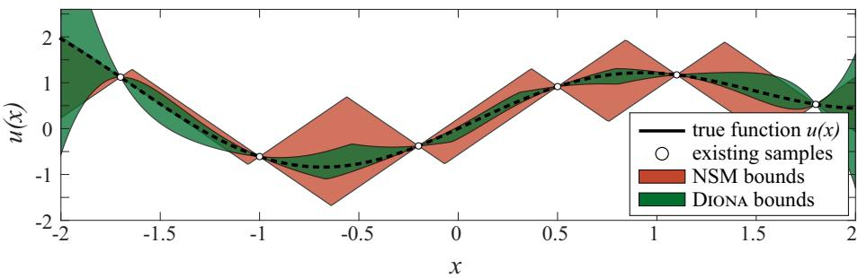  
Figure 1: 1-dimensional visualisation of Hessian Lipschitz-based Diona uncertainty bounds from noiseless samples, with $u ( x ) = \sin ( 2 x ) + 0 . 3 x ^ { 2 }$ , in comparison with a value Lipschitz-based NSM bounds.

and the upper- and lower bounds for $u ( { \pmb x } ^ { \prime } )$ are

$$
{ \overline { { u } } } ^ { \prime } = \operatorname* { m a x } _ { \pmb { \theta } \in { \mathcal { T } } ^ { \prime } \left. n \right. } u\tag{10a}
$$

$$
\underline { { u } } ^ { \prime } = \operatorname* { m i n } _ { \pmb { \theta } \in T ^ { \prime } ^ { \prime } ^ { \langle n \rangle } } u .\tag{10b}
$$

Consequently, the state value estimate is the midpoint

$$
\tilde { u } ^ { \prime } = \frac { \overline { { u } } ^ { \prime } + \underline { { u } } ^ { \prime } } { 2 } ,\tag{11}
$$

and the uncertainty measure is the diference

$$
w = \overline { { u } } ^ { \prime } - \underline { { u } } ^ { \prime } .\tag{12}
$$

Similar bounds and central estimates on $\pmb { g } ^ { \prime }$ and $\mathbf { { } } h ^ { \prime }$ are readily available from ${ \mathcal { T } } ^ { \prime \langle n \rangle }$ , using the same approach. Fig. 1 shows a visual of curvature-aware uncertainty bounds on a 1-dimensional function given noiseless samples and an a priori known $L _ { H }$ , compared to nonlinear set membership (NSM)-based bounds with a known Lipschitz constant γ.

## 2.3. Neighbour samples

For a candidate sample $\mathbf { \boldsymbol { x } } ^ { ( i ) }$ at trial radius $r ,$ we denote $\hat { \mathbf { } } _ { i } \doteq \mathbf { \boldsymbol { \frac { a _ { i } } { r } } }$ and ${ \hat { \lambda } } _ { i } \doteq { \frac { \lambda _ { i } } { r ^ { 2 } } }$ , and build a row $\phi _ { i } \doteq [ 1 - \hat { \mathbf { a } } _ { i } ^ { \top } \hat { \mathbf { \Delta } } \hat { \mathbf { \lambda } } _ { i } ^ { \top } ] ^ { \top }$ , following the Taylor expansion at (7b).

For a candidate set ${ \mathcal { N } } ,$ let Φ be the stacked rows $\phi _ { i } ^ { \top } , { \pmb x } ^ { ( i ) } \in \mathcal { N } .$

Definition 1 $( \mu _ { 0 } \cdot$ -poised neighbour set). A neighbour set $\mathcal { N }$ with $N \geq 1 + D +$ $D _ { h }$ is $\mu _ { 0 }$ -poised if for a given $\mu _ { 0 } > 0 , \underline { { \sigma } } ( \Phi ) \geq \mu _ { 0 } \sqrt { N }$

Assumption 3. For a query point $\mathbf { x } ^ { \prime }$ in the interior of $\mathcal { R } _ { : }$ , the data set $X ^ { \langle n \rangle }$ (with n large enough) and $0 < \mu _ { 0 } < \bar { \mu } _ { D } { } ^ { 2 }$ , we have access to its corresponding minimum-radius $\mu _ { 0 }$ -poised neighbour set

$$
\mathcal { N } ^ { \langle n \rangle * } = \underset { \mathcal { M } \subset \pmb { X } ^ { \langle n \rangle } , \pmb { x } ^ { ( i ) } \in \mathcal { M } } { \arg \operatorname* { m i n } } \ \underset { \pmb { x } ^ { ( i ) } \in \mathcal { M } } { \operatorname* { m a x } } \| \pmb { x } ^ { \prime } - \pmb { x } ^ { ( i ) } \|
$$

with radius $r _ { \mathcal { N } } ^ { \langle n \rangle * }$

In the succeeding theoretical discussions, we consider an interior query point $\mathbf { x } ^ { \prime }$ with a corresponding poised neighbour set ${ \mathcal { N } } ,$ indicating the richness of information to estimate $\pmb { g } ^ { \prime }$ and $H ^ { \prime }$

## 3. Theoretical properties

Here we introduce theoretical properties of our proposed method, whose proofs are all delegated to the Appendix.

Lemma 1 (Containment). Given the query point $\mathbf { { \boldsymbol { x } } ^ { \prime } } .$ the data set $X ^ { \langle n \rangle }$ , and under Assumptions 1-2, the true query triple $\pmb { \theta } ^ { \prime }$ is contained in ${ \mathcal { T } } ^ { \prime \langle n \rangle }$

Proof. See Appendix.

With Lemma 2, the true triples at the query point $\pmb { \theta } ^ { \prime }$ and its neighbours are admissible for any number of samples by construction. This result therefore relies on the validity or a priori knowledge of $L _ { H }$ and $\bar { \epsilon } :$ resorting to their (under)estimates (as in Section 4.1) voids this guarantee.

Lemma 2 (Worst-case diameter of admissible states and derivatives). For the query point x<sup>′</sup> and data set $X ^ { \langle n \rangle }$ , consider two admissible triples $\pmb { \theta } _ { 1 } , \pmb { \theta } _ { 2 } \in \mathcal { T } ^ { \prime ( n ) }$ ， and denote the diferences in their latent states and derivatives as $\Delta u = u _ { 1 } -$ u<sub>2</sub>, $\Delta g = g _ { 1 } - g _ { 2 } , \Delta h = h _ { 1 } - h _ { 2 }$ . Then, under Assumptions 1-2, and with any µ<sub>0</sub>-poised neighbour set $\mathcal { N }$

$$
\left| \Delta u \right| \leq d _ { u } = \frac { 1 } { \mu _ { 0 } } \left( 2 \bar { \epsilon } + \frac { L _ { H } } { 3 } r _ { \mathcal { N } } ^ { 3 } \right)\tag{13a}
$$

$$
\| \Delta \mathbf { g } \| _ { 2 } \leq d _ { \mathbf { g } } = \frac { 1 } { \mu _ { 0 } } \left( \frac { 2 \bar { \epsilon } } { r _ { \mathcal { N } } } + \frac { L _ { H } } { 3 } r _ { \mathcal { N } } ^ { 2 } \right)\tag{13b}
$$

$$
\| \Delta { \boldsymbol { h } } \| _ { 2 } \leq d _ { h } = \frac { 1 } { \mu _ { 0 } } \left( \frac { 2 \bar { \epsilon } } { r _ { \mathcal { N } } ^ { 2 } } + \frac { L _ { H } } { 3 } r _ { \mathcal { N } } \right)\tag{13c}
$$

where $\begin{array} { r } { r _ { \mathcal { N } } = \operatorname* { m a x } _ { { \pmb x } ^ { ( i ) } \in \mathcal { N } } \| { \pmb x } ^ { ( i ) } - { \pmb x } ^ { \prime } \| } \end{array}$

Proof. See Appendix.

In the noiseless setup, going from u<sup>′</sup> to g<sup>′</sup> to $\pmb { h } ^ { \prime }$ costs the bounds by one power of the neighbourhood radius $( r _ { \mathcal { N } } ^ { 3 }$ , to $r _ { \mathcal { N } } ^ { 2 }$ and $r _ { \mathcal { N } } )$ : considering a neighbourhood with half the radius tightens the u<sup>′</sup> bound eightfold. With noise, $d _ { u }$ tends to a floor of $\frac { 2 \overline { { \epsilon } } } { \mu _ { 0 } }$ as $r _ { \mathcal { N } } \to 0$ . In contrast, $d _ { g }$ and $d _ { h }$ grow again when considering neighbourhoods with $\begin{array} { r } { r _ { \ N } < \left( \frac { 3 \overline { { \epsilon } } } { L _ { H } } \right) ^ { 1 / 3 } } \end{array}$ and $\begin{array} { r } { r _ { \ N } < \left( \frac { 1 2 \overline { { \epsilon } } } { L _ { H } } \right) ^ { 1 / 3 } } \end{array}$ , respectively.

Remark 1 (Information radius). When the state triple estimate $\tilde { \pmb { \theta } } ^ { \prime }$ is taken as the centroid<sup>3</sup> of the componentwise minimum bounding box of ${ \mathcal { T } } ^ { \prime \langle n \rangle }$ , then the ∞-norm information radii (as in $\boldsymbol { \mathit { \Omega } } ^ { \mathit { \Pi } } \left( { { 9 } J } \right)$ on u, g, and h are bounded by $\textstyle { \frac { 1 } { 2 } } d _ { u } , { \frac { 1 } { 2 } } d _ { g }$ and $\scriptstyle { \frac { 1 } { 2 } } d _ { h }$ , respectively, since $\| \cdot \| _ { \infty } \leq \| \cdot \| _ { 2 }$

Definition 2 (Dense sampling). Let $X ^ { \langle n \rangle }$ denote the set of sampled points after n samplings. We say that a sampling regime is dense in R if

$$
\operatorname* { m a x } _ { \substack { { \mathbf { x } ^ { \prime } \in \mathcal { R } } } } \operatorname* { m i n } _ { \substack { { \mathbf { x } ^ { ( i ) } \in { \mathbf { X } ^ { \langle n \rangle } } } } } \| { \mathbf { x } ^ { \prime } - \mathbf { x } ^ { ( i ) } } \| \xrightarrow [ n  \infty ] { } 0 .
$$

Lemma 3. Given a query point $\mathbf { x } ^ { \prime } \in \mathcal { R }$ , and under Assumptions 1-3 and dense sampling, $r _ { N } ^ { \langle n \rangle * } \xrightarrow [ n \to \infty ] { } 0$

Proof. See Appendix.

Theorem 1 (Convergence to the true triple). Under Assumptions 1-3 and $\bar { \epsilon } = 0$ , the admissible set of triples at $\mathbf { x } ^ { \prime }$ shrinks to the true one, i.e.,

$$
\operatorname* { s u p } _ { \pmb { \theta } \in \mathcal { T } ^ { \prime } ^ { \langle n \rangle } } \Vert \pmb { \theta } - \pmb { \theta } ^ { \prime } \Vert \xrightarrow [ n  \infty ] { } 0\tag{14}
$$

as the samples set densely covers the search space.

Proof. See Appendix.

The result in Theorem 1 relies on $\overline { { \epsilon } } = 0$ , a known $L _ { H }$ , and a poised neighbour set with radius that shrinks with sampling (Lemma 3). Given Theorem 1 and Remark 1, the estimated triple converges to the true one, $\lVert \tilde { { \boldsymbol { \theta } } } ^ { \prime } - { \boldsymbol { \theta } } ^ { \prime } \rVert \to 0$

## 4. Implementation notes

We tackle here practical workarounds for settings where we do not satisfy Assumptions 1-3. We use a combination of samples-based estimation of $\overline { { \epsilon } } , L _ { H }$ and a greedy poised neighbours selection approach.

## 4.1. Parameter estimation

In many applications, the Hessian Lipschitz constant $L _ { H }$ , and the noise bound ϵ¯ are not a priori known, and must be estimated from the data set $X ^ { \langle n \rangle }$ . To estimate $\bar { \epsilon } ,$ any preferred method can be used, and here we use the set membership-based approach from [15], to which we refer the reader for more information.

We estimate $L _ { H }$ by solving an LP over the active points set $\mathcal { P } = \pmb { x } ^ { \prime } \cup \mathcal { N }$

$$
\tilde { L } _ { H } = \operatorname* { m i n } _ { L _ { H } , \psi _ { \mathcal { P } } } L _ { H } \quad \mathrm { s . t . } \quad \Xi _ { \mathcal { P } } \psi _ { \mathcal { P } } \leq b _ { \mathcal { P } } ,
$$

where $\Xi _ { \mathcal { P } } , b _ { \mathcal { P } }$ are assembled similarly as in Section 2.2, but with $L _ { H }$ rearranged/cast as a decision variable (stacked with $\pmb { \theta } ^ { \prime } , \pmb { \theta } ^ { ( i _ { 1 } ) } , \ldots$ , see (8)).

Resorting to $L _ { H }$ and ϵ¯ estimates invalidates the formal theoretical guarantees. Nevertheless, we show in the results that Diona still performs competitively even with estimated constants.

## 4.2. Practical neighbour selection

Selecting a minimum-radius µ<sub>0</sub>-poised neighbour set to satisfy Assumption 3 is combinatorial w.r.t. the samples, and can be computationally prohibitive. Therefore, we have built a simple greedy method to collect the neighbours set. This involves starting from a nearest samples set as initial candidates for selection, and building a neighbours set achieving a full-rank feature matrix $\Phi _ { \mathcal { C } }$ From this neighbours set, we then iteratively add further samples to achieve the µ<sub>0</sub>-poisedness.

Upon empirical testing, we opted for three passes of Algorithm 1 (each successive pass excludes previously selected samples), and use the union of all such neighbour samples to provide redundancy for computing $\tilde { L } _ { H }$ and $u ^ { \prime }$ , and $\overline { { u } } ^ { \prime }$ This is to achieve a more informative $\tilde { L } _ { H }$ estimate<sup>4</sup> and more reliable bounds especially under noise. With a priori known $\overline { { \epsilon } }$ and $L _ { H }$ , Lemma 2 still holds for the first neighbour set as the succeeding neighbour “layers” only serve to add more constraints.

## 5. Direct Inference on Admissible Sets (Diona)

We build on our theoretical results and use our practical workarounds to build a practical nonparametric regression method called Direct Inference on Admissible Sets (Diona), summarised in Algorithm 2. Diona picks neighbouring samples of the query point $\mathbf { x } ^ { \prime }$ , and assembles the joint linear constraints on their corresponding triples (collected in the decision variable $\psi )$ , leading to an optimisation problem for local regression. This replaces a long and global model training process, with a per-query optimisation problem to compute the state estimate and its corresponding uncertainty.

Algorithm 1: Practical µ<sub>0</sub>-poised neighbour selection   
Input: query point $\mathbf { x } ^ { \prime } .$ , poisedness threshold $\mu _ { 0 } > 0 ,$   
maximum selected neighbours $\overline { { N } }$   
Data: samples set $\pmb { X } ^ { \langle n \rangle }$   
Output: $\bar { \tilde { \mathcal { N } } } ,$ poisedness $\mu ( \tilde { \mathcal { N } } )$ , radius $r _ { \mathcal { N } }$   
1 m $\\\\dot { - } 1 + D + \frac { D ( D + 1 ) } { 2 }$ ; fetch at least m closest samples to $\mathbf { x } ^ { \prime }$   
2 while true do   
3 Retrieve the current nearest-candidate pool C   
4 Build $[ 1 , - \hat { \mathbf { a } } _ { i } ^ { \top } , \hat { { \lambda } } _ { i } ^ { \top } ] ^ { \top }$ for $\pmb { x } ^ { ( i ) } \in \mathcal { C }$ , build feature matrix $\Phi _ { \mathcal { C } }$   
5 Build proposed full-rank m-point set $\tilde { \mathcal { N } }$ with column-pivoted QR on $\Phi _ { c } ^ { \top }$   
expanding $\mathcal { C }$ as necessary   
6 if $\tilde { \mathcal { N } }$ rank-deficient and all samples exhausted then   
7 return NeighbourFailure   
8 while $| \tilde { \mathcal { N } } | \leq \overline { { N } }$ do   
9 $r _ { \mathcal { N } } \gets \operatorname* { m a x } _ { i \in \tilde { \mathcal { N } } } \lVert \pmb { x } ^ { ( i ) } - \pmb { x } ^ { \prime } \rVert$   
10 Rebuild $\Phi _ { \mathcal { N } } ,$ , normalised using radius $r _ { \tilde { \mathcal { N } } }$   
11 Using SVD, $\mu ( \tilde { \mathcal { N } } )  \underline { { \sigma } } ( \Phi _ { \mathcal { N } } ) / \sqrt { \lvert \tilde { \mathcal { N } } \rvert }$   
12 if $\mu ( { \tilde { \mathcal { N } } } ) \geq \mu _ { 0 }$ then   
13 return $\tilde { \mathcal { N } } , \mu ( \tilde { \mathcal { N } } ) , r _ { \tilde { \mathcal { N } } }$   
14 else   
15 if $| \tilde { \mathcal { N } } | = \overline { { N } }$ or all points in $\mathcal { C }$ exhausted then   
16 break   
17 else   
18 Add $\pmb { x } ^ { ( i ) } \in \mathcal { C } \setminus \tilde { \mathcal { N } }$ that results in maximum $\mu ( { \tilde { \mathcal { N } } } \cup \pmb { x } ^ { ( i ) } )$   
19 if all samples exhausted then   
20 return NeighbourFailure   
21 else   
22 Expand candidate pool C

## 6. Comparative study

We subject Diona to an extensive benchmark test for data-driven regression of benchmark functions, comparing with methods from literature and common practice in terms of prediction accuracy, uncertainty quantification, and compu-

```latex
Algorithm 2: Direct Inference on Admissible Sets (Diona)
Input: query ${ \pmb x } ^ { \prime } ,$ samples $X ^ { \langle n \rangle }$ , poisedness threshold $\mu _ { 0 } > 0$
Output: scalar estimate $\tilde { u } ^ { \prime } ,$ , bounds $[ \underline { u } ^ { \prime } , \overline { u } ^ { \prime } ]$
1 Extract noise estimate ϵ˜ (if true noise bound ϵ not a priori known, see [15])
2 $\mathcal { N } \gets$ NeighbourSelection $( { \pmb x } ^ { \prime } , { \pmb X } ^ { \langle n \rangle } , \mu _ { 0 } )$ (Algorithm 1)
3 Solve for (local) Hessian Lipschitz constant estimate $\tilde { L } _ { H }$ (Section 4.1)
4 Assemble the admissible triples polytope $\mathcal { A } = \{ \psi : \Xi \psi \leq b \}$ over $\{ \pmb { x } ^ { \prime } \} \cup \mathcal { N }$
5 Solve for admissible state bounds $\begin{array} { r } { \underline { { u } } ^ { \prime }  \operatorname* { m i n } _ { \psi \in \mathcal { A } } u ^ { \prime } ; \overline { { u } } ^ { \prime }  \operatorname* { m a x } _ { \psi \in \mathcal { A } } u ^ { \prime } } \end{array}$
6 return $\begin{array} { r } { \tilde { u } ^ { \prime } = \frac { u ^ { \prime } + \overline { { u } } ^ { \prime } } { 2 } , ~ [ \underline { { u } } ^ { \prime } , \overline { { u } } ^ { \prime } ] } \end{array}$
```

tational burden. The Julia code base, as well as the Diona package, is available in https://github.com/lorenzosabugjr/Diona.

## 6.1. Benchmark setup

We consider the regression of diferent underlying functions (from $D = 3$ to $D = 8 )$ summarised in Table 2, taken from [16]. To present a comprehensive analysis, we have considered diferent data layouts, and with noisy samples. For each test function $u ( { \pmb x } )$ , we generated data sets of increasing density (with 500D, 1000D, 2000D samples) in a Sobol sequence layout on the respective domains. To evaluate the practical noise robustness, we tested with exact (noiseless) samples and with additive Gaussian noise (20 dB SNR)–a deviation from Assumption 2 for Diona.

We compare all methods in terms of the (approximate) $L _ { 2 }$ relative error which, with $U \doteq \Bigl ( u ( \pmb q ) \Bigr ) _ { \pmb q \in \pmb Q }$ and $\tilde { U } \doteq \Bigl ( \tilde { u } ( \pmb q ) \Bigr ) _ { \pmb q \in \pmb Q } ,$ , we measure as

$$
\epsilon _ { L 2 } = \frac { \left\| \pmb { U } - \tilde { \pmb { U } } \right\| } { \left\| \pmb { U } \right\| }
$$

with $Q$ being a collection of 5000D Sobol-distributed query points q (and ensuring no coincidence with any training samples).

For regressors with UQ—GP, NSM, Diona—we measure the relative uncertainty width, given for every $\pmb q \in Q$ as

$$
w _ { r } ( { \pmb q } ) = \frac { w ( { \pmb q } ) } { | { \pmb u } ( { \pmb q } ) | }
$$

noting the denominator being the truth function value. Lastly, we compare among these UQ-capable regressors the aggregate coverage of the truth value within the estimated bounds

$$
\rho = \frac { \sum _ { \pmb { q } \in \pmb { Q } } \mathbb { 1 } \left( \underline { { u } } ( \pmb { q } ) \leq u ( \pmb { q } ) \leq \overline { { u } } ( \pmb { q } ) \right) } { | \pmb { Q } | }
$$

with $\Im ( \cdot )$ being the indicator function. As the stochastic uncertainty for GP is of a diferent nature than the (estimated) worst-case bounds of NSM and Diona, we measure the GP-specific uncertainty metrics considering its $\pm 2 \sigma _ { G P }$ bounds. A low $w _ { r }$ and high $\rho$ are essential for bound informativeness.

To compare the computational burden, we measured the (ofline) training time (if applicable), and the online per-query (inference) times. All the computations are performed in a PC with Intel Core i9 3.20 GHz, 160 GB RAM, and NVIDIA RTX 4500 Ada (24 GB VRAM). All the computations were run on the CPU, except for the NN GPU/CUDA-based pre-training.

## 6.2. Results: regression accuracy

We show in Fig. 2 the $L _ { 2 }$ relative errors (ϵ<sub>L2</sub>) per benchmark function, in relation to the samples density and presence of (20 dB) noise. In the graphs, the diferent bars in the same bundle represent the metrics at increasing samples density. We see that for all noiseless cases, Diona, NSM, RBF, and IDW were consistent in their decreasing $\epsilon _ { L 2 }$ trends with increasing samples density. The trends with Diona generally reflects our theoretical results (although we used only estimated ϵ and $L _ { H } )$ , that the admissible triples set (and in turn, the state bounds $\overline { { u } } , \underline { { u } } )$ shrink with denser samples sets. In fact, the same arguments can be made for NSM, IDW, and RBF, because the anchor samples from which to make the predictions get closer and closer. On the other hand, there is no clear trend for NN $\epsilon _ { L 2 }$ w.r.t. the samples set density. This is due to its nonconvex training process, which can converge to diferent weights, which, across the denser input samples, can be uncorrelated. For GP, the $L _ { 2 }$ errors have stayed mostly the same, in the range of $7 \times 1 0 ^ { - 3 }$ to $8 \times 1 0 ^ { - 3 }$

<table><tr><td>Name</td><td>Details</td></tr><tr><td>Neural network (NN) [6]</td><td>Implemented with Lux.jl. Fully con- nected network with  $\left\lceil D / 2 \right\rceil + 1$  hidden layers (64 tanh units). Trained to min- imise MSE with Adam (25000 epochs with  $1 \times 1 0 ^ { - 3 } )$  . Used CUDA</td></tr><tr><td>Gaussian process (GP) [5] Sparse</td><td>learning rate of via LuxCUDA.j1. variational GP using AbstractGPs.jl, ApproximateGPs.jl, and KernelFunctions.jl, Matérn-5/2 kernel, and 100D inducing points.</td></tr><tr><td>Nonlinear set membership (NSM) [9]</td><td>Implemented in Julia with estimated noise bound ξ and value Lipschitz con- stant γ computed as in [15]. γ is then scaled by 2.5.</td></tr><tr><td>Radial basis functions (RBF) [4]</td><td>Using Surrogates. j1 RADIALBASIS with the default linear radial kernel, with all default values.</td></tr><tr><td>Inverse distance weighting (IDW)</td><td>UsingSurrogates.j1 INVERSEDIS- TANCESURROGATE, using all training samples. Used inverse-distance exponent  $p = D + 2 ,$  otherwise all default settings.</td></tr><tr><td>DIONA (ours)</td><td>As described in Section 4-5, and with LH scaled by 2.5. LPs are computed with HiGHS.jl.</td></tr></table>

Table 1: Compared data-driven regressors

The trends and sensitivity of $\epsilon _ { L 2 }$ with 20 dB noise paint a diferent picture, with ’+’ markers showing the metrics in the noisy case, and their gap from the bars showing the sensitivity. All the compared methods attained ϵ<sub>L2</sub> ranging from $1 \times 1 0 ^ { - 2 } \mathrm { ~ t o ~ } 1 \times 1 0 ^ { - 1 }$ , which is now a much narrower diference in accuracy results than in the noiseless case. This said, all the advantages of Diona for ϵ = 0 are now erased: consistent with Lemma 2, $\overline { { \epsilon } } > 0$ no longer guarantees that denser data sets shrink the worst-case error to zero. Nevertheless, its results are still highly competitive w.r.t. the other regressors.

<table><tr><td>Function name</td><td>D</td><td>Domain Properties</td><td></td></tr><tr><td>Ishigami</td><td>3</td><td> $[ - \pi , \pi ] ^ { 3 }$ </td><td>Oscillatory, with growing ampli- tude, variable interactions</td></tr><tr><td>Park</td><td>4</td><td>[0, 1]4</td><td>Nonseparable, spatially varying curvature</td></tr><tr><td>Friedman</td><td>5</td><td>[0, 1]5</td><td>Nonlinear, nonseparable, with linear and quadratic additive</td></tr><tr><td>Hartmann</td><td>6</td><td>[0, 1]6</td><td>terms Multimodal</td></tr><tr><td>Piston (simulation) 7 (see [16])</td><td></td><td></td><td>Nonlinear physical model, input variable coupling</td></tr><tr><td>Rosenbrock</td><td></td><td>8[-5,10]8</td><td>Narrow curved valley, strong in- put coupling</td></tr></table>

Table 2: Benchmark functions

## 6.2.1. Results: uncertainty informativeness

Fig. 3 shows a xy-scatterplot with the median relative uncertainty width $w _ { r }$ vs the truth coverage $\rho .$ We plot here the resulting metrics for the Diona, GP, and NSM in increasing samples count/density (shows as larger markers), with noiseless and 20 dB noise-corrupted data sets shown as ◦ and + markers, respectively. Markers to the lower-left corner of the plots are generally better (more informative UQ), signifying tighter intervals that include the truth values. Across all tested functions, NSM resulted in the highest median $w _ { r }$ , which in higher dimensional Hartmann (D = 6) and Rosenbrock (D = 8) even exceed $w _ { r } = 1 . 0$ while having 100% coverage, suggesting conservative and less informative bounds. This is attributed to its linear uncertainty growth w.r.t. the distance from the closest sample (see Fig. 1). Our Diona, on the other hand, has consistently achieved better $w _ { r }$ than NSM, due to its consideration of the (estimated local) curvature. In fact, Diona is competitive with GP in this aspect: its $w _ { r }$ bars are either better or no more than 1 order of magnitude worse than that of GP. In face of 20 dB noise, the GP $w _ { r }$ markers nearly coincide with those in the noiseless case, showing high noise robustness. NSM comes as second, and lastly, Diona shows a marked diference in coverage, especially with Park and Friedman functions.

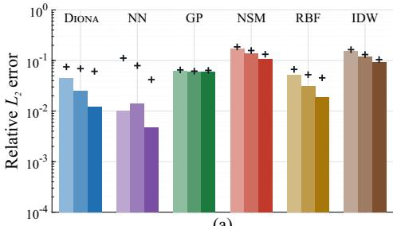  
(a)

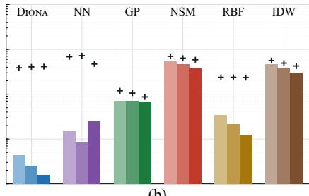  
(b)

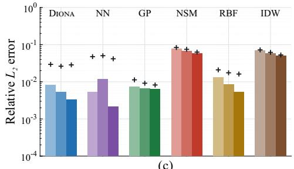  
( )c

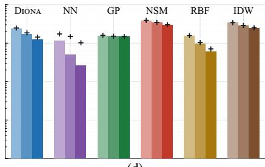  
(d)

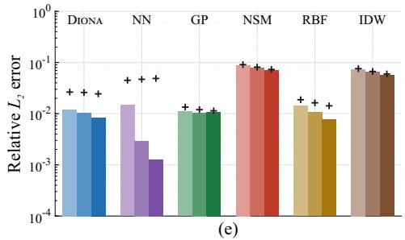

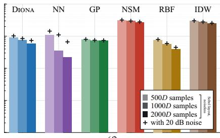  
(f)  
Figure 2: Results: relative L<sub>2</sub> error  
(a) Ishigami, (b) Park, (c) Friedman, (d) Hartmann, (e) Piston, (f) Rosenbrock.

## 6.3. Results: empirical computational burden

Fig. 4 shows the computational burden xy-scatterplot for the inference (perquery) times vs training times, using the same marker conventions as the previous figure. The markers to the lower-left corner are better, meaning shorter training and per-query times. Note that while Diona has zero training time, its markers are placed to the leftmost axis for visualisation. Across all tested functions, there is no significant diference in having noiseless and noisy samples. In fact, it was also quite consistent how the relative ordering of the compared methods lines up w.r.t. the training times. Unsurprisingly, GP and NN take the rightmost markers (with training times in the order of minutes), followed by RBF and NSM. IDW has resulted in the best trade-of between per-query and training times, with markers towards the lower left of the plots. Lastly, Diona has unsurprisingly taken the most per-query time, since every query entails solving a small optimisation problem, while the others (except for NSM) merely involve evaluating a fitted (trained) model/surrogate function. IDW, NSM, RBF, and GP showed an increasing trend in both per-query and training times when presented with denser data sets, while Diona and NN showed no changes in computing times.

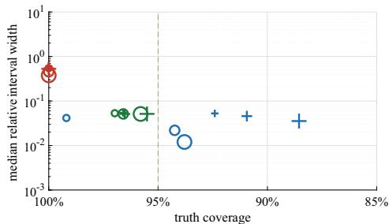  
(a)

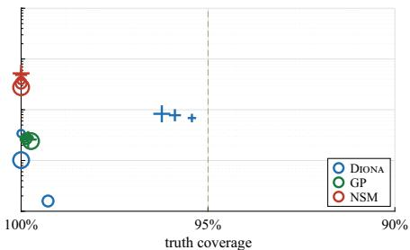  
(b)

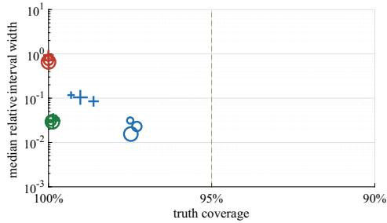  
( )c

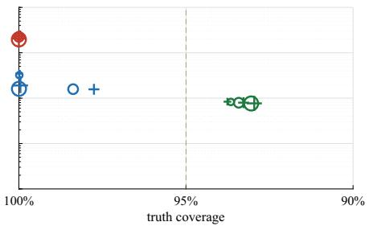  
(d)

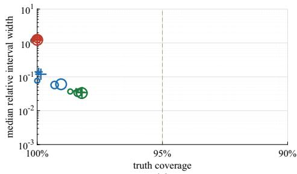  
(e)

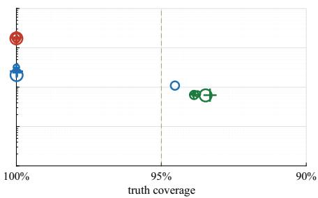  
(f)  
Figure 3: Results: relative uncertainty interval vs truth coverage  
(a) Ishigami, (b) Park, (c) Friedman, (d) Hartmann, (e) Piston, (f) Rosenbrock.

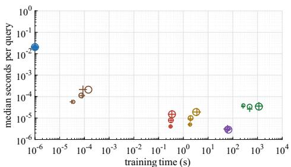  
(a)

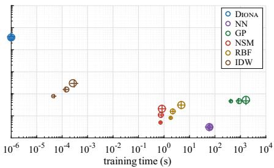  
(b)

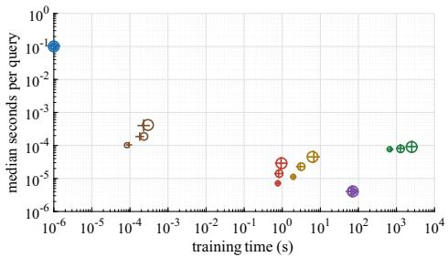  
( )c

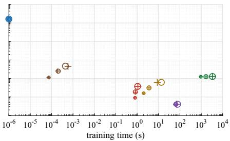  
(d)

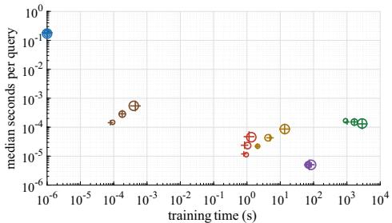  
(e)

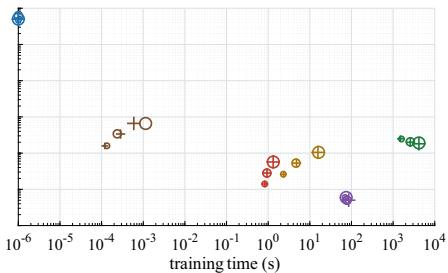  
(f)  
Figure 4: Results: median per-query times vs training times  
(a) Ishigami, (b) Park, (c) Friedman, (d) Hartmann, (e) Piston, (f) Rosenbrock. Diona (with zero training times) is placed to the left for comparative visualisation.

## 6.4. Synthesis

The above comparison to accuracy, UQ informativeness, and computational times point to an observed trade-of between our proposed Diona vs other methods. While Diona is arguably competitive w.r.t. the other compared algorithms, especially NN and GP, the true trade-of comes from the computational demands of the application. In particular, Diona can be better when the application fundamentally cannot aford a long global training loop, e.g., when data samples are introduced in real-time, and the predictions are only required for a few points, e.g., for rapid decision making.

However, the disadvantage of such per-query methods is the lack of compressive representation of the data, meaning that as it stands, Diona needs the entire data set ready for fetching, imposing an increasing (and at times, unreasonable) demand for storage. Furthermore, the per-query solve time scales polynomially with D, while such a scaling does not apply to evaluating a pretrained model. Therefore, for huge static data sets, it pays to perform a global training process arriving at a surrogate that is both a compressive representation, and a quickly-evaluable function. The user therefore needs to ponder on these trade-ofs when choosing the most appropriate regressor for a particular application.

## 7. Conclusions and outlook

In this paper we introduced Direct Inference on Admissible Sets (Diona) that uses local information around a query point, together with Taylor relationsbased constraints, to cast the estimation and uncertainty quantification of an unknown function as a series of linear programs. Such a formulation eliminates the need for a long, ofline training stage, because the computational burden is paid per query. In a benchmark on six functions of three to eight dimensions, Diona was more accurate than GPs in the noiseless setting especially on the densest data sets. Furthermore, Diona, like GP, produced informative bounds containing the true values at more than 95% of query points in four functions. We note an explicit trade-of on the online vs ofline computational burden: while Diona’s time to a first prediction is orders of magnitude shorter, each Diona query costs more than evaluating a trained model. This low latency lends an advantage when relatively few queries are needed between data set updates.

Ongoing work includes a practicable hybrid ofline-online approaches to address the practical computational trade-ofs, reducing per-query computational burden and storage requirements, while maintaining the responsiveness to new samples. Furthermore, the inclusion of physics information, especially to extrapolate predictions outside the data set domain is an interesting avenue for future work.

## References

[1] S. Theodoridis, Machine Learning: A Bayesian and Optimization Perspective, 2 ed., Academic Press, 2020.

[2] T. Martin, F. Allgöwer, Data-driven system analysis of nonlinear systems using polynomial approximation, IEEE Transactions on Automatic Control 69 (2024) 4261–4274. doi:10.1109/TAC.2023.3321212.

[3] L. N. Trefethen, Approximation Theory and Approximation Practice, Society for Industrial and Applied Mathematics, Philadelphia, PA, 2013.

[4] M. D. Buhmann, Radial Basis Functions: Theory and Implementations, volume 12 of Cambridge Monographs on Applied and Computational Mathematics, Cambridge University Press, Cambridge, 2003. doi:10.1017/CBO9780511543241.

[5] C. E. Rasmussen, C. K. I. Williams, Gaussian Processes for Machine Learning, MIT Press, Cambridge, MA, 2006. doi:10.7551/mitpress/3206.001.0001.

[6] C. M. Bishop, Neural Networks for Pattern Recognition, Oxford University Press, Oxford, 1995. doi:10.1093/oso/9780198538493.001.0001.

[7] J. Roll, A. Nazin, L. Ljung, Nonlinear system identification via direct weight optimization, Automatica 41 (2005) 475–490. doi:10.1016/j.automatica.2004.11.010.

[8] G. Y. Lu, D. W. Wong, An adaptive inverse-distance weighting spatial interpolation technique, Computers & Geosciences 34 (2008) 1044–1055. doi:10.1016/j.cageo.2007.07.010.

[9] M. Milanese, C. Novara, Set membership identification of nonlinear systems, Automatica 40 (2004) 957–975. doi:10.1016/j.automatica.2004.02.002.

[10] M. Milanese, C. Novara, Unified set membership theory for identification, prediction and filtering of nonlinear systems, Automatica 47 (2011) 2141– 2151. doi:10.1016/j.automatica.2011.03.013.

[11] J. W. Huang, S. Roberts, J.-P. Calliess, Lipschitz interpolation: Non-parametric convergence under bounded stochastic noise, arXiv preprint arXiv:2310.07039, 2023. doi:10.48550/arXiv.2310.07039. arXiv:2310.07039.

[12] J.-P. Calliess, S. J. Roberts, C. E. Rasmussen, J. Maciejowski, Lazily Adapted Constant Kinky Inference for nonparametric regression and model-reference adaptive control, Automatica 122 (2020) 109216. doi:10.1016/j.automatica.2020.109216.

[13] L. Sabug, E. C. Kerrigan, Rethinking physics-informed regression beyond training loops and bespoke architectures, in: Proceedings of the 23rd IFAC World Congress, IFAC, Busan, Korea, 2026. doi:10.48550/arXiv.2512.13217. arXiv:2512.13217.

[14] H. Dette, Y. Grigoriev, E-optimal designs for second-order response surface models, The Annals of Statistics 42 (2014) 1635–1656. doi:10.1214/14- AOS1241.

[15] C. Novara, Sparse set membership identification of nonlinear functions and application to fault detection, International Journal of Adaptive Control and Signal Processing 30 (2016) 206–223. doi:10.1002/acs.2539.

[16] S. Surjanovic, D. Bingham, Virtual Library of Simulation Experiments: Test functions and datasets, Simon Fraser University, 2013. URL: https://www.sfu.ca/ ssurjano/, accessed 5 October 2026.

## Appendix

## Proof of Lemma 1

Proof. The true collection vector as ψ includes the true triple at query point $\pmb { \theta } ^ { \prime } { } _ { ; }$ along with those at the neighbouring samples. By Assumptions 1-2, trivially we have $\psi \in { \mathcal { A } }$ by construction. Since ${ \mathcal { T } } ^ { \prime \langle n \rangle }$ is the projection of A onto the querytriple coordinates, and the query point block of $\psi$ is $\pmb { \theta } ^ { \prime }$ , we have $\pmb { \theta } ^ { \prime } \in \mathcal { T } ^ { \prime \langle n \rangle }$ .

## Proof of Lemma 2

Proof. Given $\mathbf { x } ^ { \prime }$ and $\pmb { \theta } _ { 1 } , \pmb { \theta } _ { 2 } \in \mathcal { T } ^ { \prime ( n ) }$ , then $\forall \mathbf { \boldsymbol { x } } ^ { ( i ) } \in \mathcal { N }$

$$
\Big | z ^ { ( i ) } - \left( u _ { 1 } - \pmb { a } _ { i } ^ { \top } \pmb { g } _ { 1 } + \pmb { \lambda } _ { i } ^ { \top } \pmb { h } _ { 1 } \right) \Big | \leq \bar { \epsilon } + \frac { L _ { H } } { 6 } \| \pmb { a } _ { i } \| ^ { 3 }\tag{15}
$$

$$
\left| z ^ { ( i ) } - \left( u _ { 2 } - { \pmb a } _ { i } ^ { \top } { \pmb g } _ { 2 } + \lambda _ { i } ^ { \top } { \pmb h } _ { 2 } \right) \right| \leq \bar { \epsilon } + \frac { L _ { H } } { 6 } \| { \pmb a } _ { i } \| ^ { 3 } .\tag{16}
$$

Subtracting the first and second inequalities through the triangle inequality, we have

$$
\left| { \Delta u - { \pmb a } _ { i } ^ { \top } \Delta { \pmb g } + { \lambda } _ { i } ^ { \top } \Delta { \pmb h } } \right| \leq 2 \bar { \epsilon } + \frac { L _ { H } } { 3 } \| { \pmb a } _ { i } \| ^ { 3 } .
$$

Now we stack such inequalities for all selected neighbours $\pmb { x } ^ { ( i ) } \in \mathcal { N } .$ and use the neighbourhood radius $r \doteq \mathrm { m a x } _ { \pmb { x } ^ { ( i ) } \in \mathcal { N } } \rVert \pmb { a } _ { i } \rVert$ to build the normalised quantities $\hat { \mathbf { a } } _ { i }$ and $\hat { \lambda } _ { i }$ as in Section 2.3. Substituting, and collecting the r-scalings onto $\Delta u , \Delta g , \Delta h$ rather than onto the coeficients, each stacked row becomes exactly $\phi _ { i } ^ { \top } \Delta$

$$
[ \begin{array} { c c c } { 1 } & { - \hat { a } _ { i _ { 1 } } ^ { \top } } & { \hat { \lambda } _ { i _ { 1 } } ^ { \top } } \\ { 1 } & { - \hat { a } _ { i _ { 2 } } ^ { \top } } & { \hat { \lambda } _ { i _ { 2 } } ^ { \top } } \\ { \vdots } & { \vdots } & { \vdots } \\ { 1 } & { - \hat { a } _ { i _ { N } } ^ { \top } } & { \hat { \lambda } _ { i _ { N } } ^ { \top } } \end{array} ] \underbrace { [ \begin{array} { c } { \Delta u } \\ { r \Delta g } \\ { r ^ { 2 } \Delta h } \end{array} ] } _ { \Delta } ] \leq ( 2 \bar { \epsilon } + \frac { L _ { H } } { 3 } r ^ { 3 } ) \mathbf { 1 } ,\tag{17}
$$

an element-by-element inequality, where Φ depends only on the normalised displacements $\hat { \mathbf { a } } _ { i }$ and not on the neighbourhood radius r (Section 2.3). Since $\mathcal { N }$ is µ<sub>0</sub>-poised (Definition 1), $\Phi$ is full column rank, $\Phi ^ { \dagger } \Phi = I .$ , and it applies that

$$
\left\| \Phi \Delta \right\| _ { 2 } \leq \left\| \left( 2 { \bar { \epsilon } } + \frac { L _ { H } } { 3 } r ^ { 3 } \right) \mathbf { 1 } \right\| _ { 2 }\tag{18}
$$

$$
\lVert \Delta \rVert _ { 2 } \leq \lVert \Phi ^ { \dagger } \rVert _ { 2 } \lVert \Phi \Delta \rVert _ { 2 }\tag{19}
$$

$$
\leq \| \Phi ^ { \dagger } \| _ { 2 } \biggl \| \biggl ( 2 \bar { \epsilon } + \frac { L _ { H } } { 3 } r ^ { 3 } \biggr ) \mathbf { 1 } \biggl \| _ { 2 }\tag{20}
$$

$$
= \left( 2 { \bar { \epsilon } } + { \frac { L _ { H } } { 3 } } r ^ { 3 } \right) \| \Phi ^ { \dagger } \| _ { 2 } \| \mathbf { 1 } \| _ { 2 }\tag{21}
$$

and we invoke that $\begin{array} { r } { \| \Phi ^ { \dagger } \| _ { 2 } = \frac { 1 } { \underline { { \sigma } } ( \Phi ) } \le \frac { 1 } { \mu _ { 0 } \sqrt { N } } } \end{array}$ and $\| \mathbf { 1 } \| _ { 2 } { = } \sqrt { N }$ , therefore

$$
\left\| \left[ \begin{array} { l } { \Delta u } \\ { r \Delta g } \\ { r ^ { 2 } \Delta h } \end{array} \right] \right\| _ { 2 } \leq \frac { 1 } { \mu _ { 0 } } \left( 2 \bar { \epsilon } + \frac { L _ { H } } { 3 } r ^ { 3 } \right) .
$$

Finally, since each block of $\Delta$ has norm no greater than $\| \Delta \| _ { 2 }$ , we arrive at (13), which concludes the proof. □

## Proof of Lemma 3

Proof. For this proof, we assume for simplicity and w.l.o.g. that the data set is augmented by one sample at every iteration. Consider that at iteration $n _ { 0 }$ with the corresponding data set $X ^ { \langle n _ { 0 } \rangle }$ ， $\mathbf { x } ^ { \prime }$ has the minimum neighbour set radius $r _ { \mathcal { N } } ^ { \langle n _ { 0 } \rangle * }$ . We assume, for the sake of contradiction, that such radius will never change/shrink, i.e., as $n \to \infty$ 2 $r _ { \mathcal { N } } ^ { \langle n \rangle * } = r _ { \mathcal { N } } ^ { \langle n _ { 0 } \rangle * }$

Consider a smaller ball $B ( { \boldsymbol { \mathbf { \mathit { x } } } } ^ { \prime } , { \boldsymbol { r } } _ { s } )$ where $r _ { s } = \frac { 1 } { 2 } r _ { \mathcal { N } } ^ { \langle n _ { 0 } \rangle * }$ , in which we place a reference points set $S \doteq \{ s _ { m } \in \mathcal { B } ( { \pmb x } ^ { \prime } , r _ { s } ) , m = 1 , \ldots , N \}$ forming a µ<sub>s</sub>-poised configuration, i.e. $\underline { { \sigma } } ( \Phi ( S ) ) > \mu _ { s } \sqrt { N }$ for some fixed $\mu _ { s } > \mu _ { 0 }$ . Such a configuration exists since $\mu _ { 0 } < \bar { \mu } _ { D } :$ as $\mathbf { x } ^ { \prime }$ is interior, $B ( { \boldsymbol x } ^ { \prime } , r _ { s } )$ contains a smaller ball inside $\mathcal { R }$ , into which any configuration can be scaled without changing Φ, as $\Phi$ is normalised by the radius.

We define for each $s _ { m }$ its respective closest sample

$$
\tilde { \pmb { s } } _ { m } ^ { \langle n \rangle } \doteq \arg \operatorname* { m i n } _ { { \pmb { x } } ^ { ( i ) } \in { \pmb { X } } ^ { \langle n \rangle } } \| { \pmb { x } } ^ { ( i ) } - { \pmb { s } } _ { m } \| ,
$$

and collecting those points, we build $\tilde { \Phi } ^ { \langle n \rangle }$ . Now, due to the generation of dense samples, we have

$$
\forall s _ { m } \in S , \| \tilde { s } _ { m } ^ { \langle n \rangle } - s _ { m } \| _ { \overrightarrow { n  \infty } }  0 ,
$$

and therefore $\| \tilde { \Phi } ^ { \langle n \rangle } - \Phi ( S ) \| _ { \overrightarrow { n \to \infty } } \ 0$ . By continuity of the singular values, $\underline { { \sigma } } ( \tilde { \Phi } ^ { \langle n \rangle } ) \xrightarrow [ n \to \infty ] { } \underline { { \sigma } } ( \Phi ( S ) ) > \mu _ { s } \sqrt { N } > \mu _ { 0 } \sqrt { N }$ , so

$$
\exists M < \infty : \underline { { \sigma } } ( \tilde { \Phi } ^ { \langle n _ { 0 } + M \rangle } ) > \mu _ { 0 } \sqrt { N } ,
$$

and the corresponding samples set $\tilde { \pmb { S } } ^ { ( n _ { 0 } + M ) }$ is µ<sub>0</sub>-poised with maximum radius at most $\begin{array} { r } { r _ { s } + \operatorname* { m a x } _ { m } \mathopen { } \mathclose \bgroup \left\| \tilde { \mathbf { s } } _ { m } ^ { \langle n _ { 0 } + M \rangle } - \mathbf { s } _ { m } \aftergroup \egroup \right\| \leq \frac { 3 } { 4 } r _ { N } ^ { \langle n _ { 0 } \rangle * } } \end{array}$ (taking M larger if needed), and therefore $r _ { \mathcal { N } } ^ { \langle n _ { 0 } + M \rangle * } \ \leq \ \frac { 3 } { 4 } r _ { \mathcal { N } } ^ { \langle n _ { 0 } \rangle * }$ , contradicting our assumption. We repeat the above arguments recursively, leading to

$$
r _ { \mathcal { N } } ^ { \langle n \rangle * } \xrightarrow [ n  \infty ] { } 0 ,
$$

which closes our proof.

Proof of Theorem 1

Proof. By Lemma 1, $\pmb { \theta } ^ { \prime } \in \mathcal { T } ^ { \prime ( n ) }$ . Furthermore, from Lemma 2 with $\bar { \epsilon } = 0$ , (13) reduces to

$$
\lVert \pmb { \theta } _ { 1 } - \pmb { \theta } _ { 2 } \rVert \leq \frac { L _ { H } } { 3 \mu _ { 0 } } \sqrt { r _ { \mathcal { N } } ^ { 6 } + r _ { \mathcal { N } } ^ { 4 } + r _ { \mathcal { N } } ^ { 2 } }
$$

for $\pmb { \theta } _ { 1 } , \pmb { \theta } _ { 2 } \in \mathcal { T } ^ { \prime ( n ) }$ . Lemma 3 (with Assumption 3), and replacing $\pmb { \theta } _ { 1 }$ with a generic triple $\pmb \theta \in \mathcal { T } ^ { \prime \langle n \rangle }$ and $\pmb { \theta } _ { 2 }$ with the true triple $\pmb { \theta } ^ { \prime }$ , leads us to (14), closing the proof. □