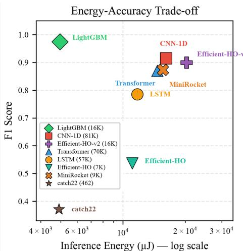

# Energy and Latency First: How Deployment Constraints Reverse Time-Series Model Selection

Shruti Bothe∗, Illyyne Saffar¶, Ayush K. Varshney§

Ericsson Research

Santa Clara, USA∗ Massy, France¶ Kista, Sweden §

{shruti.bothe, illyyne.saffar, ayush.kumar.varshney}@ericsson.com

## Abstract

AI models, and time-series models in particular are typically ranked by accuracy and deployed under constraints absent from that ranking. In this paper, we study a real setting where these constraints are explicit and measurable: handover prediction in cellular networks, where inference runs on the User Equipment once per 40 ms measurement period and must complete before the network acts. The timing bound is hard: a late prediction is superseded by the measurement it was predicting, while energy is a cumulative budget spent for the life of the device. Neither appears in the objective these models are selected on. We evaluate eight architectures under a protocol that screens for deadline feasibility at the tail rather than the mean, then ranks the feasible models on measured inference energy, counting the feature computation that precedes the forward pass and is usually omitted. Gradient-boosted trees on handcrafted temporal features are the most accurate model (F1=0.974) and among the cheapest to run, while the neural architecture an accuracy-only benchmark would rank first (CNN-1D, F1=0.914) costs over 3× more energy per inference under a realistic duty-cycled deployment pattern. We give three conditions under which this outcome should be expected, so the finding applies beyond telecommunications. Accuracy-only benchmarking does not merely under-report deployment cost. It can rank first a model that cannot be deployed.

## 1 Introduction

Time-series models are ranked by accuracy, then deployed in conditions the benchmark never tested: offline, in batch, on hardware unlike the target device. Yet the applications that need time-series prediction most, such as sensors, vehicles and other edge devices, must decide locally, fast, and within a tight energy budget. Where deployment cost is reported at all, it is approximated by parameter count or FLOPs, which correlate poorly with real device energy [1], or by mean latency, which says nothing about whether every inference meets a deadline. This paper studies a scenario where both constraints can be measured directly.

A mobile user expects uninterrupted connectivity. A cellular network is divided into cells, each served by a base station; at any moment the user equipment (UE) is connected to one serving cell. As the UE moves, its serving signal weakens while a neighbouring cell’s may strengthen, and the network must transfer the connection without dropping the session, a procedure called a handover. The decision follows the 3GPP A3 rule [2]: a neighbour becomes a candidate once its RSRP (Reference Signal Received Power, reported every 40 ms) exceeds the serving cell’s by a fixed margin, sustained for a Time-to-Trigger window. Our task is to predict whether this condition will be met within a short horizon, so the network can prepare the handover proactively rather than react after the threshold is crossed. In 5G and beyond the reactive rule is reaching its limits: cells are smaller and frequencies higher, so handovers grow more frequent and directional [3], while the governing thresholds are fixed per deployment and adapt to no one. Learned mobility management is the response the field has converged on [4, 5, 6, 7], and is now being standardized rather than merely proposed [8, 9].

Most current solutions in literature are expensive, and some are slow. They are deep sequence models replacing a threshold comparison with a forward pass: recurrent architectures process a window step by step, attention scales quadratically, and both are dense-matrix workloads on a device that was previously comparing two numbers. Neither the energy nor the delay is reported. Efficient time-series classification does have strong cheap baselines [10, 11, 12], but benchmarks them on accuracy and throughput [13]. Green AI has the measurement methodology [14, 15, 16] and has shown that at fleet scale inference dominates lifetime footprint [17], but has been applied almost entirely to NLP and vision, where inference is server-side, batched, and under no deadline. Wireless deployments differ on both counts [18], and in our settings the constraints are explicit. The first is a deadline: measurements arrive every 40 ms and a prediction is useful only if ready before the network acts, so a late prediction loses the benefit it was computed for while its energy is already spent. The second is energy: inference runs on the UE once per period for as long as the device is connected and moving, and at 25 inferences per second a model costing millijoules per inference would drain a smartphone within hours. Energy degrades gradually but is spent continuously and committed the moment an architecture is chosen. Together the two define a feasible region every deployable model must sit inside, and neither appears in the quantity these models are selected on.

In this paper we study whether a handover will trigger within the next few hundred milliseconds given a window of RSRP measurements. The task has one unusual property: its labelling function is known in closed form, so we ask learned models to recover a rule already written down. We contribute (i) an evaluation protocol that treats the deadline as a tail feasibility filter and ranks survivors on measured energy, including the feature computation usually omitted; (ii) a benchmark of eight architectures under it against what accuracy alone would select; and (iii) ablations separating feature representation from model class. We find that gradient-boosted trees dominate the accuracy-energy-latency frontier, that the size of their energy advantage depends on how inference is measured, narrowing from 10.4× under a tight loop to 3.3× under a realistic one, and no neural compression recovers the gap.

## 2 Related Work

Energy reporting in ML: Early work on ML energy cost focused on training, estimating the energy to produce a single large model and its carbon emissions [19, 16]. This broadened into systematic accounting across experiments and the argument that efficiency belongs alongside accuracy as a criterion for progress [15, 14]. Attention then shifted to deployment: at fleet scale inference can dominate a model’s lifetime footprint [17], motivating inference energy as a distinct metric [20], with standardized measurement emerging only recently [21]. These works, however, target naturallanguage and vision workloads. The measurement techniques transfer, but the benchmarks do not: time-series classifiers have different input structures, computation patterns, and deployment requirements, making it hard to compare models on the efficiency axis that should drive their selection for energy-constrained use.

Efficient time-series classification: Before deep models became the default, the accuracy-percost frontier was held by random convolutional features such as ROCKET [10, 11] and compact interpretable feature sets [12]. Ensemble and dictionary methods like HIVE-COTE pushed accuracy higher at substantially greater cost [22, 23]. Both random-feature and interpretable methods remain competitive and cheap, yet they are evaluated on accuracy and throughput, and reviews of the deep models report accuracy without energy [13, 24].

Compression, trees, and the handover application: Time-series compression via pruning [25, 26], quantization [27, 28], and distillation [29, 30] optimizes hardware-agnostic proxies such as parameter count or FLOPs that correlate only loosely with measured device energy [1, 31]. Handover prediction itself has been tackled with recurrent [32], reinforcement-learning [33], and federated [34] models, all evaluated on accuracy alone [7]. Meanwhile tree-based models still outperform deep learning on tabular data [35, 36], a gap usually framed through accuracy and expected to narrow on sequential inputs. Yet the comparison rarely accounts for energy and latency, where a model cheaper to both train and run accumulates its advantage across the deployment horizon [17]. This is exactly the regime accuracy-only benchmarks render invisible, and we treat the handover task as an instrument for studying it rather than as a contribution to the mobility-management line.

## 3 Problem Formulation

We formalize the prediction task, the two constraints a deployed model must satisfy, and the selection problem they define. The last of these is what the rest of the paper measures.

## 3.1 Prediction task

We consider the problem of energy-efficient handover prediction in cellular networks. Let ${ \bf X } _ { t } \in  { \bf \Psi }$ $\mathbb { R } ^ { T \times C }$ be a sliding observation window of RSRP measurements over the $T = 8$ most recent timesteps, sampled at period $\Delta t = 4 0 \mathrm { m s }$ , across the $C = 2 1$ cells visible to the UE. We index cells by $c ,$ writing s for the serving cell and $n \neq s$ for a neighbour, so that entry $( u , c )$ of $\mathbf { X } _ { t }$ is $\mathrm { R S R P } _ { c } ( u )$ , the RSRP of cell c at step u of the window ending at t. Given $\mathbf { X } _ { t } .$ , the objective is to predict whether the UE will satisfy the 3GPP A3 handover condition within a future horizon of $H = 8$ timesteps:

$$
\hat { y } _ { t } = f _ { \theta } ( \mathbf { X } _ { t } ) \in \{ 0 , 1 \} ,\tag{1}
$$

where the target label is defined explicitly as

$$
y _ { t } = { \left\{ \begin{array} { l l } { 1 } & { { \mathrm { i f } } \exists t _ { h o } \in [ t , t + H ] { \mathrm { ~ a t ~ w h i c h ~ a n ~ A 3 ~ h a n d o v e r ~ f i r e s } } , } \\ { 0 } & { { \mathrm { o t h e r w i s e } } . } \end{array} \right. }\tag{2}
$$

A handover fires at $t _ { h o }$ when a neighboring cell n maintains a sufficiently higher signal quality than the serving cell s continuously over the TTT window, that is

$$
\mathrm { R S R P } _ { n } ( u ) - \mathrm { H y s } > \mathrm { R S R P } _ { s } ( u ) + \mathrm { O f f } , \quad \forall u \in [ t _ { h o } - \mathrm { T T T } + 1 , t _ { h o } ] ,\tag{3}
$$

with $\mathrm { H y s } = 1 \mathrm { d } \mathrm { B } , \mathrm { O f f } = 2 \mathrm { d } \mathrm { B }$ , and $\mathrm { T T T } = 8$ steps (320 ms). Labels follow the 3GPP A3 [2].

The horizon equals the trigger window: By construction $H = { \mathrm { T T T } } = 8$ steps. Since the input window ends before the prediction instant and a positive label spans the H steps up to a handover, most positive samples never observe the A3 condition complete. The model must forecast that an emerging trend will persist long enough to trigger, not read a finished trigger off its input; only the sample at the firing instant approaches detection. We set $H = \mathrm { T T T }$ deliberately: a shorter horizon would overlap more of the trigger and collapse the task toward detection, while a longer one would make the output too late to act on.

## 3.2 Deployment constraints & model selection

A deployed model inherits two constraints from running on the UE. They are of different kinds, and the difference determines how each enters model selection.

Timing: A prediction is actionable only if the action it enables can begin before the A3 timer expires. Since the pipeline must in any case keep pace with the 40 ms measurement cadence, inference must complete within one period:

$$
L _ { \theta } = L _ { \mathrm { p r e } } ( \theta ) + L _ { \mathrm { f w d } } ( \theta ) + L _ { \mathrm { p o s t } } ( \theta ) \ \leq \ \Delta t - ( L _ { \mathrm { a c q } } + L _ { \mathrm { a c t } } ) \ \triangleq \ L _ { \mathrm { m a x } } \ \leq \ \Delta t = 4 0 \mathrm { m s } .\tag{4}
$$

The protocol terms $L _ { \mathrm { a c q } } , L _ { \mathrm { a c t } }$ are model-independent, so we screen against the upper bound $L _ { \mathrm { m a x } } =$ ∆t; feature preparation $L _ { \mathrm { p r e } }$ stays inside $L _ { \theta }$ because it is model-dependent and can rival the forward pass. A missed deadline does not stop the inference; the network simply falls back to the reactive rule, forfeiting the benefit while still paying the energy. We therefore screen at the tail: a model whose $L ^ { p 9 9 } \theta$ exceeds Lmax is penalized once in a hundred inferences, or once every four seconds at 25 Hz.

Energy: Inference runs once per measurement period for as long as the device is connected and moving, so per-inference energy accumulates against a fixed battery. Over a session of duration $T _ { S }$

$$
E _ { \theta } \cdot \frac { T _ { S } } { \Delta t } \ \leq \ E _ { \mathrm { b u d g e t } } ,\tag{5}
$$

Table 1: Main benchmark on the 100 s dataset (five seeds, mean ± std). Latency and energy are full-pipeline (preprocess + forward + postprocess). Energy is per-inference; Looped keeps the core busy (throughput benchmark), Duty runs inferences in bursts with idle pauses as deployed, and the ratio quantifies how much looped measurement understates deployment energy. Best neural in italics, overall best in bold.
<table><tr><td></td><td></td><td></td><td></td><td colspan="3">Latency (ms)</td><td colspan="3">Energy  $( \mu \mathrm { J } )$ </td></tr><tr><td>Model</td><td>Params</td><td>F1</td><td>AUC</td><td> $\mathsf { p } 5 0$ </td><td> $\mathsf { p } 9 9$ </td><td> $\mathrm { T o t a l } _ { p 5 0 }$ </td><td>Looped</td><td>Duty</td><td>L/D</td></tr><tr><td>LightGBM</td><td>16,317</td><td>0.974±0.002</td><td>0.998</td><td>0.250</td><td>0.381</td><td>0.263</td><td>1,473</td><td>4,947</td><td>0.30</td></tr><tr><td>CNN-1D</td><td>81,217</td><td>0.914±0.012</td><td>0.985</td><td>0.947</td><td>1.095</td><td>0.892</td><td>15,316</td><td>16,181</td><td>0.95</td></tr><tr><td>Efficient-HO-v2</td><td>16,753</td><td>0.899±0.007</td><td>0.984</td><td>1.252</td><td>1.388</td><td>1.372</td><td>19,940</td><td>20,285</td><td>0.98</td></tr><tr><td>MiniRocket</td><td>9,996</td><td>0.872±0.011</td><td>0.972</td><td>1.321</td><td>1.472</td><td>1.329</td><td>39,596</td><td>44,611</td><td>0.89</td></tr><tr><td>Transformer</td><td>70,465</td><td>0.870±0.019</td><td>0.973</td><td>0.770</td><td>0.899</td><td>0.833</td><td>10,643</td><td>14,635</td><td>0.73</td></tr><tr><td>LSTM</td><td>57,665</td><td>0.785±0.027</td><td>0.951</td><td>0.654</td><td>0.725</td><td>0.683</td><td>9,483</td><td>11,723</td><td>0.81</td></tr><tr><td>Efficient-HO</td><td>7,618</td><td> $0 . 5 3 7 { \scriptstyle \pm 0 . 0 6 3 }$ </td><td>0.848</td><td>0.653</td><td>0.755</td><td>0.752</td><td>8,825</td><td>11,069</td><td>0.80</td></tr><tr><td>catch22+ridge</td><td>462</td><td> $0 . 3 7 1 { \scriptstyle \pm 0 . 0 0 0 }$ </td><td>0.772</td><td>1.838</td><td>1.976</td><td>1.700</td><td>941</td><td>46,883</td><td>0.02</td></tr></table>

† Implied active power is 0.5 W, an order of magnitude below every other model; this looped run was too too short to resolve at 50 ms sampling, so this value (estimated as an error) is not used in any comparison.

where $E _ { \mathrm { b u d g e t } }$ is the share of the device budget allocated to this function and $E _ { \theta }$ is the full-pipeline energy of one inference. Crucially, the processor is not busy for the whole period: it is active for $L _ { \theta }$ and idle for the remaining $\Delta t - L _ { \theta } ,$ a duty cycle of $d _ { \theta } = L _ { \theta } / \Delta t$ , which for the models here lies between 0.6% and 4.6%. A benchmark that keeps the core continuously busy reports only the active-phase energy $E _ { \theta } ^ { \mathrm { b u s y } }$ , whereas a duty-cycled deployment also pays for the idle intervals between inferences, so $E _ { \theta } \geq E _ { \theta } ^ { \mathrm { b u s y } }$ . In our experiments, we report both $E _ { \theta } ^ { \mathrm { b u s y } }$ (busy-loop) and $E _ { \theta }$ (duty-cycled), and write the budget constraint of Eq. 5 on $E _ { \theta } ,$ , since a device deployed at duty cycle $d _ { \theta }$ incurs the full per-period cost. At 25 inferences per second, 1 mJ per inference is a 25 mW continuous draw, which is substantial against a 15 Wh battery. Unlike the timing bound, this one degrades gracefully: exceeding it shortens battery life rather than breaking the function. It is nonetheless committed at the moment the architecture is chosen, and it is paid once per device for the life of the deployment.

Constrained model selection: The two constraints do not enter symmetrically. Timing is a feasibility condition, so it partitions the candidate set. Energy is a cost, so it orders what remains. For a family $\mathcal { F }$ of candidate models, define the feasible set

$$
\mathcal { F } _ { \mathrm { f e a s } } = \left\{ f _ { \theta } \in \mathcal { F } : L _ { \theta } ^ { p 9 9 } \leq L _ { \mathrm { m a x } } \right\} ,\tag{6}
$$

and select

$$
f ^ { \star } = \arg \operatorname* { m a x } _ { f _ { \theta } \in \mathcal { F } _ { \mathrm { f e a s } } } \mathrm { F } 1 ( f _ { \theta } ) \quad \mathrm { s . t . } \quad E _ { \theta } \leq E _ { \mathrm { m a x } } ,\tag{7}
$$

with $E _ { \mathrm { m a x } } = E _ { \mathrm { b u d g e t } } \Delta t / T _ { S }$ . Standard practice takes $\mathcal { F } _ { \mathrm { f e a s } } = \mathcal { F }$ and $E _ { \mathrm { m a x } } = \infty$ , which recovers accuracy-only selection. The question this paper asks is what changes when they are finite.

## 4 Experimental Setup

## 4.1 Data and models

We generate a ray-traced RSRP dataset with Sionna [37] and SUMO vehicular mobility over a 3D model of Santa Clara, CA: 7 base station sites, 21 cells, 100 UEs over 100 s at a 40 ms cadence, yielding 4.7M measurements and 596 handover events. Sliding-window extraction with the labelling rule of Eqs. 2-3 gives the classification set, balanced to a ∼30% positive rate and split 70/15/15 with stratification. All results are the mean over five seeds, which control initialization, dropout and shuffling; the partition is fixed across seeds. Details are in Appendix A.

We compare three neural baselines representative of what the handover literature has converged on, three feature-based models, and two capacity probes (Table 4). LightGBM receives 247 handcrafted features, of which the min-margin and temporal-trend groups encode the A3 quantity of Eq. 3 almost directly; MiniRocket and catch22 are domain-agnostic cheap baselines that separate whether any advantage of the feature route comes from A3-informed features specifically or from cheap representations in general. The two Efficient-HO variants are not proposed as deployable architectures: they locate the low end of the capacity range and so test whether the neural route is recoverable by compression alone. Architectures, feature definitions and training configuration are in Appendix B.

## 4.2 Inference cost measurement

Inference cost is measured on a controlled server-class CPU (36-core Xeon) under isolated load. The UE performs this inference on its application processor rather than on an accelerator, so a CPU measurement preserves the characteristic that matters while giving an isolated environment with a stable idle floor; absolute values will differ on handset silicon. Two choices distinguish the protocol from throughput benchmarking.

Full-pipeline decomposition: Each inference is decomposed into preprocess (normalization for the neural models, feature computation for the feature-based ones), forward, and postprocess, matching $L _ { \theta }$ in Eq. 4. All reported latency and energy cover the full pipeline. This matters because the literature times the forward pass alone, which for feature-based models omits the dominant cost.

Busy-loop versus duty-cycled energy: We report energy under two execution patterns. Busy-loop runs inferences back to back with the core continuously active, which is what throughput benchmarks measure. Duty-cycled runs inferences in short bursts separated by idle pauses (10 bursts of 50 inferences, 10 ms pauses), so the measured average power includes the idle intervals a deployed device spends between predictions; per-inference energy is the total energy over the burst schedule divided by the number of inferences. The realized active duty cycle $d _ { \theta } = \overline { { L } } _ { \theta } / \Delta t$ ranges from 0.6% (LightGBM) to 4.6% (catch22+ridge). Power is sampled from CPU utilization at 50 ms resolution, so absolute µJ are estimates while relative comparisons on one platform hold.

## 4.3 Ablation protocols

To separate representation from model class we train LightGBM and a two-layer MLP on the 247 engineered features, and LightGBM and CNN-1D on the raw flattened window, on the same split and seeds. To isolate capacity from architecture we sweep Efficient-HO-v2 across seven channel widths from 16 to 128. Knowledge distillation uses CNN-1D as teacher and the 7,618-parameter Efficient-HO as student, with temperature $T _ { \mathrm { K D } } = 4$ and hard-label weight $\alpha = 0 . 3$ , both trained on the same split so that any gain is attributable to distillation rather than to data volume. Finally, we compare standard A3 handover against LSTM-assisted early execution, in which the handover fires as soon as the A3 condition holds in the predicted future, saving the residual TTT (Appendix D).

## 5 Results

## 5.1 Energy-Accuracy Benchmark

All models clear the 40 ms deadline comfortably: even their p99 latency is at least 20× below it, so every model is feasible $( \mathcal { F } _ { \mathrm { f e a s } } = \mathcal { F } )$ and selection comes down to energy. The margin also shows how much slower hardware each model could still run on. The slowest, catch22+ridge $( L ^ { p 9 9 } = 1 . 9 8$ ms), stays feasible until the chip is ∼20× slower than ours; LightGBM $( L ^ { p 9 9 } = 0 . 3 8$ ms) tolerates 105×.

Finding 1 - The tree model dominates the full frontier: LightGBM is the most accurate model (F1=0.974), the lowest-latency one (0.381 ms p99), and the cheapest to run under the duty-cycled pattern that reflects deployment (4,947 µJ, 2.2x below the next cheapest of the eight, Table 1, Fig. 1). Its handcrafted features (per-cell statistics, temporal trends, min-margin to neighbours) encode the A3 decision boundary directly, and its feature computation is cheap enough that the full pipeline stays under 0.4 ms at p99. The lower busy-loop figure for catch22+ridge is an instrumentation artefact (Table 1, footnote) and is excluded from the ranking.

Finding 2 - The ranking an accuracy benchmark would report is not the deployment ranking: CNN-1D is the best neural model on accuracy (F1=0.914) but costs over 3× the per-inference energy of LightGBM under the duty-cycled pattern and misses on accuracy as well. Every neural model is dominated. The strong cheap baseline MiniRocket reaches F1=0.872 but its 10k-kernel transform makes its full-pipeline latency 1.32 ms, comparable to the deep models; catch22 collapses to F1=0.371, showing that cheap representations in general do not suffice and that the specific structure LightGBM’s features capture is what carries the task.

Table 2: Capacity sweep: Efficient-HO-v2 at increasing width (five seeds).
<table><tr><td>Ch.</td><td>Params</td><td>F1</td><td>AUC</td></tr><tr><td>16</td><td>1,921</td><td>.814±.018</td><td>.950</td></tr><tr><td>24</td><td>3,433</td><td> $. 8 4 0 { \pm } . 0 1 3$ </td><td>.962</td></tr><tr><td>32</td><td>5,329</td><td> $. 8 6 4 \pm . 0 0 5$ </td><td>.971</td></tr><tr><td>48</td><td>10,273</td><td> $. 8 9 3 \pm . 0 1 1$ </td><td>.980</td></tr><tr><td>64</td><td>16,753</td><td> $. 9 0 0 { \pm } . 0 0 4 $ </td><td>.983</td></tr><tr><td>96</td><td>34,321</td><td> $. 9 1 1 \pm . 0 1 3$ </td><td>.986</td></tr><tr><td>128</td><td>58,033</td><td> $. 9 2 4 { \pm } . 0 0 5$ </td><td>.989</td></tr><tr><td>LGBM</td><td>16,317</td><td> $. 9 7 4 \pm . 0 0 2$ </td><td>.998</td></tr></table>

Table 3: Cross-feature ablation (five seeds). Features vs. architecture.
<table><tr><td>Model</td><td>Representation</td><td>F1</td><td>Lat(ms)</td></tr><tr><td>LightGBM</td><td>247 engineered</td><td>0.974±0.002</td><td>0.16</td></tr><tr><td>LightGBM</td><td>168 raw flattened</td><td>0.971±0.001</td><td>0.15</td></tr><tr><td>MLP</td><td>247 engineered</td><td>0.929±0.006</td><td>0.05</td></tr><tr><td>CNN-1D</td><td>raw (8, 21)</td><td>0.919±0.003</td><td>1.50</td></tr></table>

Figure 1: Energy-accuracy trade-off. Light-GBM dominates all neural models in both F1 and inference energy.

Finding 3 - The measurement pattern is itself a result: Table 1 contrasts busy-loop and dutycycled energy. Busy-loop measurement understates deployment energy for every model, but by very different factors: the ratio is 0.30 for LightGBM against 0.95–0.98 for CNN-1D and Efficient-HO-v2. The reason is idle time. A cheap model finishes its inference in a small fraction of the 40 ms period and spends the rest idle, so its deployed per-inference energy is dominated by the idle intervals that a busy-loop benchmark never charges; a compute-heavy model keeps its core active for most of the period, so the two measurements nearly coincide. The consequence runs against our own headline: measured as a tight loop LightGBM appears 10.4× cheaper than CNN-1D, while measured under a duty-cycled schedule the advantage narrows to 3.3×. Busy-loop benchmarking therefore does not merely omit the duty-cycled idle cost; it inflates the apparent energy advantage of the cheapest model.

## 5.2 Inference Cost Decomposition

Table 1 splits the p50 pipeline into its three stages. For LightGBM the feature computation (preprocess, 0.116 ms) is 44% of total inference and nearly equals the forward pass, exactly the cost the literature omits by timing the model alone. Reporting the forward pass only would make LightGBM appear roughly twice as fast as it is. For MiniRocket the effect is extreme: its ridge forward pass is negligible but the 10k-kernel transform dominates making it expensive in practice. For the neural models the forward pass dominates and preprocessing (normalization) is negligible, so counting the full pipeline does not help them relative to the feature models.

Training is a one-off cost and is not part of the constraints studied here. At 25 Hz a deployed model performs of order $1 0 ^ { 9 }$ inferences per device-year, so training energy is amortized within seconds of deployment and the inference figures above dominate the lifecycle. For completeness, training follows the same ordering as inference: LightGBM trains roughly 40× faster and 37× more energy-efficiently than CNN-1D while reaching the highest validation accuracy. Full measurements are in Appendix E.

## 5.3 Feature vs. Architecture Ablation

We cross the two feature representations with the two model families on the same split and seeds. Two facts emerge (Table 3). First, LightGBM gains only 0.003 from the engineered features (F1=0.974 vs

F1=0.971 on the raw window), so they are not what carries it. Second, a two-layer MLP on those same features (F1=0.929) outperforms CNN-1D on the raw window (F1=0.919) despite far less architectural capacity, so for the neural models the representation matters more than the architecture. The tree’s advantage therefore comes from the model class rather than from privileged access to domain features, and the comparison is not an artefact of hand-crafted features favouring one side.

## 5.4 Compression Cannot Rescue the Neural Route

Two experiments test whether a smaller or distilled neural model can enter the feasible region without losing accuracy. First, a single-architecture capacity sweep (Table 2) trains Efficient-HO-v2 at seven widths on the same split. Accuracy rises smoothly and monotonically with parameters but reaches only F1=0.924 at 58K parameters, still short of LightGBM’s 0.974 at a fraction of the inference cost. The gap is a capacity floor, not a tuning artefact. Second, distillation from CNN-1D into the 7.6K-parameter Efficient-HO on the full 100 s split yields no improvement: student F1 falls from 0.438 standalone to 0.407 distilled (mean gain −0.031 ± 0.033). The apparent +0.08 gain reported in earlier 50 s experiments was a data-volume effect, not a distillation effect, and disappears once teacher and student see the same data. A secondary experiment shows that although no neural model is selected by the protocol, a moderately accurate LSTM used as a confidence gate inside the existing A3 rule can save up to 542 ms of Time-to-Trigger latency per handover at 100% success rate (Appendix F).

## 6 Discussion: Generalizability and Limitations

The result is not specific to telecommunications; it should arise whenever three conditions hold:

1. Simple or known decision boundary: A3 is a sustained linear inequality on cell differences, directly captured by features such as min-margin-to-neighbour. Trees exploit this structure immediately, whereas neural models must learn it from raw sequences.

2. Short sequence: With T = 8 steps, temporal inductive biases are barely exercised; attention over eight positions offers little over direct feature computation.

3. Duty-cycled inference: When inference runs once per period under a deadline, energy is dominated by the per-invocation cost of leaving and re-entering idle, which throughput benchmarking amortizes away, making throughput an inappropriate measure of this regime.

Under these conditions, constraints do not merely reorder the candidates; they rather invert the accuracy-only ranking.

Limitations Energy is estimated from CPU utilization rather than hardware counters, so µJ are estimates while relative rankings on one platform hold. The dataset is an urban scene (Santa Clara), leaving generalization to other environments and mobility patterns untested. MiniRocket and catch22 use a linear ridge head; a stronger classifier might raise their accuracy, though not their featuretransform cost. Finally, the ray-traced simulation is realistic but limited in temporal diversity relative to field deployment.

## 7 Conclusion

We studied model selection for time-series classification under two deployment constraints that accuracy benchmarks do not measure: a hard per-inference deadline and a cumulative energy budget. Handover prediction in cellular networks makes both explicit, since inference runs on the UE once per 40 ms period and must complete before the network acts. Evaluating eight architectures under a protocol that screens for deadline feasibility at the tail and ranks the survivors on measured energy, we found that a gradient-boosted tree on handcrafted features is the most accurate, the fastest and the cheapest model, and that neither a capacity sweep nor distillation brings a neural model close. How inference is measured can impact model selection: counting feature computation rather than the forward pass alone nearly doubles LightGBM’s apparent cost, and measuring under a duty cycle rather than a tight loop narrows its energy advantage from 10.4× to 3.3×. Under the three conditions we give, this generalizes beyond telecommunications: accuracy-only benchmarking can rank first a model that cannot be deployed.

## References

[1] T. Yang, A. Howard, and B. Chen. Why flops is not a good proxy for energy in neural network inference. In MLSys, 2023.

[2] 3GPP. Ts 38.331: Nr radio resource control (rrc) protocol specification. Technical report, 3rd Generation Partnership Project, 2023.

[3] Marco Giordani, Michele Polese, Arnab Roy, Douglas Castor, and Michele Zorzi. A tutorial on beam management for 3gpp nr at mmwave frequencies. IEEE Communications Surveys & Tutorials, 21(1):173–196, 2018.

[4] João PSH Lima, Álvaro AM de Medeiros, Eduardo P de Aguiar, Edelberto F Silva, Vicente A de Sousa, Marcelo L Nunes, and Alysson L Reis. Deep learning-based handover prediction for 5g and beyond networks. In ICC 2023-IEEE International Conference on Communications, pages 3468–3473. IEEE, 2023.

[5] Vijaya Yajnanarayana, Henrik Rydén, and László Hévizi. 5g handover using reinforcement learning. In 2020 IEEE 3rd 5G World Forum (5GWF), pages 349–354. IEEE, 2020.

[6] Wei-Che Chien, Yu Huang, Cheng Dai, Xingang Liu, Kuljeet Kaur, and Mubarak Alrashoud. Federated multimodal bi-lstm for agentic handover in 6g heterogeneous networks. IEEE Network, 2026.

[7] A. Kumar and B. Singh. A survey on ml-based handover prediction in 5g/6g networks. IEEE Communications Surveys & Tutorials, 2024.

[8] 3GPP. Tr 38.843: Study on artificial intelligence (AI)/machine learning (ML) for NR air interface. Technical report, 3rd Generation Partnership Project, 2023.

[9] Michele Polese, Leonardo Bonati, Salvatore D’oro, Stefano Basagni, and Tommaso Melodia. Understanding o-ran: Architecture, interfaces, algorithms, security, and research challenges. IEEE Communications Surveys & Tutorials, 25(2):1376–1411, 2023.

[10] Angus Dempster, François Petitjean, and Geoffrey I Webb. Rocket: exceptionally fast and accurate time series classification using random convolutional kernels: A. dempster et al. Data Mining and Knowledge Discovery, 34(5):1454–1495, 2020.

[11] Angus Dempster, Daniel F Schmidt, and Geoffrey I Webb. Minirocket: A very fast (almost) deterministic transform for time series classification. In Proceedings ofthe 27th ACM SIGKDD conference on knowledge discovery & data mining, pages 248–257, 2021.

[12] Carl H Lubba, Sarab S Sethi, Philip Knaute, Simon R Schultz, Ben D Fulcher, and Nick S Jones. catch22: Canonical time-series characteristics: Ch lubba et al. Data mining and knowledge discovery, 33(6):1821–1852, 2019.

[13] Hassan Ismail Fawaz, Germain Forestier, Jonathan Weber, Lhassane Idoumghar, and Pierre-Alain Muller. Deep learning for time series classification: a review: H. ismail fawaz et al. Data mining and knowledge discovery, 33(4):917–963, 2019.

[14] Roy Schwartz, Jesse Dodge, Noah A. Smith, and Oren Etzioni. Green ai. Communications of the ACM, 63(12):54–63, 2020.

[15] Peter Henderson, Jieru Hu, Joshua Romoff, Emma Brunskill, Dan Jurafsky, and Joelle Pineau. Towards the systematic reporting of the energy and carbon footprints of machine learning. Journal ofmachine learning research, 21(248):1–43, 2020.

[16] David Patterson, Joseph Gonzalez, Quoc Le, Chen Liang, Lluis-Miquel Munguia, Daniel Rothchild, David So, Maud Texier, and Jeff Dean. Carbon emissions and large neural network training. arXiv preprint arXiv:2104.10350, 2021.

[17] Carole-Jean Wu, Ramya Raghavendra, Udit Gupta, Bilge Acun, Newsha Ardalani, Kiwan Maeng, Gloria Chang, Fiona Aga, Jinshi Huang, Charles Bai, et al. Sustainable ai: Environmental implications, challenges and opportunities. Proceedings ofmachine learning and systems, 4:795–813, 2022.

[18] Illyyne Saffar, Aurelie Boisbunon, and Shruti Bothe. Domain adaptation under wireless network constraints: When does it become green? arXiv preprint arXiv:2606.23047, 2026.

[19] Emma Strubell, Ananya Ganesh, and Andrew McCallum. Energy and policy considerations for deep learning in nlp. In Proceedings of the 57th annual meeting of the association for computational linguistics, pages 3645–3650, 2019.

[20] Radosvet Desislavov, Fernando Martínez-Plumed, and José Hernández-Orallo. Trends in ai inference energy consumption: Beyond the performance-vs-parameter laws of deep learning. Sustainable Computing: Informatics and Systems, 38:100857, 2023.

[21] Arya Tschand, Arun Tejusve Raghunath Rajan, Sachin Idgunji, Anirban Ghosh, Jeremy Holleman, Csaba Kiraly, Pawan Ambalkar, Ritika Borkar, Ramesh Chukka, Trevor Cockrell, et al. Mlperf power: Benchmarking the energy efficiency of machine learning systems from µwatts to mwatts for sustainable ai. In 2025 IEEE International Symposium on High Performance Computer Architecture (HPCA), pages 1201–1216. IEEE, 2025.

[22] Jason Lines, Sarah Taylor, and Anthony Bagnall. Hive-cote: The hierarchical vote collective of transformation-based ensembles for time series classification. In 2016 IEEE 16th international conference on data mining (ICDM), pages 1041–1046. IEEE, 2016.

[23] Matthew Middlehurst, James Large, Michael Flynn, Jason Lines, Aaron Bostrom, and Anthony Bagnall. Hive-cote 2.0: a new meta ensemble for time series classification. Machine Learning, 110(11):3211–3243, 2021.

[24] Navid Mohammadi Foumani, Lynn Miller, Chang Wei Tan, Geoffrey I Webb, Germain Forestier, and Mahsa Salehi. Deep learning for time series classification and extrinsic regression: A current survey. ACM Computing Surveys, 56(9):1–45, 2024.

[25] Z. Li, Y. Wang, and Q. Chen. Structured pruning for time-series transformers. In ICML, 2023.

[26] Song Han, Jeff Pool, John Tran, and William Dally. Learning both weights and connections for efficient neural network. Advances in neural information processing systems, 28, 2015.

[27] S. Kim, H. Park, and J. Lee. Post-training quantization for temporal convolutional networks. In NeurIPS, 2023.

[28] Benoit Jacob, Skirmantas Kligys, Bo Chen, Menglong Zhu, Matthew Tang, Andrew Howard, Hartwig Adam, and Dmitry Kalenichenko. Quantization and training of neural networks for efficient integer-arithmetic-only inference. In 2018 IEEE/CVF conference on computer vision and pattern recognition, pages 2704–2713. IEEE, 2018.

[29] Geoffrey Hinton, Oriol Vinyals, and Jeff Dean. Distilling the knowledge in a neural network. arXiv preprint arXiv:1503.02531, 2015.

[30] Jianping Gou, Baosheng Yu, Stephen J Maybank, and Dacheng Tao. Knowledge distillation: A survey. International journal ofcomputer vision, 129(6):1789–1819, 2021.

[31] Han Cai, Chuang Gan, Ligeng Zhu, and Song Han. Tinytl: Reduce memory, not parameters for efficient on-device learning. Advances in Neural Information Processing Systems, 33:11285– 11297, 2020.

[32] M. Molina, O. Muñoz, A. Pascual-Iserte, and J. Vidal. Lstm-based handover prediction for 5g networks. In IEEE VTC, 2022.

[33] X. Wang, C. Li, and S. Xu. Reinforcement learning-based handover optimization in 5g networks. In IEEE GLOBECOM, 2021.

[34] Y. Zhang, L. Liu, and M. Peng. Federated learning for mobility-aware handover prediction. In IEEE ICC, 2023.

[35] L. Grinsztajn, E. Oyallon, and G. Varoquaux. Why do tree-based models still outperform deep learning on typical tabular data? In NeurIPS, 2022.

[36] Ravid Shwartz-Ziv and Amitai Armon. Tabular data: Deep learning is not all you need. Informationfusion, 81:84–90, 2022.

[37] Jakob Hoydis, Sebastian Cammerer, F. A. Aoudia, N. Vem, N. Binder, G. Marcus, and A. Keller. Sionna: An open-source library for next-generation physical layer research. arXiv preprint arXiv:2203.11854, 2022.

[38] Marcelo Gennari do Nascimento, Roger Fawcett, and Victor Adrian Prisacariu. Dsconv: Efficient convolution operator. In Proceedings ofthe IEEE/CVF international conference on computer vision, pages 5148–5157, 2019.

## A Dataset generation

The scene is a dense urban small-cell deployment over a 3D model of Santa Clara, CA: 7 base station sites with 3 sectors each, giving $C = 2 1$ cells. One hundred UEs follow SUMO vehicular traffic patterns for 100 s, sampled every $\Delta t = 4 0 \mathrm { m s }$ . Sionna [37] ray-traces the channel and produces L3-filtered RSRP per UE per cell, giving 2,487 timestamps and 4.7M raw measurements containing 596 handover events.

Labels are generated by applying Eqs. 2-3 to the full RSRP traces, not to the windowed data, so that the trigger condition is evaluated on the same continuous signal the network would observe. Sliding-window extraction with stride one then yields the classification dataset, class-balanced by subsampling negatives to a positive rate of about 30%, and split 70/15/15 into train, validation and test with stratification on the label.

RSRP values are normalized from $[ - 1 5 0 , - 4 0 ]$ dBm to [0, 1] for the neural models; the feature-based models receive the engineered statistics of Appendix C computed on unnormalized values.

## B Architectures and training

The models are summarized in Table 4. Notation follows our problem statement: $\mathbf { X } \in \mathbb { R } ^ { T \times C }$ with T = 8 and $C = 2 1$ , and σ is the logistic function.

Table 4: Evaluated models. Parameter counts for the tree models are total leaves across all boosting rounds; MiniRocket and catch22 use a ridge classifier, so their count is the feature dimension.
<table><tr><td>Model</td><td>Params</td><td>Family</td><td>Configuration</td></tr><tr><td>LSTM</td><td>57,665</td><td>recurrent</td><td>2 layers, hidden 64, dropout 0.2</td></tr><tr><td>Transformer</td><td>70,465</td><td>attention</td><td> $d _ { \mathrm { m o d e l } } { = } 6 4$  , 2 layers, 4 heads</td></tr><tr><td>CNN-1D</td><td>81,217</td><td>convolutional</td><td>3 residual blocks, 64 channels, kernel 3</td></tr><tr><td>LightGBM</td><td>16,317</td><td>trees + features</td><td>500 rounds, 63 leaves, 247 features</td></tr><tr><td>MiniRocket</td><td>9,996 feat.</td><td>random features</td><td>10k kernels, ridge</td></tr><tr><td>catch22+ridge</td><td>462 feat.</td><td>feature + linear</td><td>22 features × 21 cells, ridge</td></tr><tr><td>Efficient-HO</td><td>7,618</td><td>GRU + early exit</td><td>exit gate τ=0.9</td></tr><tr><td>Efficient-HO-v2</td><td>16,753</td><td>DS-CNN</td><td>3 DS-Conv blocks, 64 channels</td></tr></table>

## B.1 Neural baselines

LSTM (57,665 parameters): Two stacked LSTM layers, hidden size 64, dropout 0.2 between layers, applied along the time axis. The final hidden state feeds a head $6 4  3 2  1$ with ReLU between the linear layers.

Transformer (70,465 parameters): A linear projection maps each timestep from $C = 2 1$ to $d _ { \mathrm { m o d e l } } = 6 4$ and a learnable positional encoding is added. Two encoder layers follow, each with 4 attention heads, feed-forward width 128, GELU and dropout 0.1. Global average pooling over the 8 positions precedes a linear classifier.

CNN-1D (81,217 parameters): An input convolution lifts 21 channels to 64, followed by three residual blocks. Each block applies Conv1D (kernel 3, padding 1), BatchNorm, ReLU and dropout 0.1, twice, with an identity skip. Global average pooling precedes a linear classifier.

## B.2 Feature-based models

LightGBM: Gradient-boosted trees over the 247 features of Appendix C, with 500 boosting rounds, 63 leaves, learning rate 0.05 and early stopping patience 15.

MiniRocket (9,996 features): The MiniRocket transform [11] with 10,000 kernels applied per cell channel, producing proportion-of-positive-values features, followed by a ridge classifier with regularization selected on the validation split from $\{ 1 0 ^ { - 3 } , \ldots , 1 0 ^ { 3 } \}$

catch22 + ridge (462 features): The 22 canonical characteristics of [12] computed independently for each of the 21 cell channels, followed by a ridge classifier selected as above. The ridge solution is deterministic on a fixed split, which is why its standard deviation across seeds is zero in Table 1.

## B.3 Capacity probes

Efficient-HO (7,618 parameters): A linear stage maps the flattened window to a hidden representation, an early-exit gate decides whether recurrent processing is needed, and a GRU and classifier produce the output when it is:

$$
\mathbf { h } _ { 1 } = \mathrm { R e L U } ( \mathbf { W } _ { 1 } \mathrm { f l a t t e n } ( \mathbf { X } ) + \mathbf { b } _ { 1 } ) , \qquad p _ { \mathrm { e x i t } } = \sigma \bigl ( \mathbf { w } _ { e } ^ { \top } \mathbf { h } _ { 1 } + b _ { e } \bigr ) ,\tag{8}
$$

$$
\mathbf { h } _ { 2 } = \mathrm { G R U } ( \mathrm { r e s h a p e } ( \mathbf { h } _ { 1 } ) ) , \qquad \mathbf { \hat { y } } = \sigma ( \mathbf { W } _ { 3 } \mathrm { R e L U } ( \mathbf { W } _ { 2 } \mathbf { h } _ { 2 } + \mathbf { b } _ { 2 } ) + \mathbf { b } _ { 3 } ) .\tag{9}
$$

At inference the model returns the gate decision and skips the GRU path when max $( p _ { \mathrm { e x i t } } , 1 - p _ { \mathrm { e x i t } } ) > \tau$ with $\tau = 0 . 9$ . Training minimizes $\mathcal { L } = \mathcal { L } _ { \mathrm { m a i n } } + 0 . 3 \mathcal { L } _ { \mathrm { e x i t } }$ , where $\mathcal { L } _ { \mathrm { e x i t } }$ is the binary cross-entropy of the gate against the target.

Efficient-HO-v2 / DS-CNN (16,753 parameters): Three depthwise-separable convolution blocks [38] with residual connections; each applies a depthwise Conv1D (kernel 3) then a pointwise Conv1D, BatchNorm and ReLU. Global average pooling precedes a linear classifier, and all operations are INT8-quantizable. The capacity sweep varies the channel width over {16, 24, 32, 48, 64, 96, 128} with all else fixed.

## B.4 Training configuration

Neural models use Adam with initial learning rate $1 0 ^ { - 3 }$ , BCEWithLogitsLoss, batch size 64, at most 80 epochs, ReduceLROnPlateau (factor 0.5, patience 5) and early stopping on validation loss (patience 10). Seeds {42, 123, 456, 789, 1024} control weight initialization, dropout masks and data shuffling; the partition is fixed across seeds.

## C Engineered feature set

The 247 features supplied to LightGBM are, writing $m _ { c } ( u )$ for the RSRP of cell c at step u of the window and s for the serving cell:

• the flattened window, $T \times C = 1 6 8$ values;

• per-cell mean $\begin{array} { r } { \bar { m } _ { c } = \frac { 1 } { T } \sum _ { u } m _ { c } ( u ) } \end{array}$ , 21 values;

• per-cell standard deviation over the window, 21 values;

• per-cell temporal trend, the slope of a least-squares fit of $m _ { c } ( u )$ against $u , 2 1$ values;

• max-per-step, $\operatorname* { m a x } _ { c } m _ { c } ( u )$ , one per timestep, 8 values;

• min-margin, min $_ { n \neq s } \left[ m _ { s } ( u ) - m _ { n } ( u ) \right]$ , one per timestep, 8 values.

The last group is the A3 quantity of Eq. 3 evaluated per timestep, up to the constants Hys and Of, and the trend group stands in for its sustained-over-TTT character. This is the sense in which the representation encodes the labelling function, and it is what the ablation of Appendix D manipulates.

## D Ablation protocols

Features versus architecture: Two representations, the 247 engineered features and the 168-value raw flattened window, are crossed with two model families, LightGBM and a two-layer MLP with hidden width 64. CNN-1D on the raw window is included from the main benchmark. All cells use the split and seeds of Appendix A.

Capacity: Efficient-HO-v2 is trained at seven channel widths with all other settings fixed, isolating capacity from architecture.

Knowledge distillation: Teacher CNN-1D, student the 7,618-parameter Efficient-HO:

$$
\begin{array} { r } { \mathcal { L } _ { \mathrm { K D } } = \alpha \mathrm { B C E } ( \hat { y } , y ) + \left( 1 - \alpha \right) \mathrm { B C E } \left( \hat { y } / T _ { \mathrm { K D } } , \sigma ( z ^ { \mathrm { t e a c h } } / T _ { \mathrm { K D } } ) \right) , } \end{array}\tag{10}
$$

with $T _ { \mathrm { K D } } = 4 , \alpha = 0 . 3$ , 100 epochs and patience 10. Teacher and student are trained on the same split.

Early-execution handover: During the TTT countdown an ONNX-exported LSTM predicts future RSRP; if the A3 condition holds in the predicted future the handover executes immediately, saving the residual TTT. The 320 ms TTT of Eq. 3 is the labeling horizon the classifier is trained on, whereas the simulation sweeps the network’s enforced TTT and reports the best configuration at 640 ms; the longer enforced timer is what leaves a residual for early execution to recover. The two algorithms act on different handover populations, so their counts are not a like-for-like comparison: the baseline (Algo 0) counts all 489 A3 triggers, while early execution (Algo 4) pre-empts marginal and oscillatory triggers before they mature into separate events, yielding 238 executed handovers and fewer pingpongs (5 → 2). The 542 ms in Table 6 is therefore a per-handover average over the 223 early-executed events, not a paired difference against the baseline count.

## E Training cost

Training energy is reported for completeness; it is not one of the deployment constraints and does not enter the selection of Eq. 7. Measurements use CodeCarbon on the same platform as the inference results, over the same five seeds. The ordering matches the inference ordering: LightGBM trains 40.6× faster and uses 37.7× less energy than CNN-1D while reaching the highest validation accuracy. At the deployment cadence of 25 Hz this difference is amortized within seconds, which is why the paper treats inference rather than training as the operative cost.

Table 5: Training cost on server CPU, measured with CodeCarbon (five seeds, mean $\pm \ \mathrm { s t d } )$ . Same platform as the inference results.
<table><tr><td>Model</td><td>Params</td><td>Train Time (s)</td><td>Energy (kWh)</td><td> $\mathrm { C O } _ { 2 } \ ( \mathrm { g } )$ </td><td>Best Val Acc</td></tr><tr><td>LightGBM</td><td>16,317</td><td> $4 . 2 { \pm } 0 . 2 $ </td><td> $1 . 3 \times 1 0 ^ { - 4 }$ </td><td>0.005</td><td>0.981</td></tr><tr><td>LSTM</td><td>57,665</td><td> $1 2 2 . 1 { \pm } 5 . 5 $ </td><td> $3 . 5 \times 1 0 ^ { - 3 }$ </td><td>0.141</td><td>0.885</td></tr><tr><td>Efficient-HO</td><td>7,618</td><td> $1 3 4 . 4 { \pm } 5 . 9$ </td><td> $3 . 8 \times 1 0 ^ { - 3 }$ </td><td>0.156</td><td>0.808</td></tr><tr><td>Efficient-HO-v2</td><td>16,753</td><td> $1 4 6 . 8 { \pm } 1 3 . 9 $ </td><td> $4 . 8 \times 1 0 ^ { - 3 }$ </td><td>0.196</td><td>0.942</td></tr><tr><td>CNN-1D</td><td>81,217</td><td> $1 7 0 . 6 { \pm } 1 0 . 2 $ </td><td> $4 . 9 \times 1 0 ^ { - 3 }$ </td><td>0.198</td><td>0.945</td></tr><tr><td>Transformer</td><td>70,465</td><td> $2 0 8 . 9 { \pm } 5 . 1 $ </td><td> $5 . 9 \times 1 0 ^ { - 3 }$ </td><td>0.242</td><td>0.929</td></tr></table>

## F Handover Simulation

Although no neural model is selected by the protocol, a moderately accurate LSTM still has value as a confidence gate inside the existing rule. Table 6 compares baseline A3 (Algo 0) with LSTM early execution (Algo 4). At TTT=640 ms the LSTM saves an average of 542 ms per handover at 100% success rate while reducing ping-pongs, showing that prediction can accelerate the standard procedure without replacing it.

Table 6: HO simulation: baseline A3 (Algo 0) vs. LSTM early execution (Algo 4) at best configuration, TTT=640 ms.
<table><tr><td>Algorithm</td><td>Total HOs</td><td>Success</td><td>Failures</td><td>Ping-Pong</td><td>Early Exec</td><td>TTT Saved (ms)</td></tr><tr><td>Algo 0 (baseline)</td><td>489</td><td>489</td><td>0</td><td>5</td><td></td><td></td></tr><tr><td>Algo 4 (early exec)</td><td>238</td><td>238</td><td>0</td><td>2</td><td>223</td><td>542</td></tr></table>