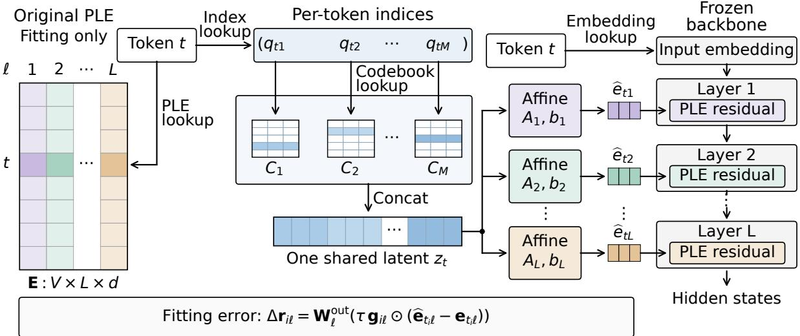
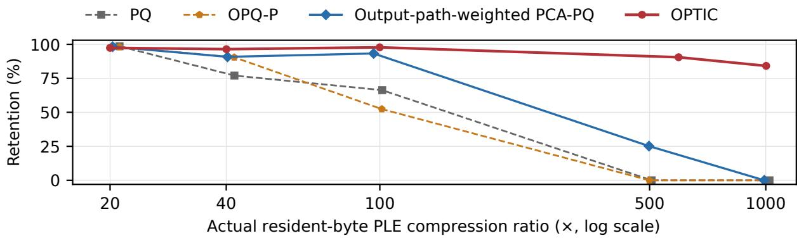
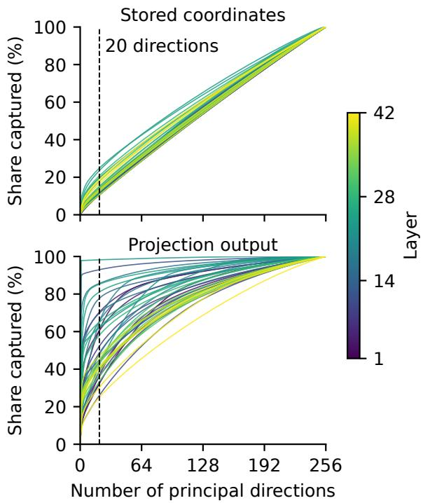

# Extreme Compression of Per-Layer Embeddings via Cross-Layer Latent Vector Quantization

Jiacheng Liu1 Yaxin Luo1 Xiaohan Zhao1 Peng Sun2,3 Xinyi Shang1,4 Jiacheng Cui1 Yonina C. Eldar5 Zhiqiang Shen1\*

1Mohamed bin Zayed University of Artificial Intelligence 2Westlake University 3Zhejiang University 4University College London 5Weizmann Institute of Science

## Abstract

Scaling embedding capacity alongside Transformer computation is an emerging trend in language models. This trend makes high compression rates increasingly useful. Hence, we study extreme compression of Per-Layer Embeddings (PLE), which follow this trend and account for 35.2% of the parameters of Gemma 4 E4B. At such rates, conventional quantizers give each token–layer vector its own code of only a few bytes. We instead develop OPTIC (Output-Path-fitted, Token-shared Indexed Codes)1, which stores one quantized code tuple per token and decodes it at every layer with a layerspecific affine decoder. Codes and decoders are fitted to the PLE output path rather than to the stored vectors. At about 100× PLE compression of bfloat16 (BF16) E4B, OPTIC retains an aggregate 97.8% of the uncompressed model’s performance across seven benchmarks, whereas product quantization, the strongest of six conventional baselines, retains 66.3%. At 594× and 1, 002× PLE compression of BF16 E4B, OPTIC retains 90.5% and 84.1%. On the official E4B release with 4-bit linear weights and 16-bit activations (W4A16), OPTIC retains 96.9% at about 100× PLE compression. During inference at about 100× PLE compression, BF16 E4B uses 29.7% less GPU memory than with uncompressed PLE at the same key–value cache size, while running at most 0.40% slower.

## 1 Introduction

Embedding capacity is emerging as a distinct scaling dimension in recent language-model development. Over-Tokenized Transformers (Huang et al., 2025) and SCONE (Yu et al., 2026) scale multi-gram or contextual n-gram representations; DeepSeek’s Engram uses hash-addressed n-gram lookup memory (Cheng et al., 2026); and Qwen3.8- Flash-Next supplements a 125B-parameter language model with 51B parameters of n-gram embeddings (Qiu et al., 2026). Gemma 4 follows this broader direction with Per-Layer Embeddings (PLE), first introduced in Gemma 3n (Gemma Team, 2025), which provide every vocabulary item with a learned vector at each decoder layer (Team et al., 2026).

We study Gemma 4 E2B and E4B for their strong performance and potential for practical deployment (Team et al., 2026). PLE accounts for 45.8% and 35.2% of the two checkpoints, respectively, making it a substantial target for storage reduction as models expand their embedding capacity.

An ordinary input embedding maps a token to one vector at the model’s input. PLE provides a separate vector at each decoder layer: E4B stores 11 million token–layer vectors of width 256, and near 100× compression leaves about five bytes for each. Conventional quantizers spend these bytes on a separate code for every vector.

OPTIC (Output-Path-fitted, Token-shared Indexed Codes) builds on two observations. First, PLE stores one vector for every pair of token and layer, so a compact representation can share storage along either index. OPTIC shares along both. All tokens of a layer use one layer-specific affine decoder, whose storage does not grow with the vocabulary size. All layers of a token use one code tuple, so a token’s bytes form one larger code instead of many small per-layer codes, and the layer decoders preserve the differences between layers.

Second, the model uses PLE vectors through a gate and an output projection. The fitting objective should therefore account for reconstruction error after the gate and output projection, rather than only in the stored coordinates. OPTIC fits its codes and decoders to minimize error at the projection output.

We report performance retention across seven benchmarks relative to the same checkpoint with uncompressed PLE. At about 100× PLE compression, OPTIC retains 97.8% on BF16 E4B, whereas the strongest of six conventional baselines retains 66.3%. With OPTIC’s fitting recipe and nearly equal storage, independent latent codes for each token–layer vector retain 79.3% (Section 5.2). At 594× and 1, 002× PLE compression, where about one byte or less remains for each vector, OPTIC retains 90.5% and 84.1%. In addition, on the official E4B release with 4-bit linear weights and 16-bit activations (W4A16), OPTIC retains 96.9% at about 100× PLE compression, compared with 82.8% for the strongest conventional baseline. On the smaller E2B, OPTIC retains 89.1% on BF16 and 91.5% on the official W4A16 release.

A model compressed with OPTIC also supports inference directly from the compact codes. On an RTX 4090 with a fixed key–value cache size, compact PLE lowers the GPU memory of BF16 E4B serving by 29.7% and adds at most 0.40% wall time (Section 6).

## 2 Method

## 2.1 Problem Setup

For a model with vocabulary size V , L PLEequipped decoder layers, and PLE width $d ,$ let $\textbf { E } \in \mathbb { R } ^ { V \times L \times d }$ denote the pretrained PLE tensor. Its vector for token $t \in \{ 1 , \ldots , V \}$ at layer $\ell \in \{ 1 , \ldots , L \}$ is $\mathbf { e } _ { t \ell } = \mathbf { E } [ t , \ell , : ] \in \mathbb { R } ^ { d }$ . We call each $\mathbf { e } _ { t \ell }$ a PLE row. We compress E while keeping the remaining model parameters fixed.

Let θ denote all tensors in a compact representation, bytes(θ) its resident size, and $\operatorname { D e c } _ { \pmb { \theta } } ( t , \ell ) \in$ $\mathbb { R } ^ { d }$ the decoder output for token t at layer ℓ. Given a byte budget $B _ { \mathrm { m a x } }$ , the reconstructed row is

$$
\widehat { \mathbf { e } } _ { \theta , t \ell } = \operatorname { D e c } _ { \theta } ( t , \ell ) , \qquad \mathrm { b y t e s } ( \theta ) \leq B _ { \mathrm { m a x } } .\tag{1}
$$

## 2.2 Shared Token Codes

Row-wise vector quantization stores a separate code tuple for each token–layer pair (t, ℓ). OP-TIC instead represents the L aligned PLE vectors of token t with one code tuple shared across layers, while all tokens of a layer share one affine decoder that models the differences among layers (Figure 1).

Let Z be the latent width and M the number of equal-width codebook groups, where M divides $Z$ and $d _ { c } ~ = ~ Z / M$ is the width of each group. For group $m \in \{ 1 , \ldots , M \}$ , let $\mathbf { C } _ { m } \in \mathbb { R } ^ { K \times d _ { c } }$ be a codebook containing K codewords, and let $q _ { t m } \in \{ 0 , \ldots , K - 1 \}$ select the codeword for token t. For layer ℓ, let $\mathbf { \Delta A } _ { \ell } \in \mathbb { R } ^ { d \times Z }$ and $\mathbf { b } _ { \ell } \in \mathbb { R } ^ { d }$ be its affine decoder parameters. The compact representation $\pmb \theta$ contains these assignments, codebooks, and decoders, and reconstructs a requested row as

$$
\begin{array} { r } { \mathbf { z } _ { t } = \mathrm { c o n c a t } _ { m = 1 } ^ { M } { \mathbf { C } } _ { m } [ q _ { t m } , : ] \in \mathbb { R } ^ { Z } , } \\ { \mathrm { D e c } _ { \pmb { \theta } } ( t , \ell ) = { \mathbf { A } } _ { \ell } \mathbf { z } _ { t } + { \mathbf { b } } _ { \ell } \in \mathbb { R } ^ { d } . \qquad } \end{array}\tag{2}
$$

The latent width Z describes the token representation shared across layers; each reconstructed PLE row still has width d. Let $b _ { q } ~ = ~ \lceil \log _ { 2 } K \rceil$ be the number of bits per assignment. The assignment payload occupies $\lceil V M b _ { q } / 8 \rceil$ bytes, compared with $\lceil V L M b _ { q } / 8 \rceil$ bytes for a row-wise representation with the same M and K. The complete compact representation also stores the codebooks and layer decoders. With float16 codebooks and decoder parameters, the complete resident size is

$$
B _ { \mathrm { l a t e n t } } = \left\lceil \frac { V M b _ { q } } { 8 } \right\rceil + 2 K Z + 2 L d Z + 2 L d .\tag{3}
$$

The four terms account for token codes, codebooks, decoder weights and decoder biases. Sharing codes removes the layer factor from the first term. The decoder cost still grows with the number of layers, but it does not grow with the vocabulary size because all tokens of a layer share its decoder.

For E4B, V = 262,144, L = 42 and d = 256. The configuration near 100× uses $Z ~ = ~ 6 4 4$ $M = 1 6 1$ and $K = 2 5 6$ , for a total of $^ { 5 6 , 4 0 4 , 9 9 2 }$ bytes. The uncompressed bfloat16 PLE occupies 5,637,144,576 bytes, giving a compression ratio of 99.94×. Decoding token t at layer ℓ gathers only its M codewords and applies the corresponding layer decoder, without materializing the full $V \times L \times d$ PLE tensor.

## 2.3 Output-Path Fitting

The PLE affects the model only through a gated residual branch in each decoder layer. This branch multiplies the PLE row element-wise by a gate computed from the layer’s hidden state and projects the product to the hidden width. We fit the reconstruction at this branch output, before normalization and residual addition.

Let ${ \mathcal { T } } _ { \mathrm { f i t } }$ be a collection of n fitting records. Record $i \in \mathcal { T } _ { \mathrm { f i t } }$ contains token ID $t _ { i }$ and a gate vector $\mathbf { g } _ { i \ell } \in \mathbb { R } ^ { d }$ for each layer ℓ. Natural-text records cache context-dependent gates from the uncompressed model, whereas synthetic vocabulary records use all-ones gates (Section 3.2). We hold each record’s gates fixed during fitting. Let $\mathbf { W } _ { \boldsymbol { \ell } } ^ { \mathrm { o u t } } \in \mathbb { R } ^ { h \times d }$ be the frozen output projection at layer $\ell ,$ where h is the model hidden width, and let $\tau > 0$ be the fixed PLE scale. With the gate and all other inputs fixed, replacing the original PLE row with its reconstruction changes the layer’s projection output by

  
Figure 1: One shared code per token serves all PLE layers. Token t retrieves its stored codebook indices and its input embedding. Each index $q _ { t m }$ selects the highlighted codeword of codebook $C _ { m } .$ . Concatenating these codewords forms one shared latent $\mathbf { z } _ { t } ,$ from which each affine decoder reconstructs its layer’s PLE row. Matching colors identify corresponding layers, and ellipses mark omitted layers and codebooks. Each cell of E contains a d-dimensional vector. The original PLE is used only for fitting, with frozen gates and projections (Equation 4). The frozen backbone shows the PLE residual connections and omits attention and feed-forward operations.

$$
\Delta \mathbf { r } _ { i \ell } ( \pmb \theta ) = \mathbf { W } _ { \ell } ^ { \mathrm { o u t } } \left( \tau \mathbf { g } _ { i \ell } \odot \left( \widehat { \mathbf e } _ { \pmb \theta , t _ { i } \ell } - \mathbf { e } _ { t _ { i } \ell } \right) \right) \in \mathbb { R } ^ { h } ,\tag{4}
$$

where ⊙ denotes element-wise multiplication. We use the empirical objective

$$
\mathcal { L } _ { \mathrm { p a t h } } ( \pmb { \theta } ) = \frac { 1 } { n L } \sum _ { i \in \mathcal { I } _ { \mathrm { f i t } } } \sum _ { \ell = 1 } ^ { L } \| \Delta \mathbf { r } _ { i \ell } ( \pmb { \theta } ) \| _ { 2 } ^ { 2 } .\tag{5}
$$

## 2.4 Alternating Optimization

Fitting alternates between continuous updates to codebooks and decoders and discrete updates to token codes. With codes fixed, continuous updates minimize Equation 5. Code reassignment updates the codes of every token in the vocabulary, including tokens with few fitting records. We therefore average the gate information over all fitting records to obtain one error metric per layer:

$$
\begin{array} { r } { \overline { { \mathbf { G } } } _ { \ell } = \left( ( \mathbf { W } _ { \ell } ^ { \mathrm { o u t } } ) ^ { \top } \mathbf { W } _ { \ell } ^ { \mathrm { o u t } } \right) } \\ { \odot \left( \displaystyle \frac { 1 } { n } \sum _ { i \in \mathbb { Z } _ { \mathrm { f t } } } \mathbf { g } _ { i \ell } \mathbf { g } _ { i \ell } ^ { \top } \right) . } \end{array}\tag{6}
$$

We drop the factor $\tau ^ { 2 }$ because it is positive and common to all layers. For a positive-semidefinite

matrix $\mathbf { G } ,$ , define $\| \mathbf { x } \| _ { \mathbf { G } } ^ { 2 } = \mathbf { x } ^ { \mathsf { T } } \mathbf { G } \mathbf { x }$ . With the codebooks and decoders fixed, we use the following surrogate for code reassignment:

$$
\begin{array} { r } { \widetilde { \mathscr { L } } _ { \mathrm { a s s i g n } } ( \pmb { \theta } ) = \displaystyle \frac { 1 } { V } \sum _ { t = 1 } ^ { V } \biggl [ \sum _ { \ell = 1 } ^ { L } \| \widehat { \mathbf { e } } _ { \pmb { \theta } , t \ell } - \mathbf { e } _ { t \ell } \| _ { \overline { { \mathbf { G } } } _ { \ell } } ^ { 2 } } \\ { + \lambda \| \mathbf { z } _ { t } \| _ { 2 } ^ { 2 } \biggr ] . } \end{array}\tag{7}
$$

Here $\lambda \geq 0$ controls latent-norm regularization. We update the codebook index of one group at a time, choosing the codeword that minimizes Equation 7 while holding the other groups fixed.

Initialization uses the layer metrics $\overline { { \mathbf { G } } } _ { \ell }$ . We concatenate the L PLE rows of each token into one vector of width $L d ,$ subtract the mean of these vectors over the vocabulary, and scale the coordinates of layer ℓ by $\overline { { \mathbf { G } } } _ { \ell } ^ { 1 / 2 }$ . These vectors, one per token, form a $V \times L d$ matrix. Principal component analysis (PCA) of this matrix gives Z leading directions. The projection of each scaled vector onto these directions initializes the token latent $\mathbf { z } _ { t } .$ . The coordinates of layer ℓ in these directions, scaled by $\overline { { \mathbf { G } } } _ { \ell } ^ { - 1 / 2 }$ , initialize the decoder $\mathbf { A } _ { \ell } ,$ and each layer’s vocabulary mean initializes its bias $\mathbf { b } _ { \ell } .$ . We assign the latent coordinates to codebook groups by the eigenvalue allocation of optimized product quantization (OPQ) (Ge et al., 2013), so that the groups have similar products of eigenvalues. We then run K-means within each group to initialize its code-

Algorithm 1 Fitting procedure for OPTIC.   
Require: E, $\mathcal { T } _ { \mathrm { f i t } } .$ , frozen gates and projections; $M , K ,$ and   
$Z ; J$ continuous-update blocks of U steps each   
Ensure: Compact representation θ   
1: Form the marginal layer metrics $\{ \overline { { \mathbf { G } } } _ { \ell } \} _ { \ell = 1 } ^ { L }$ (Equation 6)   
2: Initialize $\{ \mathbf { z } _ { t } \} , \{ \mathbf { A } _ { \ell } \}$ and $\{ \mathbf { b } _ { \ell } \}$ by PCA of the centered   
token vectors weighted by $\overline { { \mathbf { G } } } _ { \ell } ^ { 1 / 2 }$   
3: Group the Z coordinates by OPQ eigenvalue allocation   
4: Initialize $\{ \mathbf { C } _ { m } \} _ { m = 1 } ^ { M }$ and $\{ q _ { t m } \} _ { t , m }$ by K-means within   
each group   
5: for $c = 1 , \ldots , J$ do   
6: for $u = 1 , \ldots , U$ do   
7: Sample a minibatch of record–layer pairs and   
take one AdamW step on the codebooks and   
decoders to reduce $\bar { \mathcal { L } } _ { \mathrm { { p a t h } } }$ , with $\left\{ q _ { t m } \right\}$ fixed   
8: end for   
9: $\mathbf { i f } \ c < J$ then   
10: For every token, compute the unquantized   
minimizer z⋆t of Equation 7   
11: For two sweeps over $m = 1 , \ldots , M$ , set each   
$q _ { t m }$ to the codeword of $\mathbf { C } _ { m }$ that minimizes   
Equation 7 with the other groups fixed   
12: Set each unused codeword to the group slice of   
z⋆ for a different worst-fit token, assign that   
token to the codeword and reset the codeword’s   
AdamW moments   
13: end if   
14: end for   
15: return θ

words and assignments.

Algorithm 1 summarizes the procedure. Appendix B.1 gives the update schedule, unusedcodeword handling and hyperparameters.

## 2.5 Additional Compact Representations

Output-path-weighted PCA-PQ stores one code tuple per token–layer row. It scales each row with diagonal output-path weights and then applies PCA and product quantization (PQ). Appendix D gives its derivation and fitting procedure, and $\mathsf { A p - }$ pendix A.3 gives its complete storage cost.

The frequency-tiered variant of OPTIC gives more code groups to frequent tokens. Every token stores $M _ { 0 }$ base groups, and the $N _ { \mathrm { f r e q } }$ most frequent non-special tokens in a fixed fitting stream store $M _ { 1 } - M _ { 0 }$ additional groups. Other tokens use a learned shared codeword in each additional group, so every vocabulary item keeps an explicit code. The variant also stores INT8 decoder weights and keeps special-token rows exactly in bfloat16. $\mathsf { A p - }$ pendix A.3 gives its complete storage cost.

## 3 Experimental Setup

## 3.1 Baselines

We evaluate six baselines adapted to the PLE setting: flattened row-wise product quantization (PQ) (Jegou et al., 2010), greedy residual vector quantization (RVQ) (Chen et al., 2010), parametric optimized product quantization (OPQ-P) (Ge et al., 2013), Additive Quantization (AQ) (Babenko and Lempitsky, 2014), the AQLM Euclidean beam encoder (Egiazarian et al., 2024), and post-hoc INT8 randomized low-rank singular value decomposition (SVD) (Halko et al., 2011). Our methods are output-path-weighted PCA-PQ and OPTIC. Each baseline is applied to the PLE tensor under matched resident-byte accounting, and Appendix A.2 gives its representation and fitting rule.

## 3.2 Calibration Data

The calibration data for OPTIC and its frequencytiered variant combine natural text with synthetic records. The natural text consists of 1,536 sequences of 512 tokens (786,432 positions) from FineWeb and FineWeb-Edu (Penedo et al., 2024), OpenWebMath (Paster et al., 2024) and FineWeb2 (Penedo et al., 2025). Because the natural text covers only part of the vocabulary, we add one synthetic record for every token in the vocabulary. Repeated special-token records give the fitting procedure additional coverage of tokens used to control generation. Natural records use gates collected from the frozen model, whereas synthetic records use all-ones gates with the same frozen projections.

The frequency-tiered variant uses token counts from a fitting stream that combines these text sources with text generated by the uncompressed checkpoint. Output-path-weighted PCA-PQ uses the WikiText-2 training split (Merity et al., 2016) for its fitting statistics. Calibration data exclude evaluation examples.

## 3.3 Evaluation Protocol

The seven tasks cover reasoning with PIQA (Bisk et al., 2020), GSM8K (Cobbe et al., 2021), GPQA Diamond (Rein et al., 2023) and AIME 2026 (Dekoninck et al., 2026); world knowledge with MMLU-Redux (Hendrycks et al., 2020; Gema et al., 2025); instruction following with IF-Bench (Pyatkin et al., 2026); and vision with InfographicVQA (Mathew et al., 2022). For each model size and weight format, all methods use the same backbone weights, prompts, generation settings and scorers. The main comparisons use fitting seed 0, and every fit is evaluated after its last scheduled update. Appendix B.2 gives sample counts and evaluation seeds.

<table><tr><td></td><td colspan="2">Original BF16</td><td colspan="2">Official W4A16</td></tr><tr><td>Method</td><td>E2B R / Retention</td><td>E4B R / Retention</td><td>E2B R / Retention</td><td>E4B R / Retention</td></tr><tr><td>Baselines</td><td></td><td></td><td></td><td></td></tr><tr><td>PQ</td><td>101.24/22.9</td><td>101.43/66.3</td><td>101.24/0.0</td><td>101.43/82.4</td></tr><tr><td>RVQ</td><td>100.96/0.0</td><td>98.64/37.6</td><td>100.96/29.3</td><td>101.20/82.0</td></tr><tr><td>OPQ-P</td><td>100.92/0.0</td><td>101.16/52.4</td><td>100.92/0.0</td><td>101.16/57.9</td></tr><tr><td>AQ</td><td>100.96/0.0</td><td>101.20/45.6</td><td>100.96/0.0</td><td>101.20/62.8</td></tr><tr><td>AQLM Euclidean beam encoder</td><td>100.96/20.7</td><td>101.20/46.7</td><td>100.96/32.0</td><td>101.20/82.8</td></tr><tr><td>INT8 randomized low-rank SVD</td><td>100.13/0.0</td><td>99.76/37.7</td><td>100.13/0.0</td><td>100.24/51.1</td></tr><tr><td>Our methods</td><td></td><td></td><td></td><td></td></tr><tr><td>Output-path-weighted PCA-PQ</td><td>96.14/32.2</td><td>96.36/93.3</td><td>96.14/44.5</td><td>96.36/88.3</td></tr><tr><td>OPTIC</td><td>99.86/89.1</td><td>99.94/97.8</td><td>99.86/91.5</td><td>99.94/96.9</td></tr><tr><td>Frequency-tiered OPTIC</td><td>100.48/90.0</td><td>100.00/95.7</td><td>100.48/93.0</td><td>100.00/95.1</td></tr></table>

Table 1: PLE compression on the original BF16 and official W4A16 releases at the nominal 100× tier. Cells report compression ratio R / seven-task retention (%) relative to the matched uncompressed PLE. A zero denotes at least one zero task score. Bold marks the highest retention in each column.

For method m and task k, let $s _ { m , k }$ be its score and $s _ { \mathrm { r e f } , k }$ the score of the same checkpoint with uncompressed PLE. We report the equal-weight geometric mean of capped per-task retention:

$$
1 0 0 \left[ \prod _ { k = 1 } ^ { 7 } \operatorname* { m i n } \left( \frac { s _ { m , k } } { s _ { \mathrm { r e f } , k } } , 1 \right) \right] ^ { 1 / 7 } .\tag{8}
$$

Capping prevents gains above the reference on one task from offsetting losses on another. The geometric mean becomes zero if any task score is zero.

For W4A16 experiments, each compact PLE artifact is fitted from the matched unquantized checkpoint from the official quantization-aware-training pipeline and applied to its W4A16 release (Google DeepMind, 2026c,f), whose PLE lookup remains in bfloat16.

## 4 Compression Results

## 4.1 Compression and Quality

Table 1 compares methods near 100× PLE compression. OPTIC gives the highest E4B retention: 97.8% on BF16 and 96.9% on W4A16. These E4B results lead the strongest baseline by 31.5 and 14.0 percentage points, respectively. The frequencytiered variant of OPTIC gives the highest E2B retention: 90.0% on BF16 and 93.0% on W4A16.

The per-task scores show where the E4B gains arise. On BF16 E4B, OPTIC preserves GSM8K accuracy at 92.8%, compared with 92.9% for uncompressed PLE and 73.5% for PQ. Its IFBench score is 41.7%, compared with 44.0% for uncompressed PLE and 16.0% for PQ.

InfographicVQA follows the same pattern: 67.5% for OPTIC, 69.7% for uncompressed PLE and 38.4% for PQ. PIQA changes little for either compressed method. The aggregate advantage includes gains in mathematical reasoning, instruction following and visual question answering. Appendix C reports every task score.

Table 2 gives 95% paired-bootstrap intervals. The E4B BF16 interval is 95.5–99.0% for OP-TIC and 60.6–70.5% for PQ. The corresponding W4A16 intervals are 93.9–97.8% and 76.8–87.1% for OPTIC and the AQLM Euclidean beam encoder. The intervals remain separated in both E2B settings as well. Appendix C specifies resampling.

## 4.2 Compression Range

Figure 2 compares OPTIC with PQ, OPQ-P and output-path-weighted PCA-PQ across five nominal tiers on BF16 E4B. OPTIC has compression ratios of 594× and 1002× at the nominal 500× and 1000× tiers. At these ratios, it retains 90.5% and 84.1% on BF16 E4B and 87.7% and 81.8% on W4A16 E4B (Table 16).

Output-path-weighted PCA-PQ is an outputaware row-wise method. It retains 93.3% near 100× on BF16 E4B, 25.1% near 500× and zero near 1000×, while OPTIC remains above 84%. The advantage of OPTIC over this row-wise method therefore grows as fewer bytes are available to represent each PLE vector.

## 5 Analysis and Ablations

This section examines the structure of the PLE table (Section 5.1), the effect of sharing token codes across layers (Section 5.2) and the components of the fitting procedure (Section 5.3).

<table><tr><td>Setting</td><td>Our method</td><td>Retention (95% interval)</td><td>Strongest baseline</td><td>Retention (95% interval)</td></tr><tr><td>E2B, BF16</td><td>OPTIC</td><td>89.1 [85.8, 91.8]</td><td>PQ</td><td>22.9 [0.0, 28.8]</td></tr><tr><td>E4B, BF16</td><td>OPTIC</td><td>97.8 [95.5, 99.0]</td><td>PQ</td><td>66.3 [60.6, 70.5]</td></tr><tr><td>E2B, W4A16</td><td>OPTIC</td><td>91.5 [89.3, 93.3]</td><td>AQLM Euclidean beam encoder</td><td>32.0 [0.0, 38.9]</td></tr><tr><td>E4B, W4A16</td><td>OPTIC</td><td>96.9 [93.9, 97.8]</td><td>AQLM Euclidean beam encoder</td><td>82.8 [76.8, 87.1]</td></tr></table>

Table 2: Paired-bootstrap confidence intervals for the four primary nominal-100× comparisons. Retention is reported in percent.

  
Figure 2: Rate–retention curves on BF16 Gemma 4 E4B, normalized to the uncompressed PLE. Dashed curves show the PQ and OPQ-P baselines, and solid curves show our methods. OPTIC retains 97.8% near 100×, and its advantage over the shown baselines remains large at higher compression ratios. A zero geometric mean means that at least one task scored zero.

<table><tr><td>Representation</td><td>E2B BF16</td><td>E4B BF16</td><td>E2B W4A16</td><td>E4B W4A16</td></tr><tr><td>Independent latent codes</td><td>28.5</td><td>79.3</td><td>53.7</td><td>86.8</td></tr><tr><td>Additive codes</td><td>42.1</td><td>90.0</td><td>83.5</td><td>94.4</td></tr><tr><td>OPTIC</td><td>89.1</td><td>97.8</td><td>91.5</td><td>96.9</td></tr></table>

Table 3: Seven-task retention (%) near 100× PLE compression with fit seed $0 ,$ relative to the uncompressed checkpoints of Tables 12 and 13. Independent latent codes use the main method’s fitting recipe and calibration data, with 0.8–0.9% fewer resident bytes. OPTIC values are the main results of Table 1. Output-path-fitted additive codes keep their standard initializer.

## 5.1 PLE Structure

We examine the importance and dimensional structure of token-specific variation in PLE, using the original BF16 E4B table with equal weighting over vocabulary items (Appendix E.3). Each vector $\mathbf { e } _ { t \ell }$ splits into its layer’s vocabulary mean and a centered remainder. The means account for 8.1% of the table’s squared Frobenius norm. Replacing every vector with its layer mean lowers GSM8K from 92.9% to 43.5% and GPQA Diamond from 56.9% to 23.0%; AIME 2026 falls to zero, making seventask retention zero. Layer means alone therefore do not preserve model performance.

We next examine whether the remaining variation is concentrated in a low-dimensional subspace. Besides the stored coordinates, we use the outputpath metric $\overline { { \mathbf { G } } } _ { \ell }$ (Equation 6) to account for the gate and projection before normalization. In stored coordinates, capturing 90% of a layer’s token-specific variation requires 212–227 of 256 principal directions. Under the output-path metric, it requires 1–205 directions (median 158), indicating substantial differences across layers (Figure 3).

## 5.2 Code Sharing

We examine how cross-layer code sharing affects performance at nearly equal storage. Independent latent codes assign a separate code tuple to each token–layer pair and use layer-specific affine decoders. We fit them with the main method’s recipe, including output-path-weighted initialization, unused-codeword handling, calibration data and fit seed. Appendix E gives the configurations.

On E4B, OPTIC retains 97.8% with BF16 and 96.9% with W4A16, compared with 79.3% and 86.8% for independent latent codes (Table 3). Three-fit means under a common Euclidean initialization, which applies PCA and K-means without output-path weights, show the same ordering (Table 17).

  
Figure 3: Cumulative share of each layer’s tokenspecific variation captured by its leading principal directions in the original BF16 E4B PLE table, with every token in the vocabulary weighted equally, in the stored coordinates (top) and at the PLE projection output (bottom). Each curve is one of the 42 layers. The dashed line marks 20 directions, the latent width of independent latent codes (Section 5.2).

Near 100×, OPTIC stores 161 one-byte codebook indices per token, shared across layers, while independent latent codes store five per token–layer pair. Each index selects a four-dimensional codeword, giving latent widths of $1 6 1 \times 4 = 6 4 4$ and $5 \times 4 = 2 0$ , respectively. To test the role of decoder rank, a decoder-rank control limits every layer decoder to rank 20 (Table 4). It keeps the indices, codebooks and biases of the three commoninitialization E4B BF16 fits of Table 17 and refits only decoder weights by frequency-weighted least squares on the PLE rows. With this objective, refits capped at rank 20 retain 70.55%, compared with 95.09% without the limit. Reducing decoder rank lowers retention even when the shared codes are unchanged.

As an additional comparison without code sharing, output-path-fitted additive codes reconstruct each row as a sum of codewords and keep their standard initializer. They retain 90.0% on BF16

<table><tr><td>Decoder refit with fixed codes</td><td>Retention (%)</td></tr><tr><td>Rank unlimited</td><td> $9 5 . 0 9 \pm 0 . 4 8$ </td></tr><tr><td>Fitted rank at most 20 per layer</td><td> $7 0 . 5 5 \pm 1 . 1 8$ </td></tr></table>

Table 4: Decoder refits on the three E4B BF16 fits of Table 17, which use a common Euclidean initialization, near 100×. Values are means and sample standard deviations over fit seeds 0, 1 and 2. Refits keep each fit’s indices, codebooks and biases, constrain rank before float16 storage, and share the uncompressed reference of Table 17.

E4B and 94.4% on W4A16 E4B, below OPTIC.

## 5.3 Fitting Components

<table><tr><td>Fixed-code objective</td><td>Retention (%)</td></tr><tr><td>Euclidean</td><td> $9 2 . 7 6 \pm 1 . 1 6$ </td></tr><tr><td>Diagonal output path</td><td> $9 4 . 4 4 \pm 0 . 9 4$ </td></tr><tr><td>Context-dependent output path</td><td> $9 4 . 7 4 \pm 0 . 5 9$ </td></tr></table>

Table 5: Fixed-code fitting on E4B BF16 near 100×, with the common Euclidean initialization and 5,000 continuous updates. Each loss is divided by its value for an all-zero reconstruction. Values are means and sample standard deviations over three fits.

We first isolate the fitting objective by fixing codes and initialization and using 5,000 continuous updates. We divide each loss by its value for an all-zero reconstruction and use the same learning rate and gradient-clipping threshold for all three objectives. The context-dependent objective gains 1.98 percentage points in paired mean retention over Euclidean fitting and 0.31 points over diagonal weighting (Table 5). Output-path fitting therefore improves over Euclidean fitting, and diagonal weighting captures most of this improvement.

<table><tr><td>Optimization recipe</td><td>Retention (%)</td></tr><tr><td>Initialization only</td><td> $6 3 . 6 0 \pm 3 . 6 8$ </td></tr><tr><td>Continuous updates only</td><td> $9 4 . 6 7 \pm 0 . 5 3$ </td></tr><tr><td>Continuous updates + reassignment</td><td> $9 5 . 4 9 \pm 0 . 4 0$ </td></tr></table>

Table 6: Optimization on E4B BF16 near 100×. Values are means and sample standard deviations over three fits. The last two rows use 5,000 continuous updates, and the final row adds 18 reassignment sweeps.

We then assess continuous fitting and code reassignment from the common Euclidean initialization (Table 6). Continuous fitting supplies most of the gain; reassignment improves all three paired fits, with paired gains of 0.65–1.14 percentage points (Appendix E.1).

## 6 Compact Inference

The compression ratios above measure PLE storage. We now measure the memory and runtime of the full model when serving directly from the compact representation. We serve uncompressed (dense) and approximately 100× compact PLE for BF16 and W4A16 E4B with vLLM (Kwon et al., 2023) on one RTX 4090. Compact PLE keeps only the codes, codebooks and layer decoders on the GPU and decodes the rows of the current tokens at each step. Each pair uses identical backbone weights and serving settings, including a fixed 1 GiB key– value cache (Table 7).

<table><tr><td>Backbone</td><td>Dense (GB)</td><td>Compact (GB)</td><td>Saved (%)</td></tr><tr><td>BF16</td><td>18.57</td><td>13.05</td><td>29.7</td></tr><tr><td>W4A16</td><td>12.95</td><td>7.37</td><td>43.1</td></tr></table>

Table 7: Post-initialization process GPU memory for E4B on an RTX 4090 with a fixed 1 GiB key-value cache, averaged over two engine initializations. Resident PLE storage falls from 5.64 GB to 56.4 MB.

Compact lookup adds at most 0.40% wall time with BF16 and 0.69% with W4A16 across eight prefill and generation workloads. Appendix B.3 also reports serving at a fixed GPU memory budget, single long requests and PLE lookups with the table stored in host memory.

## 7 Related Work

Embedding compression. Multi-codebook representations have been used to compress word embeddings for NLP. Shu and Nakayama (2018) learn compositional discrete codes and codebooks for an embedding matrix. Our setting has an additional layer axis: the same vocabulary item has a different embedding at each layer. We exploit this correspondence by decoding one token representation into multiple layer-specific rows. CARVQ combines grouped residual codes with a nonlinear corrective adaptor for ordinary token embeddings (Gou et al., 2025); our representation instead shares a token’s latent codes across layers.

Vector quantization and low-rank representations. Product quantization divides a vector into subspaces and quantizes each subspace (Jegou et al., 2010); optimized product quantization learns a transformation before quantization (Ge et al., 2013). Residual and additive quantizers represent vectors through sums of codewords (Chen et al.,

2010; Babenko and Lempitsky, 2014). Low-rank factorization instead stores continuous coordinates and a shared basis; randomized SVD offers a practical fitting procedure (Halko et al., 2011). OP-TIC combines a shared latent representation with discrete token codes and layer-specific affine decoders. This shares the code storage across layers while keeping a separate reconstruction map for each layer.

Output-aware model compression. Weight reconstruction can account for a model’s inputs and activations. GPTQ uses approximate secondorder information for post-training weight quantization (Frantar et al., 2022), while AWQ uses activation statistics to choose channel scales that protect salient weights (Lin et al., 2024). AQLM combines input-adaptive additive quantization with joint block optimization (Egiazarian et al., 2024). Our loss follows the gated PLE output path instead of a linear weight matrix. Compressing this separate embedding table complements backbone weight quantization, as our BF16 and W4A16 experiments demonstrate.

Our comparisons include the AQLM Euclidean beam encoder and output-path-fitted additive codes; Appendices A and E give their PLE adaptations and storage budgets.

## 8 Conclusion

OPTIC stores one code tuple per token, which every layer decodes through its own affine decoder, and fits codes and decoders at the PLE projection output, before normalization. Near 100× PLE compression, it achieves seven-task retention of 97.8% on BF16 E4B and 96.9% on W4A16 E4B. Independent latent codes for each vector retain 79.3% on BF16 E4B with nearly equal storage. At 594× and 1002× PLE compression, OPTIC retains 90.5% and 84.1% of BF16 E4B performance, respectively. Served directly from OPTIC codes with a fixed key–value cache size, BF16 E4B uses 29.7% less GPU memory with at most 0.40% added wall time.

These results show substantial compression potential in Gemma 4’s expanded embedding tables. They motivate designing embedding capacity and compressed representations together, with deployment memory as a constraint. Our BF16 and W4A16 results show that PLE compression complements backbone quantization; extending this combination to other embedding structures is a promising direction.

## Limitations

The study evaluates PLE in Gemma 4 E2B and E4B. The main comparisons and Table 3 use one fixed fitting seed, so the paired-bootstrap intervals describe benchmark sampling uncertainty. The three-fit comparisons and controls describe fitting variation under the common Euclidean initialization.

At a matched byte budget, removing code sharing also changes how bytes are divided between codes and decoders, so the code-sharing ablation measures this combined effect with the fitting recipe held fixed. The fixed-code objective ablation applies to continuous fitting, and the output-path loss holds the gates fixed and measures error only at each layer’s projection output. The baselines, including the AQLM Euclidean beam encoder, are adaptations of their original methods to PLE. A single low-count task can strongly affect retention.

## Ethical Considerations

Compression reduces the resources needed to study and deploy existing models. It can broaden access to model research, although the same resource savings can also lower the cost of harmful applications. AI assistants were used for language polishing and code assistance. The authors remain responsible for the results, references, implementation and writing.

## Acknowledgments

This work is supported by the MBZUAI-WIS Joint Program for Artificial Intelligence Research.

## References

AQLM Authors. 2026. AQLM: Official PyTorch implementation. https://github.com/Vahe1994/AQLM /tree/e79a896ed6656fe4ed06193d42d004e7d0 bbdbb2. Official repository; accessed 2026-09-06.

Artem Babenko. 2015. Quantizations. https://gi thub.com/arbabenko/Quantizations/tree/14 9e8d5226b96c36b55ef2423bcdebc94aec4099. Author repository; accessed 2026-09-06.

Artem Babenko and Victor Lempitsky. 2014. Additive quantization for extreme vector compression. In Proceedings of the IEEE Conference on Computer Vision and Pattern Recognition, pages 931–938.

Lucas Bandarkar, Davis Liang, Benjamin Muller, Mikel Artetxe, Satya Narayan Shukla, Donald Husa, Naman Goyal, Abhinandan Krishnan, Luke Zettlemoyer, and Madian Khabsa. 2024. The belebele benchmark: a

parallel reading comprehension dataset in 122 language variants. In Proceedings ofthe 62nd Annual Meeting of the Association for Computational Linguistics (Volume 1: Long Papers), pages 749–775.

Yonatan Bisk, Rowan Zellers, Jianfeng Gao, Yejin Choi, et al. 2020. Piqa: Reasoning about physical commonsense in natural language. In Proceedings ofthe AAAI conference on artificial intelligence, volume 34, pages 7432–7439.

Yongjian Chen, Tao Guan, and Cheng Wang. 2010. Approximate nearest neighbor search by residual vector quantization. Sensors, 10(12):11259–11273.

Xin Cheng, Wangding Zeng, Damai Dai, Qinyu Chen, Bingxuan Wang, Zhenda Xie, Kezhao Huang, Xingkai Yu, Zhewen Hao, Han Zhang, et al. 2026. Conditional memory via scalable lookup: A new axis of sparsity for large language models. In Proceedings of the 64th Annual Meeting of the Association for Computational Linguistics (Volume 1: Long Papers), pages 4968–4990.

Karl Cobbe, Vineet Kosaraju, Mohammad Bavarian, Mark Chen, Heewoo Jun, Lukasz Kaiser, Matthias Plappert, Jerry Tworek, Jacob Hilton, Reiichiro Nakano, et al. 2021. Training verifiers to solve math word problems. arXiv preprint arXiv:2110.14168.

Jasper Dekoninck, Nikola Jovanovic, Tim Gehrunger,´ Kári Rögnvaldsson, Ivo Petrov, Chenhao Sun, and Martin Vechev. 2026. Beyond benchmarks: Matharena as an evaluation platform for mathematics with llms. arXiv preprint arXiv:2605.00674.

Bradley Efron, Robert J Tibshirani, et al. 2000. An introduction to the bootstrap. Boca Raton, Florida.

Vage Egiazarian, Andrei Panferov, Denis Kuznedelev, Elias Frantar, Artem Babenko, and Dan Alistarh. 2024. Extreme compression of large language models via additive quantization. arXiv preprint arXiv:2401.06118.

Elias Frantar, Saleh Ashkboos, Torsten Hoefler, and Dan Alistarh. 2022. Gptq: Accurate post-training quantization for generative pre-trained transformers. arXiv preprint arXiv:2210.17323.

Tiezheng Ge, Kaiming He, Qifa Ke, and Jian Sun. 2013. Optimized product quantization for approximate nearest neighbor search. In Proceedings ofthe IEEE conference on computer vision and pattern recognition, pages 2946–2953.

Aryo Pradipta Gema, Joshua Ong Jun Leang, Giwon Hong, Alessio Devoto, Alberto Carlo Maria Mancino, Rohit Saxena, Xuanli He, Yu Zhao, Xiaotang Du, Mohammad Reza Ghasemi Madani, et al. 2025. Are we done with mmlu? In Proceedings of the 2025 Conference of the Nations of the Americas Chapter of the Associationfor Computational Linguistics: Human Language Technologies (Volume 1: Long Papers), pages 5069–5096.

Gemma Team. 2025. Gemma 3n model overview. ht tps://ai.google.dev/gemma/docs/gemma-3n. Official model documentation; accessed 2026-10-12.

Google DeepMind. 2026a. google/gemma-4-E2B-it. https://huggingface.co/google/gemma-4-E2B -it/tree/b446025c61ecea876162774ee24770605 6963aba. Official model card; accessed 2026-09-06.

Google DeepMind. 2026b. google/gemma-4-E2B-itqat-q4\_0-unquantized. https://huggingface.co /google/gemma-4-E2B-it-qat-q4\_0-unquantiz ed/tree/6befbaca7398925921802abd1f277b49 5b78b738. Official model card; accessed 2026-09- 06.

Google DeepMind. 2026c. google/gemma-4-E2B-itqat-w4a16-ct. https://huggingface.co/google/ gemma-4-E2B-it-qat-w4a16-ct/tree/971342c 08f607aa7779983f6b5289778b5d271a7. Official model card; accessed 2026-09-06.

Google DeepMind. 2026d. google/gemma-4-E4B-it. https://huggingface.co/google/gemma-4-E4B -it/tree/ee0ef6023621cff504d758262d4e04895 a5af4a2. Official model card; accessed 2026-09-06.

Google DeepMind. 2026e. google/gemma-4-E4B-itqat-q4\_0-unquantized. https://huggingface.co /google/gemma-4-E4B-it-qat-q4\_0-unquantiz ed/tree/476025a01dbf99361c062bbeca3d6a76 bb4c4566. Official model card; accessed 2026-09- 06.

Google DeepMind. 2026f. google/gemma-4-E4B-it-qatw4a16-ct. https://huggingface.co/google/ge mma-4-E4B-it-qat-w4a16-ct/tree/6cd26aaa2 357fb2bad8c51699a7558a4d1a965bb. Official model card; accessed 2026-09-06.

Dayin Gou, Sanghyun Byun, Nilesh Malpeddi, Gabrielle De Micheli, Prathamesh Vaste, Jacob Song, and Woo Seong Chung. 2025. CARVQ: Corrective adaptor with group residual vector quantization for LLM embedding compression. In Findings of the Associationfor Computational Linguistics: EMNLP 2025, pages 18594–18604, Suzhou, China. Association for Computational Linguistics.

Nathan Halko, Per-Gunnar Martinsson, and Joel A Tropp. 2011. Finding structure with randomness: Probabilistic algorithms for constructing approximate matrix decompositions. SIAM review, 53(2):217– 288.

Kaiming He. 2013. MATLAB demo code for optimized product quantization. Version 1.1, https://peop le.csail.mit.edu/kaiming/cvpr13/matlab\_O PQ\_release\_v1.1.rar. Author release; accessed 2026-09-06.

Dan Hendrycks, Collin Burns, Steven Basart, Andy Zou, Mantas Mazeika, Dawn Song, and Jacob Steinhardt. 2020. Measuring massive multitask language understanding. arXiv preprint arXiv:2009.03300.

Hongzhi Huang, Defa Zhu, Banggu Wu, Yutao Zeng, Ya Wang, Qiyang Min, and Xun Zhou. 2025. Overtokenized transformer: Vocabulary is generally worth scaling. arXiv preprint arXiv:2501.16975.

Herve Jegou, Matthijs Douze, and Cordelia Schmid. 2010. Product quantization for nearest neighbor search. IEEE transactions on pattern analysis and machine intelligence, 33(1):117–128.

Woosuk Kwon, Zhuohan Li, Siyuan Zhuang, Ying Sheng, Lianmin Zheng, Cody Hao Yu, Joseph Gonzalez, Hao Zhang, and Ion Stoica. 2023. Efficient memory management for large language model serving with pagedattention. In Proceedings of the 29th symposium on operating systems principles, pages 611–626.

Ji Lin, Jiaming Tang, Haotian Tang, Shang Yang, Wei-Ming Chen, Wei-Chen Wang, Guangxuan Xiao, Xingyu Dang, Chuang Gan, and Song Han. 2024. Awq: Activation-aware weight quantization for ondevice llm compression and acceleration. Proceedings ofmachine learning and systems, 6:87–100.

Minesh Mathew, Viraj Bagal, Rubèn Tito, Dimosthenis Karatzas, Ernest Valveny, and CV Jawahar. 2022. Infographicvqa. In 2022 IEEE/CVF Winter Conference on Applications of Computer Vision (WACV), pages 2582–2591. IEEE.

Stephen Merity, Caiming Xiong, James Bradbury, and Richard Socher. 2016. Pointer sentinel mixture models. arXiv preprint arXiv:1609.07843.

Keiran Paster, Marco Dos Santos, Zhangir Azerbayev, and Jimmy Ba. 2024. Openwebmath: An open dataset of high-quality mathematical web text. In International Conference on Learning Representations, volume 2024, pages 20357–20379.

Guilherme Penedo, Hynek Kydlícek, Anton Lozhkov,ˇ Margaret Mitchell, Colin Raffel, Leandro Von Werra, Thomas Wolf, et al. 2024. The fineweb datasets: Decanting the web for the finest text data at scale. Advances in Neural Information Processing Systems, 37:30811–30849.

Guilherme Penedo, Hynek Kydlícek, Vinko Sabolˇ cec,ˇ Bettina Messmer, Negar Foroutan, Amir Hossein Kargaran, Colin Raffel, Martin Jaggi, Leandro Von Werra, and Thomas Wolf. 2025. Fineweb2: One pipeline to scale them all–adapting pre-training data processing to every language. arXiv preprint arXiv:2506.20920.

Valentina Pyatkin, Saumya Malik, Victoria Graf, Hamish Ivison, Shengyi Huang, Pradeep Dasigi, Nathan Lambert, and Hanna Hajishirzi. 2026. Generalizing verifiable instruction following. Advances in Neural Information Processing Systems, 38.

Zihan Qiu, Zekun Wang, Xiao Li, Yanpeng Li, Yang Xu, Yixuan Wang, Huaqing Zhang, Rui Men, Bochao Mao, Chengruidong Zhang, et al. 2026. On the design of qwen3. 8-next architecture: Evaluation,

efficiency, and training stability. arXiv preprint arXiv:2608.30320.

David Rein, Betty Li Hou, Asa Cooper Stickland, Jackson Petty, Richard Yuanzhe Pang, Julien Dirani, Julian Michael, and Samuel R Bowman. 2023. Gpqa: A graduate-level google-proof q&a benchmark. arXiv preprint arXiv:2311.12022.

Raphael Shu and Hideki Nakayama. 2018. Compressing word embeddings via deep compositional code learning. In International Conference on Learning Representations.

Gemma Team, Sherif El Abd, Vaibhav Aggarwal, Robin Algayres, Alek Andreev, Olivier Bachem, Ian Ballantyne, Cormac Brick, Victor Carbune, Michelle Cas-˘ bon, et al. 2026. Gemma 4 technical report. arXiv preprint arXiv:2607.02770.

vLLM Team. 2026. vLLM, version 0.19.1. https: //github.com/vllm-project/vllm/releases/t ag/v0.19.1. Official release; accessed 2026-09-06.

Da Yu, Edith Cohen, Badih Ghazi, Yangsibo Huang, Pritish Kamath, Ravi Kumar, Daogao Liu, and Chiyuan Zhang. 2026. Scaling embedding layers in language models. Advances in Neural Information Processing Systems, 38:31969–31995.

## Appendix

Method Details specifies representations and storage. Implementation and Protocol gives fitting, checkpoints and serving. Additional Results reports raw scores, rate comparisons and uncertainty. Output-Path-Weighted PCA-PQ gives its fitting procedure and derivation. Controlled Comparisons specifies the supplementary experiments.

## A Method Details

## A.1 Notation and Storage

For model size $a \in \{ \mathrm { E 2 B } , \mathrm { E 4 B } \}$ , let V = 262,144 be the vocabulary size, $d = 2 5 6$ the PLE-vector dimension, and $L _ { a }$ the number of decoder layers, with $L _ { \mathrm { E 2 B } } = 3 5$ and $L _ { \mathrm { E 4 B } }$ = 42. The PLE tensor therefore contains $N _ { a } = V L _ { a }$ token–layer rows. Its uncompressed size $B _ { \mathrm { r e f } , a }$ and the reported compression ratio $R _ { a }$ are

$$
B _ { \mathrm { r e f } , a } = 2 V L _ { a } d , \qquad R _ { a } = \frac { B _ { \mathrm { r e f } , a } } { B _ { \mathrm { m e t h o d } , a } } ,\tag{9}
$$

where $B _ { \mathrm { m e t h o d } , a }$ includes packed codes and every persistent codebook, transform, scale, exception, and decoder tensor. The official W4A16 releases keep their PLE values in bfloat16 and thus use the same PLE reference size as the corresponding original BF16 model. Both benchmark evaluation and compact serving use the reconstruction in Equation 2. Benchmark evaluation materializes the reconstructed PLE; the serving experiment in Section B.3 computes only requested rows from the resident compact representation. We omit the size subscript below when a definition applies to both models.

## A.2 Baselines

We adapt six established methods to the PLE setting by operating on the PLE tensor and matching the complete resident-state budget. PQ (Jegou et al., 2010) partitions each row into independent subspaces; RVQ (Chen et al., 2010) greedily quantizes the full-vector residual; and OPQ-P (Ge et al., 2013; He, 2013) applies its learned rotation before PQ. AQ (Babenko and Lempitsky, 2014; Babenko, 2015) uses the authors’ beam assignment and alternating least-squares codebook update. The AQLM Euclidean beam encoder (Egiazarian et al., 2024; AQLM Authors, 2026) uses its source Euclidean encoder with K = 256, beam width two, and a codebook count set by the byte budget; the nominal-100× configuration uses five codebooks. Finally, INT8 randomized low-rank SVD (Halko et al., 2011) factorizes the $V \times L d$ matrix formed by concatenating each token’s layer vectors and stores both factors in INT8 with float16 scales. Packed assignments, codebooks, rotations, factor scales, and other persistent tensors are included in every reported byte count.

## A.3 Proposed Representations

Output-path-weighted PCA-PQ. Section D defines the output-path weighting, rotation, encoder, and decoder. The residual set is selected from calibration-token frequency; its corrections are stored in bfloat16, after which a layer-coordinate scale is fitted. Let M be the number of subspaces, K the codewords per codebook, $b = \lceil \log _ { 2 } K \rceil$ , P the number of shared codebook banks, and S the number of residual-corrected tokens. The reported configuration uses one shared bank, $P = 1$ . The complete compact representation occupies

$$
\begin{array} { l } { { B _ { \mathrm { p a t h - P Q } } = \displaystyle \left\lceil \frac { N M b } { 8 } \right\rceil + 2 P K d + 2 d ^ { 2 } } } \\ { { + \ 2 d + 4 L d + 4 S + 2 S L d . } } \end{array}\tag{10}
$$

OPTIC. Section 2 defines the shared token codes, layer-specific affine decoders, output-path loss, and assignment objective. Let Z be the latent width, M the number of code groups, K the codewords per group, and $b _ { q } = \lceil \log _ { 2 } K \rceil$ . Equation 3 gives the complete resident size. The assignment term scales with V , rather than $V L ,$ because every layer shares a token’s code tuple.

Frequency-tiered OPTIC. The variant orders latent coordinates by principal-component importance and stores $M _ { 0 }$ base groups for every token and $M _ { 1 } - M _ { 0 }$ additional groups for the $N _ { \mathrm { f r e q } }$ most frequent non-special tokens in a fixed fit-only stream. Other tokens use a learned shared codeword (codeword zero) in each additional group. With group width $d _ { c } ,$ , latent width $Z = M _ { 1 } d _ { c }$ , and $N _ { \mathrm { s p } }$ special-token IDs whose L PLE rows are retained exactly in bfloat16, the artifact contains onebyte indices $( K = 2 5 6 )$ , float16 codebooks, INT8 decoder weights with float16 scales and biases, and 32-bit frequent-token IDs. Its complete resident size is

$$
\begin{array} { r l } & { B _ { \mathrm { t i e r e d } } = V M _ { 0 } + N _ { \mathrm { f r e q } } ( M _ { 1 } - M _ { 0 } ) + 4 N _ { \mathrm { f r e q } } } \\ & { ~ + ~ 2 M _ { 1 } K d _ { c } + L d Z + 4 L d + 2 N _ { \mathrm { s p } } L d . } \end{array}\tag{11}
$$

Near 100×, E2B uses $M _ { 0 } = 1 3 6$ and $M _ { 1 } = 1 7 0$ E4B uses $M _ { 0 } = 1 6 0$ and $M _ { 1 } = 2 0 0$ , and both use $d _ { c } = 4 , N _ { \mathrm { f r e q } } = 1 1 0 , 4 1 1$ and $N _ { \mathrm { s p } } = 2 4$

## B Implementation and Protocol

The released code provides the environment, fitting implementations, and evaluation code.

## B.1 Fitting Procedure

OPTIC and its frequency-tiered variant use seed 0, PCA initialization weighted by the output-path objective, 25 iterations of K-means codebook initialization, and a fixed 5,000-step AdamW schedule. The BF16 E4B nominal-100× configuration has latent width 644, 161 groups, 256 codewords per group and codeword width four. Continuous updates use learning rate $3 \cdot 1 0 ^ { - 4 }$ , zero weight decay, batches of 8,192 positions and gradient clipping at norm one. We set λ in Equation 7 to $1 0 ^ { - 8 }$ times the mean diagonal entry of $\begin{array} { r } { \sum _ { \ell } \mathbf { A } _ { \ell } ^ { \mathsf { T } } \overline { { \mathbf { G } } } _ { \ell } \mathbf { A } _ { \ell } } \end{array}$ . Two reassignment sweeps follow updates 500, 1000, . . . , 4500. After reassignment, unused codewords are initialized from tokens with large quantization errors, and their optimizer moments are reset. Each fit runs all 5,000 updates, and the state after the last update is the reported artifact.

## B.2 Models and Evaluation

The experiment crosses two Gemma 4 scales (Team et al., 2026) with the original BF16 releases (Google DeepMind, 2026a,d) and official W4A16 releases (Google DeepMind, 2026c,f). The W4A16 backbone quantizes linear weights while its PLE lookup remains in bfloat16. For W4A16, each compact PLE artifact is fitted using the corresponding unquantized checkpoint from the official quantization-aware-training pipeline (Google DeepMind, $2 0 2 6 \mathrm { b } , \mathrm { e } )$ and then loaded into the official W4A16 release.

We evaluate PIQA validation accuracy (Bisk et al., 2020) (1,838 examples), eight-shot GSM8K test accuracy (Cobbe et al., 2021) (1,319 examples), GPQA Diamond (Rein et al., 2023) (198 questions under four fixed option permutations; 792 attempts), AIME 2026 (Dekoninck et al., 2026) (30 problems, four generations each; 120 attempts), IFBench (Pyatkin et al., 2026) (300 prompts), InfographicVQA validation (Mathew et al., 2022) (2,801 questions), and MMLU accuracy on the 3,000-question MMLU-Redux v1 subset, 30 subjects with 100 questions each (Hendrycks et al., 2020; Gema et al., 2025).

For each model size and weight format, all methods use the same model weights, prompts, generation settings, and scorers. The main comparisons use fitting seed 0. PIQA, GSM8K, GPQA Diamond, and MMLU-Redux use evaluation seed 0; IFBench and InfographicVQA use seed 42; AIME micro-averages all 120 attempts from seeds 0–3.

Every repeated attempt remains in its benchmark denominator. For method m and benchmark k, let $s _ { m , k }$ be the compressed-model score and $s _ { \mathrm { r e f } , k }$ the score of the same checkpoint and weight format with uncompressed PLE. Retention is

$$
1 0 0 \left[ \prod _ { k = 1 } ^ { 7 } \operatorname* { m i n } \left( \frac { s _ { m , k } } { s _ { \mathrm { r e f } , k } } , 1 \right) \right] ^ { 1 / 7 } ,\tag{12}
$$

with the reference matched by model size and weight format.

## B.3 Compact Serving

We benchmark the nominal-100× default OPTIC with BF16 and official W4A16 E4B separately on one RTX 4090 using vLLM 0.19.1 (Kwon et al., 2023; vLLM Team, 2026). Each matched pair uses identical non-PLE tensors and serving settings, including a fixed 1 GiB key–value cache. The compact PLE representation keeps only codes, codebooks, and layer decoders resident and decodes requested rows without materializing the full PLE tensor. The stacked decoder uses float16 inputs with float32 accumulation and bias addition, then casts the reconstructed rows to bfloat16. Both conditions use compiled execution with prefix caching disabled and identical synthetic token prompts. We report both the post-initialization process memory recorded after engine setup and the logical bytes of resident PLE state; the former includes model weights, the cache, and runtime allocations. Two counterbalanced engine initializations provide six timed measurements per workload after warm-up. Prefill covers input lengths from 128 to 8,192 tokens; generation covers batch sizes from one to 32 and output lengths from 32 to 512 tokens. These workloads exercise compact lookup during both prompt processing and repeated decoding.

Table 9 lists the eight workloads; the fixed 1 GiB cache isolates the cost of compact lookup. To measure the effect of the freed memory in local use, we start both conditions with the same GPU memory utilization, so that vLLM assigns all remaining memory to the key–value cache, submit one to sixteen requests at once with 1,024 output tokens each, and record the time until all of them finish. Prompts are random ordinary token IDs, generation ignores end-of-sequence tokens, and each time is the mean of two repeats after warm-up. Utilizations of 0.90, 0.66, 0.50 and 0.33 of the 24 GiB RTX 4090 give 21.6, 15.8, 12.0 and 7.9 GiB, written 21.6, 16, 12 and 8 GiB. For BF16 E2B we serve the default OPTIC artifact of Table 1; vLLM loads 9.89 GiB of weights with dense PLE and 5.56 GiB with compact PLE, compared with 15.28 and 10.08 GiB for BF16 E4B. vLLM assigns 4.87 and 10.06 GiB to the key–value cache for dense and compact BF16 E4B at 21.6 GiB and 4.42 GiB for compact at 16 GiB; for BF16 E2B it assigns 0.82 and 5.15 GiB at 12 GiB and 1.15 GiB for compact at 8 GiB. Table 10 reports the times. When all requests fit in the cache, the conditions take nearly the same time; otherwise dense PLE runs them in turns. W4A16 compact runs use the fused decode in the released code. Dense W4A16 E4B fits within 16 GiB, where compact PLE finishes 8 and 16 requests 1.20× faster; at 21.6 GiB, where the dense cache also holds all requests, compact

<table><tr><td>Scale</td><td>Role</td><td>Hugging Face model</td><td>Version</td></tr><tr><td>E2B</td><td>Evaluated BF16</td><td>google/gemma-4-E2B-it</td><td>b446025c61ec</td></tr><tr><td>E4B</td><td>Evaluated BF16</td><td>google/gemma-4-E4B-it</td><td>ee0ef6023621</td></tr><tr><td>E2B</td><td>PLE fit for W4A16</td><td> $\mathtt { g o o g l e / g e m m a - 4 - E 2 B - i t - q a t - q 4 _ { - } \theta - u n q u a n t i z e d }$ </td><td>6befbaca7398</td></tr><tr><td>E4B</td><td>PLE fit for W4A16</td><td>google/gemma-4-E4B-it-qat-q4_0-unquantized</td><td>476025a01dbf</td></tr><tr><td>E2B</td><td>Evaluated W4A16</td><td> $\mathrm { g o o g l e / g e m m a - 4 - E 2 B - i t - q a t - w 4 a 1 6 - c t }$ </td><td>971342c08f60</td></tr><tr><td>E4B</td><td>Evaluated W4A16</td><td> $\mathrm { g o o g l e / g e m m a - 4 - E 4 B - i t - q a t - w 4 a 1 6 - c t }$ </td><td>6cd26aaa2357</td></tr></table>

Table 8: Model releases used for fitting and evaluation. The final column gives a 12-character revision prefix.

<table><tr><td>Weights</td><td>Phase</td><td>Batch</td><td>Input tokens</td><td>Output tokens</td><td>Wall time ∆ (%)</td><td>Throughput ∆ (%)</td></tr><tr><td>BF16</td><td>Prefill</td><td>16</td><td>128</td><td>1</td><td>-0.23</td><td>+0.19</td></tr><tr><td>BF16</td><td>Prefill</td><td>4</td><td>512</td><td>1</td><td>-0.55</td><td>+0.55</td></tr><tr><td>BF16</td><td>Prefill</td><td>1</td><td>2,048</td><td>1</td><td>+0.16</td><td>-0.16</td></tr><tr><td>BF16</td><td>Prefill</td><td>1</td><td>8,192</td><td>1</td><td>+0.31</td><td>-0.31</td></tr><tr><td>BF16</td><td>Decode</td><td>32</td><td>128</td><td>32</td><td>+0.17</td><td>-0.32</td></tr><tr><td>BF16</td><td>Decode</td><td>16</td><td>128</td><td>128</td><td>+0.20</td><td>-0.30</td></tr><tr><td>BF16</td><td>Decode</td><td>4</td><td>128</td><td>512</td><td>+0.32</td><td>-0.35</td></tr><tr><td>BF16</td><td>Decode</td><td>1</td><td>2,048</td><td>512</td><td>+0.40</td><td>-0.39</td></tr><tr><td>W4A16</td><td>Prefill</td><td>16</td><td>128</td><td>1</td><td>-0.11</td><td>+0.09</td></tr><tr><td>W4A16</td><td>Prefll</td><td>4</td><td>512</td><td>1</td><td>+0.21</td><td>-0.21</td></tr><tr><td>W4A16</td><td>Prefill</td><td>1</td><td>2,048</td><td>1</td><td>+0.37</td><td>-0.37</td></tr><tr><td>W4A16</td><td>Prefill</td><td>1</td><td>8,192</td><td>1</td><td>+0.53</td><td>-0.52</td></tr><tr><td>W4A16</td><td>Decode</td><td>32</td><td>128</td><td>32</td><td>+0.38</td><td>-0.48</td></tr><tr><td>W4A16</td><td>Decode</td><td>16</td><td>128</td><td>128</td><td>+0.69</td><td>-0.81</td></tr><tr><td>W4A16</td><td>Decode</td><td>4</td><td>128</td><td>512</td><td>+0.68</td><td>-0.70</td></tr><tr><td>W4A16</td><td>Decode</td><td>1</td><td>2,048</td><td>512</td><td>+0.66</td><td>-0.65</td></tr></table>

Table 9: Direct compact-serving comparison with uncompressed PLE for matched BF16 and W4A16 E4B checkpoints. Input and output lengths are per sequence; values are means over six timed measurements. Positive wall-time change means slower, and positive throughput change means faster.

PLE takes up to 1.7% longer with W4A16 E4B and 0.6% longer with BF16 E2B. With 8K-token prompts, BF16 E4B times differ by at most 1% for one to sixteen requests. At 16 GiB for BF16 E4B and 8 GiB for BF16 E2B, dense PLE leaves no memory for the cache and the engine does not start, whereas compact PLE matches or exceeds dense PLE at the larger budget except for two or four 64K-token E4B requests. With one request at a time and 512 output tokens, dense BF16 PLE at 21.6 GiB completes an 88,000-token prompt in 21 s, whereas a 96,000-token prompt is accepted but not scheduled within 15 min; compact PLE completes a 130,000-token prompt in 33 s, and at 16 GiB completes 80,000 tokens but not 96,000. A retrieval test checks long-context use: each prompt places the sentence “The special magic number for word is number”, with a random word and sevendigit number, in WikiText-2 test text (Merity et al., 2016) at a depth of 0, 25, 50, 75 or 100% and asks for the number, with eight prompts per length and depth and greedy decoding. On BF16 E4B at 21.6 GiB, dense and compact PLE answer all 240

prompts of 4,096 to 81,920 tokens correctly with identical outputs, and compact PLE answers all 120 prompts of 98,304 to 130,000 tokens correctly.
<table><tr><td></td><td></td><td colspan="2">Same budget</td><td colspan="2">Smaller</td></tr><tr><td>Input</td><td>Requests</td><td>Dense</td><td>Compact</td><td>Speedup</td><td>Compact</td></tr><tr><td colspan="6">BF16 E4B: 21.6 GiB; smaller budget 16 GiB</td></tr><tr><td>32K</td><td>1</td><td>17.3</td><td>17.3</td><td>1.00×</td><td>17.2</td></tr><tr><td>32K</td><td>2</td><td>22.2</td><td>22.2</td><td>1.00×</td><td>22.0</td></tr><tr><td>32K</td><td>4</td><td>30.1</td><td>29.9</td><td>1.01×</td><td>29.7</td></tr><tr><td>32K</td><td>8</td><td>59.9</td><td>46.1</td><td>1.30×</td><td>59.9</td></tr><tr><td>32K</td><td>16</td><td>105.1</td><td>78.7</td><td>1.34×</td><td>105.6</td></tr><tr><td>64K</td><td>1</td><td>24.0</td><td>23.8</td><td>1.01×</td><td>23.8</td></tr><tr><td>64K</td><td>2</td><td>34.5</td><td>34.4</td><td>1.00×</td><td>47.7</td></tr><tr><td>64K</td><td>4</td><td>68.2</td><td>54.5</td><td>1.25×</td><td>95.3</td></tr><tr><td colspan="6">W4A16 E4B: 16 GiB</td></tr><tr><td>32K</td><td>1</td><td>11.9</td><td>12.0</td><td>0.99×</td><td>一</td></tr><tr><td>32K</td><td>4</td><td>24.2</td><td>24.0</td><td>1.01×</td><td>一</td></tr><tr><td>32K</td><td>8</td><td>48.3</td><td>40.4</td><td>1.20×</td><td>一</td></tr><tr><td>32K</td><td>16</td><td>88.2</td><td>73.2</td><td>1.21×</td><td>一</td></tr><tr><td colspan="6">BF16 E2B: 12 GiB; smaller budget 8 GiB</td></tr><tr><td>8K</td><td>1</td><td>7.6</td><td>7.6</td><td>1.00×</td><td>7.6</td></tr><tr><td>8K</td><td>4</td><td>9.6</td><td>9.7</td><td>1.00×</td><td>9.6</td></tr><tr><td>8K</td><td>16</td><td>23.0</td><td>15.4</td><td>1.49×</td><td>15.3</td></tr><tr><td>32K</td><td>1</td><td>10.8</td><td>10.8</td><td>1.00×</td><td>10.7</td></tr><tr><td>32K</td><td>2</td><td>13.9</td><td>14.0</td><td>1.00×</td><td>13.8</td></tr><tr><td>32K</td><td>4</td><td>27.8</td><td>19.1</td><td>1.45×</td><td>18.9</td></tr><tr><td>32K</td><td>8</td><td>55.7</td><td>30.1</td><td>1.85×</td><td>37.7</td></tr><tr><td>32K</td><td>16</td><td>111.4</td><td>52.6</td><td>2.12×</td><td>75.4</td></tr></table>

Table 10: Seconds until all concurrent requests finish on one RTX 4090, with 1,024 output tokens per request. Speedup compares the two conditions at the same budget and uses unrounded times; dense PLE does not start at the smaller budget.

Table 11 times one PLE lookup outside vLLM when the table stays in pinned host memory. Dense lookup gathers BF16 rows on the host and copies them to the GPU; compact lookup gathers and copies the codes and decodes them on the GPU into BF16 rows. The decode folds the bias into one float16-input, float32-accumulation multiplication and replays batches of up to 512 tokens from a CUDA graph. Dense lookup is faster for a single token, and compact lookup is faster from 32 tokens.

## C Additional Results

Retention values follow Equation 12; resident bytes include the full compact representation used by the decoder. Tables 12 and 13 report the seven constituent benchmark scores at the nominal 100× tier.

<table><tr><td rowspan="2">Tokens</td><td colspan="2">Dense</td><td colspan="2">Compact</td></tr><tr><td>GPU</td><td>Host</td><td>Host</td><td>Speedup</td></tr><tr><td>1</td><td>18</td><td>27</td><td>46</td><td>0.6×</td></tr><tr><td>8</td><td>18</td><td>63</td><td>66</td><td>0.9×</td></tr><tr><td>32</td><td>18</td><td>126</td><td>69</td><td>1.8×</td></tr><tr><td>128</td><td>18</td><td>380</td><td>90</td><td>4.2×</td></tr><tr><td>512</td><td>26</td><td>1,092</td><td>154</td><td>7.1×</td></tr><tr><td>2,048</td><td>90</td><td>4,077</td><td>521</td><td>7.8×</td></tr><tr><td>8,192</td><td>401</td><td>18,617</td><td>1,537</td><td>12.1×</td></tr></table>

Table 11: Median time in microseconds to return the BF16 PLE rows of all 42 layers for uniformly random token IDs on an RTX 4090. Speedup compares compact and dense lookup from host memory and uses unrounded medians.

## C.1 Original BF16

Table 1 reports the nominal-100× comparison on both model scales. Table 14 extends the E4B comparison across the practical compression range.

## C.2 Official W4A16

Table 15 compares three baselines with the two OP-TIC variants. The full nominal-100× comparison, including AQ and the adapted AQLM and SVD baselines, appears in Table 1.

## C.3 Sampling Uncertainty

We form 95% percentile intervals from 10,000 paired bootstrap resamples (Efron et al., 2000) using seed 20260906. Resampling is paired within each benchmark; GPQA permutations and AIME attempts are grouped by their original question. Every resample recomputes capped reference-normalized retention and the equalweight seven-task geometric mean. The intervals reflect benchmark-item sampling uncertainty for the fixed model, artifact, and evaluation configuration.

## D Output-Path-Weighted PCA-PQ

Standard product quantization (PQ) stores one code tuple for each token–layer row and fits its codebooks under Euclidean reconstruction error. Output-path-weighted PCA-PQ retains this rowwise representation but derives its distortion geometry from the local PLE projection defined in Equation 4. This complements OPTIC: the latter changes the code topology by sharing one tuple across layers, whereas this method retains one tuple per (t, ℓ) and changes the reconstruction metric.

<table><tr><td></td><td colspan="3"></td><td colspan="3">GPQA</td><td colspan="3">Infographic</td></tr><tr><td>Method</td><td>R</td><td>PIQA</td><td>GSM8K</td><td>Diamond</td><td>AIME 2026</td><td>IFBench</td><td>VQA</td><td>Redux</td><td>Retention</td></tr><tr><td>E2B</td><td></td><td></td><td></td><td></td><td></td><td></td><td></td><td></td><td></td></tr><tr><td>Uncompressed PLE</td><td>1.00</td><td>72.4</td><td>90.5</td><td>43.2</td><td>42.5</td><td>36.0</td><td>63.1</td><td>71.5</td><td>100.0</td></tr><tr><td>Baselines</td><td></td><td></td><td></td><td></td><td></td><td></td><td></td><td></td><td></td></tr><tr><td>PQ</td><td>101.24</td><td>68.3</td><td>53.1</td><td>29.8</td><td>0.8</td><td>0.7</td><td>19.2</td><td>55.7</td><td>22.9</td></tr><tr><td>RVQ</td><td>100.96</td><td>70.7</td><td>39.7</td><td>23.0</td><td>0.0</td><td>1.0</td><td>23.6</td><td>58.9</td><td>0.0</td></tr><tr><td>OPQ-P</td><td>100.92</td><td>69.2</td><td>51.5</td><td>1.5</td><td>0.0</td><td>1.3</td><td>42.1</td><td>56.4</td><td>0.0</td></tr><tr><td>AQ</td><td>100.96</td><td>70.0</td><td>17.3</td><td>1.3</td><td>0.0</td><td>2.0</td><td>40.8</td><td>55.1</td><td>0.0</td></tr><tr><td>AQLM Euclidean beam encoder</td><td>100.96</td><td>70.3</td><td>45.7</td><td>27.0</td><td>1.7</td><td>0.3</td><td>11.0</td><td>60.5</td><td>20.7</td></tr><tr><td>INT8 randomized low-rank SVD</td><td>100.13</td><td>71.2</td><td>28.1</td><td>0.4</td><td>0.0</td><td>6.7</td><td>45.4</td><td>52.4</td><td>0.0</td></tr><tr><td>Our methods</td><td></td><td></td><td></td><td></td><td></td><td></td><td></td><td></td><td></td></tr><tr><td>Output-path-weighted PCA-PQ</td><td>96.14</td><td>71.4</td><td>85.4</td><td>29.5</td><td>8.3</td><td>0.7</td><td>11.2</td><td>62.9</td><td>32.2</td></tr><tr><td>OPTIC</td><td>99.86</td><td>72.0</td><td>87.4</td><td>32.2</td><td>32.5</td><td>38.0</td><td>58.5</td><td>62.5</td><td>89.1</td></tr><tr><td>Frequency-tiered OPTIC</td><td>100.48</td><td>71.9</td><td>86.7</td><td>32.1</td><td>35.0</td><td>34.3</td><td>62.0</td><td>62.8</td><td>90.0</td></tr><tr><td>E4B</td><td></td><td></td><td></td><td></td><td></td><td></td><td></td><td></td><td></td></tr><tr><td>Uncompressed PLE</td><td>1.00</td><td>75.9</td><td>92.9</td><td>56.9</td><td>45.8</td><td>44.0</td><td>69.7</td><td>78.9</td><td>100.0</td></tr><tr><td>Baselines</td><td></td><td></td><td></td><td></td><td></td><td></td><td></td><td></td><td></td></tr><tr><td>PQ</td><td>101.43</td><td>75.4</td><td>73.5</td><td>47.5</td><td>20.8</td><td>16.0</td><td>38.4</td><td>74.5</td><td>66.3</td></tr><tr><td>RVQ</td><td>98.64</td><td>75.8</td><td>70.5</td><td>47.5</td><td>6.7</td><td>1.0</td><td>37.4</td><td>75.2</td><td>37.6</td></tr><tr><td>OPQ-P</td><td>101.16</td><td>75.6</td><td>67.7</td><td>47.6</td><td>14.2</td><td>6.7</td><td>28.4</td><td>73.8</td><td>52.4</td></tr><tr><td>AQ</td><td>101.20</td><td>76.1</td><td>70.7</td><td>49.0</td><td>4.2</td><td>5.3</td><td>41.9</td><td>74.8</td><td>45.6</td></tr><tr><td>AQLM Euclidean beam encoder</td><td>101.20</td><td>76.4</td><td>74.1</td><td>46.1</td><td>16.7</td><td>2.0</td><td>33.6</td><td>74.7</td><td>46.7</td></tr><tr><td>INT8 randomized low-rank SVD</td><td>99.76</td><td>76.1</td><td>51.4</td><td>46.6</td><td>3.3</td><td>2.7</td><td>40.3</td><td>73.7</td><td>37.7</td></tr><tr><td>Our methods</td><td></td><td></td><td></td><td></td><td></td><td></td><td></td><td></td><td></td></tr><tr><td>Output-path-weighted PCA-PQ</td><td>96.36</td><td>75.9</td><td>93.3</td><td>54.5</td><td>49.2</td><td>33.0</td><td>61.8</td><td>76.0</td><td>93.3</td></tr><tr><td>OPTIC</td><td>99.94</td><td>75.9</td><td>92.8</td><td>54.7</td><td>48.3</td><td>41.7</td><td>67.5</td><td>76.6</td><td>97.8</td></tr><tr><td>Frequency-tiered OPTIC</td><td>100.00</td><td>75.9</td><td>92.8</td><td>53.7</td><td>40.8</td><td>40.0</td><td>69.5</td><td>76.4</td><td>95.7</td></tr></table>

Table 12: Per-task results (%) for the original BF16 releases at the nominal 100× tier. R is the actual resident-byte PLE compression ratio. Bold marks the highest compressed-model retention for each model size.

For coordinate $j \in \{ 1 , \ldots , d \}$ , define its marginal sensitivity

$$
\begin{array} { c } { { \displaystyle \omega _ { \ell j } = \frac { \tau ^ { 2 } } { n } \sum _ { i \in \mathbb { Z } _ { \mathrm { f i t } } } g _ { i \ell j } ^ { 2 } \| \mathbf { W } _ { \ell , : , j } ^ { \mathrm { o u t } } \| _ { 2 } ^ { 2 } , } } \\ { { \displaystyle \overline { { \omega } } = \frac { 1 } { L d } \sum _ { \ell = 1 } ^ { L } \sum _ { j = 1 } ^ { d } \omega _ { \ell j } . } } \end{array}\tag{13}
$$

Let $\epsilon _ { w } > 0$ be a sensitivity floor and $\alpha _ { w } \in ( 0 , 1 ]$ a tempering exponent. We define

$$
\begin{array} { r l } & { a _ { \ell j } = \left[ \operatorname* { m a x } \left( \frac { \omega _ { \ell j } } { \overline { { \omega } } } , \epsilon _ { w } \right) \right] ^ { \alpha _ { w } } , } \\ & { s _ { \ell j } ^ { 2 } = \frac { a _ { \ell j } } { \frac { 1 } { L d } \sum _ { \ell ^ { \prime } = 1 } ^ { L } \sum _ { j ^ { \prime } = 1 } ^ { d } a _ { \ell ^ { \prime } j ^ { \prime } } } , } \\ & { \mathbf { D } _ { \ell } = \mathrm { D i a g } ( \mathbf { s } _ { \ell } ) . } \end{array}\tag{14}
$$

Thus, Euclidean error after multiplication by $\mathbf { D } _ { \ell }$ corresponds to a power-tempered diagonal sensitivity surrogate.

Let $\begin{array} { r } { \pmb { \mu } = ( V L ) ^ { - 1 } \sum _ { t = 1 } ^ { V } \sum _ { \ell = 1 } ^ { L } \mathbf { D } _ { \ell } \mathbf { e } _ { t \ell } \in \mathbb { R } ^ { d } } \end{array}$ be the mean of all scaled rows. We fit one global orthogonal PCA basis $\mathbf { R } \in \mathbb { R } ^ { d \times d }$ , with $\mathbf { R } ^ { \mathsf { T } } \mathbf { R } = \mathbf { I } _ { d } ,$

and encode

$$
\begin{array} { r l } & { \mathbf { u } _ { t \ell } = \mathbf { R } ^ { \mathsf { T } } ( \mathbf { D } _ { \ell } \mathbf { e } _ { t \ell } - \pmb { \mu } ) \in \mathbb { R } ^ { d } , } \\ & { \widetilde { \mathbf { u } } _ { t \ell } = \mathrm { P Q } _ { \pmb { \theta } } ( \mathbf { u } _ { t \ell } ) \in \mathbb { R } ^ { d } . } \end{array}\tag{15}
$$

Here $\widetilde { \mathbf { u } } _ { t \ell }$ concatenates the codewords selected by the row’s code tuple from a single PQ bank shared across all VL rows.

The inverse transform first produces ${ \bf e } _ { t \ell } ^ { ( 0 ) } \in \mathbb { R } ^ { d }$ Let ${ \mathcal { T } } _ { \mathrm { r e s } } \subseteq \{ 1 , \dots , V \}$ be the tokens with stored residual corrections, $\rho _ { t \ell } \in \mathbb { R } ^ { d }$ the stored correction for $t \in \mathcal { T } _ { \mathrm { r e s } }$ , and $\gamma _ { \ell } \in \mathbb { R } _ { > 0 } ^ { d }$ the stored layercoordinate post-quantization scale. The requestedrow decoder is

$$
\begin{array} { r } { \begin{array} { c } { \mathbf { e } _ { t \ell } ^ { ( 0 ) } = \mathbf { D } _ { \ell } ^ { - 1 } \left( \mathbf { R } \widetilde { \mathbf { u } } _ { t \ell } + \pmb { \mu } \right) , } \\ { \mathbf { e } _ { t \ell } ^ { ( 1 ) } = \mathbf { e } _ { t \ell } ^ { ( 0 ) } + \mathbf { 1 } \{ t \in \mathcal { T } _ { \mathrm { r e s } } \} \pmb { \rho } _ { t \ell } , } \\ { \mathrm { D e c } _ { \theta } ( t , \ell ) = \gamma _ { \ell } \odot \mathbf { e } _ { t \ell } ^ { ( 1 ) } . } \end{array} } \end{array}\tag{16}
$$

<table><tr><td></td><td colspan="3"></td><td>GPQA</td><td>AIME</td><td></td><td>Infographic</td><td>MMLU-</td><td></td></tr><tr><td>Method</td><td>R</td><td>PIQA</td><td>GSM8K</td><td>Diamond</td><td>2026</td><td>IFBench</td><td>VQA</td><td>Redux</td><td>Retention</td></tr><tr><td>E2B</td><td></td><td></td><td></td><td></td><td></td><td></td><td></td><td></td><td></td></tr><tr><td>Uncompressed PLE</td><td>1.00</td><td>74.7</td><td>88.1</td><td>41.8</td><td>25.0</td><td>33.7</td><td>56.0</td><td>68.1</td><td>100.0</td></tr><tr><td>Baselines</td><td></td><td></td><td></td><td></td><td></td><td></td><td></td><td></td><td></td></tr><tr><td>PQ</td><td>101.24</td><td>71.3</td><td>42.5</td><td>26.0</td><td>0.0</td><td>23.0</td><td>20.8</td><td>53.9</td><td>0.0</td></tr><tr><td>RVQ</td><td>100.96</td><td>72.5</td><td>51.9</td><td>22.9</td><td>0.8</td><td>6.3</td><td>6.4</td><td>56.2</td><td>29.3</td></tr><tr><td>OPQ-P</td><td>100.92</td><td>71.6</td><td>52.7</td><td>23.6</td><td>0.0</td><td>5.3</td><td>11.5</td><td>55.3</td><td>0.0</td></tr><tr><td>AQ</td><td>100.96</td><td>70.9</td><td>13.0</td><td>8.1</td><td>0.0</td><td>1.3</td><td>25.5</td><td>49.9</td><td>0.0</td></tr><tr><td>AQLM Euclidean beam encoder</td><td>100.96</td><td>72.7</td><td>55.3</td><td>28.3</td><td>0.8</td><td>11.7</td><td>4.9</td><td>56.8</td><td>32.0</td></tr><tr><td>INT8 randomized low-rank SVD</td><td>100.13</td><td>72.9</td><td>26.8</td><td>25.9</td><td>0.0</td><td>8.0</td><td>29.4</td><td>52.0</td><td>0.0</td></tr><tr><td>Our methods</td><td></td><td></td><td></td><td></td><td></td><td></td><td></td><td></td><td></td></tr><tr><td>Output-path-weighted PCA-PQ</td><td>96.14</td><td>72.4</td><td>82.2</td><td>27.4</td><td>13.3</td><td>3.7</td><td>6.5</td><td>59.6</td><td>44.5</td></tr><tr><td>OPTIC</td><td>99.86</td><td>73.6</td><td>84.2</td><td>30.7</td><td>30.0</td><td>35.3</td><td>48.3</td><td>61.7</td><td>91.5</td></tr><tr><td>Frequency-tiered OPTIC</td><td>100.48</td><td>73.0</td><td>84.0</td><td>31.7</td><td>25.0</td><td>34.7</td><td>54.6</td><td>59.5</td><td>93.0</td></tr><tr><td>E4B</td><td></td><td></td><td></td><td></td><td></td><td></td><td></td><td></td><td></td></tr><tr><td>Uncompressed PLE</td><td>1.00</td><td>77.7</td><td>93.6</td><td>51.1</td><td>39.2</td><td>40.0</td><td>65.5</td><td>77.7</td><td>100.0</td></tr><tr><td>Baselines</td><td></td><td></td><td></td><td></td><td></td><td></td><td></td><td></td><td></td></tr><tr><td>PQ</td><td>101.43</td><td>76.4</td><td>79.7</td><td>45.8</td><td>20.8</td><td>34.3</td><td>52.1</td><td>73.7</td><td>82.4</td></tr><tr><td>RVQ</td><td>101.20</td><td>76.8</td><td>78.7</td><td>44.8</td><td>18.3</td><td>41.7</td><td>50.6</td><td>73.5</td><td>82.0</td></tr><tr><td>OPQ-P</td><td>101.16</td><td>76.9</td><td>69.8</td><td>45.1</td><td>7.5</td><td>37.0</td><td>13.4</td><td>72.0</td><td>57.9</td></tr><tr><td>AQ</td><td>101.20</td><td>76.1</td><td>61.6</td><td>42.7</td><td>4.2</td><td>35.0</td><td>54.0</td><td>72.4</td><td>62.8</td></tr><tr><td>AQLM Euclidean beam encoder</td><td>101.20</td><td>76.8</td><td>76.3</td><td>45.6</td><td>20.0</td><td>38.7</td><td>51.6</td><td>74.4</td><td>82.8</td></tr><tr><td>INT8 randomized low-rank SVD</td><td>100.24</td><td>75.8</td><td>49.3</td><td>39.8</td><td>3.3</td><td>18.7</td><td>40.2</td><td>72.3</td><td>51.1</td></tr><tr><td>Our methods</td><td></td><td></td><td></td><td></td><td></td><td></td><td></td><td></td><td></td></tr><tr><td>Output-path-weighted PCA-PQ</td><td>96.36</td><td>76.4</td><td>92.7</td><td>50.9</td><td>35.8</td><td>36.7</td><td>34.9</td><td>74.8</td><td>88.3</td></tr><tr><td>OPTIC</td><td>99.94</td><td>76.2</td><td>92.9</td><td>48.0</td><td>41.7</td><td>41.7</td><td>59.2</td><td>75.3</td><td>96.9</td></tr><tr><td>Frequency-tiered OPTIC</td><td>100.00</td><td>76.9</td><td>93.1</td><td>48.1</td><td>35.0</td><td>37.0</td><td>61.3</td><td>76.1</td><td>95.1</td></tr></table>

Table 13: Per-task results (%) for the official W4A16 releases at the nominal 100× tier. Notation follows Table 12. Bold marks the highest compressed-model retention for each model size.

Algorithm 2 Fitting procedure for output-path  
weighted PCA-PQ.   
Require: $\mathbf { E } , \mathcal { T } _ { \mathrm { f i t } } ,$ , frozen gates and projections; a fixed PQ   
configuration and residual budget   
Ensure: Compact representation θ   
1: Compute $\left\{ \omega _ { \ell j } \right\}$ and $\{ \mathbf { D } _ { \ell } \}$ using Equations 13–14   
2: Fit $\pmb { \mu }$ and the global PCA basis R to the scaled   
token–layer rows   
3: Fit one shared PQ bank and the row assignments to   
$\{ \mathbf { u } _ { t \ell } \} _ { t , \ell }$   
4: Select $\dot { \mathcal { T } } _ { \mathrm { r e s } }$ using calibration-token counts and store the   
residual corrections $\{ \pmb { \rho } _ { t \ell } \}$   
5: Fit $\{ \gamma _ { \ell } \}$ to the residual-corrected reconstruction   
6: return θ

## E Controlled Comparisons

In the code-sharing comparison of Section 5, independent latent codes use the main method’s outputpath-weighted initialization and unused-codeword handling. The objective and optimization comparisons instead use Euclidean PCA and k-means initialization without post-initialization unusedcodeword handling, so that every objective starts from the same codes. Table 17 reports the representation comparison under this common initialization over fit seeds 0, 1 and 2.

The E4B shared representation uses 161 groups of width four, 256 codewords per group and 56,404,992 resident bytes. Independent latent coding uses five groups of width four per layer and 55,931,904 bytes. Additive coding uses five codebooks and 55,705,600 bytes. Each representation uses the same mixed calibration policy and 5,000 continuous updates. Alternating fits perform two reassignment sweeps after each 500-update block through update 4500. The fitting seeds are 0, 1 and 2.

For E4B, the calibration population contains 786,432 natural positions from 1,536 sequences of length 512, 262,144 vocabulary rows and 55,200 repeated special-token rows. Natural contexts come from FineWeb, FineWeb-Edu, OpenWebMath and FineWeb2. Synthetic rows use all-ones gates. Each checkpoint or QAT parent supplies its own gates and projections.

## E.1 Objective and Optimization

The objective comparison holds initial codes and continuous parameters fixed across Euclidean, diagonal output-path and full output-path losses. It uses 5,000 continuous updates. The Euclidean loss is about $1 0 ^ { 4 }$ times smaller than the output-path losses. Each loss is divided by its value for an all-zero reconstruction, with the same learning rate and gradient-clipping threshold across objectives. Table 5 reports all three fitting seeds for each loss through their means and sample standard deviations. The paired mean gain of the full objective over Euclidean fitting is $1 . 9 8 \pm 1 . 1 9$ percentage points; its gain over the diagonal approximation is $0 . 3 1 \pm 0 . 4 5$ points.

<table><tr><td></td><td colspan="2">20×</td><td colspan="2">40×</td><td colspan="2">100×</td></tr><tr><td>Method</td><td>Actual R</td><td>Retention</td><td>Actual R</td><td>Retention</td><td>Actual R</td><td>Retention</td></tr><tr><td>Baselines</td><td></td><td></td><td></td><td></td><td></td><td></td></tr><tr><td>PQ</td><td>21.17</td><td>98.6</td><td>42.00</td><td>77.0</td><td>101.43</td><td>66.3</td></tr><tr><td>RVQ</td><td>20.26</td><td>94.2</td><td>40.52</td><td>86.0</td><td>98.64</td><td>37.6</td></tr><tr><td>OPQ-P</td><td>21.15</td><td>98.1</td><td>41.95</td><td>90.4</td><td>101.16</td><td>52.4</td></tr><tr><td>AQLM Euclidean beam encoder</td><td>20.24</td><td>98.2</td><td>42.16</td><td>82.5</td><td>101.20</td><td>46.7</td></tr><tr><td>INT8 randomized low-rank SVD</td><td>20.01</td><td>68.5</td><td>40.02</td><td>52.7</td><td>99.76</td><td>37.7</td></tr><tr><td>Our methods</td><td></td><td></td><td></td><td></td><td></td><td></td></tr><tr><td>Output-path-weighted PCA-PQ</td><td>20.31</td><td>98.3</td><td>40.29</td><td>90.8</td><td>96.36</td><td>93.3</td></tr><tr><td>OPTIC</td><td>19.99</td><td>97.4</td><td>40.04</td><td>96.4</td><td>99.94</td><td>97.8</td></tr><tr><td>Frequency-tiered OPTIC</td><td>20.09</td><td>94.9</td><td>40.03</td><td>97.0</td><td>100.00</td><td>95.7</td></tr></table>

Table 14: Original BF16 E4B at the nominal 20×, 40×, and 100× PLE compression tiers. R is the actual residentbyte compression ratio; retention (%) is the seven-task geometric mean. Bold marks the highest retention at each tier.

<table><tr><td></td><td colspan="3">E2B W4A16</td><td colspan="3">E4B W4A16</td></tr><tr><td>Method</td><td>20×</td><td>40×</td><td>100×</td><td>20×</td><td>40×</td><td>100×</td></tr><tr><td>Baselines</td><td></td><td></td><td></td><td></td><td></td><td></td></tr><tr><td>PQ</td><td>21.13/95.0</td><td>41.87/85.6</td><td>101.24/0.0</td><td>21.17/96.0</td><td>42.00/88.6</td><td>101.43/82.4</td></tr><tr><td>RVQ</td><td>20.17/85.4</td><td>40.35/41.4</td><td>100.96/29.3</td><td>20.26/96.5</td><td>40.52/89.3</td><td>101.20/82.0</td></tr><tr><td>OPQ-P</td><td>21.12/94.9</td><td>41.81/83.7</td><td>100.92/0.0</td><td>21.15/93.6</td><td>41.95/91.6</td><td>101.16/57.9</td></tr><tr><td>Our methods</td><td></td><td></td><td></td><td></td><td></td><td></td></tr><tr><td>OPTIC</td><td>20.01/93.9</td><td>39.95/93.8</td><td>99.86/91.5</td><td>19.99/96.8</td><td>40.04/95.9</td><td>99.94/96.9</td></tr><tr><td>Frequency-tiered OPTIC</td><td>20.06/93.8</td><td>40.19/93.5</td><td>100.48/93.0</td><td>20.09/97.7</td><td>40.03/96.5</td><td>100.00/95.1</td></tr></table>

Table 15: Official W4A16 results at the nominal 20×, 40×, and 100× PLE compression tiers. Each cell reports actual R/seven-task retention (%) relative to the matched uncompressed PLE. Bold marks the highest retention for each model and tier.

The optimization comparison uses initialization alone, continuous fitting with codes fixed, or continuous fitting with periodic reassignment. The latter two both take 5,000 continuous updates; reassignment adds nine rounds of two sweeps. Their mean retention difference is 0.83 percentage points, with paired gains from 0.65 to 1.14 points across seeds. Initialization performs no continuous update.

## E.2 Evaluation Details

The controlled comparisons use checkpointmatched uncompressed evaluations from the same task runners. Fitting seeds index independent compact fits; benchmark attempt seeds and question identities follow the fixed protocols. The following descriptions specify the prompts and scoring used for all evaluations in this paper.

PIQA. We score all 1,838 validation items with zero demonstrations. The score is accuracy under raw choice log likelihood, without length normalization or answer generation. The context is Question: {goal}, a newline, then Answer:. Each solution is appended directly, with no added separator. The tokenizer encodes the context and complete context–solution string without special tokens; one beginning-of-sequence token is prepended. Scoring sums actual-token log probabilities from the context token count plus one through the end of the complete sequence. The larger sum wins; ties select the first solution.

<table><tr><td>Nominal tier</td><td>Actual R</td><td>Resident PLE state</td><td>BF16 retention</td><td>W4A16 retention</td></tr><tr><td>20×</td><td>19.994</td><td>281.9 MB</td><td>97.4</td><td>96.8</td></tr><tr><td>40×</td><td>40.035</td><td>140.8 MB</td><td>96.4</td><td>95.9</td></tr><tr><td>100×</td><td>99.941</td><td>56.4 MB</td><td>97.8</td><td>96.9</td></tr><tr><td>500×</td><td>594.431</td><td>9.5 MB</td><td>90.5</td><td>87.7</td></tr><tr><td>1000×</td><td>1002.189</td><td>5.6 MB</td><td>84.1</td><td>81.8</td></tr></table>

Table 16: E4B OPTIC across weight formats. Retention (%) is the seven-task geometric mean; nominal labels denote target compression tiers, while R reports the measured resident-byte ratio.

<table><tr><td>Representation</td><td></td><td>E4B BF16 E4B W4A16</td></tr><tr><td>Independent latent codes</td><td> $7 5 . 9 0 \pm 3 . 3 8$ </td><td> $8 1 . 5 1 \pm 2 . 0 6$ </td></tr><tr><td>Additive codes</td><td> $8 2 . 6 6 \pm 5 . 0 6$ </td><td> $9 0 . 9 5 \pm 1 . 2 3 $ </td></tr><tr><td>OPTIC</td><td> $9 5 . 4 9 \pm 0 . 4 0$ </td><td> $9 5 . 1 6 \pm 0 . 4 2$ </td></tr></table>

Table 17: Seven-task retention (%) near 100× PLE compression. Each cell reports the mean and sample standard deviation over fit seeds 0, 1, and 2. All rows use output-path fitting and a common Euclidean initialization policy. Table 3 reports the seed-0 comparison under the main fitting recipe.

GSM8K. We evaluate all 1,319 test questions with eight fixed demonstrations from the training split. Generation is greedy, thinking is disabled, and the maximum number of new tokens is 8,192. The scorer uses EvalScope answer extraction and mathematical equivalence. The same eight examples are used for every method.

GPQA Diamond. The population is 198 questions with four fixed answer permutations, giving 792 scored attempts. Accuracy is the microaverage over attempts, over all four permutations. We use zero demonstrations, thinking enabled, temperature 1.0, top-p 0.95, top-k 64, and a maximum of 16,384 new tokens. The prompt asks for a final line of the form Answer: A, with the choices labeled A–D. The strict final-letter parser treats extraction failures as wrong. The dataset revision is 633f5ee89ab8.

AIME 2026. We evaluate 30 questions with attempt seeds 0–3, for 120 attempts. The score is micro accuracy over all attempts. The zero-shot prompt requests an integer between 0 and 999 in a boxed final answer. Thinking is enabled, temperature is 1.0, top-p is 0.95, top-k is 64 and the maximum number of new tokens is 32,768. The Math-Arena boxed-integer rule supplies scoring. Each of the 120 attempts contributes equally to accuracy.

IFBench. All 300 prompts are evaluated with zero demonstrations, thinking enabled, temperature

0, top-p 1.0 and a maximum of 16,384 new tokens. The metric is prompt-level loose accuracy from the author verifier, revision db69a6f05689 (Pyatkin et al., 2026). Empty and truncated outputs remain scored. The complete generated answer is passed to the verifier.

InfographicVQA. We use all 2,801 validation questions and original ANLS scoring. Images precede text, with up to 1,120 visual soft tokens per image. The question is followed by an instruction to answer using one word or phrase. There are no demonstrations. Thinking is enabled, temperature is 1.0, top-p is 0.95, top-k is 64, and the maximum number of new tokens is 4,096. The prompt follows the lmms-eval adaptation, with the same input construction for all compared methods.

MMLU-Redux. We use 100 questions from each of 30 fixed subjects, totaling 3,000 items, from revision 3720db6aeb3d (Hendrycks et al., 2020; Gema et al., 2025). The prompt asks which option A–D is correct for the named category and requests a final phrase of the form The best answer is (A). We use zero demonstrations, thinking disabled, temperature 1.0, top-p 0.95, top-k 64 and a maximum of 8,192 new tokens. The last matching answer is scored; a parsing failure is wrong.

Belebele. Outside the seven tasks, we evaluate BF16 E4B on the 900 questions of Belebele (Bandarkar et al., 2024) in English and in Simplified Chinese, with zero demonstrations, an English instruction and thinking disabled. The prediction is the answer label A–D with the highest log probability. At about 100× PLE compression, OPTIC answers 92.0% and 89.1% of the questions correctly, compared with 90.9% and 89.8% with uncompressed PLE.

## E.3 PLE Structure and Decoder-Rank Control

Decomposition. We use all 262,144 token rows and 42 layers of the original BF16 E4B PLE table in float64, with every row weighted equally. The layer mean is $\begin{array} { r } { \mathbf m _ { \ell } = V ^ { - 1 } \sum _ { t } \mathbf e _ { t \ell } } \end{array}$ and the centered remainder is $\mathbf { r } _ { t \ell } = \mathbf { e } _ { t \ell } - \mathbf { m } _ { \ell } .$ . The layer means hold $\begin{array} { r } { \sum _ { \ell } V \| \mathbf { m } _ { \ell } \| ^ { 2 } / \sum _ { t , \ell } \| \mathbf { e } _ { t \ell } \| ^ { 2 } = 8 . 1 0 \% } \end{array}$ of the squared Frobenius norm. Their share within a single layer ranges from 0.2% to 33.7%. Fitting initializes $\mathbf { b } _ { \ell }$ at mℓ. For the main BF16 E4B fit, with the biases and the means stacked over layers into $4 2 \times 2 5 6$ matrices B and M, $\| \mathbf { B } - \mathbf { M } \| _ { F } / \| \mathbf { M } \| _ { F } = 1 4 . 3 \%$

Spectra. For each layer we compute the eigenvalues of the covariance of $\mathbf { r } _ { t \ell }$ in the stored coordinates and of $\overline { { \mathbf { G } } } _ { \ell } ^ { 1 / 2 } \mathbf { r } _ { t \ell }$ at the projection output, where $\overline { { \mathbf { G } } } _ { \ell }$ is Equation 6 computed over the training records of the main BF16 E4B fit, as in OPTIC’s initialization. In the stored coordinates, the 20 leading eigenvalues hold 10.5–24.9% of a layer’s trace and 90% needs 212–227 eigenvalues; at the projection output, they hold 25.0–98.2% (median 45.0%) and 90% needs 1–205 eigenvalues (median 158).

Layer-mean table. Replacing every vector with its layer mean and evaluating with the protocol of Section 3 gives PIQA 75.5%, GSM8K 43.5%, GPQA Diamond 23.0%, AIME 2026 0.0%, IF-Bench 6.7%, InfographicVQA 49.3% and MMLU-Redux 67.4%.

Decoder-rank control. For each of the three E4B BF16 fits of Table 17, we keep the indices, codebooks and biases and refit each layer’s decoder weights $\mathbf { A } _ { \ell }$ by minimizing $\begin{array} { r } { \sum _ { t } f _ { t } \| \mathbf { A } _ { \ell } \mathbf { z } _ { t } + } \end{array}$ bℓ − $\mathbf { e } _ { t \ell } \| ^ { 2 }$ with ${ \mathrm { r a n k } } ( \mathbf { A } _ { \ell } ) \leq r$ , where $f _ { t }$ counts token t in the training records of the fit. The solution truncates the singular value decomposition of the whitened response in float64. We store the result in float1 $^ { 6 , }$ at the same 56,404,992 bytes. Rank 256 places no constraint on a 256 × 644 matrix.