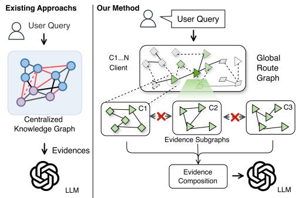
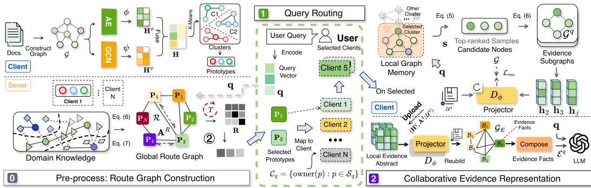
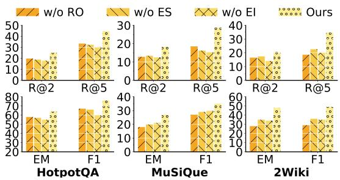
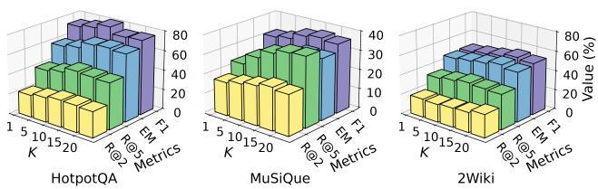
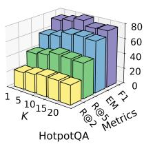
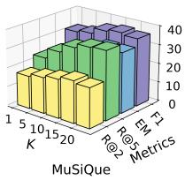
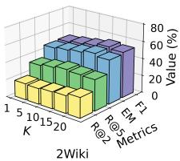
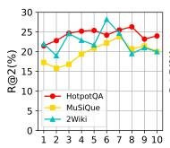
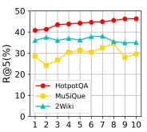
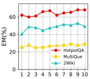

# FEDERATED GRAPH RETRIEVAL-AUGMENTED GENER-ATION

Xiaobao Wang1 Renda Han1 Zhiliang Xia1 Meng Liu2 Renxiang Guan3 Di Jin1∗

1College of Intelligence and Computing, Tianjin University, Tianjin, China

2Henan University, Zhengzhou, China

3National University of Defense Technology, Changsha, China

{wangxiaobao,rendah,xiazhiliang,jindi}@tju.edu.cn

## ABSTRACT

Graph Retrieval-Augmented Generation (GraphRAG) leverages centralized knowl edge graphs to enhance large language models with structured knowledge retrieval. However, real-world knowledge is inherently distributed across multiple organizations rather than being centrally accessible. Privacy constraints further prohibit sharing entire local knowledge graphs, preventing GraphRAG from effectively retrieving and utilizing distributed knowledge. To this end, we propose Federated GraphRAG (FedGRAG), a unified framework for distributed graph retrieval and knowledge-enhanced generation over multiple clients with knowledge graphs. Specifically, we address two fundamental challenges in federated GraphRAG. First, the absence of a global knowledge graph makes unified retrieval impossible. To address this, we develop a Federated Knowledge Routing mechanism that efficiently identifies relevant clients through lightweight knowledge indices without exposing local graph structures. Second, local graph memory cannot be shared directly because it contains sensitive entities and knowledge information. We therefore propose a controlled-disclosure evidence construction method. It extracts retrieved evidence subgraphs and converts them into an evidence abstract, enabling evidence conversion and reconstruction on the server. Extensive experiments demonstrate that Federated GraphRAG consistently outperforms existing baselines in both retrieval and downstream generation tasks, establishing a new paradigm for deploying GraphRAG in federated environments.

## 1 INTRODUCTION

Graph Retrieval-Augmented Generation (GraphRAG) (Peng et al., 2025; Hu et al., 2025; Procko & Ochoa, 2024) has recently emerged as a promising paradigm for improving Large Language Models (LLMs) (Chang et al., 2024) by incorporating graph-structured knowledge (Liang et al., 2023; Liu et al., 2025c;d; Liang et al., 2025) into the retrieval process. Representative GraphRAG systems, such as Microsoft’s GraphRAG (Han et al., 2024), HyperGraphRAG (Luo et al., 2026a), and LightRAG (Guo et al., 2024), organize knowledge into graph-structured representations to enable graph retrieval, multi-hop reasoning, and knowledge-enhanced generation.

Despite their success, existing GraphRAG methods fundamentally rely on a centralized graph repository. This assumes that graph-structured knowledge can be globally constructed, indexed, and retrieved from a unified location. However, in many real-world applications, graph knowledge is inherently distributed across multiple organizations and cannot be centralized due to privacy and ownership (Liu et al., 2025b;a; Han et al., 2026; 2025; Liu et al., 2026b). This motivates the develop ment of RAG methods for distributed settings. Recent Federated Retrieval-Augmented Generation (FedRAG) methods, such as (Guerraoui et al., 2025; Addison et al., 2024; Zhao, 2024) alleviate this limitation by enabling collaborative retrieval over distributed knowledge repositories Liao et al. (2025); Fu & King (2023). Nevertheless, They are primarily designed for vector-based retrieval and cannot be directly extended to GraphRAG. Unlike vector representations, graph memories contain rich structural semantics, and effective collaborative retrieval requires not only identifying relevant knowledge sources but also extracting the semantic relationships among distributed graph memories. First, without graph-structured knowledge at local clients, conventional RAG relies mainly on isolated textual retrieval, making it difficult to capture explicit entity relations and multi-hop dependencies. As a result, complex queries often require repeated retrieval over fragmented evidence, increasing retrieval cost while limiting the construction of coherent reasoning paths.

Based on the above analysis, we need to design a federated GraphRAG method that supports evidence retrieval augmentation on graphs and collaborative reasoning across distributed clients simultaneously. Inspired by federated graph learning (Liu et al., 2025b), which enables collaborative optimization over graphs distributed across clients, an intuitive approach is for the server to provide a guidance signal to select the correct client for queries. However, this faces the following challenges: First, the absence of a globally accessible graph makes it difficult to identify relevant and complementary knowledge across clients, forcing queries to search distributed clients individually and introducing substantial retrieval latency and computational overhead. Second, locally retrieved subgraphs contain potentially sensitive entities, relations, and structural information, yet restricting their exchange may obscure the dependencies needed for crossclient reasoning. Evidence integration therefore entails a fundamental tension between preserving query-relevant semantics and relational context and limiting the disclosure of local knowledge.

To solve these limitations, we propose Federated GraphRAG (FedGRAG), the first unified framework for distributed graph retrieval and knowledgeenhanced generation over multiple clients. Specifically, we first introduce a Federated Knowledge Routing mechanism that constructs lightweight clientlevel knowledge indices to efficiently route queries toward the most relevant clients without exposing local entire knowledge graphs. We further propose an evidence abstraction strategy that transforms locally retrieved subgraphs into limited exposure evidence representations, enabling collaborative knowledge utilization while preventing direct leakage of entire graph knowledge. Extensive experiments demonstrate that Federated GraphRAG consistently outperforms existing baselines on both retrieval and downstream generation tasks, establishing a practical paradigm for deploying GraphRAG in federated environments. In summary, our contribution can be listed as:

  
Figure 1: Motivation of Federated GraphRAG. Existing GraphRAG relies on centralized graph memories, while directly extending Federated RAG fails to capture semantic relationships among distributed graph memories.

• New Perspective. To the best of our knowledge, this is the first work to investigate a federated GraphRAG paradigm, extending GraphRAG from centralized knowledge repositories to distributed environments under privacy and knowledge ownership constraints.

• Unified Framework. We propose a unified Federated GraphRAG framework that enables collaborative retrieval-augmented generation over distributed graph-structured knowledge through federated knowledge routing and collaborative evidence abstraction.

• Superior Performance. Extensive experiments on multiple benchmarks demonstrate that Federated GraphRAG consistently outperforms representative GraphRAG baselines.

## 2 RELATED WORK

## 2.1 GRAPH RETRIEVAL-AUGMENTED GENERATION

Retrieval-Augmented Generation (RAG) (Gao et al., 2023; Han et al., 2024) enhances LLMs by retrieving external knowledge to improve factual accuracy and reasoning capability. Recently, GraphRAG has emerged as a promising extension of RAG by organizing retrieved knowledge into graph-structured memories. Representative methods include Microsoft’s GraphRAG (Edge et al., 2024), which constructs entity-community graphs to facilitate hierarchical retrieval and global reason ing. Similarly, LightRAG (Guo et al., 2025) improves retrieval efficiency through lightweight graph indexing. Moreover, HippoRAG (Gutierrez et al., 2024) models long-range semantic associations´ via graph-based memory organization. SubgraphRAG (Li et al., 2025) instead retrieves compact query-relevant subgraphs through lightweight triple scoring and structural-distance modeling, balancing retrieval efficiency with graph reasoning capability. More recently, HippoRAG2 (Gutierrez´ et al., 2025) extends graph-based memory toward non-parametric continual learning over newly acquired knowledge. HyperGraphRAG (Luo et al., 2026a) further generalizes conventional pairwise graph relations to hypergraph structures, representing higher-order n-ary relationships through hyperedges for more expressive knowledge retrieval and generation. GFM-RAG (Luo et al., 2026b) introduces a graph foundation model trained over large-scale heterogeneous knowledge graphs, enabling transferable graph-aware retrieval on unseen datasets without task-specific fine-tuning.

## 2.2 FEDERATED RETRIEVAL-AUGMENTED GENERATION

Recent studies have extended RAG to federated settings (Liu et al., 2025b; 2026a; Han et al., 2025; 2026), enabling LLM to leverage distributed knowledge. Federated RAG allows each client to maintain its own knowledge repository and performs collaborative retrieval under the coordination of a central server (Chakraborty et al., 2025). Current FedRAG approaches can be broadly categorized into two directions. Routing-based methods aim to reduce communication overhead by selecting only a subset of relevant clients for each query. Representative examples include RAGRoute (Guerraoui et al., 2025), which learns lightweight routing policies for efficient federated search, and FedE4RAG (Mao et al., 2025), which systematically investigates the effectiveness of different client selection strategies under distributed retrieval settings. Privacy-oriented methods focus on protecting sensitive knowledge during retrieval. Representative frameworks include C-FedRAG (Addison et al., 2024), and FRAG (Zhao, 2024) which improve retrieval security without exposing local knowledge bases.

## 3 METHODOLOGY

In this section, we present Federated GraphRAG (FedGRAG) in detail, a unified framework for retrieval and knowledge-enhanced generation on distributed knowledge graphs. The core idea is construct semantic cluster routing for different client on the server; routing queries to the clients, which identify and extract evidentiary subgraphs, and the results are then globally integrated to generate the final retrieval output. FedGRAG consists of three components: (1) federated knowledge routing (2) client evidence representation and (3) collaborative generation. The architecture of FedGRAG is shown in Fig. 2, and its pseudocode appears in Appendix A.

## 3.1 NOTATION

We consider a federated GraphRAG system consisting of a central server and M distributed clients. Each client owns a private document corpus D, where the local corpora is generally non-IID. Each client utilize D constructs a knowledge graph $\mathcal { G } = ( \nu , \mathcal { E } , \mathbf { X } )$ , where $\bar { \nu } , \varepsilon ,$ , and X denote the node set, edge set, and node attribute matrix, respectively.

## 3.2 FEDERATED KNOWLEDGE ROUTING

In this section, because knowledge in federated environments is inherently distributed across multiple clients, the server has no prior knowledge of which client contains the information required to answer a given query. Therefore, we propose a knowledge routing mechanism that organizes distributed client knowledge into a unified routing space. The key idea is to represent each client using a set of knowledge prototypes, where each prototype characterizes one representative semantic region covered by the local graph memory. These prototypes are then organized into a global routing space, enabling efficient query routing without exposing local graph memories.

Knowledge Prototype Learning In this stage, our goal is to capture the representative local knowledge area for domain knowledge prototype generation. Specifically, for each client, we first learn the node attribute and graph structure representation, $\mathbf { H } ^ { \psi }$ and $\mathbf { H } ^ { \phi }$ by a dual encoder $\psi$ and $\phi$ as

$$
\mathbf { H } ^ { \psi } = \psi ( \mathbf { X } ) , \quad \mathbf { H } ^ { \phi } = \phi ( \mathbf { A } , \mathbf { X } ) .\tag{1}
$$

To jointly exploit semantic attributes and graph topology, we fuse the two representations into a unified node embedding, as $\mathbf { H } = \mathrm { M L P } ( \mathbf { \breve { H } } ^ { \boldsymbol { \hat { \psi } } } \| \mathbf { H } ^ { \boldsymbol { \phi } } )$ , where ∥ denotes feature concatenation and

MLP projects the fused representation into a unified latent space. Since local graph memories usually contain multiple semantic regions, we partition the fused node embedding space into K semantic groups using K-means clustering, where each cluster represents a coherent semantic region, collectively providing a compact yet expressive characterization of the client’s knowledge space. The knowledge prototype of each semantic region is then defined as the centroid of the corresponding cluster, $\begin{array} { r } { \mathbf { p } ^ { \mathbf { \acute { k } } } = \frac { 1 } { | \mathcal { C } _ { k } | } \mathbf { \bar { \sum } _ { h _ { j } \in \mathcal { C } _ { k } } h } _ { j } } \end{array}$ , where $\vert \mathcal { C } _ { k } \vert$ denotes the number of nodes assigned to the k-th cluster. Collecting all cluster centroids yields the prototype matrix P, as $\mathbf { P } = [ \mathbf { p } ^ { 1 } , \mathbf { p } ^ { 2 } , \ldots , \mathbf { p } ^ { K } ]$ . The learned knowledge prototypes explicitly preserve multiple semantic regions contained in each local graph memory. Consequently, heterogeneous client knowledge can be represented in a unified semantic space while maintaining sufficient semantic granularity for query routing.

Global Knowledge Routing Space After the local client prototypes are uploaded to the server. The server aims to utilize these prototypes to build a routing graph, which serves as a semantic index of the entire federated system. In detail, the global routing graph is defined as $\mathcal { R } = ( \mathcal { V } ^ { r } , \mathcal { E } ^ { r } , \mathbf { X } ^ { r } )$ where $\mathcal { V } ^ { r }$ and ${ \mathcal { E } } ^ { r }$ denote the set of nodes and the set of edges, respectively, and $\mathbf { X } ^ { r }$ denotes the matrix of features of the nodes. Each routing node corresponds to one knowledge prototype generated by a client, as $\mathcal { V } ^ { r } = \{ v _ { i } ^ { k } \ | \ i = 1 , \ldots , \tilde { M , } \ k = 1 , \ldots , \tilde { K } \}$ where $v _ { i } ^ { k }$ denotes the k-th knowledge prototype of client i, whose initial node feature is given by $\dot { \mathbf { x } } _ { i } ^ { k } = \mathbf { p } _ { i } ^ { k }$ . To describe the semantic relationships among distributed knowledge prototypes, we compute the pairwise prototype similarity and connect each prototype with to its top-L most relevant prototypes (KNN algorithm Bo et al. (2020)), as

$$
a _ { i j } ^ { k l } = \sin \left( \mathbf { p } _ { i } ^ { k } , \mathbf { p } _ { j } ^ { l } \right) , \quad { \mathcal { E } } ^ { r } = \left\{ \left( v _ { i } ^ { k } , v _ { j } ^ { l } \right) \mid v _ { j } ^ { l } \in \mathrm { T o p L } \left( a _ { i j } ^ { k l } \right) \right\} .\tag{2}
$$

where sim(·) denotes cosine similarity. The corresponding weighted adjacency matrix is defined as

$$
\mathbf { A } _ { ( i , k ) , ( j , l ) } ^ { r } = \left\{ \begin{array} { l l } { a _ { i j } ^ { k l } , } & { \left( v _ { i } ^ { k } , v _ { j } ^ { l } \right) \in \mathcal { E } ^ { r } , } \\ { 0 , } & { \mathrm { o t h e r w i s e } . } \end{array} \right.\tag{3}
$$

The route graph R transforms isolated client prototypes into a semantic structure connected globally across distributed knowledge regions without accessing local private graph data. This routing space significantly reduces communication cost while establishing a unified semantic foundation for subsequent query routing.

Prototype-driven Query Routing. For user query $q ,$ the server first encodes it into a query representation q using the same encoder as the client. An initial relevance score is computed between the query and each client prototype, as $\mathbf { r } = \sin ( \mathbf { q } , \mathbf { P } _ { i } )$ . We select the L prototypes most relevant to the query as the starting nodes for relevance propagation. Subsequently, we propagate query relevance on the routing graph over semantically correlated clients. The initial relevance scores are regarded as node features R on the routing graph, as $\mathbf { R } = [ \mathbf { r } _ { 1 } , \cdots , \mathbf { r } _ { M } ] ^ { \top }$ , and graph propagation is performed as

$$
\mathbf { R } ^ { ( t + 1 ) } = \alpha \mathbf { R } ^ { ( 0 ) } ( \theta _ { x } ) + ( 1 - \alpha ) \tilde { \mathbf { A } } ^ { R } ( \theta _ { e } ) \mathbf { R } ^ { ( t ) } .\tag{4}
$$

where $\theta _ { x }$ and $\theta _ { e }$ are learnable parameters. The propagated relevance scores capture not only the direct similarity between the query and individual clients, but also the semantic dependencies between neighboring knowledge regions. Consequently, clients that are semantically complementary to the query can also receive high routing scores through graph propagation. After T propagation steps, the routing score of client i is defined by its highest-scoring prototype: $\begin{array} { r } { s _ { i } ( q ) = \operatorname* { m a x } _ { k = \{ 1 , \dots , K \} } r _ { i , k } ^ { ( T ) } . } \end{array}$ The server selects the B clients with the highest scores: $\mathcal { C } _ { q } = \mathrm { T o p B } _ { i \in \{ 1 , . . . , M \} } s _ { i } ( q )$

## 3.3 CLIENT EVIDENCE REPRESENTATION

After client routing, the objective of this stage is to construct a unified evidence representation from the retrieved knowledge distributed across multiple selected clients. Each client first extracts a query-relevant evidence subgraph from its local graph memory and map the subgraph into evidence representation that captures both semantic information and structural dependencies. The server then collaboratively integrates them from different clients to form a global evidence affects, which serves as the knowledge context for the subsequent generation module.

Local Graph Retrieval After receiving the query, each selected client constructs a query-relevant evidence subgraph from its local graph memory. We first compute the semantic relevance between q and each local entity $\mathbf { h } _ { v }$ . Then the $\mathrm { T o p } { - } N _ { s }$ most relevant entities are selected as seed, as

$$
s _ { i } ( v \mid q ) = \sin ( \mathbf { q } , \mathbf { h } _ { v } ) . \quad S ^ { q } = \mathrm { T o p N } _ { \mathbf { s } _ { v } \in \mathcal { V } } s _ { i } ( v \mid q ) .\tag{5}
$$

  
Figure 2: The architecture of FedGRAG. This process consists of a pre-process and a query phase. During the pre-process phase, the client and server perform collaborative training to extract lowdimensional graph embeddings; the client then uploads prototypes to the server to construct a prototype graph. In the query phase, the server routes the query to the appropriate semantic cluster on the client. Subsequently, an evidence subgraph is constructed within the cluster, and the server aggregates these reconstructed evidence facts to generate retrieval results.

Starting from these seed entities, we expand the neighborhood a H-hop over its local graph. The resulting candidate node set is defined as $\begin{array} { r } { \mathcal { V } ^ { q } = \bigcup _ { v \in \mathcal { S } ^ { q } } \mathcal { N } _ { \le H } ( v ) } \end{array}$ , where $\mathcal { N } _ { \leq H } ( v )$ denotes the set of entities reachable from v within at most H hops. The corresponding evidence subgraph is then constructed as

$$
\mathcal { G } ^ { q } = \left( \mathcal { V } ^ { q } , \mathcal { E } ^ { q } \right) , \mathcal { E } ^ { q } = \left\{ \left( u , r , v \right) \in \mathcal { E } _ { i } \mid u , v \in \mathcal { V } ^ { q } \right\} .\tag{6}
$$

To prevent irrelevant neighborhood expansion, we retain at most $N _ { r }$ edges with the highest query relevance scores. The resulting subgraph $\mathcal { G } ^ { q }$ is kept locally and is subsequently projected into a compact evidence representation for collaboration.

Local Evidence Abstraction. To support cross-client evidence composition while restricting the disclosure scope, we introduce query-conditioned evidence encoding and reconstruction. For the retrieved evidence subgraph $\mathcal { G } ^ { q }$ , we first construct a query-specific vocabulary $\mathcal { U } ^ { q }$ containing the tokens that appear in its entity and relation attributes. The original attributes are then converted into discrete token sequences according to $\mathcal { U } ^ { q }$ and mapped into continuous attribute embeddings.

We utilize representation $\mathbf { H } ^ { q } = \mathbf { H } [ \mathcal { V } ^ { q } , : ]$ to define query-conditioned evidence package as $\mathcal { P } ^ { q } =$ $( \mathbf { H } ^ { q } , \mathbf { A } ^ { q } , \mathcal { U } ^ { q } )$ . The source documents and the remaining local knowledge graph are retained by the client. On the server, a shared evidence decoder $D _ { \phi }$ inverse mapping from the latent representation to the corresponding entity and relation attributes: $( \hat { \bf X } ^ { q } , \hat { \bf T } ^ { q } ) = \mathrm { D e c o d e } _ { { \mathcal U } ^ { q } } [ D _ { \phi } ( { \bf H } ^ { q } , { \bf A } ^ { q } ) ]$ , where ${ \hat { \mathbf { X } } } ^ { q }$ and ${ \hat { \mathbf { R } } } ^ { q }$ denote the reconstructed entity and relation attributes, respectively. Combining the reconstructed attributes with the disclosed adjacency structure yields the reconstructed evidence subgraph $\hat { \mathcal { G } } ^ { q }$ The reconstructed subgraph is later converted into a set of facts from the evidence ${ \widehat { B } } ^ { q }$ for the composition of the evidence between clients. The encoder and decoder are trained by minimizing the reconstruction loss over the vocabulary-encoded entity and relation attributes:

$$
\mathcal { L } _ { \mathrm { r e c } } = \mathrm { C E } ( \hat { \mathbf { X } } ^ { q } , \mathbf { X } ^ { q } ) + \mathrm { C E } ( \hat { \mathbf { T } } ^ { q } , \mathbf { T } ^ { q } ) ,\tag{7}
$$

where CE(·) denotes the token-level reconstruct loss.

Collaborative Evidence Composition. The server reconstructs evidence facts $\hat { B }$ using the shared decoder and aggregates them as $\begin{array} { r } { \hat { B } ^ { q } = \bigcup _ { i \in \mathcal { C } _ { a } } \hat { B } _ { i } ^ { q } } \end{array}$ . To connect evidence across clients, we construct an evidence interaction graph $\mathcal G _ { E } ^ { q } = ( \hat { B } ^ { q } , \mathcal A _ { E } ^ { q } )$ , where nodes represent reconstructed facts and edges capture potential reasoning dependencies. Starting from facts with high semantic similarity to the query, the server traverses graph edges to collect connected supporting facts across clients. The resulting evidence paths are serialized into a textual context $\mathcal { E } ^ { q }$ in traversal order, with repeated facts removed and client-level provenance retained. Finally, an external LLM generates the answer from the query and composed evidence:

$$
\boldsymbol { \hat { y } } = \mathrm { L L M } \left( \mathrm { P r o m p t } ( \boldsymbol { q } , \mathcal { E } ^ { q } ) \right) .\tag{8}
$$

## 3.4 JOINT OPTIMIZATION OBJECTIVE

We optimize the routing module and local evidence encoders using two complementary objectives.

Routing Loss (Server). For a query q, the routing module produces a relevance score $R ^ { q }$ for each of the $M \times K$ clusters. We adopt a pairwise ranking loss to encourage positive clusters to receive higher scores than negative clusters:

$$
\mathcal { L } _ { \mathrm { r o u t e } } = \sum _ { i \in \mathcal { C } _ { q } ^ { + } } \sum _ { j \in \mathcal { C } _ { q } ^ { - } } \operatorname* { m a x } ( 0 , \gamma - s _ { i } ( q ) + s _ { j } ( q ) ) ,\tag{9}
$$

where $\gamma$ is a hyperparameter. $\mathcal { C } _ { q } ^ { + }$ and $\mathcal { C } _ { q } ^ { - }$ denote the positive and negative cluster sets of clients.

Global Evidence-Answer Alignment. We design a global evidence-answer alignment objective. For each training pair $( q , y )$ , the evidence interaction graph decoder $D _ { \phi }$ produces the global reconstructed node attribute $\hat { \mathbf { X } } _ { g } ^ { q }$ . We obtain a fixed semantic target from the reference answer:

$$
\begin{array} { r } { \mathbf { a } _ { y } = \mathrm { E n c } _ { \mathrm { f i x e d } } ( y ) , \qquad \hat { \mathbf { X } } _ { g } ^ { q } = D _ { \phi } ( \mathbf { H } _ { g } ^ { q } ) , } \end{array}\tag{10}
$$

where $\operatorname { E n c } _ { \mathrm { f i x e d } }$ is a frozen text encoder. We encourage the global evidence representation to align with the correct answer while distinguishing it from negative answers:

$$
\begin{array} { r } { \mathcal { L } _ { \mathrm { g } } ( q , y ) = - \log \frac { \exp ( \sin ( \hat { \bf x } _ { g } ^ { q } , { \bf a } _ { y } ) / \gamma ) } { \exp ( \sin ( \hat { \bf x } _ { g } ^ { q } , { \bf a } _ { y } ) / \gamma ) + \sum _ { y ^ { - } \in \mathcal { Y } _ { q } ^ { - } } \exp ( \sin ( \hat { \bf x } _ { g } ^ { q } , { \bf a } _ { y ^ { - } } ) / \gamma ) } , } \end{array}\tag{11}
$$

where $\mathcal { V } _ { q } ^ { - }$ contains negative answers sampled from other training examples. Known equivalent answers and other valid answers to q are excluded from the negative set. This objective optimizes $D _ { \phi }$ , encouraging the composed evidence to retain information predictive of the target answer.

Local Evidence Alignment. Each selected client retrieves local evidence subgraphs $\mathcal { G } ^ { q }$ and their representation ${ \bf E } ^ { q }$ . To preserve query-relevant semantics, we define $\mathcal { P } _ { q } \subseteq \mathcal { C } _ { q } \cap \mathcal { C } _ { q } ^ { + }$ , where $\mathcal { C } _ { q } ^ { + }$ contains clients whose retrieved subgraphs provide positive evidence. we align positive evidence with $\mathbf { q }$ . The local alignment loss is as

$$
\mathcal { L } _ { 1 } = - \sum _ { i \in \mathcal { P } _ { q } } \log \frac { \exp ( \sin ( \mathbf { h } _ { i } ^ { q } , \mathbf { q } ) / \gamma ) } { \exp ( \sin ( \mathbf { h } _ { i } ^ { q } , \mathbf { q } ) / \gamma ) + \sum _ { \mathbf { h } ^ { - } \in \mathcal { N } _ { q } } \exp ( \sin ( \mathbf { h } ^ { - } , \mathbf { q } ) / \gamma ) } ,\tag{12}
$$

where $\textstyle { \mathcal { N } } _ { q }$ contains evidence representations treated as irrelevant to $q .$ Negative evidence may be sampled from irrelevant clients, with known positive evidence for q excluded.

Overall Objective. The server and clients are trained with the following objective:

$$
\mathcal { L } _ { s } = \mathcal { L } _ { g } + \mathcal { L } _ { r o u t e } \quad \mathcal { L } _ { c } = \frac { 1 } { | \mathcal { D } | } \sum _ { ( q , y ) \in \mathcal { D } } \lambda _ { l } \mathcal { L } _ { 1 } + \mathcal { L } _ { r e c } .\tag{13}
$$

The routing loss improves client relevance estimation, while the local alignment loss encourages local evidence representations to preserve query-relevant semantics.

## 3.5 EFFICIENCY ANALYSIS

The global routing graph contains $P = M \times K$ prototype nodes. Graph construction requires $\mathcal { O } ( P ^ { 2 } d )$ operations by computing all pairwise prototype similarities. After connecting each prototype to its top-L neighbors, the routing graph contains approximately $\mathcal { O } ( P L )$ edges. For each query, initial query-prototype matching requires $\mathcal { O } ( P d )$ operations, while T rounds of graph-based relevance propagation require approximately $\mathcal { O } ( T P L )$ operations. After selecting B clients, constructing the evidence interaction graph requires $\mathcal { O } ( B ^ { 2 } d )$ operations. Accordingly, the online computational complexity can be summarized as $\mathcal { O } ( M K d + \dot { T } \dot { M } K L + B ^ { 2 } d )$

## 4 EXPERIMENTS

## 4.1 EXPERIMENTAL SETUP

Benchmark Datasets. To comprehensively evaluate FedGRAG, we conduct experiments on multiple widely used GraphRAG benchmarks, including HotpotQA, MuSiQue, and 2Wiki, aligning with

<table><tr><td rowspan="2">Models</td><td colspan="4">HotpotQA</td><td colspan="3">MuSiQue</td><td colspan="4">2Wiki</td></tr><tr><td colspan="10">5 Clients</td></tr><tr><td>GraphRAG LightRAG HippoRAG SubgraphRAG HippoRAG2</td><td>R@2 10.9 12.3 9.6 15.0 15.3</td><td>R@5 13.4 17.7 21.0 19.1 16.1</td><td>EM 39.1 37.8 28.7 26.7 21.3</td><td>F1 51.2 40.5 31.1 30.3</td><td>R@2 8.9 11.9 12.3 7.0</td><td>R@5 14.7 12.2 13.1 16.2</td><td>EM F1 13.1 21.9 18.5 24.1 20.2 23.1 25.7</td><td>R@2 17.1 13.2 22.6 12.9 14.4</td><td>R@5 20.6 19.0 22.4 18.6</td><td>EM 31.0 22.3 33.9 25.0</td><td>F1 34.7 23.9 37.3 38.2</td></tr><tr><td>HyperGRAG GFM-RAG FRAG FedE4RAG C-FedRAG</td><td>18.9 22.4 21.8 13.5</td><td>29.8 38.9 32.6 19.7 24.8</td><td>43.0 57.2 55.5 24.6 38.2</td><td>28.7 50.1 69.1 59.1 38.8</td><td>10.4 9.6 16.1 14.5 10.0</td><td>15.6 16.4 25.3 20.0 17.3</td><td>18.1 18.5 24.0 22.3 24.7</td><td>23.3 21.3 31.2 25.6 29.6</td><td>15.8 12.6 18.4 11.9 14.6</td><td>16.0 34.6 15.1 31.4 29.8 43.6 14.8 28.3 18.4 32.1</td><td>35.2 34.3 45.9 31.6 36.9</td></tr><tr><td>FedMosaic Ours</td><td>17.0 22.0 25.1</td><td>36.9 44.7</td><td>57.8 64.0</td><td>47.9 66.5 76.4</td><td>12.7 15.7 18.2 10 Clients</td><td>15.3 23.4 28.7</td><td>21.8 24.1 26.6</td><td>23.4 30.6 34.2</td><td>15.3 17.8 20.5</td><td>17.2 22.1 28.3 42.6 34.6 48.3</td><td>28.4 46.5 49.2</td></tr><tr><td colspan="10"></td></tr><tr><td>GraphRAG LightRAG HippoRAG SubgraphRAG HippoRAG2 HyperGRAG</td><td>13.1 9.1 13.8 10.5 12.7 11.8</td><td>23.0 11.2 19.5 13.3 21.9 15.0</td><td>30.0 25.9 21.5 18.9 26.4 33.7</td><td>41.5 30.7 28.7 21.0 27.7 38.1</td><td>12.5 11.7 9.6 8.8 10.9 9.7</td><td>15.4 12.5 13.5 13.2 12.6 15.2</td><td>18.3 13.1 17.4 22.7 21.7 18.3</td><td>26.2 25.9 18.0 24.9 24.5 22.9</td><td>5.9 7.4 9.0 9.7 8.5 10.4</td><td>13.6 38.8 11.2 29.1 13.5 31.1 12.4 27.6 11.2 33.1 16.7 34.4</td><td>41.6 33.8 36.7 28.5 38.0 42.5</td></tr><tr><td>GFM-RAG FRAG FedE4RAG C-FedRAG FedMosaic</td><td>16.8 16.4 15.9 6.3</td><td>27.4 19.2 23.0 13.2 27.3</td><td>41.2 29.8 27.5 24.4</td><td>46.8 34.0 33.4 31.5</td><td>12.9 7.5 9.7 6.5</td><td>20.1 10.4 9.9 14.8</td><td>22.8 17.6 21.2 17.9</td><td>29.4 19.3 24.2 22.3</td><td>10.1 7.6 8.5 9.2 10.4</td><td>15.7 13.8 9.4 16.9</td><td>44.6 46.3 26.1 30.5 28.6 29.0 37.4 41.3</td></tr><tr><td>Ours</td><td>17.1 19.4</td><td>31.7</td><td>40.9 46.8</td><td>47.6 52.5</td><td>12.8 14.7 20 Clients</td><td>20.7 23.9</td><td>23.6 25.5</td><td>29.8 33.0 11.8</td><td>16.1 18.4</td><td>43.8 50.3</td><td>48.1 51.2</td></tr><tr><td colspan="10"></td></tr><tr><td>GraphRAG LightRAG HippoRAG SubgraphRAG HippoRAG2</td><td>11.8 8.7 7.9 12.3 11.8</td><td>19.4 9.1 11.2 16.9 14.0</td><td>28.5 27.0 22.8 31.8 19.6</td><td>41.8 30.6 29.0 36.7 23.7</td><td>3.5 8.8 7.1</td><td>6.0 14.3 OOM OOM</td><td>27.0 22.1</td><td>28.1 27.8</td><td>3.1 8.2 4.5 8.5</td><td>11.6 10.7 OOM OOM 13.1</td><td>24.3 17.5</td></tr><tr><td>HyperGRAG GFM-RAG FRAG FedE4RAG</td><td>13.5 14.9 13.5 10.6</td><td>18.9 23.8 18.8 18.7</td><td>23.5 39.5 32.6 24.4</td><td>31.0 47.6 34.9 37.5</td><td>6.9 10.7 8.7 9.5</td><td>12.2 17.2 15.4 12.5 13.8</td><td>28.3 32.3 36.2 33.4 31.2</td><td>34.6 35.8 36.9 34.8 33.1</td><td>7.2 7.1 8.0 6.7</td><td>00M 10.6 15.8 11.0 15.3 9.4 14.0</td><td>19.0 46.4 26.7 17.9</td></tr><tr><td>C-FedRAG FedMosaic Ours</td><td>13.6 15.3 17.4</td><td>17.2 23.6 27.5</td><td>23.1 38.7 44.2</td><td>40.6 47.2 53.9</td><td>9.4 10.8 12.4</td><td>15.2 16.2 17.9</td><td>29.9 35.7 40.6</td><td>31.0 38.8 40.6</td><td>7.7 11.3 7.4 11.6 8.3 12.4</td><td>12.4 16.4 17.9</td><td>15.8 24.2 51.1</td></tr></table>

Table 1: Performance comparison with different state-of-the-art GraphRAG methods on three datasets.

GFM-RAG. Since they are designed for centralized settings, we construct federated scenarios by partitioning the original graph knowledge into multiple clients while preserving realistic knowledge heterogeneity to simulate practical distributed environments. (Please see Appendix B.1 for details.)

Baseline Methods. We compare FedGRAG with representative baselines from three categories. (1) centralized GraphRAG methods, including GraphRAG (MS) (Edge et al., 2024), LightRAG (Guo et al., 2025), HippoRAG (Gutierrez et al., 2024), SubgraphRAG (Li et al., 2025), HyperGraphRAG´ (Luo et al., 2026a) HippoRAG2 (Gutierrez et al., 2025), GFM-RAG Luo et al. (2026b). (2) Federated´ RAG methods, including FRAG Zhao (2024), FedE4RAG Mao et al. (2025), C-FedRAG Addison et al. (2024), FedMosaic Liang et al. (2026) which perform retrieval over distributed knowledge sources. (Please see Appendix B.2 for details.)

Evaluation Metrics. We evaluate the FedGRAG from three complementary perspectives. For retrieval quality, we adopt Recall@2 (R@2) and Recall@5 (R@5) to measure the effectiveness of retrieving relevant graph knowledge. For downstream generation, we report Exact Match (EM) and F1 scores to evaluate the correctness and semantic overlap between the generated answers and the ground-truth responses. (Please see Appendix B.3 for details.)

Implementation Details. All experiments are implemented using PyTorch 2.4.0 and conducted on a server equipped with NVIDIA 4090D GPUs. All methods share the same LLM, graph retrieval pipeline, and retrieval configuration. The federated setting adopts the same client partition strategy across all methods, and hyperparameters are selected based on the validation set to ensure a fair and reproducible evaluation. (Please see Appendix B.4 for details.)

## 4.2 COMPARISON EXPERIMENTS

Table 1 reports the overall performance comparison. 1) Compared with federated GraphRAG methods, FedGRAG consistently achieves superior performance across all datasets. Although these methods are adapted to the federated setting, they perform retrieval independently within selected clients and lack explicit modeling of semantic dependencies among distributed graph memories. In contrast, FedGRAG constructs a global semantic routing graph over client prototypes, enabling more accurate client selection and more comprehensive cross-client knowledge discovery. 2) Compared with federated RAG methods, FedGRAG further improves both retrieval and generation performance. Existing federated RAG methods retrieve textual evidence from distributed clients without exploiting graph structures or semantic relationships among clients. By leveraging graph-structured knowledge and collaborative evidence composition, FedGRAG effectively captures complementary evidence from multiple clients, leading to more informative context for answer generation.

3) Compared with the GFM-based GraphRAG method, FedGRAG also achieves consistent improvements. Although GFM-based RAG enhances graph representation through graph foundation models, it mainly focuses on improving local graph representations and does not explicitly model semantic collaboration across distributed clients. Our semantic routing graph and collaborative evidence composition enable effective cross-client knowledge integration, resulting in higher retrieval accuracy and better downstream generation performance.

  
Figure 3: Model performance of FedGRAG and its three variants.

## 4.3 ABLATION STUDY

Module Ablation. To examine the contribution of the proposed components, we evaluate three variants of FedGRAG: (1) w/o RO, which remove route module; (2) w/o ES, which replaces evidence subgraph retrieval with direct similarity-based text retrieval; and (3) w/o EI, which removes the global evidence interaction graph and directly concatenates the retrieved evidence as input to the

Table 2: Client routing performance on three multi-hop QA datasets (%) under 10 clients.
<table><tr><td>Dataset</td><td>Method</td><td>R@2</td><td>Hit@2</td><td>R@5</td><td>Hit@5</td></tr><tr><td rowspan="3">HotpotQA</td><td>Random Routing</td><td>7.2</td><td>31.6</td><td>9.4</td><td>34.0</td></tr><tr><td>Direct Matching</td><td>8.5</td><td>42.4</td><td>12.3</td><td>46.2</td></tr><tr><td>Ours</td><td>19.4</td><td>66.7</td><td>31.7</td><td>71.4</td></tr><tr><td rowspan="3">MuSiQue</td><td>Random Routing</td><td>6.9</td><td>13.2</td><td>12.0</td><td>34.3</td></tr><tr><td>Direct Matching</td><td>8.8</td><td>25.1</td><td>14.6</td><td>42.2</td></tr><tr><td>Ours</td><td>14.7</td><td>68.6</td><td>23.9</td><td>73.2</td></tr><tr><td rowspan="3">2Wiki</td><td>Random Routing</td><td>9.5</td><td>33.4</td><td>11.4</td><td>36.8</td></tr><tr><td>Direct Matching</td><td>7.7</td><td>26.9</td><td>12.6</td><td>34.7</td></tr><tr><td>Ours</td><td>11.8</td><td>45.9</td><td>18.4</td><td>52.3</td></tr></table>

LLM. As shown in Fig. 3, the complete FedGRAG consistently achieves the best performance, while Removing any of the components will result in a decline in model performance. These results support the complementary roles of the proposed components in distributed knowledge retrieval and reasoning. The performance degradation of w/o ES suggests that providing more retrieved text does not necessarily yield more useful evidence: similarity-based retrieval can introduce irrelevant content and overlook structural connections needed for reasoning. Moreover, directly providing raw text increases source-content exposure compared with releasing query-relevant reconstructed facts. Removing the evidence interaction graph (w/o EI) also reduces performance. Direct concatenation leaves cross-client evidence connections implicit, whereas graph-guided composition organizes related facts into connected evidence chains, facilitating multi-hop reasoning across clients.

Routing Strategy Ablation To evaluate whether the federated routing effectively identifies relevant knowledge sources, We compare it with the following strategies, random routing: randomly selects a fixed number of clients for each query, direct routing: represents each client using the mean embedding of its local graph nodes and selects clients according to query-prototype similarity. As shown in Table 2, FedGRAG consistently outperforms both baselines. The improvement over

Random Routing demonstrates the importance of query-aware client selection, while the gain over Direct Routing indicates that modeling inter-client relationships provides additional benefits beyond independent semantic matching, particularly when relevant evidence is distributed across multiple clients.

## 4.4 HYPERPARAMETER SENSITIVITY ANALYSIS

Effect of Prototype Number K. We vary K from 1 to 20 to assess its influence on model performance. As shown in Fig. 4, increasing K initially improves performance because more semantic regions are preserved, leading to finer-grained client routing. However, excessive prototypes introduce redundant semantic partitions and increase routing ambiguity, result-

  
Figure 4: Model performance under varying $K \in [ 1 , 2 0 ]$

ing in marginal performance degradation. Therefore, we choose different settings for each datasets as a trade-off between routing accuracy and communication efficiency.

Effect of Routing Graph Connectivity. We further investigate the neighborhood size L used for constructing the routing graph. A small L results in sparse prototype connections, limiting semantic propagation across clients. Conversely, an excessively large L introduces noisy semantic relations that dilute query relevance. As illustrated in Fig. 5, the best performance is achieved at near $L { = } 6 ,$ , demonstrating that moderate graph

  
Figure 5: Model performance on varying $L \in [ 1$ 10] under three datasets.

connectivity provides the most effective balance between semantic exploration and routing precision.

## 4.5 COMMUNICATION COST AND RUNTIME EFFICIENCY

To evaluate the practical deployment cost of federated graph retrieval, we measure communication overhead and end-to-end inference latency on HotpotQA under varying numbers of clients. As shown in Table 3, our framework consistently achieves lower communication cost and inference latency than both FRAG and C-FedRAG across all evaluated settings. As the number of clients increases, its communication overhead grows approximately linearly, while its runtime advantage over the baselines is maintained. These results demonstrate the efficiency of our framework within the evaluated client range and support its practical applicability to federated retrieval scenarios with limited communication resources and latency requirements.

Table 3: Communication overhead comparison under the HotpotQA datasets. “T” and “C” denote Time (s) and Cost (KB), respectively.
<table><tr><td rowspan="2">Clients</td><td>Ours</td><td>FRAG</td><td colspan="2">C-FedRAG</td></tr><tr><td>T (s) C (KB)</td><td>T (s) C (KB)</td><td>T (s)</td><td>C (KB)</td></tr><tr><td></td><td>24.8 50.3</td><td>130.3 213.0</td><td>37.1</td><td>66.4</td></tr><tr><td></td><td>51.3 100.6</td><td>270.2 256.4</td><td>68.5</td><td>134.9</td></tr><tr><td></td><td>78.6 150.9</td><td>300.4 375.5</td><td>105.3</td><td>201.5</td></tr><tr><td></td><td>110.1 201.1</td><td>418.3 420.3</td><td>137.0</td><td>274.6</td></tr><tr><td>12345</td><td>140.9 256.4</td><td>566.5 458.5</td><td>174.5</td><td>355.3</td></tr></table>

## 5 CONCLUSION

This paper presented FedGRAG, a unified framework for distributed GraphRAG over distributed knowledge graphs. By jointly introducing federated knowledge routing and evidence abstraction, the proposed framework effectively enables collaborative knowledge retrieval and utilization without exposing local knowledge graphs. Compared with existing centralized GraphRAG methods, FedGRAG extends graph retrieval to federated environments while reducing data privacy risks. Extensive experiments demonstrate its superiority in both retrieval quality and generation across diverse federated settings. We believe FedGRAG provides a practical and scalable paradigm for knowledge-enhanced generation over distributed knowledge ecosystems and offers new opportunities for deploying GraphRAG in privacy-sensitive real-world applications.

## AI USE STATEMENT

Generative AI tools were used to assist with language editing, improving the readability of the manuscript, LaTeX formatting, and debugging author-written code. They were not used to develop the proposed methodology, design the experiments, formulate or prove mathematical claims, process the datasets, or interpret the experimental results. All AI-assisted content was carefully reviewed and verified by the authors. The authors take full responsibility for the final content of this work.

## REFERENCES

Parker Addison, Minh-Tuan H Nguyen, Tomislav Medan, Jinali Shah, Mohammad T Manzari, Brendan McElrone, Laksh Lalwani, Aboli More, Smita Sharma, Holger R Roth, et al. C-fedrag: A confidential federated retrieval-augmented generation system. arXiv preprint arXiv:2412.13163, 2024.

Deyu Bo, Xiao Wang, Chuan Shi, Meiqi Zhu, Emiao Lu, and Peng Cui. Structural Deep Clustering Network. In Proceedings ofthe Web Conference 2020, pp. 1400–1410, 2020.

Abhijit Chakraborty, Chahana Dahal, and Vivek Gupta. Federated retrieval-augmented generation: A systematic mapping study. arXiv preprint arXiv:2505.18906, 2025.

Yupeng Chang, Xu Wang, Jindong Wang, Yuan Wu, Linyi Yang, Kaijie Zhu, Hao Chen, Xiaoyuan Yi, Cunxiang Wang, Yidong Wang, et al. A survey on evaluation of large language models. ACM transactions on intelligent systems and technology, 15(3):1–45, 2024.

Darren Edge, Ha Trinh, Newman Cheng, Joshua Bradley, Alex Chao, Apurva Mody, Steven Truitt, Dasha Metropolitansky, Robert Osazuwa Ness, and Jonathan Larson. From local to global: A graph rag approach to query-focused summarization. arXiv preprint arXiv:2404.16130, 2024.

Xinyu Fu and Irwin King. FedHgn: a Federated Framework for Heterogeneous Graph Neural Networks. ArXiv Preprint ArXiv:2305.09729, 2023.

Yunfan Gao, Yun Xiong, Xinyu Gao, Kangxiang Jia, Jinliu Pan, Yuxi Bi, Yi Dai, Jiawei Sun, Meng Wang, and Haofen Wang. Retrieval-augmented generation for large language models: A survey. arXiv preprint arXiv:2312.10997, 2023.

Rachid Guerraoui, Anne-Marie Kermarrec, Diana Petrescu, Rafael Pires, Mathis Randl, and Martijn de Vos. Efficient federated search for retrieval-augmented generation. In Proceedings ofthe 5th Workshop on Machine Learning and Systems, pp. 74–81, 2025.

Zirui Guo, Lianghao Xia, Yanhua Yu, Tian Ao, and Chao Huang. Lightrag: Simple and fast retrieval-augmented generation. arXiv preprint arXiv:2410.05779, 2(3), 2024.

Zirui Guo, Lianghao Xia, Yanhua Yu, Tian Ao, and Chao Huang. Lightrag: Simple and fast retrievalaugmented generation. In Conference on Empirical Methods in Natural Language Processing, pp. 10746–10761, 2025.

Bernal J Gutierrez, Yiheng Shu, Yu Gu, Michihiro Yasunaga, and Yu Su. Hipporag: Neurobiologically´ inspired long-term memory for large language models. Advances in neural information processing systems, 37:59532–59569, 2024.

Bernal Jimenez Guti ´ errez, Yiheng Shu, Weijian Qi, Sizhe Zhou, and Yu Su. From rag to memory:´ Non-parametric continual learning for large language models. arXiv preprint arXiv:2502.14802, 2025.

Haoyu Han, Yu Wang, Harry Shomer, Kai Guo, Jiayuan Ding, Yongjia Lei, Mahantesh Halappanavar, Ryan A Rossi, Subhabrata Mukherjee, Xianfeng Tang, et al. Retrieval-augmented generation with graphs. arXiv preprint arXiv:2501.00309, 2024.

Renda Han, Xinyuan Li, Guangzhen Yao, Mengfei Li, Wenxin Zhang, Ronghao Fu, Zeyu Zhang, and Junlong Wu. Federated Graph-level Clustering Network with Adaptive Knowledge Compensation. Neural Networks, 195:108212–108212, 2025.

Renda Han, Junlong Wu, Wenxuan Tu, Jingxin Liu, Haotian Wang, and Jieren Cheng. Federated Graph-level Clustering Network with Attribute Inference. In Proceedings of the AAAI Conference on Artificial Intelligence, pp. 21585–21593, 2026.

Yuntong Hu, Zhihan Lei, Zheng Zhang, Bo Pan, Chen Ling, and Liang Zhao. Grag: Graph retrievalaugmented generation. In Findings of the association for computational linguistics: NAACL 2025, pp. 4145–4157, 2025.

Mufei Li, Siqi Miao, and Pan Li. Simple is effective: The roles of graphs and large language models in knowledge-graph-based retrieval-augmented generation. In International Conference on Learning Representations, volume 2025, pp. 6061–6089, 2025.

Ke Liang, Yue Liu, Sihang Zhou, Wenxuan Tu, Yi Wen, Xihong Yang, Xiangjun Dong, and Xinwang Liu. Knowledge Graph Contrastive Learning Based on Relation-symmetrical Structure. IEEE Transactions on Knowledge and Data Engineering, 36(1):226–238, 2023.

Ke Liang, Lingyuan Meng, Hao Li, Jun Wang, Long Lan, Miaomiao Li, Xinwang Liu, and Huaimin Wang. From Concrete to Abstract: Multi-View Clustering on Relational Knowledge. IEEE Transactions on Pattern Analysis and Machine Intelligence, 47(10):9043–9060, 2025.

Zhilin Liang, Yuxiang Wang, Zimu Zhou, Hainan Zhang, Boyi Liu, and Yongxin Tong. Fedmosaic: Federated retrieval-augmented generation via parametric adapters. arXiv preprint arXiv:2602.05235, 2026.

Tianchi Liao, Ziyue Xu, Qing Hu, Hong-Ning Dai, Huaiwei Huang, Zibin Zheng, and Chuan Chen. FedBrb: A solution to the Small-to-Large Scenario in Device-Heterogeneity Federated Learning. IEEE Transactions on Mobile Computing, pp. 1–14, 2025.

Jingxin Liu, Jieren Cheng, Renda Han, Wenxuan Tu, Jiaxin Wang, and Xin Peng. Federated Graph-Level Clustering Network. In Proceedings of the AAAI Conference on Artificial Intelligence, number 18, pp. 18870–18878, 2025a.

Jingxin Liu, Renda Han, Wenxuan Tu, Haotian Wang, Junlong Wu, and Jieren Cheng. Federated Node-Level Clustering Network with Cross-Subgraph Link Mending. In International Conference on Machine Learning, pp. 38540–38556, 2025b.

Jingxin Liu, Xiangyan Tang, Renda Han, Wenxuan Tu, and Ruili Wang. Adaptive Feature Boosting and Distribution Refinement for Graph Clustering. Pattern Recognition, pp. 112309, 2025c.

Jingxin Liu, Wenxuan Tu, Renda Han, Junlong Wu, Haotian Wang, Guohui Liu, Xiangyan Tang, and Yue Yang. Personalized Federated Graph-Level Clustering Network. In Proceedings of the AAAI Conference on Artificial Intelligence, pp. 23721–23729, 2026a.

Jingxin Liu, Wenxuan Tu, Haotian Wang, Renda Han, Haoyi Li, Junlong Wu, and Xiangyan Tang. Causally-Aware Attribute Completion for Incomplete Federated Graph Clustering. In Proceedings ofthe AAAI Conference on Artificial Intelligence, pp. 23730–23738, 2026b.

Meng Liu, Ke Liang, Siwei Wang, Xingchen Hu, Sihang Zhou, and Xinwang Liu. Deep Temporal Graph Clustering: A comprehensive Benchmark and Datasets. IEEE Transactions on Pattern Analysis and Machine Intelligence, 47(12):11561–11578, 2025d.

Haoran Luo, Guanting Chen, Yandan Zheng, Xiaobao Wu, Yikai Guo, Qika Lin, Yu Feng, Zemin Kuang, Meina Song, Yifan Zhu, et al. Hypergraphrag: Retrieval-augmented generation via hypergraph-structured knowledge representation. Advances in Neural Information Processing Systems, 38:152206–152234, 2026a.

Linhao Luo, Zicheng Zhao, Reza Haffari, Dinh Phung, Chen Gong, and Shirui Pan. Gfm-rag: graph foundation model for retrieval augmented generation. Advances in Neural Information Processing Systems, 38:36371–36405, 2026b.

Qianren Mao, Qili Zhang, Hanwen Hao, Zhentao Han, Runhua Xu, Weifeng Jiang, Qi Hu, Zhijun Chen, Tyler Zhou, Bo Li, et al. Privacy-preserving federated embedding learning for localized retrieval-augmented generation. arXiv preprint arXiv:2504.19101, 2025.

Boci Peng, Yun Zhu, Yongchao Liu, Xiaohe Bo, Haizhou Shi, Chuntao Hong, Yan Zhang, and Siliang Tang. Graph retrieval-augmented generation: A survey. ACM Transactions on Information Systems, 44(2):1–52, 2025.

Tyler Thomas Procko and Omar Ochoa. Graph retrieval-augmented generation for large language models: A survey. In 2024 Conference on AI, science, engineering, and technology (AIxSET), pp. 166–169. IEEE, 2024.

Dongfang Zhao. Frag: Toward federated vector database management for collaborative and secure retrieval-augmented generation. arXiv preprint arXiv:2410.13272, 2024.

## A DETAILED PROCESS OF THE ALGORITHM

The preprocessing and retrieval procedures are summarized in Algorithms 1 and 2, respectively.

## B DETAILS OF EXPERIMENTAL SETTINGS

## B.1 DETAIL OF DATASETS

We consider three question answering benchmarks: HotpotQA, MuSiQue, and 2Wiki. These bench marks require integrating evidence across multiple documents, making them suitable for evaluating knowledge retrieval and evidence aggregation in FedGRAG.To adapt these centralized benchmarks to the federated setting, we distribute the graph knowledge across multiple clients, each maintaining its local knowledge graph. This setting allows us to evaluate retrieval and reasoning over distributed knowledge sources. Table 4 summarizes the statistics of the training data and the associated knowledge graphs.

## B.2 DETAILS OF BASELINES

We consider representative methods from two categories: graph-based retrieval-augmented generation and federated retrieval-augmented generation.

## Graph-based RAG Methods.

• GraphRAG (MS) constructs an entity graph from source documents and generates hierarchical community summaries to support query-focused knowledge aggregation.

• LightRAG combines graph-based indexing with dual-level retrieval to capture both specific entities and broader relational information.

• HippoRAG integrates knowledge graphs with Personalized PageRank to retrieve related evidence through associative connections across documents.

• SubgraphRAG retrieves query-relevant subgraphs using a lightweight triple-scoring model enhanced with directional structural distance features.

• HippoRAG2 extends HippoRAG through deeper passage integration and LLM-assisted retrieval, improving the interaction between passage-level information and graph-based associative retrieval.

• HyperGraphRAG represents knowledge using hypergraphs, allowing a single relation to connect multiple entities and preserving higher-order relational information.

• GFM-RAG employs a graph foundation model trained across multiple knowledge graphs to learn transferable query-conditioned graph retrieval.

## Federated RAG Methods.

• FRAG supports collaborative approximate nearest-neighbor search over distributed vector databases, using homomorphic encryption to protect query vectors and stored representations.

• FedE4RAG collaboratively trains local retrieval models through federated embedding learning, incorporating knowledge distillation and homomorphic encryption for model collaboration.

• C-FedRAG coordinates retrieval across distributed data providers and uses confidential computing to protect the retrieved context during processing.

• FedMosaic encodes local documents into parametric adapters and selectively aggregates relevant adapters to support generation without transmitting raw documents.

Adaptation to the Federated Setting. For graph-based baselines, indexing and retrieval are performed within individual clients using their assigned local knowledge. The federated variants use random route strategy to select clients and average strategy to combine local retrieval outputs. We preserve each method’s core indexing and retrieval mechanism while using the same corpus partitions and evaluation queries. These configurations are distinguished from centralized execution over the complete corpus. Any changes to the original training, generation, or security mechanisms are explicitly documented.

## B.3 DETAILS OF EVALUATION METRICS

We evaluate FedGRAG from three perspectives: evidence retrieval, client routing, and downstream answer generation. All metrics are computed for each query and then averaged over the complete test set. Higher values indicate better performance.

Recall@k. Recall@k measures the proportion of ground-truth supporting evidence covered by the top-k retrieved results. We report Recall@2 and Recall@5 to evaluate retrieval quality under different evidence budgets. A higher Recall@k indicates that the retrieved results contain more evidence required to answer the query.

Hit@k. Hit@k evaluates the effectiveness of client routing. A query is considered successfully routed when at least one of the top-k selected clients contains ground-truth supporting evidence. We report Hit@2 and Hit@5 and average the results across all test queries.

Exact Match. Exact Match (EM) measures the percentage of generated answers that exactly match a ground-truth answer after standard text normalization. Following common question-answering evaluation protocols, the normalization procedure converts text to lowercase and removes punctuation, articles, and redundant whitespace. When multiple reference answers are available, a prediction is considered correct if it matches any valid reference.

Token-level F1. Token-level F1 measures the token overlap between the generated answer and the ground-truth answer by combining token-level precision and recall. Compared with EM, F1 assigns partial credit to answers that overlap substantially with the reference but do not match it exactly. When multiple reference answers are provided, we report the maximum F1 score obtained against all valid references.

## B.4 DETAIL OF IMPLEMENTATION

Implementation Environment. All experiments are implemented in Python using PyTorch 2.4.0 and conducted on a server equipped with NVIDIA RTX 4090D GPUs. The graph-related operations, including neighborhood expansion, prototype-graph construction, and evidence-graph propagation, are implemented using PyTorch. We use MiniLM as the shared text encoder for queries and textual node attributes. The encoder produces representations of dimension 64. Unless otherwise specified, all experiments use the same software environment and hardware configuration.

Local Graph Encoding and Prototype Construction. For each client, textual node attributes are first encoded by the shared attribute encoder ψ. Structural representations are obtained using a 3-layer GNN encoder ϕ and RELU activation. The attribute and structural representations are concatenated and projected into a common d-dimensional latent space using a MLP.

Table 4: Statistics of the datasets and knowledge graphs (KGs) used for training.
<table><tr><td>Dataset</td><td># Query-Doc Pairs</td><td># Documents</td><td># KGs</td><td># Entities</td><td># Relations</td><td># Triples</td></tr><tr><td>HotpotQA</td><td>20,000</td><td>204,822</td><td>20</td><td>1,930,362</td><td>967,218</td><td>6,393,342</td></tr><tr><td>MuSiQue</td><td>20,000</td><td>410,380</td><td>20</td><td>1,544,966</td><td>900,338</td><td>4,848,715</td></tr><tr><td>2Wiki</td><td>20,000</td><td>122,108</td><td>20</td><td>916,907</td><td>372,554</td><td>2,883,006</td></tr><tr><td>Total</td><td>60,000</td><td>737,310</td><td>60</td><td>4,392,235</td><td>2,240,110</td><td>14,125,063</td></tr></table>

We apply K-means clustering independently to the fused node representations of each client. Based on the validation results reported in Section 4.4, the number of knowledge prototypes is set to $K$ Each cluster centroid is used as a client knowledge prototype and uploaded to the server during the preprocessing stage. The server constructs the global routing graph by connecting each prototype to its $\dot { L }$ most similar prototypes according to cosine similarity. Self-connections are removed, and the resulting adjacency matrix is normalized before relevance propagation.

Training Configuration. The client evidence encoder and projector are optimized using the Adam optimizer with an initial learning rate of $1 \times 1 0 ^ { - 3 }$ , a weight decay of $5 \times \bar { 1 } 0 ^ { - 4 }$ . The server routing and evidence-composition modules are optimized using a learning rate of $1 \times 1 0 ^ { - 3 }$ . We train the model for 10 epochs.

Theorem 1 (Routing Coverage Guarantee). For a query q, let $\mathcal { C } _ { q } ^ { + }$ denote the set of evidence-bearing clients and let $\widehat { \mathcal { C } } _ { q } = \mathrm { T o p B } _ { i \in [ M ] } s _ { i } ^ { ( T ) } ( q )$ be the clients selected by the routing module. Assume that $B \geq | \mathcal { C } _ { q } ^ { + } |$ . Then, the number of missed evidence-bearing clients is bounded by

$$
\left| \mathcal { C } _ { q } ^ { + } \setminus \widehat { \mathcal { C } } _ { q } \right| \leq \frac { \mathcal { L } _ { \mathrm { r o u t e } } ( q ) } { \gamma } .\tag{14}
$$

Consequently, the client-level routing recall satisfies

$$
\mathrm { R e c a l l } _ { \mathrm { c l i e n t } } @ B \ge 1 - \frac { \mathcal { L } _ { \mathrm { r o u t e } } ( q ) } { \gamma | \mathcal { C } _ { q } ^ { + } | } .\tag{15}
$$

In particular, $i f \mathcal { L } _ { \mathrm { r o u t e } } ( q ) = 0$ , all evidence-bearing clients are selected.

Proof. Let $\mathcal { M } _ { q } = \mathcal { C } _ { q } ^ { + } \setminus \widehat { \mathcal { C } _ { q } }$ be the set of missed positive clients, with $| { \mathcal { M } } _ { q } | = m$ . Since $B \geq | \mathcal { C } _ { q } ^ { + } |$ the selected set $\widehat { \mathcal { C } } _ { q }$ contains at least m negative clients. Thus, each missed positive client $i \in \mathcal { M } _ { q }$ can be matched to a distinct selected negative client j.

For each missed client i, there exists a positive prototype $( i , k _ { i } ) \in \mathcal { P } _ { q } ^ { + }$ . Let $l _ { j } = \arg \operatorname* { m a x } _ { l } r _ { j , l } ^ { ( T ) } ( q )$ Since $j$ is selected while i is not selected, we have

$$
r _ { j , l _ { j } } ^ { ( T ) } ( q ) = s _ { j } ^ { ( T ) } ( q ) \geq s _ { i } ^ { ( T ) } ( q ) \geq r _ { i , k _ { i } } ^ { ( T ) } ( q ) .\tag{16}
$$

Therefore, the corresponding pairwise ranking term is at least $\gamma \colon$

$$
\left[ \gamma - r _ { i , k _ { i } } ^ { ( T ) } ( q ) + r _ { j , l _ { j } } ^ { ( T ) } ( q ) \right] _ { + } \geq \gamma .\tag{17}
$$

Because the m matched pairs are distinct and all appear in ${ \mathcal { L } } _ { \mathrm { r o u t e } } ( q )$ , it follows that ${ \mathcal { L } } _ { \mathrm { r o u t e } } ( q ) \geq m \gamma .$ Hence, $m \leq \mathcal { L } _ { \mathrm { r o u t e } } ( q ) / \bar { \gamma }$ , which proves the result. □

Algorithm 1 Initialize Procedure of FedGRAG   
Require: Each graph dataset G; Number of domain K; number of client M.   
Ensure: Global prototype graph R.   
1: Initialize model parameters W for each client;   
2: / On each client /   
3: for i ← 1 to M do   
4: Extract node embedding $\mathbf { H } ^ { \psi }$ and $\mathbf { H } ^ { \phi } .$   
5: Obtain fusion embeddings H.   
6: Separate domain knowledge by K-means.   
7: Generate local prototypes P.   
8: Upload local $\bar { \mathbf { P } _ { \cdot } }$   
9: end for   
10: /\* On the server $\star /$   
11: Collect prototypes from each client.   
12: Construct a global prototype graph R.   
13: return R

Algorithm 2 Query Retrieval and Generation of FedGRAG   
Require: Query q; global routing graph R; local knowledge graphs $\{ \mathcal { G } _ { i } \} _ { i = 1 } ^ { M } ;$ ; number of selected   
clients B; number of seed entities $N _ { s } ;$ expansion depth H; edge budget $N _ { r }$   
Ensure: Generated answer yˆ and composed evidence ${ \mathcal { E } } ^ { \hat { q } }$   
Server query routing:   
1: Encode the query as $\mathbf { q }  \operatorname { E n c } ( q ) .$   
2: Compute query-prototype similarities on $\mathcal { R } .$   
3: Propagate the relevance scores over $\mathcal { R } .$   
4: Compute each client score by aggregating its prototype scores   
5: Select the top-B clients: $\mathcal { C } _ { q } \overset { \cdot } {  } \operatorname { \bar { T o p B } } ( \{ s _ { i } ( q ) \} _ { i = 1 } ^ { M } )$   
Local evidence retrieval and abstraction:   
6: for all client $\in \mathcal { C } _ { q }$ in parallel do   
7: Receive query representation q from the server.   
8: Retrieve the top-N seed entities from ${ \mathcal { G } } .$   
9: Expand the seeds within H hops to obtain candidate subgraph $S ^ { q } .$   
10: Retain at most $N _ { r }$ query-relevant edges in $S ^ { q } .$   
11: Upload ${ \bf H } ^ { q } , { \bf A } ^ { q } , \mathcal { U } ^ { \bar { q } }$ to the server.   
12: end for   
Server evidence composition and generation:   
13: for all $i \in \mathcal { C } _ { q }$ do   
14: Reconstruct the evidence subgraph: $\hat { \mathcal { G } } _ { i } ^ { q } \gets D _ { \phi } ( \mathcal { P } _ { i } ^ { q } ) ;$   
15: Convert $\hat { \mathcal { G } } _ { i } ^ { q }$ into evidence facts $\hat { B } _ { i } ^ { q } .$   
16: end for   
17: Aggregate the reconstructed facts: $\hat { B } ^ { q } \gets \cup _ { i \in \mathcal { C } _ { q } } \widehat { B } _ { i } ^ { q }$   
18: Construct the evidence interaction graph $\mathcal { G } _ { E } ^ { q }$ from ${ \widehat { B } } ^ { q } .$   
19: Traverse $\mathcal { G } _ { E } ^ { q }$ and serialize the selected evidence paths into $\mathcal { E } ^ { q } .$   
20: Generate the answer: $\hat { y } \gets \mathrm { L L M } \big ( \mathrm { P r o m p t } ( q , \mathcal { E } ^ { q } ) \big )$   
21: return ${ \hat { y } } , { \mathcal { E } } ^ { q } .$