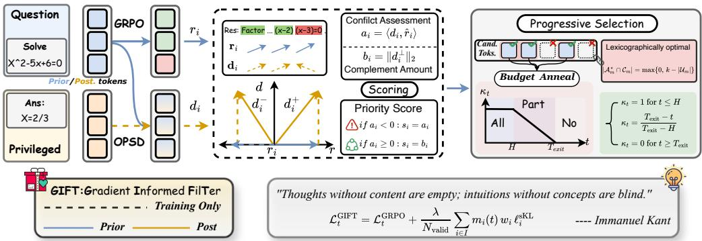
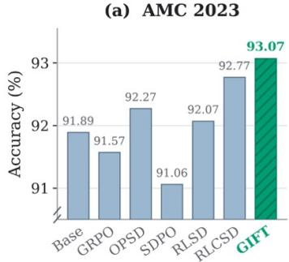
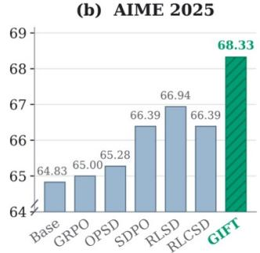
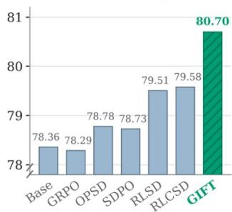
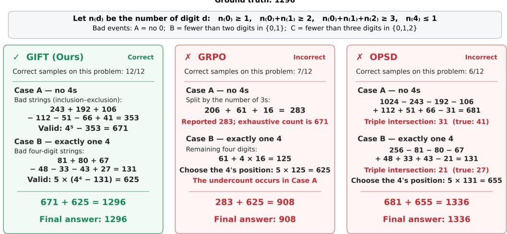
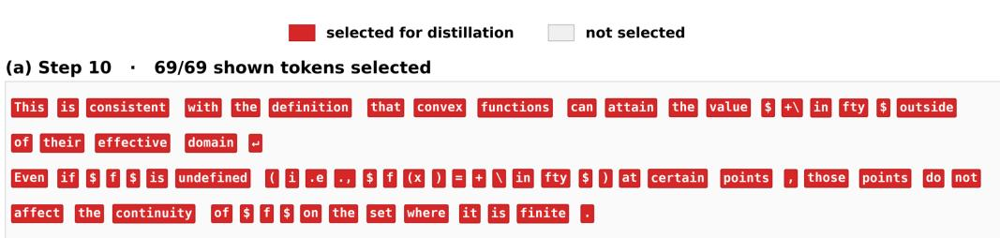
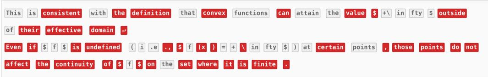
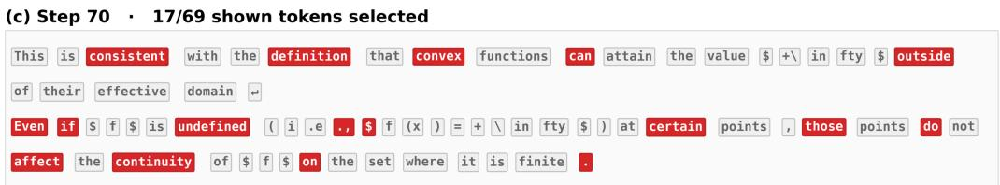
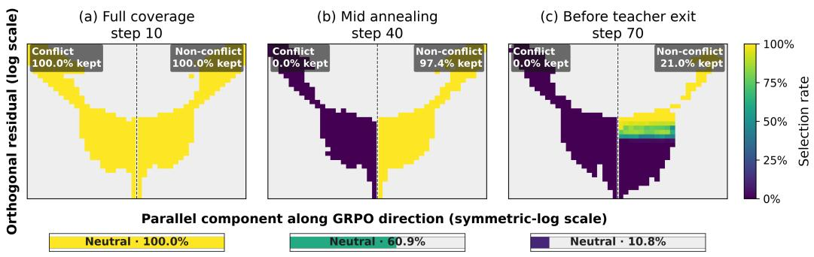

# GIFT: GRADIENT INFORMED FILTERING FOR DISTIL-LATION AUGMENTED REASONING RL

Shijie Li1, 2, Yilin Gao2, Tieyuan Chen1, Yun Luo2, Weiyao Lin1,\*, Hang Yu2,\*

1 Shanghai Jiao Tong University 2 Tencent

shijieli@sjtu.edu.cn

Corresponding authors

## ABSTRACT

Training large language models for complex reasoning tasks relies on two complementary signals: sparse, outcome-grounded reinforcement learning (RL) for correctness, and dense, token-level distillation for guidance. However, complementarity in supervision does not guarantee compatibility in optimization; imitation-focused distillation can conflict with the outcome-driven RL objective, and existing hybrids lack a principled resolution. We propose GIFT (Gradient-Informed FilTering for Distillation-Augmented Reasoning RL), a novel method that directly addresses the allocation problem of which teacher updates to apply. GIFT performs a token-level geometric analysis, decomposing the distillation gradient into a component parallel to the RL gradient, which measures first-order conflict and provides a safety filter, and a component orthogonal to it, which quantifies novel directional guidance and provides a measure of value. This decomposition yields a principled scoring rule to rank token-level guidance. We combine this with a progressive coverage annealing schedule that shrinks the budget of tokens receiving distillation, ensuring that the most conflicting updates are discarded first while the most complementary ones are retained at full strength. This facilitates a smooth transition from dense, geometrically-filtered guidance to a pure, outcome-grounded objective at convergence. Extensive experiments on mathematical and logical reasoning benchmarks show that GIFT consistently outperforms strong baselines across multiple model scales, achieving relative gains of up to 9.5% on difficult mathematical reasoning tasks. Code: https://github.com/lilifree/GIFT

## 1 INTRODUCTION

“Thoughts without content are empty, intuitions without concepts are blind. Only through their union can knowledge arise.”

— Immanuel Kant, Critique ofPure Reason

Training large language models for complex reasoning relies on two complementary forms of supervision: outcome-grounded reinforcement learning and dense, token-level distillation. Reinforcement learning with verifiable rewards (RLVR), such as GRPO (Shao et al. (2024)), anchors learning to task success, but offers little guidance about the intermediate decisions that produce an outcome. A single reward supervises an entire response, and GRPO’s group-relative signal vanishes when all responses receive the same reward. On-policy self-distillation (OPSD; Zhao et al. (2026)) provides more direct guidance: the same model, conditioned on privileged information such as a reference solution, supplies teacher distributions along the student’s own rollout. Yet this dense supervision targets imitation rather than correctness; following it can introduce information leakage and late-stage instability (Yang et al., 2026; Wei et al., 2026). We seek the best of both worlds: dense teacher guidance to accelerate learning, with verifiable outcomes determining what the model ultimately optimizes.

Realizing this promise requires more than combining the two signals: complementarity in supervision does not guarantee compatibility in optimization. RLSD and RLCSD use teacher-derived signals to modulate verifier-based advantages (Yang et al. (2026); Pan et al. (2026)), while OPDVR gates sampled-token distillation rewards by trajectory correctness (Lin et al. (2026)). For a nonzero RL gradient at a fixed token, such scalar changes cannot introduce a direction outside its logit-space span. An auxiliary distributional loss, as in SDPG (Liu et al. (2026)), can supply such directions, yet admitting a response or token does not establish how its teacher gradient interacts with the current RL update. Teacher withdrawal addresses persistence: RLSD and SDPG anneal teacher influence, and Sequential Beats Joint separates distillation and RLVR into successive stages (Li et al. (2026)). But withdrawal alone leaves an allocation problem. Uniformly weakening or abruptly removing guidance can discard complementary updates together with redundant or conflicting ones. Selecting surviving tokens by disagreement alone can retain a strong teacher signal precisely where it obstructs the outcome update. Which token-level teacher contributions should survive as the available supervision budget contracts?

We address this allocation problem with our method, GIFT (Gradient Informed FilTering for Distillation Augmented Reasoning RL), which uses token-level gradient geometry to determine where auxiliary distillation participates. Instead of relying on heuristics like disagreement or uncertainty, GIFT directly analyzes the interaction between the teacher’s distillation gradient and the student’s RL gradient. At each token, we decompose the teacher’s update into two key components: (1) a component parallel to the RL gradient, which measures first-order conflict or assistance, and (2) a component orthogonal to the RL gradient, which represents novel directional guidance that cannot be produced by simply rescaling the RL update. Our central hypothesis is that the most effective guidance is both non-conflicting and contains significant novel direction. However, since privileged teacher guidance (as in OPSD) targets imitation rather than guaranteed correctness, its influence must be carefully managed to avoid biasing the final policy. GIFT addresses this by implementing its geometric selection under a progressively shrinking token budget. This annealing process ensures that as training matures, the model transitions from dense but potentially flawed guidance towards the verifiable outcome signal. Only the most geometrically complementary teacher contributions survive before the model converges to the pure, unprivileged RL objective. This approach leads to a method that is both principled and effective. Our main contributions are:

• We propose GIFT, a method that uses the geometric relationship between teacher and student gradients to selectively apply distillation. It is the first method to explicitly distinguish between conflicting, redundant, and complementary token-level guidance to solve the allocation problem.

• We derive a closed-form, token-level scoring rule based on this geometry, allowing for efficient selection without needing to compute auxiliary backward passes. We combine this with a progressive coverage annealing schedule that smoothly transitions from dense guidance to pure reinforcement learning, ensuring stability and preserving the primacy of the outcome-based objective.

• GIFT achieves the highest average scores on challenging mathematical reasoning benchmarks across four model scales, outperforming eight strong baselines. Ablation studies confirm that its combination of geometric selection and coverage annealing is critical to its success, yielding significant gains over simpler selection criteria or withdrawal strategies.

## 2 RELATED WORK

Dense teacher guidance can supplement outcome supervision, but its usefulness depends on how it is incorporated, not simply on how much is provided. We situate GIFT along four related design choices: how teacher information enters the update, which tokens receive it, how its interaction with RL is assessed, and how its influence is withdrawn.

Outcome Supervision and Self-Distillation. RL from verifiable outcomes, or RLVR, forms the basis of our primary objective. GRPO (Shao et al., 2024) derives group-relative advantages from verified outcomes; subsequent works like Dr. GRPO (Liu et al., 2025b) and DAPO (Yu et al., 2025) refine its normalization and loss aggregation to improve stability and reduce bias. While these methods provide an unbiased, outcome-grounded learning signal, their supervision is sparse and vanishes for rollout groups where all responses are correct or incorrect. On-policy self-distillation (OPSD; Zhao et al. (2026)) offers a dense, token-level alternative, supplying teacher feedback along the student’s trajectory. Hybrid methods, such as RLSD (Yang et al., 2026), RLCSD (Pan et al., 2026), and AMR-SD (Wei et al., 2026), attempt to combine these two signals by using teacher-derived signals to perform scalar modulation of the RL advantages. However, they are fundamentally limited in expressiveness: re-weighting the RL gradient cannot introduce an update direction outside its original logit-space span. GIFT uses OPSD-RLVR geometry to prioritize complementary guidance under exact quotas, without excluding all conflicts.

Token-Selective Teacher Guidance. Given a dense teacher signal, a critical question is which tokens should receive it. Many methods rely on statistical heuristics. TIP (Xu et al., 2026) ranks tokens by student entropy and teacher-student divergence; EOPD (Jin et al., 2026)) gates supervision by teacher entropy; RSTG (Han et al., 2026) combines these heuristics for failed rollouts; and CRPO (Wu et al., 2026)) uses predictive entropy to distinguish exploration from exploitation bias. While these statistics identify uncertainty or disagreement, they do not directly establish compatibility with the current outcome-driven update. Other works highlight that simple agreement is not the goal. RLRT (Kim et al., 2026) reinforces successful student departures from the teacher, demonstrating teacher disagreement can be valuable. SKALD (Jiang et al., 2026) focuses on zerovariance groups where the RL signal is absent, providing distillation as a fallback. This aligns with GIFT’s treatment of such cases (Corollary 1), but GIFT’s geometric criterion is more general. Instead of relying on heuristics, GIFT directly assesses the first-order interaction between the teacher’ distillation gradient and student’s RL gradient at each token, providing a principled selection basis.

Gradient Geometry for Auxiliary Learning. The geometric relationship between gradients from multiple objectives is a well-established concept in multi-task learning. Methods like PCGrad (Yu et al., 2020) project away conflicting gradient components, while ATTITTUD (Dery et al., 2021) decomposes an auxiliary gradient into components agreeing, conflicting, or orthogonal to the primary task’s gradient subspace, and re-weights them. ATTITTUD is the direct intellectual predecessor to our geometric analysis. However, GIFT makes three critical and novel adaptations for the RLVR context: (1) Usage: We use geometry for discrete selection of tokens, not continuous modification of the auxiliary gradient, which avoids distorting the teacher signal. (2) Granularity and Efficiency: Our analysis is performed at the token level in logit space, where we derive a closed-form, O(M) solution (Proposition 1) for the geometric components, avoiding expensive, parameter-space SVD approximations required by ATTITTUD. (3) Value of Orthogonality: We identify the orthogonal component (bi) as the most valuable form of complementary guidance—representing novel directions unreachable by the RL signal (Theorem 2)—whereas ATTITTUD treats it as neutral.

Demonstration-Guided RL and Teacher Withdrawal. Privileged teacher guidance must be carefully managed to avoid biasing the final policy towards imitation. This withdrawal can be implemented in several ways. Methods like LUFFY (Yan et al., 2025a) and UFT (Liu et al., 2025a) introduce teacher guidance through trajectory composition or annotated prefixes, and anneal the length or proportion of this guidance. Other methods anneal the auxiliary loss coefficient (λ) to zero, as seen in Kickstarting (Schmitt et al., 2018), RLSD, and SDPG. However, such coefficient annealing dilutes the signal for all tokens simultaneously, discarding complementary updates along with conflicting ones. Sequential Beats Joint (Li et al., 2026) avoids this by separating distillation and RLVR into successive stages, but forgoes the benefits of joint training. GIFT addresses this optimization tension through coverage annealing, shrinking the selected-token quota while fixing the loss weight. At each ranking, positive residual scores precede zero scores and conflicts; within conflicts, smaller normalized opposition receives higher priority. This controls teacher participation while preserving retained-token loss weights, before the auxiliary loss vanishes at teacher exit.

## 3 METHOD

In the introduction, we established the central challenge: to effectively merge the dense, token-level guidance from self-distillation (Liu et al., 2026; Agarwal et al., 2024; Gu et al., 2023) with the sparse, outcome-grounded supervision from reinforcement learning (Shao et al., 2024; Guo et al., 2025) (RL). Simply combining them is insufficient; we need a principled mechanism to decide when and where to apply the teacher’s guidance to ensure it complements, rather than corrupts, the primary RL objective. This section introduces our method, GIFT, which resolves this ”allocation problem” through a geometric analysis of the underlying gradients, as shown in Figure 1.

## 3.1 A GEOMETRIC APPROACH TO GUIDANCE

Our methodology is built on a direct analysis of the geometric interaction between the teacher and student gradients (Dery et al., 2021; Yu et al., 2020) at each token. Let $z _ { i } \in \mathbb { R } ^ { | V | }$ be the student’s logits at position i, with probability distribution pi = softmax(zi). At this position, we consider two distinct logit-space gradients. The first is the outcome-driven gradient from the clipped GRPO loss (Shao et al., 2024), $l _ { i } ^ { \mathrm { G R P O } }$ . This gradient, denoted $r _ { i } ,$ represents the direction of steepest ascent for the RL objective, steering the model toward task success determined by the verifier. The second is the imitation-driven gradient from the distillation loss, $l _ { i } ^ { \mathrm { s K L } }$ (Agarwal et al., 2024; Gu et al., 2023; Zhao et al., 2026; Liu et al., 2026). This gradient, denoted $d _ { i }$ , points in the direction that best aligns the student’s distribution $p _ { i }$ with the privileged teacher’s distribution $\tilde { q } _ { i }$ . These gradients are:

  
Figure 1: GIFT decomposes the distillation gradient into conflict $( a _ { i } )$ and complement (bi) components relative to the RL gradient, ranks tokens, and anneals the selection budget from full to zero.

$$
\begin{array} { r } { r _ { i } = \nabla _ { z _ { i } } \ell _ { i } ^ { \mathrm { G R P O } } = w _ { i } A _ { i } \rho _ { i } h _ { i } \big ( p _ { i } - e _ { u _ { i } } \big ) , \qquad d _ { i } = \nabla _ { z _ { i } } \big ( w _ { i } \ell _ { i } ^ { \mathrm { s K L } } \big ) = w _ { i } \big ( p _ { i } - \tilde { q } _ { i } \big ) , } \end{array}\tag{1}
$$

where $e _ { u _ { i } }$ is the one-hot vector for the sampled token, $A _ { i }$ is the advantage, $h _ { i }$ indicates an active clipped branch, and $\tilde { q } _ { i }$ is the teacher distribution. The gradient $r _ { i }$ serves as our reference direction. On the set of tokens $\mathcal { D }$ where a non-zero RL gradient exists, we decompose the teacher gradient $d _ { i }$ with respect to the normalized RL gradient $\hat { r } _ { i } = r _ { i } / | | r _ { i } | | _ { 2 } \colon$

$$
a _ { i } = \langle d _ { i } , \hat { r } _ { i } \rangle , \quad d _ { i } ^ { \perp } = d _ { i } - a _ { i } \hat { r } _ { i } , \quad b _ { i } = \| d _ { i } ^ { \perp } \| _ { 2 } .\tag{2}
$$

Here, the scalar $a _ { i }$ is the signed magnitude of the parallel component, measuring first-order assistance or conflict. The scalar $b _ { i }$ is the norm of the orthogonal component, quantifying novel directional guidance. Together, they satisfy $a _ { i } ^ { 2 } + b _ { i } ^ { 2 } = | | d _ { i } | | _ { 2 } ^ { 2 }$ . These two scalars form the core of our selection mechanism, as explained next.

## 3.2 SAFETY: THE ROLE OF THE PARALLEL COMPONENT $( a _ { i } )$

Our first priority is to ensure that auxiliary guidance does not undermine the primary, outcomedriven objective. The parallel component $a _ { i }$ provides a direct, first-order measure of this safety. Theorem 1 formalizes this intuition.

Theorem 1 (Local first-order non-interference). For a given token, the change in the primary GRPO loss from a combined update (Dery et al., 2021; Yu et al., 2020) is given by $\begin{array} { r } { \frac { d } { d \eta } \hat { f _ { i } } ( z _ { i } ( \eta ) ) | _ { \eta = 0 } = } \end{array}$ $- | | \boldsymbol { r } _ { i } | | _ { 2 } ^ { 2 } - \lambda | | \boldsymbol { r } _ { i } | | _ { 2 } \boldsymbol { a } _ { i }$ . The implications are direct:

1. Assistance $( a _ { i } > 0 )$ : The teacher’s guidance is aligned with the RL gradient and accelerates the decrease ofthe primary loss. This guidance is beneficial

2. Neutrality $( a _ { i } = 0 )$ : The teacher’s guidance is orthogonal to the RL gradient and has no firstorder effect on the primary loss. It is safe, regardless of its magnitude $| | d _ { i } | | _ { 2 }$

3. Conflict $( a _ { i } < 0 )$ : The teacher’s guidance opposes the RL gradient, slowing or even reversing progress on the primary objective. This guidance is harmful.

This geometric criterion provides a more precise filter than heuristics like student-teacher divergence $( \mathrm { e . g . }$ , TIP (Xu et al., 2026)) or disagreement. While a large divergence might indicate valuable guidance, it does not distinguish between productive, orthogonal disagreement $( a _ { i } \geq 0 , b _ { i } \gg 0 )$ and destructive, head-on conflict $( a _ { i } < 0 )$ . Our use of $a _ { i }$ makes this crucial distinction. Therefore, the sign of $a _ { i }$ serves as a fundamental safety gate. We define any token with $a _ { i } < 0$ as conflicting and give it lowest priority. This raises the next question: among the ”safe” tokens (where $a _ { i } \geq 0 )$ , which are most valuable to select? This is decided by the orthogonal component, $b _ { i }$

## 3.3 VALUE: WHY THE ORTHOGONAL COMPONENT $( b _ { i } )$ MATTERS

Having established safety with the parallel component $a _ { i } ,$ we now examine value. Among $^ { 6 6 } \mathrm { s a f e } ^ { , 9 }$ tokens $( a _ { i } \geq 0 )$ , the most useful guidance lies in the orthogonal component, quantified by $b _ { i } .$ . Crucially, $b _ { i } \mathrm { ^ { * } s }$ value does not stem from a direct, first-order contribution to the primary RL objective—as established in Theorem 1, its contribution to the primary loss descent is zero. Its profound importance relates instead to the guidance’s novelty and expressiveness. This value is best understood through its counterpart. A purely parallel teacher gradient $( b _ { i } = 0 )$ is fundamentally redundant. The resulting update, $r _ { i } + \lambda d _ { i }$ , simplifies to merely rescaling the original RL gradient $r _ { i }$ . This critical limitation offers no new directional information unattainable by simply adjusting the learning rate or advantage scaling for that token. An entirely collinear teacher tells the optimizer nothing it could not learn from the RL signal alone.

All genuinely new geometric information provided by the teacher resides in the orthogonal component $d _ { i } ^ { \perp }$ . Therefore, selecting for a large $b _ { i }$ is equivalent to prioritizing the most valuable form of teacher guidance—the part that is structurally inaccessible to simpler advantage-modulation schemes. The following theorem formalizes this concept of complementarity in three distinct ways.

Theorem 2 (Complementarity of the orthogonal residual). Under the assumptions ofTheorem 1:

1. (Maximal locally GRPO-neutral distillation decrease.) Among unit-norm logit perturbations that are locally neutral to the token-level primary surrogate,

$$
\operatorname* { m a x } _ { \| v \| _ { 2 } \leq 1 , r _ { i } ^ { \top } v = 0 } \ ( - d _ { i } ^ { \top } v ) = b _ { i } .\tag{3}
$$

If $b _ { i } > 0 ,$ , the maximum is attained by $v ^ { * } = - d _ { i } ^ { \perp } / b _ { i \cdot } \ I f b _ { i } = 0$ , every feasible v attains the value zero. Thus, $b _ { i }$ is the maximal first-order distillation decrease among unit-norm logit perturbations that are locally neutral to the token-level primary surrogate; no finite-step or sharedparameter conclusionfollows.

2. (Irreducibility to token-local GRPO rescaling.) Fix the sampled tokens, model state, and reference gradients, and equip $\mathcal { H } = \oplus _ { i \in \mathcal { I } } \mathbb { R } ^ { | \vee | }$ with the Euclidean product norm $\Vert ( x _ { i } ) _ { i } \Vert _ { \mathcal { H } } ^ { 2 } \ \overset { \cdot } { = }$ $\textstyle \sum _ { i } \| x _ { i } \| _ { 2 } ^ { 2 }$ . Let $\mathcal { M } _ { 0 } ~ = ~ \{ ( c _ { i } r _ { i } ) _ { i \in \mathcal { I } } : c _ { i } \in \mathbb { R } \}$ be the space of unrestricted signed, token-local rescalings of the fixed GRPO reference field. For any fixed binary mask $m \in \{ 0 , 1 \} ^ { \mathbb { Z } }$ , write $\mathcal { D } _ { m } = ( m _ { i } d _ { i } ) _ { i \in \mathcal { I } }$ . Then

$$
\operatorname { d i s t } ^ { 2 } ( \mathscr { D } _ { m } , \mathscr { M } _ { 0 } ) = \sum _ { i : r _ { i } \neq 0 } m _ { i } \left( \| d _ { i } \| _ { 2 } ^ { 2 } - \frac { \langle d _ { i } , r _ { i } \rangle ^ { 2 } } { \| r _ { i } \| _ { 2 } ^ { 2 } } \right) + \sum _ { i : r _ { i } = 0 } m _ { i } \| d _ { i } \| _ { 2 } ^ { 2 } .\tag{4}
$$

In particular, for $\epsilon _ { g } \geq 0$ and $\mathcal { D } _ { \epsilon } = \{ i : \| r _ { i } \| _ { 2 } > \epsilon _ { g } \}$ , the residuals defined in Equation 2 satisfy

$$
\mathrm { { d i s t } } ^ { 2 } ( \mathcal { D } _ { m } , \mathcal { M } _ { 0 } ) \geq \sum _ { i \in \mathcal { D } _ { \epsilon } } m _ { i } b _ { i } ^ { 2 } .\tag{5}
$$

Thus, selecting any $i \in \mathcal { D } _ { \epsilon }$ with $b _ { i } > 0$ certifies that the selected teacher field cannot be represented by token-local scalar rescalings of the fixed GRPO field. This is a sufficient, not a necessary, condition. A selected zero-reference block with $d _ { i } \neq 0$ also certifies irreducibility, as can a noncollinear small nonzero-reference block.

3. (Gradient diversity.) For a collection of gradients $\{ g _ { j } \} _ { j = 1 } ^ { n }$ summed into one update, define

$$
\Delta \big ( \{ g _ { j } \} \big ) = \sum _ { j } \| g _ { j } \| _ { 2 } ^ { 2 } / \big \| \sum _ { j } g _ { j } \big \| _ { 2 } ^ { 2 }\tag{6}
$$

(Definition $I ; \Delta = 1 ,$ /n when the g are identical and $g _ { j }$ $\Delta = 1$ when they are mutually orthogonal, so larger $\Delta$ means less redundancy among the summands). Applying this to the two gradients combined at token i, i.e. $\Delta _ { i } = \Delta \dot { ( } \{ r _ { i } , \lambda \bar { d } _ { i } \} ) .$ : at fixed $\lVert \boldsymbol { r } _ { i } \rVert _ { 2 } , \ \lVert \dot { d _ { i } } \rVert _ { 2 }$ and $\lambda > 0 , \Delta _ { i }$ is strictly decreasing in $a _ { i } ,$ hence strictly increasing in $b _ { i }$ on the safe branch $\ddot { a } _ { i } \in [ 0 , \lVert d _ { i } \rVert _ { 2 } ] ,$ , where it rises from $( \| r _ { i } \| _ { 2 } ^ { 2 } + \lambda ^ { 2 } \| d _ { i } \| _ { 2 } ^ { 2 } ) / ( \| r _ { i } \| _ { 2 } + \lambda \| d _ { i } \| _ { 2 } ) ^ { 2 } \stackrel {  } { \in } [ \frac { 1 } { 2 } , 1 )$ at $b _ { i } = 0$ to 1 at $a _ { i } = 0$ . Unconstrained over all a , however, $\Delta _ { i }$ is maximized as $a _ { i }  - \| d _ { i } \| _ { 2 }$ and diverges when $r _ { i } + \lambda d _ { i } = 0$

This theorem justifies prioritizing the orthogonal component $b _ { i }$ for three reasons. First, $b _ { i }$ measures maximal progress on the imitation objective that is $\mathrm { \bar { \cdots } f r e e ^ { , \prime } }$ to the outcome-driven task, having no first-order cost to the primary RL objective. Second, it represents guidance advantage-modulation methods like RLSD (Yang et al., 2026) and OPDVR (Lin et al., 2026) cannot express, since they only rescale the RL gradient without introducing novel directions. Third, in sparse-reward RLVR (Shao et al., 2024; Guo et al., 2025), a large $b _ { i }$ indicates high gradient diversity $( \Delta _ { i } )$ , injecting new dimensions to prevent stagnation. However, the most diverse signal directly opposes the primary gradient $( a _ { i } < 0 )$ , which would be catastrophic. Our method resolves this by assigning conflicting signals negative scores, ensuring their early discard as the token budget anneals. This provides early dense guidance while progressively enforcing safety.

GIFT resolves this tension by framing token selection as an exact-quota lexicographic program: at each step, a quota of k eligible tokens must be selected, and GIFT chooses the size-k subset of the eligible set $E _ { m }$ that lexicographically minimizes

$$
A _ { m } ^ { \star } \in \arg \operatorname* { m i n } _ { A \subseteq E _ { m } , | A | = k } ^ { \ k } { \Bigl ( } N ^ { - } ( A ) , O ^ { - } ( A ) , - E ^ { + } ( A ) { \Bigr ) } ,\tag{7}
$$

where ${ C _ { m } = \{ i \in E _ { m } \cap \mathscr { D } : a _ { i } < 0 \} }$ collects the conflicting eligible tokens, $U _ { m } = E _ { m } \ \backslash$ Cm the remaining eligible ones, $N ^ { - } ( A ) \ { \stackrel { \textstyle = } { = } } \ | A \cap C _ { m } |$ their number, $\begin{array} { r } { \bar { O } ^ { - } ( A ) \ : = \ : \sum _ { i \in A \cap C _ { m } } \left| a _ { i } \right| } \end{array}$ their normalized opposition, and $\begin{array} { r } { E ^ { + } ( A ) = \sum _ { i \in A \cap U _ { m } \cap D } b _ { i } ^ { 2 } } \end{array}$ the injected orthogonal guidance.

## 3.4 SCORING AND PROGRESSIVE SELECTION

The lexicographic exact-quota program in Equation 7 admits an exact, closed-form solution in the form of a piecewise scoring rule, providing a principled ranking for all eligible tokens. Each token receives a score $s _ { i }$ defined as:

$$
s _ { i } = \left\{ \begin{array} { l l } { a _ { i } , } & { i \in \mathcal { D } , a _ { i } < 0 , } \\ { b _ { i } , } & { i \in \mathcal { D } , a _ { i } \geq 0 , } \\ { 0 , } & { i \in \mathcal { E } \setminus \mathcal { D } , } \end{array} \right.\tag{8}
$$

This structure imposes a strict hierarchy that directly reflects our optimization criteria. For tokens with conflicting guidance $( a _ { i } < 0 )$ , the score is negative, ensuring they are ranked lowest. For all safe tokens $( a _ { i } \geq 0 )$ , the score is simply the orthogonal magnitude $b _ { i }$ , prioritizing novel, complementary information. Tokens with no usable RL gradient $( i ~ \notin ~ \mathcal { D } )$ receive a neutral score of zero. The optimality of this ranking is formally guaranteed by the following theorem.

Theorem 3 (Exact-quota lexicographic optimality). With the notation of Equation 7, for any integer quota $k ~ \in ~ \{ \bar { 0 } , \dots , | E _ { m } | \}$ , the set $A _ { m } ^ { \star }$ of k highest scores lexicographically minimizes $( \bar { N } ^ { - } , \bar { O } ^ { - } , - E ^ { + } )$ over size-k subsets, and

$$
| A _ { m } ^ { \star } \cap C _ { m } | = \operatorname* { m a x } \{ 0 , k - | U _ { m } | \} .\tag{9}
$$

$I f k \leq | U _ { m } |$ the selection is conflict-free and maximizes $E ^ { + }$ over size-k subsets of $U _ { m } ,$ ; otherwise it takes $U _ { m }$ plus the $k - | U _ { m } |$ conflicting tokens of smallest normalized opposition $| a _ { i } |$ . Both hold under arbitrary tie-breaking.

Theorem 3 provides the formal guarantee that this scoring rule is the exact solution to the stated lexicographic exact-quota problem: it first minimizes the number of conflicting tokens admitted, then their normalized opposition, and only then maximizes the injected orthogonal guidance $( \sum _ { i } b _ { i } ^ { 2 } )$ .

This static ranking is embedded within a dynamic withdrawal strategy, implemented by progressively shrinking the token budget $k _ { t }$ over the course of training via an annealing schedule.

$$
\kappa _ { t } = \frac { T _ { \mathrm { e x i t } } - t } { T _ { \mathrm { e x i t } } - H } \quad \mathrm { f o r } H < t < T _ { \mathrm { e x i t } } ,\tag{10}
$$

where $\kappa _ { t }$ is the retention ratio, H is an initial full-coverage phase, and $T _ { \mathrm { e x i t } }$ is the step at which all teacher guidance is withdrawn. This annealing of the coverage, rather than a loss coefficient, makes the trade-off between exploration and exploitation time-varying. Early in training, when the budget is large and the RL signal is sparse, the model benefits from broad, diverse guidance. As training matures and the budget contracts, the lowest-scoring tokens—the most conflicting ones—are the first to be excluded. The most complementary tokens (high $b _ { i } , a _ { i } \geq 0 )$ are retained the longest.

This provides a principled, state-aware withdrawal order. Unlike uniform coefficient annealing (Liu et al., 2026; Yang et al., 2026) which dilutes all guidance simultaneously, or staged training (Li et al., 2026) which forgoes joint optimization, GIFT’s geometric ranking and coverage annealing ensures that as the supervision budget contracts, it is precisely the most harmful guidance (lowest-scoring tokens) that is shed first, while the most complementary guidance is retained at full strength.

## 3.5 THE GIFT OBJECTIVE

The principles of geometric selection and progressive withdrawal are implemented in the final GIFT objective function:

$$
\mathcal { L } _ { t } ^ { \mathrm { G I F T } } = \mathcal { L } _ { t } ^ { \mathrm { G R P O } } + \frac { \lambda } { N _ { \mathrm { v a l i d } } } \sum _ { i \in I } m _ { i } ( t ) w _ { i } \ell _ { i } ^ { \mathrm { s K L } } , \qquad \lambda = 1 .\tag{11}
$$

Here, $m _ { i } ( t )$ selects the top- $\cdot k _ { t , m }$ eligible tokens per sub-batch; I contains all valid positions and $N _ { \mathrm { v a l i d } } = \vert \mathcal { T } \vert$ . Several critical design choices apply. First, fixing $\lambda = 1$ ensures selected tokens receive full-strength, unprojected distillation loss. Control operates via selection (who receives guidance), not dilution (guidance strength). The teacher loses reach, not voice. Second, normalizing over all valid tokens $( N _ { \mathrm { v a l i d } } )$ rather than just selected ones ensures stability, keeping each retained token’s contribution independent of budget size. Otherwise, a shrinking budget would artificially inflate surviving tokens, undermining smooth withdrawal. Finally, as the budget anneals to zero $( t \geq T _ { \mathrm { e x i t } } )$ , the mask $m _ { i } ( t )$ becomes universally zero, guaranteeing a clean transition. The auxiliary term vanishes, reducing $\mathcal { L } _ { t } ^ { \mathrm { G I F T } }$ identically to the native GRPO loss. This grounds final behavior purely in the outcome-driven objective. The teacher acts as a temporary, geometrically-filtered scaffold, harnessing dense guidance before complete withdrawal without corrupting the final policy.

Table 1: Mathematical reasoning across Qwen3 scales (mean@12, %). Avg. is the mean over AMC23, AIME24, and AIME25. Green denotes relative gains over BASE; bold and underlined values indicate the best and second-best distinct scores. Bench. denotes benchmark.
<table><tr><td>Size</td><td>Bench.</td><td>BASE</td><td>GRPO</td><td>OPSD</td><td>SDPO</td><td>RLSD</td><td>RLCSD</td><td>OPDVR</td><td>LUFFY</td><td>UFT</td><td>GIFT</td></tr><tr><td rowspan="4">1.7B</td><td>AMC23 AIME24</td><td>75.50</td><td>75.70</td><td>75.60</td><td>75.30</td><td>75.30</td><td>75.80</td><td>76.51</td><td>75.40</td><td>74.60</td><td>75.80 (+0.40%)</td></tr><tr><td></td><td>44.44</td><td>45.28</td><td>45.56</td><td>44.72</td><td>44.72</td><td>46.94</td><td>46.67</td><td>48.33</td><td>48.33</td><td>48.61 (+9.38%)</td></tr><tr><td>AIME25</td><td>35.00</td><td>35.56</td><td>33.33</td><td>36.67</td><td>34.72</td><td>34.72</td><td>35.83</td><td>34.17</td><td>36.67</td><td>38.33 (+9.51%)</td></tr><tr><td>Avg.</td><td>51.65</td><td>52.18</td><td>51.50</td><td>52.23</td><td>51.58</td><td>52.49</td><td>53.00</td><td>52.63</td><td>53.20</td><td>54.25 (+5.03%)</td></tr><tr><td rowspan="4">4B</td><td>AMC23</td><td>88.45</td><td>89.16</td><td>88.25</td><td>88.96</td><td>88.86</td><td>90.26</td><td>88.45</td><td>89.16</td><td>89.66</td><td>88.55 (+0.11%)</td></tr><tr><td>AIME24</td><td>71.67</td><td>74.17</td><td>73.06</td><td>70.83</td><td>73.61</td><td>72.22</td><td>73.61</td><td>76.11</td><td>70.56</td><td>73.33 (+2.32%)</td></tr><tr><td>AIME25</td><td>63.89</td><td>63.61</td><td>67.22</td><td>67.22</td><td>63.61</td><td>64.17</td><td>64.72</td><td>65.28</td><td>64.72</td><td>69.72(+9.13%)</td></tr><tr><td>Avg.</td><td>74.67</td><td>75.65</td><td>76.18</td><td>75.67</td><td>75.36</td><td>75.55</td><td>75.59</td><td>76.85</td><td>74.98</td><td>77.20 (+3.39%)</td></tr><tr><td rowspan="4">8B</td><td>AMC23</td><td>89.16</td><td>89.36</td><td>88.76</td><td>89.56</td><td>88.76</td><td>89.26</td><td>89.96</td><td>89.96</td><td>88.86</td><td>89.66(+0.56%)</td></tr><tr><td>AIME24</td><td>75.00</td><td>74.72</td><td>77.22</td><td>75.83</td><td>75.28</td><td>76.11</td><td>74.44</td><td>73.33</td><td>76.11</td><td>76.11 (+1.48%)</td></tr><tr><td>AIME25</td><td>65.83</td><td>65.83</td><td>66.39</td><td>66.39</td><td>69.72</td><td>68.06</td><td>69.72</td><td>67.50</td><td>66.39</td><td>71.11 (+8.02%)</td></tr><tr><td>Avg.</td><td>76.67</td><td>76.64</td><td>77.46</td><td>77.26</td><td>77.92</td><td>77.81</td><td>78.04</td><td>76.93</td><td>77.12</td><td>78.96 (+2.99%)</td></tr></table>

## 4 EXPERIMENTS

We conduct experiments to validate GIFT’s core principles. Our evaluation addresses three central questions: (1) Effectiveness: Does GIFT’s approach of gradient-informed filtering and progressive withdrawal achieve state-of-the-art performance on challenging reasoning tasks compared to existing methods? (2) Generalization: Do GIFT’s benefits extend across different architectures, scales, and reasoning domains, including out-of-distribution scenarios? (3) Component Necessity: Are GIFT’s key components—specifically the geometric scoring rule based on conflict $( a _ { i } )$ and novelty $( b _ { i } )$ , and the coverage annealing schedule—critical to its success?

## 4.1 EXPERIMENTAL SETUP

Models and tasks. We evaluate on two families of models: three scales of Qwen3 (1.7B, 4B, 8B) (Yang et al., 2025)) and OLMo-3-7B-Think (Olmo et al., 2026). For mathematical reasoning, we train on the DeepMath-103K dataset (He et al., 2025), using progressively harder difficulty splits for larger models, and evaluate on the AMC23 (math-ai, 2023), AIME24 (Zhang & Math-AI Team, 2024), and AIME25 (Zhang & Math-AI Team, 2025) benchmarks. For logical reasoning, we train on Knights-and-Knaves puzzles (Xie et al., 2025) (4-8 roles) and evaluate on both in-distribution (ID) and out-of-distribution (OOD, 9-11 roles) splits to test generalization.

Baselines. We compare GIFT with the initial model (BASE) and eight training baselines, grouped by supervision source and how it enters optimization (Appendix G): GRPO, using verifier-derived advantages without teacher feedback (Shao et al., 2024); distributional self-distillation, matching nexttoken distributions of a conditioned self-teacher (OPSD (Zhao et al., 2026), SDPO (Hubotter et al.,¨ 2026)); verifier-guided token-level credit assignment, modulating advantages or gating rewards with teacher-derived scalars (RLSD (Yang et al., 2026), RLCSD (Pan et al., 2026), OPDVR (Lin et al., 2026)); and demonstration-guided methods (LUFFY (Yan et al., 2025a), UFT(Liu et al., 2025a)).

Evaluation. For mathematics, we report mean@12, the average correctness over 12 sampled responses per problem, averaged across problems, using rule-based answer matching. For logic, we report pass@1 on 500 ID problems and 100 problems for each of the three OOD role counts (9, 10, and 11). The reported Avg. equally weights the three mathematical benchmarks or the four logicalreasoning splits. All scores are percentages, and gains are relative percentage-point differences.

Table 2: Logical reasoning on Knights-and-Knaves (pass@1, %). The ID split contains 4–8 roles, while the OOD splits contain 9, 10, and 11 roles. Green denotes relative gains over BASE.
<table><tr><td>Benchmark</td><td>BASE</td><td>GRPO</td><td>OPSD</td><td>SDPO</td><td>RLSD</td><td>RLCSD</td><td>OPDVR</td><td>LUFFY</td><td>UFT</td><td>GIFT</td></tr><tr><td>In-distribution (ID)</td><td></td><td></td><td></td><td></td><td></td><td></td><td></td><td></td><td></td><td></td></tr><tr><td>4–8 roles</td><td>72.40</td><td>73.40</td><td>72.80</td><td>75.20</td><td>73.60</td><td>74.00</td><td>73.00</td><td>74.60</td><td>74.20</td><td>73.40(+1.38%)</td></tr><tr><td>Out-of-distribution (OOD)</td><td></td><td></td><td></td><td></td><td></td><td></td><td></td><td></td><td></td><td></td></tr><tr><td>9 roles</td><td>69.00</td><td>72.00</td><td>75.00</td><td>73.00</td><td>71.00</td><td>69.00</td><td>71.00</td><td>67.00</td><td>71.00</td><td>73.00(+5.80%)</td></tr><tr><td>10 roles</td><td>59.00</td><td>56.00</td><td>59.00</td><td>56.00</td><td>55.00</td><td>59.00</td><td>57.00</td><td>59.00</td><td>56.00</td><td>61.00(+3.39%)</td></tr><tr><td>11 roles</td><td>42.00</td><td>46.00</td><td>41.00</td><td>40.00</td><td>41.00</td><td>44.00</td><td>44.00</td><td>43.00</td><td>40.00</td><td>44.00(+4.76%)</td></tr><tr><td>Avg.</td><td>60.60</td><td>61.85</td><td>61.95</td><td>61.05</td><td>60.15</td><td>61.50</td><td>61.25</td><td>60.90</td><td>60.30</td><td>62.85 (+3.71%)</td></tr></table>

## 4.2 MAIN RESULTS

Our main results demonstrate that GIFT’s principled filtering mechanism consistently outperforms existing methods across multiple tasks and model scales, providing a superior solution to the core tension between dense guidance and outcome-grounded learning.

Mathematical Reasoning. As shown in Table 1, GIFT achieves the highest average score on mathematical reasoning across all three Qwen3 models. Compared to the base model, it achieves average relative gains of 5.03%, 3.39%, and 2.99% for the 1.7B, 4B, and 8B models, respectively. The inferiority of the baselines stems from their distinct, yet suboptimal, strategies for combining supervision.

The two extremes of the supervision spectrum, pure RL and pure distillation, highlight the core challenge. GRPO provides an unbiased, outcome-grounded learning signal, which is why we retain it as our primary objective. However, its supervision is sparse—a single reward for an entire trajectory—and its group-relative signal vanishes in uniformly correct or incorrect groups, leading to sample inefficiency and learning stagnation. Conversely, on-policy self-distillation offers dense, token-level guidance but optimizes for imitation of a privileged teacher rather than verifiable cor rectness: OPSD conditions its self-teacher on a reference solution, while SDPO conditions it on environment feedback or verified successful rollouts. In both, the auxiliary loss is applied unconditionally along the entire trajectory—with no check for compatibility with the outcome-driven update and no mechanism for withdrawing teacher influence.

Hybrid methods attempt to bridge this gap, but their approaches lead to distinct compromises. One family, including RLSD, RLCSD, and OPDVR, ultimately converts the teacher signal into a scalar that modulates the RL update: RLSD and RLCSD use teacher-derived signals to modulate verifier-based advantages, while OPDVR reformulates the implicit reward of sampled-token distillation based on trajectory correctness and applies ReLU gating, so that the teacher enters the update only through a per-token scalar reward. By collapsing the teacher’s rich distributional information into a scalar reward or weight, these methods are structurally incapable of introducing novel update directions, as established in our theoretical analysis (Theorem 2(ii)); they can only re-weight the token-level components of the existing RL update, whereas GIFT’s auxiliary loss can provide valuable orthogonal guidance (b ). Other methods like LUFFY and UFT introduce teacher guidance through trajectory composition or annotated prefixes, which likewise lack the fine-grained, geometry-aware conflict checking that GIFT performs at every token.

In contrast, GIFT synthesizes the strengths of these approaches: it complements GRPO’s reliable but sparse signal with dense, expressive guidance from an auxiliary loss, but subjects that guidance to a rigorous geometric filter. This unique combination explains its consistent, high-level performance, particularly on the challenging AIME25 benchmark where it establishes a new state-of-the-art.

Logical Reasoning and Generalization. On the Knights-and-Knaves task (Table 2), GIFT again achieves the highest average score, improving over the base model with a relative gain of 3.71%. Crucially, this improvement is not confined to the in-distribution test set; GIFT shows a substantia average relative gain of 4.70% on the OOD splits. This indicates that the reasoning capabilities learned via gradient-informed guidance generalize to more complex problems not seen during training. The consistent failure of baselines to match this performance further underscores our analysis: methods that are either structurally limited (scalar modulation), ungrounded (pure imitation), or lack a robust filtering mechanism (unfiltered or coarse-grained guidance) cannot as effectively harness teacher guidance to build generalizable reasoning skills. This result, combined with strong performance on the OLMo-3 model family (Appendix I, Figure 2), confirms that GIFT’s mechanism is not specific to a single model architecture or reasoning domain but offers a generally applicable framework for improving complex reasoning.

Table 3: Ablation of token-selection strategies. Mathematical reasoning uses Qwen3-8B and is evaluated by mean@12. Logical reasoning uses Qwen3-4B and is evaluated by pass@1.
<table><tr><td rowspan="2">Method</td><td colspan="4">Mathematical Reasoning (mean@12)</td><td colspan="5">Logical Reasoning (pass@1)</td></tr><tr><td>AMC23</td><td>AIME24</td><td>AIME25</td><td>Avg.</td><td>ID (4–8)</td><td>O0D-9</td><td>00D-10</td><td>00D-11</td><td>Avg.</td></tr><tr><td>All Tokens</td><td>89.96</td><td>76.11</td><td>66.39</td><td>77.49</td><td>73.80</td><td>69.00</td><td>59.00</td><td>45.00</td><td>61.70</td></tr><tr><td>Random Tokens</td><td>89.66</td><td>75.28</td><td>66.67</td><td>77.20</td><td>73.60</td><td>71.00</td><td>58.00</td><td>46.00</td><td>62.15</td></tr><tr><td>Entropy-KL Selection</td><td>89.36</td><td>75.28</td><td>66.11</td><td>76.92</td><td>71.80</td><td>63.00</td><td>54.00</td><td>52.00</td><td>60.20</td></tr><tr><td>Gradient-cosine Selection</td><td>89.56</td><td>77.50</td><td>65.83</td><td>77.63</td><td>72.80</td><td>68.00</td><td>61.00</td><td>39.00</td><td>60.20</td></tr><tr><td>Full Model</td><td>89.66</td><td>76.11</td><td>71.11</td><td>78.96</td><td>73.40</td><td>73.00</td><td>61.00</td><td>44.00</td><td>62.85</td></tr></table>

Table 4: Ablation of selection strategies on Qwen3-8B. Mean@12 scores on AMC23, AIME24, and AIME25.  
Table 5: Ablation of token selection scopes on Qwen3-8B.
<table><tr><td>Benchmark</td><td>Conflict-only</td><td>Residual-only</td><td>Teacher-norm</td><td>Conflict-Free</td><td>GIFT</td></tr><tr><td>AMC23</td><td>89.86</td><td>89.26</td><td>88.76</td><td>89.96</td><td>89.66</td></tr><tr><td>AIME24</td><td>75.56</td><td>75.00</td><td>73.89</td><td>76.11</td><td>76.11</td></tr><tr><td>AIME25</td><td>65.83</td><td>66.67</td><td>68.06</td><td>67.11</td><td>71.11</td></tr><tr><td>Avg.</td><td>77.08</td><td>76.97</td><td>76.90</td><td>77.73</td><td>78.96</td></tr></table>

<table><tr><td>Benchmark</td><td>Per-rollout</td><td>Per-prompt</td><td>GIFT</td></tr><tr><td>AMC23</td><td>89.09</td><td>89.56</td><td>89.66</td></tr><tr><td>AIME24</td><td>75.28</td><td>76.39</td><td>76.11</td></tr><tr><td>AIME25</td><td>67.78</td><td>66.39</td><td>71.11</td></tr><tr><td>Avg.</td><td>77.37</td><td>77.45</td><td>78.96</td></tr></table>

## 4.3 ABLATION STUDY

Here We present key findings from the ablations detailed in Appendix H.4.

The Geometric Scoring Rule is Essential. Table 3 shows heuristic criteria (e.g., entropy-KL divergence, raw gradient cosine similarity) fail to match GIFT, confirming statistical proxies for disagreement are less effective than our direct geometric analysis. Table 4 shows its constituent parts are necessary, though their importance varies with task difficulty. On simpler AMC23 and AIME24 benchmarks, “Conflict-Free” and “Conflict-only” ablations perform comparably or better than GIFT. When the primary RL gradient is reliable, simpler strategies prioritizing safety by strictly rejecting conflicts (“Conflict-Free”) or accelerating agreement (“Conflict-only”) are highly effective. However, these strategies falter on the challenging AIME25 benchmark, where GIFT excels. The “Residual-only” ablation—prioritizing novel guidance (b ) while ignoring conflict signs—underperforms across all settings, demonstrating pursuing novelty without safety checks is detrimental. Conversely, “Conflict-Free” proves too restrictive on AIME25, likely discarding valuable teacher guidance needed to escape local optima simply because it appears conflicting. GIFT’s superiority on AIME25 stems from its synthesis: using the conflict signal (a ) for safety while leveraging its exact-quota system to judiciously admit the least-opposing conflicting tokens when necessary, providing a vital mechanism for exploration. These results confirm GIFT’s complete geometric scoring rule provides a more robust approach than isolated heuristics, validating a design that places conflicting tokens below zero- and positive-score candidates.

Coverage Annealing is Superior to Alternative Anealing Strategies. Withdrawing teacher influence is as critical as applying it. We thus compare GIFT’s coverage annealing with two alternatives. First, sequential training (Li et al., 2026) trains with OPSD distillation before switching to pure GRPO. Second, weight annealing combines objectives but uniformly applies distillation, gradually decaying the loss coefficient λ to zero. As shown in Table 7 (Appendix I), GIFT significantly outperforms both strategies, averaging 1.59 and 2.87 percentage point gains, respectively. Unlike sequential training, GIFT benefits from joint optimization synergy. Furthermore, unlike indiscriminate weight annealing, GIFT’s coverage annealing preserves the most valuable teacher signals at full strength while selectively pruning unhelpful ones. This confirms that selective, state-aware withdrawal is superior to both staged training and uniform decay.

A Broader Allocation Scope is More Effective. We find that allocating the token budget across the entire training sub-batch outperforms narrower scopes like per-rollout or per-prompt (Table 5). This allows for a more efficient global allocation of supervision, enabling tokens to compete for guidance across different prompts and responses. The model can thus focus the limited supervision budget on the most complementary updates available in the entire sub-batch, rather than being constrained by a locally optimal but globally suboptimal choice.

## 5 CONCLUSION

We introduced GIFT, a method that resolves sparse RL and dense distillation conflicts by filtering teacher guidance via token-level gradient geometry, decomposing distillation gradients into components parallel (conflict) and orthogonal (novelty) to the RL gradient for principled scoring. Paired with coverage annealing, this selectively withdraws conflicting updates, smoothly transitioning to a pure RL objective. On complex reasoning benchmarks, GIFT consistently outperforms strong baselines, validating this integration of dense supervision.

## AI USE STATEMENT

During the preparation of this manuscript, large language models (LLMs) were utilized solely to refine grammar, readability, and formatting. The core scientific contributions—encompassing the research design, methodology, data analysis, and conclusions—were entirely conceptualized and executed by the human authors. We have carefully verified all AI-assisted language refinements and assume full responsibility for the manuscript’s final content and integrity.

## REPRODUCIBILITY STATEMENT

To ensure our findings are fully reproducible, all source code and trained model weights will be made publicly available upon the acceptance of this manuscript. Furthermore, we will provide comprehensive documentation and evaluation protocols to assist the research community in replicating our experiments.

## REFERENCES

Rishabh Agarwal, Nino Vieillard, Yongchao Zhou, Piotr Stanczyk, Sabela Ramos Garea, Matthieu Geist, and Olivier Bachem. On-policy distillation of language models: Learning from selfgenerated mistakes. In International Conference on Learning Representations, volume 2024, pp. 21246–21263, 2024.

Lucio M. Dery, Yann Dauphin, and David Grangier. {AUXILIARY} {task} {update} {decomposition}: {THE} {good}, {the} {bad} {and} {the} {neutral}. In International Conference on Learning Representations, 2021. URL https://openreview.net/forum?id= 1GTma8HwlYp.

Yuxian Gu, Li Dong, Furu Wei, and Minlie Huang. Minillm: On-policy distillation of large language models. arXiv preprint arXiv:2306.08543, 2023.

Daya Guo, Dejian Yang, Haowei Zhang, Junxiao Song, Peiyi Wang, Qihao Zhu, Runxin Xu, Ruoyu Zhang, Shirong Ma, Xiao Bi, Xiaokang Zhang, Xingkai Yu, Yu Wu, Z. F. Wu, Zhibin Gou, Zhihong Shao, Zhuoshu Li, Ziyi Gao, Aixin Liu, Bing Xue, Bingxuan Wang, Bochao Wu, Bei Feng, Chengda Lu, Chenggang Zhao, Chengqi Deng, Chong Ruan, Damai Dai, Deli Chen, Dongjie Ji, Erhang Li, Fangyun Lin, Fucong Dai, Fuli Luo, Guangbo Hao, Guanting Chen, Guowei Li, H. Zhang, Hanwei Xu, Honghui Ding, Huazuo Gao, Hui Qu, Hui Li, Jianzhong Guo, Jiashi Li, Jingchang Chen, Jingyang Yuan, Jinhao Tu, Junjie Qiu, Junlong Li, J. L. Cai, Jiaqi Ni, Jian Liang, Jin Chen, Kai Dong, Kai Hu, Kaichao You, Kaige Gao, Kang Guan, Kexin Huang, Kuai Yu, Lean Wang, Lecong Zhang, Liang Zhao, Litong Wang, Liyue Zhang, Lei Xu, Leyi Xia, Mingchuan Zhang, Minghua Zhang, Minghui Tang, Mingxu Zhou, Meng Li, Miaojun Wang, Mingming Li, Ning Tian, Panpan Huang, Peng Zhang, Qiancheng Wang, Qinyu Chen, Qiushi Du, Ruiqi Ge, Ruisong Zhang, Ruizhe Pan, Runji Wang, R. J. Chen, R. L. Jin, Ruyi Chen, Shanghao Lu, Shangyan Zhou, Shanhuang Chen, Shengfeng Ye, Shiyu Wang, Shuiping Yu, Shunfeng Zhou, Shuting Pan, S. S. Li, Shuang Zhou, Shaoqing Wu, Tao Yun, Tian Pei, Tianyu Sun, T. Wang, Wangding Zeng, Wen Liu, Wenfeng Liang, Wenjun Gao, Wenqin Yu, Wentao Zhang, W. L. Xiao, Wei An, Xiaodong Liu, Xiaohan Wang, Xiaokang Chen, Xiaotao Nie, Xin Cheng, Xin Liu, Xin Xie, Xingchao Liu, Xinyu Yang, Xinyuan Li, Xuecheng Su, Xuheng Lin, X. Q. Li, Xiangyue Jin, Xiaojin Shen, Xiaosha Chen, Xiaowen Sun, Xiaoxiang Wang, Xinnan Song, Xinyi Zhou, Xianzu Wang, Xinxia Shan, Y. K. Li, Y. Q. Wang, Y. X. Wei, Yang Zhang, Yanhong Xu, Yao Li, Yao Zhao, Yaofeng Sun, Yaohui Wang, Yi Yu, Yichao Zhang, Yifan Shi, Yiliang Xiong, Ying He, Yishi Piao, Yisong Wang, Yixuan Tan, Yiyang Ma, Yiyuan Liu, Yongqiang Guo, Yuan Ou, Yuduan Wang, Yue Gong, Yuheng Zou, Yujia He, Yunfan Xiong, Yuxiang Luo, Yuxiang You, Yuxuan Liu, Yuyang Zhou, Y. X. Zhu, Yanping Huang, Yaohui Li, Yi Zheng, Yuchen Zhu, Yunxian Ma, Ying

Tang, Yukun Zha, Yuting Yan, Z. Z. Ren, Zehui Ren, Zhangli Sha, Zhe Fu, Zhean Xu, Zhenda Xie, Zhengyan Zhang, Zhewen Hao, Zhicheng Ma, Zhigang Yan, Zhiyu Wu, Zihui Gu, Zijia Zhu, Zijun Liu, Zilin Li, Ziwei Xie, Ziyang Song, Zizheng Pan, Zhen Huang, Zhipeng Xu, Zhongyu Zhang, and Zhen Zhang. Deepseek-r1 incentivizes reasoning in llms through reinforcement learning. Nature, 645(8081):633–638, 2025. ISSN 1476-4687. doi: 10.1038/s41586-025-09422-z. URL http://dx.doi.org/10.1038/s41586-025-09422-z.

Zhuowen Han, Jinwei Xiao, Zhengxi Lu, Renren Jin, Zhiyuan Yao, Yuxin Liu, Hongyan Hao, Yueqing Sun, Yu Yang, Qi GU, Xunliang Cai, and Deyi Xiong. Distill where you fail: Recovering learning signals of negative rl-groups from adaptive teacher guidance, 2026. URL https://arxiv.org/abs/2608.00782.

Zhiwei He, Tian Liang, Jiahao Xu, Qiuzhi Liu, Xingyu Chen, Yue Wang, Linfeng Song, Dian Yu, Zhenwen Liang, Wenxuan Wang, Zhuosheng Zhang, Rui Wang, Zhaopeng Tu, Haitao Mi, and Dong Yu. Deepmath-103k: A large-scale, challenging, decontaminated, and verifiable mathematical dataset for advancing reasoning, 2025. URL https://arxiv.org/abs/2504.11456.

Jonas Hubotter, Frederike L¨ ubeck, Lejs Behric, Anton Baumann, Marco Bagatella, Daniel Marta,¨ Ido Hakimi, Idan Shenfeld, Thomas Kleine Buening, Carlos Guestrin, and Andreas Krause. Reinforcement learning via self-distillation, 2026. URL https://arxiv.org/abs/2601. 20802.

Yubo Jiang, Fengying Xie, Zhiguo Jiang, and Haopeng Zhang. Distill skills into weights, not prompts: Abstract skills as privileged signals for on-policy self-distillation, 2026. URL https: //arxiv.org/abs/2608.09826.

Woogyeol Jin, Taywon Min, Yongjin Yang, Dennis Wei, Yi Zhou, Swanand Ravindra Kadhe, Nathalie Baracaldo, and Kimin Lee. Entropy-aware on-policy distillation of language models. arXiv preprint arXiv:2603.07079, 2026.

Jeonghye Kim, Jiwon Jeon, Dongsheng Li, and Yuqing Yang. Rebellious student: Reversing teacher signals for reasoning exploration with self-distilled rlvr. arXiv preprint arXiv:2605.10781, 2026.

Boyan Li, Bingsen Chen, Chenghao Yang, Ping Nie, Chen Zhao, and Xi Ye. Sequential beats joint: On the interplay between on-policy distillation and rlvr, 2026. URL https://arxiv.org/ abs/2609.04108.

Wenze Lin, Jiale Zhao, Xitai Jiang, Songde Rao, Yining Li, Shenzhi Wang, Bingxiang He, and Gao Huang. On-policy distillation with verifiable reward. arXiv preprint arXiv:2608.24696, 2026.

Mingyang Liu, Gabriele Farina, and Asuman Ozdaglar. Uft: Unifying supervised and reinforcement fine-tuning. arXiv preprint arXiv:2505.16984, 2025a.

Yifeng Liu, Shiyuan Zhang, Yifan Zhang, and Quanquan Gu. Self-distilled policy gradient. arXiv preprint arXiv:2606.04036, 2026.

Zichen Liu, Changyu Chen, Wenjun Li, Penghui Qi, Tianyu Pang, Chao Du, Wee Sun Lee, and Min Lin. Understanding r1-zero-like training: A critical perspective. arXiv preprint arXiv:2503.20783, 2025b.

math-ai. amc23: Dataset compiled from the 2023 american mathematics competitions. https: //huggingface.co/datasets/math-ai/amc23, 2023.

Team Olmo, :, Allyson Ettinger, Amanda Bertsch, Bailey Kuehl, David Graham, David Heineman, Dirk Groeneveld, Faeze Brahman, Finbarr Timbers, Hamish Ivison, Jacob Morrison, Jake Poznanski, Kyle Lo, Luca Soldaini, Matt Jordan, Mayee Chen, Michael Noukhovitch, Nathan Lambert, Pete Walsh, Pradeep Dasigi, Robert Berry, Saumya Malik, Saurabh Shah, Scott Geng, Shane Arora, Shashank Gupta, Taira Anderson, Teng Xiao, Tyler Murray, Tyler Romero, Victoria Graf, Akari Asai, Akshita Bhagia, Alexander Wettig, Alisa Liu, Aman Rangapur, Chloe Anastasiades, Costa Huang, Dustin Schwenk, Harsh Trivedi, Ian Magnusson, Jaron Lochner, Jiacheng Liu, Lester James V. Miranda, Maarten Sap, Malia Morgan, Michael Schmitz, Michal

Guerquin, Michael Wilson, Regan Huff, Ronan Le Bras, Rui Xin, Rulin Shao, Sam Skjonsberg, Shannon Zejiang Shen, Shuyue Stella Li, Tucker Wilde, Valentina Pyatkin, Will Merrill, Yapei Chang, Yuling Gu, Zhiyuan Zeng, Ashish Sabharwal, Luke Zettlemoyer, Pang Wei Koh, Ali Farhadi, Noah A. Smith, and Hannaneh Hajishirzi. Olmo 3, 2026. URL https: //arxiv.org/abs/2512.13961.

Leyi Pan, Shuchang Tao, Yunpeng Zhai, Lingzhe Zhang, Zhaoyang Liu, Bolin Ding, Aiwei Liu, and Lijie Wen. Rlcsd: Reinforcement learning with contrastive on-policy self-distillation. arXiv preprint arXiv:2606.11709, 2026.

Simon Schmitt, Jonathan J. Hudson, Augustin Zˇ ´ıdek, Simon Osindero, Carl Doersch, Wojciech M. Czarnecki, Joel Z. Leibo, Heinrich Kuttler, Andrew Zisserman, Karen Simonyan, and S. M. Ali¨ Eslami. Kickstarting deep reinforcement learning. ArXiv, abs/1803.03835, 2018. URL https: //api.semanticscholar.org/CorpusID:3883991.

Zhihong Shao, Peiyi Wang, Qihao Zhu, Runxin Xu, Junxiao Song, Xiao Bi, Haowei Zhang, Mingchuan Zhang, YK Li, Yang Wu, et al. Deepseekmath: Pushing the limits of mathematical reasoning in open language models. arXiv preprint arXiv:2402.03300, 2024.

Zhenlin Wei, Pu Jian, Yingzhuo Deng, Xiaohan Wang, Jiajun Chai, Zhexin Hu, Wei Lin, Shanbin Zhang, and Guojun Yin. Amr-sd: Asymmetric meta-reflective self-distillation for token-level credit assignment, 2026. URL https://arxiv.org/abs/2605.18529.

Xingjian Wu, Junlin Liu, Xingchen Liu, Xuhang Zhu, Jianing Wang, Linsen Guo, Xiaoyu Li, Xuezhi Cao, and Xunliang Cai. Contrastive reinforced policy optimization via privileged self-distillation. 2026. URL https://arxiv.org/abs/2607.28026.

Tian Xie, Zitian Gao, Qingnan Ren, Haoming Luo, Yuqian Hong, Bryan Dai, Joey Zhou, Kai Qiu, Zhirong Wu, and Chong Luo. Logic-rl: Unleashing llm reasoning with rule-based reinforcement learning, 2025. URL https://arxiv.org/abs/2502.14768.

Yuanda Xu, Hejian Sang, Zhengze Zhou, Ran He, Zhipeng Wang, and Alborz Geramifard. Tip: Token importance in on-policy distillation. arXiv preprint arXiv:2604.14084, 2026.

Jianhao Yan, Yafu Li, Zican Hu, Zhi Wang, Ganqu Cui, Xiaoye Qu, Yu Cheng, and Yue Zhang. Learning to reason under off-policy guidance, 2025. URL https://arxiv. org/abs/2504.14945, 2025a.

Jianhao Yan, Yafu Li, Zican Hu, Zhi Wang, Ganqu Cui, Xiaoye Qu, Yu Cheng, and Yue Zhang. Learning to reason under off-policy guidance, 2025b. URL https://arxiv.org/abs/ 2504.14945.

An Yang, Anfeng Li, Baosong Yang, Beichen Zhang, Binyuan Hui, Bo Zheng, Bowen Yu, Chang Gao, Chengen Huang, Chenxu Lv, Chujie Zheng, Dayiheng Liu, Fan Zhou, Fei Huang, Feng Hu, Hao Ge, Haoran Wei, Huan Lin, Jialong Tang, Jian Yang, Jianhong Tu, Jianwei Zhang, Jianxin Yang, Jiaxi Yang, Jing Zhou, Jingren Zhou, Junyang Lin, Kai Dang, Keqin Bao, Kexin Yang, Le Yu, Lianghao Deng, Mei Li, Mingfeng Xue, Mingze Li, Pei Zhang, Peng Wang, Qin Zhu, Rui Men, Ruize Gao, Shixuan Liu, Shuang Luo, Tianhao Li, Tianyi Tang, Wenbiao Yin, Xingzhang Ren, Xinyu Wang, Xinyu Zhang, Xuancheng Ren, Yang Fan, Yang Su, Yichang Zhang, Yinger Zhang, Yu Wan, Yuqiong Liu, Zekun Wang, Zeyu Cui, Zhenru Zhang, Zhipeng Zhou, and Zihan Qiu. Qwen3 technical report, 2025. URL https://arxiv.org/abs/2505.09388.

Chenxu Yang, Chuanyu Qin, Qingyi Si, Minghui Chen, Naibin Gu, Dingyu Yao, Zheng Lin, Weiping Wang, Jiaqi Wang, and Nan Duan. Self-distilled rlvr. arXiv preprint arXiv:2604.03128, 2026.

Dong Yin, Ashwin Pananjady, Max Lam, Dimitris Papailiopoulos, Kannan Ramchandran, and Peter Bartlett. Gradient diversity: a key ingredient for scalable distributed learning, 2018. URL https://arxiv.org/abs/1706.05699.

Qiying Yu, Zheng Zhang, Ruofei Zhu, Yufeng Yuan, Xiaochen Zuo, Yu Yue, Tiantian Fan, Gaohong Liu, Lingjun Liu, Xin Liu, Haibin Lin, Zhiqi Lin, Bole Ma, Guangming Sheng, Yuxuan Tong, Chi Zhang, Mofan Zhang, Wang Zhang, Hang Zhu, Jinhua Zhu, Jiaze Chen, Jiangjie Chen, Chengyi Wang, Hongli Yu, Weinan Dai, Yuxuan Song, Xiangpeng Wei, Hao Zhou, Jingjing Liu, Wei-Ying

Ma, Ya-Qin Zhang, Lin Yan, Mu Qiao, Yonghui Wu, and Mingxuan Wang. Dapo: An opensource llm reinforcement learning system at scale. 2025. URL https://arxiv.org/abs/ 2503.14476.

Tianhe Yu, Saurabh Kumar, Abhishek Gupta, Sergey Levine, Karol Hausman, and Chelsea Finn. Gradient surgery for multi-task learning. arXiv preprint arXiv:2001.06782, 2020.

Yifan Zhang and Math-AI Team. American invitational mathematics examination (AIME) 2024, 2024. URL https://huggingface.co/datasets/math-ai/aime24.

Yifan Zhang and Math-AI Team. American invitational mathematics examination (AIME) 2025, 2025. URL https://huggingface.co/datasets/math-ai/aime25.

Siyan Zhao, Zhihui Xie, Mengchen Liu, Jing Huang, Guan Pang, Feiyu Chen, and Aditya Grover. Self-distilled reasoner: On-policy self-distillation for large language models. arXiv preprint arXiv:2601.18734, 2026.

## A MAIN NOTATION

For clarity, Table 6 summarizes the main notations used in GIFT.

Table 6: Summary of the main notations used in GIFT.
<table><tr><td>Notation</td><td>Type</td><td>Meaning</td></tr><tr><td> $i , \mathcal { T }$ </td><td>index / set</td><td>Token position i and the set I of all valid token positions.</td></tr><tr><td> $z _ { i } , \ p _ { i }$ </td><td>vectors</td><td>Student logits and predictive distribution, where  $p _ { i } = \mathrm { s o f t m a x } ( z _ { i } )$ </td></tr><tr><td> $\tilde { q } _ { i }$ </td><td>distribution</td><td>Privileged teacher distribution at position ¿.</td></tr><tr><td> $u _ { i } , ~ e _ { u _ { i } }$ </td><td>token / vector</td><td>Sampled token and its corresponding one-hot vector.</td></tr><tr><td> $w _ { i } , \ A _ { i } , \ \rho _ { i } , \ h _ { i }$ </td><td>scalars</td><td>Token weight, advantage, importance ratio, and active-branch indica- tor in the clipped GRPO objective.</td></tr><tr><td> $\ell _ { i } ^ { \mathrm { G R P O } }$ </td><td>loss</td><td>Token-level clipped GRPO loss providing outcome-grounded supervi- sion.</td></tr><tr><td> $\ell _ { i } ^ { \mathrm { s K L } }$ </td><td>loss</td><td>Token-level self-distillation loss aligning  $p _ { i }$  with  $\tilde { q } _ { i }$ </td></tr><tr><td> $r _ { i }$ </td><td>vector</td><td>Outcome-driven logit gradient,  $r _ { i } = \nabla _ { z _ { i } } \ell _ { i } ^ { \mathrm { G R P O } }$ </td></tr><tr><td> $d _ { i }$ </td><td>vector</td><td>Imitation-driven logit gradient,  $d _ { i } = \nabla _ { z _ { i } } \big ( \mathrm { \tilde { { w } } } _ { i } \ell _ { i } ^ { \mathrm { s K L } } \big ) .$ </td></tr><tr><td> $a _ { i }$ </td><td>scalar</td><td>Signed parallel component,  $a _ { i } ~ = ~ \langle d _ { i } , { \hat { r } } _ { i } \rangle$  , measuring assistance or conflict with the RL gradient.</td></tr><tr><td> $b _ { i }$ </td><td>scalar</td><td>Orthogonal magnitude,  $b _ { i } = \Vert d _ { i } - a _ { i } \hat { r } _ { i } \Vert _ { 2 }$  , measuring complementary teacher guidance.</td></tr><tr><td> $\mathcal { D }$ </td><td>set</td><td>Token positions with a usable non-zero RL reference gradient.</td></tr><tr><td> ${ \mathcal { E } } _ { m }$ </td><td>set</td><td>Distillation-eligible token positions in training sub-batch m.</td></tr><tr><td> $\mathcal { C } _ { m } , \mathcal { U } _ { m }$ </td><td>sets</td><td>Conflicting and non-conflicting eligible tokens, respectively.</td></tr><tr><td> $s _ { i }$ </td><td>scalar</td><td>GIFT score:  $a _ { i }$  for conflicting tokens,  $b _ { i }$  for non-conflicting tokens, and zero when no usable RL reference exists.</td></tr><tr><td> $k _ { t , m }$ </td><td>integer</td><td>Number of tokens retained in training sub-batch m at step t.</td></tr><tr><td> $m _ { i } ( t )$ </td><td>indicator</td><td>Binary mask indicating whether token i is selected at step t.</td></tr><tr><td> $\kappa _ { t }$ </td><td>scalar</td><td>Retention ratio controlling the progressively shrinking token budget.</td></tr><tr><td> $H , T _ { \mathrm { e x i t } }$ </td><td>integers</td><td>End of the full-coverage phase and step of complete teacher with- drawal.</td></tr><tr><td> $\lambda$ </td><td>scalar</td><td>Distillation coefficient, fixed at  $\lambda = 1 .$ </td></tr><tr><td> $N _ { \mathrm { v a l i d } }$ </td><td>integer</td><td>Total number of valid token positions used for loss normalization.</td></tr></table>

## B SUPPORTING LEMMAS

Throughout we fix a token position and drop the index where unambiguous. Let $p = \operatorname { s o f t m a x } ( z )$ let S be the teacher support with $| S | = M$ , and set

$$
P _ { \mathrm { t a i l } } = 1 - \sum _ { v \in S } p ( v ) > 0 , \qquad Q _ { \mathrm { t a i l } } = 1 - \sum _ { v \in S } q ( v ) > 0 , \qquad \sigma = \frac { Q _ { \mathrm { t a i l } } } { P _ { \mathrm { t a i l } } } ,\tag{12}
$$

so the objective is finite and differentiable. We use $\partial p ( v ) / \partial z ( k ) = p ( v ) ( \delta _ { v k } - p ( k ) )$

Lemma 1 (Sparse forward-KL gradient). The loss $\begin{array} { r } { \ell ^ { \mathrm { s K L } } = \sum _ { v \in S } q ( v ) \log \frac { q ( v ) } { p ( v ) } + Q _ { \mathrm { t a i l } } \log \frac { Q _ { \mathrm { t a i l } } } { P _ { \mathrm { t a i l } } } } \end{array}$ satisfies $\nabla _ { z } \ell ^ { \mathrm { s K L } } = p - \tilde { q } ,$ , where the tail-completed teacher

$$
\tilde { q } ( v ) = q ( v ) ( v \in S ) , \qquad \tilde { q } ( v ) = \sigma p ( v ) ( v \notin S )
$$

is a probability distribution.

(13)

Proof. Only $- \textstyle \sum _ { v \in S } q ( v )$ log p(v) and $- Q _ { \mathrm { t a i l } }$ log $P _ { \mathrm { t a i l } }$ depend on z, as q and $Q _ { \mathrm { t a i l } }$ are detached. For the first,

$$
\frac { \partial } { \partial z ( k ) } \Bigl ( - \sum _ { v \in S } q ( v ) \log p ( v ) \Bigr ) = - \sum _ { v \in S } q ( v ) \bigl ( \delta _ { v k } - p ( k ) \bigr ) = - q _ { S } ( k ) + p ( k ) \sum _ { v \in S } q ( v ) ,\tag{14}
$$

with $q _ { S } ( k ) = q ( k ) \mathbf { 1 } \{ k \in S \}$ . For the second, since $\begin{array} { r } { P _ { \mathrm { t a i l } } = \sum _ { v \notin S } p ( v ) } \end{array}$

$$
\frac { \partial P _ { \mathrm { t a i l } } } { \partial z ( k ) } = \mathbf { 1 } \{ k \not \in S \} p ( k ) - p ( k ) \tilde { P } _ { \mathrm { t a i l } } ,\tag{15}
$$

so $\begin{array} { r } { \frac { \partial } { \partial z ( k ) } ( - Q _ { \mathrm { t a i l } } \log P _ { \mathrm { t a i l } } ) = - \sigma \mathbf { 1 } \{ k \notin S \} p ( k ) + p ( k ) Q _ { \mathrm { t a i l } } } \end{array}$ . Adding the two and using $\textstyle \sum _ { v \in S } q ( v ) +$ $Q _ { \mathrm { t a i l } } = 1$ gives $p ( k ) - \tilde { q } ( k )$ . Finally $\tilde { q } \geq 0$ and $\begin{array} { r } { \sum _ { v } \tilde { q } ( v ) = \sum _ { v \in S } q ( v ) + \sigma P _ { \mathrm { t a i l } } = \sum _ { v \in S } q ( v ) \pm } \end{array}$ $Q _ { \mathrm { t a i l } } = 1$ □

$$
\begin{array} { r l } & { \mathbf { P r o p o s i t i o n 1 ( C l o s e d - f o r m \ s c o r i n g ) } , W i t h \Pi = \sum _ { v \in V } p ( v ) ^ { 2 } \ a n d \pi _ { S } = \sum _ { v \in S } p ( v ) ^ { 2 } , } \\ & { \| p - e _ { u } \| _ { 2 } ^ { 2 } = \Pi - 2 p ( u ) + 1 , \qquad \langle p , \tilde { q } \rangle = \displaystyle \sum _ { v \in S } p ( v ) q ( v ) + \sigma ( \Pi - \pi _ { S } ) , \qquad \| \tilde { q } \| _ { 2 } ^ { 2 } = \displaystyle \sum _ { v \in S } q ( v ) ^ { 2 } + \sigma ^ { 2 } ( \Pi - \pi _ { S } ) , } \end{array}\tag{16}
$$

and $\langle p - \tilde { q } , p - e _ { u } \rangle = \Pi - p ( u ) - \langle p , \tilde { q } \rangle + \tilde { q } ( u )$ . Consequently a and b are computable from $\Pi ,$ p(u), q˜(u) and $O ( M )$ sums over S, with $\lVert d \rVert _ { 2 } ^ { 2 } = w ^ { 2 } ( \Pi - \hat { 2 } \langle p , \tilde { q } \rangle + \lVert \tilde { q } \rVert _ { 2 } ^ { 2 } )$ and $b ^ { 2 } = \| d \| _ { 2 } ^ { 2 } - a ^ { 2 }$ . No $| \dot { V } |$ -dimensional gradient is materialized and no auxiliary backward pass is needed.

Proof. Each identity splits the sum over S and its complement and substitutes Equation $1 3 \colon \mathrm { e . g }$ $\begin{array} { r } { \langle p , \tilde { q } \rangle = \sum _ { v \in S } p ( v ) \tilde { q } ( \tilde { v } ) + \sigma \sum _ { v \not \in S } p ( v ) ^ { 2 } } \end{array}$ and $\begin{array} { r } { \sum _ { v \notin S } p ( \dot { v } ) ^ { 2 } = \Pi - \pi _ { S } ; } \end{array}$ identically for $\| \tilde { q } \| _ { 2 } ^ { 2 }$ with $\sigma ^ { 2 }$ For the last, expand $\langle p - \tilde { q } , p - \dot { e _ { u } } \rangle = \| p \| _ { 2 } ^ { 2 } - \langle p , \dot { e } _ { u } \rangle - \langle \tilde { q } , p \rangle + \langle \tilde { q } , e _ { u } \rangle$ . The only vocabulary-wide quantity is Π, a scalar reduction of probabilities already formed in the forward pass. The expression for b follows from $a ^ { 2 } + b ^ { 2 } = \| d \| _ { 2 } ^ { 2 }$ (orthogonality). □

Implementation note. ${ \tilde { q } } ( u ) = q ( u ) { \mathrm { i f ~ } } u \in S$ , else $\sigma p ( u ) ; b ^ { 2 }$ is clipped at zero before the square root to absorb cancellation when $a ^ { 2 } \approx \| d \| _ { 2 } ^ { 2 }$

Proposition 2 (Invariance of the score). For $i \in \mathcal { D } ,$

$$
a _ { i } = w _ { i } \mathrm { s i g n } ( A _ { i } ) { \frac { \langle p _ { i } - \tilde { q } _ { i } , p _ { i } - e _ { u _ { i } } \rangle } { \lVert p _ { i } - e _ { u _ { i } } \rVert _ { 2 } } } , \qquad b _ { i } ^ { 2 } = \lVert d _ { i } \rVert _ { 2 } ^ { 2 } - a _ { i } ^ { 2 } ,\tag{17}
$$

so $a _ { i }$ and $b _ { i }$ are invariant to $| A _ { i } |$ and to positive rescaling of $\rho _ { i }$ , provided the active-branch and norm-threshold decisions are unchanged; $b _ { i }$ is in addition independent $o f \mathrm { s i g n } ( A _ { i } )$ .

Proof. On the active branch $r _ { i } = c \psi$ with $c = w _ { i } A _ { i } \rho _ { i } \neq 0$ and $\psi = p _ { i } - e _ { u _ { i } } \neq 0$ . Since $w _ { i } , \rho _ { i } > 0$ we have $| c | = w _ { i } | A _ { i } | \rho _ { i }$ and

$$
{ \hat { r } } _ { i } = { \frac { c \psi } { | c | \| \psi \| _ { 2 } } } = \operatorname { s i g n } ( A _ { i } ) { \frac { \psi } { \| \psi \| _ { 2 } } } ,\tag{18}
$$

so the magnitude cancels. With $d _ { i } = w _ { i } ( p _ { i } - \tilde { q } _ { i } )$ from Lemma 1, $a _ { i } = \langle d _ { i } , \hat { r } _ { i } \rangle$ gives the display. $\lVert d _ { i } \rVert _ { 2 }$ involves neither $A _ { i }$ nor $\rho _ { i }$ , and $b _ { i } ^ { 2 } = \| d _ { i } \| _ { 2 } ^ { 2 } - a _ { i } ^ { 2 }$ depends on $a _ { i }$ only through $a _ { i } ^ { 2 }$ , which is insensitive to $\mathrm { s i g n } ( A _ { i } )$ □

## B.1 GRADIENT DIVERSITY

Theorem 2(iii) uses the following quantity, introduced by Yin et al. (2018) to characterize how far mini-batch SGD can be scaled before departing from the behaviour of its serial counterpart. We state it and the two facts we rely on, so that the argument is self-contained.

Definition 1 (Gradient diversity). For gradients $g _ { 1 } , \ldots , g _ { n }$ summed into a single update with $\textstyle \sum _ { j } g _ { j } \neq 0$

$$
\Delta { \bigl ( } \{ g _ { j } \} { \bigr ) } : = { \frac { \sum _ { j = 1 } ^ { n } \| g _ { j } \| _ { 2 } ^ { 2 } } { \left\| \sum _ { j = 1 } ^ { n } g _ { j } \right\| _ { 2 } ^ { 2 } } } = { \frac { \sum _ { j } \| g _ { j } \| _ { 2 } ^ { 2 } } { \sum _ { j } \| g _ { j } \| _ { 2 } ^ { 2 } + \sum _ { j \neq l } \langle g _ { j } , g _ { l } \rangle } } .\tag{19}
$$

Lemma 2 (Endpoints of ∆). $I f g _ { 1 } = \cdot \cdot \cdot = g _ { n } = g \neq 0$ then $\Delta = 1 / n .$ . If the $g _ { j }$ are nonzero and mutually orthogonal then $\Delta \ : = \ : 1$ , whatever their norms. In general $\Delta > 1$ if and only if $\textstyle \sum _ { j \neq l } \langle g _ { j } , g _ { l } \rangle < 0$

Proof. For identical gradients the numerator is $n \| g \| _ { 2 } ^ { 2 }$ and the denominator $\| n g \| _ { 2 } ^ { 2 } = n ^ { 2 } \| g \| _ { 2 } ^ { 2 }$ , giving $1 / n$ . For mutually orthogonal gradients every cross term in the second form of Equation 19 vanishes, leaving $\Delta = 1$ . The final claim is immediate from that same form, since the numerator is positive. □

So $\Delta$ is a redundancy measure: it is smallest $( 1 / n )$ when the summands duplicate one another, equals exactly 1 when they are mutually non-interfering, and exceeds 1 only when they partially cancel—the last case being why an unconstrained preference for large $\Delta$ is unsafe. The regime relevant here is $n = 2$ with $g _ { 1 } = r _ { i }$ and $g _ { 2 } = \lambda d _ { i }$ . We use only Definition 1 and Lemma 2; the convergence and stability bounds of Yin et al. (2018) are cited as context for why low redundancy is desirable, but no statement in Theorem 2(iii) depends on them.

## C PROOFS OF THE MAIN RESULTS

## C.1 THEOREM 1 (NON-INTERFERENCE)

Proof. Let $\phi ( \eta ) = f _ { i } ( z _ { i } - \eta ( r _ { i } + \lambda d _ { i } ) )$ . By the chain rule and $\nabla f _ { i } ( z _ { i } ) = r _ { i }$

$\phi ^ { \prime } ( 0 ) = \langle r _ { i } , - ( r _ { i } + \lambda d _ { i } ) \rangle = - \| r _ { i } \| _ { 2 } ^ { 2 } - \lambda \langle r _ { i } , d _ { i } \rangle = - \| r _ { i } \| _ { 2 } ^ { 2 } - \lambda \| r _ { i } \| _ { 2 } a _ { i } ,$ (20) using $r _ { i } = \| r _ { i } \| _ { 2 } \hat { r } _ { i }$ and $a _ { i } = \langle d _ { i } , { \hat { r } } _ { i } \rangle$ . This is $\begin{array} { r } { \frac { d } { d \eta } f _ { i } ( z _ { i } ( \eta ) ) | _ { \eta = 0 } = - | | r _ { i } | | _ { 2 } ^ { 2 } - \lambda | | r _ { i } | | _ { 2 } a _ { i } } \end{array}$ . The GRPOonly step is $\lambda = 0$ , with value $- \| r _ { i } \| _ { 2 } ^ { 2 } < 0 ;$ ; the teacher’s contribution is the residual $- \lambda \| r _ { i } \| _ { 2 } a _ { i }$ whose sign is opposite to that of $a _ { i }$ since $\lambda \geq 0 , \| r _ { i } \| _ { 2 } > 0 .$

For (1): if $a _ { i } > 0$ then $\phi ^ { \prime } ( 0 ) < - \| r _ { i } \| _ { 2 } ^ { 2 } ,$ , a strictly larger decrease; if $a _ { i } = 0$ then $\phi ^ { \prime } ( 0 ) = - \| r _ { i } \| _ { 2 } ^ { 2 }$ exactly, independently of $\| d _ { i } \| _ { 2 }$ , and in particular the orthogonal component has no first-order effect at any magnitude. For $a _ { i } \geq 0$ and any $\lambda \geq 0$ we get $\phi ^ { \prime } ( 0 ) \leq - \| r _ { i } \| _ { 2 } ^ { 2 } < 0$ , so the primary descent cannot be cancelled.

For (2): if $a _ { i } < 0$ then $\phi ^ { \prime } ( 0 ) = - \| r _ { i } \| _ { 2 } ^ { 2 } + \lambda \| r _ { i } \| _ { 2 } | a _ { i } |$ , which exceeds $- \| r _ { i } \| _ { 2 } ^ { 2 }$ by $\lambda \| r _ { i } \| _ { 2 } | a _ { i } | > 0$ for $\lambda > 0 \colon$ the decrease is necessarily smaller. It becomes nonnegative, i.e. the primary loss no longer decreases to first order, exactly when $\lambda \| r _ { i } \| _ { 2 } | a _ { i } | \geq \| r _ { i } \| _ { 2 } ^ { 2 } , \mathrm { i . e . } \ \lambda | a _ { i } | \geq \| r _ { i } \| _ { 2 } ^ { \cdot } .$ strict reversal $( \phi ^ { \prime } ( 0 ) > 0 )$ holds when $\lambda | a _ { i } | > \big | \big | r _ { i } \big | \big | _ { 2 }$ □

## C.2 THEOREM 2 (COMPLEMENTARITY)

Part (i). Decompose $d _ { i } = a _ { i } \hat { r } _ { i } + d _ { i } ^ { \perp }$ . Feasibility $r _ { i } ^ { \top } v = 0$ is equivalent to $\hat { r } _ { i } ^ { \top } v = 0$ , whence $- d _ { i } ^ { \top } v = - ( d _ { i } ^ { \bot } ) ^ { \top } v$ . By Cauchy–Schwarz this is at most $\| d _ { i } ^ { \perp } \| _ { 2 } \| v \| _ { 2 } \leq b _ { i }$ . If $b _ { i } > 0 , v ^ { \star } = - d _ { i } ^ { \perp } / b _ { i }$ is feasible $( \| v ^ { \star } \| _ { 2 } = 1 , r _ { i } ^ { \top } v ^ { \star } = 0 )$ and attains $b _ { i } . \ { \mathrm { H } } b _ { i } = 0$ then $d _ { i } ^ { \perp } = 0$ and every feasible v gives $0 = b _ { i }$ . (By Theorem 1 with the perturbation $z _ { i } + v$ , the constraint $r _ { i } ^ { \top } v = 0$ is precisely first-order neutrality of the primary loss.) □

Part (ii). Equip $\mathcal { H } = \bigoplus _ { i \in \mathcal { I } } \mathbb { R } ^ { | \nu | }$ with the Euclidean product norm $\begin{array} { r } { \| ( x _ { i } ) _ { i } \| _ { \mathcal { H } } ^ { 2 } = \sum _ { i \in \mathcal { T } } \| x _ { i } \| _ { 2 } ^ { 2 } } \end{array}$ . Since I is finite, $\begin{array} { r } { \mathcal { M } _ { 0 } = \bigoplus _ { i \in \mathcal { T } } \operatorname { s p a n } ( r _ { i } ) } \end{array}$ is a closed linear subspace of H, where span $( 0 ) = \{ 0 \}$ . Distinct token blocks are orthogonal, so the orthogonal projection of $D _ { m } = \left( m _ { i } d _ { i } \right)$ i acts blockwise:

$$
( \Pi _ { \mathcal { M } _ { 0 } } D _ { m } ) _ { i } = \left\{ \begin{array} { l l } { m _ { i } \frac { \langle d _ { i } , r _ { i } \rangle } { \| r _ { i } \| _ { 2 } ^ { 2 } } r _ { i } , } & { r _ { i } \neq 0 , } \\ { 0 , } & { r _ { i } = 0 . } \end{array} \right.\tag{21}
$$

By the Pythagorean identity in each block and $m _ { i } ^ { 2 } = m _ { i }$

$$
\begin{array} { l } { \displaystyle \mathrm { d i s t } ^ { 2 } ( D _ { m } , \mathcal { M } _ { 0 } ) = \| D _ { m } - \Pi _ { \mathcal { M } _ { 0 } } D _ { m } \| _ { \mathcal { H } } ^ { 2 } } \\ { \displaystyle = \sum _ { i : r _ { i } \neq 0 } m _ { i } \left( \| d _ { i } \| _ { 2 } ^ { 2 } - \frac { \langle d _ { i } , r _ { i } \rangle ^ { 2 } } { \| r _ { i } \| _ { 2 } ^ { 2 } } \right) + \sum _ { i : r _ { i } = 0 } m _ { i } \| d _ { i } \| _ { 2 } ^ { 2 } . } \end{array}\tag{22}
$$

For $i \in \mathcal { D } _ { \epsilon } = \{ i : \| r _ { i } \| _ { 2 } > \epsilon _ { g } \}$ , where $\epsilon _ { g } \geq 0$ , the parenthesized term equals $b _ { i } ^ { 2 }$ by the definition of the orthogonal residual. All remaining terms are nonnegative. Consequently,

$$
\mathrm { { d i s t } } ^ { 2 } ( D _ { m } , \mathcal { M } _ { 0 } ) \geq \sum _ { i \in \mathcal { D } _ { \epsilon } } m _ { i } b _ { i } ^ { 2 } .\tag{23}
$$

If $m _ { i } = 1$ and $b _ { i } > 0$ for some $i \in \mathcal { D } _ { \epsilon }$ , this lower bound is strictly positive, hence $D _ { m } \notin { \mathcal { M } } _ { 0 }$ . Thus the selected teacher field cannot be represented by token-local scalar rescalings of the fixed GRPO reference field. □

Scope of Part (ii). The comparison space $\mathcal { M } _ { 0 }$ permits arbitrary real-valued rescalings of the fixed token-level GRPO gradients. It therefore contains the fields produced by scalar-modulation rules whose per-token gradients remain multiples of the same $r _ { i } .$ , but need not equal the reachable set of a particular algorithm with nonnegative or bounded multipliers. No reference direction is truncated: a small but nonzero $r _ { i }$ still spans a line, whereas $r _ { i } = 0$ contributes the zero subspace. The threshold $\epsilon _ { g }$ enters only through the lower bound involving $\mathcal { D } _ { \epsilon }$ , not through the definition of $\mathcal { M } _ { 0 }$

The result concerns independent token blocks in logit space. Non-membership in $\mathcal { M } _ { 0 }$ does not imply non-membership in its image after mapping through the shared model Jacobians; distinct tokenlevel fields can induce the same parameter gradient. Thus, the theorem establishes local directional irreducibility, not shared-parameter or function-space novelty, nor improved verifier performance. Collinear teacher guidance can still affect update magnitudes and optimization behavior.

Finally, the identity holds for any fixed binary mask and does not assert that GIFT globally maximizes the distance to $\mathcal { M } _ { 0 }$ . Its third lexicographic criterion maximizes only the selected residual energy on the defined-reference, non-conflicting branch, after the first two objective coordinates have been optimized. This restricted selection property is distinct from maximizing the total residual energy over all tokens.

Part (iii). Apply Definition 1 with $n = 2 , g _ { 1 } = r _ { i }$ and $g _ { 2 } = \lambda d _ { i } ,$ , so $\Delta _ { i } = ( \| r _ { i } \| _ { 2 } ^ { 2 } + \lambda ^ { 2 } \| d _ { i } \| _ { 2 } ^ { 2 } ) / \| r _ { i } +$ $\lambda d _ { i } \| _ { 2 } ^ { 2 }$ . Write $\nu = \| r _ { i } \| _ { 2 } > 0$ and $\mu = \lambda \| d _ { i } \| _ { 2 } .$ , and expand the denominator using $\langle r _ { i } , d _ { i } \rangle = \nu a _ { i } \colon$

$$
\lVert \boldsymbol { r } _ { i } + \lambda d _ { i } \rVert _ { 2 } ^ { 2 } = \nu ^ { 2 } + 2 \lambda \langle \boldsymbol { r } _ { i } , d _ { i } \rangle + \lambda ^ { 2 } \lVert d _ { i } \rVert _ { 2 } ^ { 2 } = \nu ^ { 2 } + 2 \lambda \nu a _ { i } + \mu ^ { 2 } .\tag{24}
$$

Hence $\Delta _ { i } = ( \nu ^ { 2 } + \mu ^ { 2 } ) / ( \nu ^ { 2 } + \mu ^ { 2 } + 2 \lambda \nu a _ { i } )$ has a numerator independent of $a _ { i }$ and a denominator strictly increasing in $a _ { i }$ (slope $2 \lambda \nu > 0 )$ , so $\Delta _ { i }$ is strictly decreasing in a wherever the denominator is positive. On the safe branch $a _ { i } \in [ 0 , \lVert d _ { i } \rVert _ { 2 } ]$ we have $a _ { i } = \sqrt { \| d _ { i } \| _ { 2 } ^ { 2 } - b _ { i } ^ { 2 } }$ , strictly decreasing in $\mathbf { \widehat { \mathbf { \phi } } } b _ { i } \in [ 0 , \lVert d _ { i } \rVert _ { 2 } ] ;$ composing the two monotonicities, $\Delta _ { i }$ i is strictly increasing in $\bar { \boldsymbol { b } } _ { i }$ there. At $b _ { i } = 0$ (so $a _ { i } = \| d _ { i } \| _ { 2 }$ , the two gradients collinear) the value is $( \nu ^ { 2 } ^ { * } + \mu ^ { 2 } ) / ( \nu ^ { } + \mu ) ^ { 2 }$ , which lies in $[ \textstyle { \frac { 1 } { 2 } } , 1 )$ for $\nu , \mu > 0 ;$ the upper bound is strict by AM–GM, and the lower bound follows from $( \nu \bar { + } \mu ) ^ { 2 } \leq 2 ( \nu ^ { 2 } + \mu ^ { 2 } )$ with equality iff $\nu = \mu . \mathrm { A t } a _ { i } = 0$ (orthogonal) the value is exactly 1, consistent with Lemma 2.

For the unconstrained statement, $\Delta _ { i }$ is strictly decreasing in $a _ { i }$ over the whole range $a _ { i } \in$ $[ - \| d _ { i } \| _ { 2 } , \| d _ { i } \| _ { 2 } ]$ , hence maximized as $a _ { i }  - \| d _ { i } \| _ { 2 } ;$ there $d _ { i } = - \| d _ { i } \| _ { 2 } { \hat { r } } _ { i }$ and the denominator equals $( \nu - \mu ) ^ { 2 }$ , which vanishes when $\mu = \nu ,$ i.e. exactly when $r _ { i } + \lambda d _ { i } = 0$ , at which point $\Delta _ { i }$ diverges. By Lemma 2 this is the regime $\Delta _ { i } > 1$ , in which the two gradients partially cancel.

## C.3 THEOREM 3 (SELECTION)

Proof. Write $\mathcal { C } = \mathcal { C } _ { m } , \mathcal { U } = \mathcal { U } _ { m } .$ , and $\mathcal { E } = \mathcal { E } _ { m } .$ , with the sets and objectives defined before Equation equation 7 Feasibility means $A \subseteq { \mathcal { E } }$ and $| A | = k$ , for an integer $0 \leq k \leq | \mathcal { E } |$

Separation. $\operatorname { I f } i \in { \mathcal { C } }$ , then $s _ { i } = a _ { i } < 0 . \mathrm { I f } \ j \in \mathcal { U } \cap \mathcal { D }$ , then $s _ { j } = b _ { j } \geq 0 ; \mathrm { i f } \ j \in \mathcal { U } \setminus \mathcal { D }$ , then $s _ { j } = 0$ Thus every candidate in U precedes every candidate in C.

First coordinate. Every size-k subset satisfies

$$
N ^ { - } ( A ) = k - | A \cap \mathcal { U } | \geq \operatorname* { m a x } \{ 0 , k - | \mathcal { U } | \} .
$$

A top-k set attains this bound: it is contained in U when $k \leq | \mathcal { U } |$ , and contains all of U otherwise.   
This proves Equation equation 9.

Second coordinate. Let $n = \operatorname* { m a x } \{ 0 , k - | \mathcal { U } | \}$ . If $n = 0$ , then $C ^ { - } = 0$ for every first-coordinate minimizer. If $n > 0$ , every such minimizer contains all of U and exactly n elements of C. Since $s _ { i } = - | a _ { i } |$ on C, top-k selection chooses the n smallest $\left| a _ { i } \right|$ , minimizing $\dot { C } ^ { - }$

Third coordinate. If $k > | \mathcal { U } |$ , all first-coordinate minimizers contain $u ,$ so $E ^ { + }$ is constant. If $k \leq$ $| \mathcal { U } |$ , define $\beta _ { i } = b _ { i }$ on $\mathcal { U } \cap \mathcal { D }$ and $\beta _ { i } = 0 \mathrm { o n } \mathcal { U } \backslash \mathcal { D }$ . Then $s _ { i } = \beta _ { i } \geq 0$ on U, and $\begin{array} { r } { E ^ { + } ( A ) = \sum _ { i \in { \cal A } } \bar { \beta _ { i } ^ { 2 } } } \end{array}$ for $A \subseteq { \mathcal { U } }$ . Because squaring preserves order on $[ 0 , \infty )$ , the k largest scores maximize $E ^ { + }$

Equal scores give equal contributions to the relevant objective coordinate, including ties between $b _ { i } = 0$ and no-usable-reference positions. Hence arbitrary tie-breaking preserves all three objective values. The cases $k = 0$ and $k = | \mathcal { E } |$ are included, as is the empty pool with $k = 0$ □

Remark (Normalized opposition is not primary-loss damage). By Theorem 1, the first-order change in the primary loss induced by an admitted conflicting token $i \ \mathbf { i s } - \lambda \| r _ { i } \| _ { 2 } a _ { i } > 0$ , which scales with $\| r _ { i } \| _ { 2 }$ as well as $a _ { i }$ . The coordinate $\begin{array} { r } { O ^ { - } ( A ) = \sum _ { i \in A \cap C _ { m } } \left| a _ { i } \right| } \end{array}$ is therefore a normalized opposition—first-order damage per unit of RL-gradient norm $\mathbf { \bar { ( w i t h ) } } \lambda = 1 )$ —and serves only as a ranking key. It coincides with aggregate primary-loss damage only if all admitted conflicting tokens share the same $\lVert \boldsymbol { r } _ { i } \rVert _ { 2 }$ , which is non-generic; we therefore avoid calling it harm or severity.

Remark (Exact quota vs. hard constraint). Equation 7 imposes $| A | = k$ rather than the hardconstrained program ma $\mathfrak { c } _ { m } \sum _ { i } m _ { i } b _ { i } ^ { 2 }$ subject to $a _ { i } \geq 0$ for selected i and $\Sigma _ { i } m _ { i } \leq k$ , which admits no conflicting token and may select fewer than k tokens. That hard-constrained rule is implemented as the Conflict-Free ablation (Appendix H.4, Table 4). The two coincide whenever the quota does not exceed the number of non-conflicting eligible tokens $( k \leq | U _ { m } |$ , the first case of Theorem 3); they differ only when the quota forces admission of conflicting tokens, in which case GIFT admits those with the smallest normalized opposition. The exact quota $\left. A _ { t , m } \right. = \operatorname* { m i n } \{ K _ { t , m } , \left. E _ { m } \right. \}$ (Equation 29) moreover keeps realized sub-batch coverage a deterministic function of the schedule $\kappa _ { t }$ and the eligible set, which the exposure accounting of Appendix D relies on.

## D BEHAVIOUR AT GRPO STATIONARITY

Corollary 1 (Local behavior when the primary token gradient vanishes). Suppose $r _ { i } = 0$ and the token-level primary surrogate is differentiable. Then every local logit perturbation is first-order neutral to that token-level surrogate. Under the GIFT objective, the auxiliary logit-gradient block at token i is

$$
m _ { i } ( t ) \frac { \lambda w _ { i } } { N _ { \mathrm { v a l i d } } } d _ { i } .\tag{25}
$$

Hence token i contributes a nonzero distillation update only $i f m _ { i } ( t ) = 1 , w _ { i } \neq 0 , d _ { i } \neq 0 ,$ , and $t < T _ { \mathrm { e x i t } }$ t. Eligibility or a zero score alone does not guarantee selection.

Proof. Because $r _ { i } = \nabla _ { z _ { i } } f _ { i } = 0 .$ , the directional derivative of $f _ { i }$ along any local logit perturbation v is $\dot { r } _ { i } ^ { \top } v = 0$ . The auxiliary term in the GIFT objective is multiplied by the detached mask $m _ { i } ( t )$ and normalized by $N _ { \mathrm { v a l i d } }$ , which gives the stated block. When no usable reference direction exists, the implementation assigns token i score zero; its update therefore depends on whether it is selected under the exact quota. □

When the sampled GRPO gradient vanishes, GIFT assigns the token a zero score; whether it receives distillation still depends on the exact-quota selection mask (Corollary 1).

We record this as a structural observation rather than a claim about aggregate behaviour. Whether a prompt whose group is uniformly correct or wrong should receive teacher supervision is an empirical question—the supervision is first-order free with respect to GRPO, but freeness is not the same as usefulness, and the group-level reward carries no information about the teacher’s reliability there. The corollary establishes only that GIFT’s scoring is well defined in this regime and that it assigns such tokens neutral rather than negative priority.

## E TERMINATION AND BOUNDED EXPOSURE

Corollary 2 (Termination and nominal exposure). For $t \geq T _ { \mathrm { e x i t } }$ all masks vanish and $L _ { t } ^ { \mathrm { G I F T } }$ equals the native GRPO objective identically, so teacher and scoring passes may be skipped and the terminal phase is unprivileged. The nominal teacher exposure over $T \geq T _ { \mathrm { e x i t } }$ t actor steps is

$$
\frac { 1 } { T } \sum _ { t = 1 } ^ { T } \kappa _ { t } = \frac { 1 } { T } \Big ( H + \frac { 1 } { 2 } \big ( T _ { \mathrm { e x i t } } - H - 1 \big ) \Big ) ,\tag{26}
$$

equal to $4 3 . 5 / 9 6 \approx 4 5 . 3 \% f o r \left( H , T _ { \mathrm { e x i t } } , T \right) = ( 1 0 , 7 8 , 9 6 ) .$

Proof. For $t \ge T _ { \mathrm { e x i t } } , \kappa _ { t } = 0$ gives $k _ { m } ( t ) = \operatorname* { m i n } \{ 0 , | \mathcal { E } _ { m } | \} = 0$ , so TopK returns ∅ and $m _ { i } ( t ) =$ 0 for all $i ;$ the auxiliary sum in Equation 11 vanishes identically and $\dot { \boldsymbol { L } } _ { t } ^ { \mathrm { G I F T } } = \boldsymbol { L } _ { t } ^ { \mathrm { G R P O } }$ . Since the teacher and scoring computations enter the loss only through that sum, both may be skipped without changing the objective or its gradient. For the exposure, the first H steps contribute $H$ , and substituting $\begin{array} { r } { \dot { j } = \dot { T } _ { \mathrm { e x i t } } - \dot { t } . } \end{array}$

$$
\sum _ { t = H + 1 } ^ { T _ { \mathrm { e x i t } } - 1 } \frac { T _ { \mathrm { e x i t } } - t } { T _ { \mathrm { e x i t } } - H } = \frac { 1 } { T _ { \mathrm { e x i t } } - H } \sum _ { j = 1 } ^ { T _ { \mathrm { e x i t } } - H - 1 } j = \frac { T _ { \mathrm { e x i t } } - H - 1 } { 2 } ,\tag{27}
$$

while steps $t \geq T _ { \mathrm { e x i t } }$ contribute zero. Dividing by $T$ gives Equation 26; with $( H , T _ { \mathrm { e x i t } } , T ) =$ (10, 78, 96) it is $( 1 0 + 3 3 . 5 ) / 9 6 = 4 3 . 5 / 9 6 \approx 0 . { \dot { 4 } } 5 { \dot { 3 } } 1$ □

Remark. This is nominal exposure. Realized exposure $\begin{array} { r } { \frac { 1 } { T } \sum _ { t } \sum _ { i } m _ { i } ( t ) / | I _ { m } | } \end{array}$ can be strictly smaller because $k _ { m } ( t ) = \operatorname* { m i n } \{ \lfloor \kappa _ { t } \lvert \bar { I } _ { m } \lvert \rfloor , \lvert \mathcal { E } _ { m } \lvert \}$ , so Equation 26 is an upper bound on the fraction of tokensteps receiving privileged supervision.

## F COVERAGE ANNEALING DOES NOT RENORMALIZE SURVIVORS

Proposition 3. Holding the rollout, model parameters, teacher targets, detached selection mask, and token weights Under Equation 11, the auxiliary gradient contributed by a retained token i is $( \lambda / N _ { \mathrm { v a l i d } } ) w _ { i } \breve { \nabla } _ { \theta } \ell _ { i } ^ { \mathrm { s K L } }$ , independent of the budget and of which other tokens are retained. Under coefficient annealing $\lambda  \lambda _ { t }$ at full coverage the contribution is $( \lambda _ { t } / N _ { \mathrm { v a l i d } } ) w _ { i } \nabla _ { \theta } \ell _ { i } ^ { \mathrm { s K L } }$ , decaying at every position simultaneously. Under selected-set normalization $1 / N _ { \mathrm { s e l } } ( t )$ with $N _ { \mathrm { s e l } } ( t ) \ \stackrel { \cdot } { = }$ $\textstyle \sum _ { m } k _ { m } ( t ) \geq 1$ , it is $( \lambda / N _ { \mathrm { s e l } } ( t ) ) w _ { i } \dot { \nabla } _ { \theta } \ell _ { i } ^ { \mathrm { s K L } }$ , which grows as the budget shrinks.

Proof. Differentiating Equation 11 with $m _ { i } ( t ) , w _ { i }$ and teacher targets detached, the auxiliary gradient is $( \lambda / N _ { \mathrm { v a l i d } } ) \bar { \sum _ { i \in I } m _ { i } } ( t ) w _ { i } \nabla _ { \theta } \ell _ { i } ^ { \mathrm { s K L } }$ The coefficient of a retained term is $\lambda / N _ { \mathrm { v a l i d } }$ , and $N _ { \mathrm { v a l i d } } = | I |$ is fixed by the rollout, independent of $\kappa _ { t } , k _ { m } ( t )$ and the mask; λ is constant. Replacing λ by $\lambda _ { t }$ scales all terms by the common factor $\lambda _ { t } / \lambda ,$ , so no position retains full strength once $\lambda _ { t } < \lambda$ . Replacing $N _ { \mathrm { v a l i d } }$ by $N _ { \mathrm { s e l } } ( t )$ gives per-token weight $\lambda / N _ { \mathrm { s e l } } ( t )$ ; since $k _ { m } ( t ) \leq \lfloor \kappa _ { t } \rfloor I _ { m } \rfloor \rfloor$ is nondecreasing in $\kappa _ { t } , N _ { \mathrm { s e l } } ( t )$ is nondecreasing in the budget and the weight is nonincreasing in it, strictly whenever $N _ { \mathrm { s e l } }$ strictly decreases. □

Remark. This concerns per-token coefficients, not the aggregate auxiliary gradient norm, which need not decrease monotonically under coverage annealing because the retained set concentrates on the largest $b _ { i }$

## G BASELINES

We compare GIFT with the initial model (BASE) and eight training baselines, grouped by supervision source and how that supervision enters optimization.

Initial model and outcome-based optimization. These baselines establish performance before additional training and under verifier-based reinforcement learning without teacher feedback.

• BASE: The initial model checkpoint without the additional task-specific training considered in our experiments.

• GRPO (Shao et al., 2024): Performs pure reinforcement learning using verifier-derived grouprelative advantages, without teacher-derived token-level supervision.

Distributional self-distillation. These methods provide dense supervision by matching next-token distributions from a self-teacher conditioned on additional reference information or environment feedback.

• OPSD (Zhao et al., 2026): Conditions a self-teacher on a correct reference answer or reasoning trace and matches its next-token distributions along student-generated trajectories. Its original formulation uses a forward-KL distillation objective without verifier-derived advantages.

• SDPO (Hubotter et al., 2026):¨ Conditions a self-teacher on environment feedback or verified successful solutions and distills its next-token distributions along existing student trajectories.

Verifier-guided token-level credit assignment. These methods combine verifiable outcomes with scalar teacher-derived signals by modulating token-level advantages or gating token-level rewards.

• RLSD (Yang et al., 2026): Uses sampled-token probability ratios between a privileged selfteacher and the student to construct positive, clipped weights for verifier-derived advantages. This sign-preserving modulation redistributes credit across tokens and is annealed during training.

• RLCSD (Pan et al., 2026): Contrasts sampled-token likelihoods under correct- and incorrectsolution-conditioned teachers and applies bounded, threshold-gated modulation to verifier-derived advantages while preserving their signs.

• OPDVR (Lin et al., 2026): Gates sampled-token teacher–student log-ratio rewards according to trajectory correctness, retaining non-negative rewards for correct trajectories and non-positive rewards for incorrect trajectories.

Demonstration-guided methods. These methods incorporate reference reasoning trajectories into training samples or rollout contexts rather than relying only on teacher distributions along unassisted student rollouts.

• LUFFY (Yan et al., 2025b): Combines off-policy teacher demonstrations with on-policy student rollouts and uses regularized importance sampling to learn from demonstrations while retaining student exploration.

• UFT (Liu et al., 2025a): Initializes rollouts with prefixes of reference solutions, applies supervised learning to the provided prefixes, and performs reinforcement learning on the generated continuations. The expected prefix length is progressively reduced until training becomes hintfree.

These comparisons separate the source of teacher guidance from how it enters optimization. In contrast, GIFT uses gradient-informed token selection and coverage annealing to control the contribution of an auxiliary distributional loss while retaining the GRPO objective throughout training.

## H DETAILED EXPERIMENTAL SETUP

This appendix describes the training data, evaluation benchmarks, GIFT configuration, and evaluation protocol. The model-specific optimization and systems settings reported below refer to the OLMo-3-7B-Think configuration. They are listed separately from the settings shared by the experimental design.

## H.1 TRAINING DATASETS

DeepMath-103K. DeepMath-103K (He et al., 2025) contains 103,022 English mathematicalreasoning examples covering six major topics. Each problem is paired with a final answer, a GPT-4o-estimated difficulty score, a topic label, and three DeepSeek-R1 reasoning traces. The released dataset undergoes semantic decontamination, question standardization, and answer-consistency fil tering, supporting both outcome verification and reference-conditioned distillation.

Knights and Knaves. We adopt the synthetic Knights and Knaves (K&K) task from Logic-RL (Xie et al., 2025), where each character is either a truth-telling knight or a lying knave. Given their logically composed statements, the model must infer the unique role assignment, which can be verified using deterministic rules. We train on puzzles with 4–8 characters and evaluate role-count generalization on larger instances of the same task.

## H.2 EVALUATION BENCHMARKS

AMC 2023. AMC evaluates mathematical problem solving across algebra, geometry, number theory, counting, and probability (math-ai, 2023). Our evaluation set contains 83 problems, denoted as AMC23 in the result tables, and is scored by matching the generated final answer.

AIME24 and AIME25. AIME24 and AIME25 each contain 30 problems from the corresponding year’s AIME I and AIME II examinations (Zhang & Math-AI Team, 2024; 2025). Each answer is an integer from 0 to 999 and is evaluated using final-answer matching. Results for the two years are reported separately.

In-distribution and out-of-distribution logic. For logical reasoning, we train on Knights-and-Knaves puzzles (K&K) (Xie et al., 2025) with 4–8 roles. We evaluate on 500 in-distribution problems and three out-of-distribution splits with 9, 10, and 11 roles, each containing 100 problems, to assess generalization beyond the training range.

## H.3 GIFT CONFIGURATION

Privileged self-teacher. The student generates responses without access to the reference solution. A self-teacher then re-evaluates the same response prefixes with the reference solution and answer included in its context. The teacher shares the current actor parameters, with gradients stopped through the teacher branch, and is used only during training.

Sparse forward-KL distillation. Let $p _ { i }$ and $q _ { i }$ be the student and teacher distributions at position $i ,$ and let $S _ { i }$ contain the teacher’s top-100 tokens. We aggregate the remaining vocabulary into a

single tail and compute

$$
\ell _ { i } ^ { \mathrm { s K L } } = \sum _ { v \in S _ { i } } q _ { i } ( v ) \log \frac { q _ { i } ( v ) } { p _ { i } ( v ) } + q _ { i , \mathrm { t a i l } } \log \frac { q _ { i , \mathrm { t a i l } } } { p _ { i , \mathrm { t a i l } } } ,\tag{28}
$$

where $\begin{array} { r } { p _ { i , \mathrm { t a i l } } = 1 - \sum _ { v \in S _ { i } } p _ { i } ( v ) } \end{array}$ and likewise for $q _ { i , \mathrm { t a i l } }$ . Teacher probabilities are treated as fixed targets.

Token ranking and allocation. For eligible response tokens, we compute the gradient geometry statistics $a _ { i }$ and $b _ { i }$ defined in the main text. The ranking score is $a _ { i }$ when $a _ { i } < 0$ and $b _ { i }$ otherwise; tokens without a usable GRPO direction $( i \notin D )$ are unclassified and receive score zero. Thus, conflicting tokens remain eligible but are withdrawn first as coverage decreases: when the quota exceeds the number of non-conflicting and unclassified eligible tokens, the least opposing conflicting tokens fill the remaining capacity, as guaranteed by Theorem 3. The quota in Equation 25 is exact— $| A _ { t , m } | = K _ { t , m }$ whenever $\mathbf { \bar { \phi } } _ { K _ { t , m } } \leq \mathbf { \bar { \phi } } _ { } \vert _ { E _ { m } \vert - \mathrm { s o } }$ realized coverage tracks $\kappa _ { t }$ deterministically at the sub-batch level. Selection is performed independently within each training sub-batch m:

$$
\bar { K _ { t , m } } = \bar { \lfloor \kappa _ { t } \rfloor } I _ { m } \rfloor \mathrm { , ~  ~ { \bar { ~ } { ~ \xi ~ } ~ } ~ } | \bar { \mathcal { A } _ { t , m } } | = \operatorname* { m i n } \{ K _ { t , m } , | \mathcal { E } _ { m } | \} ,\tag{29}
$$

where $I _ { m }$ and ${ \mathcal { E } } _ { m }$ denote its valid and eligible response tokens, respectively. The highest-scoring eligible tokens are selected.

Coverage schedule and objective. Training spans 96 actor steps with

$$
\kappa _ { t } = \left\{ \begin{array} { l l } { 1 , } & { 1 \leq t \leq 1 0 , } \\ { \displaystyle { \frac { 7 8 - t } { 6 8 } } , } & { 1 1 \leq t \leq 7 7 , } \\ { 0 , } & { 7 8 \leq t \leq 9 6 . } \end{array} \right.\tag{30}
$$

We fix the distillation coefficient to $\lambda = 1$ . Selected tokens receive the complete sparse forward-KL loss, normalized by the number of all valid response tokens, while GRPO remains active throughout training. From step 78, teacher evaluation is skipped and optimization reduces to GRPO alone.

## H.4 ABLATION COVERAGE AND QUALITATIVE DIAGNOSTICS

We examine the token-selection criterion, allocation scope, and teacher-withdrawal strategy. Let $r _ { i }$ and $d _ { i }$ denote the GRPO and OPSD loss gradients with respect to the student logits. The signed parallel component $a _ { i }$ and orthogonal residual norm $b _ { i }$ follow the definitions in the method section.

## Token-selection strategies.

• All Tokens: Adds the OPSD loss directly to the GRPO objective at all valid response positions, without token selection. This variant evaluates joint training with unfiltered distillation.

• Random Tokens: Selects token positions at random under the distillation budget, without using uncertainty or gradient geometry. It tests whether selective coverage alone is sufficient.

• Entropy–KL Selection: Following the Q3 criterion in TIP (Xu et al., 2026), this variant prioritizes positions where the student is confident but disagrees with the teacher. Let

$$
h _ { i } = - \frac { 1 } { \log | V | } \sum _ { v \in V } p _ { i } ( v ) \log p _ { i } ( v )\tag{31}
$$

denote the normalized student entropy. The selection score is

$$
s _ { i } ^ { \mathrm { Q 3 } } = D _ { \mathrm { K L } } \left( q _ { i } \parallel p _ { i } \right) \left( 1 - h _ { i } \right) .\tag{32}
$$

Tokens with larger scores have greater teacher–student divergence and lower student uncertainty.   
They are selected under the same coverage budget as GIFT.

• Gradient-cosine Selection: Uses the cosine similarity between the OPSD and GRPO logit gradients, $c _ { i } = \langle d _ { i } , r _ { i } \rangle / ( \| d _ { i } \| _ { 2 } \| r _ { i } \| _ { 2 } )$ , at positions with usable gradients. This criterion measures directional agreement without separately accounting for the magnitude of the orthogonal residual.

• Conflict-only: Uses only the conflict information provided by the parallel component $a _ { i }$ for token selection, omitting residual-based prioritization. It isolates the contribution of conflict assessment.

• Residual-only: Selects tokens solely according to the orthogonal residual norm $b _ { i }$ , without distinguishing conflicting from non-conflicting positions through the sign of $a _ { i }$

• Teacher-norm: Selects tokens according to $\| d _ { i } \| _ { 2 } .$ , the magnitude of the teacher-induced distillation gradient with respect to the student logits. It does not separate parallel and orthogonal contributions.

(c) Average  
  
Figure 2: Results on OLMo3-7B, reported as mean@12. Avg. is the equally weighted average over the two benchmarks. Green numbers indicate absolute gains over Base.

• Conflict-Free: Excludes every token with $a _ { i } ~ < ~ 0$ from distillation, regardless of the available budget. Unlike GIFT’s conflict-sensitive ordering, this variant never admits conflicting tokens to fill unused capacity.

Allocation scopes. These variants change the set of tokens that compete for the distillation budget.

• Per-rollout: Ranks and selects tokens independently within each generated response. Tokens from different responses do not compete for a shared quota.

• Per-prompt: Ranks tokens jointly across the group of responses generated for the same prompt. Tokens can compete across responses within the group, but not across different prompts.

• Training sub-batch (GIFT): Ranks tokens jointly within each training sub-batch, allowing competition across the responses and prompts it contains. Selection budgets remain independent across training sub-batches.

Teacher-withdrawal strategies.

• Sequential OPSD→GRPO: Performs OPSD training first and then switches to GRPO, separating distillation and outcome-based optimization into successive stages.

• Weight Annealing: Gradually reduces the distillation-loss coefficient, weakening teacher supervision through its weight rather than progressively removing token positions.

• Coverage Annealing (GIFT): Progressively reduces the token-retention budget while keeping the distillation coefficient fixed at λ = 1. Selected positions receive the full distillation loss, and training becomes pure GRPO when coverage reaches zero.

The preliminary schedule sweep evaluates linear decay with $( H , T _ { \mathrm { e x i t } } )$ equal to (10, 78), (0, 78), (20, 78), (10, 50), and (10, 90), and cosine decay with (10, 78) and (0, 78). Here, H denotes the initial full-coverage period and $T _ { \mathrm { e x i t } }$ the teacher exit step. All-token and conflict-free variants also change coverage or eligibility; schedule comparisons do not imply matched cumulative teacher exposure or training cost.

## I ADDITIONAL EXPERIMENTS

We provide additional experiments on model-family generalization, teacher withdrawal, and schedule sensitivity. These analyses examine the central design of GIFT: dense teacher guidance is used early, progressively restricted to higher-priority tokens, and eventually removed to recover pure outcome-grounded optimization. We evaluate whether this strategy transfers beyond Qwen3, outperforms alternative withdrawal mechanisms, and remains effective under different annealing configurations.

Evaluation beyond the Qwen3 family. On OLMo-3-7B-Think, GIFT achieves the highest mean@12 on both AMC23 and AIME25 (Figure 2). Its two-benchmark average of 80.70% exceeds Base and the strongest baseline, RLCSD, by 2.34 and 1.12 percentage points, respectively. The gain over Base is larger on AIME25 than on AMC23 (3.50 versus 1.18 points), consistent with the trend observed across the Qwen3 models. These improvements are consistent with GIFT’s central motivation: rather than uniformly applying teacher supervision, GIFT prioritizes non-conflicting updates that contain directional information beyond the local RL gradient, while progressively reducing their coverage. This allows dense guidance to complement the outcome-grounded objective during early training without remaining the final optimization target. The consistent gains on OLMo-3-7B-Think further suggest that this mechanism is not specific to the Qwen3 model family.

Table 7: Teacher-withdrawal schedules on Qwen3-8B (mean@12, %). Avg. equally weights the three benchmarks. Bold marks the best score in each column, including ties.
<table><tr><td>Training schedule</td><td>AMC23</td><td>AIME24</td><td>AIME25</td><td> $\operatorname { A v g } .$ </td></tr><tr><td>OPSD → GRPO</td><td>89.06</td><td>75.28</td><td>67.78</td><td>77.37</td></tr><tr><td>Weight annealing</td><td>89.66</td><td>72.22</td><td>66.39</td><td>76.09</td></tr><tr><td>GIFT</td><td>89.66</td><td>76.11</td><td>71.11</td><td>78.96</td></tr></table>

Table 8: Preliminary sensitivity to the full-coverage period H, teacher exit step $T _ { \mathrm { e x i t } }$ , and decay shape on Qwen3-8B (mean@12, %). Avg. equally weights the three benchmarks. Bold marks the best score in each evaluation column.
<table><tr><td rowspan="2">Schedule</td><td colspan="2">Hyperparameters</td><td colspan="4">Evaluation</td></tr><tr><td>H</td><td> $T _ { \mathrm { e x i t } }$ </td><td>AMC23</td><td>AIME24</td><td>AIME25</td><td>Avg.</td></tr><tr><td>Linear (GIFT)</td><td>10</td><td>78</td><td>89.66</td><td>76.11</td><td>71.11</td><td>78.96</td></tr><tr><td>Linear</td><td>0</td><td>78</td><td>89.36</td><td>75.56</td><td>69.17</td><td>78.03</td></tr><tr><td>Linear</td><td>20</td><td>78</td><td>89.56</td><td>75.28</td><td>66.94</td><td>77.26</td></tr><tr><td>Linear</td><td>10</td><td>50</td><td>90.16</td><td>76.39</td><td>65.83</td><td>77.46</td></tr><tr><td>Linear</td><td>10</td><td>90</td><td>89.86</td><td>75.00</td><td>68.06</td><td>77.64</td></tr><tr><td>Cosine</td><td>10</td><td>78</td><td>90.46</td><td>76.11</td><td>67.22</td><td>77.93</td></tr><tr><td>Cosine</td><td>0</td><td>78</td><td>89.96</td><td>73.89</td><td>67.22</td><td>77.02</td></tr></table>

Coverage annealing versus alternative withdrawal strategies. Table 7 compares GIFT with two alternative teacher-withdrawal strategies. In sequential OPSD→GRPO training, the model is first optimized using only the OPSD objective and then switched to pure GRPO, so dense teacher supervision and outcome-based optimization are applied in separate stages. Weight annealing instead combines OPSD with GRPO throughout the transition but applies distillation to all valid tokens and gradually decays its global loss coefficient, without annealing token coverage. GIFT outperforms these two alternatives by 1.59 and 2.87 percentage points on average, respectively. Unlike sequential training, GIFT keeps the outcome-grounded GRPO objective active while teacher guidance is available. Unlike weight annealing, it progressively removes lower-priority positions while preserving the full distillation strength at selected tokens. This design retains concentrated teacher guidance where it is more compatible with and complementary to the RL update, rather than uniformly weakening every teacher contribution. Once coverage reaches zero, the auxiliary loss vanishes and opti mization continues with pure GRPO. The results support joint optimization with selective coverage annealing over either stage-wise training or uniform coefficient decay.

Sensitivity to warm-up and exit steps. Table 8 presents a preliminary sweep of the full-coverage warm-up H and teacher exit step $T _ { \mathrm { e x i t } }$ . With $T _ { \mathrm { e x i t } } = 7 8$ , removing warm-up or extending it to 20 steps reduces the average from 78.96% to 78.03% or 77.26%, respectively. With $H \ = \ 1 0 ,$ moving teacher exit to step 50 or 90 gives 77.46% or 77.64%. The default configuration therefore performs best among the tested linear schedules. These results favor an initial full-coverage period followed by gradual withdrawal, while showing that either shortening or extending teacher guidance can reduce performance.

Together, these experiments support GIFT’s combination of conflict-aware token selection, shared training-sub-batch allocation, and progressive teacher withdrawal. The evidence concerns reasoning performance and observed selection behavior, rather than direct measurements of parameter-space gradient compatibility or optimization plasticity.

  
Figure 3: Example solutions to a combinatorial counting problem. The displayed GIFT solution is correct, while the GRPO and OPSD solutions contain counting errors. Correct-sample counts summarize 12 generations per method.

## J QUALITATIVE ANALYSIS

We provide three qualitative analyses to examine both the reasoning outcomes and token-selection behavior of GIFT. First, we compare representative solutions from GIFT, GRPO, and OPSD to illustrate how combining dense guidance with outcome-grounded optimization affects reasoning accuracy. Second, we visualize the token positions retained at different training steps, showing how supervision becomes progressively sparse within a response. Third, we analyze retention in the space of the signed parallel component $a _ { i }$ and orthogonal residual norm $b _ { i } ,$ connecting the observed selection pattern to GIFT’s piecewise ranking rule. Together, these visualizations illustrate how GIFT transitions from broad teacher supervision to concentrated guidance on higher-priority positions as the coverage budget contracts.

Qualitative analysis of reasoning accuracy. Figure 3 compares solutions to a combinatorial counting problem. All three displayed solutions separate strings according to whether they contain a digit 4, but differ in how accurately they execute the subsequent counting. GRPO undercounts the no-4 case as 283 instead of 671, while OPSD miscalculates intersection terms in inclusion– exclusion and obtains an incorrect total of 1336. GIFT correctly handles both cases, yielding 671 + 625 = 1296. Across 12 sampled responses to this problem, GIFT produces 12 correct answers, compared with 7 for GRPO and 6 for OPSD. The contrast connects to our introductory motivation: a plausible reasoning structure does not ensure correct intermediate decisions, and neither outcome-based training nor self-distillation alone eliminates such errors in these examples. GIFT’s more consistent answers provide a qualitative illustration of the goal of combining dense guidance with outcome-grounded optimization, complementing the quantitative ablations of its selection and withdrawal mechanisms.

Qualitative analysis of token selection. Figure 4 illustrates how distillation coverage changes within a reasoning excerpt about convex functions. All 69 displayed tokens are selected at step 10, compared with 40 at step 40 and 17 at step 70. The remaining positions include words such as “convex,” “outside,” and “continuity,” while many surrounding words and mathematical symbols no longer receive distillation. Supervision therefore becomes sparse within sentences rather than being removed at the sentence level. This example illustrates the allocation problem raised in the introduction: reducing teacher influence involves deciding where guidance remains, not merely weakening every teacher contribution. GIFT makes this decision through gradient-based ranking within each training sub-batch. Selected positions retain the full distillation loss, while all valid tokens remain included in the GRPO objective. The visualization shows where supervision is applied, rather than establishing the semantic importance or correctness of individual tokens.

Problem: Is an extended-real-valued convex function on $\mathcal { R } ^ { d }$ continuous almost everywhere?  

(b) Step 40· 40/69 shown tokens selected  

  
Figure 4: Token-level distillation selection in a reasoning excerpt. Red marks selected tokens and gray marks unselected tokens. The number of selected positions decreases from 69 to 40 to 17 across the displayed steps; counts refer only to the shown excerpt.

GIFT token selection under budget annealing  
  
Figure 5: Token retention under coverage annealing. The horizontal and vertical axes show the signed parallel component $a _ { i }$ and orthogonal residual norm $b _ { i }$ of the distillation gradient relative to the GRPO direction. Colors indicate the fraction of eligible tokens retained within each bin. Annotations summarize retention for conflicting $( a _ { i } ~ < ~ 0 )$ and non-conflicting $( a _ { i } ~ \geq ~ 0 )$ tokens with usable GRPO reference directions. Bottom bars separately report retention for neutral tokens without such a direction.

Token selection under budget annealing. Figure 5 shows how GIFT concentrates distillation as the token budget contracts. At step 10, all eligible tokens are retained, including conflicting and neutral positions. At step 40, conflicting-token retention is zero in the displayed statistics, while 97.4% of non-conflicting tokens and 60.9% of neutral tokens remain selected. By step 70, these rates decrease to 21.0% and 10.8%, respectively, with non-conflicting selection concentrated at larger orthogonal residuals. This pattern follows the piecewise ranking: conflicting tokens receive negative scores, non-conflicting tokens are prioritized by residual magnitude, and neutral tokens remain eligible with zero scores. Competition within each training sub-batch therefore produces a selective withdrawal of supervision rather than uniform attenuation. Retained tokens receive the full, unprojected distillation loss, while all valid response tokens remain included in the GRPO objective.